# 第 1 章 初识 AI Infra

前言介绍了本书的写作缘起、章节安排与阅读方法。从本章开始，我们将沿着模型的执行过程，逐步认识支撑 AI 运行的底层系统。**AI Infra**（AI 基础设施）是支撑人工智能训练与推理的软硬件体系，涵盖计算设备、存储、互联网络，以及调度和管理这些资源的系统软件。其中，训练通过海量样本调整模型参数；推理则使用训练好的参数处理输入并生成输出。

本章首先探讨现代应用如何通过代码、模型与上下文共同表达任务，随后沿着一次请求的处理路径拆解系统全貌，并用容量、算力和带宽这三个核心指标回答具体的工程问题：显存能否放下模型与状态？用户拿到回答要等多久？增加加速卡或降低数值精度能带来多大收益？最后，我们将回顾几个真实工业界架构的演进历程，看看实际业务需求是如何一步步推动底层系统变革的。

## 1.1 AI Infra 为什么重要

### 1.1.1 编程抽象上移：从操作系统到模型上下文

不妨以一个文档问答服务为例。开发者先用代码编写文档读取、检索和结果展示的流程，再把用户的问题与检索到的相关片段交给大语言模型来生成答案。这里传入模型的全部输入信息称为**上下文**（context），包括任务指令、参考资料以及此前的对话记录。即使模型参数固定不变，只要调整指令、示例或参考资料，就能改变模型执行的任务和回答方式。

如果进一步让这个服务自动检查代码，开发者可以把待测代码、测试要求和可调用的工具一并放入上下文交给模型。模型据此提出修改方案或发起工具调用；宿主程序检查权限并运行测试，再把测试结果追加到下一次调用的上下文中，交由模型继续判断。这里的“工具”是指宿主程序向外提供的功能接口，例如读取文件或执行测试脚本。模型负责决定下一步做什么，宿主程序则负责权限校验、实际执行和结果记录。完成一项复杂任务，往往需要模型调用与工具执行交替进行多轮。

在计算机系统中，**抽象**是指将复杂的底层实现封装在清晰的接口背后，让开发者只需借助少数核心概念就能组织程序；**可编程性**则是指开发者通过接口改变系统行为的能力。传统软件主要用代码表达逻辑，由编译器将代码翻译为机器指令，再由操作系统管理运行所需的硬件资源。而模型驱动的应用开辟了另一条编程路径：通过选择模型、组织上下文和配置工具来定义任务。许多过去必须逐条编写规则才能实现的功能，如今改由模型根据上下文动态决定；传统代码则退居幕后负责串联调用流程，工具程序也依然通过操作系统访问文件、网络和外部设备。[^abstraction]

图 1-1 对比了这两种组织方式。右侧的智能体（Agent）负责组装上下文、调用模型，并执行模型选定的工具。其中，**模型接口**规定了应用提交输入和获取输出的方式。接口背后的推理系统负责计算模型输出，并保存后续步骤需要复用的上下文状态；底层的加速器是擅长并行执行大规模矩阵运算的处理器，显存与内存用于保存模型参数和运行状态，互联网络则负责在设备之间传输数据。开发者在上层对任务和上下文做出的调整，最终都要由底层系统转化为具体的矩阵运算与数据读写。

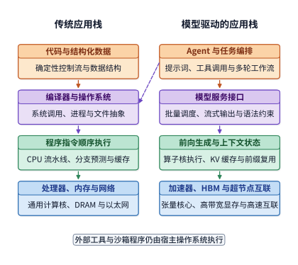

*图 1-1　应用行为的表达方式与执行路径。左侧通过代码组织程序，右侧通过上下文调用模型；实线表示向下的执行依赖，虚线表示工具执行仍需传统操作系统。加速器、内存与互联分别承担模型计算、数据存储和设备间传输的职责。*

这种编程方式的转变，也改变了底层服务的运行形态。在 AI 系统中，同一个模型在服务不同应用、处理不同请求时，读取的是同一套模型参数。系统因此可以把多条请求合并到一起计算，让它们共享一次读入芯片的参数，从而大幅提高加速器的利用率。这种执行方式称为**批处理**（batching），每批同时处理的请求数量称为 **batch size**（批次大小）。与此同时，长文档输入、长篇幅回答以及多轮工具调用，都会显著改变单次请求的计算量、状态显存占用和等待时间。哪怕使用同一个模型、同一套加速卡，处理不同形态的任务时，系统性能也可能相差悬殊。

性能差异的根源，在于模型结构与硬件特性之间的深度耦合。从模型侧看，压缩需要保存的状态、改进注意力机制，或者每次只激活一部分模型参数，都会直接改变硬件需要承担的计算与访存工作；从硬件侧看，显存容量、数据读写带宽以及多卡互联拓扑，又决定了哪些模型结构和执行方式更具效率。只有摸清这两者的相互作用，才能在回答质量、响应延迟与硬件成本之间做出合理取舍，也才能理解为什么一套在某个场景下表现优异的方案，换一个业务负载就必须重新评估。

更进一步看，在以模型训练和推理为核心的系统中，软件栈各层与底层硬件可以围绕同一个确定的执行过程协同设计。通用操作系统事先并不知道应用程序下一步会做什么，只能靠层层隔离来保证通用性；而在 AI 系统中，模型结构预先规定了计算流程与数据依赖，运行时清楚地知道中间状态何时产生、何时复用，硬件则专注于完成对应的运算与传输。利用这些先验信息重新编排执行流程，就能省去通用软件栈中的大量冗余开销。同一个基础模型既能靠切换上下文支持千变万化的上层应用，又能让底层系统针对固定形态的模型计算做极致优化。**上层编程抽象的变化，为底层的跨层联合优化打开了广阔空间。** 本书将用定量分析的方法剖析这些优化机会，展示系统设计的取舍如何演变，以及新的软硬件设计如何推高训练与推理性能。

### 1.1.2 从任务到硬件的六层分工

一条用户请求从发出到拿到结果，需要自上而下穿越系统的多个层次。假设用户提交一段代码，请模型排查其中的错误：前端应用先把代码和问题打包发给模型服务，服务挑选一组空闲或合适的加速卡；加速卡从显存读入模型权重与用户输入，逐层完成运算，再把生成的回答传回应用。如果模型分布在多张加速卡上协同运行，卡与卡之间还要在计算过程中频繁交换中间结果。顺着这条执行路径追踪下去，我们就能看清等待发生在哪个环节、哪份数据在反复搬移。

华为半导体首席科学家廖恒博士曾提出“十八层宝塔”的比喻，用来描绘从上层应用、模型算法、软件系统，一直到底层芯片架构、制造工艺和半导体物理的完整技术栈。他指出，大多数工程师和研究者只熟悉其中的一两层，往往因此错失了跨层协同优化的良机。[^panorama] 借鉴这一视角，图 1-2 将本书讨论的内容浓缩为六个核心层次：

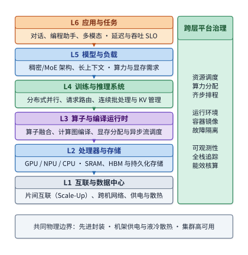

*图 1-2　从应用到硬件的六层分工。自上而下依次将业务任务转化为模型负载、系统调度、算子程序、芯片计算访存与数据中心互联；向下箭头表示上层需求逐级拆解为底层硬件操作。*

最顶层是**应用与任务**。日常对话、代码补全、语音交互，以及能够自主调用工具的智能体（Agent），都在这一层定义各自的业务需求：要解决什么问题、多快返回结果、单次调用的成本上限是多少。训练任务同样在这一层确立目标，例如在规定时间内完成一轮预训练或一次强化学习更新。

往下是**模型与负载**。模型结构决定了每一步要做哪些运算、保留哪些状态数据；而实际业务负载则决定了请求何时到达、上下文有多长、生成会持续多久。哪怕调用的是同一个模型，一句简短的提问和一篇数万字的长文档，对算力和显存的需求也截然不同。本书第 2 章将深入剖析模型结构，第 3 章则重点拆解训练与推理负载。

**训练与推理系统**负责把模型与负载需求转化为可调度的计算任务。在推理场景下，它负责接收请求、组建 batch、管理上下文状态，并协调正在逐步生成的旧请求与刚到达的新请求；在训练场景下，它还要组织前向与反向计算、梯度通信、参数更新以及故障恢复。本书第 8—10 章将围绕这一层展开。

再往下是**算子与编译运行时**。模型中的矩阵乘法、归一化（按统计量调整数值分布尺度）等数学运算，必须转化为处理器能够直接执行的底层程序。本书把矩阵乘法这类基本计算单元称为**算子**（operator）：算子库提供手工或自动调优的高效实现，编译器将模型计算图转化为加速卡可执行的代码，运行时则负责向硬件下发任务并管理执行期间的资源。这三者共同决定了计算如何分块、临时数据放在哪一级存储、任务何时提交给硬件。同一个数学公式，采用不同的分块和访存方式，执行效率可能相差数倍，第 5 章会详细算清这些差异。顺着算子分块还能引出理解分布式并行的统一线索：在单张加速卡内部，一个大矩阵可以切分成小块交给不同计算单元并行处理；在多张加速卡之间，整个模型也可以按样本、序列、特征维度、网络层或专家（混合专家模型中按输入动态选用的子网络）切分开来协同计算。无论是卡内分块还是跨卡并行，核心问题都是先确定哪一块由谁算，再安排输入数据的分发与计算结果的汇总，唯一的区别在于数据跨越的是片上缓存、显存还是外部网络。第 6 章将沿着这条主线串起各类分布式并行策略，而不再把它们当成孤立的技巧。

**处理器与存储**承担实际的计算与数据读写。CPU 是运行操作系统和通用控制逻辑的中央处理器；GPU 原是擅长并行处理大规模图形计算的处理器，如今已成为稠密矩阵运算的主力；NPU 则是专门面向神经网络计算定制的处理器。在存储体系中，主存存放 CPU 访问的数据，显存存放 GPU 访问的数据，而片上存储则直接集成在处理器芯片内部，供计算单元就近高速读写。计算单元总是先从存储读取输入，完成运算后再将结果写回。第 4 章将从算力与访存带宽的配比出发，解析现代 AI 加速器的架构设计；第 13 章则进一步深入持久化存储底座，剖析预训练数据流水线、万卡并行检查点（Checkpoint）与多级 KV 缓存的存储系统设计。

最底层是**互联与数据中心**。加速卡之间通过高速互联交换数据，服务器与机柜通过数据中心网络组成集群，而供电与散热能力则框定了算力资源的物理部署密度。第 6、7 章将探讨超节点与数据中心网络，第 12 章则进一步将视野从云端数据中心延伸到边缘与终端设备。

这六个层次勾勒出了系统的纵向分工，但也有许多关键能力贯穿多个层次：资源调度、容器环境、监控观测与计费系统需要汇总多层状态才能做出决策；芯片工艺、先进封装、供电与散热则从物理层面决定了硬件的形态边界。同样，网络通信也并非只存在于最底层——凡是需要跨卡、跨机协作的模型结构、算子实现和推理服务，都离不开具体互联链路的支持。

顺着这六层自上而下看，一个业务任务被逐级拆解为具体的算子运算与数据读写；自下而上看，加速卡的显存容量、峰值算力与各级带宽，直接决定了系统能装下多大的模型、能同时服务多少并发请求，以及能以多快的速度给出响应。而相邻层次之间的交界处，恰恰是跨层联合优化的最佳切入点：在模型层压缩状态表示，能同时减轻显存占用和网络传输负担；在编译层将相邻算子融合执行，能省去中间结果写回显存的往返开销；在运行时层让加速卡直接接管控制流，则能减少主机 CPU 的频繁介入。第 14 章将系统收束这一跨层脉络，探讨如何将模型算法、系统软件与下一代硬件架构放在同一个框架下协同设计。

### 1.1.3 一次生成请求的处理过程

在推理服务中，能够独立完成一次模型推理的一组计算资源称为一个**推理实例**（instance），它可以由单张加速卡构成，也可以横跨多张加速卡。每一条外部请求都会交给某个推理实例来处理。图 1-3 展示了请求路由与实例内部执行的分工：服务路由器负责根据负载情况挑选合适的推理实例，选定之后，再由实例内部的调度器指挥加速卡执行模型计算。只有先理清这套执行分工，才能明白模型权重存放在哪里、计算产生的中间结果又该传给谁。

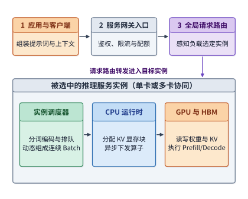

*图 1-3　一次请求先由路由器选择推理实例，再由实例内部的调度器安排执行。灰色外框圈出同一个实例，实线表示请求和工作提交的方向。*

一次请求的上下文通常包含用户当前输入、历史对话记录、检索到的外部资料以及此前已生成的内容。上层应用把这些信息组装成请求发往模型服务入口。入口完成权限校验、配额检查与内容审核后，由路由器综合考虑目标模型和各实例的繁忙程度，选定一个推理实例。如果该实例包含多张加速卡，实例内部会进一步安排多卡之间的协同执行。

进入实例后，输入文本首先被分词器转换成 **token**（词元）序列。token 是模型处理文本的基本单位，一个 token 可能对应一个汉字、半个英文单词或常见的字符组合，一段文本切分出多少个 token 取决于具体的分词规则。分词既可以在共享的前端服务中完成，也可以由推理实例自己处理。随后，实例内的调度器将请求排入等待队列、组建 batch，并为该请求的上下文状态分配显存空间。就绪之后，CPU 上的运行时向 GPU 下发计算任务，驱动 GPU 依次执行模型算子。[^request]

大语言模型的生成过程分为两个阶段：首先一次性处理全部输入 token，这一阶段称为**预填充**（prefill）；随后一个接一个地生成新 token，这一阶段称为**解码**（decode）。在解码阶段，每生成一步都要复用此前所有 token 留下的中间状态，其中最核心的是 **KV 缓存**（KV cache）——它保存了上下文各个 token 在每一层产生的键（Key）向量和值（Value）向量，供后续生成的 token 做注意力计算时直接读取。关于键和值在注意力机制中如何产生、如何参与计算，第 2 章会结合具体公式详细拆解。解码循环由实例内的调度器持续推进，每一步新生成的 token 都会作为下一步的输入，同时经过解码还原成文字，顺着网络连接流式返回给用户；如果模型生成的输出要求调用外部工具，宿主应用就会去执行工具，把返回结果追加到上下文中，再发起下一轮模型调用。

在上述每一步计算中，被反复读取的核心数据首先是**模型权重**——即模型在训练阶段学到的、用于将输入变换为输出的全部参数。模型权重在推理实例启动或切换模型时从外部存储加载到显存中，此后便一直常驻显存，供成千上万次请求反复使用。而在生成过程中，GPU 计算单元每处理一步，都要从显存把各层权重和上下文状态读取一遍，算完当前层后再把结果传给下一层。可以看到，模型权重经历了两种频次截然不同的搬移：加载时从存储一次性搬入显存，执行时则在每一步从显存反复搬入计算单元。如果推理实例横跨多张加速卡，一张卡算出的中间结果还必须及时传给其他卡，下一步计算才能继续。这些在算子之间传递的多维数组称为**中间张量**（或激活值），常见的二维矩阵就是二阶张量。**用户发来的请求也许只有短短几十个字，但系统在底层搬移的，却是体量大得多的模型权重、上下文状态和中间张量。**

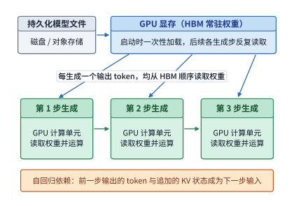

*图 1-4　权重加载一次，生成时逐步读取。蓝框表示显存中持续保存的同一份权重，三个绿框表示先后发生的计算；箭头表示读取或结果依赖，步骤间距不代表耗时。*

图 1-5 展示了承载上述软件流程的物理硬件架构。现代 AI 数据中心通常由前端入口与通用 CPU 服务器、共享存储系统，以及由多个**超节点**（supernode）组成的加速器资源池构成。所谓超节点，是指一组通过高带宽专属互联紧密耦合的加速卡集群，它们可以分布在多台服务器或多个计算托盘（机柜内集成了 CPU 与加速卡的可插拔模块）之中。

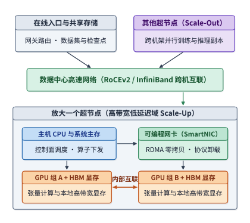

*图 1-5　物理连接的两层视图。上方用数据中心网络连接服务与超节点，下方放大一个超节点，显示主机、网卡、GPU 与显存；线条展示数据路径，设备数量用于示意。*

在单台服务器或单个计算托盘内部，CPU 连接主存，负责运行主机程序和下发控制指令；每张 GPU 连接各自的显存，负责执行模型运算并保存权重与运行状态。**HBM**（高带宽内存）是主流训练与推理加速卡广泛采用的显存技术，通过极宽的接口位宽为计算核心持续输送数据。CPU 与 GPU 之间通常通过 **PCIe**（高速外设互联总线）相连，而多张 GPU 之间则往往配备独立的高速互联通道，以便直接交换数据。网卡负责将整台机器接入数据中心网络。在支持直接内存访问（DMA/RDMA）的系统中，网卡或互联硬件可以直接读写指定的内存或显存区域，CPU 只需负责发起和管理传输任务，第 7 章会详细拆解这一交接过程。

在集群架构中，超节点内部的高速互联通常称为 **scale-up**（纵向扩展），设计重点是让一组加速卡像拼成一台大机器那样，以极低的通信开销协同计算；而多个超节点之间通过网卡与交换机相连的网络则称为 **scale-out**（横向扩展），用于将算力规模扩展到成百上千个节点。两层网络都要面对带宽、延迟、拥塞与硬件故障等问题，但协作半径和通信代价截然不同。以 NVIDIA 的 GB200 NVL72 机柜为例，它将 36 颗 Grace CPU 和 72 颗 Blackwell GPU 集成在同一个机柜内，72 颗 GPU 通过 NVLink 高速互联组成单一的高带宽互联域，对外则通过数据中心网络与其他机柜相连。这种架构把紧密协作的边界从传统的“单机八卡”扩展到了整机柜 72 卡，使超大模型可以将权重和状态分散到更多加速卡上，而每一步频繁的张量交换则完全在机柜内部的高速互联中完成。[^datacenter]

由此，AI 数据中心内部也形成了清晰的流量分工：前端网络负责收发用户的文本请求，存储网络负责分发庞大的模型权重文件，而加速器互联网络则负责在每一步计算中实时传递中间张量。这三类流量的触发频率、数据体量和时延敏感度大不相同：模型文件可以在服务启动前预先加载，而当前层算出的中间结果一旦迟到，下一层的所有计算单元就只能停下来等待。物理互联的带宽与延迟，因此直接制约着模型的执行效率。

> **练习 1-1〔延伸〕：一次请求中的权重读取、状态增长与数据传递**
>
> 对照图 1-3 至图 1-5，画出 KV 缓存随生成过程逐步增长的示意图，并在图中分别标出模型权重加载、单步权重读取、KV 缓存追加以及跨卡中间结果传递的位置。如果模型回答的长度从 100 个 token 增加到 1000 个 token，哪些数据只需在启动时加载一次，哪些数据访问会随生成步数成倍增加？如果为了提高并发能力，把一个推理实例复制成两个独立实例，显存中的权重占用与前端的请求路由又会发生什么变化？

一次模型推理到底跑得多快，既取决于单张加速卡的硬实力，也取决于多张卡之间的连接方式：单卡的峰值算力和显存带宽决定了本地计算与读写的快慢，而多卡协作则会额外引入跨卡通信和同步等待。本章我们先学会在单卡上做定量估算，后续章节再将同一套分析方法推广到超节点与集群网络。

在展开具体计算之前，先介绍一组将贯穿全书的真实工业界模型：DeepSeek V4 与 DeepSeek V4.1 Flash。其中，V4 通过压缩上下文状态与引入稀疏访问大幅降低了显存占用和访存开销，而 V4.1 Flash 则在此基础上重构了模型内部的计算分工。传统的大语言模型大多采用 **decoder-only**（仅解码器）架构，无论处理输入还是生成输出，每一个 token 都必须从头到尾穿过完整的模型主干，逐层建立上下文状态；而 V4.1 Flash 采用了**因果编码器—解码器**（Causal Encoder-Decoder，简称 **CED**）架构，将全模型拆分为前半段因果编码器与后半段因果解码器：先由前半段编码器统一提取输入上下文的特征表示并生成全局共享缓存，再由后半段解码器直接跨层读取这些共享表示并完成生成。这样一来，在 prefill 阶段，除末尾小窗口外的海量历史输入 token 只需走完前半段编码器即可停步，无需继续穿过后半段解码器主干；只有末尾窗口内的 token 以及到了逐个生成新 token 的 decode 阶段，才需要依次走完编码器与解码器。由于输入处理与输出生成的执行路径不再对称，这种架构特别适合 Agent 场景下“输入上下文极长、单次输出相对较短”的负载特征，使计算资源集中在真正影响生成质量的关键路径上。[^v41-case]

这种模型架构上的创新，也会深刻改变底层系统需要保存和传输的数据形态。本书后续章节将围绕同一个典型的 Agent 会话场景持续追踪：Agent 发起工具调用并等待返回，系统恢复此前的历史上下文，模型增量处理工具新返回的结果，随后继续生成下一步决策。其中，第 2 章解析 CED 架构的内部结构与状态布局，第 3 章拆解输入处理与逐步生成的负载特征，第 4—7 章追踪算子在加速器与网络上的执行路径，第 8、9 章探讨如何跨轮次缓存状态与调度请求，最后评估完整会话任务的端到端收益。在全书算例的搭配上，我们将先用结构规整的开源模型 Qwen3 建立手算与估算的基本功，再用 DeepSeek V4 与 V4.1 Flash 展示模型演进与系统设计如何相互成就。

### 1.1.4 从存储程序到数据流执行

要理解为什么 AI 需要专门的加速器，不妨把处理器和存储器想象成一座办公大楼。如果整栋大楼只有一楼设了洗手间，楼上办公的人每次使用都得上下跑一趟，花在路上的时间和走廊里的拥堵就会拖垮整栋楼的效率；反过来，如果在每一层都修洗手间，走路的距离虽然大大缩短，却要占用宝贵的办公面积，还得铺设更复杂的上下水管道并承担日常维护。计算机里的寄存器、多级缓存、片上缓冲、显存和主存，恰恰就像设在不同楼层、不同距离上的设施——离计算核心越近，访问速度越快，但容量越小、造价也越高。

回顾计算机体系结构的发展史，核心主线之一就是如何缩短计算与数据之间的距离。早期的冯·诺依曼存储程序计算机将指令和数据存放在统一的可寻址内存中；随着处理器运算速度远远甩开内存访问速度，工程师们陆续引入了寄存器、多级缓存、硬件预取、SIMD 向量指令以及乱序并行执行，试图靠更近的局部存储和更多的在途内存请求来掩盖漫长的访存等待。到了 GPU 和现代 AI 加速器时代，数据复用不再仅仅依赖硬件自动猜测，而是变成了显式的硬件结构与编程模型：成百上千个线程协同读写片上共享内存，专用矩阵计算单元沿着固定数据通路在阵列内部直接复用操作数，数据搬移引擎与计算核心异步并行工作，编译器则精细地编排矩阵分块、内存布局与流水线缓冲。

在大语言模型中，prefill、decode、KV 缓存访问以及混合专家路由各自有着截然不同的数据复用规律，很难再靠一套通用的硬件自动缓存策略包打天下。因此，现代 AI 加速器必须把计算单元、片上存储和数据搬移通路作为一个整体协同设计。本书后续章节将从这些基础硬件资源出发，一步步剖析一次模型推理和训练是如何转化为可计算、可搬移、可调度的系统任务的。

## 1.2 系统设计的关键数字

### 1.2.1 用数量级判断方案

在动手估算一次模型执行之前，我们首先要对计算机系统中各类基本操作的耗时建立数量级概念。2009 年，Google 首席科学家 Jeff Dean 在一次演讲中给出了一张后来被无数系统工程师奉为圭臬的表格——“Numbers Everyone Should Know”（每个人都应该知道的系统数字）。这张表将缓存访问、内存读写、磁盘寻道和网络传输的耗时放在同一把标尺下对比，传递出一种非常实用的工程方法论：在动手写代码或搭建系统之前，先在纸面算一算核心操作要花多少时间、消耗多少资源。[^dean]

下表完整列出了原演讲幻灯片中的 12 项操作及其耗时。为了便于直观对比，所有时间统一换算为 **ns**（纳秒，十亿分之一秒）：$1\ \mu\mathrm{s}$（微秒）等于 $1000\ \mathrm{ns}$，$1\ \mathrm{ms}$（毫秒）等于 $1000\ \mu\mathrm{s}$。在数据量单位中，$1\ \mathrm{byte}$（字节）等于 $8\ \mathrm{bit}$（比特）；网络速率常用的 $\mathrm{bit/s}$ 表示每秒传输的比特数，$\mathrm{Gbit/s}$ 中的 $\mathrm{G}$ 代表十亿（$10^9$）。容量单位中，十进制的 $\mathrm{KB}$、$\mathrm{MB}$、$\mathrm{GB}$、$\mathrm{TB}$ 分别代表 $10^3$、$10^6$、$10^9$、$10^{12}$ 字节；二进制的 $\mathrm{KiB}$、$\mathrm{MiB}$、$\mathrm{GiB}$ 则分别代表 $2^{10}$、$2^{20}$、$2^{30}$ 字节。虽然表中的具体数值反映的是 2009 年前后的硬件水平，但不同层级操作之间的数量级差距，至今依然具有启发意义。

在阅读表格前，先简单解释几个底层概念：缓存（cache）用于就近保存处理器近期可能反复访问的数据，其中一级缓存（L1）比二级缓存（L2）容量更小、距离计算核心更近；分支预测是处理器对条件跳转指令走向的提前猜测，一旦猜错就得清空流水线重新执行；线程是操作系统调度执行的最小单元，当多个线程需要访问同一份共享数据时，往往要通过互斥锁（mutex）来保证安全；磁盘寻道是指机械硬盘移动磁头定位到目标磁道的机械过程；而 Zippy 则是 Google 内部广泛使用的快速数据压缩库（后开源为 Snappy）。这 12 项操作横跨了计算、同步、存储与网络，耗时跨度超过八个数量级：

| 操作                    |      时间（ns） |
| --------------------- | ----------: |
| 访问一级缓存                |         0.5 |
| 分支预测错误后的恢复            |           5 |
| 访问二级缓存                |           7 |
| 对互斥锁加锁或解锁             |          25 |
| 访问主存                  |         100 |
| 用 Zippy 压缩 1K 字节      |       3,000 |
| 经 1 Gbit/s 网络发送 2K 字节 |      20,000 |
| 从主存连续读取 1 MB          |     250,000 |
| 同一数据中心内往返             |     500,000 |
| 磁盘寻道                  |  10,000,000 |
| 从磁盘连续读取 1 MB          |  20,000,000 |
| 数据包从加州到荷兰再返回          | 150,000,000 |

不妨挑出其中四个跨越数量级的代表性延迟数字：访问芯片内部的 L1/L2 缓存仅需约 $0.5\text{—}7\ \mathrm{ns}$，访问一次系统主存约需 $100\ \mathrm{ns}$，同一数据中心内的网络往返一趟约需 $500{,}000\ \mathrm{ns}$，而机械磁盘寻道一次则高达 $10{,}000{,}000\ \mathrm{ns}$。将后三者换算成更易读的单位，分别是 $0.1\ \mu\mathrm{s}$、$0.5\ \mathrm{ms}$ 和 $10\ \mathrm{ms}$，如图 1-6 所示。

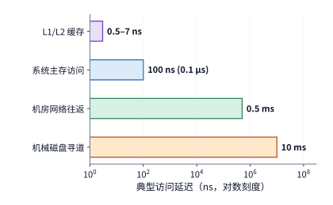

*图 1-6　Jeff Dean 2009 年演讲中的四种代表性操作延迟。横轴为对数刻度，每相邻数量级相差十倍；先识别操作，再比较它们在串行等待中的代价。*

按照这组数字，一次磁盘寻道的耗时大约是一次主存访问的十万倍。如果一条请求在执行过程中必须串行等待多次慢速访问，这些延迟就会逐次累加，直接拉长整个请求的响应时间。特别是当程序必须先读出前一块数据才能知道下一次该访问哪里时，哪怕处理器在两次访问之间只做微不足道的计算，也只能停下来等待数据读取完成。

举个具体的例子：假设处理一条请求需要串行执行 20 次磁盘寻道，每次耗时 $10\ \mathrm{ms}$，而期间全部的 CPU 计算加起来只需 $1\ \mathrm{ms}$，那么总耗时就是 $201\ \mathrm{ms}$。此时，哪怕把 CPU 的计算速度提升一倍，总时间也只能缩短 $0.5\ \mathrm{ms}$；反过来，如果优化数据存储布局，把相关数据尽量连续存放，使寻道次数从 20 次减半到 10 次，就能直接省下 $100\ \mathrm{ms}$。这两种优化方案一个针对计算、一个针对访存等待，最终收益之所以有悬殊差异，完全取决于它们在原始总耗时中所占的比重。

因此，只要把一次任务的总耗时拆解清楚，优化的主攻方向就会一目了然：哪个环节在总时间里占比最大，缩短哪个环节带来的整体收益就最显著。在刚才的寻道算例中，CPU 计算只占总时间的 $1/201$，哪怕把计算耗时压缩到零，总时间也只能缩短约 $0.5\%$。

把这一直觉写成数学公式，就是系统设计中著名的 **Amdahl（阿姆达尔）定律**。假设原任务执行时间中占比为 $f$ 的那部分工作被加速了 $s$ 倍，而其余部分的工作量与串行依赖保持不变，那么整个任务获得的总加速比为：

$$
\mathrm{Speedup}=\frac{1}{(1-f)+f/s}.
$$

从公式可以立刻看出，就算把占比为 $f$ 的那部分工作加速到耗时完全可以忽略（即 $s\to\infty$），整体加速比也绝不可能超过 $1/(1-f)$。在前面的例子中，减少磁盘寻道直接将占比高达 $99.5\%$ 的等待时间缩减了一半，效果自然远远胜过单纯给 CPU 提速。

**例：同样引入 AI 编程工具，为什么不同研发团队感受到的整体提速差异显著？** 假设交付一项软件功能需要依次经历需求沟通、编写代码、代码评审和上线审批四个环节。引入 AI 编程助手后，工程师编写代码的速度提升到了原来的 5 倍（$s=5$），但沟通、评审与审批的耗时没有变化。在流程繁琐、跨部门协调频繁的大型企业团队中，真正花在写代码上的时间可能只占交付总周期的 $20\%\text{—}30\%$，其余时间都耗在开会对齐和层层审批上。代入 Amdahl 公式可以算出，整体交付速度只能提升约 $1.19\text{—}1.32$ 倍。比如原本需要 100 小时完成的任务，其中写代码占 20 小时；用上 AI 后写代码缩短到了 4 小时，但其他流程依然要花 80 小时，总耗时仍达 84 小时。

相反，在沟通扁平、流程精简的创业团队里，假设编写代码占去了总交付时间的 $70\%\text{—}80\%$，那么同样的 5 倍编码提速就能让整体交付速度提升约 $2.27\text{—}2.78$ 倍。以编码占 $80\%$ 为例，原本 100 小时的任务可以直接缩短到 $20+80/5=36$ 小时。图 1-7 将两条局部加速曲线（$s=5$、$s=10$）与理论极限曲线（$s\to\infty$）绘制在同一坐标系下，直观展示了可加速环节占比 $f$ 如何约束端到端加速比。

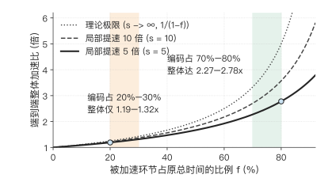

*图 1-7　Amdahl 定律下的端到端加速比曲线。横轴为可加速环节在原任务中的耗时占比 $f$，纵轴为端到端总加速比；蓝色实线与青绿色虚线分别对应局部加速 $s=5$ 和 $s=10$，灰色点线为局部耗时趋近于零时的理论上限 $1/(1-f)$，橙、绿两道纵向阴影带分别标出大型企业团队（$f=20\%\text{—}30\%$）与精简团队（$f=70\%\text{—}80\%$）在 $s=5$ 下的实际收益区间。*

**Amdahl 定律适用于一切只优化局部环节的复杂流程。** 无论是优化 CPU 程序、加速大模型推理，还是改进软件工程流程，都必须先问同一个问题：被加速的环节原本占总时间的多少？剩下的时间又花在了哪里？想要进一步缩短端到端交付时间，就必须转头去削减沟通、评审与审批等新的瓶颈。任何局部的提速，最终都要放回完整的端到端流程中去检验。

Jeff Dean 的数字表与 Amdahl 定律背后的分析思路，可以直接迁移到 AI 系统的性能估算中：先摸清每一项工作消耗哪种硬件资源，再把它们换算成时间放在一起比大小。

### 1.2.2 分析 AI 系统需要哪些关键数字

假设某项模型计算任务需要同时在存储中保留 $M$ 字节的数据，完成 $F$ 次浮点运算，并通过某个存储或通信接口读写 $R$ 字节的数据。而硬件加速器提供的可用存储容量为 $M_{\mathrm{cap}}$、计算吞吐率为 $\Pi$、接口带宽为 $\beta$。要判断硬件能否胜任这项任务、最快需要多久完成，必须将三项需求分别与硬件供给做对比：

$$
M\le M_{\mathrm{cap}},\qquad
T_{\mathrm{compute}}=\frac{F}{\Pi},\qquad
T_{\mathrm{memory}}=\frac{R}{\beta}.
$$

第一道不等式检查显存容量能不能同时装下所需数据；后两个式子则分别将计算工作量和数据读写量换算成最短耗时。这里同一份数据可以在显存中只存一份，却在计算过程中被反复读取多次，因此驻留容量 $M$ 与读写流量 $R$ 必须分开统计。如果公式中的 $\Pi$ 和 $\beta$ 代入硬件的标称峰值，算出来的 $T_{\mathrm{compute}}$ 和 $T_{\mathrm{memory}}$ 就是完成相应计算与读写所需的**理论时间下界**。

因为硬件峰值是由芯片上的计算单元数量、工作频率和物理接口位宽直接决定的，所以这个时间下界代表了不可逾越的物理极限——无论软件怎么优化，实际耗时都不可能比它更短。用这个理论下界除以实际测得的耗时 $T$，就能衡量硬件潜力被发挥出了多少：计算侧的比值 $F/(\Pi T)$ 称为 **MFU**（model FLOPs utilization，模型算力利用率），访存侧的比值 $R/(\beta T)$ 称为 **MBU**（memory bandwidth utilization，内存带宽利用率），两者的取值都不可能超过 1。本书后续章节将反复使用这两个利用率指标，它们回答的是同一个核心问题：当前的系统实现距离硬件的物理极限还有多远？

在具体的系统分析中，除了容量、计算吞吐率和带宽，还有一个不可忽视的维度是**延迟**（latency）。下面分别说明这四类指标该如何用于纸面估算。

- **容量**（capacity）回答“能同时装下多少数据”。例如，一张加速卡配备多少显存，直接决定了它能否同时容纳模型权重、请求的上下文状态以及算子运行时的临时工作区。容量通常以 byte（字节）为单位。
- **计算吞吐率**（compute throughput，常简称**算力**）回答“单位时间内能完成多少次运算”。在 AI 领域，$\mathrm{FLOP}$ 表示一次浮点运算，$\mathrm{FLOPs}$ 表示浮点运算的总次数，而 $\mathrm{FLOP/s}$ 则表示每秒完成的浮点运算次数。常见的 $\mathrm{GFLOPs}$、$\mathrm{TFLOPs}$ 分别代表十亿次（$10^9$）、万亿次（$10^{12}$）浮点运算，对应的每秒速率则记为 $\mathrm{GFLOP/s}$、$\mathrm{TFLOP/s}$。在矩阵乘法中，一次乘法加上一次加法通常计为 2 次浮点运算（$2\ \mathrm{FLOPs}$）。需要注意，加速卡标称的矩阵峰值算力总是绑定着特定的数值精度、累加精度和稀疏条件：稠密（dense）算力按完整矩阵逐元素完整计算，而稀疏（sparse）算力则要求权重满足特定的零元素分布（如每四个元素中至少有两个为零）才能跳过一半运算。
- **带宽**（bandwidth）回答“单位时间内能搬移多少数据”。显存带宽衡量显存颗粒与计算芯片之间的数据传输速率，而卡间互联带宽与网络带宽则衡量跨芯片、跨机器的数据传输速率。估算哪一段路径上的数据搬移，就要代入哪一段接口的带宽。
- **延迟**（latency）回答“从发起一次操作到收到响应需要等多久”。哪怕是带宽极高的传输接口，每次发起请求也都有不可忽略的启动开销或信号往返时间。当一次性传输大块连续数据时，总耗时主要取决于数据量除以带宽；但当数据块很小、且下一步操作必须等上一步返回后才能发起时，启动和往返延迟就会成为主导因素。

不妨看一款真实的工业界加速卡：NVIDIA H100 SXM（其中 SXM 指服务器主板上的高功率插座形态）。在数值表示上，**BF16** 是每个数值占 16 位（2 字节）的脑浮点格式，**FP32** 是每个数值占 32 位（4 字节）的单精度浮点格式；现代 GPU 的矩阵计算单元通常读入 BF16 格式的乘数，在内部用精度更高的 FP32 格式累加乘积。一张 H100 SXM 配备了 $80\ \mathrm{GB}$ 显存，HBM 显存带宽高达 $3.35\ \mathrm{TB/s}$，在 BF16 输入、FP32 累加的稠密矩阵运算下，峰值算力约为 $989.4\ \mathrm{TFLOP/s}$。[^h100]

把 H100 SXM 与上一代数据中心主力卡 NVIDIA A100 80GB SXM、以及消费级旗舰卡 GeForce RTX 4090 放在一起对比，就得到了一张实用的 GPU 资源速查表。这三款芯片分别代表了 Hopper、Ampere 和 Ada Lovelace 三代架构。表中显存容量采用厂商标称的十进制 $\mathrm{GB}$，带宽采用十进制 $\mathrm{TB/s}$，矩阵算力统一取 BF16 输入、FP32 累加的稠密峰值。最后一行给出了按峰值带宽从显存连续读取 $1\ \mathrm{GB}$ 数据所需的最短时间（由 $1\ \mathrm{GB}$ 除以显存带宽算出）。[^gpu-numbers]

| 资源或操作 | RTX 4090 | A100 80GB SXM | H100 SXM |
| --- | ---: | ---: | ---: |
| 显存容量（GB） | 24 | 80 | 80 |
| 显存带宽（TB/s） | 1.008 | 2.039 | 3.35 |
| BF16 矩阵峰值（TFLOP/s） | 165.2 | 312 | 989.4 |
| 按带宽峰值读取 1 GB（ms） | 0.99 | 0.49 | 0.30 |

有了这张速查表，我们就能随时把模型的工作量换算成具体的时间下界：当读写数据量不变而显存带宽翻倍时，访存耗时 $R/\beta$ 就会减半；当运算量不变而算力翻倍时，计算耗时 $F/\Pi$ 也会减半。

需要补充的是，即便在单颗芯片内部，数据搬移也远非免费。在物理实现上，每当比特流穿过片上金属互连线时，都必须对沿途的金属导线电容反复充放电：互连路径越长，寄生电容越大，搬移单位比特消耗的动态能量就越高，信号传播的 RC 延迟也越显著。正因如此，前沿芯片设计开始探索**三维逻辑折叠**（LogicFolding）等立体集成路径——将原本在二维平面上铺开的逻辑模块沿垂直方向折叠堆叠，用微米级的层间垂直互连替代漫长的平面跨区走线，从而同步削减片上互连电容、数据搬移能耗与芯片面积（代价则是单位面积热流密度上升与层间对准工艺复杂度增加）。[^logicfolding] 从芯片内部的微米级走线，到板卡上的高带宽显存接口，再到跨机房的光纤网络，**缩短数据搬移路径、减少不必要的跨层传输**始终是贯穿底层的共同物理主线。

### 1.2.3 参数存储量与链路带宽的换算

掌握了硬件侧的四类指标后，下一步就是把具体模型的开销算出来，看看硬件能不能装下、搬移数据又要花多久。基本步骤很直接：先把模型的参数量换算成存储字节数，检查加速卡的显存能否容纳；再用字节数除以接口带宽，估算搬移这些数据所需的时间。

不妨以开源社区广泛使用的 **DeepSeek-R1-Distill-Llama-70B** 模型为例。该模型基于 Llama 架构，是一个典型的稠密模型（即每次处理 token 时都要用到全部模型参数），其公开权重共包含约 705.54 亿个参数。模型名称中的 `70B` 代表约 700 亿（Billion）参数规模；需要注意，本书后续公式中的大写字母 $B$ 均代表 batch size（批次中的请求数），切勿与参数单位混淆。我们用 $N$ 表示模型的参数总数，用 $b_W$ 表示每个权重参数占用的字节数。在 BF16 精度下，每个参数占 2 字节，因此整份权重文件的总字节数为[^real70]：

$$
\begin{aligned}M_W&=Nb_W\\&=70{,}553{,}706{,}496\times2\ \mathrm{bytes}\\&\approx141.11\ \mathrm{GB}.\end{aligned}
$$

为了与厂商硬件规格表直接对齐，本节统一使用十进制单位 $\mathrm{GB}$（$1\ \mathrm{GB}=10^9\ \mathrm{bytes}$）；若换算成二进制单位 $\mathrm{GiB}$（$1\ \mathrm{GiB}=2^{30}\ \mathrm{bytes}$），$141.11\ \mathrm{GB}$ 大约等于 $131.42\ \mathrm{GiB}$。在实际工程中，做显存预算时务必先把硬件可用容量与模型大小统一到同一套单位制下再做加减。

显然，$141.11\ \mathrm{GB}$ 的 BF16 权重远远超出了一张 H100 SXM 标称的 $80\ \mathrm{GB}$ 显存上限。一种直接的解决办法是将模型**切分**到两张 H100 卡上——即让每张卡各自保存并计算模型的一半权重。均分之后，每张卡的权重占用降为约 $70.55\ \mathrm{GB}$，各自还留有约 $9.45\ \mathrm{GB}$ 的显存余量。当然，模型切分到两张卡上之后，卡与卡之间就必须在计算过程中频繁交换中间结果，具体的切分方式与通信代价将在第 6 章详细展开。

除了增加加速卡，另一种常见办法是降低权重的存储位宽。**量化**（quantization）技术通过用更少的比特数来近似表示原本的高精度数值：例如，把原本占 16 位（2 字节）的 BF16 浮点权重压缩为 8 位（1 字节）整数，并额外保存一个缩放因子（scale），以便在计算时将整数还原回对应的数值范围。这样一来，每个权重参数占用的空间直接减半，显存压力随之大幅缓解。

以本书采用的分组量化方案为例：每 128 个权重共享一个 2 字节的缩放因子，同时保留少部分对精度敏感的层继续使用 BF16。按照该模型的真实配置逐项核算，8 比特量化后的全部权重加上缩放因子共占约 $73.73\ \mathrm{GB}$，刚好可以装进一张 $80\ \mathrm{GB}$ 的 H100 SXM 显存中，还能留下约 $6.27\ \mathrm{GB}$ 的余量。图 1-8 在同一把容量标尺下对比了这两种部署方案：要么用两张卡分担 BF16 权重，要么通过 8 比特量化把整个模型装进单张卡。

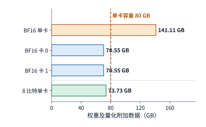

*图 1-8　DeepSeek-R1-Distill-Llama-70B：BF16 权重共 141.11 GB，两卡均分后每卡约 70.55 GB；分组 8 比特量化后共 73.73 GB。各条使用相同尺度，虚线表示一张 H100 SXM 的名义 80 GB 容量。柱长只计权重及相应量化附加数据。*

**别忘了给 KV 缓存和临时工作区留出空间。** 在实际推理服务中，显存不仅要装下静态的模型权重，还要在生成过程中动态保存每条请求的 KV 缓存，并为算子执行留出临时工作区（workspace）。因此，完整的单卡显存容量约束应当写成：

$$
M_W+M_{\mathrm{state}}+M_{\mathrm{work}}\le M_{\mathrm{cap}}.
$$

其中 $M_W$ 是模型权重（含量化附加参数）的大小，$M_{\mathrm{state}}$ 是当前驻留请求的上下文状态（即 KV 缓存）大小，$M_{\mathrm{work}}$ 是运行时与算子所需的临时工作区，而 $M_{\mathrm{cap}}$ 则是加速卡的可用显存容量。仍以该 70B 模型为例：处理一条长度为 8192 个 token 的请求时，其 BF16 格式的 KV 缓存恰好占 $2.5\ \mathrm{GiB}$（折合十进制约 $2.68\ \mathrm{GB}$）；如果再为算子工作区预留 $2\ \mathrm{GiB}$（约 $2.15\ \mathrm{GB}$），那么单卡 8 比特量化方案的总显存占用约为 $73.73+2.68+2.15=78.56\ \mathrm{GB}$，依然控制在 $80\ \mathrm{GB}$ 的预算上限之内。至于这 $2.5\ \mathrm{GiB}$ 的 KV 缓存是如何根据模型层数和注意力结构算出来的，以及当上下文更长、并发请求更多时显存需求会如何膨胀，我们将在第 2 章详细推导。

如果把硬件换成每张只有 $24\ \mathrm{GB}$ 显存的消费级显卡 RTX 4090，情况就大不一样了：同样是这份 $73.73\ \mathrm{GB}$ 的 8 比特量化权重，哪怕凑齐三张卡（合计 $72\ \mathrm{GB}$）也依然装不下，至少需要四张 RTX 4090 才能容纳静态权重，而且还得逐卡核算剩余空间是否够放 KV 缓存与工作区。因此，即使模型与量化精度完全相同，单卡显存容量的差异也会直接改变所需的加速卡数量。

跨机网络传输同样离不开严谨的单位换算。网络工程中习惯用 $\mathrm{bit/s}$（每秒比特数）标称带宽，而存储和显存习惯用 $\mathrm{byte}$（字节）计量大小，两者之间隔着 $1\ \mathrm{byte}=8\ \mathrm{bit}$ 的换算关系。例如，数据中心常用的 NVIDIA ConnectX-7 网卡标称速率为 $400\ \mathrm{Gbit/s}$，换算成字节速率，其理论线速（即链路满载时的最高传输速率）恰好是 $50\ \mathrm{GB/s}$。按这一理想线速计算，跨网卡传输 $1\ \mathrm{GB}$ 数据至少需要 $20\ \mathrm{ms}$。在实际系统中，每次网络通信还有软件与硬件的启动延迟，报文头部的协议开销以及共享链路上的其他竞争流量也会进一步拉低应用层实际拿到的有效带宽。沿着数据路径把这些开销逐项加进去，就能对分布式通信耗时做出可靠的预估。

> **练习 1-2〔核心〕：不同权重精度下的显存需求与多卡分配**
>
> DeepSeek-R1-Distill-Llama-70B 的 BF16 权重占 141.11 GB，8 比特量化权重占 73.73 GB。若部署在显存为 80 GB 的 H100 SXM 上，且每张卡需预留 5 GB 给 KV 状态与临时工作区，请分别判断“单卡部署”和“两卡均分权重”两种方案在两种精度下是否可行。接着考虑由两张异构加速卡组成的系统：一张 48 GB 显存的 RTX A6000 和一张 80 GB 显存的 H100 SXM，同样每卡预留 5 GB，请判断两种精度下能否完成部署，并为可行方案给出一种具体的权重切分比例。最后，将 400 Gbit/s 的网卡带宽换算为 GB/s，求出传输 1 GB 数据的理想最短时间。

## 1.3 用几个数字估算一次模型执行

### 1.3.1 生成一个 token，先检查什么

**例题 1-1：70B 模型的单步生成如何逼近 10 ms 目标？** 给定一张 H100 SXM，能否让上一节的 DeepSeek-R1-Distill-Llama-70B 在 $10\ \mathrm{ms}$ 内生成一个新 token？我们先按每个参数占 1 字节的量化存储来算，再依次比较算力翻倍、显存带宽翻倍以及多请求批内复用权重的效果。

**解：先检查显存容量，再核算每步的运算量与数据读取量。**

为了便于手算，我们将该模型的参数量近似取为 $N=70\times10^9$，主要权重按每参数 1 字节存储在显存中，读入芯片后还原为 BF16 格式参与矩阵运算。单个请求在解码阶段每一步只处理 1 个新生成的 token，但每一步都必须从显存把全部权重读取一遍。

**估算前提：假设权重读取与矩阵计算充分重叠。** 显存容量直接沿用上一节计入量化缩放因子后的 $73.73\ \mathrm{GB}$；而在估算单步耗时时，我们先将主要权重的读取量近似取为 $70\ \mathrm{GB}$。时间模型只统计主要权重矩阵的乘加运算和一次完整的权重读取，硬件参数代入 H100 SXM 的 BF16 矩阵峰值算力与 HBM 峰值带宽，并假设数据搬移与矩阵运算在流水线上充分重叠。

单请求下的显存容量上一节已经验算通过。接下来看生成速度：模型权重虽然已经常驻显存，但每生成一个 token，GPU 的计算单元仍需通过显存接口把约 $70\ \mathrm{GB}$ 的权重数据完整读入片上。

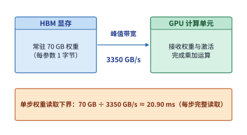

*图 1-9　本例按每参数一字节，将主要权重读取量近似取为 70 GB。权重驻留显存，计算单元每步沿同一接口读取一遍；用读取量除以接口带宽，得到 20.90 ms 的读取下界。*

只要模型还在一个接一个地生成 token，这 $20.90\ \mathrm{ms}$ 的权重读取开销就会在每一步重复出现。因为自回归生成中下一步的输入取决于当前步的输出，单个请求的各个生成步骤只能严格串行推进。

再来算每一步的浮点运算量。在矩阵与向量的乘法中，矩阵里的每个权重元素都要与输入向量的对应分量做一次乘法，再把乘积累加到输出向量上；按一次乘法加一次加法计为 2 次浮点运算，单步解码的主要矩阵运算量近似为：

$$
\begin{aligned}\text{每步矩阵运算量}&\approx2\times\text{参数数}\\&\approx2\times70\times10^9\ \mathrm{FLOPs}\\&=140\ \mathrm{GFLOPs}.\end{aligned}
$$

这里系数 $2N$ 的直观含义是：在线性投影（即用权重矩阵对特征向量做线性变换）中，每一个权重参数都要与 1 个 token 的特征分量相乘并累加一次。权重矩阵的参数越多，单步运算量就越大；如果把多条请求合批处理，使一次输入的 token 数量成倍增加，同一份权重矩阵就要同时与多个 token 的特征向量做乘加，矩阵运算量也会随之成比例增长。第 2 章将拆解真实的 Transformer 结构，在这部分线性投影运算之外，进一步算入随上下文长度增长的注意力计算。

如果把 batch size 记为 $B$，让这 $B$ 条请求在同一步解码中共享同一次读入芯片的权重，就能写出这个简化教学模型的三个基本量：

$$
M_W=b_WN,\qquad R_W=b_WN,\qquad F\approx2BN.
$$

前两个式子在单步之内数值相等，是因为模型权重在显存中存了一份（$M_W$），而在这一步计算中刚好被完整读取了一遍（$R_W$）。到了下一步生成时，显存里驻留的权重依然是 $M_W$，但显存接口上又会新增一次 $R_W$ 的读取流量。而增大 batch size $B$ 则会成倍增加单步的计算量 $F$：同一份读入片上的权重，现在要同时与 $B$ 条请求的当前 token 向量做乘加运算。第 2 章我们会在此基础上，把每条请求各自独立的 KV 缓存读写也加进来。

### 1.3.2 计算与读取分别需要多久

将单请求（$B=1$）下的运算量 $F=140\ \mathrm{GFLOPs}$ 和权重读取量 $R_W=70\ \mathrm{GB}$ 分别除以 H100 SXM 的峰值算力与显存带宽，就能算出单步生成的两项理论时间下界：

$$
\begin{aligned}\text{纯权重读取时间}&\geq\frac{70\ \mathrm{GB}}{3350\ \mathrm{GB/s}}\approx20.90\ \mathrm{ms},\\\text{矩阵计算时间}&\geq\frac{140\ \mathrm{GFLOPs}}{989400\ \mathrm{GFLOP/s}}\approx0.1415\ \mathrm{ms}.\end{aligned}
$$

对比这两个数字可以发现，权重读取的时间下界大约是矩阵计算时间的 148 倍。按照 H100 的峰值算力，这部分矩阵乘加只需 $0.14\ \mathrm{ms}$ 就能算完；但显存把 $70\ \mathrm{GB}$ 权重搬运到计算单元，却需要 $20.90\ \mathrm{ms}$。而在全部权重读完之前，当前这一步解码无法结束。[^budget]

造成这种悬殊差距的根本原因在于：单请求解码时，每从显存读入一个权重参数，计算单元只拿它做了一次乘加（2 次浮点运算）就用完了。计算核心迅速算完当前数据，绝大部分时间都在等待显存继续供数。在这样的瓶颈下，单纯提高芯片的峰值算力只能把那 $0.14\ \mathrm{ms}$ 的计算时间变得更短，对漫长的显存读取并无帮助。

那么，这两项时间在总耗时中究竟应该相加，还是取较大值？这取决于数据读取与矩阵计算能否在硬件流水线上重叠执行。在实际加速器中，权重是分块读入片上的，计算单元在处理当前数据块的同时，搬移引擎已经在后台预取下一块数据了。因此在充分重叠的理想模型下，单步耗时的理论下界由较慢的那一项决定：

$$
T_{\mathrm{step}}\ge T_{\mathrm{lower}}=\max\!\left(\frac{F}{\Pi},\frac{R_W}{\beta}\right).
$$

进入流水线稳定阶段后，每一块数据都要依次经历读取和计算，耗时更长的环节直接限制了整体推进的速度。在本例中，读取权重远比矩阵计算慢得多，因此任何想要压低单步延迟的优化，都必须首先从这 $20.90\ \mathrm{ms}$ 的访存时间入手。

**讨论：算力翻倍、带宽翻倍与批内权重复用，分别能带来什么改变？** 光是把权重从显存读出来就至少要花 $20.90\ \mathrm{ms}$，已经超出了题目设定的 $10\ \mathrm{ms}$ 目标。也就是说，哪怕一张 H100 的显存能够装下量化后的 70B 模型，它的显存带宽也依然撑不起单步 $10\ \mathrm{ms}$ 的生成速度。我们不妨依次看看改算力、改带宽和改精度会有什么效果。

如果把 GPU 的峰值算力翻倍，矩阵计算时间会从约 $0.1415\ \mathrm{ms}$ 减半到 $0.0707\ \mathrm{ms}$，但纯权重读取依然要花 $20.90\ \mathrm{ms}$，制约系统下界的访存瓶颈并未改善。反过来，如果把 HBM 显存带宽翻倍，权重读取时间就会直接减半至约 $10.45\ \mathrm{ms}$，单步耗时下界随之大幅下降。同样是把某项硬件指标翻倍，对准瓶颈与偏离瓶颈的效果截然不同。

如果硬件没法换，另一个思路是直接减少每一步需要读取的数据量。保持矩阵运算量不变，若将权重进一步压缩到 4 比特（即数据量再减半至 $35\ \mathrm{GB}$），读取时间下界同样能降到约 $10.45\ \mathrm{ms}$。带宽翻倍让“搬运速度”加倍，4 比特量化让“待搬运的数据量”减半，两者在时间公式 $R_W/\beta$ 中起到了完全等价的作用。关于更低位宽量化的数值格式与反量化开销，我们将在第 2 章和第 5 章深入讨论。

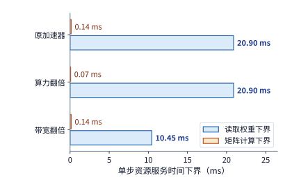

*图 1-10　保持运算量与读取量不变，分别把算力或带宽翻倍。蓝条是权重读取下界，橙条是矩阵计算下界；耗时更长的权重读取决定了当前条件下的优化方向。各柱分别表示计算或数据读取的时间下界，完整执行仍须满足依赖关系。*

接下来看软件层面的请求组织。假设把 8 条请求合并成一个 batch 同时解码，让它们共享同一次权重读取：整批计算的权重读取量依然是 $70\ \mathrm{GB}$，而矩阵运算量则变为单请求时的 8 倍。此时，矩阵计算的时间下界增长到约 $1.13\ \mathrm{ms}$，仍远小于 $20.90\ \mathrm{ms}$ 的权重读取下界。也就是说，整批耗时下界依然是 $20.90\ \mathrm{ms}$，但这一步同时产出了 8 个输出 token，平均分摊到每个输出 token 上的权重读取时间就降到了约 $2.61\ \mathrm{ms}$。

由于一次执行产出了 8 个 token，系统的整体输出吞吐率便从单请求时的约 $47.9\ \mathrm{token/s}$ 跃升到了约 $383\ \mathrm{token/s}$；然而，对于批内的任意一条请求来说，它依然要等整批的 $20.90\ \mathrm{ms}$ 执行完毕才能拿到自己的那 1 个 token。**批处理通过复用权重，显著提高了单位时间内产出的 token 总数（系统吞吐率），但单条请求的响应延迟依然取决于它实际经历的整批执行与排队等待时间。**

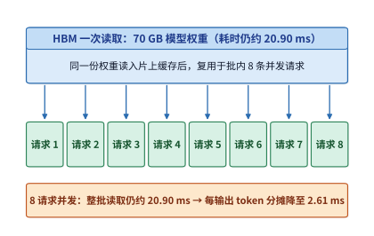

*图 1-11　一批八个请求共享一次权重读取，各产生一个输出 token。整批读取仍需约 20.90 ms，除以八得到每个输出 token 分摊的服务时间；但单个请求仍须等待整批执行完成。“每输出 token 分摊”是整批耗时除以输出 token 数，用于换算系统吞吐率，并非单个用户感受到的响应延迟。*

当 batch size $B$ 继续增大时，成倍增长的矩阵计算时间终将追平固定的权重读取时间。令两项时间下界相等（$2BN/\Pi=b_WN/\beta$），就能求出从“受限于访存”转向“受限于计算”的转折点：

$$
B_* = \frac{b_W\Pi}{2\beta}.
$$

代入本例的 $b_W=1\ \mathrm{byte}$、$\Pi=989.4\times10^{12}\ \mathrm{FLOP/s}$ 和 $\beta=3.35\times10^{12}\ \mathrm{bytes/s}$，可以算出转折点 $B_*\approx147.7$。在这个只考虑权重读取与主要矩阵运算的简化模型中：当 batch size 小于 148 时，增加并发请求几乎不增加单步理论下界，而是把一次权重读取摊薄到更多输出上；一旦 batch size 超过 148，矩阵计算耗时开始反超权重读取，继续增大 batch 就会让整批耗时随请求数成正比拉长。当然，需要提醒的是，这里的 $B_*\approx148$ 没有计入每条请求各自的 KV 缓存：回顾 1.2.3 节的显存预算，一张 H100 SXM 装下 $73.73\ \mathrm{GB}$ 权重后只剩约 $6.27\ \mathrm{GB}$ 空间，无法容纳 148 条长上下文请求的 KV 缓存。

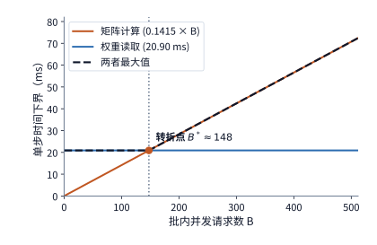

*图 1-12　批内请求增加时，矩阵运算量按 $2BN$ 成正比增长，权重读取保持每批 70 GB。约 148 个请求处两项下界相等，随后计算耗时决定整体速度。*

将每批产出的 token 数 $B$ 除以图 1-12 中的单步时间下界，就能画出图 1-13 所示的理论吞吐率上限曲线。在转折点之前，固定的权重读取时间被越来越多的新生成 token 分摊，系统吞吐率随 batch size 线性攀升；越过转折点之后，计算单元已经满载，单步耗时与产出 token 数同步增长，吞吐率曲线便趋于平缓。

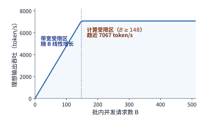

*图 1-13　上述批处理模型的理想输出吞吐率。将每批输出 token 数除以时间下界即可得到该曲线；竖虚线与前图对应同一个约 148 请求的转折点。*

同一个转折点也可以用**算术强度**（arithmetic intensity）$I=F/R_W=2B/b_W$ 来刻画，其物理含义是“每从存储读取 1 字节数据所完成的浮点运算次数”。当任务的算术强度 $I$ 小于硬件的“算力带宽比” $\Pi/\beta$ 时，系统受限于访存带宽（memory-bound）；当 $I$ 超过 $\Pi/\beta$ 时，系统则受限于计算能力（compute-bound）。这正是第 4 章将系统展开的 **Roofline（屋顶线）模型**的核心思想。[^roofline]

> **练习 1-3〔核心〕：带宽与 batch size 如何影响单步生成时限**
>
> 沿用例题 1-1 的 70B 模型与 H100 加速卡，假设实际运行时的有效显存带宽为标称峰值的 70%，有效计算吞吐率为标称峰值的 50%。请分别取 $B=1,16,64$，计算整批单步执行时间的下界、平均每个输出 token 分摊的执行时间，以及对应的有效吞吐率。若业务要求单请求每步生成延迟不超过 10 ms，哪些 batch size 仅凭这一时间下界就可以直接判定无法达标？如果通过进一步量化将权重读取量减半、而矩阵运算量保持不变，结论会有何变化？最后，求出有效算力与有效带宽下计算时间与读取时间相等的转折点 $B_*$，并解释为什么“平均每个输出 token 分摊的时间变短”并不等于“每个用户感知的单步生成延迟变短”。

### 1.3.3 用实测检验估算

刚才的纸面模型预测了两个核心趋势：在 batch 较小时，系统总吞吐率随 batch 增大而显著提升；与此同时，单步执行时间主要受制于显存读取。但在真实推理系统中，每增加一条并发请求，除了共享权重之外，还会额外增加各自 KV 缓存的读取与注意力计算。为了检验纸面模型的预测能力，图 1-14 和图 1-15 给出了开源模型 Qwen3-8B 在一张 NVIDIA RTX PRO 6000 Blackwell Workstation Edition 工作站显卡上的实测数据。这张显卡配备了 $96\ \mathrm{GB}$ 显存、$1.792\ \mathrm{TB/s}$ 显存带宽，BF16 输入、FP32 累加的稠密矩阵峰值算力为 $503.8\ \mathrm{TFLOP/s}$。推理引擎采用加州大学伯克利分校等机构于 2023 年开源的 **vLLM**（其最初的核心贡献是通过分页管理解决 KV 缓存显存碎片问题，从而大幅提升可支持的 batch size）。实验使用 vLLM 0.23 版本的 eager 模式（即不启用图编译捕获，按 Python 执行顺序逐个向 GPU 下发算子）。每条请求固定输入 2048 个 token、连续生成 256 个 token，每档并发重复测量三次。[^measurement] 图中“吞吐”指整个服务每秒产出的输出 token 总数；而 **TPOT**（time per output token，每输出 token 耗时）则代表客户端观察到的相邻两个输出 token 之间的平均时间间隔。

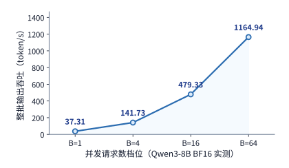

*图 1-14　Qwen3-8B 实测的整批输出吞吐。四档请求数等距排列，纵轴从零开始；模型、精度、输入输出长度和计时范围保持一致。*

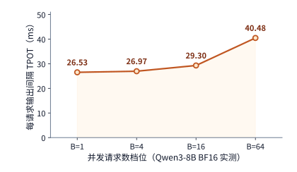

*图 1-15　同一组实测中的每请求输出间隔。吞吐增加的同时，单个请求的平均间隔也在增大；两张图分别说明加速器的输出速度和用户的等待时间。*

实测结果清晰地印证了批处理的基本权衡：当并发请求数从 1 增加到 64 时，系统总吞吐率提升了约 31 倍，但单条请求的平均输出间隔（TPOT）也从约 $26.5\ \mathrm{ms}$ 拉长到了 $40.5\ \mathrm{ms}$。把两张图放在一起看，加速卡在单位时间内完成的总工作量确实大幅增加了，但落到每个用户身上，等待下一个 token 输出的时间却变长了。

在统计口径上，图 1-14 的总吞吐率是用整批生成的总输出 token 数除以完成这批请求的总耗时（包含开头的 prefill 阶段），取三次实验的中位数；图 1-15 的 TPOT 则是先对每条请求测量首个输出 token 与最后一个输出 token 之间的时间差，除以中间经历的 255 个生成步，先取同批内所有请求的中位数，再取三次实验的中位数。前者衡量的是服务端加速卡的整体产出效率，后者衡量的是单个用户在客户端感受到的生成快慢。第 3 章还将进一步讨论请求随机到达、排队等待以及长尾慢请求对这两项指标的影响。

为什么并发请求增加时，单步耗时也会从 $26.5\ \mathrm{ms}$ 上涨到 $40.5\ \mathrm{ms}$？答案就在于“共享的模型权重”与“独占的上下文状态”之间的区别：批内所有请求虽然共享同一次读入芯片的模型权重，但每条请求都必须维护并读取各自独立的 KV 缓存。当并发数增大时，线性投影算子确实通过复用权重提高了效率，但每一步需要从显存读取的 KV 缓存总量以及对应的注意力计算量，却在随着请求数线性累加。

把这部分随请求数增长的状态开销补进公式，单步解码耗时的估算模型就可以修正为：

$$
T_{\mathrm{step}}\approx\max\!\left(\frac{BF_1}{\Pi},\frac{R_W+BR_{\mathrm{state},1}}{\beta}\right),
$$

其中 $F_1$ 表示单条请求的单步运算量，$R_{\mathrm{state},1}$ 表示单条请求在单步中需要读写的上下文状态（KV 缓存）字节数。可以看到，当 batch size $B$ 增大时，固定不变的权重读取开销 $R_W$ 被更多输出分摊了，但整批的状态读写总量 $BR_{\mathrm{state},1}$ 却在随 $B$ 成正比膨胀。下一章我们将根据真实的模型层数和注意力头数精确算出 $F_1$ 与 $R_{\mathrm{state},1}$，并看看当上下文长度从几千扩展到十几万 token 时，系统的瓶颈会发生怎样的转移。

> **练习 1-4〔核心〕：用实测吞吐与输出间隔检验批处理模型**
>
> 根据图 1-14 和图 1-15 中四档并发请求（1、4、16、64）的实测数值，分别计算各档并发相对于单请求时的吞吐率倍数，以及 TPOT 的增长比例。如果并发增加时系统依然只受共享权重读取的限制，且矩阵计算与 KV 缓存访问都不带来额外耗时，理论吞吐率应当按什么比例增长？对照实测结果，提出两个能够解释实测偏差且可通过实验区分的假设，并设计一次只改变输入上下文长度的对照实验来检验它们。请明确说明实验过程中必须保持不变的模型配置、生成长度和计时起止点。

回顾整个 1.3 节的推演，我们的定量分析始终围绕五个基本问题展开：**搬什么、搬多少、搬几次、走哪条通道、谁在等谁。** 模型结构决定了要搬哪些权重与状态，数值位宽和参数规模决定了搬多少字节，批内复用改变了搬移的次数，显存与网络接口决定了通道带宽，而前后步骤的数据依赖则决定了谁必须停下来等待。只要把这五个问题顺次问清楚，就能把复杂的模型结构、硬件通路与软件调度串成一张条理分明的资源账单。

### 1.3.4 实测为何达不到极限：模型漏项还是系统开销

在做工程性能优化时，人们很容易养成一种惯性思维：只拿新实现跟旧实现比——只要新算子比旧算子快了 30%，就认为优化已经到位。然而，如果事先不知道硬件物理极限在哪里，我们就无法判断这 30% 的提升究竟是已经逼近硬件的物理极限，还是仍然处在远离物理上限的低效区间。正确的分析起点，是先根据硬件峰值算力与带宽算出理论时间下界，再拿实测耗时去和下界对表。

不妨直接检验上一小节 Qwen3-8B 的实测数据：按工作站显卡 $1.792\ \mathrm{TB/s}$ 的显存带宽计算，单请求（$B=1$）一步 decode 读完主要权重与 2048 个历史 token 的 KV 缓存，理论上至少需要 $8.62\ \mathrm{ms}$；但实测出来的单步输出间隔（TPOT）却高达 $26.5\ \mathrm{ms}$，折算下来显存带宽利用率（MBU）仅为 $33\%$。理论下界与实测耗时差了整整三倍，问题出在哪里？

这类差距无非来自两个源头，而应对策略截然不同：
第一种可能是**纸面模型漏算了工作量**。例如，上面的简化公式只算了主要矩阵权重和 KV 缓存的读取，漏掉了归一化、激活函数、注意力得分计算以及末尾采样等环节的访存与计算。把漏掉的算子补齐后，理论时间下界会随之抬高，理论与实测的差距相应缩小——此时我们修正的是自己的估算模型，而不是系统本身。
第二种可能则是**软件系统引入了额外开销**。比如在刚才的实验中，vLLM 运行在 eager 模式下，CPU 只能按顺序一个接一个地向 GPU 下发算子（kernel）；每次下发都要穿过 Python 解释器、底层驱动和 PCIe 总线，导致 GPU 在两个算子之间频繁断流空转；此外，测试脚本在每生成一个 token 时都同步打印详细日志，进一步拖慢了主机侧的调度节奏。这些开销并非硬件算力或带宽的固有限制，而是完全可以通过优化软件消除的。

要分清差距究竟来自模型漏项还是系统开销，最可靠的办法就是做控制变量实验，每次只改一个条件。我们在同一张显卡上关闭逐步日志并调整配置后重新测量，单步输出间隔立刻从 $26.5\ \mathrm{ms}$ 骤降到了 $12.1\ \mathrm{ms}$；如果进一步排除主机端采样与返回的开销，直接用 GPU 硬件事件（CUDA Event）仅测量模型前向计算本身，单步耗时更是只有 $10.7\ \mathrm{ms}$——距离 $8.62\ \mathrm{ms}$ 的理想访存下界仅相差约两成，如图 1-16 所示。[^followup] 可见，此前三倍的巨大落差，绝大部分都源于主机侧的软件调度与日志开销。在本书后续章节中，凡是遇到实测性能与理论下界不符的情况，我们都会严格遵循这套排查顺序：先检查纸面公式有没有漏算必做的工作，再定位软件实现中可以消除的系统开销。

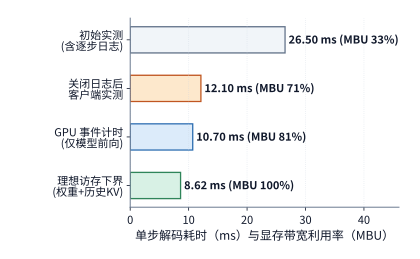

*图 1-16　Qwen3-8B 单步解码耗时拆解与显存带宽利用率（MBU）对比。从上至下依次为初始实测（含逐步日志，26.5 ms，MBU 33%）、关闭逐步日志并调整配置后的实测（12.1 ms，MBU 71%）、GPU 事件计时（仅模型执行，不含采样与输出，10.7 ms，MBU 81%）以及按峰值带宽读取权重与历史 KV 的物理下界（8.62 ms，MBU 100%）。*

**从单卡算子到万卡集群：机队全栈效率（Fleet Efficiency）漏斗。** 刚才的拆解回答了“单张加速卡在执行单个任务时为什么达不到峰值”，但在工业界动辄成千上万张卡的数据中心里，还有一个更高维度的效率问题：买回来的整池加速卡，究竟有多少时间真正转化成了业务需要的最终模型进展？如果只盯着单卡在跑任务时的算力利用率（MFU），往往会掩盖集群层面的巨大损耗——比如一个需要 1024 张卡协同的分布式训练任务，即便已有 1000 张卡分配就绪，只要剩下 24 张卡还在等待调度或修复故障，已就绪的 1000 张卡也只能原地空转（这类必须凑齐所有参训卡才能同步启动的调度约束称为**齐步调度**，即 gang scheduling 或 coscheduling）；又比如训练中途发生硬件故障而回滚到上一个检查点（checkpoint），故障前那半小时哪怕算子跑出了很高的 MFU，算出来的梯度也会随回滚而作废。

为了把单卡效率与集群管理损耗统一到同一本账上，Google 在 MLSys 2026 发表的集群效率研究中提出了**最大可实现机队有效产出**（Maximum Achievable Fleet Goodput，简称 **MPG**），将整个机队在观测期内的总可用容量 $C$（单位为“芯片·时间”，如 $\mathrm{GPU\cdot s}$）到理想参考完成时间 $I$ 的转化率拆解为三个相乘的环节[^fleet-efficiency]：

$$
\mathrm{MPG} = \frac{I}{C} = \frac{A}{C}\times\frac{G}{A}\times\frac{I}{G} = \mathrm{SG}\times\mathrm{RG}\times\mathrm{PG}.
$$

式中的三个因子分别对应基础设施三个层面的职责边界：
1. **调度有效产出**（Scheduling Goodput，$\mathrm{SG}=A/C$）：分母 $C$ 是集群在观测窗口内拥有的可用芯片总时长；分子 $A$ 则是完成齐步调度（coscheduling）、所有参训芯片同时就绪并真正交付给作业使用的芯片时长。维护下线、资源碎片闲置，以及等待其余节点凑齐时的“已分配却无法开跑”时间，都会拉低 $\mathrm{SG}$。
2. **运行时有效产出**（Runtime Goodput，$\mathrm{RG}=G/A$）：在已交付给作业的齐步就绪时间 $A$ 中，只有最终被持久化保存、真正推动模型参数向前演进的有效训练时间才计入 $G$。读取数据卡顿、保存与加载检查点、被高优任务抢占后的重启开销，以及因机器故障回滚而白跑的训练步，都会使 $G < A$。
3. **程序有效产出**（Program Goodput，$\mathrm{PG}=I/G$）：在真正产生有效训练进展的时间 $G$ 内，模型的实际推进速度与同一硬件上**理想参考实现**（采用最优并行切分、高效融合算子与通信重叠的基准程序）推进同样进度所需的最短时间 $I$ 之比。单卡算子未跑满峰值、多卡通信未与计算完全重叠，都会反映在 $\mathrm{PG}$ 的折扣上。

**算例 1-A：百卡训练池的机队全栈效率（MPG）漏斗核算。** 为了直观理解三层损耗的相乘效应，我们构造一个简化的教学算例（注：以下数字为展示三层乘法口径而设定的教学算例，并非 Google 生产集群的原始监控读数）。设某同构训练池共有 100 张加速卡，连续观测 1 小时（$3600\ \mathrm{s}$），则机队总可用容量为 $C = 100\times 3600 = 360{,}000\ \mathrm{GPU\cdot s}$。在观测期内：
- 集群监控显示单卡处于“已分配”状态的累计时长达 $350{,}000\ \mathrm{GPU\cdot s}$（表观单卡分配率高达 $350{,}000/360{,}000\approx 97.22\%$）；但由于多卡作业在齐步调度时需要等待同批其余节点就绪，真正凑齐并进入作业执行的齐步就绪时长仅为 $A = 300{,}000\ \mathrm{GPU\cdot s}$，因此调度有效产出为 $\mathrm{SG} = A/C = 300{,}000/360{,}000 \approx 83.33\%$。
- 在这 $300{,}000\ \mathrm{GPU\cdot s}$ 的运行过程中，扣除周期性写检查点、一次节点掉线引发的重启以及回滚重算所消耗的 $60{,}000\ \mathrm{GPU\cdot s}$ 后，真正沉淀为有效训练进度的时长为 $G = 240{,}000\ \mathrm{GPU\cdot s}$，因此运行时有效产出为 $\mathrm{RG} = G/A = 240{,}000/300{,}000 = 80.0\%$。
- 在有效推进的 $240{,}000\ \mathrm{GPU\cdot s}$ 中，受算子访存开销与跨卡集合通信暴露的影响，完成同样训练步数若换用理想参考实现仅需 $I = 120{,}000\ \mathrm{GPU\cdot s}$，即程序有效产出为 $\mathrm{PG} = I/G = 120{,}000/240{,}000 = 50.0\%$。

将三项指标相乘，该训练池的全栈机队效率为：

$$
\mathrm{MPG} = \mathrm{SG}\times\mathrm{RG}\times\mathrm{PG} = \frac{5}{6}\times 0.80\times 0.50 = \frac{1}{3} \approx 33.33\%.
$$

这个算例揭示了一个常被忽视的工程真相：哪怕集群管理员看到的单卡分配率高达 $97.22\%$，且算法工程师测出的作业内部运行效率（$\mathrm{PG}=50\%$）也算中规中矩，经过“齐步调度等待（打八三折）$\to$ 故障回滚与检查点（再打八折）$\to$ 算子与通信效率（再打五折）”的三级漏斗连乘后，整座机房仍有三分之二的硬件潜力在途中流失了。这也解释了为什么本书不仅要在第 4—9 章讨论单卡算子、分布式并行与高速网络（提升 $\mathrm{PG}$），还必须在第 10—11 章与第 13 章专门研究集群容错、齐步调度与高性能检查点存储（提升 $\mathrm{SG}$ 与 $\mathrm{RG}$）。

> **练习 1-5〔延伸〕：用 Amdahl 定律与理论时间下界排查系统瓶颈**
>
> 对照图 1-16 与本章末的 Qwen3-8B 数字速查表，已知单请求（$B=1$）在 2048 上下文下的单步 decode 需读取主要权重 $15.14\ \mathrm{GB}$ 与历史 KV 缓存 $0.302\ \mathrm{GB}$，完成矩阵运算 $16.34\ \mathrm{GFLOPs}$；工作站显卡的显存带宽为 $1.792\ \mathrm{TB/s}$，BF16 矩阵峰值算力为 $503.8\ \mathrm{TFLOP/s}$。
> 1. 分别计算初始实测（$26.5\ \mathrm{ms}$）、关闭逐步日志并调整配置后（$12.1\ \mathrm{ms}$）和 GPU 事件计时模型执行（$10.7\ \mathrm{ms}$）三个阶段的显存带宽利用率 $\mathrm{MBU}$ 与模型算力利用率 $\mathrm{MFU}$，并说明为什么在单请求解码下即使达到 $8.62\ \mathrm{ms}$ 的访存物理下界，$\mathrm{MFU}$ 依然不足 $0.004\%$。
> 2. 基于上述实测数量级做一个理想化的 Amdahl 拆解假设：设在单步总耗时 $26.5\ \mathrm{ms}$ 中，GPU 模型执行占 $10.7\ \mathrm{ms}$，其余 $15.8\ \mathrm{ms}$ 为模型执行外的日志、采样与调度等开销。假设工程师没有排查主机侧开销，而是直接投入精力优化 GPU 内部算子，使模型执行耗时从 $10.7\ \mathrm{ms}$ 一直压缩到物理极限 $8.62\ \mathrm{ms}$（相当于该环节加速了 $s=10.7/8.62\approx 1.24$ 倍），请用 Amdahl 定律计算端到端 TPOT 能缩短多少毫秒、整体加速比是多少，并与“关闭逐步日志并调整配置”（加速比 $26.5/12.1\approx 2.19$ 倍）对比。

## 1.4 需求如何推动架构设计

在前面的估算中，我们把加速卡的算力、带宽和容量当作已知的固定条件；但换个角度看，这些硬件本身又是为了解决特定时代的业务难题而设计出来的。纵观计算机体系结构的演进，推动架构变革的力量主要来自两端：一端是**应用需求的变化**，比如业务体量暴增或涌现出全新的算法负载；另一端是**底层技术的变化**，比如某类硬件指标（如晶体管密度与矩阵算力）的演进速度远远甩开了另一类指标（如内存带宽或单核频率）。无论驱动力来自哪一端，最终都会在系统中表现为**关键资源比例的失衡**。一旦计算量与访存量之比、网络带宽与 CPU 处理能力之比、或者模型规模与单卡容量之比发生数量级的变化，上一代顺理成章的软硬件分工就会难以为继。本节我们先回顾三个真实的工业界架构案例——Google 在 2013 年应对语音搜索推理洪峰、微软在 2015—2016 年重构 Azure 云网络数据面，以及华为在大模型浪潮下构建多设备统一互联——随后总结这类架构变革是如何在 AI 基础设施中逐级传导的。

### 1.4.1 TPU

**TPU**（Tensor Processing Unit，张量处理器）是 Google 专门为神经网络工作负载定制的加速芯片，其初代产品为 TPU v1。在发表于 2017 年的 TPU v1 架构论文中，Google 团队回顾了促使公司下定决心自研芯片的那次关键测算。早在 2006 年前后，Google 内部就曾探讨过在数据中心引入 GPU、FPGA（现场可编程门阵列，一种出厂后仍可重配硬件逻辑的芯片）或定制专用芯片（ASIC），但由于当时神经网络调用量不大，靠现有 CPU 数据中心的空闲算力就足以应付，自研芯片在经济上并不划算。转折发生在 2013 年：当时 Google 内部做了一项业务预测——如果每位用户每天使用 3 分钟基于深度神经网络的语音搜索，光是为了撑起这一项推理负载，Google 就必须把全球数据中心的服务器规模翻上一倍。面对如此庞大的算力缺口，Google 迅速启动了紧急研发项目，专为神经网络推理定制的 TPU v1 仅历时 15 个月便于 2015 年在数据中心完成上线部署。[^tpu]

这笔工程经济账可以用一个极简的式子算清楚：设服务每天收到的请求总数为 $Q$，每条请求需要消耗的浮点运算量为 $F_1$，那么全天所需的总算力就是 $QF_1$。当业务早期请求量 $Q$ 较小时，直接借用数据中心里成千上万台通用 CPU 服务器的闲置算力就能消化；但当 $Q$ 随用户规模爆发式增长、耗尽闲置算力后，架构师就面临两条路：要么按原架构采购翻倍的通用服务器、新建配套机房，要么研发专门针对神经网络的定制芯片。定制芯片虽然前期研发投入高昂，但只要能大幅压低单条请求的硬件耗时与功耗，在庞大的请求基数 $Q$ 面前，省下来的服务器采购费与电费很快就能收回芯片研发成本。

那么，专用芯片凭什么能比通用 CPU 高效得多？核心就在于针对神经网络高度规律的计算特征重新分配芯片面积：省去通用处理器中复杂的分支预测、乱序执行等控制电路，把省下来的晶体管集中做成庞大的二维矩阵乘法阵列，再紧挨着阵列铺设大容量片上缓冲与专用数据通路，让权重和激活值在芯片内部高效流转。对响应延迟和机房功耗的硬约束，就这样一步步转化为芯片内部的阵列规模、片上缓存大小与带宽配比。

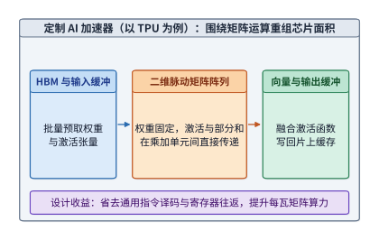

*图 1-17　专用处理器围绕反复出现的矩阵运算组织计算阵列和输入输出缓冲。缓冲是临时保存待计算或已算完数据的存储区域；三个方框及其箭头展示数据搬移方向。*

本书第 4 章将详细拆解 TPU 的脉动阵列、片上缓冲与数据通路。一旦业务总算力需求 $QF_1$ 跨过临界规模，定制加速器对通用处理器的替代就会成为必然。

### 1.4.2 SmartNIC

几乎在同一时期，微软 Azure 公有云团队在 2015 年设计新一代 $40\ \mathrm{Gbit/s}$ 云服务器时，遇到了另一处比例失衡：服务器网卡的物理带宽在短短几年内从 $1\ \mathrm{Gbit/s}$、$10\ \mathrm{Gbit/s}$ 跃升到了 $40\ \mathrm{Gbit/s}$ 甚至更高，同时云平台的软件定义网络（SDN）规则也变得越来越复杂。如果继续让主机 CPU 靠软件处理每一个进出网卡的数据包，大量 CPU 核心就会被网络协议与转发开销占用。为此，微软从 2015 年底开始在所有新上线的 Azure 服务器中标配基于 FPGA 的 **SmartNIC**（智能网卡，一种具备板载可编程处理能力的网卡），并于 2016 年正式推出 Accelerated Networking（加速网络）服务。借助 FPGA 可现场重编程的特性，网卡既能以硬件线速处理数据包，又能随时跟随云平台软件策略的迭代而更新硬件逻辑。[^azure]

当时微软架构师面临的是一个典型的两难诉求：一方面，公有云靠出租 CPU 核盈利，必须把尽可能多的 CPU 核留给付费租户的虚拟机使用；另一方面，云平台的多租户虚拟网络规则还在快速演进，转发、隔离、防火墙和隧道封装策略每隔几周就要更新一次。在传统架构下，一台物理服务器上跑着多个租户的虚拟机（VM），每收到一个网络包，宿主机 CPU 上的虚拟交换机都得亲自查表识别归属、检查安全规则、加解密或封装头部，再转发给目标虚拟机。

我们可以简单算一算这笔“网络税”有多重：一条 $40\ \mathrm{Gbit/s}$ 的网络链路在满载传输最小以太网帧（算上前导码与帧间距共 84 字节）时，每秒钟涌入的数据包高达约 6000 万个（$60\ \mathrm{Mpps}$）。假设一颗通用 CPU 核心每秒能完成 1000 万到 2000 万次复杂的虚拟网络包处理，那么光是应付一张网卡的全速转发，就需要消耗的 CPU 核数为：

$$
n_{\mathrm{core}}=\frac{\lambda_{\mathrm{packet}}}{\mu_{\mathrm{core}}}\approx3\text{—}6.
$$

式中的 $\lambda_{\mathrm{packet}}$ 是数据包到达速率，$\mu_{\mathrm{core}}$ 是单核包处理速率。随着网卡速率从 $10\ \mathrm{Gbit/s}$ 升至 $40\ \mathrm{Gbit/s}$、$100\ \mathrm{Gbit/s}$，分子 $\lambda_{\mathrm{packet}}$ 成倍激增，而受限于摩尔定律放缓，分母上的 CPU 单核性能 $\mu_{\mathrm{core}}$ 却几乎停滞不前，结果就是网络转发占用的 CPU 核数随着 $\lambda_{\mathrm{packet}}/\mu_{\mathrm{core}}$ 的扩大而急剧膨胀。更进一步看，这些 CPU 核心消耗的算力，绝大多数都用于按固定规则查表改包头的重复操作；只要把这部分数据面工作卸载（offload）到网卡硬件上，就能把宝贵的 CPU 算力全数归还给租户应用。[^nic]

Azure 最终给出的解法是“控制面与数据面分离”：让宿主机 CPU 上的软件继续负责首包慢路径决策和复杂策略管理，一旦流规则确定，就下发给智能网卡上的 FPGA 硬件表项；后续成千上万个属于同一数据流的报文在穿过网卡时直接由 FPGA 线速改写并直通虚拟机，彻底绕开宿主机 CPU。这种软硬协同设计既守住了软件定义的演进敏捷性，又拿到了专用硬件的线速性能与低延迟。

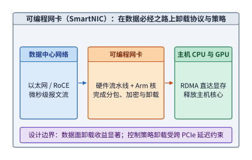

*图 1-18　可编程网卡在数据进入主机前完成指定的包处理。图中实线跟踪数据；网卡承担的处理减少主机 CPU 的辅助工作。*

把数据包处理卸载到网卡之后，许多原本需要唤醒主机 CPU 的操作在数据到达网卡的瞬间就能就地完成。当然，如果智能网卡在处理请求时还需要读写主机内存中的数据，它就必须跨越 PCIe 总线去发起访问；此时，PCIe 链路的往返延迟以及硬件能同时维持的在途请求数（outstanding requests），又会成为决定吞吐上限的新关键。本书第 7 章将以键值存储卸载系统 KV-Direct 为例，定量剖析这类跨总线访问的延迟与并发规律。

**从数据面卸载到主机管理策略卸载：跨 PCIe 通信延迟的收益边界。** 既然可编程网卡上配备了多颗通用 Arm 核心与专用加速引擎，一个很自然的延伸设想是：除了卸载“本来就要流经网卡”的网络数据包，能不能把原本运行在主机 CPU 上的操作系统管理策略——如线程调度、处理器调频（DVFS）和内存页面冷热迁移——也一并卸载到智能网卡上运行，从而把主机上负责管理调度的 CPU 核也腾出来留给业务负载？发表于 ASPLOS 2026 的 Wave 系统深入评测了这一方向，并揭示了一条关键的架构权衡：网络包卸载之所以顺理成章，是因为数据包本来就在网卡上；而主机管理策略做决策时所依赖的内核状态（如就绪队列、线程运行统计与页表访问位）原本驻留在**主机内存**中。一旦把管理策略搬到智能网卡上，网卡上的代理程序每次做调度决策都必须跨越缓慢的 PCIe 总线去读取主机内存状态并下发控制指令，从而拉长工作线程等待调度决策的时间。[^wave-policy]

**算例 1-B：32 核主机将管理策略卸载至 SmartNIC 的吞吐翻转边界。** 我们可以用一个简单的定量模型把“腾出主机 CPU 核的收益”与“跨 PCIe 通信导致的工作核减速”放在一起算清。设一台双路服务器共有 32 颗主机 CPU 核心：在传统主机侧管理模式下，有 2 颗核心专门运行实时调度与资源管理策略，其余 30 颗核心全速执行业务工作线程（设每颗工作核的基准归一化吞吐为 $1$，则整机总吞吐为 $30$）。若将管理策略卸载到 SmartNIC 的板载 Arm 核上，主机侧全部 32 颗核心都能用来跑业务工作线程，但受跨 PCIe 读取内核状态与跨总线派发任务的延迟影响，每颗工作核的有效吞吐下降了比例 $d$（$0 \le d < 1$）。此时卸载后的整机相对吞吐倍数为：

$$
\eta(d) = \frac{32(1-d)}{30}.
$$

要让策略卸载获得净收益，必须满足 $\eta(d) > 1$，由此解出临界减速比例：

$$
d < 1 - \frac{30}{32} = \frac{2}{32} = 6.25\%.
$$

- 当软件通过流水线预取将跨 PCIe 通信造成的单核吞吐折损控制在 $d = 2\%$ 时，卸载后的总吞吐倍数为 $\eta(0.02) = 32\times 0.98 / 30 \approx 1.0453$，整机获得 **$+4.53\%$** 的净吞吐提升；
- 反之，若每次调度决策都同步暴露 PCIe 往返延迟，使单核吞吐折损达到 $d = 8\%$，则总吞吐倍数为 $\eta(0.08) = 32\times 0.92 / 30 \approx 0.9813$，整机吞吐反而比不卸载时倒退了 **$-1.87\%$**。

Wave 在 16 核机器上对 RocksDB 数据库做 FIFO 线程调度卸载的实测结果，精准印证了这一翻转规律：当工作负载仅使用 15 颗核心（即主机原本就不缺核）时，把调度器搬到网卡上反而因为跨 PCIe 延迟使吞吐下降了 $1.1\%$；只有当负载扩展到利用起卸载腾出的第 16 颗主机核心时，整机吞吐才获得了 $+4.6\%$ 的净增长。为了把单核折损 $d$ 压低到临界线以内，Wave 引入了主机状态预取（prefetching）：当单次跨 PCIe 读取耗时为 $0.75\ \mu\mathrm{s}$ 时，若两次调度决策之间的计算重叠窗口达到 $1\ \mu\mathrm{s}$，提前发起的异步读取就能被完全隐藏（暴露延迟为 $0$）；但若决策间隔缩短到只有 $0.2\ \mu\mathrm{s}$，即便开启预取也依然会在关键路径上暴露出 $0.75 - 0.2 = 0.55\ \mu\mathrm{s}$ 的等待开销。图 1-19 将 1.3.4 节的机队全栈效率漏斗（算例 1-A）与本节的 SmartNIC 策略卸载收益边界（算例 1-B）并置对比：无论是在集群尺度还是单机尺度，任何架构设计都必须把“新增或释放的资源”与“数据跨边界搬移的代价”放到同一个等式里核算。

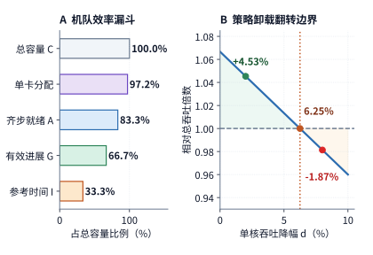

*图 1-19　左：算例 1-A 中 100 卡训练池在 1 小时观测期内的机队全栈效率漏斗（$\mathrm{MPG}=\mathrm{SG}\times\mathrm{RG}\times\mathrm{PG}=33.3\%$），对比表观单卡分配率（$97.2\%$）。右：算例 1-B 中 32 核主机将 2 核管理策略卸载至 SmartNIC 后的相对总吞吐倍数 $\eta(d)=32(1-d)/30$，跨 PCIe 通信引起的单核吞吐降幅 $d=6.25\%$ 为收益由正转负的临界边界。*

### 1.4.3 Unified Bus

如果说智能网卡改写了单台服务器内部的 CPU 与 I/O 分工，那么当单个加速器的显存和算力再也装不下模型时，架构师就必须把目光投向多设备之间的互联架构。正如我们在 1.2.3 节算过的那样，当模型参数与状态超出单卡容量时，最自然的应对之策就是用多张加速卡拼接出一池更大的资源。然而，“多张卡的显存加起来够大”并不等于“模型就能在多卡上高效跑起来”——横亘在两者之间的，正是算子切分、跨卡数据搬移与全局同步等待。

举个直观的例子：两张加速卡的显存合起来虽然能装下 70B 模型的 BF16 权重，但每当第一张卡上的计算需要用到第二张卡算出的部分结果时，就必须停下来等待数据跨卡传过来；如果一个算子由八张、甚至几十张卡协同完成，还得组织跨卡集合通信把各方结果归约到一起。加速卡数量的增加虽然扩充了总容量与总算力，却也同时放大了连接这些孤立资源的通信代价。

华为面向昇腾（Ascend）及通用异构计算推进的 **UB**（Unified Bus，统一互联总线）架构，正是为了从根源上改写多设备协同的边界。笔者曾于 2020—2023 年亲历这一项目：相关预研早在 2019 年就已启动，比 OpenAI 在 2020 年中发布千亿参数语言模型 GPT-3 还要早；而当 GPT-3 展现出突出的泛化与少样本学习能力后，整个工业界迅速看清了大模型对多卡协同的刚性需求，项目的战略投入也随之大幅升级。背后的数量级逻辑非常清晰：前沿大模型训练所需的算力每隔几个月就翻上数倍，增长速度远远甩开了单颗加速芯片算力与显存的提升速度；既然需求增速远快于单芯片性能增速，能够协同工作的加速器规模就必然从单机八卡推向整机柜数十卡、乃至跨机柜上百卡。

在这一背景下，系统最核心的诉求，就是让跨越多张加速卡乃至多台服务器的超大模型能够像访问本地显存一样高效地共享数据。在传统的服务器架构中，数据一旦跨出本机或本卡边界，往往要被迫换用另一套通信接口：软件得先把数据拷贝到通信缓冲区，再层层穿过驱动、协议栈与网卡硬件，每跨越一层软件抽象和物理接口，就要多付出一笔延迟与带宽损耗。UB 的核心设计理念，就是消除原本割裂的设备边界，在超节点范围内提供统一的加载/存储（Load/Store）语义与直接内存访问机制——让任一处理器或加速卡都能直接读写其他设备上的内存与显存，省去中间冗余的软件协议栈和多次数据拷贝，使跨设备访问的延迟逼近物理线缆传输的下限，同时也让上层框架能够更灵活地池化调配 CPU 内存与 NPU 显存。在这套体系下，统一的寻址与访问机制决定了资源池能有多灵活，而物理互联拓扑则决定了不同设备间的访问距离与可用带宽，模型切分策略与底层互联设计由此紧密咬合在一起。本书第 6.5.5 节将从超节点规模演进的角度剖析 UB 的架构取舍，第 7.3 节和第 7.4 节则会顺着一次跨节点远程访问的完整硬件路径，逐项推导其延迟、并发吞吐与连接状态开销，算清楚抹平那些传统抽象层究竟省下了多少时间。

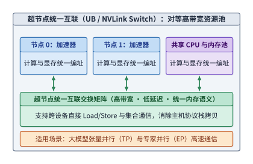

*图 1-20　统一互联连接不同设备的计算与存储资源。模型分工确定要交换什么，互联负责把数据送到后续使用它的设备。*

回到本章 1.2.3 节的两卡部署算例：把权重均分到两张卡上虽然满足了单卡显存容量约束（$M\le M_{\mathrm{cap}}$），但每一层计算在推进时都必须等待跨卡传递的中间张量到位。增加加速卡数量虽然成倍提升了总显存容量 $M_{\mathrm{cap}}$ 和总峰值算力 $\Pi$，却也在关键路径上引入了新的通信数据量与同步依赖。因此，分析任何分布式 AI 系统都可以遵循固定的三步法：第一步先核算每张卡的显存能否装下分配给它的权重、状态与工作区；第二步计算每张卡分担的运算量、本地访存量以及跨卡通信量；第三步沿着计算与通信的依赖关系算出端到端耗时。无论模型扩展到多大、集群增加到多少张卡，这套分析框架始终成立。

### 1.4.4 变化的逐级传递

有趣的是，前面三个案例中的新架构一旦落地部署，往往又会打破原有的系统平衡，催生出下一轮工程挑战：当微软把 FPGA 智能网卡铺满 Azure 数据中心后，云平台就必须建立一整套固件灰度升级、硬件故障隔离与回滚机制[^azure]；当统一互联把几十上百颗加速器织成一台超节点大机器后，每一次全局同步需要等待的参与者变多了，任何一个器件抖动或失效波及的范围也随之扩大。在快速发展的大模型基础设施中，这种“解决旧瓶颈、暴露新矛盾”的连锁反应一直在顺着技术栈逐级传导。下表按本书后续章节的脉络，梳理了每一次关键比例变化是如何推翻旧有系统假设的：

| 关键比例或负载的变化 | 被推翻的传统假设 | 对应章节 |
| --- | --- | --- |
| 神经网络绝大部分耗时集中在稠密矩阵运算 | 通用 CPU 能以合理的芯片面积与功耗完成主力计算 | 第 4、5 章 |
| 模型参数规模远超单张加速卡的显存容量 | 整个模型可以完整放进单张加速卡内独立运行 | 第 6 章 |
| 训练与推理需要跨多台服务器高频同步中间结果 | 数据中心网络流量由大量彼此独立的业务流组成，可靠统计复用平滑突发 | 第 7 章 |
| 自回归 decode 每把全部权重读一遍只做极少乘加运算 | 芯片的峰值浮点算力决定了模型推理的实际快慢 | 第 8 章 |
| 上下文扩展到十万乃至百万 token，KV 缓存逼近甚至超过权重大小 | 请求的上下文状态体量很小，用完即焚、需要时随时重算即可 | 第 9 章 |
| 单次训练作业动用成千上万张加速卡持续运行数周 | 硬件与链路故障属于小概率偶发事件，出错后从头跑起即可 | 第 10 章 |
| Agent 与强化学习（RL）训练在瞬间成批拉起成千上万个工具沙箱 | 容器平台中的业务程序彼此独立，各自按自身节奏平稳运行 | 第 11 章 |
| 终端手机与个人电脑具备本地运行中小模型的能力 | 把所有推理计算集中到云端数据中心总能获得更短的响应时间与更低的成本 | 第 12 章 |
| 预训练数据洗选、万卡 Checkpoint 与多级 KV 缓存每秒吞吐数 TB 数据 | 存储只是训练前后的外围慢速归档设备，POSIX 文件接口足以应付所有 I/O | 第 13 章 |
| 硬件微缩放数值格式、片上 SRAM 容量与超节点互联拓扑共同约束模型有效吞吐 | 算法团队可以先独立设计模型结构，再交由系统与硬件团队事后适配优化 | 第 14 章 |

不过，与传统的通用操作系统和公有云平台相比，AI 基础设施在应对这些挑战时握有一项得天独厚的优势：**它的核心工作负载种类高度集中，而且计算图与数据流向在运行前往往是已知的。** 传统操作系统和云平台必须面对五花八门、事先完全未知的用户程序，因此只能依靠严格的抽象分层、保守的边界隔离和统计复用来保障通用性；而 AI 系统围绕着少数几种主流模型架构和确定的前向/反向执行流程构建，完全可以提前摸清第 1.1.1 节所说的计算与数据依赖，从而大胆打破传统的软件层边界做跨层协同优化。例如，第 11 章将介绍的强化学习沙箱平台，就能直接接收训练框架提前下发的抢占与阶段切换信号，在训练进入权重更新阶段时主动暂停并换出相应的容器沙箱。

与此同时，拆解现代 AI 系统的底层机制还会发现，其中许多核心招式并非凭空发明的全新概念，而是对经典计算机系统思想的巧妙复用与改造：例如第 8 章 vLLM 的 PagedAttention 直接借鉴了操作系统的虚拟内存分页管理，第 11 章大规模沙箱调度的负载均衡沿用了 2001 年提出的 power-of-two-choices（二选一随机择优，通用形式为 power-of-k-choices）算法，而高密度虚拟机的内存弹性回收则脱胎于 2002 年 VMware 提出的 ballooning（气球驱动）机制。[^old-ideas] 当底层的资源比例发生剧变时，一些过去被认为不划算或用不上的经典技术往往会焕发新生；而判断某项技术当下是否适用，唯一可靠的标准就是拿着最新的资源比例重新算一笔账。

从早期的语音搜索推理，到公有云高速网络，再到如今大模型的多卡超节点，业务需求与硬件底层比例的每一次剧变，都决定了系统架构师下一步必须优先攻克哪个瓶颈，也一次次重划了硬件、系统软件与互联网络之间的职责边界。回看本章开篇的六层全景图，所有这些架构演进本质上都在做同一件事——**重新组织计算与数据搬移**。由此，我们确立了贯穿全书的三条分析主线：用**资源比例的变化**解释为什么旧设计会失效、为什么需要新架构；用**数据搬移的路径与代价**说明新设计究竟改变了什么；最后用第 1.3.4 节的**硬件物理极限**去检验系统优化到底做到了什么水平。整本书的核心思想，最终凝聚为一句话：**数据搬移塑造了 AI Infra 的架构。**

> **练习 1-6〔延伸〕：从流量特征、网络税与容量边界评估架构演进**
>
> 1. 沿用第 1.4.2 节的公式 $n_{\mathrm{core}}=\lambda_{\mathrm{packet}}/\mu_{\mathrm{core}}$：当现代 AI 计算节点的网卡速率从 $40\ \mathrm{Gbit/s}$ 升级十倍至 $400\ \mathrm{Gbit/s}$（如 ConnectX-7），而同期单颗 CPU 核心的复杂协议栈包处理能力 $\mu_{\mathrm{core}}$ 仅从 $10\text{—}20\ \mathrm{Mpps}$ 提升至 $15\text{—}30\ \mathrm{Mpps}$ 时，若以 84 字节最小帧线速到达（约 $595.2\ \mathrm{Mpps}$）且完全依赖主机 CPU 软件逐包处理，单张网卡需要消耗多少颗 CPU 核心？请据此说明为什么现代 AI 集群普遍采用智能网卡卸载与 RDMA（远程直接内存访问）技术。
> 2. 假设某混合专家（MoE）大模型的总参数量为 $671\times 10^9$（671B），BF16 权重共占约 $1342\ \mathrm{GB}$，8 比特量化后共占约 $671\ \mathrm{GB}$，且整个推理实例还需额外预留 $120\ \mathrm{GB}$ 显存用于 KV 缓存与运行时工作区。若单张加速卡显存为 $80\ \mathrm{GB}$，传统服务器每台最多插 8 张加速卡（整机显存 $640\ \mathrm{GB}$），请分别计算 BF16 与 8 比特量化下至少需要多少张加速卡，并判断能否装进单台 8 卡服务器。结合第 1.1.3 节与第 1.4.3 节解释：一旦实例跨越单机 8 卡边界，为什么超节点（如 GB200 NVL72 或 Unified Bus）比传统跨机以太网/RDMA 更适合承载每步解码的实时张量交换？

> **练习 1-7〔延伸〕：机队全栈效率（MPG）分解与有效训练产出核算**
>
> 沿用算例 1-A 的 100 卡同构训练池与 1 小时观测窗口（$C = 360{,}000\ \mathrm{GPU\cdot s}$），当前基线为 $A = 300{,}000\ \mathrm{GPU\cdot s}$、$G = 240{,}000\ \mathrm{GPU\cdot s}$、$I = 120{,}000\ \mathrm{GPU\cdot s}$。现团队评估两项独立的基础设施改造方案：
> - **方案甲（编译器与通信重叠优化）**：仅针对模型训练程序本身做算子融合与通信隐藏，使程序有效产出 $\mathrm{PG}$ 从 $50.0\%$ 提升至 $60.0\%$，而调度与运行时层面的 $A$、$G$ 保持不变；
> - **方案乙（拓扑感知齐步调度与异步检查点）**：通过优化集群调度器并引入高速异步检查点，将齐步就绪时长 $A$ 提升至 $330{,}000\ \mathrm{GPU\cdot s}$，同时将有效进展占就绪时长的比例 $\mathrm{RG}=G/A$ 从 $80.0\%$ 提升至 $90.0\%$，而程序层面的 $\mathrm{PG}=50.0\%$ 保持不变。
>
> 请分别计算方案甲、方案乙以及两项方案同时落地后的 $\mathrm{SG}$、$\mathrm{RG}$、$\mathrm{PG}$、全栈效率 $\mathrm{MPG}$ 与等价理想参考时长 $I$（单位：$\mathrm{GPU\cdot s}$），并说明为什么单看“单卡分配率 $97.22\%$”无法指导这两项优化决策。

> **练习 1-8〔延伸〕：主机管理策略卸载至 SmartNIC 的吞吐翻转边界与预取隐藏条件**
>
> 1. 推广算例 1-B：设一台主机共有 $N$ 颗 CPU 核心，在不卸载时需占用 $m$ 颗核心运行调度与资源管理策略，其余 $N-m$ 颗核心运行业务工作线程；将策略卸载至 SmartNIC 后，全部 $N$ 颗主机核心均运行业务工作线程，但跨 PCIe 通信使每颗核心的有效吞吐下降比例 $d$。请写出卸载后的相对总吞吐倍数 $\eta(d)$，推导卸载获得净正收益（$\eta(d) > 1$）的临界条件 $d^* = m/N$，并计算当 $N=64, m=4$ 时，$d=3\%$ 与 $d=9\%$ 分别对应的整机相对吞吐变化率。
> 2. 设 SmartNIC 上的调度器每次做决策需跨 PCIe 读取一次主机内存状态，单次读取耗时为 $t_{\mathrm{read}} = 0.75\ \mu\mathrm{s}$。若系统引入异步状态预取，使读取操作可与长度为 $t_{\mathrm{overlap}}$ 的任务执行窗口重叠，则单次决策在关键路径上暴露的等待时间为 $t_{\mathrm{exposed}} = \max(0, t_{\mathrm{read}} - t_{\mathrm{overlap}})$。请分别计算当 $t_{\mathrm{overlap}} = 1.0\ \mu\mathrm{s}$ 与 $t_{\mathrm{overlap}} = 0.2\ \mu\mathrm{s}$ 时的暴露等待时间，并说明为什么“高频细粒度且难以预测下一步状态”的主机策略不适合盲目卸载到 PCIe 远端设备。

## 本章数字速查

下表汇总了第 1.3.3 节实测所用的 **Qwen3-8B** 模型在单请求（$B=1$）下的核心资源数字。其中，**prefill** 阶段一次性处理全部输入 token 并产出首个输出 token；**decode** 阶段则每步送入 1 个新生成的 token，结合显存中已保存的 KV 缓存继续生成下一个 token。表中数据统一按 BF16 精度的权重、激活值与 KV 缓存计算；prefill 阶段的输入长度设为 2048 个 token，decode 阶段则考察在已有 2048 个历史上下文 token 的基础上往前生成一步。[^model-numbers]

| 模型需求 | 数值 | 估算用途与说明 |
| --- | ---: | --- |
| 完整 BF16 模型权重 | 16.38 GB | 检查模型加载所需的静态显存容量 |
| 单个上下文 token 的全模型 KV 缓存 | 144 KiB | 乘以上下文 token 总数，即可算出单条请求的 KV 显存占用 |
| 2048 个上下文 token 的 KV 缓存 | 288 MiB | 折合十进制约 0.302 GB，随并发请求数线性累加 |
| 2048 个 token 的 prefill 矩阵运算量 | 29.69 TFLOPs | 除以 GPU 的 BF16 矩阵峰值算力，可得 prefill 计算时间下界 |
| 单步 decode 的矩阵运算量 | 16.34 GFLOPs | 当前仅输入 1 个新 token，同时与历史上下文做注意力计算 |
| 单步 decode 的主要权重读取量 | 15.14 GB | 各层矩阵权重完整读取一遍；词表嵌入层（将 token 编号映射为向量的查找表）只需读取当前 token 对应的那一行 |
| 单步 decode 的历史 KV 缓存读取量 | 0.302 GB | 按历史上下文的 KV 缓存完整读取一遍计算 |

**用运算量与数据读取量估算单步时间下界。** 代入图 1-14、1-15 实测所使用的 NVIDIA RTX PRO 6000 Blackwell Workstation Edition 规格（BF16 矩阵峰值算力 $503.8\ \mathrm{TFLOP/s}$，显存带宽 $1.792\ \mathrm{TB/s}$），我们可以立刻算出理想下界：在 prefill 阶段，光完成 $29.69\ \mathrm{TFLOPs}$ 的矩阵运算至少需要约 $58.9\ \mathrm{ms}$；而在单步 decode 阶段，$16.34\ \mathrm{GFLOPs}$ 的矩阵运算只需约 $0.0324\ \mathrm{ms}$，但从显存读取 $15.14\ \mathrm{GB}$ 权重与 $0.302\ \mathrm{GB}$ 历史 KV 缓存却至少需要约 $8.62\ \mathrm{ms}$。对比单请求实测的 $26.5\ \mathrm{ms}$ 输出间隔（约为理论访存下界的三倍），差距的拆解与排查过程已在第 1.3.4 节详细说明。需要注意，这里的快速估算只提取了主要矩阵运算和理想单次访存；完整的端到端执行还需要顺着算子拓扑计入非矩阵向量运算、中间激活读写以及算子启动开销，第 2—5 章将带读者把这本细账一笔笔算清。

这组定量数据清晰地揭示了大模型推理两个阶段的本质差异：prefill 阶段一次性处理成百上千个输入 token，矩阵运算量极大，主要考验芯片的峰值算力；而单请求 decode 阶段每次只处理 1 个新 token，算力消耗很小，却依然要把庞大的模型权重和历史 KV 缓存从显存重读一遍，主要受制于显存带宽。因此，提升矩阵算力、扩充显存带宽与增大 batch 批内复用，分别应对的是截然不同的耗时瓶颈。

## 常见误区

**误区一：芯片的峰值算力翻倍，模型推理速度就会跟着翻倍。** 看到算力指标翻倍前，务必先检查当前任务究竟受限于计算还是受限于访存。正如例题 1-1 所算的那样，单请求解码时读取权重的时间下界是矩阵计算下界的 148 倍，此时哪怕把矩阵峰值算力提升十倍，单步耗时下界也几乎不会缩短；如果优化的只是复杂端到端流程中的一个局部环节，还必须用 Amdahl 定律核算整体加速比的理论上限。

**误区二：只要显存装得下模型权重，就能跑起目标并发数。** 模型权重只是显存中静态常驻的一部分。在实际服务中，随并发数和上下文长度成倍膨胀的 KV 缓存、算子临时工作区以及系统预留空间同样要占用显存；在多卡分布式部署时，还必须逐卡核算各自的显存账单。

**误区三：新实现比旧实现快了 30%，就说明优化已经很成功。** 如果事先没有算出硬件允许的物理极限（理论时间下界），就无法判断这 30% 的提速究竟是已经逼近了硬件物理极限，还是依然停留在距离上限差着数倍的低效区间。正确的做法是先按峰值算力与峰值带宽算出时间下界，再按第 1.3.4 节的步骤排查差距究竟来自纸面模型漏项还是软件系统开销。

**误区四：在上一代业务场景中久经考验的成熟系统，可以直接照搬到新负载上。** 任何成功的系统设计，都隐含着它诞生时的资源比例与负载假设。例如，传统容器云平台假定各个租户的容器请求彼此独立、各自按平稳节奏运行；而在大模型强化学习（RL）训练中，成千上万个代码沙箱会在同一瞬间被成批拉起或销毁，且推进节奏完全受控于昂贵的 GPU 集群——此时若照搬传统容器调度设计，就会导致整个 GPU 集群停下来等待容器启动（详见第 11 章）。复用任何既有架构前，都应先核验它赖以成立的前提比例是否已经改变。

**误区五：系统总吞吐率提高了，每个用户的等待时间也会随之缩短。** 增大 batch size 能够让多条请求共享同一次权重读取，从而摊薄平均每个输出 token 分摊的硬件时间、推高系统总吞吐率；但对于批内的每一条具体请求而言，它不仅要经历排队凑批，还要等整批所有请求的运算与状态读取全部完成后才能拿到结果。因此，评估推理系统时必须同时报告吞吐率与单请求延迟（如 TTFT 和 TPOT）。

[^panorama]: “十八层宝塔”由华为半导体首席科学家廖恒博士在 2026 年 7 月的一次公开长访谈中提出，用来描述从应用到制造工艺的层层依赖。

[^dean]: Jeff Dean，LADIS 2009 演讲，[本地 PDF](../references/outline-checks/2026-09-07/scaling-history/jeff-dean-ladis2009.pdf)，“Numbers Everyone Should Know”及纸笔估算部分。寻道算例设连续执行 20 次随机读取。

[^h100]: NVIDIA，[H100 架构白皮书](../references/files/specs/nvidia-h100.pdf)与[规格页面快照](../references/files/specs/nvidia-h100-spec.md)。本章采用 SXM 形态与 BF16 稠密矩阵运算规格；原始输入版本和校验值见[配图来源清单](ch01/sources.json)。

[^budget]: [70B 近似预算复算](../calculations/results/decode-budget-base.md)及配套场景；[单位与逐卡容量复算](../calculations/results/basics-70b-bf16-balanced.md)。1.3 节的时间估算图读取这组固定的 70B 近似结果；1.2.3 节的容量图使用真实权重索引与分组量化结果。

[^roofline]: Williams、Waterman、Patterson，[Roofline 论文](../references/files/papers/roofline.pdf)。

[^followup]: [补测记录](../experiments/ch01/01-04/FOLLOWUP.md)与[加速器事件计时](../experiments/ch01/01-04/results/step-summary.json)。补测同时关闭了前缀缓存并重新构造了输入，逐步日志的影响无法与这些条件完全分开；加速器事件只覆盖模型执行，不含采样与输出。

[^measurement]: [练习 1-4 记录说明](../experiments/ch01/01-04/README.md)、[结构化分析结果](../experiments/ch01/01-04/results/analysis.json)及[后续补测](../experiments/ch01/01-04/FOLLOWUP.md)。正文和图 1-14、图 1-15 采用最初记录的短输入组。

[^tpu]: Jouppi 等，[TPU v1 论文](../references/files/papers/tpu-v1.pdf)，第 2 节关于起源、架构与实现的说明。三分钟语音搜索是论文记载的历史需求预测。

[^nic]: [笔者博士论文](../references/files/papers/bojieli-phd-thesis.pdf)，第 4.2.1 节简单转发基线；[核数预算复算](../calculations/results/nic-budget-book.md)；延伸剖析见[可编程网卡案例](../case-studies/programmable-nic.md)。约六千万包每秒来自 40 Gbit/s 与每帧占用 84 字节线时的计算，3 至 6 核对应简单转发基线。

[^logicfolding]: 三维逻辑折叠缩短片上互连路径与降低互连电容能耗的机制分析，详见[三维逻辑折叠与片上互连能耗案例](../case-studies/logicfolding-energy.md)。

[^fleet-efficiency]: Google 集群全栈效率指标 $\mathrm{MPG}=\mathrm{SG}\times\mathrm{RG}\times\mathrm{PG}$（MLSys 2026）的定义、三层职责划分与单卡算子效率对比，详见[算子效率与机队全栈效率案例](../case-studies/kernel-and-fleet-efficiency.md)。

[^wave-policy]: 主机操作系统管理策略（如线程调度、调频与内存管理）卸载至可编程网卡的跨 PCIe 延迟代价、RocksDB FIFO 调度实测与状态预取分析（Wave，ASPLOS 2026），详见[主机策略与调度卸载案例](../case-studies/host-policy-and-dispatch.md)。

[^abstraction]: 相关研究见[抽象边界调研](../research/system-abstraction-boundary/report.md)；基础模型承接多种下游任务的讨论见 [Stanford CRFM](https://crfm.stanford.edu/report.html)。

[^request]: 请求图是通用职责示意；调度与状态管理的职责划分可参照 v0.26.0 的 [vLLM Scheduler 文档](https://docs.vllm.ai/en/v0.26.0/api/vllm/v1/core/sched/scheduler/)；1.3.3 节的实测使用 vLLM 0.23.0。路由策略、tokenizer 位置以及 prefill／decode 是否分离属于部署选择。

[^datacenter]: 具体产品例子见 [NVIDIA GB200 NVL72](https://www.nvidia.com/en-us/data-center/gb200-nvl72/)、[硬件指南](https://docs.nvidia.com/dgx/dgxgb200-user-guide/hardware.html)与[网络指南](https://docs.nvidia.com/dgx/dgxgb200-user-guide/networking.html)。图 1-5 使用一般化连接。

[^real70]: 参数与 BF16 字节数来自 [DeepSeek-R1-Distill-Llama-70B 公开权重索引](../calculations/sources/deepseek-r1-distill-llama-70b/model.safetensors.index.json)及[固定版本配置](../calculations/configs/models/deepseek-r1-distill-llama-70b/config.json)。分组量化的权重总量采用[逐项计算记录](../calculations/results/dense-quant-deepseek-r1-distill-llama-70b-tp1-pp8-80gb-8192.json)中的全模型汇总，每组 128 个参数、scale 占 2 字节。RTX 4090 的 24 GB 名义规格见[官方页面存档](../calculations/sources/hardware/nvidia-rtx4090-page.txt)。本节用规格标称 GB 作统一容量预算。

[^azure]: Firestone 等，微软，[Azure Accelerated Networking: SmartNICs in the Public Cloud](https://www.usenix.org/conference/nsdi18/presentation/firestone)，NSDI 2018；[原论文文本](../references/editorial-context/2026-09-10/azure-smartnic-nsdi2018.txt)。摘要给出 2015 年末部署、2016 年向客户提供服务的时间，第 3 节说明减少 CPU 占用、保持可编程性与支持更高带宽的设计目标。

[^old-ideas]: power-of-k-choices 见 M. Mitzenmacher, The Power of Two Choices in Randomized Load Balancing, IEEE TPDS, 2001；balloon 机制见 C. A. Waldspurger, Memory Resource Management in VMware ESX Server, OSDI 2002。两篇文献均由 [DSec 论文](../references/text/dsec-sandbox.txt)引用，相应机制见第 11.2.2 节与第 11.3.2 节。

[^gpu-numbers]: 数字取自[固定 GPU 规格与逐项出处](../calculations/configs/hardware.json)，对应 `rtx4090`、`a100-80gb-sxm`、`h100-sxm`；各精度、累加方式与稠密条件分别核对。GB 与 TB 在本表均为十进制单位。

[^model-numbers]: [速查数字复算源码](ch01/reference_numbers.py)根据固定 Qwen3-8B 配置统计 prefill 与 decode 的矩阵运算，读取量来自[批内权重复用计算](../calculations/results/batch-reuse-h100-2k.md)。权重占用包含完整嵌入表，逐步生成时只读取当前 token 对应的嵌入行；读写时间采用每份主要数据访问一次的理想条件。

[^v41-case]: [DeepSeek V4.1 官方技术报告](../calculations/sources/deepseek-v4.1-flash/DeepSeek_V41_Tech_Report.pdf)，第 1、2、3 节与第 6 节；[跨章会话的固定条件与复算](../calculations/results/v41-throughline.json)。

## 本章小结

在现代 AI 应用中，开发者通过模型与上下文来定义任务行为，使得千差万别的上层应用在底层共享着高度一致的模型计算过程。正因为模型结构的计算依赖与状态的生命周期可以预先掌握，系统设计师得以打破传统的抽象分层，开展跨层联合优化：无论是降低数值位宽、融合相邻算子、跨轮次缓存上下文状态，还是通过统一互联消减跨设备通信的软件栈开销，本质上都是在利用这种确定性减少不必要的数据搬移与同步等待。

在定量分析任何一个 AI 系统时，都可以遵循固定的三步法：第一步用容量约束检查数据能否装下，第二步用浮点运算量和数据读写量分别除以算力与带宽算出理论时间下界，第三步结合执行依赖分析流水线重叠与等待。由硬件峰值算出的时间下界代表了不可逾越的物理极限，理论下界与实测耗时之比就是硬件利用率（MFU 与 MBU）；当实测表现远低于物理极限时，原因要么是纸面模型漏算了必做的工作，要么是软件系统引入了可以消除的额外开销。在本章的 70B 解码算例中，权重读取耗时是矩阵计算耗时的约 148 倍，系统处于典型的访存受限状态，因此提升显存带宽、量化压缩权重和通过批处理复用权重，才是缩短分摊耗时的有效手段。需要牢记的是，批内复用虽然能大幅推高系统总吞吐率，但单个用户感受到的响应延迟依然包含排队等待与整批执行的时间。

本章的核心练习为练习 1-2、1-3 和 1-4，分别训练显存容量核算与多卡分配、硬件参数与 batch size 变化下的时间下界推演，以及用实测数据检验理论模型的科学方法；延伸练习 1-5 至 1-8 则进一步结合 Amdahl 定律、实测耗时拆解、机队全栈效率（$\mathrm{MPG}=\mathrm{SG}\times\mathrm{RG}\times\mathrm{PG}$）三级漏斗，以及可编程网卡卸载与超节点互联的比例边界，训练从单卡到集群的系统瓶颈排查与架构演进评估。下一章我们将深入真实的 Transformer 模型内部，把本章粗略近似的 $2N$ 运算量与权重读取量拆解到每一层具体的矩阵尺寸、注意力机制与状态大小上；随后在第 3—12 章逐层展开工作负载、AI 加速器、GPU 算子、超节点与分布式并行、数据中心网络、推理与训练系统、集群调度及端边云推理，并最终在第 13 章（AI 原生存储系统与数据底座）与第 14 章（模型与系统硬件协同设计）完成全栈架构的收束。
