# 第 2 章 模型架构

第 1 章从显存容量、浮点运算量和数据读取量三个维度剖析了一次模型执行，并结合硬件峰值指标算出了理论时间下界。这种粗略估算虽然能帮我们快速排除明显不可行的方案，却留下了一个根本问题：公式里代入的运算量和数据量究竟是怎么算出来的？一句“这是一个 8B 模型”（参数量后缀 `B` 代表十亿，`8B` 即约 80 亿个参数），只给出了参数规模的大致数量级，却没有回答每个 token 究竟调用了哪些参数、历史上下文保存在哪里，也没有说明各个算子之间存在怎样的先后依赖。

本章将从一个 token 的向量表示出发，顺着神经网络的前向传播路径，一步步看清它如何穿过各层网络、最终算出下一个候选 token 的预测得分，并在此过程中精确推导出显存占用 $M$、浮点运算量 $F$ 和数据读写量 $R$。我们将借助**计算图**（computation graph）来拆解这一过程：图中的“节点”代表矩阵乘法等算子运算，“边”代表算子之间传递的张量数据。只有先把计算图里的每一个节点和每一条边摸清楚，资源账单上的每一个数字才会有据可查。

更重要的是，这张计算图直接揭示了系统优化的切入点：哪些模型权重在成千上万次请求之间始终保持不变？哪些上下文状态在后续解码步骤中会被反复读取？哪些中间结果只在相邻算子之间短暂流转、用完即可释放？后续章节在设计显存管理、算子编译与请求调度时，正是利用这些数据生命周期的差异，来决定哪些数据应当跨请求共享、哪些需要长期驻留显存、哪些只需留在片上缓存中暂存。

为了展现现代大模型架构的演进脉络，本章选取了五个有代表性的真实模型：**DeepSeek V4.1 Flash**、**Qwen3-8B**、**Qwen3.6-35B-A3B**（名称中的 `35B` 指总参数量约 350 亿，`A3B` 指每个 token 实际激活的参数量约 30 亿；下文简称 **Qwen3.6**）、**DeepSeek V4-Flash** 与 **Kimi K3**。其中，2026 年 9 月发布的 DeepSeek V4.1 Flash 采用因果编码器—解码器（CED）架构将输入理解与输出生成解耦，并融合了跨层 KV 缓存共享、分层稀疏索引以及 **Engram** 模块（一种按连续 $n$ 个 token 组成的 n-gram 片段查表获取附加特征的机制），为我们理解“模型架构创新如何改变系统资源需求”提供了鲜活样本。

我们的推导将从结构最规整的稠密模型 **Qwen3-8B** 起步：它包含约 81.9 亿个参数，由 36 层结构相同的 Transformer 层堆叠而成。彻底算清这个稠密基线之后，我们将沿着三个维度逐步演进模型架构——改变上下文状态的保存与访问方式、改变每个 token 激活的参数集合（混合专家 MoE）、改变层与层之间的连接形态——最后把这五个模型放在完全统一的输入条件下做横向对比。

在正式开始推导前，先统一本章的核算口径：统计浮点运算量时，一次乘法加一次加法计为 $2\ \mathrm{FLOPs}$；存储容量同时使用十进制的 $\mathrm{GB}$（$1\ \mathrm{GB}=10^9\ \mathrm{bytes}$）和二进制的 $\mathrm{GiB}$（$1\ \mathrm{GiB}=2^{30}\ \mathrm{bytes}$）。在 BF16 精度下，每个数值元素占 2 字节，因此将张量的元素总数乘以 2，即可直接得出它占用的字节数。

## 2.1 计算图与前向执行

在深度学习中，**张量**（tensor）是按一个或多个维度排列的多维数组：一维数组是向量，二维数组是矩阵。大语言模型用一维向量表示每个 token 的特征，当同时处理多个 token 时，就把它们的特征向量按行拼成一个二维矩阵。要算清模型的资源开销，第一步是把计算图中的“算子节点”与“数据依赖边”拆开来看：节点执行的矩阵乘法决定了需要多少计算量（$\mathrm{FLOPs}$），边上流转的张量尺寸决定了需要搬移多少数据（$\mathrm{bytes}$），而边的指向则规定了哪些运算必须一前一后串行等待。

需要注意，本章画出的计算图首先用于描述数学意义上的运算逻辑与数据依赖。在实际运行中，深度学习框架会把这些算子下发给加速卡执行：有时一个复杂的数学运算会被拆成多个底层内核（kernel）分步完成，有时几个相邻的简单运算又会被编译器融合（fuse）成一个内核一次性跑完。计算图中代表张量的一条边，只表示后一个算子需要用到前一个算子的输出，并不意味着这份数据一定得在 CPU 内存与 GPU 显存之间来回拷贝。至于数据究竟放在哪一级存储、内核如何下发与拼接，我们将在第 4 章和第 5 章详细展开。

### 2.1.1 序列依赖与因果计算图

要分析模型能跑多快，首先要搞清楚哪些计算可以并行展开、哪些必须串行等待。不妨考察一个包含 4 个 token、经过 3 层神经网络的简单序列：我们将横轴设为 token 在序列中的位置索引，纵轴设为网络层数。为了表述严谨，本章用“词元”指代词表（vocabulary）中的一个固定条目，用 **token** 指代序列中实际出现的一个位置单元；当同一个词元在句子里重复出现多次时，靠位置索引来区分它们。在早期的**循环神经网络**（RNN）中，第 $t-1$ 个位置算出的隐藏状态必须传给第 $t$ 个位置，状态更新遵循 $h_t=f(x_t,h_{t-1})$——其中 $x_t$ 是当前位置的输入，$h_t$ 是处理到位置 $t$ 时累积的状态，$f$ 是由模型权重定义的非线性变换。由于当前位置的计算直接依赖前一个位置的输出，同一层内的各个 token 只能沿着横轴从左到右逐个推进。哪怕 4 个输入 token 一开始就已经全部就绪，第 $t$ 个位置的运算也必须等待第 $t-1$ 个位置算完才能启动。

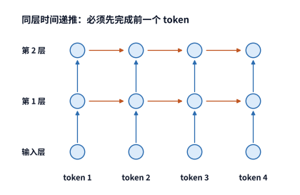

*图 2-1　循环神经网络的依赖。相同颜色的圆点表示各 token 位置的计算，箭头指向需要前一结果的节点；同层 token 位置沿横向逐次推进。*

**Transformer** 架构则彻底打破了同层之内横向等待的枷锁：它利用**注意力机制**（attention）让每个 token 直接去读取其他位置的信息；而所谓“**因果**”（causal）约束，是指当前位置 $t$ 只能读取它自己以及排在它前面的位置（$1\sim t$）的信息，不能访问未来的位置。这一改动让计算图的依赖方向发生了根本变化：当第 $l$ 层计算某个位置的特征时，它通过注意力读取的是**上一层**（第 $l-1$ 层）中该位置及此前所有位置已经算好的输出。换句话说，只要输入序列是已知的，且上一层的特征已经计算完毕，当前层里所有不同位置的 token 就可以完全并行地同时计算，根本不需要等待本层前一个位置的结果。在实现上，模型通过叠加一个上三角全为负无穷的**因果掩码**（causal mask）来屏蔽未来位置的信息。这个三角形掩码只限制了信息读取的范围，却丝毫不妨碍已知输入 token 在同一层内并行执行。真正保留下来的串行依赖只在网络深度方向（纵轴）上：必须算完第 $l-1$ 层，才能算第 $l$ 层。

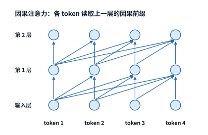

*图 2-2　因果 Transformer 的层间依赖。各查询读取上一层中允许访问的位置；上一层完成后，同一层的已知输入 token 可以并行计算。*

顺着图 2-1 和图 2-2 中的箭头对比，两种架构的等待方式一目了然：RNN 在同一层内沿着序列方向等待前一个 token，而因果 Transformer 只在层与层之间沿着深度方向等待上一层的结果。可见，一段序列输入能不能并行计算，完全取决于计算图中的真实数据依赖，而不取决于它叫不叫“序列模型”。当然，一旦进入自回归生成阶段，每生成一个新 token 就会引入一条跨调用的串行依赖：因为第 $t+1$ 个位置的输入 token 本身，必须等第 $t$ 个位置走完所有层、采样出结果之后才能揭晓。

这就把大模型推理自然地划分成了性质截然不同的两类工作：**处理已知输入**（prefill）与**逐步生成输出**（decode）。在经典的序列转换模型中，负责把已知输入编码为特征表示的模块称为**编码器**（encoder），负责根据已有信息逐步产出输出的模块称为**解码器**（decoder）。如今主流的自回归大模型大多采用统一的 **decoder-only**（仅解码器）架构，本章我们先以这一经典结构为蓝本建立计算公式，随后再看 DeepSeek V4.1 Flash 如何通过 CED 架构重新拆分输入理解与输出生成的职责。记住最核心的执行差异：处理已知输入时，同层的所有 token 可以并行计算，依赖链只沿网络深度推进；而在自回归生成时，前一步的输出是下一步的输入，因此除了网络深度的层间依赖外，还叠加了跨生成步的严格串行依赖。[^source-10]

> **练习 2-1〔延伸〕：RNN 与 Transformer 的依赖如何限制并行计算**
>
> 对于包含 4 个已知输入 token 的序列，分别画出 3 层 RNN 和 3 层因果 Transformer 的计算依赖图。若在此基础上继续生成第 5 个位置的输出 token，请标出在启动该位置计算之前必须等待哪个节点完成。假设每个层、每个 token 位置的计算固定耗时 1 个时间单位，且硬件并行计算单元充足，分别求出两种架构处理完 4 个已知输入 token 所需的最短时间（即关键路径长度），并说明单纯增加硬件计算单元能够缩短哪些等待、无法消除哪些等待。

### 2.1.2 模型配置与张量结构

看清了全局依赖，我们再把镜头推近，拆解计算图中的单个算子节点。假设某次线性投影（矩阵乘法）同时处理 $m$ 个输入 token，每个 token 用一个长度为 $k$ 的特征向量表示。把这 $m$ 个行向量上下叠放起来，就构成了一个 $m$ 行、$k$ 列的输入矩阵 $X$。设投影后的输出特征维度为 $n$，则该节点的矩阵乘法可以写为：

$$
X\in\mathbb R^{m\times k},\qquad W\in\mathbb R^{k\times n},\qquad Y=XW\in\mathbb R^{m\times n}.
$$

输出矩阵 $Y$ 共有 $mn$ 个元素，其中每一个元素都是由输入矩阵的一行（长度为 $k$）与权重矩阵的一列（长度为 $k$）做点积算出来的（包含 $k$ 次乘法和 $k$ 次加法，计为 $2k\ \mathrm{FLOPs}$）。因此，这个线性投影节点的参数量 $N_W$、浮点运算量 $F$ 和权重存储字节数 $M_W$ 分别为：

$$
N_W=kn,\qquad F=2mkn,\qquad M_W=b_Wkn.
$$

其中 $b_W$ 是每个权重参数占用的字节数。观察这三个简洁的式子：当输入的 token 行数 $m$ 翻倍时，浮点运算量 $F$ 随之翻倍，但权重参数量 $N_W$ 和权重大小 $M_W$ 完全不变；而当模型的输出特征宽度 $n$ 翻倍时，权重大小与浮点运算量会双双翻倍。前者对应“用同一个模型同时处理更多输入 token”，后者则对应“把模型的网络层设计得更宽”。本章后续所有的模型资源核算表，都是用这组基本公式一行行算出来的。

我们先顺着 **Qwen3-8B** 的前向路径走一趟。所谓一次**前向执行**（forward pass），是指给定当前输入 token，利用模型权重从头到尾算出一轮预测输出的过程；在网络层之间传递的特征向量称为**隐藏状态**（hidden state，或隐藏向量），其长度就是模型的**隐藏维度** $d$。每一层 Transformer 都由两个核心子层交替串联而成：一个是**注意力**（attention）子层，负责让不同位置的 token 互相交换并汇总上下文信息；另一个是**前馈网络**（feed-forward network，简称 **FFN**）子层，负责对每个 token 自身的特征向量独立做非线性变换。

在具体配置上，Qwen3-8B 堆叠了 $L=36$ 层，主干隐藏维度为 $d=4096$，FFN 内部升维后的中间维度为 $f=12288$。在注意力子层中，模型把特征拆成多个并行的“头”（head），让不同的头各自捕捉不同方面的语义关联：Qwen3-8B 设有 $n_Q=32$ 个查询头（Query heads）和 $n_{\mathrm{KV}}=8$ 个键值头（Key/Value heads），每个头的特征维度均为 $d_h=128$（第 2.1.3 节会详细解释这两类头如何配合）。此外，模型的词表共包含 $V=151936$ 个词元：入口处的**词嵌入层**（embedding）是一张形状为 $151936\times4096$ 的查找表，负责把输入的 token 编号（ID）映射为 4096 维的初始向量；最末端的**词表输出头**（LM head）则使用另一张同样大小的权重矩阵，把最后一层的隐藏向量映射为词表中 151936 个候选词元的预测得分。把 36 层主干的参数与首尾两张词表矩阵加在一起，整个模型一共包含约 81.9 亿个参数。[^source-1]

因此，一次完整的前向执行流程非常清晰：首先根据输入的每个 token ID 从词嵌入表中查出对应的 4096 维向量；随后，这些向量依次穿过 36 层交替排列的注意力子层与 FFN 子层；离开第 36 层后，再经过一次**归一化**（normalization，用于将数值分布拉回合理区间，防止多层累加后数值爆炸或消失），最后乘上词表输出头矩阵，算出各个候选词元的未归一化得分——即 **logits**。需要注意，入口的词嵌入只是按行号查表，处理 1 个 token 只需从显存读取对应的那一行向量（尽管理论上整张词表都要常驻显存）；而出口的词表头则是完整的矩阵乘法，不过在自回归生成下一个 token 时，我们只需要取每条请求**最后一个输入位置**的隐藏向量去乘词表头即可。

现在，把多请求批处理也代进来：假设系统同时处理 $B$ 条长度相同的请求，每条请求在本次调用中送入 $P$ 个待处理的 token。那么，在每一层的线性投影和 FFN 算子看来，输入张量都可以展平为一个形状为 $BP\times4096$ 的二维矩阵 $X$——其中每一行对应一个本次参与计算的 token，总行数为 $m=BP$。至于此前已经算过并缓存在显存里的历史上下文 token，它们的键（Key）和值（Value）会在注意力阶段直接从缓存读取，不再重新走一遍线性投影与 FFN，因此不计入这里的行数 $m$。这样一来，两种典型阶段的矩阵形状差异就一目了然了：在 prefill 阶段，$P$ 往往是成百上千，输入矩阵行数 $m=BP$ 很大，执行的是典型的矩阵—矩阵乘法（GEMM）；而在普通单步 decode 阶段，每条请求每次只新送入 $P=1$ 个 token，总行数 $m=B$，当并发请求数 $B$ 较小时，运算就退化成了瘦长的矩阵—向量乘法（GEMV）。哪怕底层乘的是同一份权重矩阵，输入张量的几何形状也已经截然不同。

在接下来的算例中，我们将反复对比同一条请求的两个典型切面：一是在没有任何历史缓存的情况下，一次性 prefill 处理 8192 个输入 token（即 $B=1,S=0,P=8192$，其中 $S$ 表示调用前已有的历史上下文长度）；二是在已经有 8192 个历史上下文 token 的基础上，单步 decode 处理 1 个新生成的 token（即 $B=1,S=8192,P=1$）。

| 配置项 | Qwen3-8B 参数 | 对系统资源需求的直接影响 |
| --- | ---: | --- |
| 层数 $L$ | 36 | 决定同类算子沿网络深度重复执行的次数、KV 缓存层数与串行依赖深度 |
| 隐藏维度 $d$ | 4096 | 决定各子层输入输出张量的宽度与投影矩阵尺寸 |
| FFN 中间维度 $f$ | 12288 | 决定 FFN 内部三个大权重矩阵的参数量与运算量 |
| 查询头数 $n_Q$／KV 头数 $n_{\mathrm{KV}}$ | 32／8 | 决定查询投影宽度与每层 KV 缓存的宽度 |
| 单头维度 $d_h$ | 128 | 决定单个注意力头的点积维度与单头状态宽度 |
| 词表大小 $V$ | 151936 | 决定入口词嵌入表与末端词表输出头的矩阵规模 |

**例题 2-1：从矩阵尺寸手算单层的参数量与线性运算量。** 在 Qwen3-8B 的每一层中，查询投影（$Q$）和注意力输出投影（$O$）的输出宽度均为 $32\times128=4096$，键投影（$K$）和值投影（$V$）的输出宽度均为 $8\times128=1024$，而 FFN 的中间维度为 $12288$。请算出单层内这 4 个注意力投影矩阵与 3 个 FFN 矩阵的参数总数，以及对本次输入的 $m$ 个 token 完成这些线性变换所需的浮点运算量。（注：这里的 $m$ 统计本次调用实际送入主干做投影的 token 总数，若同一个词元在输入中出现两次，就实际占两行；对于 $B$ 条等长请求、每条输入 $P$ 个 token，有 $m=BP$。例如，单条请求 prefill 128 个 token 时 $m=128$；8 条请求各自单步 decode 1 个 token 时 $m=8$。）

**解**：查询投影与输出投影各用一个 $4096\times4096$ 的权重矩阵，键投影与值投影各用一个 $4096\times1024$ 的权重矩阵，而 SwiGLU 结构的前馈网络包含 3 个形状为 $4096\times12288$（或转置）的权重矩阵。逐项相加可得单层参数量与线性运算量：

$$
\begin{aligned}
N_{\mathrm{proj}}&=2\times4096^2+2\times4096\times1024=41{,}943{,}040,\\
N_{\mathrm{FFN}}&=3\times4096\times12288=150{,}994{,}944,\\
F_{\mathrm{linear}}&=2m(N_{\mathrm{proj}}+N_{\mathrm{FFN}})=385{,}875{,}968m.
\end{aligned}
$$

请注意，上面算出的 $F_{\mathrm{linear}}$ 中完全没有出现历史上下文长度 $S$。这是因为无论是 QKV 投影、输出投影还是 FFN，都只是对本次输入的每一个 token 特征向量独立做矩阵乘法。至于当前 token 如何去和历史上下文做注意力匹配，其运算量取决于“查询—键配对”（query-key pairs）的数量，我们马上在下一小节推导。把这两部分运算拆开看，就能立刻明白为什么“增加当前步处理的 token 数 $m$”和“拉长每个 token 需要回看的历史上下文 $S$”有着完全不同的代价增长规律。

| 符号 | 含义与核算口径 |
| --- | --- |
| $B,P,S$ | 批次请求数、每条请求本次新输入的 token 数、调用前已缓存的历史上下文长度 |
| $m=BP$ | 本次调用实际参与主干线性投影的 token 总数（即输入矩阵行数）；普通单步 decode 时 $P=1$，故 $m=B$ |
| $d,f$ | 模型主干的隐藏维度、前馈网络（FFN）的中间升维宽度 |
| $n_Q,n_{\mathrm{KV}},d_h$ | 查询头数、KV 头数、单个注意力头的特征维度 |
| $N_{\mathrm{pair}}$ | 单层内跨所有请求累计的有效因果“查询—键”配对总数（未乘头数） |
| $t_e$ | 在混合专家（MoE）层中实际分派给专家 $e$ 的 token 数量（见第 2.4 节），每个分派过来的 token 占该专家输入矩阵的一行；设每个 token 选取 $k_{\mathrm{top}}$ 个专家，在不发生丢包（drop）时有 $\sum_e t_e=mk_{\mathrm{top}}$ |
| $m_{\mathrm{out}}$ | 末端实际执行词表输出头投影的 token 数量；仅用每条请求末尾 token 预测下一个词时 $m_{\mathrm{out}}=B$（注意它不是整条请求最终生成的总长度） |

在核算整个模型的总资源需求时，只需先按表中尺寸算出单层、单次调用的运算量，再乘上对应的网络层数即可；最末端的词表输出头则按实际需要算出 logits 的位置数 $m_{\mathrm{out}}$ 单独计入一次。至于归一化、激活函数与查表等非矩阵操作，我们将在后文顺着数据流逐一说明。

### 2.1.3 注意力计算与位置编码

接下来我们聚焦单个 token，看看注意力子层内部究竟发生了什么。当一个 token 的隐藏向量进入注意力子层后，模型首先通过三个不同的线性投影矩阵，从同一个输入向量中提取出三份角色各异的特征表示：**查询**（Query，记为 $Q$）代表“当前位置想要寻找什么信息”，**键**（Key，记为 $K$）代表“每个位置带有怎样的特征标签可供检索”，而**值**（Value，记为 $V$）则代表“一旦某个位置被选中，它实际拿出来贡献给输出的内容”。这三份表示都是由各位置自身的输入向量乘上对应的权重矩阵生成的。

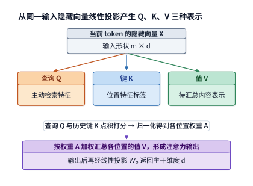

*图 2-3　同一个 token 的输入经不同投影产生查询、键和值。注意力先用查询与键计算 token 之间的关系，再用这些关系汇总值。*

若采用线性代数中“行向量右乘权重矩阵”的记号，输入矩阵 $X$ 分别右乘 $W_q$、$W_k$、$W_v$ 三个权重矩阵，就得到了 $Q$、$K$、$V$。在 Qwen3-8B 中，32 个查询头的总宽度为 $32\times128=4096$，而 8 个 KV 头的总宽度各为 $8\times128=1024$。因此，权重矩阵 $W_q$ 的形状为 $[4096,4096]$，$W_k$ 和 $W_v$ 的形状则各为 $[4096,1024]$。（顺带一提，PyTorch 等深度学习框架在代码中通常按 $(d_{\mathrm{out}},d_{\mathrm{in}})$ 的顺序存放线性层权重；本书统一改用输入维度在前、输出维度在后的数学右乘记号，以便读者直观对照矩阵乘法 $[m,k]\times[k,n]\to[m,n]$ 的维度消去过程。）

算出了 $Q$、$K$、$V$ 之后，真正跨位置交换信息的注意力核心运算才正式开始。模型将 4096 维的 $Q$ 切分成 32 个独立的 128 维查询头，把 1024 维的 $K$ 和 $V$ 各自切分成 8 个 128 维的 KV 头，让每 4 个查询头共享同一组 KV 头。对于其中的任意一个查询头，当前位置的查询向量会与所有可见上下文位置的键向量 $K$ 逐一做点积，算出相关性打分；接着将打分除以单头维度平方根 $\sqrt{d_h}$（防止特征维度较大时点积方差过大，导致后续 Softmax 进入饱和区而引发梯度消失），并加上因果掩码 $\mathcal M$ 屏蔽掉排在当前位置之后的未来 token。随后，经过 **Softmax** 函数将可见位置的打分 $s_j$ 转化为非负且总和为 1 的概率权重 $a_j=e^{s_j}/\sum_i e^{s_i}$——这组动态算出来的系数 $a_j$ 称为**注意力权重**（attention weights，注意不要与静态的模型参数权重混淆），它决定了历史上下文中每个位置应当贡献多少比例的信息。最后，用这组注意力权重对各个位置的值向量 $V$ 做加权求和，就得到了该查询头的输出。把全部 32 个查询头的输出重新拼接回 4096 维，再右乘一个 $[4096,4096]$ 的输出投影矩阵 $W_o$，注意力子层的计算就完成了。

用紧凑的矩阵公式写出单个注意力头的核心运算，就是大家熟知的：

$$
A=\operatorname{Softmax}\!\left(\frac{QK^{\mathsf T}}{\sqrt{d_h}}+\mathcal M\right),\qquad O=AV.
$$

其中 $A$ 是注意力权重矩阵，$\mathcal M$ 是因果掩码，$d_h$ 是单头维度。简言之，$QK^{\mathsf T}$ 点积负责“按内容打分检索”，Softmax 负责“归一化分配权重”，而 $AV$ 乘法则负责“按权重汇总信息”。在 Qwen3-8B 中，为了提升训练稳定性并注入位置信息，在执行 $QK^{\mathsf T}$ 点积之前还会对查询和键依次做两项逐元素处理：一是**查询—键归一化**（QK Norm），用于约束各头查询与键向量的数值尺度；二是**旋转位置编码**（Rotary Position Embedding，简称 **RoPE**），通过按 token 位置序号对特征分量施加二维旋转变换，使后续算出的点积天然携带两个 token 之间的相对距离信息。

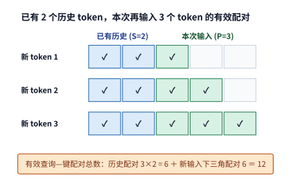

*图 2-4　两段上下文形成长方形加三角形。蓝色为三个新 token 分别读取两个旧 token，绿色为新输入内部的因果访问，空白为被屏蔽的未来 token 位置。每个有色格表示一次查询—键配对；横轴对应被读取的 token，纵轴对应新输入的查询 token。*

现在我们来精确统计注意力核心运算究竟要做多少次点积。假设某条请求在调用前已经缓存了 $S$ 个历史上下文 token，本次调用又新输入了 $P$ 个 token（序号记为 $i=1,\ldots,P$）。根据因果约束，第 $i$ 个新输入的 token 可以看到全部 $S$ 个历史 token 以及新输入中的前 $i$ 个 token，合计 $S+i$ 个可见位置。把这 $P$ 个新 token 各自可见的位置数加起来，在几何上刚好拼成一个 $P\times S$ 的蓝色长方形加上一个底和高均为 $P$ 的绿色下三角形（见图 2-4）。因此，$B$ 条等长请求在单层内合计产生的有效因果“查询—键”配对总数为：

$$
N_{\mathrm{pair}}=B\left(PS+\frac{P(P+1)}{2}\right).
$$

对于每一对有效的“查询—键”组合，单个查询头算一次长度为 $d_h$ 的 $QK^{\mathsf T}$ 点积需要 $2d_h\ \mathrm{FLOPs}$，而在算完 Softmax 后，将该位置的权重乘上对应的值向量并累加到输出 $AV$ 中，同样需要 $2d_h\ \mathrm{FLOPs}$。汇总全部 $n_Q$ 个查询头，单层注意力核心运算（$QK^{\mathsf T}$ 与 $AV$）的有效浮点运算量为：

$$
F_{\mathrm{attn}}=4n_Qd_hN_{\mathrm{pair}}=16384N_{\mathrm{pair}}.
$$

观察 $N_{\mathrm{pair}}$ 的公式可以立刻发现一个关键现象：在从零开始的 prefill 阶段（$S=0$），当输入序列长度 $P$ 翻倍时，线性投影与 FFN 的输入行数 $m=BP$ 只增长为原来的 2 倍，而全注意力的有效配对数 $P(P+1)/2$ 却会增长至原来的约 **4 倍**——因为每一个新增的后续 token 都要回过头去和前面的所有 token 做一次匹配与汇总。在工程实现上，计算这个下三角注意力有两种方式：最朴素的做法是先不管掩码，直接按完整的 $P\times(S+P)$ 矩形矩阵算出所有点积，再把右上角代表未来的格子全部填成负无穷（即矩形全注意力，在 $S=0$ 的从头 prefill 场景下相当于多算了近一半无用功）；而高效的算子实现（如 FlashAttention）则会按因果分块直接跳过右上角的空白块，只计算有色格子的有效配对，并且把 $QK^{\mathsf T}$ 打分、Softmax 归一化和 $AV$ 汇总融合在片上缓存中一气呵成，避免把庞大的注意力分数矩阵 $A$ 写回显存。第 5 章将详细剖析这种分块融合算子是如何省下海量显存读写的。

可见，哪怕保持输入矩阵的总行数 $m=BP$ 不变，只要请求的组织方式不同，注意力核心运算量 $F_{\mathrm{attn}}$ 就会相差悬殊：如果把一条长度为 $2P$ 的长请求拆成两条互不相干、长度各为 $P$ 的短请求，原本跨越前后半段的那 $P^2$ 次交叉注意力配对就凭空消失了；反过来，如果在保持新输入长度 $P$ 不变的前提下，给请求前面挂上一段长长的历史上下文 $S$，那么线性投影与 FFN 的行数 $m$ 分毫不增，但每个新 token 需要扫描的历史配对数却会大幅增加。

### 2.1.4 前馈网络与前向计算量

如果说注意力子层负责在不同 token 之间“横向交流信息”，那么紧随其后的**前馈网络**（FFN）子层就负责对每个 token 自己的特征向量做“纵向深度加工”。现代主流大模型普遍采用带门控机制的 **SwiGLU** 前馈结构：它从同一个输入向量引出两条并行的升维分支，其中一条（up 分支）对特征做线性升维，另一条（gate 门控分支）则在升维后经过非线性的 SiLU 激活函数 $\operatorname{SiLU}(x)=x/(1+e^{-x})$，生成一组逐元素的调节开关；两条分支按元素相乘后，再经过第三个降维矩阵（down 分支）投影回主干的隐藏维度 $d$：

$$
\operatorname{FFN}(X)=\left[\operatorname{SiLU}(XW_{\mathrm{gate}})\odot(XW_{\mathrm{up}})\right]W_{\mathrm{down}}.
$$

式中的 $\odot$ 表示对应位置的元素逐个相乘（Hadamard 积）。在算子执行过程中，这些矩阵乘法产生的中间向量统称为**激活值**（activations）。由于 gate 和 up 两个矩阵都将特征维度从 $d$ 扩展到了更宽的中间维度 $f$，而 down 矩阵又将维度从 $f$ 压回 $d$，这三个权重矩阵合在一起共包含 $3df$ 个参数，处理 $m$ 个 token 所需的矩阵运算量为 $6mdf\ \mathrm{FLOPs}$。代入 Qwen3-8B 的 $d=4096,f=12288$，单层 FFN 的参数量约为 1.51 亿个，在 BF16 精度下占 $288\ \mathrm{MiB}$ 显存。至于升维到 12288 维的中间激活张量，虽然宽度是主干的三倍，但只在当前层 FFN 执行期间短暂存在，算完即可释放空间供下一层复用。

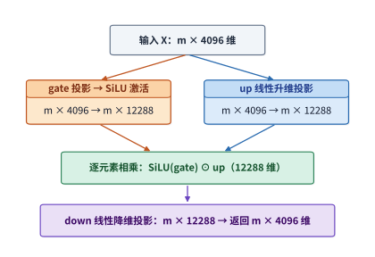

*图 2-5　SwiGLU 的两条升维分支。gate 经 SiLU 后调节 up 的对应元素，乘积再由 down 投影降回主干维度。*

把单层内的两类线性投影放在一起对比：注意力子层的四个投影矩阵（$W_q,W_k,W_v,W_o$）合计约有 4194 万个参数，而 FFN 子层的三个矩阵合计约有 1.51 亿个参数——FFN 独占了单层权重参数的约 **78%**。因此，当上下文较短时，模型绝大部分的计算量和权重读取都花在了 FFN 的三个大矩阵上。然而，随着上下文长度不断拉长，FFN 与线性投影的运算量只随 token 数 $P$ 线性增长，而全注意力的核心运算量（$QK^{\mathsf T}$ 与 $AV$）却随 $P(P+1)/2$ 呈平方级增长。一快一慢两条增长曲线交织在一起，使得注意力与 FFN 在总耗时中的占比会随上下文长度发生显著逆转。

除了上述矩阵变换，子层外部还套着一层关键的连接结构——**残差连接**（residual connection）。它的做法非常直接：在进入注意力子层或 FFN 子层之前，先把子层的原始输入保留一条旁路，等子层完成复杂的非线性变换后，再把原始输入与子层输出逐元素相加。这样一来，一条路径负责提取新特征，另一条直通路径负责无损传递浅层特征与反向传播梯度。将注意力子层、FFN 子层以及两次残差连接串联起来，就构成了图 2-6 所示的 Qwen3-8B 单层完整骨架。

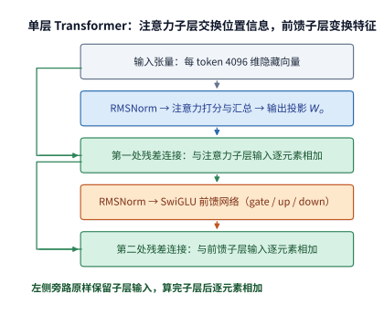

*图 2-6　Qwen3-8B 一层的骨架。先完成注意力子层，再完成前馈子层；左侧的残差连接保留子层输入，再与变换结果相加。*

**表 2-1　Qwen3-8B 的单层模块与输出接口明细**

下表汇总了 Qwen3-8B 从入口到出口的全部模块。其中注意力和前馈子层各行均按 36 层重复累计；入口词嵌入只按 token ID 从词表中查取对应行，不执行矩阵乘法（GEMM）。注意由于采用了 32 个查询头、8 个 KV 头的分组共享设计，$K$ 和 $V$ 投影的输出宽度只有 1024，而 $Q$ 投影的输出宽度仍为 4096。

**模型入口**

| 模块及作用 | 输入 → 输出（行数 × 宽度） | 权重矩阵（输入宽 × 输出宽） | 单次调用矩阵 FLOPs | 层／调用数 |
| --- | --- | --- | --- | ---: |
| 词嵌入查行 | $m$ 个 ID → $m\times4096$ | 查找表 $151936\times4096$ | 0（查表访存另计） | 1 |

**注意力子层**

| 模块及作用 | 输入 → 输出（行数 × 宽度） | 权重矩阵（输入宽 × 输出宽） | 单次调用矩阵 FLOPs | 层／调用数 |
| --- | --- | --- | --- | ---: |
| $Q$ 投影：生成查询向量 | $m\times4096\to m\times4096$ | $4096\times4096$ | $2\times m\times4096\times4096$  | 36 |
| $K$、$V$ 投影：生成可缓存的键值向量 | $m\times4096\to m\times1024$ | $4096\times1024$，共 2 个 | $2\times 2\times m\times4096\times1024$  | 36 |
| $QK^{\mathsf T}$ 与 $AV$：注意力打分与上下文汇总 | $32$ 个查询头，每头 $128$ 维 | 无新增投影权重 | $4\times32\times128\times N_{\mathrm{pair}}$  | 36 |
| 输出投影：合并各头结果 | $m\times4096\to m\times4096$ | $4096\times4096$ | $2\times m\times4096\times4096$  | 36 |

**前馈与连接**

| 模块及作用 | 输入 → 输出（行数 × 宽度） | 权重矩阵（输入宽 × 输出宽） | 单次调用矩阵 FLOPs | 层／调用数 |
| --- | --- | --- | --- | ---: |
| SwiGLU 前馈：逐 token 非线性变换 | $m\times4096\to m\times12288\to m\times4096$ | $4096\times12288$ 两个；$12288\times4096$ 一个 | $6\times m\times4096\times12288$  | 36 |
| 归一化、RoPE、激活函数与残差相加 | 保持张量形状做逐元素变换 | 归一化缩放向量等小参数 | 按元素个数单独统计  | 36 |

**输出接口**

| 模块及作用 | 输入 → 输出（行数 × 宽度） | 权重矩阵（输入宽 × 输出宽） | 单次调用矩阵 FLOPs | 层／调用数 |
| --- | --- | --- | --- | ---: |
| 词表输出头：映射为词表候选得分（末端执行一次） | $m_{\mathrm{out}}\times4096\to m_{\mathrm{out}}\times151936$ | $4096\times151936$ | $2\times m_{\mathrm{out}}\times4096\times151936$  | 1 |

从表 2-1 可以清晰地看到两类截然不同的计算增长规律：所有带权重矩阵的线性投影与 FFN 运算量都与输入行数 $m$ 成正比，而无权重的注意力核心运算（$QK^{\mathsf T}$ 与 $AV$）则与有效“查询—键”配对总数 $N_{\mathrm{pair}}$ 成正比。在短上下文场景下，体积庞大的三个 FFN 矩阵占去了计算量的大头；而当上下文拉长到数万乃至数十万 token 时，随 $N_{\mathrm{pair}}$ 膨胀的注意力计算就会反客为主。

将 36 层的线性投影、FFN 与注意力核心运算加总，再补上末端的词表输出头，就得到了 Qwen3-8B 单次前向调用的完整矩阵运算量公式：

$$
F_{\mathrm{matrix}}=36\left(385{,}875{,}968m+16{,}384N_{\mathrm{pair}}\right)+2m_{\mathrm{out}}\times4096\times151936.
$$

式中的第一项随本次输入 token 总数 $m$ 线性增长，第二项随有效注意力配对数 $N_{\mathrm{pair}}$ 增长，最后一项随实际需要计算词表 logits 的位置数 $m_{\mathrm{out}}$ 增长。直接代入具体数字检验：对于单条长度为 8192 个 token 的请求，在从零开始的 prefill 阶段（$m=8192,N_{\mathrm{pair}}=8192\times8193/2=33{,}558{,}528,m_{\mathrm{out}}=1$），按有效因果配对计算，总共需要约 **$133.6\ \mathrm{TFLOPs}$** 的矩阵运算；而在已有 8192 个历史上下文 token 的基础上往前单步 decode 1 个新 token 时（$m=1,N_{\mathrm{pair}}=8193,m_{\mathrm{out}}=1$），整次调用只需约 **$20.0\ \mathrm{GFLOPs}$**。[^source-11]

为什么同是这一个模型，prefill 和单步 decode 的运算量会相差近 6700 倍？因为 prefill 要一次性对全部 8192 个输入 token 执行线性投影、FFN 和两两之间的因果注意力；而在单步 decode 中，历史 8192 个 token 的 $K$ 和 $V$ 向量直接从显存的 KV 缓存中读取，模型只需对当前新送入的那 **1 个 token** 执行线性投影与 FFN，再拿它的查询向量去和缓存里的历史键值做一次匹配汇总。正是这份 KV 缓存，帮解码阶段省掉了对历史 token 成百上千次的重复投影与 FFN 计算。下一节我们就来仔细算一算这份缓存到底要占多少显存、产生多少读写流量。

> **练习 2-2〔核心〕：输入行数相同，注意力计算量为何不同**
>
> 利用表 2-1 的公式，先取 $B=4,S=4096,P=1024$，分别算出线性投影与 FFN、有效因果注意力，以及仅对每条请求最后一个 token 执行词表输出头所需的 $\mathrm{FLOPs}$。接着保持本次输入的总 token 行数 $m=BP=4096$ 不变，将配置改为单条长请求 $B=1,S=4096,P=4096$：请先凭直觉预测上面三项中哪些保持不变、哪些会发生变化，再动手算出具体差值。最后，考察一条总输入长度为 8192 个 token 的请求，对比“从头完整 prefill 全部 8192 个 token”与“命中前 6144 个 token 的前缀 KV 缓存、仅增量处理末尾 2048 个新 token”两种执行方式，算出前缀缓存复用省掉了多大比例的矩阵运算量。

## 2.2 自回归生成的资源消耗计算

要算清模型生成一段完整回答所需的总资源，光知道单次前向调用的运算量还不够，还必须搞清楚生成整段回答一共要调用模型多少次、上下文状态要在显存里驻留多久。在一次长回答的生成过程中，同一份模型权重可能被反复读取成百上千次，而 KV 缓存则是一边被每一步读取、一边不断往后追加变长。结果就是，请求结束时显存里最终保存的状态字节数，与整个生成过程中显存接口累计读写的字节数，往往相差好几个数量级。

### 2.2.1 Prefill、Decode 与状态复用

回顾自回归生成的标准流程：在 **prefill** 阶段，模型收到用户提交的一整段已知提示词（prompt），可以在一次前向调用中并行算出所有输入 token 的各层特征，并根据最后一个输入位置的 logits 采样出首个输出 token；随后便进入循环往复的 **decode** 阶段——每一步把上一步刚生成的那个 token 作为新输入送入模型，算出再下一个输出 token，如此一个接一个地往后顺延，直到遇到终止符或达到长度上限。两个阶段跑的是完全相同的模型权重，但 prefill 阶段一次性处理多个已知 token，而普通串行 decode 每条请求每步只推进 1 个新 token。

试想，如果不做任何状态缓存，每生成一个新词都把从头到尾的整段文本重新送入模型算一遍，那么前面已经算过的所有历史 token 在每一层都要把 QKV 投影和 FFN 重新跑一遍，计算量将随生成步数灾难性地膨胀。好在因果 Transformer 有一个极佳的数学性质：排在前面的历史 token 永远看不到后面新生成的 token。只要模型权重、位置编号和前缀内容没有改变，历史 token 在各层算出来的隐藏特征以及键（$K$）、值（$V$）向量就永远固定不变。因此，系统完全可以把历史 token 在每一层产生的 $K$ 和 $V$ 向量保存在显存中；每当后续步送入一个新 token 时，只需算出这 1 个新 token 自己的 $Q$、$K$、$V$，把新的 $K$、$V$ 追加到缓存末尾，再拿新 token 的查询向量 $Q$ 去读取整段缓存的 $K$ 和 $V$ 完成注意力计算即可。

这就是 **KV 缓存**（KV cache）的本质：**用空间换时间**——把原本每一步都要“重新计算所有历史 token 的特征”，转化成了“在显存中保存并每步读取历史 token 的键值状态”。为什么只保存 $K$ 和 $V$，而不保存历史 token 的查询向量 $Q$？因为在因果注意力中，每一个历史位置的查询向量 $Q$ 早在处理它自己那一步时就已经用完并算出输出传给下一层了；后续新来的 token 只会用自己的新 $Q$ 去给历史位置的 $K$ 打分、再按分数汇总历史位置的 $V$，再也不会回头去用旧位置的 $Q$。至于如何在不同请求或不同轮次对话之间跨请求复用这份 KV 缓存，我们将在第 8 章深入讨论。

现在我们来算出 **Qwen3-8B** 中每一个上下文 token 的 KV 缓存究竟占多少字节。在 BF16 精度（$b_{\mathrm{KV}}=2\ \mathrm{bytes}$）下，单个 token 跨全部 $L=36$ 层需要保存的 KV 字节数 $c_{\mathrm{KV}}$ 为：

$$
\begin{aligned}c_{\mathrm{KV}}&=2L n_{\mathrm{KV}}d_h b_{\mathrm{KV}}\\&=2\times36\times8\times128\times2\ \mathrm{bytes}\\&=144\ \mathrm{KiB}.\end{aligned}
$$

公式开头的系数 $2$ 分别对应键（$K$）和值（$V$）两个向量；全模型共 $L=36$ 层，每层有 $n_{\mathrm{KV}}=8$ 个 KV 头，每个头宽 $d_h=128$，每个 BF16 数值占 $b_{\mathrm{KV}}=2$ 字节，连乘起来恰好是 $147{,}456\ \mathrm{bytes}=144\ \mathrm{KiB}$。因此，当上下文中累积了 $H$ 个 token 时，单条请求的 KV 缓存总容量就是 $M_{\mathrm{KV}}=c_{\mathrm{KV}}H$。例如，当上下文长度 $H=8192$ 时，Qwen3-8B 单条请求的 KV 缓存恰好占 $144\ \mathrm{KiB}\times8192=1.125\ \mathrm{GiB}$；此后每往前生成 1 个新 token，显存里的 KV 缓存就跟着增长 $144\ \mathrm{KiB}$。从公式也能直接看出：如果把模型层数 $L$ 或 KV 头数 $n_{\mathrm{KV}}$ 减半，$c_{\mathrm{KV}}$ 就会随之减半；而当并发处理的独立请求数 $B$ 增加时，每条请求都要各自占用一份 $M_{\mathrm{KV}}$。[^source-13]

### 2.2.2 内存占用与数据访问量

既然引入 KV 缓存是用显存容量与访存流量去换取计算量的节省，我们就必须把显存里的各类数据按**用途与生命周期**分门别类地算清楚。在模型推理过程中，所有数据都可以归入下表所示的三大类：

| 数据类别 | 生命周期与复用特征 | 本章核算的核心指标 |
| --- | --- | --- |
| **模型权重**（Weights） | 服务启动后长期常驻显存，跨成千上万次请求反复共享 | 静态常驻容量、单次调用实际激活的权重大小、批内复用率 |
| **上下文状态**（Context State） | 随单条请求或会话存续，在生成过程中逐步追加或就地更新 | 当前驻留容量、单步解码读写字节数、更新状态所需的附加计算 |
| **临时中间数据**（Activations / Workspace） | 仅在单个算子或单次前向传播期间短暂产生，用完即释放或覆写 | 中间张量尺寸、流经各级存储接口的读写流量、同一时刻共存的峰值大小 |

先看第一类——**模型权重**。Qwen3-8B 的全部 BF16 权重共占约 $16.38\ \mathrm{GB}$（折合二进制约 $15.26\ \mathrm{GiB}$）。模型加载进显存后，这份权重就静态常驻在那里，供所有进入该实例的请求共同使用。在单次前向调用中，入口词嵌入只按输入 token ID 查取对应行，中间 36 层的注意力投影与 FFN 完整读取各自的权重矩阵，最末端的词表输出头再读取词表矩阵算出得分。也就是说，一次调用究竟要从显存读取多少权重，完全取决于计算图中实际执行了哪些算子。

当我们在一个 batch 里同时处理多个 token（即输入矩阵行数 $m>1$）时，权重读取就会展现出一个关键特性——**数据复用**。在矩阵乘法 $[m,d]\times[d,f]$ 中，输入矩阵的全部 $m$ 行乘的都是同一个 $[d,f]$ 权重矩阵。硬件执行时，只要把权重矩阵的一小块从显存读入芯片内部的片上存储（如寄存器或共享内存），就可以拿着这一块权重依次和输入矩阵的多行做乘加运算。因此，当参与计算的 token 行数 $m$ 增加时，浮点运算量按比例增长，但需要从显存读取的整份权重大小却保持不变。至于片上缓存究竟能装下多大的分块、一份读入片上的权重到底能复用多少次，我们将在第 5 章结合具体算子分块详细推导。

再看第二类**上下文状态**与第三类**临时中间数据**。上下文状态（KV 缓存）的容量公式上一小节已经推出；而临时中间数据（激活值与工作区）到底要占多少显存，则取决于**同一时刻有哪些中间张量必须同时存活在显存里**。在逐层前向执行时，只要第 $l-1$ 层的激活值已经用完且不再被后续层引用，它占用的显存缓冲区就可以立刻释放并交给第 $l$ 层覆盖复用；如果编译器进一步实施**算子融合**（operator fusion，即将相邻的几个算子合并进同一个 GPU 内核中连续执行），许多中间结果甚至从头到尾都只停留在高速寄存器或片上共享内存里，根本不会写回显存。因此，在算这笔账时务必分清两个概念：统计**数据读写量**（$R$）时，要把整个执行过程中发生的所有访存字节数逐次累加；而统计**显存容量峰值**（$M$）时，则是找出时间轴上同时存活张量最多的那个瞬间。第 5 章将结合真实算子程序带大家算清这两笔账。

把“驻留容量 $M$”与“累计读写量 $R$”区分开来，是理解解码阶段性能瓶颈的关键。例如，在单步 decode 中，把长度为 $H$ 的历史上下文 KV 缓存从头到尾读一遍，理想单次读取量（即假设每份需要的数据只从显存读取一次）就是 $c_{\mathrm{KV}}H$；如果连续生成几百个 token，每一步的读取量就会一步步叠加起来。摸清这些访问实际走的是片上缓存、HBM 显存还是跨卡网络之后，把对应的流量 $R$ 除以那条通道的带宽 $\beta$，就能算出访存耗时。

**例题 2-2：增大 batch size 时，KV 缓存读取量何时反超模型权重读取量？** 在单步 decode 中，Qwen3-8B 每批需要将 36 层主干与词表头的共享权重从显存完整读取一遍，总数据量约为 $15.14\ \mathrm{GB}$（入口词嵌入按各请求的 token ID 查行，体量极小可忽略）。若批内每条请求都带有 $H=8192$ 个历史上下文 token（BF16 下每条请求的 KV 缓存占 $1.125\ \mathrm{GiB}$），且各请求的上下文彼此独立、每步各自从显存读取一遍，求当 batch size $B$ 增大到多少时，读取独立 KV 缓存的总流量会超过读取共享权重的流量？

**解**：设整批共享的单次权重读取量为 $R_W$。由于 $B$ 条请求的上下文彼此独立，单步需要读取的 KV 缓存总量为 $Bc_{\mathrm{KV}}H$。令两者相等，即可求出交点处的请求数：

$$
B_* = \frac{R_W}{c_{\mathrm{KV}}H}.
$$

代入精确字节数 $R_W=15{,}136{,}811{,}008\ \mathrm{bytes}$ 与 $c_{\mathrm{KV}}=147{,}456\ \mathrm{bytes/token}$：当上下文长度 $H=8192$ 时，$B_*\approx12.53$，即从整数 batch size **$B=13$** 开始，读取各请求 KV 缓存的流量就已经超过了读取整份模型权重的流量。如果把每条请求的上下文长度缩短到四分之一（$H=2048$），交点则会推迟到整数 **$B=51$**。这个简单的算例揭示了一条重要的系统规律：上下文越长，靠增大 batch size 来摊薄访存开销的收益就会越早触及瓶颈——因为模型权重虽能被全批请求共享，但每新加入一条请求，显存接口上就必须多读取一份独占的长上下文 KV 缓存。[^source-12]

顺着第 1 章建立的硬件数据路径看：模型启动加载时，权重从外部存储搬入 GPU 显存；而在每一步推理执行时，GPU 计算单元则要从显存读取权重与 KV 缓存。当然，根据算子实现与并行策略的不同，算法层面的同一次数据访问既可能直接命中芯片内部的片上缓存，也可能流经 HBM 显存接口，甚至跨越卡间互联网络。第 4 章将详细对比这几级存储通道的容量与带宽差异。

### 2.2.3 生成完整回答的计算量与状态读写量

在实际对话或 Agent 任务中，模型生成一段完整回答需要连续执行成百上千次调用，同一份历史上下文也会随之被反复读取成百上千次。这里固定一条标准的串行自回归生成请求来算总账：设并发数为 $B=1$，调用前已从缓存恢复的历史前缀长度为 $S$，本次新输入的提示词长度为 $P\ge1$ 个 token，模型最终共生成并返回 $G\ge1$ 个输出 token。我们把 prefill 结束时的总上下文长度记为 $H=S+P$。整个生成过程由 **1 次 prefill 调用**（处理 $P$ 个新输入并直接产出第 1 个输出 token）和随后的 **$n_d=G-1$ 次单步 decode 调用**组成。注意为什么后续 decode 只有 $G-1$ 次：因为第 1 个输出 token 已经在 prefill 结束时生成了，而第 $G$ 个（也就是最后一个）输出 token 一旦生成就会直接返回给用户，不需要再送回模型去做第 $G$ 次前向计算，因此请求结束时也不会自动为这最后一个输出 token 生成 KV 缓存。

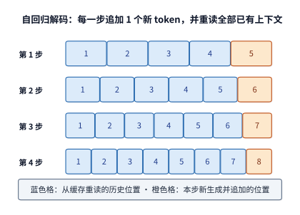

*图 2-7　四步生成的上下文读写。每一步读取蓝色的已有位置，再追加一个橙色新 token；本图初始上下文为 4 个 token，四步后共保留 8 个。*

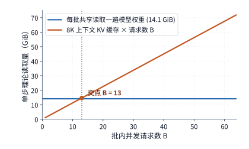

*图 2-8　同一 batch 的主要投影权重可共享读取，各请求则各有一份上下文。图中固定每请求 8K 上下文，分别累计共享权重与独立 KV 的理论读取量。权重读取量按整个 decode batch 共享读取一次计量；KV 读取量则累加各独立请求在本步读取的历史上下文状态。*

观察图 2-7 中逐行变长的色块：每往前走一步 decode，上一步刚追加的橙色新 token 就会变成下一步需要读取的蓝色历史上下文。具体来说，在执行第 $j$ 次 decode（下标 $j$ 从 $0$ 计到 $n_d-1$）之前，显存中已保存的历史上下文长度为 $H+j$。如果每一步 decode 都把当时的历史上下文 KV 缓存从头到尾读取一遍，那么走完整个生成过程（共 $n_d$ 步 decode），累计读取历史 KV 缓存的总字节数 $R_{\mathrm{old}}$ 就是一串等差数列的求和：

$$
R_{\mathrm{old}}=c_{\mathrm{KV}}\sum_{j=0}^{n_d-1}(H+j)=c_{\mathrm{KV}}\left[n_dH+\frac{n_d(n_d-1)}{2}\right].
$$

与此同时，这 $n_d$ 步 decode 期间新写入显存的 KV 状态总量为 $c_{\mathrm{KV}}n_d$；如果保留整条请求的上下文，请求结束时显存里驻留的有效 KV 总容量就是 $c_{\mathrm{KV}}(H+n_d)$（其中本次请求新产生的 KV 包括 prefill 写入的 $c_{\mathrm{KV}}P$ 与 decode 写入的 $c_{\mathrm{KV}}n_d$，而跨轮恢复的前缀 $S$ 则单独统计传输与恢复开销）。从求和公式可以直观地看出：越早进入上下文的 token，在后续生成中被反复重读的次数就越多；越晚生成的 token，被后续步骤读取的次数就越少。

**例题 2-3：为什么一次长回答生成下来，KV 缓存的累计读取量会达到最终存储容量的上千倍？** 设 Qwen3-8B 处理一条从零开始的请求（$S=0$），输入提示词长度为 $P=8192$ 个 token，连续生成并返回 $G=1025$ 个输出 token。求请求结束时显存中保存的 KV 缓存总大小，以及在解码期间累计从显存读取历史 KV 缓存的总数据量。

**解**：由题设可知 $H=S+P=8192$，后续单步 decode 的调用次数为 $n_d=G-1=1024$ 次。代入等差数列求和公式，整个解码期间累计读取的历史上下文 token 人次高达：

$$
1024\times8192+\frac{1024\times1023}{2}=8{,}912{,}384\ \text{次}.
$$

由于每个 token 的 KV 缓存占 $c_{\mathrm{KV}}=144\ \mathrm{KiB}$，乘起来可得整个解码阶段累计读取的历史 KV 缓存总量高达约 **$1224\ \mathrm{GiB}$**（超过 $1.2\ \mathrm{TiB}$）。作为对比，这 1024 步 decode 期间新生成的 KV 缓存只有 $1024\times144\ \mathrm{KiB}=144\ \mathrm{MiB}$，加上 prefill 阶段写入的 $1.125\ \mathrm{GiB}$，请求结束时显存中最终驻留的 KV 缓存总共只有约 **$1.27\ \mathrm{GiB}$**。累计读取量之所以达到最终驻留容量的近千倍（$1224 / 1.27 \approx 967$ 倍），根本原因就在于：凡是已写入上下文的 token（尤其是开头 prefill 写进去的那 8192 个输入 token），在随后的 1024 步 decode 中，每一步都要从显存中重新读取一遍。

同样的等差求和规律，也支配着整个解码阶段的总浮点运算量。在每一次单步 decode 中，线性投影、FFN 和词表头只处理当前输入的 1 个新 token，运算量是一个固定常数 $F_0$；而注意力核心运算（$QK^{\mathsf T}$ 与 $AV$）的运算量则随当时的历史上下文长度 $H+j$ 线性增长。设每与 1 个历史上下文 token 做注意力匹配需要 $a$ 次浮点运算（在 Qwen3-8B 中 $a=36\times16384\approx5.90\times10^5\ \mathrm{FLOPs}$），那么走完 $n_d$ 步 decode 的累计浮点运算量就是：

$$
F_{\mathrm{decode,total}}=n_dF_0+a\left[n_dH+\frac{n_d(n_d-1)}2\right].
$$

可以看到，随着输出长度 $n_d$ 拉长，固定部分的累计运算量 $n_dF_0$ 与初始上下文注意力 $an_dH$ 随生成步数线性增长，而生成过程中新追加 token 带来的注意力运算量则随生成步数的平方 $n_d(n_d-1)/2$ 增长。顺带检验一下边界情况：如果一条请求只需要生成 1 个输出 token（即 $G=1$），那么 $n_d=0$，上面的解码求和项全部为零，整条请求只需执行一次 prefill 即可完成生成。

把图 2-7 和图 2-8 放在一起看：图 2-7 展示的是单条请求在**时间维度**（生成步数 $n_d$）上的状态读取累加，而图 2-8 展示的则是单步之内在**空间维度**（并发请求数 $B$）上的状态读取累加。当多条独立请求合批执行时，它们的 KV 容量与读取流量直接相加，而模型权重读取则由全批共享；若批内各请求的输入长度 $H$ 和生成长度 $n_d$ 各不相同，只需按每条请求各自的轨迹分别代入求和即可。一句话总结输入长度与输出长度对访存的不同影响：**输入提示词越长（$H$ 越大），每一步 decode 需要扫描的历史底数就越大；输出回答越长（$n_d$ 越大），整份历史上下文被反复重读的遍数就越多。** 对于真实业务中的多轮对话，我们可以直接根据线上日志记录的每轮输入长度、前缀缓存命中长度和输出 token 数，原原本本地还原出整条调用链的资源账单（具体代入过程可参考仓库中的[真实对话轨迹核算记录](../calculations/results/sealed-chat-known-prefill.md)）。

> **练习 2-3〔延伸〕：输出变长后，KV 容量与累计读取量如何增长**
>
> 取 Qwen3-8B 模型，设 $B=1,S=0,P=8192$，对比生成输出长度分别为 $G=513$ 和 $G=1025$ 个 token 的两种情况。请分别算出后续单步 decode 的调用次数 $n_d$、请求结束时最终驻留的 KV 缓存总大小，以及整个解码期间累计读取历史 KV 缓存的总数据量。请解释：当输出长度从 513 接近翻倍到 1025 时，为什么“解码阶段新增的 KV 容量”、“请求结束时的最终 KV 总容量”和“解码期间累计的 KV 读取量”会呈现出截然不同的增长倍数？如果通过量化将 KV 缓存的存储位宽减半（例如从 BF16 改为 FP8），上述三个指标中哪些会随之精确减半？

## 2.3 上下文状态表示与访问机制

当模型继续往后生成时，必须回顾前面已经读过的历史内容。要在显存里记住一段长长的历史，不妨先对比日常生活中的两种记笔记方式：第一种是“逐页留档”，每读完一页就原封不动地存进档案盒，以后想查哪一页就去翻哪一页；第二种则是“维护定长摘要”，手头始终只留一张固定大小的卡片，每读到新内容就涂改更新这张卡片。前一种做法保留了全部历史细节，但档案盒会随着阅读长度越塞越满；后一种做法占用的空间永远固定，却难免在反复涂改中遗忘早期的细节。

把这两种思路映射到现代大模型中：以标准 Transformer 为代表的一类机制，会为每一个历史 token 位置单独保存键（$K$）和值（$V$）向量；而以线性注意力为代表的**有限状态递推**（finite-state recurrence）机制，则是把所有历史 token 的贡献不断融合进一个尺寸固定的状态矩阵中。无论是逐 token 留档的 KV 列表，还是固定大小的递推状态矩阵，统称为模型的**上下文状态**（context state）。在核算成本时，**上下文长度**按包含的 token 个数计量，而**状态容量**则按显存中实际占用的字节数计量。

对比五花八门的注意力改进方案时，只需抓住两条线索——**历史留下了什么状态**，以及**新一步如何从中提取信息**：我们既可以压缩每个历史 token 的向量宽度，也可以只保留最近一段窗口的精确细节、把更早的历史浓缩成少量粗粒度条目，或者先通过轻量级索引筛选出最相关的条目再去读取完整状态；另一条路线则是彻底放弃逐 token 留档，改为每一步就地更新固定大小的递推矩阵。这些设计分别改变了单条状态的宽度、保存的条目总数以及每一步的访问范围；而在评估总收益时，必须把省下来的显存容量与访存流量，同新增的索引打分、块压缩和状态更新开销放在一起算总账。

### 2.3.1 多头注意力与 KV 共享

在保留“逐 token 留档”的前提下，最直接的显存缩减办法，就是减少每个 token 需要保存的 $K$、$V$ 头数。回顾多头注意力的设计初衷：让多个查询头（Query heads）各自关注不同维度的语义关系。在最初的**多头注意力**（Multi-Head Attention，简称 **MHA**）中，每一个查询头都配有自己专属的一组键头和值头（一对一）；随后的**多查询注意力**（Multi-Query Attention，简称 **MQA**）走向了另一个极端，让同一层的所有查询头共享唯一的一组键头和值头（多对一）；而如今最主流的**分组查询注意力**（Grouped-Query Attention，简称 **GQA**）则取了两者的折中——把查询头分成若干组，让同一组内的多个查询头共享同一份键头和值头。经过这样分组共享，序列中上下文 token 的数量虽然没变，但每个 token 需要保存的 $K$、$V$ 份数却成倍减少了。

不妨用一层只有 4 个查询头的极简例子来直观对比（见图 2-9）：MHA 需要为 4 个查询头各自保存一份独立的 KV，共 4 份；GQA 可以将前两个查询头归为一组共享第 1 份 KV、后两个查询头归为另一组共享第 2 份 KV，共保存 2 份；MQA 则让全部 4 个查询头共用同 1 份 KV。在上下文长度和单头维度完全相同的情况下，三种机制需要保存的 KV 缓存容量之比恰好是 $4:2:1$。注意这里一个非常精妙的区别：尽管同组内的查询头读取的是同一份共享的上下文 $K$ 和 $V$，但 4 个查询头依然拥有各自独立的查询向量 $Q$，因此依然能对同一段上下文打出 4 组完全不同的注意力权重、提取出 4 份不同的汇总特征——这就是“共享上下文键值表示”与“直接削减查询头数”的本质区别。

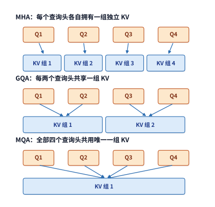

*图 2-9　固定四个查询头，分别为每头、每组和全部查询保存 KV。连线表示使用关系；共享上下文后，各查询仍分别产生自己的评分与输出。*

本章的基线模型 **Qwen3-8B** 采用的正是 GQA 结构：每层设有 32 个查询头、8 个 KV 头，即每 4 个查询头共享一组 KV。如果退回传统的 MHA（32 个 KV 头），它的 KV 缓存容量将扩大到现在的 4 倍（8K 上下文占 $4.5\ \mathrm{GiB}$）；如果激进地改用 MQA（1 个 KV 头），KV 缓存则会进一步缩小到现在的八分之一（8K 上下文仅占 $0.141\ \mathrm{GiB}$）；而实际的 GQA 配置在 8192 个上下文 token 下恰好占 $1.125\ \mathrm{GiB}$。图 2-10 在保持层数、单头维度、8192 上下文长度与 BF16 精度完全不变的条件下，直观展示了这三种 KV 头数配置下的容量落差。

从系统角度看，共享 KV 只缩减了被查询的键值状态，而 32 个查询头依然要各自执行打分与加权求和。因此，当把 KV 头数 $n_{\mathrm{KV}}$ 减半时，$K$、$V$ 线性投影矩阵的参数量以及 KV 缓存的显存占用都会精确减半；但只要查询头数 $n_Q$ 不变，注意力核心运算（$QK^{\mathsf T}$ 与 $AV$）的浮点运算量依然按全部 32 个查询头累计，分毫不减。同时，在硬件执行时，从显存读入片上的一组共享 $K$、$V$ 可以当场供同组的 4 个查询头连续复用，从而直接将注意力阶段的 KV 访存流量降到了原来的四分之一。

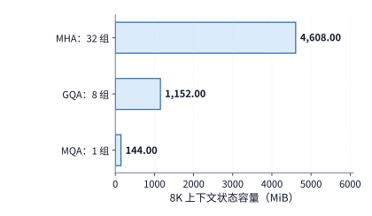

*图 2-10　固定 Qwen 层数、头宽、8192 个上下文 token 与 BF16，只改变 KV 组数。实际模型采用 GQA；其余两柱是用于分析共享比例的结构变体。*

从 MHA 到 MQA 再到 GQA 的演进，是“底层硬件约束倒逼模型架构创新”的经典范例：Shazeer 在提出 MQA 的原始论文中，开篇明义就指出其核心动机是为了缓解自回归解码时的显存带宽瓶颈；而 GQA 则在 MHA 的表达能力与 MQA 的推理速度之间找到了最佳平衡点。[^codesign] 减少 KV 头数看似只是改了模型配置表里的一个数字，实则同时改变了模型的注意力表达空间与服务端的显存、带宽账单。

### 2.3.2 潜变量压缩与 MLA 执行路径

如果说 GQA 和 MQA 是靠“减少 KV 头的组数”来省显存，那么 DeepSeek 提出的**多头潜变量注意力**（Multi-head Latent Attention，简称 **MLA**）则开辟了另一条路线——靠“将上下文键值压缩为低维潜变量”来大幅削减每个 token 的状态宽度。其核心思路是：先把输入向量通过下投影压缩成一个维度很窄的**潜变量**（latent vector）$c$，需要做注意力计算时，再通过上投影矩阵从 $c$ 恢复出各个注意力头的键 $K$ 和值 $V$。模型在训练阶段直接学会这套低秩下投影与上投影矩阵；而在推理生成时，显存的 KV 缓存中只保存压缩后的低维潜变量 $c$。

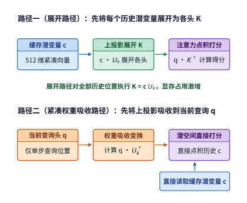

*图 2-11　两种计算路径改变上投影的位置。展开路径先恢复上下文键，紧凑路径先变换当前查询，再直接读取潜变量；结合律保证对应点积可以按这两种次序计算。*

也许读者会问：如果显存里只存低维潜变量 $c$，那每一步解码时岂不是还得把成千上万个历史 token 的 $c$ 重新乘上投影矩阵、还原出庞大的 $K$ 和 $V$？答案是不需要。这正是 MLA 最精巧的数学设计——利用**矩阵乘法结合律**实现权重的“吸收”（absorption）。设键的上投影矩阵为 $U_k$，历史上下文潜变量按行拼成的矩阵为 $c$，那么展开后的历史键矩阵就是 $K=cU_k$。当计算当前查询向量 $q$ 与历史键的点积时，根据结合律有：

$$
qK^{\mathsf T}=q(cU_k)^{\mathsf T}=(qU_k^{\mathsf T})c^{\mathsf T}.
$$

仔细对比等号左右两边的计算顺序：等号左边的**展开路径**（expanded path）是先把所有历史 token 的潜变量 $c$ 逐一升维还原成宽大的键矩阵 $K$，再与当前查询 $q$ 做点积；而等号右边的**紧凑路径**（compact / absorbed path）则是先把上投影矩阵吸收到当前查询 $q$ 一侧（算出变换后的查询 $qU_k^{\mathsf T}$），随后直接去和显存里窄小的历史潜变量 $c$ 做点积。在单步 decode 中，当前查询 $q$ 只有 1 个 token，做一次查询变换的开销微乎其微，却省去了对成千上万个历史 token 做升维还原的海量计算与显存占用。同理，值向量的上投影也可以挪到加权求和之后执行：先用注意力权重对低维潜变量 $c$ 做加权汇总，最后只对当前这 1 个汇总结果执行一次上投影还原回输出维度。就这样，原本每步都要对全部历史上下文执行的升维操作，被巧妙地转移到了当前单个查询 token 的一进一出上。

本章我们以 **Kimi K3** 采用的**门控多头潜变量注意力**（Gated MLA，即在注意力输出端额外乘上一组学习到的门控系数）作为算例。在紧凑缓存路径下，Kimi K3 的每个 MLA 层为每个上下文 token 保存一个 512 维的潜变量，外加一个参与 $QK^{\mathsf T}$ 打分的 64 维附加分支。顺带说明一个架构细节：Kimi K3 的全部 24 个 MLA 层均采用 **NoPE**（No Position Encoding，无显式位置编码）设计，查询和键都不做 RoPE 旋转，序列的位置感知完全交由模型中另外 69 层 KDA（见第 2.3.4 节）的递推衰减机制来提供；不过在公开参考实现中，这 64 维附加分支依然照常投影并存入缓存（只是省去了旋转操作），因此每个 token 在单层实际保存的宽度为 $512+64=576$ 维。按 24 个 MLA 层、8192 个上下文 token、BF16 精度核算，紧凑路径下的 MLA 缓存容量仅为 $24\times8192\times(512+64)\times2\ \mathrm{bytes}=216\ \mathrm{MiB}$。

相反，如果采用朴素的**展开式缓存**（即预先把潜变量通过上投影还原为全部 96 个注意力头的完整 $K$ 和 $V$ 再存入显存），同样是这 8192 个上下文 token，占用的显存就会膨胀到约 **$11.25\ \mathrm{GiB}$**——约为紧凑路径的 53 倍。可见，两种执行路径在数学上完全等价，仅仅因为缓存切面选在了上投影矩阵的不同一侧，显存容量和每步读取流量就拉开了悬殊差距。[^source-2]

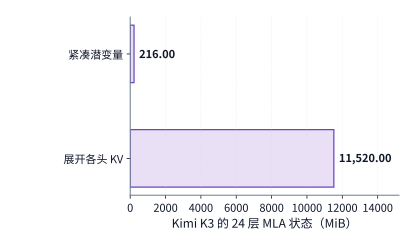

*图 2-12　Kimi K3 的 24 层 MLA 在相同 8K 上下文、BF16 下的两种存储量。紧凑路径保存上投影前的表示，展开路径保存各头的键和值。*

需要清醒认识的是，MLA 虽然把单个历史 token 占用的字节数压得很窄，但它本质上依然属于“逐 token 留档”机制——每多一个历史 token，显存里还是要多存一条 576 维的潜变量，解码时也依然要拿变换后的查询去和每一个历史位置的潜变量逐个做点积。因此，它的状态容量与注意力点积次数仍然随上下文长度线性增长：上下文越长，紧凑路径省下的显存与带宽就越可观；而在极短上下文下，当前查询两侧新增的上投影变换开销占比则会相对高一些。

### 2.3.3 局部窗口、上下文压缩与稀疏索引

既然逐 token 扫描全部历史在超长上下文下代价高昂，能不能让模型在回头查阅历史时也学会“抓重点”？设想模型已经读完了一篇数万字的长文档，现在要继续生成下一个新 token：对于紧挨着当前位置的最近几句话，模型可以直接逐字细读；对于更早之前的长篇历史，模型既可以去读由好几个旧 token 合并浓缩而成的粗粒度摘要条目，也可以先用一套轻量级的检索目录（索引）快速挑出与当前问题最相关的几十个片段，再只把这些选中片段的完整状态调出来精读。这三种思路分别对应着现代长上下文架构中的三项关键技术：**局部滑动窗口**、**上下文块压缩**与**稀疏索引选择**。在实际模型中，这三者往往协同工作，但在算资源账时必须严格分开统计：滑动窗口框定了近期逐字细读的范围，块压缩削减了远期历史保存的条目总数，而稀疏索引则决定了每次查询实际挑出多少条目来算主注意力——需要注意，索引器在挑出目标条目之前，自己也得先把索引目录扫描并打分一遍，因此绝不能只统计最后选中的那几百条主注意力状态。

为了算清这笔细账，我们先明确区分显存里存放的三类上下文状态对象：
1. **局部滑动窗口状态**（Sliding-Window Attention，简称 **SWA**）：只保留距离当前位置最近的一小段原始 token 状态（例如窗口长度设为 128）；随着生成往前推进，超出最近 128 个位置的旧 token 会自动滑出窗口。
2. **全局主 KV 状态**：供主注意力模块精读的长期历史表示，通常已经把相邻的多个历史 token 压缩合并成了一条记录。注意这里的“全局”是指它的视野覆盖整段长历史，并不意味着每次查询都要把所有全局记录全都读出来。
3. **索引键状态**（Index $K$）：专门供轻量级索引器做快速检索打分用的窄向量表示。每一步查询时，索引器先拿查询索引去扫描全部历史索引键、算出相关性分数并挑出得分最高的前 $k$ 个条目（top-$k$），随后主注意力模块才去显存里读取这 $k$ 个中标条目的全局主 KV，并用主查询向量算出最终的注意力加权输出。

在具体实现中，模型通过端到端训练学会如何把连续多个 token 浓缩成一条共享向量记录：一条 512 维的全局主 KV 记录同时兼任注意力中的键与值，供层内所有查询头共享，因此在显存里只占一份 512 维向量的空间。局部 SWA 负责保留近期的字词细节，全局压缩分支负责跨越长距离召回远期信息，两路结果合在一起共同服务当前位置的查询。

以 **DeepSeek V4-Flash** 为例，看看这套协同机制是如何落地的。该模型主干共有 43 层，隐藏维度为 4096，每层设 64 个注意力头、单头维度 512。在线性投影阶段，查询向量 $Q$ 采用低秩双层投影（先从 4096 维降到 1024 维，再升维展开为 $64\times512=32768$ 维）；共享的原始 KV 直接从 4096 维投影到 512 维；而注意力输出端则采用分 8 组的低秩投影（每组将 4096 维压缩到 1024 维，8 组拼接成 8192 维后再投影回 4096 维主干）。

在注意力机制的层间搭配上，DeepSeek V4-Flash 混合使用了两种不同粒度的压缩注意力：一种是**压缩稀疏注意力**（Compressed Sparse Attention，简称 **CSA**），先对上下文做中等比例压缩，再通过索引器做 top-$k$ 稀疏挑选；另一种是**高压缩注意力**（Heavily Compressed Attention，简称 **HCA**），直接把大段上下文浓缩成极少量的粗粒度条目，查询时不再筛选而是全部读取。全模型 43 层中，包含 2 个纯局部窗口层（仅保留长度 128 的 SWA）、21 个 CSA 层和 20 个 HCA 层（所有层均附带长度 128 的局部窗口）。其中，CSA 层按 **4:1** 的压缩比生成长期条目并维护检索索引；HCA 层则按 **128:1** 的高压缩比生成粗粒度条目。如果统一按 BF16 参考存储格式核算，CSA 每完成一个压缩块，就会产出一条 512 维的主注意力记录（占 $1024\ \mathrm{B}$）和一条 128 维的索引记录（占 $256\ \mathrm{B}$）。当历史上下文长度为 $S$ 个 token 时，已落盘的完整压缩块数量为 $\lfloor S/4\rfloor$；至于末尾还凑不够一整块的零头 token，则暂存在独立的压缩器缓冲区中。

这里需要特别留意“名义压缩比”与“每个压缩块的实际感受野”之间的微妙区别：DeepSeek V4-Flash 的 CSA 虽然每积攒 4 个新 token 产出一条记录（压缩比为 4），但在压缩时采用了**相邻块重叠**（overlapping blocks）设计——除了开头第一块的边界处理外，每条压缩记录实际上是用两组不同的投影矩阵把相邻两个 4-token 块（合计 8 个 token）的特征乘上逐通道学习权重后汇总而成的。相比之下，HCA 每 128 个 token 产出一条记录，既不采用相邻块重叠，也不设置 top-$k$ 索引器，每次查询直接把已经生成的粗粒度条目全数读出即可。（顺带一提，到了后文将介绍的 DeepSeek V4.1 Flash 中，第二代压缩稀疏注意力 CSA2 取消了这种跨块重叠，改为了干净的无重叠 2:1 压缩。）

现在我们来算一算：在 $S=8192$ 个历史上下文 token 下，单次查询究竟要存多少状态、读多少数据？
- 在单个 **CSA 层**中，8192 个历史 token 按 4:1 共生成了 $8192/4=2048$ 个压缩条目：显存里保存的主注意力状态占 $2048\times512\times2\ \mathrm{B}=2\ \mathrm{MiB}$，索引记录占 $2048\times128\times2\ \mathrm{B}=0.5\ \mathrm{MiB}$，外加长度 128 的局部 SWA 窗口占 $128\times512\times2\ \mathrm{B}=0.125\ \mathrm{MiB}$。在单步查询时，索引器必须先把全部 **2048 条索引记录**（$0.5\ \mathrm{MiB}$）完整扫描打分一遍，从中挑出最多 512 个相关条目；随后主注意力模块只需读取这选中的 **512 条主 KV 记录**（最多 $0.5\ \mathrm{MiB}$）外加 $0.125\ \mathrm{MiB}$ 的局部窗口即可。
- 在单个 **HCA 层**中，8192 个历史 token 按 128:1 仅浓缩成 $8192/128=64$ 个粗粒度条目，主注意力状态仅占 $64\times512\times2\ \mathrm{B}=0.0625\ \mathrm{MiB}$，查询时连同 $0.125\ \mathrm{MiB}$ 的局部窗口一并全部读取。

把全模型 43 层（2 层纯窗口 + 21 层 CSA + 20 层 HCA）全部加总：在 8192 上下文、BF16 参考格式下，局部窗口、压缩主 KV 与索引记录三项合计仅占 **$59.125\ \mathrm{MiB}$**；再加上用于维护滑动汇总的约 $11.641\ \mathrm{MiB}$ 的 FP32 压缩器中间缓冲，单条请求的全部上下文状态一共才占约 **$70.8\ \mathrm{MiB}$**。而在单步 decode 查询时，全模型主注意力（含局部窗口）与索引扫描合计只需从显存读取 **$27.625\ \mathrm{MiB}$** 数据。仓库中的[状态分解核算表](../calculations/results/state-deepseek-v4-flash-n8192-b1-native.md)逐项列出了上述每一个数字的来龙去脉，清晰展示了“总保存条目数”、“索引扫描条目数”与“主注意力最终读取条目数”三者之间的分工。

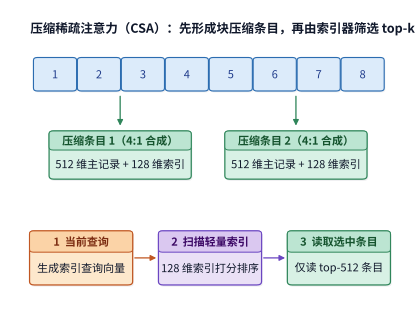

*图 2-13　上下文压缩与索引选择的先后关系。上方只示意八个 token 产生两条记录的数量关系，省略 V4 CSA 的重叠投影与加权汇总，下方展示一次查询先扫描索引再读取主注意力状态的过程。*

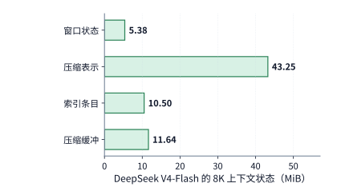

*图 2-14　DeepSeek V4-Flash 在 8K 上下文下的四项状态。窗口、压缩上下文和索引保存已处理的上下文信息；压缩缓冲保存尚在汇总或更新中的数据，单独计入容量。*

值得留意的是，块压缩机制还给解码过程引入了一种“逢整块才触发”的阶梯式更新节奏（见图 2-15）。在逐 token 生成时，前几个新生成的 token 只是先写入当前正在积攒的压缩块缓冲；只有当累积处理的 token 数量凑够了压缩比（例如 CSA 每凑满 4 个 token、HCA 每凑满 128 个 token），压缩器才会将该块定型并产出一份新的长期压缩条目写入全局缓存。因此，在分析某一步具体的 decode 调用时，必须分别核对三件事：主注意力读了多少条目、索引器扫了多少条目、以及当前这一步是否刚好到达压缩块边界并触发了新条目的生成（例如当处理到第 128 个 token 的整数倍位置时，CSA 和 HCA 的压缩块就会在同一拍完成封块）。[^source-14]

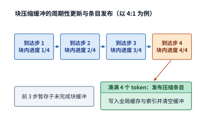

*图 2-15　压缩比为四时的一个压缩块的生成过程。前几次输入更新同一块内缓冲，第四个 token 到来后形成可供后续查询使用的压缩条目。*

> **练习 2-4〔延伸〕：KV 头共享与上下文压缩如何改变存储和访问量**
>
> 首先考察 Qwen3-8B：若保持每层 32 个查询头不变，将 KV 头数从 8 进一步减半为 4，请分别算出 KV 缓存容量、KV 线性投影参数量，以及注意力核心打分与汇总（$QK^{\mathsf T}$ 与 $AV$）运算量的变化比例。接着考察 DeepSeek V4-Flash 的单个 CSA 层：当历史上下文长度从 8192 翻倍至 16384 个 token 时，按 4:1 压缩比、单次主注意力最多挑选 512 个压缩条目的规则，分别算出显存中保存的压缩条目数、每次查询时索引器扫描的条目数，以及主注意力实际读取的压缩条目上限，并解释为什么这三者不会按相同的比例增长。

### 2.3.4 线性注意力与有限状态递推

无论是第 2.3.1 节的 GQA、第 2.3.2 节的 MLA，还是第 2.3.3 节的块压缩，显存里保存的条目数量终归还是会随着上下文长度的增加而不断变多。而**线性注意力**（linear attention）与**有限状态递推**（finite-state recurrence）则彻底换了一套记账哲学：每当迎来一个新 token，模型就直接把它的信息融合进一个尺寸固定的状态矩阵里，当前位置的查询直接从更新后的状态矩阵中读取结果；到了下一步，继续在同一张状态矩阵上就地更新。这就好比本章 2.3 节开头所说的“维护一张固定大小的摘要卡片”。通过改变查询、键、值三者相乘的结合顺序，线性注意力不再显式计算两两位置之间的注意力得分矩阵；只要模型的特征维度确定，这张状态矩阵占用的显存大小就永远恒定，而处理整段长序列的总运算量也严格随序列长度呈线性增长。

要理解这张定长状态矩阵是如何构造出来的，可以先看最基础的**外积**（outer product）累加形式。当把一个长度为 $d_k$ 的键向量 $k_t$（列向量）与一个长度为 $d_v$ 的值向量 $v_t^{\mathsf T}$（行向量）相乘时，两者的每一对元素两两相乘，就会张成一张形状为 $d_k\times d_v$ 的二维关联矩阵。设处理到第 $t$ 个位置时的累积状态矩阵为 $\mathcal S_t$，最朴素的线性递推每一步只需做一件事——把当前位置的键值外积加进旧状态矩阵，再用当前位置的查询向量 $q_t$ 从状态矩阵里读出输出向量 $o_t$：

$$
\mathcal S_t=\mathcal S_{t-1}+k_tv_t^{\mathsf T},\qquad o_t=q_t^{\mathsf T}\mathcal S_t.
$$

因此，无论序列向前推进一百步还是一百万步，只要键宽 $d_k$ 和值宽 $d_v$ 固定，状态矩阵 $\mathcal S_t$ 就始终只包含 $d_kd_v$ 个元素。新到来的 token 改变的只是矩阵内部的数值，而不会撑大矩阵的尺寸。原本随序列增长的逐 token KV 列表，就这样被折叠成了一张固定大小的键值关联表。

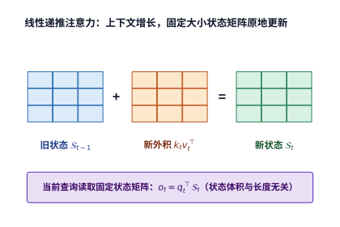

*图 2-16　固定矩阵的递推更新。新键和值的外积加入旧状态，矩阵形状保持不变；查询使用更新后的状态计算输出。本图采用简单累加递推。*

当然，如果只是简单地将所有历史外积直接累加到同一张矩阵中，状态矩阵很快就会饱和并发生信息混叠。因此，现代工业界大模型实际采用的递推注意力都会在此基础上引入精巧的**衰减门控**（decay gate）与**误差修正**（delta rule）。以本章 **Kimi K3** 大量采用的 **Kimi Delta Attention**（简称 **KDA**）为例：它在固定大小的关联矩阵上结合了门控遗忘与 **Delta 更新法则**——所谓 Delta 更新，是指每次写入新信息前，先拿当前的键向量去检验旧状态矩阵能回忆出什么内容，算出旧记忆与当前真实值之间的“预测误差”（delta），再根据这个误差把修正量精准写入状态矩阵，同时用衰减门控按比例淡化过时的旧记忆。通过这种“先回忆校验、再按误差更新”的机制，KDA 得以在固定大小的矩阵空间内高效维护长距离上下文信息，而无需像传统 KV 缓存那样不断追加新条目。

我们来算一算 Kimi K3 中 KDA 层的状态账单：每个 KDA 层设有 96 个注意力头，每个头维护一张形状为 $128\times128$ 的递推状态矩阵。为了保证长序列累加的数值精度，状态矩阵通常采用 4 字节的 **FP32** 格式保存，因此单个 KDA 层的状态大小为 $96\times128\times128\times4\ \mathrm{bytes}=6\ \mathrm{MiB}$，全模型 69 个 KDA 层合在一起固定占用 **$414\ \mathrm{MiB}$** 显存。在单步 decode 时，每个 KDA 层都需要先把旧的 $6\ \mathrm{MiB}$ 状态矩阵从显存读入片上，融合当前新 token 的贡献后再把更新后的矩阵写回显存——在一读一写的理想条件下，全模型 69 层每步 decode 的状态读写总流量恒为 $414\times2=828\ \mathrm{MiB}$。请注意这 $828\ \mathrm{MiB}$ 的两面性：它完全不随上下文长度变化。当上下文只有寥寥几百个 token 时，每步固定读写 $828\ \mathrm{MiB}$ 是一笔相当可观的开销；但当上下文拉长到几万乃至上百万 token 时，这份绝不膨胀的固定开销就成了显著优势。

此外，递推注意力在 **prefill** 和 **decode** 两个阶段的算子执行方式也大不相同：在单步 decode 时，每次只推进 1 个 token，自然直接按公式执行单步状态更新；但在 prefill 阶段面对成千上万个已知输入 token 时，如果还一个接一个地串行递推，就完全用不上 GPU 强大的矩阵并行算力了。因此，现代框架在 prefill 时普遍采用**分块并行算法**（chunkwise parallel algorithm）——先把长序列切成长度为 $C$（如 64 或 128）的小块，块内利用矩阵乘法并行算出局部贡献，块与块之间再传递状态矩阵。由于分块并行期间需要在显存中暂存块内中间张量与块间传递的状态快照，prefill 阶段的瞬时显存峰值往往明显高于最终保留下来的那 $414\ \mathrm{MiB}$ 稳态递推矩阵。第 5 章将顺着缓冲区的申请与释放过程，精确算出这一峰值开销。[^source-15]

### 2.3.5 混合注意力的状态构成

既然“固定大小的递推状态”擅长以恒定成本压缩超长历史，而“逐 token 留档的全局注意力”擅长精准检索，现代大模型一个非常自然的架构演进方向，就是把这两类层按一定比例**混合堆叠**在同一个模型主干里——即**混合注意力**（hybrid attention）架构。这样一来，整个模型的上下文状态就由两部分拼接而成：一部分是来自递推层的**固定大小状态**，另一部分则是来自全局注意力层的**随上下文长度线性增长的状态**。

不妨看看本章的两个混合注意力代表模型是如何配比的：
- **Kimi K3** 全模型共 93 层，包含 **69 个 KDA 递推层**与 **24 个 MLA 全局注意力层**（大致按 $3:1$ 交替排列）。在 8192 个上下文 token 下，若对 24 层 MLA 采用 BF16 紧凑缓存路径（占 $216\ \mathrm{MiB}$），对 69 层 KDA 采用 FP32 递推状态矩阵（占 $414\ \mathrm{MiB}$），外加 KDA 层内用于混合相邻几个 token 特征的 BF16 **短卷积槽位**（short convolution slots，保存最近几个位置的输入供下一步滑动卷积使用，共占约 $19.4\ \mathrm{MiB}$），三项加起来单条请求的状态总容量约为 **$649.4\ \mathrm{MiB}$**。（作为对比，如果把其中 24 层 MLA 换成朴素的展开式缓存，光 MLA 一项就会膨胀到 $11.25\ \mathrm{GiB}$，掩盖混合架构的优势。）[^source-16]
- **Qwen3.6-35B-A3B** 全模型共 40 层，包含 **30 个线性注意力（递推）层**与 **10 个完整 GQA 注意力层**（同样按 $3:1$ 比例混合，见图 2-17）。其中 10 个完整注意力层在 BF16 下每个上下文 token 仅占 $20\ \mathrm{KiB}$ 的全局 KV 缓存；而 30 个线性注意力层则维护着固定占 $60\ \mathrm{MiB}$ 的 FP32 递推状态矩阵，外加 $1.875\ \mathrm{MiB}$ 的 BF16 短卷积槽位。在 8192 个上下文 token 下，随长度增长的 KV 缓存（$160\ \mathrm{MiB}$）与固定状态（$61.875\ \mathrm{MiB}$）合在一起共占约 **$221.9\ \mathrm{MiB}$**。在每一层的注意力子层之后，Qwen3.6 紧接着接入混合专家（MoE）前馈子层——由路由器从多个**路由专家**（routed experts）中为每个 token 动态挑选几个子网络执行，同时搭配一个所有 token 必经的**共享专家**（shared expert）。混合注意力与混合专家就这样在同一个模型主干里各司其职：前者压缩上下文状态，后者稀疏化权重激活。

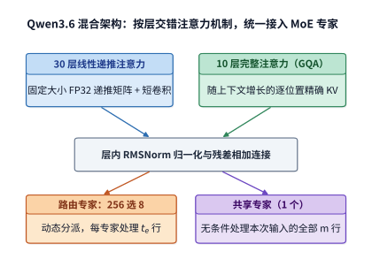

*图 2-17　Qwen3.6 的两类层。配置决定每层采用线性或完整注意力，随后都执行路由专家和共享专家；上方两个分支分别表示线性注意力和完整注意力，模型分别有 30 层与 10 层。*

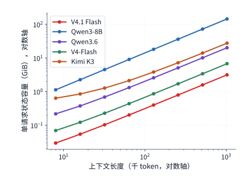

*图 2-18　上下文增长时的状态容量。横纵轴均为对数刻度；五个模型分别通过逐 token 追加、递推、压缩和跨层共享组织状态。纵轴为单请求的状态容量，横轴按上下文 token 数计量。*

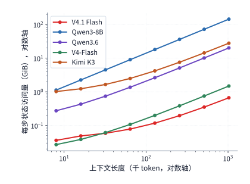

*图 2-19　同一组模型每步单次 decode 的状态访问量。逐 token 上下文状态计一次读取，递推状态矩阵计一读一写；图中展示的是按指定缓存路径计算的理论状态访问量（不含模型权重读取），用于直观对比状态容量与每步访问量的不同增长规律。*

将本章五个代表模型的状态容量曲线（图 2-18）和单步状态读写曲线（图 2-19）结合起来在对数坐标下对比，不同架构的资源扩展特性便一目了然：
- **Qwen3-8B**（纯 GQA）从第一个 token 起就完整保留逐 token 的精细上下文，容量与访问量在整个区间内都是一条斜率为 1 的直线；
- **Kimi K3** 和 **Qwen3.6**（混合注意力）在短上下文区间几乎是一条水平线，因为容量和读写都由固定递推矩阵主导；直到上下文突破某个临界长度后，随长度增长的 MLA 或全注意力 KV 才开始抬头主导曲线；
- **DeepSeek V4-Flash**（块压缩 + 稀疏索引）和 **DeepSeek V4.1 Flash**（跨层 KV 共享 + 块压缩）则通过压缩与共享把整条曲线大幅向下平移，且每逢压缩块完成时呈现微小的阶梯式跃升。

我们可以用一个极简的线性加常数模型来刻画混合注意力的状态容量：

$$
M_{\mathrm{state}}(H)=M_{\mathrm{fixed}}+c_{\mathrm{state}}H,\qquad H_* = \frac{M_{\mathrm{fixed}}}{c_{\mathrm{state}}}.
$$

其中 $M_{\mathrm{fixed}}$ 是递推矩阵与短卷积槽位构成的固定状态大小，$c_{\mathrm{state}}$ 是全局注意力层每增加 1 个上下文 token 带来的状态增量，而两者的比值 $H_*$ 就是“随长度增长的 KV 缓存恰好追平固定状态”的**临界上下文长度**。直接代入数字：在 **Qwen3.6** 中，固定状态为 $61.875\ \mathrm{MiB}$，每 token 增量为 $20\ \mathrm{KiB}$，因此临界长度恰好在 **$H_*=3168$** 个 token；而在 **Kimi K3**（紧凑 MLA）中，固定状态高达约 $433.4\ \mathrm{MiB}$，每 token 增量为 $27\ \mathrm{KiB}$，临界长度推迟到了约 **$16.4\mathrm{K}$** 个 token。看清这个交点 $H_*$ 对工程调优极有指导意义：当业务请求的实际长度远低于 $H_*$ 时，显存大头被固定状态占据，此时哪怕把上下文长度减半，省下来的显存也微乎其微；反之，当请求长度远远超过 $H_*$（例如进入十万、百万 token 区间）时，削减每 token 的增量 $c_{\mathrm{state}}$ 才是决定系统能跑多长上下文的关键。[^source-17]

> **练习 2-5〔核心〕：上下文多长时，KV 容量会超过固定状态？**
>
> 对于 Qwen3.6，取固定状态 $61.875\ \mathrm{MiB}$、每个上下文 token 增量 $20\ \mathrm{KiB}$；对于 Kimi K3（紧凑 MLA 路径），取递推状态 $414\ \mathrm{MiB}$、短卷积状态 $20{,}348{,}928\ \mathrm{bytes}$，每个上下文 token 增量 $27\ \mathrm{KiB}$。请分别求出两个模型中“随长度增长的 KV 状态与固定状态容量相等”时的临界上下文长度 $H_*$，并算出在 $32\mathrm{K}$ 和 $128\mathrm{K}$ 上下文长度下各自的状态总容量。如果系统只能为单条请求分配 $256\ \mathrm{MiB}$ 的状态显存预算，这两个模型各自最多能支持多少个上下文 token？请据此说明：当分配给请求的状态显存预算小于模型的固定状态大小 $M_{\mathrm{fixed}}$ 时，为什么无论如何缩短输入上下文都无法运行该请求？

### 2.3.6 每个 token 存多少，每次 decode 读多少

综合前面的分析可以看出，要全面衡量一个模型的上下文状态成本，绝不能只看某一个孤立的数字，而必须同时摆出三本账：**全局历史每增加 1 个 token 带来的平均存储增量（$\mathrm{B/token}$）**、**在给定长度 $N$ 下显存实际驻留的状态大小**，以及**单步 decode 查询时实际需要读写的历史状态流量**。原因很简单：全局 KV 随长度持续增长，局部滑动窗口填满后容量封顶，而递推矩阵虽然大小恒定却要在每步一读一写；如果笼统地把总状态除以上下文长度，就会把这三种截然不同的增长规律混为一谈。

下表将九个代表性开源与工业界模型放在同一把标尺下对比：设单条请求当前可见的上下文总长度为 $N=8192$ 个 token（即前文式中的可见上下文长度 $H=8192$，含当前查询位置自身）。表中按各模型注明的数据精度与缓存路径，分别列出了全局历史的每 token 平均增量、8K 长度下的全局历史驻留容量，以及单步 decode 时注意力模块读取 KV（含局部 SWA 窗口）与扫描索引的理论读取量（假设每份选中的 KV 或共享潜变量从显存读入一次后，即可在片上供同层各查询头的 $QK^{\mathsf T}$ 打分与 $AV$ 汇总复用）。至于混合注意力中的递推矩阵读写与压缩器状态更新，我们在表后单独说明。

| 模型与缓存路径 | 全局历史平均增长（B/token） | 8K 全局历史容量（MiB） | 单步 decode 注意力 KV＋索引读取（MiB） |
| --- | ---: | ---: | ---: |
| Qwen3-8B，BF16 GQA | 147,456 | 1,152 | 1,152 |
| Qwen3-32B，BF16 GQA | 262,144 | 2,048 | 2,048 |
| Qwen3-30B-A3B，BF16 GQA | 98,304 | 768 | 768 |
| Qwen3-235B-A22B，BF16 GQA | 192,512 | 1,504 | 1,504 |
| Qwen3.5-397B-A17B，BF16 全注意力部分 | 30,720 | 240 | 240 |
| Qwen3.6，BF16 全注意力部分 | 20,480 | 160 | 160 |
| Kimi K3，BF16 紧凑 MLA 路径 | 27,648 | 216 | 216 |
| DeepSeek V4-Flash，生产混合格式 | 3,514.25 | 27.455 | 12.556 |
| DeepSeek V4.1 Flash，生产混合格式 | 890 | 6.953 | 11.375 |

读这张表时，有三处关键细节值得细细品味：
第一，**Kimi K3** 的行直观展示了缓存切面对容量的决定性影响：采用表中所列的紧凑 MLA 路径时，每个上下文 token 在 24 个 MLA 层中总共只增加 $27{,}648\ \mathrm{B}$（$27\ \mathrm{KiB}$）；而如果采用 Hugging Face 社区参考实现中的展开式缓存路径，每个 token 的增量就会激增至 $1{,}474{,}560\ \mathrm{B}$（约 $1.41\ \mathrm{MiB}$），相差超过 53 倍（精确字节对比见[跨模型缓存核算表](../calculations/results/kv-comparison-n8192-b1.md)）。
第二，表中最后两行（**DeepSeek V4-Flash** 与 **V4.1 Flash**）采用的是线上生产环境的低位宽混合格式：例如 V4-Flash 的主记录采用 FP8 与 BF16 混合存储（每条占 $584\ \mathrm{B}$），索引记录采用 **MXFP4** 格式（每 32 个 4 比特数值共享一个缩放因子，每条占 $68\ \mathrm{B}$）。注意区分这里的口径：前文第 2.3.3 节为了与其它 BF16 模型公平对比结构，按全 BF16 参考格式算出 V4-Flash 的 8K 全局历史为 $53.75\ \mathrm{MiB}$（外加 $5.375\ \mathrm{MiB}$ 窗口）、单步读取为 $27.625\ \mathrm{MiB}$；而本表按线上生产混合格式算出的 8K 全局历史驻留量为 $27.455\ \mathrm{MiB}$，单步读取量则进一步降至 $12.556\ \mathrm{MiB}$（两个约 $27\ \mathrm{MiB}$ 的数字代表不同精度下的不同指标，切勿混淆）。
第三，对于 **Qwen3.5**、**Qwen3.6** 和 **Kimi K3** 这三个混合注意力模型，除了表中的全局注意力 KV 外，显存中还常驻着固定大小的 FP32 递推矩阵与 BF16 短卷积槽位——三者的固定状态分别占 $184.219\ \mathrm{MiB}$、$61.875\ \mathrm{MiB}$ 和 $433.406\ \mathrm{MiB}$，且每步 decode 都要对各自的递推矩阵执行一读一写。

把目光锁定在表格最末一行：**DeepSeek V4.1 Flash** 的全局历史平均增量压到了 **$890\ \mathrm{B/token}$**——不到 Qwen3-8B 的百分之一，也比前代 V4-Flash 再缩减了近四分之三。它是如何做到这一点的？答案在于两项跨层协同设计：**CED（因果编码器—解码器）非对称主干**与**跨层全局 KV 共享**。

长期以来，通用自回归大模型几乎清一色采用 **decoder-only** 架构：无论是处理成千上万字的输入提示词，还是逐字生成回答，所有 token 都必须完整走完相同的每一层网络，且每一层都要各自生成并保存自己那一份 KV 缓存。DeepSeek V4.1 Flash 则从根源上打破了这一成规：它借鉴了 YoCo 等跨层复用 KV 的思想，将“构建全局上下文表示”与“读取全局表示生成回答”解耦开来，从而在面对长输入提示词时省去了近一半的主干计算与绝大部分重复缓存。[^v41-case]

具体来说，V4.1 Flash 的技术报告之所以将这套架构命名为 **CED**（Causal Encoder-Decoder）并概括为“编码器负责理解、解码器负责生成”，是因为它将 40 层文本主干一分为二：前 20 层作为**因果编码器**（Causal Encoder），后 20 层作为**解码器**（Decoder）。需要特别澄清的是，这里的因果编码器并不是传统机器翻译模型（如原版 Transformer 或 BERT）中那种可以双向看到全文的编码器——它依然严格遵守因果掩码约束（每个位置只能看自己和前面的位置），与后 20 层解码器同属一个统一的自回归模型。两者的“非对称”体现在**长输入 prefill 阶段各层处理的位置范围不同**（见图 2-20）：
- 当一段长长的输入提示词进入模型时，全部输入 token 首先完整穿过前 20 层**编码器**；解码器各层所需的**全局 KV 缓存**，直接由编码器特定层的输出经过线性投影生成，因此**绝大部分输入提示词根本不需要再去跑后 20 层解码器的主体计算**。
- 不过，由于后 20 层解码器各自还带有一个长度为 128 的局部滑动窗口（SWA），而局部窗口状态必须由解码器每一层自己的隐藏特征生成，因此系统只需把输入提示词**最末尾的最多 128 个 token** 的编码器输出送入后 20 层解码器走一遍，用来把解码器各层的局部窗口填满——这一步称为**末尾窗口重放**（tail-window replay）。
- 一旦进入逐个生成新 token 的 **decode 阶段**，每一步新生成的 1 个 token 则依然依次穿过前 20 层编码器与后 20 层解码器的全部 40 层。至于这套非对称执行路径在多轮 Agent 会话中能省下多少算力、以及系统如何分别管理编码器与解码器的状态恢复，我们将在第 3 章和第 8 章深入算账。

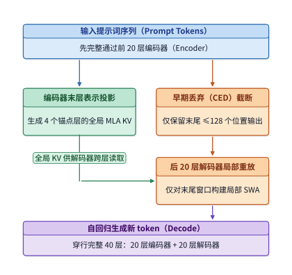

*图 2-20　CED 把全局 KV 的生成与解码器局部状态的构建分开。大部分提示 token 只执行编码器主体及全局 KV 投影；末尾窗口的编码器输出还经过解码器，近似构建局部 SWA。生成的新 token 仍通过全部 40 层。*

除了省掉输入阶段的解码器主干计算，V4.1 Flash 在状态压缩上的另一项核心机制是**跨层共享全局 KV 缓存**。在 V4.1 的技术报告中，设计团队直接把 GPU HBM 容量、主机内存与 SSD 容量以及跨级 KV 迁移带宽列为了核心硬件约束。非常有趣的是，与前代 V4-Flash（采用 4:1 的 CSA 与 128:1 的 HCA）相比，V4.1 Flash **非但没有进一步拉大序列方向的压缩比，反而把压缩粒度改得更细腻了**：它彻底取消了粗粒度的 128:1 HCA，将编码器中的全局缓存改为 **2:1 压缩**，而将供解码器使用的全局缓存改为 **1:1 逐 token 原样保留**。既然序列压缩比变小了，总缓存体积为什么反而大幅缩水？靠的就是**多达数十层共享少数几份全局 KV**，外加更紧凑的 **FP4 低位宽量化**（见图 2-21）。[^v41-case]

当然，跨层共享全局 KV 并不意味着各个复用层在干一模一样的重复劳动：虽然复用层不再自己生成全局 $K$ 和 $V$，但每一层依然保有自己独立的查询投影矩阵 $Q$ 和独立的局部滑动窗口（SWA），因此依然能针对同一份共享的全局缓存打出各不相同的注意力权重、提取出当前层所需的特征组合。

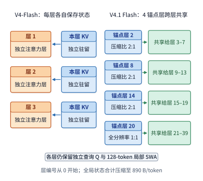

*图 2-21　V4 与 V4.1 的全局 KV 保存方式。左侧以三个代表层示意逐层保存；右侧显示 V4.1 四个独立保存全局 KV 的层及共享关系。实线表示数据读取；各使用层仍有自己的 Q 与局部 SWA，图中省略其他计算。*

下面动手把 V4.1 Flash 那 **$890\ \mathrm{B/token}$** 的数字分毫不差地推导出来：
在 V4.1 Flash 的 40 层主干（层号按 $0\sim39$ 计）中，有 2 层只做纯局部 SWA，其余 38 层包含全局注意力；而在这 38 层里，**只有 4 层真正生成并保存独立的全局 KV 缓存**。具体而言，编码器中的第 2、8、14 层各自按 **2:1**（每 2 个 token 合成 1 条记录）生成全局缓存，供编码器后续各层共享；而在编码器最末端的第 20 层边界处，则按 **1:1**（每 1 个 token 生成 1 条记录）生成第四份全局缓存，供后半段全部 20 层解码器共同读取。
再看每条记录的字节数：在生产格式下，每条主记录包含 512 个 **FP4**（每个数占 4 比特，即 0.5 字节）数值，每 16 个数值共享 1 个字节的缩放因子（scale），因此一条主记录占 $512\times0.5 + 512/16 = 256 + 32 = 288\ \mathrm{bytes}$；配套的一条 128 维索引记录同样采用 4 比特数值、每 32 个数值共享 1 字节缩放因子，占 $128\times0.5 + 128/32 = 64 + 4 = 68\ \mathrm{bytes}$。主记录加索引记录合计为 $288+68=356\ \mathrm{bytes}$。
把 3 个 2:1 压缩层和 1 个 1:1 保留层加起来，平均每处理 1 个上下文 token 需要生成的记录条数为 $3\times(1/2) + 1 = 2.5$ 条。因此，全模型全局 KV 缓存的平均存储增量为：

$$
\left(\frac{3}{2}+1\right)(288+68)=2.5\times356=890\ \mathrm{B/token}.
$$

作为对照，前代 **DeepSeek V4-Flash** 有 21 个 4:1 的 CSA 层和 20 个 128:1 的 HCA 层（逐层各自保存，不跨层共享）。按官方开源算子库 FlashMLA 的生产格式，每条主记录占 $584\ \mathrm{B}$、CSA 索引记录占 $68\ \mathrm{B}$，其全模型全局 KV 的平均增量为：

$$
21\times\frac{584+68}{4}+20\times\frac{584}{128}=3423+91.25=3514.25\ \mathrm{B/token}.
$$

两者一比（$3514.25 / 890 \approx 3.95$ 倍），正好对应技术报告图表中标出的 $3{,}514\ \mathrm{B/token}$ 与 $890\ \mathrm{B/token}$。除了随长度增长的全局缓存，V4.1 Flash 的全部 40 层还各自维护一个最多保存 128 个近期 token 的局部 SWA 窗口，每条窗口记录采用 FP8 数值加缩放因子共占 $528\ \mathrm{B}$，38 个含全局注意力的层填满局部窗口后固定占用 $38\times71{,}168\ \mathrm{B}=2{,}704{,}384\ \mathrm{B}=2.578125\ \mathrm{MiB}$（若将 2 个纯局部窗口层一并按相同规格计入，40 层窗口亦为约 $2.578\ \mathrm{MiB}$）。

把这套单 token 增量公式代回 **$32\mathrm{K}$（$32{,}768$ 个 token）上下文**，就能算清两代模型在真实长上下文下的精确字节账本：
- 在前代 **DeepSeek V4-Flash** 中，全模型 39 个保存全局历史的层合计占用 $(1440+18)\times1928\ \mathrm{B}$ 量级的分块缓存，精确全局历史容量为 **$109.820\ \mathrm{MiB}$**，外加局部滑动窗口 **$2.64\ \mathrm{MiB}$**，单请求 $32\mathrm{K}$ 状态总计 **$112.46\ \mathrm{MiB}$**。
- 在 **DeepSeek V4.1 Flash** 中，全模型仅由 **4 个锚点层（Owner 层）**保存全局状态：其中编码器内的第 2、8、14 层采用 **2:1 压缩**（在 $32\mathrm{K}$ 上下文下各存 $16{,}384$ 条记录），3 层合计占用 $3\times(2880+36)\times1996\ \mathrm{B}=17{,}498{,}112\ \mathrm{B}=$ **$16.6875\ \mathrm{MiB}$**；解码器入口的第 20 层采用 **1:1 全分辨率保留**（存满 $32{,}768$ 条记录），单层占用 $(5760+72)\times1996\ \mathrm{B}=11{,}665{,}408\ \mathrm{B}=$ **$11.125\ \mathrm{MiB}$**。两项相加，V4.1 Flash 的 $32\mathrm{K}$ 全局 KV 状态仅为 $16.6875+11.125=$ **$27.8125\ \mathrm{MiB}$**（较 V4-Flash 的 $109.820\ \mathrm{MiB}$ 缩减了 **$3.95$ 倍**）；再加上 $2.578125\ \mathrm{MiB}$ 的局部 SWA 窗口，单请求 $32\mathrm{K}$ 总状态容量精确为 **$30.390625\ \mathrm{MiB}$**（整体缩减 **$3.70$ 倍**）。

如果顺着解码生成的过程一步步观察，还能看到 V4.1 Flash 全局缓存独特的“奇偶拍”增长节奏：当上下文长度从偶数步迈向下一个奇数步时，只有第 20 层的 1:1 缓存新增了 1 条记录，显存仅增加 $356\ \mathrm{B}$；而当从奇数步迈向下一个偶数步时，第 2、8、14 层的三个 2:1 压缩器同时凑满一对 token 各吐出 1 条记录，加上第 20 层照常新增的 1 条，这一步一共新增 $4\times356=1{,}424\ \mathrm{B}$（两步平均下来正好是 $(356+1424)/2=890\ \mathrm{B/token}$）。至于已经填满的局部 SWA 窗口，后续每走一步都会用新 token 覆盖掉最老的槽位——总容量虽然不再增加，但每一步依然会产生固定规模的窗口写入流量。

这里跨层共享虽然把显存里的全局 KV 副本数从几十份压到了 4 份，但在单步 decode 执行时，共享同一份缓存的后续各层依然要从存储体系读取选中的条目，部分层还要重新运行索引打分。因此在 8K 上下文下，V4-Flash 与 V4.1 Flash 单步 decode 的注意力 KV（含局部窗口）与索引理论读取量其实非常接近，分别为 $12.556\ \mathrm{MiB}$ 和 $11.375\ \mathrm{MiB}$——跨层共享最直接的贡献，是把驻留显存的空间缩减了近四分之三（当然，在实际硬件上，当相邻层连续读取同一份小体积缓存时，还能显著提高片上缓存的命中率）。

更进一步，V4.1 Flash 的 **CSA2** 还将“生成缓存”、“全量检索”与“跨层复用”精细拆解为三种层模式（见图 2-22）：
1. **Full（完整）层**：全套执行“生成本层独立的全局 KV 与索引键 → 扫描全局索引打分并选出 top-$k$ → 读取选中条目做主注意力计算”（全模型共 **4 层**，即第 2、8、14、20 层）。
2. **Reindex（重索引）层**：不生成新的全局 KV，而是直接共享前面 Full 层生成的全局缓存；但它拥有自己独立的索引查询投影，会重新计算索引得分并挑选属于自己的 top-$k$ 条目（全模型共 **4 层**，均位于解码器中，即第 24、28、32、36 层）。
3. **Reuse（全复用）层**：既不生成全局 KV，也不运行索引器，而是连同前面最近一个 Full 或 Reindex 层挑出来的 top-$k$ 条目编号都原封不动地借过来，直接拿自己的查询向量 $Q$ 去读那批现成的缓存条目算注意力（全模型共 **30 层**）。

不仅如此，为了防止解码器中的 4 个 Reindex 层在超长上下文下每次都去把几十万条全局索引从头扫一遍，V4.1 Flash 还引入了**分层稀疏索引**（Hierarchical Sparse Indexer）：当进入解码器的首个 Full 层（第 20 层）扫描完全局索引后，除了挑出供自己及紧随其后的 Reuse 层使用的 512 个条目外，还会额外按块挑出最多 $2048\times8=16{,}384$ 个高分条目，组成一个供后续层共用的**候选池**（candidate pool）。此后的第 24、28、32、36 这四个 Reindex 层在重新检索时，**只需在这最多 16,384 个候选池条目内部重算分数并各自挑出 512 条即可**，而无需再扫描全量历史索引。[^v41-candidate]

举个具体的数字例子就能立刻看懂这套两级筛选：假设上下文已经长到了 131,072 个全局缓存条目，系统按每连续 8 条分为一块，共切成 16,384 块。解码器入口的第 20 层（Full 层）先对全部 131,072 条索引打分，一方面直接取全局最高分的前 512 条供本层主注意力使用；另一方面以每个 8 条小块内部的最高分代表该块的得分，挑出得分最高的 2,048 个块（合计 $2048\times8=16{,}384$ 个条目）放进候选池。到了后面的第 24、28、32、36 层（Reindex 层），它们各自的索引器只需对候选池里的这 16,384 个条目重新打分，从中各自挑出最契合当前层语义的 512 个条目。这样一来，无论外部历史上下文拉长到一百万还是几百万 token，这 4 个 Reindex 层的索引扫描量都被严格封顶在 16,384 条以内。

当然，候选池给后续层套上搜索上限的同时，也意味着第 20 层的首轮初筛成了关键的把关环节——如果某个历史条目在第 20 层初筛时没能进入那 16,384 个候选池，那么在本次生成步中，后面的所有解码器层就再也没有机会访问它了。为了让模型适应这一规则，必须在训练阶段就让各层协同配合，第 10 章将介绍 V4.1 如何通过后训练（post-training）让首层学会把后续层可能用到的信息一并留进候选池。

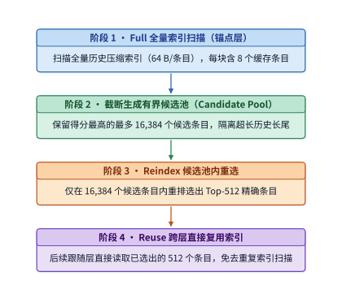

*图 2-22　V4.1 解码器的分层缓存条目选择。首个 Full 层先扫描全局，选出最多 16,384 个候选条目；后续 Reindex 在候选内重新选 512 个，Reuse 使用已有选择。示意条目数量不按比例；各层独立 Q 与局部 SWA 未画出。*

在结束第 2.3 节之前，不妨跳出传统的逐词自回归框架，追问一个更本质的数学问题：**为什么从 MHA、GQA、MLA 到 CSA2，所有这些自回归大模型都能把已算出的历史 $K$ 和 $V$ 缓存起来直接复用，而无需在下一步推翻重算？** 答案完全系于第 2.1.3 节介绍的**因果下三角掩码**（Causal Mask）：因为位置 $i$ 的注意力被严格禁止看向任何 $j>i$ 的未来位置，所以当序列末尾追加第 $i+1$ 个 token 时，前 $i$ 个位置在每一层的输入激活与键值向量 $K_{1:i},V_{1:i}$ 具有严格的**前缀不变性**（Prefix Invariance）。

一旦放弃单向因果掩码、改用非自回归的**扩散语言模型**（Diffusion Language Models，简称 **dLLM**，代表工作包括 LLaDA、Dream 与商业化部署的 Mercury），这根支撑 KV 缓存复用的数学支柱就会发生根本改变。dLLM 将离散文本生成建模为掩码扩散的迭代去噪过程：给定长度为 $S$ 的提示词，系统一次性在末尾铺开长度为 $L_{\mathrm{gen}}$ 的全掩码画布（全部初始化为 `[MASK]` 词元），随后在 $T_{\mathrm{denoise}}$ 个离散去噪步中，每一步用**双向全注意力掩码**（Bidirectional Attention，允许所有位置两两互看）同时预测画布上所有掩码位置的词元分布，并按置信度揭开（unmask）其中一部分词元。从系统资源账本看，把单向自回归切换为双向去噪带来了鲜明的正反两面：
- **算术强度跃升（由访存受限转向计算受限）**：在自回归单步 decode 中，单请求每次仅向模型送入 $m=1$ 行新 token，线性投影退化为算术强度极低的向量—矩阵乘法，GPU 算力因等待读取权重而大量闲置；而在 dLLM 的每一个去噪步中，模型同时并行更新画布上的 $L_{\mathrm{gen}}$ 个位置（即输入行数 $m=L_{\mathrm{gen}}$，通常达数十至数百行），单次读取一遍模型权重即可服务整块画布的矩阵—矩阵乘法（GEMM），硬件张量核心的利用率成倍提高。
- **严格 KV 缓存不变性的破裂与分块半自回归折中**：由于双向注意力允许任意两个位置相互影响，当第 $t$ 步将画布中的若干 `[MASK]` 揭开为具体词元后，到了第 $t-1$ 步，不仅新揭开位置的表示变了，**所有能够看到它们的提示词与画布位置的深层隐藏状态、乃至对应的 $K$ 和 $V$ 向量都会发生连锁改变**。如果朴素地在每一步都对 $S+L_{\mathrm{gen}}$ 个位置重算全量双向注意力，总注意力复杂度将膨胀至 $O\bigl(T_{\mathrm{denoise}}(S+L_{\mathrm{gen}})^2\bigr)$，长提示词前缀根本无法像自回归模型那样在 prefill 后一次性冻结复用。为了兼顾并行去噪的高算术强度与长上下文的 KV 复用，近期工业界与学术界（如 Block Diffusion 与 Fast-dLLM）普遍转向**分块半自回归扩散**（Semi-Autoregressive Block Diffusion）：将生成序列切分为宽度为 $B_{\mathrm{blk}}$（如 32 或 64 个 token）的连续块，**在块与块之间施加因果掩码**，使得提示词前缀与已定稿的历史块重新获得严格的 KV 缓存不变性；同时**在当前正在生成的块内部保留双向注意力**，并在相邻去噪步之间近似复用已揭开稳定词元的激活特征，从而在“每步并行生成的词元吞吐”与“历史状态重算开销”之间取得平衡。

## 2.4 条件计算与专家权重复用

第 2.3 节通过头共享、潜变量压缩、稀疏索引与有限状态递推，把上下文状态的体积压了下来。但显存里的另一大开销是**模型权重**：每处理 1 个 token，是否非要把模型里百亿、千亿个参数全都激活算一遍不可？本节我们就从占了模型参数大头的前馈网络（FFN）出发，剖析**条件计算**（conditional computation）与**混合专家**（Mixture of Experts，简称 **MoE**）架构。

在传统的稠密（dense）模型中，每一个输入 token 都必须穿过完全相同的 FFN 权重矩阵；而 MoE 架构则把原本一整块庞大的 FFN 拆分成几十甚至几百个并列的子网络——每个子网络称为一个**专家**（expert），再由一个轻量级的**路由器**（router）根据每个 token 的当前特征动态挑出其中少数几个专家来执行。这样一来，“整个模型在显存中保存多少参数”与“处理单个 token 实际激活多少参数”就彻底解耦了；而在批处理（batching）时，同一个 batch 内的不同 token 究竟挑中了哪些专家，又会直接决定这一步到底要从显存读取多少份专家权重。

### 2.4.1 稠密前馈网络与专家路由

在一个标准的 MoE 前馈子层中，每个 token 的输入向量首先乘上一个很小的路由器权重矩阵，算出该 token 对层内所有候选专家的匹配得分；随后按 **top-$k$** 规则挑出得分最高的 $k_{\mathrm{top}}$ 个专家，把该 token 的特征向量分发给这 $k_{\mathrm{top}}$ 个选中的**路由专家**（routed experts）各自执行前馈变换，最后将各选中专家的输出按路由得分加权求和。在现代 MoE 模型中，除了按需选用的路由专家外，通常还会并列设置一两个无需路由、所有 token 都固定必经的**共享专家**（shared experts），用来提取并承载所有词元共用的基础常识特征。无论路由专家还是共享专家，每个专家内部依然是由 `gate`、`up`、`down` 三个矩阵组成的标准 SwiGLU 结构，因此完全可以直接套用第 2.1.4 节的矩阵公式逐个核算。

以 **Qwen3.6-35B-A3B** 为例算一笔账：它的文本主干共有 40 层，隐藏维度为 $d=2048$；每个 MoE 层设有 $E=256$ 个路由专家，每个 token 每次从中挑选 $k_{\mathrm{top}}=8$ 个路由专家，每个专家的中间升维宽度为 $f=512$（外加 1 个同样宽度的共享专家）。因此，单个路由专家包含的参数量为 $N_e=3\times2048\times512=3{,}145{,}728$ 个，在 BF16 精度下刚好占 **$6\ \mathrm{MiB}$**。把一层内的全部 256 个路由专家加起来，单层路由专家权重占 $256\times6\ \mathrm{MiB}=1.5\ \mathrm{GiB}$；而单个 token 在一层中挑中的那 8 个路由专家，权重合在一起只占 $8\times6\ \mathrm{MiB}=48\ \mathrm{MiB}$。

再看矩阵乘法的形状与运算量：假设在某一次调用中，第 $e$ 号路由专家一共被分派到了 $t_e$ 个 token（即它的输入矩阵有 $t_e$ 行），那么该专家内部的 `gate` 和 `up` 投影都是 $[t_e,2048]\times[2048,512]$，`down` 投影则是 $[t_e,512]\times[512,2048]$，完成这三次矩阵乘法所需的浮点运算量为 $6t_e\times2048\times512\ \mathrm{FLOPs}$。把层内所有被选中的路由专家的运算量加起来，就是该层路由专家的总运算量；与此同时，旁边的共享专家则无条件地对本次输入的全部 $m$ 行 token 执行一次完整的 $[m,2048]\to[m,512]\to[m,2048]$ 变换。

用通用符号写出来：设每层共有 $E$ 个路由专家，每个专家包含 $N_e$ 个参数，每个 token 固定挑选 $k_{\mathrm{top}}$ 个路由专家。那么，单层需要在显存中静态保存的路由专家参数总数为 $EN_e$，而单个 token 在这一层实际触发的路由专家矩阵运算量仅为 $2k_{\mathrm{top}}N_e$。看清这两个式子的区别十分关键：**单纯把每层的候选专家总数 $E$ 翻倍，只会让模型的静态显存占用翻倍，却不会增加单个 token 的计算量。** 只有增加每次选中的专家个数 $k_{\mathrm{top}}$ 或单个专家的尺寸 $N_e$，才会增加单 token 的运算开销。这正是 Qwen3.6-35B-A3B 命名中 `35B` 与 `A3B` 的来历：它的文本部分总参数量高达约 346.6 亿（BF16 权重占约 $69.321\ \mathrm{GB}$），但处理单个 token 时实际激活的参数量只有约 30 亿。

### 2.4.2 实际运算量与批内权重读取量

上一小节的 $2k_{\mathrm{top}}N_e$ 只算了**单个 token** 的专家运算量；一旦进入多请求批处理（$B>1$），一个棘手的工程问题就浮出水面了：虽然每个 token 都挑了 8 个专家，但这批 token 挑中的专家究竟是分散地落在了全层各处，还是集中在了少数几个热门专家上？

**例题 2-4：为什么在专家矩阵运算量完全相同的情况下，批内读取的专家权重流量会相差整整 32 倍？** 考察 Qwen3.6 的单个 MoE 层，设 batch size 为 $B=64$ 条单步 decode 请求（即本次共输入 $m=64$ 个 token），对比“均匀分派”与“集中分派”两种极端路由结果。

**解**：在单步 decode 中，64 个输入 token 各自独立挑选 8 个专家，全层一共发生 $64\times8=512$ 次“token→专家”的分派。
- **情形一（均匀分派）**：假设这 512 次分派刚好不偏不倚地均匀落在了全部 256 个路由专家头上，那么每个专家平均分到 $512/256=2$ 个 token。此时，为了算完这一步，GPU 必须把全部 **256 个路由专家**的权重（共 **$1.5\ \mathrm{GiB}$**）从显存完整读取一遍。
- **情形二（集中分派）**：假设这 64 个 token 的路由结果完全一致，全部命中了同一组 8 个路由专家，其余 248 个专家未被选中。那么被选中的这 8 个专家每个都会收到 64 个 token，而整批计算只需要从显存读取这 **8 个专家**的权重（仅 **$48\ \mathrm{MiB}$**）。

我们把当前 batch 在单层内实际命中的**不同专家个数**（即去重后的并集大小）记为 $U$。只要路由过程中不主动丢弃（drop）任何分派给专家的 token，所有专家收到的 token 行数之和就恒等于 $\sum_e t_e=Bk_{\mathrm{top}}$。因此，单层路由专家的**浮点运算量** $F_{\mathrm{expert}}$ 与**理想权重读取量** $R_{\mathrm{expert}}$ 分别为：

$$
F_{\mathrm{expert}}=2N_e\sum_e t_e=2N_eBk_{\mathrm{top}},\qquad R_{\mathrm{expert}}=b_WN_eU.
$$

仔细对比这两个式子：第一式算的是**浮点运算量**，它只取决于分派的总人次 $Bk_{\mathrm{top}}$（在本例中，每一个 token 被发往 8 个专家，就会在 8 个专家的输入矩阵里各占 1 行，总行数恒为 512 行，因此两种情形下的矩阵乘加次数分毫不差）；而第二式算的是**权重读取量**，它取决于去重后实际命中的专家个数 $U$。在均匀分派下 $U=256$，单层需读取 $1.5\ \mathrm{GiB}$ 权重（40 层合计高达 $60\ \mathrm{GiB}$）；而在集中分派下 $U=8$，单层只需读取 $48\ \mathrm{MiB}$ 权重（40 层合计仅 $1.875\ \mathrm{GiB}$）——**计算量完全相同，显存读取量却相差了 32 倍。**

| $B=64$ 时的路由分布情形 | 单层命中的不同专家数 $U$ | 每个命中专家处理的 token 行数 | 单层路由专家理想权重读取量 |
| --- | ---: | ---: | ---: |
| 均匀分派（撒满全部专家） | 256 | 2 | 1.5 GiB |
| 集中分派（命中同一组 8 个专家） | 8 | 64 | 48 MiB |

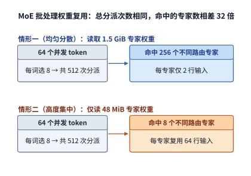

*图 2-23　64 个 token 各选八个专家，总计 512 次分派。分散时可覆盖 256 个专家，集中时只访问八个；每专家处理的行数随之改变。*

为什么会有这 32 倍的访存差距？根源在于**每份读入片上的专家权重被多少行输入复用了**：均匀分派时，读进来的 $6\ \mathrm{MiB}$ 专家权重只处理了 2 行输入，算术强度极低；而集中分派时，同一份专家权重一次服务了 64 行输入，权重复用率直接提升了 32 倍。不仅如此，在底层算子执行层面，“调用 256 次输入只有 2 行的瘦小矩阵乘法”与“调用 8 次输入为 64 行的规整矩阵乘法”，在硬件矩阵单元上的执行效率也相去甚远。[^source-18]

现在我们把 40 层加起来，对比一下完整模型的单步解码运算量：在已有 8192 个上下文 token、单请求（$B=1$）单步 decode 时，总参数量高达 35B 的 **Qwen3.6** 只需约 **$7.33\ \mathrm{GFLOPs}$** 矩阵运算，反而比总参数量只有 8B 的稠密模型 **Qwen3-8B**（需约 **$20.0\ \mathrm{GFLOPs}$**）少了近三分之二。为什么“35B 大模型”算起来反而比“8B 小模型”轻快得多？原因来自三项架构设计的叠加：一是主干隐藏维度从 4096 缩减到了 2048，缩小了所有主干投影矩阵；二是其中 30 层改用了固定状态的线性递推注意力，免去了对 8K 历史的逐 token 扫描；三是 MoE 架构虽然在显存里摆了 256 个专家撑起了 35B 的总容量，但每个 token 每次只激活其中 8 个路由专家与 1 个共享专家。

一句话总结 MoE 架构给系统带来的核心挑战：**稀疏激活把“模型的知识容量（总参数量）”与“单次推理的计算开销（激活参数量）”成功解耦，让模型能用小模型的计算量调用大模型的参数规模；但在多请求合批服务时，动态路由的分散程度直接决定了专家权重能否在批内得到有效复用。**

### 2.4.3 共享专家与潜空间计算

除了分派到每个专家的输入行数 $t_e$，单个专家自身的矩阵尺寸与连接方式也在不断演进。这里重点介绍工业界广泛采用的另外两项设计：**共享专家**（shared experts）与**潜空间专家计算**（latent-space MoE）。

先看 **DeepSeek V4-Flash** 的专家配置：它的每个 MoE 层设有 $E=256$ 个路由专家（每 token 挑选 $k_{\mathrm{top}}=6$ 个）和 1 个共享专家，路由专家与共享专家的中间升维宽度均为 $f=2048$。由于主干隐藏维度为 $d=4096$，单个专家的 `gate` 和 `up` 权重矩阵形状为 $[4096,2048]$，`down` 权重矩阵形状为 $[2048,4096]$，三个矩阵合计包含 $3\times4096\times2048=25{,}165{,}824$ 个参数。有趣的是，为了兼顾浅层负载均衡与深层语义专精，V4-Flash 的前 3 层采用无需打分的**哈希路由**（hash routing，直接根据 token ID 的哈希值固定分派专家），从第 4 层起才改用常规的动态打分路由。

在核算同时包含共享专家与路由专家的 MoE 层时，只需记住：**共享专家处理本次输入的全部 $m$ 个 token，而第 $e$ 号路由专家只处理分派给它的那 $t_e$ 个 token。** 设共享专家的参数量为 $N_s$、单个路由专家的参数量为 $N_e$，则单层专家部分的总矩阵运算量为：

$$
F_{\mathrm{MoE}}=2mN_s+2\sum_e t_eN_e=2m(N_s+k_{\mathrm{top}}N_e).
$$

在普通单步 decode 中 $m=B$，而在 prefill 中 $m=BP$。对于 DeepSeek V4-Flash，每个 token 走 1 个共享专家加 6 个路由专家，单步运算量按 $(1+6)$ 份专家累加；而显存容量则必须完整容纳全部 $1+256=257$ 份专家的权重。

再看万亿参数模型 **Kimi K3** 的**潜空间专家**设计：它的每个 MoE 层设有 $E=896$ 个路由专家，每个 token 每次挑选 $k_{\mathrm{top}}=16$ 个。如果让这 896 个路由专家直接去处理宽度高达 $d=7168$ 的主干向量，无论是总参数量还是单步激活运算量都会过于庞大。为此，Kimi K3 在路由专家入口和出口处加了一对共享的线性降维与升维投影：输入 token 在进入路由专家之前，先统一通过一个 $[7168,3584]$ 的下投影矩阵压缩到 **3584 维的专家潜空间**；随后被选中的 16 个路由专家都在这个减半的 3584 维空间内执行 SwiGLU 变换（中间宽度为 $f=3072$）；各路由专家的输出加权合并后，再统一通过一个 $[3584,7168]$ 的上投影矩阵还原回 7168 维主干空间（至于旁边的共享专家，则依然直接在 7168 维主干空间上计算，不进出潜空间）。通过将路由专家的输入输出宽度减半，全部 896 个路由专家的参数量直接缩减了一半，付出的代价仅仅是在每层路由分支的一头一尾多做两次全 token 的线性投影。[^source-3]

最后，如果一个 MoE 模型的专家权重太大、单张加速卡装不下，系统就必须把不同的专家分散部署到多张加速卡上（即**专家并行**，Expert Parallelism）。一旦专家跨卡分布，每当路由器决定把某个 token 发往另一张卡上的专家时，就必须通过高速互联网络把这个 token 的特征向量实时发送过去，等对方算完后再把结果传回来合并。因此，跨卡通信流量直接取决于专家如何摆放、输入 token 分布在哪里。第 6 章将详细推导多卡专家并行的通信代价，第 9 章还将进一步探讨把冷门专家卸载到 CPU 内存、以及将注意力（Attention）与前馈专家（FFN）拆到不同硬件资源池的 **AF 分离**架构。

> **练习 2-6〔延伸〕：专家数量与分派方式如何影响计算和权重读取**
>
> 考察 Qwen3.6 的单个 MoE 层，设 $B=64$、共 256 个路由专家、每 token 挑选 8 个。请分别针对“均匀分派到 256 个专家”与“集中分派到同一组 8 个专家”两种情况，写出各专家收到的 token 行数 $t_e$，并算出该层路由专家的总 $\mathrm{FLOPs}$、实际命中的专家个数 $U$ 以及 BF16 权重读取量。接着，如果把该层的路由专家总数减半（改为 128 个）、每个专家的中间维度翻倍（改为 1024）、同时将每个 token 每次挑选的专家数减半（改为 4 个），请判断单层路由专家的总参数量与单 token 激活的矩阵运算量是否发生变化？最后，说明如何在此基础上把共享专家的参数量与运算量加进公式；对于像 Kimi K3 那样采用潜空间路由专家的模型，又该如何把进出潜空间的两次投影计入总账？

## 2.5 网络形状与计算组织

前两节我们看到，上下文状态机制与 MoE 专家选择决定了每一步需要动用哪些数据；而神经网络的**深度（层数 $L$）**、**宽度（隐藏维度 $d$ 与中间维度 $f$）**以及**跨层连接方式**，则进一步决定了这些数据要组成什么形状的矩阵、按怎样的先后顺序流转。这引出了一个非常关键的系统洞察：**总参数量相近的两个模型，计算图的几何形状可能截然不同；哪怕单次调用的总浮点运算量（$\mathrm{FLOPs}$）一模一样，它们在硬件上的中间缓冲区占用时长与串行等待步数也可能相去甚远。**

### 2.5.1 深度、宽度与专家粒度

我们先撇开首尾的词表矩阵和归一化小向量，只看稠密 Transformer 主干：如果保持 FFN 中间宽度 $f$ 与主干隐藏维度 $d$ 成固定比例（例如 $f=3d$），那么单层线性投影与 FFN 的参数量就正比于 $d^2$，全模型 $L$ 层这部分的总参数量大致正比于 $Ld^2$。观察这个乘积关系：如果我们将模型的隐藏维度 $d$ 减半，同时将网络层数 $L$ 增加到原来的 4 倍，正比于 $Ld^2$ 的主干线性层与 FFN 参数量及其对应的矩阵乘运算量几乎保持不变。但是在硬件执行层面，这个“更瘦、更深”的模型却发生了显著变化：每一个矩阵的宽高都缩小了一半，算子粒度变得更碎；更重要的是，由于下一层必须等上一层算完才能启动，**串行依赖链的长度拉长到了原来的 4 倍**，而且正比于 $Ld$ 的注意力核心运算与 KV 状态容量还会翻倍。可见，在相近的主干参数预算下，调整深度 $L$ 与宽度 $d$ 的配比，本质上是在“单次矩阵运算的粒度”与“串行执行的步数深度”之间做权衡。

同样的粒度权衡也出现在 MoE 层的**专家粒度**（expert granularity）设计中。回顾单层路由专家的总参数量公式 $3Edf$ 与单 token 激活运算量公式 $6k_{\mathrm{top}}df$：如果我们把候选专家总数 $E$ 减半、把单个专家的中间宽度 $f$ 翻倍，同时把每个 token 挑选的专家数 $k_{\mathrm{top}}$ 减半，那么单层专家总参数量 $3Edf$ 与单 token 运算量 $6k_{\mathrm{top}}df$ 都会保持恒定。例如，我们可以拿 **Qwen3-235B-A22B** 的真实配置（每层 $E=128$ 个专家、中间宽度 $f=1536$、每 token 选 $k_{\mathrm{top}}=8$ 个）作为基线，构造两个等参数、等算力的变体：一个是“粗粒度变体”（$E=64,f=3072,k_{\mathrm{top}}=4$），另一个是“细粒度变体”（$E=256,f=768,k_{\mathrm{top}}=16$）。

拿一个包含 16 个输入 token 的具体算例来核对：在这三种专家粒度下，单层路由专家的矩阵运算量完全相等，均为约 **$454\ \mathrm{GFLOPs}$**。然而，落实到底层执行的**分组矩阵乘法**（grouped GEMM，即把发往不同专家的多个小矩阵乘法打包在一个内核里并行执行）上，矩阵形状却截然不同：粗粒度变体把同样多的权重拼成了数量更少、尺寸更宽的大矩阵，且每个专家平均分到的 token 行数翻倍；细粒度变体则把权重切成了数量翻倍、尺寸更窄的碎矩阵，连带路由器的打分投影宽度（$d\times E$）也跟着翻倍（详细分项对比见[专家粒度核算记录](../calculations/results/qwen235-granularity-baseline.md)）。

不仅如此，矩阵与状态的几何形状还直接规定了**多卡切分并行的最小整除单位**。举例来说，如果一层有 128 个路由专家，我们可以轻而易举地把它们均分到 8 张加速卡上，每张卡托管 16 个完整专家；但如果某个注意力层只有 4 个 KV 头，想要按完整的 KV 头切分到 8 张加速卡上，4 个头就不够分了——此时系统要么被迫在每两张卡上复制存一份相同的 KV 头，要么就得修改底层通信逻辑。第 5 章将从 GPU 矩阵分块的角度剖析矩阵形状如何决定算子利用率，第 6 章则会进一步算清如何把这些不同形状的矩阵与状态切分到多张加速卡上。

### 2.5.2 残差连接与跨层状态

除了网络的深度、宽度与专家粒度，决定临时显存占用和访存开销的另一个关键维度是**层与层之间的连接拓扑**。在标准的 Transformer 中，**普通残差连接**遵循简洁的递推式 $x_{\ell+1}=x_\ell+f_\ell(x_\ell)$——其中 $x_\ell$ 是第 $\ell$ 个子层的输入，$f_\ell(x_\ell)$ 是注意力或 FFN 子层算出的变换结果。哪怕是这样一条最简单的加法连接，也蕴含着一条硬性的显存驻留要求：在子层 $f_\ell$ 执行内部运算的整个期间，原始输入张量 $x_\ell$ **必须完好无损地保留在存储中**，直到子层输出算出来并完成逐元素相加之后，存放 $x_\ell$ 的空间才能被释放或覆盖。推而广之，如果模型设计了更复杂的跨层连接，让后面好几层都要回头引用前面某一层的输出，那么这份中间表示就必须一直驻留在显存里，直到最后一个引用它的层执行完毕为止。

为什么现代大模型要改动沿用了多年的普通残差连接？因为在普通残差中，所有浅层与深层的特征都被无差别地直接累加进同一条宽度为 $d$ 的单路管道里。为了让深层网络在传递特征时拥有更丰富的组合自由度、同时保证百层网络的梯度与信号传播平稳，**DeepSeek V4-Flash** 引入了**流形约束超连接**（Manifold-Constrained Hyper-Connections，简称 **mHC**）。所谓超连接，就是把原本单条残差管道扩宽成并行的多条残差通路，并用动态学习的混合系数在层间交织信息；而所谓“流形约束”，则是将残差混合矩阵的元素全部限制为非负实数，且要求矩阵每一行与每一列的元素之和都逼近 1（即双随机矩阵流形），从数学上杜绝多层连乘后信号幅度的爆炸或衰减。[^architecture-motivation]

具体到 DeepSeek V4-Flash 的实现中（见图 2-24 右侧），系统在层间并行维护着 **4 路残差状态**，每一路都是一个独立的 4096 维特征向量（合在一起相当于每个 token 带着 $4\times4096=16384$ 维的跨层状态往前走）。每当要进入注意力子层或 FFN 子层之前，模型先用一个动态生成的混合矩阵把这 4 路残差状态加权合成为 1 路 4096 维的子层输入；子层内部的注意力或 MoE 照常按 4096 维执行计算，丝毫不受影响；等子层算出 4096 维的输出后，再通过另一组混合权重分发写回到那 4 路残差通道中。这样一来，耗时的注意力与专家大矩阵完全不用扩宽，新增的计算只集中在进出子层时的轻量级混合与分发上。

我们来算一算这笔超连接的额外账单：在处理 8192 个输入 token 时，DeepSeek V4-Flash 全模型生成 mHC 混合系数的线性投影约需 **$555\ \mathrm{GFLOPs}$** 矩阵运算，而对混合矩阵做归一化与加权合成的非矩阵逐元素运算约需 **$149\ \mathrm{GFLOPs}$**[^source-4]。为了施加前面所说的双随机流形约束，模型在每一层都会对生成的 $4\times4$ 混合矩阵执行 **Sinkhorn 迭代归一化**——即交替将矩阵的每一行除以行和、每一列除以列和，经过若干轮迭代使行和与列和都收敛到 1，随后再用这组规整的系数去混合 4 路残差通道（在模型最末端离开第 43 层后，再将 4 路残差汇合成 1 路 4096 维向量送入词表头）。到了 **DeepSeek V4.1 Flash** 中，团队又将其升级为 **Single-Pass mHC**（单遍流形约束超连接）：通过让当前子层直接复用上一子层已经算好的输入混合系数，使得每步只需遍历读取一遍 4 路残差状态，省去了一半的残差通道访存流量。

无独有偶，**Kimi K3** 为了让深层网络能够按需回头提取不同浅层深度的特征（而不是只能被动接收逐层累加后的单一混合表示），采用了另一种跨层拓扑——**注意力残差连接**（Attention Residuals，简称 **AttnRes**）。它的思路很直观：既然序列注意力可以在不同 token 位置之间按相关性打分汇总信息，那么在网络的**深度方向**（不同层之间），当前层同样可以通过注意力打分，对前面较浅各层的输出做加权求和，作为当前层的输入。当然，如果让第 90 层去逐一保存并读取前面全部 89 层的输出，显存占用和访存开销未免太大；因此 Kimi K3 采用了**分块式实现**（blockwise AttnRes）——把连续若干层编成一个块，只保留每个块的代表性输出供后续块按深度注意力选取。[^architecture-motivation]

从系统显存管理的视角对比，**AttnRes 跨层状态**与 **KV 缓存**的生命周期有着本质区别：AttnRes 保留的浅层块表示只需要在**当次前向调用（forward pass）尚未走完之前**暂存在显存中，一旦最后一层算完，这些跨层临时张量就可以立刻全部释放；而注意力子层的 KV 缓存则必须跨越多轮调用，一直保留到整条请求的所有输出 token 生成完毕为止。[^source-19]

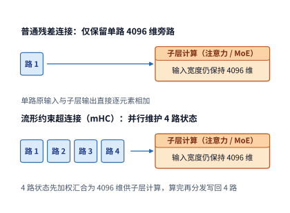

*图 2-24　普通残差与四路 mHC 的连接范围。普通残差保留一条子层输入旁路；mHC 汇合多路状态供子层计算，再混合输出。两种图中的子层输入均为 4096 维。*

### 2.5.3 多 token 预测与辅助计算

前面讨论的深度、宽度与残差连接，改变的都是模型主干内部的拓扑结构；而现代大模型还在模型末端引入了另一项直接改变自回归生成节奏的设计——**多 token 预测**（Multi-Token Prediction，简称 **MTP**）。在传统的自回归模型中，跑完一次完整的主干前向传播，末端只预测紧接着的**下 1 个 token**；而 MTP 则在主干末端额外挂载了轻量级的辅助预测模块，让模型在一次前向中同时预测后续连续多个位置的 token。在训练阶段，这项辅助任务强迫主干网络提前规划好未来好几步的语义走向，从而显著提升表征质量；而在推理阶段，MTP 模块便成了**投机解码**（speculative decoding，又称推测解码）的内置“打草稿”模块。

什么是投机解码？回顾第 1 章我们算过的结论：单请求自回归 decode 之所以慢，是因为每生成 1 个 token 都得把庞大的模型权重从显存读一遍，算力大量闲置；而如果一次同时验证多个 token，只需读取一遍权重就能并行算完。**投机解码**正是利用了这一特性：每一轮先用开销极低的辅助模块（如 MTP 模块，或像 DeepSeek V4.1 Flash 配套的轻量级草稿模块 **DSpark**）快速往下猜出几个候选 token（称为“草稿”），随后把这几个草稿 token 拼在一起，一次性送入庞大的主干模型做并行验证（verify）。如果主模型验证发现其中前 $g$ 个草稿 token 都猜对了，这一轮就相当于只读了一遍主模型权重、却一次推进了 $g+1$ 个有效输出 token；即便中间某个位置猜错了，也只需从最后一个猜对的位置无缝继续，生成质量与普通逐词解码完全一致。至于草稿生成、主模型验证与接受率之间的详细系统权衡，我们将在第 8 章深入剖析。

我们先在纸面上算一算调用一次 MTP 辅助模块到底要花多少算力。以 **DeepSeek V4-Flash** 为例：它的 MTP 辅助预测块接收主干最后一层的隐藏特征与当前 token ID，经过一层轻量级变换后预测再下一个位置的词元。在单请求单步（$B=1,P=1$）下，执行一次 MTP 辅助预测总共只需约 **$1.80\ \mathrm{GFLOPs}$** 矩阵运算——其中光是最后一步复用主模型的词表输出头（$[1,4096]\times[4096,129280]$）就占去了约 **$1.06\ \mathrm{GFLOPs}$**，超过了整个 MTP 运算量的一半。注意这个细节：MTP 模块与主模型共享同一个词表输出头矩阵，因此在显存里不增加任何额外的词表权重容量，但每次预测新位置时依然要执行一次词表矩阵乘法。[^source-5]

我们可以用一个极简的不等式，给出投机解码能够带来端到端加速的临界条件。设普通单步 decode 生成 1 个 token 的耗时为 $T_d$；而在投机解码中，一轮之内生成草稿耗时 $T_s$、主模型并行验证耗时 $T_v$，且平均每轮能通过验证产出 $\bar g$ 个有效输出 token。那么，投机解码平均每个输出 token 分摊的耗时就是 $(T_s+T_v)/\bar g$。要想比普通逐词解码更快，平均接受长度 $\bar g$ 必须满足：

$$
\bar g>\frac{T_s+T_v}{T_d}.
$$

举个直观的数字例子：假设普通单步 decode 耗时 $T_d=20\ \mathrm{ms}$，而开启投机解码后，每轮打草稿加并行验证一共耗时 $T_s+T_v=30\ \mathrm{ms}$。如果平均每轮能猜中并产出 $\bar g=2$ 个有效 token，那么平均每个 token 只花 $30/2=15\ \mathrm{ms}$，比普通解码快了 25%；反之，如果草稿质量太差，平均每轮只能产出 $\bar g=1$ 个有效 token，那每步反而要花 $30\ \mathrm{ms}$，反受其累。可见，多往前猜几个 token 固然能提高单轮产出的上限，却也会增加草稿生成与验证的耗时 $T_s+T_v$；只有当猜中的有效 token 数 $\bar g$ 足以抵消这笔额外开销时，辅助预测才能真正转化为端到端的提速。第 3 章将把输入编码、投机生成、工具交互与流式输出串联起来，考察完整业务会话的负载特征。

## 2.6 整个模型的资源需求与比较

在第 2.3 至 2.5 节中，我们依次剖析了现代大模型架构演进的三条主线：注意力与状态机制决定了历史上下文存多大、怎么读；混合专家（MoE）决定了每一步激活哪些权重；而网络深度、宽度与跨层连接则决定了算子执行的顺序与临时缓冲开销。本节我们将把这些模块拼回完整的模型，在完全统一的输入条件下横向对比五个代表性模型的参数容量、运算量与状态占用，最后通过真实的检索任务检验模型的实际表现。

### 2.6.1 各组件的资源需求与全模型汇总

**五个代表模型的注意力结构与专家配置总览。** 表 2-A 汇总了本章一个稠密基线模型（Qwen3-8B）与四个架构各异的 MoE 模型在文本主干上的核心配置（表中参数量后缀 `B` 表示十亿，`T` 表示万亿）：

**表 2-A　五个模型的总体架构（文本部分）**

| 架构参数                | DeepSeek V4.1 Flash |  Qwen3-8B | Qwen3.6-35B-A3B |  DeepSeek V4-Flash |       Kimi K3 |
| ------------------- | ---: | --------: | --------------: | -----------------: | ------------: |
| 参数总数（约）            | 551.57B＋196.93B Engram |     8.19B |          34.66B |            284.33B |         2.78T |
| 主干层数 $L$            | 40（20＋20） |        36 |              40 |                 43 |            93 |
| 主干隐藏维度 $d$          | 5120 |      4096 |            2048 |               4096 |          7168 |
| 注意力组成               | 2 SWA＋38 CSA2 |    36 GQA |   30 线性＋10 全注意力 | 2 窗口＋21 CSA＋20 HCA | 69 KDA＋24 MLA |
| 前馈组成                | 40 层 MoE | 稠密 SwiGLU |        40 层 MoE |           43 层 MoE | 首层稠密＋92 层 MoE |
| 每 MoE 层路由专家数 $E$    | 384 |         — |             256 |                256 |           896 |
| 每 token 选择数 $k$     | 6 |         — |               8 |                  6 |            16 |
| 路由专家计算宽度 $d_e$      | 5120 |         — |            2048 |               4096 |          3584 |
| 稠密 FFN／路由专家中间宽度 $f$ | 2304 |     12288 |             512 |               2048 |          3072 |
| 共享专家中间宽度            | 2304 |         — |             512 |               2048 |       合计 6144 |
| 跨层连接                | Single-Pass mHC，4 路 |      普通残差 |            普通残差 |            mHC，4 路 |       AttnRes |

阅读表 2-A 时，有几处架构特点值得特别留意：
- **DeepSeek V4.1 Flash** 的参数由两部分组成：约 $551.57\mathrm{B}$ 的 40 层主干参数，以及约 $196.93\mathrm{B}$ 的 **Engram** 模块参数（其中包含约 $196.61\mathrm{B}$ 的 n-gram 查表向量参数及配套的投影与门控参数，后文统计完整文本模型权重时将两者合并计入）。其跨层连接采用第 2.5.2 节所述的 **Single-Pass mHC**，通过复用上一子层的输入混合系数将 4 路残差状态的遍历读取次数减半。在执行分工上，40 层主干分为前 20 层因果编码器与后 20 层解码器：全模型只有第 2、8、14、20 层（层号从 0 开始）生成并保存独立的全局 KV 缓存，只有第 2、8、14、20、24、28、32、36 这 8 层运行稀疏索引器（其中前 4 层为 Full 层，后 4 层为在候选池内重排的 Reindex 层，其余 30 个全局注意力层均为直接复用选中条目的 Reuse 层），同时全部 40 层各自维护长度为 128 的局部滑动窗口（SWA）。因此，在 V4.1 Flash 中，“网络总层数”既不等于“全局 KV 缓存的独立份数”，在长提示 prefill 时也不等于“每个输入 token 实际穿过的层数”。
- **Kimi K3** 在不同深度采用了非对称的前馈结构：第 1 层使用中间宽度高达 $f=33792$ 的超大稠密 FFN，让所有 token 先经过同一组宽矩阵充分提取底层特征；随后的第 2 至 93 层（共 92 层）则全部采用潜空间 MoE 结构（路由专家在 3584 维潜空间内做中间宽度为 $f=3072$ 的变换）。

横向对比表 2-A 中的五个模型，还能清晰地看到三条打破直觉的比例关系：
第一，**Qwen3.6** 的总参数量（34.66B）虽然是 **Qwen3-8B**（8.19B）的四倍多，但它的主干隐藏维度（2048）却只有 Qwen3-8B（4096）的一半。它把绝大多数参数都存进了每层 256 个细粒度路由专家里，而每个 token 每次只挑其中 8 个执行。
第二，**Qwen3-8B** 与 **DeepSeek V4-Flash** 的主干隐藏维度同为 4096，但后者通过每层挂载 256 个路由专家，将模型总参数量一举扩展到了 284.33B。
第三，**Kimi K3** 虽然将主干隐藏维度拉宽到了 7168，却通过进出 3584 维潜空间的降维投影，让每层多达 896 个路由专家无需承受 7168 维的庞大矩阵尺寸。
所有这些对比都指向同一个结论：**“装下整个模型需要多少显存”与“处理 1 个 token 需要做多少计算”，完全是由不同的结构参数决定的，必须分开核算。** 本章表 2-1 以及章末的[模型矩阵查阅表](#model-matrix-tables)（表 2-2 至表 2-6）将这五个模型外加作为 MLA 历史基准的 DeepSeek-V3 逐层拆开，供读者随时核查每一个矩阵的尺寸。

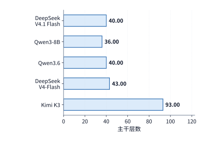

*图 2-25　五模型的主干层数，使用同一线性尺度。层数决定同类算子运算沿网络深度重复多少次。*

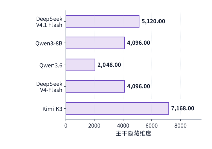

*图 2-26　同一线性尺度下的主干隐藏维度。每个 token 的特征宽度决定投影的输入或输出尺寸。*

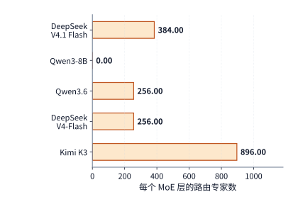

*图 2-27　每个 MoE 层保存的路由专家数量。Qwen3-8B 使用稠密前馈层，其路由专家数为零；每个 token 实际选中数见表 2-A。*

只要算清了每一类网络层的参数量、单次调用的运算量和单条请求的状态大小，汇总整个模型的资源账单就只需按各类层的实际层数做加权求和：

$$
M_W=b_W\sum_gL_gN_g+M_{\mathrm{embedding}}+M_{\mathrm{head}},\qquad
F_{\mathrm{model}}=\sum_gL_gF_g+F_{\mathrm{head}}.
$$

式中的下标 $g$ 代表网络层的类型（同一类型的层拥有完全相同的注意力、前馈与连接结构），$L_g$ 是第 $g$ 类层在主干中出现的层数。在 MoE 层中，静态参数量 $N_g$ 统计层内全部候选专家的参数总和，而单次调用运算量 $F_g$ 则只按各个专家实际分派到的 token 行数累加。在阅读章末的各模型矩阵查阅表时，读者只需顺着数据流从上往下走一遍：看输入先进入哪一类注意力分支、再走哪一类前馈专家分支、最后如何乘词表输出头算出得分；将表中每一行的“单次调用矩阵 FLOPs”乘上最后一列的“层／调用数”，再补上入口词嵌入查表与末端归一化，就能分毫不差地还原出整模型的资源总量。

为了帮助读者在动手累加时不漏项，下表梳理了各个模型架构在汇总上下文状态、权重与附加运算时的关键组成，并标出了手算时最容易遗漏的隐蔽角落（至于 MTP、V4.1 的 DSpark 投机解码模块以及多模态视觉编码器，则按实际启用范围单独加计）：

| 模型架构 | 上下文状态组成 | 核心权重与特殊计算模块 | 手算合计时最容易遗漏的细节 |
| --- | --- | --- | --- |
| **DeepSeek V4.1 Flash** | 4 份跨层共享全局 KV／索引＋40 层局部 SWA＋压缩缓冲与 token 历史 | CED 主干、CSA2 分层索引、Engram 查表与投影、路由／共享专家、Single-Pass mHC | prefill 时编码器处理全长输入、解码器仅重放末尾 128 个位置，以及第 20 层仍需对全长输入做全局 KV 投影 |
| **Qwen3-8B** | 36 层 GQA KV 缓存 | 稠密 SwiGLU 前馈、独立词表输出头 | 归一化与 RoPE 等非矩阵逐元素运算、词表头仅对末尾 token 执行 |
| **Qwen3.6** | 10 层全局 KV＋30 层固定递推矩阵与短卷积槽位 | 路由专家与共享专家、共享专家门控 | 30 个线性注意力层各自常驻一份固定大小的 FP32 递推矩阵 |
| **DeepSeek-V3** | 61 层 MLA 潜变量（紧凑路径）或展开后完整 KV | 前 3 层稠密 FFN、后 58 层 MoE 路由专家与共享专家 | 紧凑路径与展开路径下，上投影矩阵的执行位置与缓存大小截然不同 |
| **DeepSeek V4-Flash** | 局部窗口＋压缩主 KV＋索引记录＋FP32 压缩缓冲 | 路由／共享专家、CSA／HCA 压缩器与索引器、4 路 mHC | 每次查询时索引器对全量历史索引的扫描、逢整块触发的压缩更新、mHC 的 Sinkhorn 迭代 |
| **Kimi K3** | 24 层 MLA 潜变量＋69 层 KDA 递推矩阵＋短卷积槽位 | 潜空间路由专家、共享专家、块式 AttnRes 深度连接 | 路由专家进出 3584 维潜空间的两次投影、第 1 层超大稠密 FFN 与后 92 层 MoE 的差异 |

接下来，我们先通过图 2-28 至图 2-30 直观对比这五个模型在**完整 BF16 权重容量**、**单请求 8K 上下文单步 decode 矩阵运算量**以及**单请求 8K 上下文状态容量**三个维度上的表现，随后再用分项汇总表拆解每一处差异的来源。

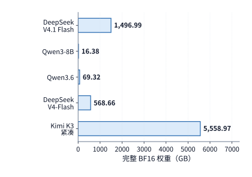

*图 2-28　五模型完整权重统一用 BF16 表示时的容量，使用同一线性尺度。这里累计全部参数，包括每次仅选中部分的路由专家。*

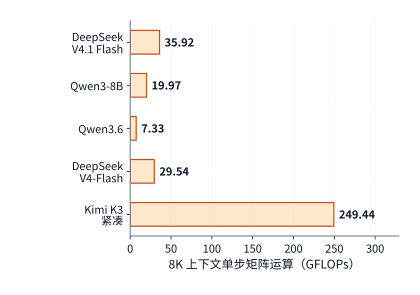

*图 2-29　相同单请求、已有 8K 上下文时的单步矩阵运算量。按各模型在表 2-C 说明的执行路径累计，Kimi K3 采用紧凑 MLA。*

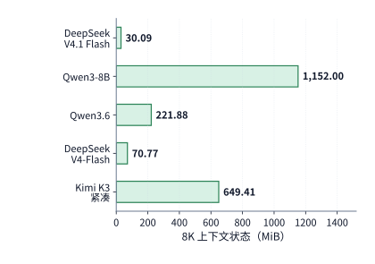

*图 2-30　相同 8K 上下文下的每请求状态。上下文表示采用 BF16，递推矩阵和压缩缓冲采用相应实现的精度；各项合计为一条请求保存 8192 个上下文 token 的容量。*

五个模型的逐矩阵计算明细见本章末的[模型矩阵查阅表](#model-matrix-tables)。把矩阵尺寸相乘并按层数累加可以看到：DeepSeek V4-Flash 文本主干共有约 2843 亿个参数，若统一按 BF16（每参数 2 字节）存放，静态权重约为 $568.7\ \mathrm{GB}$；而 **Kimi K3** 文本主干的总参数量更是高达约 **2.78 万亿**（BF16 下超过 $5.5\ \mathrm{TB}$），其中绝大部分参数都集中在 92 个 MoE 层的共 $92\times896=82{,}432$ 个路由专家里。然而，因为每个 token 在每层只激活 16 个路由专家，Kimi K3 的静态显存容量虽然十分庞大，单步激活的矩阵运算量却完全控制在可接受的范围内。[^source-7]

为了看清各个模型的参数究竟花在了哪里，我们将全模型参数划分为互不重叠的六大类：**词嵌入与输出头**、**注意力投影**、**稠密或共享 FFN**、**路由专家**、**Engram 模块**以及**其他辅助参数**。把每一行的六项相加就是该模型的总参数量，再乘上 2 字节即可直接对应图 2-28 的 BF16 权重柱高：

<!-- MODEL-COMPARISON:START -->

**表 2-B　参数由哪些部分构成（单位：十亿个参数）**

| 模型 | 嵌入与输出头 | 注意力投影 | 稠密／共享 FFN | 路由专家 | Engram | 其他 |
| --- | ---: | ---: | ---: | ---: | ---: | ---: |
| DeepSeek V4.1 Flash | 1.324 | 5.126 | 1.416 | 543.582 | 196.929 | 0.118 |
| Qwen3-8B | 1.245 | 1.510 | 5.436 | 0.000 | 0.000 | $<0.001$ |
| Qwen3.6 | 1.017 | 1.283 | 0.126 | 32.212 | 0.000 | 0.022 |
| DeepSeek V4-Flash | 1.059 | 5.085 | 1.082 | 277.025 | 0.000 | 0.081 |
| Kimi K3（紧凑 MLA） | 2.349 | 36.180 | 12.882 | 2722.741 | 0.000 | 5.333 |

表中的“其他”涵盖了路由器打分矩阵、进出专家潜空间的共享投影、归一化缩放向量、短卷积核以及跨层连接（mHC / AttnRes）参数；“注意力投影”则一并包含了 DeepSeek V4-Flash 与 V4.1 Flash 中的上下文压缩器与索引投影矩阵。对比各列可以清晰看出稠密模型与稀疏模型的结构分野：**Qwen3-8B** 的参数主力集中在每个 token 必经的稠密 FFN 上（占约 66%）；而 **Qwen3.6**、**DeepSeek V4-Flash** 和 **Kimi K3** 则把 **93% 至 98%** 的参数都放进了按需选用的路由专家池里。至于 **DeepSeek V4.1 Flash**，除了高达 $543.582\mathrm{B}$ 的路由专家外，还额外挂载了 $196.929\mathrm{B}$ 的 Engram 模块（包含庞大的 n-gram 查找表及配套投影、门控参数）——查表参数虽然增大了整模型的静态存储体积，但每次查询只需按 n-gram 哈希取出对应的几行向量，无需遍历整张大表。

**表 2-C　相同输入条件下的 prefill 计算与选中专家权重**

| 模型 | 8K prefill（TFLOPs） | 单 token 选中路由专家的 BF16 权重（GiB） |
| --- | ---: | ---: |
| DeepSeek V4.1 Flash | 143.95 | 15.820 |
| Qwen3-8B | 133.59 | — |
| Qwen3.6 | 52.09 | 1.875 |
| DeepSeek V4-Flash | 231.13 | 12.094 |
| Kimi K3（紧凑 MLA） | 1863.46 | 90.562 |

表 2-C 与图 2-29、图 2-30 采用完全一致的基准测试条件：固定单请求 $B=1$，其中 **8K prefill** 取 $S=0,P=8192$，**单步 decode**（图 2-29）取 $S=8192,P=1$，且末端词表输出头均只对最后 1 个位置计算 logits。图 2-30 展示的是单条请求保存 8192 个上下文 token 所需的总状态空间（为了横向对比结构本身的压缩效果，注意力上下文表示统一按 BF16 计量，递推状态矩阵与压缩器缓冲则按各模型参考实现的原生 FP32 精度计量；其中 V4.1 Flash 还计入了参考实现用于跨调用拼接 n-gram 的 `int64` 历史 token 编号缓存，而其线上生产环境的 FP4 全局缓存与 FP8 局部窗口容量则见第 2.3.6 节）。表 2-C 最后一列算出了单个 token 在穿过全模型所有 MoE 层时实际选中的路由专家权重总和（按 BF16 折算为 $\mathrm{GiB}$）。

在具体执行路径上，各模型均按各自的标准路径统计：DeepSeek V4.1 Flash 采用论文的“CED 非对称主干 + 末尾 128 窗口重放 + 候选池内重索引”；Qwen3-8B 采用只算下三角有效配对的因果注意力；Qwen3.6 采用参考实现的矩形注意力（eager 模式）与分块线性递推；DeepSeek V4-Flash 采用有效主注意力加全量历史索引扫描；Kimi K3 则采用紧凑 MLA 路径与分块（prefill）/ 递推（decode）KDA。把图 2-28、图 2-29、图 2-30 与表 2-B、表 2-C 放在一起对照，架构演进的脉络一目了然：
- **Qwen3.6** 的静态权重容量虽然是 **Qwen3-8B** 的 4.2 倍，但无论是 8K prefill 运算量（$52.09$ 对 $133.59\ \mathrm{TFLOPs}$）、单步 decode 运算量（$7.33$ 对 $20.0\ \mathrm{GFLOPs}$）还是 8K 状态容量（$0.217$ 对 $1.125\ \mathrm{GiB}$），反而都只有 Qwen3-8B 的五分之一到三分之一。
- **DeepSeek V4-Flash** 的总参数量进一步扩大到了 284B，但凭借块压缩与稀疏索引，它在 8K 下的上下文状态（BF16 参考格式下仅 $0.069\ \mathrm{GiB}$）反而缩小到了 8B 稠密模型的十六分之一。
- **DeepSeek V4.1 Flash** 总参数量高达近 749B（约为 V4-Flash 的 2.6 倍），但由于 CED 架构在 8K prefill 时让前 8064 个输入 token 跳过了后 20 层解码器主体计算，它的 8K prefill 总运算量（$143.95\ \mathrm{TFLOPs}$）反而比前代 V4-Flash（$231.13\ \mathrm{TFLOPs}$）少了近四成，几乎与 8B 稠密模型（$133.59\ \mathrm{TFLOPs}$）持平。
- **Kimi K3** 凭借 93 层深度、7168 维隐藏宽度与每层 896 个专家，撑起了 2.78T 的庞大参数量，相应的单步计算量与激活权重也处于最高档位。

**从状态驻留容量推算单步 decode 的状态读写流量。** 在 8K 上下文单步 decode 中：Qwen3-8B 需要从显存读取 $1152\ \mathrm{MiB}$ 的历史 KV 缓存；DeepSeek V4-Flash 在图 2-30 的 BF16 参考格式下，主注意力读取与索引扫描合计 $27.625\ \mathrm{MiB}$（若换用第 2.3.6 节的线上生产混合格式则进一步降至 $12.556\ \mathrm{MiB}$）；Kimi K3（紧凑 MLA）除了读取 $216\ \mathrm{MiB}$ 的 MLA 潜变量外，还要对 $414\ \mathrm{MiB}$ 的 KDA 递推矩阵执行一读一写（合计 $828\ \mathrm{MiB}$）；同理，Qwen3.6 除了读取 $160\ \mathrm{MiB}$ 的全注意力 KV 外，也要对 $60\ \mathrm{MiB}$ 的线性递推矩阵执行一读一写（合计 $120\ \mathrm{MiB}$）。需要注意：**递推状态矩阵的容量虽然不随上下文变长而增长，但每走一步 decode 都必须执行一次读取与更新写入。**

**存储精度与打包元数据共同决定了权重文件的真实大小。** 当我们为了公平对比模型结构而统一按 BF16（每参数 2 字节）折算时，权重容量直接正比于参数个数；但在实际生产发布时，大模型权重文件（checkpoint）普遍采用混合低位宽量化格式存储——例如官方发布的 DeepSeek V4-Flash 主干权重文件约为 $156.02\ \mathrm{GB}$，Kimi K3 文本权重文件约为 $1559.97\ \mathrm{GB}$。真实文件大小是由占大头的低位宽（如 FP8 / FP4）专家矩阵、少部分保留 BF16 / FP32 高精度的敏感层参数（如词嵌入、归一化、路由器），以及分组缩放因子（scale）等元数据共同决定的。第 5 章将进一步剖析这些压缩格式在加载进 GPU 显存后如何组织布局与在线反量化。

最后提醒一点：在对比表 2-B 与表 2-C 中的 **DeepSeek V4.1 Flash** 时，务必分清 prefill 与 decode 的路径差异。在 8K prefill 中，CED 架构让前 8064 个输入位置省去了后半段 20 层解码器的主体运算；然而一旦进入逐词生成的 decode 阶段，每一个新生成的 token 都必须完整穿过前 20 层编码器与后 20 层解码器的全部 40 层，因此绝不能把 prefill 阶段省下一半算力的比例直接套用到单步 decode 上。[^comparison-data]

<!-- MODEL-COMPARISON:END -->

为了让大家彻底看清 DeepSeek V4.1 Flash 的 CED 架构在 8K prefill 中究竟省掉了哪一部分计算，表 2-D 将这 $143.95\ \mathrm{TFLOPs}$ 的矩阵运算量拆解到了四个具体执行阶段，并与“假设不做 CED 裁剪、让全部 8192 个 token 完整执行 40 层”的**全层前向基线**做了逐行对比：

**表 2-D　V4.1 Flash 的 8K 输入 prefill 在各执行阶段的矩阵运算量拆解（TFLOPs）**

| 执行阶段 | 全层前向基线（40 层全跑） | CED＋末尾窗口重放 |
| --- | ---: | ---: |
| 前 20 层因果编码器（处理全部 8192 个位置） | 142.139 | 141.727 |
| 解码器共享全局 KV 与索引键投影（处理全部 8192 个位置） | 0.044 | 0.044 |
| 后 20 层解码器主体计算（查询、注意力、MoE 等） | 140.202 | 2.175 |
| 末尾 token 词表输出头（仅处理最后 1 个位置） | 0.001 | 0.001 |
| **全模型合计** | **282.386** | **143.947** |

对比表 2-D 的两列数字与图 2-31 的分阶段柱状图，CED 架构省算力的机制非常清晰：
在左侧的**全层前向基线**中，全部 8192 个输入 token 不仅走完了前 20 层编码器（$142.139\ \mathrm{TFLOPs}$），还接着完整走完了后 20 层解码器（$140.202\ \mathrm{TFLOPs}$），且各层索引器按公开参考实现先算出完整的矩形打分矩阵再加掩码；而在右侧的 **CED＋末尾窗口重放**路径中，虽然前 20 层编码器（$141.727\ \mathrm{TFLOPs}$）以及供解码器共享的第 20 层全局 KV 与索引键投影（仅占微不足道的 $0.044\ \mathrm{TFLOPs}$）依然处理了全部 8192 个位置，但**后 20 层解码器的主体计算（查询投影、注意力、MoE 专家、Engram 与 mHC）只需要重放最末尾的 128 个 token**，同时后续 Reindex 层的索引检索也被限制在候选池内。仅此一项，就把后 20 层解码器在 prefill 阶段的矩阵运算量从 $140.202\ \mathrm{TFLOPs}$ 大幅缩减至 **$2.175\ \mathrm{TFLOPs}$**（连同全局投影合计 $2.219\ \mathrm{TFLOPs}$，缩小到原来的约 $1/64$），从而让整个 8K prefill 的总计算量直接减半。[^v41-forward]

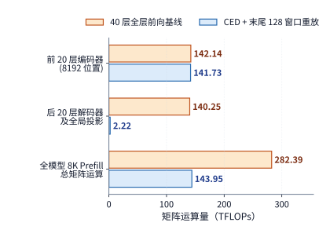

*图 2-31　DeepSeek V4.1 Flash 在 8K 输入 prefill 下的分阶段矩阵运算量对比。橙色柱为 40 层全层前向基线（合计 $282.386\ \mathrm{TFLOPs}$），蓝色柱为 CED 加末尾 128 窗口重放路径（合计 $143.947\ \mathrm{TFLOPs}$）；中间组展示后 20 层解码器主体及第 20 层共享全局 KV 投影从 $140.246\ \mathrm{TFLOPs}$ 大幅缩减至 $2.219\ \mathrm{TFLOPs}$。*

**当上下文从 8K 扩展到 1M（百万 token）时，谁能扛住压力？** 在长文档分析与多轮智能体（Agent）任务中，上下文动辄达到几十万乃至上百万 token。这里保持单请求（$B=1$）、单步 decode 新增 1 个 token（$P=1$）、词表头仅处理末尾 token 的条件不变，把历史上下文从 **8K**（8192 个历史 token）直接扩展到 **1M**（1,048,575 个历史 token，加上当前第 1,048,576 个查询 token 恰好凑整 $2^{20}=1{,}048{,}576$ 个可见位置），看看五个模型的单步 decode 运算量与状态容量会发生怎样的分化（见图 2-32、图 2-33 与表 2-E）。

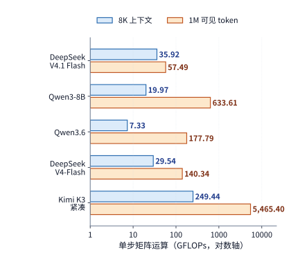

*图 2-32　五模型在 8K 与 1M 上下文下的单步 decode 矩阵运算量对比。沿用表 2-C 的执行路径，横轴为对数刻度；1M 对应 1,048,575 个历史 token 加当前 1 个查询 token，其中 Qwen3-8B 与 Qwen3.6 在 1M 下的数值为按相同架构公式外推的结果。*

为了把与上下文长度直接挂钩的那部分开销单独分离出来看清楚，表 2-E 专门统计了各模型在单步 decode 中用于**注意力计算（打分与值汇总）及稀疏索引扫描**的运算量，并在右侧列出了调用前驻留的上下文状态容量（数据精度与图 2-30 保持一致；注：Qwen3-8B 与 Qwen3.6 官方发布的默认上下文上限分别为 40,960 和 262,144 个位置，表中它们的 1M 数值是按相同架构公式直接外推得出的，用于在同一标尺下对比增长规律）。[^long-context-data]

**表 2-E　8K 与 1M 长上下文下的注意力／索引运算量与状态容量对比**

| 模型 | 8K 注意力与索引运算（GFLOPs） | 1M 注意力与索引运算（GFLOPs） | 8K 状态容量（GiB） | 1M 状态容量（GiB） |
| --- | ---: | ---: | ---: | ---: |
| DeepSeek V4.1 Flash | 3.66 | 25.23 | 0.029 | 3.138 |
| Qwen3-8B | 4.83 | 618.48 | 1.125 | 144.000 |
| Qwen3.6 | 1.34 | 171.80 | 0.217 | 20.060 |
| DeepSeek V4-Flash | 3.00 | 113.80 | 0.069 | 6.735 |
| Kimi K3（紧凑 MLA） | 41.08 | 5257.04 | 0.634 | 27.423 |

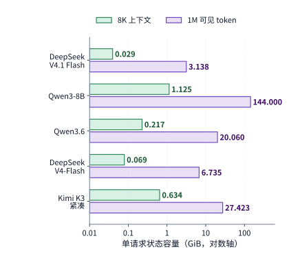

*图 2-33　五模型在 8K 与 1M 上下文下的单请求状态容量对比。横轴为对数刻度，绿色柱与紫色柱分别对应 8K 与 1M 上下文下的总状态容量（GiB，精度口径与表 2-E 及图 2-30 一致）；Qwen3-8B 与 Qwen3.6 在 1M 下的数值为按相同架构公式外推的结果。*

仔细研读表 2-E、图 2-32 与图 2-33 中从 8K 到 1M（上下文长度扩大 **128 倍**）的量级跨越，可以得出三个重要的工程结论：
1. **DeepSeek V4.1 Flash 在百万级上下文下的优势集中显现**：当上下文扩大 128 倍达到 1M 时，由于全模型只有 4 层保存独立全局 KV，它的状态容量仅占 **$3.138\ \mathrm{GiB}$**（而 Qwen3-8B 的 BF16 KV 缓存已经膨胀到了 **$144\ \mathrm{GiB}$**，单条请求的缓存就超出了整张 H100 显存）。在计算侧，V4.1 Flash 每层主注意力最多只读 128 个局部窗口 token 和 512 个选中全局条目；虽然编码器中的 3 个 Full 索引器和解码器入口的第 20 层 Full 索引器依然需要扫描随历史增长的全局索引，但解码器后续的 4 个 Reindex 层被严格限制在最多 16,384 个候选池条目内。因此，当上下文从 8K 扩大 128 倍到 1M 时，V4.1 Flash 的注意力与索引运算量仅从 $3.66\ \mathrm{GFLOPs}$ 增长到了 **$25.23\ \mathrm{GFLOPs}$**（约增长 6.9 倍），加上主干投影与专家运算后，1M 下完整的单步 decode 总矩阵运算量仅为 **$57.49\ \mathrm{GFLOPs}$**。
2. **对比两代 Flash（V4-Flash 与 V4.1 Flash）的剪刀差**：在前代 **DeepSeek V4-Flash** 中，虽然 CSA 层的主注意力读取上限也是 512 条，但它的全部 21 个 CSA 层每一层都要各自把全量历史索引从头扫一遍，且另外 20 个 HCA 层也要把全部 128:1 粗粒度条目读完。因此到了 1M 上下文时，V4-Flash 的注意力与索引运算量涨到了 **$113.80\ \mathrm{GFLOPs}$**（是 V4.1 Flash 的 4.5 倍），完整单步 decode 总矩阵运算量达到 **$140.34\ \mathrm{GFLOPs}$**。非常有意思的是：在 8K 短上下文下，由于 V4.1 Flash 的主干更宽（5120 对 4096）且激活的专家权重更大，它的单步总运算量其实比 V4-Flash 略高；但随着上下文拉长到 200K（此时 V4.1 Flash 单步总矩阵运算量为 $40.21\ \mathrm{GFLOPs}$，已低于 V4-Flash 的 $50.48\ \mathrm{GFLOPs}$）乃至 1M，V4.1 Flash 凭借“更少的全局索引扫描次数 + 候选池封顶”拉开了代际差距。
3. **看清 MLA 潜变量压缩的边界**：在 **Kimi K3** 中，虽然 69 个 KDA 层保持着恒定不变的递推状态，但剩下的 24 个 MLA 层依然要逐 token 访问全部 1M 历史潜变量。紧凑 MLA 路径虽然把 1M 上下文的状态容量控制在了 $27.423\ \mathrm{GiB}$，却**并没有跳过查询向量与 100 万个历史潜变量之间的点积与加权汇总**。因此在 1M 上下文下，光这 24 层 MLA 的注意力运算量就攀升到了 **$5257.04\ \mathrm{GFLOPs}$**（全模型单步 decode 达 $5465.40\ \mathrm{GFLOPs}$），是 8K 时的整整 128 倍。这再次印证了我们的分析原则：评估任何长上下文架构，都必须把“省了多少显存容量”、“每步实际扫描多少历史位置”以及“索引与状态更新附加了多少计算”拆成三笔独立的账来算。

### 2.6.2 参数规模、数值精度与容量约束

算清了模型的静态权重 $M_{\mathrm{weight}}$ 和单条请求的状态大小 $M_{\mathrm{state/request}}$，我们就可以把它们装进同一张加速卡的显存预算表里，回答服务端部署最关心的问题：**一张显卡到底能同时并发服务多少条请求？给模型权重做低比特量化又能多腾出多少并发空间？**

对于单张加速卡（设可用显存总容量为 $M_{\mathrm{device}}$），必须先扣除静态常驻的模型权重 $M_{\mathrm{weight}}$ 以及算子运行所需的固定临时工作区 $M_{\mathrm{workspace}}$，剩下的显存余量才能拿来存放并发请求的上下文状态。假设所有并发请求的长度相同、且各自维护独立的上下文状态（无跨请求前缀共享），那么单卡能够同时容纳的最大并发请求数 $B_{\max}$ 为：

$$
B_{\max}=\left\lfloor\frac{M_{\mathrm{device}}-M_{\mathrm{weight}}-M_{\mathrm{workspace}}}{M_{\mathrm{state/request}}}\right\rfloor.
$$

式中的分子是扣除固定开销后留给动态状态池的可用显存，分母是单条请求占用的状态大小（对于混合注意力模型，分母必须同时包含随长度增长的 KV 缓存以及每条请求独占的递推矩阵与短卷积状态）。之所以要在外层套上向下取整符号 $\lfloor\cdot\rfloor$，是因为系统每多接纳一条请求，就必须为它分配完整的一份状态空间；剩下的一点零头显存如果装不下一条完整请求的状态，就只能闲置。

拿一张标称显存为 $24\ \mathrm{GB}$（十进制 $24\times10^9\ \mathrm{bytes}$）的消费级显卡 **RTX 4090** 部署 **Qwen3-8B**（BF16 精度）来实际算一下：模型 BF16 权重精确占用 $16{,}381{,}470{,}720\ \mathrm{bytes}$（约 $16.38\ \mathrm{GB}$），为运行时工作区预留 $2\ \mathrm{GiB}$（$2\times2^{30}\ \mathrm{bytes}\approx2.15\ \mathrm{GB}$），而单条 8K 上下文请求的 BF16 KV 缓存占 $1.125\ \mathrm{GiB}$。代入公式可得单卡最大并发请求数：

$$
B_{\max}=\left\lfloor\frac{24\times10^9-16{,}381{,}470{,}720-2\times2^{30}}{1.125\times2^{30}}\right\rfloor=4.
$$

也就是说，在这张 24 GB 的显卡上，除去权重和工作区后剩下的约 $5.47\ \mathrm{GB}$ 显存，最多只能同时容纳 **4 条** 8K 长度的请求。如果业务把单条请求的上下文长度拉长一倍到 16K（每条 KV 涨到 $2.25\ \mathrm{GiB}$），单卡并发上限就会减半到 **2 条**；反之，如果把上下文限制在 4K（每条 KV 降至 $0.5625\ \mathrm{GiB}$），单卡就能同时装下 **9 条**请求。

因此，“给每条请求保留多长的历史上下文”绝不仅仅是一个影响回答质量的算法问题，更是一个直接决定单卡并发吞吐与服务成本的系统问题：业务端每增加一段长文档输入，服务端为每条请求划拨的显存池就要成倍扩大。把第 2.3 节的 GQA、MLA、块压缩和混合递推放进同一个公式里对比，就能明白为什么现代大模型要不遗余力地压缩单请求状态分母 $M_{\mathrm{state/request}}$。

那么，通过**权重端量化**缩小分子中的扣除项 $M_{\mathrm{weight}}$，又能腾出多少并发空间呢？回到第 1.2.3 节算过的 **DeepSeek-R1-Distill-Llama-70B** 模型：它的全精度 BF16 权重高达 $141.107\ \mathrm{GB}$，单条 8K 请求的 BF16 KV 缓存为 $2.5\ \mathrm{GiB}$（约 $2.684\ \mathrm{GB}$）。在保留词嵌入、输出头和归一化等敏感参数使用高精度、并计入分组缩放因子（scale）与对齐填充开销的真实分组量化方案下：
- **8-bit 量化权重**共占 **$73.726\ \mathrm{GB}$**；
- **4-bit 量化权重**共占 **$39.500\ \mathrm{GB}$**（注意由于保留了部分高精度层及 scale 元数据，真实的 4-bit 权重文件比简单按“每个参数 0.5 字节”粗算出来的 35 GB 要大一些）。

现在把这两种量化方案放到同一张 $80\ \mathrm{GB}$（十进制）的 **H100 SXM** 上，同样固定预留 $2\ \mathrm{GiB}$ 工作区（见图 2-34 与图 2-35）：
- 采用 **8-bit 权重**（$73.726\ \mathrm{GB}$）时，扣除 $2\ \mathrm{GiB}$ 工作区后只剩约 $4.13\ \mathrm{GB}$ 显存，仅够容纳 **1 条** 8K 请求（$2.684\ \mathrm{GB}$）。
- 而改用 **4-bit 权重**（$39.500\ \mathrm{GB}$）后，一下子腾出了近 $38.35\ \mathrm{GB}$ 的状态池空间，可同时容纳的 8K 并发请求数直接从 1 条跃升到了 **14 条**。当然，如果此时把每条请求的上下文从 8K 拉长 4 倍到 32K（每条 KV 涨至 $10\ \mathrm{GiB}\approx10.74\ \mathrm{GB}$），哪怕是 4-bit 方案，可同时容纳的并发请求数也会从 14 条回落到 **3 条**。[^source-23]

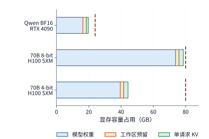

*图 2-34　权重、固定预留和一条请求 KV 的逐项容量。短竖线标出 RTX 4090 的 24 GB 与 H100 SXM 的 80 GB 容量；KV 采用 BF16、上下文长度 8192，固定预留为 2 GiB。“工作区预留”指执行所需的临时空间，“单请求 KV”指一条 8192 个 token 的上下文的缓存。*

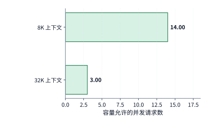

*图 2-35　70B 的 4-bit 方案在同一张 80 GB 的 H100 SXM 上，上下文长度从 8K 增至 32K 时可同时容纳的独立请求数。每请求状态增加，使剩余空间容纳的请求数减少。*

这套容量核算方法同样适用于更大规模的多卡部署。例如，**Qwen3-235B-A22B** 的 BF16 权重约为 $470\ \mathrm{GB}$，哪怕把八张 RTX 4090 凑成一台机器（总显存 $192\ \mathrm{GB}$）也远远装不下；而一台配备八张 H100 SXM 的 HGX 服务器总显存为 $640\ \mathrm{GB}$，装下 $470\ \mathrm{GB}$ 权重后还能留出约 $170\ \mathrm{GB}$ 空间。不过在多卡切分时千万要注意：这剩下的 $170\ \mathrm{GB}$ 并不能全部拿来放 KV 缓存——它不仅要留出每张卡各自的工作区，还要容纳那些**无法切分、必须在每张卡上重复保存一模一样副本的参数与状态**（例如每张卡都要存一份的归一化参数与路由器权重；又如当某模型只有 4 个 KV 头却要按张量并行切分到 8 张卡上时，每个 KV 头就不得不在两张卡上各存一份副本）。第 6 章将根据具体的多卡并行切分方案，带大家逐卡算清这笔分布式显存账单。

> **练习 2-7〔核心〕：由显存容量决定可容纳请求数**
>
> 使用显存为 $24\ \mathrm{GB}$（十进制）的 RTX 4090，固定预留 $2\ \mathrm{GiB}$ 工作区，运行 Qwen3-8B（BF16 权重取精确值 $16{,}381{,}470{,}720\ \mathrm{bytes}$）。请分别算出在 4K、8K 和 16K 上下文长度下，单卡最多能同时容纳多少条独立请求；若在 8K 上下文下将工作区预留扩大到 $3\ \mathrm{GiB}$，最大并发数又变为多少？接着，使用前文 70B 模型的 4-bit 量化权重（$39.500\ \mathrm{GB}$），改在单张显存为 $48\ \mathrm{GB}$（十进制）的 RTX 6000 Ada 工作站显卡上部署（工作区仍预留 $2\ \mathrm{GiB}$），分别求出 8K 与 32K 上下文下的最大并发请求数。

反过来，这套公式也可以**倒着用**——当我们手里已经有一款固定的加速卡、并且业务已经明确固定了并发数与上下文长度目标时，可以反推出这张卡最多能装下多大参数规模的模型。设单卡可用显存容量为 $C$，固定工作区预留为 $M_0$，单条请求的 KV 状态大小为 $K$，目标并发请求数为 $B$，每个模型权重参数占 $b_W$ 字节。忽略其他微小的常驻对象，单卡显存能够容纳的模型参数量上限 $N_{\max}$ 为：

$$
N_{\max}=\frac{C-M_0-BK}{b_W}.
$$

算这笔反向预算时，顺序刚好倒过来：**先从总显存里把服务 $B$ 条并发请求所需的 KV 状态和工作区扣掉，看剩下的显存还能容纳多少个参数**（见图 2-36）。例如，给定一张 $24\ \mathrm{GB}$ 的 RTX 4090，要求预留 $2\ \mathrm{GiB}$ 工作区，并同时服务 $B=4$ 条长度为 8192 的请求（单条请求 KV 沿用 Qwen3-8B 的 $1.125\ \mathrm{GiB}$）。在 BF16 精度（$b_W=2\ \mathrm{bytes}$）下，扣掉工作区和 4 条请求的 KV 后，剩下的显存最多只能容纳约 **85.1 亿个参数（8.51B）**——这恰恰解释了为什么开源社区的 7B / 8B 级别模型会成为单张 24 GB 消费级显卡上的主流尺寸。[^core-calculation]

更进一步看，在反推模型规模时，权重预算与状态预算是联动博弈的：如果模型设计师增加了网络层数或 KV 头数，单条请求的状态 $K$ 就会变大，留给静态权重的空间 $C-M_0-BK$ 就会被相应挤压；而当目标模型彻底超出单机显存上限时，就只能走向跨节点分布式部署——例如 Meta 在 Llama 3 技术报告中披露，其旗舰模型 Llama 3 405B 在 BF16 精度下做在线推理时，由于单台八卡 H100 服务器（640 GB）装不下全部权重与并发状态，实际动用了两台服务器共 **16 张 H100** 协同服务。[^codesign]

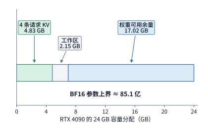

*图 2-36　从加速器反推权重预算。RTX 4090 的 24 GB 中先为 4 条 8K 请求的 KV 和 2 GiB 工作区预留空间，余量给出 BF16 参数上界；图中容量均为十进制 GB。*

这套“静态权重＋持久状态＋瞬时工作区”的账本不仅适用于自回归文本大模型，还能直接推广到**生成式多模态模型**（如图像与视频扩散模型）。在现代多模态生成管线中，主体架构同样是由线性投影、全注意力与 SwiGLU/GELU 前馈层堆叠而成的 **扩散 Transformer**（Diffusion Transformer，简称 **DiT** 或双流 **MMDiT**），末端再拼接一个负责将潜空间网格还原为像素的 **变分自编码器解码器**（VAE Decoder）。然而，当把两者的计算量与显存账单放在一起对比时，会呈现出与文本自回归截然不同的资源瓶颈结构。[^gen-multimodal]

**算例 2-A：DiT 多步去噪计算墙与 3D 因果 VAE 特征缓存克隆尖峰**。考察生成一张 $1024\times1024$ 分辨率图像（对应潜空间网格 $128\times128$，经 $2\times2$ 打包后形成 $N_{\mathrm{img}}=64\times64=4{,}096$ 个图像 token，外加 $N_{\mathrm{txt}}=512$ 个文本提示词 token）的两款代表性开源模型：**Qwen-Image-2512**（20B 参数双流 MMDiT，60 层，$d=3072$，24 个头、头宽 128）与经过步数及参数双重蒸馏的 **FLUX.2-klein-4B**（5 层双流块＋20 层单流块，合计约 39.65 亿参数，$d=3072$）：
1. **DiT 多步双分支去噪的计算垄断**：在 Qwen-Image-2512 的单次前向调用中，处理 4,096 个图像 token 与 512 个文本 token 共需 **$78.304\ \mathrm{TFLOPs}$**（其中图像流线性投影与 MLP 占 $65.72\ \mathrm{TFLOPs}$、文本流占 $7.93\ \mathrm{TFLOPs}$、4,608 个位置的双向联合注意力占 $4.65\ \mathrm{TFLOPs}$）。在标准推理配置下，扩散去噪需要迭代 **50 步**，且为启用无分类器引导（Classifier-Free Guidance，$\text{true\_cfg\_scale}=4.0>1$），每一步都必须分别计算条件分支与无条件分支**共 2 次完整前向**。因此，生成单张图像累计触发 **100 次** 20B DiT 前向调用，总矩阵运算量高达 **$7{,}830.39\ \mathrm{TFLOPs}$**，占整条管线总算力（$7{,}842.08\ \mathrm{TFLOPs}$）的 **$99.85\%$**；相比之下，末端执行一次 3D 因果 VAE 像素解码仅需 **$11.68\ \mathrm{TFLOPs}$**（仅占总算力的 **$0.15\%$**）。
2. **反直觉的显存尖峰：为什么算力仅占 $0.15\%$、权重仅 $242\ \mathrm{MiB}$ 的 VAE 会在生成最后一刻触发 OOM？** 从静态权重看，20B MMDiT 在 BF16 下占 $40.86\ \mathrm{GB}$，而配套的 `QwenImageCausalVAE` 参数量仅约 1.27 亿（BF16 权重仅占 **$241.94\ \mathrm{MiB}$**，约 $0.254\ \mathrm{GB}$）。然而在不少线上部署事故中，显卡明明顺利跑完了前面 100 次庞大的 DiT 去噪调用，却在最后一步调用轻量级 VAE 解码时突然报出显存溢出（OOM）。追查其底层张量生命周期可以发现两重叠加的显存尖峰：
   - 第一，随着三维卷积逐级空间上采样，VAE 解码器在高分辨率层的单个中间激活张量（形状为 $[1,512,1,1024,1024]$，BF16 精度）瞬时占用 $1{,}073{,}741{,}824\ \mathrm{B}=$ **$1.000\ \mathrm{GiB}$**（$1.074\ \mathrm{GB}$）；
   - 第二，也是更隐蔽的系统陷阱：为了用同一套代码兼容视频流与单图解码，该 3D 因果 VAE 在内部初始化了 `FEAT_CACHE_LEN = 30` 个因果卷积时间帧特征缓存槽位（`_feat_map`），单份缓存横跨不同分辨率层级共驻留 $1{,}208{,}221{,}696\ \mathrm{B}=$ **$1.125\ \mathrm{GiB}$**（$1.208\ \mathrm{GB}$）；而在进入每次解码调用前，参考实现为了保护缓存状态不被原地覆盖，执行了一行防御性的列表深拷贝 `[x.clone() if x is not None else None for x in feat_cache]`，瞬间在显存中克隆出第二份一模一样的 30 槽位缓存，使特征缓存占用翻倍至 **$2{,}416{,}443{,}392\ \mathrm{B}$**（即 **$2.250\ \mathrm{GiB}$**，十进制 **$2.42\ \mathrm{GB}$**）。这份 $2.250\ \mathrm{GiB}$ 的双份克隆缓存加上 $1.000\ \mathrm{GiB}$ 的上采样激活峰值，使小小一个 VAE 在解码瞬间额外吞噬了逾 $3.25\ \mathrm{GiB}$ 工作区显存，远超其自身权重体积的 13 倍。
3. **步数与参数双重蒸馏的账本重塑**：对照 **FLUX.2-klein-4B**，通过将模型主干压缩至 4B 级别（单次前向降至 $34.82\ \mathrm{TFLOPs}$），并利用步数蒸馏与引导蒸馏将推理压缩为 **4 步单分支调用**（共 4 次前向），DiT 阶段的总算力从 $7{,}830.39\ \mathrm{TFLOPs}$ 骤降至 **$139.28\ \mathrm{TFLOPs}$**（缩减 **$56.2$ 倍**）；此时末端二维 VAE 解码的 $10.47\ \mathrm{TFLOPs}$ 算力占比从 $0.15\%$ 上升到了 **$7.0\%$**，而由于二维卷积去除了 30 个时间帧 `_feat_map` 缓存槽位，其 VAE 激活峰值也回落至 **$248.38\ \mathrm{MiB}$**（见图 2-37）。这一对比再次印证：**在异构多阶段管线中，绝不能仅凭某个子模块的静态参数量或总 FLOPs 占比去推断它的显存水位；防御性张量克隆（`.clone()`）与高分辨率空间上采样往往才是压垮单卡显存预算的幕后推手。**

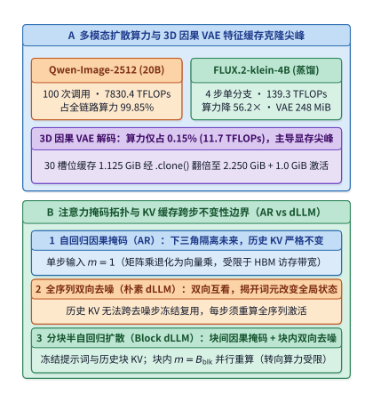

*图 2-37　生成式多模态管线与非自回归注意力的资源特征对比。左图展示 Qwen-Image-2512（100 次 DiT 调用共 $7{,}830.39\ \mathrm{TFLOPs}$）与 FLUX.2-klein-4B（4 次调用共 $139.28\ \mathrm{TFLOPs}$）的算力对比，以及 3D 因果 VAE 因克隆 30 个 `_feat_map` 槽位形成的 $2.250\ \mathrm{GiB}$（$2.42\ \mathrm{GB}$）特征缓存尖峰；右图对比自回归因果掩码、dLLM 全双向去噪与分块半自回归扩散的缓存复用边界。*

### 2.6.3 不同请求条件下的模型比较

在本章的最后，我们把显存容量约束、多步自回归调用链以及最终的任务回答质量串到一起，完成一次端到端的模型对比。在实际选型时，科学的评估包含两个互补的切面：
- 第一种切面是**固定 token 长度**（即固定 $S,P,G,B$），用来纯粹对比不同模型架构在处理相同数量的位置时，各自的算子与状态开销有何差异；
- 第二种切面则是**固定原始业务文本与任务**，让同一段自然语言文字先经过各个模型自己的分词器（tokenizer）切分成各自的 token 序列，既检验模型能否答对问题，又核算完成同一项人类任务实际消耗的总资源。

我们先看第一种切面——**固定输入与输出 token 数量**。设单条请求从零开始（$B=1,S=0$），输入提示词长度为 $P=128$ 个 token，连续生成并返回 $G=4$ 个输出 token。按照第 2.2.3 节建立的调用链（见图 2-38），模型首先执行 **1 次 prefill**（处理 128 个输入 token 并产出第 1 个输出 token），随后连续执行 **3 次单步 decode**（每次将上一步产出的 token 送回模型，依次产出第 2、3、4 个输出 token；第 4 个输出直接返回，不再送入模型，故请求结束时缓存中最终保留 $128+3=131$ 个已处理位置的状态）。把这 1 次 prefill 和 3 次 decode 的矩阵运算量全部加起来，就得到了下表所示的完整请求算力账单（见图 2-39）：[^source-8]

| 模型 | 完整请求矩阵运算量（TFLOPs） | 本次核算采用的执行与缓存路径 |
| --- | ---: | --- |
| DeepSeek V4.1 Flash | 4.14 | CED＋末尾 128 窗口重放，候选池内重索引 |
| Qwen3-8B | 1.83 | 仅计算下三角有效配对的因果注意力 |
| Qwen3.6 | 0.66 | 矩形全注意力（eager）与分块线性递推分支 |
| DeepSeek V4-Flash | 3.40 | 有效主注意力与全量历史索引扫描 |
| Kimi K3（紧凑 MLA） | 27.16 | 紧凑 MLA 路径；prefill 采用分块 KDA，decode 采用单步递推 KDA |

这里有一个非常值得玩味的细节：在前面表 2-C 的 **8K 长输入 prefill** 中，DeepSeek V4.1 Flash（$143.95\ \mathrm{TFLOPs}$）比前代 V4-Flash（$231.13\ \mathrm{TFLOPs}$）省了近四成算力；为什么到了上面这张 **$P=128$ 的短请求**表里，V4.1 Flash（$4.14\ \mathrm{TFLOPs}$）反而比 V4-Flash（$3.40\ \mathrm{TFLOPs}$）算得更多了呢？
原因一算便知：因为 V4.1 Flash 解码器的末尾重放窗口长度恰好就是 **128**。当输入提示词只有 $P=128$ 个 token 时，全部 128 个输入 token 都落在了末尾重放窗口之内，必须完完整整地穿过前 20 层编码器和后 20 层解码器的全部 40 层，根本没有享受到“长提示词跳过解码器”的红利；再加上 V4.1 Flash 主干更宽（5120 对 4096）、激活的专家参数更多，在极短输入下自然算得比 V4-Flash 更多。这个例子生动地说明：**脱离具体的输入输出长度（$P$ 与 $G$）去空谈哪个架构更省算力，是毫无意义的。** 增大输入长度 $P$ 主要推高单次 prefill 的计算量与后续解码的初始上下文底数；而增大生成长度 $G$ 则会让模型反复执行单步投影、激活专家并一遍遍重读历史上下文。第 3 章将进一步把这种“长输入短输出”与“短输入长输出”的负载差异放进真实的在线服务流中去分析。

> **练习 2-8〔延伸〕：前缀复用与输入改写如何改变模型计算量**
>
> 某轮对话请求的总输入长度为 1443 个 token，其中开头的 1392 个 token 直接命中了显存中已有的前缀 KV 缓存，模型随后生成并返回了 128 个输出 token。请写出该轮调用对应的 $S,P,G,n_d$ 数值、请求结束时的总上下文长度，以及本轮新写入显存的 KV 缓存大小（以 Qwen3-8B 为例）。与不复用缓存、从头重算全部 1443 个输入 token 相比，命中前缀缓存在 prefill 阶段分别省掉了多少行线性投影输入和多少次有效因果“查询—键”配对？如果用户在发起请求前，顺手修改了提示词中第 501 个 token 处的一个字，请重新算出此时能够复用的最长前缀长度 $S$ 与需要重新计算的输入长度 $P$。

再看第二种切面——**固定原始业务文本**。当输入的是同一篇人类文章时，不同模型自带的分词器（tokenizer）会因为词表大小和切词规则的差异，切出不同数量的 token。例如，在我们实测的八道长短文短语检索基准测试中，面对完全相同的中文短文，**Qwen3-8B** 与 **DeepSeek V4-Flash** 都准确无误地找出了目标短语，但同一篇短文被 Qwen 分词器切成了 523 或 524 个 token，而被 DeepSeek 分词器切成了 501 个 token；在较长的文档组中，Qwen 切出了 2121 或 2122 个 token，而 DeepSeek 只切出了 2036 个 token（比 Qwen 少了约 4% 的 token 数）。固定原始文本保证了业务任务本身的公平一致，而分词器切出的实际 token 数 $P$ 和 $G$ 则直接决定了送入各自计算图的张量形状。

因此，在真实工程中横向评测多个候选模型时，必须同时交付两份答卷：第一，在统一的业务文本与评测标准下，模型的回答质量能否达标；第二，把各模型分词后的真实 token 长度代入本章的资源公式，算清完成同一次业务请求到底要消耗多少显存、算力与带宽。[^source-9]

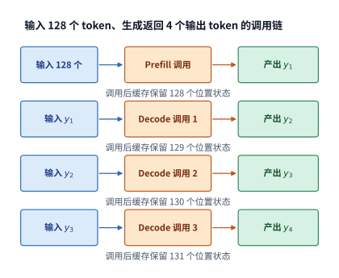

*图 2-38　生成四个输出 token 的调用顺序。prefill 阶段一次性处理 128 个输入 token 并产出首个输出 token，随后三次 decode 各将上一步的输出 token 送回模型；请求结束时缓存中最终保留 131 个位置的上下文状态。*

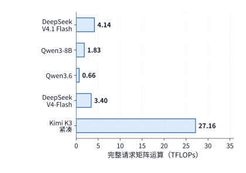

*图 2-39　输入 128 个 token、输出 4 个 token 时，各模型处理完整请求累计所需的矩阵运算量。各模型的执行路径与缓存切面见本节正文说明。*

> **练习 2-9〔延伸〕：根据容量、计算需求与任务质量选择模型**
>
> 结合图 2-28 至图 2-30 与表 2-C，为本章五个模型分别列出完整 BF16 权重大小、8K 上下文状态容量、单步 decode 矩阵运算量与 8K prefill 矩阵运算量。若目标是将模型以 BF16 精度部署在单张 80 GB 显存的 H100 SXM 上（固定预留 2 GiB 工作区），请先判断哪些模型能够完整放进单张卡内；对于单卡装不下的模型，若改用多卡分布式部署，请说明还需要从后续章节获取哪些硬件与通信参数才能估算端到端延迟。此外，若将图 2-38 算例中的输出长度改为 $G=1$，请重新写出 prefill 与 decode 的调用次数。最后，针对一个文档短语检索任务制定简单的评测标准，并总结“固定 token 数对比”与“固定原始文本对比”各自回答了什么工程问题。

> **练习 2-10〔延伸〕：CED 非对称主干与投机解码的定量权衡**
>
> 1. 对照表 2-D 与图 2-31，计算 DeepSeek V4.1 Flash 在 8K 输入 prefill（$P=8192$）下，CED＋末尾 128 窗口重放路径相对于 40 层全层前向基线节省的矩阵运算量百分比。若将输入提示词长度缩短为 $P=512$ 个 token，而末尾重放窗口仍固定为 $W_{\mathrm{dec}}=128$ 个位置，请计算此时后 20 层解码器主体计算可跳过多少比例的输入位置，并解释为什么输入提示词越短，CED 架构节省整次 prefill 算力的比例就越低。
> 2. 结合第 2.5.3 节的投机解码临界公式 $\bar g>(T_s+T_v)/T_d$：假设在单请求 8K 上下文下，某模型普通单步 decode 耗时 $T_d=18\ \mathrm{ms}$；引入 MTP 辅助预测模块后，每轮连续预测 3 个草稿 token 共耗时 $T_s=2.4\ \mathrm{ms}$，主模型一次性并行验证这 3 个草稿 token（连同上一步已确认的末尾 token 共输入 $m=4$ 行）耗时 $T_v=22.8\ \mathrm{ms}$。求投机解码实现端到端加速所需的最小平均接受长度 $\bar g$；若实测平均每轮产出 $\bar g=2.5$ 个有效输出 token，求平均每个输出 token 分摊的耗时及相对于普通逐词解码的加速比。

> **练习 2-11〔延伸〕：从百万级长上下文扩展与反向显存预算审视架构演进**
>
> 1. 对照表 2-E、图 2-32 与图 2-33：当历史上下文从 8K（8192）扩展 128 倍至 1M（1,048,575）时，分别计算 Qwen3-8B、Kimi K3（紧凑 MLA）、DeepSeek V4-Flash 与 DeepSeek V4.1 Flash 的“注意力与索引运算量增长倍数”以及“上下文状态容量增长倍数”。请结合各模型的层结构（36 层全量 GQA、24 层紧凑 MLA＋69 层 KDA、21 层全量索引扫描 CSA＋20 层 HCA、4 份跨层共享全局 KV＋16,384 候选池封顶 Reindex），解释为什么 Kimi K3 的状态容量增长倍数（约 43.3 倍）远小于 128 倍，但其注意力运算量仍增长了约 128 倍，而 V4.1 Flash 的注意力与索引运算量仅增长约 6.9 倍。
> 2. 运用第 2.6.2 节的反向预算公式 $N_{\max}=(C-M_0-BK)/b_W$：假设在单张 $80\ \mathrm{GB}$（十进制）的 H100 SXM 上部署一个稠密模型（权重采用 8 比特量化，$b_W=1\ \mathrm{byte}$），固定预留工作区 $M_0=4\ \mathrm{GiB}$，要求同时服务 $B=8$ 条上下文长度为 $128\mathrm{K}$（$131{,}072$ 个 token）的并发请求。若模型采用与 Qwen3-8B 相同的 GQA 状态规模（每个 token 的 KV 缓存占 $144\ \mathrm{KiB}$），请问单张 H100 能否仅装下这 8 条请求的 KV 缓存？若改用混合注意力或跨层共享架构，将单条 $128\mathrm{K}$ 请求的状态容量控制在 $K=2\ \mathrm{GiB}$，则该卡最多可容纳多少亿（B）参数的 8 比特量化权重？

> **练习 2-12〔延伸〕：32K 跨层共享 KV 精确字节账本与分块半自回归 dLLM 注意力**
>
> 1. 参照第 2.3.6 节的 $32\mathrm{K}$（$32{,}768$ 个 token）精确字节账本：验证 DeepSeek V4.1 Flash 中 3 个编码器 2:1 锚点层（$16.6875\ \mathrm{MiB}$）与 1 个解码器 1:1 锚点层（$11.125\ \mathrm{MiB}$）之和等于 $27.8125\ \mathrm{MiB}$，并验证其与 $32{,}768\times890\ \mathrm{B}$ 的等价关系。若某实验变体将解码器入口的第 20 层也改为 2:1 压缩，求 $32\mathrm{K}$ 上下文下全局 KV 状态与全模型总状态（含 $2.578125\ \mathrm{MiB}$ 局部 SWA）各自降至多少 $\mathrm{MiB}$？
> 2. 考察一个分块半自回归扩散语言模型（Block Diffusion dLLM）：设提示词长度 $S=2048$，目标生成长度 $L_{\mathrm{gen}}=256$。若采用全序列双向去噪（不分块，每次前向对全部 $S+L_{\mathrm{gen}}=2304$ 个位置重新计算双向注意力），共迭代 $T_{\mathrm{denoise}}=64$ 步；而改用分块半自回归方案后，提示词 $S=2048$ 先通过 1 次因果 prefill 冻结 KV 缓存，随后将 $L_{\mathrm{gen}}=256$ 切分为 8 个宽度 $B_{\mathrm{blk}}=32$ 的连续块，每个块内部迭代 $T_{\mathrm{blk}}=8$ 步（总去噪步数仍为 $8\times8=64$ 步，每步仅对当前块内 32 个查询位置与“提示词＋已完成历史块＋当前块”做注意力，且提示词与历史块 KV 直接复用无需重投影）。请对比两种方案在生成期间的线性投影总输入行数 $\sum m$ 与注意力总配对数 $\sum N_{\mathrm{pair}}$。

> **练习 2-13〔延伸〕：生成式多模态 DiT 与 3D 因果 VAE 的显存水位预算**
>
> 结合第 2.6.2 节算例 2-A：在一张 $48\ \mathrm{GB}$（十进制 $48\times10^9\ \mathrm{B}$）的专业显卡上，尝试以 BF16 精度单卡串行运行 Qwen-Image-2512 生成一张 $1024\times1024$ 图像。已知 20B MMDiT 的 BF16 权重为 $40.86\ \mathrm{GB}$，3D 因果 VAE 的 BF16 权重为 $0.254\ \mathrm{GB}$，运行时基础框架固定占用 $1.50\ \mathrm{GB}$。
> 1. 若将 DiT 与 VAE 权重同时常驻显存，在进入最后一步 3D 因果 VAE 解码时，系统需同时容纳单份 30 槽位 `_feat_map` 缓存（$1.208\ \mathrm{GB}$）、`[x.clone() for x in feat_cache]` 产生的克隆副本（$1.208\ \mathrm{GB}$）以及最高分辨率上采样层的输入输出激活张量（按输入＋输出共 $2\times1.074\ \mathrm{GB}=2.148\ \mathrm{GB}$ 计）。请计算此时的显存峰值总需求（GB），并判断是否会触发 $48\ \mathrm{GB}$ 显存溢出（OOM）。
> 2. 请提出至少两项无需重训练模型的系统级显存优化手段（如消除冗余 `.clone()`、阶段间权重卸载或空间分块 Tiled VAE 解码），并定量算出消除 `.clone()` 后可节省的精确字节数与 GiB 数。

至此，我们从最基础的矩阵乘法节点出发，顺着计算图一步步推导出了整条生成请求的完整资源账单：注意力机制决定了如何保存和读取历史上下文，混合专家（MoE）决定了每一步动态激活哪些权重，而网络深度、宽度与跨层连接则规定了算子的执行次序与临时缓冲需求。到了下一章，我们将把视野从“单条静态请求”推向“动态演进的在线服务与训练集群”——引入请求的随机到达分布、长尾长度分布、多轮工具调用、反向传播训练与强化学习（RL），看清这些基础计算是如何在时间轴上交织累积成真实系统负载的。

## 常见误区

**误区一：模型的总参数量越大，处理每个 token 的计算量就一定越大。** 模型的总参数量决定了静态常驻显存的权重体积；而处理单个 token 实际消耗多少浮点运算，则取决于当前激活了多少参数（如 MoE 中实际选中的专家个数与尺寸）、注意力机制的扫描范围以及当次调用的张量形状。不妨对照表 2-A、表 2-B 与图 2-29：总参数量 35B 的 Qwen3.6 在单步解码时的运算量，反而只有 8B 稠密模型 Qwen3-8B 的三分之一。

**误区二：通过 GQA 或 MLA 把 KV 缓存容量压到原来的四分之一，注意力计算量也会随之降到四分之一。** 在 GQA 中，多个查询头虽然共享同一份键值缓存（从而成倍削减了 KV 显存占用与访存流量），但全部查询头依然要各自计算 $QK^{\mathsf T}$ 打分与 $AV$ 加权求和，注意力核心的浮点运算量分毫不减；而在紧凑 MLA 中，虽然缓存的潜变量变窄了，却要在查询端和输出端额外执行上投影变换，且依然要逐个扫描全部历史潜变量。分析任何架构改动时，务必先在计算图上标出哪个矩阵或状态变了，再重算其余未变的部分。

**误区三：线性递推注意力的状态大小固定不变，因此它的状态访存与显存开销可以忽略不计。** 递推状态矩阵虽然不随上下文长度增长，但在每一步 decode 中都必须把整张状态矩阵从显存读出来、更新后再写回去（例如 Kimi K3 的 69 层 KDA 每步固定产生高达 $828\ \mathrm{MiB}$ 的读写流量，在短上下文下反而远超传统 KV 缓存）；此外，在 prefill 阶段采用分块并行算法时，块内与块间的临时状态也会在显存中形成不可忽视的瞬时峰值。静态驻留容量、累计读写流量与瞬时工作区峰值是三本完全不同的账。

**误区四：只要固定相同的输入和输出 token 数量，就能公平对比不同模型的实际业务表现。** 固定 token 数量（如统一输入 8192 个 token）非常适合用来纯粹剖析不同模型架构的算子与状态效率；但当面向真实业务选型时，同一段自然语言文本经过不同分词器（tokenizer）切分后会产生不同数量的 token，且不同模型达到同等回答质量所需的思维链长度也各不相同。因此，端到端评测必须以固定业务文本和统一质量标准为前提。

**误区五：CED 非对称架构既然能让长输入 prefill 省去近一半算力，那么在单步 decode 生成时也能省去一半算力。** 在 DeepSeek V4.1 Flash 的 CED 架构中，prefill 阶段之所以能大幅节省算力，是因为除末尾 128 个窗口位置外的大量历史输入 token 只需走完前 20 层因果编码器即可停步，跳过了后 20 层解码器的主体计算；然而一旦进入自回归 decode 阶段，每一步新生成的 1 个 token 都必须依次穿过前 20 层编码器与后 20 层解码器的全部 40 层。因此，prefill 与 decode 的执行路径并不对称，核算时必须严格区分阶段。

## 本章练习与复现

本章练习中，**练习 2-2、2-5、2-7** 为必做的核心练习；其余延伸练习则引导读者将同一套矩阵核算方法推广到前缀复用、专家分派与跨模型选型中。建议读者先在纸上独立完成公式推导与手算预测，随后在仓库根目录下运行下表中的配套脚本核对结果（更多拓展算例参见[第 2 章扩写资料](../archive/outlines/extensions/02-模型架构.md)）：

| 核算主题 | 本地复现命令 |
| --- | --- |
| 序列依赖与 KV 缓存等价性验证 | `python3 calculations/calc.py sequence-dependencies --format md` |
| Qwen3.6 前向传播与专家分派核算 | `python3 calculations/calc.py qwen36-forward --format md` |
| DeepSeek V4.1 Flash 8K prefill（CED 路径） | `python3 calculations/calc.py v41-forward --tokens 8192 --execution ced --format md` |
| DeepSeek V4.1 Flash 8K prefill（全层前向基线） | `python3 calculations/calc.py v41-forward --tokens 8192 --execution reference --format md` |
| 五模型横向对比与完整请求汇总 | `python3 calculations/reproduce_ch02.py` |
| DeepSeek V4-Flash 8K 状态分项拆解 | `python3 calculations/calc.py state --model deepseek-v4-flash --length 8192` |
| Kimi K3 混合状态与 KDA 分块并行核算 | `python3 calculations/calc.py k3-kda-chunk --tokens 8192` |
| MoE 专家粒度对比算例 | `python3 calculations/calc.py qwen235-expert-granularity --format md` |
| DeepSeek V4-Flash 单次 MTP 辅助预测 | `python3 calculations/calc.py v4-mtp-forward --format md` |
| 真实对话轨迹字段代入资源公式 | `python3 calculations/calc.py trace-resource-bridge --format md` |
| 五模型短请求调用链对比 | `python3 calculations/calc.py request-model-comparison --format md` |

本章所有配图的源文件、原始配置数据与重新生成方法均整理在[第 2 章配图目录说明](ch02/README.md)中。

## 模型矩阵查阅表

本节提供五个代表模型（外加 DeepSeek-V3 基准）的逐层矩阵明细表，供读者从前文的全模型汇总数字一路追查到具体的权重矩阵与算子公式。查阅时，先明确目标模型与当前执行的注意力／专家分支，再将表中每一行的“单次调用矩阵 FLOPs”乘上最后一列的“层／调用数”；对于 MoE 路由专家，还需按各专家实际分派到的 token 行数 $t_e$ 求和（Qwen3-8B 稠密基线的表 2-1 已列在第 2.1.4 节）。

**表 2-2　Qwen3.6-35B-A3B：混合注意力与 MoE 各模块的资源消耗明细**

主干共 40 层：其中 10 层采用完整注意力（GQA）分支，30 层采用线性递推注意力分支；两类注意力层之后均接入相同的 MoE 前馈结构（每 token 从 256 个路由专家中选 8 个，外加 1 个共享专家）。在线性注意力分支中，联合投影输出的 8192 维张量被拆分为 $Q$（2048 维）、$K$（2048 维）和 $V$（4096 维），其中 $Q$ 和 $K$ 按值头的分组关系复用。

**模型入口**

| 模块及作用 | 输入 → 输出（行数 × 宽度） | 权重矩阵（输入宽 × 输出宽） | 单次调用矩阵 FLOPs | 层／调用数 |
| --- | --- | --- | --- | ---: |
| 词嵌入查行 | $m$ 个 ID → $m\times2048$ | 查找表 $248320\times2048$ | 0（查表访存另计） | 1 |

**完整注意力分支（10 层）**

| 模块及作用 | 输入 → 输出（行数 × 宽度） | 权重矩阵（输入宽 × 输出宽） | 单次调用矩阵 FLOPs | 层／调用数 |
| --- | --- | --- | --- | ---: |
| 完整注意力：$Q$ 与输出门控联合投影 | $m\times2048\to m\times8192$ | $2048\times8192$ | $2\times m\times2048\times8192$  | 10 |
| 完整注意力：$K$、$V$ 投影 | $m\times2048\to m\times512$ | $2048\times512$，共 2 个 | $2\times 2\times m\times2048\times512$  | 10 |
| 完整注意力：注意力打分与值汇总 | $16$ 个 $Q$ 头、$2$ 个 KV 头，单头宽 $256$ | 无新增投影权重 | $4\times16\times256\times N_{\mathrm{pair}}$  | 10 |
| 完整注意力：输出投影 | $m\times4096\to m\times2048$ | $4096\times2048$ | $2\times m\times4096\times2048$  | 10 |

**线性注意力分支（30 层）**

| 模块及作用 | 输入 → 输出（行数 × 宽度） | 权重矩阵（输入宽 × 输出宽） | 单次调用矩阵 FLOPs | 层／调用数 |
| --- | --- | --- | --- | ---: |
| 线性注意力：QKV 联合投影 | $m\times2048\to m\times8192$ | $2048\times8192$ | $2\times m\times2048\times8192$  | 30 |
| 线性注意力：输出门控 $z$ 投影 | $m\times2048\to m\times4096$ | $2048\times4096$ | $2\times m\times2048\times4096$  | 30 |
| 线性注意力：$a$、$b$ 控制量投影 | $m\times2048\to m\times32$ | $2048\times32$，共 2 个 | $2\times 2\times m\times2048\times32$  | 30 |
| 线性注意力：短卷积与 Delta 状态递推 | $Q,K$ 各 $16\times128$；$V$ 为 $32\times128$ | 短卷积：8192 通道、核宽 4 | 单步递推为 $O(m\times32\times128^2)$；分块并行另计  | 30 |
| 线性注意力：输出投影 | $m\times4096\to m\times2048$ | $4096\times2048$ | $2\times m\times4096\times2048$  | 30 |

**全部 40 层共用的 MoE 专家分支**

| 模块及作用 | 输入 → 输出（行数 × 宽度） | 权重矩阵（输入宽 × 输出宽） | 单次调用矩阵 FLOPs | 层／调用数 |
| --- | --- | --- | --- | ---: |
| 路由器打分投影 | $m\times2048\to m\times256$ | $2048\times256$ | $2\times m\times2048\times256$  | 40 |
| 路由专家 $e$：对分派到的 token 做变换 | $t_e\times2048\to t_e\times512\to t_e\times2048$ | $2048\times512$ 两个；$512\times2048$ 一个 | $6\times t_e\times2048\times512$  | 40 |
| 共享专家：对全部输入 token 做变换 | $m\times2048\to m\times512\to m\times2048$ | $2048\times512$ 两个；$512\times2048$ 一个 | $6\times m\times2048\times512$  | 40 |
| 共享专家门控投影 | $m\times2048\to m\times1$ | $2048\times1$ | $2\times m\times2048\times1$  | 40 |

**输出接口**

| 模块及作用 | 输入 → 输出（行数 × 宽度） | 权重矩阵（输入宽 × 输出宽） | 单次调用矩阵 FLOPs | 层／调用数 |
| --- | --- | --- | --- | ---: |
| 词表输出头（末端执行一次） | $m_{\mathrm{out}}\times2048\to m_{\mathrm{out}}\times248320$ | $2048\times248320$ | $2\times m_{\mathrm{out}}\times2048\times248320$  | 1 |

累加全模型运算量时，先按当前层属于完整注意力（10 层）还是线性注意力（30 层）选取对应的注意力行，再加上全部 40 层共用的 MoE 分支（其中路由专家需对 $\sum_e t_e=8m$ 求和）与末端词表输出头。[^source-20]

**表 2-3　DeepSeek-V3：MLA 与稠密／专家前馈网络明细**

DeepSeek-V3 主干共 61 层：前 3 层采用稠密 SwiGLU FFN，后 58 层采用 MoE（每 token 从 256 个路由专家中选 8 个，外加 1 个共享专家）。下表按**展开路径**列出 MLA 的矩阵结构：每个 token 的 512 维潜变量经上投影展开为 128 个头的 $K$ 和 $V$，另将 64 维 RoPE 位置分支拼接到每个头的键向量上（使 $Q/K$ 单头宽度变为 $128+64=192$，$V$ 单头宽度仍为 $128$）。

**模型入口**

| 模块及作用 | 输入 → 输出（行数 × 宽度） | 权重矩阵（输入宽 × 输出宽） | 单次调用矩阵 FLOPs | 层／调用数 |
| --- | --- | --- | --- | ---: |
| 词嵌入查行 | $m$ 个 ID → $m\times7168$ | 查找表 $129280\times7168$ | 0（查表访存另计） | 1 |

**MLA 注意力子层（61 层）**

| 模块及作用 | 输入 → 输出（行数 × 宽度） | 权重矩阵（输入宽 × 输出宽） | 单次调用矩阵 FLOPs | 层／调用数 |
| --- | --- | --- | --- | ---: |
| 查询下投影：压缩为低秩查询 | $m\times7168\to m\times1536$ | $7168\times1536$ | $2\times m\times7168\times1536$  | 61 |
| 查询上投影：展开为 128 个查询头 | $m\times1536\to m\times24576$ | $1536\times24576$ | $2\times m\times1536\times24576$  | 61 |
| KV 下投影：生成 512 维潜变量及 64 维位置分支 | $m\times7168\to m\times576$ | $7168\times576$ | $2\times m\times7168\times576$  | 61 |
| KV 上投影：展开每头的 $K$、$V$ | $m\times512\to m\times32768$ | $512\times32768$ | $2\times m\times512\times32768$  | 61 |
| 展开路径 MLA：注意力打分与值汇总 | $128$ 头；$Q/K$ 单头宽 $192$，$V$ 单头宽 $128$ | 无新增投影权重 | $2\times128\times(192+128)N_{\mathrm{pair}}$  | 61 |
| 注意力输出投影 | $m\times16384\to m\times7168$ | $16384\times7168$ | $2\times m\times16384\times7168$  | 61 |

**前馈与专家分支**

| 模块及作用 | 输入 → 输出（行数 × 宽度） | 权重矩阵（输入宽 × 输出宽） | 单次调用矩阵 FLOPs | 层／调用数 |
| --- | --- | --- | --- | ---: |
| 前 3 层：稠密 SwiGLU 前馈网络 | $m\times7168\to m\times18432\to m\times7168$ | $7168\times18432$ 两个；$18432\times7168$ 一个 | $6\times m\times7168\times18432$  | 3 |
| 后 58 层：路由器打分投影 | $m\times7168\to m\times256$ | $7168\times256$ | $2\times m\times7168\times256$  | 58 |
| 后 58 层：路由专家 $e$ | $t_e\times7168\to t_e\times2048\to t_e\times7168$ | $7168\times2048$ 两个；$2048\times7168$ 一个 | $6\times t_e\times7168\times2048$  | 58 |
| 后 58 层：共享专家 | $m\times7168\to m\times2048\to m\times7168$ | $7168\times2048$ 两个；$2048\times7168$ 一个 | $6\times m\times7168\times2048$  | 58 |

**输出接口**

| 模块及作用 | 输入 → 输出（行数 × 宽度） | 权重矩阵（输入宽 × 输出宽） | 单次调用矩阵 FLOPs | 层／调用数 |
| --- | --- | --- | --- | ---: |
| 词表输出头（末端执行一次） | $m_{\mathrm{out}}\times7168\to m_{\mathrm{out}}\times129280$ | $7168\times129280$ | $2\times m_{\mathrm{out}}\times7168\times129280$  | 1 |

DeepSeek-V3 将 MLA 低秩潜变量压缩与细粒度 MoE 结合在了一起；而随后的 DeepSeek V4-Flash 则进一步引入局部窗口、块压缩与稀疏索引，表 2-4 给出了其逐项拆解。[^source-6]

**表 2-4　DeepSeek V4-Flash：选择性上下文访问与专家计算明细**

主干共 43 层：包含 2 个纯局部窗口层、21 个 CSA 层和 20 个 HCA 层；前馈部分每层从 256 个路由专家中选 6 个，外加 1 个共享专家。表中 $A$ 表示该层跨全部请求的主注意力有效“查询—键”配对总数，$I$ 表示 CSA 索引器实际扫描的“查询—索引键”配对总数（两者均未乘头数）。注意力输出端采用分 8 组的低秩投影（每组独立处理一份切片）。CSA 的压缩投影先生成含相邻块重叠分支的 1024 维／256 维向量，再合成为 512 维的主注意力记录与 128 维的索引记录。

**模型入口**

| 模块及作用 | 输入 → 输出（行数 × 宽度） | 权重矩阵（输入宽 × 输出宽） | 单次调用矩阵 FLOPs | 层／调用数 |
| --- | --- | --- | --- | ---: |
| 词嵌入查行 | $m$ 个 ID → $m\times4096$ | 查找表 $129280\times4096$ | 0（查表访存另计） | 1 |

**全部 43 层共有的注意力投影与主注意力**

| 模块及作用 | 输入 → 输出（行数 × 宽度） | 权重矩阵（输入宽 × 输出宽） | 单次调用矩阵 FLOPs | 层／调用数 |
| --- | --- | --- | --- | ---: |
| 查询下投影 | $m\times4096\to m\times1024$ | $4096\times1024$ | $2\times m\times4096\times1024$  | 43 |
| 查询上投影 | $m\times1024\to m\times32768$ | $1024\times32768$ | $2\times m\times1024\times32768$  | 43 |
| 共享原始 KV 投影 | $m\times4096\to m\times512$ | $4096\times512$ | $2\times m\times4096\times512$  | 43 |
| 主注意力：局部窗口及选中压缩条目的打分与汇总 | $64$ 头，每头 $512$ 维 | 无新增投影权重 | $4\times64\times512\times A$  | 43 |
| 分组输出低秩投影（8 组） | $m\times4096\to m\times1024$（每组） | $4096\times1024$，共 8 个 | $8\times 2\times m\times4096\times1024$  | 43 |
| 拼接后输出投影 | $m\times8192\to m\times4096$ | $8192\times4096$ | $2\times m\times8192\times4096$  | 43 |

**CSA 层专属的压缩与索引模块（21 层）**

| 模块及作用 | 输入 → 输出（行数 × 宽度） | 权重矩阵（输入宽 × 输出宽） | 单次调用矩阵 FLOPs | 层／调用数 |
| --- | --- | --- | --- | ---: |
| CSA：主注意力上下文压缩投影与门控 | $m\times4096\to m\times1024$ | $4096\times1024$，共 2 个 | $2\times 2\times m\times4096\times1024$  | 21 |
| CSA：索引查询投影 | $m\times1024\to m\times8192$ | $1024\times8192$ | $2\times m\times1024\times8192$  | 21 |
| CSA：索引头权重投影 | $m\times4096\to m\times64$ | $4096\times64$ | $2\times m\times4096\times64$  | 21 |
| CSA：索引键压缩投影与门控 | $m\times4096\to m\times256$ | $4096\times256$，共 2 个 | $2\times 2\times m\times4096\times256$  | 21 |
| CSA：全量索引扫描打分与 top-$k$ 筛选 | $64$ 个索引头，每头 $128$ 维 | 无新增投影权重 | 点积 $2\times64\times128\times I$（加权与排序另计）  | 21 |

**HCA 层专属的压缩模块（20 层）**

| 模块及作用 | 输入 → 输出（行数 × 宽度） | 权重矩阵（输入宽 × 输出宽） | 单次调用矩阵 FLOPs | 层／调用数 |
| --- | --- | --- | --- | ---: |
| HCA：粗粒度上下文压缩投影与门控 | $m\times4096\to m\times512$ | $4096\times512$，共 2 个 | $2\times 2\times m\times4096\times512$  | 20 |

**全部 43 层共有的 MoE 专家与跨层连接**

| 模块及作用 | 输入 → 输出（行数 × 宽度） | 权重矩阵（输入宽 × 输出宽） | 单次调用矩阵 FLOPs | 层／调用数 |
| --- | --- | --- | --- | ---: |
| 路由器打分投影（前 3 层哈希路由除外） | $m\times4096\to m\times256$ | $4096\times256$ | $2\times m\times4096\times256$  | 43 |
| 路由专家 $e$ | $t_e\times4096\to t_e\times2048\to t_e\times4096$ | $4096\times2048$ 两个；$2048\times4096$ 一个 | $6\times t_e\times4096\times2048$  | 43 |
| 共享专家 | $m\times4096\to m\times2048\to m\times4096$ | $4096\times2048$ 两个；$2048\times4096$ 一个 | $6\times m\times4096\times2048$  | 43 |
| mHC：4 路残差汇合与混合 | $m\times4\times4096\leftrightarrow m\times4096$ | 混合投影与 Sinkhorn 归一化参数 | 混合投影与逐元素运算分别累计  | 43 |

**输出接口**

| 模块及作用 | 输入 → 输出（行数 × 宽度） | 权重矩阵（输入宽 × 输出宽） | 单次调用矩阵 FLOPs | 层／调用数 |
| --- | --- | --- | --- | ---: |
| 词表输出头（末端执行一次） | $m_{\mathrm{out}}\times4096\to m_{\mathrm{out}}\times129280$ | $4096\times129280$ | $2\times m_{\mathrm{out}}\times4096\times129280$  | 1 |

表 2-4 清楚地展示了稀疏注意力的三笔独立开销：主注意力按选中配对数 $A$ 计算，索引扫描按全量压缩块配对数 $I$ 计算，而上下文压缩投影则对新输入的 $m$ 个 token 持续执行。[^source-21]

**表 2-5　Kimi K3：KDA、紧凑 MLA 与潜空间专家明细**

主干共 93 层：包含 69 个 KDA 递推层与 24 个 Gated MLA 层；第 1 层采用中间宽度 33792 的稠密 FFN，后 92 层从 896 个潜空间路由专家中选 16 个，并执行合并宽度为 $2\times3072=6144$ 的共享专家分支。表中 MLA 按**紧凑路径**（权重吸收路径）列出：将键的上投影吸收到 96 个查询头一侧，把值的上投影挪到注意力汇总之后。注意共享专家直接处理 7168 维主干向量，只有路由专家才通过降维／升维投影进出 3584 维潜空间。

**模型入口**

| 模块及作用 | 输入 → 输出（行数 × 宽度） | 权重矩阵（输入宽 × 输出宽） | 单次调用矩阵 FLOPs | 层／调用数 |
| --- | --- | --- | --- | ---: |
| 词嵌入查行 | $m$ 个 ID → $m\times7168$ | 查找表 $163840\times7168$ | 0（查表访存另计） | 1 |

**KDA 递推注意力分支（69 层）**

| 模块及作用 | 输入 → 输出（行数 × 宽度） | 权重矩阵（输入宽 × 输出宽） | 单次调用矩阵 FLOPs | 层／调用数 |
| --- | --- | --- | --- | ---: |
| KDA：$Q$、$K$、$V$ 投影 | $m\times7168\to m\times12288$ | $7168\times12288$，共 3 个 | $3\times 2\times m\times7168\times12288$  | 69 |
| KDA：衰减低秩下投影 $a$ | $m\times7168\to m\times128$ | $7168\times128$ | $2\times m\times7168\times128$  | 69 |
| KDA：衰减低秩上投影 $b$ | $m\times128\to m\times12288$ | $128\times12288$ | $2\times m\times128\times12288$  | 69 |
| KDA：状态更新门控投影 | $m\times7168\to m\times96$ | $7168\times96$ | $2\times m\times7168\times96$  | 69 |
| KDA：输出门控投影 | $m\times7168\to m\times12288$ | $7168\times12288$ | $2\times m\times7168\times12288$  | 69 |
| KDA：固定大小状态矩阵递推更新 | $96$ 个 $128\times128$ 状态矩阵 | 短卷积核及衰减参数 | 单步递推 $O(m\times96\times128^2)$；分块并行另计  | 69 |
| KDA：注意力输出投影 | $m\times12288\to m\times7168$ | $12288\times7168$ | $2\times m\times12288\times7168$  | 69 |

**紧凑路径 MLA 分支（24 层）**

| 模块及作用           | 输入 → 输出（行数 × 宽度）              | 权重矩阵（输入宽 × 输出宽）       | 单次调用矩阵 FLOPs                                    | 层／调用数 |
| --------------- | ----------------------------- | --------------------- | ------------------------------------------- | ----: |
| MLA：查询下投影       | $m\times7168\to m\times1536$  | $7168\times1536$      | $2\times m\times7168\times1536$             |    24 |
| MLA：查询上投影       | $m\times1536\to m\times18432$ | $1536\times18432$     | $2\times m\times1536\times18432$            |    24 |
| MLA：潜变量及附加分支下投影    | $m\times7168\to m\times576$   | $7168\times576$       | $2\times m\times7168\times576$              |    24 |
| MLA：将键上投影吸收至各查询头 | $m\times128\to m\times512$（每头）    | $128\times512$，共 96 个 | $96\times 2\times m\times128\times512$      |    24 |
| 紧凑 MLA：潜空间打分与值汇总 | $96$ 头；打分宽 $576$，汇总宽 $512$    | 直接读取缓存的 576 维潜变量                | $2\times96\times(576+512)N_{\mathrm{pair}}$ |    24 |
| MLA：汇总后还原各头值向量    | $m\times512\to m\times128$（每头）    | $512\times128$，共 96 个 | $96\times 2\times m\times512\times128$      |    24 |
| MLA：输出门控投影        | $m\times7168\to m\times12288$ | $7168\times12288$     | $2\times m\times7168\times12288$            |    24 |
| MLA：注意力输出投影        | $m\times12288\to m\times7168$ | $12288\times7168$     | $2\times m\times12288\times7168$            |    24 |

**前馈与潜空间专家分支**

| 模块及作用          | 输入 → 输出（行数 × 宽度）                                  | 权重矩阵（输入宽 × 输出宽）                           | 单次调用矩阵 FLOPs                          | 层／调用数 |
| -------------- | ------------------------------------------------- | ----------------------------------------- | --------------------------------- | ----: |
| 第 1 层：超大稠密前馈网络      | $m\times7168\to m\times33792\to m\times7168$      | $7168\times33792$ 两个；$33792\times7168$ 一个 | $6\times m\times7168\times33792$  |     1 |
| 后 92 层：路由器打分投影       | $m\times7168\to m\times896$                       | $7168\times896$                           | $2\times m\times7168\times896$    |    92 |
| 后 92 层：降维进入专家潜空间        | $m\times7168\to m\times3584$                      | $7168\times3584$                          | $2\times m\times7168\times3584$   |    92 |
| 后 92 层：路由专家 $e$ 潜空间变换 | $t_e\times3584\to t_e\times3072\to t_e\times3584$ | $3584\times3072$ 两个；$3072\times3584$ 一个   | $6\times t_e\times3584\times3072$ |    92 |
| 后 92 层：合并后升维离开潜空间       | $m\times3584\to m\times7168$                      | $3584\times7168$                          | $2\times m\times3584\times7168$   |    92 |
| 后 92 层：共享专家（双专家合并宽度）  | $m\times7168\to m\times6144\to m\times7168$       | $7168\times6144$ 两个；$6144\times7168$ 一个   | $6\times m\times7168\times6144$   |    92 |

**跨层深度连接**

| 模块及作用 | 输入 → 输出（行数 × 宽度） | 权重矩阵（输入宽 × 输出宽） | 单次调用矩阵 FLOPs | 层／调用数 |
| --- | --- | --- | --- | ---: |
| AttnRes：沿深度方向加权混合浅层块表示 | 已保存的浅层块表示 → 当前层输入 | 深度注意力混合参数 | 按每层实际参与混合的浅层块数计（前向结束即释放）  | 按块累计 |

**输出接口**

| 模块及作用 | 输入 → 输出（行数 × 宽度） | 权重矩阵（输入宽 × 输出宽） | 单次调用矩阵 FLOPs | 层／调用数 |
| --- | --- | --- | --- | ---: |
| 词表输出头（末端执行一次） | $m_{\mathrm{out}}\times7168\to m_{\mathrm{out}}\times163840$ | $7168\times163840$ | $2\times m_{\mathrm{out}}\times7168\times163840$  | 1 |

阅读表 2-5 时，注意将注意力层（69 层 KDA + 24 层 MLA）与前馈层（1 层稠密 FFN + 92 层潜空间 MoE）的层数分开对应。[^source-22]

**表 2-6　DeepSeek V4.1 Flash：CED 主干、跨层共享上下文与 Engram 明细**

下表汇总了 DeepSeek V4.1 Flash 在文本生成路径上的全部矩阵投影操作。由于 CED 架构在不同层处理的位置数不同，表中将第 $l$ 层本次实际处理的查询 token 行数记为 $m_l$，将该层需要生成全局 KV 的位置数记为 $u_l$，将本次新完成的压缩块条目数记为 $n_{\mathrm{cmp},l}$。在全层前向基线中，所有层均有 $m_l=P$；而在标准 **CED 路径**的 prefill 中，前 20 层编码器取 $m_l=P$，后 20 层解码器主体仅重放末尾窗口 $m_l=\min(P,128)$，但位于第 20 层的解码器共享全局 KV 投影仍需处理全长输入 $u_{20}=P$（多请求批处理时所有行数再乘上 $B$）。

| 模块及作用 | 权重矩阵（输入宽 × 输出宽） | 单层执行行数 | 全模型出现层数／调用数 |
| --- | --- | --- | ---: |
| 注意力入端 Single-Pass mHC 混合投影 | $20480\times24$ | $m_l$ | 40 |
| FFN 入端 Single-Pass mHC 混合投影 | $20480\times24$ | $m_l$ | 40 |
| 查询下投影 | $5120\times1280$ | $m_l$ | 40 |
| 查询上投影 | $1280\times32768$ | $m_l$ | 40 |
| 局部滑动窗口（SWA）KV 投影 | $5120\times512$ | $m_l$ | 40 |
| 分组输出低秩投影（8 组） | $4096\times1024$，共 8 组 | $m_l$ | 40 |
| 输出拼接还原投影 | $8192\times5120$ | $m_l$ | 40 |
| MoE 路由器打分投影 | $5120\times384$ | $m_l$ | 40 |
| 共享专家 gate 投影 | $5120\times2304$ | $m_l$ | 40 |
| 共享专家 up 投影 | $5120\times2304$ | $m_l$ | 40 |
| 共享专家 down 投影 | $2304\times5120$ | $m_l$ | 40 |
| 路由专家 gate 投影 | $5120\times2304$ | $\sum_e t_e=6m_l$ | 40 |
| 路由专家 up 投影 | $5120\times2304$ | $\sum_e t_e=6m_l$ | 40 |
| 路由专家 down 投影 | $2304\times5120$ | $\sum_e t_e=6m_l$ | 40 |
| Engram 查表结果的 KV 投影 | $6144\times25600$ | $m_l$ | 2 |
| 独立全局 KV 投影（第 2、8、14、20 层） | $5120\times512$ | $u_l$ | 4 |
| 编码器 2:1 压缩门控投影（第 2、8、14 层） | $5120\times512$ | $u_l$ | 3 |
| 全局索引键投影（仅对完成的条目执行） | $512\times128$ | $n_{\mathrm{cmp},l}$ | 4 |
| 稀疏索引查询投影（4 Full + 4 Reindex 层） | $1280\times4096$ | $m_l$ | 8 |
| 稀疏索引头权重投影 | $5120\times32$ | $m_l$ | 8 |
| 末尾 token 词表输出头 | $5120\times129280$ | 末尾 token 一次 | 1 |

根据表 2-6 核算运算量时，需注意三个细节：
1. 表中每一项二维矩阵乘法的运算量均为“$2\times\text{执行行数}\times\text{输入宽}\times\text{输出宽}$”；其中分组输出投影在 8 个分组内各自独立做 $4096\times1024$ 乘法，切勿误算成全连接矩阵。
2. 无权重的注意力核心运算与索引扫描另行加计：主注意力共 64 个查询头、每头 512 维，按各层实际读取的局部窗口与选中全局条目数累计 $QK^{\mathsf T}$ 与 $AV$；稀疏索引器共 32 个头、每头 128 维，其中 4 个 Full 层扫描全量全局索引，4 个 Reindex 层仅扫描最多 16,384 个候选池条目，而 30 个 Reuse 层则跳过索引计算。此外，全局索引键投影仅在新压缩条目封块完成时（共 $n_{\mathrm{cmp},l}$ 条）执行。
3. **Engram 模块**（挂载于第 1 层与第 15 层）在执行时，首先根据输入 token 序列的 n-gram 哈希值，从 24 个哈希分桶中各查出一个 256 维向量并拼接成 6144 维输入，随后经过表中的 $6144\times25600$ 投影矩阵生成 4 路键向量与 1 路共享值向量，经归一化点积与门控后写回 4 路 mHC 残差通道。由于查表的目标地址完全由输入的静态 token ID 序列决定、不依赖前面各层算出的激活值，系统可以在前序网络层还在计算时就**提前异步预取** Engram 表项——第 6.7.4 节将专门对比把这张近 200B 参数的大表放在主机内存（DRAM）、GPU HBM 还是专用只读存储器（ROM）中的系统代价。[^v41-forward]

[^comparison-data]: [五模型比较数据](ch02/model-comparison.json)；[表格生成程序](ch02/compare_models.py)；[五模型统一计算](../calculations/src/infra_calc/topics/chapter2_models.py)；[Qwen3.6 末尾 token 输出头计算](../calculations/results/qwen36-prefill-last-head.md)。

[^source-1]: [Qwen3-8B 配置与参数计算](../calculations/results/qwen3-8b-prefill-8192.md)，参数总数为 $8{,}190{,}735{,}360$。

[^source-2]: [Kimi K3 MLA 展开计算](../calculations/results/k3-mla-expanded-b1-t8192-s0.md)。

[^source-3]: [Kimi K3 专家计算](../calculations/results/experts-kimi-k3-b64-balanced.md)。

[^source-4]: [mHC 运算量](../calculations/results/hc-deepseek-v4-flash-b1-t8192.md)。

[^source-5]: [DeepSeek V4-Flash MTP 计算](../calculations/results/v4-mtp-first-call.md)。

[^source-6]: [V3 前向计算](../calculations/results/v3-forward-prefill.md)。

[^source-7]: [Kimi K3 模型配置说明](../case-studies/model-resource-accounting.md)；[Kimi K3 前向计算](../calculations/results/forward-kimi-k3-b1-t8192-s0-compact.md)。

[^source-8]: [五模型完整请求与逐调用计算](../calculations/results/chapter2-model-comparison.json)；运行 `python3 calculations/reproduce_ch02.py`。五个模型统一使用本章表 2-C 的路径；Kimi K3 使用紧凑 MLA，旧的展开路径与 V4-Pro 对照保留在[历史请求记录](../calculations/results/request-four-models-book.json)。

[^source-9]: [配对检索实验](../experiments/ch02/02-09/paired-retrieval/README.md)。Qwen 使用 BF16／vLLM；DeepSeek V4-Flash 使用 MXFP4 专家、FP8 KV／SGLang，并将部分权重放在 CPU 内存。

[^source-10]: [序列依赖计算记录](../calculations/results/sequence-dependencies-book.md)。

[^source-11]: [逐层记录](../calculations/results/qwen3-8b-decode-b1-s8192.md)。

[^source-12]: [跨章核对](../research/2026-infra-survey/qa/qwen-cross-chapter-review.md)。

[^source-13]: [缓存累计计算](../calculations/results/cache-sequence-qwen3-8b-b1.md)。

[^source-14]: [缓存后缀续算记录](../calculations/results/v4-prefix-flash-6144-2048.md)。

[^source-15]: [块式状态与缓冲记录](../calculations/results/k3-kda-chunk-t8192-c64.md)。

[^source-16]: [混合状态计算](../calculations/results/state-kimi-k3-n8192-b1-compact.md)。

[^source-17]: [完整模型实验](../experiments/ch02/02-05/full-model-run/README.md)。

[^source-18]: [均匀路由](../calculations/results/qwen36-decode-b64.md)；[集中路由](../calculations/results/qwen36-decode-b64-concentrated.md)。

[^source-19]: [逐层调度记录](../calculations/results/k3-attn-res-b1-t8192.md)。

[^source-20]: [Qwen3.6 前向记录](../calculations/results/qwen36-prefill-8192.md)。

[^source-21]: [DeepSeek V4-Flash 完整前向记录](../calculations/results/forward-deepseek-v4-flash-b1-t8192-s0.md)。

[^source-22]: [完整前向记录](../calculations/results/forward-kimi-k3-b1-t8192-s0-compact.md)。

[^source-23]: [8K 容量表](../calculations/results/llama70-capacity-8k.md)；[32K 对照](../calculations/results/llama70-capacity-32k.md)。

[^long-context-data]: [8K／200K／1M 比较数据](ch02/long-context-comparison.json)；[统一计算实现](../calculations/src/infra_calc/topics/chapter2_models.py)。计算检查 8K 数值与图 2-29、图 2-30 一致，并核对压缩块边界、候选上限和逐层运算。

[^architecture-motivation]: [DeepSeek V4 技术报告](../references/text/deepseek-v4.txt)第 2.2 节说明 mHC 的多路表示与稳定传播，第 2.3 节说明 CSA／HCA；[Kimi K3 技术报告](../references/text/kimi-k3.txt)说明 Attention Residuals 沿深度选择信息的动机与块式实现。

[^codesign]: [MQA 原文](../references/text/mqa.txt)摘要；[GQA 原文](../references/text/gqa.txt)摘要；[Llama 3 报告](../references/text/llama3.txt)第 6.1 节。容量示例按题设的服务状态推导。

[^core-calculation]: 本章条件比较的[逐项复算](../calculations/results/core-principles.json)与[计算程序](../calculations/core_principles.py)。

[^v41-case]: [DeepSeek V4.1 官方技术报告](../calculations/sources/deepseek-v4.1-flash/DeepSeek_V41_Tech_Report.pdf)，第 1、2、3 节与第 6 节；[跨章会话的固定条件与复算](../calculations/results/v41-throughline.json)。

[^v41-candidate]: [DeepSeek V4.1 技术报告](../calculations/sources/deepseek-v4.1-flash/DeepSeek_V41_Tech_Report.pdf)，第 2.3.2 节 Hierarchical Sparse Indexer 使用 candidate pool 和 candidate positions；Figure 5 展示共享候选池与后续 top-k 的区别。

[^v41-forward]: [V4.1 Flash 完整文本矩阵计算实现](../calculations/src/infra_calc/topics/v41_forward.py)；[CED 8K 输入](../calculations/results/v41-forward-prefill-8192-ced.md)、[全层前向基线 8K 输入](../calculations/results/v41-forward-prefill-8192-reference.md)、[8K decode](../calculations/results/v41-forward-decode-8192-ced.md)、[1M decode](../calculations/results/v41-forward-decode-1m-ced.md)。[计算与复核记录](../research/ch02-five-models-2026-09-10/README.md)。

[^gen-multimodal]: 生成式多模态（Qwen-Image-2512 双流 MMDiT、3D 因果 VAE 特征缓存克隆与 FLUX.2-klein-4B 双重蒸馏）的算力、显存与激活峰值完整案例分析见本书仓库 [case-studies/generative-multimodal-models.md](../case-studies/generative-multimodal-models.md)，配套逐层核算数据见 [image-generation-book.md](../calculations/results/image-generation-book.md) 与 [image-generation-flux.md](../calculations/results/image-generation-flux.md)。

## 本章小结

本章将第 1 章抽象的三个系统资源量（存储容量 $M$、浮点运算量 $F$ 与数据读写量 $R$），一步步拆解到了具体的神经网络计算图与张量尺寸上：
1. **线性投影与前馈网络**的权重大小由矩阵宽高决定，其运算量随本次实际处理的 token 行数 $m$ 线性增长；通过引入**混合专家**（MoE），模型得以将“静态常驻的总参数量”与“单 token 激活的计算量”解耦，而在多请求批处理时，路由分派的集中程度直接决定了专家权重的批内复用率。
2. **注意力与上下文状态**决定了模型回顾历史的成本：标准因果注意力的打分与汇总运算量随有效“查询—键”配对数 $N_{\mathrm{pair}}$ 增长，且在自回归解码过程中，历史 KV 缓存会被后续每一步反复重读，使累计读取流量达到最终驻留容量的成百上千倍。围绕降低这笔状态成本，现代大模型演化出了头共享（GQA）、低维潜变量压缩与权重吸收（MLA）、局部窗口加块压缩与分层稀疏索引（CSA / HCA / CSA2）、固定状态矩阵递推（KDA / 线性注意力）以及跨层共享与非对称编码—解码（CED）等一系列软硬协同架构。
3. **反向预算与联合设计**：在实际系统设计中，我们既可以正向由模型配置算出所需硬件，也可以从目标显卡容量中先扣掉并发请求的 KV 状态与工作区，反推出硬件允许的模型参数规模上限。

读完本章，面对任何一个新的大模型配置文件（`config.json`），读者都应当能够顺着计算图独立列出它单次 prefill、单步 decode 以及完整生成请求的显存容量、矩阵运算量与状态读写账单，并准确预判当上下文长度或 batch size 变化时哪一项开销会最先成为瓶颈。下一章我们将把这些单次请求的资源需求放进时间轴，探讨当成千上万条长短不一的请求、多轮工具调用以及强化学习训练任务持续涌入系统时，如何度量与分析动态的系统负载。
