# 第 3 章 推理与训练负载

假设某个在线服务平均每秒收到 4 个请求，每个请求输入 4,608 个 token、输出 1,152 个 token。第 2 章已经给出了根据输入和输出长度计算单次请求资源消耗的方法。那么，直接把单次请求的平均工作量乘以每秒请求数，是否就能算出系统需要配置多少硬件资源？

答案是否定的。即使两个服务的平均请求速率和平均输入、输出长度完全相同，它们的实际负载形态也可能截然不同：一种服务始终均匀地接收请求；另一种则在前一分钟集中收到长文档阅读请求，后一分钟集中收到长回答生成请求。前者的资源需求在时间上相对平稳，后者则在不同时段分别形成输入处理（prefill）高峰或逐 token 生成（decode）高峰。除了请求的外部到达分布，任务内部的交互往返与等待同样会改变系统负载。例如，Agent 在模型推理与外部工具调用之间交替执行：等待工具返回结果时，模型虽然暂停生成，但历史上下文的 KV 状态仍须驻留在存储中，供下一轮调用继续使用。同理，训练任务中的序列长度分布、有效监督标签（参与损失函数计算的 token）占比以及参数更新频次，也会直接决定总运算量与中间状态的驻留时长。

第 2 章建立了单次模型调用的容量、计算量与数据读取量模型。本章在此基础上进一步引入时间与任务维度上的三个核心问题：**工作何时到达系统、哪些执行步骤存在先后等待依赖、满足什么条件才算真正完成用户任务**。围绕这三个问题，本章将依次建立请求排队、状态驻留时间（时空面积）、关键路径延迟以及单次成功任务有效成本的分析模型，并据此核算完整训练与长期在线服务的系统开销。

## 3.1 从单次请求到持续到达的负载

### 3.1.1 Prefill 与 Decode

系统负载（workload）是指在特定时间段内到达系统、处于排队等待或正在执行的全部工作集合。我们先沿时间轴剖析单个请求的内部生命周期：假设系统先从缓存中恢复 $S$ 个历史上下文 token，再处理 $P$ 个新增输入 token，并最终向用户返回 $G$ 个输出 token。这一完整调用链由 1 次 prefill 调用和 $n_d=G-1$ 次后续 decode 调用串联而成。若将后续 decode 步骤从 $j=0$ 开始编号，则在第 $j$ 步 decode 启动时，模型可见的历史上下文长度为 $S+P+j$。其中，单步调用的资源开销可直接代入第 2 章的公式求出，而各步调用之间的先后次序则受自回归生成的串行依赖约束。[^model]

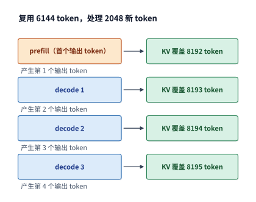

*图 3-1　恢复 6144 个上下文 token，处理 2048 个新输入并生成 4 个输出。首个输出 token 来自 prefill，后续 3 次 decode 各追加一个 token；纵向表示调用次序，间距用于示意。*

尽管 prefill 与 decode 两个阶段共享同一套模型权重，但它们的硬件资源瓶颈截然不同。以单个权重矩阵的乘法运算为例：prefill 阶段的输入激活矩阵包含 $BP$ 行，从显存读入一次权重即可与这 $BP$ 行输入做大矩阵乘法，权重复用率高；而单步 decode 的输入仅包含 $B$ 行，在并发度较低时，系统为了推进寥寥几个 token 也必须将整套模型权重从显存完整读取一遍。这正是工程上常说的“prefill 阶段通常受限于计算算力（compute-bound），而 decode 阶段通常受限于显存带宽（memory-bound）”的根本原因。

跳出单个请求来看，并发到达的多个请求之间还能创造新的数据复用机会。当多条请求同时处于 decode 阶段时，它们可以合批（batching）共享同一次模型权重读取，同时各自独立读取私有的历史上下文 KV 缓存；当一条长输入请求到达时，prefill 阶段则可一次性并行处理大量已知输入 token，将其特征向量拼接成行数更多的大矩阵送入矩阵计算单元。在线服务调度器必须在这些矩阵形状与资源瓶颈各异的工作之间动态分配执行时间。如果只把所有请求的 token 总数简单相加，就会掩盖这些 token 究竟处于哪个执行阶段、以及在什么时刻具备可执行条件等关键信息。

> **练习 3-1〔延伸〕：相同输出总量下，请求数量如何改变模型调用次数**
>
> 分别考虑一条请求输出 1024 个 token，以及八条请求各输出 128 个 token。每条请求的输入均为 1024 个 token。求两种情况下的 prefill 次数、后续 decode 总步数，以及各请求结束时的上下文长度。假设八条请求同步生成，比较每批共享一次权重时的读取轮数，再解释总输出相同为什么不足以判断完成时间。

### 3.1.2 任务目标与评价指标

底层的一次模型请求与用户层面的一项完整任务往往并非一一对应。普通问答也许只需一次模型生成即可结束；而自动修复一段代码缺陷，则往往需要依次执行读取源码文件、生成修改补丁、运行单元测试、再根据报错信息迭代修改等多个步骤。因此，在评估系统性能时，必须先界定“什么才算完成了用户任务”，再据此选择相应的度量指标。

我们先在单次模型请求的时间轴上标出三个关键时刻：请求到达系统的时刻 $t_a$、首个输出 token 返回客户端的时刻 $t_1$，以及最后一个输出 token 返回的时刻 $t_G$。由此可定义三个基础延迟指标：

$$
T_{\mathrm{TTFT}}=t_1-t_a,\qquad T_{\mathrm{request}}=t_G-t_a,\qquad
\overline T_{\mathrm{token}}=\frac{t_G-t_1}{G-1}\quad(G>1).
$$

其中，$T_{\mathrm{TTFT}}$（Time To First Token，首 token 延迟，本书亦简称“首响应时间”）是从请求到达系统直至首个输出 token 返回所经历的时间，用于衡量用户需要等待多久才能看到系统开始回应；完整请求延迟 $T_{\mathrm{request}}$ 衡量整段回答全部生成完毕所需的总时间；平均 token 间隔 $\overline T_{\mathrm{token}}$ 则反映开始输出后的流式生成节奏。优化系统中的某一个环节，只会直接改善包含该环节耗时的指标——例如，缩短请求在进入推理引擎前的排队等待时间能够直接降低 TTFT，但并不会自动加快请求开始生成之后的逐 token 输出速度。

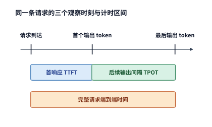

*图 3-2　请求到达、首个输出 token 与最后一个输出 token 决定三个计时区间。首响应包含开始生成前的等待，输出间隔描述生成过程，完整请求时间从到达累计到结束。*

在首个输出 token 抵达客户端之前，一条请求需要依次经历队列等待、输入分词与张量准备、加速器 prefill 计算以及网络结果回传等阶段。输入数据最初驻留在主机内存还是加速器显存中，决定了数据搬移发生的位置与开销；加速器完成计算后，输出 token 还需交回主机侧做后处理并通过网络连接发送给客户端。只要在系统日志中分别记录同一条请求进入和离开各个子阶段的时间戳，就能准确定位 TTFT 的耗时瓶颈究竟在哪一环（第 5 章将进一步展开加速器算子提交、数据传输与执行完成的具体硬件时序）。

当客户端以分块（chunk）方式流式接收多个 token 时，可以直接记录每个数据块的到达时刻及其包含的 token 数量，进而统计流式输出的平稳程度。对于具备长思考能力的推理模型（reasoning model），时间轴上还会多出一个关键观测点：模型在输出用户可见的正式回答之前，会先生成一段内部推理过程（即思考 token，thinking tokens）。因此，首个内部思考 token 生成的时刻、首个用户可见答案 token 出现的时刻以及整项任务最终完成的时刻，分别对应三个不同的计时节点。而在实时语音交互场景下，首个语音片段的播放延迟还包含音频声码器解码与终端播放缓冲的耗时，这部分将在第 3.3.3 节详细讨论。

| 要回答的问题 | 需要的指标或记录 |
| --- | --- |
| 多久开始回应？ | TTFT；reasoning 另记首个有用输出 |
| 输出是否连续？ | 逐 token／逐块间隔及其分布 |
| 多久把事情做完？ | 完整请求时间、完整任务时间 |
| 每秒完成多少合格任务？ | 在质量与时限要求下的有效吞吐 |
| 得到一个成功结果花多少？ | 全部尝试的模型、工具和环境成本／成功任务数 |
| 等待期间还占着什么？ | 状态所属的请求与模型版本、大小、存放位置和驻留时间 |

在评估服务质量时，如果只看算术平均值，往往会掩盖少数慢请求带来的恶劣体验。工程上通常使用分位数指标——例如第 95 百分位数（p95）——来刻画尾部较慢的请求表现。本章统一采用最近秩法（nearest-rank method）计算分位数：将 $n$ 个观测样本按从小到大排序后，取第 $\lceil0.95n\rceil$ 个样本的值作为 p95。例如，4 条请求的 p95 就是其中的最大值（第 4 个），而 480 条请求的 p95 则是排序后的第 456 个样本。分别对完整请求耗时、排队等待耗时与 TTFT 独立排序并观察其 p95，便能清晰分辨长尾延迟究竟源于排队积压还是执行缓慢；需要注意的是，完整请求耗时的 p95 是由各条请求的全程总耗时直接排序得出的，并不等于各子阶段 p95 的简单相加。

除了时间维度的延迟指标，请求在执行与等待期间对存储空间的占用同样需要量化考核。历史状态在显存或内存中驻留的时间越长，相同存储容量在同一时期能够周转服务的并发任务数就越少。设某项任务在时刻 $t$ 占用的状态空间大小为 $M(t)$，则该任务在整个生命周期内的**状态时空面积**（即占用空间对时间的积分）定义为：

$$
A_M=\int_{t_{\mathrm{start}}}^{t_{\mathrm{end}}}M(t)\,\mathrm dt.
$$

将每个时间片内占用的字节数乘以持续时长再累加，所得几何意义正是状态占用曲线下的面积，量纲为 $\mathrm{byte\cdot s}$（或 $\mathrm{GiB\cdot s}$）。例如，1 GiB 的 KV 状态在显存中持续驻留 10 秒，对应的时空面积即为 $10\ \mathrm{GiB\cdot s}$——在这 10 秒内，尽管状态本身的数据量并未增加，但这 1 GiB 的显存空间一直被锁定，无法分配给其他请求使用。由排队论中的利特尔法则（Little's Law）可知，若任务以平均每秒 $\lambda$ 个的速率持续进入等待状态，每个任务平均占用 $M_0$ 字节、平均等待 $\tau$ 秒，则在稳态下，仅这些处于等待中的任务所占用的平均存储容量就高达 $\lambda M_0\tau$。这意味着，外部工具调用的响应变慢不仅会拉长单次任务的端到端延迟，还会直接演变为显存或内存的容量瓶颈。

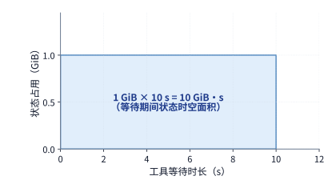

*图 3-3　1 GiB 状态持续占用空间 10 秒，对应面积为 10 GiB·s。横轴为状态驻留时间，纵轴为占用空间；面积描述这段等待期间的累计存储占用。*

在延迟与存储占用之外，系统还必须核算真正解决问题所付出的经济与算力代价。**单次成功任务成本（cost per successful task）**定义为：将所有尝试（包括中途失败的生成、多次重试采样、工具测试及沙箱环境运行）所消耗的总成本相加，再除以最终通过检验的成功任务数量。通过这一口径，失败尝试的资源消耗被如实计入分子，而分母则严格对应交付给用户的合格结果数。当某一批次尝试的成功数为零时，系统应单独记录该批次的总资源消耗与失败原因；待取得成功结果后，再将全部尝试的累计总成本分摊到成功任务数上。[^cost]

### 3.1.3 请求分布

计算资源与存储空间在时间上有一个根本区别：前一分钟加速器处于空闲状态，后一分钟突然涌入大批需要长文本生成的请求，后到的请求依然必须排队等待——因为前一分钟闲置浪费的算力无法“储存”到后一分钟使用。TTFT 与 token 间隔衡量的是单条请求的服务体验；而当多条请求随时间陆续到达时，这些指标的表现很大程度上取决于各条请求是否在同一个时间窗口内争抢有限的硬件处理能力。

因此，刻画真实服务的负载特征时，不能只看全局均值，而必须保留**请求到达时刻、输入长度与输出长度的联合分布**。一条长请求不仅会延长其自身的占用与服务时间，还可能推迟后续请求的启动；反之，短请求快速执行完毕并释放显存，则能让后续请求更早进入调度。哪怕两组负载的总请求数、平均输入长度与平均输出长度完全一致，只要请求到达的先后次序或组合比例不同，系统的排队等待时间、完成时间以及状态占用峰值也可能相差悬殊。下面我们保持本章开头两分钟负载的请求总量与平均长度不变，先通过理论模型计算到达分布如何引发队列积压，再对照真实推理引擎上的实测结果。

在生产环境中，线上流量往往汇聚自业务形态各异的不同客户：有的客户主要批量提交长文档摘要请求（长输入、短输出），有的客户则主要调用模型编写长篇报告或代码（短输入、长输出）。哪怕单个客户的请求长度分布各自稳定，只要不同客户在一天各时段的调用频率发生起伏，汇聚后的整体负载结构就会随之剧烈波动。ServeGen 对大规模生产推理服务的实证研究记录了这一现象，并提出了按客户构成与时变到达率建模来高保真复现生产负载的方法。[^servegen]

**例题 3-1：平均处理能力足够，为什么仍会积压？** 设 decode 阶段由两张 RTX PRO 6000 Blackwell Workstation Edition 显卡承担，试判断它们能否平稳消化本章开头的两分钟负载。

解：我们将章首的平均负载拆解为两类典型请求的组合：
- **长输入类请求**：每条输入 8192 个 token、输出 256 个 token；
- **长输出类请求**：每条输入 1024 个 token、输出 2048 个 token。

在两分钟（120 秒）内，两类请求各到达 240 条，总计 480 条，全局平均到达率恰好为每秒 4 条（平均输入 $\frac{8192+1024}{2}=4608$ 个 token，平均输出 $\frac{256+2048}{2}=1152$ 个 token）。现在对比两种到达模式：第一种为**均匀混合**，两分钟内两类请求始终按 $1:1$ 的比例均匀到达；第二种为**时段变化**，前一分钟到达的请求中长输入类与长输出类占比为 $9:1$，后一分钟占比反转为 $1:9$。由于每条请求的首个输出 token 由 prefill 阶段直接产生，后续需要的 decode 步数等于输出总长度减 1（即长输入类需 255 步 decode，长输出类需 2047 步 decode），由此可算出三个时间窗口内的工作到达率：

| 时间窗 | 新输入 token/s | 后续 decode 步/s |
| --- | ---: | ---: |
| 均匀混合 | 18,432 | 4,604 |
| 时段变化，前一分钟 | 29,900.8 | 1,736.8 |
| 时段变化，后一分钟 | 6,963.2 | 7,471.2 |

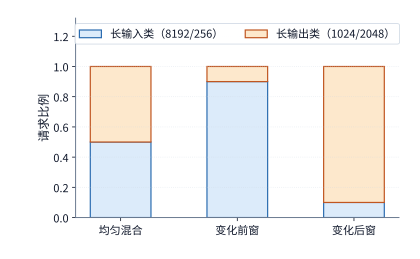

*图 3-4　两分钟总量相同的三个时间窗中的请求组成。长输入类为 8192 输入、256 输出，长输出类为 1024 输入、2048 输出；两类混合比例改变阶段需求。各类请求的输入、输出长度均以 token 为单位。*

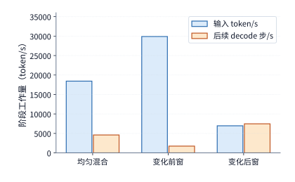

*图 3-5　三个时间窗中，请求组成对应的输入与后续生成需求。输入数按 token 计，后续生成按每请求的一次 decode 步计；每请求首个输出 token 已计入 prefill。输入项统计每秒新处理的输入 token；decode 项统计所有请求每秒需要执行的后续 decode 步，每步推进一个 token。*

**队列模型假设：时间窗内均匀到达、硬件处理率恒定。** 我们采用流体队列模型（fluid queue model），将离散的 decode 步近似为连续到达的工作流；假设每个时间窗内工作以恒定速率均匀流入，硬件的最大处理速率恒定，且初始时刻队列为空。队列计量单位定义为“单条请求执行 1 次后续 decode 步”，prefill 阶段的资源需求另行单独核算。

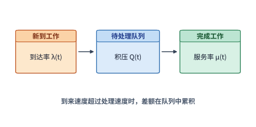

*图 3-6　工作先进入队列，再由处理资源完成。到来快于处理时差额留在队列中；处理快于到来时，资源逐步消化已有积压。*

以时间窗长度 $\Delta t$ 为步长，第 $k+1$ 个时间窗开始时的队列积压量 $Q_{k+1}$ 可由以下递推式求出：

$$
Q_{k+1}=\max(0,Q_k+A_k-\mu_k\Delta t).
$$

式中，$Q_k$ 为第 $k$ 个时间窗开始时的待处理积压工作量，$A_k$ 为该时间窗内新到达的工作量，$\mu_k\Delta t$ 为硬件在该时间窗内最多可完成的工作量。当工作到达速率低于硬件处理速率时，已有积压被逐步消化直至队列排空；反之，当到达速率超过硬件处理速率时，超出部分便会滞留在队列中并结转至下一个时间窗。

递推式中的最大处理速率 $\mu_k$ 可由显卡硬件规格与第 1、2 章的带宽公式直接导出。全局平均每秒到达 4 个请求，共需生成 $4\times1152=4{,}608$ 个输出 token；扣除由 prefill 产生的 4 个首个输出 token，每秒需要执行的后续 decode 步数为 4,604 步。如前所述，decode 阶段的吞吐受显存带宽限制。单张 RTX PRO 6000 Blackwell Workstation Edition 配备 96 GB 显存与 1792 GB/s 显存带宽；假设每张卡各自独立加载一份完整的 Qwen3-8B BF16 权重（16.381 GB），且每批次最多并发执行 64 条序列。在每一轮 decode 步中，显卡至少需要将 15.14 GB 的非词嵌入共享权重读取一遍，并读取当前批次全部 64 条序列的历史 KV 缓存（Qwen3-8B 下每个上下文 token 占 144 KiB）。在 decode 过程中，长输入类请求的平均可见上下文长度为 $8192+127=8319$ 个 token，长输出类请求则为 $1024+1023=2047$ 个 token；在 $1:1$ 均匀混合下，按各自的 decode 步数加权平均，单步 decode 所面对的平均上下文长度为 $(255\times8319+2047\times2047)/2302\approx2742$ 个 token。由此算得，64 条序列合批执行一步 decode 至少需要读写约 41.02 GB 数据（含 15.14 GB 共享权重读取、约 25.88 GB 历史 KV 读取以及新 KV 写入等），按 1792 GB/s 峰值带宽计算至少耗时 22.89 ms。这意味着单张卡每秒最多完成 $64 / 0.02289\approx2{,}795.66$ 个 decode 步，两张卡合计每秒最多完成约 5,591.33 步。需要注意，这一数值是按 100% 峰值带宽利用率算出的物理上限，实际系统吞吐只会更低。为简化对比，三个时间窗均沿用这一理论上限作为处理速率 $\mu_k$。

设初始时刻 decode 队列为空。对比上表可知：在均匀混合（4,604 步/s）和时段变化的前一分钟（1,736.8 步/s）下，两张卡 5,591.33 步/s 的处理能力均绰绰有余；然而到了时段变化的后一分钟，每秒新到达的 decode 工作高达 7,471.2 步，每秒净超载 $7471.2-5591.33\approx1879.87$ 步。持续 60 秒后，队列中将积压约 112,792 个待执行的 decode 步；即便在 120 秒末彻底停止接收新请求，两张卡仍需满负荷运转 $112792/5591.33\approx20.17$ 秒才能将积压队列排空。前一分钟富余的算力无法跨时段转移给后一分钟使用，这正是全局平均指标掩盖局部拥塞与排队积压的症结所在。[^workload]

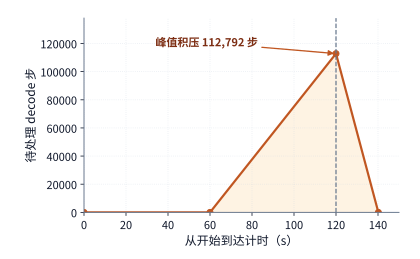

*图 3-7　两张 RTX PRO 6000 每秒最多完成约 5,591 个 decode 步时的流体模型。后一分钟积压至 112,792 步，120 秒后停止到达，再经过约 20.17 秒排空。*

**KV 缓存容量上限如何影响排队与首响应。** 为了进一步观察请求到达次序在真实系统中对用户体验的影响，我们在单张 RTX PRO 6000 Blackwell Workstation Edition（96 GB 显存）上使用 vLLM 0.23 运行 Qwen3-8B，分别回放上述“均匀混合”与“前 $9:1$、后 $1:9$”两组到达序列。实验中，专门预留给请求上下文的 KV 缓存池（KV pool）容量设为 24 GiB，最大并发序列数设为 64，关闭跨请求的前缀缓存（prefix caching），并强制每条请求严格生成指定数量的 token。当活跃请求不断增长的 KV 缓存将 24 GiB 缓存池占满时，vLLM 调度器不得不暂停部分正在生成的请求、释放其占用的 KV 显存，待后续有空余空间时再恢复或重新计算——这一机制称为**抢占（preemption）**。两组实验均在 120 秒内注入全部 480 条请求，待所有请求执行完毕后，实测统计结果如下表所示。[^arrival]

| 实际观察 | 均匀混合 | 前 9:1、后 1:9 |
| --- | ---: | ---: |
| 完整请求 p95 | 约 299.4 s | 约 299.4 s |
| TTFT p95 | 242.9 s | 258.9 s |
| 初次调度等待 p95 | 242.4 s | 258.4 s |
| 最后一条请求完成时距起点的时间 | 419.8 s | 418.7 s |
| 抢占事件 | 62 | 24 |

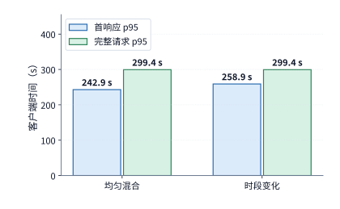

*图 3-8　同一实际实例回放两种到达序列的结果。完整请求 p95 接近，首响应 p95 则相差约 16 秒；模型、加速器、KV 池与并发上限均按正文实验条件固定。*

首先，两组实验均出现了严重的排队积压，这一点从例题 3-1 的带宽下界便已注定：单张卡每秒最多只能完成约 2,796 个 decode 步，远低于均匀混合下每秒 4,604 步的平均需求，更何况同一张卡还必须分出算力执行 prefill。480 条请求合计包含 552,480 个后续 decode 步，仅这部分生成工作在单卡上至少就需要 197.6 秒，而全部请求在前 120 秒内便已涌入系统。

更有启发意义的是两组结果之间的差异：尽管两种到达模式下整批请求的最终清空时间（约 419 秒）与完整请求延迟 p95（约 299.4 秒）几乎一致，但后者的 TTFT p95 和初次调度等待时间 p95 却相差约 16 秒（后者高出约 16 秒）。监控采样表明，两次运行期间 24 GiB 的 KV 缓存池利用率均多次触及 100%，大批新到达的请求被挡在调度队列中等待显存空间。长输入与长输出请求在不同时段的组合比例，改变了在途请求何时执行完毕并归还 KV 空间、进而决定了新请求何时能获准入场执行；与此同时，KV 池满载触发的抢占事件（分别为 62 次与 24 次）也重排了请求的等待与重算次序。

这一实测清晰揭示了在线推理系统中的双重排队机制：请求排队不仅可能源于计算或带宽吞吐不足，还可能源于**在途请求占用的 KV 状态空间尚未释放**——一旦 KV 缓存池被占满，即便加速器上仍有富余算力，新到达的请求也只能在队列中等待旧请求腾出显存空间。[^serve-replay]

例题 3-1 给出的流体递推式同样可以直接用来估算任意突发流量下的积压规模与恢复时间：若工作到达速率 $\lambda_w$ 在连续 $\tau$ 秒内高于系统处理速率 $\mu$（且突发开始前队列为空），则突发结束时的峰值积压量为 $(\lambda_w-\mu)\tau$；突发流量回落或停止后，消化这批积压所需的排空时间为 $(\lambda_w-\mu)\tau/\mu$。可见，高负载突发的持续时间 $\tau$ 每延长一倍，峰值积压量与事后排空时间都会随之翻倍。

> **练习 3-2〔核心〕：突发请求与工具等待如何增加积压和状态占用**
>
> 采用例题 3-1 中第二分钟的负载强度，即每秒新增 7,471.2 步 decode 工作。将这一突发负载的持续时间改为 30 秒，decode 资源分别取两张和三张 RTX PRO 6000 Blackwell Workstation Edition，每张卡的处理率沿用例题 3-1 求得的约 2,796 步/秒。初始队列为空，求这 30 秒内积压量随时间的变化，以及请求停止到达后清空积压所需的时间。随后考虑另一种负载：每秒有两个任务进入工具等待阶段，每个任务等待 10 秒，期间状态占用 1 GiB 空间。求稳定状态下的平均等待任务数与状态占用；将等待延长到 30 秒后重新计算。

## 3.2 多轮交互与 Agent 任务

### 3.2.1 多轮对话与前缀增长

第 3.1 节将每条请求视作彼此独立的单次调用；而在多轮对话与 Agent 场景中，同一项任务往往由一连串前后承接的模型调用组成。在多轮交互中，每一轮新请求通常都携带完整的历史对话上下文：第一轮输入包含系统提示词（system prompt）与用户的首个问题；第二轮除了新增的用户提问或工具返回结果外，还会拼接第一轮的输入与模型回答；此后每一轮的输入长度随对话轮次不断累加。如果只统计用户本轮新输入的字数，就会严重低估模型实际需要处理的上下文规模。

设第 $i$ 轮调用的完整输入序列总长度为 $I_i$，其中与前序轮次完全一致、可直接命中缓存的历史前缀长度为 $K_i$，则本轮真正需要送入 prefill 重新编码的新增输入长度 $P_i$ 与可复用上下文长度 $S_i$ 分别为：

$$
P_i=I_i-K_i,\qquad S_i=K_i.
$$

将 $P_i$ 与 $S_i$ 代入第 2 章的资源公式即可看出：在线性投影与 FFN 层中，模型只需对新增的 $P_i$ 个 token 执行矩阵运算；但在注意力层以及后续的 decode 阶段，新增 token 的查询向量依然必须访问全部 $S_i$ 个历史前缀的 KV 状态。换言之，前缀缓存复用省去了历史输入在 prefill 阶段的重复计算，但并未免除后续步骤对这段历史上下文的存储占用与带宽读取。

我们以一次包含 4 轮模型调用的真实代码修复 Agent 任务（模型为 Qwen3-8B）为例，量化核算前缀缓存带来的算力节省（见图 3-9）。在这 4 轮调用中，累计送入模型的完整输入共 5,297 个 token，其中命中前缀缓存的有 4,480 个 token，未命中的新增部分仅 817 个 token。具体到每一轮：第 1 轮从零开始输入 206 个 token（命中 0、新增 206，prefill 矩阵运算量为 $2.875\ \mathrm{TFLOPs}$）；到了第 2 轮，输入总长膨胀至 1,443 个 token，但其中前 1,392 个 token 直接命中第 1 轮留下的 KV 缓存，prefill 阶段只需处理新增的 51 个 token，使本轮 prefill 矩阵运算量从无缓存时的 $20.661\ \mathrm{TFLOPs}$ 大幅降至 $0.752\ \mathrm{TFLOPs}$；第 3 轮（命中 1,440、新增 216）与第 4 轮（命中 1,648、新增 344）同样将单轮 prefill 运算量分别从 $23.815\ \mathrm{TFLOPs}$、$28.844\ \mathrm{TFLOPs}$ 压缩至 $3.199\ \mathrm{TFLOPs}$ 与 $5.149\ \mathrm{TFLOPs}$（随后的 decode 步依然需要读取完整前缀的 KV 状态）。如果关闭前缀缓存、每一轮都对完整输入从头计算 prefill，4 轮调用的 prefill 矩阵运算量合计高达 $76.196\ \mathrm{TFLOPs}$；而启用前缀缓存复用后，prefill 总运算量大幅降至 $11.976\ \mathrm{TFLOPs}$（仅为前者的约 15.7%，净省去 $84.3\%$）。可见，前缀缓存的核心权衡在于：**用历史 KV 状态在存储系统中的持续驻留，换取多轮交互中 prefill 算力消耗的大幅下降**。[^agent-calc]

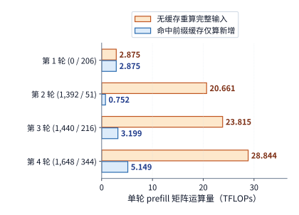

*图 3-9　四轮代码修复 Agent 任务的 prefill 阶段矩阵运算量对比。橙色柱为无缓存重算完整输入，蓝色柱为命中前缀缓存后仅计算新增输入 token；纵轴括号内依次为每轮命中的历史前缀 token 数 $K_i$ 与新增输入 token 数 $P_i$（模型为 Qwen3-8B）。*

应用层编辑上下文的方式，会直接决定下一轮调用能够复用多少前缀。在自回归因果掩码下，每个位置的隐状态都依赖于它前面的所有 token：如果只在上下文末尾追加新内容，原有的历史前缀丝毫未变，其 KV 缓存可以 100% 复用；如果用一段压缩摘要替换掉历史对话中间的某一段旧内容，那么从替换位置往后的所有 token，其前置上下文都发生了改变，它们的 KV 缓存全部失效、必须在下一轮重新计算；而如果修改了位于最开头的系统提示词或工具定义模板，则可能导致整条上下文的前缀缓存从头失效。

因此，应用层的上下文管理策略不仅影响当轮调用，还会塑造后续轮次的系统负载。将新内容一味追加在末尾最有利于保持高缓存命中率，但会让陈旧或无关的历史信息长期膨胀并占据 KV 空间；反之，主动裁剪或重写早期历史虽然缩短了序列总长度，却会破坏前缀一致性、引发缓存重建开销。究竟应当保留原状、淘汰换出还是压缩重算，取决于重建所需的计算代价、状态占用的空间大小以及两次调用之间的复用时间间隔（第 8 章将对此作定量比较）。[^context]

我们可以用一个简单的数字对比来直观理解修改位置对前缀复用的影响：假设当前已有 2000 个 token 的历史上下文，若在末尾追加 100 个新 token，prefill 只需计算这新增的 100 行输入；但若修改了原序列中第 501 个位置的 1 个 token，则从第 501 个位置到第 2000 个位置的隐状态全部改变，可直接复用的最长公共前缀骤降至前 500 个 token，其余 1500 个 token 都必须重新执行 prefill。可见，前缀缓存的收益不仅取决于“改了多少个 token”，更取决于“改动发生在序列的哪个位置”。

站在应用开发者的角度，上下文是编排提示词、历史记录与工具结果的逻辑接口；而站在底层推理系统的角度，上下文的组织方式直接决定了算力消耗与状态驻留时长。在末尾追加工具输出、改写早期历史摘要、或是从同一段上下文分叉出多条候选生成分支，会分别改变新增 prefill 计算量、可复用前缀长度以及各分支私有状态的增长轨迹。如果推理服务系统能够感知这些上层结构关系，就能有针对性地保留高频共享前缀、在候选分支间采用写时复制（copy-on-write）共享公共历史，并在漫长的外部工具等待期间将暂停任务的 KV 状态换出至主机内存或外部存储。为此，针对 Agent 负载的评测与日志记录除了常规的输入输出长度外，还应记录稳定前缀长度、上下文改写位置、分支拓扑依赖以及轮间复用间隔——第 8 章将利用这些信息设计上下文管理与缓存淘汰策略，第 9 章则进一步将其推广到分布式集群中的状态放置与跨节点迁移。

### 3.2.2 推理与验证：完成一个任务需要多少成本

前缀缓存用于消除历史输入的重复计算；与之相对，近年来兴起的测试时计算扩展（test-time scaling）则主动在推理阶段投入更多生成计算，以期换取更高的复杂任务解答正确率。增加推理阶段计算量主要有三条技术路径：一是拉长单条回答内部的链式思考过程（chain-of-thought）；二是针对同一问题并行采样生成多份候选回答，再通过验证器（verifier）或投票机制从中择优；三是基于问题难度动态分配采样次数与思考长度（adaptive compute allocation）。这三种路径对应的系统负载特征各不相同：拉长单次思考会显著增加串行 decode 步数与单条序列的 KV 状态长度；并行生成多份候选会成倍增加并发计算量与外部验证调用次数；而动态难度分配则要求系统在运行过程中实时评估置信度并决定何时提前终止。

判断投入额外生成算力在经济上是否合算，不能只看单次调用的开销，而必须核算**平均每个成功任务的综合成本**。设某种策略下单次尝试的平均成本为 $c$、任务解答成功率为 $p$；若在相同独立分布下重复尝试直至成功，所需的期望尝试次数为 $1/p$，则完成一个成功任务的期望成本为：

$$
C_{\mathrm{success}}=\frac{c}{p}.
$$

设原有基线策略的单次成本与成功率分别为 $c_1,p_1$，引入额外推理计算后的新策略分别为 $c_2,p_2$。要使新策略降低每个成功任务的综合成本（即 $C_{\mathrm{success},2} < C_{\mathrm{success},1}$），必须满足：

$$
\frac{p_2}{p_1} > \frac{c_2}{c_1}.
$$

这一不等式给出了评估一切测试时计算扩展策略的黄金准则：**任务成功率的相对提升倍数，必须大于单次尝试总成本的相对增长倍数**。这里计入 $c$ 的成本不仅包含模型自身的生成开销，还必须涵盖候选答案验证、测试沙箱运行以及所有失败尝试的消耗。

**实测反例：单纯放宽生成长度上限并未提高数学题解答成功率。** 脱离任务正确率去谈论生成速度或吞吐量是没有实际意义的。在我们开展的一项数学竞赛题实测中，针对 4 道高难度题目分别采样多份回答，并将模型的最大输出长度上限从 1024 个 token 大幅放宽至 4096 个 token；然而经过两轮完整尝试后，模型依然未能给出任何一份通过自动判题检验的最终答案。在这个例子里，延长生成实实在在地消耗了数倍的算力与时间，但成功任务数仍为零——单纯增加输出 token 预算并不会自动转化为有效解答。[^reasoning]

在对模型输出做自动化检验时，还应当严格区分**接口格式错误**与**实质内容错误**：一份严格符合 JSON 或指定提取格式的回答，其推导出的数学数值可能是错的；反之，一份已经算出了正确数值的回答，也可能因为遗漏了约定的封装标记或字段而未能通过解析器校验。唯有在评测中将这两类失败原因剥离统计，工程团队才能准确判断下一步究竟该调整采样策略、强化结构化输出约束，还是改进模型本身的解题能力。[^reasoning-off]

此外，在核算长期服务成本时，还必须警惕“单价下降但总成本反而上升”的悖论。即便底层推理优化或选用轻量模型使每百万 token 的单价大幅下降，只要完成单个任务所消耗的 token 总量膨胀得更快，单次成功任务的实际花费依然可能不降反升。我们不妨算一笔直观的账：假设新系统将每个 token 的推理单价降至原来的 $\frac{1}{10}$，但为了开启长思考与多次重试，每个任务消耗的平均 token 数膨胀到了原来的 20 倍（即单次尝试的模型成本变为原来的 $20\times\frac{1}{10}=2$ 倍），同时任务成功率由 $50\%$ 提升至 $80\%$。在仅计入模型 token 费用且独立重复尝试的简化假设下，新旧系统的单次成功任务成本之比为：

$$
\frac{C_{\mathrm{success,new}}}{C_{\mathrm{success,old}}} = \frac{2c_1 / 0.8}{c_1 / 0.5} = 2\times\frac{0.5}{0.8} = 1.25.
$$

可以看到，“token 单价下降 90%”、“任务成功率提升 30 个百分点”与“每做成一件事的实际成本上涨 25%”这三件事完全可以同时发生。对于包含多轮对话与工具调用的复杂 Agent 任务，工程上可以直接沿着真实执行轨迹累加所有轮次的模型调用与工具运行费用，再除以最终通过全套验收测试的任务数量来核算真实成本。[^cost]

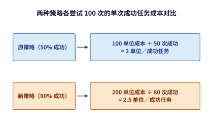

*图 3-10　各尝试 100 次的教学比较。所有尝试的成本都进入分子，通过检查的成功任务数进入分母；两种策略的成功任务成本分别为 2 和 2.5 单位。*

> **练习 3-3〔延伸〕：成功率提高能否抵消单次尝试成本的增加**
>
> 旧方法每次尝试成本为 1 单位、成功率为 50%；新方法成本为 2 单位、成功率为 80%。计算平均每完成一个成功任务所需的成本，并判断新方法是否更省。若新方法成本降到 1.5 单位，成功率至少应达到多少，才能使每个成功任务的平均成本不高于旧方法？对需要多次采样的任务，说明生成、验证和失败尝试的开销应怎样计入总成本。
>
> 沿用第 3.2.4 节末的决策请求算例：决策模型处理一条请求花费 0.000081 美元，转交 LLM 每条花费 0.013880 美元。设转交前后的成功率分别为 $p_1,p_2$，求转交比例为 1% 和 5% 时每条请求的平均费用；$p_2/p_1$ 至少达到多少，转交才能降低每个成功任务的费用？

### 3.2.3 智能体工作负载

外部环境与工具的运行反馈还会动态改变后续的模型计算轨迹。以软件工程中的代码修复 Agent 为例：模型先阅读故障描述并生成代码修改方案，外部工具负责将补丁写入文件并拉起测试套件，随后模型再读取测试输出的报错日志以决定下一步如何修改。在这个交互循环中，每一轮迭代都包含“模型推理”与“工具执行”两个阶段，而工具打印出的日志又会原封不动地追加为下一轮模型调用的新增输入。因此，在工具端过滤掉冗长无关的调试输出，能够直接削减下一轮 prefill 的计算量与 KV 缓存占用；而提高模型单次修改的准确度、减少盲目试错，则能直接压缩整个修复流程的迭代轮数。

本章采用的实测基准任务是修复一个 Python 区间合并（interval merge）函数，验收标准包括检查函数返回值是否正确，以及调用后原输入列表是否保持未被原地篡改。在运行过程中，语言模型负责分析问题并输出工具调用指令，外部沙箱环境负责执行文件写入与单元测试。下面我们选取在 4 轮迭代内成功通过全部原定验收检查的那条执行轨迹，分别拆解模型推理耗时、外部工具执行耗时以及等待期间驻留的上下文状态（完整的逐轮工具调用明细见章末附录[代码任务轨迹](#agent-trace-detail)）。[^agent]

检索增强生成（RAG，Retrieval-Augmented Generation）问答系统也遵循高度相似的负载耦合规律：前级检索器先从知识库中召回候选文档片段，再将这些片段拼接到提示词中交给语言模型阅读并生成回答。在保证最终回答质量不变的前提下，检索器召回的无关文档越少、文本越精炼，后续语言模型在 prefill 阶段的计算量、KV 缓存占用以及 decode 阶段的上下文读取开销就越低。因此，前级工具或检索器的输出质量会直接传导并放大为后级模型的系统负载（第 8 章将结合具体业务场景定量比较不同检索与重排方案的系统总开销）。[^retrieval]

### 3.2.4 分支、工具等待与状态驻留

在一个复杂的 Agent 任务中，历次模型调用与外部工具执行之间的先后制约关系可以抽象为一张有向无环依赖图（DAG）：在同一条串行依赖链路上，各阶段的耗时依次累加；而彼此之间没有数据依赖的多个分支则可以并行启动，并在下游汇合节点处等待其中最慢的那条分支执行完毕。在这张依赖图中，从任务起点到终点累计耗时最长的那条路径称为**关键路径（critical path）**，它的长度直接决定了整项任务最快需要多久才能完成。我们先通过真实代码修复任务的实测数据观察模型推理与工具执行各自的时间占比，再分析改变步骤间的依赖结构能够通过并行化节省多少端到端时间。下表对比了同一个代码修复任务在“关闭思考模式”与“开启思考模式”两种配置下的实测运行表现（思考模式决定了模型在给出工具调用或正式回答前，是否先生成第 3.1.2 节所述的内部思考 token）。

| 观察 | 思考模式关闭 | 思考模式开启 |
| --- | ---: | ---: |
| 模型调用轮数 | 12 | 4 |
| 总输出 token | 765 | 2,733 |
| 模型调用实际耗时之和 | 13.156 s | 76.294 s |
| 工具执行实际耗时之和 | 0.476 s | 0.078 s |
| 返回值正确性与输入不变检查 | 315/1013 | 1013/1013 |
| 额外检查：返回的子列表无别名 | 1/1013 | 710/1013 |

对比表中数据可以看到：当关闭思考模式时，尽管 12 轮调用的前缀缓存命中率高达约 83.4%，且模型总耗时仅 13.156 秒，但历经 12 轮交互（含 5 次代码改写）后代码依然只通过了 1013 个测试用例中的 315 个，未能完成修复任务；而开启思考模式后，模型单次生成时间大幅增加（4 轮模型调用累计耗时 76.294 秒），但仅用 4 轮迭代便 100% 通过了“返回值正确性”与“输入列表不变”两项原定验收测试（1013/1013）。此外，若进一步追加一项更严苛的“返回结果中的子列表与原输入无内存别名（no aliasing，即深拷贝独立）”检查，开启思考模式生成的程序通过了其中 710 个用例，其余 303 个用例仍复用了原输入的内部子列表引用。[^agent] 这两组测试通过率的差异再次印证：Agent 任务的完成标准必须落实为明确、可执行的自动化验证断言。

在开启思考模式的成功轨迹中，模型在 4 轮调用里总共输出了 2,733 个 token，其中有 2,553 个 token 位于思考结束标记（`</think>`）之前，3 个 token 为结束标记本身，仅有 177 个 token 是思考结束后正式输出的工具调用与总结文本。换言之，超过 93% 的生成工作量都消耗在内部链式思考上，而外部工具调用则负责将模型深思熟虑后的修改方案快速落实为文件写入与测试验证。沿着执行时间轴将历次模型调用耗时、工具运行耗时以及框架控制与进程间交接开销累加起来，便构成了用户感知的完整任务端到端延迟。

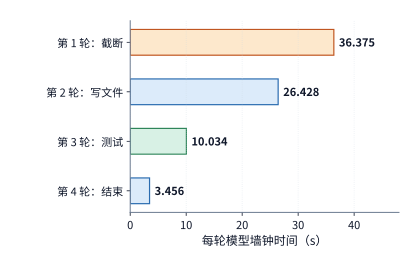

*图 3-11　代码任务中四轮模型调用的实际耗时，各轮从自己的起点计时。模型时间合计 76.294 秒，工具合计约 0.078 秒，整任务另含控制与交接时间。*

**例题 3-2：加速首轮模型计算能缩短多少代码任务时间？** 试运用第 1 章介绍的 Amdahl 定律分析局部优化对整项代码修复任务的端到端收益（假设后续各轮的生成内容、工具行为与修复质量均保持不变）。

解：以开启思考模式的完整执行轨迹（总耗时 76.510 秒）为基准。其中，第 1 轮模型调用耗时 36.375 秒；若通过推理优化将该轮模型计算耗时缩短一半（即加速比 $s=2$），而其余轮次的模型调用、工具执行及控制交接开销均保持不变，则整项任务的总耗时将从 76.510 秒降至 $76.510 - 36.375/2 = 58.323$ 秒。代入 Amdahl 定律，被优化部分占原任务总时间的比例为 $f=36.375/76.510\approx47.5\%$，局部加速比 $s=2$，由此得到的端到端总加速比约为 $76.510 / 58.323 \approx 1.31$（即节省了约 23.8% 的总时间），而未被加速的其余阶段合计仍需消耗约 40.1 秒。这再次说明，任何单项优化对端到端任务延迟的实际改善幅度，首先受限于被优化阶段在完整关键路径中所占的时间比例。[^agent-speedup]

当任务中包含多个外部工具调用时，工具之间是否存在数据依赖也会显著改变关键路径长度。假设模型先推理 2 秒，随后发起两个工具调用（工具 A 耗时 6 秒，工具 B 耗时 10 秒），待工具返回结果后模型再汇总推理 3 秒。如果工具 B 的输入依赖于工具 A 的执行结果，二者只能串行执行，任务总耗时为 $2+6+10+3=21$ 秒；反之，如果两个工具彼此独立、可以同时并发启动，则下游只需等待较慢的工具 B 完成即可，关键路径总耗时缩短为 $2+\max(6,10)+3=15$ 秒。可以看到，并行执行将用户等待的端到端时间缩短了 6 秒，但两个工具实际消耗的 CPU/沙箱总工作时长依然是 $6+10=16$ 秒。

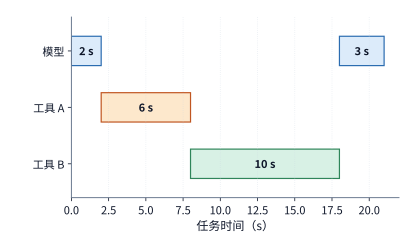

*图 3-12　两个工具存在前后依赖时的任务时间线。模型先运行 2 秒，工具 A 用 6 秒，工具 B 用 10 秒，模型最后运行 3 秒，总计 21 秒。*

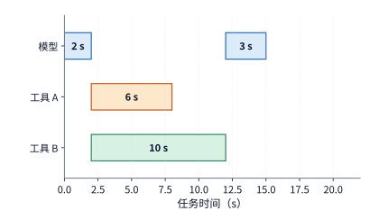

*图 3-13　两个工具独立时可以同时开始，模型在较慢的工具 B 完成后继续，任务共 15 秒。与前图使用相同时间尺度；工具工作总量仍为 16 秒。*

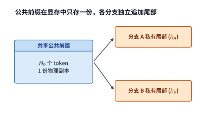

*图 3-14　两个生成分支指向同一份公共前缀，并各自保存新增尾部。箭头表示引用关系，共享前缀只计一份容量。*

并行执行与多分支采样改变的不仅是关键路径时间，还会改变显存中的状态占用结构。当模型从同一段历史上下文分叉出多个并行生成分支时，各分支的公共历史前缀可以在显存中只保存一份物理副本并通过指针引用共享，而各个分支各自新生成的尾部 token 则必须独立分配空间保存。设公共前缀长度为 $H_0$ 个 token，第 $i$ 条分支各自新生成了 $h_i$ 个 token，每 token 的 KV 状态大小为 $c_{\mathrm{KV}}$，则这组分支在同一时刻占用的总状态容量为 $c_{\mathrm{KV}}(H_0+\sum_i h_i)$。因此，多分支并行虽然压缩了串行等待的墙钟时间，却会让多份分支尾部的私有状态在同一时段叠加占用显存。

在第 3.2.3 节的单文件 Python 修复任务中，每次单元测试仅耗时几十毫秒（4 轮工具执行合计仅 0.078 秒），绝大部分时间都花在模型生成上。但在真实的工业级研发场景中，如果工具调用是一次耗时数十秒乃至数分钟的大型 C++ 项目编译或集成测试，在模型暂停等待工具返回的整段时间内，下一轮推理所需的数千乃至数万个上下文 token 的 KV 状态依然滞留在存储系统中；当成百上千个 Agent 会话同时处于工具等待阶段时，驻留的状态容量便会按并发会话数线性累加。工具执行耗时越长，状态驻留的时空面积就越大，同等显存容量下系统能够同时承载的活跃会话数就越少（第 8、9 章将针对这一时间线讨论 KV 状态的卸载换出与跨节点交接机制）。

> **练习 3-4〔核心〕：工具并行与局部加速能节省多少任务时间**
>
> 一次任务先由模型计算 2 秒，然后调用两个相互独立的工具，分别耗时 6 秒和 10 秒。两个工具都完成后，模型再计算 3 秒，任务结束。分别计算两个工具依次执行和同时执行时的任务总耗时。假设仅在等待工具返回期间状态占用 1 GiB 空间，求两种执行方式下状态占用量与占用时长的乘积，单位为 GiB·s。
>
> 本节的代码任务实测记录显示，任务总耗时为 76.510 秒，其中首轮模型计算耗时 36.375 秒，所有工具执行合计耗时 0.078 秒。保持其余阶段不变，分别计算两种优化能节省多少任务时间：将首轮模型计算速度提高到原来的四倍；将所有工具的执行速度提高到原来的两倍。根据计算结果，解释为什么局部加速倍数不能单独决定一项优化对完整任务的收益。

Agent 负载的鲜明特征还会反过来推动模型架构的针对性演进。我们将上述多轮 Agent 会话放到 DeepSeek V4.1 Flash 模型上，就能看清架构与负载是如何协同设计的：在典型的 Agent 循环中，工具往往会一次性返回大段文件内容或检索结果，若此时发生前缀缓存未命中，系统就必须对大段长输入重新执行 prefill，而模型随后生成的工具调用指令本身却可能很短。在这种“长输入、短输出”占主导的交互负载下，削减 prefill 阶段的计算开销比单纯优化单步 decode 更具全局价值。为此，DeepSeek V4.1 采用了第 2 章介绍的上下文作为编码器-解码器（CED）非对称架构，将全网 40 层拆分为 20 层因果编码器与 20 层解码器：在 prefill 阶段，绝大多数输入 token 只需穿过前 20 层编码器主干，后 20 层解码器所需的全局 KV 状态直接由编码器末层输出线性投影生成；为了给后 20 层解码器构建局部滑动窗口注意力（SWA）状态，系统仅将输入提示词末尾最多 128 个 token 的编码器输出额外重放（replay）送入后 20 层解码器。进入随后的 decode 生成阶段后，每个新生成的输出 token 再正常穿过全部 40 层。[^v41-case]

我们可以先用“所有输入 token 累计穿过的专家层（MoE FFN）总次数”这一指标，来量化对比 CED 架构在 prefill 阶段节省的专家矩阵运算量。设一次从空缓存启动的 prefill 输入包含 $P$ 个 token：在传统的 40 层对称解码器架构下，每个输入 token 都要穿过全部 40 层，累计经过的专家层总数为 $40P$；而在 V4.1 的 CED 调度下，全部 $P$ 个 token 先穿过 20 层编码器，仅有末尾最多 128 个 token 需要再穿过 20 层解码器，累计经过的专家层总数为 $20P+20\min(P,128)$。当输入长度 $P=8192$ 时，传统路径需执行 $40\times8192=327{,}680$ 层·token，而 CED 路径仅需执行 $20\times8192+20\times128=166{,}400$ 层·token，专家层运算量直接降至传统路径的约 50.8%；而当输入极短（$P\leq128$）时，所有输入 token 均落在末尾重放窗口内，此时该项运算量与传统 40 层路径相同。

当请求带有历史前缀时，本轮 prefill 的实际计算量取决于新增输入长度以及局部 SWA 状态的恢复方式：如果前 20 层编码器的 SWA 状态在缓存中命中，编码器主干只需接着处理本轮新增的输入 token；如果编码器的 SWA 状态已被淘汰缺失，则需先重放历史前缀末尾的窗口 token 来重建编码器局部状态。在这两种情形下，系统最后都只需取当前完整序列末尾的窗口送入后 20 层解码器，以构建本轮解码所需的解码器 SWA 状态（第 8 章将结合 8K 与 128K 上下文的具体算例，定量对比驻留保存 SWA 状态与按需重放重算的开销平衡点）。

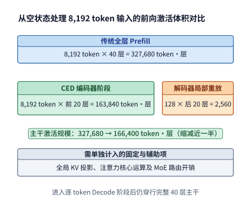

*图 3-15　同一批 8K 输入中，各 token 经过的专家层数之和。普通全层路径执行 40 层；CED 路径执行 20 层编码器，并为最近 128 个 token 重放 20 层解码器。灰色说明项仍需另外计算；生成阶段执行完整主干。*

**算例：Jev 决策模型为何能在百毫秒内返回结果？** 2026 年 9 月，前 OpenAI 研究员 Diogo Almeida 创立的 TypeSafe AI 发布了名为 Jev 的专用决策模型。据创始人在发布文章中介绍，他曾在 OpenAI 参与早期指令微调与对话对齐研究，相关工作后来成为 ChatGPT 的技术基础之一。[^jev] Jev 在官方演示中的表现颇为引人注目：面对同一条复杂的客户服务工单请求，前沿通用模型 GPT-5.6 Terra 耗时 8.566 秒才给出结果，而 Jev 仅耗时 0.114 秒，且单次调用账单费用仅为前者的 1/171。不少读者的第一反应或许是：这难道脱离了 Transformer 架构，或者采用了某种特殊的底层推理基础设施？事实上，只要用本章建立的阶段分解与资源账本稍加核算就会发现，其背后的原理十分清晰，任何工程团队都可以基于现有开源模型复现这一设计。

核心原因在于：**Jev 根本不执行自回归文本生成。** 在调用接口上，调用方向 Jev 提交一段上下文状态（例如一整张客服工单）以及若干道结构化选择题，每道题的候选选项均已事先给定，模型只需返回各个选项对应的概率分布。回到第 3.1.1 节的请求生命周期模型，这类结构化决策请求**只有一次 prefill，完全没有后续的串行 decode 步**。系统将工单上下文与所有待回答的选择题拼接在同一个序列中执行一次前向传播，每道题末尾位置经词表投影与归一化后输出的候选概率分布即直接给出各选项的得分——这就好比在图 3-14 的公共前缀之后同时挂接了多条分支，每条分支只需在 prefill 中并行向前算一步便立即终止。由于各道选择题之间不存在生成依赖，且请求返回后无需继续生成，系统甚至不必在显存中保留任何 KV 缓存。至于模型单步输出的概率值为何能直接用作校准良好的置信度，则源于训练阶段的奖励设计：TypeSafe 将其训练方法称为 RLCD，其核心思路与学术界提出的 RLCR（Reinforcement Learning with Calibration Rewards）一致，即在强化学习奖励函数中引入衡量概率校准度的 Brier 分数（Brier score），迫使模型输出的预测概率与真实正确率对齐。[^rlcr]

我们可以直接用本书的基准模型与硬件参数来验算这一过程。Jev 仅按输入 token 计费，官方定价为每百万输入 token 0.042 美元；演示案例中单次请求账单为 0.000081 美元，反推可知该次请求的输入长度约为 $0.000081 / 0.042 \times 10^6 \approx 1929$ 个 token。若将一条 1929 个 token 的输入请求放到 Qwen3-8B 上执行一次完整 prefill，总矩阵运算量约为 28 TFLOPs；在单张 H100 SXM 上按 40% 的实际算力利用率（MFU）估算，这次前向计算仅需约 70 ms，加上网络与框架开销后与演示中的 0.114 秒完全吻合（若改用 DeepSeek V4.1 Flash 并走 CED 路径，计算量也仅比 Qwen3-8B 略多约四分之一）。反之，如果将同一任务交给通用 LLM 以自然语言或 JSON 文本形式逐 token 输出，在 70 ms 的 prefill 结束之后，模型还必须一步步执行受显存带宽限制的串行 decode，每一步约需 9 ms。哪怕只是短短生成 64 个输出 token，端到端延迟就会激增至约 0.65 秒，达到纯 prefill 决策请求的 9 倍；不过由于 decode 阶段可以与其他并发请求合批以分摊权重读取，该请求实际消耗的折算 GPU 时间仅增加了约 28%。图 3-16 将这两种执行模式绘制在同一条时间轴上：Jev 之所以能在百毫秒内返回全部答案，靠的正是从任务定义上彻底省去了串行 decode 阶段。[^decision-calc]

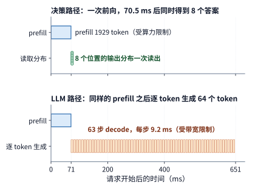

*图 3-16　同一条 1929 个 token 的请求在 H100 SXM 上的两种执行方式。上图为决策请求，一次前向后同时读出 8 个问题的答案；下图为普通 LLM，prefill 之后逐个生成 64 个 token。模型为 Qwen3-8B，算力效率取 40%，带宽效率取 50%。*

其低廉的定价同样可以从底层硬件成本直接算清。参照 DeepSeek 推理系统公开报告的成本核算口径，按每 GPU 小时租赁成本 2 美元计，运行 8B 稠密模型或 V4.1 Flash 每处理一百万个输入 token 的纯硬件算力成本约为 0.02 至 0.025 美元，Jev 每百万 token 0.042 美元的售价大约是底层硬件成本的 1.7 至 2 倍（毛利率空间合理）。这说明，一个 8B 量级（或等效激活规模）的模型仅靠标准 prefill 就能在这一价格点上实现盈利；反过来推算，只要商业定价需要覆盖底层算力成本，Jev 处理单个 token 的实际计算量上限大致就不会超过 8B 稠密模型的两倍。至于官方演示中高达 171 倍的账单费用差距，其中只有很小一部分源于省去了输出 token 的生成（在同一模型上，省去 64 至 512 个输出 token 仅能将单请求折算的 GPU 消耗降低至原来的 $1/1.3$ 至 $1/3.4$）；其余绝大部分差距，实际上源于所对比的超大参数前沿模型本身昂贵的单价，以及通用推理模型在给出结论前生成的长篇思考 token。

在实际生产部署中，当轻量级专用决策模型对某些复杂边界样本的预测置信度不足时，系统仍需将该请求转交（fallback）给高能力的通用大模型接管处理。设需要转交大模型的请求比例为 $e$，专用决策模型的单次调用费用为 $c_{\mathrm{dec}}$，通用大模型的单次处理费用为 $c_{\mathrm{LLM}}$，则每条请求的平均综合费用为 $c_{\mathrm{dec}}+e\,c_{\mathrm{LLM}}$。代入演示中的两项单次费用（$c_{\mathrm{dec}}=0.000081$ 美元，$c_{\mathrm{LLM}}=0.013880$ 美元）可以算出：转交率 $e$ 只要超过 $0.000081 / 0.013880 \approx 0.58\%$，花在后级通用大模型上的转交费用就会超过专用决策模型本身的全部运行费用。因此，在应用第 3.2.2 节的公式核算单次成功任务成本时，分子 $c$ 中必须如实计入这部分转交开销。级联决策架构在经济上究竟能省多少钱，最终取决于业务场景下的高置信度拦截率（即 $1-e$）以及后级通用大模型的调用单价。

## 3.3 多模态与实时交互

在纯文本 Agent 任务中，外部工具的返回结果通常直接作为字符串拼接到下一轮提示词中。而当系统转向多模态与实时语音交互场景时，输入端在进入语言模型主干之前需要先对图像或连续音频流做特征编码，输出端则往往需要满足连续播放的实时性约束。本节先追踪多模态数据在跨阶段流转时的张量形状与体积变化，再建立实时流式交互的完成时限（deadline）模型。

### 3.3.1 视觉编码、语言生成与状态

在视觉语言模型（VLM）中，一张原始图片在进入语言模型主干之前，必须依次经过图像解码与尺寸缩放（预处理）、视觉编码器（Vision Encoder）特征提取以及跨模态投影（Projector）。若用 $\mathrm E$ 表示视觉编码阶段、$\mathrm P$ 表示语言模型 prefill 阶段、$\mathrm D$ 表示语言模型后续 decode 阶段，则一次标准的视觉问答请求在执行上遵循 $\mathrm E\to\mathrm P\to\mathrm D$ 的串行依赖链。其中，输入图片的分辨率直接决定视觉编码阶段 $\mathrm E$ 的计算量，而视觉编码器汇总输出的视觉 token 数量则决定了后续语言阶段 $\mathrm P$ 与 $\mathrm D$ 所增加的上下文负担；因此这两部分的开销需要分别核算。

我们先根据图像分辨率和分块参数计算视觉 token 的数量与张量体积。设预处理后的输入图片高度和宽度分别为 $H_{\mathrm{img}},W_{\mathrm{img}}$（单位为像素），视觉编码器先将图片切分为边长为 $p_{\mathrm{patch}}$ 的正方形图像块（patch），并在输出端将每 $r\times r$ 个相邻 patch 合并（spatial merge）为 1 个视觉 token，则最终送入语言模型的视觉 token 总数为：

$$
n_v=\frac{H_{\mathrm{img}}W_{\mathrm{img}}}{p_{\mathrm{patch}}^2r^2}.
$$

以 Qwen3-VL-4B 视觉语言模型处理一张 $640\times640$ 像素的图片为例：按 $16\times16$ 像素的 patch 大小切分，首先得到 $40\times40=1600$ 个基础图像块；再按 $2\times2$（即 $r=2$）做空间合并，最终浓缩为 $20\times20=400$ 个视觉 token。该模型语言主干的隐藏层特征维度为 2560，在每元素 2 字节的 BF16 精度下，这 400 个视觉 token 的单层特征张量形状为 $[400,2560]$，占用空间为 $400\times2560\times2=2{,}048{,}000$ 字节（约 1.953 MiB）。

然而，视觉编码器向语言模型传递的中间状态并不只有末层这一份。为了让语言模型能够同时感知不同抽象层级的视觉细节，Qwen3-VL 采用了 DeepStack 跨层特征注入机制，从视觉编码器的 3 个中间层额外提取特征，并与视觉编码器末层输出的特征沿通道维拼接后分别注入语言模型对应的层。这样一来，跨阶段传递的完整视觉特征张量形状变为 $[400,10240]$（即 $4\times2560$ 列），总字节数达 $8{,}192{,}000$ bytes，即 $7.8125\ \mathrm{MiB}$。需要注意这里的维度区分：虽然跨阶段传递的特征通道宽度变成了原来的 4 倍，但这 4 组特征对应的是同一批空间位置，因此进入语言模型序列维度的视觉 token 数量依然是 400 个。在计算量方面，对这张 $640\times640$ 图片执行视觉编码的矩阵运算量约为 1.310 TFLOPs；在时间轴上，CPU/GPU 图像解码与缩放必须先于视觉编码完成，而语言模型的 prefill 计算则必须等待视觉编码输出这 7.8125 MiB 的特征张量后才能启动。[^vision]

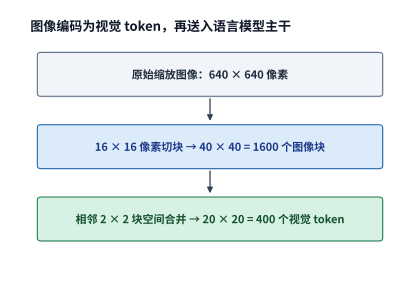

*图 3-17　图像从像素网格变为视觉 token。640×640 的方形图片切成 40×40 个块，相邻 2×2 块合并成一个 token，形成 20×20、共 400 个视觉 token。*

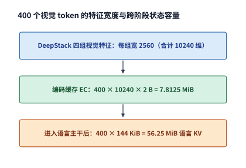

*图 3-18　视觉 token 数与每 token 特征宽度分别计量。四组 2560 维 BF16 编码特征占 7.8125 MiB；这些视觉 token 进入语言模型后，另产生各层的 KV 状态。*

对比图 3-17 与图 3-18 可以看到，视觉编码阶段先决定了视觉 token 的数量与跨阶段传递的特征宽度；而一旦这些视觉 token 进入语言模型主干，又会在各层注意力中生成另一套状态表示。为了区分这两类状态，我们将保存视觉编码器输出特征的缓存称为**编码缓存（Encoder Cache，简称 EC）**，而将语言模型主干生成的键值状态称为语言 **KV 缓存**。在 Qwen3-VL-4B 配置下，语言模型每 token 的 KV 缓存占 144 KiB，因此 400 个视觉 token 进入语言主干后会产生 $400\times144\ \mathrm{KiB}=56.25\ \mathrm{MiB}$ 的语言 KV 状态。可见，同一张教学截图在流水线的三个处理阶段对应着体积截然不同的三种数据形态：原始压缩图像文件仅约 0.8 MB，视觉编码输出的完整 BF16 编码缓存（EC）为 7.8125 MiB，而进入语言主干后生成的视觉 token 语言 KV 缓存则膨胀至 56.25 MiB。[^epd]

| 对象 | 本例大小 | 决定它能否复用的条件 |
| --- | ---: | --- |
| 压缩截图 | 0.8 MB，给定输入 | 同一文件内容 |
| 完整编码结果 EC | 7.8125 MiB | 图片、预处理、编码器与输出格式一致 |
| 视觉 token 的语言 KV | 56.25 MiB | 还依赖先前上下文、顺序、位置与模型状态 |

这三种数据形态的跨请求复用条件也逐级收紧：只要原始图片内容、图像预处理方式与视觉编码器权重不变，7.8125 MiB 的编码缓存（EC）就可以直接跨请求复用；而 56.25 MiB 的语言 KV 缓存由于经过了语言模型内部的因果注意力计算，还额外依赖于该图片在输入序列中所处的前置上下文与位置编码——如果用户的文字提问排在图片之前，那么换一个问题就会改变后续视觉 token 的 KV 状态；反之，如果将图片固定排在文字提问之前，在因果掩码保护下，更换后续问题便不会影响前置视觉 token 已生成的语言 KV 缓存。

**多模态输入的编码缓存（EC）与语言 KV 容量预算。** 假设一条多模态输入请求包含 4 张相同规格（$640\times640$）的图片与 400 个文本 token：4 张图片的编码缓存（EC）合计为 $4\times7.8125=31.25\ \mathrm{MiB}$，对应的 1600 个视觉 token 在语言模型中产生的 KV 缓存为 $4\times56.25=225\ \mathrm{MiB}$；再加上 400 个文本 token 的语言 KV 缓存（$400\times144\ \mathrm{KiB}=56.25\ \mathrm{MiB}$），该请求在 prefill 结束时的完整输入语言 KV 缓存总量为 $225+56.25=281.25\ \mathrm{MiB}$。

在分布式多模态服务架构中，原始压缩图片、编码缓存（EC）与语言 KV 缓存分别对应流水线中三个不同的阶段交接（handoff）切面：若在节点间传输 0.8 MB 的原始图片，接收端必须从头执行视觉编码与语言 prefill；若传输 7.8125 MiB 的 EC，接收端可跳过视觉编码、直接从语言 prefill 启动；若传输 56.25 MiB 的语言 KV 缓存，则相当于直接交接已经完成 prefill 的语言上下文状态。第 8 章将讨论这几个阶段在单卡上的交错执行，第 9 章将对比分布式分离部署下的跨机交接开销，第 12 章则进一步把同一条数据流映射到终端、边缘与云端协同的异构网络链路上。

如果保持 patch 切分大小与 $2\times2$ 空间合并方式不变，将输入图片的高度与宽度同时放大一倍（即像素面积变为 4 倍），生成的视觉 token 数量 $n_v$ 就会随之增至原来的 4 倍。相应地，视觉编码缓存（EC）与视觉 token 的语言 KV 缓存容量都会线性增至 4 倍；而视觉编码器内部以及语言主干注意力层中与序列长度相关的二次项运算量，还需按各自的注意力窗口或全长结构另行累加。简言之，DeepStack 跨层特征拼接增加的是单 token 的**特征通道宽度**，而提高图像分辨率增加的是**视觉 token 的序列长度**，二者对下游语言主干的算力与显存冲击截然不同。

### 3.3.2 音频与图像生成的计算过程

视觉问答虽然引入了图像编码，但输出端依然是通过语言模型逐个生成文本 token。而当模型的输出本身也是连续音频或高分辨率图像时，单次迭代所操作的数据单元以及内部循环结构就会发生本质改变。

在流式语音生成模型中，除了沿时间轴推进的帧级循环外，往往还嵌套着一层“帧内多码本循环”。以 Fish Audio 的语音生成模型 S2 Pro 为例：其主干的慢速路径（slow path）每步沿时间轴向前推进一个声学帧（acoustic frame），而快速路径（fast path）则负责在单个声学帧内部依次预测补齐多个残差矢量量化码本（codebook）的离散编号——这里的码本是指离散音频表征的候选向量字典，全部码本编号补齐后再交由音频编解码器（codec）还原为连续声波。具体而言，每生成一个声学帧，系统需要先执行 1 次快速路径前向传播以初始化帧内状态，再连续执行 9 次自回归前向预测以补齐其余码本，因此每输出一帧音频总共需要执行 10 次快速路径前向计算。因此，在语音生成系统中，“每秒生成的语言 token 数”、“每秒生成的声学帧数”与“每秒合成的可播放音频秒数”分别对应三个不同层级的速率口径，核算负载时切勿混为一谈。[^source-1][^media]

而在扩散图像生成模型中，计算循环则围绕固定尺寸的二维潜在空间（latent space）展开。所谓潜在表示（latent），是指将高维像素图像经变分自编码器（VAE）压缩后得到的低维连续特征网格；图像生成的核心过程，就是从随机噪声出发，通过多步迭代去噪（denoising）将含噪潜在表示逐步还原为清晰图像。在每一步去噪迭代中，扩散 Transformer（DiT，Diffusion Transformer）负责对整张潜在特征网格执行一次前向变换；为了增强图像对文本提示词的遵循程度，工程上普遍采用无分类器引导（CFG，Classifier-Free Guidance），即在每一步去噪时同时计算“带文本条件”和“无文本条件”两个分支的预测结果并加权组合；待全部去噪步完成后，再由 VAE 解码器将最终的潜在表示还原为像素图像。以图像生成模型 Qwen-Image-2512 生成一张 $1024\times1024$ 像素的图片为例：图像在潜在空间中共形成 4096 个空间位置（latent tokens），整个生成过程需执行 50 个去噪步；在开启双分支真实引导（true CFG）路径下，每个去噪步需执行 2 次 DiT 前向传播，因此整张图片总共需要执行 $50\times2=100$ 次完整的 DiT 前向计算，仅去噪主干的矩阵运算量就高达约 $7.830\times10^{15}\ \mathrm{FLOPs}$（即 7,830 TFLOPs），此外还需加上前置文本编码器与后置 VAE 解码器的运算开销。与自回归文本生成每步只追加一个新 token 不同，图像去噪过程中这 4096 个潜在空间位置的数量始终保持固定，每一轮迭代都在全量更新同一组潜在状态，总计算量随去噪步数的增加而严格线性累加。[^image]

若将单次 DiT 前向处理 $n_v$ 个潜在空间位置的运算量记为 $F_{\mathrm{step}}(n_v)$，总去噪步数记为 $n_s$，每步并行计算的引导分支数记为 $n_b$，则整个去噪阶段的总运算量为：

$$
F_{\mathrm{denoise}} = n_s n_b F_{\mathrm{step}}(n_v).
$$

当去噪步数 $n_s$ 翻倍时，总运算量严格翻倍；而当目标图像分辨率提高时，潜在表示中的空间位置数 $n_v$ 成倍增加，不仅单步内部线性层与 FFN 的矩阵行数随之放大，DiT 自注意力层中各空间位置之间的两两计算量更会按二次方增长。对比两类生成范式可以看到：自回归文本生成是在不断拉长的上下文上逐 token 追加状态，单步访存开销随生成长度递增；而扩散图像去噪则是在固定大小的特征网格上反复迭代刷新，在给定分辨率下，其累计计算开销完全由迭代步数与分支数决定。

### 3.3.3 连续感知、首段响应与打断

对于离线批处理任务，总工作量决定了所需的平均算力；但对于实时音视频流式交互任务，系统不仅要算得完，还必须保证**每一个数据块都在规定的播放时限（deadline）之前送达终端**。设截至时刻 $t$ 客户端累计已收到的可播放音频总时长为 $A(t)$，终端扬声器累计已播出的音频总时长为 $P(t)$，则时刻 $t$ 播放缓冲区中剩余的音频余量（buffer margin）为：

$$
B_{\mathrm{audio}}(t)=A(t)-P(t).
$$

在连续播放期间，物理时间每流逝 1 秒，已播放时长 $P(t)$ 就以斜率 1 匀速增加 1 秒；而累计到达时长 $A(t)$ 则每当收到一个新的音频数据块时呈阶梯状向上跳变。两条曲线之间的垂直距离 $B_{\mathrm{audio}}(t)$ 就是抵抗网络与计算抖动的安全余量：一旦某一时刻 $B_{\mathrm{audio}}(t)$ 跌至零而下一个音频块仍未到达，终端扬声器就会立即出现卡顿与断音（buffer underrun）。在开始播放前预先积攒一段初始缓冲（pre-buffering）可以抬高整条曲线的初始安全余量，但代价是同等幅度地推迟用户听到首个声音的时刻。

实时性约束同时作用于多模态系统的感知输入端与生成输出端。在视觉感知输入端，以自动操作图形界面的屏幕截图 Agent 为例：如果系统只在每一步点击或输入动作执行完毕后才截取一次静态屏幕，就极易漏掉动作执行期间短暂弹出又自动消失的报错提示框或状态变化。针对这一问题，持续观察与交互框架 AOI（Always-On Interaction）将高频屏幕感知流与低频动作决策解耦：前端感知模块持续不断地采集屏幕图像帧、音频流与系统事件，再由轻量级筛选器从中挑出包含关键状态变化的帧送入大模型上下文。提高采样频率固然能捕捉到更短促的瞬态事件，但如果把保留下来的关键帧不加节制地追加进模型上下文，不仅会迅速推高视觉编码与 KV 缓存开销，过多冗余视觉帧还会稀释注意力分布、干扰模型对核心信息的判断。[^aoi] 因此，连续流式感知必须与前端关键帧筛选紧密配合，在进入语言模型主干之前就决定哪些观测帧值得转化为持久上下文状态。

在实时语音对话中，输出端的时限约束更为严苛。当用户说完一句话并停顿时，系统需要依次完成语音端点检测（VAD）与音频采集确认、语音识别或声学特征编码、语言模型推理、声学模型语音合成以及终端播放。而且一旦首段语音开始播放，后续合成的每一个音频片段都必须在已缓冲音频耗尽之前准时抵达客户端，否则整段回答就会断断续续。

在实际工程链路中，音频数据块抵达客户端应用层后，还需经历音频解码、写入播放队列以及声卡硬件缓冲等环节。对两组真实在线语音交互日志的测量显示：从用户停止说话到首个可播放音频块抵达客户端的端到端延迟（首包时间）分别约为 400 ms 与 370 ms，此后后续音频块到达时间间隔的中位数均约为 94 ms。[^audio-real] 这里需要区分两个时钟：**网络到达时钟**决定了音频数据何时在客户端就绪可用，而**声卡播放时钟**则严格按采样率匀速消耗数据。

我们用一组具体的流式语音参数排布一条精确到毫秒的教学时间线，来直观展示抖动缓冲区（jitter buffer，用于暂存已到达音频以吸收网络与生成延迟波动的缓冲区）是如何防止播放卡顿的。假设系统生成的每一块音频对应 20 ms 的可播放声音，采用 24 kHz 采样率、单声道、每采样点 2 字节（16-bit PCM），则单个音频块的数据量为：

$$
24{,}000\times0.020\times1\times2=960\ \mathrm{bytes}.
$$

设每 20 ms 窗口的输入采集完成后，后端模型生成对应音频块耗时 12 ms、网络发包耗时 1 ms，常规网络传输延迟为 5 ms。于是：
- 第 1 块音频在 $t=20+12+1+5=38\ \mathrm{ms}$ 抵达客户端；假设客户端设置初始抖动缓冲等待时长为 40 ms，则第 1 块音频于 $t=38+40=78\ \mathrm{ms}$ 正式开始播放（覆盖 $78\sim98\ \mathrm{ms}$），第 2 块原定于 $98\ \mathrm{ms}$ 接续播放（覆盖 $98\sim118\ \mathrm{ms}$），第 3 块原定于 $118\ \mathrm{ms}$ 接续播放。
- 假设第 3 块音频（在 $t=60\ \mathrm{ms}$ 完成输入采集、$73\ \mathrm{ms}$ 从服务端发出）遭遇网络抖动，网络传输延迟突增至 50 ms，直到 $t=73+50=123\ \mathrm{ms}$ 才抵达客户端。由于此时第 2 块音频已在 $118\ \mathrm{ms}$ 播放完毕，第 3 块错过了 $118\ \mathrm{ms}$ 的衔接时限，导致扬声器在 $118\sim123\ \mathrm{ms}$ 之间出现了 5 ms 的空白断音；不仅如此，后续按时到达的第 4 至第 8 块音频也必须按语音先后顺序依次顺延 5 ms 播放。

如果我们将客户端的初始抖动缓冲时长从 40 ms 上调至 60 ms，第 1 块音频的起播时刻将推迟到 $t=38+60=98\ \mathrm{ms}$，第 3 块的计划起播时刻也随之顺延至 $138\ \mathrm{ms}$——这样一来，在 $123\ \mathrm{ms}$ 到达的第 3 块音频就完全落在了安全余量之内，5 ms 的播放卡顿彻底消失。这一对比清晰体现了实时流式系统的核心权衡：**增大初始缓冲可以吸收单次网络或推理抖动、消除播放断音，但代价是直接拉长首包起播延迟；而如果后端生成音频的平均速率长期低于实时播放速率（即实时率不能满足要求），那么无论初始有限缓冲区设得多大，最终都必然会被耗尽并导致持续卡顿**。[^audio]

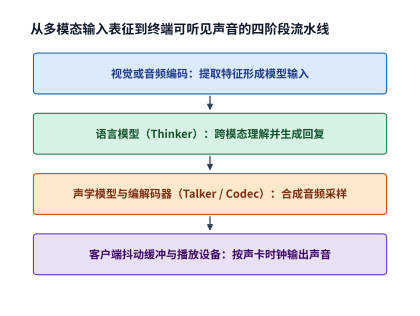

*图 3-19　可组合的多模态阶段。编码形成模型输入，语言模型生成回复，声学模块将回复转成音频，接收方的缓冲与播放设备决定何时真正发声。*

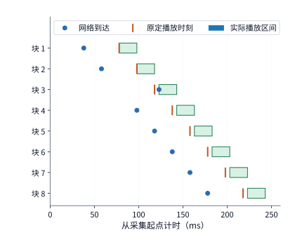

*图 3-20　八块音频的教学播放时间线。每块长 20 ms，圆点标到达，短竖线标原定播放时刻，色条标实际播放；第三块晚到 5 ms，后续播放随之顺延。*

除了正向播放的连续性，全双工实时语音交互还必须单独考核**用户随时打断（barge-in / interrupt）的响应延迟**。图 3-21 以用户在第 123 ms 开口打断为计时起点，分别追踪客户端本地扬声器何时真正静音，以及远端服务器何时终止无效的后续生成。

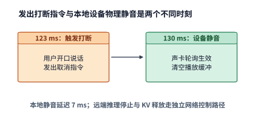

*图 3-21　同一教学场景中的本地打断。123 ms 发出操作，130 ms 设备静音；远端计算是否停止属于另一条控制路径。*

一次完整的语音打断在系统内部会触发两条并行控制链路上的四个动作：客户端应用发出取消指令、本地播放设备清空声卡缓冲并静音、远端推理服务器中止正在进行的 decode 生成，以及释放该轮生成占用的网络缓冲与 KV 状态。在图 3-21 的教学时序中，用户在 $t=123\ \mathrm{ms}$ 触发打断，本地控制处理耗时 5 ms（于 $128\ \mathrm{ms}$ 就绪），而音频播放硬件每逢 10 ms 的整数倍时刻轮询并执行一次控制指令，因此扬声器在 $t=130\ \mathrm{ms}$ 实现物理静音，用户感知的本地静音延迟仅为 $130-123=7\ \mathrm{ms}$。需要注意的是，“本地设备静音”、“远端推理停止生成”与“服务端释放缓存状态”分别对应时间轴上的三个不同时刻：本地静音决定了用户的交互体验是否灵敏，而远端何时真正停止生成、何时回收 KV 缓存，则决定了加速器算力与显存容量何时能从已被废弃的旧回复中解脱出来、重新投入对用户新话语的处理。[^audio-interrupt]

当然，并非所有多模态任务都要求流式连续输出。以专业摄影中的 RAW 原始传感器图像（保留相机感光元件原始采样数据的无损格式）智能精修任务为例：用户关心的是整张高画质成片何时全部渲染完毕，并不需要像语音那样边算边播；同时，像素级图像精修必须直接读取完整的原始 RAW 图像数据，第 3.3.1 节中用于高层语义理解的压缩编码缓存（EC）根本无法替代原图。对比这几类场景不难看出，不同的业务目标对应着截然不同的系统时序约束：交互式问答追求更短的首响应（TTFT），实时语音对话要求严格的逐帧到达时限与毫秒级打断，而批处理图像渲染则追求更短的整任务完成时间（makespan）。

> **练习 3-5〔延伸〕：图像分辨率与音频缓冲如何影响资源需求**
>
> 将 Qwen3-VL-4B 输入图片的分辨率从 $640\times640$ 改为 $1280\times1280$，保持图像块大小、合并方式和特征精度不变，求视觉 token 数、完整编码缓存 EC 的大小，以及这些视觉 token 对应的 KV 大小。再根据本节音频时间线，比较初始缓冲为 40 ms 和 60 ms 时的首次播放时刻与停顿情况。如果每秒收到的音频只能播放 0.9 秒，开始播放时已缓存 0.3 秒音频，求连续播放多久后会耗尽缓冲，并解释增加有限缓冲能解决什么问题。

## 3.4 训练的计算与状态需求

### 3.4.1 前向计算、反向传播与参数更新

模型推理只需利用已有权重沿网络前向计算输出；而模型训练还必须根据预测输出与监督目标之间的误差，反向计算各层参数的梯度并更新权重。我们可以用最简单的标量乘法 $y = x \cdot w$ 来理解训练与推理在计算和状态留存上的根本差异：当后一层反向传回损失函数对输出 $y$ 的偏导数（即敏感度 $\partial\mathcal L/\partial y$）时，根据链式法则，若要求损失对权重 $w$ 的梯度 $\frac{\partial\mathcal L}{\partial w} = x \cdot \frac{\partial\mathcal L}{\partial y}$，就必须用到前向计算时的输入激活 $x$；若要把梯度继续向更早的层传递、求损失对输入 $x$ 的梯度 $\frac{\partial\mathcal L}{\partial x} = \frac{\partial\mathcal L}{\partial y} \cdot w$，则必须用到本层的权重 $w$。这意味着，在训练的前向传播过程中，各层算出的激活张量在交给下一层之后**不能立即释放**，而必须在显存中一直保留到反向传播回流至该层、用完该激活张量之后才能回收。

将这一规律推广到通用线性层 $Y=XW$，其中输入激活矩阵 $X$ 的形状为 $[m,k]$，权重矩阵 $W$ 的形状为 $[k,n]$，输出矩阵 $Y$ 的形状为 $[m,n]$。设标量损失函数为 $\mathcal L$（用于衡量模型预测输出与训练标签之间的差异，训练的目标即最小化 $\mathcal L$），后一层反向传播传回的输出梯度矩阵为 $\frac{\partial\mathcal L}{\partial Y}$（形状同样为 $[m,n]$），则当前线性层在反向传播阶段需要执行两次矩阵乘法，分别求出传给前一层的**输入梯度** $\frac{\partial\mathcal L}{\partial X}$ 与用于更新本层参数的**权重梯度** $\frac{\partial\mathcal L}{\partial W}$：

$$
\frac{\partial\mathcal L}{\partial X}=\frac{\partial\mathcal L}{\partial Y}W^{\mathsf T},\qquad\frac{\partial\mathcal L}{\partial W}=X^{\mathsf T}\frac{\partial\mathcal L}{\partial Y}.
$$

可以看到，训练一个线性层总共包含三次矩阵乘法：前向传播计算输出 $Y$，反向传播分别计算输入梯度 $\mathrm dX$ 与权重梯度 $\mathrm dW$。对比下表中三次矩阵乘法的维度可以发现，尽管矩阵相乘的顺序与转置方向不同，但每一次矩阵乘法都恰好包含 $mkn$ 次乘加运算（按本书约定，1 次乘加计为 2 FLOPs，即每次矩阵乘法均为 $2mkn$ FLOPs）。因此，单个线性层在一次完整前反向训练中的矩阵运算量（$6mkn$ FLOPs）恰好是单次前向推理（$2mkn$ FLOPs）的 3 倍。

| 操作 | 要解决的问题 | 左、右输入的形状 | 输出形状 | 矩阵 FLOPs |
|---|---|---|---|---|
| 前向 $Y=XW$ | 根据输入求输出 | $[m,k]$ 与 $[k,n]$ | $[m,n]$ | $2mkn$ |
| 输入梯度 $\mathrm dX=\mathrm dY W^{\mathsf T}$ | 将误差传回前一层 | $[m,n]$ 与 $[n,k]$ | $[m,k]$ | $2mkn$ |
| 权重梯度 $\mathrm dW=X^{\mathsf T}\mathrm dY$ | 求这层权重的调整方向 | $[k,m]$ 与 $[m,n]$ | $[k,n]$ | $2mkn$ |

其中，输入梯度 $\mathrm dX$ 负责将误差信号继续向网络前层回传，而权重梯度 $\mathrm dW$ 则给出了本层参数矩阵应当调整的方向与幅度。如果训练语料中的所有 token 都依次穿过模型全部主要线性层参数，将所有层的 $6mkn$ 累加起来，便得到了估算稠密模型训练总算力最常用的经验公式：

$$
F_{\mathrm{train}}\approx6ND,
$$

其中 $N$ 为模型总参数量，$D$ 为参与训练的 token 总数。[^training]

当训练方案或模型架构发生变化时，我们同样可以沿着这三项矩阵乘法逐一修正算力账本：例如，在参数高效微调中冻结（freeze）某一个线性层的权重 $W$ 后，由于无需更新该层参数，计算权重梯度 $\mathrm dW=X^{\mathsf T}\mathrm dY$ 的那 $2mkn$ FLOPs（以及为它保存激活 $X$ 的显存开销）便可直接省去；但如果在该冻结层之前还有其他可训练层，系统依然必须执行 $\mathrm dX=\mathrm dY W^{\mathsf T}$ 将梯度向前传递。同理，对于稀疏 MoE 架构，只需按每个 token 实际路由激活的专家累加这三项矩阵运算；对于注意力核心运算（$QK^{\mathsf T}$ 与 $AV$），则按实际的查询—键有效配对数分别累加前向与反向运算量。

除了计算量翻至前向的 3 倍，训练阶段在存储容量上的扩张更为显著。首先，前向传播期间不仅线性层需要保存输入激活 $X$（供反向计算 $\mathrm dW$），像 SwiGLU 门控激活、Softmax、RMSNorm 等非线性算子也必须保留前向中间状态，才能在反向传播时求出精确导数。其次，反向传播算出的参数梯度需要暂存，随后交由优化器（optimizer）计算参数更新步长；而现代自适应优化器（如 Adam / AdamW）为了平滑更新方向，还必须为每一个可训练参数长期维护跨步累积的历史动量统计状态。不同训练状态在显存中的驻留生命周期截然不同：某一层的前向激活张量只需从该层前向结束保留到该层反向传播执行完毕，用完即可立即释放（如图 3-22 所示）；而模型权重与优化器状态则必须跨越整个训练过程长期常驻。

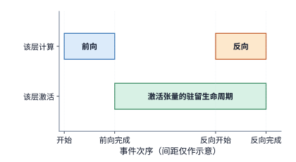

*图 3-22　激活的生命周期：一层激活从前向完成后保留到相应反向用完。横轴按事件排列，间距仅表示过程顺序；相应反向计算用完这些激活后，即可释放其占用的空间。*

**例题 3-3：梯度与优化器状态为何使训练内存需求成倍增加？**

解：我们以 Qwen3-8B（精确参数量为 $8{,}190{,}735{,}360$）的全参数混合精度训练为例，核算其常驻参数相关状态的显存体积。在标准的混合精度训练配置下，系统需要为每个可训练参数保存以下 5 份数据：
1. 用于前向与反向矩阵乘法的 **BF16 计算权重**（每参数 2 字节）；
2. 用于累加反向传播结果的 **FP32 梯度**（每参数 4 字节）；
3. 用于高精度累加微小更新量的 **FP32 主权重副本（master weights）**（每参数 4 字节）；
4. Adam 优化器维护的一阶矩估计（梯度移动平均，**FP32**，每参数 4 字节）与二阶矩估计（梯度平方移动平均，**FP32**，每参数 4 字节）。

在不采用跨卡状态分片（sharding，即将上述状态切分到多张加速器上分别保存）的单卡视角下，每个可训练参数需要占用的常驻存储空间高达：

$$
2 + 4 + 4 + 4 + 4 = 18\ \mathrm{bytes}.
$$

乘以 Qwen3-8B 的总参数量，仅这五项与参数直接绑定的常驻训练状态就高达 $8{,}190{,}735{,}360\times18\approx147.433\ \mathrm{GB}$（即 $137.308\ \mathrm{GiB}$），恰好是纯 BF16 推理权重体积（16.381 GB）的 **9 倍**。这意味着，即便还完全没有计入前向传播留存的庞大激活张量与临时通信缓冲区，单是一个 8B 模型全参数训练的静态参数状态，就已经超出了单张 H100 SXM（80 GB）、RTX PRO 6000 Blackwell Workstation Edition（96 GB）乃至 H200（141 GB）的标称显存容量上限。[^train-matrix]

算清静态参数状态的容量账之后，我们再看训练数据是如何分批流入加速器的。这里必须严格区分两个概念：**微批次（micro-batch）**是指单次前向与反向传播实际送入加速器的样本子集，而**全局训练批次（global batch / step batch）**则是执行一次优化器参数更新所依据的完整样本集合。当单张（或单组）加速器的显存不足以一次性容纳整个训练 batch 的前向激活时，工程上普遍采用**梯度累加（gradient accumulation）**：将一个大训练 batch 拆分为多个较小的 micro-batch 依次执行前向与反向传播，每跑完一个 micro-batch 就将其算出的权重梯度累加到梯度缓冲区中，并立即释放该 micro-batch 占用的前向激活显存；待全部 micro-batch 累加完毕后，再统一调用一次优化器更新模型权重。只要保持损失函数的归一化分母、有效监督标签以及数值精度一致，将一个训练 batch 拆分为更多个 micro-batch 只会改变算子执行的先后次序与单次驻留的激活显存峰值，而在数学上完全等价于一次性处理整个大 batch（第 10 章将在此基础上展开分布式状态分片与流水线并行调度）。

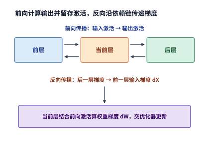

*图 3-23　训练沿前向依赖计算输出，再沿反向依赖传递梯度。当前层既向前层传输入梯度，也计算自己的权重梯度，供优化器更新。*

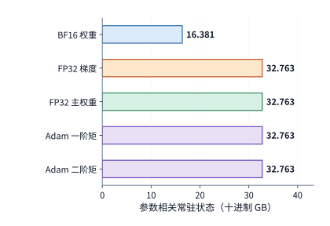

*图 3-24　Qwen3-8B 全参数训练的参数相关状态。每参数包括 2 字节计算权重和 4 组 4 字节状态，共 18 字节；激活和工作区的容量需求按各自的生命周期单独计算。*

在加速器持续执行前反向计算的同时，主机侧的 CPU 与存储子系统还必须源源不断地准备下一批训练样本：从磁盘或网络存储读取原始数据、解压解码、执行分词（tokenization）、拼接组装成固定形状的 batch 张量，再通过 PCIe 或片间互联将其异步拷贝至加速器显存。为了防止昂贵的加速器停下来等待 CPU 喂数据（即数据加载饥饿），训练框架普遍采用**双缓冲（double buffering）**流水机制：在显存中开辟两块交替使用的输入缓冲区，一块供当前迭代的计算算子读取，另一块同时在后台接收下一迭代由主机异步传输过来的新数据。一旦当前计算消费数据的速度快于后台数据准备与传输的速度，计算流就不得不阻塞等待输入就绪；反之，当主机端需要同步读取加速器算出的标量损失或日志时，主机线程也会反过来等待加速器上的对应算子执行完毕（第 5 章将结合前向、反向与参数更新的硬件流时序，定量分析数据传输与计算重叠的条件）。

### 3.4.2 预训练、中期训练与 SFT

尽管大模型研发流程被划分为预训练（pre-training）、中期训练（mid-training）与监督微调（SFT，Supervised Fine-Tuning）等不同阶段，但站在底层训练系统的视角来看，决定资源消耗的核心变量始终是同一个三元组：**每次送入模型的输入序列形状、其中真正参与损失函数计算的监督 token 数量，以及每累计多少个 micro-batch 执行一次参数更新**。在预训练阶段，模型通常在拼接而成的定长连续文本块上对全部位置执行下一 token 预测（next-token prediction）；到了中期训练阶段，研发团队会调整高质量推理与代码语料的配比，并将训练上下文窗口逐步拉长；而在监督微调（SFT）阶段，每条样本由“系统提示 + 用户指令 + 目标回答”拼接而成，主干网络虽然需要完整编码整条序列，但损失函数通常只针对“目标回答”部分的 token 计算交叉熵损失。因此，在核算各训练阶段的系统开销时，必须将这些训练配方的差异精确落实为输入张量尺寸、有效监督标签占比与优化器更新频率。

Qwen3 的公开技术报告清晰展示了这几个阶段在训练周期中的演进：在第一阶段（通用预训练），模型使用 4096 的序列长度训练了超过 30 万亿（30T）个 token；进入第二阶段（知识与推理增强）后，大幅提高了科学、技术、工程与数学（STEM）、代码、逻辑推理及高质量合成数据的占比，继续训练约 5 万亿（5T）个 token；而在第三阶段（长上下文扩展），则将训练序列长度一步拉长至 32,768 个 token。[^qwen] 调整语料配比改变的是模型学到的语义分布，而拉长序列长度则会直接改变注意力层中每个 token 能够访问的历史前文范围，从而改变计算与显存负载。

哪怕一个训练批次内的总 token 行数完全不变，单条文档的序列长度分布也会显著改变注意力层的运算量。我们不妨对比两个总长度同为 8192 个 token 的打包序列（sequence packing）：第一组由两篇各长 4096 个 token 的独立文档拼接而成（$4096+4096$，文档之间通过掩码相互隔离、互不可见），第二组则由一篇长 7168 个 token 的长文档和一篇长 1024 个 token 的短文档拼接而成（$7168+1024$）。在这两种配置下，经过线性投影层与 FFN 层的总行数同为 8192 行，因此这部分的矩阵运算量完全相同；但在因果注意力层中，第一组允许的有效查询—键（Q-K）配对总数为 $\frac{4096\times4097}{2}\times2 = 16{,}781{,}312$ 对，而第二组的有效配对总数则高达 $\frac{7168\times7169}{2}+\frac{1024\times1025}{2} = 26{,}218{,}496$ 对。落实到 Qwen3-8B 的单个 Transformer 层上，仅前向传播中的注意力核心运算（$QK^{\mathsf T}$ 与 $AV$）就从约 0.275 TFLOPs 增至 0.430 TFLOPs，增幅达 **56%**。原因很直观：在更长的单篇文档中，靠后的 token 能够访问更长的历史前文，因此在总 token 数恒定的情况下，单篇文档越长，注意力核心运算的二次项开销就越大，而整层总运算量的相对增幅则取决于这部分注意力运算在全层工作量中所占的比重。[^training]

在监督微调（SFT）或多轮对话微调中，还需要特别留意**模型主干读取的输入 token 数**与**真正参与损失计算的监督标签 token 数**之间的分离。一条 SFT 训练样本往往包含长篇系统提示词、用户问题、外部工具返回的大段参考材料以及最终的模型回答，但训练目标通常只要求对“模型回答”部分的 token 计算交叉熵损失（其余前缀位置的标签被设为忽略掩码，如 `ignore_index = -100`）。在执行过程中，所有前置上下文 token 依然必须完整穿过 Transformer 主干的每一层，以便为回答部分构建准确的键值（KV）上下文；但在网络最末端的词表投影头（LM head，隐藏维度乘以十几万词表大小的大矩阵乘法）处，工程实现上存在两种截然不同的做法：如果在进入词表投影头之前，先根据掩码挑出真正参与监督的那些位置的隐藏层向量，仅对这些有效位置执行词表投影与 Softmax，就能省去大量无效的大矩阵运算；反之，如果算子实现依然对全部输入 token 无差别地执行完整的词表投影，仅仅在最后求交叉熵损失平均值时才把非监督位置的损失乘零屏蔽掉，那么词表投影头的庞大前反向矩阵乘法依然会分毫无损地照常执行。

除了只对部分位置计算损失，微调阶段还常常采用冻结部分主干层或参数高效微调（如 LoRA）等策略。此时，被冻结的参数不再需要分配梯度缓冲区与优化器动量状态，静态显存占用大幅下降；但在计算量上仍需顺着反向计算图逐层甄别：冻结某一个模块只能省去计算该模块自身**权重梯度** $\mathrm dW$ 的开销，只要在该冻结模块的上游（更靠近输入端）还存在需要更新的可训练参数，反向传播就依然必须穿过该冻结模块计算**输入梯度** $\mathrm dX$，以便把误差信号继续向前传递。因此，只需沿着反向依赖图逐层检查“是否需要向前传递输入梯度”以及“是否需要计算本层权重梯度”，就能精确算出任意局部微调方案的实际算力与显存需求。

最后，微批次大小（micro-batch size）与梯度累加步数共同决定了单次参数更新的统计口径与执行粒度。设每个 micro-batch 包含 $B_\mu$ 条长度为 $P$ 的训练序列，每累计 $a$ 个 micro-batch 执行一次优化器更新，则每次参数更新总共读取并处理 $aB_\mu P$ 个输入 token；若每条序列中平均只有 $P_{\mathrm{label}}$ 个 token 真正参与监督，则用于对全局损失函数做归一化求平均的有效监督 token 总数为 $aB_\mu P_{\mathrm{label}}$。增大梯度累加步数 $a$ 可以在不增加单卡激活显存峰值的前提下扩大每次参数更新的等效全局 batch size：在整个累加周期内，18 字节/参数的模型与优化器状态始终常驻显存，而每个 micro-batch 产生的前向激活则在各自的反向传播完成后旋即释放。

### 3.4.3 从 $6ND$ 估算到逐项计算训练开销

明确了输入张量形状与有效监督标签数之后，我们就可以对比粗略经验公式 $6ND$ 与逐模块精确累加之间的真实差距：先用线性层“前反向总计算量约为前向 3 倍”的关系给出 $6ND$ 基线，再把不含模型参数的注意力核心运算、词表投影头以及优化器状态更新逐项补齐，从而看清粗算公式究竟漏算了什么、又多算了什么。

我们以 Qwen3-8B 执行一次全参数训练微批次（取 $B=1,\ P=8192$，全部 8192 个输入 token 均执行末端词表投影头，且不开启激活重计算）为例，逐层累加所有线性投影、SwiGLU FFN、因果注意力（$QK^{\mathsf T}$ 与 $AV$）以及输出词表头的前向与反向矩阵运算量，所得精确账本如下表所示。[^train-matrix]

| 矩阵计算 | TFLOPs |
| --- | ---: |
| 前向矩阵 | 143.789 |
| 反向矩阵 | 287.579 |
| 前向加反向 | 431.368 |
| 其中因果注意力 $QK^{\mathsf T}$ 与 $AV$ 前反向 | 59.381 |
| 总参数代入 $6ND$ | 402.591 |

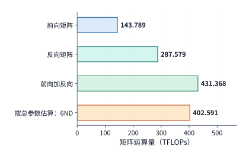

*图 3-25　Qwen3-8B、8192 个 token 输入的全参数训练。全部输入 token 执行词表头、没有重计算；按矩阵逐项累计，前向加反向为 431.368 TFLOPs。*

为什么直接把总参数量代入 $6ND$ 算出的 402.591 TFLOPs，会比逐项累加的真实矩阵运算量 431.368 TFLOPs 低了一截？这源于一正一负两项结构偏差：一方面，因果注意力中的查询—键点积（$QK^{\mathsf T}$）与注意力加权求和（$AV$）属于激活张量之间的动态矩阵乘法，它们在模型中不对应任何静态权重参数，因而在 $6ND$ 中被完全漏算，但在 $P=8192$ 的序列长度下，这部分前反向运算贡献了高达 59.381 TFLOPs 的工作量；另一方面，输入端的词嵌入查找表（token embedding）虽然包含约 6.22 亿个参数并被计入了总参数量 $N$，但在前向传播中它只做按索引查表、并不对每个 token 执行密集矩阵乘法，按 $6ND$ 计算反而多算了它的运算量。将这两项一增一减相抵之后，8192 长度下的真实矩阵总运算量比 $6ND$ 粗算值高出约 **7.15%**。正如第 1.3.4 节所指出的，这一偏差属于“简化估算公式与真实模型结构之间的第一类差距”——它源于估算公式漏掉了随序列长度二次增长的注意力项、又误计了词嵌入查表参数，与底层算子实现的好坏无关。在评估训练系统的硬件算力利用率（MFU）时，唯有以逐项修正后的真实算力下界作为基准，才能得出准确的结论。

现在我们再看有效监督标签占比与文档打包（sequence packing）长度分布对单步训练矩阵总运算量的综合影响（见图 3-26）：假设在这 8192 个输入 token 中，真正参与监督的标签 token 只有一半（4096 个）。如果代码实现依然对全部 8192 个位置执行词表投影、仅在计算交叉熵损失时将非监督位置掩码置零，那么前反向矩阵总运算量依然保持 $431.368\ \mathrm{TFLOPs}$ 不变（其中 36 层主干线性投影与 FFN 占 $341.398\ \mathrm{TFLOPs}$，因果注意力 $QK^{\mathsf T}$ 与 $AV$ 占 $59.381\ \mathrm{TFLOPs}$，末端词表头占 $30.589\ \mathrm{TFLOPs}$）；反之，如果先提取出那 4096 个有效监督位置的隐藏层向量，仅对它们执行词表头的前向投影与反向梯度计算，然后再将算出的输入梯度按原位置填回主干网络，末端词表头的矩阵运算量减半至 $15.294\ \mathrm{TFLOPs}$，使前反向矩阵总运算量从 $431.368\ \mathrm{TFLOPs}$ 降至 **$416.074\ \mathrm{TFLOPs}$**（净省去 $15.294\ \mathrm{TFLOPs}$ 的无效词表头矩阵乘法）。同理，结合第 3.4.2 节的打包分析，若将单篇 8192 长文档替换为“$7168+1024$”或“$4096+4096$”的独立文档打包（全量词表头），主干线性与 FFN 运算量（$341.398\ \mathrm{TFLOPs}$）和词表头运算量（$30.589\ \mathrm{TFLOPs}$）均保持不变，而 36 层因果注意力的前反向运算量则从 $59.381\ \mathrm{TFLOPs}$ 分别降至 $46.393\ \mathrm{TFLOPs}$ 与 $29.694\ \mathrm{TFLOPs}$，使单步矩阵总运算量分别降至 $418.380\ \mathrm{TFLOPs}$ 与 $401.681\ \mathrm{TFLOPs}$。[^mask]

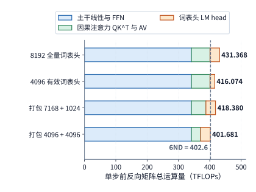

*图 3-26　Qwen3-8B 在 8192 个输入 token 下的单步前反向训练矩阵运算量分解对比。三段填充色块依次对应 36 层主干线性投影与 FFN（$341.398\ \mathrm{TFLOPs}$）、因果注意力 $QK^{\mathsf T}$ 与 $AV$，以及末端词表投影头 LM head；竖直虚线标出按总参数量计算的 $6ND$ 粗算基准（$402.591\ \mathrm{TFLOPs}$）。*

在密集矩阵乘法之外，RMSNorm 归一化、逐元素激活函数、交叉熵损失计算以及最后的优化器参数更新，同样需要消耗向量计算周期与显存读写带宽。尤其应当关注优化器参数更新阶段：无论当前训练批次包含多少个 token，执行一次 Adam 更新都必须把全网数十亿个参数的权重、梯度、FP32 主权重以及两个动量矩估计完整读写一遍（对 Qwen3-8B 而言即每次更新固定读写超百 GB 状态）。因此，当每次更新所处理的平均 token 数较少（如小 batch 或短序列微调）时，这部分与 token 数无关、仅由参数规模 $N$ 决定的固定更新开销，在总训练耗时中所占的比例就会显著上升。[^nonmatrix]

当模型引入第 2 章所述的各类新型结构机制时，前向计算图中每增加一个算子，反向传播图中就会对称地增加相应的梯度求导路径：例如，在线上下文压缩机制需要对压缩投影、分块池化及状态递推算子求导；多流超连接（mHC）需要将梯度沿着多条并行残差流及混合矩阵反向分发；而稀疏 MoE 层则需要对本步实际路由命中的专家分支执行反向矩阵乘法并汇总门控梯度。[^v4-training] 因此，第 2 章建立的前向数据流图可以直接作为训练阶段的蓝图，用来逐一清点哪些前向中间激活必须留存、反向传播又需执行哪些对应的算子。

综合以上分析，当训练序列长度或批次配置发生变化时，我们可以沿着前反向计算图立即判断各项开销的缩放趋势：线性投影与 FFN 的运算量随输入总行数 $BP$ 线性增长，全注意力核心运算随有效查询—键配对数二次增长，而优化器状态更新则仅随模型参数量 $N$ 与参数更新次数增长；此外，若为了节省激活显存而开启**激活重计算（activation checkpointing / recomputation）**，虽然大幅压缩了前向激活的显存驻留峰值，但在反向传播前临时重跑的那部分前向矩阵运算（最多相当于再加一次完整前向，使总运算量从约 $3\times$ 前向增至约 $4\times$ 前向）也必须如实计入训练总算力预算 $F_{\mathrm{train}}$。

> **练习 3-6〔延伸〕：一次参数更新需要多少计算、训练状态和监督 token**
>
> 从 $Y=XW$ 推导输入梯度和权重梯度的尺寸，说明三次矩阵乘法的运算量为何相同。对 Qwen3-8B，按每参数 18 字节计算长期训练状态的总容量，再将梯度改为 BF16，求节省的容量。设每个 micro-batch 含 2 条序列，每条有 4096 个输入 token，其中 1024 个 token 参与监督。累计 8 个 micro-batch 后更新一次参数，求每次更新处理的输入 token 总数和有效监督 token 总数。解释仅屏蔽不参与监督的 token 的损失，与只对参与监督的 token 执行词表投影，在计算量上有何区别。

## 3.5 强化学习（RL）

### 3.5.1 Rollout、奖励与环境验证

如果说在线推理是从外部用户请求出发的单向生成，传统预训练与 SFT 是在静态离线语料上的前反向拟合，那么**强化学习（RL，Reinforcement Learning）**则是将“自回归生成”与“梯度更新”首尾相接的循环演进系统：模型先根据当前策略主动探索并生成候选轨迹，外部验证环境或奖励模型对生成结果打分，学习器再依据奖励反馈更新模型参数，随后将更新后的新权重同步给生成端以开启下一轮探索。在语言模型中，“策略（policy）”就是模型在给定上下文条件下预测下一个 token 的条件概率分布，而策略模型自回归生成完整回答或交互轨迹的过程则统称为 **rollout（采样展开）**。

这一训练范式已成为提升大模型复杂推理与工程能力的核心引擎。例如，DeepSeek-R1 展示了如何在数学与代码等具有明确客观标准的问题上，直接利用规则校验或测试沙箱给出的可验证奖励（verifiable rewards）驱动大规模强化学习。对于数学证明或算法编程任务，奖励信号可以由确定性的答案解析器或单元测试用例直接给出；对于需要多步交互的软件工程或网页操作 Agent 任务，则必须在真实的容器沙箱与工具环境中执行动作并观测最终状态；而对于开放域写作或对话对齐任务，奖励数值（reward）往往还需要调用另一个独立的奖励模型（Reward Model）或裁判模型（LLM-as-a-Judge）通过前向推理给出。这意味着，在强化学习中，短短一次“训练迭代（training step）”的背后，往往交织着策略模型自回归生成、多模型前向打分、CPU 编译测试、容器沙箱等待以及反向传播与优化器更新等多种截然不同的异构负载。[^r1]

在最新的前沿模型训练流水线中，强化学习还常常与在线知识蒸馏深度融合。例如，DeepSeek V4-Flash 先通过领域 SFT 与专项 RL 分别训练出多个垂直领域的专家模型（如代码专家、数学专家、通用推理专家），随后采用多教师**同策略蒸馏（On-Policy Distillation，简称 OPD）**将这些领域专家的能力汇聚到同一个轻量级学生模型中。传统的离线知识蒸馏是让学生模型在静态语料或教师预先生成的固定文本上模仿教师；而在同策略蒸馏（OPD）中，训练轨迹是由**当前迭代的学生模型自己实时 rollout 生成**的，随后领域教师模型在这些学生自己走出的 token 位置上前向计算并给出完整的词表概率分布，学生模型据此最小化与教师分布之间的差异。这样一来，教师模型的前向推理就成了夹在“学生 rollout 生成”与“学生反向梯度更新”之间的一个必经计算阶段；与此同时，代码测试或规则验证器则在另一条分支上并行提供环境反馈。[^v4]

在剖析这类复杂强化学习系统的资源消耗时，最清晰的方法是沿着数据流找出每一个阶段的**数据生产者与消费者**：策略生成端（Actor / Rollout worker）负责逐 token 生成轨迹；环境沙箱、奖励模型或蒸馏教师（Reward / Teacher / Reference worker）读取生成的完整轨迹并计算奖励或目标分布；训练学习器（Learner / Trainer）读取筛选后的有效样本执行前反向计算并更新权重；最后，生成端工作节点再接收学习器广播的新版权重。在这条前后衔接的流水线上，任何一个角色的处理速度掉队，都会导致下游角色空闲等待或上游样本积压；而每引入一个参考模型或教师模型，系统就必须额外承担相应的前向算力与常驻显存开销（第 10、11 章将建立在这些生产—消费依赖关系之上，设计分布式 RL 的角色放置与弹性调度方案）。

### 3.5.2 有效样本、策略更新与权重同步

在 rollout 生成候选回答并完成奖励评估之后，并非所有生成的轨迹都会原封不动地送入学习器做梯度更新。核算强化学习开销的第一个关键，就是要严格区分**生成阶段实际采样的总轨迹数 $n_{\mathrm{generate}}$** 与**经过过滤筛选后真正进入参数更新的有效样本数 $n_{\mathrm{keep}}$**：前者决定了 rollout 生成、环境验证与参考模型前向打分的工作量，而后者才决定策略更新阶段的训练 batch 大小，二者的数量往往并不相等。

设每一轮策略更新要求必须凑齐 $n_{\mathrm{keep}}$ 条合格样本，而 rollout 生成的候选样本能够通过筛选规则的平均保留率（acceptance / keep rate）为 $a\in(0,1]$，则为了凑齐一次更新所需的有效样本，生成端需要采样的期望轨迹总数为：

$$
n_{\mathrm{generate}}\approx\frac{n_{\mathrm{keep}}}{a}.
$$

举例来说，若学习器每步更新固定需要 $n_{\mathrm{keep}}=16$ 条有效样本：当样本保留率 $a=1/2$ 时，生成端平均每轮需要采样 32 条回答；而当题目变难或筛选条件收紧、使保留率降至 $a=1/4$ 时，生成端平均每轮就必须采样 64 条回答。由于 rollout 生成、环境测试和参考模型打分必须处理全部 $n_{\mathrm{generate}}$ 条候选回答，而反向梯度更新只处理保留下来的 $n_{\mathrm{keep}}$ 条有效样本，因此当保留率 $a$ 下降时，前序生成与评分阶段的计算开销会按 $1/a$ 成倍放大，而策略更新阶段的 batch 大小与计算量却保持不变（第 3.5.3 节将通过具体算例定量核算这一变化）。

一条生成轨迹究竟能否被保留下来参与更新，取决于具体的强化学习算法与样本过滤规则。有的训练配方会将执行报错或测试失败的轨迹保留下来作为负样本，有的配方则会直接剔除超出最大长度被截断（truncated）或未能解析出合法格式的无效样本。在以组内相对策略优化（如 GRPO）为代表的算法中，系统对同一道提示词（prompt）并行采样一组共 $G_{\mathrm{group}}$ 条候选回答，并根据每条回答的奖励相对于同组平均奖励的高低来计算其**优势值（advantage，衡量某次行动相比基准表现好坏的标量）**。这意味着，即使候选回答没有因为格式错误被剔除，也可能因为组内奖励缺乏区分度而失去有效学习信号。

**实测现象：同组回答获得相同奖励会直接消除组内学习信号。** 在采用组内相对优势（group-relative advantage）的强化学习算法中，如果针对同一道题目生成的同组多份回答获得了完全相同的奖励值（例如题目过于简单导致全组回答全部做对得满分，或题目过难导致全组回答全部得零分），那么在减去组内平均奖励之后，该组每一条回答算出的相对优势值都恒等于 0，进而导致它们在策略损失函数中产生的梯度也全部为 0。在对开源强化学习框架 verl 的实测追踪中可以清楚观察到这一现象：系统虽然完整走完了生成、评分与反向传播的全部流程，但这类“全对”或“全错”的样本组并未向模型提供任何区分优劣的有效梯度信号。唯有在同一组采样中同时出现高低不同的奖励差异、产生非零的相对优势时，策略梯度才会真正推动模型参数向高奖励方向演进。因此，先进的 RL 系统往往会在更新前实行动态采样过滤（dynamic sampling），直接丢弃组内奖励全同的样本组并继续补采，这也正是样本保留率 $a<1$ 的重要原因之一。[^verl]

在选定有效样本并进入学习器执行梯度累加时，损失函数在批次内的**归一化求平均方式**同样会微妙地影响训练动力学。假设我们的优化目标是对整个全局 batch 内的所有有效生成 token 等权重地求平均损失，那么在拆分为多个 micro-batch 做梯度累加时，就应当统计整个全局 batch 的有效 token 总数作为统一分母；反之，如果实现上先对每个 micro-batch 内部的有效 token 单独求一次平均损失，再把各个 micro-batch 的均值简单算术平均，那么在各条样本生成长度长短不一的情况下，恰好分在较短 micro-batch 里的 token 就会获得不成比例的更大梯度权重（第 10 章将结合具体开源训练框架的代码实现，详细剖析不同损失归一化口径的差异）。[^verl-loss]

当学习器完成一次参数更新后，还必须将更新后的新版策略权重同步（weight synchronization）给所有负责 rollout 生成的推理实例。如果生成端继续使用更新前的旧权重采样，那么下一批产生的数据就偏离了当前的最新策略（变成异策略 off-policy 数据）。在同步 RL 循环中，生成端必须暂停等待新权重传输完毕并加载就绪后，才能启动下一轮 rollout；而在异步或流水线 RL 方案中，系统允许生成端利用旧版本权重继续提前采样以掩盖等待时间，但必须在算法与系统层面严格记录每条样本是由哪一版权重（policy version）生成的，并控制允许的最大版本滞后步数（staleness）（第 10 章将深入讨论分布式 RL 中的权重交接、抢占、故障恢复与角色资源配比）。

### 3.5.3 有效样本数固定时，各阶段需要多少计算

下面我们用一组固定目标的教学算例，将第 3.5.2 节建立的样本过滤关系转化为精确的 TFLOPs 算力账本：要求每一轮策略更新都固定保留 $n_{\mathrm{keep}}=16$ 条有效样本，定量对比当样本保留率从 $1/2$ 降至 $1/4$ 时，RL 周期内各阶段的计算量如何变化。

**例题 3-4：样本保留比例下降时，为保持更新样本数需要增加多少计算？**

解：以 Qwen3-8B 为例。设在基线情形（保留率 $a=1/2$）下，每轮取 8 道提示词，每道题并行采样生成 4 份候选回答，共生成 $n_{\mathrm{generate}}=32$ 条轨迹；每条轨迹的提示词输入长度均为 $P=1024$ 个 token，生成回答长度均为 $G=256$ 个 token（假设均生成满 256 个 token、不提前终止，且生成阶段暂不启用跨样本前缀缓存复用），经过筛选后保留其中 $n_{\mathrm{keep}}=16$ 条样本送入学习器做一次策略更新。系统中除了策略模型（Actor）外，还配有一个结构完全相同、但权重始终冻结不变的**参考模型（Reference model，用于计算新旧策略输出分布之间的 KL 散度惩罚，防止策略模型在强化学习中偏离过远而崩溃）**。参考模型需要对全部 32 条生成轨迹各执行一次前向传播以给出基准对数概率；本例不额外调用蒸馏教师模型。[^rl]

我们来逐阶段核算矩阵运算量：
1. **Rollout 生成阶段（32 条样本）**：每条样本先对 $P=1024$ 个提示词 token 执行 1 次 prefill，再串行执行 $G-1=255$ 步 decode。
2. **参考模型前向与策略更新阶段（Teacher Forcing 模式）**：当一条轨迹已经完整生成完毕后，无论是送入参考模型计算对数概率，还是送入学习器执行策略更新的前向与反向传播，序列中的全部 token 都已经成为已知确定值。此时系统不再需要一步步串行 decode，而是直接采用与训练相同的**教师强制（teacher forcing）**并行模式：将长度为 $P+G-1=1024+255=1279$ 的完整已知序列一次性送入模型并行前向计算，并在对应的 256 个输出位置上读取预测概率或计算策略损失梯度。因此，进入策略更新的 16 条保留样本合计包含 $16\times1279=20{,}464$ 个前反向输入 token，其中真正产生策略梯度信号的有效监督输出位置共 $16\times256=4096$ 个。

将各阶段的矩阵运算量逐项汇总如下表所示：

| 阶段 | 处理样本 | 矩阵运算量（TFLOPs） |
| --- | ---: | ---: |
| Rollout prefill | 32 | 465.143 |
| Rollout decode，255 步／条 | 32 | 129.056 |
| 参考模型，一次前向 | 32 | 634.944 |
| 教师评分，设为零次 | 0 | 0 |
| 策略更新，一次遍历 | 16 | 952.416 |
| 合计 | 保留 16 条 | 2,181.559 |

若将生成单条候选回答（含 prefill 与 decode）的矩阵运算量记为 $f_g$，参考模型对单条回答执行一次前向传播的运算量记为 $f_r$，学习器对固定 $n_{\mathrm{keep}}$ 条有效样本执行一次前反向策略更新的运算量记为 $F_u$，则当每轮采样 $n$ 条候选回答时，单个 RL 迭代周期的矩阵总运算量可简洁表示为：

$$
F_{\mathrm{cycle}}(n)=n(f_g+f_r)+F_u.
$$

由表中数据可知，单条样本的生成与参考前向开销之和为 $f_g+f_r = (465.143+129.056+634.944)/32 \approx 38.411\ \mathrm{TFLOPs}$，而 16 条保留样本的固定策略更新开销为 $F_u = 952.416\ \mathrm{TFLOPs}$。需要注意，尽管上式将各阶段的 TFLOPs 直接相加，但在转化为实际墙钟耗时（wall-clock time）时，必须考虑各阶段截然不同的硬件执行效率：参考模型前向与策略更新均以 1279 行的长序列并行执行大矩阵乘法，能够跑出较高的算力利用率（MFU）；而 rollout decode 则是逐 token 推进的访存受限过程，即便其绝对 FLOPs 仅占全周期的约 5.9%（129.056 / 2181.559），在实际运行时间上却往往占据大头。

现在看第二组对照情形：如果由于任务难度上升或筛选条件收紧，样本保留率从 $a=1/2$ 降至 $a=1/4$，为了凑齐同样的 16 条有效更新样本，生成端每轮必须采样 $n=64$ 条候选回答。此时，策略更新阶段处理的样本数仍为 16 条（$F_u=952.416\ \mathrm{TFLOPs}$ 保持不变），但 rollout 生成与参考模型前向的运算量双双翻倍，使单周期总矩阵运算量从 2,181.559 TFLOPs 攀升至 **3,410.701 TFLOPs**，增幅达 **56.3%**；折算到每条真正进入更新的有效样本上，其分摊的综合矩阵算力成本从 136.347 TFLOPs 增至 213.169 TFLOPs。多出来的这 1,229.142 TFLOPs 算力，全部消耗在为凑齐 16 条有效样本而额外采样的 32 条候选回答的生成与参考模型前向计算上。[^rl-low]

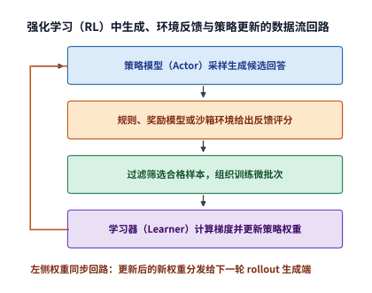

*图 3-27　强化学习中的角色和数据流。生成端产生回答，反馈环节评价结果，筛选后送给学习器更新；新权重再用于下一批生成。*

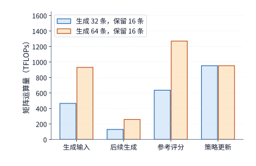

*图 3-28　保持 16 条有效样本的目标，生成数由 32 增到 64。生成时的输入处理、后续 decode 和参考模型评分随回答总数增加，策略更新处理的样本数保持相同。*

在每轮策略更新结束之后，学习器还需要把更新后的新版权重同步给各个 rollout 生成副本（replicas）。设生成端共有 $r$ 个独立的模型副本，完整模型计算权重的大小为 $M_W$；若学习器采用最朴素的单播方式逐个向各副本独立发送完整权重，则单轮权重同步的总网络传输量为 $rM_W$。对于 Qwen3-8B，一份完整的 BF16 权重约为 16.381 GB（十进制），若向 $r=4$ 个生成副本逐一单播，每轮更新后仅权重同步就需传输约 $65.526\ \mathrm{GB}$ 数据。在此过程中，体积庞大的 FP32 主权重与 Adam 动量状态始终留在学习器本地供下一次更新使用，生成副本只需接收 2 字节/参数的 BF16 前向推理权重即可；而在工程实现上，采用集合通信广播（Broadcast）或机内/机间分层树状分发，可以让多个生成副本共享网络链路传输，避免源端重复发送。

因此，在为强化学习系统规划硬件资源配比时，既要核算各阶段的绝对 FLOPs，更要匹配各阶段的计算形态与硬件瓶颈：rollout 生成的 decode 步每次只为每条活跃序列推进 1 个新 token，属于典型的显存带宽受限负载；参考模型打分、教师模型蒸馏与学习器前反向训练都可以一次性并行处理整条已知序列的成百上千个 token，属于计算算力受限负载；而代码编译、单元测试与环境沙箱交互则高度依赖 CPU 核数、内存与文件 I/O。唯有分别测算各阶段在对应硬件上的实际耗时，并按“rollout 生成 $\to$ 环境验证与模型评分 $\to$ 策略梯度更新 $\to$ 权重同步”的依赖顺序排布时间线，才能准确找出整套 RL 系统的吞吐瓶颈（第 4 至 10 章将围绕这些负载特征逐步展开底层硬件架构与分布式系统设计）。

> **练习 3-7〔核心〕：更新样本数不变时，多生成回答会增加多少 RL 开销**
>
> 保持一次更新使用 16 条等长样本。利用例题 3-4 中分别生成 32 条和 64 条回答时的周期总运算量，求每多生成一条回答所增加的生成与参考模型运算量，以及一次更新所需的固定运算量。保持更新样本数不变，据此预测生成 48 条回答时的周期总运算量。再用与生成模型结构相同的教师模型，对全部 48 条回答各执行一次前向计算，求新增的运算量。若将更新后的 BF16 权重分别发送给四个副本，每个副本独立接收一份，求总传输量。最后画出生成、反馈、更新与同步的依赖，指出哪些阶段可以在不同 batch 之间重叠。

## 3.6 从负载需求到训练与服务预算

### 3.6.1 Scaling Law：模型规模与数据量的关系

前两节已经给出了单次训练更新与单个 RL 周期的算力账本；但在启动训练之前，系统设计者还必须回答一个更根本的顶层问题：**在给定的总训练算力预算下，究竟应该训练一个多大的模型、喂给它多少训练数据？** 设总训练计算预算为 $C$（单位为 FLOPs），模型参数量为 $N$，训练 token 总数为 $D$，由 $C\approx6ND$ 可知，在总预算 $C$ 固定时，增大模型参数量 $N$ 就必然要按比例削减训练数据量 $D$。要在二者之间做出最优权衡，就必须定量刻画参数规模与数据规模各自如何影响模型最终的泛化质量。**Scaling Law（规模扩展律）**正是通过受控实验拟合模型参数量 $N$、训练数据量 $D$ 与验证集交叉熵损失 $L(N,D)$ 之间定量关系的经验模型。在固定训练超参数配置与评测口径的前提下，最常用的经典参数—数据联合幂律（power-law）模型形式如下（其中各项系数与指数均为正数）：

$$
L(N,D)=E+\frac{A}{N^{\alpha}}+\frac{B}{D^{\beta}}.
$$

式中，$L(N,D)$ 为验证集损失；$E$ 为不可约损失（irreducible loss，即自然语言本身固有的熵下界）；$A/N^\alpha$ 刻画因模型参数容量有限而产生的近似误差；$B/D^\beta$ 则刻画因训练数据量有限而产生的统计泛化误差；$A,B,\alpha,\beta$ 均为由实验数据拟合得到的正参数。可以看到，单独增大 $N$ 或单独增大 $D$ 都能单调降低对应的误差项；但在固定总训练算力预算 $C=6ND$ 的约束下，这两项误差此消彼长。

将约束条件 $D=C/(6N)$ 代入损失函数以消去 $D$，并对参数量 $N$ 求导令导数为零，可得验证损失达到最小时的一阶极值条件：

$$
\alpha A N^{-\alpha-1}=\beta B\left(\frac6C\right)^\beta N^{\beta-1}.
$$

等式左侧代表每增加一单位参数所带来的模型容量误差下降率（边际收益），右侧则代表因预算被挤占、训练数据相应减少而导致的欠训练误差上升率（边际代价）；当二者恰好相等时，继续调整参数与数据的配比已无法再获得净收益。移项整理后，便可解出固定训练预算 $C$ 下的**计算最优（compute-optimal）参数规模**：

$$
N_{\mathrm{opt}}=\left(\frac{\alpha A}{\beta B}\right)^{1/(\alpha+\beta)}\left(\frac{C}{6}\right)^{\beta/(\alpha+\beta)}.
$$

上式给出的 $N_{\mathrm{opt}}$ 是一个连续解析值，实际工程设计时可在该数值附近选取对齐硬件张量核维度的网络层数与隐藏层宽度。但必须强调这一最优解的严格成立边界：**$N_{\mathrm{opt}}$ 仅仅是在“总训练算力 $C$ 固定”且“完全不考虑上线后推理服务成本”的前提下使验证集损失最小的静态最优点**，同时也假定了高质量训练语料的供给没有上限。一旦模型上线后需要长期服务海量推理请求，全生命周期的最优天平就会向“参数量更小、训练得更充分（over-trained）”的配置倾斜；第 3.6.2 节将对照主流开源模型的真实训练记录，检验工业界实际采用的参数—数据配比与上述纯训练最优解之间的显著差异。

在 Scaling Law 的研究历程中，不同团队给出的最优分配指数也曾经历过重要修正。Kaplan 等人的早期研究拟合得出约 $N_{\mathrm{opt}}\propto C^{0.73},\ D_{\mathrm{opt}}\propto C^{0.27}$ 的幂律关系，主张将大部分新增算力预算优先投入扩大模型参数规模；而 Hoffmann 等人随后的 Chinchilla 研究在对齐了学习率余弦退火周期后重新拟合，得出 $\alpha\approx\beta$ 的结论，即**模型参数规模 $N$ 与训练数据量 $D$ 应当随算力预算 $C$ 的增长而近似等比例（$\propto C^{0.5}$）同步扩大**。显然，拟合指数 $\alpha,\beta$ 的细微变化，在百亿乃至万亿参数的尺度下会直接导出截然不同的模型规模与语料规模决策。[^scaling]

**例题 3-5：小规模训练拟合出的 Scaling Law 能否外推预测更大模型的损失？** 试从公开训练实验记录中选取 6 个较小规模模型的观测点拟合上述幂律公式，并预留出 2 个更大规模模型的观测点作为留出检验集（hold-out set），检验外推预测的准确度。

解：我们选用研究模型与数据规模缩放的公开实验数据集 datablations（在标准 C4 英文网页语料上训练）中的 8 组训练记录：取其中参数量较小的 6 个模型作为拟合集求出公式系数，而将参数量 $N\ge2\times10^9$（2B）的 2 个较大模型完全排除在拟合过程之外，留作外推检验。实验结果显示：这两个留出大模型的实测验证集损失分别约为 $2.574$ 和 $2.337\ \mathrm{nats/token}$（nat 是以自然常数 $\mathrm e$ 为底的对数信息量单位，$\mathrm{nats/token}$ 即每个 token 的平均交叉熵损失），而由 6 个小模型拟合出的幂律曲线给出的外推预测值分别为 $2.583$ 和 $2.363\ \mathrm{nats/token}$。可以看到，预测值略高于实测值，两个留出点上的均方根误差（RMSE）仅约为 $0.0193\ \mathrm{nats/token}$。图 3-29 使用不同形状的标记直观对比了拟合点与留出检验点的分布。[^fit]

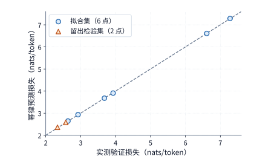

*图 3-29　八个公开 C4 观测的预测与实际损失。6 点用于拟合，2 点预先留出作检验；对角线表示预测等于观测，点到线的偏差反映误差。*

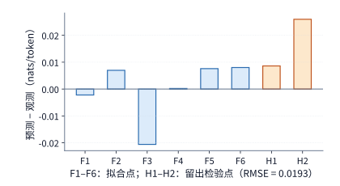

*图 3-30　同一组预测误差的放大视图。F1—F6 为拟合点，H1—H2 为留出点；纵轴是预测减观测，保留正负号。*

之所以必须坚持做**留出检验（out-of-sample / hold-out validation）**，是因为参数拟合算法本身只会尽力压低已知拟合点（F1—F6）上的残差；唯有将目标大模型（H1—H2）彻底排除在拟合输入之外，再对比其预测值与真实训练结果，才能检验该幂律关系是否真正具备跨数量级的外推预测能力。在本例的两个留出点上，预测残差分别为 $2.583-2.574=0.009$ 与 $2.363-2.337=0.026\ \mathrm{nats/token}$；对二者求平方和均值再开方（$\sqrt{(0.009^2+0.026^2)/2}\approx0.0193$），即得到上述均方根误差。

当然，预测出预训练验证集上的交叉熵损失之后，还需要进一步将其映射为下游实际业务任务上的解题准确率。例如，Llama 3 技术报告采用了两阶段预测法：先利用幂律公式由训练算力预测基础验证集损失，再通过 S 型曲线拟合验证集损失与下游基准（如代码生成、知识问答、工具调用）得分之间的映射关系。[^llama3] 借助这条两阶段链路，产品端对任务正确率的质量要求，才能一步步反推转化为底层基础设施所需的训练参数规模与总 FLOPs 预算。

此外，在解读 Scaling Law 实验数据时，还必须注意到单次训练过程固有的随机波动：即便模型架构、训练语料与超参数完全相同，仅仅更换随机数种子（random seed，改变权重初始化与样本洗牌次序），训练出的损失曲线也会存在微小的随机起伏；同时，参数量更大的模型在训练步数尚浅、远未充分收敛的早期阶段，其表现也未必优于已经充分收敛的小模型。因此，在小规模探索实验中通过多个随机种子重复训练，有助于剥离单次训练的随机噪声，识别出真正由规模扩展带来的确定性趋势。[^local-train]

当我们把视野从“单次预训练”拉长到“训练 + 长期在线服务”的全生命周期时，每次推理调用所消耗的算力与显存成本就会在模型上线后日积月累地叠加到前期训练预算之上。一个参数量更小的模型可以通过大幅拉长训练 token 数（即“超量训练”）来达到与大模型相同的目标验证损失：虽然这在预训练阶段需要付出比计算最优点更多的前期算力，但模型一旦上线，每次推理调用所需读取的权重体积和执行的矩阵运算量都会按参数比例永久性下降。Beyond Chinchilla-Optimal 等研究将这笔长期推理账正式纳入了扩展律目标函数：在其覆盖 150M 至 6B 规模的 47 个受控模型实验中，150M 小模型的训练数据量最高达到了每参数 10,000 个 token，较大模型也达到了每参数 1,000 个 token（远超 Chinchilla 的每参数约 20 个 token）。[^beyond] 前期多付出的训练算力与每次推理省下的服务算力，共同决定了小模型需要累计服务多少次请求才能收回前期的超量训练投入。

**固定目标损失下的训练投入与全生命周期累计成本交点。** 我们以达到同一目标验证损失 $L=2.9\ \mathrm{nats/token}$ 为刚性质量门槛，对比 0.1B 与 0.5B 两个不同尺寸模型的训练投入与累计服务成本，并将所有矩阵运算量统一折算为 H100 SXM 的等效 GPU 时间（以 GPU 秒或 GPU 小时为单位）。设单次在线推理请求的输入长度为 $P=512$、输出长度为 $G=128$ 个 token；训练阶段总矩阵运算量按 $6ND$ 计，单次完整推理请求的矩阵运算量按 $2N[P+(G-1)]$ 计。单张 H100 SXM 的 BF16 稠密峰值算力为 $989.4\ \mathrm{TFLOP/s}$；参照 Llama 3 技术报告在 H100 集群上实测的预训练 BF16 MFU（$38\%\sim43\%$，定义见第 1.2.2 节），我们统一取训练与推理服务的实际算力利用率为 $40\%$，即每 H100 GPU 秒可完成 $989.4\times0.40=395.76\ \mathrm{TFLOPs}$ 的有效模型矩阵运算。[^llama3] 根据本节前文（例题 3-5）拟合出的 C4 幂律方程反推：要将验证损失压低到 $2.9$，0.1B 模型需要训练约 $298.6\mathrm{B}$ 个 token（由于这一数据量已超出拟合实验所覆盖的数据集上限，图 3-31 中使用虚线绘制该外推方案）。按此核算，0.1B 模型的前期预训练约需消耗 $125.7$ 个 H100 GPU 小时，比同样达到 $L=2.9$ 的 0.5B 模型多投入了 $73.5$ 个 GPU 小时；但在上线服务后，0.1B 模型每处理一条请求可比 0.5B 模型少消耗约 $0.00129$ 个 H100 GPU 秒。将前期多付出的训练成本除以单次请求节省的成本，可知两条累计成本直线在累计服务约 **2.048 亿次请求**处相交：在此交点之前，0.1B 模型前期多花掉的训练算力尚未回本，0.5B 模型总成本更低；而一旦累计调用量跨过 2.048 亿次大关，0.1B 模型在每次推理中省下的成本总和便彻底反超前期投入。需要注意，由于训练与服务两侧均按同一个 MFU 折算系数转换为 GPU 时间，这一盈亏平衡交点的请求次数完全由两侧的理论 FLOPs 之比决定，与 MFU 的具体取值无关。[^lifecycle]

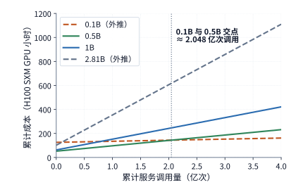

*图 3-31　训练与服务累计成本的题设比较。截距是训练投入，斜率是单次调用成本；虚线标出超出拟合参数或数据范围的方案，竖线为约 2.048 亿次的成本交点。图例中的 B 表示十亿个模型参数；纵轴为按 40% MFU 折算的 H100 SXM GPU 小时。*

回到纯训练预算下的参数—数据分配公式，我们还可以直接看出算力预算翻倍时的扩展方向：由 $N_{\mathrm{opt}}\propto C^{\beta/(\alpha+\beta)}$ 结合 $C=6ND$，立即可得最优训练数据量满足 $D_{\mathrm{opt}}\propto C^{\alpha/(\alpha+\beta)}$。当两个幂律指数近似相等（$\alpha=\beta$）时，$N_{\mathrm{opt}}\propto C^{1/2}$ 且 $D_{\mathrm{opt}}\propto C^{1/2}$——这意味着当总训练算力预算 $C$ 增加到原来的 4 倍时，最优参数量 $N$ 与最优训练数据量 $D$ 应当各自增加到原来的 2 倍。幂律指数 $\alpha$ 与 $\beta$ 的工程物理意义正在于此：它们直接决定了每多出一笔训练算力预算，应当按怎样的比例分配给“把模型做大”与“让模型多读数据”。

> **练习 3-8〔延伸〕：如何在模型参数与训练数据之间分配计算预算**
>
> 采用损失模型 $L=E+A/N^\alpha+B/D^\beta$ 和计算预算约束 $C=6ND$，推导使损失最小的参数量 $N$ 与数据量 $D$ 分别如何随计算预算 $C$ 增长。取 $\alpha=\beta$，当计算预算分别增至原来的四倍和九倍时，最优参数量和数据量应各增至原来的多少倍？再使用例题 3-5 的八个 C4 观测点，用其中六个拟合、另外两个检验，计算两个检验点的预测误差，并解释为什么拟合点上的误差不能替代留出检验的误差。

### 3.6.2 从 Llama 到 Qwen 的训练投入

第 3.6.1 节从理论上推导了模型规模与训练数据量之间的权衡关系。本节我们进一步梳理近年来代表性开源大模型的真实训练记录，观察工业界在实际研发中是如何演进训练投入的：我们先对比“平均每个参数所分配的训练 token 数（$D/N$）”，再严格区分算法层面的理论运算量（FLOPs）与具体硬件集群上的日历训练耗时（GPU hours）。

纵观从 Llama 1 到 Qwen3 的各代技术报告，可以清晰看到一条演进主线：在同属 7B—8B 的主流稠密模型尺寸下，预训练所投入的 token 总数经历了跨越式的持续增长。[^history]

| 模型与报告范围 | 训练 token | $D/N$ 粗略估算 | $6ND$ 粗略估算 |
| --- | ---: | ---: | ---: |
| Llama 1，6.7B | 1T | 149 | $4.02\times10^{22}$ FLOPs |
| Llama 2，约 7B | 2T | 286 | $8.40\times10^{22}$ FLOPs |
| Llama 3.1，约 8B | 约 15T | 约 1,875 | 约 $7.20\times10^{23}$ FLOPs |
| Qwen2.5，约 7B，模型系列披露 | 约 18T | 约 2,571 | 约 $7.56\times10^{23}$ FLOPs |
| Qwen3，约 8B，模型系列披露 | 约 36T | 约 4,500 | 约 $1.728\times10^{24}$ FLOPs |

表中的比值 $D/N$ 代表“平均每个模型参数在预训练期间见过的训练 token 数量”。可以看到，同样是 7B—8B 规模的稠密模型，$D/N$ 从早期 Llama 1 的约 149 一路攀升至 Qwen3 的约 4,500，增长了整整 30 倍。这说明，即便两个模型的参数规模完全相同，它们背后凝聚的前期预训练算力投入也可能相差超过一个数量级。原因在于：增加预训练数据量 $D$ 只会增加一次性的前期训练成本，而模型训练完成后上线部署时，每次推理调用所需占用的显存容量与读取的权重带宽依然只取决于静态参数量 $N$。因此，用远超常规的数据量对中小尺寸模型做深度充分训练，能够以可控的一次性训练投入，换取长期大规模在线服务阶段的显著成本优势。

这组工业界实证数据也彻底厘清了第 3.6.1 节 Chinchilla 计算最优法则与真实工业实践之间的关系：若严格按照 Chinchilla 的训练计算最优配比（$D/N \approx 20$），一个 8B 模型的计算最优预训练数据量仅为约 $160\mathrm{B}$（0.16T）个 token；而上表中各代主流开源 7B—8B 模型的实际训练数据量从 1T 起步、最高达 36T，超出 Chinchilla 基准达一至两个数量级。二者之所以看似悬殊，是因为它们求解的根本不是同一个优化问题：Chinchilla 法则求解的是“给定固定训练预算、不计推理成本时如何使损失最小”；而工业界模型开发者求解的则是“在高质量合成与清洗语料供给充足、且预期模型上线后将承载海量推理调用的前提下，如何使训练加推理的全生命周期成本最低”。第 3.6.1 节介绍的 Beyond Chinchilla-Optimal 理论以及第 3.6.3 节即将给出的盈亏平衡公式，恰好为这一工程选择提供了严密的定量解释——**纯训练预算最优与全生命周期最优有着截然不同的目标函数，工业界普遍采用高 $D/N$ 超量训练，绝不意味着 Scaling Law 拟合失效**。

除了拉长预训练 token 数之外，高质量数据清洗筛选、多教师知识蒸馏（如 OPD）以及强化学习后训练，本质上都是在做同一件事：**在保持推理阶段模型参数规模不变的前提下，通过投入更多前期计算来持续拔高给定尺寸模型的能力上限**。例如，在 Meta Llama 3 模型卡公布的基础预训练模型评测中，仅 8B 参数的 Llama 3 8B 与上一代 70B 参数的 Llama 2 70B 相比，在涵盖多学科知识的选择题基准 MMLU 上得分分别为 $66.6$ 与 $69.7$（几乎追平），而在基于维基百科证据的阅读问答基准 TriviaQA-Wiki 上得分则为 $78.5$ 与 $87.5$。[^llama3-card] 不同任务类型上的得分差距表明，模型选型必须锚定业务自身的具体质量门槛：只有当更小尺寸的模型通过充分训练跨越了业务的合格质量线，它所具备的小权重体积与高访存效率才能真正转化为生产环境中的服务红利。

在分析超大规模稀疏 MoE 模型的训练投入时，则必须将**总参数量**与**每 token 激活参数量**分开列账。对比三代典型 MoE 模型的技术报告：DeepSeek-V3 总参数量为 671B、每 token 激活约 37B、预训练语料为 14.8T tokens；DeepSeek V4-Flash 总参数量为 284B、每 token 激活约 13B、预训练语料为 32T tokens；DeepSeek V4-Pro 总参数量为 1.6T、每 token 激活约 49B、预训练语料为 33T tokens。其中，总参数量决定了存储全部权重、梯度与优化器状态所需的集群显存总容量，而激活参数量仅能提供单步计算量的粗略近似。若要精确核算 MoE 主干中专家 FFN 层的训练矩阵运算量，可将每个 SwiGLU 专家包含的 3 个线性投影矩阵单独写出：

$$
C_{\mathrm{expert/token}}=18n_Lhf(k_{\mathrm{routed}}+k_{\mathrm{shared}})=18n_Lhf(6+1).
$$

式中，$n_L$ 为包含 MoE 的主干层数，$h$ 为隐藏层维度，$f$ 为单个专家的中间层维度，$k_{\mathrm{routed}}$ 与 $k_{\mathrm{shared}}$ 分别为每个 token 路由激活的专家数与常驻共享专家数（在 V4-Flash 与 V4-Pro 中均为 $6+1=7$）；前面的常数系数 $18 = 3\times2\times3$，依次对应每个 SwiGLU 专家的 3 个矩阵投影、每次乘加计 2 FLOPs，以及前反向训练合计为前向的 3 倍。代入具体结构参数可知：DeepSeek V4-Flash 每处理一个训练 token，其主干专家层的前反向矩阵运算量约为 $45.4495\ \mathrm{GFLOPs/token}$，在 32T 预训练语料上累计约为 $1.45438\times10^{24}\ \mathrm{FLOPs}$；DeepSeek V4-Pro 每 token 的主干专家运算量约为 $169.2465\ \mathrm{GFLOPs/token}$，在 33T 语料上累计约为 $5.58513\times10^{24}\ \mathrm{FLOPs}$。完整的单步训练总算力，则由这部分专家层矩阵运算与注意力层、门控路由、多 token 预测（MTP）头、优化器更新及激活重计算共同构成。此外在阅读技术报告时还需注意：**损失函数中的辅助项权重并不等于算子执行比例**——例如 MTP 分支的损失权重设为 $0.3$，只是在反向传播时将该分支算出的梯度乘以 $0.3$，而 MTP 头本身的前反向矩阵乘法依然对相关位置 100% 完整执行。[^training]

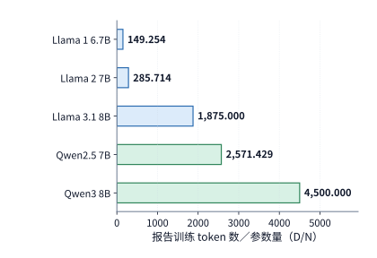

*图 3-32　相近参数规模的模型投入不同数量的训练 token。柱值为报告训练数据量除以参数量，Qwen 采用模型系列披露的数据预算。*

> **练习 3-9〔延伸〕：增加训练数据或专家数量会改变哪些资源需求**
>
> 根据 Llama／Qwen 表重算 $D/N$ 与 $6ND$。若参数量保持不变、训练数据量增至四倍，预测训练计算与上线后的纯权重容量分别如何变化。对 MoE，说明总专家数加倍、每 token 选中数不变时，参数容量与专家训练计算能否都按两倍估算。

除了理论浮点运算量（FLOPs），工业界技术报告还普遍使用 **GPU 小时（GPU hours）**来度量一次训练实际消耗的硬件资源总量。若一个训练任务在 $n_{\mathrm{GPU}}$ 张加速器上持续满负荷运行，累计消耗的总 GPU 小时数为 $H_{\mathrm{GPU}}$，则完成该训练任务所需的实际日历时间（wall-clock / calendar time，以小时计）为：

$$
T_{\mathrm{calendar}}=\frac{H_{\mathrm{GPU}}}{n_{\mathrm{GPU}}}.
$$

例如，Llama 1 65B 的预训练累计消耗了 $1{,}022{,}362$ 个 A100 GPU 小时：若持续动用 2048 张 A100 显卡并行训练，对应的实际日历耗时约为 $1{,}022{,}362 / 2048 \approx 499.2$ 小时（即 **20.80 天**）；若在保持单卡有效算力效率不变的前提下仅动用一半卡数（1024 张卡），则完成训练所需的日历时间就会翻倍至约 **41.60 天**。可见，总 GPU 小时衡量的是算力资源与资金的总消耗量，而同时投入的加速器卡数则决定了模型需要等待多少天才能训练出炉。

再看 DeepSeek-V3 的公开记录：其 14.8T token 的预训练阶段共消耗了 $2.664\mathrm{M}$（266.4 万）个 H800 GPU 小时；若按持续使用 2048 张 H800 显卡折算，对应的纯预训练日历耗时约为 $2.664\times10^6 / (2048\times24) \approx 54.20$ 天。至于预训练之后的 128K 长上下文扩展与强化学习后训练阶段，报告中另行披露了各自的 GPU 小时消耗——由于不同训练阶段的序列长度、架构分支与执行模式各不相同，核算时切忌把全流程总 GPU 小时笼统除以预训练阶段的 14.8T token。[^history]

同理，在用总 GPU 小时反推日历训练天数时，必须明确同期实际投入的集群卡数：例如 Llama 3.1 405B 报告披露其累计消耗了高达 $30.84\mathrm{M}$（3084 万）个 H100 GPU 小时；假设整个过程始终满配动用其披露的最大集群规模 16,384 张 H100 显卡，对应的日历耗时约为 $30.84\times10^6 / (16384\times24) \approx 78.43$ 天。如果其中某些训练阶段实际分配的卡数少于 16,384 张，那么相同 GPU 小时所对应的实际日历天数还会更长。因此，集群资源在各训练阶段之间的动态分配时序，直接决定了大模型研发的真实交付周期。

在横向对比上述不同模型的 GPU 小时账单时，还必须消除底层加速器代际差异带来的量纲不一致：Llama 1/2 使用的是 A100 80GB（BF16 稠密峰值算力为 $312\ \mathrm{TFLOP/s}$），而 Llama 3.1 与 DeepSeek-V3 分别使用的是 H100 与 H800（二者的 BF16 稠密峰值算力同为 $989.4\ \mathrm{TFLOP/s}$，区别仅在于 H800 的卡间 NVLink 互联带宽较低）。按 BF16 稠密峰值算力折算，1 个 H100 或 H800 GPU 小时提供的理论峰值算力约相当于 $989.4 / 312 \approx 3.17$ 个 A100 GPU 小时。图 3-33 据此将三代代表性模型的公开训练用量统一折算为“A100 80GB 等效 GPU 小时”放在同一对数坐标轴下对比（注：该折算假定各代集群的实际算力利用率 MFU 相近，仅用于对齐理论算力投入规模，并不代表实际硬件效率或租赁单价之比）。

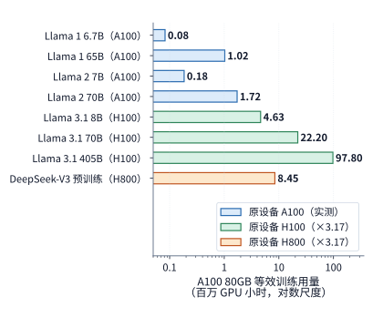

*图 3-33　Llama 与 DeepSeek-V3 的公开训练用量统一折算为 A100 80GB 等效 GPU 小时。Llama 1／Llama 2 为 A100 实测小时；H100 与 H800 小时按 BF16 稠密峰值之比 $989.4/312\approx3.17$ 折算，DeepSeek-V3 只计预训练阶段。横轴为对数尺度；折算假定各设备实际利用率相近，不表示效率或成本差异。*

不仅万亿 token 级的预训练可以用 GPU 小时精准度量，后训练（post-training）阶段不同技术路线的效率对比同样一目了然。例如，Qwen3 技术报告的表 21 将针对同一个 8B 模型的两条后训练技术路线并列对比：采用强化学习（RL）路线需要消耗 17,920 个 GPU 小时，而采用多教师同策略蒸馏（OPD）路线仅需消耗 1,800 个 GPU 小时（相差近 10 倍）。这两条后训练路线在工程上可以二选一，且各自内部都包含轨迹生成、评分反馈与梯度更新等环节。将报告中的总 GPU 小时拆解映射到具体的执行阶段与硬件瓶颈上，我们就能清楚看清每一笔训练预算究竟花在了哪里。

### 3.6.3 满足质量要求的全生命周期成本

现在，我们可以将第 2 章的单次调用模型与本章的负载及训练模型全面统一起来：模型架构决定了单次调用所需的显存容量、计算量与带宽读取量，业务负载决定了请求的到达模式、等待时长与重试次数，而预训练与后训练则决定了模型上线前的一次性算力投入。设候选模型方案 $m$ 在上线前的总训练与研发投入为 $C_0(m)$，上线后在整个服役周期内预计需要完成 $Q$ 个用户任务，其中第 $j$ 类任务的流量占比为 $w_j$（满足 $\sum_j w_j = 1$）、使用模型 $m$ 成功完成一个第 $j$ 类任务的平均综合成本为 $c_j(m)$，则模型方案 $m$ 的**全生命周期总成本（lifecycle cost）**为：

$$
C_{\mathrm{life}}(m)=C_0(m)+Q\sum_jw_jc_j(m).
$$

在运用上式对比不同模型方案之前，所有参与比较的候选方案都必须首先满足业务规定的**同一质量门槛、响应时限（SLA）与任务完成标准**。如果不同模型在单次尝试下的任务成功率不同，那么单任务成本 $c_j(m)$ 中必须按第 3.2.2 节的口径把失败尝试、多次重试、外部工具调用以及级联转交大模型的费用全部计入；在进行长期财务核算时，还应明确算力单价下降趋势、模型版本迭代寿命、系统运维成本以及资金贴现率等边界假设。此外，如果某套方案依赖定制化专用硬件，硬件采购与部署交割的漫长周期以及模型架构本身的生命周期，也必须纳入考量。

我们来求解一个最核心的工程决策问题：假设候选的“小模型方案”与“大模型方案”均已满足业务质量与延迟时限要求；小模型为了追平质量，在训练阶段需要多付出一笔额外的前期投入 $\Delta C_0 > 0$，但在上线后，每成功完成一个用户任务可以比大模型节省 $\Delta c > 0$ 的推理服务成本。令两套方案的全生命周期总成本相等，立即可得盈亏平衡的**临界累计任务量** $Q_*$：

$$
Q_* = \frac{\Delta C_0}{\Delta c}.
$$

举例来说，假设为了把一个小模型训练到与大模型相当的业务水平，前期需要额外多投入 10 万个 H100 GPU 小时（即 $\Delta C_0 = 10^5\times3600 = 3.6\times10^8$ 个 H100 GPU 秒），而上线后每完成一个成功任务可节省 $\Delta c = 0.72$ 个 H100 GPU 秒，则盈亏平衡点为：

$$
Q_* = \frac{3.6\times10^8}{0.72} = 5\times10^8\text{（即 5 亿次成功任务）}.
$$

结论非常明确：如果该业务在模型寿命期内的预期总任务量低于 5 亿次，前期多投入的 10 万 GPU 小时训练成本尚不足以从推理端省回来，直接选用训练投入更低的大模型反而更划算；反之，一旦预期总任务量超过 5 亿次，经过深度超量训练的小模型就会凭借更低的单次服务成本持续产生净收益。显存容量、响应延迟、任务质量与总调用量共同构成的这套账本，正是 AI Infra 系统架构师开展模型选型与算力规划的定量基石——脱离业务总量单看模型参数大小或单 token 价格，是无法做出正确工程决策的。

> **练习 3-10〔延伸〕：训练完成时间与累计服务成本**
>
> 假设完成训练共需 1,022,362 A100 GPU 小时，即 Llama 1 65B 的公开用量。分别持续使用 2048 张和 1024 张 A100，并假设加速器数量改变后总 GPU 小时不变，求两种配置下完成训练所需的天数。再比较两个满足相同质量与时限的模型：小模型多投入 10 万 H100 GPU 小时训练，每个成功任务节省 0.72 H100 GPU 秒。预计完成两亿项和十亿项成功任务时，分别应选择哪个模型？计算总成本差，并说明若实际任务量发生变化，选择会在何处反转。

> **练习 3-11〔延伸〕：多轮 Agent 前缀缓存收益与上下文中间改写代价**
>
> 1. 对照图 3-9（四轮代码修复 Agent 轨迹，模型为 Qwen3-8B）：计算四轮调用的整体前缀缓存 token 命中率（$4480/5297$），以及启用前缀缓存相对于无缓存重算完整输入所节省的 prefill 矩阵运算量百分比（$(76.196-11.976)/76.196$）。为什么第 2 轮调用的输入总长（1,443）是第 1 轮（206）的约 7.0 倍，但启用前缀缓存后第 2 轮的 prefill 矩阵运算量（$0.752\ \mathrm{TFLOPs}$）反而只有第 1 轮（$2.875\ \mathrm{TFLOPs}$）的约 $26.2\%$？
> 2. 在第 4 轮调用（完整输入 $I_4=1992$ 个 token，原命中前缀 $K_4=1648$ 个 token）启动前，若 Agent 框架对历史上下文的第 601 个 token 处执行了一次摘要替换，导致从第 601 个位置往后的历史 KV 缓存全部失效（仅前 600 个 token 可继续复用），求此时第 4 轮需要重新编码的新增输入长度 $P_4'$，并结合第 2 章的因果注意力配对公式说明为什么改写早期历史比在序列末尾追加同等数量的新 token 代价高得多。

> **练习 3-12〔延伸〕：序列打包分布、紧凑词表头与同策略蒸馏（OPD）算力核算**
>
> 1. 对照图 3-26（Qwen3-8B 在 8192 个训练 token 下的矩阵运算量分解）：计算“单篇 8192 全量词表头”（$431.368\ \mathrm{TFLOPs}$）与“打包 $4096+4096$ 全量词表头”（$401.681\ \mathrm{TFLOPs}$）之间的总运算量差值，并验证该差值是否恰好等于 36 层因果注意力 $QK^{\mathsf T}$ 与 $AV$ 的前反向运算量之差（$59.381-29.694=29.687\ \mathrm{TFLOPs}$）。若进一步在“打包 $4096+4096$”基础上采用仅对 4096 个有效监督位置执行投影的紧凑词表头（省去 $15.294\ \mathrm{TFLOPs}$），求此时单步前反向矩阵总运算量，并与经验估算值 $6ND=402.591\ \mathrm{TFLOPs}$ 对比。
> 2. 在第 3.5.3 节例题 3-4 的强化学习周期（生成 $n=32$ 条轨迹，每条 $P=1024,G=256$，保留 $n_{\mathrm{keep}}=16$ 条有效样本，原周期总矩阵运算量为 $2181.559\ \mathrm{TFLOPs}$）中，若将参考模型替换为一个每 token 前向矩阵运算量为 Qwen3-8B 两倍的领域教师模型，且仅对筛选保留下来的 $n_{\mathrm{keep}}=16$ 条有效样本执行一次教师前向蒸馏打分（单条前向矩阵运算量取原参考模型单条前向 $634.944/32=19.842\ \mathrm{TFLOPs}$ 的 2 倍），求该同策略蒸馏（OPD）周期的矩阵总运算量。

在后续各章中，我们将反复调用本章梳理出的三类核心负载画像。下表总结了面对不同业务负载时必须采集记录的关键字段，以及它们在后续系统设计章节中的具体用途：

| 负载 | 必须保留的字段 | 后续使用 |
| --- | --- | --- |
| Chat／Agent | 任务检查、模型与版本、每轮输入／命中／输出、到达、工具依赖、分支与复用间隔 | 第 8 章安排批处理与状态；第 9 章交接与路由；第 11 章管理工具环境 |
| 视觉／实时 | 原图字节、$\mathrm E/\mathrm P/\mathrm D$、EC/KV、帧或块到达、首响应／连续播放要求、打断后不再需要的计算 | 第 8、9 章安排编码和交接；第 12 章加入链路与执行位置 |
| 训练／RL | 数据与质量、长度和标签、micro-batch／更新、生成样本数／保留样本数、奖励计算与模型调用、权重版本、完成期限 | 第 4–7 章分析算力、存储与通信需求；第 10 章安排学习；第 11 章配置环境与资源池 |

纵观本章剖析的三类代表性负载可以看出，刻画 AI 系统的工作负载绝不能停留在静态的全局均值，而必须还原**随时间推进的具体执行过程与依赖关系**：在两分钟在线请求回放中，不同时段长输入与长输出请求的比例翻转，直接决定了队列积压与 KV 缓存抢占在何时爆发；在多轮代码修复 Agent 中，模型推理与外部工具之间的串并行依赖决定了关键路径长度，以及数千 token 的 KV 状态必须在存储中驻留多久；而在强化学习（RL）训练循环中，筛选前后的样本保留率直接拉开了 rollout 生成阶段与策略更新阶段的工作量配比。唯有将这三类时空动态信息完整记录下来，系统才能为各个阶段精准配置计算、存储与通信资源。

从下一章（第 4 章）开始，我们将进入硬件与系统架构层，结合加速器的矩阵算力、多级存储容量与片上/片外带宽，深入分析上述负载究竟是如何在芯片内部执行的。第 2、3 章算出的矩阵形状、状态体积与数据访问次数，将直接用于判定算子执行受限于算力还是带宽、中间状态能否放入片上缓存、以及数据搬移能否在规定时限内完成；而本章建立的阶段依赖图，则将直接指导算子融合、双缓冲流水与分布式并行中的计算—通信重叠设计。

## 常见误区

**误区一：认为只要平均请求到达率与平均输入、输出长度相同，两份负载对系统的压力就完全相同。** 事实上，少数超长请求的夹杂、长输入与长输出请求在时间窗内的组合变化、以及请求到达的先后次序，都会剧烈改变短时间尺度内的瞬时资源需求与 KV 缓存周转速度。正如例题 3-1 所示，哪怕硬件的最大处理速率足以轻松应对两分钟的全局平均到达率，只要后一分钟集中涌入长输出请求，系统依然会发生严重的队列积压。

**误区二：认为只要降低单 token 的推理单价，完成单个成功任务的成本就一定会随之下降。** 在核算单次成功任务成本（$C_{\mathrm{success}} = c/p$）时，长思考额外消耗的内部 token、未通过验证的失败采样、外部工具测试以及转交后级大模型的开销都必须如实计入分子 $c$，而分母则只能是最终通过验收的合格任务数。如果单次尝试的 token 消耗膨胀倍数超过了单价下降与成功率提升的组合收益，单次成功任务的实际花费反而会上升；而对于成功数为零的批次，则只能如实记录其资源损耗与失败原因，不能凭空外推成功成本。

**误区三：认为只要训练语料的总 token 数 $D$ 相同，训练系统的总工作量就完全相同。** 在相同的总 token 数下，单篇文档的长度分布会显著改变因果注意力中有效查询—键配对的二次项运算量；有效监督标签占比与末端词表投影头（LM head）的掩码实现方式会改变输出层的矩阵运算量；微批次拆分与梯度累加步数会改变优化器参数更新的读写频次；而在强化学习（RL）中，系统还必须为那些最终被过滤淘汰的候选回答支付全额的 rollout 生成与参考模型打分开销。

**误区四：认为 Scaling Law 拟合出的“计算最优（Chinchilla-optimal）规模”就是工业界实际训练模型时应当照搬的参数与数据配比。** 经典的训练计算最优解仅仅在“固定单次训练算力预算、且完全忽略上线后推理服务成本”的假设下成立。主流开源 7B—8B 模型之所以普遍将每参数训练 token 数（$D/N$）推高到计算最优基准的一至两个数量级以上，是因为开发者将长期大规模在线服务的推理成本纳入了全生命周期总目标——优化的目标函数发生了改变，绝不意味着 Scaling Law 拟合本身被推翻。

**误区五：认为在 Agent 等待外部工具返回期间模型没有执行算子，因此这段等待时间不会消耗推理系统资源，或者认为在实时语音交互中只要增大客户端抖动缓冲区就能解决一切卡顿。** 在多轮 Agent 任务等待编译、测试或外部接口响应的整段时间内，虽然加速器计算单元没有为该请求执行矩阵运算，但该请求已生成的数千乃至数万个上下文 token 的 KV 状态仍锁定在显存或内存中，持续累加状态时空面积（$\mathrm{GiB\cdot s}$）；一旦在途等待任务过多占满 KV 缓存池，新到达的请求即便面对空闲算力也会被阻塞在调度队列中或触发抢占。同理，在实时流式语音交互中，增大客户端初始抖动缓冲区只能吸收单次网络或生成的瞬时延迟波动（且代价是等幅推迟首包起播时刻）；如果后端生成音频的平均速率长期低于实时播放速率，任何有限容量的缓冲区最终都必然耗尽并导致持续断音。

## 代码任务轨迹

本章第 3.2.3 与 3.2.4 节所用的实测基准任务是修复一个 Python 区间合并函数，要求将存在嵌套包含关系以及端点恰好相接的区间全部正确合并，同时严禁在函数调用过程中原地修改（in-place mutate）传入的原始输入列表及其内部子列表。在实验环境中，Agent 模型可以自主调用工具读取目标源码文件、覆写修改后的代码、运行固定的单元测试套件并宣布任务结束，外部控制器绝不替模型代写或修补任何代码。在关闭思考模式的运行中，模型在 12 轮交互内先后执行了 1 次文件读取、5 次代码改写与 6 次测试运行，最终仍未能通过全部测试；而在开启思考模式的运行中，模型在 4 轮交互内的动作依次为：第 1 轮因思考过长触发输出截断、第 2 轮生成补丁并写入文件、第 3 轮运行测试验证通过、第 4 轮正式结束任务。其中，第 1 轮输出截断所消耗的 36.375 秒推理等待时间，同样如实计入了该任务的端到端总耗时。[^agent]

[^model]: [第 2 章模型架构](02-模型架构.md)，§2.2 的请求调用约定和 Qwen3-8B KV 计数；[四模型请求计算](../calculations/results/request-four-models-book.md)。

[^cost]: [2023—2026 年 token 成本调研](../research/token-cost-2023-2026/report.md)，§2、§4、§11；API 价格、生产成本与成功任务成本分开。

[^servegen]: [ServeGen，NSDI 2026](../references/proceedings/NSDI/2026/selected/nsdi26-xiang-servegen.pdf)，§2–7；[资料与源码阅读笔记](../case-studies/workload-and-provisioning.md)。

[^workload]: [请求分布与资源配置](../case-studies/workload-and-provisioning.md)，两分钟固定输入和首 token 修正后的阶段需求；[RTX PRO 6000 上 64 条序列的 decode 带宽下界](../calculations/results/batch-reuse-rtxpro6000-mix.md)，平均上下文取 2742 个 token。

[^arrival]: [练习 3-2：真实两分钟回放](../experiments/ch03/03-02/README.md)，完整输入、发送与完成记录、KV 采样及运行范围。

[^serve-replay]: [ServeGen 窗口的实际回放](../experiments/ch03/03-02/servegen-replay/README.md)。

[^agent-calc]: [开启思考模式的真实轨迹复算](../calculations/results/agent-thinking-on.md)。

[^context]: [上下文组织与 Agent 案例](../case-studies/author-context-and-design.md)，连接作者 AI Agent 书第 2 章与实验记录。

[^reasoning]: [练习 3-3：1024 预算](../experiments/ch03/03-03/README.md)与[4096 预算](../experiments/ch03/03-03/wide-budget/README.md)；理论背景见[Test-Time Compute](../references/files/papers/test-time-compute.pdf)。

[^reasoning-off]: [关闭思考模式的诊断](../experiments/ch03/03-03/no-thinking/README.md)，分别记录按预定标准评分的结果、事后从输出中提取答案的结果，以及并发进程的观测数据。

[^agent]: [练习 3-4：两条代码 Agent 轨迹](../experiments/ch03/03-04/README.md)，含独立检查与额外别名条件。

[^retrieval]: [检索与生成算例](../case-studies/retrieval-and-generation.md)。

[^agent-speedup]: [仅将首轮模型段加速两倍](../calculations/results/agent-thinking-on-double-first.md)。

[^jev]: [TypeSafe AI 首页](../references/text/typesafe-home.txt)的定价与并排演示；[发布博客](../references/text/typesafe-jev-blog.txt)含创始人自述，并说明并行采样、RLCD 与评测口径；[接口文档](../references/text/typesafe-docs-intro.txt)说明问题在同一状态上并行求值。

[^rlcr]: [Beyond Binary Rewards: Training LMs to Reason About Their Uncertainty](../references/files/papers/rlcr.pdf)，§3 的 RLCR 奖励。

[^decision-calc]: [决策请求的执行路径与定价比较](../calculations/results/decision-request-book.md)，含 V4.1 Flash 全层路径、512 个输出 token 的 LLM 路径与 DeepSeek 价目对照，可用 `python3 calculations/calc.py decision-request --format md` 复算；[DeepSeek 推理系统概述](../references/text/deepseek-serving-report.txt)的每 GPU 小时 2 美元口径；[DeepSeek 模型与价格](../references/text/deepseek-pricing-zh.txt)。

[^vision]: [视觉编码矩阵与张量计数](../calculations/results/vision-encoding-single.md)。

[^epd]: [多模态输入的字节、状态与阶段放置](../case-studies/multimodal-stage-placement.md)，固定 Qwen3-VL-4B 配置、预处理与完整 DeepStack EC。

[^media]: [生成模型取材与执行路径](../case-studies/generative-multimodal-models.md)；[Omni 音频](../calculations/results/omni-audio-book.md)、[Fish 音频](../calculations/results/fish-audio-book.md)、[FLUX 图像](../calculations/results/image-generation-flux.md)、[H3 视频](../calculations/results/video-generation-book.md)、[Wan 视频](../calculations/results/video-generation-wan.md)。

[^image]: [Qwen 图像生成请求计数](../calculations/results/image-generation-book.md)。

[^aoi]: [AOI 论文与关键帧案例](../case-studies/author-context-and-design.md)。

[^audio-real]: [两份历史语音记录](../experiments/ch03/03-05/historical-arrivals/README.md)。

[^audio]: [40 ms 缓冲教学时序](../calculations/results/audio-timing-base.md)与[60 ms 缓冲](../calculations/results/audio-timing-large-buffer.md)。

[^audio-interrupt]: [打断与静音的教学算例](../calculations/results/audio-timing-interrupt.md)。

[^training]: [训练计算量笔记](../case-studies/training-compute.md)，线性层前反向、序列分布与 DeepSeek V4-Flash 专家分项计算。

[^train-matrix]: [Qwen3-8B 的 8K 训练矩阵](../calculations/results/training-qwen3-8b-t8192.md)。

[^qwen]: [Qwen3 技术报告](../references/files/papers/qwen3.pdf)，§3.2 的三阶段预训练及表 21 的后训练分支。

[^mask]: [标签减半](../calculations/results/training-qwen3-8b-mask-half.md)与[显式压缩词表头](../calculations/results/training-qwen3-8b-compact-half.md)。

[^nonmatrix]: [训练非矩阵补算](../calculations/results/training-nonmatrix-book.md)，与[8K 变体](../calculations/results/training-nonmatrix-8192.md)分别计量。

[^v4-training]: [DeepSeek V4-Flash 在线压缩器](../calculations/results/v4-online-r4-tail-emits.md)、[注意力反向](../calculations/results/v4-attention-training-window128.md)、[MoE 单层训练](../calculations/results/v4-moe-training-balanced.md)、[mHC 包装反向](../calculations/results/v4-hc-training-128.md)、[优化器分组](../calculations/results/v4-optimizer-flash-base-unresolved.md)。

[^r1]: [DeepSeek-R1 报告](../references/files/papers/deepseek-r1.pdf)。

[^v4]: [DeepSeek V4 报告](../references/files/papers/deepseek-v4.pdf)，§5.1 的领域专家与多教师 OPD、§5.2 的教师调度、rollout 与沙箱。

[^verl]: [实验 10-8：固定 verl 最小训练流程](../experiments/ch10/10-08/README.md)。本章用这一实验区分任务质量与参数更新，完整系统的组织方式见第 10 章。

[^verl-loss]: [固定 verl 训练配置的损失归一化与参数更新过程](../research/2026-infra-survey/qa/verl-recipe-loss-closure.md)，绑定原配置、源码与导出张量。

[^rl]: [Qwen 教学 RL batch](../calculations/results/rl-qwen8-base.md)。

[^rl-low]: [降低样本保留比例、保持保留样本数](../calculations/results/rl-qwen8-low-acceptance.md)。

[^scaling]: [Kaplan Scaling Laws](../references/files/papers/scaling-laws.pdf)，§6；[Chinchilla](../references/files/papers/chinchilla.pdf)，计算最优分配与拟合方法。

[^fit]: [公开 C4 八点拟合](../calculations/results/datablations-real-c4-eight-point-fit.md)，来源日志、排除项和四项敏感性随报告保存。

[^llama3]: [Llama 3 报告](../references/files/papers/llama3.pdf)，训练预算、损失预测与下游任务表现；§3.3.2 与表 4 给出 H100 上 38%–43% 的 BF16 MFU。

[^llama3-card]: [Meta Llama 3 模型卡](../references/token-cost/2026-09-07/llama3-card.md)，Base pretrained models 表中 Llama 3 8B 与 Llama2 70B 两列。

[^local-train]: [练习 3-8：固定文本上的六次小模型实训](../experiments/ch03/03-08/README.md)，保存 checkpoint 与两个 seed 的完整结果。

[^beyond]: [Beyond Chinchilla-Optimal，ICML 2024 正式版](../references/outline-checks/2026-09-07/beyond-chinchilla-icml24.pdf)，推理需求、实验范围与长训练外推。

[^lifecycle]: [根据 C4 拟合结果估算生命周期成本](../calculations/results/real-c4-lifecycle-512-128.md)，费用按 H100 SXM GPU 秒计。

[^history]: [训练投入与 Scaling Law 历史笔记](../case-studies/scaling-history.md)及[锁定公开字段的复算](../calculations/results/training-history-published.md)。

[^source-1]: [多模态计算资料](../case-studies/generative-multimodal-models.md)。

[^v41-case]: [DeepSeek V4.1 官方技术报告](../calculations/sources/deepseek-v4.1-flash/DeepSeek_V41_Tech_Report.pdf)，第 1、2、3 节与第 6 节；[跨章会话的固定条件与复算](../calculations/results/v41-throughline.json)。

## 本章小结

持续运行的 AI 系统所面临的真实负载，不仅取决于单次调用内部要做多少计算与读写，更取决于请求在时间轴上如何到达、以及任务内部各步骤之间存在怎样的等待依赖。仅靠全局平均到达率只能给出粗略的资源下界；唯有深入分析短时间窗口内的流量突发积压与等待期间的状态驻留时空面积（$\mathrm{GiB\cdot s}$），才能揭示被平均值掩盖的排队延迟与显存容量瓶颈。在此基础上，多轮 Agent 任务引入了外部工具等待与失败重试成本，实时音视频交互引入了严格的逐块到达时限（deadline）与打断响应要求，而模型训练与强化学习（RL）则进一步叠加了反向传播、常驻优化器状态、候选样本过滤以及跨节点权重同步等系统开销。

在横向比较不同模型架构或系统方案的资源消耗与经济成本时，必须首先对齐任务的质量门槛、响应时限与完成标准。Scaling Law 为给定训练预算下的参数—数据分配提供了可外推检验的定量模型，而将上线后的长期推理服务成本纳入全生命周期账本，则解释了工业界为何普遍倾向于对中小尺寸模型投入远超训练计算最优点的预训练数据量。本章的核心练习 3-2、3-4 与 3-7 分别将这套定量分析方法落实到了持续在线请求、多步 Agent 交互与强化学习循环之中。

