# 第 4 章 加速器架构

假设一段计算总耗时 100 μs，其中矩阵乘法占 60 μs，其余工作占 40 μs。如果把矩阵计算单元的速度提高一倍，总时间将降至 $60/2+40=70$ μs，端到端加速比约为 1.43；而如果矩阵乘法原本只占 10 μs、其余工作占 90 μs，同样将矩阵单元提速一倍，总时间只能降到 95 μs，加速比仅为 1.05。硬件上增加的矩阵算力完全相同，最终收益却相差悬殊。传统的通用处理器需要将芯片面积均衡分配给分支控制、缓存与各类标量指令；而当神经网络把绝大部分执行时间都花在规则的矩阵运算上之后，这种通用面积分配方式便不再划算，专为高吞吐乘加设计的矩阵计算单元应运而生。加速器架构设计的核心命题，正是在有限的芯片面积、功耗预算与存储容量约束下，合理调配计算、存储与互连资源，从而最大限度地缩短真实负载的端到端执行时间。

第 2、3 章已经算清了单次模型调用与完整业务负载的计算量和访存量。本章将深入硬件微架构内部：先以 Qwen3-8B 的查询投影（Q 投影）为例核算单算子的运算次数与数据访问量，再将分析扩展到完整的自注意力与前馈网络。其中，矩阵乘法展示了输入与权重操作数如何在片上阵列中高频复用；而注意力层中的 $QK^{\mathsf T}\to\operatorname{Softmax}\to PV$ 链路则展示了矩阵运算结果如何交给向量单元执行指数与归约处理，随后再次送回矩阵单元。顺着这条数据流就能看清，为什么矩阵算力、片上存储容量以及不同计算单元之间的数据交接通路必须协同设计。

本章将采用统一的定量资源预算分析框架，横向对比 NVIDIA GPU、华为昇腾（Ascend）NPU 与 Apple Silicon 三类代表性架构：首先列出算子的计算量与数据依赖关系，接着将各类运算分配给对应的硬件执行单元，核算各级存储接口上的数据流量，最后用执行时间线（timeline）检验流水线中的等待气泡与计算—搬移重叠效果。硬件架构的演进取舍同样围绕这条主线展开：将高频共性计算与固定数据路径固化为专用硬件，能够显著削减指令译码与数据搬移开销；与之配合，底层软件则需要精心编排矩阵分块（tiling）、数据布局（layout）、双缓冲（double buffering）与同步原语，让程序充分发掘这些专用硬件通路的吞吐潜力（第 5 章将进一步阐述编译器与算子开发者如何在代码层面落实这些调度）。

处理器与存储器之间的空间布局，不妨类比为一栋办公大楼里的洗手间规划：如果把所有洗手间都集中建在一楼大厅，虽然集中建设与维护最省面积，但高层员工每次往返都要耗费大量时间，且走廊与电梯极易拥堵；反之，如果在每一层乃至每个办公区都配置洗手间，员工就近使用的耗时会大幅缩短，但洗手间占用的总建筑面积与管网成本也会随之倍增。计算机体系结构正是通过寄存器、L1/L2 缓存、片上软件管理缓冲（scratchpad memory）、高带宽显存（HBM）以及片间互连，构建起一套由近及远的存储层次，将高频复用的热数据尽可能放置在紧挨计算单元的位置。在实现路径上，传统 CPU 主要依靠硬件自动管理的缓存层次与乱序执行机制来被动隐藏访存延迟；而现代 GPU 与专用 AI 加速器则进一步引入显式管理的共享内存/局部缓冲、高维张量计算单元、异步直接内存访问（DMA/TMA）搬移引擎以及多级软件流水线，主动规划每一次数据复用与预取。

这一演进路线并没有改变“存储保存数据、计算单元处理数据”的基本分工，而是尽可能缩短高频数据的物理搬移路径、提高片上局部复用率，并将越来越多的数据搬移与同步决策显式交由硬件引擎、编译器和运行时协同控制。由于现代 Transformer 模型同时包含高算术强度的大矩阵乘法、低批量的访存受限矩阵—向量乘法、随生成步数动态增长的 KV 缓存状态以及动态分派的稀疏专家路由，加速器的计算单元、片上/片外存储层次与片间互连网络必须作为一个整体协同设计。在本章接下来的各个小节中，我们剖析任何一个硬件部件时，都将紧紧围绕三个核心问题：**数据距离计算单元有多远？读入片上后能够复用多少次？下一阶段何时能够拿到上一阶段的结果？**

## 4.1 从模型计算认识加速器

剖析任何一个算子在硬件上的运行表现，第一步都是明确它需要执行多少次算术运算、读写多少字节的数据。本节从这两项最基本的物理需求出发，拆解现代 AI 加速器的核心硬件组成，并定量分析计算单元、存储层次与芯片封装之间的工程取舍。

### 4.1.1 矩阵乘法的计算与数据需求

以 Qwen3-8B 模型为例：其隐藏层特征维度为 4,096，包含 32 个查询注意力头，每个头的维度为 128，因此查询投影（Q 投影）的输出总宽度同样为 $32\times128=4{,}096$。当模型一次性处理 $M$ 个 token 位置时，Q 投影执行的矩阵乘法为：

$$
Y=XW_Q,\qquad X\in\mathbb{R}^{M\times4096},\quad W_Q\in\mathbb{R}^{4096\times4096},\quad Y\in\mathbb{R}^{M\times4096}.
$$

在通用矩阵乘法 $Y=XW$ 中，$M$ 代表本次并行处理的 token 总行数（每个 token 的输入特征向量占据矩阵 $X$ 的一行）；$K$ 代表每个输入向量的特征维度（即权重矩阵 $W$ 的行数）；$N$ 代表每个输出向量的特征维度（即权重矩阵 $W$ 的列数）；在本例的 Q 投影中，$K=N=4096$（注意这里的 $M,K,N$ 是线性代数中描述矩阵维度的标准记号，切勿与第 1 章表示存储容量的 $M$ 混淆）。如果系统一次合批处理 $B$ 条等长请求、每条请求包含 $P$ 个新增输入 token，则在 prefill 阶段输入矩阵的总行数为 $M=BP$；而在自回归 decode 阶段，每条活跃请求每步仅输入 1 个最新 token，因此总行数为 $M=B$。可以看到，prefill 与 decode 两个阶段调用的是完全相同的权重矩阵 $W_Q$、执行的也是同一个线性变换，二者的唯一区别仅在于：**每一次读取权重矩阵时，有多少行输入激活向量与它共享这次读取**。[^qwen]

我们来核算它的计算量与访存量。输出矩阵 $Y$ 共有 $M\times N$ 个元素，每个输出元素都需要计算一行长度为 $K=4{,}096$ 的向量内积。按本书统一约定，1 次乘加（FMA）计为 2 次浮点运算（FLOPs），因此该矩阵乘法的总浮点运算量为：

$$
F=2MKN=2M\times4096^2=33\,554\,432M\ \mathrm{FLOPs}.
$$

再看片外显存的数据读写量。设输入矩阵 $X$、权重矩阵 $W_Q$ 与输出矩阵 $Y$ 均采用 BF16 格式存储（每元素占 2 字节）；而在矩阵计算单元内部，为了防止精度损失，乘加中间产生部分和（partial sum）时使用 FP32 累加器（每元素占 4 字节）在片上就地累加。在最理想的数据复用假设下——即输入矩阵与权重矩阵各自从片外显存完整读取 1 次，全部内积累加在片上完成后，再将最终结果写回片外显存 1 次——片外显存的总读写字节数为：

$$
V=2MK+2KN+2MN=33\,554\,432+16\,384M\ \mathrm{bytes}.
$$

上式右侧第一项 $33{,}554{,}432\ \mathrm{bytes}$（即 $32\ \mathrm{MiB}$）是与输入行数 $M$ 无关的固定权重读取量，第二项 $16{,}384M\ \mathrm{bytes}$ 则是随输入行数 $M$ 线性增长的输入读取与输出写回量（注：本书中二进制容量单位 $\mathrm{MiB}=2^{20}\ \mathrm{bytes}$，而硬件带宽规格中的 $\mathrm{GB/s}$ 遵循十进制 $10^9\ \mathrm{bytes/s}$）。将总计算量 $F$ 除以总访存量 $V$，即得到该算子的**算术强度（arithmetic intensity）** $I=F/V$。下表对比了单行输入（$M=1$，对应单请求 decode）与 256 行输入（$M=256$，对应大批量 decode 或短序列 prefill）下的各项指标：

| 一次 Q 投影 | $M=1$ | $M=256$ |
| --- | ---: | ---: |
| 矩阵乘法计算量 | 约 33.6 MFLOPs | 约 8.59 GFLOPs |
| 权重读取 | 32 MiB | 32 MiB |
| 输入读取与输出写回之和 | 16 KiB | 4 MiB |
| 总访问量 | 约 32 MiB | 36 MiB |
| 算术强度 | 约 1 FLOP/byte | 约 228 FLOPs/byte |

*表 4-1　Qwen3-8B 单次查询投影（$4096\times 4096$，BF16）在 $M=1$ 与 $M=256$ 下的计算量、访存量与算术强度对比*

图 4-1 直观展示了权重读取开销如何分摊到各个输入行上：当 $M=1$ 时，单行输入必须独自承担全部 32 MiB 的权重读取；而当 $M=256$ 时，256 行输入共享同一次权重读取，每行平均分摊的权重读取量骤降至 $32\ \mathrm{MiB}/256 = 128\ \mathrm{KiB}$。

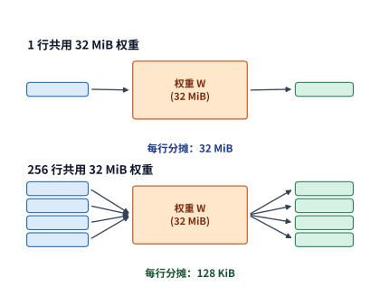

*图 4-1　两种调用都使用同一份 32 MiB 权重。上方是一行输入，下方以部分条带示意 256 行；每行分摊的权重读取从 32 MiB 减至 128 KiB。*

对比表中两列可以发现：当输入行数 $M$ 扩大到原来的 256 倍时，浮点运算次数严格增至 256 倍，但片外显存总访问量却仅从 32 MiB 微增至 36 MiB（增幅仅约八分之一）。正是因为 32 MiB 的权重矩阵在片上被 256 行输入共同复用，计算量的增长速度远远快于访存量的增长速度，从而使算术强度从约 $1\ \mathrm{FLOP/byte}$ 大幅跃升至约 $228\ \mathrm{FLOPs/byte}$。[^projection]

如果将算术强度表达式 $I=F/V$ 的分子与分母同时除以 $M$，还能看清增大输入行数带来的复用收益极限：

$$
I(M)=\frac{2KN}{2KN/M+2(K+N)}.
$$

随着输入行数 $M$ 持续增大，分母中每行分摊的权重读取量 $2KN/M$ 趋近于零，但每行固有的输入读取与输出写回量 $2(K+N)$ 始终保持不变。代入本例的 $K=N=4096$ 可知，当 $M\to\infty$ 时，算术强度 $I(M)$ 的渐近上限为 $\frac{2\times4096^2}{2\times8192}=2{,}048\ \mathrm{FLOPs/byte}$。这说明，随着 batch size 或序列长度不断增大，继续扩大 $M$ 所带来的边际复用收益会逐步递减：当每行分摊的权重读取量已经远小于输入输出激活本身的读写量时，读写激活张量便成为新的访存主导因素。

需要注意的是，上述理论下界成立的前提是“权重与输入各只从片外显存读取一次，且部分和完全在片上累加”。要在真实的物理芯片上兑现这一理想假设，硬件就必须在计算单元近旁配备足够容量的片上存储，用以暂存当前正在复用的操作数分块（tile）与累加部分和。

### 4.1.2 加速器的组成与分工

在异构计算系统中，运行深度学习框架、准备输入数据并下发执行指令的 CPU 侧通常称为**主机（Host）**，而真正承担大规模并行张量运算的加速卡一侧则称为**设备（Device）**。在算子启动前，模型权重与输入张量需要先放置在设备可直接寻址的高带宽显存（或统一内存）中，随后主机向设备命令队列提交内核函数（kernel）、张量内存地址及网格执行参数；一旦权重与中间状态常驻在设备显存内，后续连续调用的算子便可直接原地读写这些设备地址，无需再经历缓慢的主机—设备间拷贝。

图 4-2 勾勒了一次矩阵乘法在设备内部流经的核心硬件部件：片外高带宽显存（HBM/GDDR）负责持久保存完整的输入、权重与输出张量；片上全局共享缓存（如 L2 Cache）自动留存近期高频访问的数据块；更靠近执行核心的局部缓冲（如 Shared Memory 或 L1/L0 Buffer）则显式暂存当前计算分块（tile）所需的操作数。矩阵计算单元从局部缓冲中高速读取操作数并沿内积维度 $K$ 反复执行乘加，累加器存储（Accumulator）在片上就地保存高精度的中间部分和；待整条内积归约完毕后，再将结果移交向量单元执行激活、缩放等后处理，最终写回片外显存。

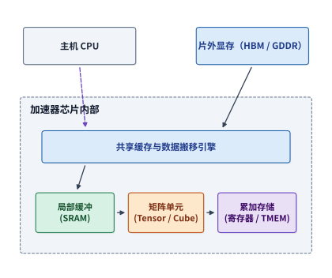

*图 4-2　主机提交任务，设备完成搬移、计算和结果处理。部分和留在片上，减少反复写回内存的开销。*

围绕这套通用的“片外存储—片上缓冲—矩阵/向量执行”模型，不同厂商演化出了各具特色的微架构组织方式：NVIDIA GPU 将线程束调度器、Tensor Core（张量核心）、寄存器堆（Register File）与共享内存（Shared Memory）集成在流式多处理器（SM，Streaming Multiprocessor）内部；华为昇腾（Ascend）DaVinci 架构则采用功能明确解耦的引擎设计，由标量单元（Scalar）、向量单元（Vector）、矩阵立方体单元（Cube）与内存传输引擎（MTE，Memory Transfer Engine）分别承担流程控制、向量运算、矩阵乘加与跨级数据搬移；Apple Silicon 的 GPU 则通过 Metal 线程组（threadgroup）组织并行计算，由线程组内的并行线程共享局部线程组内存（threadgroup memory）并协作完成分块同步。尽管硬件术语各异，但这三类架构在运行每一个算子时，都必须严丝合缝地回答同样三个问题：**操作数何时抵达片上缓冲？中间结果存放在哪一级存储？下一阶段的计算单元何时能够安全读取上一阶段的输出？**[^architecture]

#### GPU 与 DaVinci 如何分配搬移和同步工作

对比 NVIDIA GPU 与昇腾 DaVinci 的编程与执行模型，可以清楚看到两类架构在“硬件自动管理”与“软件显式控制”之间的不同划分：在 NVIDIA GPU 上，普通的内存加载指令可以直接依赖硬件自动管理的 L1/L2 缓存，而追求高性能的算子内核（如 FlashAttention 或 CUTLASS GEMM）则会主动将矩阵分块（tile）显式搬入软件管理的共享内存（Shared Memory），并配合异步拷贝指令（`memcpy_async`）或张量内存加速器（TMA）编排多级流水线与屏障同步；而在昇腾 DaVinci 架构上，硬件从一开始就为矩阵左输入（L0A）、矩阵右输入（L0B）、矩阵累加部分和（L0C）以及向量运算（UB，Unified Buffer）分别设立了专用的片上缓冲区，算子程序或编译器必须严格按照这些专用缓冲区的职能规划数据搬移路径与同步信号。下表逐项对照了两类架构在高性能执行路径上的软硬件职责边界：

| 维度 | NVIDIA GPU（CUDA 的典型高性能路径） | 昇腾 DaVinci（典型高性能路径） |
| --- | --- | --- |
| 矩阵计算 | SM 内 Tensor Core 处理 tile；线程束负责协作 | Cube 处理矩阵 tile，Vector/Scalar 处理逐元素、归约和控制 |
| 全局内存到片上 | L2/L1 等缓存通常由硬件管理；为了稳定复用，可显式使用 shared memory、异步拷贝或 TMA | MTE/NDDMA 按描述符在 Global Memory、L1/UB 和 L0 之间搬移；路径通常由算子或编译器规划 |
| 部分和 | 寄存器、shared memory 或新一代专用矩阵存储 | L0C 保存 Cube 的部分和，再由后续阶段写回或交给 Vector |
| 搬移与计算重叠 | `memcpy_async`、TMA、barrier 和 pipeline 表达交接 | MTE 与 Cube/Vector 通过 flag、event 或编译器生成的同步交接 |
| 同步 | warp、block、cluster、device 等层级分别同步；内存可见性另有语义 | 核内阶段、Cube/Vector 交接和核间通信使用相应 flag/同步协议 |
| 程序员承担的工作 | 普通 load 可以交给缓存；高性能路径仍需安排 tile、shared memory、布局和异步依赖 | 更早面对 L1/UB/L0 的容量、布局、搬移阶段和交接；Developer 模式可自动插入部分同步 |

*表 4-2　NVIDIA GPU（CUDA）与华为昇腾 DaVinci 在高性能执行路径上的软硬件职责分工对照*

我们以昇腾 DaVinci 架构执行自注意力算子为例，追踪一组查询行（Q）的数据流转轨迹：这组查询行需要依次经历 Cube 单元的 $QK^{\mathsf T}$ 矩阵乘法、Vector 单元的 Softmax 指数与归约归一化，以及 Cube 单元的 $PV$ 矩阵乘法。在物理通路层面，Cube 单元只能从专用的 L0A 与 L0B 缓冲读取左右矩阵操作数，并将乘加部分和累加在 L0C 缓冲中；而 Vector 单元则只能在统一缓冲（UB）上读写数据。因此，内存传输引擎（MTE）必须在各级片上存储之间接力搬移数据，同时由 Scalar 标量单元按序下发计算与搬移指令并处理阶段间的同步依赖。图 4-3 将注意力的逻辑计算顺序与 DaVinci 内部的物理存储位置一一对应起来。[^ascend-history]

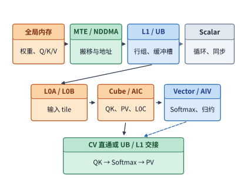

*图 4-3　DaVinci 如何计算注意力。上方是计算顺序，下方是计算单元、片上存储和数据交接路径。*

在理解这类异构多引擎流水线时，需要注意区分**调度独立性**与**数据通路耦合度**这两个正交维度：一方面，矩阵单元与向量单元应当能够各自独立地发起指令，以便让不同分块（tile）的矩阵计算与向量计算在时间上并行重叠；另一方面，同一分块内部存在先后依赖的中间结果（如 Cube 算出的 $QK^{\mathsf T}$ 分数要立即交给 Vector 算 Softmax）又必须通过高带宽、低延迟的片上通路快速交接。独立解耦的指令调度与紧密直连的片上数据通路完全可以兼得：例如，昇腾 910B/910C 将矩阵核（AIC）与向量核（AIV）分离为可独立调度的核心以提升并发灵活性，而新一代昇腾 950 则在此基础上新增了专用的片上 CV 通路，将 Cube 的 L1 缓冲与 Vector 的 UB 缓冲直接连通，从而同时优化了独立调度能力与跨单元数据交接效率。[^ascend-history][^ascend]

总体而言，将矩阵乘法与向量运算交由专职硬件单元分工执行，显著提升了单位芯片面积所能提供的有效算力；而专用的片上分级缓冲与直连通路，则大幅削减了中间结果反复读写片外显存的带宽与能耗开销。与之相对的代价是，底层软件必须将连续的数学计算切分为匹配硬件缓冲尺寸的分块（tile），并精细编排张量内存布局、双缓冲轮转以及跨引擎同步事件。当然，上层模型研发人员日常只需调用 PyTorch 等框架封装好的算子接口，这些繁琐的硬件级编排均由底层算子库开发者与深度学习编译器代为完成。事实上，在编写高性能 CUDA 算子（例如在 Hopper/Blackwell 架构上调优 FlashAttention-3）时，开发者同样需要显式管理共享内存布局、TMA 异步搬移与生产者—消费者屏障；两类架构的差异主要体现在片上缓冲区的硬件专用化程度、跨单元交接物理路径以及编译器自动化承担的比例上（第 5 章将结合昇腾 AKG 与 GPU TileLang 具体展示这一软硬件分工边界）。

### 4.1.3 芯片面积、功耗与封装的限制

无论是增加乘加器阵列、扩大片上 SRAM 缓冲，还是拓宽片外内存接口，都需要消耗宝贵的芯片硅片面积（die area）与热设计功耗（TDP）预算。在一颗芯片总面积与总功耗封顶的前提下，分给某一个部件的资源越多，留给其余部件的配额就必然越少。因此，评估任何一项微架构局部改进是否值得，不能只看该部件自身的峰值指标提升了多少，而必须回到端到端任务总耗时的缩减幅度上。

我们将章首的算例推广为一般形式：设串行任务中被优化部分占原总执行时间的比例为 $f$，局部加速倍数为 $s$，根据第 1.2.1 节介绍的 Amdahl 定律，整项任务的端到端加速比为：

$$
S=\frac{1}{(1-f)+f/s}=\frac{1}{0.4+0.6/2}\approx1.43.
$$

如果在上述基础上再投入一倍的芯片面积、将矩阵单元的速度进一步提升至最初的四倍（$s=4$），任务总耗时将降至 $60/4+40=55$ μs：第一次将矩阵算力翻倍节省了 30 μs，而第二次翻倍仅额外节省了 15 μs；哪怕矩阵乘法耗时被压缩到趋近于零，未被加速的其余工作依然需要固定的 40 μs，使得整项任务的端到端加速比永远无法突破 $100/40=2.5$ 倍的渐近上界。随着矩阵计算耗时被不断压缩，原本处于次要地位的向量处理与数据搬移在新总时间中所占的比重迅速上升，硬件资源投入的重心也必须随之转移。

Google 第一代张量处理器（TPU v1）的芯片面积分配，生动体现了计算单元与片上存储之间的工程权衡。TPU v1 配备了一个 $256\times256$ 的 8-bit 脉动乘加阵列、高达 24 MiB 的片上统一数据缓冲（Unified Buffer）以及 4 MiB 的累加器存储。根据 TPU v1 架构论文披露的版图数据，24 MiB 的统一数据缓冲占用了整颗芯片约 **37%** 的面积，乘加矩阵计算单元占约 **30%**，而控制逻辑仅占约 **2%**。为什么片上缓冲区占用的硅片面积甚至超过了核心计算阵列？原因就在于，每秒可执行数十万亿次运算的 $256\times256$ 乘加阵列必须依靠高频复用片上驻留的输入激活、权重与部分和才能维持满载运转；如果为了省下片上 SRAM 面积而让计算阵列频繁等待片外内存读取，庞大的乘加器阵列就会陷入长期饥饿停顿。[^tpu]

设想一下：如果芯片架构师为了在纸面上堆高峰值算力，强行削减片上缓冲区面积以集成更多乘加器，那么原本能够完整驻留在片上缓冲里反复复用的输入分块就会因容量不足而被迫提前换出，等到下一轮内积需要用到它时又必须重新从片外内存加载——由此增加的片外访存等待时间，很可能完全抵消乃至反超新增乘加器所节省的计算时间。反之，如果为几乎不发生复用的流式数据配置过于庞大的片上缓冲，同样会空耗本可用于增加计算单元的硅片面积。因此，在对比不同芯片面积配比方案时，唯一可靠的准则是将目标负载映射到备选架构上，把“计算耗时缩短”与“重复访存耗时增加”放在同一条时间线上综合核算端到端总时间。

> **思考：继续增加矩阵算力，还是加速其余工作？** 在上述 60 μs 加 40 μs 的任务中，以原始矩阵运算速度为基准，把加速比从两倍提高到四倍，和把其余工作从 40 μs 降到 25 μs，哪种改动节省的时间更多？如果两者面积代价不同，应怎样选择？

在芯片面积之外，**功耗与散热**是制约现代 AI 加速器的另一道刚性物理边界，且随着单芯片晶体管规模与集群卡数的增长愈发成为决定性约束。下面我们通过四个定量推导，将抽象的“功耗墙”转化为可精确计算的物理公式：**为什么搬移数据会消耗电能？从不同存储层次每搬移一个字节分别要花费多少皮焦耳（pJ）能量？光刻与先进封装决定了单颗芯片最多能做多大、外接多少显存？以及模块的功率上限（TDP）是如何压低芯片实际运行频率的？**

**1. 数据搬移为什么耗电？** 在数字集成电路中，搬移数据的物理本质是对金属互连线与逻辑门电容反复进行充放电。芯片的总功耗由静态功耗与动态功耗两部分组成：静态功耗源于晶体管关断状态下的亚阈值漏电（与信号是否翻转无关），而动态功耗则产生于数字信号在逻辑 0 与 1 之间的高低电平切换。根据海思何庭波团队发表的 LogicFolding（逻辑折叠）论文实测，在智能手机等典型移动计算负载中，动态功耗约占芯片总功耗的 90%。[^logicfolding] 物理上，一条金属信号线连同其所驱动的下一级晶体管栅极可以等效为一个电容 $C$；每当信号从低电平 0 充电至供电电压 $V$ 时，电源需要向其提供 $CV^2$ 的电能。设每个时钟周期内发生电平翻转的信号比例（翻转率）为 $\alpha$，工作时钟频率为 $f$（注意此处的 $f$ 代表时钟频率，而非前文 Amdahl 定律中的时间占比），则电路的动态功耗公式为：

$$
P_{\mathrm{dyn}}\approx\alpha CV^2f.
$$

进入几纳米的先进工艺节点后，等效电容 $C$ 的大头早已不再是晶体管自身的栅极电容，而是连接各个模块的**金属互连线电容**：金属导线的寄生电容沿走线长度均匀分布，信号在芯片上跨越的物理距离越远，沿途需要充放电的电容 $C$ 就越大。图 4-4 上半部分直观展示了这一物理机制：当同一个驱动门需要驱动一条长达数百微米的平面横向连线时，每一次信号翻转都必须给整条长线上的分布电容充放电；而通过三维逻辑折叠技术将电路模块在垂直方向上下堆叠后，原本数百微米的平面长走线变成了仅数微米长的垂直互连。论文实测表明，折叠后典型核心的平均互连线长度缩短了 20%，部分关键路径缩短达 70%，单个处理模块中用于接力驱动长线的时钟缓冲器（clock buffer）数量更是从 43,600 个锐减至 19,000 个。

我们可以直接用动态功耗公式 $P_{\mathrm{dyn}}\approx\alpha CV^2f$ 手算验证该论文给出的两组实测数据：
- **第一组是 NPU 的同性能功耗对比**：在同样提供 29 TOPS（每秒 29 万亿次定点运算）算力的前提下，采用折叠设计的新一代 NPU 将工作电压从 0.85 V 降低到了 0.55 V。仅看电压平方项 $V^2$ 的下降比例：

$$
\frac{P_{\mathrm{after}}}{P_{\mathrm{before}}}=\left(\frac{0.55}{0.85}\right)^2=\frac{121}{289}\approx0.42.
$$

再看时钟频率项：新 NPU 的运行频率降低了 63%（即频率 $f$ 变为原来的 $0.37$）。如果将电压项与频率项直接相乘，会得到 $0.42\times0.37\approx0.16$，这远低于论文实测报告的总功耗比 $0.34$（即总功耗下降 66%）。为什么算出的 $0.16$ 与实测的 $0.34$ 存在差距？答案在于**硬件并行度的扩大**：前代 NPU 采用“1 个大核 + 2 个小核”配置，而折叠后的新 NPU 改用了“4 个大核”并行（见论文第 V 节），正是靠成倍增加并行核心数量，才能在大幅降频（$0.37\times$）的同时维持相同的 29 TOPS 总吞吐（类似地，在算术单元级电路复用中，若 256 个乘加器在 $760\ \mathrm{MHz}$ 下基线吞吐为 $256\times 2\times 0.76 = 389.12\ \mathrm{GOPS}$ 或同频浮点等效 $389.12\ \mathrm{GFLOPs}$，通过将单个宽乘法器在内部拆分为两条共享部分积的低位宽逻辑折叠通路，即可在相同频率下将吞吐翻倍至 $778.24\ \mathrm{GOPS}$，或反过来在保持 $389.12\ \mathrm{GOPS}$ 吞吐不变时将运行频率与供电电压同步压低）。并行核心数增加后，每个时钟周期同时发生翻转的总等效电容 $\alpha C$ 随之成倍增大，不仅抵消了单条连线缩短带来的电容下降，还把乘积从 $0.16$ 拉回到了 $0.34$。综合电压、频率与并行度三项因素可以看到，供电电压下降带来的平方级收益（$0.42\times$）是功耗大幅下降的首要功臣，这也印证了论文的核心结论：通过扩并行、降频率进而实现低压运行，其节电贡献远大于单纯缩短连线电容。
- **第二组是数字信号处理器（DSP）的功率密度对比**：第一代折叠技术使 DSP 的总功耗降至原来的 0.75，同时将芯片在平面上的投影面积压缩至原来的 0.60。将总功耗比除以投影面积比，即可算出单位芯片面积上的发热功率（即**功率密度**）变化：

$$
\frac{0.75}{0.60}=1.25.
$$

计算表明，单位面积的功率密度反而比折叠前上升了 25%（与论文报告的 24% 完全吻合）。由于芯片内部产生的热量最终必须通过有限的封装表面积传导散发出去，这一算例揭示了一个重要的工程反直觉结论：**总功耗下降并不意味着散热压力减轻；只要芯片面积缩小的幅度快于功耗下降的幅度，单位面积的散热挑战反而会更加严峻。** 图 4-4 下半部分并列展示了这两组算例的定量关系。

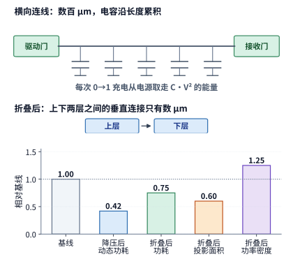

*图 4-4　上：同一驱动门经数百微米横向连线传送信号，要给沿线分布电容充电；折叠后改为数微米的垂直连接。下：电压从 0.85 V 降到 0.55 V 使动态功耗降到 0.42；功耗降到 0.75 而投影面积降到 0.60，功率密度反而升到 1.25。*

由此可给出功率密度变化的**临界条件**：唯有当缩放后的面积比不小于功耗比时，芯片的功率密度才不会上升；在本例中，由于面积比（0.60）小于功耗比（0.75），功率密度不降反升。

**2. 存储层次的能耗阶梯：每搬移一个字节要花多少能量？** 既然搬移数据的能耗取决于沿途充放电的电容，而电容又随物理传输距离的拉长而剧增，那么同一个字节从远近不同的存储层次读取出来，所消耗的能量必然相差悬殊。下表汇总了从片上局部 SRAM（静态随机存取存储器）、片上大容量 SRAM、芯片间高速互连链路（如 Grace Hopper 超级芯片中连接 CPU 与 GPU 的 NVLink-C2C），到片外 HBM 与 LPDDR（低功耗动态随机存取存储器）的每字节访问能耗，以及 16 位浮点乘加运算本身的能耗基准（单位 $\mathrm{pJ}$ 为皮焦耳，即 $10^{-12}\ \mathrm{J}$；表中数据综合自四份经典文献，并明确标注了各自的工艺节点与发表年份）。[^energy-table]

| 层次 | 来源数值 | 每 byte 能耗 | 工艺与年份 |
| --- | ---: | ---: | --- |
| KB 级局部 SRAM | 5 pJ／32 位字 | 1.25 pJ | 45 nm，Horowitz ISSCC 2014，Dally Hot Chips 2023 转引 |
| MB 级片上 SRAM | 50 pJ／32 位字 | 12.5 pJ | Dally Hot Chips 2023 第 52 页，工艺未注明 |
| NVLink-C2C 链路 | 1.3 pJ/bit | 10.4 pJ | Grace Hopper 超级芯片，NVIDIA 2022 年 11 月技术博客 |
| HBM2 | 3.97 pJ/bit | 31.76 pJ | 28 nm DRAM 能耗模型，MICRO 2017 |
| LPDDR DRAM | 640 pJ／32 位字 | 160 pJ | 45 nm，Horowitz ISSCC 2014 |
| 16 位浮点乘加（2 FLOPs） | 1.5 pJ／次 | 0.75 pJ/FLOP | 45 nm，Dally Hot Chips 2023 |

*表 4-3　从片上 SRAM、片间互连到片外 DRAM 的每字节访问能耗与 16 位浮点乘加能耗基准*

剖析表中 HBM2 的能耗构成可以发现一个关键事实：访问 HBM2 每比特消耗的 $3.97\ \mathrm{pJ}$ 能量，绝大部分其实花在了 DRAM 裸片（die，即从硅晶圆上切割下来的单块芯片）内部，而非从显存通往 GPU 的外部互连线上。根据 MICRO 2017 论文的精细拆解，在 HBM 堆叠内部，将数据从 DRAM 存储阵列传输至最底层基底裸片（base die）的内部数据通路消耗了 $2.24\ \mathrm{pJ/bit}$，打开存储阵列某一行所需的行激活（row activation）操作消耗了 $1.21\ \mathrm{pJ/bit}$，而最后跨越硅中介层（silicon interposer，承载多颗裸片高密度互连的硅片衬底）送达 GPU 接口的外部 I/O 传输仅消耗 $0.3\ \mathrm{pJ/bit}$——这三项基础开销合计为 $3.75\ \mathrm{pJ/bit}$，计入 ECC（纠错码）校验等额外开销后升至 $3.92\ \mathrm{pJ/bit}$（论文正文给出的总数为表中的 $3.97\ \mathrm{pJ/bit}$）。作为对比，表中 NVLink-C2C 链路的 $1.3\ \mathrm{pJ/bit}$（合 $10.4\ \mathrm{pJ/byte}$）仅统计了芯片间物理收发器与连线本身的传输能耗，若通过它读取远端 CPU 内存中的数据，还需额外加上对侧 DRAM 本身的读出能耗。

> **算例 4-1（Qwen3-8B 单请求 8K 解码步的 HBM2 访存与乘加计算微观能耗分账）**
>
> 我们将表 4-3 代入本章第 4.8.3 节即将实测的在线生成任务中算一笔能量账：以 Qwen3-8B（BF16 精度）服务单条请求（$B=1$）、上下文长度为 8K token 为例，执行一步 decode 需要从 HBM 读取 15.137 GB 的非词嵌入权重与 1.208 GB 的历史 KV 缓存（合计读取 16.345 GB），而整步执行的矩阵浮点运算量仅为 19.97 GFLOPs。对照表 4-3 中 HBM2 每字节能耗（$31.76\ \mathrm{pJ/byte}$）与 16 位浮点乘加每 FLOP 能耗（$0.75\ \mathrm{pJ/FLOP}$），可分别算出这三部分消耗的能量：[^energy-ledger]
>
> $$
> \begin{aligned}
> E_{\mathrm{weights}} &= 15.137\times10^9\times31.76\ \mathrm{pJ} \approx 0.481\ \mathrm{J},\qquad
> E_{\mathrm{KV}} \approx 0.038\ \mathrm{J}, \\
> E_{\mathrm{compute}} &= 19.97\times10^9\times0.75\ \mathrm{pJ} \approx 0.015\ \mathrm{J}.
> \end{aligned}
> $$
>
> 三项相加，执行这一步 decode 总共消耗约 $0.534\ \mathrm{J}$ 能量，其中**光是把权重从 HBM 搬进芯片就花掉了 $0.481\ \mathrm{J}$，独占总能耗的 90%**，而真正花在算术乘加上的能量（$0.015\ \mathrm{J}$）还不到总能耗的 3%。需要注意，表 4-3 中 HBM2 能耗取自 28 nm DRAM 模型，而乘加计算能耗取自 45 nm 逻辑工艺基准，虽然二者工艺节点不同，但它们揭示的“单请求 decode 能量绝大部分消耗在数据搬移上”这一数量级结论是完全成立的。再看这一步的执行时间与平均功率：按 H100 SXM 的 $3.35\ \mathrm{TB/s}$ 峰值带宽读完这 16.345 GB 数据至少需要 $4.9\ \mathrm{ms}$，将 $0.534\ \mathrm{J}$ 能量平摊到 $4.9\ \mathrm{ms}$ 内，平均功率仅为约 $110\ \mathrm{W}$。图 4-5 下半部分进一步对比了如果把同样这 16.345 GB 数据分别放在不同存储层次读取所需的总能量：若全部来自 KB 级局部 SRAM 仅需 $0.020\ \mathrm{J}$，来自 MB 级片上 SRAM 需 $0.204\ \mathrm{J}$，经 NVLink-C2C 链路传输需 $0.170\ \mathrm{J}$，来自 HBM2 需 $0.519\ \mathrm{J}$，而若全部来自移动端的 LPDDR DRAM 则高达 $2.62\ \mathrm{J}$。

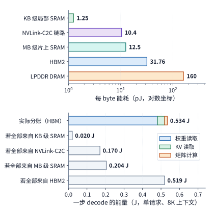

*图 4-5　上：各级存储与链路每 byte 能耗，对数坐标。下：Qwen3-8B 单请求 8K decode 一步的能量分账（权重 0.481 J、KV 0.038 J、计算 0.015 J），以及同样 16.345 GB 全部来自某一层次时的能量。*

这组算例深刻阐明了**显存带宽**与**访存能耗**的本质区别：将 HBM 带宽提高一倍，只能让这一步 decode 的读取时间从 $4.9\ \mathrm{ms}$ 减半至 $2.45\ \mathrm{ms}$（同时瞬时功率翻倍至 $220\ \mathrm{W}$），却丝毫不能减少搬移这 16.345 GB 数据所必须消耗的 $0.534\ \mathrm{J}$ 物理能量。要想真正降低每个生成 token 消耗的能量，只有两条物理途径：**要么让数据从距离计算单元更近的片上存储层次读取，要么通过增大并发批量（batch size）让同一次权重读取服务更多个 token。** 当并发批量为 $B$ 时，读取一次权重（$0.481\ \mathrm{J}$）由 $B$ 个 token 共同分摊，平均每个 token 消耗的能量降至 $0.481/B+0.038+0.015$ J；当 $B=32$ 时，单 token 能耗降至约 $0.068\ \mathrm{J}$，仅为单请求时（$0.534\ \mathrm{J}$）的约八分之一。因此，**数据复用首先是一个关乎能量效率的物理问题，其次才是一个关乎带宽吞吐的时间问题**——第 4.8.1 节按执行时间导出的 Roofline 转折点取决于硬件“峰值算力与峰值带宽之比”，而此处的能耗平衡点则取决于“每字节搬移能耗与每 FLOP 计算能耗之比”，二者的临界阈值并不相同。

由此可得权重搬移能耗与计算能耗的**翻转临界条件**：要使每个 token 分摊的权重搬移能耗低于其乘加计算能耗，必须满足 $0.481/B < 0.015$，即并发批量 $B$ 必须超过 $32$。

**3. 光罩极限与先进封装：单颗芯片能做多大、外接多少显存？** 在半导体制造中，光刻机单次曝光能够投射的电路图形面积存在一个固定上限——称为**光罩极限（reticle limit，即单块光刻掩模版的最大曝光尺寸，通常约为 $858\ \mathrm{mm}^2$）**，任何单颗裸片（monolithic die）的面积都无法突破这一物理边界。对照近几代旗舰 GPU 可以看到：NVIDIA A100 的裸片面积为 $826\ \mathrm{mm}^2$，H100 为 $814\ \mathrm{mm}^2$，二者均已逼近单光罩极限；为了在 Blackwell 一代继续翻倍晶体管规模，NVIDIA B200 不再追求单颗超大裸片，而是采用双裸片合封设计——将两颗各自做到光罩极限的裸片并排封装在一起，并通过高达 $10\ \mathrm{TB/s}$ 的 NV-HBI 高速裸片间互连链路拼合为一颗逻辑统一的 GPU。[^hbm-stack] 当然，将一颗芯片拆分为两颗物理裸片之后，计算任务与数据究竟放置在左半侧还是右半侧裸片上，将直接决定有多少数据必须跨过这条片间互连链路（第 4.5.1 节将定量核算这一跨 die 流量）。

在显存容量与带宽方面，HBM（高带宽显存）通过三维堆叠封装打破了传统平面显存的引脚密度限制：它将多层 DRAM 裸片垂直堆叠在一颗基底控制裸片之上，利用贯穿硅片的垂直导孔——**硅通孔（TSV，Through-Silicon Via）**——将各层高速连通，整座 HBM 显存堆（stack）再通过硅中介层上的超密布线与主计算芯片相连。根据 JEDEC 标准，每一座 HBM 显存堆都拥有多达 $1{,}024$ 根数据引脚（即 1024-bit 位宽）；设每根引脚的数据传输速率为 $r$（单位为 $\mathrm{Gbit/s}$），则单座 HBM 显存堆提供的物理带宽 $R_{\mathrm{stack}}$ 与容量 $C_{\mathrm{stack}}$ 分别为：

$$
R_{\mathrm{stack}}=\frac{1024\,r}{8},\qquad C_{\mathrm{stack}}=\text{层数}\times\text{每层容量}.
$$

我们以最新的 HBM3E 显存为例验证这两个公式：美光（Micron）量产的 8 层堆叠（8-high）HBM3E 单堆容量为 24 GB，12 层堆叠（12-high）单堆容量为 36 GB（即每层 DRAM 裸片容量为 3 GB）；而 SK 海力士（SK hynix）公布的 HBM3E 引脚传输速率为 $r=9.6\ \mathrm{Gbit/s}$，代入带宽公式立即可得单堆带宽为 $1024\times9.6/8\approx1{,}229\ \mathrm{GB/s}$，与其官方产品页标称的 $1.23\ \mathrm{TB/s}$ 完全吻合。图 4-6 展示了这种 2.5D 先进封装的俯视布局：主计算裸片居中，多座 HBM 显存堆沿着计算裸片的左右外侧边缘紧密排列，底部由一整块硅中介层承载裸片与 HBM 之间以及双裸片之间的高密度互连。利用上述公式，我们可以把近三代数据中心旗舰 GPU 的显存规格演进拆解得一清二楚：

| GPU | 容量 | 带宽 | 堆数 | 每堆容量 | 每堆带宽 | 引脚速率 |
| --- | ---: | ---: | --- | ---: | ---: | ---: |
| H100 SXM5 | 80 GB | 3,350 GB/s | 5，白皮书给出 | 16 GB | 670 GB/s | 5.24 Gbit/s，白皮书给出 2619 MHz DDR（双倍数据速率，每个时钟周期传输两次） |
| H200 SXM | 141 GB | 4,800 GB/s | 6 堆共 144 GB，产品启用 141 GB | 24 GB | 800 GB/s | 6.25 Gbit/s，推算 |
| B200（HGX） | 180 GB | 8,000 GB/s | 8 堆共 192 GB，产品启用 180 GB | 24 GB | 1,000 GB/s | 7.81 Gbit/s，推算 |

*表 4-4　NVIDIA 三代数据中心旗舰 GPU（H100 SXM5、H200 SXM、HGX B200）的 HBM 堆数、容量与带宽分解*

对照表中数据可以看到，每一代 GPU 显存容量与带宽的跃升，都精确落实在**显存堆数、每堆容量与引脚速率**这三个物理变量的乘积上：
- **H100 SXM5**：启用 5 座 HBM3 显存堆，总位宽为 $5\times1024=5{,}120\ \mathrm{bit}$，乘以 $5.24\ \mathrm{Gbit/s}$ 的引脚速率再除以 8，恰好得到 $3{,}350\ \mathrm{GB/s}$ 的总带宽；
- **从 H100 到 H200 SXM**：显存总容量大幅增长 76%（从 80 GB 增至 141 GB），这一方面源于单堆容量从 16 GB 升级为 24 GB，另一方面源于启用堆数从 5 堆增至 6 堆（物理总容量 144 GB，实际启用 141 GB）；与此同时，总带宽增长 43%（至 4,800 GB/s），则源于多启用了 1 座显存堆并将引脚速率从 $5.24\ \mathrm{Gbit/s}$ 提升至 $6.25\ \mathrm{Gbit/s}$；
- **从 H200 到 B200（HGX）**：H100 与 H200 均为单颗计算裸片，受限于单颗裸片周长，四周最多只能布置 6 座 HBM 显存堆（H100 实际启用其中 5 堆）；而 B200 通过拼接两颗达到光罩极限的计算裸片，使芯片外围可用于布置显存接口的边长翻倍，从而得以沿着两颗裸片的外侧边缘一共布置 **8 座** HBM3E 显存堆（见图 4-6）。在 Blackwell 架构技术简报给出的最高配置（192 GB、7.7 TB/s）中，按单堆 24 GB 即可反推出 8 堆满配；而在本书各章统一采用的 HGX B200 量产平台规格中，每颗 GPU 启用容量为 180 GB、总带宽为 $8\ \mathrm{TB/s}$（即单堆带宽 $1{,}000\ \mathrm{GB/s}$，对应引脚速率约 $7.81\ \mathrm{Gbit/s}$）。

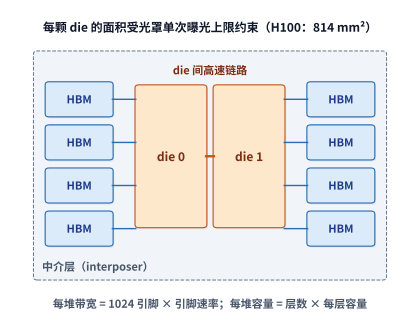

*图 4-6　封装俯视示意：两颗达到光罩上限的 die 居中，八堆 HBM 沿两侧边缘排列，中介层承载 die 与 HBM 之间以及 die 之间的连线。每堆带宽由 1,024 根引脚与引脚速率决定，每堆容量由层数与每层容量决定。*

由此可得封装扩展的**临界条件**：当目标显存总容量除以单堆容量所得的所需堆数，超出了单颗光罩极限裸片边缘所能容纳的物理堆数上限（通常为 6 堆）时，架构师只能在两条路径中二选一——**要么将每座 HBM 升级为更高层数的堆叠（例如改用 12 层 36 GB 的 HBM 堆，仅靠 6 堆即可提供 $6\times36=216\ \mathrm{GB}$ 容量，无需增加堆数），要么像 B200 一样采用多颗计算裸片合封以提供更多显存接口边长**。

**4. 功率封顶（Power Capping）：为什么标称峰值算力无法永远持续？** 每一张数据中心加速卡都有严格的热设计功耗上限（TDP，即供电与散热系统允许模块长期持续消耗的最大功率，如 H100 SXM 为 $700\ \mathrm{W}$，B200 为 $1{,}000\ \mathrm{W}$）。[^tdp] 这份有限的功率预算必须由显存子系统与核心计算阵列共同瓜分。我们以 $700\ \mathrm{W}$ 的 H100 SXM 为例算一笔功率分配账：如果按前表 HBM2 的每字节能耗（$31.76\ \mathrm{pJ/byte}$）估算，当 HBM 以 $3.35\ \mathrm{TB/s}$ 满带宽读写时，仅显存子系统就要消耗 $3.35\times10^{12}\times31.76\times10^{-12}\approx106\ \mathrm{W}$ 的功率；从 $700\ \mathrm{W}$ 总预算中扣除这 $106\ \mathrm{W}$ 后，留给计算核心的可用功率预算为 $594\ \mathrm{W}$。将这 $594\ \mathrm{W}$（即每秒 $594\ \mathrm{J}$）除以 H100 的 BF16 稠密峰值算力 $989.4\ \mathrm{TFLOP/s}$，即可算出芯片要想维持峰值算力运转，每一次浮点运算（FLOP）最多只能消耗的能量预算上限 $b$：

$$
b=\frac{700\ \mathrm{W}-106\ \mathrm{W}}{989.4\ \mathrm{TFLOP/s}}\approx0.60\ \mathrm{pJ/FLOP}.
$$

平均每做 1 次浮点运算（连同取指、译码、寄存器读写与时钟树翻转）最多只能消耗 $0.60\ \mathrm{pJ}$ 的能量——这一严苛的能效指标，唯有依靠高维矩阵指令（Tensor Core）与先进制程工艺的协同配合才能达成。对照前文 45 nm 工艺下的经典测量数据就能明白其中的原因：执行一条普通的标量半精度乘加指令（HFMA，完成 2 FLOPs），仅算术运算本身就要消耗 $1.5\ \mathrm{pJ}$（合 $0.75\ \mathrm{pJ/FLOP}$，已超出 $0.60\ \mathrm{pJ}$ 预算），而为这条标量指令配套的取指、译码与寄存器取操作数还要额外消耗约 $30\ \mathrm{pJ}$ 能量，高达算术运算本身的 **20 倍**；与之形成鲜明对比的是，一条 HMMA 矩阵乘加指令虽然总能耗为 $110\ \mathrm{pJ}$，但它单条指令就能完成成百上千次乘加运算，将固定的指令控制开销分摊下来仅占总能耗的 22%。[^energy-table] 与此同时，H100 采用了台积电 4N（5 nm 级）先进工艺，相比 45 nm 节点大幅压低了单次晶体管翻转的电容与工作电压。

那么，当实际运行算子的每 FLOP 综合能耗 $e$ 超出能量预算上限 $b$ 时会发生什么？只要 $e\le b$，芯片就能稳稳运行在最高峰值频率上；而一旦某个重负载算子使 $e > b$，为了防止芯片瞬间过热烧毁或突破供电上限，硬件功率控制器（Power Management Controller）就会立即触发**降频（throttling）**。具体需要把运行频率压低多少，直接遵循动态功耗公式 $P\propto fV^2$：
- **保守情形（仅降频、工作电压 $V$ 不变）**：此时功率随频率 $f$ 线性下降，为了把总功率压回预算上限，持续运行频率必须降至峰值频率的 $b/e$；
- **理想 DVFS 情形（动态电压频率调整，电压 $V$ 随频率 $f$ 同步成比例下调）**：此时功率近似按频率的三次方变化（$P\propto f^3$），持续运行频率只需降至峰值频率的 $(b/e)^{1/3}$。

图 4-7 绘制了这两种物理机制下的持续频率折减曲线：例如当实际每 FLOP 能耗达到预算上限的 1.5 倍（即 $e/b=1.5$）时，固定电压下频率必须打六七折（降至峰值的 $1/1.5\approx0.67$），而理想降压降频下则只需降至峰值的 $1.5^{-1/3}\approx0.87$。由于加速器的实际计算吞吐量与工作时钟频率严格成正比，一旦触发功率封顶降频，算子的实际执行时间就会比按白皮书标称峰值算力推算的时间更长。这揭示了一个在集群性能调优中十分关键的工程事实：**白皮书上的峰值算力只是满频下的理论极限，并非在所有高密指令负载下都能长期维持；当芯片进入功率受限（power-bound）状态时，硬件的物理算力上界本身会随持续频率一同下移，此时评估算子优化的硬件利用率应当以功率封顶下的持续算力作为分母。**

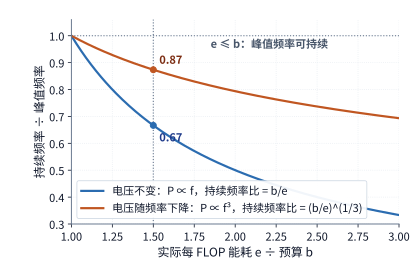

*图 4-7　持续频率与峰值频率之比随每 FLOP 能耗 $e$ 与预算 $b$ 之比的变化：电压不变时为 $b/e$，电压随频率下降时为 $(b/e)^{1/3}$。$e/b$ 不超过 1 时峰值频率可以持续；$e/b$ 为 1.5 时两条曲线分别给出 0.67 与 0.87。*

由此可得峰值频率能够持续维持的**临界条件**：算子实际每 FLOP 能耗 $e$ 必须不高于 $(\mathrm{TDP}-P_{\mathrm{mem}})/F_{\mathrm{peak}}$（其中 $P_{\mathrm{mem}}$ 为当前显存子系统功耗，$F_{\mathrm{peak}}$ 为标称峰值算力；在 H100 满带宽基准下该阈值为 $0.60\ \mathrm{pJ/FLOP}$）。制程工艺每迭代一代，单次运算能耗 $e$ 随之下降，而模块 TDP 上限也逐代抬升（从 400 W、700 W 直至 1,000 W 以上），这两股力量的消长共同决定了新一代加速器在真实大矩阵负载下会多大程度受制于功率封顶。

## 4.2 计算单元

在每一个 Transformer 层内部，有两类形态截然不同的计算始终交替出现：一类是线性投影（QKV 投影、输出投影、FFN 上下投影）以及注意力中的 $QK^{\mathsf T}$ 与 $PV$，它们全部由高度规则的密集矩阵乘加组成；另一类则是 RMSNorm 归一化、RoPE 旋转位置编码、Softmax 概率归一化以及 SwiGLU 门控激活，它们由逐元素非线性运算、超越函数（如指数、正余弦、平方根倒数）以及跨元素的同行归约（求和、求最大值）组成。在注意力模块内部，数据严格按照“$QK^{\mathsf T}$ 矩阵乘 $\to$ Softmax 向量归约 $\to$ $PV$ 矩阵乘”的顺序流转；而在前馈网络（FFN）内部，数据则在第一级线性投影与第二级线性投影之间穿插执行激活函数与逐元素门控相乘。

这种“矩阵运算与向量运算高频交替”的算法结构，直接决定了现代 AI 加速器的计算单元分工：由专用**矩阵计算单元**（如 Tensor Core、Cube）利用二维/三维块内数据复用提供极高的乘加吞吐；由**向量计算单元**（如 CUDA Core/SIMD Vector Core）与**特殊函数单元（SFU）**处理逐元素变换、超越函数及归约操作；再由**标量控制单元**与**数据搬移单元**为二者准备操作数并协调跨单元交接。因此，评估一段模型计算在硬件上的真实速度，绝不能只看矩阵单元的峰值 TFLOP/s，而必须同时考察矩阵形状利用率、向量与归约耗时以及矩阵—向量之间的数据交接带宽。本节先分别剖析矩阵单元与向量单元的微架构机制，随后将二者放入完整的注意力流水线中定量核算配比需求。

### 4.2.1 矩阵单元为什么适合神经网络

在硬件内部，动辄成千上万维的大矩阵乘法无法一次性完成，必须被拆解为成百上千个固定尺寸的小矩阵块（tile）分步执行——**矩阵计算单元**正是专门用于在单个或数个时钟周期内高速完成这类小矩阵块乘加的硬件阵列。由于硬件矩阵指令原生支持的分块尺寸是固定的，底层程序必须将任意形状的大矩阵任务切分并对齐到这些硬件指令粒度上；与此同时，一张加速卡上成百上千个并行计算单元（如上百个 SM 或数十个 AI Core）则可以各自认领不同的输出分块同时计算。

为什么矩阵计算单元的能效与面积效率远高于标量或一维向量单元？答案就在于**操作数在二维阵列内部的硬件级正交复用**。设矩阵单元正在计算一个形状为 $m\times n$ 的输出子块：左输入矩阵的同一行元素会同时参与该行全部 $n$ 个输出位置的内积计算，而右权重矩阵的同一列元素则会同时参与该列全部 $m$ 个输出位置的内积计算。矩阵计算单元在物理电路上将多个乘加器组织成二维网格（或脉动阵列）：输入激活沿着水平方向在相邻乘加器之间广播或接力传递，权重参数沿着垂直方向传递，而每个网格节点的乘加器则在本地寄存器中就地累加属于自己的部分和（如图 4-8 所示）。此外，单条硬件矩阵指令即可指挥整个阵列完成数百乃至数千次乘加运算，使取指与译码的控制开销被彻底摊薄（第 5 章将进一步讲解软件层面如何规划外层循环的分块尺寸与遍历顺序，以确保持续向矩阵单元喂满数据）。

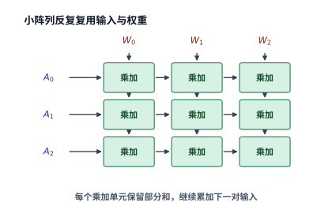

*图 4-8　三行三列的乘加阵列示意。输入沿行传递，权重沿列传递，每个乘加单元保留自己的部分和。这里用小阵列解释操作数复用。*

我们可以算一笔直观的复用账：以一次形状为 $16\times16\times16$ 的基础矩阵乘加操作为例，左、右两个输入小块各自仅包含 $16\times16=256$ 个元素，但二者相乘却能一次性完成 $2\times16^3=8{,}192$ 次浮点运算（FLOPs）。这意味着，从寄存器或局部缓冲读入阵列的每一个输入元素，都在阵列内部被直接复用了 **16 次**。与传统标量/向量指令每算一次乘加都要重新从寄存器堆读写操作数相比，矩阵单元从电路层面上消除了绝大部分重复的寄存器读写与指令分发开销。

然而，硬件矩阵指令“按固定尺寸整块执行”的特性也带来了一个新的效率问题——**边界补零（padding）与形状利用率损失**。设某条硬件矩阵指令（或算子内核的最小计算分块）要求三维尺寸必须对齐到 $m_t\times n_t\times k_t$；当实际送入的矩阵维度 $M,N,K$ 不是 $m_t,n_t,k_t$ 的整数倍时，超出整块但不足一个完整分块的边缘部分就必须用零补齐（pad with zeros）后才能送入矩阵阵列执行。此时，真正对模型输出有贡献的有效浮点运算量，占硬件实际执行的全部浮点运算量的比例（即**形状效率** $\eta_{\mathrm{shape}}$）为：

$$
\eta_{\mathrm{shape}}=\frac{MNK}{\lceil M/m_t\rceil m_t\,\lceil N/n_t\rceil n_t\,\lceil K/k_t\rceil k_t}.
$$

举例来说，假设某条矩阵指令在行方向上的最小分块粒度为 $m_t=16$，而当前处于单请求 decode 阶段、实际输入矩阵只有 $M=1$ 行（假设 $N,K$ 均已对齐），那么硬件执行的 16 行矩阵乘加中，只有第 1 行是有效输入，其余 15 行全是在对零做无效乘加，形状效率 $\eta_{\mathrm{shape}}$ 骤降至 $1/16 = 6.25\%$。在这种情况下，即便把芯片上的矩阵单元数量翻倍，也只是在同比例地加速那 $93.75\%$ 的无效补零运算；唯有改用专门针对单行或极小批量优化的矩阵—向量乘法（GEMV）算子内核（例如改用向量单元沿 $K,N$ 维并行规避 $M$ 维补零），才能省去这些无用计算（算子库如何在不同矩阵形状下自动切换内核实现，见本章第 4.8 节的实测分析）。

在采用稀疏混合专家（MoE）架构的模型中，这种由输入行数不足引发的矩阵分块补零问题会变得更加突出。我们用一组对比鲜明的数字来算清这笔账：假设当前批次共有 64 个 token，每个 token 经过门控路由选择 Top-8 个专家，全批次合计产生 $64\times8=512$ 次专家调用（即所有专家输入矩阵的有效总行数之和固定为 512 行），且每个专家的权重矩阵尺寸完全相同。现在对比两种极端的路由分布情形：
- **高度分散路由**：这 512 次调用恰好均匀分散到了全部 256 个专家上，平均每个专家仅分到 **2 行**（2 个 token）的输入向量；
- **高度集中路由**：全部 64 个 token 恰好都选中了完全相同的 8 个热门专家，这 8 个专家每个都分到了完整的 **64 行**输入向量，其余 248 个专家分到 0 行（无需启动）。

在这两种极端分布下，模型层面的**有效浮点运算量完全相等**（都等于 512 行有效输入与专家权重的乘积）。然而，如果底层算子统一采用行方向最小分块为 $m_t=16$ 的矩阵指令实现：在高度分散路由下，256 个被激活的专家每个都必须凑齐一个 16 行的最小计算块（其中 2 行有效、14 行补零），硬件实际执行的总行数高达 $256\times16=4{,}096$ 行，形状效率仅为 $512/4096=12.5\%$；而在高度集中路由下，8 个被激活的专家每个都恰好构成 4 个完整的 16 行计算块，硬件实际执行的总行数就是 $8\times64=512$ 行，形状效率高达 **100%**，前者的实际硬件执行工作量是后者的 **8 倍**。因此，在 MoE 推理与训练中，一批 token 路由命中的专家分布不仅决定了需要从显存读取多少份专家权重，还直接决定了每个专家分到的输入矩阵行数 $M_e$，进而剧烈影响矩阵计算单元的有效算力利用率。

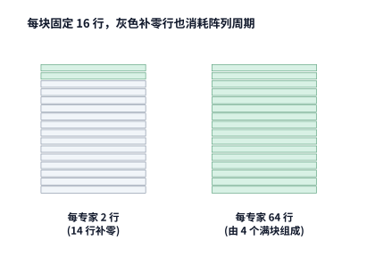

*图 4-9　一个专家的 16 行计算块。每专家只有两行时，剩余十四行填零；每专家有 64 行时，可组成四个完整块，图中展示其中一块。*

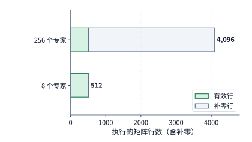

*图 4-10　相同 512 行有效输入在全部专家上的执行量。分散到 256 个专家后总计执行 512 行。*

在图 4-9 与图 4-10 中，浅灰色区域直观标出了因凑不齐 16 行分块而被迫填充的无效补零计算——单纯堆砌更多乘加器只会让这些浅灰色无用功跑得更快；要想真正消除浅灰色区域，必须要么通过大批量聚合（如跨节点专家并行 EP）增加单个专家分到的有效行数，要么在算子库中针对小行数切换分块粒度更小的内核实现。

这也解释了为什么工业级算子库（如 cuBLAS、CUTLASS、CANN）必须为同一个矩阵乘法准备数十种不同分块尺寸的内核（kernel）：面对高行数的大矩阵时，调用大 tile 的 Tensor Core / Cube 指令以最大化片上操作数复用；面对极小行数的瘦长矩阵时，切换为小 tile 甚至通用向量核心实现以减少补零浪费；面对 MoE 中成百上千个形状不一的小专家矩阵时，则采用分组矩阵乘（Grouped GEMM）内核在单次启动中连续处理多个小矩阵，以消除内核启动与调度空隙。专用矩阵单元（Tensor Core / Cube）负责提供高密度的高维规则乘加吞吐，通用向量执行单元则负责提供对任意非规则形状与窄矩阵的灵活处理能力，二者协同配合才能高效覆盖真实大模型负载中千变万化的矩阵形状。[^nvidia]

### 4.2.2 矩阵计算之间的向量运算与控制

顺着一个标准 Transformer 层的执行拓扑观察，穿插在各个密集矩阵乘法之间的**向量与非矩阵运算**同样必不可少：在进入线性投影前，需要先由 RMSNorm 对激活向量做均方根归一化；在算出查询（Q）和键（K）之后、进入注意力点积之前，需要由 RoPE 施加旋转位置编码；在算出注意力得分矩阵 $QK^{\mathsf T}$ 之后、乘以值矩阵（V）之前，需要由 Softmax 将任意实数得分转化为归一化的概率分布；而在前馈网络（FFN）中，则需要将门控分支经过 SiLU 非线性激活后再与上投影分支做逐元素相乘。若遇到 MoE 层，还需额外执行门控 Top-$k$ 排序选择、按专家重排聚集输入 token（permute/gather）以及最终的加权合并输出（unpermute/scatter）。

站在硬件并行执行的视角来看，这些非矩阵运算内部又分为截然不同的两类：**逐元素运算（element-wise operations）**与**归约运算（reduction operations）**。例如，SiLU 激活函数只依赖当前位置自身的 1 个标量元素，成千上万个元素之间毫无数据依赖，可以完全独立地分发给任意数量的算术单元同时完成；而像 Softmax 或 RMSNorm 中的求最大值与求和，则必须跨越一整行（甚至更长维度）收集全部元素才能算出一个标量结果——这一结构差异直接决定了下游依赖该结果的矩阵运算何时能够启动。

我们以对一行包含 $n$ 个注意力得分的向量执行数值稳定版 Softmax 为例，拆解其内部的依赖链条。为了防止指数运算 $\exp(z_j)$ 发生浮点数上溢，标准实现必须分三步走：第一步遍历整行求出最大值 $a$，第二步将每个元素减去最大值后求自然指数 $e_j$ 并累加整行指数之和，第三步将每个指数值除以总和得到最终概率 $p_j$：

$$
a=\max_j z_j,\qquad e_j=\exp(z_j-a),\qquad p_j=\frac{e_j}{\sum_k e_k}.
$$

当行长 $n=128$ 时，这一行总共需要计算 128 次自然指数、执行 128 次减法与 128 次除法归一化；与此同时，求全行最大值 $a$ 和求全行指数总和 $\sum_k e_k$ 则分别是两次跨越 128 个元素的**归约操作**。与完全独立的逐元素运算不同，归约操作必须通过树状两两合并的方式逐级汇总各个计算通道的局部结果：即便在最理想的并行二叉归约树（binary reduction tree）下，合并 128 个元素也必须串行经历 $\log_2 128 = 7$ 轮两两比较或相加，且每一轮都必须等待上一轮的中间结果写出后才能继续。因此，单纯增加向量通道宽度可以成比例地缩短大规模逐元素运算的耗时，却无法消除归约树固有的多轮串行步数延迟。

在微架构实现上，通用**向量计算单元（Vector Unit / CUDA Core）**负责承担加减乘除与比较归约，**特殊函数单元（SFU，Special Function Unit）**专门提供硬件加速的超越函数（如 $\exp,\ \cos,\ \sin,\ 1/\sqrt{x}$）近似求值，而**标量与分支控制逻辑（Scalar Unit）**则负责维护循环计数器、计算内存读写地址、处理条件跳转并下发跨单元同步信号——这三者的吞吐与延迟共同决定了矩阵单元算出的结果要经过多久才能处理完毕并交回下一轮矩阵运算。华为昇腾 DaVinci 架构将内部引擎直接命名为 Cube（矩阵）、Vector（向量）与 Scalar（标量），直观映射了这三类职责；例如在昇腾 950 架构白皮书中，每个 AI 子系统均由 1 个 Cube Core 配对 2 个 Vector Core 组成，其中向量核心采用以单指令多数据（SIMD，单条指令同时对向量寄存器中的一组数据通道执行相同运算）为主、单指令多线程（SIMT，将同一指令分发给一组各自拥有独立寄存器与执行状态的硬件线程）为辅的混合执行模式。[^ascend]

与 Softmax 每次都必须根据动态计算出的注意力得分实时求指数不同，另一类非矩阵运算所使用的系数仅取决于 token 在序列中的位置编号，因而可以预先算好并保存在查找表中反复复用——**旋转位置编码（RoPE）**就是典型代表。RoPE 将每个注意力头的特征向量两两配对为二维复平面上的坐标 $(x_0,x_1)$，并根据位置对应的旋转角 $\theta$ 执行二维正交旋转：

$$
x'_0=x_0\cos\theta-x_1\sin\theta,\qquad x'_1=x_0\sin\theta+x_1\cos\theta.
$$

我们来核算 Qwen3-8B 单层执行 RoPE 的计算量与查表体积：每层包含 32 个查询头（Q）和 8 个键头（K），每个头的全部 128 个维度均参与旋转（即每头构成 64 对分量），因此单个 token 在单层中总共需要旋转 $(32+8)\times64=2{,}560$ 对分量。每旋转一对分量需执行 4 次乘法与 2 次加减法（合计 6 FLOPs），故单层每处理 1 个 token 的 RoPE 向量运算量为 $2{,}560\times6=15{,}360\ \mathrm{FLOPs}$。更重要的是，同一序列位置上的全部 40 个注意力头使用的是完全相同的 64 个 $\cos\theta$ 与 64 个 $\sin\theta$ 系数，因此所有头可以共享同一张预计算三角函数表：若预先为 1,024 个位置各保存 64 个 $\cos$ 值与 64 个 $\sin$ 值，在 BF16 精度（每元素 2 字节）下，整张查找表仅占 $1024\times128\times2=256\ \mathrm{KiB}$，完全可以常驻在片上高速缓存中。[^nonmatrix]

当然，预先算好 $\cos/\sin$ 查找表只省去了运行时调用特殊函数单元实时计算三角函数的开销，向量单元依然需要从缓存读取系数并执行那 $15{,}360\ \mathrm{FLOPs/token}$ 的乘加旋转。总结来看，向量子系统的硬件能力包含三个缺一不可的维度：**基础向量算术吞吐、超越函数与归约延迟、以及连接片上缓冲的数据供给带宽**。随着矩阵计算单元（Tensor Core / Cube）的算力代际激增，矩阵乘法本身的耗时占比越来越小，夹在矩阵乘法之间的向量运算在总耗时中的存在感就会愈发凸显，迫使芯片架构师同步上调向量单元与特殊函数单元的配比。

### 4.2.3 QK、Softmax、PV 如何组成流水线

在自注意力模块内部，计算严格遵循三步走：$Z=QK^{\mathsf T}$ 由矩阵单元算出注意力得分矩阵，$P=\operatorname{Softmax}(Z)$ 由向量与特殊函数单元将得分转化为归一化概率矩阵，最后 $O=PV$ 再由矩阵单元算出注意力输出矩阵。对于同一组查询行（Q tile）而言，这三步存在严格的先后数据依赖，只能串行依次执行；但如果我们将长序列的查询矩阵切分为多组独立的查询分块（tile），就可以构建起跨分块的硬件**软件流水线（software pipeline）**：当向量单元正在对第 $i$ 组查询的得分块执行 Softmax 时，矩阵单元无需空闲等待，而是可以同时启动第 $i+1$ 组查询的 $QK^{\mathsf T}$ 矩阵乘法（或第 $i-1$ 组查询的 $PV$ 矩阵乘法）。显然，要想让这条跨单元流水线顺畅运转而不发生停顿，片上局部存储必须足够大，能够同时容纳处于不同流水阶段的多组中间数据块；同时，连接矩阵单元与向量单元的片上交接通路也必须具备足够的带宽，才能在计算间隙及时把得分矩阵 $Z$ 从矩阵侧传给向量侧、再把概率矩阵 $P$ 从向量侧传回矩阵侧。

这直接引出了一条核心的微架构设计准则：**算法中矩阵运算与向量运算交替得越频繁，将中间结果直接留在片上跨单元交接的收益就越大。** 为矩阵—向量交接专门铺设高带宽片上直连通路（或让二者直接共享同一级高速片上存储），能够彻底免除将庞大的中间得分矩阵 $Z$ 与概率矩阵 $P$ 反复写回片外 HBM 再重新读出的带宽与能耗灾难；相应地，这条片上通路的数据格式、内存布局（layout）与缓冲容量，也就成了算子开发者编排 FlashAttention 等流水线内核时必须严密对齐的硬件约束。下面我们先横向对比三类主流加速器在注意力流水线各阶段的硬件资源分工，再通过定量公式推导矩阵与向量单元的理想配比。

| 工作 | NVIDIA GPU | 昇腾 | Apple GPU |
| --- | --- | --- | --- |
| 查询与键的点积 QK、概率与值的乘积 PV | Tensor Core；小矩阵可用通用计算单元 | 矩阵核 Cube（AIC） | Metal GPU 矩阵运算 |
| 指数、归约、缩放 | SM 的通用与特殊函数资源 | 向量核 Vector（AIV） | GPU 线程与相应库实现 |
| 中间状态 | 寄存器、共享内存、累加存储 | 计算单元近旁的零级缓冲（L0）、统一缓冲与交换通路 | GPU 缓冲与线程组存储 |

*表 4-5　三类主流加速器在自注意力流水线各阶段的硬件计算与存储资源分工*

这张硬件映射表直接决定了哪些操作可以在物理上同时并行执行。例如，当向量与特殊函数单元正在对上一个分块求指数时，矩阵计算单元在硬件上是空闲可用的，完全可以同时计算下一个分块的矩阵乘法；但反过来，如果这两个阶段都需要通过同一个片上存储接口读写操作数，那么该片上存储接口就会成为串行共享瓶颈，必须按字节总量依次服务双方的请求。因此，**哪些执行单元能够真正独立并行、哪些操作又在争抢同一个片上存储端口**，共同决定了注意力流水线进入稳态后的最高吞吐率（注：表中 Apple 一列列出的是基于 Metal 的 GPU 执行路径；至于芯片上独立的神经网络加速引擎 Neural Engine 以及 GPU 内部新增的矩阵加速单元，将在第 4.6.3 节展开讨论）。[^apple]

FlashAttention 系列算法的核心思想，正是通过分块在线归一化（online softmax tiling）消除将注意力中间矩阵写回片外 HBM 的开销；而最新的 FlashAttention-4 则进一步着重解决当新一代 GPU（如 NVIDIA Blackwell B200）的 Tensor Core 矩阵算力再次翻倍后，SM 内部各子单元之间的计算与带宽失衡问题。下面我们直接引用 FlashAttention-4 论文对 B200 单个 SM 的微架构定量建模，算清各个硬件部件的服务耗时如何制约流水线吞吐：考虑一个尺寸为 $128\times128$、注意力头维度 $d=128$ 的标准注意力分块，完成该分块的 $QK^{\mathsf T}$ 与 $PV$ 两次矩阵乘法合计需要执行约 $8.39\ \mathrm{MFLOPs}$（即 $2\times2\times128\times128\times128=8{,}388{,}608\ \mathrm{FLOPs}$）运算，中间的 Softmax 则需要对 $128\times128=16{,}384$ 个元素求自然指数。在 B200 的单个 SM 上，按 Tensor Core 每时钟周期完成 $8{,}192\ \mathrm{FLOPs}$ 的矩阵乘加吞吐率计算，执行 $QK^{\mathsf T}$ 与 $PV$ 合计需要 $8{,}388{,}608 / 8{,}192 = 1{,}024$ 个时钟周期；按特殊函数单元（SFU/MUFU）每周期算出 $16$ 个指数结果的吞吐率计算，完成 $16{,}384$ 次指数运算同样需要 $16{,}384 / 16 = 1{,}024$ 个时钟周期；而在数据供给方面，矩阵运算需要从共享内存（Shared Memory）读取合计 $96\ \mathrm{KiB}$ 的操作数，按每周期 $128\ \mathrm{bytes}$ 的共享内存读取带宽计算，传输这些操作数需要 $96\times1024 / 128 = 768$ 个时钟周期。[^fa4]

当算子连续流水处理多个注意力分块时，SM 内部的**矩阵计算单元**、**共享内存读取接口**与**指数特殊函数单元**便构成了三级并行流水线；每处理一个分块，这三个硬件部件需要占用的服务时间分别为 $T_{\mathrm{matrix}}=1{,}024$ 周期、$T_{\mathrm{smem}}=768$ 周期与 $T_{\mathrm{exp}}=1{,}024$ 周期。根据流水线基本原理，如果上游送入新分块的速度超过了流水线中任何一个硬件部件的处理速度，未处理的分块就会在该部件前不断积压。因此，当跨分块流水线进入稳态连续运转时，相邻两个分块处理完毕的最小时间间隔 $\tau$ 受限于三个部件中耗时最长的那一项：

$$
\tau\ge\max(T_{\mathrm{matrix}},T_{\mathrm{smem}},T_{\mathrm{exp}}).
$$

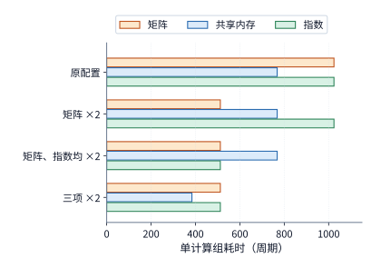

*图 4-11　同一注意力块在四种资源配置下的服务周期。矩阵、共享内存和指数三项分别比较，单独增加一种能力后，其他资源可能成为耗时最长的一项。“×2”表示相应资源的吞吐能力提高一倍，横轴为完成同一计算块所需的时钟周期数。*

> **例 4-1：注意力流水的吞吐为何受指数运算与共享内存限制？**
>
> **提高矩阵与指数吞吐率后，流水吞吐率能提高多少？** 多个块在独立资源间形成流水。比较两种配置：仅将矩阵吞吐率翻倍；在此基础上再将指数吞吐率翻倍。对每种配置，流水线稳定运行时，相邻两个块最短隔多久完成？
>
> **由最慢单元确定相邻数据块的完成间隔。** 原配置为 $\max(1024,768,1024)=1024$ 周期。只提高矩阵能力，得到 $\max(512,768,1024)=1024$ 周期；再提高指数能力，得到 $\max(512,768,512)=768$ 周期。
>
> **矩阵加速后，瓶颈向指数运算与共享内存转移。** 第一项改动使矩阵单元更早完成，但指数运算的吞吐率保持不变，所以完成时间间隔的下界不变。第二项改动消除了指数的限制，共享内存成为耗时最长的单元，对应的理想吞吐提高到原来的 $1024/768=4/3$ 倍。
>
> **共享内存带宽翻倍后，瓶颈转移到哪些单元？** 若共享内存带宽也翻倍，三项变为 512、384、512 周期，下界才降到 512。新的均衡点由矩阵与指数共同决定。

例 4-1 清晰展示了流水线中的**木桶效应与瓶颈漂移**：单独提高某一项硬件资源的吞吐能力，只能缩短该部件自身的占用时间，直到另一项未升级的硬件资源取而代之成为新的最慢瓶颈。需要注意，对于同一个注意力分块而言，$QK^{\mathsf T}$、Softmax 与 $PV$ 依然必须按先后顺序依次执行；要想在稳态下真正达到上式给出的最小完成间隔 $\tau$，片上缓冲就必须同时驻留处于不同执行阶段的多个分块（第 4.4 节将结合具体的缓冲槽位数与指令时序，把数据搬移延迟与片上容量约束一并纳入计算）。

这也解释了从 Hopper 时代的 FlashAttention-3（FA3）演进到 Blackwell 时代的 FlashAttention-4（FA4）时，底层微架构设计重心的根本转移：在 Hopper（SM90）上，线程束组矩阵乘加指令（`wgmma`）的算力尚处于爬升期，FA3 的核心突破是利用生产者—消费者线程束专职化（Warp Specialization）与异步张量内存加速器（TMA），将当前分块的 Softmax 向量运算与下一分块的 $QK^{\mathsf T}$ 矩阵乘法在时间轴上重叠起来；而到了 Blackwell（SM100，如 B200）上，第五代 Tensor Core（`tcgen05`）的单 SM 矩阵吞吐翻倍至每周期 $8{,}192\ \mathrm{FLOPs}$，使得 $128\times128$ 分块的矩阵耗时（$1{,}024$ 周期）直接压低到与特殊函数单元（SFU）的指数运算耗时（$1{,}024$ 周期）完全持平。为了打破 SFU 指数单元与寄存器容量的双重钳制，FA4 一方面将矩阵乘加的中间累加状态剥离并驻留在 Blackwell 新增的专用张量内存（TMEM）中，围绕 TMEM 组织双分块（two-tile）交错流水并独立调度在线归一化修正（rescaling）；另一方面则将一部分指数求值通过多项式近似分流到通用算术单元（FMA/ALU）执行，用适度增加通用指令数、寄存器占用与受控数值近似的代价，为满载的 SFU 卸下关键压力（在反向传播中，FA4 进一步利用双线程块簇 2-CTA 协同共享操作数与跨 SM 交换减少重复访存，但若开启确定性反向归约仍需付出固定顺序等待开销）。[^fa4][^fleet-efficiency]

在真实生产环境中，还必须严格区分**论文算法名称、算子库内核实现与推理框架实际分派路径**这三个不同层级。以 vLLM 与 SGLang 等主流推理引擎为例：当模型运行在 Hopper（SM90）或 Blackwell（SM100）GPU 上时，请求究竟调用哪一套注意力内核，并非由硬件型号单一决定，而是由框架的注意力后端优先级表（backend priority table）根据输入阶段（prefill 或 decode）、注意力头维度（head dimension）、KV 缓存分页与量化格式（如 FP8/FP4 KV）、位置编码类型（如 ALiBi）以及是否开启批大小不变性（batch invariance / 确定性计算）动态分派。例如，在固定版本的 vLLM 中，显式指定 `FLASH_ATTN` 后端时会在支持条件下为 SM90 选择 FA3、为 SM100 选择 FA4（基于上游 CuTeDSL 实现）；但在 Blackwell 标准注意力的默认优先级表中，框架往往优先分派给深度集成的 FlashInfer（或底层 `trtllm-gen` Paged Attention 内核），而 SGLang 更支持在同一服务实例中为 prefill、decode 与投机采样验证阶段分别绑定不同的底层注意力后端。因此，“在 B200 上运行推理框架”绝不自动等同于“所有注意力请求都在执行 FA4 论文中的双分块 TMEM 流水线”；在做任何跨硬件或跨版本的性能归因时，都必须通过运行日志与 profiler 追踪核实实际命中的底层内核与回退条件。[^fleet-efficiency]

| 硬件架构与算子路径 | 核心矩阵指令与累加存储 | 跨阶段流水与指数瓶颈消解机制 | 推理框架分派条件与常见回退触发因素 |
| --- | --- | --- | --- |
| **Hopper（SM90）+ FA3** | `wgmma`；FP32 累加器驻留通用寄存器堆（RF） | Warp Specialization + TMA 异步预取；单分块矩阵乘与相邻分块 Softmax 跨单元重叠 | SM90 默认高频路径；当头维度非标、启用特定掩码或特殊位置编码时可能回退至通用后端 |
| **Blackwell（SM100）+ FA4（CuTeDSL）** | `tcgen05`；中间与累加状态驻留专用张量内存（TMEM） | 围绕 TMEM 组织双分块交错流水，独立调度修正操作；通用 ALU 分担部分多项式近似指数以缓解 SFU 瓶颈 | 需后端显式选定且形状/精度受支持；开启确定性反向或严格逐位对齐时需禁用近似或增加归约等待 |
| **Blackwell（SM100/SM120）+ FlashInfer / `trtllm-gen`** | 针对分页 KV 与低比特（FP8/FP4）定制的张量核指令路径 | 面向小批量 decode 与变长前缀树（ragged/paged KV）优化片上访存合并与归约流水 | vLLM / SGLang 在 Blackwell 上的常见默认优先路径；可独立接管 decode 或投机验证阶段 |

*表 4-6　Hopper（FA3）与 Blackwell（FA4 / FlashInfer）在自注意力执行路径上的指令、存储与框架分派对比*

> **实验 4-1 · 核心：注意力分块如何改变运算量与共享内存读取量**
>
> 将矩形块改为 $128\times256$ 和 $256\times128$，分别计算矩阵运算、指数运算和共享内存读取所需的时间。再逐项提高矩阵运算吞吐率、指数运算吞吐率和共享内存带宽，说明采用的提升幅度，并找出每次改动后耗时最长的一项。解释块形状怎样改变数据复用。最后选一种硬件，将三类工作与存储位置标在执行图上。

### 4.2.4 低精度如何改变计算量、数据量与转换开销

如果说矩阵形状决定了算子需要执行多少次乘加运算，那么**数值格式（精度）**则决定了每一个元素的存储位宽以及每一次乘加所调用的硬件指令通路。定量分析任何一种低精度量化方案，都需要依次算清三个问题：**量化后的数据在存储中占多少字节？在送入计算单元前后需要经历哪些反量化或缩放变换？以及模型精度容忍度允许我们采用哪种粒度的变换？**

先看**静态存储体积**。设某权重矩阵共有 $n$ 个元素，量化后每个权重元素占用 $b$ 比特（bits），并且每连续 $g$ 个元素组成的量化分组（group）共享一个占用 $s$ 字节（bytes）的缩放因子（scale）。当总元素数 $n$ 恰好能被分组大小 $g$ 整除时，保存该量化权重矩阵所需的总字节数 $V_W$ 为：

$$
V_W=\frac{nb}{8}+\frac{n}{g}s.
$$

我们将第 4.1.1 节中 Qwen3-8B 的 $4096\times4096$ 查询投影权重矩阵（$n=16{,}777{,}216$）代入上式：若采用 4-bit 量化（$b=4$），且每 $g=32$ 个元素共享一个占 $s=1\ \mathrm{byte}$（如 FP8 格式）的缩放因子，则 4-bit 权重本体占 $\frac{4096^2\times4}{8}=8\ \mathrm{MiB}$，缩放因子占 $\frac{4096^2}{32}\times1=0.5\ \mathrm{MiB}$，二者合计仅 $8.5\ \mathrm{MiB}$，约为原始 BF16 权重（$32\ \mathrm{MiB}$）的 $1/3.8$。如果为了降低量化误差而将分组粒度收紧为每 $g=16$ 个元素共享一个 1 字节的 scale，则 scale 开销翻倍至 $1\ \mathrm{MiB}$，总存储体积增至 $9\ \mathrm{MiB}$。可见，量化分组粒度 $g$ 越细，缩放因子就越能贴合局部元素的动态范围、从而减小量化失真，但额外保存与读取缩放因子本身的存储开销也会随之上升。

再看**硬件执行路径**。在数学上，离散量化值 $q$ 与对应的缩放因子 $a$ 共同重构出近似权重值 $\hat w = a\cdot q$。但在底层算子实现上，却存在两条截然不同的执行路径（如图 4-12 所示）：
1. **先反量化展开再计算（Weight-only Dequantization + BF16 GEMM）**：先把 8.5 MiB 的压缩权重读入芯片，将其乘上 scale 还原展开为完整的 32 MiB BF16 权重，再调用标准的 BF16 矩阵乘指令；
2. **原生低精度计算（Native Low-precision GEMM）**：直接将低精度量化值 $q$ 与同样量化后的低精度输入送入原生支持 INT8 / FP8 / FP4 的硬件矩阵单元完成内积，在累加过程中或累加结束后再乘以对应的缩放因子合成最终结果。

对比两条路径：前者必须付出反量化格式转换的额外耗时（若把展开后的 32 MiB 副本暂存在显存中还会占用额外工作区空间），而后者则将缩放与分组合并直接嵌入了矩阵计算流水线。

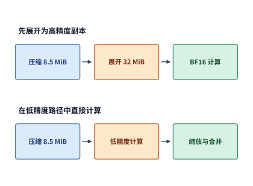

*图 4-12　相同压缩权重的两条计算路径。先展开会形成 32 MiB 的 BF16 副本；低精度路径在计算过程中完成缩放和合并。压缩权重及 scale 共 8.5 MiB。*

在现代大模型推理引擎中，FP4、FP8 与 INT8 等低精度算子已被广泛采用，且往往结合硬件代际能力采取混合折中方案。例如，在 DeepSeek V4-Flash 的路由专家实现中，当运行在原生支持 FP8 而不支持硬件 FP4 矩阵指令的加速器（如 Hopper H100/H800）上时，算子将常驻显存的专家权重以 **FP4 格式保存并读取**以最大限度节省显存容量与 HBM 带宽，待数据读入片上后先快速转换为 **FP8 格式**，再送入 FP8 Tensor Core 执行矩阵乘法。在这类“混合精度存储与计算”路径中，如果转换展开后的权重能够驻留在片上供大批量输入多次复用，那么单次格式转换的耗时就能被多行输入摊薄；反之，如果每次调用都必须先在显存中启动一个独立内核将权重完整展开一遍、用完即弃，那么格式转换本身的耗时就会变成每次调用的固定附加税。简言之，**低精度量化在端到端时间上究竟能带来多少净收益，取决于“减少数据读取所省下的时间”与“增加反量化/缩放转换所多花的时间”之间的差额**。[^precision]

为了直观展示量化粒度、计算误差与硬件执行开销三者之间的真实博弈，我们在 RTX PRO 6000 Blackwell Workstation Edition 上针对 Qwen3-VL-30B-A3B 模型中的一个 $2048\times1536$ 路由专家权重矩阵开展了实测对比。实验直接截取真实推理过程中路由分派给该专家的激活向量作为输入，对比“先反量化展开为 BF16 再调用单次 GEMM”与“直接调用 INT8 分块矩阵乘”两种实现。为了量化评估精度损失，我们将输出误差向量的 L2 范数（即向量各元素平方和的算术平方根）除以全精度参考输出向量的 L2 范数定义为**局部相对 L2 误差**，并将可接受的工程误差门槛设定为 $2\%$。实测表明：如果对输入激活仅采用粗粒度的**逐行缩放（per-token / per-row scaling）**，INT8 矩阵乘的相对误差达到约 $2.3\%\sim3.5\%$，超出了 $2\%$ 的合格门槛；而一旦将激活量化收紧为沿内积维度 $K$ **每 128 个元素独立设一个缩放因子（per-group scaling，$g=128$）**，相对误差便显著下降至 $1.5\%\sim1.9\%$，顺利通过精度检验。[^quant-exp]

然而，引入沿内积维度的细粒度激活分组缩放，会直接改变矩阵内积的数学累加结构。对于长度为 $K=2048$ 的内积，按每 128 个元素一组共被切分为 $2048/128 = 16$ 个子组；设某一行输入在第 $g$ 组的激活缩放因子为 $a_g$，权重第 $j$ 列的缩放因子为 $b_j$，则输出元素 $y_j$ 的内积计算式变为：

$$
y_j\approx\sum_{g=1}^{16}a_gb_j\left(\sum_{k\in g}q_{x,k}q_{w,kj}\right).
$$

请注意括号内外的运算顺序：由于 16 个子组各自的激活缩放因子 $a_g$ 互不相同，硬件无法再用同一个整数累加器把全部 2048 维一气呵成地加完，而是必须先在每个子组内部求出 128 维的整数部分和 $\sum_{k\in g}q_{x,k}q_{w,kj}$，随后将其转换为浮点数并乘以该组对应的缩放系数 $a_g b_j$，最后再将 16 个子组的浮点结果累加起来。如果在没有定制融合内核的情况下直接用现成算子拼装这一过程，程序就不得不按子组循环调用 **16 次** 独立的窄矩阵乘法，并在每次调用之间穿插执行类型转换、缩放相乘与结果累加（当单专家分到的输入行数较少时，每一次调用还都要承受补齐到内核最小行数的 padding 损失）；而与之对照的“先反量化展开为 BF16”方案，则只需先将量化权重展开，随后调用 **1 次** 完整的 BF16 GEMM 即可跑完整个 $K=2048$ 维度的内积。

在真实单 token decode 输入下的实测结果印证了这一分析：直接拼装 16 次 INT8 分组计算的端到端耗时约为 $2.81\ \mathrm{ms}$，反而比“先展开为 BF16 再执行单次 GEMM”的 $2.52\ \mathrm{ms}$ 更慢；但在显存占用上结果却完全反转——内存分配器记录显示，直接 INT8 分组计算的显存占用峰值仅约 $11.4\ \mathrm{MiB}$，而先展开为 BF16 副本的方案则高达约 $35.2\ \mathrm{MiB}$（前者节省了约三分之二的显存工作区）。[^workspace] 这一实测清晰揭示了低精度算子设计中的核心权衡：细粒度分组量化能够有效压低数值误差，但若将分组缩放拆碎为多次独立算子调用，内核启动与中间读写开销就会反噬计算收益；而若预先展开为高精度副本，又会牺牲显存容量。

因此，高性能低精度算子演进的必然方向，就是将**组内低精度矩阵乘加、片上实时缩放（dequantization scaling）与跨组浮点累加彻底融合在同一个算子内核（乃至同一条硬件微指令，如 Blackwell 的块缩放微张量格式 MXFP8/NVFP4）内部**，从而在不生成高维显存副本的前提下，同时兼顾低量化误差与单次内核遍历的高吞吐。

站在端到端模型推理与训练的视角来看，芯片手册上标称的 **FP8 / NVFP4 峰值 TFLOPS 翻倍，绝不等于全模型端到端速度能够按相同倍数提升（TC-08）**。从微架构峰值算力 $\Pi_{\mathrm{low\text{-}bit}}$ 到端到端有效吞吐之间，横亘着三重无法绕开的物理折损：
1. **精度敏感层的混合精度回退与校准代价**：在真实大模型中，词嵌入输入/输出头、注意力 Softmax 归约、部分 MoE 门控路由层以及对离群值（outliers）极度敏感的下投影通道，往往需要保留在 BF16/FP16 甚至 FP32 精度下执行；即便主体线性层切入 FP8 或 FP4，混合精度边界处的动态范围统计（amax 归约）与重缩放（cast/quantize）仍会消耗额外的向量周期与片上读写带宽。
2. **块缩放因子（block scales）、查找表（LUT）读取与片上反量化开销**：如前文公式 $V_W = \frac{nb}{8} + \frac{n}{g}s$ 所示，当量化分组收紧至 $g=16$ 或 $g=32$（或引入 3-bit 查找表重构非均匀分布权重）时，硬件不仅要额外读取缩放因子与码本，还必须在片上数据通路或 Tensor Core 前端实时完成块缩放对位与高精度累加器合并，使有效访存缩减比低于理想位宽比（例如 4-bit + 1B/32 scale 的体积缩减比为 $32/8.5\approx 3.76\times$ 而非 $4.0\times$）。
3. **非矩阵运算（SFU / Vector）与跨卡通信的阿姆达尔定律（Amdahl's Law）封顶**：低比特张量核仅加速密集矩阵乘加（GEMM），而无法加速自注意力中的指数超越函数（SFU）、RMSNorm/RoPE 向量操作以及 TP/EP 跨卡集合通信。与此同时，当低比特算力 $\Pi_{\mathrm{low\text{-}bit}}$ 相比 BF16 翻倍甚至翻四倍、而片外 HBM 带宽 $\beta_{\mathrm{HBM}}$ 保持不变时，硬件的 **Roofline 算术强度转折点（嵴点）**
   $$I^*_{\mathrm{low\text{-}bit}} = \frac{\Pi_{\mathrm{low\text{-}bit}}}{\beta_{\mathrm{HBM}}}$$
   也会同比例向右大幅漂移——哪怕权重位宽减半使单步访存量 $V$ 下降一半、算子的算术强度 $I = F/V$ 翻倍，只要低比特算力 $\Pi_{\mathrm{low\text{-}bit}}$ 翻了四倍（如从 FP8 到 FP4），算子跨入计算受限区所需的临界输入行数 $M^*$ 反而会进一步升高。因此，在小批量 decode 阶段，低比特量化的核心贡献在于通过压缩权重与 KV 体积降低 $V/\beta_{\mathrm{HBM}}$ 访存时间并释放并发 KV 容量；唯有在大批量 prefill 或高聚合度 MoE 分组 GEMM 中，且配套升级 SFU 吞吐与片上直通通路后，原生 FP8/FP4 张量核的算力红利才能充分兑现。[^precision]

为了算清第 2 条折损中“微缩放块格式（Microscaling Block Formats）”的精确硬件代价，我们进一步对比 2025—2026 年数据中心加速器普遍落地的两套 4-bit 硬件微缩放标准——开放计算项目（OCP）定义的 **MXFP4**（被 AMD CDNA 4 MI355X、华为昇腾 950、AWS Trainium3 等原生采纳）与 NVIDIA Blackwell/Rubin 定义的 **NVFP4**（图 4-48 将给出二者内存字节布局的直观对比）：
- **OCP MXFP4（每 32 元素共享 1 个 `E8M0` 缩放因子）**：每个元素本体采用 4-bit `E2M1` 浮点表示（1 位符号、2 位指数、1 位尾数），每连续 $g=32$ 个元素（占 $16\ \mathrm{B}$）共享 1 个 8-bit 的无符号纯指数缩放因子 `E8M0`（占 $s=1\ \mathrm{B}$，仅表示 $2^k$ 的幂次缩放，无尾数位）。代入公式 $V_W = \frac{nb}{8} + \frac{n}{g}s$，每 32 个元素合计占用 $16 + 1 = 17\ \mathrm{B}$，折合**每元素有效位宽**为：
  $$b_{\mathrm{eff,MXFP4}} = 4 + \frac{8}{32} = \mathbf{4.25\ \mathrm{bits/elem}}.$$
  由于缩放因子是纯粹的 2 的幂次，Tensor Core 前端在合并两个 32 元素子块的点积时，只需对指数做整数加法并对累加器执行硬件移位对齐，电路开销极低；但代价是块缩放本身只能以 $2\times$ 为步长跳变，当 32 个元素内出现非 2 的幂次最大绝对值时，块内整体尾数利用率会受到阶梯量化损失。
- **NVIDIA NVFP4（每 16 元素共享 1 个 `E4M3` 浮点缩放因子 + 张量级 `FP32` 二级缩放）**：为了将量化分组收紧一倍并消除 2 的幂次阶梯损失，NVFP4 将分组粒度缩至 $g=16$ 个 `E2M1` 元素（占 $8\ \mathrm{B}$），并为每 16 个元素配 1 个包含 3 位小数尾数的 8-bit `E4M3` 浮点缩放因子（占 $s=1\ \mathrm{B}$），外加整个张量共享 1 个 `FP32` 全局二级缩放因子（张量级 4 字节开销在千万级参数上可忽略不计）。于是每 16 个元素合计占用 $8 + 1 = 9\ \mathrm{B}$，折合**每元素有效位宽**为：
  $$b_{\mathrm{eff,NVFP4}} = 4 + \frac{8}{16} = \mathbf{4.50\ \mathrm{bits/elem}}.$$
  相比 MXFP4，NVFP4 多付出了 $0.25\ \mathrm{bits/elem}$（约 $+5.88\%$）的显存与带宽开销，且需要在 Tensor Core 累加通路中内置 `E4M3` 尾数乘法器，但换取了更窄的离群值波及范围（16 vs. 32）与更细腻的缩放步长，从而在无需复杂旋转变换的前提下直接逼近 FP8 的困惑度表现。以 70B 稠密模型与 DeepSeek-V3 671B MoE 模型为例：原始 BF16（$16\ \mathrm{bits/elem}$）权重分别占 $140.0\ \mathrm{GB}$ 与 $1{,}342.0\ \mathrm{GB}$；切为 **NVFP4（$4.50\ \mathrm{bits/elem}$）** 后分别降至 **$39.375\ \mathrm{GB}$** 与 **$377.4375\ \mathrm{GB}$**（压缩比为 $16/4.5 \approx 3.56\times$，节省 $71.88\%$）；切为 **MXFP4（$4.25\ \mathrm{bits/elem}$）** 后则进一步降至 **$37.1875\ \mathrm{GB}$** 与 **$356.46875\ \mathrm{GB}$**（压缩比为 $16/4.25 \approx 3.76\times$，节省 $73.44\%$）。下面的 Python 脚本将该微缩放体积方程与四代 GPU 的 Roofline 算术强度嵴点计算封装为复算函数：

```python
def microscaling_footprint_and_ridge(
    param_count_b: float,
    elem_bits: float = 4.0,
    group_size: int = 32,
    scale_bytes: int = 1,
) -> dict[str, float]:
    """计算微缩放块量化格式的有效位宽 b_eff、十进制 GB 体积与相对 BF16 的压缩比。"""
    n_elems = param_count_b * 1e9
    eff_bits = elem_bits + (8.0 * scale_bytes) / group_size
    total_gb = (n_elems * eff_bits / 8.0) / 1e9
    bf16_gb = (n_elems * 2.0) / 1e9
    return {"eff_bits": eff_bits, "total_gb": total_gb, "bf16_gb": bf16_gb, "compression_ratio": 16.0 / eff_bits}


if __name__ == "__main__":
    for name, params_b in [("70B Dense", 70.0), ("671B MoE", 671.0)]:
        mxfp4 = microscaling_footprint_and_ridge(params_b, elem_bits=4.0, group_size=32, scale_bytes=1)
        nvfp4 = microscaling_footprint_and_ridge(params_b, elem_bits=4.0, group_size=16, scale_bytes=1)
        print(f"{name}: BF16={mxfp4['bf16_gb']:.2f} GB | MXFP4({mxfp4['eff_bits']:.2f}b)={mxfp4['total_gb']:.2f} GB "
              f"| NVFP4({nvfp4['eff_bits']:.2f}b)={nvfp4['total_gb']:.2f} GB")
    for gpu, pflops, bw_tbs in [("H100 FP8", 1.98, 3.35), ("H200 FP8", 1.98, 4.80), ("B200 FP4", 9.0, 8.0), ("Rubin NVFP4", 50.0, 22.0)]:
        print(f"{gpu}: 算术强度嵴点 I* = {pflops * 1000.0 / bw_tbs:.1f} FLOP/byte")
```

> **实验 4-2 · 延伸：量化权重何时展开，才能减少重复执行成本**
>
> 从上述分组点积式出发，比较先展开权重再计算与直接分组计算两种方法，分别列出需要保存的数据，包括权重、scale、展开后的权重副本、部分和与输出。计算加载时展开一次、每次调用展开、直接分组计算三种策略在重复使用 $R$ 次后的总时间。再用实际输入的实验记录比较误差与显存占用峰值，解释何时值得多占用内存来保存展开后的权重，以减少重复展开的开销。

## 4.3 存储层次

第 4.2.4 节分析了数据精度如何改变张量的字节体积。本节进一步追踪张量在各级存储器之间的存放与流动，重点回答存储子系统的三个核心问题：**第一（容量），片外显存能否装下模型运行所需的全部状态？第二（复用与带宽），数据被重复访问时究竟从哪一级片上缓存读取、产生多少接口流量？第三（延迟与并发），程序需要同时发起多少个独立访存请求，才能掩盖漫长的访存延迟并充分利用硬件带宽？**

### 4.3.1 显存与统一内存

在大模型推理服务运行期间，片外显存被三大块数据同时占据：**常驻的模型权重**、**随活跃请求数与上下文长度动态伸缩的 KV 缓存**，以及**存放算子中间激活与临时缓冲的运行时工作区（workspace）**。其中，模型权重是启动后固定不变的底数，工作区需预留出应对峰值算子的安全余量，唯有先扣除这两项固定开销，剩下的显存空间才能分给并发请求的 KV 缓存。

我们以 Qwen3-8B（BF16 精度，常驻权重 $W_{\mathrm{resident}}\approx16.4\ \mathrm{GB}$）为例核算单卡的最大并发承载力。该模型共有 36 层，每层配置 8 个键值头（KV heads），每个头维度为 128；在 BF16 精度（每元素 2 字节）下，每个上下文 token 在全部 36 层中需要保存的 K 与 V 状态总字节数为：

$$
m_{\mathrm{KV}}=36\times2\times8\times128\times2=147\,456\ \mathrm{bytes}=144\ \mathrm{KiB}.
$$

设系统同时服务 $B$ 条并发请求，每条请求的平均上下文长度均为 $S$ 个 token，运行时预留工作区大小为 $M_{\mathrm{workspace}}$，加速卡的可用显存总容量为 $C_{\mathrm{available}}$，则显存不发生溢出（OOM）的容量约束条件为：

$$
W_{\mathrm{resident}}+BSm_{\mathrm{KV}}+M_{\mathrm{workspace}}\le C_{\mathrm{available}}.
$$

将上式对并发请求数 $B$ 求解并向下取整，即可得出给定上下文长度 $S$ 下单卡最多能够同时容纳的并发请求数上限 $B_{\max}$：

$$
B_{\max}=\left\lfloor\frac{C_{\mathrm{available}}-W_{\mathrm{resident}}-M_{\mathrm{workspace}}}{Sm_{\mathrm{KV}}}\right\rfloor.
$$

我们将一张配备 $24\ \mathrm{GB}$ 显存的消费级显卡 RTX 4090 代入公式：预留 $2\ \mathrm{GiB}$（约 $2.15\ \mathrm{GB}$）作为运行时工作区，再扣除约 $16.38\ \mathrm{GB}$ 的 Qwen3-8B 权重后，真正留给 KV 缓存的可用显存空间仅剩约 $5.47\ \mathrm{GB}$。当单条请求的上下文长度为 $S=8{,}192$ 个 token 时，每条请求的 KV 缓存占用为 $8192\times144\ \mathrm{KiB}=1.125\ \mathrm{GiB}\approx1.21\ \mathrm{GB}$：此时同时服务 4 条请求共需约 $4.83\ \mathrm{GB}$，尚在 $5.47\ \mathrm{GB}$ 余量之内；但若想再多接纳第 5 条请求，KV 总需求将增至约 $6.04\ \mathrm{GB}$，直接超出显存上限。同理，如果将每条请求的上下文长度翻倍至 $S=16{,}384$（每条请求占约 $2.42\ \mathrm{GB}$），这张 24 GB 显卡最多就只能同时容纳 **2 条**并发请求（如图 4-13 所示）。[^capacity]

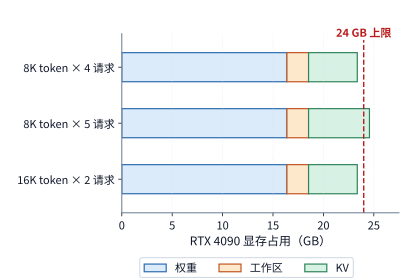

*图 4-13　RTX 4090 的 24 GB 显存中的权重、工作区和 KV。8K 四请求与 16K 两请求可以容纳，8K 五请求超过虚线标出的容量上限。*

观察图 4-13 的空间切分可以直观看到：左侧的模型权重与工作区如同两块尺寸固定的基石，一切弹性都挤压在右侧仅剩的 KV 缓存区里——拉长单条请求的上下文长度会让每个 KV 方块变宽，而提高并发度则会增加 KV 方块的数量，这两者直接争抢同一块剩余显存池。

上式中的向下取整符号 $\lfloor\cdot\rfloor$ 还揭示了显存容量的**阶梯效应**：当剩余显存空间差一点点才够装下第 $B+1$ 条请求的完整 KV 状态时，零星释放几百 MB 显存并不会改变 $B_{\max}$ 的整数值；唯有释放出的空间足以跨越下一个整数台阶，系统才能实质性地多接纳一条并发请求。从公式分子 $C_{\mathrm{available}}-W_{\mathrm{resident}}-M_{\mathrm{workspace}}$ 来看，对模型权重做低比特量化（减小 $W_{\mathrm{resident}}$）相当于直接把省出来的显存划拨给 KV 缓存池：对于权重原本占去绝大部分显存的大模型而言，压缩权重能成倍释放 KV 空间、大幅提升最大并发度；但当业务场景演变为超长上下文、KV 缓存本身已经占据显存大头时，继续压缩权重所能释放的边际空间占比就会越来越有限。

既然如此，直接降低 **KV 缓存自身的存储位宽**便成为突破长上下文容量瓶颈的另一把利刃。以第 2 章剖析过的 DeepSeek V4.1-Flash 混合注意力架构为例：在全局历史上下文层中，每个 token 的主 KV 潜向量包含 512 个数值，系统将其压缩为 **FP4 格式**常驻显存，连同分组缩放因子（scale）每 token 仅占 $288\ \mathrm{bytes}$；而在对局部精度更敏感的滑动窗口注意力（SWA）层中，每条局部 KV 记录则采用 **FP8 格式**保存，连同缩放因子每 token 占 $528\ \mathrm{bytes}$。当执行注意力算子时，硬件先将紧凑的 FP4 主 KV 记录读入片上，利用对应的缩放因子实时反量化还原为计算精度格式，再参与矩阵乘法——用极低的存储位宽锁住常驻显存体积，而在片上计算前夕动态恢复数值表示。[^v41-case]

以上核算的仅是推理阶段的状态；若转向模型训练阶段，显存还必须容纳参数梯度、优化器动量状态以及前向传播留存给反向传播使用的各层激活张量。正如第 3 章所阐述的，核算训练显存必须追踪每个张量的**驻留生命周期**：任何时刻的显存占用峰值，等于在那个时刻点上尚未被释放的所有活跃张量体积之和；前一层反向传播一旦用完对应的前向激活并立即将其释放，腾出的显存空间便可被后续算子循环复用。因此，显存容量规划不仅取决于单个张量有多大，还取决于算子调度顺序何时创建、何时销毁这些张量。

最后，我们需要厘清硬件层面上**显存器件技术**与**内存共享架构**这两组不同维度的概念：HBM（高带宽显存）与 GDDR（图形双倍数据速率显存）指的是物理存储芯片与接口技术——HBM 依靠 3D 硅通孔堆叠与超宽硅中介层接口提供数 TB/s 的极高带宽，而 GDDR 则依靠在 PCB 主板上环绕布置多颗高速显存颗粒提供高性价比带宽；与之相对，**统一内存（Unified Memory Architecture，UMA）**则是指 CPU 与 GPU 如何共享物理内存空间的体系结构组织方式。例如在 Apple Silicon（M 系列芯片）上，CPU 核心、GPU 核心与神经网络引擎直接连接在同一个高带宽 LPDDR 物理内存池上，共享同一套物理地址空间：CPU 预处理好的数据无需经过 PCIe 总线拷贝，GPU 即可直接原位读取同一块内存缓冲，彻底消除了主机与设备之间的冗余数据副本；当然，硬币的另一面是，CPU、GPU 与操作系统后台进程也必须共同瓜分这同一份内存容量与内存控制器带宽（第 4.5 节将沿着主机到加速器的完整链路，定量对比分离式显存与统一内存对端到端传输耗时的影响）。[^apple]

> **思考：KV 压缩后能否再接纳一条请求？** 若每条请求 KV 需求从 1.21 GB 降低 10%，RTX 4090 能否容纳第五条请求？先求五条请求的总需求，再比较剩余空间。

### 4.3.2 缓存、片上缓冲与寄存器

当矩阵计算单元正在计算某一块输出子矩阵时，左输入块中的同一行激活往往要与右权重块的多列连续相乘，而尚未归约完的内积部分和也需要在后续步中反复累加更新。如果每做一次乘加都临时去片外 HBM 取操作数、算完立刻写回片外，绝大部分时间与电能都会浪费在漫长的片外往返路上。将当前高频复用的热数据就近保存在紧挨计算核心的片上存储中，就像木匠把正在加工的零件放在伸手可及的工作台面上一样，能够消除绝大多数远距离搬移；但受限于昂贵的硅片面积，片上“工作台”的容量十分有限，必须精细规划。

在现代加速器内部，紧挨计算单元的片上存储分为三类角色：**寄存器（Registers）**直接保存硬件线程与算术指令当前周期正在读写的操作数和累加结果，速度最快但容量最小；**硬件缓存（Hardware Cache，如 L1/L2 Cache）**由硬件控制器根据最近访问局部性自动留存与替换数据，对普通访存指令透明；而**软件管理缓冲（Software-managed Scratchpad，如 GPU 的 Shared Memory、昇腾的 L1/L0/UB）**则完全交由算子程序或编译器显式控制何时搬入、何时释放。由于片上 SRAM 每字节占用的硅片面积远大于片外 DRAM，片上存储的总容量通常只有几十 KB 到上百 MB（比片外显存小三个数量级以上）。下面我们通过追踪矩阵乘加分块（tile）中的两块输入与一块累加部分和，具体算清片上缓冲的容量账。

考虑一个常见的矩阵乘加分块尺寸 $m=128,\ n=128,\ k=64$：左输入分块（$[128,64]$）与右权重分块（$[64,128]$）在 BF16 精度（2 字节）下各占 $128\times64\times2 = 16\ \mathrm{KiB}$，一对输入操作数合计占用 $32\ \mathrm{KiB}$；而用于保存输出分块（$[128,128]$）高精度中间结果的 FP32 累加器（4 字节）则需要占用 $128\times128\times4 = 64\ \mathrm{KiB}$。以 NVIDIA Volta 架构（V100）为例，其单个 SM 最多可将 $96\ \mathrm{KB}$（即 $96\ \mathrm{KiB}$）配置为共享内存：如果算子将当前这一对输入操作数（$32\ \mathrm{KiB}$）连同输出累加器（$64\ \mathrm{KiB}$）全部放进共享内存，恰好占满全部 $96\ \mathrm{KiB}$ 容量，不留余量。[^volta-evolution] 在这种情况下，如果想开启双缓冲（double buffering）预先加载下一轮内积所需的另一对输入操作数（再加 $32\ \mathrm{KiB}$，共需 $2\times32+64=128\ \mathrm{KiB}$），$96\ \mathrm{KiB}$ 的共享内存就彻底装不下了。

反之，如果硬件在架构上将那 $64\ \mathrm{KiB}$ 的 FP32 累加器剥离出去——放进独立的寄存器堆或专用的张量累加存储中——那么同样这 $96\ \mathrm{KiB}$ 的共享内存就能腾出来全部用于存放输入与权重分块，即可同时容纳 $96 / 32 = 3$ 组配对的输入与权重块（支持三缓冲流水）。可以看到，哪怕片上局部缓冲的总字节数并未增加，仅仅通过**将输入操作数缓冲与输出累加器存储在物理上解耦分工**，就能成倍增加可提前预取的输入流水深度（第 4.6.1 节将结合 NVIDIA Blackwell 架构新增的专用张量内存 TMEM，详细解析这一硬件演进）。

上面的算例通过将部分和留在片上省去了反复写回；同样的复用逻辑完全适用于被多个输出块共享的输入数据。设芯片上同时有 4 个输出分块都需要读取同一份 $32\ \mathrm{KiB}$ 的输入数据块，它们合计向存储子系统发出了 $4\times32 = 128\ \mathrm{KiB}$ 的读取请求。此时，芯片上所有计算单元共享的**二级缓存（L2 Cache）**便发挥了关键的过滤作用：当第 1 个分块首次读取这 $32\ \mathrm{KiB}$ 数据时，数据从片外 HBM 读入并自动留存在片上 L2 缓存中；随后其余 3 个分块发起读取请求时，全部直接在 L2 缓存中命中（hit）。算总账可知：片外 HBM 接口只需传输 1 次共 **$32\ \mathrm{KiB}$** 数据，而片上 L2 缓存接口则向 4 个计算块累计提供了 **$128\ \mathrm{KiB}$** 数据；更进一步，如果这 4 个输出分块由同一个计算核心（SM / AI Core）按顺序连续处理，并始终把这 $32\ \mathrm{KiB}$ 输入锁在核内的局部缓冲（Shared Memory / L1）中，那么连后 3 次访问 L2 缓存的流量都可以一并省去。

因此，在核算任何一个算子的访存开销时，必须严格区分三个处于不同层级的物理量：**第一，张量本身在内存中占用的静态空间大小；第二，所有计算分块累计发起的读取请求字节数；第三，穿透某一级缓存后，在特定硬件接口（如 L2 端口或 HBM 端口）上实际发生的物理传输字节数。** 相应地，算术强度 $I=F/V$ 的数值也会随所观察的存储接口层级而改变：若分母 $V$ 代入的是 L2 缓存端口的读写字节数，算出的就是 L2 层级的算术强度（需与 L2 带宽对比）；若分母 $V$ 代入的是穿透 L2 后实际访问片外显存的字节数，算出的才是片外 DRAM 层级的算术强度（需与 HBM 带宽对比）。第 4.8 节将通过硬件性能计数器（profiling counters）的实测数据直观展示这两者的差异。

除了作为片外显存的过滤缓存，L2 缓存在 GPU 内部还承担着另一项关键枢纽职能——**跨核心数据交换的中转站**。在现代 NVIDIA GPU 中，上百个流式多处理器（SM）按图形处理簇（GPC，Graphics Processing Cluster）分组组织；而芯片中央的 L2 缓存则被切分为多个物理分片（slices/partitions），每个分片负责映射一段物理内存地址，并通过高带宽的片上交叉互连网络（Crossbar）与全部 SM 相连（例如 RTX PRO 6000 拥有 188 个 SM 与高达 128 MiB 的 L2 缓存）。在片上存储可见性方面，寄存器、一级缓存（L1 Cache）与共享内存（Shared Memory）默认均为各个 SM 内部私有。自 Hopper（H100）架构起，硬件引入了**线程块簇（Thread Block Cluster）**机制，允许处于同一个 GPC 内部的相邻若干个 SM 通过专用网络直接读写彼此的共享内存（称为分布式共享内存，Distributed Shared Memory，简称 DSMEM）；但只要跨出同一个线程块簇的范围，任意两个 SM 之间就没有直接连通的私有存储——如果 SM A 算出的中间结果需要交给远处的 SM B 使用，SM A 就必须先通过片上交叉互连将数据写入对应的 L2 缓存分片（图 4-14 中的路径 ①），随后再由 SM B 从该 L2 分片读回（路径 ②）。因此，**L2 缓存既是片外显存数据进入计算核心的总门户，也是跨簇 SM 之间交换同步数据的唯一片上枢纽**。

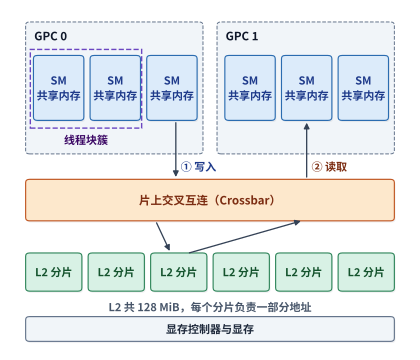

*图 4-14　GPU 片上存储与数据通路。虚线框内的 SM 组成线程块簇，可直接访问彼此的共享内存；其余 SM 之间的数据经交叉互连写入 L2 分片（①），再由读取方取回（②）。图中 SM、GPC 与分片的数量仅为示意。*

在算子调优中，盲目放大单个计算分块（tile）的尺寸虽然能提高单块内部的数据复用率，却会因为耗尽片上缓冲容量而压缩驻留并发度（occupancy）。以采用 Blackwell SM120 架构的 RTX 5090 与 RTX PRO 6000 为例：每个 SM 的一级数据缓存与共享内存共享一块 $128\ \mathrm{KB}$ 的物理 SRAM，其中最多可将 $100\ \mathrm{KB}$ 分配为软件管理的共享内存，供同时驻留在该 SM 上的多个线程块（thread blocks / 计算组）瓜分。如果每个线程块只需占用 $32\ \mathrm{KiB}$ 共享内存，那么单个 SM 上可以同时驻留 **3 个**独立的线程块（合计 $96\ \mathrm{KiB} \le 100\ \mathrm{KB}$）；而一旦为了追求大块复用将单个线程块的共享内存需求扩大到 $64\ \mathrm{KiB}$，单个 SM 上最多就只能驻留 **1 个**线程块。[^blackwell-evolution] 驻留线程块数量的减少会直接削弱硬件掩盖延迟的能力：当同时驻留多组计算时，一旦某一组因等待片外数据返回而暂停，SM 调度器可以零开销地立即切换到另一组已就绪的计算块继续执行；而若只剩下一组独占整个 SM，那么每当它等待数据时，该 SM 的计算单元就只能停顿闲置。因此，选择最优分块大小必须在“扩大单块尺寸以减少重复访存”与“控制单块占用以维持多组并发驻留”之间取得平衡。

为了缓解这一矛盾，历代旗舰数据中心 GPU 也在持续扩大单 SM 的片上共享内存容量上限：从 Volta（V100）的 $96\ \mathrm{KB}$、Ampere（A100）的 $164\ \mathrm{KB}$，一路提升至 Hopper（H100）与 Blackwell（B200）的 $228\ \mathrm{KB}$。[^evolution] 更大的片上缓冲不仅能容纳更大尺寸的矩阵分块或更深的多级流水槽位，还能允许更多独立计算块同时驻留片上，从而向存储子系统并发发出更多互不依赖的访存请求。

### 4.3.3 容量、带宽与延迟分别限制什么

在存储体系结构中，**容量（Capacity）**、**带宽（Bandwidth）**与**延迟（Latency）**是三个物理意义截然不同却又紧密交织的指标：容量决定了某一时刻存储系统最多能装下多少字节的数据；带宽决定了传输流水线满载时每秒钟最多能搬移多少字节的数据；而延迟则决定了一次独立的读写请求从发出那刻起，要等待多少纳秒（或多少个时钟周期）才能拿到返回的数据。理解这三者关系的核心钥匙在于：**只要程序能够同时并发发出足够多彼此独立的访存请求，硬件就能在等待前一个请求漫长返回延迟的同时，让传输通道源源不断地处理后续请求，从而将高延迟的存储接口跑出满带宽。**

我们先对比模型常驻（容量需求）与单步执行（带宽需求）对显存硬件提出的不同挑战。对照第 4.1.3 节的 HBM 演进表，从 H100 SXM（80 GB、3.35 TB/s）升级到 H200 SXM（141 GB、4.8 TB/s），显存容量大幅增加了 76%，而带宽增加了 43%。这种非对称增幅在实际大模型部署中效果十分直接：以部署 Qwen3-235B-A22B 稀疏 MoE 模型的一组 4-bit 量化方案为例，全网常驻的 4-bit 权重连同缩放因子约占 $123.1\ \mathrm{GB}$，8 条并发请求各保留 8,192 个上下文 token 的 KV 缓存约占 $12.6\ \mathrm{GB}$，再加上 $2\ \mathrm{GiB}$ 运行时工作区，总显存需求约为 $137.9\ \mathrm{GB}$。面对这一体积，单张 80 GB 的 H100 存在将近 $58\ \mathrm{GB}$ 的巨大容量缺口，根本无法单卡加载运行；而 141 GB 的 H200 则恰好能将其完整装下，并留出约 $3.1\ \mathrm{GB}$ 的安全余量。可见，**显存容量是决定模型与并发状态能否原位驻留的第一道硬门槛**。[^storage]

跨过容量门槛、将全部 235B 专家权重装入显存之后，每一步 decode 实际需要读取多少字节则取决于 MoE 门控路由的分散程度。当上述 8 条并发请求在每一层选中的专家高度分散时，单步 decode 需要读取的激活专家权重、缩放因子与 KV 缓存合计高达约 $75.967\ \mathrm{GB}$；而当 8 条请求恰好集中命中同一批专家时，由于专家权重在批次内得到充分复用，单步总读取量骤降至约 $24.737\ \mathrm{GB}$（仅为分散路由时的约三分之一）。将这两组流量代入理想带宽计时公式 $T=V/R$：在拥有 $4.8\ \mathrm{TB/s}$ 带宽的 H200 上，仅从显存读完这些字节就分别需要约 $15.8\ \mathrm{ms}$ 与 $5.2\ \mathrm{ms}$；若换用拥有 $8\ \mathrm{TB/s}$ 带宽的 HGX B200，对应的理想读取时间则分别缩短至约 $9.5\ \mathrm{ms}$ 与 $3.1\ \mathrm{ms}$。对比可以看到：**提高批次内的专家复用率是在削减公式分子 $V$（把需要搬移的数据量砍到约三分之一），而升级新一代高带宽显存则是在放大公式分母 $R$（把传输每个字节的耗时压缩到约六成）**，两条优化路径分别作用在 $T=V/R$ 的分子与分母上。

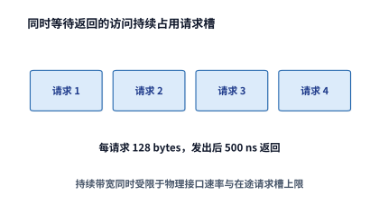

*图 4-15　读取请求从发出到返回一直占用请求记录空间。多个独立请求交叠，才能在单次访问等待期间持续利用接口；图中只画四个代表请求。*

然而，直接用 $T=V/R_{\mathrm{interface}}$ 估算读取时间，隐含了一个极强的假设——**显存接口在每一纳秒都处于 100% 满载传输状态**。鉴于单次显存访问的物理往返延迟高达数百纳秒，要想不让显存数据总线在等待期间空转，计算核心就必须在第 1 个读取请求尚未返回之前，接连不断地向内存控制器发出第 2 个、第 3 个……乃至成千上万个独立的读取请求（如图 4-15 所示）。我们将内存控制器单次调度传输的最小数据单元（通常等于一个缓存行，如 128 bytes）称为一个**访存事务（memory transaction）**。设硬件与程序在某一时刻最多允许同时存在 $N_o$ 个已发出但尚未收到返回数据的**在途事务（outstanding / in-flight transactions）**，每个事务携带的有效数据量为 $s$ 字节，从请求发出到数据返回的平均往返延迟为 $L$。由于每一个在途事务都必须在请求队列中占据一个槽位长达 $L$ 秒，根据排队论中的**利特尔法则（Little's Law）**，系统每秒钟最多能够周转完成的事务数量为 $N_o/L$，折算为每秒传输的字节数，即可得出受在途并发度限制的实际有效带宽上界 $R_{\mathrm{effective}}$：

$$
R_{\mathrm{effective}}\le\min\left(R_{\mathrm{interface}},\frac{N_os}{L}\right).
$$

反过来，若要求程序达到给定的目标带宽 $R_{\mathrm{target}}$（直至触及物理接口带宽 $R_{\mathrm{interface}}$），则在任意时刻必须同时维持的最小在途事务数 $N_o$ 为：

$$
N_o\ge\left\lceil\frac{R_{\mathrm{target}}L}{s}\right\rceil.
$$

上式给出了连接带宽、延迟与并发度的基本物理关系：**在途并发字节数（$N_o s$）必须不小于接口的带宽延迟积（Bandwidth-Delay Product，$R_{\mathrm{target}}L$）**。在硬件层面，SM 与内存控制器的未命中状态保持寄存器（MSHR）深度决定了硬件最多能挂起多少个在途事务；而在软件层面，算子代码中真正没有前后依赖的独立访存指令数量，决定了程序能否把硬件队列填满。如果程序写成了指针追逐（pointer chasing）——即下一次读取的内存地址必须根据上一次读回的数据实时算出——那么无论硬件队列有多深，同一时刻在途的事务数永远只有 $N_o=1$，此时带宽将被严格限制在极低的 $s/L$ 上；唯有将计算切分为大量互不依赖的并行线程块与向量化加载指令，才能同时倾泻出数以千计的独立访存事务，将数百纳秒的物理延迟完全隐藏在并发流水之下。

事实上，微架构基准测试正是利用上述单线程指针追逐（令 $N_o=1$）来剥离带宽干扰、精确测量各级缓存的真实物理延迟的：让单个线程在一个全部常驻于 L2 缓存的随机链表上反复跳转读取，每一次读取的地址都直接取自上一次读回的值，从而迫使每次访问都完整暴露出一趟 L2 往返延迟。在 RTX PRO 6000（实测 SM 运行频率为 $2.88\ \mathrm{GHz}$）上的实测显示：单次 L2 缓存命中的往返延迟约为 $340\sim390$ 个时钟周期（折合物理时间约 $120\sim135\ \mathrm{ns}$）；尽管这比访问片外显存快得多，但对吉赫兹频率的计算核心而言，依然意味着长达数百个时钟周期的停顿。同时，由于 L2 缓存在物理上分布在芯片不同位置的多个分片上，当不同进程被调度到距离目标 L2 分片远近不同的 SM 上时，实测到的单次 L2 往返延迟在 $354$ 至 $870$ 个时钟周期之间大幅波动——第 4.4.4 节即将分析的跨 SM 屏障同步，每一次握手正是由若干趟这样的 L2 物理往返构成的。[^l2sync]

> **例 4-2：换上带宽更高的显卡，KV 读取也会同比加快吗？**
>
> **比较在途事务数与接口带宽对 KV 读取的限制。** 读取一条请求的 8,192 个上下文 token 所对应的 KV，共 1.125 GiB。显存接口取 RTX 4090 的 1,008 GB/s，每事务 128 bytes，完成延迟取 500 ns：内存性能测量工具 Mess 在 H100 上测得的显存空载延迟为 363 ns，接近饱和带宽时升到 699—1,433 ns，500 ns 位于二者之间。[^mess] 分别计算最多允许 128 和 4,096 个在途事务时的有效读取带宽与耗时，再比较换成 RTX 5090 的 1,792 GB/s 后的结果。
>
> **由在途字节数和访问延迟求有效读取带宽。** 维持 1,008 GB/s 需要 $\lceil1.008\times10^{12}\times500\times10^{-9}/128\rceil=3938$ 个事务。128 个事务只能提供约 32.8 GB/s，读取时间至少为 36.9 ms；4,096 个事务足以维持 1,008 GB/s，时间降为约 1.20 ms。
>
> **在途事务不足时，更高的接口带宽收益有限。** 换成 RTX 5090 后，4,096 个事务仍只能支持约 $4096\times128/(500\ \mathrm{ns})=1.05$ TB/s，时间约为 1.15 ms。接口带宽提高了约 78%，吞吐率却受在途事务数限制，只提高约 4%。
>
> **用满更高带宽或应对更长延迟，需要多少在途事务？** 把在途事务数提高到至少 7,000 个，才能维持 1,792 GB/s；若延迟增至 800 ns，该要求又增至 11,200 个。[^window-rtx]

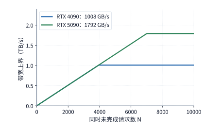

*图 4-16　每事务 128 bytes、返回延迟 500 ns 时，增加在途请求数会提高带宽上界，直到碰到 RTX 4090 或 RTX 5090 显存接口本身的速率上限。*

图 4-16 直观绘制了例 4-2 中的两条带宽屋顶曲线：当程序的在途并发事务数 $N_o$ 较小时，RTX 4090 与 RTX 5090 的有效带宽曲线完全重合在同一条斜线上，因为此时限制吞吐的根本不是显卡的物理显存带宽，而是程序发出的在途字节数太少（延迟受限，latency-bound）；唯有当在途事务数分别越过 $3{,}938$ 与 $7{,}000$ 这两个拐点之后，曲线才真正触及各自显存接口的物理带宽上限（带宽受限，bandwidth-bound）。在真实的硬件系统中，随着并发访存流量逼近接口饱和点，内存控制器内部的排队等待还会使平均访问延迟 $L$ 显著拉长（如例 4-2 引用的 Mess 基准测试工具所揭示的，H100 显存延迟从空载时的 $363\ \mathrm{ns}$ 攀升至饱和附近的 $699\sim1{,}433\ \mathrm{ns}$）[^mess]。这条经典的**带宽—延迟曲线**将两个看似矛盾的物理规律统一在同一幅图中：在低负载区，增加并发访存能够填补等待气泡、线性推高有效带宽；而在接近饱和的高负载区，继续盲目堆积请求只会加剧控制器排队、推高单次访问延迟。

因此，诊断任何一项存储相关的性能瓶颈，都应当严格遵循三步排查法：**第一步按容量公式检查状态能否常驻显存；第二步按分块复用关系核算穿过各级存储接口的实际流量；第三步结合利特尔法则（带宽延迟积），检验算子发出的在途并发事务数是否足以达到目标硬件带宽。**

如果我们将上述容量公式与带宽公式放进 **Hopper（H100 / H200）$\to$ Blackwell（B200）$\to$ Rubin（Rubin GPU）** 三代数据中心加速器的演进序列中联立求解，就能看清为什么**单卡显存容量扩容会通过推高最大并发批量 $B_{\max}$，对单位 token 推理成本产生“超线性（super-linear）”的乘数摊薄效应（TC-07）**。设目标模型常驻权重与固定工作区之和为 $W_{\mathrm{fixed}} = W_{\mathrm{resident}} + M_{\mathrm{workspace}}$，单条请求在上下文长度 $S$ 下的 KV 缓存体积为 $K_{\mathrm{req}} = S m_{\mathrm{KV}}$。由第 4.3.1 节公式可知，单卡允许同时驻留的最大并发批量 $B_{\max} = \lfloor (C_{\mathrm{available}} - W_{\mathrm{fixed}})/K_{\mathrm{req}} \rfloor$ 取决于**扣除固定权重后的剩余显存空间**，而非总显存容量本身：
- 当模型权重 $W_{\mathrm{fixed}}$ 占去第一代显卡（如 H100，$80\ \mathrm{GB}$，$3.35\ \mathrm{TB/s}$）大部分容量时（例如某 70B 级量化模型连同工作区占去 $68\ \mathrm{GB}$），H100 上真正留给 KV 缓存的余量仅有 $80 - 68 = 12\ \mathrm{GB}$；
- 升级到同算力的 H200（$141\ \mathrm{GB}$，$4.8\ \mathrm{TB/s}$）后，虽然总显存容量只增加了 $1.76\times$，但扣除同样 $68\ \mathrm{GB}$ 固定权重后，留给并发 KV 缓存的可用空间却跃升至 $141 - 68 = 73\ \mathrm{GB}$，使最大并发批量 $B_{\max}$ 直接放大了 **$73 / 12 \approx 6.08\times$**；
- 继续升级到 Blackwell B200（$180\sim 192\ \mathrm{GB}$ HBM3e，$7.7\sim 8.0\ \mathrm{TB/s}$）乃至下一代 Rubin GPU（$288\ \mathrm{GB}$ HBM4，高达 $22\ \mathrm{TB/s}$）时，剩余 KV 池进一步扩大至 $112\sim 124\ \mathrm{GB}$ 与 $220\ \mathrm{GB}$（相对 H100 分别放大 **$9.3\sim 10.3\times$** 与 **$18.3\times$**），不仅直接将单卡可承载的并发会话数推高一个数量级，还允许同一批次内的数十条请求共享同一次静态权重读取 $W_{\mathrm{resident}}$，使分摊到每个输出 token 上的有效权重读取字节数 $W_{\mathrm{resident}} / B_{\max}$ 成倍下降。

但在此处做跨代吞吐归因时，必须严防一个常见的**双重计数陷阱（TC-07）**：硬件评测报告中常宣称新一代 GPU 在某基准大模型上的单卡吞吐率提升了 $K_{\mathrm{total}}$ 倍，这一实测总倍数实际上已经同时包含了**物理 HBM 带宽提升倍数**（$\beta_{\mathrm{new}} / \beta_{\mathrm{old}}$）、**硬件原生低比特压缩倍数**（如 FP8 $\to$ NVFP4）以及**因显存容量从 $C_{\mathrm{old}}$ 扩至 $C_{\mathrm{new}}$ 而得以跑满更大并发批量 $B_{\max}$ 所带来的软件合批复用倍数**。因此，在建立系统级成本拆解模型（如第 1 章 `TC-01` 与第 2 章表 2-F）时，绝不能先把硬件代际实测总倍数 $K_{\mathrm{total}}$ 记入账本，随后又把连续批处理（Continuous Batching）扩大 $B$ 所带来的吞吐增益再乘一遍；唯有将硬件物理参数增量（$\Delta C_{\mathrm{HBM}}, \Delta \beta_{\mathrm{HBM}}, \Delta \Pi_{\mathrm{Tensor}}$）与软件批次调度增益拆解到同一个显存容量与带宽方程下联合求解，才能得出自洽的端到端加速比。[^storage][^precision]

> **实验 4-3 · 延伸：内存扩容与带宽提升分别能改善哪些 decode 瓶颈**
>
> 使用 Qwen3-8B 与 Qwen3-235B-A22B 的存储结果，分别只增加容量、只增加带宽，再改变 batch 和专家分布。先求最大可驻留请求数，再计算每步读取时间，最后求维持目标带宽需要的在途事务数。说明每种方案首先受容量、传输时间还是访存并发数限制。

## 4.4 数据搬移

第 4.1 至 4.3 节算清了张量的字节体积、分块复用次数以及达到峰值带宽所需的在途并发度。本节进一步深入时间轴，编排这些数据块在何时发起读取、何时送达计算单元、又在何时安全释放。数据搬移调度的核心目标只有一句话：**让下一个数据块在计算单元需要它之前准时就位，同时确保当前数据块在最后一次使用完毕前不被覆盖。**

### 4.4.1 数据布局与寻址

在逻辑矩阵上框出一个二维子块（tile），仅仅界定了数学上需要读取哪些行列坐标的元素；至于这些元素在物理线性内存中是否紧挨在一起，则完全取决于矩阵的**内存布局（memory layout）**。如果原大矩阵是按行主序（row-major）连续存放的，那么当硬件读完子块的第 1 行后，物理地址并不能接着往下读，而是必须跨过原矩阵该行剩余未被选中的全部元素，跳转到原矩阵下一行的对应起始列位置继续读取。换言之，在原矩阵上直接截取逻辑子块无需事先在显存中拷贝出一块独立的小矩阵，但硬件寻址逻辑必须依据**步长（stride）**跨越行间空隙定位每一行的起点。设一个二维张量视图中每个元素占 $b$ 字节，行步长（相邻两行同列元素之间的字节距离）为 $s_r$ 字节，列步长（同行相邻两列元素之间的字节距离）为 $s_c$ 字节，则第 $(i,j)$ 个元素的线性内存地址为：

$$
\operatorname{addr}(i,j)=\operatorname{base}+is_r+js_c.
$$

当矩阵按行主序紧凑存储时，列步长就是单元素字节数（$s_c=b$），而行步长 $s_r$ 则等于**原完整矩阵**的整行字节宽度。因此，当我们从原矩阵中截取一个宽度小于原矩阵的子块时，子块每一行自身虽是连续的，但子块相邻两行起点之间的物理地址跨度依然等于原矩阵的整行步长 $s_r$——这一几何关系直接决定了内存控制器需要发起怎样的物理读取请求。

我们用一个具体算例来算清物理跨度与有效字节的区别：假设从一个 BF16 精度（$b=2\ \mathrm{bytes}$）、完整行宽为 $4{,}096$ 列（即行步长 $s_r=4096\times2=8{,}192\ \mathrm{bytes}$）的大矩阵中，截取一个 $128\times128$ 的二维子块。该子块真正包含的有效数据量为 $128\times128\times2 = 32\ \mathrm{KiB}$：在每一行内部，需要读取的连续有效区间仅为 $128\times2 = 256\ \mathrm{bytes}$；但子块相邻两行的起始地址之间却相隔整整 $8{,}192\ \mathrm{bytes}$。从子块第 1 行的首字节到第 128 行的末字节，物理地址首尾横跨了 $127\times8{,}192+256 = 1{,}040{,}640\ \mathrm{bytes}$（约 $1\ \mathrm{MiB}$）。如图 4-17 所示，按二维步长逐行发起读取，能够只精准搬移每行前 $256\ \mathrm{bytes}$ 的蓝色有效数据、跳过中间长段的灰色未选中区域；并且由于每一行的 $256\ \mathrm{bytes}$ 在物理地址上连续，当线程束（warp）内的相邻线程访问相邻列元素时，硬件还能将这些分散的线程请求**合并（coalesce）**为极少数几次满宽度的 128-byte 访存事务。

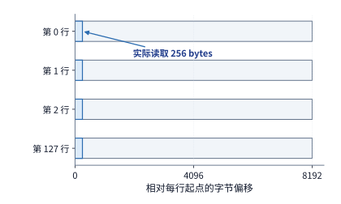

*图 4-17　每行前 256 bytes 是实际读取区间，相邻行起点相差 8192 bytes。128 行合计读取 32 KiB，行间灰色区域由步长跳过。*

图 4-17 直观揭示了行步长 $s_r$ 的物理意义：每读完一段 $256\ \mathrm{bytes}$ 的蓝色连续区间，地址生成单元只需将当前行起点加上 $8{,}192\ \mathrm{bytes}$ 的步长，就能精确跳过灰色空隙、直接定位下一行蓝色数据的起点，而绝不会把整段 $1\ \mathrm{MiB}$ 的地址跨度连同无用数据一并搬进芯片。

可见，张量在内存中的排列布局从两个层面深刻影响着访存效率：**一是步长规则性决定了地址计算的复杂度，二是访问地址的空间连续性决定了多个线程的访问请求能否合并为满载的宽事务**。同样是读取 $32\ \mathrm{KiB}$ 的有效元素，对齐且连续的布局可以用极少数几次 128-byte 连续事务高效率取回，而非对齐或跨步打散的布局则会退化为成千上万次每次只取几个字节的碎片化事务——第 4.3.3 节利特尔法则公式中的“单事务有效载荷字节数 $s$”，正是由这里的地址合并效率决定的。

在单个分块内部的寻址之外，外层循环如何切分大矩阵还会决定同一块物理内存地址被重复请求多少次。以 DeepSeek V4-Flash 共享专家的一次上投影矩阵乘法（形状为 $[32,4096]\times[4096,2048]$，采用 FP8 精度，每元素 1 字节）为例：左输入矩阵的静态体积仅为 $32\times4096\times1 = 128\ \mathrm{KiB}$。如果算子将右侧 $2{,}048$ 列输出宽度切分为 16 个各宽 128 列的输出分块（tile），那么计算每一个输出分块都必须完整遍历一遍那 $128\ \mathrm{KiB}$ 的左输入矩阵，导致 16 个分块累计发出的输入读取请求量放大为 $16\times128\ \mathrm{KiB} = 2\ \mathrm{MiB}$；而右侧权重矩阵由于按输出列互不重叠地切分给 16 个分块，各分块各自读取属于自己的那一列条带，权重总读取请求量保持 $4096\times2048\times1 = 8\ \mathrm{MiB}$ 不变。[^coordinates]

请注意这里的区分：左输入张量在显存中的静态体积依然只有 $128\ \mathrm{KiB}$，膨胀出来的 $2\ \mathrm{MiB}$ 只是 16 个输出分块累计发起的数据读取请求总量。如果这 16 个输出分块共享片上 L2 缓存，那么首次从 HBM 读入这 $128\ \mathrm{KiB}$ 后，后续 15 次请求都会在 L2 缓存中直接命中；如果进一步让同一个计算核心把这 $128\ \mathrm{KiB}$ 输入常驻在核内局部缓冲（Shared Memory / L1）中、连续算完多个输出列分块，那么连访问 L2 缓存的重复请求都能省去。至此，**寻址步长、分块切分与存储层次**三者互相制约：分块方式决定了计算核心发出多少次读取请求，而数据驻留的存储层级则决定了这些请求最终穿透到哪一级物理总线。

在早期 GPU 编程中，上述二维/多维子块的步长地址计算必须由每个计算线程耗费宝贵的整数算术指令与寄存器亲自完成；而现代 AI 加速器则普遍引入了专用的**硬件多维张量搬移引擎**——算子只需向搬移引擎一次性提交张量的基地址、各维尺寸、各维步长（stride）以及分块大小（这组结构化元数据统称为**张量描述符，Tensor Descriptor**），硬件搬移引擎就能在后台自动按步长循环生成全部物理地址并完成跨级拷贝。NVIDIA Hopper/Blackwell 架构中的**张量内存加速器（TMA，Tensor Memory Accelerator）**与华为昇腾 950 架构中的**多维直接内存访问引擎（NDDMA）**正是这一理念的代表。[^transfer] 例如对于图 4-17 中的二维子块，只需在描述符中填入“基地址、`128` 行、每行 `256` 字节、行步长 `8192` 字节”四个参数，单条异步搬移指令即可驱动硬件自动完成全部 128 行的跨步提取，将计算核心从繁琐的地址算术中彻底解放出来。

### 4.4.2 异步搬移与双缓冲

解决“去哪里取一块数据”之后，下一步就是解决“**何时把下一块数据取过来**”。如果硬件总是等当前数据块全部算完之后，才开始从存储中读取下一块数据，那么计算单元在每两块计算之间都必须停顿等待漫长的数据加载。消除这种停顿的经典技术就是**双缓冲（double buffering，或推广为多级缓冲流水线）**：在片上开辟两块（或多块）交替轮转的缓冲区，当计算单元正在消费缓冲区 A 中的当前数据块时，异步搬移引擎同时在后台把下一轮所需的数据块预取加载到缓冲区 B 中；待当前块算完、下一块也加载就绪后，双方立刻互换角色——**用额外的片上缓冲空间，换取数据加载与算术计算在时间轴上的并行重叠**。

我们先用宏观阶段时间推导双缓冲流水的总耗时公式。设共有 $n$ 个同尺寸的数据块需要依次处理，每个数据块的加载耗时均为 $t_l$，计算耗时均为 $t_c$。如果采用“加载一块 $\to$ 计算一块”的纯串行执行方式，总耗时为 $n(t_l+t_c)$；而当加载引擎与计算单元硬件独立、且采用双缓冲重叠流水后，只需先付出第 1 块数据的加载时间 $t_l$ 与最后 1 块数据的收尾计算时间 $t_c$，中间其余 $n-1$ 步的推进节奏则完全由加载与计算二者中较慢的那一拍决定：

$$
T_{\mathrm{pipe}}=t_l+t_c+(n-1)\max(t_l,t_c).
$$

用一组简单数字对比：假设共有 $n=8$ 块数据，每块加载耗时 $t_l=2\ \mathrm{\mu s}$、计算耗时 $t_c=1\ \mathrm{\mu s}$。纯串行执行需要 $8\times(2+1)=24\ \mathrm{\mu s}$；而启用双缓冲流水后，总耗时降至 $2+1+7\times\max(2,1)=17\ \mathrm{\mu s}$——在不减少任何传输字节数、也不减少任何乘加次数的情况下，仅靠时间重叠就直接节省了 $7\ \mathrm{\mu s}$。但与此同时，如果我们把计算单元的速度再提高一倍（使 $t_c$ 从 $1\ \mathrm{\mu s}$ 降至 $0.5\ \mathrm{\mu s}$），流水线总耗时却只能从 $17\ \mathrm{\mu s}$ 微降至 $2+0.5+7\times2=16.5\ \mathrm{\mu s}$，因为此时流水线的推进步调受限于每 $2\ \mathrm{\mu s}$ 才能供出一块数据的加载阶段。

上面的宏观公式把“加载一块数据”视作一个不可分割的整体；但在真实的微架构流水线中，数据搬移本身还包含**总线传输占用时间**与**物理通道传播等待延迟**两个子阶段——即使搬移端口已经传完第 1 块数据的最后一个字节、可以立刻开始传输第 2 块数据，第 1 块数据往往还要在片上互连与缓冲队列中再经历一段固定延迟才能真正对计算单元可见可用。下面我们以 B200 单个 SM 的时钟周期（记作 `tick`）为单位，严格区分**请求发起间隔**与**数据就绪延迟**，推导为了彻底消除计算气泡究竟需要配置多少个片上缓冲槽位（buffer slots）。如果搬移端口每隔 64 tick 就能发起下一块数据的读取，但每一块数据在发起请求后都要经过 192 tick 才能真正就绪可用，那么在时间轴上就必然有多块数据同时处于“在途传输或等待就绪”以及“正在被计算单元读取”的状态。我们将片上用于存放一个输入分块的缓冲空间称为一个**输入槽（input slot）**：从向该槽位发起异步读取请求的那一拍起，直到计算单元彻底算完该块数据为止，这个输入槽始终处于锁定占用状态，绝不能被后续数据块提前覆写。因此，增加片上输入槽的数量，能够允许搬移引擎更早发起后续数据块的预取，但代价是成比例地消耗更多片上共享内存容量。

我们以自注意力中的 $QK^{\mathsf T}$ 分块矩阵乘法为例进行逐拍（tick-by-tick）精确推导：设查询块 $Q$ 与键块 $K$ 的尺寸均为 $128\times128$，沿注意力头维度（$d=128$）切分为 4 个深度为 $k=32$ 的内积累加步依次执行。在每一步中，需要读入的一对 Q、K 子块（各为 $128\times32$，BF16 精度）合计占用 $2\times128\times32\times2 = 16\ \mathrm{KiB}$ 片上缓冲空间，执行 $2\times128\times128\times32 = 1{,}048{,}576\ \mathrm{FLOPs}$（约 $1.05\ \mathrm{MFLOPs}$）矩阵乘加；4 步内积依次累加更新到同一块独立的 $64\ \mathrm{KiB}$ FP32 累加器存储中。硬件参数沿用 FlashAttention-4 论文给出的 B200 单 SM 指标：Tensor Core 矩阵速率为 $8{,}192\ \mathrm{FLOPs/tick}$；输入数据搬移的端口传输速率为 $256\ \mathrm{bytes/tick}$，且每块数据在端口传输完毕后还需额外等待 $128\ \mathrm{tick}$ 的片上通路延迟才能就绪可用。[^pipeline][^fa4]

据此可算出单个输入块在各个阶段的精确耗时：
- **端口传输时间**：$\frac{16\times1024\ \mathrm{bytes}}{256\ \mathrm{bytes/tick}} = 64\ \mathrm{tick}$；
- **从发起请求到数据就绪的总延迟**：$64\ \mathrm{tick}\text{（传输）}+128\ \mathrm{tick}\text{（额外等待）}=192\ \mathrm{tick}$；
- **Tensor Core 计算时间**：$\frac{1{,}048{,}576\ \mathrm{FLOPs}}{8{,}192\ \mathrm{FLOPs/tick}} = 128\ \mathrm{tick}$。

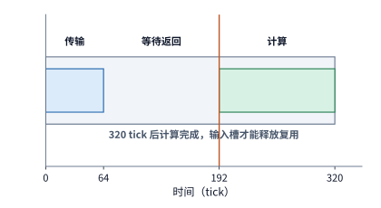

*图 4-18　一个输入槽从发起到释放的完整生命周期。传输 64 tick，额外等待 128 tick，数据在 192 tick 就绪，再计算 128 tick，于 320 tick 释放。一个 tick 为 B200 SM 的一个时钟周期。*

如图 4-18 所示，每一个输入槽从发起读取（$t=0$）到计算完成释放，完整生命周期固定为 $64+128+128=320\ \mathrm{tick}$。因此，如果片上只分配 **1 个输入槽（单缓冲，占 $16\ \mathrm{KiB}$）**，下一块数据的读取必须等待上一块算完释放槽位后才能发起，4 块数据完全串行执行，总完成时间为 $4\times320 = 1{,}280\ \mathrm{tick}$。

图 4-19 至图 4-21 在完全相同的时间刻度下，依次绘出了配置 **1 个槽（单缓冲）**、**2 个槽（双缓冲）**与 **3 个槽（三缓冲）**时的完整甘特图时间线。读者只需先盯着绿色的矩阵计算条寻找是否存在断开的空隙（气泡），再顺着空隙往上看下一块数据的橙色就绪竖线落在了哪里，就能一眼看穿流水线停顿的根源。

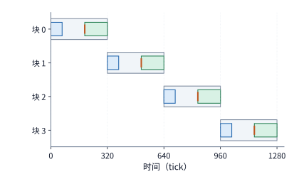

*图 4-19　一个输入槽的四块时序。蓝条为传输，橙线为就绪，绿条为计算，浅灰为槽占用；上一块用完后才能再次发起，完成时刻为 1280 tick。一个 tick 为 B200 SM 的一个时钟周期。*

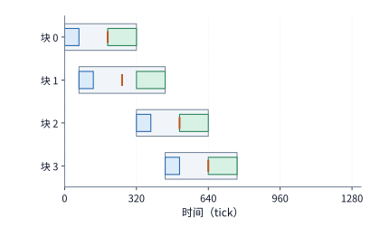

*图 4-20　两个输入槽使用相同时间尺度。前两块可提前发起，但第三块到 512 tick 才就绪，第二块在 448 tick 已结束，留下 64 tick 空闲。横轴一个 tick 为 B200 SM 的一个时钟周期；各行对应一个数据块，灰色表示输入槽占用，蓝色表示传输，绿色表示计算，竖标记表示数据就绪。*

我们来细看图 4-20 的**双缓冲（2 个输入槽，占 $32\ \mathrm{KiB}$）**时序：由于有两个空闲槽，系统可以在 $t=0$ 和 $t=64\ \mathrm{tick}$ 连续发起第 1 块与第 2 块的读取请求，二者分别在 $192\ \mathrm{tick}$ 与 $256\ \mathrm{tick}$ 就绪。第 1 块在 $192\sim320\ \mathrm{tick}$ 执行计算，第 2 块紧接着在 $320\sim448\ \mathrm{tick}$ 无缝接续计算。然而问题出在第 3 块上：第 3 块必须等第 1 块在 $t=320\ \mathrm{tick}$ 算完并腾出第 1 个槽位后才能发起读取，加上 $192\ \mathrm{tick}$ 的就绪延迟，第 3 块直到 $320+192=512\ \mathrm{tick}$ 才能就绪可用；而此时第 2 块早在 $448\ \mathrm{tick}$ 就已经算完了——这就导致矩阵计算单元在 $448\sim512\ \mathrm{tick}$ 之间不得不停工空转 **$64\ \mathrm{tick}$**。同理，第 3 块（$512\sim640\ \mathrm{tick}$）与第 4 块（$640\sim768\ \mathrm{tick}$）接续完成后，总完成时间定格在 $768\ \mathrm{tick}$。可见，在长延迟（$192\ \mathrm{tick}$）面前，传统的双缓冲虽然掩盖了大部分传输时间，却依然不足以彻底填平流水线气泡。

那么，理论上 4 块数据无缝连续计算的最短理想时间是多少？只要第 1 块在 $192\ \mathrm{tick}$ 准时就绪后，矩阵单元无停顿地连续算完 4 个 $128\ \mathrm{tick}$，即可达到物理下界：

$$
T_{\min}=192+4\times128=704\ \mathrm{tick}.
$$

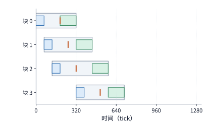

*图 4-21　三个输入槽提前发起前三块，第一槽释放后接收第四块。矩阵单元从 192 连续计算到 704 tick，第四槽不再缩短完成时间。横轴一个 tick 为 B200 SM 的一个时钟周期；各行对应一个数据块，灰色表示输入槽占用，蓝色表示传输，绿色表示计算，竖标记表示数据就绪。*

对照图 4-21 可以看到，配置 **3 个输入槽（三缓冲，占 $48\ \mathrm{KiB}$）**恰好能完美兑现这一 $704\ \mathrm{tick}$ 的理论下界：前 3 块数据在 $t=0,\ 64,\ 128\ \mathrm{tick}$ 依次发起预取，并分别在 $192,\ 256,\ 320\ \mathrm{tick}$ 就绪，支撑矩阵单元从 $192\ \mathrm{tick}$ 连续算到 $576\ \mathrm{tick}$；而当第 1 块在 $t=320\ \mathrm{tick}$ 算完释放槽位时，系统立即利用该槽位发起第 4 块的读取，使其在 $320+192=512\ \mathrm{tick}$ 提前就绪——这比第 4 块计划开始计算的时刻（$576\ \mathrm{tick}$）还早了整整 $64\ \mathrm{tick}$。于是，矩阵计算单元从 $192\ \mathrm{tick}$ 直至 $704\ \mathrm{tick}$ 全程满载连续运转，气泡彻底归零。[^pipeline-extra]

| 输入槽数 | 输入缓冲 | 完成时间 | 相对前一项节省 |
| --- | ---: | ---: | ---: |
| 1 | 16 KiB | 1280 tick | — |
| 2 | 32 KiB | 768 tick | 512 tick |
| 3 | 48 KiB | 704 tick | 64 tick |
| 4 | 64 KiB | 704 tick | 0 |

*表 4-7　B200 单 SM 上 4 个注意力输入分块在 1 至 4 个缓冲槽位下的完成时间与边际收益*

上表总结了缓冲槽位数从 1 增至 4 的边际收益，并给出了一套通用的**片上流水线缓冲设计方法论**：首先用“首块就绪延迟 + 全部块连续计算时间”算出无气泡理想下界 $T_{\min}$，然后检查在给定槽位数 $S$ 下，第 $S+1$ 块数据在首个槽位释放后发起读取能否在计划计算时刻之前就绪（即满足**无气泡条件**：首块释放时刻 + 就绪延迟 $\le$ 第 $S+1$ 块计划开始计算时刻）。在本例中，3 个槽位已使计算单元达到 100% 连续运转，若再增加第 4 个槽位（$64\ \mathrm{KiB}$），除了让第 4 块数据更早写入缓冲区等待之外，无法再缩短哪怕 1 个 tick 的完成时间。

更重要的是，最优缓冲槽位数会随计算单元的提速而动态水涨船高。假设新一代架构将 Tensor Core 矩阵算力翻倍，使每块计算耗时从 $128\ \mathrm{tick}$ 减半至 $64\ \mathrm{tick}$，此时无气泡理想完成时间下界变为 $192+4\times64 = 448\ \mathrm{tick}$。如果仍然只配 **3 个输入槽**：第 1 块在 $192+64=256\ \mathrm{tick}$ 算完并释放槽位，此时立即发起第 4 块读取，第 4 块要到 $256+192=448\ \mathrm{tick}$ 才能就绪，根本赶不上原定在 $192+3\times64=384\ \mathrm{tick}$ 启动的第 4 块计算，导致最终完成时间退化为 $448+64=512\ \mathrm{tick}$；唯有将片上缓冲扩充至 **4 个输入槽**，在起始时刻将 4 块读取请求连续发出，才能重新实现 $448\ \mathrm{tick}$ 的零气泡流水。这正是 Hopper 与 Blackwell 架构在将 Tensor Core 算力翻倍的同时，必须同步扩大单 SM 共享内存容量并引入深度异步流水线（Warp Specialization + 多级 TMA 缓冲）的根本原因。

在硬件执行机制上，支撑上述多槽位重叠的基石正是**异步拷贝与事件同步**：计算线程（或专职的数据加载线程束）向硬件搬移引擎下达非阻塞加载指令后无需原地等待，而是立刻转身去执行其他工作；搬移引擎在后台将数据填入指定的空闲缓冲槽，并在全块数据就绪时自动翻转对应的完成屏障（barrier / flag / event）；消费数据的计算线程只需在实际开算前检查该屏障，用完数据后再发出信号释放槽位。无论是 NVIDIA GPU 的 `memcpy_async` / TMA + `mbarrier`，华为昇腾的 MTE/NDDMA + 硬件 `event/flag`，还是 Apple Metal 的任务依赖原语，底层解决的都是同一套“异步填槽—就绪握手—用毕释槽”的生产者—消费者同步问题。[^transfer] 下面的 Python 脚本实现了多槽位片上软件流水线的精确周期（tick-accurate）事件仿真器，可直接验证表 4-7 的全部数值及算力翻倍后的最少无气泡槽位数：

```python
def simulate_slot_pipeline(
    num_tiles: int = 4,
    num_slots: int = 3,
    transfer_ticks: int = 64,
    extra_wait_ticks: int = 128,
    compute_ticks: int = 128,
) -> dict[str, int]:
    """仿真多槽位片上输入缓冲流水线，返回总完成周期数与计算单元空闲气泡周期数。"""
    slot_free_at = [0] * num_slots
    transfer_bus_free_at = 0
    compute_unit_free_at = 0
    first_compute_start = 0
    for idx in range(num_tiles):
        slot = idx % num_slots
        start_transfer = max(transfer_bus_free_at, slot_free_at[slot])
        end_transfer = start_transfer + transfer_ticks
        transfer_bus_free_at = end_transfer
        data_ready = end_transfer + extra_wait_ticks
        start_compute = max(compute_unit_free_at, data_ready)
        if idx == 0:
            first_compute_start = start_compute
        end_compute = start_compute + compute_ticks
        compute_unit_free_at = end_compute
        slot_free_at[slot] = end_compute
    active_window = compute_unit_free_at - first_compute_start
    bubble_ticks = active_window - num_tiles * compute_ticks
    return {"total_ticks": compute_unit_free_at, "bubble_ticks": bubble_ticks}


if __name__ == "__main__":
    print("基线配置 (compute=128 ticks):", {s: simulate_slot_pipeline(num_slots=s)["total_ticks"] for s in [1, 2, 3, 4]})
    print("算力翻倍 (compute=64 ticks) :", {s: simulate_slot_pipeline(num_slots=s, compute_ticks=64)["total_ticks"] for s in [1, 2, 3, 4]})
```

> **思考：输入可用前的额外等待翻倍，三个缓冲槽是否够用？** 保持原来的传输和计算速率，将数据传输结束到输入可用的额外等待时间从 128 增至 256 tick。三个槽能否继续实现无间隙计算？分别写出第四块的就绪时刻与所需时刻。

### 4.4.3 单元间的数据传递

上一节解决了片外输入数据如何通过多槽缓冲无缝喂给矩阵单元；本节则顺着计算流水线往下走，追踪**不同计算单元之间的中间结果交接**：在自注意力中，矩阵单元算出的 $QK^{\mathsf T}$ 得分矩阵必须交给向量单元算 Softmax，向量单元算出的概率矩阵 $P$ 又必须交回矩阵单元算 $PV$。以一个 $128\times128$ 的 FP32 注意力得分块为例，其体积为 $128\times128\times4 = 64\ \mathrm{KiB}$：如果矩阵单元算完后必须先把它完整写回片上共享存储，随后向量单元再从共享存储把它完整读出来，这一写一读就会在共享存储接口上产生 $2\times64 = 128\ \mathrm{KiB}$ 的双倍流量；反之，如果两个单元之间能够通过寄存器或专用片上直连通道直接传递这份结果，接口只需传输一次 $64\ \mathrm{KiB}$ 载荷即可。

当然，削减交接字节数只是第一步。为了让下游向量单元能够尽早开工，上游矩阵单元产生数据的分块顺序与布局还必须满足下游算法的完整性要求，且交接缓冲区同样需要双缓冲轮转。为此，本节保持单块 $128\times128$ 注意力的总计算量不变，依次调整**查询行分组粒度**、**片上交接缓冲槽位数**以及**物理交接路径**三个变量，定量检验每一项改动对流水线启动延迟、跨单元重叠度以及总完成周期数的影响。

首先思考一个关键问题：**下游的向量单元什么时候才能开始算 Softmax？** 回顾第 4.2.2 节的公式，标准逐行 Softmax 必须先拿到某一行的**全部 128 个列元素**，才能求出该行的最大值与归一化分母。这意味着，如果矩阵单元沿着内积深度维 $K$ 才算了一半，虽然 128 行 128 列每个位置都有了中间值，但全都是未归约完的部分和，向量单元连一行 Softmax 都无法启动；反之，如果我们沿着**查询行（Q 的行方向）**将 $128$ 行切分为 4 个行组（每组 32 行）：一旦矩阵单元算完第 1 组 32 行的完整 $QK^{\mathsf T}$ 点积（生成 $32\times128$ 的最终得分），就可以立刻将这 32 行完整得分移交给向量单元启动 Softmax，而矩阵单元自己则立即接续计算第 2 组 32 行的 $QK^{\mathsf T}$（如图 4-22 所示）。因此，**沿哪个维度切分计算块，直接决定了下游计算单元能否提前拿到满足依赖关系的完整输入并实现跨单元流水重叠**。

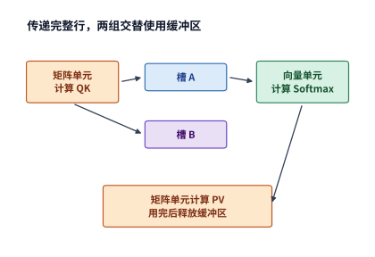

*图 4-22　矩阵与向量单元通过完整行组交接。QK 产生分数，Softmax 产生概率，PV 使用概率后释放槽；另一槽容纳相邻行组，使不同组可以重叠推进。*

我们来定量核算将 128 行查询切分为 4 个行组（每组 $32\times128$）时的片上空间与执行时序：保存一组 $32\times128$ 的 FP32 得分（$16\ \mathrm{KiB}$）与对应的 BF16 概率（$8\ \mathrm{KiB}$）合计需要 $32\times128\times(4+2)=24\ \mathrm{KiB}$ 交接缓冲空间。假设每个交接缓冲槽从该行组启动 $QK^{\mathsf T}$ 时开始锁定占用，直到该行组完成 $PV$ 矩阵乘后才释放；在硬件资源上，$QK^{\mathsf T}$ 与 $PV$ 共用同一个矩阵单元，Softmax 独占向量与特殊函数单元，而矩阵与向量之间的双向数据传递共用同一个片上交接接口。当片上配置 2 个交接缓冲槽（共 $48\ \mathrm{KiB}$）时，相邻两个行组就能同时处于不同的执行阶段并行推进。[^handoff]

本算例的硬件速率参数同样取自 FlashAttention-4 论文对 B200 单 SM 的建模：矩阵单元速率为 $8{,}192\ \mathrm{FLOPs/tick}$，片上交接接口带宽为 $128\ \mathrm{bytes/tick}$，特殊函数单元（指数与除法）速率为每 tick $16$ 次运算[^fa4]；通用向量单元（负责缩放、减最大值、求指数和、比较最大值等）速率取每 tick $128$ 次运算，且在向量侧依次串行执行各子步骤。按每组 32 行（即 $32\times128=4{,}096$ 个得分元素）核算各阶段耗时：
- **矩阵计算阶段**：单组 $QK^{\mathsf T}$ 与单组 $PV$ 的运算量均为 $2\times32\times128\times128 = 1{,}048{,}576\ \mathrm{FLOPs}$，各需 $1{,}048{,}576 / 8{,}192 = 128\ \mathrm{tick}$；
- **向量 Softmax 阶段**：对 4,096 个元素执行普通算术（缩放、减法、累加）耗时 $96\ \mathrm{tick}$，求最大值比较耗时 $32\ \mathrm{tick}$，求自然指数耗时 $4{,}096 / 16 = 256\ \mathrm{tick}$，归一化除法耗时 $4{,}096 / 16 = 256\ \mathrm{tick}$，单组向量处理合计耗时 $96+32+256+256 = 640\ \mathrm{tick}$；
- **跨单元数据交接阶段**：若采用“直接传递”路径（单次传输），交接 $16\ \mathrm{KiB}$ 得分需 $16{,}384 / 128 = 128\ \mathrm{tick}$，交接 $8\ \mathrm{KiB}$ 概率需 $8{,}192 / 128 = 64\ \mathrm{tick}$；若采用“先写入共享存储、再从共享存储读出”的间接路径（双倍流量），则交接得分与概率分别需要 $256\ \mathrm{tick}$ 与 $128\ \mathrm{tick}$（各步骤均按整数 tick 向上取整）。

下表列出了在这套精确硬件模型下，依次改变分组大小、交接槽位数与交接路径所得的 5 组仿真结果：

| 交接方式 | 行组大小 | 槽数 | 向量计算开始时刻 | 完成时间 |
| --- | ---: | ---: | ---: | ---: |
| 写入存储后再读取 | 128 | 1 | 1536 tick | 5118 tick |
| 写入存储后再读取 | 32 | 1 | 384 tick | 5120 tick |
| 写入存储后再读取 | 32 | 2 | 384 tick | 3200 tick |
| 直接传递 | 32 | 2 | 256 tick | 3008 tick |
| 直接传递 | 32 | 4 | 256 tick | 3008 tick |

*表 4-8　B200 单 SM 上 $128\times 128$ 注意力块在不同行组切分、槽位数与交接路径下的仿真完成时间*

顺着表中前四行的递进演进，可以将每一项微架构优化的因果机制看得清清楚楚：
1. **第一步：仅将 128 行拆分为 32 行一组，但仍只配 1 个交接槽（第 1 行 $\to$ 第 2 行）**。向量单元首次开始计算 Softmax 的时刻确实从 $1{,}536\ \mathrm{tick}$ 大幅提前到了 $384\ \mathrm{tick}$，但整块任务的总完成时间却几乎没有缩短（从 $5{,}118\ \mathrm{tick}$ 变为 $5{,}120\ \mathrm{tick}$）。为什么提前启动却完全没有缩短总时间？原因就在于**只有 1 个交接槽**：当第 1 组正在向量单元中执行耗时的 Softmax（长达 $640\ \mathrm{tick}$）并等待后续 $PV$ 使用时，唯一的缓冲槽一直被第 1 组占用，导致早已空闲下来的矩阵单元没有空间存放第 2 组的 $QK^{\mathsf T}$ 结果，只能等待第 1 组把 $QK^{\mathsf T}\to\operatorname{Softmax}\to PV$ 全部跑完腾出槽位后才能启动第 2 组。换言之，单槽下拆小行组只是把 1 次大串行拆成了 4 次小串行，相邻行组之间依然是零重叠。
2. **第二步：保持 32 行分组，将交接缓冲扩充为 2 个槽（第 2 行 $\to$ 第 3 行）**。一旦有了第 2 个槽位，当第 1 组在槽 0 中执行耗时的 Softmax 时，矩阵单元可以立即利用空闲的槽 1 完成第 2 组的 $QK^{\mathsf T}$ 计算。矩阵计算、接口交接与向量 Softmax 终于在相邻行组之间真正重叠起来，使总完成时间从 $5{,}120\ \mathrm{tick}$ 大幅下降至 **$3{,}200\ \mathrm{tick}$**（净省约 $38\%$）。
3. **第三步：将“先写后读”改为片上直接传递（第 3 行 $\to$ 第 4 行）**。消除了共享存储上的双倍读写后，每次交接的耗时减半，不仅让向量单元的首次启动时刻进一步提前至 $256\ \mathrm{tick}$，还将总完成时间从 $3{,}200\ \mathrm{tick}$ 进一步压低至 **$3{,}008\ \mathrm{tick}$**（再省约 $6\%$）。
4. **第四步：继续把槽位数从 2 个增加到 4 个（第 4 行 $\to$ 第 5 行）**。此时流水线的瓶颈已经完全转移到耗时最长（每组 $640\ \mathrm{tick}$）且全程无休的向量 Softmax 单元上，2 个槽位早已让向量单元在首次启动后实现 100% 连续满载运转，因此继续堆砌更多缓冲槽位不会再缩短总完成时间。

总结来看，**沿查询行分组**让第一组完整行更早出炉，**增加第二个交接缓冲槽**让相邻行组跨阶段并行重叠，而**片上直接传递通路**则削减了每次交接穿过存储接口的字节流量。这三项改进各司其职，但也都伴随相应的工程代价：切小行组会改变矩阵乘法的分块形状（可能触及小矩阵效率下界），增加缓冲槽位会占用更多宝贵的片上存储空间，而启用硬件直连通路则要求收发两端的数据布局与同步信号严丝合缝地对齐（第 4.6.2 节将用这三项关系解析华为昇腾架构的代际演进）。

图 4-23 将上述“两槽缓冲 + 32 行分组”在间接写读（上图，3,200 tick）与直接传递（下图，3,008 tick）两种路径下的完整甘特图绘制了出来：其中 $QK^{\mathsf T}$ 与 $PV$ 复用同一行矩阵单元，正反两次交接复用同一行交接接口，Softmax 独占向量单元；最底部的两条浅灰带则标出了槽 0 与槽 1 的锁定区间——在行组 G0 的 $PV$ 彻底算完之前，行组 G2 绝不能覆写槽 0；同理，在行组 G1 的 $PV$ 算完之前，行组 G3 也不能覆写槽 1。

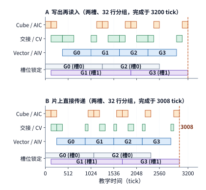

*图 4-23　QK、Softmax、PV 的两槽执行时间线。上图采用写出再读入，下图采用直接传递；两种路径分别用时 3200 和 3008 tick。*

若将图 4-23 的调度方案映射到华为昇腾 DaVinci 架构上：矩阵阶段（$QK^{\mathsf T}$ 与 $PV$）由 Cube 核（AIC）执行，向量阶段（Softmax）由 Vector 核（AIV）执行，跨核结果交接由对应的片上数据通路完成，同时内存传输引擎（MTE）还在后台源源不断地为 $QK^{\mathsf T}$ 和 $PV$ 预取 Q、K、V 输入操作数。为了驱动这条多引擎流水线，算子程序必须显式表达四类硬件同步条件：**输入分块已抵达片上、$QK^{\mathsf T}$ 得分已就绪可读、Softmax 概率已就绪可读、以及交接槽位已用毕释放**。底层编译器正是根据这四类依赖关系编排搬移、计算与等待次序，最终生成第 5 章即将剖析的片上缓冲区分配、DMA 描述符与硬件同步指令（注：图 4-23 中的 tick 沿用了前文的计算模型参数；在实际设备端到端计时中，还应计入首尾的片外输入加载、数据格式转换以及最终输出写回耗时）。

> **实验 4-4 · 核心：维持连续计算需要多少片上缓冲**
>
> 分别画出输入流水使用一至四个缓冲槽时的时间线，根据数据到达、计算结束和缓冲区释放的时刻，确定维持连续计算所需的最少槽数；再将矩阵速率翻倍，解释最少槽数的变化。随后画出各查询行组经过 QK、Softmax 和 PV 的时间线，区分分组、增加槽位和直接传递各自省下的时间。最后在固定片上容量下，分析每组缓冲的大小如何限制能够同时驻留的组数。

### 4.4.4 SM 之间的交接：fence 与同步层级

第 4.4.3 节讨论的矩阵—向量交接完全发生在**单个计算核心（SM）内部**。然而在单请求或极小批量 decode 阶段，由于输入只有寥寥几行，为了充分利用整张显卡的 HBM 显存带宽，算子不得不把同一个矩阵—向量乘法（GEMV）切分给全卡所有 SM（例如 RTX PRO 6000 上的全部 188 个 SM）并行分担——每个 SM 只负责算出输出向量的一个局部片段；但紧随其后的下一个算子（如全向量 RMSNorm 归一化）却必须拿到拼接完整的全长向量才能求均方根。此时，数据交接被迫跨越多个 SM 的边界；正如第 4.3.2 节图 4-14 所示，跨簇 SM 之间没有任何直连私有存储，一切数据交接与状态同步都只能绕道芯片中央的 **L2 缓存**。

在硬件底层，跨 SM 交接遵循标准的“**数据写入 + 标志位轮询**”两步协议：生产者 SM 先把算好的数据写入全局内存（暂存至 L2 缓存），随后更新一个同步标志位（flag）；消费者 SM 则在循环中反复读取（轮询，polling）该标志位，一旦观测到标志位变为新值，便再去读取生产者写下的数据。这里潜藏着一个致命的硬件乱序陷阱：**数据本体与同步标志位往往映射在不同的 L2 缓存分片上，生产者发出的“写数据”和“写标志”两条指令会各自独立穿过片上交叉互连网络（Crossbar），先发出的“写数据”请求完全可能因为路径拥塞而比后发出的“写标志”请求更晚到达各自的 L2 分片。** 如果不加干预，消费者 SM 就可能先观测到更新后的标志位，进而从数据分片中读到尚未更新的旧数据。为了杜绝这种跨分片乱序，生产者 SM 在写下数据之后、写标志位之前，必须插入一条**内存栅栏指令（memory fence）**，强制等待片上互连确认此前发出的所有数据写入均已在目标 L2 分片落定（称为**释放语义，release semantics**）；对称地，消费者 SM 在轮询读到新标志位之后，也必须通过**获取语义（acquire semantics）**确保后续的数据读取指令绝不会被硬件提前投机执行（完整握手时序见图 4-24）。

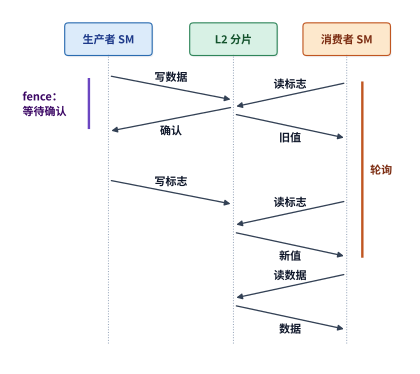

*图 4-24　跨 SM 交接的时序，时间自上而下。fence 使生产者等到 L2 确认数据写入后才写标志；消费者轮询到新值后再读数据。每条斜线穿过一次交叉互连，约为半次 L2 往返。*

我们在 RTX PRO 6000（SM 频率 $2.88\ \mathrm{GHz}$）上对这一跨 SM 交接过程进行了微基准实测：两个 SM 之间完成一次安全的一对一数据交接耗时约 **$370\ \mathrm{ns}$（约 $1{,}050$ 个时钟周期）**，其中光是等待那条保证正确性的 `fence` 指令确认就花掉了约 $600$ 个时钟周期；如果强行删掉 `fence` 指令，耗时虽然能骤降至约 $140\ \mathrm{ns}$（恰好接近一次裸 L2 往返延迟），但程序在高并发下就会因数据未落定而算出错误结果。哪怕改用硬件级内核依赖启动机制——如 CUDA 的**编程依赖启动（PDL，Programmatic Dependent Launch，允许前一个算子内核在尾声发出硬件信号直接触发后一个内核启动）**——硬件内部依然必须等待前序写入刷入 L2，因此实测每个跨内核边界的耗时仍为约 $366\ \mathrm{ns}$，与软件手写释放—获取交接如出一辙。

当交接从“两个 SM 一对一”扩展为“**全卡全部 188 个 SM 全员汇合（All-to-All / Global Barrier）**”时，同步与广播的物理代价会进一步急剧攀升。全卡汇合的标准流程是：每个 SM 算完自己的片段后，对 L2 中的同一个全局原子计数器执行加一（`atomicAdd`），随后原地轮询等待该计数器达到 188。实测拆解表明：188 次原子加一在同一个 L2 分片地址上串行排队本身的耗时其实不到 $80\ \mathrm{ns}$；真正的耗时大头来自生产与消费两侧的内存栅栏（各约 $460$ 个时钟周期）、原子到达与轮询读取的 L2 往返、以及 188 个 SM 到达时刻的先后参差，使纯同步汇合耗时达到约 $1{,}900$ 个时钟周期（约 **$660\ \mathrm{ns}$**）。更糟糕的是，如果汇合之后还需要让全部 188 个 SM 同时去读取拼好的完整激活向量（例如一个 $8\ \mathrm{KiB}$ 的向量，仅占 64 个各为 128 bytes 的缓存行），188 个 SM 就会在同一瞬间向存放这 64 个缓存行的少数几个 L2 分片发起广播风暴，导致请求在分片端口严重排队：实测显示，当 188 个 SM 同时争抢读取同一个缓存行时，单次读取延迟激增至约 $3{,}400$ 个时钟周期，是各 SM 分散读取不同缓存行时的 **9 倍**。只有将这份 $8\ \mathrm{KiB}$ 的激活向量在写入时主动复制 **8 份**、均匀打散到不同的 L2 分片上以分流读取压力，连同数据广播在内的一次全卡 188 SM 交接总耗时才能被压回到约 **$1.0\ \mathrm{\mu s}$**。

图 4-25 汇总了 RTX PRO 6000 上从核内到全卡的**四级同步延迟阶梯**。可以看到，同步范围跨越的物理边界越大、途经的存储层级越远，所需付出的延迟代价就呈数量级跃升：
1. **单 SM 内部线程块屏障（`__syncthreads`）**：直接由 SM 内部的硬件计数器在数周期内完成，仅需约 **$7\ \mathrm{ns}$**；
2. **同一 GPC 内的线程块簇同步（Cluster Barrier）**：通过 GPC 内部的专用 SM 间网络完成，耗时约 **$130\ \mathrm{ns}$**；
3. **跨簇一对一 SM 交接（经由 L2 释放—获取）**：耗时约 **$370\ \mathrm{ns}$**；
4. **全卡 188 SM 全员汇合并广播 $8\ \mathrm{KiB}$ 向量（经由 L2 8 副本分流）**：耗时约 **$1\ \mathrm{\mu s}$（$1{,}000\ \mathrm{ns}$）**。

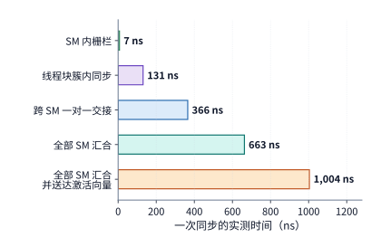

*图 4-25　RTX PRO 6000 上各级同步一次所需的时间。绿、紫、蓝三色分别对应 SM 内、线程块簇内与经由 L2 的同步；一对一交接采用释放—获取实现，全部 SM 汇合送达的是复制为 8 份的 8 KiB 向量。数值为共用 GPU 期间多次测量的最小值。*

也许有读者会问：既然 Hopper/Blackwell 引入了线程块簇与分布式共享内存（DSMEM），能否干脆用 DSMEM 取代 L2 来做跨 SM 数据交换？答案是否定的，原因有二：第一，线程块簇被严格限制在单个 GPC 内部（通常最多 8 或 16 个 SM），跨 GPC 的全卡汇合依然必须走 L2；第二，即便是簇内 DSMEM，其跨 SM 读取带宽也远低于本地共享内存和 L2 缓存——实测单 SM 每时钟周期的 DSMEM 读取带宽仅约 $1.3\ \mathrm{bytes/cycle}$，而访问 L2 约为 $6.9\ \mathrm{bytes/cycle}$，访问本 SM 私有共享内存则高达约 $36\ \mathrm{bytes/cycle}$。在簇内通过 DSMEM 广播交换一个 $16\ \mathrm{KiB}$ 的激活向量，实测耗时反而比经由 L2 中转慢 **10 倍以上**。

最后需要强调，图 4-25 中高达 $1\ \mathrm{\mu s}$ 的全卡交接代价是**由算法的数据依赖与片上物理拓扑决定的刚性下界**，与软件如何提交内核无关。第 5.5 节即将介绍的 CUDA Graph（计算图重放）与 Persistent Megakernel（全模型常驻大内核）固然能够彻底消除 CPU 主机下发指令与内核启动（kernel launch）的软件调度开销，却无法凭空抹掉跨 SM 数据汇聚所必须经历的 L2 栅栏与交叉互连往返：只要模型结构要求下一个算子必须等待全卡所有 SM 算完上一步的分片结果才能启动，每跨过这样一个全局依赖边界，硬件就必须实打实地付出约 $1\ \mathrm{\mu s}$ 的 L2 同步税。这正是第 4.1.2 节所说的“等待前序计算结果就绪”在多核片上网络中的真实物理投影。[^l2sync]

## 4.5 多芯片封装与互联

当单颗计算裸片（die）或单张加速卡受限于光罩面积与显存容量，无法独自装下超大模型或提供足够的峰值算力时，系统就必须将计算与存储扩展分布到多颗裸片、多张加速卡乃至多台服务器节点上。然而，向外扩展硬件资源的同时，也拉开了“生产数据的计算单元”与“消费数据的计算单元”之间的物理距离。本节沿着由近及远的三个空间尺度——**同一封装内的多裸片（Multi-Die）互连**、**CPU 主机与加速器之间的连接**，以及**加速器与加速器之间的高速互连**——定量分析数据放置策略（locality）与通信消息粒度如何决定端到端完成时间。

### 4.5.1 封装内的计算芯片、内存与连接

为了突破单块光刻掩模版的光罩面积上限，现代高端 AI 加速器普遍采用**多裸片合封（Multi-Die Packaging / Chiplet）**设计：在同一个芯片封装基板上并排集成两颗或多颗计算裸片（die），由各颗裸片共同提供算力与 HBM 显存接口，并通过封装内部的高速裸片间互连链路（Die-to-Die Interconnect）交换数据。NVIDIA Blackwell B200 与华为昇腾 910C 均采用了这种双裸片（Dual-Die）架构。[^package] 双裸片合封虽然让单卡的显存总容量与峰值总算力直接翻倍，但也引入了一个全新的架构问题：**当权重或数据分散在两颗裸片各自的本地 HBM 中时，计算任务究竟应该集中放在一侧裸片上执行，还是拆开放在权重所在的本地裸片上就地执行？**

我们直接用 HGX B200 与昇腾 910C 的真实硬件参数算一笔对比账：
- **NVIDIA HGX B200**：整卡配备 180 GB HBM3E 显存与 $8\ \mathrm{TB/s}$ 总带宽，由 8 座 HBM 显存堆平均分配给两颗计算裸片（die 0 与 die 1），即每颗裸片本地直连 $90\ \mathrm{GB}$ 显存、享有 $4\ \mathrm{TB/s}$ 本地显存带宽；而连接两颗裸片的 NV-HBI 高速互连链路带宽高达 **$10\ \mathrm{TB/s}$**。
- **华为昇腾 910C**：两颗计算裸片各自本地直连 $64\ \mathrm{GB}$ HBM 显存、享有 $1.6\ \mathrm{TB/s}$ 本地显存带宽；而连接两颗裸片的片间互连链路单向带宽为 **$270\ \mathrm{GB/s}$**。

现在考虑同一个基准场景：设两颗裸片各自的本地 HBM 中各存放了 $32\ \mathrm{GiB}$ 模型权重（合计 $64\ \mathrm{GiB}$），某计算阶段需要将这 $64\ \mathrm{GiB}$ 权重完整读取一遍。如果我们把全部计算任务都集中放在 **die 0** 上执行，那么 die 0 一方面要通过本地内存接口从自己的 HBM 读取 $32\ \mathrm{GiB}$ 权重，另一方面还必须跨过 die 间互连链路去读取存放在 **die 1** HBM 中的那 $32\ \mathrm{GiB}$ 权重。需要注意，跨 die 读取的数据流必须依次穿过“die 1 的本地 HBM 接口”与“die 间互连链路”两道关卡，因此跨 die 读取的有效速率受限于这两道关卡中较慢的那一个；与此同时，由于“die 0 读本地 HBM”与“跨 die 链路传输”走的是彼此独立的物理端口，两路读取可以同时并行推进，整个阶段的读取耗时取决于本地与跨 die 两路中较慢的那一路。

将两款芯片的参数分别代入上述流水模型，结果截然不同：
1. **在 B200 上**：NV-HBI 裸片间链路的带宽（哪怕将官方标称的 $10\ \mathrm{TB/s}$ 保守视作双向合计、即单向 $5\ \mathrm{TB/s}$）依然**高于**单颗裸片本地 HBM 的 $4\ \mathrm{TB/s}$ 带宽。因此，die 0 跨链路读取 die 1 显存的速度完全不受片间链路限制，而是按 die 1 本地 HBM 的 $4\ \mathrm{TB/s}$ 上限传输；本地与跨 die 两路各读 $32\ \mathrm{GiB}$（约 $34.36\ \mathrm{GB}$）均只需约 $8.6\ \mathrm{ms}$，并行完成整个阶段的耗时就是 **$8.6\ \mathrm{ms}$**——这与两颗 die 各自在本地读取权重的耗时完全相同，**计算放在哪一侧根本不影响读取时间**。
2. **在昇腾 910C 上**：片间互连链路的单向带宽（$270\ \mathrm{GB/s}$）仅为单颗裸片本地 HBM 带宽（$1.6\ \mathrm{TB/s}$）的约 **$17\%$**。如果强行把计算集中在 die 0 上，die 0 读本地 $32\ \mathrm{GiB}$ 权重虽只需 $\frac{34.36\ \mathrm{GB}}{1600\ \mathrm{GB/s}}\approx21.5\ \mathrm{ms}$，但跨链路搬移 die 1 上的 $32\ \mathrm{GiB}$ 权重却需要整整 $\frac{34.36\ \mathrm{GB}}{270\ \mathrm{GB/s}}\approx127\ \mathrm{ms}$，导致整个阶段的耗时被拉长至 **$127\ \mathrm{ms}$**（如图 4-26 所示）。反之，如果我们遵循“**计算向权重靠拢（compute-to-data locality）**”原则，将处理 die 1 权重的计算任务直接部署到 die 1 上就地执行，让两颗 die 各自并发读取本地的 $32\ \mathrm{GiB}$ 权重，则读取耗时立刻恢复为 **$21.5\ \mathrm{ms}$**；此时需要跨过 $270\ \mathrm{GB/s}$ 片间链路传输的对象，从庞大的 $32\ \mathrm{GiB}$ 静态权重变成了轻量级的输入激活与计算结果——假设输入与结果合计仅 $64\ \mathrm{MiB}$，跨链路传输耗时仅需约 $0.25\ \mathrm{ms}$，总耗时缩短了近 **6 倍**（如图 4-27 所示）。[^package]

可见，双裸片芯片在软件视角下究竟能否当成“一颗统一的大芯片”透明使用，完全取决于**片间互连单向带宽与单 die 本地显存带宽之比**：B200 的这一比值高达 $5 / 4 = 1.25$（若按单向 $10\ \mathrm{TB/s}$ 计则达 $2.5$），跨 die 访存与本地访存同速，因此 CUDA 可以将两颗 die 虚拟化为一颗统一的 GPU；而昇腾 910C 的这一比值约为 $270 / 1600 \approx 0.17$，跨 die 读取耗时是本地读取的 $5.9$ 倍。正因如此，由 384 颗昇腾 910C 组成的华为 CloudMatrix384 超节点在部署 DeepSeek-R1 在线推理服务时，在 decode 阶段严格以**单颗 die（而非整张卡）**作为专家并行（EP）的最小部署粒度，让每颗 die 本地独立承载 1 个路由专家。这给出了一条普适的分布式部署准则：**只要两块存储域之间的互连带宽低于本地显存带宽（带宽比 $< 1$），就应当把大体积的模型权重固定在本地反复读取，而只让体积小得多的输入激活与中间结果跨越互连链路。**

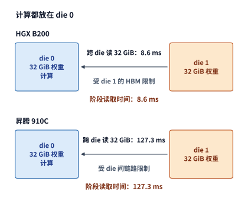

*图 4-26　计算都放在 die 0 时，要跨 die 读取 die 1 上的 32 GiB 权重。B200 的跨 die 读取受 die 1 的 HBM 限制，约 8.6 ms，与本地读取相同；昇腾 910C 受 die 间链路限制，约 127 ms。*

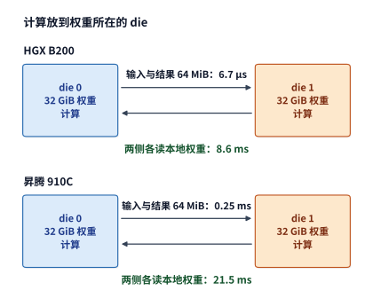

*图 4-27　计算放到权重所在的 die 后，链路上只交换 64 MiB 输入与结果，两侧各读本地权重。B200 仍约 8.6 ms；昇腾 910C 从约 127 ms 降到约 21.5 ms。*

对比图 4-26 与图 4-27 可以清晰看到两种范式的本质差异：“集中计算”被迫在窄链路上搬移沉重的权重（Data-to-Compute），而“就地计算”则只在窄链路上交换轻巧的激活与结果（Compute-to-Data）。在规划任何多核或多芯片算子切分方案时，只需先画出每种方案穿过瓶颈链路的数据张量并比较其字节体积，优劣便一目了然。

进一步来看，将计算任务拆分到两颗 die 上就地执行，还顺势打开了双 die 并行加速的大门：两颗 die 各自的本地 HBM 读取与矩阵计算完全可以同时并发推进，仅在算完之后通过片间链路交接汇总最终结果。至于下游算子是否必须等待两颗 die 全部算完才能启动，则取决于模型计算图在切分方向上的数学依赖——例如当权重按内积维度切分、需要对两颗 die 算出的部分和做归约相加时，合并点就会成为双 die 的同步汇合点（第 6 章将从张量并行与专家并行的具体切分方式出发，系统推导这些跨设备交接开销）。

### 4.5.2 CPU 与加速器之间的数据访问

封装内双裸片的放置规律，放大到“CPU 主机与外接加速卡”这一层级同样完全适用。回顾图 4-2 的异构系统拓扑：由 CPU 负责预处理（如分词、图像解码或从磁盘加载）的数据最初存放在主机系统内存（Host DRAM）中；对于配备独立显存的 GPU 而言，必须先通过 PCIe 总线（或 NVLink-C2C 等主机互连链路）将这些数据从主机内存拷贝到设备显存中，GPU 的计算核心才能高速读取。在工程术语中，从主机内存向设备显存传输称为 **H2D（Host-to-Device）**，从设备显存传回主机内存称为 **D2H（Device-to-Host）**。现代加速卡内部均配有独立的**异步拷贝引擎（Copy Engine / DMA）**：CPU 只需向驱动队列提交源地址、目标地址与字节长度，DMA 引擎便会在后台独立完成跨总线搬移，CPU 线程无需阻塞等待。

我们来定量对比同一个数据张量“经 PCIe 上传至显存”与“在显存内部被 GPU 读取”的速度悬殊。以通过 PCIe 4.0 x16（16 条通道）插槽连接主机的 RTX 4090 为例：PCIe 4.0 x16 的双向名义总带宽为 $64\ \mathrm{GB/s}$，即单向峰值带宽为 $32\ \mathrm{GB/s}$；而 RTX 4090 自身的 GDDR6X 显存带宽则高达 $1{,}008\ \mathrm{GB/s}$。[^rtx-spec] 假设需要将一份大小为 $64\ \mathrm{MiB}$（约 $67.11\ \mathrm{MB}$）的输入张量从主机上传至显存并由 GPU 读取一次（暂忽略微秒级的启动延迟），则两段传输耗时分别为：

$$
T_{\mathrm{H2D}}=\frac{64\ \mathrm{MiB}}{32\ \mathrm{GB/s}}\approx2.1\ \mathrm{ms},\qquad
T_{\mathrm{read}}=\frac{64\ \mathrm{MiB}}{1008\ \mathrm{GB/s}}\approx67\ \mu\mathrm{s}.
$$

对比两组耗时可以看到：**经 PCIe 上传一次的时间（$2.1\ \mathrm{ms}$），是 GPU 从本地显存读取一次时间（$67\ \mathrm{\mu s}$）的 $31.5$ 倍**——这一倍数恰好等于显存带宽与 PCIe 单向带宽之比（$1008 / 32 = 31.5$）。这意味着，如果这份数据上传到显存后只被某个算子用 1 次就丢弃，那么超过 $96\%$ 的时间都花在了慢速的 PCIe 路上；反之，如果这份数据（例如模型权重或常驻 KV 缓存）上传一次后常驻在显存中，被后续 $R$ 次调用反复复用，那么每次调用分摊到的上传耗时就会稀释为 $T_{\mathrm{H2D}}/R$——当复用 $R=100$ 次时，单次分摊的上传时间降至约 $21\ \mathrm{\mu s}$；此后的每一次调用，CPU 只需下发短短几十字节的显存指针与内核参数即可。

我们同样可以算出使分摊上传时间不再成为瓶颈的**最小复用次数阈值**：要使 $T_{\mathrm{H2D}}/R \le T_{\mathrm{read}}$，必须满足 $R \ge 1008/32 = 31.5$（即至少在显存内复用 **32 次**）。这一简单的不等式解释了两个基本的系统设计原则：对于每轮只用一次的流式新输入（$R=1$），提升主机互连带宽（如从 PCIe 4.0 升级到 PCIe 5.0 或 NVLink-C2C）十分关键；而对于模型权重与历史状态，则必须尽一切可能让它们常驻在显存中（最大化 $R$），严禁在推理循环中反复跨 PCIe 换入换出。

此外，由于 DMA 拷贝引擎与 GPU 上的 SM 计算核心在硬件上是彼此独立的执行单元，系统完全可以利用第 4.4.2 节的**双缓冲流水线**掩盖 H2D 传输耗时：在显存中开辟两个输入缓冲区，当 SM 正在读取缓冲区 0 计算第 $i$ 个训练或推理 batch 时，DMA 拷贝引擎同时通过 PCIe 将第 $i+1$ 个 batch 异步写入缓冲区 1；待当前 batch 算完后立即翻转指针。需要注意，在 DMA 往显存写入新数据的同时，SM 也在从同一个显存子系统读取当前数据，因此显存接口需要同时承担这两部分并发流量（不过由于 PCIe 的 $32\ \mathrm{GB/s}$ 仅占显存上千 GB/s 带宽的零头，DMA 写入占用的显存带宽比例通常很小）。

当然，并非所有硬件架构都存在这道“主机内存与设备显存分离”的鸿沟。正如第 4.3.1 节所述，Apple Silicon 的 CPU 与 GPU 直接共享同一块物理**统一内存（Unified Memory）**：当应用程序将张量分配在双方共用的统一内存缓冲区中时，CPU 写完输入数据并完成缓存一致性同步后，GPU 即可直接拿着同一个内存地址读取计算。与分离式独立显存架构相比，统一内存彻底省去了“在主机内存与设备显存中各存一份副本”的空间浪费，也省去了那耗时 $2.1\ \mathrm{ms}$ 的 H2D 跨总线拷贝过程（之后 GPU 核心执行算子时，仍按统一内存子系统的物理带宽正常读取数据）。[^apple] 简言之，**统一内存将 CPU 与加速器之间的数据交接从“物理拷贝后使用”简化为了“轻量级同步后原位使用”**。

补充说明一点，切勿将 Apple 硬件级的物理统一内存架构，与 NVIDIA CUDA 编程模型中的软件**统一虚拟寻址（Unified Virtual Addressing / CUDA Unified Memory）**混为一谈：在配备独立显存的 PCIe GPU 上，CUDA Unified Memory 允许程序员在 CPU 与 GPU 代码中使用同一个虚拟内存指针访问数据，但底层驱动程序与硬件页表管理器依然会在后台通过缺页中断（page fault）将数据页跨越 PCIe 总线在主机内存与设备显存之间按需物理迁移。[^host] 无论虚拟地址包装得多么透明，**数据当前所处的真实物理存储位置与计算核心之间的物理链路带宽，始终决定着实际的访问耗时**。

为了将“统一内存零拷贝但受限于 LPDDR5 带宽”与“独立 GDDR7 显存需经历 H2D 上传但本地读取带宽高”这两种范式放在同一把标尺下定量对比，我们来核算一个单步读取 $4\ \mathrm{GiB}$ 常驻载荷的基准算例。[^macbook-pro6000]

> **算例 4-2（Apple M2 Pro / M2 Max 统一内存与 RTX PRO 6000 GDDR7 的单步读取下界对比）**
>
> 考察一次自回归生成步（或算子组合阶段），设模型权重与历史状态均已常驻在各自设备的本地存储池中，本步需要连续读取的数据载荷固定为 $V = 4\ \mathrm{GiB} = 4\times 2^{30} = 4{,}294{,}967{,}296\ \mathrm{bytes}$（按十进制计约 $4.295\ \mathrm{GB}$）。对比三台代表性移动/桌面工作站设备的峰值存储带宽与单步读取时间下界 $T_{\min} = V / R_{\mathrm{peak}}$：

| 硬件平台与存储架构 | 峰值存储带宽 $R_{\mathrm{peak}}$ | 单步读取 $4\ \mathrm{GiB}$ 时间下界 $T_{\min}$ | 相对 RTX PRO 6000 耗时倍数 | 主机—设备新输入交接开销 |
| --- | ---: | ---: | ---: | --- |
| **Apple M2 Pro（统一内存 LPDDR5）** | $200\ \mathrm{GB/s}$ | $21.47\ \mathrm{ms}$ | $8.96\times$ | $0\ \mathrm{B}$ 物理拷贝（原位共享） |
| **Apple M2 Max（统一内存 LPDDR5）** | $400\ \mathrm{GB/s}$ | $10.74\ \mathrm{ms}$ | $4.48\times$ | $0\ \mathrm{B}$ 物理拷贝（原位共享） |
| **RTX PRO 6000 Blackwell（独立 GDDR7）** | $1{,}792\ \mathrm{GB/s}$ | $2.40\ \mathrm{ms}$ | $1.00\times$ | 需经 PCIe 执行 H2D 物理传输 |

*表 4-9　Apple M2 Pro、M2 Max 统一内存与 RTX PRO 6000 独立 GDDR7 读取 4 GiB 常驻载荷的时间下界对比*

> **工程结论：**
> 1. **常驻状态读取的带宽代差**：一旦模型权重与 KV 状态常驻在设备端，RTX PRO 6000 凭借 $1{,}792\ \mathrm{GB/s}$ 的 GDDR7 带宽，单步读取时间下界（$2.40\ \mathrm{ms}$）仅为 M2 Max（$10.74\ \mathrm{ms}$）的 $1/4.48$、M2 Pro（$21.47\ \mathrm{ms}$）的 $1/8.96$。若将该关系外推到整模型单流 decode——例如运行 70B INT4 稠密模型（权重占 $35\ \mathrm{GB}$），按 GDDR7 实测约 $85.7\%$ 的持续有效带宽（$1{,}536\ \mathrm{GB/s}$）与 LPDDR5 标称上限（$204.8 / 409.6\ \mathrm{GB/s}$）估算，RTX PRO 6000 每步读取 $35\ \mathrm{GB}$ 仅需 $22.8\ \mathrm{ms}$（约 $43.9\ \mathrm{tok/s}$），而 M2 Max 则需 $85.4\ \mathrm{ms}$（约 $11.7\ \mathrm{tok/s}$）。
> 2. **零拷贝优势与高带宽优势的交叉边界**：统一内存省去的是每次请求首轮将 CPU 端新数据上传至显存的 $T_{\mathrm{H2D}}$，以及当模型总参数超出独立显卡容量（如超过 $96\ \mathrm{GB}$）时跨 PCIe 5.0 x16（$56\ \mathrm{GB/s}$）按步卸载专家的代价——例如若每步需要从主机内存动态搬入 4 个未命中的路由专家（共 $1.6\ \mathrm{GB}$），光跨 PCIe 传输就要额外耗费 $1.6 / 56 \approx 28.6\ \mathrm{ms}$，瞬间抹平独立显存的高带宽红利；反之，只要模型参数能够完整常驻在独立 GDDR7/HBM 中并在后续生成步被反复读取，高带宽优势就会迅速抵消首轮 PCIe 上传耗时（第 4.8.3 节将进一步结合 M2 Max 与 RTX PRO 6000 在 $M=1$ 与 $M=256$ 下的配对实测，拆解缓存命中与算力差距如何叠加在这一 $4.48\times$ 带宽基线上）。[^macbook-pro6000]

在多租户云平台或金融、医疗等高敏隐私推理场景中，CPU 与加速器之间的 PCIe 数据通路还面临另一重物理约束——**GPU 机密计算（Confidential Computing，如 NVIDIA Hopper H100 / Blackwell B200 TEE）的硬件信任边界与跨总线加解密开销**。当企业将大模型部署在机密虚拟机（CVM，如基于 AMD SEV-SNP 或 Intel TDX 的硬件内存加密环境）中时，CVM 内部的私有主机内存由 CPU 内存控制器使用硬件密钥实时加密保护；而在默认安全模型下，连接主机与 GPU 的物理 PCIe 总线及宿主机 Hypervisor 被视为不可信域（untrusted domain），外接 GPU 的 DMA 拷贝引擎无法直接读取 CVM 的加密私有内存页。为了在不泄露明文的前提下完成 H2D 与 D2H 数据传输，传统单节点机密计算必须经历一条**软件弹跳缓冲（SWIOTLB / Bounce Buffer）加解密流水线**（见图 4-28 下半部分）：
1. **CPU 侧复制与 AES-GCM 加密认证**：CVM 内部的驱动程序先在未加密的共享主机内存区开辟一块弹跳缓冲区（Bounce Buffer），由 CPU 核心将待上传的明文激活或 KV 分块从私有加密内存读取出来，使用对称认证加密算法（如 AES-GCM-256）加密为密文并生成 16 字节消息认证码（MAC / Auth Tag），写入共享弹跳缓冲区；
2. **跨 PCIe DMA 密文搬移**：GPU 的异步拷贝引擎（Copy Engine）通过 PCIe 总线从共享弹跳缓冲区拉取密文与认证标签；
3. **GPU 片上硬件解密与完整性校验**：密文进入 GPU 安全边界后，由拷贝引擎内置的硬件加解密模块（或 GSP/SEC2 安全协处理器管理的密钥流）在写入 HBM 显存前实时完成验证与解密；若认证标签校验失败，硬件立即中止传输并触发安全异常。

显然，这套“CPU 弹跳缓冲拷贝 + 加密 $\to$ PCIe DMA $\to$ GPU 硬件解密”机制将原本一气呵成的零拷贝 Pinned Memory DMA 拆成了多级串行工序。直到新一代平台引入 **TEE-I/O（Trusted Execution Environment I/O，如 Intel TDX Connect 与 AMD SEV-TIO）** 并配合 **PCIe IDE（Integrity and Data Encryption，链路层完整性与数据加密）** 硬件引擎后，CPU 根复合体（Root Complex）与 GPU PCIe 端口之间才得以直接在物理链路层建立硬件级线速加密通道，允许 GPU DMA 引擎直接安全访问 CVM 私有内存，从而彻底免除软件弹跳缓冲与 CPU 侧加解密开销。[^gpu-tee]

> **算例 4-3（GPU 机密计算 TEE 下三种跨 PCIe 5.0 H2D 传输路径的延迟对比）**
>
> 设推理引擎需将一份 $V = 64\ \mathrm{MiB}$（十进制 $67.11\ \mathrm{MB}$）的输入激活或历史 KV 缓存分块从主机上传至 H100 / B200 显存。已知 PCIe 5.0 x16 的单向有效载荷带宽为 $R_{\mathrm{PCIe5}} = 56\ \mathrm{GB/s}$，CVM 内单工作线程执行“明文读取 + AES-GCM-256 加密 + 写入共享弹跳缓冲”的有效处理吞吐率为 $R_{\mathrm{CPU\_enc}} = 12\ \mathrm{GB/s}$，GPU 拷贝引擎硬件解密可与 PCIe DMA 线速重叠。对比以下三种传输路径的端到端耗时：
> 1. **路径 1（非机密基线，Pinned Memory 明文直传）**：DMA 引擎直接跨 PCIe 5.0 拉取明文，耗时为：
>    $$T_{\mathrm{plain}} = \frac{67.11\ \mathrm{MB}}{56\ \mathrm{GB/s}} \approx 1.20\ \mathrm{ms}.$$
> 2. **路径 2（传统 GPU CC，CPU 弹跳缓冲加密 + PCIe DMA）**：CPU 加密整块 $64\ \mathrm{MiB}$ 数据需耗时 $T_{\mathrm{enc}} = \frac{67.11\ \mathrm{MB}}{12\ \mathrm{GB/s}} \approx 5.59\ \mathrm{ms}$。若整块串行执行（先由 CPU 全部加密完，再启动 GPU DMA），总耗时高达 $5.59 + 1.20 = \mathbf{6.79\ \mathrm{ms}}$（相对于明文基线膨胀 **$5.66\times$**）；若将 $64\ \mathrm{MiB}$ 切分为 $N_c = 16$ 个各 $4\ \mathrm{MiB}$ 的子块，构建“CPU 加密第 $k+1$ 块”与“PCIe DMA 传输第 $k$ 块”的双缓冲软件流水线，则前 15 块的 PCIe 传输被较慢的 CPU 加密完全掩盖，总耗时收敛为：
>    $$T_{\mathrm{bounce\_pipe}} = T_{\mathrm{enc}} + \frac{T_{\mathrm{plain}}}{16} \approx 5.59 + 0.075 \approx \mathbf{5.67\ \mathrm{ms}}.$$
>    可见，即便开启分块流水线，单线程 CPU 加密与弹跳缓冲拷贝仍使有效带宽被卡在约 $11.8\ \mathrm{GB/s}$（耗时仍为明文的 **$4.73\times$**），唯有在 CPU 侧开启至少 $\lceil 56 / 12 \rceil = 5$ 条并行加密流才能喂饱 PCIe 5.0 链路。
> 3. **路径 3（硬件 TEE-I/O + PCIe IDE 线速加密直传）**：免除共享弹跳缓冲拷贝，由 PCIe 根复合体与 GPU 端口硬件线速完成 AES-GCM 帧加密，扣除约 $7\%$ 的 IDE 协议头与认证标签开销后有效带宽约为 $52\sim 54\ \mathrm{GB/s}$（按 $52\ \mathrm{GB/s}$ 保守核算），端到端耗时恢复至：
>    $$T_{\mathrm{tee\_io}} = \frac{67.11\ \mathrm{MB}}{52\ \mathrm{GB/s}} \approx \mathbf{1.29\ \mathrm{ms}},$$
>    在提供完整硬件级机密性保护的同时，将安全附加延迟压缩到了 $0.09\ \mathrm{ms}$（约 $7.5\%$）以内。推广到整模型生命周期与不同推理阶段来看：在冷启动加载 70B BF16 模型（$140\ \mathrm{GB}$）时，传统单流弹跳缓冲（$12\ \mathrm{GB/s}$）需耗时 $140 / 12 \approx 11.67\ \mathrm{s}$，而硬件 TEE-I/O PCIe IDE（按 $54\ \mathrm{GB/s}$ 计）可将其缩短至 $140 / 54 \approx 2.59\ \mathrm{s}$；一旦权重与 KV 状态常驻于 GPU 安全边界内部，HBM 与 SM 之间无需逐次执行跨总线加解密，因此大批量 prefill 与大矩阵 GEMM 的稳态计算损耗低于 $1\%$，机密计算的主要运行时开销集中体现在跨 PCIe 传输新输入对短请求 TTFT 的拉长，以及小批量 decode 阶段主机驱动每次下发加密命令缓冲区与认证标签所引入的 $\Delta t_{\mathrm{launch}}\approx 15\sim 35\ \mu\mathrm{s}$ 启动尾开销上。[^gpu-tee]

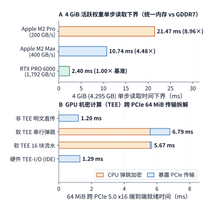

*图 4-28　主机—设备内存架构与安全边界对比。（a）在单步读取 $4\ \mathrm{GiB}$ 常驻载荷时，RTX PRO 6000（GDDR7，$1{,}792\ \mathrm{GB/s}$）的读取时间下界（$2.40\ \mathrm{ms}$）分别比 Apple M2 Max（$400\ \mathrm{GB/s}$，$10.74\ \mathrm{ms}$）和 M2 Pro（$200\ \mathrm{GB/s}$，$21.47\ \mathrm{ms}$）快 $4.48$ 倍与 $8.96$ 倍，而统一内存的优势在于 CPU 与 GPU 交接新输入时零物理拷贝；（b）在传输 $64\ \mathrm{MiB}$ H2D 载荷时，传统 GPU 机密计算（CC）因受制于 CPU 共享弹跳缓冲（Bounce Buffer）拷贝与单流 AES-GCM 加密（$12\ \mathrm{GB/s}$），耗时从明文 PCIe 5.0 的 $1.20\ \mathrm{ms}$ 激增至 $6.79\ \mathrm{ms}$（16 块流水优化后仍需 $5.67\ \mathrm{ms}$），而引入硬件 TEE-I/O（PCIe IDE 线速加密）后耗时恢复至 $1.29\ \mathrm{ms}$。*

### 4.5.3 加速器之间的数据交换

看完了芯片内双 die 与主机—设备间的传输，我们再将视线投向分布式集群中**加速卡与加速卡（Device-to-Device）之间的高速互连**。在多卡并行推理与训练中，卡间需要高频交换层间激活张量、MoE 专家分派 token 或反向梯度；这些卡间通信消息的大小跨度极大——从单请求 decode 时的几 KB，到大批量训练时的数百 MB 不等。因此，核算卡间点对点通信耗时，绝不能只看链路带宽，而必须采用经典的 **$\alpha-\beta$ 延迟—带宽模型（即固定启动延迟 + 字节传输时间）**。一次完整的卡间传输，首先必须经历软件栈或硬件引擎提交请求、跨越物理链路传播信号以及通知接收方完成状态的**固定启动开销 $\alpha$**，随后才是按单向有效带宽 $R$ 传输 $V$ 字节载荷的**序列化传输时间 $V/R$**：

$$
T_{\mathrm{edge}}=\alpha+\frac{V}{R}.
$$

我们以搭载 8 张 GPU 的 NVIDIA HGX H100 服务器为例代入真实参数：机内每张 H100 通过 NVLink 交换网络与其他 GPU 全互连，单卡 NVLink 双向聚合带宽为 $900\ \mathrm{GB/s}$，即单向峰值带宽 $R=450\ \mathrm{GB/s}$（作为对比，上一代 A100 SXM 的单卡 NVLink 单向带宽为 $300\ \mathrm{GB/s}$）。[^nvidia-product-lines] 设机内单次 NVLink 通信的固定启动开销为 $\alpha=2\ \mathrm{\mu s}$（与本书第 7 章机内集合通信的取值完全一致）。现在考察在两张卡之间传递一个形状为 $[M,4096]$ 的 BF16 激活张量（数据量 $V=8192M\ \mathrm{bytes}$）：
- **当 $M=1$（单 token decode）时**：传输数据量仅有 $V=8\ \mathrm{KiB}$（$8{,}192\ \mathrm{bytes}$）。在 H100 的 $450\ \mathrm{GB/s}$ 单向链路上，真正传输这 $8\ \mathrm{KiB}$ 字节仅需 $\frac{8192}{4.5\times10^{11}}\approx0.018\ \mathrm{\mu s}$（约 $0.02\ \mathrm{\mu s}$）；但加上 $2\ \mathrm{\mu s}$ 的固定启动延迟后，总通信耗时为 **$2.02\ \mathrm{\mu s}$**——其中超过 **$99\%$** 的时间全都花在固定启动开销 $\alpha$ 上。
- **当 $M=256$（大批量或 prefill）时**：传输数据量扩大为 $V=2\ \mathrm{MiB}$（约 $2.10\ \mathrm{MB}$）。此时字节传输耗时增至 $\frac{2\times2^{20}}{4.5\times10^{11}}\approx4.66\ \mathrm{\mu s}$，加上 $2\ \mathrm{\mu s}$ 启动延迟后，总通信耗时为 **$6.66\ \mathrm{\mu s}$**——字节传输耗时终于超越固定开销成为主导因素。

对照这两组数字，就能立刻明白为什么升级互连带宽对不同负载的效果天差地别：将机内 NVLink 从 A100 的单向 $300\ \mathrm{GB/s}$ 升级到 H100 的 $450\ \mathrm{GB/s}$（带宽提升 $1.5$ 倍），对于 $8\ \mathrm{KiB}$ 的小消息而言，通信总时间仅仅从 $2.03\ \mathrm{\mu s}$ 微降至 $2.02\ \mathrm{\mu s}$（几乎毫无改善，见图 4-29）；而对于 $2\ \mathrm{MiB}$ 的大消息，通信总时间则从 $8.99\ \mathrm{\mu s}$ 显著缩短至 $6.66\ \mathrm{\mu s}$，降幅达 **26%**（见图 4-30）。反过来，如果保持 H100 的 $450\ \mathrm{GB/s}$ 带宽不变，但通过底层通信库优化（如 NVSHMEM / IBGDA 硬件直接发起）将固定启动开销 $\alpha$ 砍半（从 $2\ \mathrm{\mu s}$ 降至 $1\ \mathrm{\mu s}$），那么 $8\ \mathrm{KiB}$ 小消息的通信耗时就能直接减半（降至 $1.02\ \mathrm{\mu s}$），同时 $2\ \mathrm{MiB}$ 大消息也能节省约 $15\%$ 的时间。可见，**降延迟（减小 $\alpha$）与提带宽（增大 $R$）分别针对的是通信公式中完全不同的两个主导区**。

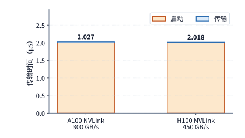

*图 4-29　一次 8 KiB 传输的启动与传输时间。固定启动开销 2 μs，NVLink 从 A100 的每方向 300 GB/s 换成 H100 的 450 GB/s，只缩短很薄的蓝色字节传输时间。*

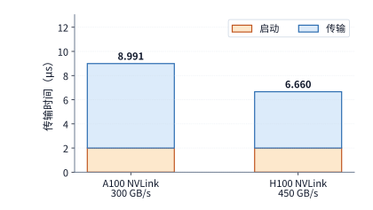

*图 4-30　一次 2 MiB 传输在相同启动条件下的时间。蓝色字节传输时间占主要部分，换成 H100 的 NVLink 带来更显著的收益；本图纵轴范围与上一图分别标注。*

令公式中的固定启动耗时与字节传输耗时恰好相等（即 $\alpha = V^*/R$），即可求出区分“延迟受限区”与“带宽受限区”的**临界消息大小（转折点） $V^*$**：

$$
V^*=\alpha R=2\times10^{-6}\times4.5\times10^{11}=900\,000\ \mathrm{bytes}\approx879\ \mathrm{KiB}.
$$

代入本例每行 $8{,}192\ \mathrm{bytes}$ 的 BF16 激活张量可知，$V^*\approx879\ \mathrm{KiB}$ 对应于 $M = 900{,}000 / 8{,}192 \approx 109.9$ 行——也就是说，在 H100 的 NVLink 上，只有当单次传输的 token 行数达到 **110 行**以上时，真正花在传数据上的时间才会超过 $2\ \mathrm{\mu s}$ 的固定启动开销。这里还蕴含着一个深刻的趋势：**硬件互连的物理带宽 $R$ 越高，转折点 $V^*=\alpha R$ 就越大，从而有越多的中等规模传输滑入由固定延迟 $\alpha$ 主导的区间。** 在工程优化上，当单次消息体积 $V < V^*$ 时，最有效的手段是**算子与通信融合（message coalescing / fusion）**——将多次零碎的小传输打包合并为一次大传输，从而只付一次启动开销 $\alpha$；而当 $V > V^*$ 时，低比特通信压缩（减少字节数 $V$）或升级高带宽网络（增大 $R$）才能发挥主力作用。当然，如果为了凑大包而让已经算好的前一部分数据原地等待尚未算完的后一部分数据，虽然减少了通信启动次数，却会推迟首份数据送达对端的时间——这正是流式通信流水线中“高吞吐打包”与“低延迟立即发送”之间的经典权衡。

在一个包含数十层的深度模型中，串行累积的通信启动延迟尤为可观：假设执行一次完整前向传播需要串行经历 100 次小数据量跨卡同步，哪怕每次仅需 $2\ \mathrm{\mu s}$ 启动开销，全模型仅花在通信启动握手上的保底时间就高达 $100\times2 = 200\ \mathrm{\mu s}$。一旦跨出单机 NVLink 边界、进入跨机网络（如 InfiniBand 或 RoCE），单次固定开销还会再放大一个数量级：公开实测显示，在两台 HGX H100 服务器（共 16 张 GPU）之间对仅仅 $16\ \mathrm{bytes}$ 的极小数据执行一次跨机全归约（AllReduce，将各卡的局部向量求和并把完整结果分发回每张卡），单次实测耗时就高达约 **$25\ \mathrm{\mu s}$**；[^allreduce-small] 若串行执行 100 次这样的跨机小归约，仅固定延迟就要耗费 $2.5\ \mathrm{ms}$。在这种延迟主导的场景下，即便把传输的数据量压缩一半也无济于事；唯一治本的方法是从并行算法层面削减跨设备同步的**总轮数**（第 6、7 章将围绕集合通信拓扑，详细推导通信步数、链路流量以及计算—通信重叠边界）。

总结而言，无论是 NVIDIA 的 NVLink、还是华为昇腾的 Unified Bus（UB 统一总线）等高速片间互连技术，它们不仅提供了每秒数百 GB 的物理数据通道，还配套了硬件级的远端内存直接写入与完成事件通知机制，使接收端加速卡能够在数据落地的第一时间无缝启动下游计算。[^package]

> **思考：合并发送如何改变完成时间与首份数据的响应？** 四份 8 KiB 数据依次在 0、1、2、3 μs 就绪。仍取 H100 NVLink 的每方向 450 GB/s、每次启动 2 μs，在同一链路上比较就绪后分别发送与等齐后合并发送：所有数据何时送达？第一份数据又何时可供接收方使用？

## 4.6 模型需求如何推动架构演进

第 4.2 至 4.5 节横向拆解了计算单元、存储层次、片上搬移与片间互连的物理机制。本节将这些组件放回历史与代际演进的纵向坐标中，系统考察 NVIDIA GPU、华为昇腾 NPU 与 Apple Silicon 三条技术路线是如何随深度学习模型负载的变迁而迭代演进的：每一次微架构升级究竟省掉了哪一部分工作、改变了哪一项硬件资源预算，又如何回应了从 CNN、稠密 Transformer 到超大规模稀疏 MoE 的负载转移。

为了做到严谨的受控对比，本节在逐项剖析**专用矩阵单元、低比特数值格式、片上异步数据通路以及大容量统一内存**时，始终固定同一个基准模型算子工作量，每次仅改变当前正在考察的那一项硬件机制或数据表示方式（完整硬件规格与复算细节见配套计算记录）。[^evolution-quant]

### 4.6.1 NVIDIA：矩阵、精度与数据路径分别带来多少收益

**1. Tensor Core 的诞生价值：先在同一颗芯片上对比两条执行路径。** 2017 年发布的 NVIDIA Volta 架构（V100 SXM2）首次在 GPU 中引入了专用的 Tensor Core 张量计算单元：整卡传统通用 FP32 CUDA Core 的峰值算力为 $15.7\ \mathrm{TFLOP/s}$，而 Tensor Core 在“FP16 输入、FP32 累加”混合精度模式下的峰值算力一举跃升至 $125\ \mathrm{TFLOP/s}$（整整高出近 8 倍），片外 HBM2 显存带宽则为 $900\ \mathrm{GB/s}$。我们仍取本章贯穿始终的 $4096\times4096$ 查询投影矩阵乘法为例：设输入矩阵与权重矩阵均以 FP16 格式保存在显存中，输出矩阵也写回为 FP16；对比同一张 V100 上的两条执行路径——**传统通用路径**（将 FP16 操作数读入后转换为 FP32，送入普通 FP32 CUDA Core 逐次乘加）与 **Tensor Core 路径**（直接送入 Tensor Core 执行 FP16 输入、FP32 累加的混合精度矩阵乘加）。请注意，这两条路径访问片外显存的字节数完全一致。[^volta-evolution]

我们先看 **大批量输入（$M=4{,}096$ 行）** 下的表现：此时矩阵总运算量为 $2\times4096^3\approx137.4\ \mathrm{GFLOPs}$，而输入、权重与输出三者在显存中的总读写体积合计仅为 $3\times4096^2\times2 = 96\ \mathrm{MiB}$（约 $100.66\ \mathrm{MB}$）。按峰值速率核算：
- 传统 FP32 CUDA Core 计算耗时：$\frac{137.4\ \mathrm{GFLOPs}}{15.7\ \mathrm{TFLOP/s}}\approx8.75\ \mathrm{ms}$；
- Tensor Core 计算耗时：$\frac{137.4\ \mathrm{GFLOPs}}{125\ \mathrm{TFLOP/s}}\approx1.10\ \mathrm{ms}$；
- HBM2 显存读写耗时：$\frac{100.66\ \mathrm{MB}}{900\ \mathrm{GB/s}}\approx0.112\ \mathrm{ms}$。

可以看到，在大矩阵负载下，数据读写仅占零头（$0.112\ \mathrm{ms}$），引入专用 Tensor Core 直接将核心矩阵计算时间砍到了原来的约 **八分之一**（从 $8.75\ \mathrm{ms}$ 降至 $1.10\ \mathrm{ms}$）。

现在，我们把输入锐减为 **单行（$M=1$，对应单请求 decode）**：此时矩阵运算量骤降至约 $33.55\ \mathrm{MFLOPs}$，传统路径与 Tensor Core 路径的纯计算耗时分别缩至约 $2.14\ \mathrm{\mu s}$ 与 $0.268\ \mathrm{\mu s}$；然而，把那 $32\ \mathrm{MiB}$ 权重连同单行输入输出从 $900\ \mathrm{GB/s}$ 的 HBM2 中读进来，却需要固定的 **$37.3\ \mathrm{\mu s}$**（如图 4-31 下半部分所示）。在 $37.3\ \mathrm{\mu s}$ 的显存读取面前，无论是 $2.14\ \mathrm{\mu s}$ 还是 $0.268\ \mathrm{\mu s}$ 的计算时间都完全被掩盖了。这一鲜明对比揭示了硬件演进的第一条定律：**专用矩阵单元对高复用大矩阵（prefill / 训练）具有直接的加速效果，但对单请求低批量 decode 几乎爱莫能助——要加速后者，唯一的正道是压缩权重体积或提高显存带宽。**

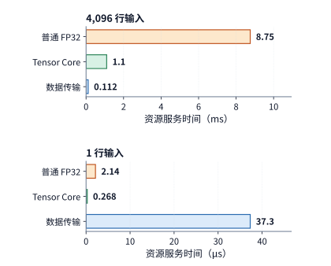

*图 4-31　同一 V100 上的 Q 投影。4,096 行时，Tensor Core 大幅缩短矩阵计算；一行时，两条计算路径都短于权重传输。上下两组使用分别标注的时间单位。*

**2. 数值精度演进：同时改变动态范围、显存体积与硬件指令吞吐。** 自 Volta 之后，每一代 NVIDIA GPU 都在持续扩充 Tensor Core 原生支持的数据类型：Turing 架构引入了面向低比特整数推理的 INT8 与 INT4；Ampere（A100）引入了专为深度学习训练设计的 **BF16**、**TF32**（在矩阵乘法内部保留与 FP32 相同的 8 位指数动态范围，同时将尾数精度裁剪至与 FP16 相同的 10 位）以及 **2:4 结构化稀疏**（硬件原生支持每连续 4 个权重元素中固定包含 2 个零值的稀疏矩阵乘，使峰值算力翻倍）；Hopper（H100）引入了 **FP8**（E4M3 与 E5M2）以及配套管理动态缩放因子的 Transformer Engine；而最新的 Blackwell（B200）则进一步将硬件原生精度推向了微缩放块格式 **MXFP8、MXFP6 与 FP4（MXFP4/NVFP4）**。[^turing-evolution][^nvidia]

为什么工业界在训练与推理中普遍从早期 V100 的 FP16 转向了 Ampere 之后的 **BF16**？要知道，FP16 与 BF16 同样占用 2 个字节（16 bits），将 $4096\times4096$ 的权重从 FP16 换成 BF16，静态体积依然是 $32\ \mathrm{MiB}$，连 1 个字节都没有省。二者的核心差异在于 **16 个比特如何在“指数位（决定可表示的最大/最小数值范围）”与“尾数位（决定相邻两数的有效数字精度）”之间分配**（注：IEEE 浮点数将数值表示为 $\pm 1.\text{尾数}\times 2^{\text{指数}}$ 的规格化正规数形式；当数值小到超出最小正规数指数时，则通过前导补零进入有效位数递减的次正规数区间）：
- **FP16（1 位符号 + 5 位指数 + 10 位尾数）**：由于指数只有短短 5 位，其能够表示的最小正规格化数（normal number）仅为 $2^{-14}\approx6.10\times10^{-5}$，即便算上次正规数（subnormal），最小非零正数也止步于 $2^{-24}\approx5.96\times10^{-8}$；
- **BF16（1 位符号 + 8 位指数 + 7 位尾数）**：直接沿用了与 32 位单精度浮点数（FP32）完全相同的 **8 位指数**，其最小正规格化数低至 $2^{-126}\approx1.18\times10^{-38}$。

在大模型反向传播中，微小的损失梯度极易落入 $10^{-8}$ 以下的数量级：若使用 FP16，一个大小为 $10^{-8}$ 的梯度在直接舍入后会瞬间下溢归零（underflow to zero），导致训练团队不得不引入繁琐的动态损失缩放（Loss Scaling）机制来小心翼翼地平移梯度区间；而换成拥有 8 位指数的 BF16 后，动态范围与 FP32 完全拉齐，彻底免除了溢出与下溢之忧。当然，BF16 为此付出的代价是尾数从 10 位缩减到了 7 位（例如在数值 $1.0$ 附近，BF16 相邻两个可表示数之间的最小间隔为 $2^{-7}\approx0.0078$，比 FP16 的 $2^{-10}\approx0.00098$ 粗糙了 8 倍）。现代 Tensor Core 通过“**BF16 低精度输入 + 片上 FP32 高精度累加**”的黄金组合完美化解了这一矛盾：用 BF16 的宽指数保住输入激活与梯度的动态范围，再用具有 23 位尾数的 FP32 累加器消除数千维长内积的舍入累积误差。[^bf16-quant]

看完了不改变体积的 BF16，再看真正将显存占用与读取带宽砍半乃至砍到四分之一的**微缩放低比特格式（Microscaling Formats，简称 MX 格式）**。沿用第 4.2.4 节的计算口径，在每 $g=32$ 个元素共享一个 1 字节（8-bit）块缩放因子（block scale）的 OCP MX 标准下，同一个 $4096\times4096$ 权重矩阵在不同精度下的总存储体积分别为：
- **BF16**：$32\ \mathrm{MiB}$；
- **MXFP8（8-bit 权重 + 1/32 字节 scale）**：$16 + 0.5 = 16.5\ \mathrm{MiB}$；
- **MXFP4（4-bit 权重 + 1/32 字节 scale）**：$8 + 0.5 = 8.5\ \mathrm{MiB}$。

我们将这组体积变化放到两代旗舰消费级显卡上核算单行 decode 的权重读取时间下界（见图 4-32）：在上一代 RTX 4090（显存带宽 $1{,}008\ \mathrm{GB/s}$）上读取 $32\ \mathrm{MiB}$ 的 BF16 权重需要 $33.29\ \mathrm{\mu s}$；升级到新一代 Blackwell 架构的 RTX 5090（显存带宽提升至 $1{,}792\ \mathrm{GB/s}$）后，若仍读取同一份 BF16 权重，耗时缩短为 $18.72\ \mathrm{\mu s}$；而一旦结合 Blackwell 原生支持的硬件 **MXFP4** 格式，只需从显存读取 $8.5\ \mathrm{MiB}$ 数据，读取耗时骤降至 **$4.97\ \mathrm{\mu s}$**。

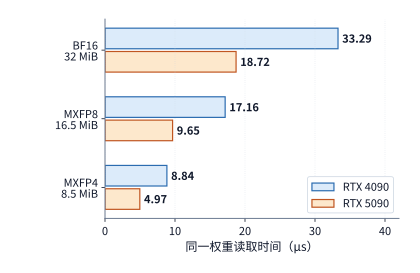

*图 4-32　同一个 4096×4096 权重的存储与读取预算。每 32 个低精度值共享一个一字节 scale。位宽从 BF16 降至 MXFP4 后，权重与 scale 合计从 32 MiB 减至 8.5 MiB。*

从 $33.29\ \mathrm{\mu s}$ 到 $4.97\ \mathrm{\mu s}$，单次投影的权重读取时间缩短至原来的 **$1/6.69$**。拆解这一高达 $6.69$ 倍的加速比可以看到，它正是由两项正交改进相乘而来的：**硬件显存带宽升级贡献了约 $1.78$ 倍（$1792/1008$），而微缩放低比特格式将传输体积压缩至约 $1/3.76$（$8.5/32$）**。更重要的是，由于 Blackwell 第五代 Tensor Core 在硬件指令内部原生支持按 32 元素块实时乘上缩放因子（block-scaled MMA），算子直接将 $8.5\ \mathrm{MiB}$ 的压缩表示送入矩阵单元即可，彻底省去了第 4.2.4 节中“先在显存或片上反量化展开为 $32\ \mathrm{MiB}$ BF16 副本”的时间与空间开销。

**3. 片上数据路径演进：当矩阵计算越来越快，硬件开始全面卸载它前后的搬移与累加。** 随着 Tensor Core 的乘加吞吐每一代翻倍增长，原本围绕在矩阵计算前后的“地址计算、数据中转与寄存器占用”逐渐暴露为新的瓶颈。对照图 4-33 可以清晰看到 NVIDIA 近三代数据中心架构是如何一步步把这些周边工作从通用线程中剥离出去的：
- **Ampere（A100）引入异步拷贝（`cp.async`）**：在 Volta/Turing 时代，将数据从全局显存加载到片上共享内存，必须先由线程加载进自己的通用寄存器堆（RF），再从寄存器写入共享内存；Ampere 建立了从 L1/全局内存直达共享内存的硬件旁路，省去了宝贵的寄存器中转开销。
- **Hopper（H100）引入张量内存加速器（TMA）与异步流水**：将多维张量分块的复杂步长地址生成与大块搬移完全卸载给专用的 TMA 硬件单元，并允许 Tensor Core 直接从共享内存中异步读取操作数（`wgmma`）。
- **Blackwell 数据中心架构（SM100，如 B200）引入专用张量内存（TMEM，Tensor Memory）**：在 Hopper 及更早的架构中，Tensor Core 算出的庞大的 FP32 累加部分和必须保存在 SM 的通用寄存器堆（Register File）里，导致高分块 GEMM 耗尽线程寄存器、严重限制驻留并发度；Blackwell SM100 专门在每个 SM 内部开辟了一块独立于通用寄存器堆的 **256 KB 专用张量内存（TMEM）**，专门用来原位保存第五代 Tensor Core（`tcgen05`）的矩阵累加结果。[^blackwell-evolution]

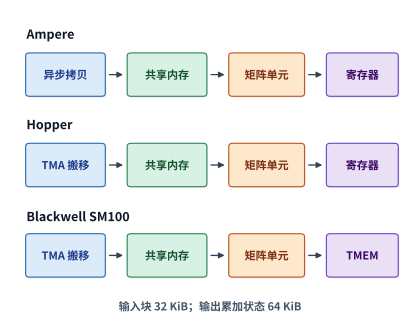

*图 4-33　从异步拷贝、TMA 到 TMEM，专门部件承担更多数据准备与累加状态管理。蓝色表示数据存储与搬移，橙色表示矩阵计算，紫色表示累加结果。*

回到第 4.3.2 节的片上容量算例就能体会 TMEM 的精妙之处：一个 $128\times128\times64$ 的三缓冲流水线总共需要存放 3 组配对输入操作数（$3\times32 = 96\ \mathrm{KiB}$）与 1 组 FP32 累加结果（$64\ \mathrm{KiB}$），合计 $160\ \mathrm{KiB}$。在 Blackwell SM100 上，那 $64\ \mathrm{KiB}$ 沉重的累加器被完整剥离到独立的 TMEM 中，既不占用共享内存，也不挤占通用线程寄存器，从而让通用寄存器堆得以全部释放出来服务于向量后处理与更多并发线程束。

顺着这条主线再往后看下一代 **NVIDIA Rubin 架构（Vera Rubin 平台的核心加速芯片）**，可以看到微架构演进如何围绕**超大规模稀疏 MoE、超长上下文注意力与全栈机密计算**完成系统级重构。根据 NVIDIA 官方架构技术简报[^rubin-arch][^rubin-evolution]，一颗完整的 Rubin GPU 封装集成了高达 **3,360 亿（336B）个晶体管**，延续并深化了双光罩尺寸裸片（Dual Reticle-sized Dies）通过高速片间互连（NV-HBI）合封为单一统一 CUDA 编程映像的工程路线。全芯片共配置 **224 个流式多处理器（SM）**（每颗计算裸片 112 个 SM，每个 SM 包含 64 个 FP32 Core、32 个 INT32 Core 与 **4 个第六代 Tensor Core**，全芯片合计 **896 个第六代 Tensor Core**），并在计算、片上数据通路、存储子系统与片间互连四个维度实现了跨代跃升：
1. **第六代 Tensor Core 与第三代 Transformer Engine（自适应压缩与 3-bit LUT 重构）**：在维持每周期吞吐翻倍（单拍在归约维 $K$ 上处理的深度达到前代的两倍，即 $2\times$ $K$-dimension throughput per clock）的基础上，Rubin GPU 的 **NVFP4 推理峰值算力高达 $50\ \mathrm{PFLOPS}$**（训练与 FP8 算力达 $35\ \mathrm{PFLOPS}$，约为 Blackwell B200 的 $3.5\sim 5\times$）。为了在不牺牲模型长上下文与推理精度的前提下吃满 4-bit 算力，第三代 Transformer Engine 引入了硬件级**自适应微缩放压缩（Adaptive Compression）**，并在张量核前端内置了 **3-bit 查找表（LUT，Look-Up Table）权重大规模实时解压缩电路**——允许将非均匀分布的敏感层权重映射为高信息熵的 3-bit 码本索引存储，在送入乘加阵列前按硬件时钟节拍零气泡展开。
2. **针对长上下文注意力的 SFU 指数吞吐倍增与 TMEM 2:4 稀疏分数压缩**：正如我们在第 4.2.3 节例 4-1 中定量推导的，当 Blackwell 的矩阵算力翻倍后，自注意力流水线的木桶短板立刻转移到了特殊函数单元（SFU）的自然指数运算上。Rubin 架构对此给出了精准回应：将单 SM 的 **FP32 指数运算吞吐提升至 Blackwell 的 $2\times$**，并将 **BF16/FP16 指数运算吞吐提升至 Blackwell 的 $4\times$**；同时，在每个 SM 的专用张量内存（TMEM）通路中引入了硬件级 **2:4 结构化稀疏注意力得分压缩（TMEM 2:4 Sparse Attention Score Compression）**，允许在线剔除注意力矩阵中贡献微弱的次要键值对，同步削减 Softmax 归约与 $PV$ 矩阵乘的有效工作量。
3. **面向高动态 MoE 的片上内联 TMA 描述符更新与 Tile 级生产者—消费者触发**：在数百个路由专家动态激活的 MoE 层中，每个专家分到的 token 行数 $M_e$ 在运行期剧烈波动。在 Hopper 与 Blackwell 上，频繁切换专家矩阵往往需要由主机或通用线程重新构造完整的 TMA 多维张量描述符；Rubin 的增强型 TMA 则原生支持**片上内联描述符更新（Inline TMA Descriptor Update）**——算子在连续处理形状相同但归属不同专家的权重分块时，只需在片上直接覆写描述符中的专家基地址与活动行数，即可零停顿发起下一位专家的异步预取。此外，Rubin 引入了硬件级 **Tile 粒度生产者—消费者内核触发机制（Tile-level Producer-Consumer Kernel Triggering）**，允许下游消费内核（如 SwiGLU 激活或 All-to-All 发送）无需等待上游 GEMM 内核全部线程块收尾，只要单个输出 Tile 在 TMEM/L2 中落盘即可立即唤醒对应消费线程块流水执行。
4. **288 GB HBM4 显存、NVLink 6 计数写与 Vera Rubin 超节点协同**：在存储与互连侧，单颗 Rubin GPU 挂载 8 座 12 层堆叠（12-Hi）的 **HBM4 显存，总容量达 $288\ \mathrm{GB}$，聚合显存带宽一举跃升至 $22\ \mathrm{TB/s}$**（约为 B200 $8\ \mathrm{TB/s}$ 的 $2.75\times$、H100 $3.35\ \mathrm{TB/s}$ 的 $6.57\times$）。在片间互连上，第六代 **NVLink 6** 为单颗 GPU 提供高达 **$3{,}600\ \mathrm{GB/s}$（$3.6\ \mathrm{TB/s}$）**的双向直连带宽（是 Blackwell NVLink 5 $1.8\ \mathrm{TB/s}$ 的 $2\times$、Hopper NVLink 4 $900\ \mathrm{GB/s}$ 的 $4\times$），并在链路层原生支持**硬件计数写入（Counted Writes）**与单包通知原语，大幅降低了 MoE 小包分发（Dispatch/Combine）的同步尾延迟；主机互连则升级至 **PCIe Gen 6（双向 $256\ \mathrm{GB/s}$）**，并通过 **$1{,}800\ \mathrm{GB/s}$（$1.8\ \mathrm{TB/s}$）的加强版 NVLink-C2C** 与配套的 **NVIDIA Vera CPU**（配备 **88 颗定制 Olympus Arm 核心**、支持空间多线程，搭载高达 **$1.5\ \mathrm{TB}$ 的 SOCAMM LPDDR5X 内存、带宽 $1.2\ \mathrm{TB/s}$**）组成 **Vera Rubin 超级芯片**，且全链路（含 NVLink 6、NVLink-C2C 与 PCIe Gen 6）原生支持硬件级 **TEE-I/O 机密计算线速加解密**。表 4-10 汇总了从 Hopper（H100 / H200）、Blackwell（B200）到 Rubin GPU 的四代数据中心旗舰核心规格演进。[^rubin-arch]

*表 4-10　NVIDIA 四代数据中心旗舰 GPU（H100 $\to$ H200 $\to$ B200 $\to$ Rubin）核心微架构与互连规格演进对比*

| 架构维度与关键指标 | Hopper H100 SXM | Hopper H200 SXM | Blackwell B200 (HGX/NVL) | Rubin GPU (Vera Rubin) |
| --- | --- | --- | --- | --- |
| **晶体管规模与封装形态** | $800$ 亿，单裸片（$814\ \mathrm{mm}^2$） | $800$ 亿，单裸片 | $2{,}080$ 亿，双光罩裸片 + $10\ \mathrm{TB/s}$ NV-HBI | **$3{,}360$ 亿**，双光罩裸片 + 高速 NV-HBI |
| **SM 数量 / Tensor Core 代际** | $132$ SM / 第四代（$528$ 个） | $132$ SM / 第四代（$528$ 个） | $148\sim 160$ SM / 第五代（`tcgen05`） | **$224$ SM / 第六代（$896$ 个）** |
| **峰值张量算力（稠密 / 低比特）** | BF16 $989\ \mathrm{TFLOPS}$ / FP8 $1.98\ \mathrm{PFLOPS}$ | BF16 $989\ \mathrm{TFLOPS}$ / FP8 $1.98\ \mathrm{PFLOPS}$ | FP8 $4.5\ \mathrm{PFLOPS}$ / FP4 $9\sim 10\ \mathrm{PFLOPS}$ | **FP8/训练 $35\ \mathrm{PFLOPS}$ / NVFP4 $50\ \mathrm{PFLOPS}$** |
| **片外显存容量与类型** | $80\ \mathrm{GB}$ HBM3 | $141\ \mathrm{GB}$ HBM3e | $180\sim 192\ \mathrm{GB}$ HBM3e（8-Hi） | **$288\ \mathrm{GB}$ HBM4（8 堆 12-Hi）** |
| **片外显存峰值带宽 $\beta_{\mathrm{HBM}}$** | $3.35\ \mathrm{TB/s}$ | $4.80\ \mathrm{TB/s}$ | $7.7\sim 8.0\ \mathrm{TB/s}$ | **$22.0\ \mathrm{TB/s}$** |
| **注意力与片上数据通路创新** | TMA + DSMEM + `wgmma` 寄存器累加 | 同 H100 | $256\ \mathrm{KB/SM}$ 独立 TMEM + 双 CTA 协同 | **SFU 指数 $2\times$(FP32)/$4\times$(BF16) + 内联 TMA + 3-bit LUT** |
| **Scale-Up 互连（双向 NVLink）** | NVLink 4：$900\ \mathrm{GB/s}$ | NVLink 4：$900\ \mathrm{GB/s}$ | NVLink 5：$1{,}800\ \mathrm{GB/s}$ | **NVLink 6：$3{,}600\ \mathrm{GB/s}$（含 Counted Writes）** |
| **主机互连（C2C / PCIe）与安全** | $900\ \mathrm{GB/s}$ C2C / PCIe 5.0；单卡 TEE | $900\ \mathrm{GB/s}$ C2C / PCIe 5.0 | $900\ \mathrm{GB/s}$ C2C / PCIe 5.0；TEE-I/O | **$1{,}800\ \mathrm{GB/s}$ C2C（配 88 核 Vera CPU）/ PCIe 6.0；全栈 TEE-I/O** |

**4. 横向坐标：消费级、工作站与数据中心 GPU 如何放入同一张算力—带宽账本？** 如果我们将不同年代、不同产品线（消费级 GeForce、专业工作站 RTX PRO、数据中心 HGX/SXM）的七款代表性 NVIDIA GPU 统一放在“BF16 输入、FP32 累加、稠密矩阵运算”这一相同口径下横向对比（见表 4-11；其中 RTX 3090、4090、5090 分别对应 Ampere、Ada Lovelace、Blackwell 架构，A100 与 H100/H200 分别对应数据中心 Ampere 与 Hopper 架构），它们各自最擅长什么负载便跃然纸上。[^evolution-quant]

*表 4-11　消费级、专业工作站与数据中心七款代表性 NVIDIA GPU 显存规格与 BF16/FP32 稠密矩阵算力横向对比*

| 型号与产品线 | 容量 GB | 带宽 GB/s | BF16／FP32 稠密矩阵 TFLOP/s |
| --- | ---: | ---: | ---: |
| RTX 3090，消费级 | 24 | 936 | 71.0 |
| RTX 4090，消费级 | 24 | 1,008 | 165.2 |
| RTX 5090，消费级 | 32 | 1,792 | 209.5 |
| RTX PRO 6000 Blackwell，工作站 | 96 | 1,792 | 503.8 |
| A100 80GB SXM，数据中心 | 80 | 2,039 | 312.0 |
| H100 SXM，数据中心 | 80 | 3,350 | 989.4 |
| H200 SXM，数据中心 | 141 | 4,800 | 989.5 |

我们沿表中的三组典型对比来解读这些数字背后的产品定位：
- **消费级三代演进（RTX 3090 $\to$ 4090 $\to$ 5090）**：从 RTX 3090 到 RTX 4090，显存容量停留在 24 GB，BF16 矩阵算力大幅跃升至 **2.33 倍**（从 $71.0$ 增至 $165.2\ \mathrm{TFLOP/s}$），但显存带宽却仅微增了 **7.7%**（从 $936$ 增至 $1{,}008\ \mathrm{GB/s}$）——这意味着 4090 能让计算受限的大批量训练与长输入 prefill 快上一倍多，但在运行单请求 decode 时却几乎不比 3090 快多少。而到了 RTX 5090，显存容量扩至 32 GB，显存带宽一举跃升 **1.78 倍**（达 $1{,}792\ \mathrm{GB/s}$），并新增了原生 FP4 Tensor Core，从而同时补齐了单请求 decode 的带宽短板与中等规模模型的驻留空间。
- **同代消费级与工作站旗舰对比（RTX 5090 vs. RTX PRO 6000 Blackwell）**：两张卡采用同一颗 GB202 核心、享有完全相同的 $1{,}792\ \mathrm{GB/s}$ GDDR7 显存带宽；但工作站定位的 RTX PRO 6000 将带 ECC 纠错的显存容量一举扩大了 3 倍（达 **96 GB**），开放了完整的不降速 FP32 累加矩阵吞吐（达 **$503.8\ \mathrm{TFLOP/s}$**，是 5090 的 $2.4$ 倍），并支持将单张物理卡硬隔离切分为多个独立实例的**多实例 GPU（MIG）**特性。因此，如果只是流式读取一个能装进 32 GB 的小模型做单请求 decode，两张卡的带宽上限完全一样；但一旦面对超过 32 GB 的中大型模型常驻，或是高算术强度的 prefill 与微调训练，96 GB 容量与 $503.8\ \mathrm{TFLOP/s}$ 算力的优势便全面显现。此外，在底层指令集架构（ISA）上，消费级与工作站 Blackwell 采用的是 **SM120** 架构，而数据中心 B200 采用的是配备独立 TMEM 与双 SM 协作指令（`tcgen05`）的 **SM100** 架构，因此算子库与编译器必须针对 SM100 与 SM120 分别生成不同的内核代码。[^nvidia-product-lines]
- **数据中心级演进与多卡互连（A100 $\to$ H100 $\to$ H200）**：数据中心加速卡除了全面采用数 TB/s 的 HBM 显存外，更核心的架构分野在于**高速片间互连（NVLink）**。A100 SXM 与 H100 SXM 的单卡 NVLink 双向带宽分别为 $600\ \mathrm{GB/s}$ 与 $900\ \mathrm{GB/s}$（即单向发送带宽分别为 $300\ \mathrm{GB/s}$ 与 $450\ \mathrm{GB/s}$）；按第 4.5.3 节公式计算，单向传输 $64\ \mathrm{MiB}$ 数据的链路序列化耗时分别约为 $224\ \mathrm{\mu s}$ 与 $149\ \mathrm{\mu s}$。在大规模张量并行（TP，将单层权重切分到多张卡上协同计算）、分布式训练梯度同步以及 MoE 跨卡专家分派（EP dispatch/combine）中，每一层都要高频调用这条链路；而消费级的 RTX 4090 与 5090 则取消了 NVLink 接口（仅早期的 RTX 3090 支持双卡 NVLink 桥接），只能依赖 PCIe 总线通信（第 6、7 章将详细核算这种互连代差对分布式并行的决定性影响）。[^nvidia-product-lines]

最后再看表中最末尾的两行：从 A100 到 H100，BF16 稠密矩阵算力跃升至 **3.17 倍**，显存带宽提升至 **1.64 倍**，并同步引入了 FP8、TMA 与线程块簇，属于典型的“**计算核心、数值格式与片上数据流全面换代**”；而从 H100 到 H200，计算核心与 $989.5\ \mathrm{TFLOP/s}$ 的矩阵算力并未改变，纯粹是将显存升级为 141 GB、$4.8\ \mathrm{TB/s}$ 的 HBM3E，属于典型的“**保持算力不变、专项突破容量与带宽瓶颈**”。第 4.8.2 节将把这两组硬件增量直接代入真实模型工作负载，检验在什么场景下算力翻倍更有用、什么场景下扩容提带宽更有用。图 4-34 将这七款代表性 GPU 的峰值带宽—稠密 BF16 算力演进轨迹（左）以及各自的算术强度转折点 $I^* = P / R$（右，从 RTX 3090 的 $75.9\ \mathrm{FLOP/byte}$ 到 H100 SXM 的 $295.3\ \mathrm{FLOP/byte}$）汇总在同一张坐标系中：凡是算术强度低于 $I^*$ 的单请求 decode 算子，其理论速度仅随横轴显存带宽推进；唯有算术强度越过 $I^*$ 的大批量训练与长上下文 prefill，才能兑现纵轴矩阵算力的代际跃升。

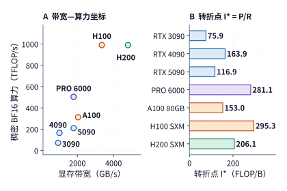

*图 4-34　七款代表性 NVIDIA GPU 的显存带宽与稠密 BF16/FP32 矩阵算力演进轨迹（左，圆点面积对应显存容量），以及各自的算术强度转折点 $I^* = P/R$（右）。*

### 4.6.2 昇腾：从 CNN 的卷积展开，到 Transformer 的矩阵与向量交接

理解华为昇腾（Ascend）DaVinci 架构的代际演进，最清晰的线索同样是追踪**片上数据流转路径**：上游输入数据如何被整理成矩阵单元所需的形状，以及矩阵单元算出的结果如何高效地交接给向量单元。随着主流 AI 负载从早期的卷积神经网络（CNN，如 ResNet）全面转向 Transformer 与大语言模型，芯片资源投入的重心也发生了深刻迁移。在早期的昇腾 910 架构中，为了高效运行海量二维卷积算子，内存传输引擎（MTE）专门内置了硬件级的 **img2col（图像块转列矩阵）**、张量转置与实时解压缩电路，核心解决的是“**如何在数据搬入片上的途中，直接把滑动卷积窗口实时组装成规整的矩阵输入**”。由于 MTE 在从片上 L1 缓冲向 L0A/L0B 搬移的过程中就顺手完成了滑动窗口展开，程序完全无需先在片外 HBM 中显式生成并写回那个因窗口重叠而急剧膨胀的展开大矩阵，从而彻底省去了一趟庞大的片外显存读写。[^ascend-cnn-history]

**1. 负载变迁对比：从 CNN 的卷积窗口展开，到 Transformer 的注意力结果交接。** 我们通过一组定量对比，看看为什么 CNN 时代奉为圭臬的硬件设计到了 Transformer 时代必须重构。
- **在 CNN 卷积算子中**：取 ResNet 中一个典型的 $3\times3$ 卷积层（步长为 1，四周补零保持空间尺寸不变），输入特征图尺寸为 $56\times56\times64$，输出通道数为 64，采用 FP16 精度（2 字节）。原始输入特征图仅占 $56\times56\times64\times2 = 401{,}408\ \mathrm{bytes}$（约 $0.383\ \mathrm{MiB}$）；但如果采用软件显式 `img2col` 将每个 $3\times3$ 滑动窗口展开成矩阵的一行，就会形成一个形状为 $3136\times576$ 的展开矩阵，体积膨胀至原输入的 **9 倍**（即 $3{,}612{,}672\ \mathrm{bytes}\approx3.445\ \mathrm{MiB}$）。如果必须在片外 HBM 中先写出再读回这份展开矩阵，额外产生的 HBM 读写流量高达 $2\times3.445 = 6.891\ \mathrm{MiB}$，按早期昇腾 910 的 $1.2\ \mathrm{TB/s}$ HBM 带宽计算，光这趟中间读写就要额外耗费约 **$6.02\ \mathrm{\mu s}$**；而依靠 MTE 硬件在片上动态完成窗口展开，这 $6.02\ \mathrm{\mu s}$ 的外存往返便被直接清零（见图 4-35）。[^ascend-history] 再看计算与后处理的比例：该卷积层的矩阵乘加工作量约为 $2\times3136\times576\times64\approx231.2\ \mathrm{MFLOPs}$，在每周期完成 $8{,}192\ \mathrm{FLOPs}$ 的 Cube 矩阵核上需要连续计算 **$28{,}224$ 个时钟周期**；而在整整两万八千多个周期的矩阵乘法结束之后，紧随其后的 ReLU 激活函数只需对 $56\times56\times64 = 200{,}704$ 个输出元素做一次简单的逐元素截断，向量后处理耗时极短。简言之，**在传统 CNN 中，Cube 矩阵核独占了绝大部分运行时间，MTE 负责在输入端消除展开冗余，而 Vector 向量核只需在漫长的矩阵乘法末尾做一点轻量收尾**。

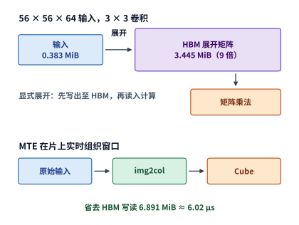

*图 4-35　卷积的两种输入准备方式。MTE 在片上展开窗口，省去 HBM 中间矩阵的写入和读取。*

- **切换到 Transformer 自注意力算子后**：核心计算链条变成了紧密咬合的三步：

$$Z=QK^{\mathsf T},\qquad P=\operatorname{Softmax}(Z),\qquad O=PV.$$

我们仍取一个尺寸为 $128\times128$、头维度为 128 的标准注意力分块：在同样每周期 $8{,}192\ \mathrm{FLOPs}$ 的 Cube 矩阵核上，完成该分块的 $QK^{\mathsf T}$ 与 $PV$ 两次矩阵乘法（合计约 $8.39\ \mathrm{MFLOPs}$）总共只需要 **$1{,}024$ 个时钟周期**（比刚才的卷积层短了近 28 倍）；但夹在两次矩阵乘法正中间的 Softmax，却必须对整整 $16{,}384$ 个得分元素执行求最大值归约、减最大值、求自然指数、求和归约以及除法归一化。而在 Transformer 的每一层、每一个查询行组分块中，这种“**Cube 算 $QK^{\mathsf T}$ 得分 $\to$ Vector 算 Softmax 归约与指数 $\to$ Cube 算 $PV$ 输出**”的“矩阵—向量—矩阵”三明治结构都在成百上千次地高频循环；同理，前馈网络（FFN）中的“上/门控投影 $\to$ SwiGLU 向量激活 $\to$ 下投影”也同样要求矩阵核与向量核高频接力。

**2. 定量核算：为什么要让 Cube 与 Vector 既能独立调度、又能片上直通？** 在早期架构中，如果 Cube 算出的 $QK^{\mathsf T}$ 得分矩阵必须先写出到核外共享缓存（LLC / L2）或 HBM，再由 Vector 核从核外缓存读进统一缓冲（UB）算 Softmax，算完的概率矩阵又必须再写回核外缓存供 Cube 读入算 $PV$，那么随着 Cube 矩阵算力的提升，这段跨核外存中转就会立刻演变为首要瓶颈。我们来算一笔精确的带宽账：对于上述 $128\times128$ 注意力分块，若得分矩阵 $Z$ 与概率矩阵 $P$ 均按 FP32（4 字节）交接，单个矩阵体积为 $128\times128\times4 = 64\ \mathrm{KiB}$；“先写出到外层存储、再从外层存储读回”会让单次交接产生双倍流量（$128\ \mathrm{KiB}$），一去一回两次交接合计要在外层存储接口上产生 **$256\ \mathrm{KiB}$** 的读写流量。假设芯片工作在 $1\ \mathrm{GHz}$ 时钟频率下，Cube 完成该分块的矩阵计算仅需 $1{,}024\ \text{周期} = 1.024\ \mathrm{\mu s}$；要想让外层存储接口在这 $1.024\ \mathrm{\mu s}$ 的计算窗口内把 $256\ \mathrm{KiB}$ 交接数据传完（从而不拖慢流水线），外层存储接口为单个核心提供的有效带宽至少需要达到 $\frac{256\ \mathrm{KiB}}{1.024\ \mathrm{\mu s}}\approx256\ \mathrm{GB/s}$。然而，对照早期 DaVinci 架构论文披露的每核 LLC 带宽（约 $94\ \mathrm{GB/s}$），传完这 $256\ \mathrm{KiB}$ 数据实际上需要约 **$2.79\ \mathrm{\mu s}$**——**仅将中间结果在 Cube 与 Vector 之间往返传输一趟的时间（$2.79\ \mathrm{\mu s}$），就达到了 Cube 矩阵计算时间本身（$1.024\ \mathrm{\mu s}$）的 $2.7$ 倍以上**。[^ascend-history]

这笔账一针见血地指明了架构演进的方向：在 $2.79\ \mathrm{\mu s}$ 的交接耗时面前，单纯把 Cube 矩阵算力再翻一倍毫无意义；当务之急是重构矩阵核与向量核的协作机制与片上交接通路。对照图 4-36 可以看到昇腾三代架构的三级跳演进：
1. **早期同核绑定（昇腾 910）**：单个 AI Core 内同时包含 Cube 与 Vector，由同一个 Scalar 单元串行控制，且中间结果需绕道核外存储交换；
2. **矩阵与向量解耦独立调度（昇腾 910B / 910C，Atlas A2/A3 系列）**：将矩阵核（AIC，AI Cube Core）与向量核（AIV，AI Vector Core）拆分为拥有各自独立控制流的物理核心（910C 更进一步在双裸片封装中按比例配置独立的 AIC 与 AIV 阵列），使 AIC 与 AIV 能够像第 4.4.3 节的双槽流水线一样，在相邻的不同数据块上真正实现跨阶段并行推进（相应地，算子程序与编译器需要显式管理跨核缓冲区地址与同步事件）；[^ascend-history]
3. **新增片上 CV 高速直通通路（新一代昇腾 950）**：在保持 AIC 与 AIV 独立调度的基础上，昇腾 950 直接在 Cube 的片上 L1 缓冲与 Vector 的片上统一缓冲（UB）之间架起了一条专用的 **CV（Cube-Vector）片上直连通路**。[^ascend]

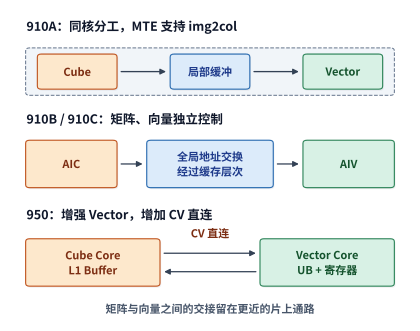

*图 4-36　昇腾的矩阵与向量协作：早期同核分工、910B/910C 独立控制，以及 950 的 CV 直通。*

有了昇腾 950 的 CV 片上直通通路后，正反两次各 $64\ \mathrm{KiB}$ 的中间张量直接在片上点对点传递，总传输量从外层写读的 $256\ \mathrm{KiB}$ 直接减半至 **$128\ \mathrm{KiB}$**，并且将原本压在核外 LLC/HBM 接口上的 $256\ \mathrm{KiB}$ 流量彻底清零（见图 4-37）。在相同的 $1.024\ \mathrm{\mu s}$ 预算窗口下，所需的片上交接带宽门槛直接减半至约 $128\ \mathrm{GB/s}$（若在第二次交接 $P$ 时直接传递 FP16/BF16 概率，流量还会再降 $32\ \mathrm{KiB}$）。[^ascend]

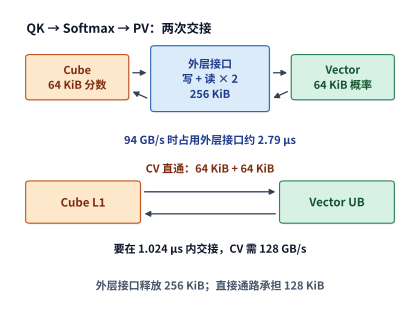

*图 4-37　同一注意力块的交接流量。外层接口写读共 256 KiB，直接通路传递共 128 KiB。*

与此同时，针对 Transformer 中繁重的向量处理负担，昇腾 950 还将单个 Vector Core 的 FP16/FP32 向量运算吞吐提高了 **1 倍**，在 UB 缓冲与向量算术逻辑单元（ALU）之间新增了专用向量寄存器堆（Register File）以减少 UB 读写端口争用，并专门用硬件指令加速了 Softmax 与 GELU 等非线性算子；在搬移与同步侧，则引入了支持多维步长自动寻址的 **NDDMA** 引擎以及基于硬件缓冲区标识（**BufferID**）的细粒度流控同步机制。从流水线均衡方程来看，将单核向量吞吐 $P_v$ 提高一倍，确实能将固定向量工作量 $F_v$ 的纯计算时间从 $F_v/P_v$ 减半至 $F_v/(2P_v)$；但如果不同步建立 CV 片上直连通路，被外层接口卡住的交接时间依然会让翻倍的向量算力无用武之地。唯有将 **Cube 矩阵吞吐、Vector 向量吞吐与 CV 交接带宽**三者协同配平，局部的硬件峰值指标才能真正转化为端到端注意力算子的实测加速。

**3. 硬件流水线如何映射为算子程序结构？** 回顾第 4.4.3 节图 4-23 的双槽（每槽 $24\ \mathrm{KiB}$）交接时间线，当算子编译器或开发者将这段多引擎注意力流水线编写成设备端程序时，只需将每个查询行组 `g` 的处理拆解为矩阵计算、数据交接与向量计算等子阶段，并显式声明**同组内部的前后数据依赖**与**跨组复用同一缓冲槽的释放依赖**：

```text
for g in query_groups:
    slot = g % 2
    input_ready = prepare_inputs(Q[g], K, V)
    qk = submit(Cube.QK, after=[input_ready, slot_free[slot]])
    scores = submit(score_transfer, after=[qk])
    softmax = submit(Vector.Softmax, after=[scores])
    probabilities = submit(probability_transfer, after=[softmax])
    pv = submit(Cube.PV, after=[probabilities])
    slot_free[slot] = pv
wait(all_output_ready)
```

在这段伪代码中，`submit(..., after=[...])` 表示向对应硬件引擎的命令队列登记一项任务及其前置等待事件（event / flag）：只要前置事件全部完成，对应的硬件单元便立即异步启动执行。由于第 0 组（`G0`）与第 1 组（`G1`）分别绑定在 `slot 0` 与 `slot 1` 上，二者互不冲突，可以在 Cube、交接通路与 Vector 之间交错重叠推进；而当循环推进到第 2 组（`G2`）时，由于 `2 % 2 = 0` 需要复用 `slot 0`，`after=[..., slot_free[0]]` 就会自动强制 `G2` 的 $QK^{\mathsf T}$ 等待 `G0` 的 $PV$ 执行完毕并释放 `slot 0` 后才能启动。在硬件实现上，若芯片支持片上 CV 直通，`score_transfer` 与 `probability_transfer` 就直接编译为片上 L1 与 UB 之间的直传指令；若在老一代架构上采用核外交换，则编译为写出与读入两步 MTE 指令（第 5 章将进一步展示编译器如何把这段高层依赖图自动展开为底层循环、片上缓冲分配、DMA 描述符与硬件 `set_flag/wait_flag` 指令序列）。

至此，我们可以完整概括昇腾 DaVinci 架构的设计哲学：**将规则的高维矩阵乘加彻底交给 Cube，将逐元素非线性与归约彻底交给 Vector，将跨级多维搬移彻底交给 MTE/NDDMA，并通过职责分明的专用片上缓冲（L1/L0A/L0B/L0C/UB）将三者串联起来**。独立的引擎控制流创造了跨块重叠的并行机会，而 CV 片上直通则削减了矩阵—向量交替时的交接流量。为了吃透这套专用硬件红利，算子库与深度学习编译器承担了分块切分、数据布局转换、多缓冲槽位分配以及跨引擎同步插入的重任——面对高频出现的标准模型形状，直接调用高度调优的算子库模板；面对新兴算子或非标形状，则由编译器自动搜索并生成新的流水调度。硬件架构的精简高效与底层软件栈的精细编排，在这里形成了互补的软硬件协同关系。

**4. 从昇腾 910A/910B/910C 到昇腾 950PR/950DT（第三代达芬奇架构）的全代际微架构账本。** 为了将上述原理落实为工程选型与算子分块的精确参数，我们结合华为官方架构白皮书（Table 3-1 与 Table 4-2）[^ascend] 及 CloudMatrix384 公开论文[^package]，梳理从昇腾 910A $\to$ 910B $\to$ 910C（双裸片合封）直至 **昇腾 950PR / 950DT（第三代达芬奇架构 / 3rd-gen DaVinciCore）** 的完整硬指标演进（表 4-12，图 4-49 左）：
- **产品形态与训推场景解耦（910C $\to$ 950PR / 950DT）**：在上一代 **昇腾 910C** 中，单颗芯片采用双计算裸片（Dual-Die）合封，每颗 die 集成 **24 个 AIC（矩阵核）与 48 个 AIV（向量核）**、配备 $64\ \mathrm{GB}$ HBM 与 $1.6\ \mathrm{TB/s}$ 显存带宽（整芯片合计 48 AIC + 96 AIV、**$128\ \mathrm{GB}$ @ $3.2\ \mathrm{TB/s}$**，die 间单向互连带宽为 $270\ \mathrm{GB/s}$）。进入 **昇腾 950** 世代，产品线针对不同阶段的计算—带宽比需求拆分为两款型号：面向预填充（Prefill）与推荐推理优化的 **Ascend 950PR**（半高 PCIe 卡，配置 **32 或 28 个 Cube Core + 64 或 56 个 Vector Core**，搭载 **$128\ \mathrm{GB}$ HiBL 1.0 显存 @ $1.6\ \mathrm{TB/s}$**，MXFP4 算力达 $1{,}784 / 1{,}561\ \mathrm{TFLOPS}$、HiF8/MXFP8/FP8 算力达 $919 / 804\ \mathrm{TFLOPS}$、FP16/BF16 算力达 $486 / 425\ \mathrm{TFLOPS}$），以及面向解码（Decode）与大规模训练优化的旗舰 **Ascend 950DT**（配置 **36、32 或 28 个 Cube Core + 72、64 或 56 个 Vector Core**，搭载 **$144\ \mathrm{GB}$（或 $96\ \mathrm{GB}$）HiZQ 2.0 高带宽显存 @ $4.0\ \mathrm{TB/s}$**，单芯片灵衢 UB 2.0 双向互连带宽高达 **$2.0\ \mathrm{TB/s}$（精确物理值为 $18\times 4$ 路 $112\mathrm{G}$ PAM4 SerDes 合成的 $2{,}016\ \mathrm{GB/s}$ 双向 / $1{,}008\ \mathrm{GB/s}$ 单向）**，36 核顶配版提供 **$2{,}007\ \mathrm{TFLOPS}$ MXFP4**、**$1{,}034\ \mathrm{TFLOPS}$ HiF8/MXFP8/FP8** 与 **$547\ \mathrm{TFLOPS}$ FP16/BF16** 峰值算力）。
- **单 AI Core 片上存储层次精确配比（官方 Table 4-2 锁定真值）**：在昇腾 950 的每一个 AI 子系统（1 Cube + 2 Vector）内部，各级软件显式管理 SRAM 的容量严格锁定为：**`L1 Buffer = 512 KB`**（暂存分块权重、左输入矩阵与分形变换中间数据）、**`L0A Buffer = 64 KB`**（Cube 左矩阵输入缓冲）、**`L0B Buffer = 64 KB`**（Cube 右矩阵权重缓冲）、**`L0C Buffer = 256 KB`**（Cube 矩阵乘加 FP32/INT32 高精度累加器缓冲，支持越过 L2 直接流向配对 Vector Core 的 UB）以及 **`Unified Buffer（UB）= 512 KB`**（Vector 核统一向量读写缓冲）；全芯片则共享 **`128 MB` L2 Cache**（采用 `512 B` 缓存行与 `4 x 128 B` 扇区设计，通过物理地址低 4 位在全芯片 4 颗计算 Die、共 16 个 L2 Slice 之间均匀哈希交错，消除跨核热点）。
- **第三代达芬奇微架构四大底层突破**：（1）**原生微缩放与 `HiF8` 锥形浮点格式**：除硬件支持 OCP `MXFP8`（`E4M3`/`E5M2` + 每 32 元素 `E8M0` 缩放）与 `MXFP4`（`E2M1` + 每 32 元素 `E8M0` 缩放）外，首创 **HiF8（Hybrid Tapered-Precision 8-bit Floating Point）**——动态调整指数与尾数位宽配比，使其可表示的 2 的幂次跨度达到 **38 个档位（覆盖 $2^{-22}\sim 2^{15}$）**，远超标准 FP8 `E4M3` 的 18 个档位，允许训练与推理在不依赖块缩放因子的情况下直接替换 BF16；（2）**基于寄存器堆（`16 KB` Vector RegFile + `2 KB` Predicate RegFile）的双发射 SIMD 与 SIMD/SIMT 融合编程**：在 Vector Core 的 `512 KB` UB 与向量 ALU 之间增设 **`16 KB` 向量寄存器堆（Vector RegFile，VR）与 `2 KB` 谓词寄存器堆（Predicate RegFile，PR）**，支持 **256B 宽 SIMD 向量指令与 SIMT 32 线程束（每线程独立处理 8B）融合编程**及单周期双发射，既保留了规则向量块的极致带宽效率，又消除了处理动态稀疏索引与分支掩码时的软件拆解开销；（3）**`BufferID`（`get_buf` / `rel_buf`）硬件缓冲流控同步**：取代传统繁琐的跨管道显式事件计数（`set_flag`/`wait_flag`），由硬件直接维护片上各缓冲槽（Slot）的生命周期状态——生产者算子通过 `get_buf(id)` 申请空闲槽、写毕调用 `rel_buf(id)` 移交就绪权，消费者算子调用配对原语消费并释放，将跨引擎同步压缩至纳秒级硬件门控；（4）**五维 `NDDMA` 与随路分形转换（On-the-Fly Fractal Layout Transform）**：DMA 引擎原生支持 5D 张量步长（Stride）寻址、散聚（Scatter-Gather）以及从行主序（ND）到 Cube 分形格式（nZ / zZ）的随路硬件重排与解压，并内置 `128 KB` 内部暂存缓冲支持向多个 AI Core 的 L1/UB 发起硬件广播（Multicast）。

*表 4-12　华为昇腾系列加速器代际演进与第三代达芬奇架构（Ascend 950）核心参数（Table 3-1 & Table 4-2）*

| 架构指标与存储层级 | 昇腾 910B（Atlas A2） | 昇腾 910C（Atlas A3 双 Die） | 昇腾 950PR（Prefill / 推荐特化） | 昇腾 950DT（Decode / 训练旗舰） |
| --- | --- | --- | --- | --- |
| **核心配比（Cube : Vector）** | 20–24 AIC + 40–48 AIV（单 Die） | **48 AIC + 96 AIV（每 Die 24+48）** | **32 / 28 Cube + 64 / 56 Vector** | **36 / 32 / 28 Cube + 72 / 64 / 56 Vector** |
| **主推低比特算力（MXFP4 / FP8）** | INT8 $640\ \mathrm{TOPS}$（无原生 FP8/FP4） | INT8 $\sim 1{,}280\ \mathrm{TOPS}$ | **MXFP4 $1{,}784/1{,}561\ \mathrm{TFLOPS}$；HiF8/FP8 $919/804\ \mathrm{TFLOPS}$** | **MXFP4 $2{,}007/1{,}784/1{,}561\ \mathrm{TFLOPS}$；HiF8/FP8 $1{,}034/919/804\ \mathrm{TFLOPS}$** |
| **BF16 / FP16 稠密矩阵算力** | $320\ \mathrm{TFLOPS}$ | $\sim 640\ \mathrm{TFLOPS}$（双 Die 聚合） | **$486 / 425\ \mathrm{TFLOPS}$** | **$547 / 486 / 425\ \mathrm{TFLOPS}$** |
| **片外显存容量与带宽** | $64\ \mathrm{GB}$ HBM2e @ $1.6\ \mathrm{TB/s}$ | **$128\ \mathrm{GB}$ HBM @ $3.2\ \mathrm{TB/s}$（每 Die $64\ \mathrm{GB}$）** | **$128\ \mathrm{GB}$ HiBL 1.0 @ $1.6\ \mathrm{TB/s}$** | **$144 / 96\ \mathrm{GB}$ HiZQ 2.0 @ $4.0\ \mathrm{TB/s}$** |
| **单核片上缓冲（Table 4-2）** | L1 + L0A/B/C + UB（核外交换） | 双 Die 独立 AIC/AIV 缓冲 | **`L1 512KB`、`L0A/B 64KB`、`L0C 256KB`、`UB 512KB` + CV 直通** | **`L1 512KB`、`L0A/B 64KB`、`L0C 256KB`、`UB 512KB` + `128MB` L2** |
| **Scale-Up 互连带宽** | HCCS（百 GB/s 级） | HCCS 跨 Die $270\ \mathrm{GB/s}$ 单向 | UB 2.0 + PCIe 5.0 x16 | **灵衢 UB 2.0 双向 $2.0\ \mathrm{TB/s}$（$2{,}016\ \mathrm{GB/s}$）** |

### 4.6.3 Apple：大容量统一内存，如何换算为模型运行能力

与数据中心加速卡追求高算力密度不同，Apple Silicon（M 系列芯片）走出了一条鲜明的架构路线：**将 CPU、GPU 与独立的神经网络引擎（Neural Engine，简称 ANE）集成在同一颗 SoC 上，并共同挂载在容量高达上百 GB 乃至 512 GB 的高带宽统一内存（Unified Memory）池之上**。如前所述，统一内存一方面消除了主机与加速器之间的数据拷贝开销，另一方面则赋予了桌面与移动工作站在本地单机直接装下超大规模参数模型的能力。下面我们严格按照“先算容量能否装下，再算每生成一个 token 需要读取多少字节、耗时几毫秒”的顺序，将 Apple Silicon 的纸面规格换算为真实的模型运行表现。

首先核对近几代 Apple 旗舰芯片的统一内存容量与带宽规格：M1 Ultra 的典型顶配为 $128\ \mathrm{GB}$ 容量、$800\ \mathrm{GB/s}$ 内存带宽；M2 Ultra 将容量上限提升至 $192\ \mathrm{GB}$，内存带宽保持 $800\ \mathrm{GB/s}$；M3 Ultra（80 核 GPU 版本）进一步提供了 $256\ \mathrm{GB}$ 与高达 **$512\ \mathrm{GB}$** 的超大统一内存配置，内存带宽微增至 $819\ \mathrm{GB/s}$；而定位于移动工作站的 M4 Max 也提供了 $128\ \mathrm{GB}$ 容量配置，内存带宽为 $546\ \mathrm{GB/s}$。[^apple-capacity-quant]

**1. 内存容量翻倍，究竟会改变哪些时间、不改变哪些时间？** 我们先保持模型、数值精度与并发 batch size 完全不变，检验单纯扩大内存容量的影响。在 M3 Ultra 上，当统一内存容量从 $256\ \mathrm{GB}$ 翻倍至 $512\ \mathrm{GB}$ 时，只要一个模型在 $256\ \mathrm{GB}$ 下本就能完整装下，那么由于两档配置的内存带宽完全相同（同为 $819\ \mathrm{GB/s}$），执行同一步推理的理想访存耗时 $T=V/R$ **完全一致**；同理，从 M1 Ultra（$800\ \mathrm{GB/s}$）升级到 M3 Ultra（$819\ \mathrm{GB/s}$），内存读取理论速度也仅仅微增了约 $2.4\%$。这再次印证了第 4.3.3 节的基本规律：**扩大内存容量决定的是“多大的模型、多少条并发请求能够免于卸载而原位常驻”，而提升内存带宽才直接决定“已经常驻在内存里的数据每步能读多快”。**

我们用 Qwen3-8B（BF16 精度，单请求 $B=1$，上下文长度 $S=8{,}192$）代入验算：根据本书张量账本，每执行一步 decode 需要从内存读取约 $15.137\ \mathrm{GB}$ 非词嵌入权重与 $1.208\ \mathrm{GB}$ 历史 KV 缓存，合计访存载荷为 $V\approx16.345\ \mathrm{GB}$。代入各款芯片的峰值内存带宽，可得单步 decode 的理想访存耗时下界（即 100% 带宽利用率下的最快可能时间）：
- **M1 Ultra / M2 Ultra（$800\ \mathrm{GB/s}$）**：$\frac{16.345\ \mathrm{GB}}{800\ \mathrm{GB/s}}\approx20.43\ \mathrm{ms}$；
- **M3 Ultra（$819\ \mathrm{GB/s}$）**：$\frac{16.345\ \mathrm{GB}}{819\ \mathrm{GB/s}}\approx19.96\ \mathrm{ms}$；
- **M4 Max（$546\ \mathrm{GB/s}$）**：$\frac{16.345\ \mathrm{GB}}{546\ \mathrm{GB/s}}\approx29.94\ \mathrm{ms}$。

对比 M1 Ultra（128 GB）与 M4 Max（128 GB）可以看到：虽然两台机器的内存容量同为 128 GB，都能轻松装下这个 8B 模型，但由于 M1 Ultra 的内存接口位宽是 M4 Max 的更高规格，每生成一个 token 的纯访存耗时下界就比 M4 Max 少了整整 **$9.51\ \mathrm{ms}$**（理论生成速率上限分别为约 $49\ \mathrm{token/s}$ 与 $33\ \mathrm{token/s}$）。[^evolution-quant]

**2. 超大统一内存的核心优势：单机原位运行百亿/千亿级稀疏 MoE 模型。** 既然运行 8B 稠密模型只需要不到 20 GB 内存，那么 M3 Ultra 高达 $256\ \mathrm{GB}$ 乃至 $512\ \mathrm{GB}$ 的统一内存究竟在什么负载下才能展现不可替代的价值？答案正是**超大规模稀疏混合专家（MoE）模型**。我们以总参数量高达 2350 亿、每 token 激活参数量为 220 亿的 **Qwen3-235B-A22B** 模型为例：采用本书的 4-bit 权重量化方案，连同分组缩放因子（scale）以及保持高精度的词嵌入与归一化层，全模型常驻权重体积约为 **$123.142\ \mathrm{GB}$**；若服务单条请求（8K 上下文 KV 缓存）并加上 $2\ \mathrm{GiB}$ 运行时工作区，推理进程本身就需要占用约 $126.867\ \mathrm{GB}$ 内存。如果放在一台 $128\ \mathrm{GB}$ 统一内存的机器上，扣除模型后整机只剩下约 $1.13\ \mathrm{GB}$ 空间，根本不够 macOS 操作系统内核与桌面应用生存（若为操作系统与其他常驻进程合理预留 $8\ \mathrm{GB}$ 内存，整机总内存需求约为 $134.87\ \mathrm{GB}$）；而放在配备 **$256\ \mathrm{GB}$ 或 $512\ \mathrm{GB}$** 统一内存的 M3 Ultra 上，这一 235B 规模的大模型便能完整常驻在高速内存中。

更妙的是，一旦 235B 的全部专家权重成功常驻内存，MoE 架构“**全量参数常驻、单步稀疏激活**”的物理特性就会立刻在带宽受限的统一内存平台上发挥显著优势：在单请求（8K 上下文）每一步 decode 中，系统根本不需要去读取那完整的 $123.142\ \mathrm{GB}$ 权重，而只需读取当前 token 路由命中的那约 22B 激活专家权重与历史 KV 缓存——单步实际访存载荷仅为约 **$13.697\ \mathrm{GB}$**（甚至比前面未量化的 BF16 Qwen3-8B 的 $16.345\ \mathrm{GB}$ 还要小）。在 M3 Ultra（$819\ \mathrm{GB/s}$）上，读完这 $13.697\ \mathrm{GB}$ 数据仅需约 **$16.72\ \mathrm{ms}$**（对应理想上限约 $60\ \mathrm{token/s}$），而不是按全部 $123.142\ \mathrm{GB}$ 稠密读取所对应的约 $150\ \mathrm{ms}$。这正是大容量统一内存与大型稀疏 MoE 彼此适配的底层原因：**由总参数量决定的百 GB 级常驻需求，正好由大容量 LPDDR 统一内存承载；而由激活参数量决定的十余 GB 级单步读取需求，又恰好落在了 $800\ \mathrm{GB/s}$ 级统一内存带宽能够流畅消化的甜点区内。**[^storage]

当然，当并发请求数从单条扩大到多条时，我们在第 4.3.3 节算过的 MoE 路由分散度规律同样会立刻生效。仍代入第 4.3.3 节中 8 条并发请求（$B=8$，各 8K 上下文）运行 Qwen3-235B-A22B 的两组极端路由数据：当 8 条请求集中命中相同专家时，单步总读取量为 $24.737\ \mathrm{GB}$，在 M3 Ultra 上耗时约 $30.20\ \mathrm{ms}$，由于每步同时产出 8 个 token，对应的理想系统吞吐上限高达 $8 / 0.03020\approx265\ \mathrm{token/s}$；而当 8 条请求选中的专家完全分散时，单步总读取量激增至 $75.967\ \mathrm{GB}$，在 M3 Ultra 上单步耗时拉长至 $92.76\ \mathrm{ms}$，系统吞吐上限骤降至 $8 / 0.09276\approx86\ \mathrm{token/s}$。可以看到，无论是 256 GB 还是 512 GB 配置都能装下这 8 条并发请求，但批次内的专家复用率直接让输出吞吐相差了 **3 倍以上**。

**3. 片上动态缓存与 GPU 内置矩阵加速器的协同演进。** 在统一内存解决整机容量问题之后，Apple 近三代芯片也在持续强化 GPU 内部的片上存储管理与专用张量算力（见图 4-38）：
- **M3 与 M4 引入动态缓存（Dynamic Caching）**：传统的 GPU 线程组在启动前必须按最坏情况静态划定寄存器与局部内存配额，容易造成片上 SRAM 闲置；Dynamic Caching 改为在硬件运行时根据每个着色器阶段（shader stage）的实际瞬时需求，在片上动态分配局部内存空间，从而提高了片上缓存的利用率与线程组驻留并发度。
- **M5 在每个 GPU 核心内部新增专用神经网络加速器（Neural Accelerator）**：在 M1 至 M4 世代，芯片上的专用 AI 算力集中在独立于 GPU 之外的 16 核 Neural Engine（ANE）上，而 GPU 内部的矩阵运算主要依赖 SIMD 算术单元；到了最新的 **M5 芯片**，Apple 在保留独立 Neural Engine 的同时，直接在**每一个 GPU 核心内部嵌入了专用的矩阵加速单元（Neural Accelerator）**，并通过全新的 Metal 4 Tensor API 等编程接口直接向开发者暴露硬件张量指令。这样一来，类似于 NVIDIA GPU 中 Tensor Core 与 CUDA Core 的关系，M5 的 GPU 程序可以在同一个着色器内核里直接调用核内专用硬件高速完成大矩阵乘加，并紧接着交由通用 GPU 线程执行数据准备与向量后处理。[^apple-generations][^apple]

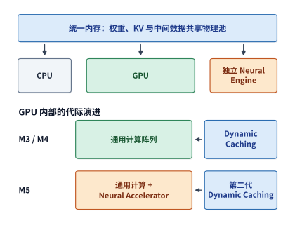

*图 4-38　统一内存负责整机的数据容量，Dynamic Caching 管理 GPU 局部资源，M5 的 Neural Accelerator 增加 GPU 内专用计算能力。三者分别进入容量、驻留和计算时间的分析。*

与此同时，基础款芯片的统一内存带宽也在稳步攀升：从基础款 M4 到基础款 M5，统一内存带宽从 $120\ \mathrm{GB/s}$ 提升至 $153\ \mathrm{GB/s}$（增幅约 **$27.5\%$**），使前文那份 $32\ \mathrm{MiB}$ BF16 投影权重的单次读取时间从约 $279.6\ \mathrm{\mu s}$ 缩短至 $219.3\ \mathrm{\mu s}$（节省约 $21.6\%$）。对照 Apple 官方公布的数据，M5 的 GPU AI 峰值算力相比 M4 大幅跃升了 **4 倍以上**：正如我们在第 4.6.1 节分析 V100 时所看到的，对于单行输入（$M=1$）的 decode 投影而言，由于算子受限于读取 $32\ \mathrm{MiB}$ 权重的内存带宽，端到端提速幅度依然由那 $27.5\%$ 的带宽增幅决定；而一旦进入多行并行输入（如长提示词 prefill、图像编码或本地微调），权重读取开销被成百上千行输入共同分摊，M5 核内 Neural Accelerator 提升 4 倍以上的矩阵算力就能立刻转化为成倍缩短的计算时间。[^apple]

纵观 NVIDIA、昇腾与 Apple 三条技术路线的代际演进，可以看到它们共同印证了同一套底层工程因果律：**高复用大矩阵运算催生了专用二维/三维矩阵乘加阵列；Transformer 中高频交替的归一化与 Softmax 推动了向量吞吐翻倍与片上矩阵—向量直连通路；而百亿/千亿级稀疏 MoE 与长上下文状态，则迫使芯片架构在 HBM 堆叠、双裸片合封与超大统一内存容量上持续突破物理极限。**

## 4.7 专用架构

生物大脑为人类提供了另一种组织大规模并行计算的自然参照：在生物神经网络中，神经元（soma）负责状态积分与脉冲触发，突触（synapse）直接原位保存连接权重并参与信号传递，记忆存储与算术计算天然融为一体、分布在同一个高度并行的三维网络中；局部短距连接、高度稀疏脉冲激活、事件驱动机制与三维空间折叠，共同将绝大多数信号传输压缩在极短的物理距离内。学术界探索的类脑神经形态芯片（neuromorphic computing）与存内计算（compute-in-memory）器件正是试图在物理层面借鉴这些机制；而在主流的数字 CMOS 集成电路中，与之对应的工程演进方向则是：**尽可能扩大片上 SRAM 缓冲、充分发掘片外显存带宽、缩短片间互连距离，并让数据在最靠近计算单元的地方完成最大程度的复用。**

前几节的分析表明，引入专用矩阵计算单元与片上直连交接通路能够大幅削减指令控制与外存搬移开销。如果沿着“专用化（specialization）”的道路继续往前走，架构师还可以将**片上通信步调、张量存储位置乃至模型权重内容本身**都固化到硬件设计中。硬件专用化的程度越高，芯片在运行时需要动态应对的分支情况就越少、电路效率就越高；但相应地，需要提前转移到编译期与部署期静态敲定的决策也就越多。

剖析各类专用 AI 加速器时，我们可以沿着由浅入深的四个专用化层级展开对比：**第一，计算算子是否高度专用（如超大脉动阵列）？第二，计算单元之间的数据传输路径与节拍是否静态固定？第三，模型状态是否必须全部放进片上分布式局部 SRAM？第四，模型权重本身是否在制造时就固化为不可写的只读存储（ROM）？** 下面我们先从 Google TPU 的脉动矩阵阵列讲起，随后剖析 Groq、Graphcore 与 Cerebras 的片上分布式数据流架构，最后定量核算将不可变权重固化入掩模 ROM（OpenTallas 架构）时的容量、带宽与经济回本条件。

### 4.7.1 TPU

Google 第一代张量处理器（TPU v1）围绕规则矩阵乘法构建了高度精简的专用数据通路：芯片核心是一个巨大的 $256\times256$ 8-bit **脉动阵列（systolic array）**；右侧模型权重通过片上先进先出队列（Weight FIFO）预先加载到阵列节点中固定不动（weight-stationary），左侧输入激活从 24 MiB 的片上统一缓冲（Unified Buffer）源源不断地流入阵列，乘加部分和沿着阵列垂直向下接力累加并写入独立的 4 MiB 累加器存储，最后流经硬连线的激活与归一化流水线写回统一缓冲。借助脉动阵列机制，单条硬件复杂指令即可驱动整个 $256\times256$ 阵列连续处理成百上千行输入，操作数在相邻乘加器之间通过局部短连线直接传递，彻底省去了传统处理器每次乘加都要读写寄存器堆与译码指令的开销。[^tpu]

我们用一组数字算清这块 $256\times256$ 脉动阵列内部的权重复用账：加载一块 $256\times256$ 的 8-bit 权重子块需要传输 $64\ \mathrm{KiB}$ 数据。如果此时只送入 **1 行**输入向量（$M=1$），整个阵列仅完成 $2\times256^2 = 131{,}072$ 次算术操作，平均每字节权重仅对应 **2 次**运算（算术强度极低）；而如果将这 $64\ \mathrm{KiB}$ 权重锁在阵列寄存器中不动，连续送入 **256 行**输入向量（$M=256$），阵列就能一气呵成完成 $256\times131{,}072\approx33.6\ \mathrm{M}$（$33{,}554{,}432$）次算术操作，平均每字节权重对应的运算次数跃升至 **512 次**。权重读取开销保持不变，而有效计算量放大为 256 倍——这正是第 4.1.1 节推导的投影复用规律在物理脉动阵列上的硬件兑现。

显然，要想让庞大的 $256\times256$ 阵列持续满载运转，周边缓冲必须源源不断地供应连续的输入行：TPU v1 的权重 FIFO 深度设计为可同时容纳 4 个 $256\times256$ 权重块，以便在当前权重块计算期间后台预取下一块权重；而独立的 4 MiB 累加器存储则专门承接流出的部分和。大尺寸脉动阵列、大容量统一输入缓冲与多槽权重 FIFO 三者紧密配合：阵列提供高乘加密度，而片上缓冲体系则负责消除阵列的停工等待。

不过，超大尺寸的脉动阵列也有其固有的结构短板——**流水线填充（fill）与排空（drain）开销**。由于输入数据必须像波浪一样沿着 $256\times256$ 的网格逐拍向对角线方向推进传播，阵列从第 1 个元素进入到全场所有乘加器满载工作需要经历数百拍的填充期，结束时同样需要经历排空期。当连续处理的输入行数越多时，首尾固定的填充与排空周期被分摊得越薄；而一旦遇到输入行数极少的窄小任务，阵列不仅面临严重的行列补零（padding）浪费，还会因首尾填充与排空开销而损失大量有效时间。

随着大模型负载的演进，TPU 家族的内部资源配比也在代代演进：转向大规模预训练后，芯片必须支持 BF16/FP32 高精度可写状态、反向梯度计算以及跨数千张芯片的二维/三维环网（ICI）高速互连；而转向长上下文自回归推理后，急剧膨胀的 KV 缓存容量需求与每步串行依赖又成了主要矛盾。

进入面向大规模思维链（Chain-of-Thought）推理与超大 MoE 训练的第七代 **Google TPU7x（代号 Ironwood）**，TPU 微架构迎来了一次极具代表性的拓扑解耦：**放弃了自 TPU v4 / v5p 以来沿用的单逻辑大核（MegaCore）绑定设计，全面转向双芯粒（Dual-Chiplet）对称架构**[^tpu7x-spec]。在 TPU7x 的单颗物理芯片封装内，集成了 **2 颗完全对称的计算芯粒（Chiplet）**：
1. **单芯粒内部配比与双 JAX 逻辑设备映射**：每一颗芯粒各自拥有 **1 个独立的张量核（TensorCore）**、**2 个新一代第三代稀疏核（SparseCore，专门加速超大规模嵌入表查表与 MoE 动态稀疏路由收集/发散）**以及 **$96\ \mathrm{GiB}$ 的本地 HBM 显存**；两颗芯粒之间通过极高带宽的片间直连链路（Die-to-Die Link，其物理带宽高达单向一维片间互连 1D ICI 的 **$6\times$**）紧密耦合。与早期 MegaCore 将两套计算单元强行融合为单一逻辑设备不同，TPU7x 在软件栈（XLA 与 JAX）中默认将单颗物理芯片直接暴露为 **2 个独立的逻辑 JAX 设备**（每个逻辑设备独占 1 个 TensorCore + 2 个 SparseCore + $96\ \mathrm{GiB}$ HBM），使编译器无需跨越整颗大芯片同步指令流，就能在芯粒级实现更细粒度的张量并行（TP）与专家并行（EP）切分。
2. **整芯片算力、HBM 容量带宽与 9,216 芯片 3D Torus 超节点**：汇总两颗芯粒，单颗 TPU7x 物理芯片提供 **$2{,}307\ \mathrm{TFLOPs}$ 的 BF16 峰值算力**与 **$4{,}614\ \mathrm{TFLOPs}$（约 $4.61\ \mathrm{PFLOPs}$）的 FP8 峰值算力**（单芯粒分别为 $1{,}154\ \mathrm{TFLOPs}$ BF16 与 $2{,}307\ \mathrm{TFLOPs}$ FP8）；全芯片配备 **$192\ \mathrm{GiB}$ HBM 显存**，聚合显存带宽高达 **$7{,}380\ \mathrm{GB/s}$（约 $7.37\ \mathrm{TB/s}$，单芯粒 $3{,}690\ \mathrm{GB/s}$）**——与上一代训练旗舰 TPU v5p（$95\ \mathrm{GiB}$ HBM、$2{,}765\ \mathrm{GB/s}$）相比，单芯片 FP8 算力跃升了 **$5\times$**，HBM 容量翻倍，显存带宽提升了 **$2.67\times$**。在机柜与集群互连层，每 4 颗 TPU7x 芯片组成一个宿主机虚拟机节点（4-chip VM，配套 **224 个主机 vCPU** 与 **$960\ \mathrm{GB}$ 主机内存**），每颗芯片对外提供 **$1{,}200\ \mathrm{GB/s}$（$1.2\ \mathrm{TB/s}$）的双向片间光/电互连（ICI）带宽**与 **$100\ \mathrm{Gbps}$ 的数据中心网络（DCN）带宽**，并在单个三维环网（3D Torus）Pod 超节点内无收敛扩展至多达 **9,216 颗芯片**（全 Pod 聚合 FP8 算力达 $42.5\ \mathrm{EFLOPs}$、HBM 总容量达 $1.77\ \mathrm{PB}$）。
3. **从 TPU7x 到第八代 TPU 8t / 8i 的训推架构分化**：在此基础上，Google 在第八代 TPU（**TPU 8t** 与 **TPU 8i**）中进一步将面向超大规模预训练与强化学习后训练的型号（**8t**，强化高密度矩阵乘加、反向梯度归约与跨 Pod 集合通信）与面向低延迟在线采样服务的型号（**8i**，强化超高 HBM 带宽/算力比、长上下文 KV 缓存容量与单流低延迟调度）拆分为两套差异化的硬件规格组织。[^tpu8] 表 4-13 横向对比了 Google TPU 近三代代表性型号的核心架构演进。

*表 4-13　Google TPU 近三代核心架构演进（TPU v5p $\to$ TPU v6e Trillium $\to$ TPU7x Ironwood $\to$ TPU 8t/8i）*

| 架构指标与系统配置 | TPU v5p（训练旗舰） | TPU v6e Trillium（高性价比推理/训练） | TPU7x Ironwood（第七代训推一体） | TPU 8t / 8i（第八代训推分化） |
| --- | --- | --- | --- | --- |
| **片上拓扑与逻辑设备映射** | MegaCore 单逻辑大核（双 TensorCore 融合） | 单芯片单 TensorCore（$256\times 256$ MXU 倍增） | **Dual-Chiplet 双芯粒（暴露为 2 个 JAX 设备，D2D 带宽 $= 6\times$ 1D ICI）** | **8t（训练高算力配比）/ 8i（推理高带宽大容量配比）** |
| **每芯片 TensorCore / SparseCore** | $1$ 逻辑核 / 第二代 SparseCore | $1$ TensorCore / 第三代 SparseCore | **$2$ TensorCore + $4$ 第三代 SparseCore（每芯粒 $1+2$）** | 训推定制矩阵核 + 增强型稀疏嵌入/路由引擎 |
| **每芯片峰值算力（BF16 / FP8）** | BF16 $459\ \mathrm{TFLOPs}$ / INT8 $918\ \mathrm{TOPs}$ | BF16 $918\ \mathrm{TFLOPs}$ / INT8 $1{,}836\ \mathrm{TOPs}$ | **BF16 $2{,}307\ \mathrm{TFLOPs}$ / FP8 $4{,}614\ \mathrm{TFLOPs}$** | 8t 聚焦持续训练 PFLOPs；8i 聚焦低比特高带宽效率 |
| **每芯片 HBM 容量与带宽** | $95\ \mathrm{GiB}$ / $2{,}765\ \mathrm{GB/s}$ | $32\ \mathrm{GiB}$ / $1{,}640\ \mathrm{GB/s}$ | **$192\ \mathrm{GiB}$（每芯粒 $96\ \mathrm{GiB}$）/ $7{,}380\ \mathrm{GB/s}$（$7.37\ \mathrm{TB/s}$）** | 8i 针对长上下文 KV 大幅拉升每 TFLOP 配套显存带宽 |
| **片间互连（双向 ICI）与 Pod 规模** | $1{,}200\ \mathrm{GB/s}$ 双向，$8{,}960$ 芯片 3D Torus | $800\ \mathrm{GB/s}$ 双向，$256$ 芯片 2D Torus | **$1{,}200\ \mathrm{GB/s}$ 双向 + $100\ \mathrm{Gbps}$ DCN，$9{,}216$ 芯片 3D Torus** | 3D/多维光重构 ICI 超节点，训推分池弹性编排 |

贯穿整个 TPU 演进史的核心思想始终如一：**围绕明确的目标负载裁剪一切不必要的通用硬件开销，并随主导负载从稠密预训练向稀疏 MoE 与长思考推理的变迁，动态重塑芯粒切分粒度以及矩阵、稀疏核、HBM 与互连的面积配比。**[^tpu7x-spec][^tpu8]

**4. 云厂商自研与开放生态的另外两极：AMD Instinct MI350X/MI355X（CDNA 4）与 AWS Trainium2/Trainium3（NeuronCore SBUF 架构）。** 在 NVIDIA GPU、Google TPU 与华为昇腾之外，2025—2026 年大规模 AI 基础设施在商用高容量 HBM GPU 与云端自研软件管理片上缓冲（Scratchpad）ASIC 方向上还涌现出两套极具代表性的主力底座（表 4-14，图 4-49 右）：
- **AMD Instinct MI350X / MI355X（CDNA 4 架构，单卡 $288\ \mathrm{GB}$ HBM3e @ $8.0\ \mathrm{TB/s}$）**：延续多计算芯粒（XCD）+ I/O 芯粒（IOD）的 3D 先进封装路线，CDNA 4 在单颗加速卡周围环绕堆叠 8 颗 12-Hi HBM3e 颗粒，将单卡显存容量一举推高至 **$288\ \mathrm{GB}$**（与 NVIDIA Rubin GPU 持平，比 B200 的 $180\text{–}192\ \mathrm{GB}$ 高出 $50\%$）、提供 **$8.0\ \mathrm{TB/s}$** 的显存带宽，并在矩阵核心（Matrix Core）中原生引入对 OCP 微缩放 **FP4（MXFP4）与 FP6（MXFP6）** 的硬件支持。其中风冷版 **MI350X**（$1{,}000\ \mathrm{W}$ TDP）与液冷版 **MI355X**（$1{,}400\ \mathrm{W}$ TDP）共享同一套 $288\ \mathrm{GB}$ 显存子系统，液冷版 MI355X 的稠密 FP4/FP6 算力达 **$10.1\ \mathrm{PFLOPS}$（稀疏 $20.1\ \mathrm{PFLOPS}$）**、稠密 FP8 算力达 **$5.0\ \mathrm{PFLOPS}$（稀疏 $10.1\ \mathrm{PFLOPS}$）**、稠密 FP16/BF16 算力达 **$2.5\ \mathrm{PFLOPS}$（稀疏 $5.0\ \mathrm{PFLOPS}$）**，单卡通过 7 条双向 $153.6\ \mathrm{GB/s}$ 的 Infinity Fabric 链路提供 **$1.075\ \mathrm{TB/s}$** 的节点内 Scale-Up 互连带宽。凭借单卡 $288\ \mathrm{GB}$ 的超大显存容量，一台 8 卡 MI355X 节点（合计 $2.3\ \mathrm{TB}$ HBM3e）即可在不启用跨节点流水线并行的前提下，原位装下完整 671B 参数的 FP8/FP4 大模型并留出逾 $1.5\ \mathrm{TB}$ 的并发 KV 缓存池。[^amd-mi355x]
- **AWS Trainium2（NeuronCore-v3）与 Trainium3（NeuronCore-v4）：用每核 $28\text{–}32\ \mathrm{MiB}$ 软件管理 SBUF 彻底接管数据驻留**。与 GPU 依赖硬件自动维护标签（Tag）的 L1/L2 缓存不同，AWS 自研的 Trainium 系列采用了与 Google TPU 及昇腾一脉相承、但片上容量更为激进的**纯软件管理二维片上暂存器（Scratchpad Buffer）**设计[^aws-trn]：
  1. **Trainium2（8 个 NeuronCore-v3）**：单颗芯片包含 **8 个独立的 NeuronCore-v3**，每个核心内置四大引擎——Tensor Engine（矩阵脉动阵列，每周期完成 $4{,}096$ 次 FP8 乘加或 $2{,}048$ 次 BF16 乘加）、Vector Engine（紧耦合处理在线 Softmax 行归约与量化缩放）、Scalar Engine 与 GPSIMD Engine（8 路 512-bit 通用 VLIW/SIMD 核心，支持自定义 C/C++ 算子）。最为关键的是，**每个 NeuronCore-v3 都配备了高达 $28\ \mathrm{MiB}$ 的软件管理状态缓冲（SBUF，State Buffer，提供相对本地 HBM 约 $20\times$ 的片上带宽）与 $2\ \mathrm{MiB}$ 的部分和累加缓冲（PSUM，Partial Sum Buffer）**——全芯片 8 核合计拥有 **$224\ \mathrm{MiB}$ SBUF + $16\ \mathrm{MiB}$ PSUM**。在片外存储与互连上，单颗 Trainium2 搭载 **$96\ \mathrm{GiB}$ HBM3 @ $2.9\ \mathrm{TB/s}$**，整芯片提供 **$1{,}299\ \mathrm{TFLOPS}$ FP8**（带 $4\times$ 稀疏达 $5{,}196\ \mathrm{TFLOPS}$）与 **$667\ \mathrm{TFLOPS}$ BF16** 算力，并通过 **NeuronLink-v3（双向 $1{,}280\ \mathrm{GB/s}$）** 组成 16 芯片 `Trn2.48xlarge` 节点或 64 芯片 `Trn2 UltraServer`（$6.14\ \mathrm{TB}$ HBM3）。
  2. **Trainium3（8 个 NeuronCore-v4）**：升级为 3nm 工艺的 **8 个 NeuronCore-v4**，将每个核心的软件管理 **SBUF 容量进一步扩充至 $32\ \mathrm{MiB}$**（全芯片合计 **$256\ \mathrm{MiB}$ SBUF + $16\ \mathrm{MiB}$ PSUM**，SBUF 总带宽由前代的 $19.2\ \mathrm{TB/s}$ 翻倍至 **$38.4\ \mathrm{TB/s}$**），Vector Engine 计算吞吐同步提升 $4\times$；Tensor Engine 新增对微缩放 **MXFP8 与 MXFP4** 的原生支持，单芯片稠密算力跃升至 **$2.52\ \mathrm{PFLOPS}$（MXFP8 / MXFP4）**。在片外存储与 Scale-Up 互连上，单颗 Trainium3 配备 **$144\ \mathrm{GiB}$ HBM3e**，并通过 **NeuronLink-v4（双向 $2{,}560\ \mathrm{GB/s}$）** 配合专用 **NeuronSwitch-v1** 交换芯片构建 144 芯片 `Trn3 UltraServer`（全柜聚合算力 $362\ \mathrm{PFLOPS}$ MXFP8/MXFP4、聚合 HBM3e 容量 $20.7\ \mathrm{TB}$）。*（注：AWS 官方公开文档在两个子页面上对 Trainium3 的 HBM3e 带宽与集合通信核心 CC-Core 数量存在轻微版本统计差异——芯片架构总览页标称为 **$4.9\ \mathrm{TB/s}$** 带宽与 **16 个 CC-Core**，而 NKI 底层编程指南页则标称为 **$4.7\ \mathrm{TB/s}$** 带宽与 **20 个 CC-Core**；工程核算时建议按保守下界 $4.7\ \mathrm{TB/s}$ 留出带宽余量。）*
  3. **算例：为什么每核 $28\text{–}32\ \mathrm{MiB}$ 的二维 SBUF 能大幅削减大矩阵与长序列注意力的 HBM 往返？** 在通过 Neuron Kernel Interface（**NKI**）编写底层算子时，开发者必须显式按二维物理几何 `128 条分区通道（Partition Dimension P）× 自由字节维（Free Dimension F）` 管理 SBUF 分配与异步 DMA。考虑在单颗芯片上计算形状为 $M=N=K=8{,}192$ 的 BF16 大矩阵乘法（总计算量 $2\times 8{,}192^3 \approx 1.0995\ \mathrm{TFLOPs}$，左矩阵 $A$、右矩阵 $B$ 与输出矩阵 $C$ 各占 $8{,}192^2\times 2 = 128\ \mathrm{MiB}$）：若将输出矩阵 $C$ 按 $2\times 4$ 网格切分给芯片内的 8 个 NeuronCore，每个核心负责一个 $4{,}096\times 2{,}048$ 的输出子块（占 $16\ \mathrm{MiB}$），在 Trainium2（每核 $28\ \mathrm{MiB}$ SBUF）或 Trainium3（每核 $32\ \mathrm{MiB}$ SBUF）上，单个核心可以一次性将高达 $8\text{–}16\ \mathrm{MiB}$ 的激活/权重宏分块（Macro-Tile）常驻在本地 SBUF 内，使内层脉动阵列（$128\times 128$ 基础块）在片上连续复用数十次而无需回访 HBM，将片外 HBM 实际读取流量压降至接近理论冷读下界（全芯片 8 核共享读取后单遍仅需几百 MiB 级传输）。

*表 4-14　AMD CDNA 4（MI355X）与 AWS Trainium2 / Trainium3 核心架构参数对照*

| 架构指标与存储配置 | AMD Instinct MI355X（CDNA 4） | AWS Trainium2（NeuronCore-v3） | AWS Trainium3（NeuronCore-v4） |
| --- | --- | --- | --- |
| **计算核心组织** | 多 XCD 芯片粒，Matrix Core 原生 FP4/FP6 | **8 个 NeuronCore-v3**（Tensor + Vector + Scalar + GPSIMD） | **8 个 NeuronCore-v4**（Tensor 2x + Vector 4x） |
| **每芯片峰值算力（低比特 / BF16）** | **FP4/FP6 稠密 $10.1$（稀疏 $20.1$）$\mathrm{PFLOPS}$；FP8 稠密 $5.0\ \mathrm{PFLOPS}$；BF16 稠密 $2.5\ \mathrm{PFLOPS}$** | **FP8 稠密 $1{,}299\ \mathrm{TFLOPS}$（稀疏 $5.2\ \mathrm{PFLOPS}$）；BF16 $667\ \mathrm{TFLOPS}$** | **MXFP8 / MXFP4 稠密 $2.52\ \mathrm{PFLOPS}$** |
| **片上软件管理缓冲 / 缓存** | 每 CU 局部 LDS + 共享 L2 + Infinity Cache | **每核 $28\ \mathrm{MiB}$ SBUF + $2\ \mathrm{MiB}$ PSUM（全芯片 $224+16\ \mathrm{MiB}$）** | **每核 $32\ \mathrm{MiB}$ SBUF + $2\ \mathrm{MiB}$ PSUM（全芯片 $256+16\ \mathrm{MiB}$，$38.4\ \mathrm{TB/s}$）** |
| **片外 HBM 容量与带宽** | **$288\ \mathrm{GB}$ HBM3e @ $8.0\ \mathrm{TB/s}$** | **$96\ \mathrm{GiB}$ HBM3 @ $2.9\ \mathrm{TB/s}$** | **$144\ \mathrm{GiB}$ HBM3e @ $4.7\text{–}4.9\ \mathrm{TB/s}$**（官方两页口径） |
| **Scale-Up 互连与超节点规模** | **Infinity Fabric 双向 $1.075\ \mathrm{TB/s}$/卡**（8 卡节点 $2.3\ \mathrm{TB}$ HBM3e） | **NeuronLink-v3 双向 $1{,}280\ \mathrm{GB/s}$**，64 芯片 UltraServer | **NeuronLink-v4 双向 $2{,}560\ \mathrm{GB/s}$ + NeuronSwitch-v1**，144 芯片 UltraServer |

### 4.7.2 Groq、Graphcore 与 Cerebras

既然跨出芯片访问片外 DRAM（HBM/GDDR）既慢又耗电，那么能不能干脆取消片外 DRAM，把模型运行所需的全部权重与状态悉数装入**片上高速 SRAM** 中？顺着这一思路，工业界演化出了两条各具代表性的技术路径：一条是将计算单元与片上 SRAM 打散为成百上千个相互邻接的局部微核网格（并推广到多卡确定性级联），代表产品是 **Groq TSP** 与 **Graphcore IPU**；另一条则是直接打破光罩极限，将整张硅晶圆做成一颗巨型芯片，在单晶圆片上集成数十 GB 的海量 SRAM，代表产品是 **Cerebras WSE**。这两条路径的核心逻辑都是用昂贵的硅片面积换取超高片上 SRAM 带宽与纳秒级低延迟访问，同时也都必须面对“如何协调海量分布式局部存储之间的数据交换”这一共同挑战。

我们先看这三类架构各自是如何组织计算与片上 SRAM 的：
- **Groq 张量流处理器（TSP，Tensor Streaming Processor）**：彻底摒弃了硬件乱序调度、分支预测与响应式缓存控制器，全芯片拥有 $220\ \mathrm{MiB}$ 片上 SRAM；所有张量在哪一个时钟周期从哪个存储体流出、途经哪条片上流通道、进入哪个矩阵或向量功能单元，100% 由编译器在编译期精确到单个时钟周期（cycle-accurate）静态排定。
- **Graphcore 智能处理单元（IPU，Intelligence Processing Unit）**：单颗芯片由上千个独立的计算瓦片（IPU-Tile）组成，每个 Tile 都配有自己私有的本地 SRAM（In-Processor-Memory，无全局共享缓存）；全芯片严格遵循整体同步并行（BSP，Bulk Synchronous Parallel）模型，在“本地独立计算 $\to$ 全芯片屏障同步 $\to$ 跨 Tile 数据交换”三个阶段之间交替推进。
- **Cerebras 晶圆级引擎（WSE，Wafer-Scale Engine）**：直接将整块 12 英寸硅晶圆保留为一颗完整的巨型处理器（不切割为独立小裸片），最新的第三代 WSE-3 在单块晶圆上集成了 90 万个 AI 核心与高达 **$44\ \mathrm{GB}$ 的片上 SRAM**，提供拍字节每秒（PB/s）量级的片上聚合存储带宽。[^special]

将存储打散为成百上千个私有局部 SRAM 分片后，遇到的第一个棘手难题就是**空间负载不均衡与碎片化**。在共享统一大显存（如 HBM）的 GPU 上，任何算子释放出来的显存空间都能立刻被其他算子或请求挪用；而在分布式私有 SRAM 架构上，即便核心 A 的本地 SRAM 空出了一半容量，远处的另一个核心 B 也没法直接拿它当自己的本地内存用——要想利用远端空闲空间，要么付出通信代价迁移数据，要么重分布计算任务。在稀疏混合专家（MoE）模型中，这一矛盾尤为尖锐：当一批请求的路由结果高度集中到少数几个热门专家时，存放这些热门专家权重的局部计算单元与存储体处于持续高负载状态，而存放冷门专家的其余大量计算单元与本地 SRAM 则只能处于空闲状态。

如果说静态权重的分布不均还可以通过动态负载均衡或权重复制来缓解，那么纯片上 SRAM 架构在大模型时代面临的突出短板，则是**随并发请求数与上下文长度急剧膨胀的动态 KV 缓存容量需求**。我们来算一笔具体的芯片数量账：仍以本章的基准模型 Qwen3-8B（BF16 精度）为例，单条 $8{,}192$ 上下文长度请求的 KV 缓存体积为 $1.125\ \mathrm{GiB}$（即 $1{,}152\ \mathrm{MiB}$）。Groq 第一代 TSP 每颗芯片的片上 SRAM 总容量为 **$220\ \mathrm{MiB}$**[^special]：
1. **仅容纳静态模型权重**：Qwen3-8B 的常驻 BF16 权重（约 $16.38\ \mathrm{GB}$，折合 $15{,}623\ \mathrm{MiB}$）即便全部装入每颗芯片 $220\ \mathrm{MiB}$ 的片上 SRAM，至少也需要 $\lceil 15623 / 220 \rceil = \mathbf{72\ \textbf{颗}}$ Groq TSP 芯片级联；
2. **再装下动态增长的 KV 缓存**：假设另外调拨专门的 TSP 芯片来分布式存放活跃请求的 KV 缓存（且假设能够完美均匀切分）：
   - 仅服务 **1 条** 8K 请求（$1{,}152\ \mathrm{MiB}$ KV），就需要额外增加 $\lceil 1152 / 220 \rceil = \mathbf{6\ \textbf{颗}}$ 芯片；
   - 若同时服务 **8 条** 8K 请求（共 $9\ \mathrm{GiB} = 9{,}216\ \mathrm{MiB}$ KV），就需要额外增加 $\lceil 9216 / 220 \rceil = \mathbf{42\ \textbf{颗}}$ 芯片；
   - 若将这 8 条并发请求的上下文长度拉长至 **32K**（每条 $4.5\ \mathrm{GiB}$，合计 $36\ \mathrm{GiB} = 36{,}864\ \mathrm{MiB}$ KV），仅仅为了存放这 8 个用户的 KV 缓存，就必须额外堆砌整整 $\lceil 36864 / 220 \rceil = \mathbf{168\ \textbf{颗}}$ 芯片。

从 6 颗、42 颗一路攀升至 168 颗芯片——请注意，模型本身的参数量连 1 个字节都没有增加，急剧增长的全部都是每个并发会话私有的可写 KV 状态。把静态权重放进片上 SRAM 固然彻底消除了单请求 decode 时读取权重的 HBM 带宽瓶颈，但在线服务只要想提高并发批量（batch size）或支持长上下文，昂贵而稀缺的片上 SRAM 容量就会被瞬间冲垮；而且随着级联芯片数量从几十颗膨胀到数百颗，分散在上百颗芯片上的 KV 状态碎片又必须在每一层注意力计算中跨芯片网络汇集通信。**用片上 SRAM 换带宽的架构，最终在长上下文与高并发的状态容量墙面前付出了高昂的硬件集群规模代价。** 图 4-39 直观展示了 Qwen3-8B（BF16）在每颗芯片配备 $220\ \mathrm{MiB}$ 片上 SRAM 的级联系统下，静态权重芯片数（恒为 72 颗）与动态 KV 缓存芯片数（随并发与上下文从 0 颗增长至 168 颗，总规模达 240 颗）的堆叠构成。

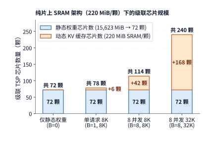

*图 4-39　Qwen3-8B（BF16）在纯片上 SRAM 架构（220 MiB/颗）下的级联芯片规模构成。静态权重固定需要 72 颗芯片，而动态 KV 缓存所需的额外芯片数随并发数与上下文长度从 6 颗急剧膨胀至 168 颗（总计 240 颗）。*

即便是拥有 44 GB 片上 SRAM 的晶圆级芯片 Cerebras WSE-3，虽然通过晶圆级集成消除了传统跨封装芯片的 I/O 瓶颈，但其 44 GB 容量依然是由分布在 90 万个核心网格上的局部 SRAM 拼合而成的：当某个计算任务需要访问远端网格节点的激活或状态时，数据依然必须沿着晶圆上的二维网格互连一跳一跳地传输。将共享同一份状态的计算集中部署在相邻核心上可以缩短网格通信跳数，而将任务铺开到全晶圆则能调动更多核心并行——这种“局部数据就近复用”与“全局核心负载均衡”之间的博弈，在物理机理上与第 4.5.1 节分析的双裸片（Multi-Die）放置问题如出一辙。

为了在真实工程中弥合“HBM GPU 容量大但单流延迟受限于 TB/s 级带宽”与“纯片上 SRAM 芯片带宽高达 PB/s 但单芯片容量受限”之间的鸿沟，最新一代超节点系统开始将两者纳入**异构协同或机柜级确定性 Scale-Up 架构**中。以 NVIDIA 发布的 **Groq 3 LPX 机柜系统**为例[^rubin-arch]：单台机柜通过高达 **$640\ \mathrm{TB/s}$ 的确定性 Scale-Up 互连网络**将 **256 颗语言处理单元（LPU）**紧密耦合为一个统一调度的同步推理池，整机柜合计提供 **$128\ \mathrm{GB}$ 的高密度片上 SRAM**（平均每颗 LPU 配备 $512\ \mathrm{MB}$ SRAM），聚合片上 SRAM 读取带宽达到 **$40\ \mathrm{PB/s}$（即 $40{,}000\ \mathrm{TB/s}$，单 LPU 约 $156\ \mathrm{TB/s}$）**。我们将这一机柜级纯 SRAM 阵列与前文配备 HBM4 的 Rubin GPU（单卡 $288\ \mathrm{GB}$ HBM4、带宽 $22\ \mathrm{TB/s}$）放在同一把物理标尺下对比：
- **在静态权重读取与超低延迟 Decode 侧**：当服务延迟高度敏感的在线 Agent 交互、实时语音生成或高频投机采样草稿生成时，若将激活专家权重或中小型主干模型切分常驻在 Groq 3 LPX 的 $128\ \mathrm{GB}$ 分布式 SRAM 中，凭借 $40\ \mathrm{PB/s}$ 的聚合片上带宽与编译期静态排定的无抖动流水，整机柜可在微秒级时间内扫完百 GB 级权重，实现单会话数千 token/s 的超低 TPOT 生成速度；
- **在长上下文 KV 缓存驻留与高并发吞吐侧**：整台 256 芯片 Groq 3 LPX 机柜的 SRAM 总容量（$128\ \mathrm{GB}$）尚不及**半张** Rubin GPU 的 HBM4 容量（$288\ \mathrm{GB}$）。因此，面对百万 token 级长上下文 Prefill 或数百并发会话的海量 KV 状态池，HBM4 GPU 超节点（如 Vera Rubin NVL72，单机柜提供 $20.7\ \mathrm{TB}$ HBM4 与 $1.6\ \mathrm{PB/s}$ HBM4 带宽）依然是不可替代的容量与高吞吐主力；而在分离式推理（Disaggregated Serving）架构中，由 HBM4 GPU 集群承担高算力 Prefill 与长上下文 KV 状态存储、由确定性 SRAM 加速阵列承担极低延迟 Decode 步进或投机验证，则成为兼顾容量墙与延迟墙的工程演进方向。[^rubin-arch][^special]

### 4.7.3 专用数据流的编程代价与固定权重

沿着专用化频谱一路看下来可以发现：硬件每替运行时省掉一分动态控制开销，软件就必须在编译期或芯片制造期多承担一分静态规划责任。一条粗粒度矩阵指令能够概括数千次乘加，专用的局部缓冲区能够锁住高频复用的数据块，硬连线的片上直通通道能够按固定节拍传递中间结果——这些专用硬件机制之所以能大幅削减取指译码、地址生成与远距离访存能耗，靠的正是编译器和算子开发者在程序运行前就已经把分块尺寸、搬移节拍与同步握手规划得滴水不漏。

具体而言，硬件专用化将原本由通用硬件缓存与乱序执行自动处理的工作，转化为了底层软件必须显式解决的三道编程难题：
1. **显式片上存储编排**：每一个张量分块究竟应该放在哪一级专用缓冲区？有限的片上容量最多允许切分几个流水槽位？上一轮数据在哪一拍彻底读完、下一轮数据在哪一拍允许安全覆写？
2. **多引擎并行与同步编排**：矩阵引擎、向量引擎与 DMA 搬移引擎如何在时间轴上交错重叠？跨引擎之间通过什么硬件事件（flag/barrier/BufferID）握手同步？
3. **动态形状与边界适配**：当实际矩阵维度不能被硬件分块整除时如何处理尾块（tail blocks）？面对长短不一的变长请求序列（ragged batch）或动态变化的 MoE 专家路由分布，如何分桶（bucketing）或拼装才能避免算力空转？哪些非标形状必须触发重新编译？

表 4-15 系统梳理了从专用指令直至固定权重存储的五级硬件专用化手段，以及它们各自在硬件端省下的开销与在软件/部署端转移的代价：

*表 4-15　五级硬件专用化手段在硬件侧节省的开销与软件/部署侧转移的规划责任对照*

| 专用化方式 | 硬件节省的工作 | 软件需要安排的工作 |
| --- | --- | --- |
| 专用矩阵指令 | 每次乘加的指令与控制开销 | 分块、对齐、精度和尾块 |
| 矩阵—向量直接交接 | 中间结果在外围接口上的写读 | 格式与布局匹配、完成事件 |
| 指定的局部存储 | 重复访问较远存储 | 张量放置、容量分配、槽位复用 |
| 编译期通信调度 | 运行时的逐项调度 | 依赖、执行顺序和形状变化后的重编译 |
| 固定权重存储 | 可写权重存储与相应读取负担 | 模型版本选择、可写状态和部署周期 |

在可重构与编译期数据流阵营中，SambaNova 的可重构数据流单元（RDU）与 FPGA 允许在部署时根据具体模型的计算图重新配置片上计算单元与存储单元之间的物理连线拓扑，而 Groq TSP 则将全芯片每一拍的张量生成、流转与消费时刻完全交给编译器静态排定。[^special] 显然，硬件绑定的静态假设越强，当上层业务切换模型架构或改变输入形状时，需要重新编译、重新布局乃至重新部署的软件工程链条就越长。为此，现代深度学习编译器（第 5 章）的核心使命，就是在不牺牲专用硬件执行效率的前提下，尽可能由编译器自动完成分块搜索、布局转换与同步指令插入，将算子开发者与上层算法工程师从底层硬件细节中解放出来。

如果把专用化进一步向前推演——既然一个训练定型的主力大模型在上线后的数月乃至一年服务期内，其**模型权重参数是完全只读、绝不修改的**（无论用户发来的是文档摘要、代码编写还是多轮对话，调用的都是同一套冻结的模型权重，唯一随每条请求动态读写改变的只有上下文 **KV 缓存与激活状态**），那么我们能不能干脆在硬件上**将“不可变的只读权重”与“可读写的动态 KV 状态”彻底分离到两种完全不同的物理存储介质上**？

笔者主持的 **OpenTallas** 研究项目正是围绕这一大胆构想展开探索：将训练定型的不可变模型权重直接固化在制造期写入的**掩模只读存储器（Mask ROM，一种在晶圆光刻制造阶段就将比特内容永久固化在金属互连层中的高密度、超低成本只读存储器）**芯片上，而将宝贵的可读写 **HBM 显存** 100% 留给动态变化的 KV 缓存与激活工作区。下面我们仍以 Qwen3-8B（BF16 精度，完整常驻权重约 $16.4\ \mathrm{GB}$，每步 decode 实际参与矩阵计算的共享权重读取量约 $W=15.1\ \mathrm{GB}$；每条 8,192 上下文请求的 KV 缓存读取量约 $K=1.21\ \mathrm{GB}$）为例，用基础定量公式算清这种“**独立 ROM 读权重 + 独立 HBM 读写 KV**”的分离式架构究竟能解放多少 HBM 容量与带宽。[^opentallas]

首先核算 **HBM 显存接口上的读取流量缩减倍数**。在传统架构下，权重与 KV 缓存共用同一个 HBM 接口，当批次并发请求数为 $B$ 时，每步 decode 必须从 HBM 读取的数据总量为 $W+BK$；而一旦将共享权重 $W$ 剥离到独立的片外/封装内 ROM 接口上读取，HBM 接口每步只需承担 $BK$ 的 KV 状态读写。由此可得剥离前后 HBM 读取量的缩减比 $S_{\mathrm{HBM}}$ 为：

$$
S_{\mathrm{HBM}}=\frac{W+BK}{BK}=1+\frac{W}{BK}.
$$

代入具体并发批量 $B$ 可以清楚看到这一分离设计的收益曲线：
- **当 $B=1$（单请求低延迟生成）时**：HBM 每步的读取负担从原来的 $15.1 + 1.21\approx16.3\ \mathrm{GB}$ 骤降至仅仅 **$1.21\ \mathrm{GB}$**——HBM 读取量与读取时间直接缩减到了原来的约 **$1/13.5$**；
- **当 $B=16$（中等并发合批生成）时**：16 条请求的 KV 读取量之和已达 $16\times1.21\approx19.3\ \mathrm{GB}$，此时剥离权重使 HBM 读取量从约 $34.5\ \mathrm{GB}$ 降至 $19.3\ \mathrm{GB}$（缩减为原来的约 **$1/1.8$**）。可以看到，随着并发批量 $B$ 的增大，由于静态权重 $W$ 原本就已经被更多条并发请求分摊稀释，将其剥离出 HBM 所带来的相对边际收益会自然递减。

我们令动态 KV 读取量与静态权重读取量恰好相等（即 $BK = W$），即可求出主导流量发生交替的**临界并发批量（转折点）**：$B^* = 15.1 / 1.21 \approx 12.5$。也就是说，在 8K 上下文长度下，当并发请求数从整数 **$B=13$** 起，每步读取的私有 KV 缓存总量就开始反超共享的模型权重（图 4-40 用代表固定权重的水平虚线与代表随 batch 线性增长的 KV 斜线直观标出了这一交点）。

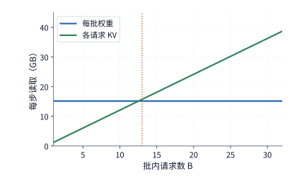

*图 4-40　固定权重的同时，各请求仍独立读取 KV。题设每请求保留 8K 上下文，batch 从 13 起 KV 读取超过共享权重读取。*

在时间维度上，由于独立 ROM 接口与 HBM 接口拥有各自独立的物理数据通路，**从 ROM 读取共享权重 $W$** 与 **从 HBM 读取批次 KV 状态 $BK$** 完全可以在时间上并行重叠推进（见图 4-41）。设独立 ROM 接口的有效读取带宽为 $\beta_{\mathrm{ROM}}$，HBM 接口的有效带宽为 $\beta_{\mathrm{HBM}}$，在模型、精度、上下文长度与并发批量 $B$ 固定的前提下，单步 decode 的整体访存耗时下界 $t_{\mathrm{memory}}$ 由两条并行路径中较慢的那一路决定：

$$
t_{\mathrm{memory}}\geq\max\left(\frac{W}{\beta_{\mathrm{ROM}}},\frac{BK}{\beta_{\mathrm{HBM}}}\right).
$$

上式同样揭示了清晰的瓶颈转移边界：提高专用 ROM 接口的带宽 $\beta_{\mathrm{ROM}}$ 能够不断压缩第一项 $\frac{W}{\beta_{\mathrm{ROM}}}$，直到第二项（HBM 上的 KV 读取耗时 $\frac{BK}{\beta_{\mathrm{HBM}}}$）取而代之成为新的最慢瓶颈。我们不妨做一个极限推演：如果设计目标是让单个用户（$B=1$，8K 上下文）达到 **$10{,}000\ \mathrm{token/s}$** 的高速生成吞吐，那么每生成 1 个 token 允许的总时间预算就只有短短 **$100\ \mathrm{\mu s}$（$10^{-4}\ \mathrm{s}$）**；哪怕专用 ROM 接口在瞬间就把权重读完，仅把该用户自身的 $1.21\ \mathrm{GB}$ 历史 KV 缓存在 $100\ \mathrm{\mu s}$ 内读出来，就要求可读写显存子系统提供高达 $\frac{1.21\ \mathrm{GB}}{100\ \mathrm{\mu s}} = \mathbf{12.1\ \mathrm{TB/s}}$ 的有效带宽。

与此同时，将那 $16.4\ \mathrm{GB}$ 的常驻权重彻底移出 HBM，还将宝贵的 HBM 显存容量全数解放给了并发 KV 缓存。我们算一笔显存容量对比账：假设芯片仅外接 **1 座** $24\ \mathrm{GB}$ 的 8 层 HBM3E 显存堆（见第 4.1.3 节），扣除 $2\ \mathrm{GiB}$ 运行时工作区后剩余约 $20.36\ \mathrm{GiB}$ 可用空间。在传统架构下，还要从这单堆 HBM 里划出约 $15.26\ \mathrm{GiB}$（$16.38\ \mathrm{GB}$）来存放 BF16 模型权重，剩下的空间最多只能容纳 **4 条** 8K 上下文请求（每条占 $1.125\ \mathrm{GiB}$）；而在权重移入独立 ROM 后，整座 HBM 显存堆全部用来装 KV 缓存，单堆即可同时容纳 $\lfloor 20.36 / 1.125 \rfloor = \mathbf{18\ \textbf{条}}$ 8K 请求，并发承载力一举扩大了 **4.5 倍**。[^core-calculation] 当然，如果单条请求的上下文长度从 8K 增长 4 倍至 32K，每条请求的 KV 体积也随之翻 4 倍，前文算出的“KV 读取量反超权重读取量”的临界并发度 $B^*$ 就会同比例缩小至原来的四分之一（从约 $12.5$ 条骤降至约 $3.13$ 条，即从第 4 条并发请求起 HBM 上的 KV 流量就已成为绝对大头）。

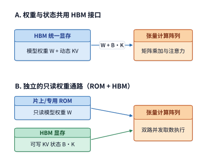

*图 4-41　独立只读权重改变两条存储路径。上方权重与 KV 争用 HBM；下方 ROM 提供权重，HBM 存放可写状态。箭头表示读取，KV 还需写入新状态。*

最后，我们还可以利用同一个“每 token $100\ \mathrm{\mu s}$”的极限时间预算，反向推导出芯片上至少需要铺设多少条并行算术乘加通道（lanes）。根据 OpenTallas 项目对 Qwen3-8B 单步执行的精确指令追踪记录，单步共需执行 $15{,}134{,}641{,}792$ 次浮点运算（约 $15.135\ \mathrm{GFLOPs}$）。假设芯片运行在 $1\ \mathrm{GHz}$ 时钟频率下，每条硬件乘加通道（lane）每个时钟周期完成 1 次乘加运算（即 $2\ \mathrm{FLOPs/cycle}$，每秒完成 $2\times10^9\ \mathrm{FLOPs}$），要想在 $100\ \mathrm{\mu s}$ 内把这 151.35 亿次浮点运算全部算完，在 100% 理想利用率下至少需要配置的并行乘加通道数 $n_{\mathrm{lane}}$ 为：

$$
n_{\mathrm{lane}}\ge\left\lceil\frac{15\,134\,641\,792}{2\times10^9\times100\times10^{-6}}\right\rceil=75\,674.
$$

作为对比，如果芯片上仅配置 256 条乘加通道，算完这一步需要耗时约 $29.6\ \mathrm{ms}$；而如果在 $100\ \mathrm{\mu s}$ 的总预算中，扣除同步与向量后处理后真正留给矩阵乘加的时间窗口只有 $40\ \mathrm{\mu s}$，且矩阵单元的实际硬件有效利用率为 $60\%$，那么所需配置的物理乘加通道数就必须膨胀至 $\lceil \frac{15\,134\,641\,792}{2\times10^9\times40\times10^{-6}\times0.60} \rceil = \mathbf{315{,}306}$ 条——约为理想下界（$75{,}674$ 条）的 **4.2 倍**。这一推导清晰展示了极低延迟目标是如何倒逼硬件规模的：**端到端时间限制越严苛，留给串行等待与低效分块的容忍余量就越小，芯片上必须堆砌的并行算力通道与存储接口带宽就越庞大。**

## 4.8 根据架构分析性能、选择加速器

在进行工程架构选型时，绝不能脱离具体程序去空谈芯片纸面峰值，而必须将**硬件物理能力**与**算子软件实现**放在一起综合评估：矩阵计算单元的吞吐决定了密集乘加的上限，向量与特殊函数单元的吞吐决定了归一化与激活后处理的速度，各级存储与跨核交接接口决定了操作数何时就位，而编译器与算子库则决定了上述硬件部件能否紧密咬合、以及模型的真实矩阵形状能否命中高效内核路径。本节将前面各节的分析工具汇聚为一套完整的选型方法论：首先建立融合资源共享、并行重叠与阶段依赖的执行时间模型（含 Roofline 转折点推导），接着用同一个基准模型横向评估多款主流加速器，随后通过微基准实测校准理论预测与真实耗时的差距，最后将执行时间换算为单任务能耗、服务单位成本以及专用架构的投资回本周期（ROI）。

为了支撑后续第 5 至 7 章的系统设计，我们对任何一款目标加速器的硬件画像都应完整涵盖五个维度：**目标精度与矩阵形状下的有效算力、各级存储（寄存器/片上缓冲/L2/显存）的容量与带宽、矩阵与向量单元之间的片上交接通路、异步搬移与硬件同步原语、以及跨芯片/跨机互连链路参数**（第 5 章将依据这些参数编排算子分块、融合与多槽流水，第 6、7 章则进一步依据它们设计分布式并行切分与集合通信）。

与此同时，软件栈的适配成熟度也必须落实为可量化的核查清单：现有算子库是否已覆盖目标模型的特殊矩阵形状？跨单元数据布局转换会额外增加多少内存读写？动态变化的请求 batch size 是否需要按分桶（bucketing）填充并预先编译多套内核？例如，在对比同一个 $QK^{\mathsf T}\to\operatorname{Softmax}\to PV$ 注意力子图在不同芯片上的表现时，必须同时记录中间结果驻留的存储层级、数值精度格式与跨核同步事件——唯有如此，工程团队才能准确分辨：当前的性能瓶颈究竟源于**物理硬件带宽/算力本身不足**、**底层软件尚未用上硬件专用直通通路**，还是**任务本身的极小矩阵形状难以实现操作数复用**。

### 4.8.1 从资源预算建立执行时间模型

任何一段计算图在硬件上的端到端执行时间，都由两条基本物理关系共同决定：第一，**共享同一硬件单元的多项工作必须排队串行累加耗时**；第二，**存在先后数据依赖的不同阶段必须等待前序结果完成后才能启动**。前一条关系决定了每个硬件部件各自需要忙多久，后一条关系则决定了不同硬件部件在时间轴上能否并行重叠。

1. **同一硬件单元上的串行累加**。假设同一个矩阵计算单元需要先后处理两项各包含 $10^9$ 次运算（1 Gops）的子任务，对应的硬件有效执行速率分别为 $100\ \mathrm{Gops/s}$ 与 $200\ \mathrm{Gops/s}$，则这两项子任务分别需要占用该单元 $10\ \mathrm{ms}$ 与 $5\ \mathrm{ms}$，合计占用 $15\ \mathrm{ms}$。推广为一般形式：若硬件资源 $r$ 需要承担的多项子工作记为 $i=1,2,\dots$，第 $i$ 项工作在资源 $r$ 上的工作量为 $w_{r,i}$、对应的有效处理速率为 $p_{r,i}$，则资源 $r$ 完成全部被分配工作所需的总服务时间 $T_r$ 为：

$$
T_r=\sum_i\frac{w_{r,i}}{p_{r,i}}.
$$

举例来说，当模型权重与 KV 缓存在每一步都通过同一个 HBM 显存接口读取时，二者的字节流量必须在 $T_{\mathrm{HBM}}$ 中相加；当注意力中的 $QK^{\mathsf T}$ 与 $PV$ 都调用同一个矩阵计算单元时，二者的矩阵计算时间必须在 $T_{\mathrm{matrix}}$ 中相加——即便这些工作分散在不同的算子或子层中，只要它们争抢的是同一份物理硬件资源，耗时就必须累加。

2. **独立硬件资源之间的并行重叠下界**。当不同的硬件部件（例如矩阵计算单元、向量计算单元与异步 DMA 搬移引擎）拥有各自独立的控制流、能够在不同数据块上同时工作时，整段流水线的总执行时间 $T$ 至少不可能短于其中最繁忙、耗时最长的那个硬件部件完成其全部工作所需的时间，即 $T\ge\max_r T_r$。我们在第 4.2.3 节分析 FlashAttention-4 稳态流水线时使用的正是这一定律：当特殊函数单元的指数运算没有加速时，即便 Tensor Core 矩阵计算提前算完，也只能原地等待指数单元，使得整条流水线的稳态节拍依然由耗时最长的那一项决定。

3. **跨阶段先后依赖带来的非重叠累加**。仅靠全局的 $\max_r T_r$ 往往会低估真实耗时，因为存在严格先后依赖的两个阶段无法跨阶段借用空闲资源。我们看一个一目了然的例子：设某任务由严格串行的两个阶段组成——**阶段一**需要矩阵计算 $10\ \mathrm{\mu s}$、显存读取 $1\ \mathrm{\mu s}$（阶段内部可重叠，耗时 $\max(10,1)=10\ \mathrm{\mu s}$）；**阶段二**需要等待阶段一彻底结束后才能开始，它需要矩阵计算 $1\ \mathrm{\mu s}$、显存读取 $10\ \mathrm{\mu s}$（阶段内部可重叠，耗时 $\max(1,10)=10\ \mathrm{\mu s}$）。显然，两个阶段串行相加的实际总耗时为 $10 + 10 = \mathbf{20\ \mathrm{\mu s}}$。但如果我们不划定阶段边界，而是粗暴地把全任务的矩阵总耗时（$10+1=11\ \mathrm{\mu s}$）与显存总耗时（$1+10=11\ \mathrm{\mu s}$）先各自加总再取最大值，就会算出 $\max(11,11) = \mathbf{11\ \mathrm{\mu s}}$ 的错误下界。凭空少算的那 $9\ \mathrm{\mu s}$，正是因为阶段二的显存读取依赖于阶段一的矩阵计算结果，二者在时间轴上根本无法跨阶段重叠。[^stage]

将上述时间模型应用到具体显卡上时，第一步就是必须**严格匹配算子实际调用的输入精度与累加器精度峰值**。以消费级旗舰 RTX 4090 为例：其白皮书标称的 Tensor Core 稠密峰值算力有两档——在“FP16 输入、**FP16 累加**”模式下高达约 $330\ \mathrm{TFLOP/s}$，而在深度学习广泛采用的“BF16/FP16 输入、**FP32 累加**”模式下则减半为约 **$165.2\ \mathrm{TFLOP/s}$**（本章所有 BF16/FP32 投影均严格采用 $165.2\ \mathrm{TFLOP/s}$ 这一口径）。[^hardware] 对第 4.1.1 节中 $M=256$ 行的 Q 投影（运算量 $8.59\ \mathrm{GFLOPs}$）而言，若误用 $330\ \mathrm{TFLOP/s}$ 会算出约 $26\ \mathrm{\mu s}$，而按真实的 FP32 累加峰值 $165.2\ \mathrm{TFLOP/s}$ 计算则需要约 **$52\ \mathrm{\mu s}$**。对照该算子约 $37.4\ \mathrm{\mu s}$ 的片外显存传输耗时可以看到：选错算力峰值档位，甚至会直接颠倒“计算受限（$52 > 37.4$）”与“访存受限（$26 < 37.4$）”的定性判断。

一旦明确了硬件算力峰值 $P$ 与片外显存带宽 $R$，我们就可以引入体系结构中经典的 **Roofline（屋顶线）模型**，定量刻画算子随输入规模变化时的瓶颈转移轨迹。设某算子的浮点运算量为 $F$、片外显存读写字节数为 $V$，算术强度为 $I=F/V$。在理想重叠下，该算子的纯计算耗时为 $F/P$，纯访存耗时为 $V/R$，实际最短耗时受限于二者中的较大者 $\max(F/P, V/R)$；用总运算量 $F$ 除以这一最短耗时，即可得出硬件在该算术强度 $I$ 下所能达到的**理论最高计算吞吐率上界 $P_{\mathrm{attainable}}$**：

$$
P_{\mathrm{attainable}}\le\min(P,RI),\qquad I=F/V.
$$

在以算术强度 $I$ 为横轴、吞吐率 $P_{\mathrm{attainable}}$ 为纵轴的坐标系中，上式构成了一条由**左侧斜坡（斜率为带宽 $R$，代表访存带宽受限区 $RI$）**与**右侧平顶（高度为峰值算力 $P$，代表计算算力受限区 $P$）**拼接而成的“屋顶折线”。斜坡与平顶的交点横坐标称为硬件的**嵴点算术强度（ridge point）**：

$$
I^* = \frac{P}{R}.
$$

当算子的算术强度 $I < I^*$ 时，每从显存读入 1 字节数据所对应的乘加次数太少，计算单元在等显存喂数据（**访存受限，memory-bound**，此时应主要用显存带宽利用率 **MBU** 评估优化水平）；当算子的算术强度 $I > I^*$ 时，每字节数据在片上得到了充分复用，矩阵计算单元自身的速度成为硬性上限（**计算受限，compute-bound**，此时应主要用模型算力利用率 **MFU** 评估优化水平）。任何真实算子在硬件上的实测吞吐点都必然落在这条屋顶折线的下方，实测点与屋顶折线之间的垂直距离即直观反映了软件实现的效率损失（见第 1.2.2 节）。

我们将第 4.1.1 节的 Qwen3-8B 查询投影（理想复用下输入与权重各读 1 次、输出写 1 次）放到 RTX 4090（BF16 输入/FP32 累加峰值 $P=165.2\ \mathrm{TFLOP/s}$，显存带宽 $R=1.008\ \mathrm{TB/s}$）上，对比 $M=1$ 与 $M=256$ 两种输入行数下的时间账本（表 4-16）：[^projection]

*表 4-16　Qwen3-8B 查询投影在 RTX 4090 上 $M=1$ 与 $M=256$ 两种输入行数下的计算与访存耗时账本*

| 本次处理的 token 数 $M$ | 矩阵计算时间 | 片外数据传输时间 | 两项耗时的最大值 | 主导资源 |
| --- | ---: | ---: | ---: | --- |
| $M=1$ | 约 0.20 μs | 约 33.3 μs | 约 33.3 μs | 内存 |
| $M=256$ | 约 52 μs | 约 37.4 μs | 约 52 μs | 矩阵 |

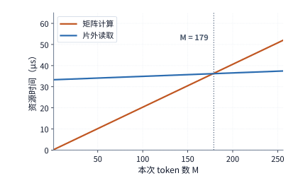

*图 4-42　同一 Q 投影的计算与访存耗时随输入行数的变化。计算量按行数增长，片外访问同时包含固定权重和增长的输入输出；从 179 行起矩阵计算耗时超过片外访存耗时。*

利用 Roofline 嵴点条件，我们还能精确求出在 RTX 4090 上让该投影从“访存受限”跨入“计算受限”的**临界输入行数 $M^*$**。记隐藏维度 $d=4096$，由第 4.1.1 节公式可知，当 $K=N=d$ 时，算术强度随行数 $M$ 的函数关系可化简为 $I(M)=\frac{2Md^2}{2d^2+4Md}=\frac{Md}{d+2M}$。令算子的算术强度恰好等于硬件嵴点算术强度 $I(M^*) = I^* = P/R$，解方程可得临界行数通用公式：

$$
M^*=\frac{I^*d}{d-2I^*}.
$$

代入 RTX 4090 未经四舍五入的精确硬件速率，可得嵴点算术强度 $I^* = 165.2 / 1.008 \approx 163.89\ \mathrm{FLOPs/byte}$，进而算出临界行数 $M^*\approx178.1$。这意味着，在 RTX 4090 上运行 $4096\times4096$ 的 BF16 投影时，从整数输入行数 **$M=179$ 行**起，Tensor Core 矩阵计算耗时就开始正式超过片外显存传输耗时（见图 4-42 中的交点）。这一简洁的解析公式，将工程上定性的“大 batch 更能发挥矩阵算力”转化为了可针对任意芯片与矩阵尺寸精确求解的行数阈值。[^pipeline-extra]

> **实验 4-5 · 核心：batch 如何改变不同架构的性能瓶颈**
>
> 推导并画出 Q 投影从 1 到 256 行的算术强度，分别将矩阵计算吞吐率、内存带宽提高到原来的两倍，求计算时间与读取时间相等时的输入行数。随后把注意力与专家矩阵加入资源表，解释上下文长度和各专家输入行数的分布，怎样改变各单元的处理时间及瓶颈所在。选择两种具体加速器，分别用其资源参数估算同一任务的执行时间，并比较瓶颈。

掌握了单个投影算子的分析方法后，第 4.8.2 节将其直接推广到完整的 Qwen3-8B 与 Qwen3-235B-A22B 模型上，分别核算 decode 阶段的显存读取下界与 prefill 阶段的矩阵计算下界，并横向比对多款主流加速器的选型取舍。

### 4.8.2 用同一模型比较候选加速器

我们先固定一个完全透明、便于读者随时复算的整模型基准任务：**运行 Qwen3-8B（BF16 精度），服务单条请求（$B=1$），当前已缓存 8,191 个历史上下文位置，本步 decode 生成并追加第 8,192 个位置**。先盘点显存容量与单步访存账本：全模型常驻 BF16 权重约为 $16.381\ \mathrm{GB}$，8,192 个位置的 KV 缓存约为 $1.208\ \mathrm{GB}$，预留 $2\ \mathrm{GiB}$（约 $2.147\ \mathrm{GB}$）运行时工作区，单请求总显存容量预算约为 **$19.737\ \mathrm{GB}$**。在执行这一步 decode 时，从显存读取的非词嵌入权重（$15.137\ \mathrm{GB}$）与历史 KV 缓存（$1.208\ \mathrm{GB}$）合计产生 **$16.345\ \mathrm{GB}$** 的显存读取载荷（注：输入端的词嵌入层每步仅按 token ID 查表读取 1 行向量，而末端输出词表头则需读取完整的词表投影矩阵，因此常驻权重总体积 $16.381\ \mathrm{GB}$ 与单步矩阵权重读取量 $15.137\ \mathrm{GB}$ 相差一个输入词嵌入表的大小）。[^storage]

接着盘点全模型的**矩阵浮点运算量（FLOPs）**。Qwen3-8B 共有 36 个 Transformer 层，隐藏层维度 $d=4{,}096$，SwiGLU 前馈网络中间维度 $d_{\mathrm{ff}}=12{,}288$，配备 32 个查询头（Q）与 8 个键值头（K/V），每个头维度为 128（故 K、V 投影输出宽度均为 $8\times128=1{,}024$）。由此可写出单个 Transformer 层内全部 7 个权重矩阵（Q、K、V、O 四个注意力线性投影 + 门控、上、下三个前馈网络投影）的参数总数 $W_{\mathrm{layer}}$：

$$
W_{\mathrm{layer}}=2\times4096^2+2\times4096\times1024
+3\times4096\times12288.
$$

按每个权重参数每处理 1 个 token 执行 1 次乘加（2 FLOPs）计算：
- **在单请求 8K decode 阶段（处理 1 个新 token）**：穿过全部 36 层权重矩阵的线性运算量为 $2\times36\,W_{\mathrm{layer}}\approx13.89\ \mathrm{GFLOPs}$；在注意力核心运算中，新 token 的 32 个查询头需与 8,192 个历史位置的 K、V 各做一次点积与加权求和，36 层合计运算量为 $4\times36\times8192\times4096\approx4.832\ \mathrm{GFLOPs}$；再加上末端词表输出头投影的约 $1.245\ \mathrm{GFLOPs}$，单步 8K decode 的全模型矩阵总运算量约为 **$19.97\ \mathrm{GFLOPs}$**。
- **在 4K 输入 prefill 阶段（一次性并行处理 $P=4{,}096$ 个新输入 token，无历史前缀）**：各层权重矩阵的线性运算量严格按 token 数放大 4,096 倍；而在因果自注意力层中，允许相互访问的可见位置配对总数为 $\frac{4096\times4097}{2}$ 对，每一对位置在全部 32 个注意力头上完成 $QK^{\mathsf T}$ 内积与 $PV$ 累加共需 $4\times4096$ FLOPs，乘以 36 层后，全模型有效因果注意力核心运算量为 $2\times36\times4096\times4096\times4097\ \mathrm{FLOPs}$；末端仅对最后 1 个输入位置计算词表输出头以生成首个输出 token，汇总可得整次 4K prefill 的全模型矩阵总运算量约为 **$61.85\ \mathrm{TFLOPs}$**。

我们将“单请求 8K decode 的显存读取载荷（$16.345\ \mathrm{GB}$）”与“4K prefill 的矩阵总运算量（$61.85\ \mathrm{TFLOPs}$）”分别除以第 4.6 节各款候选加速器的峰值带宽与匹配精度峰值算力，即可绘出图 4-43 的跨平台硬件预算横评。

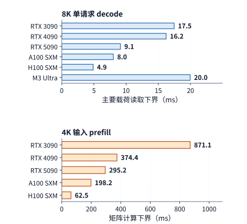

*图 4-43　同一 Qwen3-8B 的两种阶段预算。单请求 decode 更直接反映读取带宽，4K prefill 的矩阵预算更直接反映匹配精度的矩阵速率。两图横轴分别标注所计算的时间。*

对照图 4-43 的左右两栏，多款加速卡在 prefill 与 decode 两个阶段的表现差异一目了然：
- **从 RTX 3090 升级到 RTX 4090**：单请求 8K decode 的理想读取耗时仅缩短了约 **$7.1\%$**（因带宽几乎未变），但 4K prefill 的理想矩阵计算耗时却大幅缩短了约 **$57.0\%$**；
- **从 A100 SXM 升级到 H100 SXM，再到 H200 SXM**：A100 换到 H100 时，单步 decode 读取耗时缩短约 **$39.1\%$**，而 4K prefill 矩阵计算耗时大幅缩短约 **$68.5\%$**；继续从 H100 换到 H200 时，4K prefill 矩阵计算时间保持不变，而单步 decode 读取时间则随 HBM3E 带宽升级继续显著下降；
- **对比同代 RTX 5090 与 RTX PRO 6000 Blackwell**：由于两张卡均为 $1{,}792\ \mathrm{GB/s}$ 带宽，它们在左栏单请求 decode 上的读取耗时下界完全相同（均为 $9.12\ \mathrm{ms}$）；但在右栏 4K prefill 上，拥有更高 FP32 累加矩阵吞吐与 96 GB 显存的 RTX PRO 6000 则具备显著的速度优势。

这为我们给出了清晰的**按业务负载选卡指南**：如果业务是以长文档阅读、RAG 检索摘要为主的 **prefill 密集型负载**，优先选择像 RTX 4090、RTX PRO 6000 或 H100 这样矩阵算力跃升显著的型号，能够直接压低首 token 延迟（TTFT）；而如果业务是以长回答生成、代码编写或链式思考（CoT）为主的 **decode 密集型负载**，则只有选择像 RTX 5090 或 H200 这样显存带宽大幅跃升的型号，才能实质性地加快每个输出 token 的生成节奏。

在此基础上，我们再把**显存容量硬门槛**纳入考量：
1. **并发请求扩展如何触发容量升级？** 在运行 BF16 Qwen3-8B 时，单条 8K 请求的总显存需求约为 $19.737\ \mathrm{GB}$，24 GB 显存的 RTX 3090 与 4090 均可单卡装下；但只要将并发度扩大到 **8 条** 8K 请求，总显存预算就会增至约 **$28.193\ \mathrm{GB}$**——直接淘汰掉 24 GB 的 3090/4090，而必须选用拥有 32 GB 显存的 RTX 5090 或更大容量的工作站/数据中心卡。
2. **在本地工作站单机部署时，Qwen3-8B（稠密）与 Qwen3-235B-A22B（大型稀疏 MoE）应当如何选型？**
   - 若部署 **BF16 Qwen3-8B（单请求 8K decode）**：RTX 4090（24 GB）、RTX 5090（32 GB）与 Apple M3 Ultra（256 GB）均能完整装下。将它们各自的单步显存读取时间下界换算为每秒生成的理论 token 数上限（$1000\ \mathrm{ms} / t_{\mathrm{read}}$），分别为：RTX 4090 约 $1000 / 16.22\approx\mathbf{61.7\ \mathrm{token/s}}$，RTX 5090 约 $1000 / 9.12\approx\mathbf{109.6\ \mathrm{token/s}}$，M3 Ultra 约 $1000 / 19.96\approx\mathbf{50.1\ \mathrm{token/s}}$。可以看到，对于 8B 稠密模型而言，M3 Ultra 庞大的 256 GB 内存完全派不上用场，反而是拥有 $1{,}792\ \mathrm{GB/s}$ GDDR7 高带宽的 RTX 5090 直接提供了两倍以上的生成速度上限。
   - 若换成 **4-bit Qwen3-235B-A22B（单请求 8K decode）**：如第 4.6.3 节所算，该模型连同 KV 与工作区共需约 **$126.867\ \mathrm{GB}$** 内存空间——24 GB 的 3090/4090 与 32 GB 的 5090 全部因容量不足而出局，唯有 **M3 Ultra（256 GB）** 与数据中心级的 **H200（141 GB）** 能够单机/单卡原位容纳。在单步读取耗时上（每步仅需读取激活专家与 KV 共约 $13.697\ \mathrm{GB}$），M3 Ultra 耗时约 $16.72\ \mathrm{ms}$（对应上限约 **$59.8\ \mathrm{token/s}$**），而拥有 $4.8\ \mathrm{TB/s}$ HBM3E 带宽的 H200 则仅需约 $2.85\ \mathrm{ms}$（对应上限高达约 **$350.4\ \mathrm{token/s}$**）。两相对比，两款大内存设备的定位一清二楚：**Apple M3 Ultra 凭借高性价比的超大统一内存，让原本只能在多卡服务器上运行的 235B 巨型 MoE 模型得以在一台安静的桌面工作站上流畅运行（近 60 token/s）；而数据中心级的 H200 则凭借 6 倍于前者的 HBM3E 带宽，将单步读取耗时进一步压缩到了前者的约六分之一**（至于在多张小显存 GPU 上通过张量并行与专家并行切分运行大模型的方案，将在第 6 章详细展开）。
   - 若聚焦同为 **$96\ \mathrm{GB}$ 内存容量档位**的移动/桌面工作站双雄——**Apple M2 Max（$96\ \mathrm{GB}$ 统一内存，$400\ \mathrm{GB/s}$；同系列 M2 Pro 为 $200\ \mathrm{GB/s}$）**与 **NVIDIA RTX PRO 6000 Blackwell Workstation（$96\ \mathrm{GB}$ 独立 GDDR7 显存，$1{,}792\ \mathrm{GB/s}$）**：两台设备在模型常驻容量边界上存在一道微妙的分水岭。RTX PRO 6000 的 $96\ \mathrm{GB}$ 是完全独立于宿主机系统内存之外的专用显存，扣除 $2\ \mathrm{GiB}$ 运行时工作区后有近 $94\ \mathrm{GB}$ 可悉数留给模型权重与 KV 缓存；而 M2 Max 的 $96\ \mathrm{GB}$ 统一内存则必须由 macOS 内核、桌面进程与 GPU 共享（通常需为系统预留 $8\sim 16\ \mathrm{GB}$），实际可供大模型锁定的安全上限约为 $76\sim 84\ \mathrm{GB}$。一旦模型权重与 KV 状态均能常驻在设备本地（例如在单流 decode 阶段读取一份 $4\ \mathrm{GiB}$ 的 4-bit 激活权重分块，见第 4.5.2 节算例 4-2），纯访存时间下界便严格反比于物理内存带宽：M2 Pro（$200\ \mathrm{GB/s}$）需 **$21.47\ \mathrm{ms}$**，M2 Max（$400\ \mathrm{GB/s}$）减半至 **$10.74\ \mathrm{ms}$**，而 RTX PRO 6000（$1{,}792\ \mathrm{GB/s}$）仅需 **$2.40\ \mathrm{ms}$**——凭借 $1{,}792 / 400 = \mathbf{4.48\times}$ 的物理带宽优势，独立 GDDR7 工作站卡在常驻状态读取与高算术强度 prefill（第五代 Tensor Core $503.8\ \mathrm{TFLOP/s}$）上均占据明显上风；而 Apple 统一内存工作站的独特价值，则在于免除了 CPU 与 GPU 交接动态新输入时的 PCIe 传输开销，并以远低于 $600\ \mathrm{W}$ 独立显卡的整机功耗与噪音提供接近 $90\ \mathrm{GB}$ 级的本地常驻空间。[^macbook-pro6000]

### 4.8.3 预测与实测为什么有差距

第 4.8.2 节的横评为我们划定了理想情况下的显存容量门槛与硬件理论耗时下界。然而在真实运行中，算子库会为每一个数学运算挑选具体的底层 kernel 实现，片上缓存会拦截并改变发往片外显存的实际流量，而主机端的内核下发、等待与同步同样会消耗可观的时间。通过性能剖析（profiling）与微基准实测识别出这些额外开销，正是补全第 4.8.1 节三部分耗时模型（$\max(T_{\mathrm{comp}}, T_{\mathrm{mem}}, T_{\mathrm{comm}}) + T_{\mathrm{wait}} + T_{\mathrm{extra}}$）的关键一步。

我们先将 Qwen3-8B 的单步 decode 读取预算放到本书的实测平台——**RTX PRO 6000 Blackwell Workstation** 上做一次端到端检验。在 BF16 精度、单请求（batch=1）、8K 上下文条件下，每步 decode 需从显存读取 $16.345\ \mathrm{GB}$ 数据；按该卡 $1{,}792\ \mathrm{GB/s}$ 的峰值带宽计算，单步理想读取耗时下界为 **$9.12\ \mathrm{ms}$**（对应理论生成速度上限约 **$109.6\ \mathrm{token/s}$**），连续生成 128 个 token 理论上只需约 **$1.17\ \mathrm{s}$**。

然而，第 8 章的实验 8-1 在同一张卡上使用 vLLM（0.23.0，eager 模式）实测同一工况时，单步纯 decode 迭代耗时的三轮中位数却达到了 **$25.83\ \mathrm{ms}$**（三轮实测值分别为 $26.43\ \mathrm{ms}$、$16.18\ \mathrm{ms}$、$25.83\ \mathrm{ms}$，其中两轮相差不足 $3\%$，取中位数以排除单轮波动的干扰）[^decode-measured]。对应的实际生成速度约为 **$38.7\ \mathrm{token/s}$**，连续生成 128 个 token 耗时约 **$3.31\ \mathrm{s}$**——理论读取下界（$9.12\ \mathrm{ms}$）仅占实测总耗时（$25.83\ \mathrm{ms}$）的 **$35.3\%$**，每一步都凭空多出了约 **$16.7\ \mathrm{ms}$** 的额外开销。

这多出来的 $16.7\ \mathrm{ms}$ 并非源于显存带宽打折。在同一实验中，我们将上下文长度缩短到 2K（每步少读 $0.906\ \mathrm{GB}$ 的 KV 缓存，按峰值带宽本应节省约 $0.51\ \mathrm{ms}$），实测单步耗时却依然为 **$26.26\ \mathrm{ms}$**，并未比 8K 上下文的 $25.83\ \mathrm{ms}$ 更快；反之，当我们在 2K 上下文下将并发批大小（batch size）扩大到 **64** 时，每步显存读取总量激增至 **$34.46\ \mathrm{GB}$**（理论读取下界升至 $19.23\ \mathrm{ms}$），而实测单步耗时却仅仅微增至 **$29.63\ \mathrm{ms}$**，折算实际有效显存带宽高达约 **$1.16\ \mathrm{TB/s}$**，达到了硬件峰值带宽的 **$65\%$**。

这一对比清晰地揭示了症结所在：在单请求（batch=1）且开启 eager 模式时，每步迭代耗时其实被一段**与显存读取量无关的固定开销**主导了——包括数百个算子 kernel 逐一下发的启动延迟（launch overhead）、零散的逐元素向量运算，以及主机与设备间的采样与同步等待。在这种工况下，单纯提升显存带宽利用率几乎无法加快单请求生成速度；要想真正缩短单步耗时，首先必须削减这部分固定启动与同步开销（第 5 章即将介绍的算子融合与 CUDA Graph 捕获技术，解决的正是这一问题）。而当并发批大小扩大到 64 以后，这笔固定开销被 64 个并行 token 均摊稀释，片外显存读取才重新成为主导整体耗时的瓶颈项。

按照第 1.2.2 节的定义，上述 $35.3\%$ 与 $65\%$ 正是这两种工况下的有效显存带宽利用率（MBU）。第 1.3.4 节所强调的“理论模型口径偏差”与“软件实现额外开销”两类差距在此处展现得淋漓尽致：一方面，后文的硬件性能计数器（PMU）记录将证明，算法层面的数据读取需求并不完全等同于真实的片外 DRAM 流量（凡是被片上 L2 缓存命中的请求都不会占用片外显存带宽，这要求我们修正理论模型的流量统计口径）；另一方面，kernel 逐一下发、主机提交与同步所留下的大量硬件空转间隙，则是可以通过软件优化实打实消除的实现开销。先校准流量口径，再削减空转开销，两步缺一不可。

为了演示如何利用计时器、硬件流量计数器与 kernel 追踪日志将多出的时间精确拆解到具体环节，我们来看本书配套实验在 **Apple M2 Max** 与 **RTX PRO 6000 Blackwell Workstation** 上对同一个 Q 投影算子（$K=N=4{,}096$，输入、权重与输出均为 BF16）所做的微基准实测。为了对比不同缓存命中状态下的权重访问表现，实验在每个平台上预先分配了 16 份内容完全相同、但物理地址彼此独立的 $32\ \mathrm{MiB}$ 权重张量：**“复用组”**在连续 16 次调用中始终传入同一个权重地址（模拟权重常驻缓存的理想情形），而**“轮换组”**则在 16 次调用中依次切换不同的权重地址（总权重体积达 $512\ \mathrm{MiB}$，模拟真实多层网络推理中权重不断冲刷片上缓存的情形）。每轮测试连续执行 16 次调用，记录包含主机端提交与最终同步在内的整轮端到端总耗时，再除以 16 得到单次调用平均耗时；连续运行 11 轮后取中位数[^measurement][^macbook-pro6000]，结果如表 4-17 所示：

*表 4-17　Apple M2 Max 与 RTX PRO 6000 Blackwell 在复用与轮换权重地址下的 Q 投影微基准实测耗时中位数*

| 本次处理的 token 数 $M$ | M2 Max：复用／轮换 | RTX PRO 6000：复用／轮换 |
| --- | ---: | ---: |
| $M=1$ | 约 166／183 μs | 约 42.9／51.9 μs |
| $M=256$ | 均约 1.835 ms | 约 32.6／33.5 μs |

对照第 4.5.2 节算例 4-2 的理论带宽比值（RTX PRO 6000 的 $1{,}792\ \mathrm{GB/s}$ 为 M2 Max $400\ \mathrm{GB/s}$ 的 **$4.48$ 倍**），可以清楚看到两台设备在 $M=1$ 与 $M=256$ 下的加速比为何截然不同：当 $M=1$ 时，算子处于典型的访存带宽受限区，M2 Max 相对于 RTX PRO 6000 的实测耗时倍数在轮换组下约为 $183 / 51.9 \approx \mathbf{3.53\times}$、在复用组下约为 $166 / 42.9 \approx \mathbf{3.87\times}$，与 $4.48\times$ 的物理带宽比值处于同一量级（RTX 侧因主机提交与同步固定开销占比较高而略低于 $4.48\times$）；而一旦输入扩大为 $M=256$ 行，算子跨入矩阵计算受限区，RTX PRO 6000 高达 $503.8\ \mathrm{TFLOP/s}$ 的第五代 Tensor Core 算力与 128 MiB 大容量 L2 缓存优势全面释放，将两者的实测耗时差距一举拉大到了 $1835 / 32.6 \approx \mathbf{56.3\times}$。[^macbook-pro6000]

我们再聚焦 RTX PRO 6000 在单行（$M=1$）下的表现：轮换组（$51.9\ \mathrm{\mu s}$）比复用组（$42.9\ \mathrm{\mu s}$）慢了约 **$21\%$**。一个很符合直觉的猜想是：“复用组反复读取同一份 $32\ \mathrm{MiB}$ 权重，权重留在了片上 L2 缓存里，从而减少了片外 DRAM 读取量”。这个猜想可以用硬件计数器直接证伪或证实——如果耗时差异真的源于片外读取量减少，那么复用组的片外 DRAM 实际读取字节数应当显著低于轮换组。为此，实验进一步使用 NVIDIA 的内核性能剖析工具 **Nsight Compute**，在相同预热条件下采集了单次待测调用期间全部底层 kernel 的硬件访存计数。

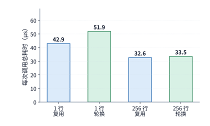

*图 4-44　RTX PRO 6000 的投影总耗时。每个条件测十一轮、每轮十六次调用，取每轮平均耗时的中位数；计时包含提交与同步。“复用”表示多次调用读取相同权重地址；“轮换”表示调用之间更换权重地址。*

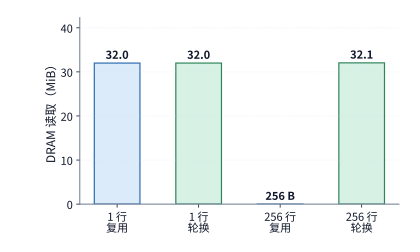

*图 4-45　相同四个条件下另行采集的 DRAM 读取计数。单行均约 32 MiB，256 行复用为 256 bytes、轮换约 32.1 MiB。访问计数与常规计时分别测量。“复用”与“轮换”分别表示保持和更换权重地址。*

对照图 4-44 的耗时与图 4-45 的 DRAM 流量计数，我们看到了两个颇具启发性的反直觉现象：
1. **在单行（$M=1$）条件下**：无论是复用组还是轮换组，硬件计数器记录到的片外 DRAM 实际读取量**全都是约 $32\ \mathrm{MiB}$**，刚好等于整份权重矩阵的大小。这意味着在 $M=1$ 所触发的底层算子访问模式下，即便复用同一个权重地址，片外 DRAM 依然发生了完整重读；单行下约 $9\ \mathrm{\mu s}$（$21\%$）的耗时差异并非源于片外 DRAM 流量减少，而是需要顺着 L2 命中路径、地址转换与主机提交开销做进一步定位。
2. **在 256 行（$M=256$）条件下**：情况完全反了过来——复用组的片外 DRAM 读取量骤降至仅 **$256\ \mathrm{bytes}$**（$32\ \mathrm{MiB}$ 权重几乎 100% 命中片上 128 MiB L2 缓存），而轮换组则实打实从片外 DRAM 读取了约 **$32.1\ \mathrm{MiB}$**；然而，即便片外显存流量相差超过十万倍，两者的端到端总耗时却几乎没有拉开差距（分别为 **$32.6\ \mathrm{\mu s}$** 与 **$33.5\ \mathrm{\mu s}$**）。这是因为片上缓存虽然免除了片外 DRAM 读取，但整次调用的总耗时还包含片上数据传输、矩阵乘计算、部分和归约以及主机端提交与同步等待。

通过深入查看 Nsight Compute 的分级存储计数与 kernel 调用栈，第 4.3 节剖析的多级存储层次与底层执行细节便完整浮现出来：
- **为什么片外 DRAM 读取降为零后，依然存在庞大的片上数据搬运？** 在 $M=256$ 的两种权重访问方式下，L2 缓存层面记录到的读取请求量都高达约 **$147\ \mathrm{MiB}$**——不仅远大于复用组近乎为零的 DRAM 流量，甚至达到了权重自身体积（$32\ \mathrm{MiB}$）的 **4.6 倍**。原因在于：L2 缓存命中只是将数据供应源从片外显存改到了片上 L2，但各个 SM 计算分块（thread block）发起的数据读取请求与 L2 到 SM 的片上传输依然客观存在；由于 $M=256$ 的矩阵乘被切分为多个输出分块并行执行，源程序里的同一份权重矩阵会被不同 SM 分块从 L2 缓存中反复拉取多次。
- **为什么一次简单的矩阵乘法会在底层拆成多个阶段？** 追踪底层 kernel 可以发现，算子库针对不同形状采取了截然不同的切分策略：$M=1$ 时仅下发 1 个 **GEMV kernel**；而 $M=256$ 时，为了在 $N=4{,}096$ 的输出维度之外发掘出更高的并发度，算子库自动启用了 **split-K 切分策略**——先启动 1 个 **GEMM kernel**，让多个线程块沿着内积维度 $K$ 分段并行累加，各自向片上缓冲区写出未完成的部分和（partial sums），随后再专门启动第 2 个 **split-K 归约（reduction）kernel** 将各段部分和读取并累加为最终输出。这种策略虽然填满了更多 SM，但也额外引入了部分和的读写流量与第二个 kernel 的启动及同步开销。

我们不妨再用 RTX PRO 6000 的硬件峰值参数（BF16 输入、FP32 累加稠密矩阵峰值算力约 $504\ \mathrm{TFLOP/s}$，峰值带宽 $1.792\ \mathrm{TB/s}$），估算假设输入与权重全部从片外显存读取时的理论耗时下界：$M=1$ 与 $M=256$ 的理论下界分别约为 **$18.7\ \mathrm{\mu s}$** 与 **$21.1\ \mathrm{\mu s}$**。将理论模型、PMU 计数器与 kernel 追踪结合起来：理论模型给出了纯矩阵计算与片外读取的物理底线（$18.7\ \mathrm{\mu s}$ / $21.1\ \mathrm{\mu s}$），PMU 计数器揭示了缓存拦截后各级存储接口的真实放大流量（如 $147\ \mathrm{MiB}$ 的 L2 请求），kernel 追踪解释了 split-K 等策略引入的额外合并阶段，而最终实测耗时（$32.6\text{–}51.9\ \mathrm{\mu s}$）与理论下界之间的差额，则精确归因到了主机提交、同步与阶段间的执行间隙上[^paired]。

为了在性能优化时精准施策，我们还可以把硬件单元的整体利用率进一步拆解为**“忙了多久（活跃时间占比）”**与**“忙的时候跑得多快（工作期有效效率）”**两个正交因子的乘积。设某硬件单元按峰值速率完成全部有效工作所需的理想时间为 $S_r$，任务执行期间该单元实际处于活跃工作状态的时间为 $A_r$，任务端到端总耗时为 $T$，则整体利用率 $S_r / T$ 可分解为：

$$
\frac{S_r}{T}=\frac{S_r}{A_r}\times\frac{A_r}{T}.
$$

式中，第一项 $\frac{S_r}{A_r}$ 衡量硬件单元**处于工作状态时的实际执行效率**（即工作时的实际速率与峰值速率之比），第二项 $\frac{A_r}{T}$ 则衡量该单元**在整段任务中的活跃时间占比**（其余 $T - A_r$ 即为空闲等待时间）。举例来说，假设两个任务的端到端总耗时均为 $T = 100\ \mathrm{\mu s}$，理想计算时间均为 $S_r = 40\ \mathrm{\mu s}$，表面上看两者的整体硬件利用率都是 $40\%$，但内部瓶颈却可能截然相反：
- **任务一（干得快、等得久）**：计算单元实际只工作了 $A_r = 40\ \mathrm{\mu s}$，工作期间达到了 $100\%$ 的理想峰值速率（$S_r / A_r = 1$），但其余 $60\ \mathrm{\mu s}$ 全都在等待数据或同步（$A_r / T = 40\%$）。针对这类瓶颈，优化方向应当是**提前预取数据、挖掘更多独立任务重叠执行，或消除前后阶段间的同步停顿**——正如第 4.4 节将两槽流水升级为三槽流水、或建立矩阵与向量直通路径的做法。
- **任务二（一直在忙、但干得慢）**：计算单元持续工作了 $A_r = 80\ \mathrm{\mu s}$（等待时间仅 $20\ \mathrm{\mu s}$，$A_r / T = 80\%$），但工作期间的实际执行速率只有峰值的一半（$S_r / A_r = 50\%$）。针对这类瓶颈，优化方向则应当是**改善矩阵分块粒度、提升指令发射效率与片上局部访存对齐度**——正如第 4.2 节消除分块边界补零浪费与合并小 batch 调用的做法[^nonmatrix]。

> **实验 4-6 · 延伸：用 Mac 与 RTX 实测检验执行时间预测**
>
> 根据投影在两种平台上的实测总耗时，提出两个能够解释耗时差异的原因，再读取 DRAM、L2 与 kernel 记录，为每个解释列出预期现象和实际现象。随后画出 256 行调用的矩阵、部分结果与归约路径，指出需要哪些阶段时间才能区分计算单元工作时的执行效率与等待时间。将所得结果与假设输入和权重均从片外读取的模型对照。

### 4.8.4 在容量、速度、功耗与成本之间做选择

第 4.8.3 节剖析了单次任务的实际运行耗时，本节则进一步将其折算为实际的**资金成本**与**能量消耗**，并把线上服务的空闲空转期、软件栈迁移适配成本以及专用硬件研发的固定投入一并纳入考量。要知道，将一套模型迁移到新硬件上的软件工程投入绝非免费——它往往涉及重写底层定制算子、转换权重内存布局、重新调优流水调度参数以及长期维护多版本模型分支。在进行硬件选型对比时，唯有把需要修改和验证的软件工程账目与线上运行收益放到同一个生命周期内通盘核算，才能做出理性的工程决策。

我们先看按运行时间计费（或折旧）时的**单任务执行成本**。设 A、B 两台设备的每小时使用成本分别为 $c_A$ 与 $c_B$，完成同一项任务所需的实际运行时间分别为 $t_A$ 与 $t_B$。由于单任务成本 $K$ 与“小时单价 $\times$ 运行时间（$c\cdot t$）”成正比，设备 A 的单任务成本低于设备 B 的充要条件为：

$$
K_A<K_B\quad\Longleftrightarrow\quad\frac{c_A}{c_B}<\frac{t_B}{t_A}.
$$

不等式右侧的加速比 $t_B / t_A$ 直接划定了设备 A 每小时单价可以高出多少倍的上限：只要 A 的处理速度是 B 的 2 倍，那么即便 A 的每小时租金比 B 贵上 1.8 倍，用 A 跑完单个任务依然更划算。

如果把公式中的每小时租金 $c$ 替换为设备运行期间的**平均功率 $P$**，同一个不等式比较的就是**单任务能耗**。以第 4.8.3 节 Q 投影实测的“复用组”为例：M2 Max 与 RTX PRO 6000 的单次调用耗时之比在单行（$M=1$）下约为 **$3.9$ 倍**（$166\ \mathrm{\mu s}$ 对 $42.9\ \mathrm{\mu s}$），而在 256 行（$M=256$）下则拉大到了约 **$56$ 倍**（$1.835\ \mathrm{ms}$ 对 $32.6\ \mathrm{\mu s}$）。若 RTX 一侧仅统计显卡本身，并按 RTX PRO 6000 Workstation 的 $600\ \mathrm{W}$ 功耗上限估算，执行一次单行调用最多耗能约 **$25.8\ \mathrm{mJ}$**，执行一次 256 行调用最多耗能约 **$19.6\ \mathrm{mJ}$**。虽然 Apple 官方未公布 M2 Max 在该工况下的瞬时功率，但我们可以直接利用上述不等式反推 Mac 保持能耗优势的临界功率门槛：在单行调用（慢 3.9 倍）期间，只要 M2 Max 的平均功率低于约 **$155\ \mathrm{W}$**（$600 / 3.9$），它完成单次调用的耗电量就比 RTX 更少（这对整机功耗仅几十瓦的 Mac 来说轻而易举）；但到了 256 行调用（慢 56 倍）时，M2 Max 的平均功率必须压低到约 **$10.7\ \mathrm{W}$**（$600 / 56$）以下才能在单任务能耗上与 RTX 打平。可以看到，**两台硬件分毫未改，仅仅将输入矩阵行数从 1 行扩大到 256 行，Mac 维持能效优势所允许的功率上限就从约 $155\ \mathrm{W}$ 大幅收紧至约 $10.7\ \mathrm{W}$**[^paired]。

对于 7×24 小时长期在线的推理服务而言，除了满载运行期，还必须把**业务低谷与空闲等待期间烧掉的租金与电费**摊入有效产出。设一台服务器在处理请求时每秒可生成 $q$ 个有效 token，而每小时内真正处于繁忙处理状态的时间占比（即服务利用率）为 $u$，则该服务器每小时的实际有效产出为 $3600\,u\,q$ 个 token，分摊到**每个有效 token 上的资金成本**为：

$$
\text{每 token 成本} = \frac{c}{3600\,u\,q}.
$$

这一公式揭示了一个常被忽视的运营铁律：**如果换用更快的硬件让满载生成速率 $q$ 翻了一倍，但由于线上流量不足或调度碎片化导致设备利用率 $u$ 减半，那么每小时的实际有效产出 $3600\,u\,q$ 将原地踏步，单 token 的分摊成本也不会有任何下降。**

同理，单步任务的**实际能耗**也由瞬时功率与持续时间的积分共同决定：

$$
E=\int_0^T P(t)\,dt.
$$

以第 4.8.2 节的 Qwen3-8B 单请求 8K decode 为例，假设两张显卡均在各自的功耗上限（TGP）下满载运行，且单步耗时等于各自的理论显存读取下界：RTX 4090 以 **$450\ \mathrm{W}$** 功率运行 **$16.22\ \mathrm{ms}$**，单步耗能约为 **$7.30\ \mathrm{J}$**；而 RTX 5090 虽然满载功率提升至 **$575\ \mathrm{W}$**（功率增加约 **$28\%$**），但由于 GDDR7 高带宽将单步耗时缩短到了 **$9.12\ \mathrm{ms}$**，其单步耗能反而下降到了约 **$5.24\ \mathrm{J}$**（单步能耗降低约 **$28\%$**）[^rtx-spec]。这正是芯片设计中著名的“跑得快、早休息（race to halt）”能效逻辑。

在长期在线服务中，将统计周期内的机房总耗电量除以同期的有效输出 token 总数，便把空闲待机与预热空转期间的耗电也一并摊入了单 token 能耗：缩短单步执行时间能够压低“执行计算时的动态耗电”，而提高在线利用率 $u$ 则能摊薄每个 token 背负的“空闲静态耗电”。回看第 4.1.3 节基于微操作物理能耗表的微观分账：单请求（batch=1）、8K 上下文 decode 时，纯数据搬运与算术运算的微观能耗约为 **$0.534\ \mathrm{J/token}$**（其中 $0.481\ \mathrm{J}$ 花在读取权重上）；当并发批大小扩大到 batch=32 时，权重读取能耗被 32 个请求均摊，微观能耗骤降至约 **$0.068\ \mathrm{J/token}$**。需要注意，第 4.1.3 节的微观账本并未计入指令控制、全局时钟树翻转、晶体管静态漏电以及板卡供电转换损耗与空闲待机功耗，因此用整卡实际总耗电量除以有效 token 产出所得的宏观每 token 能耗（如上述 4090/5090 的 $5\text{–}7\ \mathrm{J/token}$），必然显著高于微观物理分账的下界估计[^energy-ledger]。

最后，当我们考虑引入定制 ASIC、专用微架构改造或深度算子重写时，还必须核算**前期固定研发与适配投入能否在模型的有效生命周期内收回成本**。设专用方案相对于通用基线方案额外增加的前期固定投入为 $F_0$，每产出一个合格单位（如单个或每百万个 token）可节省的边际运行成本为 $\Delta c$，则收回前期固定投入所需的**盈亏平衡总产出量（回本量）$V^*$** 为：

$$
V^*=\frac{F_0}{\Delta c}.
$$

在真实工业界中，大模型架构与权重往往每隔数月到一年就会迭代换代，留给某套专用软硬件方案服役的**有效经济寿命 $L$** 是严格受限的。假设集群共部署了 $D$ 台机器，每台机器满载处理时的有效生成速率为 $q$，线上平均利用率为 $u$，则在模型寿命 $L$ 内整个集群能够完成的总有效产出为 $D\cdot u\cdot q\cdot L$。唯有当这段时间内的总产出达到或超过盈亏平衡点 $V^*$（即累计节省的运行费够抵消前期固定投入 $F_0$）时，这笔专用化投资才算真正回本。

> **例 4-3：专用化能否在模型寿命内回本？**
>
> 增量固定成本为 2,000 万美元，每百万合格输出 token 节省 0.50 美元。部署 100 台，每台处理请求时产出 10,000 token/s，利用率 50%，模型经济寿命一年，每年按 365 天计算。
>
> **比较回本所需输出量与一年可完成的输出量。** 回本量为 $20\,000\,000/(0.50/10^6)=4\times10^{13}$ token，即 40 万亿。一年产出为 $100\times10\,000\times0.5\times31\,536\,000\approx1.58\times10^{13}$ token，即约 15.8 万亿。
>
> **在一年内回本需要多大的实际服务规模？** 一年产出约为回本量的 39%。在单机速率与利用率保持不变时，至少需要 254 台运行一年。
>
> **模型寿命减半或利用率下降后的回本规模。** 模型半年更换，每台可用时间减半，至少需要 508 台机器维持给定利用率；若利用率从 50% 降至 25%，结果相同。

在例 4-3 的设定下，100 台机器运行一年仅能节省约 **788 万美元**的运行成本，远不足以覆盖 **2,000 万美元**的前期固定投入；按此产出速度，要想累计完成 40 万亿 token 的回本量需要约 **2.54 年**，早已超出了该模型 1 年的经济寿命[^opentallas]。这一算例清晰地提醒我们：任何脱离了业务流量规模、集群在线利用率与模型迭代周期的“单算子局部加速”或“专用芯片定制”，在工程经济账上都可能入不敷出。图 4-46 至图 4-49 将本章第 4.2、4.6 与 4.7 节剖析的 NVIDIA 四代数据中心 GPU 扩展规律、Google TPU7x 双芯粒与跨平台读取下界、微缩放低精度字节布局，以及华为昇腾 950 与 AWS Trainium2/Trainium3 片上软件管理存储层次汇总为四张直观的工程对照图谱。

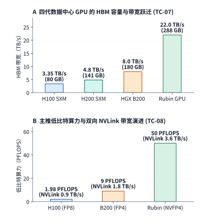

*图 4-46　NVIDIA 四代数据中心旗舰 GPU（H100 $\to$ H200 $\to$ HGX B200 $\to$ Rubin GPU）的代际扩展规律。（a）单卡 HBM 容量与带宽从 H100（$80\ \mathrm{GB}$ HBM3，$3.35\ \mathrm{TB/s}$）演进至 Rubin GPU（$288\ \mathrm{GB}$ HBM4，$22\ \mathrm{TB/s}$），容量扩大 $3.6\times$、带宽跃升 $6.57\times$，扣除固定常驻权重后使最大并发批量 $B_{\max}$ 产生超线性乘数放大（TC-07）；（b）主推低比特推理稠密算力从 H100 FP8（$1.98\ \mathrm{PFLOPS}$）经 B200 FP4（$9.0\ \mathrm{PFLOPS}$）跃升至 Rubin NVFP4（$50.0\ \mathrm{PFLOPS}$），单卡双向 NVLink 带宽同步从 $0.9\ \mathrm{TB/s}$ 倍增至 $1.8\ \mathrm{TB/s}$ 与 $3.6\ \mathrm{TB/s}$（TC-08）。*

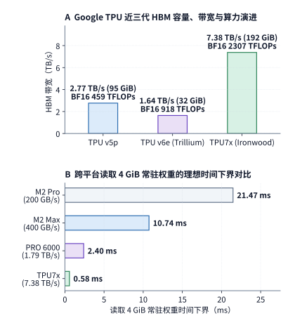

*图 4-47　Google TPU7x（Ironwood）代际演进与跨平台 $4\ \mathrm{GiB}$ 权重读取时间下界对比。（a）TPU7x 采用双芯粒（Dual-Chiplet）对称架构，单芯片集成 $192\ \mathrm{GiB}$ HBM（每芯粒 $96\ \mathrm{GiB}$）并提供 $7.38\ \mathrm{TB/s}$ 带宽，较 TPU v5p（$95\ \mathrm{GiB}$，$2{,}765\ \mathrm{GB/s}$）实现容量翻倍与 $2.67\times$ 带宽跃升；（b）在读取同一份 $4\ \mathrm{GiB}$ 常驻权重分块时，理想访存时间下界从 Apple M2 Pro（$200\ \mathrm{GB/s}$）的 $21.47\ \mathrm{ms}$、M2 Max（$400\ \mathrm{GB/s}$）的 $10.74\ \mathrm{ms}$，依次压缩至 RTX PRO 6000（$1{,}792\ \mathrm{GB/s}$）的 $2.40\ \mathrm{ms}$（相对 M2 Max 快 $4.48\times$）与 TPU7x（$7.38\ \mathrm{TB/s}$）的 $0.58\ \mathrm{ms}$。*

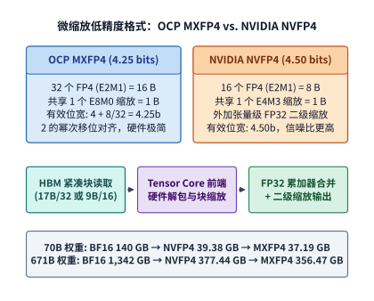

*图 4-48　微缩放低精度格式的内存字节布局与 Tensor Core 解包累加流水线对比。OCP MXFP4 以每 32 个 `E2M1` 元素配 1 个 `E8M0` 指数缩放因子（有效位宽 $4.25\ \mathrm{bits/elem}$），依靠硬件移位器对齐；NVIDIA NVFP4 以每 16 个 `E2M1` 元素配 1 个 `E4M3` 浮点缩放因子并叠加张量级 `FP32` 二级缩放（有效位宽 $4.50\ \mathrm{bits/elem}$），以每元素多 $0.25\ \mathrm{bit}$ 的带宽代价换取更高的尾数量化信噪比。在 671B 模型上，二者分别将常驻权重从 BF16 的 $1{,}342.0\ \mathrm{GB}$ 压缩至 $356.47\ \mathrm{GB}$ 与 $377.44\ \mathrm{GB}$。*

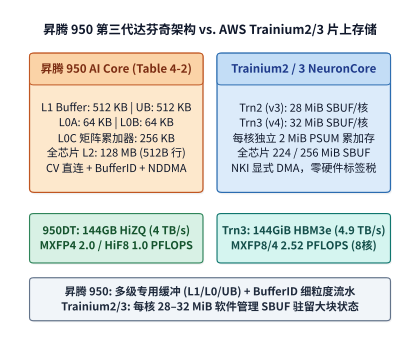

*图 4-49　两类典型非 GPU 加速器的片上软件管理存储层次对照。左：华为昇腾 950 第三代达芬奇架构（Table 4-2），单核配置 `L1 512 KB`、`L0A 64 KB`、`L0B 64 KB`、`L0C 256 KB` 与 `UB 512 KB`，全芯片共享 `128 MB` L2 Cache，通过 `CV` 核内直连、`BufferID`（`get_buf`/`rel_buf`）硬件流控与 5D `NDDMA` 驱动细粒度多缓冲流水；右：AWS Trainium2（NeuronCore-v3）与 Trainium3（NeuronCore-v4），每核分别配备高达 $28\ \mathrm{MiB}$ 与 $32\ \mathrm{MiB}$ 的二维软件管理 `SBUF` 及 $2\ \mathrm{MiB}$ `PSUM`（全芯片 $224 / 256\ \mathrm{MiB}$ `SBUF`），由 NKI 显式 DMA 直接驻留大尺寸矩阵宏分块与注意力中间状态。*

### 4.8.5 HBM4 2048-bit 逻辑基底裸片（Logic Base Die）与超节点内存墙破局

回顾第 4.1.3 节与第 4.6.1 节的带宽演进：从 HBM3（H100，$3.35\ \mathrm{TB/s}$）到 HBM3e（H200 $4.80\ \mathrm{TB/s}$、B200 $8.0\ \mathrm{TB/s}$），单座显存堆栈的数据引脚数始终维持在 **1024-bit**，带宽提升主要依赖拉高每引脚传输速率（从 $5.2\ \mathrm{Gbps}$ 推升至 $8.0\text{–}9.6\ \mathrm{Gbps}$）以及将单卡搭载的 HBM 堆栈数从 5 座扩至 6 座或 8 座。然而，单纯依靠提高单引脚工作频率会迅速撞上信号完整性（Signal Integrity）与单位比特动态功耗（$\mathrm{pJ/bit} \propto f V^2$）的物理陡墙。为了在下一代旗舰加速器（如 NVIDIA Rubin GPU 与 AMD Instinct MI400 系列）上实现单芯片 **$22\ \mathrm{TB/s}$** 级别的聚合显存带宽，JEDEC **HBM4 标准**从底层物理架构上实施了两项决定性的结构跃迁（见图 4-50）：
1. **单堆栈接口位宽翻倍至 2048-bit（32 个独立 64-bit 伪通道）**：HBM4 将单座显存堆栈的物理数据接口从 HBM3/HBM3e 的 `1024-bit`（16 个 64-bit 伪通道，Pseudo-Channels）直接倍增至 **`2048-bit`（32 个独立寻址的 64-bit 伪通道，每个物理通道拆分为 2 个伪通道）**。位宽翻倍意味着：即便单引脚速率温和设定在 $8.0\text{–}11.0\ \mathrm{Gbps/pin}$ 区间，单座 HBM4 堆栈即可提供高达 **$2.048\text{–}2.75\ \mathrm{TB/s}$** 的物理带宽；当单颗 Rubin GPU 挂载 8 座 12-Hi/16-Hi HBM4 堆栈（整卡总位宽高达 $8\times 2048 = 16{,}384\text{-bit}$）时，无需将 SerDes 频率推入高能耗极限区，即可兑现 **$22.0\ \mathrm{TB/s}$** 的聚合显存带宽与 **$288\text{–}384\ \mathrm{GB}$** 的单卡容量。此外，将单堆伪通道数翻倍至 32 个（8 堆合计 **256 个独立伪通道**），使细粒度随机访存（如稀疏 MoE 路由专家激活提取与 PagedAttention 离散 KV 页读取）的并发 Bank 级并行度翻了一番，大幅降低了高并发访存下的行冲突（Row-Buffer Conflict）概率。
2. **先进逻辑工艺基底裸片（Foundry Logic Base Die）与近存计算卸载**：在 HBM3e 及更早世代，位于 DRAM 堆叠颗粒最底层的基底裸片（Base Die）通常采用与 DRAM 接近的成熟存储工艺制造，仅承担简单的物理层（PHY）信号中继与内建自测试（BIST）。而在 HBM4 中，为驾驭 2048-bit 超高密度硅通孔（TSV）与微凸点（Micro-bump / Hybrid Bonding）阵列，基底裸片全面切换为**晶圆代工厂先进逻辑工艺（如 TSMC 3nm/4nm FinFET）**。采用先进逻辑工艺不仅将 GPU 主裸片与 HBM4 之间的 CoWoS-L 封装互连能效压降至约 **$2.2\ \mathrm{pJ/bit}$**（较 HBM3e 的约 $3.5\ \mathrm{pJ/bit}$ 降低约 **$37\%$**），更允许芯片架构师在 HBM4 逻辑基底裸片内部直接植入**硬件级细粒度 ECC 纠错、动态行刷新调度器，乃至轻量级近存归约与 KV 缓存解压缩/过滤微引擎（Near-Memory Compute）**——使原本需要穿过封装中介层拉回 GPU 主裸片才能执行的简单掩码过滤或量化缩放解包，得以在 HBM4 堆栈底部就地完成。

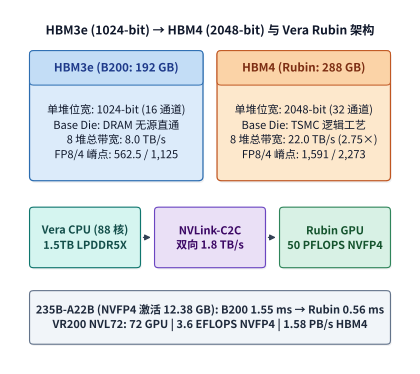

*图 4-50　HBM3e 与 HBM4 物理架构与接口跃迁对比。（a）HBM3e 采用 1024-bit 接口（16 个 64-bit 伪通道），单堆带宽约 $1.0\text{–}1.2\ \mathrm{TB/s}$；（b）HBM4 将单堆接口翻倍至 2048-bit（32 个独立 64-bit 伪通道），并将底部 Base Die 升级为 3nm/4nm 先进逻辑工艺，在支持近存逻辑卸载的同时将每比特传输能耗从约 $3.5\ \mathrm{pJ/bit}$ 压降至约 $2.2\ \mathrm{pJ/bit}$，支撑单卡 8 堆实现 $22\ \mathrm{TB/s}$ 带宽。*

> **算例 4-4（HBM4 2048-bit 位宽翻倍、逻辑 Base Die 能效与 MoE Decode 步进时间核算）**
>
> 对比搭载 8 座 HBM3e 堆栈的 Blackwell B200（每堆位宽 $W_3 = 1{,}024\ \mathrm{bits} = 128\ \mathrm{B}$，单引脚速率 $r_3 = 8.0\ \mathrm{Gbps}$，每比特访存能耗 $e_3 = 3.5\ \mathrm{pJ/bit}$）与搭载 8 座 HBM4 堆栈的 Rubin GPU（每堆位宽 $W_4 = 2{,}048\ \mathrm{bits} = 256\ \mathrm{B}$，等效引脚速率 $r_4 = 10.742\ \mathrm{Gbps}$，逻辑 Base Die 每比特访存能耗 $e_4 = 2.2\ \mathrm{pJ/bit}$）：
> 1. **单堆与整卡 8 堆聚合带宽**：
>    - B200（HBM3e）：单堆带宽 $\beta_{\mathrm{stack},3} = 1{,}024 \times 8.0\ \mathrm{Gbps} / 8 = 1.024\ \mathrm{TB/s}$，8 堆聚合理论峰值约 $8.0\ \mathrm{TB/s}$；
>    - Rubin（HBM4）：单堆带宽 $\beta_{\mathrm{stack},4} = 2{,}048 \times 10.742\ \mathrm{Gbps} / 8 \approx 2.75\ \mathrm{TB/s}$，8 堆聚合带宽跃升至 **$22.0\ \mathrm{TB/s}$**（为 B200 的 **$2.75\times$**），整卡独立并发伪通道数从 $8\times 16 = 128$ 个倍增至 **$8\times 32 = 256$ 个**。
> 2. **671B MoE 单步 Decode 访存时间与显存接口能耗对比**：考虑在一个 8 卡专家并行节点上执行 671B MoE 模型的单步高并发 Decode，设单卡每步需从本地 HBM 读取激活专家权重与活跃批次 KV 缓存共 $V_{\mathrm{step}} = 44\ \mathrm{GB}$（即 $3.52\times 10^{11}\ \mathrm{bits}$），有效带宽利用率均取 $\eta_{\mathrm{BW}} = 80\%$：
>    - 在 B200（HBM3e，$8.0\ \mathrm{TB/s}$）上：单步实际访存耗时 $T_3 = \frac{44\ \mathrm{GB}}{0.80 \times 8{,}000\ \mathrm{GB/s}} = \mathbf{6.875\ \mathrm{ms}}$，单步 HBM 接口搬移电能 $E_3 = 3.52\times 10^{11}\times 3.5\ \mathrm{pJ} = \mathbf{1.232\ \mathrm{J}}$（对应接口瞬时访存功率 $P_3 = E_3 / T_3 = 179.2\ \mathrm{W}$）；
>    - 在 Rubin（HBM4，$22.0\ \mathrm{TB/s}$）上：单步实际访存耗时直接压缩至 $T_4 = \frac{44\ \mathrm{GB}}{0.80 \times 22{,}000\ \mathrm{GB/s}} = \mathbf{2.500\ \mathrm{ms}}$（提速 **$2.75\times$**），且得益于先进逻辑 Base Die 将每比特能耗降至 $2.2\ \mathrm{pJ/bit}$，完成同样 $44\ \mathrm{GB}$ 数据读取的接口总电能反而下降至 $E_4 = 3.52\times 10^{11}\times 2.2\ \mathrm{pJ} = \mathbf{0.7744\ \mathrm{J}}$（单步访存能耗节省 **$37.1\%$**，接口瞬时访存功率 $P_4 = E_4 / T_4 = 309.8\ \mathrm{W}$）。

### 4.8.6 晶圆级与 3D 堆叠 SRAM 专用芯片对比 HBM GPU 的异构 PD 分离经济学

当在线推理业务（如实时多智能体并行工具合成、全双工低延迟语音交互或高频代码实时补全）要求在保持百万级长上下文容量的同时，将单流输出速度推向 **$1{,}000\text{–}3{,}000\ \mathrm{token/s}$**（即每 token 生成间隔 $\mathrm{TPOT} \le 0.3\text{–}1.0\ \mathrm{ms}$）时，即便拥有 $22\ \mathrm{TB/s}$ HBM4 带宽的通用 GPU 也会撞上物理极限：读取一份 $20\text{–}40\ \mathrm{GB}$ 的激活模型权重在 $22\ \mathrm{TB/s}$ 带宽下至少需要 $1\text{–}2\ \mathrm{ms}$。反之，以 **Cerebras WSE-3（单晶圆 $44\ \mathrm{GB}$ SRAM，聚合带宽 $21\ \mathrm{PB/s}$）**与 **NVIDIA Groq 3 LPX 机柜（256 颗 LPU，合计 $128\ \mathrm{GB}$ SRAM，聚合带宽 $40\ \mathrm{PB/s}$）**为代表的晶圆级或高密度片上 SRAM 专用架构，虽然能将片上权重读取耗时压缩至数十微秒，却因单位 GB SRAM 极其高昂的硅片面积成本而无法经济地驻留海量并发用户的长上下文 KV 缓存。

表 4-18 定量对比了 HBM3e/HBM4 GPU 与两类纯 SRAM 专用系统在存储介质、单柜容量、聚合带宽及适用负载阶段上的本质分野。

*表 4-18　HBM GPU 超节点与纯片上 SRAM 专用推理系统（Groq 3 LPX / Cerebras WSE-3）的物理规格与经济学定位对比*

| 架构维度与经济学指标 | Blackwell B200 8 卡节点 (HBM3e) | Vera Rubin NVL72 机柜 (HBM4) | NVIDIA Groq 3 LPX 机柜 (分布式 SRAM) | Cerebras CS-3 晶圆级系统 (Wafer SRAM) |
| --- | --- | --- | --- | --- |
| **核心存储介质与单单元容量** | HBM3e，$192\ \mathrm{GB}$/GPU | HBM4，$288\ \mathrm{GB}$/GPU | 片上 SRAM，$512\ \mathrm{MB}$/LPU（共 256 颗） | 晶圆级片上 SRAM，$44\ \mathrm{GB}$/Wafer |
| **节点/机柜总高速存储容量** | $1.536\ \mathrm{TB}$ HBM3e | **$20.736\ \mathrm{TB}$ HBM4**（外加 $54\ \mathrm{TB}$ LPDDR5X） | **$128\ \mathrm{GB}$ SRAM** | **$44\ \mathrm{GB}$ SRAM**（外接 MemoryX 权重仓） |
| **聚合存储读取带宽** | $64\ \mathrm{TB/s}$ | **$1{,}584\ \mathrm{TB/s}$（$1.58\ \mathrm{PB/s}$）** | **$40{,}000\ \mathrm{TB/s}$（$40\ \mathrm{PB/s}$）** | **$21{,}000\ \mathrm{TB/s}$（$21\ \mathrm{PB/s}$）** |
| **单位容量资本开支（美元/GB）** | 低（数十美元/GB 级） | 低（大容量 HBM4 规模摊薄） | **极高（数千美元/GB SRAM 级）** | **极高（晶圆级硅面积占主导）** |
| **单位带宽资本开支（美元/(TB/s)）** | 中等 | 低 | **极低（PB/s 级片上连线带宽）** | **极低（晶圆内短距金属互连）** |
| **最优工程角色（PD 分离）** | 通用训推、中等规模 Prefill/Decode | **超长上下文 Prefill + 海量 KV 池 + 大批 Decode** | **超低延迟 Decode 专职池 / 投机草稿生成** | **超大 batch 极速 Decode / 晶圆级流水推理** |

为了同时打破 HBM 的“带宽延迟墙”与纯 SRAM 的“容量成本墙”，现代大规模推理基础设施发展出了**异构 Prefill-Decode（PD）分离架构**（见图 4-51）：
- **上游 Prefill 集群采用高算力、大容量 HBM GPU（如 B200 或 Rubin GPU）**：利用数十 PFLOPS 的稠密张量算力并行消化长提示词（Compute-bound），并在数百 GB 至数 TB 的 HBM 与主机 LPDDR5X 池中维护海量会话的全局前缀 KV 缓存；
- **下游 Decode 集群采用高带宽纯 SRAM 专用芯片阵列（或配备 HBM4 的高带宽特化节点）**：将冻结的激活模型权重常驻于 PB/s 级片上 SRAM 中，仅在当前活跃子批进入生成阶段时，通过 $400/800\mathrm{G}$ RDMA 或 Scale-Up 互连按需拉取当前活跃窗口的 KV 状态，以微秒级步进耗时完成超高速自回归生成（Memory-bandwidth-bound）。


*图 4-51　同构 HBM GPU 部署与异构 Prefill-Decode（PD）分离部署的经济学对比。当业务同时要求严苛的单流生成延迟（如 $\mathrm{TPOT}\le 2\ \mathrm{ms}$）与高并发吞吐时，同构 HBM GPU 被迫压低并发批量 $B$ 而导致算力闲置；异构方案由 HBM GPU 满载执行 Prefill、由 PB/s 级 SRAM 芯片专职执行极速 Decode，大幅降低满足双 SLA 所需的集群总成本（TCO）。*

> **算例 4-5（严苛 TPOT SLA 下同构 HBM GPU 与异构“HBM GPU + SRAM ASIC”PD 分离集群的 TCO 对比）**
>
> 某在线实时智能体编程平台需持续承载 $\lambda = 120\ \text{req/s}$ 的稳态请求流，每条请求平均输入提示词长度 $L_{\mathrm{in}} = 4{,}096$ tokens、输出生成长度 $L_{\mathrm{out}} = 512$ tokens（系统稳态输出需求为 $120\times 512 = 61{,}440\ \mathrm{token/s}$）。服务等级协议（SLA）要求首 token 预填充计算时间 $\le 150\ \mathrm{ms}$、单流每 token 生成间隔 **$\mathrm{TPOT} \le 2.5\ \mathrm{ms}$（即单用户生成速度 $\ge 400\ \mathrm{token/s}$）**。目标模型每处理 1 个 prefill token 需 $F_{\mathrm{tok}} = 74\ \mathrm{GFLOPs}$，每步 decode 需读取常驻激活权重 $W_{\mathrm{act}} = 36\ \mathrm{GB}$ 及每并发请求 KV 缓存 $K_{\mathrm{req}} = 0.25\ \mathrm{GB}$。候选硬件池包含两类节点：（1）**HBM GPU 节点**，有效算力 $P_{\mathrm{GPU}} = 18\ \mathrm{PFLOPS}$，有效显存带宽 $\beta_{\mathrm{GPU}} = 16\ \mathrm{TB/s}$，整节点每小时综合成本 $c_{\mathrm{GPU}} = 24\ \text{美元/h}$；（2）**纯 SRAM 专用推理节点**，片上 SRAM 可完整常驻 $36\ \mathrm{GB}$ 权重（有效片上带宽 $\beta_{\mathrm{SRAM}} = 8{,}000\ \mathrm{TB/s}$），外加每步跨芯片 KV 同步与归约固定耗时 $t_{\mathrm{sync}} = 0.35\ \mathrm{ms}$、每并发请求 KV 读取耗时 $0.04\ \mathrm{ms}$，整节点每小时综合成本 $c_{\mathrm{SRAM}} = 36\ \text{美元/h}$。
> 1. **方案一（同构 HBM GPU 独立承接流量）**：在 HBM GPU 节点上，单步 decode 耗时为 $t_{\mathrm{step}}(B) = \frac{W_{\mathrm{act}} + B K_{\mathrm{req}}}{\beta_{\mathrm{GPU}}} = \frac{36 + 0.25 B}{16}\ \mathrm{ms}$。为了满足 $\mathrm{TPOT} \le 2.5\ \mathrm{ms}$，必须满足 $36 + 0.25 B \le 40\ \mathrm{GB}$，解得单节点最大允许并发批量仅为 **$B_{\max}^{\mathrm{GPU}} = 16$**（此时单步耗时 $2.50\ \mathrm{ms}$，单节点满载 decode 吞吐仅为 $16 / 0.0025 = 6{,}400\ \mathrm{token/s}$）。计入每秒 $\lambda L_{\mathrm{in}} F_{\mathrm{tok}} = 120\times 4{,}096\times 74\ \mathrm{GFLOPs} \approx 36.37\ \mathrm{PFLOPs/s}$ 的 Prefill 算力占用（需 $\frac{36.37}{18} \approx 2.02$ 台 GPU 节点满载时间）与每秒 $61{,}440\ \mathrm{token/s}$ 的 Decode 窗口占用（需 $\frac{61{,}440}{6{,}400} = 9.60$ 台 GPU 节点满载时间），按 $80\%$ 线上安全利用率折算，同构方案共需部署 $\lceil (2.02 + 9.60)/0.80 \rceil = \mathbf{15\ \textbf{台}}$ HBM GPU 节点，每小时集群总成本为 $15\times 24 = \mathbf{360\ \textbf{美元/h}}$，折合每百万输出 token 成本为 **$1.63\ \text{美元/M tokens}$**。
> 2. **方案二（异构 PD 分离：HBM GPU 专职 Prefill + SRAM 节点专职 Decode）**：
>    - **Prefill 池（HBM GPU）**：专职承担 $36.37\ \mathrm{PFLOPs/s}$ 的高算术强度 Prefill，按 $80\%$ 利用率仅需 $\lceil 2.02 / 0.80 \rceil = \mathbf{3\ \textbf{台}}$ HBM GPU 节点（单次 4K 请求在单节点上计算耗时仅 $\frac{4{,}096\times 74\ \mathrm{GFLOPs}}{18\ \mathrm{PFLOPS}} \approx 16.8\ \mathrm{ms} \ll 150\ \mathrm{ms}$）；
>    - **Decode 池（SRAM 专用节点）**：单步 decode 耗时为 $t_{\mathrm{step}}^{\mathrm{SRAM}}(B) = \frac{36\ \mathrm{GB}}{8{,}000\ \mathrm{TB/s}} + 0.35 + 0.04 B = 0.3545 + 0.04 B\ (\mathrm{ms})$。在同样的 $\mathrm{TPOT} \le 2.5\ \mathrm{ms}$ 约束下，单节点可合批并发数高达 $B_{\max}^{\mathrm{SRAM}} = \lfloor (2.5 - 0.3545)/0.04 \rfloor = \mathbf{53}$ 条请求（实际单步耗时 $2.4745\ \mathrm{ms}$），单台 SRAM 节点的有效输出吞吐高达 $53 / 0.0024745 \approx \mathbf{21{,}418\ \mathrm{token/s}}$（是受延迟锁死的同构 GPU 节点的 **$3.35\times$**）。承载 $61{,}440\ \mathrm{token/s}$ 的稳态生成流、按 $80\%$ 利用率折算，仅需 $\lceil (61{,}440 / 21{,}418) / 0.80 \rceil = \mathbf{4\ \textbf{台}}$ SRAM 节点；
>    - **异构集群总成本**：3 台 HBM GPU 节点 + 4 台 SRAM 节点合计每小时成本为 $3\times 24 + 4\times 36 = \mathbf{216\ \textbf{美元/h}}$，相比同构 HBM GPU 方案（$360\ \text{美元/h}$）直接节省了 **$40.0\%$ 的集群 TCO**，将每百万输出 token 成本压降至 **$0.98\ \text{美元/M tokens}$**。

下面的可运行 Python 脚本实现了上述异构 PD 分离集群与同构 HBM GPU 集群在双 SLA（TTFT 与 TPOT）约束下的节点规模配比与每百万 token TCO 自动寻优器：

```python
import math

def heterogeneous_pd_tco_calculator(
    req_rate_s: float = 120.0,
    l_in: int = 4096,
    l_out: int = 512,
    tpot_sla_ms: float = 2.5,
    utilization: float = 0.80,
) -> dict:
    """核算严苛 TPOT SLA 下同构 HBM GPU 与异构 (HBM GPU + SRAM ASIC) PD 分离集群的 TCO。"""
    f_tok_gflops = 74.0          # 每 token 矩阵运算量 (GFLOPs)
    w_act_gb = 36.0              # 每步 Decode 激活权重读取量 (GB)
    k_req_gb = 0.25              # 每并发请求 KV 读取量 (GB)

    # 硬件 1: HBM GPU 节点
    p_gpu_pflops = 18.0
    bw_gpu_tbs = 16.0
    cost_gpu_hr = 24.0

    # 硬件 2: 纯 SRAM 专用 Decode 节点
    bw_sram_tbs = 8000.0
    t_sync_ms = 0.35
    t_kv_per_req_ms = 0.04
    cost_sram_hr = 36.0

    total_prefill_pflops_s = req_rate_s * l_in * f_tok_gflops / 1e6
    total_decode_tok_s = req_rate_s * l_out

    # 1. 同构 HBM GPU 方案: 求解满足 TPOT <= tpot_sla_ms 的最大 batch
    b_max_gpu = int((tpot_sla_ms * bw_gpu_tbs - w_act_gb) // k_req_gb)
    t_step_gpu_ms = (w_act_gb + b_max_gpu * k_req_gb) / bw_gpu_tbs
    decode_tput_gpu = b_max_gpu / (t_step_gpu_ms / 1000.0)

    gpu_nodes_prefill_exact = total_prefill_pflops_s / p_gpu_pflops
    gpu_nodes_decode_exact = total_decode_tok_s / decode_tput_gpu
    homo_gpu_nodes = math.ceil((gpu_nodes_prefill_exact + gpu_nodes_decode_exact) / utilization)
    homo_cost_hr = homo_gpu_nodes * cost_gpu_hr
    homo_cost_per_m = homo_cost_hr / (total_decode_tok_s * 3600.0 / 1e6)

    # 2. 异构 PD 分离方案: HBM GPU 专职 Prefill + SRAM ASIC 专职 Decode
    hetero_prefill_nodes = math.ceil(gpu_nodes_prefill_exact / utilization)
    t_weight_sram_ms = w_act_gb / bw_sram_tbs
    b_max_sram = int((tpot_sla_ms - t_weight_sram_ms - t_sync_ms) // t_kv_per_req_ms)
    t_step_sram_ms = t_weight_sram_ms + t_sync_ms + b_max_sram * t_kv_per_req_ms
    decode_tput_sram = b_max_sram / (t_step_sram_ms / 1000.0)

    hetero_decode_nodes = math.ceil((total_decode_tok_s / decode_tput_sram) / utilization)
    hetero_cost_hr = hetero_prefill_nodes * cost_gpu_hr + hetero_decode_nodes * cost_sram_hr
    hetero_cost_per_m = hetero_cost_hr / (total_decode_tok_s * 3600.0 / 1e6)

    return {
        "b_max_gpu": b_max_gpu,
        "decode_tput_gpu": round(decode_tput_gpu, 1),
        "homo_gpu_nodes": homo_gpu_nodes,
        "homo_cost_hr": round(homo_cost_hr, 2),
        "homo_cost_per_m": round(homo_cost_per_m, 2),
        "b_max_sram": b_max_sram,
        "decode_tput_sram": round(decode_tput_sram, 1),
        "hetero_nodes": (hetero_prefill_nodes, hetero_decode_nodes),
        "hetero_cost_hr": round(hetero_cost_hr, 2),
        "hetero_cost_per_m": round(hetero_cost_per_m, 2),
        "tco_saving_pct": round((1.0 - hetero_cost_hr / homo_cost_hr) * 100.0, 1),
    }

if __name__ == "__main__":
    res = heterogeneous_pd_tco_calculator()
    print(f"[同构 HBM GPU] B_max={res['b_max_gpu']}, 单节点吞吐={res['decode_tput_gpu']} tok/s, "
          f"需 {res['homo_gpu_nodes']} 台, 成本=USD {res['homo_cost_hr']}/h (USD {res['homo_cost_per_m']}/M tok)")
    p_n, d_n = res["hetero_nodes"]
    print(f"[异构 PD 分离] B_max_SRAM={res['b_max_sram']}, 单节点吞吐={res['decode_tput_sram']} tok/s, "
          f"需 {p_n} GPU + {d_n} SRAM, 成本=USD {res['hetero_cost_hr']}/h (USD {res['hetero_cost_per_m']}/M tok, "
          f"节省 {res['tco_saving_pct']}%)")
```

> **实验 4-7 · 延伸：负载改变后，芯片资源改动是否仍有收益**
>
> 选择一种架构和一种典型负载，提出一次资源改动。先用工作量、流量和依赖推导时间变化，再计算增加的容量及减少的等待。随后改变 batch 或上下文长度，求原有改动不再节省时间时的临界值。若方案需要额外固定投入，再根据每项任务节省的成本、加速器利用率和模型寿命，求收回固定投入所需的最低服务量。

> **实验 4-8 · 延伸：从能耗分账到功率封顶**
>
> 沿用第 4.1.3 节的能耗表与 Qwen3-8B 单请求 8K decode 一步的读取字节数。（a）把 batch 分别取 8、32、128，分别计算每 token 的权重、KV 与计算能耗，求权重能耗低于计算能耗的最小 batch。（b）把上下文改为 32K，求 KV 能耗等于权重能耗的 batch，并解释此后继续增大 batch 为什么不再明显降低每 token 能耗。（c）选择一张卡的 TDP、峰值算力与 HBM 带宽，求峰值速率下每 FLOP 的能量预算 $b$；设实际每 FLOP 能耗为 $1.5b$，按 $P\propto fV^2$ 分别求电压不变与电压随频率下降两种情况下的持续频率比；再把（a）中 batch 为 32 时一步的能量（32 乘以每 token 能耗）除以持续频率下这一步的时间，得到平均功率，比较它与 TDP 的差距。

> **实验 4-9 · 延伸：跨产品线算术强度转折点与多裸片放置权衡**
>
> 对照第 4.6.1 节表 4-11 中的七款 NVIDIA GPU（RTX 3090、RTX 4090、RTX 5090、RTX PRO 6000 Blackwell、A100 80GB SXM、H100 SXM、H200 SXM）：（a）分别计算各卡在稠密 BF16/FP32 下的算术强度转折点 $I^* = P / R$，并代入第 4.8.1 节的临界行数公式 $M^* = I^*d / (d - 2I^*)$，求出 $4096\times4096$ BF16 投影矩阵在各卡上使矩阵计算时间超过片外显存读取时间的最小整数行数 $M^*$；（b）对比“从 A100 SXM 升级到 H100 SXM”与“从 H100 SXM 升级到 H200 SXM”两代演进中 $I^*$ 与 $M^*$ 的变化方向，解释为什么算力增速快于带宽增速会提高进入计算受限区所需的批量门槛，而保持算力不变、单纯提升显存带宽则会降低该批量门槛；（c）结合第 4.5.1 节的双裸片模型，假设某双裸片加速器的单 die 本地 HBM 带宽为 $1.6\ \mathrm{TB/s}$、跨 die 链路单向带宽为 $270\ \mathrm{GB/s}$，核算当单步需读取 $64\ \mathrm{GiB}$ 权重时，“集中由单颗 die 跨链路读取另一颗 die 显存”与“两颗 die 各自在本地读取 $32\ \mathrm{GiB}$ 并通过链路交换 $16\ \mathrm{MiB}$ 中间激活”两种方案的完成时间之比。

> **实验 4-10 · 延伸：纯片上 SRAM 架构与独立只读权重架构的容量扩展对比**
>
> 以 Qwen3-8B（BF16，静态权重约 $15{,}623\ \mathrm{MiB}$ / $16.38\ \mathrm{GB}$，每步参与计算的共享权重读取量 $W=15.1\ \mathrm{GB}$，每条 8K 上下文请求的 KV 缓存为 $1{,}152\ \mathrm{MiB}$，即 $1.125\ \mathrm{GiB}$ / $1.21\ \mathrm{GB}$）为基准：（a）在每颗芯片配备 $220\ \mathrm{MiB}$ 片上 SRAM 的级联系统上，分别计算当并发请求数与上下文长度为 $(B=1, 8\mathrm{K})$、$(B=8, 8\mathrm{K})$、$(B=8, 32\mathrm{K})$ 与 $(B=32, 32\mathrm{K})$ 时所需的总芯片数以及 KV 芯片数占总芯片数的比例；（b）切换到第 4.7.3 节“独立 ROM 存放权重 + 单堆 $24\ \mathrm{GB}$ HBM3E（扣除 $2\ \mathrm{GiB}$ 工作区后可用 $20.36\ \mathrm{GiB}$）存放 KV 缓存”的分离式架构，计算单堆 HBM3E 在 8K 与 32K 上下文下分别最多可容纳多少条并发请求，并求出在这两种上下文长度下使 HBM 接口 KV 读取流量反超 ROM 权重读取流量的临界并发批量 $B^*$。

> **实验 4-11 · 延伸：Apple 统一内存与独立 GDDR7 显卡在不同复用次数下的端到端交叉点**
>
> 对照第 4.5.2 节算例 4-2 中的 Apple M2 Max（统一内存带宽 $400\ \mathrm{GB/s}$，新数据交接零物理拷贝）与 RTX PRO 6000 Blackwell（PCIe 5.0 x16 单向有效 H2D 带宽 $56\ \mathrm{GB/s}$，本地 GDDR7 显存带宽 $1{,}792\ \mathrm{GB/s}$）：（a）设有一份由 CPU 动态生成、体积为 $V_{\mathrm{in}} = 512\ \mathrm{MiB}$（约 $536.87\ \mathrm{MB}$）的上下文张量，若上传至设备后在本地被算子连续读取 $R$ 次，分别写出两台设备完成“主机交接 + $R$ 次本地读取”的理想耗时表达式 $T_{\mathrm{UMA}}(R)$ 与 $T_{\mathrm{GDDR7}}(R)$；（b）令 $T_{\mathrm{GDDR7}}(R) \le T_{\mathrm{UMA}}(R)$，求 RTX PRO 6000 凭借本地高带宽反超统一内存零拷贝优势所需的最小整数复用次数 $R^*$；（c）若主机插槽降级为 PCIe 4.0 x16（单向有效带宽 $28\ \mathrm{GB/s}$），重新计算临界复用次数 $R^*$。

> **实验 4-12 · 延伸：GPU 机密计算（TEE）弹跳缓冲流水线与多流并发加密配比**
>
> 沿用第 4.5.2 节算例 4-3 的参数（待传输数据块 $V = 64\ \mathrm{MiB}\approx 67.11\ \mathrm{MB}$，PCIe 5.0 x16 单向有效带宽 $R_{\mathrm{PCIe5}} = 56\ \mathrm{GB/s}$，单 CPU 线程 AES-GCM-256 加密并写入共享弹跳缓冲的有效吞吐 $R_{\mathrm{CPU\_enc}} = 12\ \mathrm{GB/s}$）：（a）若将 $64\ \mathrm{MiB}$ 切分为 $N_c = 32$ 个各 $2\ \mathrm{MiB}$ 的子块，并开启 $k$ 个 CPU 线程并行加密（合成加密吞吐 $\min(k R_{\mathrm{CPU\_enc}}, R_{\mathrm{DRAM}})$，设主机共享内存写入上限 $R_{\mathrm{DRAM}} = 80\ \mathrm{GB/s}$），推导分块双级流水线的总完成时间 $T(k)$；（b）求使流水线瓶颈从 CPU 加密侧转移到 PCIe 5.0 传输侧的最小线程数 $k^*$，并计算 $k=k^*$ 时的端到端传输耗时；（c）对比该软件流水耗时与硬件 TEE-I/O（PCIe IDE，$52\ \mathrm{GB/s}$）耗时，说明为什么在高频 KV 缓存卸载（Offloading）场景中硬件 TEE-I/O 能显著节省宿主机 CPU 核数。

> **实验 4-13 · 延伸：Hopper $\to$ Blackwell $\to$ Rubin 显存扩容对并发批量 $B_{\max}$ 的超线性放大与 Roofline 嵴点漂移**
>
> 对照表 4-10 中 H100 SXM（$80\ \mathrm{GB}$，$3.35\ \mathrm{TB/s}$，FP8 算力 $1.98\ \mathrm{PFLOPS}$）、H200 SXM（$141\ \mathrm{GB}$，$4.80\ \mathrm{TB/s}$，FP8 算力 $1.98\ \mathrm{PFLOPS}$）、B200（$192\ \mathrm{GB}$，$8.0\ \mathrm{TB/s}$，FP4 算力 $9.0\ \mathrm{PFLOPS}$）与 Rubin GPU（$288\ \mathrm{GB}$ HBM4，$22.0\ \mathrm{TB/s}$，NVFP4 算力 $50.0\ \mathrm{PFLOPS}$）四代参数：（a）设某稀疏 MoE 模型在单卡分片上的常驻权重与运行时工作区固定占用 $W_{\mathrm{fixed}} = 68\ \mathrm{GB}$，每条 16K 上下文请求的 KV 缓存占用 $K_{\mathrm{req}} = 1.5\ \mathrm{GB}$，分别计算四代 GPU 上的最大并发请求数 $B_{\max}$ 及其相对于 H100 的放大倍数，验证为什么总显存扩容 $3.6\times$（$80\to 288\ \mathrm{GB}$）能带来超过 $18\times$ 的并发容量增益（TC-07）；（b）分别计算四代 GPU 在各自最高主推推理精度（H100/H200 取 FP8，B200/Rubin 取 FP4）下的 Roofline 算术强度嵴点 $I^* = \Pi_{\mathrm{low\text{-}bit}}/\beta_{\mathrm{HBM}}$，定量说明当算力跃升速度快于带宽跃升速度时，为什么必须依靠（a）中放大的并发批量 $B_{\max}$ 或投机采样验证块来同步推高算子的实际算术强度（TC-08）。

> **实验 4-14 · 延伸：Google TPU7x Dual-Chiplet 分片放置与 Groq 3 LPX 纯 SRAM 机柜的容量—带宽权衡**
>
> 对照表 4-13 中的 Google TPU7x Ironwood（单芯片含 2 颗对称 Chiplet，每颗 Chiplet 含 $96\ \mathrm{GiB}$ HBM、$3{,}690\ \mathrm{GB/s}$ 带宽与 $2{,}307\ \mathrm{TFLOPs}$ FP8 算力；Chiplet 间 D2D 单向带宽为 1D ICI 的 $6\times$；芯片间双向 ICI 带宽为 $1{,}200\ \mathrm{GB/s}$）与第 4.7.2 节的 NVIDIA Groq 3 LPX 机柜（256 颗 LPU，合计 $128\ \mathrm{GB}$ SRAM，聚合带宽 $40\ \mathrm{PB/s}$）：（a）在单颗 TPU7x 芯片上执行形状为 $[M, 8192] \times [8192, 28672]$ 的 FP8 矩阵乘法时，对比“将两颗 Chiplet 视作 2 个独立 JAX 设备执行 2-way 张量并行（TP=2，每颗 Chiplet 在本地读取一半权重并通过高带宽 D2D 链路做单次激活归约）”与“跨芯片通过 1D ICI 执行归约”的通信开销差异；（b）若用一台 Groq 3 LPX 机柜（$128\ \mathrm{GB}$ SRAM）部署一个常驻权重为 $96\ \mathrm{GB}$ 的 4-bit 大模型，求剩余可分配给动态 KV 缓存的 SRAM 容量上限，并核算当每条请求需要 $0.5\ \mathrm{GB}$ KV 缓存时该机柜最多可同时服务的并发会话数，与单张 Rubin GPU（$288\ \mathrm{GB}$ HBM4）的并发会话上限进行对比。

> **实验 4-15 · 核心：核算 70B 与 671B 模型在 NVFP4（16 元素 E4M3 缩放）与 MXFP4（32 元素 E8M0 缩放）下的真实权重体积与带宽节省**
>
> 对照第 4.2.4 节与图 4-48 的微缩放格式模型：（a）分别推导 OCP `MXFP4`（每 $g=32$ 个 4-bit 元素共享 1 个 8-bit `E8M0` 缩放因子）与 NVIDIA `NVFP4`（每 $g=16$ 个 4-bit 元素共享 1 个 8-bit `E4M3` 缩放因子，忽略张量级单 `FP32` 常数）的每元素有效比特数 $b_{\mathrm{eff}}$，以及它们相对于 BF16（$16\ \mathrm{bits/elem}$）的真实体积压缩比；（b）对参数量分别为 $N_1 = 70\times 10^9$（70B 稠密模型）与 $N_2 = 671\times 10^9$（671B MoE 模型，假设全部参数均按对应微缩放格式存储）的两个模型，精确计算它们在 BF16、NVFP4 与 MXFP4 下的总权重字节数（以十进制 $\mathrm{GB}$ 表示，保留两位小数）；（c）若将 671B 模型以 8 卡张量/专家并行切分部署在 8 张 HBM 带宽各为 $8.0\ \mathrm{TB/s}$ 的加速卡（如 B200 或 MI355X）上，在单请求 decode 每步激活读取 $37\times 10^9$ 个参数（37B 激活参数）时，求采用 NVFP4 与 MXFP4 相比 BF16 每步节省的跨卡聚合 HBM 读取时间下界。

> **实验 4-16 · 延伸：基于昇腾 950 Table 4-2 存储参数（L1 512 KB, L0C 256 KB, UB 512 KB）与 Trainium2/3 SBUF（28/32 MiB），复算 $8192^3$ GEMM 与 FlashAttention 融合算子的片上分块上限与 HBM 流量消减**
>
> 对照第 4.6.2 节表 4-12、第 4.7.1 节表 4-14 与图 4-49：（a）在昇腾 950 的单个 AI Core（`L1 = 512 KB`、`L0A = 64 KB`、`L0B = 64 KB`、`L0C = 256 KB`、`UB = 512 KB`）上执行 FP16 输入、FP32 累加的矩阵乘法，若要在 `L0C`（$256\ \mathrm{KB}$）内采用双缓冲（2 个槽位，每槽上限 $128\ \mathrm{KB}$）驻留 FP32 部分和输出块 $m_0\times n_0$，求正方形输出分块的最大边长 $m_0 = n_0$；并核算在该 $m_0\times n_0$ 下，若 `L0A` 与 `L0B` 同样开启双缓冲（每槽上限 $32\ \mathrm{KB}$，FP16 元素占 2 字节），单步送入 Cube 的最大内积切分深度 $k_0$；（b）在单颗 AWS Trainium2（8 个 NeuronCore-v3，每核 `28 MiB` SBUF + `2 MiB` PSUM）与 Trainium3（8 个 NeuronCore-v4，每核 `32 MiB` SBUF + `2 MiB` PSUM）上执行形状为 $M=N=K=8{,}192$ 的 BF16 矩阵乘法（$A,B,C$ 各占 $128\ \mathrm{MiB}$），若将输出矩阵 $C$ 按 $2\times 4$ 网格均匀切分到 8 个核心（每核负责 $4{,}096\times 2{,}048$ 子块），计算在不发生片上溢出导致重读的前提下，8 个核心合计需要从片外 HBM 读取左矩阵 $A$ 与右矩阵 $B$ 的最少总字节数，以及全芯片 `SBUF` 相对于无片上宏块复用时的 HBM 流量消减倍数。

> **实验 4-17 · 核心：HBM4 2048-bit 逻辑 Base Die 带宽、伪通道并发度与访存能效定量核算**
>
> 对照第 4.8.5 节与算例 4-4 的 HBM3e 与 HBM4 物理参数：（a）设某加速卡挂载 $N_{\mathrm{stack}} = 8$ 座 HBM4 显存堆栈，每座堆栈包含 32 个独立的 64-bit 伪通道（合计接口位宽 $W_{\mathrm{stack}} = 2{,}048\ \mathrm{bits}$），当单引脚等效数据速率分别设定为 $r_1 = 8.0\ \mathrm{Gbps}$ 与 $r_2 = 10.742\ \mathrm{Gbps}$ 时，分别计算单座堆栈与整卡 8 堆的聚合峰值带宽（以 $\mathrm{TB/s}$ 表示）；（b）若将 HBM 底部 Base Die 从传统 DRAM 工艺（每比特传输能耗 $e_3 = 3.5\ \mathrm{pJ/bit}$）升级为 3nm/4nm 先进逻辑工艺（$e_4 = 2.2\ \mathrm{pJ/bit}$），并在 Base Die 内置近存稀疏 KV 过滤电路，使某长上下文注意力层每步实际需要穿过 CoWoS 中介层传回 GPU 主裸片的 KV 字节数从 $44\ \mathrm{GB}$ 进一步削减 $25\%$ 至 $33\ \mathrm{GB}$，求在 $80\%$ 带宽利用率下 Rubin GPU（$22.0\ \mathrm{TB/s}$）完成该步读取的实际耗时 $T_{4,\mathrm{near}}$ 与中介层接口总能耗 $E_{4,\mathrm{near}}$，并计算其相对于 B200（读取完整 $44\ \mathrm{GB}$，$e_3 = 3.5\ \mathrm{pJ/bit}$）的耗时加速比与能耗缩减比。

> **实验 4-18 · 延伸：晶圆级/3D SRAM 芯片与 HBM GPU 的异构 PD 分离集群 TCO 寻优**
>
> 沿用第 4.8.6 节算例 4-5 的异构 PD 分离模型与硬件成本参数（HBM GPU 节点 $24\ \text{美元/h}$、有效带宽 $16\ \mathrm{TB/s}$，SRAM 专用节点 $36\ \text{美元/h}$、固定同步加权重耗时 $0.3545\ \mathrm{ms}$、每并发请求 KV 耗时 $0.04\ \mathrm{ms}$，集群目标利用率 $80\%$）：（a）若上层业务将单流生成延迟 SLA 从 $\mathrm{TPOT} \le 2.5\ \mathrm{ms}$ 进一步收紧至 **$\mathrm{TPOT} \le 2.35\ \mathrm{ms}$**，分别重新计算同构 HBM GPU 节点与异构 SRAM 节点的最大允许并发批量 $B_{\max}^{\mathrm{GPU}}$ 与 $B_{\max}^{\mathrm{SRAM}}$，以及承载 $\lambda = 120\ \text{req/s}$（$L_{\mathrm{in}}=4{,}096, L_{\mathrm{out}}=512$）所需的两套集群每小时总成本；（b）反之，若业务切换为对单流延迟不敏感的离线批量合成任务，允许将 $\mathrm{TPOT}$ 放宽至 **$10.0\ \mathrm{ms}$**（且 HBM GPU 单节点显存容量上限允许最多并发 $B_{\mathrm{cap}}^{\mathrm{GPU}} = 256$ 条请求，SRAM 节点受片上容量限制最多仅能并发 $B_{\mathrm{cap}}^{\mathrm{SRAM}} = 64$ 条请求），重新核算同构 HBM GPU 方案与异构方案的每小时总成本，定量解释为什么纯 SRAM 专用芯片的经济优势高度依赖于严苛的低延迟 TPOT 约束。

表 4-19 汇总了本章各核心与延伸实验的关键锁定数值，供读者在手算推导与运行脚本验证时直接核对。

*表 4-19　第 4 章核心与延伸实验锁定数值速查表*

| 实验编号与核心主题 | 关键输入设定与架构参数 | 锁定参考数值与核心结论 |
| --- | --- | --- |
| **实验 4-9（算术强度嵴点与多 Die）** | 七款 NVIDIA GPU BF16/FP32；双 Die 本地 $1.6\ \mathrm{TB/s}$ vs 跨 Die $270\ \mathrm{GB/s}$ | 嵴点 $I^*$ 从 RTX 3090 的 **$75.9\ \mathrm{FLOP/B}$** 升至 H100 的 **$295.3\ \mathrm{FLOP/B}$**；双 Die 本地分片加激活归约耗时比跨 Die 集中读取快约 **$5.9\times$** |
| **实验 4-11 / 4-12（UMA 交叉点与 TEE）** | M2 Max $400\ \mathrm{GB/s}$ vs RTX PRO 6000 PCIe 5.0 $56\ \mathrm{GB/s}$ + GDDR7 $1{,}792\ \mathrm{GB/s}$ | PCIe 5.0 下最小复用次数 **$R^* = 10$**（PCIe 4.0 下 **$R^* = 19$**）；TEE 加密转 PCIe 受限最小线程数 **$k^* = 5$**（流水耗时 **$1.25\ \mathrm{ms}$**） |
| **实验 4-13（四代 GPU $B_{\max}$ 与嵴点）** | $W_{\mathrm{fixed}}=68\ \mathrm{GB}$，$K_{\mathrm{req}}=1.5\ \mathrm{GB}$；H100 / H200 / B200 / Rubin | $B_{\max}$ 依次为 **$8 \to 48 \to 82 \to 146$**（扩容 $3.6\times$ 带来 **$18.25\times$** 并发增益）；低比特嵴点 $I^*$ 依次为 **$591 \to 413 \to 1{,}125 \to 2{,}273\ \mathrm{FLOP/B}$** |
| **实验 4-15（NVFP4 vs MXFP4 体积）** | MXFP4（$g=32$，E8M0）vs NVFP4（$g=16$，E4M3）；70B 与 671B 模型 | 有效位宽 **$4.25$ vs $4.50\ \mathrm{bits/elem}$**；671B 权重由 BF16 **$1{,}342.0\ \mathrm{GB}$** 压至 MXFP4 **$356.47\ \mathrm{GB}$** 与 NVFP4 **$377.44\ \mathrm{GB}$** |
| **实验 4-16（昇腾 950 与 Trainium SBUF）** | 昇腾 950 `L0C=256KB`、`L0A/B=64KB` 双缓冲；Trainium 8 核 $8192^3$ GEMM | 昇腾 950 双缓冲最大方阵边长 **$m_0=n_0=181$**（2 的幂取 **$128$**，此时最大内积深度 **$k_0=128$**）；Trainium 8 核 $2\times 4$ 网格最少 HBM 读 **$192\ \mathrm{MiB}$** |
| **实验 4-17（HBM4 2048-bit 与近存过滤）** | 8 堆 $\times 2048\text{-bit}$，$e_3=3.5\to e_4=2.2\ \mathrm{pJ/bit}$，近存过滤削减 $25\%$ KV | $8.0 / 10.742\ \mathrm{Gbps}$ 对应整卡 **$16.38 / 22.0\ \mathrm{TB/s}$**；近存过滤后耗时 **$T_{4,\mathrm{near}}=1.875\ \mathrm{ms}$**（提速 **$3.67\times$**），能耗 **$0.5808\ \mathrm{J}$**（省 **$52.9\%$**） |
| **实验 4-18（异构 PD 分离 TCO 寻优）** | $\lambda=120\ \text{req/s}$；严苛 $\mathrm{TPOT}\le 2.35\ \mathrm{ms}$ vs 宽松 $\mathrm{TPOT}\le 10.0\ \mathrm{ms}$ | $\mathrm{TPOT}\le 2.35\ \mathrm{ms}$ 时同构 GPU $B_{\max}=6$（需 **$34$ 台，$816\ \text{美元/h}$**），异构需 **3 GPU + 4 SRAM（$216\ \text{美元/h}$，省 $73.5\%$）**；放宽至 $10\ \mathrm{ms}$ 时同构 GPU 仅需 **$5$ 台（$120\ \text{美元/h}$）** 反超异构 |

## 常见误区

- **误区一：把白皮书标称的峰值 TFLOP/s 当作任何算子都能兑现的实际运行速度。** 峰值算力 $P_{\mathrm{peak}}$ 仅在两个前提同时成立时才能决定算子耗时：一是算子的算术强度 $I = F/V$ 必须越过硬件的屋顶转折点 $I^* = P_{\mathrm{peak}} / R_{\mathrm{peak}}$（如单请求 decode 的算术强度仅约 $1.2\ \mathrm{FLOP/byte}$，远低于 H100 的 $295.3\ \mathrm{FLOP/byte}$，此时执行时间完全由显存带宽决定）；二是算子的每 FLOP 综合能耗 $e$ 不能突破功率封顶预算 $b = (\mathrm{TDP} - P_{\mathrm{mem}})/P_{\mathrm{peak}}$，否则硬件功率控制器会自动降频，使实际持续算力随频率下移。
- **误区二：认为只要把矩阵乘加单元（Tensor Core / Cube）的速度再翻一倍，自注意力与全模型的端到端耗时就会同比例减半。** 在 Transformer 自注意力流水线中，$QK^{\mathsf T}$ 与 $PV$ 两次矩阵乘法中间夹着指数运算、行最大值与行求和归约等向量操作。如第 4.2.3 节与第 4.6.2 节定量核算所示，当矩阵算力大幅跃升后，特殊函数单元（SFU）的指数吞吐或矩阵核与向量核之间的跨核交接耗时（如早期核外交换的 $2.79\ \mathrm{\mu s}$ 对比矩阵计算的 $1.024\ \mathrm{\mu s}$）就会成为新的主导瓶颈。唯有同步提升向量/超越函数吞吐并建立片上直连交接通路（如 TMEM、CV 直通），矩阵算力的增长才能转化为端到端加速。
- **误区三：认为升级更高带宽的 HBM 显存能够降低单请求 decode 每生成一个 token 所消耗的物理电能。** 第 4.1.3 节的微观能耗分账表明，从 HBM 每搬移 1 字节数据消耗的电能（约 $31.76\ \mathrm{pJ/byte}$）主要取决于 DRAM 内部阵列激活、数据通路与接口电容的充放电功 $CV^2$。将 HBM 带宽提高一倍只能把读取 $16.345\ \mathrm{GB}$ 数据的时间减半、使瞬时访存功率翻倍，而单步搬移总能耗（约 $0.534\ \mathrm{J}$）保持不变；真正能降低每 token 访存能耗的物理途径，是提高片上局部存储复用率或增大并发批量 $B$ 以分摊静态权重读取能耗。
- **误区四：认为片上软件流水线永远只需固定配置“双缓冲（2 个槽位）”就足以完全隐藏数据搬移延迟。** 维持计算单元零停顿连续运转所需的最少片上缓冲槽位数，取决于“单块数据的搬移准备耗时”与“单块数据的计算耗时”之比。如第 4.4.2 节图 4-20 至图 4-21 所示，当单块输入搬移需 $192\ \mathrm{tick}$、矩阵计算需 $128\ \mathrm{tick}$ 时，至少需要 3 个缓冲槽才能消除等待空泡；若新一代架构将矩阵计算耗时减半至 $64\ \mathrm{tick}$ 而搬移耗时不变，则必须将片上缓冲扩充至 4 个槽位才能维持无空泡流水。
- **误区五：认为把模型全部放进纯片上 SRAM（如多芯片级联架构）就能一劳永逸地解决大模型推理的所有存储瓶颈。** 纯片上 SRAM 架构虽然消除了单请求下读取静态权重的片外带宽瓶颈，但单颗芯片的 SRAM 容量十分有限（如每颗 $220\ \mathrm{MiB}$）。面对高并发与长上下文服务时，每个活跃会话私有的动态 KV 缓存会随并发数 $B$ 与上下文长度 $S$ 线性膨胀（如 Qwen3-8B 在 8 并发 32K 上下文下仅 KV 缓存就需额外占用 168 颗芯片，是 72 颗权重芯片的 $2.33$ 倍），不仅推高了硬件集群规模成本，还引入了沉重的跨芯片注意力通信开销。

[^qwen]: Qwen3-8B 固定配置、张量索引与模型实现见[模型配置](../calculations/configs/models/qwen3-8b/config.json)及[投影计算结果](../calculations/results/projection-qwen3-8b-rtx4090-b256.md)。

[^projection]: [Q 投影，RTX 4090，M=1](../calculations/results/projection-qwen3-8b-rtx4090-b1.md)；[M=256](../calculations/results/projection-qwen3-8b-rtx4090-b256.md)。

[^architecture]: [加速器架构与执行比较](../case-studies/accelerator-architecture.md)。

[^tpu]: Jouppi 等，*In-Datacenter Performance Analysis of a Tensor Processing Unit*，ISCA 2017，[归档论文](../references/files/papers/tpu-v1.pdf)。

[^nvidia]: [A100 架构白皮书](../references/files/specs/nvidia-a100.pdf)、[H100 架构白皮书](../references/files/specs/nvidia-h100.pdf)、[Hopper Tuning Guide](../references/files/documents/nvidia-hopper-tuning.md)、[Blackwell 技术简报](../references/files/specs/nvidia-blackwell-brief.pdf)与[CUTLASS Blackwell 功能](../references/outline-checks/2026-09-07/systems-cases/cutlass-blackwell.md)。

[^ascend]: [昇腾 950 官方架构白皮书](../references/files/specs/ascend-950-official.pdf)，§4.1—4.1.6；早期 DaVinci 与 CANN 分离架构的页级定位见[比较笔记](../case-studies/accelerator-architecture.md)。

[^nonmatrix]: [从算子利用率到执行中的等待](../case-studies/component-utilization-and-overlap.md)及[论文阅读记录](../references/proceedings/ASPLOS/2025/ascend-components-reading.json)。

[^apple]: [M2 Pro／Max 官方规格](../references/files/specs/apple-m2-pro-max.md)、[Apple GPU 架构说明](../references/files/documents/apple-gpu-architecture.md)、[Metal 存储模式](../references/files/documents/apple-metal-memory.json)、[M5 GPU Neural Accelerator 官方说明](../references/outline-checks/2026-09-07/systems-cases/apple-m5-evolution.md)。

[^fa4]: *FlashAttention-4*，MLSys 2026，[论文](../references/proceedings/MLSys/2026/papers/mlsys2026-ae8b0b5838ba510daff1198474e7b984.pdf)，§2.2、§3.1.1、公式 1—3 与表 1；[单 SM 独立复算](../calculations/results/fa4-qwen8-resource-balance.md)。

[^fleet-efficiency]: [从内核瓶颈到训练产出](../case-studies/kernel-and-fleet-efficiency.md)，涵盖 FlashAttention-4 片上资源平衡、vLLM 与 SGLang 注意力后端分派层级及集群有效产出分析。

[^precision]: [硬件精度审查](../calculations/HARDWARE-AUDIT.md)、[DeepSeek V4-Flash 与 Qwen 逐阶段资源条件](../calculations/research/stage-resource-bounds/README.md)、[低精度与执行路径调研](../case-studies/kernel-orchestration-and-quantization.md)。硬件演进与成本归因见[成本下降调研](../research/token-cost-2023-2026/report.md)。

[^quant-exp]: [实验 4-2](../experiments/ch04/04-02/README.md)、[真实路由激活](../experiments/ch04/04-02/routed-activations/README.md)、[128 元素分组](../experiments/ch04/04-02/block-scales/README.md)、[单专家模型内替换](../experiments/ch04/04-02/model-intervention/README.md)。

[^workspace]: [实验 4-2 分配器峰值](../experiments/ch04/04-02/workspace/README.md)。

[^capacity]: [Qwen3-8B 配置](../calculations/configs/models/qwen3-8b/config.json)；[存储代际完整结果](../calculations/results/storage-generation-qwen8-235.md)。

[^evolution]: [从负载变化理解芯片演进](../case-studies/architecture-evolution.md)。

[^storage]: [存储代际比较结果](../calculations/results/storage-generation-qwen8-235.md)及[计算说明](../calculations/research/storage-generation-comparison/README.md)。

[^mess]: *Mess*，MICRO 2024，[作者接受稿](../references/proceedings/MICRO/2024/paper-011.pdf)，选读物理页 3—6；[访存并发算例及限制](../case-studies/memory-bandwidth-and-concurrency.md)。

[^coordinates]: [DeepSeek V4-Flash 共享专家搬移坐标结果](../calculations/results/v4-copy-coordinates-m32.md)与[源级计数说明](../calculations/research/v4-copy-coordinates/README.md)。

[^transfer]: [Hopper Tuning Guide](../references/files/documents/nvidia-hopper-tuning.md)、[昇腾 950 白皮书](../references/files/specs/ascend-950-official.pdf)、[Rubin 官方架构说明](../references/outline-checks/2026-09-07/systems-cases/rubin-rechecked.md)。

[^pipeline]: [Qwen 注意力输入流水基线](../calculations/results/attention-input-base.md)、[矩阵速率翻倍](../calculations/results/attention-input-matrix-double.md)、[建模与独立检查](../calculations/research/attention-input-pipeline/README.md)。

[^handoff]: [矩阵—向量交接说明](../calculations/research/matrix-vector-handoff/README.md)、[32 行两槽直接路径](../calculations/results/matrix-vector-direct-rows32-slots2.md)。

[^package]: [Blackwell 技术简报](../references/files/specs/nvidia-blackwell-brief.pdf)，10 TB/s NV-HBI；[CloudMatrix384 v2](../references/files/papers/cloudmatrix384-v2.pdf)，§3.3.1（910C 每 die 64 GB、1.6 TB/s，die 间每方向 270 GB/s）、§4.2 开头（decode 中每颗 die 放一个专家）与 §4.2.2；两款产品的 die 局部性计算见[教学推导脚本](ch04/derive.py)的 `die_locality` 项；[Vera Rubin 平台](../references/files/specs/nvidia-rubin-system.md)、[UB 与昇腾核对](../references/UB-ASCEND-NOTES.md)。

[^tpu8]: [Inside the Eighth-Generation TPU: An Architecture Deep Dive](../references/files/specs/google-tpu8.md)。

[^tpu7x-spec]: Google Cloud 官方文档，[TPU7x (Ironwood) 架构与系统规格](../references/text/google-tpu7x.txt)：单 Pod 最大 9,216 颗芯片，Dual-Chiplet 架构（每芯粒 1 TensorCore + 2 SparseCore + 96 GiB HBM，暴露为 2 个 JAX 设备，D2D 带宽为 1D ICI 的 6 倍），全芯片 2,307 TFLOPs BF16 / 4,614 TFLOPs FP8、192 GiB HBM、7,380 GB/s（7.37 TB/s）带宽、1,200 GB/s 双向 ICI 与 100 Gbps DCN。

[^rubin-arch]: NVIDIA 官方技术博客与架构简报，[Inside the NVIDIA Vera Rubin Platform: Six New Chips, One AI Supercomputer](../references/text/nvidia-rubin-arch.txt) 及 [Vera Rubin 系统规格](../references/files/specs/nvidia-rubin-system.md)：Rubin GPU 含 3,360 亿晶体管、224 SM、896 个第六代 Tensor Core、50 PFLOPS NVFP4（含 3-bit LUT 与自适应压缩）、288 GB HBM4（22 TB/s）、NVLink 6（3.6 TB/s，支持 Counted Writes）、Vera CPU（88 核 Olympus Arm，1.5 TB LPDDR5X @ 1.2 TB/s，1.8 TB/s NVLink-C2C）及 Groq 3 LPX 机柜（256 LPU，128 GB SRAM @ 40 PB/s，640 TB/s Scale-Up）。

[^special]: [Groq TSP 论文](../references/files/papers/groq-tsp.pdf)、[IPU Programming Model](../references/files/documents/graphcore-programming.md)、[Cerebras WSE-3 数据表](../references/files/specs/cerebras-wse3-spec.pdf)、[SambaNova SN40L 论文](../references/files/papers/sambanova-sn40l-paper.pdf)。

[^opentallas]: [OpenTallas 案例](../case-studies/opentallas.md)。

[^stage]: [各阶段耗时下界的建模说明](../calculations/research/stage-resource-bounds/README.md)；实际模型算子范围见[Qwen3-8B prefill128 资源结果](../calculations/results/stage-resources-qwen8-b1-prefill128.md)。

[^hardware]: [硬件来源与精度审查](../calculations/HARDWARE-AUDIT.md)及[官方基础表](../calculations/results/hardware.md)。

[^measurement]: [实验 4-6 全部说明与原始记录](../experiments/ch04/04-06/README.md)、[投影计时汇总](../experiments/ch04/04-06/results/projection-summary.json)、[实际 DRAM／L2 计数](../experiments/ch04/04-06/results/projection-traffic.json)。

[^macbook-pro6000]: [MacBook 与 RTX PRO 6000 对照笔记](../case-studies/macbook-rtx-pro6000.md)，给出 Apple M2 Pro（200 GB/s）、M2 Max（400 GB/s）统一内存与 RTX PRO 6000（1,792 GB/s）在 4 GiB 载荷下的单步读取下界及实验 4-6 配对对照。

[^gpu-tee]: NVIDIA Hopper H100 / Blackwell B200 Confidential Computing 白皮书与 PCIe IDE / TEE-I/O（Intel TDX Connect、AMD SEV-TIO）架构规范：单 GPU 机密计算模式下主机—设备跨 PCIe 传输通过共享内存弹跳缓冲（SWIOTLB / Bounce Buffer）与 AES-GCM-256 认证加解密引擎保护，启用 TEE-I/O 与 PCIe IDE 后由根复合体与设备端口在链路层执行线速加解密。

[^paired]: [配对投影成本与平均功率条件](../calculations/results/paired-projection-unknown.md)；RTX PRO 6000 的 600 W 取自[硬件输入表](../calculations/configs/hardware.json)，每次调用的能耗与 Mac 持平功率由[教学推导脚本](ch04/derive.py)的 `energy` 项算出，见[推导数据](ch04/teaching-data.json)。

[^host]: 主机、DMA 与统一地址的术语见 [CUDA Programming Guide](https://docs.nvidia.com/cuda/cuda-programming-guide/)。

[^rtx-spec]: [RTX Blackwell 架构白皮书](../calculations/sources/hardware/nvidia-rtx-blackwell-whitepaper.pdf)附录 A 表 3：RTX 4090 为 24 GB GDDR6X、1,008 GB/s、PCIe Gen 4、TGP 450 W，RTX 5090 为 32 GB GDDR7、1,792 GB/s、PCIe Gen 5、TGP 575 W；[A100 80GB 数据手册](../references/files/specs/nvidia-a100-80-spec.pdf)，PCIe 4.0 为 64 GB/s（双向合计）。H2D 与显存读取时间见[教学推导脚本](ch04/derive.py)的 `host_link` 项。

[^window-rtx]: [RTX 4090，128 个在途事务](../calculations/results/window-qwen3-8b-rtx4090-n128.md)、[RTX 4090，4,096 个](../calculations/results/window-qwen3-8b-rtx4090-n4096.md)、[RTX 5090，4,096 个](../calculations/results/window-qwen3-8b-rtx5090-n4096.md)、[RTX 5090，延迟 800 ns](../calculations/results/window-qwen3-8b-rtx5090-l800.md)；Mess 的 H100 延迟见其表 I 与图 3(h)。

[^allreduce-small]: [实验 7-3 公开运行记录核验](../experiments/ch07/07-03/README.md)，[两台 HGX H100 原始日志](../experiments/ch07/07-03/raw/hgx2.txt)：16 rank、NCCL 2.26.2，16 bytes AllReduce 非原位 24.96 μs、原位 24.93 μs。

[^decode-measured]: [实验 8-1 batch 扫描](../experiments/ch08/08-01/README.md)及其[逐行效率汇总](../experiments/ch08/08-01/efficiency.json)：RTX PRO 6000 Blackwell Workstation，Qwen3-8B BF16，vLLM 0.23.0，eager 模式；每行取每轮纯 decode 迭代的中位数，再取三轮中位数。与读取下界的比值由[教学推导脚本](ch04/derive.py)的 `measured_decode` 项算出。

[^pipeline-extra]: 三槽流水、计算翻倍变体及设计转折点由[教学推导脚本](ch04/derive.py)生成，完整时序见[推导数据](ch04/teaching-data.json)。

[^l2sync]: 笔者在 RTX PRO 6000 Blackwell Workstation（GB202，188 个 SM，128 MiB L2，SM 频率实测 2.88 GHz）上的测量，[测量说明与方法核查](../calculations/sources/opentallas/blackwell-sync-latency-notes.md)及[本书引用的数值摘录](../calculations/sources/opentallas/blackwell-sync-latency.json)。测量程序为 OpenTallas 仓库的 `tools/gpu_microbench/`，CUDA 12.8。测量期间 GPU 由另一负载共用，正文取多次运行的最小值；中位数高 10%–40%。


[^core-calculation]: 本章条件比较的[逐项复算](../calculations/results/core-principles.json)与[计算程序](../calculations/core_principles.py)。

[^v41-case]: [DeepSeek V4.1 官方技术报告](../calculations/sources/deepseek-v4.1-flash/DeepSeek_V41_Tech_Report.pdf)，第 1、2、3 节与第 6 节；[跨章会话的固定条件与复算](../calculations/results/v41-throughline.json)。

[^turing-evolution]: [Turing 官方架构白皮书](../research/ch04-architecture-evolution-2026-09-10/sources/nvidia-turing.pdf)，Turing Tensor Cores 与低精度推理。

[^volta-evolution]: [Volta 架构白皮书](../references/files/specs/nvidia-v100.pdf)，Tensor Cores 与混合精度章节。

[^blackwell-evolution]: [Blackwell Tuning Guide](../references/files/specs/nvidia-blackwell-guide.md)、[CUTLASS Blackwell 功能说明](../references/outline-checks/2026-09-07/systems-cases/cutlass-blackwell.md)及 [SM100 TMEM 示例](../references/outline-checks/2026-09-07/systems-cases/cutlass-01_mma_sm100.cu)；SM120（计算能力 12.0）每个 SM 的 128 KB 一级数据缓存与 100 KB 共享内存上限见 [CUDA 编程指南的计算能力表](../references/files/documents/cuda-compute-capabilities.md)。

[^rubin-evolution]: [NVIDIA Rubin GPU 架构说明](../references/outline-checks/2026-09-07/systems-cases/rubin-rechecked.md)，MoE 数据搬移、K 维指令吞吐与注意力加速。

[^apple-generations]: [Apple M3 官方架构介绍](../references/outline-checks/2026-09-07/systems-cases/apple-m3-evolution.md)、[M4 官方发布说明](../research/ch04-architecture-evolution-2026-09-10/sources/apple-m4-2024.md)与 [M4 Mac mini 规格](../calculations/research/hardware-apple-closure/apple-m4-mini-specs.md)。

[^ascend-history]: [DaVinci 架构论文](../references/files/specs/ascend-davinci.pdf)，§3.1—3.4；[Ascend C 指南](../references/files/specs/ascend-c-guide.pdf)，第 4 章耦合与分离架构；[CloudMatrix384 v2](../references/files/papers/cloudmatrix384-v2.pdf)，§3.3.1、§4.2.2。

[^evolution-quant]: [架构演进量化计算程序与说明](../calculations/research/architecture-evolution-quantitative/README.md)、[逐项计算结果](../calculations/research/architecture-evolution-quantitative/result.json)。参数读取[硬件输入表](../calculations/configs/hardware.json)，3090 补充自 [GA102 官方白皮书](../calculations/research/architecture-evolution-quantitative/sources/nvidia-ampere-ga102.pdf)表 9；完整模型配置与张量清单沿用本书 calculations。

[^bf16-quant]: [A100 架构白皮书](../references/files/specs/nvidia-a100.pdf)，BF16 与数值格式章节；[数值范围、存储与量化复算](../calculations/research/architecture-evolution-quantitative/result.json)。

[^ascend-cnn-history]: 笔者[《网络的智能应该放在哪里》](../references/author-materials/2026-09-09/network-intelligence.md)，2023 年演讲中关于 2016 年 ResNet 设计背景的回顾；[DaVinci 架构论文](../references/files/specs/ascend-davinci.pdf) §3.2、§3.4、表 5 和 Ascend 910 系统，分别给出 img2col、资源配比、每核带宽与 1.2 TB/s HBM。

[^nvidia-product-lines]: [RTX PRO 6000 产品规格](../references/files/specs/nvidia-rtx-pro6000-spec.pdf)，ECC、MIG 与产品配置；[Hopper Tuning Guide](../references/files/documents/nvidia-hopper-tuning.md)，NVLink；[GA102 白皮书](../calculations/research/architecture-evolution-quantitative/sources/nvidia-ampere-ga102.pdf)，3090 NVLink；[Blackwell Tuning Guide](../references/files/specs/nvidia-blackwell-guide.md)及 [CUTLASS Blackwell 功能](../references/outline-checks/2026-09-07/systems-cases/cutlass-blackwell.md)，SM100／SM120。

[^apple-capacity-quant]: [Apple 官方配置核对](../calculations/research/hardware-apple-closure.md)、[GPU 与容量组合](../calculations/research/hardware-apple-closure/gpu-memory-combinations.json)及[硬件表](../calculations/configs/hardware.json)。M3 Ultra 512 GB 由官方发布稿及 80 核 GPU 整机测试配置记录交叉确认。M5 Ultra 512 GB／1,200 GB/s 为 2026 年 8 月公布的规格，512 GB 配置计划于 2026 年 10 月下旬交付。

[^logicfolding]: 何庭波，*Huawei’s τ Chip Was Supposed to Melt?*，ChinaXiv:202609.00031v1，2026-09-04，[归档论文](../references/files/papers/202609.00031v1.pdf)，§II—V 与图 1—2：动态功耗占比、连线电容、NPU 同性能比较（29 TOPS、0.85→0.55 V、频率降 63%、功耗降 66%）、DSP 功耗降 25% 与投影面积降 40%；配套推导见[逻辑折叠与能量分析](../case-studies/logicfolding-energy.md)。

[^energy-table]: [Dally，Hardware for Deep Learning，Hot Chips 2023 主题演讲](../references/files/documents/dally-hotchips2023.pdf)第 12、51—52 页：第 12 页 HFMA 1.5 pJ、HMMA 110 pJ、指令开销约 30 pJ 与开销占比 2000%／22%（45 nm）；第 51 页能耗表注明取自 Horowitz ISSCC 2014，工艺 45 nm；第 52 页三级存储 5／50／640 pJ 每 32 位字，未注明工艺；[Fine-Grained DRAM，MICRO 2017](../references/files/papers/fgdram-micro17.pdf)§1—2，HBM2 3.97 pJ/bit 及其分解，DRAM 能耗模型按 28 nm；[NVIDIA Grace Hopper Superchip Architecture In-Depth](../references/files/documents/nvidia-grace-hopper-blog.md)，2022-11-10，NVLink-C2C 1.3 pJ/bit。

[^energy-ledger]: [能耗分账结果](../calculations/results/energy-ledger-book.md)，读取[单请求 8K decode 结果](../calculations/results/qwen3-8b-decode-b1-s8192.json)的字节数与 FLOPs，按上表每字节与每 FLOP 能耗相加；运行 `python3 calculations/calc.py energy-ledger --format md` 可以复算。

[^hbm-stack]: [H100 架构白皮书](../references/files/specs/nvidia-h100.pdf)表 4：五堆 HBM3、5120 位接口、2619 MHz DDR、3352 GB/s（本章正文统一采用[数据手册](../references/files/specs/nvidia-h100-datasheet.pdf)取整的 3.35 TB/s，即 3,350 GB/s）、814 mm²、TSMC 4N 工艺，A100 826 mm²；[Blackwell 技术简报](../references/files/specs/nvidia-blackwell-brief.pdf)第 7 页两颗光罩上限 die 与 10 TB/s NV-HBI，表 3 的 B200 192 GB／7.7 TB/s；[HGX 平台组件说明](../calculations/sources/hardware/nvidia-hgx-components.md)表 1，HGX B200 每 GPU 180 GB、最高 8 TB/s；[H200 数据手册](../references/files/specs/nvidia-h200-datasheet.pdf)，141 GB／4.8 TB/s；[Micron HBM3E 产品页](../references/files/specs/micron-hbm3e-page.md)，1024 引脚、八层 24 GB、十二层 36 GB；[SK hynix HBM 产品页](../references/files/specs/skhynix-hbm-page.md)，9.6 Gbit/s 与 1.23 TB/s。

[^tdp]: [H100 数据手册](../references/files/specs/nvidia-h100-datasheet.pdf)，SXM 最大热设计功耗 700 W；[H100 架构白皮书](../references/files/specs/nvidia-h100.pdf)表 4，BF16 稠密 989.4 TFLOPS 与 TDP 700 W；[Blackwell 技术简报](../references/files/specs/nvidia-blackwell-brief.pdf)表 3，B200 1000 W。

[^amd-mi355x]: AMD 官方架构简报，*AMD Instinct MI350 Series & CDNA 4 Architecture*，及本书[主流芯片覆盖核查笔记](../references/HARDWARE-COVERAGE.md)：MI350X/MI355X 配备 288 GB HBM3e（8.0 TB/s），原生支持 OCP MXFP4 / MXFP6，液冷版 MI355X（1,400 W）提供 10.0 PFLOPS 稠密（20.1 PFLOPS 稀疏）FP4 算力。

[^aws-trn]: AWS Neuron 官方架构文档，[Trainium2 架构规格](../references/files/specs/aws-trainium2.md) 与 [Trainium3 架构规格](../references/files/specs/aws-trainium3.md)：Trainium2 含 8 个 NeuronCore-v3（每核 28 MiB SBUF + 2 MiB PSUM，全芯片 224 MiB SBUF，96 GiB HBM3 @ 2.9 TB/s，NeuronLink-v3 双向 1,280 GB/s）；Trainium3 含 8 个 NeuronCore-v4（每核 32 MiB SBUF + 2 MiB PSUM，全芯片 256 MiB SBUF @ 38.4 TB/s，144 GiB HBM3e @ 4.7–4.9 TB/s，2.52 PFLOPS MXFP8/MXFP4，NeuronLink-v4 双向 2,560 GB/s）。

## 本章小结

剖析一款 AI 加速器，核心在于先为目标模型算清**算术运算量、常驻与瞬态存储空间、以及各级数据流量**三笔底层需求，再将它们逐一映射到芯片内部的**计算单元、多级存储接口与流水执行依赖**之上。在这套映射中，通用矩阵乘法集中体现了分块大小对片上操作数复用率与算术强度的放大效应；而注意力机制中 $QK^{\mathsf T}$、在线 Softmax 与 $PV$ 的紧密咬合，则集中体现了矩阵单元与向量单元高频交替时的木桶效应（如从 Hopper FA3 到 Blackwell FA4 围绕 TMEM 双块交错与指数分流的演进）。唯有当矩阵引擎、向量/超越函数引擎、片上缓冲区以及单元间的直通交接路径协同匹配，并且结合推理框架的实际算子分派条件核实底层执行路径时，纸面上的单点算力跃升才能真正转化为端到端的实测加速。

从 NVIDIA Tensor Core（Volta 至 Rubin）、Apple Silicon 统一内存架构（M1 至 M5）到华为昇腾 DaVinci 架构（910 至 950）的跨代演进，无一不是上述软硬协同逻辑的具象化体现：以 DaVinci 为例，专用搬运引擎（MTE）在传输途中硬件展开 `img2col` 消除了冗余的片外显存往返，AIC 与 AIV 的核级分离解耦让相邻数据分块得以跨阶段交错推进，而随后的 CV 紧耦合直通路径与片上 UB 融合则进一步省去了矩阵与向量交接的中间绕行；而在主机与加速器交界处，无论是 Apple 统一内存免除 H2D 物理拷贝与独立 GDDR7/HBM 高带宽本地读取之间的折中，还是 GPU 机密计算（TEE）下从 CPU 共享弹跳缓冲加解密到硬件 TEE-I/O（PCIe IDE）线速直传的演进，乃至 HBM4 将单堆接口位宽倍增至 2048-bit 并引入先进逻辑工艺基底裸片（Logic Base Die）支撑 22 TB/s 显存带宽与近存计算卸载，都遵循着同一套带宽与流水线定量法则。硬件专用化程度越高，单次计算与数据搬运的物理效率就越高，但压在编译器与算子库肩上的责任——如何规划分块尺寸、重排张量布局、分配多槽缓冲区以及插入细粒度同步原语——也就越重。因此，评判任何架构设计都必须将硬件微架构能力与软件栈工程复杂度放在同一杆秤上权衡。

最后，回到工程落地：通过多队列执行时间线，我们可以检验搬运、矩阵与向量阶段能否真正重叠隐藏；通过硬件性能计数器与微基准实测，我们可以核验片上缓存拦截后的真实流量并定位启动与同步空泡；而通过单位 token 成本、积分能耗、固定投入回本周期以及“HBM GPU 专职 Prefill + 纯 SRAM 专用芯片专职 Decode”的异构 PD 分离集群 TCO 核算，我们则能穿透单纯的算力指标，做出兼顾容量、速度、功耗与全生命周期成本（TCO）的理性选型。在接下来的第 5 章中，我们将顺着同一条主线深入软件栈内部，剖析编译器与高性能算子库究竟如何把高层模型计算图一步步转化为分块循环、片上内存编排与软硬件协同的流水线程序。
