# 第 5 章 算子与运行时

在矩阵乘法中，同一份输入数据刚参与算完一个输出元素，紧接着又要参与计算相邻的输出元素。如果这份数据还留在计算单元附近的片上存储中，下一步就能直接复用；如果已经被替换出去，就不得不从更远的存储层级重新搬入。因此，矩阵乘法的实现程序不仅要完成乘加运算，还必须精心安排数据的访问次序，并为当前输入块与中间累加结果预留恰当的片上存储空间。哪怕只是改变每次处理的输出分块大小或遍历顺序，都会显著改变数据的重复搬移次数以及硬件能够同时执行的并发任务数。

以本章贯穿始终的矩阵乘法算例来看：整个算子需要执行约 103 GFLOPs 的浮点运算，输入、权重与输出三份张量合在一起仅占 128 MiB；然而在一种基础分块实现下，跨片上缓冲接口的实际读写总量却高达约 3 GiB。如果将输出分块扩大一倍，让每次搬入的输入数据多复用几次，就能把总读写量直接减半；但与此同时，每个分块占用的片上局部存储也会从 24 KiB 激增至 80 KiB。只有把这两笔账同时算清楚，才能定量判断：减少数据搬移所节省的访存时间，究竟能否抵消因并发驻留分块数减少而损失的延迟隐藏能力。

第 4 章剖析了加速器的峰值算力、各级存储容量与数据通路带宽；本章则转向软件层面，探讨算子与运行时程序如何组织并驾驭这些硬件资源。一个算子（operator）的具体实现不仅决定了要执行多少次算术乘加，更决定了每一份数据存放在哪一级存储、何时搬入片上、能够复用多少次、何时释放空间，以及相邻算子之间能否在片上直接交接中间结果。本章将以一段前馈网络（FFN）为主线算例：首先说明主机（CPU）如何发起计算、加速器如何按序完成任务；随后深入单个矩阵乘法内部，剖析循环展开、分块复用与片上存储布局；接着探讨相邻算子如何通过融合与双缓冲共享中间结果；在此基础上介绍编译器与运行时如何自动化实现这些底层优化；最后回到端到端视角，核算这些软件优化能为一次完整的模型推理请求节省多少时间。

本章主线算例取自 Qwen3-8B 的 FFN 模块：隐藏层维度 $H=4096$，FFN 中间层维度 $F=12288$。假设一次前向调用同时处理 $M=1024$ 个 token，将每个 token 的 4096 维特征向量按行排成输入矩阵 $X$，计算其中的一支线性投影 $C=XW$；输入 $X$、权重 $W$ 与输出 $C$ 均采用 BF16 格式（每个元素占 2 bytes），矩阵乘法内部采用 FP32 累加。这里的 $M$ 代表单次算子调用处理的 token 总数（每个 token 对应输入矩阵的一行）：它们既可以来自 prefill 阶段的一段长输入序列，也可以来自同一批次（batch）中拼在一起的多条并发请求；而在单请求逐 token 生成的 decode 阶段，则有 $M=1$。[^model]

| 对象 | 形状 | 大小 | 在计算中的作用 |
| --- | --- | ---: | --- |
| 输入 $X$ | $[1024,4096]$ | 8 MiB | 每个 token 的特征向量占一行，经线性投影后得到该 token 的新特征表示 |
| 权重 $W$ | $[4096,12288]$ | 96 MiB | 由全部 1024 个 token 的线性投影计算共同复用 |
| 投影输出 $C$ | $[1024,12288]$ | 24 MiB | 投影结果，随后送入逐元素激活函数等后续算子处理 |

围绕这一算例，本章重点回答三个核心问题：**哪些操作在被重复执行？哪些数据能够在片上复用？哪些计算或同步等待最终主导了端到端耗时？** 在加速器上，程序下发与调度的基本执行单位是内核函数（**kernel**）。通过核算跨存储接口的读写字节数、片上缓冲占用量以及启动的 kernel 数量，我们可以看清程序总共承担了多少计算与搬移负载；再结合这些负载在硬件流水线上的并发与依赖顺序，才能准确推算出程序的实际执行时间。

值得一提的是，通用 CPU 与深度学习加速器在利用数据局部性时采取了截然不同的软硬件分工：CPU 通常依赖硬件缓存（Cache）自动捕捉近期访问过的数据；而加速器 kernel 则往往需要由程序员或编译器显式规划数据分块（tile）、片上缓冲槽位与循环遍历顺序。二者解决的虽然是同一个局部性问题，但责任边界完全不同：硬件缓存由微架构按替换策略动态决定保留哪些缓存行，而加速器的片上软件管理缓冲（如 GPU 的共享内存或昇腾的 L1/UB）则由程序精确规定何时搬入什么数据、保留多久以及交给哪组计算单元使用。因此，本章一方面剖析算子内部的 tile 搬移与算子间的中间结果复用，另一方面剖析主机任务提交、设备间数据复制与流间同步事件——前者决定了加速器内部的数据搬移效率，后者则决定了控制路径开销以及最终计算结果何时真正对上层可用。

## 5.1 加速器执行过程中的提交、搬移与同步

让我们先从最基础的异构协作场景谈起：假设矩阵乘法的输入张量和最终输出结果都存放在主机（CPU）内存中。要完成这次计算，CPU 必须先准备好输入数据，将其拷贝到 GPU 显存，随后向 GPU 发起计算指令，待 GPU 算完后再把结果拷回主机内存。整个过程需要 CPU 与 GPU 两颗处理器紧密配合。厘清二者在时间线上何时能够各自独立推进、何时必须停下来等待对方，是理解后续算子融合、软流水线与计算图重放（Graph Replay）的基础。

### 5.1.1 从框架调用到 kernel launch

PyTorch 等深度学习框架负责在高层表达张量运算并组织整网的模型执行逻辑。当我们在 Python 代码中调用一次矩阵乘法时，CPU 首先运行框架层代码：检查输入张量的形状（shape）与数据类型（dtype），匹配合适的底层算子实现，配好显存地址与运行参数，最后通过加速器运行时（Runtime）与底层驱动程序将计算任务下发给 GPU。CPU 向加速器发起一次 kernel 执行的动作，称为 **kernel launch（内核启动）**。在这一链路中，运行时负责任务提交、显存分配与执行同步，而编译器则负责事先（AOT）或在首次调用时（JIT）生成可在加速器硬件上直接运行的机器码。

这里需要严格区分三个概念层次：**算子（operator）**定义的是数学运算语义（例如矩阵乘法或 SiLU 激活）；**kernel** 是在加速器硬件上真正执行这段运算的设备端程序；而 **launch** 则是 CPU 将该 kernel 提交到加速器执行队列的控制动作。这三个层次并非简单的一一对应关系：一个复杂的矩阵乘法（如带有尾块归约的切分实现）可能拆成多个 kernel 依次完成，而连续几个逐元素算子也可以合并进同一个融合 kernel 中一次执行完毕。正因如此，性能优化既有赖于提升加速器执行 kernel 本身的计算与访存效率，也有赖于削减主机端准备与提交任务的控制开销。

以 NVIDIA CUDA 编程模型为例，GPU 启动一个 kernel 时会创建成千上万个并发执行的轻量级线程。若干个线程编组为一个**线程块（thread block）**，同一个 kernel 启动的所有线程块则共同构成一个**线程网格（grid）**。在矩阵乘法 kernel 中，通常把输出矩阵切分成许多个二维小分块（tile），交由不同的线程块各自负责计算其中一个输出 tile；同一个线程块内部的线程则通力协作，共同从显存读取所需的输入分块并在片上累加乘积结果。在硬件执行时，GPU 的全局调度器会将这些线程块动态派发到尚有空闲资源（寄存器、共享内存与线程槽）的流式多处理器（SM）上运行。一旦较早派发的线程块算完并释放片上资源，后续排队的线程块便可立即补位进入 SM；因此，同一个 grid 中的大批量线程块可以分波次（wave）在硬件上流式推进。

为了避免慢速的设备执行拖慢主机控制流，kernel launch 默认采用**异步提交（asynchronous launch）**机制。当 CPU 调用启动函数并返回时，仅仅意味着“任务描述符已成功写入加速器的命令队列”，此时 GPU 往往才刚开始（甚至尚未开始）按照队列顺序和依赖关系执行该 kernel。异步返回的机制让 CPU 能够马不停蹄地继续准备并提交下一项任务。只有当 CPU 后续逻辑急需读取加速器算出的结果，或者准备覆写某块加速器尚在读取的内存缓冲区时，CPU 才必须显式发起同步等待，直到加速器完成对应的任务为止。[^execution]

这种“主机异步提交、设备排队执行”的分工天然构成了一条两级流水线：CPU 在前方不断领跑、准备并下发任务，GPU 在后方依次消费队列中的任务。如果遇到耗时较长的大矩阵乘法，GPU 执行一个 kernel 的时间足够充裕，CPU 完全来得及在 GPU 算完前把后续一连串任务提前排入队列；反之，如果遇到一连串耗时极短的细碎小算子，GPU 很快就能清空队列中的任务，随后不得不停工空转，等待 CPU 逐个提交下一个 kernel。因此，缩短端到端耗时的途径有两条：**要么消除加速器等待主机下发任务的空泡时间，要么直接缩短 kernel 自身在加速器上的执行时间。**

### 5.1.2 主机与加速器之间的数据复制

尽管 CPU 可以提前把计算任务排进队列，但加速器必须等输入数据真正到达显存后才能动手计算。因此，我们先来剖析跨设备的数据传输链路，看清从任务提交到计算真正启动之间还横亘着哪些数据搬移步骤。除了第 4 章已经介绍过的主机到设备（H2D）与设备到主机（D2H）跨总线传输外，拥有独立显存的 GPU 还经常需要在显存内部拷贝数据。这三类常见的数据复制方向汇总如下：

| 名称 | 复制方向 | 典型传输对象 |
| --- | --- | --- |
| H2D（Host-to-Device） | 主机内存 $\rightarrow$ 加速器显存 | 当前批次（batch）的输入特征或 token ID 张量 |
| D2H（Device-to-Host） | 加速器显存 $\rightarrow$ 主机内存 | 需要交还给 CPU 后处理的最终计算结果 |
| D2D（Device-to-Device） | 加速器显存 $\rightarrow$ 加速器显存 | 写入固定地址的输入缓冲区，或对显存张量做布局重排 |

在本文开篇的基础场景中，完成一次异构矩阵乘法的完整链路为：

> CPU 准备输入数据 $\rightarrow$ H2D 传入显存 $\rightarrow$ GPU 执行 kernel 计算 $\rightarrow$ D2H 传回结果 $\rightarrow$ CPU 读取并使用结果。

图 5-1 直观展示了这些数据在主机内存与 GPU 显存中的存放位置及搬移路径。

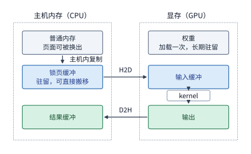

*图 5-1　H2D 将输入数据从主机的锁页缓冲区搬入显存，D2H 将计算结果搬回主机；模型权重在初始化时加载一次后便长期驻留显存，kernel 直接从显存读取输入并写出输出。位于普通可分页内存中的数据必须先由 CPU 拷贝到锁页缓冲区，随后才能由加速器的 DMA 复制引擎直接跨总线搬移。*

当然，在实际运行完整的大模型时，绝非每次调用算子都要把所有数据在主机和显卡之间来回搬运。模型权重在服务启动时经 H2D 加载一次后，便一直常驻显存；层与层之间的中间激活张量直接留在显存中，由下一个 kernel 原地读取；历史 KV 缓存也常驻显存，供后续每个 decode 步反复访问。如果连最终的词表采样（sampling）都在 GPU 上完成，那么每一步需要经 D2H 传回 CPU 的就只有几个字节的生成 token ID。因此，我们必须严格区分**主机与加速器之间的跨总线复制次数**和**加速器显存内部的反复读取次数**：同一份模型权重在服务生命周期内只需跨 PCIe 传入显存一次，却会在加速器内部被成千上万次算子调用反复读取。

**例 5-1：从主机向 GPU 传输一批输入张量需要多长时间？** 假设有一个形状为 $[8192,4096]$ 的 BF16 输入张量，其字节数为 $8192\times4096\times2=64\ \mathrm{MiB}$。以通过 PCIe Gen5 x16 插槽连接主机的 RTX PRO 6000 为例，单向标称带宽为 $64\ \mathrm{GB/s}$，[^pcie] 则将这批数据完整传入显存的理论耗时为：

$$
T_{\mathrm{H2D}}=\frac{64\ \mathrm{MiB}}{64\ \mathrm{GB/s}}\approx1.05\ \mathrm{ms}.
$$

如果我们把这批输入沿行维度拆成两份各 32 MiB 的子张量分两次传输，每份传输耗时约 $0.52\ \mathrm{ms}$，总传输字节数与总传输时间均保持不变。但拆分成两份的妙处在于，第一份数据在 $0.52\ \mathrm{ms}$ 时就已经抵达显存：此时 GPU 计算单元可以立即启动前半批数据的矩阵乘法，而硬件 DMA 复制引擎则在同一时刻继续通过 PCIe 总线传送后半批数据。第 5.3 节将定量推导这种“数据搬移与计算流水重叠”所能节省的端到端时间。[^buffer]

此外，数据在主机内存中存放在哪一类物理页面上，也会显著影响 H2D 的实际传输开销。操作系统分配的普通虚拟内存页面（pageable memory）随时可能被内核换出到磁盘或移动物理地址；而**锁页内存（pinned memory / page-locked memory）**则在锁定期间强制常驻物理内存且物理地址固定，唯有如此，GPU 上的 DMA 复制引擎才能绕过 CPU 直接发起高速总线读取。当程序试图把普通内存中的张量传给 GPU 时，CUDA 运行时不得不先在内部申请一块临时的锁页内存缓冲区，让 CPU 先把数据从普通内存拷贝到锁页缓冲区（即图 5-1 左侧的“主机内复制”），然后再命令 DMA 复制引擎从锁页缓冲区搬往显存。如果每一批 64 MiB 的输入都走这条路径，相当于在每次 H2D 之前都额外多做了一次 64 MiB 的主机内存拷贝。反之，如果让 CPU 一开始就在预先分配好且可循环复用的锁页内存缓冲区中直接组装输入数据，就能彻底省去这次冗余的主机内中转拷贝以及频繁申请释放锁页内存的系统开销。[^execution]

### 5.1.3 stream、event 与完成顺序

数据存放在哪一侧内存，决定了哪颗处理器有资格访问它；而数据何时真正搬移完毕，则决定了依赖这份数据的后续计算何时才能安全启动。由于异步提交函数在任务刚刚入队时就立即返回给 CPU，此时后台的数据复制往往还在进行中，系统必须依靠明确的硬件执行顺序机制，确保后续 kernel 绝不会读到尚未传完的残缺输入。在 CUDA 中，管理任务执行顺序的基本机制是 **stream（流）**：同一个 stream 是一条严格按 FIFO（先进先出）顺序执行的加速器任务队列。只要把 H2D 复制任务和随后读取该输入的计算 kernel 依次放进同一个 stream 中，硬件就会自动保证先完成复制、再启动计算，而 CPU 则可以把这两项任务连续提交出去。

反之，如果我们为了实现传输与计算的并发重叠，把数据复制任务和计算任务分别放进了两条不同的 stream（例如一条专门负责 DMA 传输的“复制流”和一条专门负责执行 kernel 的“计算流”），两条流之间默认是彼此独立、无序并发的。此时就必须借助 **event（事件）** 来显式规定跨流的先后依赖关系：让复制流在 H2D 任务身后插入一个“记录事件（record event）”指令，并让计算流在启动 kernel 之前插入一个“等待该事件（wait event）”指令。需要特别注意的是，这种跨流等待完全发生在 GPU 硬件的任务调度器内部，CPU 在下发完“记录事件”和“等待事件”的控制指令后依然立即返回，可以继续向后提交其他任务而不会被阻塞。

图 5-2 将复制流、计算流以及协调二者同步的两类事件画在了同一条时间线上。

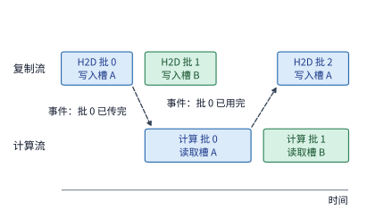

*图 5-2　复制流依次向显存传入各批输入，计算流随后读取它们进行计算。计算流处理“批 0”前必须等待复制流发出的“批 0 已传完”事件；而复制流在把“批 2”覆写进缓冲槽 A 之前，则必须等待计算流发出的“批 0 已用完”事件。图中虚线箭头仅代表跨流等待事件就绪，本身不搬移任何数据。两个缓冲槽 A、B 的乒乓交替机制将在第 5.3.2 节详细展开。*

从图 5-2 可以看到，事件不仅用于保证“数据传完后才能开始读”，同样也用于保证“旧数据用完后才能覆写缓冲区”。假设当前批次（批 0）的输入正从主机缓冲区复制到 GPU 显存的缓冲槽 A：一旦这笔 H2D 复制宣告结束，CPU 就可以安全地向主机侧源缓冲区写入下一批输入；然而，GPU 显存侧的缓冲槽 A 此时正要被计算流读取，复制引擎必须一直等到计算流彻底算完批 0、不再读取槽 A 之后，才能把后续批次（如批 2）写入槽 A 覆盖原有数据。可见，尽管主机源缓冲与 GPU 目标缓冲保存的是同一批输入数据，它们各自解除占用、允许重新覆写的安全时刻却截然不同：

| 缓冲区类型 | 当前批次的最后使用者 | 解除占用后允许执行的后续动作 |
| --- | --- | --- |
| H2D 的主机源缓冲区 | DMA 复制引擎（完成读取） | CPU 写入下一批新输入 |
| GPU 显存输入缓冲区 | 读取该输入的计算 kernel（完成计算） | DMA 复制引擎写入下一批新输入 |
| D2H 的显存源缓冲区 | DMA 复制引擎（完成读取） | GPU 计算 kernel 写入新一轮计算结果 |
| D2H 的主机目标缓冲区 | DMA 复制引擎（完成写入） | CPU 读取当前批次的计算结果 |

把握住“谁是当前数据的最后使用者”这一原则，同步规则便一目了然：**必须在最后使用者完成操作的指令之后紧接着记录一个事件，并让下一个企图覆写（或消费）该缓冲区的操作等待该事件。** 当 CPU 需要读取 D2H 传回的最终结果时，只需针对该 D2H 完成事件发起同步等待，而此时 GPU 上其他无关的流依然可以全速运行。第 5.3 节即将介绍的“双缓冲（double buffering）”流水线，本质上正是将两套这样的缓冲区读写保护顺序交错编排在一起。

这套基于事件的同步机制，也揭示了异构程序为什么有时会发生死锁（hang，即程序完全停滞不再推进）。在硬件层面，每一次跨流或主机等待都绑定着一个具体的事件；只要该事件因为编程疏漏而永远不被记录，等待方就会无限期地停留在原地——其外在表现是程序彻底卡住，而非运行变慢。上表列出的四类缓冲区的“最后使用者”，正是工程实践中最容易漏记或错记事件的四个高发位置：例如，一旦漏记了 GPU 输入缓冲区的“已用完”事件，或者等待了错误的事件句柄，复制引擎就会永远停在写入下一批数据之前。同理，跨流之间的循环依赖也会导致死锁：假设流 A 等待流 B 记录某个事件，而流 B 中记录该事件的任务又排在流 A 尚未下发或尚未完成的某项工作之后，两条流就会陷入循环等待而彻底停滞。到了第 6.4 节讨论多卡分布式执行时，还会遇到另一类典型的死锁来源：集合通信（如 AllReduce）要求通信组内的每一张加速卡都必须按相同顺序发起同一次通信调用；只要其中一张卡因为条件分支不一致而少调了一次，其余所有卡就会在通信栅栏前永远等待这个不会到来的对端。

在排查这类线上故障时，第一步应当先区分系统究竟是“变慢（straggler）”还是“死锁停滞（hang）”：先观察被等待的那一侧是否仍在缓慢推进——如果每隔一段时间仍有新结果产出，说明只是某一段计算或传输出现了性能退化（第 10.4.5 节讨论的训练慢节点便属此类），此时应回到第 5.1.4 节介绍的时间线分析法逐段定位耗时瓶颈；反之，如果所有指标彻底归零、完全不再推进，才说明程序正在等待一个永远不会触发的事件。此时只需为等待操作设置超时阈值（timeout），并在超时触发时打印各条流中尚未完成的队首任务与事件状态，就能迅速揪出究竟是哪一个事件未能按期送达。

### 5.1.4 从提交时间到结果可用时间

只有把主机任务提交、跨总线数据复制、设备端 kernel 计算以及缓冲区同步等待这几个环节在时间轴上串联起来，我们才能回答“上层应用究竟在什么时刻才能拿到计算结果”。图 5-3 将这一完整执行链路绘制成直观的时间线。

**例 5-2：为什么主机提交耗时、加速器纯计算耗时与端到端调用耗时三者完全不同？** 假设输入数据已经在主机锁页内存中准备就绪。CPU 在 $0\sim3\ \mu\mathrm{s}$ 内连续将 H2D 复制、kernel 计算和 D2H 回传三项任务全部异步提交完毕；GPU 从第 $3\ \mu\mathrm{s}$ 起收到第一项任务并开始工作，依次执行耗时 $8\ \mu\mathrm{s}$ 的 H2D、耗时 $20\ \mu\mathrm{s}$ 的计算 kernel 以及耗时 $4\ \mu\mathrm{s}$ 的 D2H。

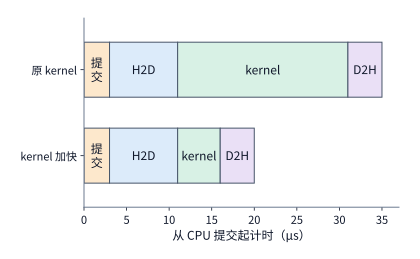

*图 5-3　CPU 异步提交任务、H2D 输入复制、kernel 计算执行与 D2H 结果回传在时间线上依次推进。上半图中 kernel 执行耗时 $20\ \mu\mathrm{s}$，最终结果在第 $35\ \mu\mathrm{s}$ 对 CPU 可用；下半图中将 kernel 优化至 $5\ \mu\mathrm{s}$，最终结果提前至第 $20\ \mu\mathrm{s}$ 可用。*

对比图 5-3 的各段时间可以清楚地看到：CPU 提交全部任务仅花了 $3\ \mu\mathrm{s}$，GPU 执行纯计算 kernel 花了 $20\ \mu\mathrm{s}$，而 CPU 真正能够安全读取最终结果的时刻则是第 $3+8+20+4=35\ \mu\mathrm{s}$。假设我们通过极致的算子优化，把 GPU 执行该 kernel 的纯计算耗时从 $20\ \mu\mathrm{s}$ 大幅压缩到 $5\ \mu\mathrm{s}$（算子本身提速至原来的 4 倍），那么端到端结果可用的时刻将从第 $35\ \mu\mathrm{s}$ 提前到第 $3+8+5+4=20\ \mu\mathrm{s}$——端到端加速比仅为 $35/20=1.75$（约 1.8 倍），因为其余 $15\ \mu\mathrm{s}$ 的固定开销来自主机提交（$3\ \mu\mathrm{s}$）与数据往返复制（$8+4=12\ \mu\mathrm{s}$）。

例 5-2 剖析的这三种不同耗时，恰好对应了性能测试中最常见的三种计时方式——测量结果完全取决于计时起止点设在时间线的哪两个位置。如果直接在异步调用前后读取 CPU 主机时钟（而不加同步），测出来的只是 $3\ \mu\mathrm{s}$ 的**主机提交耗时**；如果在停止 CPU 秒表之前先调用一次设备同步（等待结果返回），测出来的则是 $35\ \mu\mathrm{s}$ 的**端到端完成耗时**；而如果使用 CUDA event 在加速器任务流中包裹住目标 kernel 的首尾，测出来的才是剔除了提交与传输开销后的 $20\ \mu\mathrm{s}$ **设备纯计算耗时**。在实际工程调优中，性能分析工具（Profiler，如 Nsight Systems 或 Ascend Profiler）正是通过把 CPU 主机调用栈、GPU 计算流与 DMA 复制流对齐画在同一张全局时间线上，让我们一眼看清提交之后的队列排队、跨流事件等待以及真实的硬件执行时长。

还需注意，图 5-3 的时间线是从“程序已编译就绪、输入已准备完毕”的状态开始画起的。如果算子程序尚未编译，或者首次遇到某个新的输入张量形状，时间线最前端往往还要额外加上一笔不菲的首次准备开销（例如 JIT 即时编译 kernel 代码，或向运行时申请临时工作区显存）。举个简单的分摊算例：假设首次编译某个算子需要耗时 $100\ \mathrm{ms}$，编译好后每次执行只需 $1\ \mathrm{ms}$；那么如果只调用 1 次，总耗时高达 $101\ \mathrm{ms}$；如果连续调用 100 次，总耗时为 $100 + 100\times1 = 200\ \mathrm{ms}$，平均每次调用分摊耗时降至 $2\ \mathrm{ms}$。显然，算子被重复调用的次数越多，首次编译开销被分摊得就越薄，单次平均耗时就越逼近 $1\ \mathrm{ms}$ 的纯执行耗时。第 5.5 节在探讨动态形状（Dynamic Shape）处理时，就将运用这一分摊准则，定量权衡“形状分桶（Bucketing，把不同长度的输入补齐到少数几个代表形状）”与“形状特化（Specialization，为每种具体形状单独编译专用程序）”各自需要重复执行多少次才划算。

### 5.1.5 一个 kernel 在 SM 上如何执行

在图 5-3 的宏观时间线上，kernel 执行被简化成了一段长 $20\ \mu\mathrm{s}$ 的实心长条；至于这段时间究竟能否如愿缩短到 $5\ \mu\mathrm{s}$，则完全取决于在这短短十几微秒内，GPU 的每个流式多处理器（SM）内部究竟发生了什么。本小节我们将镜头推近到单个 SM 内部，固定一个具体的矩阵乘法 kernel，沿着**线程编组（warp）、资源驻留、访存延迟隐藏、矩阵指令发射与片上栅栏同步**这五个核心环节，一步步推演它在硬件上的微观执行过程。

我们沿用第 4.3.2 节分析过的分块矩阵乘算例：每个线程块负责计算一个 $128\times128$ 的输出分块（tile），沿归约维度 $K$ 每次步进 $64$；在片上存储中，BF16 格式的输入分块 $A$（$128\times64$）与权重分块 $W$（$64\times128$）各占 $16\ \mathrm{KiB}$，FP32 格式的输出累加器（$128\times128$）占 $64\ \mathrm{KiB}$，三者全部存放在共享内存（Shared Memory）中，共同构成该线程块的**工作集（working set，即计算期间必须同时常驻片上局部存储的数据集合）**，合计 $16+16+64=96\ \mathrm{KiB}$。每个线程块包含 $256$ 个线程。硬件参数取自 NVIDIA H100 的单个 SM：每个 SM 最多可同时驻留 $2048$ 个线程（即 $64$ 个 warp）和 $32$ 个线程块，配备 $64\mathrm{K}$ 个 32 位寄存器（即 $65{,}536$ 个）以及 $228\ \mathrm{KB}$ 共享内存（按 CUDA 官方文档惯例记作 $228\ \mathrm{KB}$，实际等于 $228\times1024=233{,}472\ \mathrm{bytes}$）。假设编译后的 kernel 每个线程需占用 $128$ 个寄存器，每条向量加载指令让每个线程读取 $16\ \mathrm{bytes}$ 数据，每个 warp 最多可同时挂起（in-flight）$4$ 条尚未返回的加载指令，底层 Tensor Core 矩阵指令的块形状为 $16\times8\times16$，HBM 显存访问延迟取 $600\ \mathrm{ns}$。[^sm]

**1. warp：SM 硬件并发发射的 32 线程基本编组。** SM 的指令调度器并不是逐个线程独立发射指令的，而是将每 $32$ 个连续编号的线程编成一个固定小组，作为一个整体同步发射指令——这个 32 线程小组就称为一个 **warp（线程束）**。同一个 warp 内的 32 个线程在同一拍执行相同的指令，但各自用自己的寄存器操作不同位置的数据（即 SIMT，单指令多线程执行模型）；例如发射一条访存加载指令时，一个 warp 内的 32 个线程会同时各自给出一个内存地址，一次性发起 32 路读取。本例中一个包含 $256$ 个线程的线程块，恰好由 $256/32=8$ 个 warp 组成。后文第 5.2.3 节在分析共享内存的存储体（**bank**，即共享内存中可并行独立响应读写请求的硬件分区）冲突时所提到的“32 个 lane（通道）”，指的就是同一个 warp 里的这 32 个线程：它们在同一拍给出的 32 个访问地址分散落在多少个不同的 bank 上，直接决定了这条共享内存读写指令需要分几拍（几轮）才能服务完毕。

**2. 硬件资源上限与占用率（Occupancy）。** 一个线程块要想被派发到某个 SM 上**驻留（resident，即常驻在该 SM 的硬件槽位上，随时可被 warp 调度器选中发射指令）**，SM 必须同时为它分配足额的线程槽（每个线程占 1 个槽位）、寄存器和共享内存。每一类硬件资源最多能够容纳的驻留线程块数，等于该资源的 SM 总容量除以单个线程块的消耗量并向下取整；而一个 SM 最终实际能够同时驻留的线程块总数，则取决于这四项上限中的最小值（短板效应）：

| SM 硬件资源维度 | 单个 SM 总容量 | 每个线程块的资源需求 | 该项资源允许驻留的线程块数 |
| --- | ---: | ---: | ---: |
| 线程槽（Thread Slots） | $2048$ | $256$ | $\lfloor 2048 / 256 \rfloor = 8$ |
| 32 位寄存器（Registers） | $64\mathrm{K}$ 个（$65{,}536$ 个） | $256 \times 128 = 32\mathrm{K}$ 个 | $\lfloor 64\mathrm{K} / 32\mathrm{K} \rfloor = 2$ |
| 共享内存（Shared Memory） | $228\ \mathrm{KB}$（$233{,}472\ \mathrm{bytes}$） | $96\ \mathrm{KiB}$ 工作集 $+ 1\ \mathrm{KiB}$ 系统预留 $= 97\ \mathrm{KiB}$ | $\lfloor 228 / 97 \rfloor = 2$ |
| 硬件线程块槽位上限 | $32$ | $1$ | $32$ |

从表中可以清晰看到：寄存器与共享内存两项资源都将驻留块数限制在了 **2 个线程块**（共 $2\times8=16$ 个驻留 warp）。在 GPU 性能分析中，我们将一个 SM 当前实际驻留的 warp 数占该 SM 硬件最大可驻留 warp 数（H100 为 64）的比例定义为**占用率（occupancy）**；因此本例的占用率为 $16/64 = 25\%$。图 5-4 将寄存器、共享内存和线程槽三类硬件资源画成了三根容量横条：2 个驻留线程块已经把 64K 个寄存器全部占满，把 228 KB 共享内存填到只剩 $228 - 2\times97 = 34\ \mathrm{KiB}$（根本放不下第 3 块所需的 $97\ \mathrm{KiB}$），唯独 2048 个线程槽只用了四分之一（512 个）。

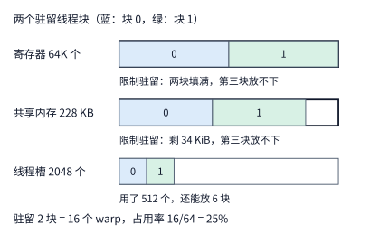

*图 5-4　三条横柱分别代表单个 SM 的寄存器、共享内存与线程槽总容量，蓝色与绿色部分代表两个驻留线程块各自占用的份额。可以看到，两个线程块恰好将寄存器完全占满，共享内存仅余 34 KiB（不足以容纳第三块所需的 97 KiB），这两项资源共同限制了驻留块数；而线程槽仅使用了 512 个（占 25%）。计算参数为每块 256 线程、每线程 128 个寄存器、每块 96 KiB 工作集另加 1 KiB 系统预留。*

这张资源分配表揭示了一条实用的调优准则：**只有针对当前卡得最紧的瓶颈资源做减法，才能真正提升驻留块数与占用率。** 举例来说，假设我们为了让共享内存多装几个块，把占 $64\ \mathrm{KiB}$ 的 FP32 输出累加器从共享内存挪进各线程的私有寄存器中——由于每个线程块有 256 个线程，挪走 $64\ \mathrm{KiB}$（即 $16{,}384$ 个 FP32 元素）意味着每个线程要额外多拿 $16{,}384 / 256 = 64$ 个 FP32 寄存器。这样一来，每个线程块的共享内存需求确实从 $97\ \mathrm{KiB}$ 锐减到了 $32+1=33\ \mathrm{KiB}$（单看共享内存足以容纳 $\lfloor 228/33 \rfloor = 6$ 块）；然而，哪怕原本每个线程只用 64 个寄存器，加上这 64 个累加寄存器后也达到了 128 个，导致寄存器上限依然把驻留数限制在 2 块。结果驻留线程块总数丝毫未变，瓶颈只是从“寄存器与共享内存双重受限”变成了“寄存器单项受限”。要想真正让第 3 个线程块进驻 SM，必须双管齐下，把每线程寄存器用量压到 $\lfloor 65536 / (3\times256) \rfloor = 85$ 个以内，同时把每块共享内存控制在 $\lfloor 228 / 3 \rfloor = 76\ \mathrm{KiB}$ 以内——这通常意味着必须缩小每个线程块负责的分块工作集尺寸。

**3. 访存延迟隐藏：靠驻留 warp 维持足量的在途字节（In-Flight Bytes）。** 为什么我们要关心 SM 上驻留了多少个 warp？核心原因在于，所有并发的访存请求都必须由驻留的 warp 发射出来：只有当同时挂起在显存通路上的**在途请求（in-flight requests）**足够多时，才能在某几个 warp 停下来等待显存数据返回的漫长空档里，让显存总线始终被其他 warp 的数据传输填满——这就是微架构中的**访存延迟隐藏（latency hiding）**。根据第 4.3.3 节推导的 Little 定律，填满一条带宽为 $B$、往返延迟为 $L$ 的传输链路所需的最小在途数据量为 $B\times L$。代入 H100 的 HBM 显存带宽 $3.35\ \mathrm{TB/s}$ 与访存延迟 $600\ \mathrm{ns}$，整张卡至少需要保持 $3.35\ \mathrm{TB/s}\times600\ \mathrm{ns}=2.01\ \mathrm{MB}$ 的在途数据；平摊到全卡 132 个 SM 上，每个 SM 必须时刻维持约 $15.2\ \mathrm{KB}$ 的在途读取需求（$B_{\mathrm{need}}$）。再来核算当前驻留的 16 个 warp 最多能发起多少在途字节（$B_{\mathrm{have}}$）：每个 warp 发射一条加载指令时，32 个线程各取 $16\ \mathrm{bytes}$，单条指令合计请求 $32\times16=512\ \mathrm{bytes}$；每个 warp 最多可挂起 4 条未完成的加载指令，因此 16 个驻留 warp 合计能够提供的最大在途字节数为：

$$
B_{\mathrm{need}}=\frac{3.35\ \mathrm{TB/s}\times600\ \mathrm{ns}}{132}\approx15.2\ \mathrm{KB},\qquad
B_{\mathrm{have}}=16\times4\times512\ \text{字节}=32\ \mathrm{KiB}.
$$

由于 $32\ \mathrm{KiB}\approx32.8\ \mathrm{KB}$，当前驻留 warp 能够提供的在途字节数是硬件需求底线（$15.2\ \mathrm{KB}$）的约 $2.15$ 倍——事实上，即便只驻留 1 个线程块（8 个 warp，提供 $16\ \mathrm{KiB}\approx16.4\ \mathrm{KB}$ 在途字节），也足以让显存带宽达到满载。这一计算为后文第 5.2.2 节即将遇到的“分块划得太大，虽然总读取字节数变少了，但算子实际运行反而变慢”这一反直觉现象提供了坚实的定量解释：**分块工作集划得越大，单个 SM 能驻留的线程块和 warp 数就越少，能同时挂起的在途访存字节数 $B_{\mathrm{have}}$ 就随之萎缩；一旦 $B_{\mathrm{have}}$ 跌破 Little 定律要求的阈值 $B_{\mathrm{need}}$，SM 实际能跑出来的有效显存带宽就会按比例退化为 $B_{\mathrm{have}}/L$，硬件标称的显存带宽再高也发挥不出来。**

**4. 硬件矩阵指令（MMA）的执行粒度。** 第 4.2.1 节曾指出，现代加速器的矩阵计算单元（如 Tensor Core）是以固定形状的小矩阵块为单位执行乘加运算的。在本例中，单条矩阵乘加指令（MMA）处理的形状为 $16\times8\times16$（即输入片 $A$ 为 $16\times16$，权重片 $W$ 为 $16\times8$，输出片为 $16\times8$），每条指令完成 $2\times16\times8\times16 = 4096$ 次浮点运算（FLOPs）。因此，要算完当前线程块负责的一个 $128\times128\times64$ 分块步，总共需要发射 $(128/16)\times(128/8)\times(64/16) = 8\times16\times4 = 512$ 条 MMA 指令，合计完成 $512\times4096 = 2{,}097{,}152\ \mathrm{FLOPs}$。在线程块内部，这 512 条指令由 8 个 warp 平均分担：整个 $128\times128$ 的输出块共划分为 $8\times16=128$ 个大小为 $16\times8$ 的基本输出片，每个 warp 固定承包其中的 16 个输出片，并在沿 $K$ 维推进 4 小步（$64/16=4$）的过程中累计发射 $16\times4=64$ 条 MMA 指令。需要注意的是，硬件 MMA 指令要求其累加器必须位于线程寄存器中；如果像本例基准方案那样把 $64\ \mathrm{KiB}$ 累加结果存放在共享内存里，那么每个 warp 在每一个 $K$ 步前后都不得不在寄存器与共享内存之间来回搬移这 16 个输出片——而前文提到的“把累加器直接常驻在寄存器中”的改进方案，省掉的恰恰就是这笔频繁的片上读写开销。

在指令发射方式上，NVIDIA GPU 提供了两代不同粒度的 MMA 指令：传统的 warp 级指令（如 Ampere 架构的 `mma.sync`）由单个 warp 独立发射，要求先把输入操作数从共享内存加载到该 warp 的寄存器中；而 Hopper 架构引入的 **warpgroup 级指令（`wgmma`）** 则将 4 个相邻的 warp（共 128 个线程，合称一个 **warpgroup**）捆绑为一个协同发射单元，不仅允许 Tensor Core 直接从共享内存中读取操作数矩阵（省去先把共享内存数据搬进寄存器的步骤），而且支持异步执行——发出矩阵指令的 warpgroup 在等待 Tensor Core 完成矩阵乘加的同时，可以继续执行其他算术或控制指令。FlashAttention-3 正是利用这种 warpgroup 级异步矩阵指令，实现了矩阵乘法与 Softmax 指数运算的深度重叠。[^fa]

**5. 片上同步：异步复制与共享内存栅栏（Barrier）。** 第 4.4.2 节曾介绍过如何利用两个输入缓冲槽（双缓冲）让数据搬移与矩阵计算在时间上重叠，而实现这一重叠的前提是硬件必须准确获知“当前缓冲槽已填满新数据”和“当前缓冲槽的数据已使用完毕”这两个关键时刻。在 SM 内部，这两个时刻的精准交接是由**共享内存栅栏（shared memory barrier，如 `mbarrier`）**来完成的。栅栏本质上是驻留在共享内存中的一个硬件同步计数器：每个参与协作的线程（或硬件搬移引擎）完成自身阶段的任务后便向栅栏报到（arrive），一旦报到计数达到预设阈值，所有在该栅栏前等待（wait）的线程便立即被硬件放行。Hopper 等架构的硬件**异步复制引擎（TMA / `cp.async`）**在后台搬完指定字节数的数据后，同样会自动向目标栅栏报到并累加已搬入的字节计数。因此，我们只需为每个输入缓冲槽配备一对栅栏：**“满（full）”栅栏**由后台异步复制在数据搬完时触发，计算线程等待它放行后再开始读数；**“空（empty）”栅栏**由计算线程在用完当前块后触发，后台异步复制等待它放行后再覆写下一块数据。由于这类栅栏完全在单个 SM 内部的共享内存上运作，触发与放行一次仅需几十个时钟周期；相比之下，跨 SM 之间的数据交接与同步必须绕道片外 L2 缓存，延迟开销要高出一到两个数量级（详见第 4.4.4 节）。

借助轻量级的片上栅栏，同一个线程块内的不同 warp 可以实现彻底的角色分工：专门抽出一个（或一组）warp 只负责下发异步数据复制指令（充当**生产者，Producer**），其余所有 warp 则专心执行矩阵乘加与激活运算（充当**消费者，Consumer**）——这种软件流水线设计范式称为 **warp specialization（线程束角色特化）**。在运行过程中，生产者 warp 发出第 $j+1$ 块的异步复制指令后根本无需原地等待数据到齐，而是立即转身去等待另一个缓冲槽的“空”栅栏，以便尽早下发第 $j+2$ 块的复制；与此同时，消费者 warp 只要等到当前槽位的“满”栅栏放行，就立刻调用 Tensor Core 消费该槽位的数据，算完后随手触发“空”栅栏并转向下一个槽位。

让我们结合 H100 的硬件参数，把这套生产者—消费者流水线的具体耗时算清楚。将 H100 的 HBM 显存带宽 $3.35\ \mathrm{TB/s}$ 和 BF16 稠密矩阵峰值算力 $989.4\ \mathrm{TFLOP/s}$ 平均分摊到 132 个 SM 上，每个 SM 分得的带宽份额约为 $25.4\ \mathrm{GB/s}$，算力份额约为 $7.50\ \mathrm{TFLOP/s}$（以下按单个线程块独占该 SM 的份额进行核算）。每推进一个 $K=64$ 的归约步，需要从显存搬入 $A$、$W$ 两个分块共 $16+16=32\ \mathrm{KiB}$（$32{,}768\ \mathrm{bytes}$），按 $25.4\ \mathrm{GB/s}$ 计算，单块复制耗时约为 $32{,}768 / (25.4\times10^9) \approx 1.29\ \mu\mathrm{s}$；而完成该块的矩阵乘加共需 $2{,}097{,}152\ \mathrm{FLOPs}$，按 $7.50\ \mathrm{TFLOP/s}$ 计算，单块计算耗时约为 $2.097\times10^6 / (7.50\times10^{12}) \approx 0.28\ \mu\mathrm{s}$。为什么数据复制耗时达到了矩阵计算耗时的 $1.29 / 0.28 \approx 4.6$ 倍？原因很简单：在这个分块粒度下，每搬入 $1\ \mathrm{byte}$ 数据仅执行 $2{,}097{,}152 / 32{,}768 = 64\ \mathrm{FLOPs}$ 的运算（算术强度为 $64\ \mathrm{FLOP/byte}$），远低于 H100 矩阵峰值与显存带宽之比（$989.4 / 3.35 \approx 295\ \mathrm{FLOP/byte}$）。图 5-5 按照“每块复制 $1.29\ \mu\mathrm{s}$、计算 $0.28\ \mu\mathrm{s}$”的精确比例，画出了生产者 warp 与消费者 warp 在两个缓冲槽 A、B 上交替处理 4 个 $K$ 块的流水线时间线。

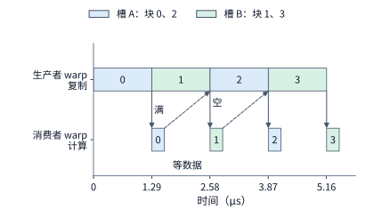

*图 5-5　上行表示生产者 warp 下发的后台异步复制，下行表示消费者 warp 执行的矩阵计算；蓝色与绿色分别代表共享内存中的缓冲槽 A 与槽 B。实线箭头代表“满”栅栏（复制完毕后触发，消费者据此启动计算）；虚线箭头代表“空”栅栏（例如块 0 在 $1.57\ \mu\mathrm{s}$ 时已算完并释放槽 A，而块 2 的异步复制直到 $2.58\ \mu\mathrm{s}$ 才开始写入槽 A，因此生产者无需停顿等待槽位）。在 H100 单个 SM 份额下，每块复制耗时 $1.29\ \mu\mathrm{s}$、计算耗时 $0.28\ \mu\mathrm{s}$；复制通道首尾相接满载运行，消费者每算完一块便等待下一次“满”栅栏放行。*

这套基于 warp 特化与片上栅栏的机制，正是第 4.2.3 节所介绍的硬件多引擎流水线在 GPU 软件层面的具体落地：在第 4.2.3 节中，参与流水协作的三类硬件资源是矩阵计算单元、共享内存读写接口与特殊函数（指数）单元；在这里，生产者 warp 专门负责驱动异步复制并占用共享内存写入接口，消费者 warp 则负责驱动 Tensor Core 矩阵单元与特殊函数单元，而片上栅栏则确保产消双方仅在数据交接的边界处做最小限度的必要同步。FlashAttention-3 的核心流水线正是沿用了这一设计：由专门的生产者 warpgroup 持续下发 $K$、$V$ 分块的 TMA 异步复制，同时让两个消费者 warpgroup 乒乓交替地执行矩阵乘法与 Softmax——当其中一个消费者 warpgroup 占用特殊函数单元计算指数时，另一个消费者 warpgroup 正好占用 Tensor Core 执行矩阵乘加。后文第 5.3.2 节将沿用此处“单块复制 $1.29\ \mu\mathrm{s}$、单块计算 $0.28\ \mu\mathrm{s}$”的数值基准推导多块流水线的总耗时公式，第 5.3.3 节则进一步展开 FlashAttention 的片上分块与在线更新推导。[^fa]

此外，硬件异步批量复制引擎（如 TMA）对片上数据的地址布局还提出了一项特殊要求。后文第 5.2.3 节将会讲到，为了避免共享内存的 bank 冲突，传统做法常采用 **padding（填充）**，即在矩阵每一行的末尾额外补一个空字（word）以错开同列元素的 bank 编号；然而，异步批量复制引擎是按照硬件张量描述符（tensor map，记录多维张量形状与行跨度的元数据）整块连续搬移数据的，不便在相邻两行之间随意插入破坏对齐的零散填充字节。为此，现代算子库改为在不增加任何额外字节的前提下，按固定的按位异或（XOR）规则在块内置换各元素的存放列号——这种地址置换技术称为 **swizzle（地址交错置换）**：它既保持了整块数据的紧凑连续（总字节数不变），又让同一列的并发访问请求自然打散到全部 32 个不同的 bank 上。

**跨架构对照：NVIDIA GPU 与华为昇腾（Ascend）NPU 的微观执行映射。** 本小节梳理的“线程发射与分工、片上资源驻留、访存搬移与栅栏同步”这几个核心机制，在华为昇腾架构上恰好对应着第 4.2.3 节与第 4.6.2 节介绍过的另一套硬件组件：

| 微观执行机制 | NVIDIA GPU（如 Hopper H100） | 华为昇腾 NPU（达芬奇架构） |
| --- | --- | --- |
| 指令发射与计算分工 | **warp** 是 32 线程的同步发射单位；生产者与消费者 warp 在同一个 SM 内部通过角色特化实现分工 | **AIC（Cube 核）与 AIV（Vector 核）** 是物理上各自独立的处理器核而非线程束：矩阵运算在 AIC 上执行，向量运算在 AIV 上执行，二者拥有各自独立的指令流 |
| 片上驻留与容量约束 | 寄存器总量、共享内存容量与线程槽上限共同决定每个 SM 可同时驻留的线程块数 | L0（L0A/L0B/L0C）、L1 与统一缓冲区（UB）的物理容量直接决定了每个核单次能够容纳的分块（tile）大小 |
| 异步搬移与片上同步 | TMA / `cp.async` 异步复制完成后触发共享内存栅栏（barrier），消费者 warp 等待栅栏放行 | MTE / NDDMA 硬件搬移引擎负责跨层级搬数，通过硬件同步原语与 `BufferID` 标识缓冲区状态并完成产消交接 |

最后需要提醒读者注意：前文得出“25% 的占用率（16 个驻留 warp）所提供的在途字节已绰绰有余”这一结论，高度依赖于“显存延迟 $600\ \mathrm{ns}$”和“每个 warp 可同时挂起 4 条未完成加载指令”这两个前提条件。**结论翻转条件**：假设在某种复杂访存模式或高负载拥塞下，显存有效延迟上升至 $1000\ \mathrm{ns}$，且受限于寄存器依赖，每个 warp 在同一时刻只能挂起 2 条未完成的加载指令；此时根据 Little 定律，单个 SM 维持满带宽所需的在途字节数将升至 $25.4\ \mathrm{GB/s}\times1000\ \mathrm{ns}=25.4\ \mathrm{KB}$，而 16 个驻留 warp 最多只能提供 $16\times2\times512\ \mathrm{bytes}=16\ \mathrm{KiB}$（约 $16.4\ \mathrm{KB}$），在途字节覆盖率（可用在途字节与所需在途字节之比）瞬间跌至 $16.4 / 25.4 \approx 0.65$。在传统线程加载模式下，要想补齐这笔在途字节缺口，至少需要 $\lceil 25{,}400 / (2\times512) \rceil = 25$ 个驻留 warp（即至少要驻留 $\lceil 25/8 \rceil = 4$ 个线程块），但寄存器和共享内存容量却只允许驻留 2 个块。在这种翻转场景下，25% 的占用率便不再够用，解决途径只有两条：**要么缩小分块工作集以削减单块资源占用，从而让 SM 驻留更多线程块；要么彻底放弃由各线程各自发射加载指令的传统模式，改用 TMA 硬件异步批量复制——只需由单个线程发射一条批量复制指令即可一次性请求整块 $16\ \mathrm{KiB}$ 数据，此时的在途字节数直接按请求的块大小累计，从而彻底解除访存带宽对驻留 warp 数量的依赖。**

> **练习 5-1 · 延伸：把输出块缩为 64×64，占用率由哪项资源决定**
>
> 保持每个线程块 256 个线程、每个线程占用 128 个寄存器不变，将输出分块从 $128\times128$ 缩小为 $64\times64$，归约维 $K$ 的步长仍为 $64$，且输入分块与 FP32 累加器依然全部存放在共享内存中。试求：（1）每个线程块的共享内存需求（含 $1\ \mathrm{KiB}$ 系统预留）、H100 单个 SM 四类资源各自允许驻留的线程块数以及最终占用率，并指出此时哪一项资源限制最紧；（2）若进一步将每线程寄存器用量降至 64 个，重新计算驻留块数与占用率，说明瓶颈转移到了哪一项资源；（3）按 $600\ \mathrm{ns}$ 显存延迟与每 warp 挂起 4 条加载指令核算，检查上述两种配置下的可用在途字节数是否仍能覆盖满带宽需求。

## 5.2 单个算子的分块、布局与实际访存

面对装不进片上存储的大矩阵乘法，最直观的思路就像切豆腐一样进行**分块（tiling）**：先把大矩阵切分成适合片上缓冲区容纳的小块（tile），再由各个计算单元逐块处理完毕。不过，究竟应该把分块切成什么尺寸和形状，必须同时兼顾两方面约束：**一是硬件矩阵计算单元单条指令支持怎样的基本形状，二是计算单元旁边的片上局部存储究竟能装下多少数据。** 第 4 章已经说明，硬件矩阵指令只能处理固定形状的微小矩阵片；尽管整张加速卡上的上百个 SM 可以并行处理成百上千个软件分块，但每一个软件分块内部仍然必须进一步拆解成硬件指令能够直接吞吐的基本步。

更重要的是，软件分块的核心使命是**让每一次从显存费力搬入片上的数据尽可能多复用几次**。沿用第 4 章的“木工工作台”比喻：当前正在使用的输入块和尚未累加完毕的部分和（partial sum），都必须暂存在紧挨着计算单元的片上工作台上，直到全部累加完成才能腾出地方。如果把输出分块切得太小，同一份输入数据为了配合不同的输出分块，就不得不从显存反复搬上搬下；可如果把输出分块切得太大，单块工作集又会独占过多的片上存储空间，把原本可以同时驻留执行、用来隐藏访存延迟的其他并发线程块挤出工作台。下面我们先从算出单个输出元素所需的数据依赖入手，再将多个相邻输出组织成二维分块，定量推导分块大小、循环遍历顺序与片上容量上限这三者是如何共同决定数据复用率与实际性能的。

### 5.2.1 矩阵形状与重复读取

为了与通用矩阵乘法（GEMM）的符号习惯保持一致，本节以下将章首算例中的输入矩阵 $X$ 记作 $A$，线性投影写作 $C=AW$，其中三个维度分别为 $M=1024$、$K=4096$、$N=12288$。矩阵 $A$、$W$、$C$ 均采用 BF16 格式（每个元素占 $2\ \mathrm{bytes}$），其数据量分别为 $8\ \mathrm{MiB}$、$96\ \mathrm{MiB}$ 和 $24\ \mathrm{MiB}$。在最理想的情况下，如果输入矩阵 $A$ 和权重矩阵 $W$ 各自只从下级存储读取一次，输出矩阵 $C$ 算完后只写出一次，那么跨存储接口传输的数据总量总共只需 $8+96+24=128\ \mathrm{MiB}$。要想弄明白为什么前文提到的基础分块实现会产生约 $3\ \mathrm{GiB}$ 的实际访存量，我们先来看看单个输出元素 $C[i,j]$ 是怎样算出来的。

当计算输出元素 $C[i,j]$ 时，程序需要读取输入矩阵 $A$ 的第 $i$ 行（共 $K$ 个元素）和权重矩阵 $W$ 的第 $j$ 列（共 $K$ 个元素），将对应位置的元素逐一相乘并沿 $K$ 维累加求和。紧接着，当我们转向计算它右侧相邻的输出元素 $C[i,j+1]$ 时，权重矩阵需要换成相邻的第 $j+1$ 列，但所需的输入矩阵却依然是完全相同的第 $i$ 行。在图 5-6 中，这两次相邻计算所使用的蓝色输入行是完全重合的。

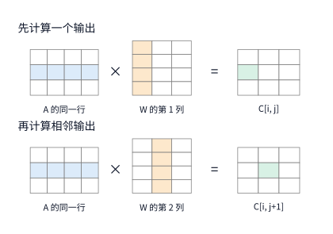

*图 5-6　先计算输出元素 $C[i,j]$，紧接着计算右侧相邻的 $C[i,j+1]$。图中蓝色高亮表示两次计算共同使用的 $A$ 的同一行，橙色表示各自使用的 $W$ 的相邻两列，绿色表示本次算出的输出元素。为便于展示，图中矩阵绘为缩略示意尺寸，实际算例的归约维长度为 $K=4096$。*

可以看到，如果 $A$ 的第 $i$ 行在算完 $C[i,j]$ 之后依然保留在片上局部存储（或高速缓存）中，那么计算 $C[i,j+1]$ 时就能直接零开销复用；反之，如果由于片上空间不足，这行数据在两次使用之间已经被别的中间数据挤出了片上存储，程序就不得不再次向下级存储发起读取请求。同理，当计算完第 $i$ 行输出、转而计算下一行输出 $C[i+1,j]$ 时，权重矩阵 $W$ 的第 $j$ 列也会被再次用到。换言之，**同一份输入与权重数据在矩阵乘法的数学定义中天然需要被成千上万次乘加运算反复共享；至于算子程序如何在时空上编排这些运算的次序，则直接决定了同一份数据究竟要跨越片上存储与下级存储之间的物理接口往返搬移多少次。**

为了给不同分块方案提供一把统一的衡量标尺，本节将观察哨设在**片上工作缓冲区（如共享内存）与下一级存储之间的接口**处，累计整个算子执行期间每次跨过该接口读入与写出的总字节数。前文提到的“约 $3\ \mathrm{GiB}$ 访问量”，统计的正是流经这一接口的实际传输总量。[^tiles]

如果把图 5-6 的逐元素点积过程直接写成最朴素的三重嵌套循环，代码如下：

```python
for i in range(M):
    for j in range(N):
        acc = 0.0
        for k in range(K):
            acc += A[i, k] * W[k, j]
        C[i, j] = acc
```

在这段代码中，最内层的 `k` 循环每完整跑完一轮（$K$ 步），就算出一个输出元素 $C[i,j]$。按惯例将一次乘法加一次加法计作 $2\ \mathrm{FLOPs}$，算出全部 $M\times N$ 个输出元素所需的总浮点运算量为：

$$
F_{\mathrm{gemm}}=2MKN\approx103\ \mathrm{GFLOPs}.
$$

与之对照的理论最低访存基准，则是三份 BF16 矩阵各自恰好只流经存储接口一次（即 $A$、$W$ 各读入一次，$C$ 写出一次）的数据总量：

$$
V_{\mathrm{once}}=2(MK+KN+MN)=(8+96+24)\ \mathrm{MiB}=128\ \mathrm{MiB}.
$$

式中的 $\mathrm{MiB}$ 为二进制兆字节（$1\ \mathrm{MiB}=2^{20}\ \mathrm{bytes}$）。下文就以这 $128\ \mathrm{MiB}$ 的“单次理想读写量”为参照系，定量核算各种分块方案究竟多付出了多少倍的重复读取代价。

除了影响数据复用，多重循环的嵌套顺序还直接决定了每次访存的物理地址是否连续。当权重矩阵 $W$ 按行主序（row-major，即同一行相邻元素在内存中紧密相连）存放时，上述 `i-j-k` 循环的最内层随 `k` 递增依次读取 `W[k, j]`、`W[k+1, j]`——这两个元素在内存中的地址相隔了 $N=12{,}288$ 个元素（即跨步读取，stride access），极不利于内存总线合并突发传输。反之，如果我们将循环顺序调整为 `i-k-j`（把 `j` 放到最内层），那么内层循环每次固定住标量 `A[i, k]`，依次读取内存地址紧密相邻的 `W[k, j]`、`W[k, j+1]`，并同时更新一整行输出的部分和。这样一来，存储接口通过一次连续合并读取拿到的整段权重数据，就能在当次迭代中立即全部投入计算。

然而，单纯把循环顺序改成 `i-k-j` 也会立即受制于片上容量上限：由于最内层循环要同时更新第 $i$ 行的全部 $N=12{,}288$ 个输出元素，程序必须在片上同时保存这 $12{,}288$ 个 FP32 累加器（占 $48\ \mathrm{KiB}$）。一旦片上局部存储（或寄存器）装不下如此宽的一整行部分和，每一轮 `k` 步更新就不得不把部分和写回下级存储再重新读出，反而引发灾难性的中间流量。因此，实用的算子实现绝不会一次横跨整行 $N$，而是通过**二维分块（tiling）**严格限制同一时刻留在片上的数据规模，让输入数据的片上复用与输出累加器的容量占用达到最佳平衡。

### 5.2.2 容量约束下的分块复用

二维分块的核心做法是：先在输出矩阵 $C$ 中划出一块大小为 $m\times n$ 的二维小区域，作为当前线程块要负责算完的目标输出块，并在片上局部存储中为它分配一块 $m\times n$ 的 FP32 累加缓冲区。在随后的计算过程中，程序沿着归约维度 $K$ 以步长 $k$ 循环推进，每一步从下级存储成对读入两个输入小块：大小同为 BF16 格式的 $m\times k$ 输入分块 $A$ 与 $k\times n$ 权重分块 $W$。将这两个小块在片上相乘，乘积结果直接累加进同一块输出累加缓冲区中；到了下一步换入下一对输入分块时，片上已经累加出的部分和原地保留不动。如此循环往复，直到沿着整个 $K$ 维把所有输入分块全部累加完毕，最后才将 FP32 累加结果一次性转换为 BF16 格式并写回下级存储。需要明确的是，这里的 $m\times n\times k$ 分块是软件为了在片上复用数据而规划的逻辑工作集，在单个软件分块内部还会进一步拆解成多条底层的硬件矩阵指令（如前文 $16\times8\times16$ 的 MMA 指令）；而且分块计算并不要求事先把显存里的大矩阵物理切割成零碎的小矩阵，所有按块寻址与搬移都由 kernel 在执行过程中动态完成。

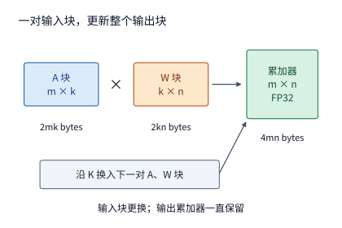

*图 5-7　固定当前负责的 $m\times n$ 输出分块，沿着归约维 $K$ 依次搬入对应的 $A$ 分块与 $W$ 分块，在片上反复更新同一份输出部分和，直到全部 $K$ 步累加结束后才一次性写回。输入块 $A$、$W$ 为 BF16 格式，片上累加器为 FP32 格式。图中展示的是软件级分块，单次块乘内部可包含多条硬件矩阵指令；图中方框标注的是维度符号，面积未按实际字节数等比例缩放。*

观察图 5-7 的分块几何关系即可看出数据复用的来源：每搬入一个 $m\times k$ 的 $A$ 块，其中的每一个元素都能在与 $W$ 块相乘时横向服务于全部 $n$ 列输出；同理，每搬入一个 $k\times n$ 的 $W$ 块，其中的每一个元素都能纵向服务于全部 $m$ 行输出。因此，**将输出分块的尺寸 $m$ 和 $n$ 划得越大，单次搬入片上的每一个输入字节就能参与越多次乘加运算**；但代价是片上必须同时容纳更大的输入块和按 $m\times n$ 二次方膨胀的输出部分和。

**例 5-3：将矩阵乘法的输出分块扩大一倍，能减少多少跨接口的输入重复读取？** 在图 5-7 的工作集中，BF16 格式的输入块 $A$、权重块 $W$ 以及 FP32 格式的输出累加器分别占用 $2mk$、$2kn$ 和 $4mn\ \mathrm{bytes}$。假设片上仅分配单组输入缓冲区（暂不计双缓冲翻倍），则单个线程块所需的片上局部存储容量 $S$ 为：

$$
S=\underbrace{2mk}_{A\text{ 块}}+\underbrace{2kn}_{W\text{ 块}}+\underbrace{4mn}_{\text{累加器}}\quad\mathrm{bytes}.
$$

固定归约步长 $k=32$，我们先考察 $m=n=64$（即 $64\times64$ 输出分块）的方案：此时 $A$ 块和 $W$ 块各占 $2\times64\times32 = 4096\ \mathrm{bytes} = 4\ \mathrm{KiB}$，而 FP32 输出累加器占 $4\times64\times64 = 16\ \mathrm{KiB}$，单块工作集合计占用 $4+4+16 = 24\ \mathrm{KiB}$。如果我们把输出分块的边长扩大一倍至 $128\times128$（仍保持 $k=32$），那么 $A$ 块和 $W$ 块各自翻倍至 $8\ \mathrm{KiB}$，而输出累加器则按面积扩大至原来的 4 倍（达 $64\ \mathrm{KiB}$），使单块工作集总容量跃升至 $8+8+64 = 80\ \mathrm{KiB}$。可见，扩大输出分块固然提升了输入复用度，但片上输出累加器的容量开销增长得更快。

接下来核算这两种分块方案在整个矩阵乘法期间产生的跨接口总读写量 $V$。为看清分块本身的效果，假设各个输出分块各自独立从下级存储读取所需的输入块（暂不考虑不同输出分块在片外缓存中的巧合命中）。由于输出矩阵在列方向（$N$）上被切分为 $N/n$ 个列块，每一个列块在算完自身所需的全部行块时都必须完整遍历一遍输入矩阵 $A$（大小 $2MK$）；同理，输出矩阵在行方向（$M$）上被切分为 $M/m$ 个行块，每一个行块在算完自身所需的全部列块时都必须完整遍历一遍权重矩阵 $W$（大小 $2KN$）。而最终算好的 BF16 输出矩阵 $C$（大小 $2MN$）只需在归约结束时写出一次。因此，跨接口的总访存字节数为：

$$
V=\underbrace{2MK\frac{N}{n}}_{A\text{ 的重复读取}}+\underbrace{2KN\frac{M}{m}}_{W\text{ 的重复读取}}+\underbrace{2MN}_{C\text{ 写出}}.
$$

代入算例参数（$M=1024, K=4096, N=12288$）：当采用 $64\times64$ 输出分块时，整个输出矩阵被划分为 $1024/64 = 16$ 个行块和 $12288/64 = 192$ 个列块。于是，192 个列块各自重读一遍 $8\ \mathrm{MiB}$ 的矩阵 $A$，累计读取 $192\times8 = 1536\ \mathrm{MiB}$；16 个行块各自重读一遍 $96\ \mathrm{MiB}$ 的权重 $W$，累计读取 $16\times96 = 1536\ \mathrm{MiB}$；再加上最终写出的 $24\ \mathrm{MiB}$ 输出矩阵 $C$，跨接口总读写量高达 $1536+1536+24 = 3096\ \mathrm{MiB}\approx3.02\ \mathrm{GiB}$——这正是本章开篇所提到的“128 MiB 的矩阵却产生约 3 GiB 实际读写量”的精确来源。

当我们将输出分块扩大为 $128\times128$ 后，行块数从 16 减半至 8，列块数从 192 减半至 96，使得矩阵 $A$ 和权重 $W$ 的重复读取量双双减半至 $768\ \mathrm{MiB}$；加上不变的 $24\ \mathrm{MiB}$ 输出写出，跨接口总读写量直接降至 $768+768+24 = 1560\ \mathrm{MiB}$。图 5-8 将不同分块尺寸下的“跨接口访存缩减收益”与“片上局部存储容量代价”放在同一张图上进行了直观对比。

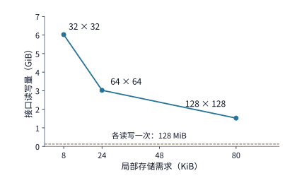

*图 5-8　图中各数据点分别对应三种不同的输出分块形状。扩大输出分块尺寸能够成倍削减跨存储接口的重复读取总量，但代价是单块所需的片上局部存储空间急剧膨胀。底部水平虚线代表三份矩阵各自仅流经接口一次的理论下界（128 MiB）；核算条件为 $k=32$、单组输入缓冲且各输出分块独立读取输入。*

我们将 $32\times32$、$64\times64$ 与 $128\times128$ 三种分块方案的完整指标汇总如下表（其中算术强度由总浮点运算量 $F_{\mathrm{gemm}}\approx103\ \mathrm{GFLOPs}$ 除以各自的跨接口总访存字节数算得）：

| 输出分块形状 | 单块局部存储需求 $S$ | 工作缓冲与下级存储之间的总访存量 $V$ | 这一级接口上的算术强度 |
| --- | ---: | ---: | ---: |
| $32\times32$ | $8\ \mathrm{KiB}$ | $6168\ \mathrm{MiB}$ | $15.9\ \mathrm{FLOP/byte}$ |
| $64\times64$ | $24\ \mathrm{KiB}$ | $3096\ \mathrm{MiB}$ | $31.7\ \mathrm{FLOP/byte}$ |
| $128\times128$ | $80\ \mathrm{KiB}$ | $1560\ \mathrm{MiB}$ | $63.0\ \mathrm{FLOP/byte}$ |

对照第 5.1.5 节算出的 H100 机器平衡点（矩阵峰值算力与显存带宽之比为 $295\ \mathrm{FLOP/byte}$）可以发现：上述三种分块方案在这一级接口上的算术强度（$15.9\sim63.0\ \mathrm{FLOP/byte}$）全都远低于 $295\ \mathrm{FLOP/byte}$ 的平衡阈值。这意味着如果每次读取都直接穿透到显存，三种分块全都处在严重的访存带宽受限区，矩阵计算单元的理论算力利用率（MFU）上限分别只有约 $5\%$、$11\%$ 和 $21\%$。因此，在将累加器置于共享内存的基准方案下，单纯扩大输出分块虽然能把算术强度一步步推向 Roofline 拐点，但受制于共享内存容量上限，仅靠这一级分块还不足以跨过拐点；要想让 Tensor Core 达到满负荷运转，还需利用更靠近计算单元的寄存器层（如通过寄存器级分块在寄存器中完成乘加复用并存放累加器，从而腾出共享内存容纳更大分块）以及片外 L2 缓存的跨线程块输入共享，通过多级存储层次协同来补齐剩余的数据复用。

更进一步来看：把跨接口访存量从 $3096\ \mathrm{MiB}$ 减半到 $1560\ \mathrm{MiB}$，是否意味着算子的实际运行时间也一定能随之减半？答案取决于硬件在同一时刻还能并行安排多少个分块任务。在 GPU 上，沿用第 5.1.5 节的基准配置（每个线程块承包一个输出分块，且输入缓冲与输出累加器均存放在共享内存中），我们以一台搭载 RTX PRO 6000（属于 Blackwell 架构，计算能力 12.x）的工作站为例：该卡每个 SM 的共享内存物理上限为 $100\ \mathrm{KB}$（即 $102{,}400\ \mathrm{bytes}$），且每个驻留线程块还需额外消耗 $1\ \mathrm{KiB}$ 的硬件系统预留空间。[^cc12]

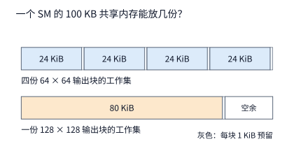

*图 5-9　上下两条横柱的总长度均代表 RTX PRO 6000 单个 SM 的 $100\ \mathrm{KB}$ 共享内存预算。采用 $64\times64$ 输出分块时，每个线程块占用 $24\ \mathrm{KiB}$ 工作集加 $1\ \mathrm{KiB}$ 预留（共 $25\ \mathrm{KiB}$），单个 SM 恰好可以同时驻留 4 个线程块；而改用 $128\times128$ 输出分块后，单块占用升至 $80+1=81\ \mathrm{KiB}$，单个 SM 最多只能驻留 1 个线程块。*

正如第 5.1.5 节所证明的，同一个 SM 上同时驻留的多个线程块能够交错发起访存请求：当其中一部分块停下来等待下级存储返回数据时，另一部分块可以继续发射指令，从而维持高水平的在途字节数。在图 5-9 中，将输出分块从 $64\times64$ 扩大为 $128\times128$ 后，单个 SM 同时驻留的工作集从 4 份骤减为 1 份，等待访存返回期间可供切换执行的并发 warp 数缩水到了原来的四分之一。因此，**大块方案虽然把需要搬移的总字节数缩减了一半，但由于并发在途请求不足，它实际能够跑出来的有效访存带宽反而可能大幅下跌。**

我们可以用一个简洁的比例式把这笔得失账算清楚。假设 $64\times64$ 与 $128\times128$ 两种分块方案均受限于这一级存储接口的带宽，二者在实际运行时的有效带宽分别为 $B_{64}$ 和 $B_{128}$，则二者的执行耗时之比为：

$$
\frac{T_{128}}{T_{64}}=\frac{1560}{3096}\cdot\frac{B_{64}}{B_{128}}.
$$

如果扩大分块后依然能维持相同的有效带宽（$B_{128}=B_{64}$），那么耗时确实接近减半（$T_{128}/T_{64}\approx0.504$）；然而，一旦因为驻留块数锐减导致 $128\times128$ 方案的实际有效带宽跌至原来的四成（$B_{128}=0.4 B_{64}$），耗时之比就会逆转为 $0.504 / 0.4 \approx 1.26$——也就是说，改用大块后算子反而变慢了约 $26\%$。在实际算子调优中，标准做法正是先根据片上容量硬约束排除掉根本装不下的分块尺寸，再根据跨接口访存量公式筛出一批高复用候选分块，最后通过真机实测（或精细的微架构代价模型）检验实际跑出的有效效率。第 5.4 节将介绍编译器如何自动完成这一搜索与权衡过程。

### 5.2.3 数据布局：让并行请求分散到不同 bank

上一小节看到，分块过大可能因为驻留线程块减少而折损并发度；但即便 SM 上驻留了充足的线程块，片上访存的实际吞吐仍然取决于**同一个 warp 内 32 个线程同时发出的读写请求，能否在同一个时钟周期内被共享内存并行服务完毕**。这就引出了片上存储器的物理组织与数据布局问题。

在 NVIDIA GPU 中，为了提供极高的片上读写带宽，共享内存被在硬件上切分为 **32 个独立的存储体（bank）**；每个 bank 在每个时钟周期内可以独立提供一个 32-bit（4 字节）宽度的字（word），而任意一个 32-bit 字属于哪一个 bank，直接由该字的地址除以 32 取余数（$\text{word\_index} \bmod 32$）决定。回顾第 5.1.5 节：一个 warp 包含 32 个线程（对应 32 个通道，即 **lane 0 ～ lane 31**）。假设我们在共享内存中存放了一个 $32\times32$ 的 FP32 暂存矩阵块（每个元素恰好是一个 32-bit 字）：当一个 warp 的 32 个 lane 同时去读取矩阵的**同一行**（即连续的 32 个字）时，32 个请求恰好一对一落在全部 32 个不同的 bank 上，硬件只需 **1 轮（1 个服务周期）** 就能把 32 个数同时交还给所有线程；然而，当这 32 个 lane 同时去读取矩阵的**同一列**时，由于相邻两行同列元素在内存中的地址恰好相隔着一整行的跨度（即 32 个字），对 32 取模后的余数完全相同——这意味着全部 32 个线程的请求都会集中指向**同一个 bank**。由于单个 bank 每轮只能服务一个不同地址的请求，硬件不得不把这笔原本并行的列读取强制串行拆成 **32 轮** 依次执行，这就是严重的 **bank 冲突（bank conflict）**，它会让共享内存的有效带宽直接跌至三十二分之一。

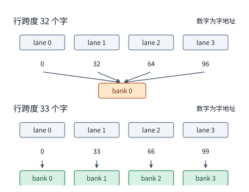

*图 5-10　一个 warp 的 32 个 lane 同时请求读取矩阵同一列的 32 个不同元素。上半图中矩阵行跨度恰好为 32 个字，导致同列所有元素的地址对 32 取模结果完全相同，请求全部挤向同一个 bank（发生 32 路冲突）；下半图中在每行末尾额外补 1 个空字（行跨度变为 33 个字），使同列相邻行元素的 bank 编号依次错开 1 位，32 个请求均匀打散到全部 32 个 bank 上。图中示意画出了前 4 个请求；假设每个 bank 每轮服务一个 32-bit 字（不含同地址广播情形）。*

知道了病根在于“行跨度恰好是 32 的倍数”，破解之道便极为巧妙：我们只需在共享内存数组的每一行末尾人为多补 1 个无用的空字，把物理行跨度（stride）从 32 个字改成 **33 个字**。如此一来，同一列中第 $r$ 行元素与第 $r+1$ 行元素的字地址之差就变成了 33，对 32 取模后的 bank 编号随着行号 $r$ 的递增依次加 1（$(33r + c) \bmod 32 = (r + c) \bmod 32$），从而让 32 个线程对同一列的访问请求严丝合缝地分散到 32 个不同的 bank 上，重新恢复 **1 轮全部读完** 的满带宽吞吐。算一笔空间代价账：整个暂存块占用的共享内存仅从 $32\times32\times4 = 4096\ \mathrm{bytes}$ 微增至 $32\times33\times4 = 4224\ \mathrm{bytes}$，空间开销只增加了 $3.1\%$；算子实际参与计算的有效数据量和读取指令次数没有丝毫变化，但原本要排长队串行走 32 轮的列读取，立即缩减到了 1 轮完成。

在每行末尾多补的这个占位字，就是算子优化中经典的 **padding（填充对齐）** 技术：它完全不改变数学运算本身，仅靠微调数据在片上存储中的物理跨度，就把发生冲突的并行访存请求均匀打散到了不同的硬件服务单元。

如果连这 $3.1\%$ 的额外共享内存空间都不愿浪费（或者如第 5.1.5 节所述，为了配合硬件 TMA 异步批量复制而不能在行尾插入破坏对齐的填充字），我们还可以采用零额外空间开销的 **swizzle（地址交错置换）** 方案：保持物理行跨度仍为 32 个字不变，但在把逻辑上位于第 $r$ 行、第 $c$ 列的元素存入共享内存时，将其物理存放列号改写为 $c \oplus r$（其中 $\oplus$ 表示二进制按位异或运算）。当一个 warp 的 32 个线程按列读取逻辑上的第 $c$ 列（即 $r$ 取遍 $0\sim31$，$c$ 固定不变）时，由于在 $0\sim31$ 范围内对固定常数 $c$ 做按位异或是一个严格的一一映射（置换），32 个线程实际访问的物理列号 $c \oplus r$ 必然取遍 $0\sim31$ 中互不相同的 32 个值，对应的 bank 编号自然也两两不同，同样只需 **1 轮** 即可无冲突读完。在 NVIDIA 的高性能矩阵乘法模板库 CUTLASS 中，这种基于按位异或重排片上存放位置的技术就称为 swizzle：它省去了 padding 多占的存储字节，付出的唯一代价是每次读写共享内存时需要先用一条极轻量的位运算指令算出置换后的物理列号。

### 5.2.4 沿哪个维度切分：并行任务与部分和

无论是 padding 还是 swizzle，解决的都是“已经并发跑起来的线程如何避免在片上存储接口处撞车”。然而，如果算子程序从一开始切分出的并行任务数就寥寥无几，连加速器的上百个 SM 都填不满，那么光调整地址布局也无济于事——此时必须从算法维度把计算任务拆得更细。

让我们以大模型每一层都必不可少的 **RMSNorm（均方根层归一化）** 算子为例：对于输入矩阵的每一行，RMSNorm 首先要算出该行全部元素的均方值，据此求出一个整行共享的标量缩放因子（scaling factor）；随后再用该缩放因子乘以该行的每一个元素以及对应位置的可学习参数向量 $\gamma$。显然，求整行均方值是一次典型的**归约（reduction）**运算，必须汇总一整行的全部元素平方和才能得出缩放因子。在章首算例的 prefill 阶段，输入张量形状为 $[1024, 4096]$（共 1024 行，每行 4096 个 BF16 元素）：如果我们采用最直观的“一个线程块（工作组）承包一整行”的切分策略，天然就能切出 $1024$ 个彼此完全独立的并行工作组，足以让整张 GPU 的所有 SM 满负荷并发运行；然而一旦进入单请求逐 token 生成的 **decode 阶段**，每次输入只有一个 token（形状变为 $[1, 4096]$，只有 1 行），继续沿用“一组承包一行”的策略就只能启动 **1 个线程块**——这意味着整张 GPU 上其余上百个 SM 将全部处于彻底闲置状态。

要想在小行数（甚至单行）场景下创造出足够的并行度，就必须沿着**归约维度（即行内的 4096 个特征维）**把每一行进一步拆开。例如，我们把每行的 4096 个元素均匀切成 **8 个长度为 512 的片段**，交由 8 个并行工作组分别处理。这样一来，原本一步到位的行归约就演变成了图 5-11 所示的三个串行阶段：第一阶段，8 个工作组各自读取自己负责的 512 个元素，算出 8 个**局部平方和（partial sum）**并写出；第二阶段，汇总合并这 8 个局部平方和，算出整行唯一的缩放因子；第三阶段，8 个工作组再次并行读取原始输入行的各个片段，乘上刚刚算出的缩放因子与权重 $\gamma$，写出最终归一化结果。不难看出，前两个阶段之间传递的局部平方和与缩放因子只有寥寥几个浮点数，但拆成三阶段的最大代价是：**第三阶段必须把原始输入张量从显存重新读取一遍。**

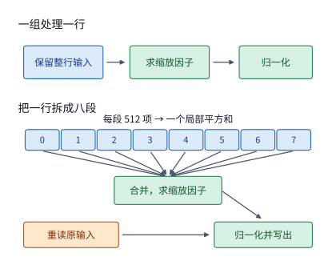

*图 5-11　上行展示“一个工作组承包完整一行”的单阶段实现：输入行读入片上后一直保留到归一化结束，无需重读；下行展示“将每行沿特征维拆成 8 段”的三阶段实现：先并行求 8 个局部平方和，再合并求出整行缩放因子，最后重新读取原始输入并完成归一化写出。每行含 4096 个 BF16 元素；图中仅绘出单行示意，推广到 1024 行时，第一阶段的并发工作组数从 1024 增至 8192。橙色高亮框代表因跨阶段拆分而额外增加的原始输入重读开销。*

顺着图 5-11 的数据流箭头逐项清点字节数，就能精确算出为了换取更高并行度所付出的额外访存代价。仍以 $M=1024$ 行（共 $1024\times4096$ 个 BF16 元素，占 $8\ \mathrm{MiB}$）为例：将每行拆成 8 段后，第一阶段的并行工作组数量从 $1024$ 组暴增至 $8192$ 组；中间产出的 $8192$ 个 FP32 局部平方和仅占 $32\ \mathrm{KiB}$，合并得到的 $1024$ 个 FP32 缩放因子仅占 $4\ \mathrm{KiB}$。对比两种实现的访存总量：
- 在**不拆分（一组一行）**的实现中，每个工作组在片上局部保留整行输入，只需读入一次 $8\ \mathrm{MiB}$ 输入，每行读取一份 BF16 权重 $\gamma$（假设各行独立读取未完全命中缓存，累计 $8\ \mathrm{MiB}$），最后写出 $8\ \mathrm{MiB}$ 归一化结果，总访存量为 $8+8+8=24\ \mathrm{MiB}$，且只需启动 **1 次** kernel launch。
- 在**拆成 8 段**的实现中，第三阶段做归一化时必须重新从下级存储读入一遍 $8\ \mathrm{MiB}$ 的原始输入；加上中间局部平方和与缩放因子的写出与读回（合计约 $0.1\ \mathrm{MiB}$），总访存量升至 $32.1\ \mathrm{MiB}$，同时 kernel launch 次数也从 1 次增加到了 **3 次**。[^reduction]

不过，把每个工作组的处理粒度缩小到一行的八分之一，还附带带来了另一项实实在在的片上存储红利：**每个工作组需要在片上暂存的输入数据量同步缩减到了原来的八分之一。** 如果要把一整行 4096 个元素以 FP32 精度暂存在片上，需要占用 $16\ \mathrm{KiB}$ 空间；而只暂存其中的 512 个元素则只需 $2\ \mathrm{KiB}$。原本因为超出寄存器容量而被迫溢出（spill）到较慢存储层级的临时数据，拆分后便能直接放入高速寄存器中。归纳起来，沿归约维拆分算子的收益来自两方面：**一是并发任务数成倍增加，二是单任务片上工作集显著缩小**；而它付出的代价则是**原始输入数据的二次重读**以及**多阶段之间的中间结果传递与多次 kernel 启动开销**。

从更抽象的视角来看，RMSNorm 之所以在拆开后必须多出一次“合并局部和”的阶段，是因为我们切开的是**归约维（reduction dimension）**。完全相同的切分选择也出现在矩阵乘法 $C_{M\times N}=A_{M\times K}W_{K\times N}$ 中：当我们把一个大矩阵乘法分派给多个执行单元（无论是单卡上的多个线程块，还是分布式集群中的多张加速卡）时，同样可以沿着输出行维 $M$、输出列维 $N$ 或归约维 $K$ 这三个维度中的任意一个动刀。图 5-12 对比了沿着这三个不同维度切分时，各个执行单元各自需要什么输入分片、又会产出怎样性质的计算结果。

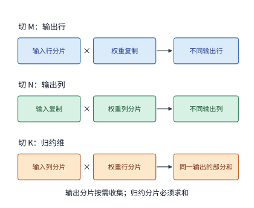

*图 5-12　沿着输出行维 $M$ 或输出列维 $N$ 切分时，每个执行单元直接算出最终输出矩阵在不同空间位置上的完整分片，仅在后续需要全量张量时才做拼接；而沿着归约维 $K$ 切分时，每个执行单元算出的都只是同一块输出区域的部分和（partial sum），必须经过一次跨执行单元的求和归约后才能得到正确结果。图中方框仅示意数据分片归属，未按实际矩阵元素比例绘制。*

对比图 5-12 的三种切法可以看到：前两种切法（切输出行 $M$ 或切输出列 $N$）只需对输入或权重做相应的分片或广播复制，各个执行单元算出来的直接就是最终输出的一部分，只要后续算子允许按分片继续消费，就根本不需要立刻汇总；唯有第三种切法（切归约维 $K$，在单卡算子中常称为 **Split-K**），虽然让每个执行单元只读取 $A$ 和 $W$ 的一部分，却像拆分后的 RMSNorm 一样，每个执行单元算出的都只是同一个输出位置上的**部分和**，最后必须额外做一次跨执行单元的加法汇合。回看第 5.2.2 节的标准二维分块方案：它之所以优先沿着输出维 $M$ 和 $N$ 切分线程块，而让同一个线程块自己在内部顺着 $K$ 维从头累加到尾，正是为了把 FP32 累加器严格限制在单个线程块内部，从而避免跨线程块汇合部分和的额外通信开销。

更微妙的是，改变归约切分方式与合并次序，还会直接改变最终算出的**浮点数值结果**。这源于计算机浮点数的一个基本性质：**浮点数加法不满足结合律**（即 $(a+b)+c \neq a+(b+c)$）。我们可以用一个极简的 IEEE 754 单精度浮点数（FP32，含 1 位符号、8 位指数和 23 位显式尾数，尾数最低有效位权重在数值为 $1$ 时对应 $2^{-23}$）算例来直观说明：尝试用 FP32 计算 $1 + 2^{-24} + 2^{-24}$。
- 如果**从左往右依次相加**，第一步先算 $1 + 2^{-24}$，由于 $2^{-24}$ 恰好落在 $1$ 的尾数最低位之后（等于半个最低有效位间距），按默认“向偶数舍入（round to nearest even）”规则会被直接舍去，结果仍为 $1$；第二步再加第二个 $2^{-24}$ 同样被舍去，最终算出的总和仍然是 **$1$**。
- 反之，如果**先把后面两个小数加起来**，第一步算 $2^{-24} + 2^{-24}$ 可以精确得到 $2^{-23}$；第二步再算 $1 + 2^{-23}$，此时 $2^{-23}$ 刚好够得上 $1$ 的尾数最低有效位，最终算出的总和就变成了 **$1 + 2^{-23}$**。

仅仅因为改变了加法结合顺序，完全相同的三个输入数就算出了相差 **1 个 ULP（unit in the last place，即同一阶码下相邻两个可表示浮点数之间的最小间距）** 的不同结果。在长链条归约中，前一步舍入丢掉的尾数精度永远无法找回，随后的每一次加法都是在已经带有舍入误差的中间值上继续累积（即经典的大数吃小数现象）。

让我们回到本小节的 RMSNorm 算例，看看在实际模型尺寸下这种浮点结合律误差究竟有多大。取一行 $4096$ 个 BF16 元素，由于 BF16 的平方在转换为具有更宽指数和尾数的 FP32 时可以做到零误差精确表示，因此以下不同切分方案算出的平方和差异，100% 来源于 FP32 加法顺序的改变。图 5-13 上半部分展示了将同一行均匀切成 $1, 2, 4, 8, 16, 32$ 段这六种不同段数时，各自算出的 FP32 平方和与无限精度有理数精确值之间的误差距离（横轴以 FP32 的 ULP 为单位）：
- 当采用**不切分（1 段，从头到尾顺序累加 4096 个数）**时，随着单个累加器的数值一路滚雪球般增长到 $2038$ 附近，后续每次加进来的新元素平方却只有 $0.5$ 左右；由于大数与小数的阶码差距越拉越大，新加入项的低位尾数在对齐移位时被反复截断舍去，最终算出的总和比精确值偏小了 **$175.2$ 个 ULP**。
- 而当我们将这一行**切成 8 段**分别累加时，每段内部的局部累加器最高只增长到 $255$ 左右（阶码比 $2038$ 小了 3 档，多保住了 3 位有效尾数），最后再把这 8 个量级相近的局部和加在一起，最终结果与精确值仅相差 **$9.2$ 个 ULP**。

对比“1 段顺序累加”与“8 段分段累加”两条计算路径，二者算出的平方和之间相差了 $166$ 个 ULP（相对误差约为 $9.9\times10^{-6}$）。这雄辩地证明了：**在浮点数世界里，改变并行切分段数改变的不只是运行速度，还会实实在在地改变算子输出的数值精度（而且分段归约由于接近成对求和，数值精度往往反而比单路顺序累加更高）。**

再看图 5-13 的下半部分：即便我们把切分段数固定为 8 段（即 8 个局部平方和的数值完全固定），仅仅改变把这 8 个局部和加到一起的**先后排列次序**（共有 $8! = 40{,}320$ 种排列），也会算出 **3 个互不相同的 FP32 数值**（彼此之间相差 1 个 ULP）。这一点对并发编程有着关键启示：如果程序员在第二阶段为简化实现，让 8 个工作组直接调用硬件**原子加（`atomicAdd`）**指令把各自的局部和往同一个显存地址里并发累加，那么由于操作系统与硬件调度器的微小抖动，每次运行时哪一个工作组先到、哪一个后到是完全随机的——结果就会导致**面对完全相同的输入张量、运行完全相同的二进制程序，先后跑两次却得出比特位不完全一致（non-bitwise-identical）的输出结果**。要想实现严格的确定性计算（Determinism），就必须放弃无序原子加，改为先让 8 个工作组把各自的局部和按编号依次写进一块固定缓冲区，等全部 8 个数都写齐后，再由单个归约线程严格按照固定的下标顺序依次相加。当然，换取确定性同样要付出两笔代价：一是多了一次局部和缓冲区的写出与读回，二是合并阶段必须等待全组最慢的那个片段算完才能启动（而原子加则是随到随加，无需等待全部就绪）。

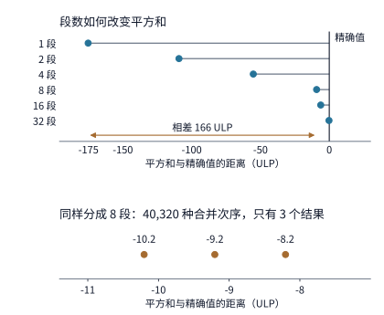

*图 5-13　同一行 4096 个 BF16 元素的平方和相对于精确值的误差距离（横轴单位为 FP32 的 ULP）。上半图对比了将该行切分为 1 至 32 段共六种切分粒度下的累加结果；下半图固定为 8 段局部和，遍历全部 $8! = 40{,}320$ 种合并相加次序所落入的 3 个离散 FP32 结果点。图中的“精确值”由无限精度有理数算得，作为零误差基准线。*

而且，这种微小的 ULP 差异绝不会仅仅停留在平方和这一步。顺着 Qwen3-8B 的 `rms_norm_eps` 继续往下算完平方根倒数与归一化乘法后，“1 段”与“8 段”两条路径算出的整行缩放因子依然相差 **$59$ 个 ULP**，最终输出的第一个 BF16/FP32 激活元素相差 **$50$ 个 ULP**，并且这个偏差会原封不动地作为下一层 Transformer 的输入继续向后传播放大。[^order]

理解了这一数值机制，就能清晰解释大模型工程中一个常见的线上现象——**为什么同一个模型、加载同一份权重、输入完全相同的提示词（prompt），当它处于不同大小的并发批次（batch size）中运行时，算出来的输出对数概率（logprob）甚至生成的文本会不一样？** 根本原因就在本小节开头讲过的动态并行切分策略里：当输入 batch 较大（例如总共 1024 行）时，算子库检测到行数充足，便自动选用“一组承包一整行（切 1 段）”的 kernel；而当线上请求稀少、batch 缩水到只有寥寥几行（如 decode 单请求只有 1 行）时，算子库为了填满 SM，又会自动切换到“把每行拆成 8 段甚至 16 段”的拆分归约 kernel。正是这种**随 batch 大小动态切换归约切分段数与矩阵分块形状**的自适应优化，破坏了算子的批次不变性（batch invariance），导致同一行输入在不同 batch 大小下走过了不同的浮点加法结合路径。如果上层应用（例如强化学习 RLHF 训练中的 rollout 生成与训练前向对齐，详见第 10.5.3 节）强制要求输出严格只由该条样本自身的输入决定、绝不随 batch 大小波动，那么算子就必须固定归约段数与合并次序，即便在 batch=1 时也严格按固定分段执行——其代价自然是在小 batch 场景下牺牲掉部分硬件并行度。

如果把视野从单张加速卡内部进一步放大到多卡集群，本节讨论的分块与切分规律依然完全适用，只不过分块的边界跨越了单张加速卡的显存围墙：在单卡内部，不同分块之间的协同靠的是线程块、片上共享内存与局部归约；一旦把矩阵切分到多张卡上，沿输出维（$M$ 或 $N$）切分的各张卡需要通过网络分发或收集输入输出分片，而沿归约维（$K$）切分的各张卡则必须把各自算出的部分和跨卡传输到一起做全局求和（AllReduce）。**底层的数学依赖关系与三种基本切分方向没有发生任何改变，唯一改变的是搬移数据的物理距离、链路带宽与同步延迟代价。**

在确定了沿哪个维度切分数据之后，下一步的**调度（scheduling）**则是决定这些分块在时间上的执行顺序、物理放置位置、缓冲区分配以及计算与传输的重叠方式。例如，同样是沿归约维 $K$ 切分，究竟是等所有分片数据全部收齐后再一次性启动矩阵乘，还是边从网络接收当前分片、边在计算单元上累加前一个分片的部分和，会直接改变峰值显存占用与端到端暴露的等待时间。在大模型分布式系统中，批次样本（Batch）、序列长度（Sequence）、隐藏特征（Hidden/Tensor）、网络层（Layer/Pipeline）以及混合专家（Expert）共同构成了丰富的并行切分维度——其中“网络层”对应计算图上的前后顺序阶段，而“专家”则对应由动态路由选中的条件分支。第 6.1.4 节将把分布式系统中的各种并行策略与图 5-12 的三种基本矩阵切分方向一一建立映射，第 6.2 节则会逐一推导它们各自的集合通信开销。

小结整个第 5.2 节：无论是二维矩阵分块、共享内存 bank padding/swizzle，还是归约维拆分，本质上都是在**不改变算子数学定义的前提下，重新编排同一批乘加与归约运算在时空中的组织方式**——二维分块让多个输出元素共享同一次搬入的输入，padding 与 swizzle 让并发访存请求均匀打散到不同存储体，归约拆分则通过切细单行粒度创造出更多并发任务。在评估任何一项此类改动时，我们既要定量算清它在访存字节数、片上容量与硬件占用率上的得失账，也要清醒地审视它是否因改变浮点结合顺序而移动了数值精度与确定性边界。本书配套实验中的“内存连续访问与宽行归约对照实验”提供了上述机制的完整实测数据。[^exp1]

## 5.3 相邻算子的融合、缓冲与流水执行

上一节展示了单个算子内部如何利用片上局部存储复用输入数据。当我们把视野扩展到计算图中的**相邻算子**时，同样存在着巨大的片上复用机会：前一个算子费力算出来的输出张量，往往紧接着就要作为后一个算子的输入被立即消费。如果能让后一个算子直接在片上局部存储（或寄存器）中接手前一个算子的中间结果，就能彻底省去把中间张量写回显存、旋即又从显存重新读出的昂贵往返。当然，要想让这种跨算子的片上直接交接顺利成立，程序必须搞清楚两个前提条件：后一个算子的每一个输出究竟依赖前一个算子的哪些位置？这些被依赖的中间数据在什么时刻才能全部算好？

### 5.3.1 中间张量与融合边界

让我们把章首的单支线性投影算例扩展为 Qwen3-8B 中完整的 SwiGLU 前馈网络（FFN）激活链：设门控投影输出为 $G=XW_g$，上投影输出为 $U=XW_u$；随后的逐元素激活链负责计算 $Z=\operatorname{SiLU}(G)\odot U$，最后再将 $Z$ 送入下投影（down projection）矩阵乘回隐藏层维度。在 $M=1024$、$F=12288$ 的算例尺寸下，中间张量 $G$、$U$、$Z$ 的形状均为 $[1024,12288]$，以 BF16 格式存放时各自占用 $24\ \mathrm{MiB}$ 显存。

仔细审视激活链中的两步运算——$\operatorname{SiLU}$ 非线性激活与逐元素哈达玛积 $\odot$——可以发现它们都是纯粹的**逐元素（pointwise / elementwise）运算**：输出张量任意位置上的元素 $Z[i,j]$，仅仅依赖于完全相同坐标位置上的两个输入元素 $G[i,j]$ 与 $U[i,j]$，不同行列坐标之间没有任何跨位置的归约或交叉依赖。这意味着硬件只要把同一坐标 $(i,j)$ 处的 $G[i,j]$ 和 $U[i,j]$ 读入寄存器，当场就能一气呵成算出最终的 $Z[i,j]$，完全不必等待整张 $1024\times12288$ 的 $\operatorname{SiLU}(G)$ 矩阵全部算完再去执行乘法。

让我们对比一下中间张量 $T=\operatorname{SiLU}(G)$ 在“分立执行”与“融合执行”两种模式下的命运。当把 $\operatorname{SiLU}$ 和逐元素乘法作为两个独立算子分开启动时，第一个 kernel 必须先把算出的完整中间矩阵 $T$（$24\ \mathrm{MiB}$）悉数写回片外下级存储（HBM 显存），紧接着第二个 kernel 再把这 $24\ \mathrm{MiB}$ 的 $T$ 从下级存储重新读回片上；而一旦将这两个算子**融合（operator fusion）**进同一个 kernel 中，线程只需在寄存器里算出当前小分片的 $\operatorname{SiLU}$ 中间值 $t$，转手就在下一条指令里乘上对应的 $U$ 分片，用完即刻丢弃——这就像流水线工作台上刚打磨好的零件直接递给旁边的组装工位，彻底省去了“先装箱运回远端仓库、下一道工序再从仓库领出”的无谓折腾。注意，算子融合省掉的纯粹是中间张量的跨级写回与重读流量，两步数学运算本身的浮点计算量（FLOPs）依然一分不少地照常完成。

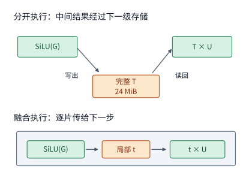

*图 5-14　上半图为分立执行路径：完整的 $24\ \mathrm{MiB}$ 中间矩阵 $T$ 必须经历一次片外写出与一次片外读回；下半图为算子融合路径：片上寄存器中的局部中间片段 $t$ 直接递交给逐元素乘法消费。两种方案同样需要读入 $G$、$U$ 并写出 $Z$（图中略去了这些共同的输入输出边），且融合后严格保留与分立执行一致的中间舍入规则。*

**例 5-4：将激活链中的逐元素算子融合，能够削减多少中间张量访存？**
- 在**两步分立执行**时：第一步计算 $T=\operatorname{SiLU}(G)$，需要读取 $24\ \mathrm{MiB}$ 的 $G$ 并写出 $24\ \mathrm{MiB}$ 的 $T$，发生 $48\ \mathrm{MiB}$ 访存；第二步计算 $Z=T\odot U$，需要读取 $T$（$24\ \mathrm{MiB}$）与 $U$（$24\ \mathrm{MiB}$）并写出 $Z$（$24\ \mathrm{MiB}$），发生 $72\ \mathrm{MiB}$ 访存；两步累计总读写量高达 $48+72=120\ \mathrm{MiB}$。
- 在**两步融合执行**时：同一个融合 kernel 每次同步读入 $G$ 和 $U$ 的一小片（合计 $48\ \mathrm{MiB}$），在片上寄存器内连续完成 $\operatorname{SiLU}$ 与乘法后直接写出 $Z$（$24\ \mathrm{MiB}$），总读写量直接降至 $48+24=72\ \mathrm{MiB}$。

省下来的这 $120-72=48\ \mathrm{MiB}$ 流量，恰恰就是 $24\ \mathrm{MiB}$ 中间张量 $T$ 的一次片外写出加一次片外读回。由于逐元素算子的算术强度极低、完全受限于显存带宽，假设融合前后程序的有效显存带宽不变，则融合后的理论耗时之比为 $72/120 = 0.6$（即理论加速比约为 $1.67$ 倍）。在真机实测中，这段激活链的执行耗时从分立时的约 $14.2\ \mu\mathrm{s}$ 缩短到了融合后的 $7.7\ \mu\mathrm{s}$，实测加速比达到约 **$1.8$ 倍**（不仅省去了 $48\ \mathrm{MiB}$ 显存读写，还顺带省去了一次 kernel 启动开销）。理论核算与真机实测共同印证了算子融合的核心收益来源：**消灭中间张量的片外往返读写。**[^exp2]

现在，假设为了加速后续的低精度矩阵乘法，我们需要在算出 $Z$ 之后紧接着按预先给定的缩放系数（scale）将其量化为 8-bit 浮点或整数格式（每个元素仅占 $1\ \mathrm{byte}$，输出张量大小减半至 $12\ \mathrm{MiB}$）。如果把这步量化也当作独立算子单独执行，就又得把 $24\ \mathrm{MiB}$ 的 BF16 张量 $Z$ 从显存读进来、再写出 $12\ \mathrm{MiB}$ 的量化结果，额外增加 $24+12=36\ \mathrm{MiB}$ 访存。我们可以把“$\operatorname{SiLU}$ $\rightarrow$ 逐元素乘法 $\rightarrow$ 量化”这三步流水线的不同融合边界放在一起做个全面对比：
1. **三步完全独立执行**：总读写量为 $120 + 36 = 156\ \mathrm{MiB}$；
2. **仅融合前两步（$\operatorname{SiLU}$ + 乘法），量化独立**：总读写量为 $72 + 36 = 108\ \mathrm{MiB}$；
3. **三步全部融合进同一个 kernel**：只需读入 $G$（$24\ \mathrm{MiB}$）与 $U$（$24\ \mathrm{MiB}$），在片上一步算出 8-bit 量化输出并写出（$12\ \mathrm{MiB}$），总读写量进一步锐减至 $24+24+12 = 60\ \mathrm{MiB}$。

图 5-15 将各方案无论如何都省不掉的“外部输入输出必需读写（$60\ \mathrm{MiB}$）”画在每根柱条的最左侧，并在右侧叠加了因未融合而多付出的两笔中间张量往返读写。

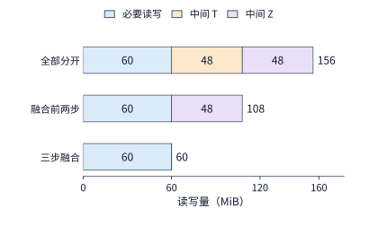

*图 5-15　每少在显存中落地保存一个 $24\ \mathrm{MiB}$ 的 BF16 中间张量，就能直接省去一次写出加一次读入（共 $48\ \mathrm{MiB}$ 流量）。图中输入 $G$、$U$ 为 BF16 格式（各 $24\ \mathrm{MiB}$），最终量化输出每个元素占 $1\ \mathrm{byte}$（共 $12\ \mathrm{MiB}$），量化 scale 预先给定；三种方案均严格保持相同的算术与舍入顺序。*

这里值得专门辨析一个容易混淆的概念：**算子执行期间的“累计读写流量（Traffic）”与“峰值显存容量占用（Peak Memory Footprint）”并不是一回事。** 假设内存分配器在每一步算子启动前先为该步的输出张量分配空间，并在该步执行完毕后立即释放已经不再需要的输入张量：
- 当**三步独立执行**时，峰值出现在第一步（同时驻留 $G$、$U$、$T$）与第二步（同时驻留 $T$、$U$、$Z$）执行期间，此时显存中均需要同时驻留三份 $24\ \mathrm{MiB}$ 张量，峰值显存占用均为 **$72\ \mathrm{MiB}$**；
- 当**三步全部融合**时，显存中只需同时驻留输入 $G$（$24\ \mathrm{MiB}$）、输入 $U$（$24\ \mathrm{MiB}$）和最终量化输出（$12\ \mathrm{MiB}$），峰值显存占用为 **$60\ \mathrm{MiB}$**。

为什么总读写流量减少了 $156 - 60 = 96\ \mathrm{MiB}$，而峰值显存占用却只减少了 $72 - 60 = 12\ \mathrm{MiB}$？原因在于：**同一块物理显存空间在时间轴上是可以被先后不同阶段反复重用的，但每一次跨越显存总线的写入和读取，都实实在在地消耗了宝贵的显存带宽与时间。**[^fusion]

因此，逐元素算子因为“每个输出元素仅依赖同坐标输入元素”，天然具备最理想的片上即算即走条件。但在更一般的相邻算子或跨阶段流水线中，要想让片上交接与重叠执行顺利跑通，还必须解决两个棘手的工程问题：**一是前后两个阶段期待的数据内存布局（layout）可能不一致；二是必须严密协调片上缓冲槽的读写时机，确保新搬入的数据绝不会覆盖掉尚未用完的旧数据。** 下面我们就顺着一个数据块在流水线中的流转过程，逐一剖析这两个条件。

### 5.3.2 布局转换、缓冲复用与双缓冲

在实际模型中，前后相邻的两个算子往往偏爱不同的内存数据布局。例如，前一个算子按行主序（row-major）连续写出结果最高效，而后一个算子的矩阵指令却要求按某种特定的二维分块交错顺序（tiled / swizzled layout）读取输入。如果我们在两个算子之间专门插入一个独立的布局转换（transpose / relayout）kernel，先在显存里申请一块新的 $24\ \mathrm{MiB}$ 缓冲区，把原结果读出来、重排后再写进去，就会额外多花 $24+24=48\ \mathrm{MiB}$ 的显存往返流量。更聪明的做法是**将布局转换直接融合进前一个算子的写出阶段（epilogue）**，让前一个算子在片上算完分块后，直接按照后一个算子所需的物理布局写回显存（甚至直接在片上交接），从而彻底省去独立的重排 pass。在工程实现中，只需对比“按原布局写出 + 独立重排 kernel”与“在算子末尾直接按目标布局写出”两者的总耗时，就能立刻判断哪条路径更划算。

除了消除显存重排，片上缓冲区的组织方式还直接决定了**“数据搬移”与“算术计算”这两个阶段能否在时间轴上重叠（overlap）起来**。如果片上只分配**单个缓冲槽（single buffer）**，那么硬件搬移器先把“块 0”装进槽 A，计算单元随后从槽 A 读数计算；在计算单元还没把“块 0”彻底用完之前，搬移器绝不敢往槽 A 里写入“块 1”，否则就会冲掉正在使用的输入——于是搬移与计算只能严格串行交替，一方工作时另一方只能空转等待。

为了打破这一串行僵局，我们在片上开辟**两个缓冲槽 A 和 B（即双缓冲，double buffering）**：先由搬移器把“块 0”装入槽 A；当计算单元开始从槽 A 读取“块 0”进行计算的同时，搬移器同时把下一步要用的“块 1”装入旁边的槽 B；等计算单元算完槽 A 转向读取槽 B 时，搬移器又回头把“块 2”装入已经腾空的槽 A。如此一来，两个缓冲槽就像乒乓球一样交替轮换，实现了“计算单元消费当前块”与“搬移器预取下一块”的并行重叠。

在分析双缓冲时间线时，必须再次强调第 5.1.3 节指出过的那条关键界线：**对于同一个缓冲槽 A 而言，“数据已经搬入完毕（可以开始读）”与“数据已经消费完毕（可以安全覆写）”是时间轴上先后发生的两个截然不同的时刻。** 下面我们直接沿用第 5.1.5 节在 H100 单个 SM 上算出的真实参数——**每块数据搬移耗时 $t_m = 1.29\ \mu\mathrm{s}$、每块矩阵计算耗时 $t_c = 0.28\ \mu\mathrm{s}$**，且硬件搬移引擎与 Tensor Core 计算单元可完全独立并发工作——通过图 5-16 的三个典型时刻切片与图 5-17 的完整时间线，把双缓冲的真实加速效果算个水落石出。

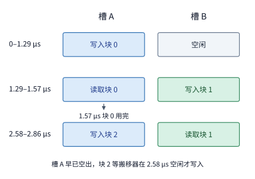

*图 5-16　双缓冲流水线在三个代表性时间切片上的槽位状态：块 0 在 $1.29\sim1.57\ \mu\mathrm{s}$ 期间占用槽 A 进行计算，到 $1.57\ \mu\mathrm{s}$ 时槽 A 即已消费完毕并腾空；然而此时搬移器正忙于向槽 B 搬入块 1（需持续到 $2.58\ \mu\mathrm{s}$），因此直到 $2.58\ \mu\mathrm{s}$ 搬移器才腾出手来开始向槽 A 写入块 2。在 $1.57\sim2.58\ \mu\mathrm{s}$ 的空档期内，槽 A 已用完、槽 B 尚未搬完，计算单元只能停工等待。图中用蓝、绿固定标识物理缓冲槽 A、B，槽内文字标注当前正在读写的分块编号。*

**例 5-5：在搬移耗时远大于计算耗时（$t_m > t_c$）的场景下，双缓冲究竟能省下多少时间？** 设单个分块搬移耗时 $t_m = 1.29\ \mu\mathrm{s}$，计算耗时 $t_c = 0.28\ \mu\mathrm{s}$，忽略极微小的片上栅栏同步开销。
- 如果采用**单缓冲串行执行**处理 4 个分块，每一块都必须先搬移后计算，总耗时为 $4 \times (1.29 + 0.28) = 4 \times 1.57 = 6.28\ \mu\mathrm{s}$。
- 如果改用**双缓冲流水执行**处理同样的 4 个分块（见图 5-17）：
  1. $0\sim1.29\ \mu\mathrm{s}$：搬移器将“块 0”装入槽 A；
  2. $1.29\sim1.57\ \mu\mathrm{s}$：计算单元从槽 A 读取并计算“块 0”；与此同时，搬移器在 $1.29\sim2.58\ \mu\mathrm{s}$ 期间将“块 1”装入槽 B；
  3. 尽管“块 0”在 $1.57\ \mu\mathrm{s}$ 时就已经算完、槽 A 已经空闲，但唯一的搬移通道直到 $2.58\ \mu\mathrm{s}$ 才能搬完“块 1”，此后才能在 $2.58\sim3.87\ \mu\mathrm{s}$ 向槽 A 搬入“块 2”；
  4. 依此类推，搬移器从第 $0\ \mu\mathrm{s}$ 到第 $4\times1.29 = 5.16\ \mu\mathrm{s}$ 全程无缝满载运转，每隔 $1.29\ \mu\mathrm{s}$ 交付一块数据，而计算单元每收到一块只需忙活短短 $0.28\ \mu\mathrm{s}$ 就再次陷入等待；当第 4 块（块 3）在 $5.16\ \mu\mathrm{s}$ 搬完后，再花 $0.28\ \mu\mathrm{s}$ 完成最后一块计算，全部工作于第 $5.16 + 0.28 = 5.44\ \mu\mathrm{s}$ 宣告结束。

对比 $6.28\ \mu\mathrm{s}$ 与 $5.44\ \mu\mathrm{s}$ 可以看到，引入双缓冲后，端到端耗时仅缩短了约 **$13\%$**。

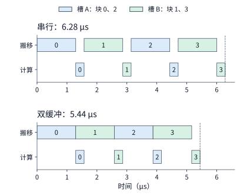

*图 5-17　处理同样 4 个数据块时，单缓冲串行执行（上）与双缓冲流水执行（下）的时间线对比。在 H100 单个 SM 份额下，每块搬移耗时 $1.29\ \mu\mathrm{s}$、计算耗时 $0.28\ \mu\mathrm{s}$，两类硬件引擎彼此独立且忽略栅栏开销；图中同色方块代表使用同一个物理缓冲槽。可以看到，双缓冲重叠仅仅把较短的中间计算时间（前 3 块的 $3\times0.28\ \mu\mathrm{s}$）隐藏在了漫长的搬移背后，总完成时间依然取决于首尾相接的数据搬移链路。*

我们将这一规律推广到连续处理 $n$ 个分块的通用两级流水线：第一块数据必须先花 $t_m$ 搬进来（流水线填充），随后中间的 $n-1$ 步每隔“搬移与计算二者中的较慢耗时 $\max(t_m, t_c)$”就能推进一块（稳态吞吐），最后一块数据搬完后还需花 $t_c$ 算完（流水线排空）。因此，$n$ 块流水线的理论总耗时公式为：

$$
T_{\mathrm{pipe}}=t_m+(n-1)\max(t_m,t_c)+t_c.
$$

回看刚才的例子，由于 $t_m = 1.29\ \mu\mathrm{s} > t_c = 0.28\ \mu\mathrm{s}$，稳态节奏完全受制于较慢的搬移耗时 $t_m$，总耗时简化为 $n\cdot t_m + t_c = 4\times1.29 + 0.28 = 5.44\ \mu\mathrm{s}$，计算单元在整个过程中只有约两成时间真正在干活。这个公式给我们上了极为清醒的一课：
1. **当搬移通道本身已经 $100\%$ 满载连续运转时，把片上双缓冲（2 个槽）盲目扩充为三缓冲（3 个槽）甚至更多槽，对缩短总时间毫无帮助**——因为两个槽已经足以让搬移器零空闲地首尾相接工作，多加缓冲槽既不能拓宽物理显存带宽，也不能减少要搬的字节数；同理，此时去优化计算指令的速度（减小 $t_c$）也只能缩短最后一块的排空尾巴（$0.28\ \mu\mathrm{s}$），对稳态吞吐无济于事。
2. 在 NVIDIA CUTLASS 等模板库中，双缓冲是能够实现搬移与计算重叠的最小配置（称为 `2 stages`）；将缓冲槽数量扩充到 $S$ 个、让生产者提前预取 $S-1$ 块数据的设计，称为 **$S$-stage 多级软件流水线**。什么时候把 `stage` 数从 2 增加到 3、4 甚至更高才真正有用？**只有当单块搬移的往返延迟（latency）长于单块计算时间、但显存带宽本身尚未饱和（或者各块的搬移/计算耗时存在波动）时**，多出来的缓冲槽才能像蓄水池一样允许更多块同时在途传输、抚平延迟抖动；当然，片上共享内存的消耗量也会随着 `stage` 数线性倍增。
3. 在本例这种显存带宽彻底饱和的场景下，要想真正把 $5.44\ \mu\mathrm{s}$ 压下来，只有两条根本出路：**要么减少每个分块需要跨显存搬移的字节数**（例如按第 5.2.2 节扩大输出分块尺寸以提高单字节复用次数，或者让多个并发线程块在 L2 缓存中共享同一份输入块），**要么换用物理显存带宽更高的加速卡。**

再把本小节开头的“片上布局重排”与“多槽流水缓冲”结合起来算一笔片上容量账：当上下游两个阶段的访问顺序不一致时，片上除了要留出排队缓冲槽，还得额外开辟一块布局重排工作区。假设我们在片上安排了 3 个排队槽（每槽 $16\ \mathrm{KiB}$，共 $48\ \mathrm{KiB}$），外加一块 $32\ \mathrm{KiB}$ 的布局重排空间，那么单个线程块的共享内存总需求就达到了 $48 + 32 = 80\ \mathrm{KiB}$。在 RTX PRO 6000 上，单个线程块最高可使用 $99\ \mathrm{KB}$ 共享内存，因此当 SM 上只驻留 1 个线程块时，这 $80\ \mathrm{KiB}$ 尚能装下；可一旦我们希望让单个 SM 同时驻留 **2 个线程块**以提升并发度，那么 $100\ \mathrm{KB}$ 的共享内存总预算在扣除两块各 $1\ \mathrm{KiB}$ 的系统预留后，平均分给每个线程块的配额就只剩下 $(100 - 2) / 2 = 49\ \mathrm{KiB}$。从这 $49\ \mathrm{KiB}$ 配额中优先扣掉不可省的 $32\ \mathrm{KiB}$ 重排工作区后，留给输入排队的空间就只剩下 $17\ \mathrm{KiB}$——仅仅够放 **1 个 $16\ \mathrm{KiB}$ 的输入槽**。于是，多级流水线瞬间退化回单槽串行：每当搬移器想写入下一块数据前，都必须停下来等待下游计算单元把这唯一一个槽位里的数据用完并腾空。在计算机体系结构中，这种**由于下游消费速度跟不上或中间缓冲槽耗尽、反过来迫使上游生产者暂停写入的流控现象，称为背压（backpressure）**。可见，通过算子协同设计让上下游直接采用兼容的数据布局（省掉那 $32\ \mathrm{KiB}$ 重排区），或者合理调配片上缓冲容量，正是消除片上背压、保持流水线顺畅运转的关键所在。[^buffer]

值得一提的是，这套双缓冲与事件同步机制不仅适用于片上几微秒的微观流水，也原封不动地适用于第 5.1 节介绍的主机到设备（H2D）宏观流水线：让 DMA 复制流向“缓冲槽 B”传入下一批请求的同时，让 GPU 计算流读取“缓冲槽 A”处理当前批请求；计算流在启动前等待对应槽位的“H2D 复制完成”事件，复制流在覆写前等待对应槽位的“kernel 计算完成”事件。无论尺度大小，两类同步事件始终分别守护着**“新输入已就绪”**与**“旧数据已用完”**这两条安全底线，而端到端的性能加速则全都来自于让搬移引擎与计算引擎在同一时间段内重叠工作。

### 5.3.3 FlashAttention：分块与在线 Softmax

如果要推举一个将“硬件存储层级特性”与“数学算法等价变换”结合得最淋漓尽致的典范，非 **FlashAttention** 莫属：它在数学上算出的注意力输出与标准公式完全等价，但通过重构中间计算顺序与片上统计量的生命周期，将原本必须“算完大矩阵—写回显存—再从显存读回”的三阶段高流量计算，改造成了全程在片上高速缓冲内原地完成的流式分块计算。

为什么注意力的算子融合比第 5.3.1 节的 SwiGLU 激活链难得多？因为在第 5.3.1 节中，$\operatorname{SiLU}$ 和逐元素乘法的每一个输出元素都只依赖同一坐标的输入元素，彼此之间毫无瓜葛；而在自注意力机制中，夹在两次矩阵乘法中间的 **Softmax 算子却是一个横跨整行上下文的全局归约运算**——要想算出当前查询位置对某一个历史位置的归一化注意力权重，分母必须先累加出当前行全部历史位置的指数和（且为了防止数值溢出，求指数前还必须先减去整行打分的最大值）。

从表面上看，既然分母依赖整行总和，似乎就必须先把整行所有的注意力打分全部算出来并保存好，才能动手做除法。但如果我们把 Softmax 加权求和的代数结构拆开来看，就会发现一条柳暗花明的通路：一行的注意力输出本质上是“先将各位置的打分取指数变为未归一化的正权重，用这些权重对相应的值向量（Value）做线性加权求和（分子），最后再统一除以所有未归一化权重的总和（分母）”。既然分子和分母都是纯粹的加法累加，我们完全可以**先读入第一块键值（K/V），记下这一块对“分子加权和”与“分母权重和”的局部贡献；接着读入第二块 K/V，把新一块的贡献合并进去；直到把整行所有块都扫描完，在全流程的最后一刻才执行那唯一一次除以分母总和的操作。** 只要我们能找到一套精确合并相邻两块贡献的递推公式，算完前一块之后的原始打分矩阵就可以当场丢弃，根本不需要写回显存。这里唯一需要攻克的数学难关在于：为了保证指数运算 $\exp(\cdot)$ 不发生上溢，每一块都必须减去当前已知的最大打分作为数值基准；当后续块里冒出比前面更大的打分时，如何原地修正前面已经累加好的分子和分母？

FlashAttention 正是围绕这一“逐块流式计算 + 动态重缩放（rescaling）”思想重新设计了注意力算子的片上存储排布，消除了长序列下随序列长度平方增长的显存读写瓶颈。这一突破性工作由斯坦福大学的 Tri Dao 等研究者与纽约州立大学布法罗分校的合作者于 2022 年共同提出。[^fa]

每当读到 FlashAttention 的论文，笔者总会想起自己在 2019 年研发自动算子生成编译器 AKG 时的那段亲身经历。当年为了将矩阵乘法与紧随其后的 Softmax 算子自动融合进同一个片上循环，笔者曾四处寻觅能够在单次扫描（one-pass）或分块扫描中动态维护最大值与指数和的递推算法；后来正是受 NVIDIA 研究者于 2018 年发表的 **Online Softmax（在线 Softmax）** 论文启发，才成功结合 AKG 的多面体分块与算子融合能力，把前序矩阵乘法与后序 Softmax 无缝拼接在了一起。颇为遗憾的是，笔者当时还不熟悉方兴未艾的 Transformer 自注意力机制，直到几年后看到名动业界的 FlashAttention，才恍然意识到自己当年在编译器里已经偶然触碰到了它的半壁核心思路——而从“矩阵乘 + Online Softmax 两步融合”迈向完整的 FlashAttention，最关键的临门一脚正是**把第三步“与值矩阵 $V$ 的加权求和”也一并纳入同一个在线重缩放递推式中，并围绕这三步完整链路统筹规划片上缓冲与数据搬移。** 下面的定量推导将清晰展现，这一看似局部的代数递推变换，是如何深刻改变整个大模型长上下文系统性能边界的。

让我们回到标准缩放点积注意力（Scaled Dot-Product Attention）的数学定义。给定单个注意力头的查询矩阵 $Q$、键矩阵 $K$ 和值矩阵 $V$，标准注意力依次执行以下三步运算：

$$
S = \frac{QK^\mathsf{T}}{\sqrt{d}},\qquad P = \operatorname{softmax}(S),\qquad O = PV.
$$

在传统的深度学习框架实现中，这三个数学公式会被直接翻译成三次独立的通用算子调用（两次批量矩阵乘法 `bmm` 夹着一次 `softmax`），算子之间通过驻留在 HBM 显存中的完整中间张量 $S$ 和 $P$ 交接数据。而在掌握了完整注意力的跨算子数据依赖之后，我们就可以打破这三道算子围墙，利用在线 Softmax 的代数递推关系，在片上小分块（tile）上把三步运算一气呵成地串联起来。下面我们先算一笔账，看看传统实现把完整的 $S$ 和 $P$ 落地到显存究竟有多昂贵；随后再一步步推导出逐块在线计算所需维护的最小片上状态。

考虑单个注意力头的前向计算，设序列长度 $L=8192$，单头特征维度 $d=128$。此时输入张量 $Q$、$K$、$V$ 与最终输出张量 $O$ 的形状均为 $[8192, 128]$，采用 BF16 格式（每元素 $2\ \mathrm{bytes}$）存储时，每个张量仅占 $8192\times128\times2 = 2\ \mathrm{MiB}$；然而，中间产生的注意力打分矩阵 $S$ 与概率权重矩阵 $P$ 的形状却是 $[8192, 8192]$，若按框架常规用 FP32 格式（每元素 $4\ \mathrm{bytes}$）保存，每一份中间矩阵都要占用 $8192\times8192\times4 = 256\ \mathrm{MiB}$。算一下跨显存接口的读写总量：读取 $Q$、$K$、$V$ 各一次并写出 $O$ 一次，真正有用的首尾数据读写加起来只有 $2\times4 = 8\ \mathrm{MiB}$；可是把中间矩阵 $S$ 写出显存再读回（$256\times2 = 512\ \mathrm{MiB}$）、把 $P$ 写出显存再读回（$256\times2 = 512\ \mathrm{MiB}$），光这两份中间矩阵的往返搬移就高达 **$1\ \mathrm{GiB}$（$1024\ \mathrm{MiB}$）**，是有效首尾数据的 128 倍之多。由于中间矩阵的尺寸随序列长度 $L$ 呈 $O(L^2)$ 二次方增长，长序列下的标准注意力绝大部分时间都消耗在搬运 $S$ 和 $P$ 的显存读写上。[^attention]

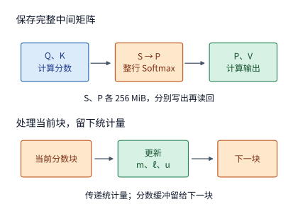

*图 5-18　上半图为传统分立实现：必须在显存中保存完整的 $8192\times8192$ FP32 中间矩阵 $S$ 与 $P$（各占 $256\ \mathrm{MiB}$），两者的写出与读回合计产生 $1\ \mathrm{GiB}$ 显存流量；下半图为 FlashAttention 的逐块流式实现：片上仅向后传递已扫描块的行最大值 $m$、以 $m$ 为基准的指数和 $\ell$ 以及未归一化的值向量加权和 $u$；每算完一个分块，其片上打分缓冲区即可立即覆写复用。图中箭头概括了中间状态的流转顺序，完整计算仍需按块读入 $Q$、$K$、$V$。*

要想彻底消除这 $1\ \mathrm{GiB}$ 的中间矩阵显存读写，核心就在于前面提出的在线递推：当我们按列分块依次扫描键矩阵 $K$ 和值矩阵 $V$ 时，怎样在不保存历史打分的前提下，仅凭几个极小的片上状态量就把新一块的贡献无缝合并进来？

答案是：对于每一行查询（Query），我们只需在片上始终维护三个滚动更新的统计量——**截至目前已扫描过的打分最大值 $m$（标量）**、**以当前 $m$ 为基准偏移的指数和 $\ell$（标量）**，以及**同样以当前 $m$ 为基准偏移的值向量加权和 $u$（长度为 $d$ 的向量）**。为了让大家一眼看懂这三个量是如何跨块合并的，我们先来看一个把值向量简化为标量的两块极简算例。

**例 5-6：在线 Softmax 如何跨分块动态修正最大值基准并保持精确归一化？** 假设某一行只有两个历史位置，注意力打分向量为 $s = [0, \ln 2]$，对应的值向量（此处简化为标量）为 $V = [1, 3]$。现在我们把这一行拆成两个块依次流式处理，每块只包含 1 个位置：
1. **处理第一块（读入 $s_1 = 0, V_1 = 1$）**：当前已知的最大打分为 $m = 0$；以 $m=0$ 为基准，第一项的偏移指数为 $\exp(0 - 0) = 1$，因此当前累计的指数和为 $\ell = 1$，未归一化加权值之和为 $u = 1 \times 1 = 1$。
2. **处理第二块（读入 $s_2 = \ln 2, V_2 = 3$）**：新元素的打分 $\ln 2 > 0$，因此全局最大值更新为 $m' = \max(0, \ln 2) = \ln 2$。由于最大值基准从 $0$ 抬高到了 $\ln 2$，第一块原本按旧基准 $m=0$ 算出的指数权重必须统一乘上缩放修正系数 $r = \exp(m - m') = \exp(0 - \ln 2) = 1/2$。与此同时，第二块新元素在新基准 $m'=\ln 2$ 下的偏移指数为 $\exp(\ln 2 - \ln 2) = 1$。于是，更新后的全局指数和为 $\ell' = r\ell + 1 = \frac{1}{2}\times1 + 1 = 1.5$；更新后的未归一化加权值之和为 $u' = ru + 1\times V_2 = \frac{1}{2}\times1 + 3 = 3.5$。
3. **全部块扫描完毕，执行最终归一化除法**：输出 $O = u' / \ell' = 3.5 / 1.5 = 7/3$。

作为对照，如果按传统方法一次性看全整行 $[0, \ln 2]$，两项的指数权重之比为 $e^0 : e^{\ln 2} = 1 : 2$，加权平均结果同样是 $(1\times1 + 2\times3) / (1 + 2) = 7/3$，二者分毫不差。

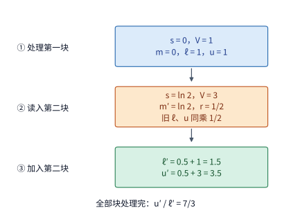

*图 5-19　用在线 Softmax 递推合并两个分块（打分分别为 $0$ 和 $\ln 2$，对应值分别为 $1$ 和 $3$）。当第二块将行最大值基准从 $0$ 抬升至 $\ln 2$ 时，只需将第一块累计的旧指数和 $\ell$ 与旧加权值 $u$ 同步乘以缩放系数 $r=1/2$，即可直接加上新块的贡献，直到全行扫描结束才做最后一次除法 $u'/\ell'$。块间箭头传递的唯有三个轻量级统计量，旧块的原始打分用完即弃。*

从图 5-19 的小算例中可以提炼出在线 Softmax 最核心的物理直觉：**当新一块数据带来了更大的打分、迫使防溢出基准从旧最大值 $m$ 抬升到新最大值 $m'$ 时，旧块中所有元素的指数项 $\exp(s_j - m)$ 根据指数运算法则都会统一缩水一个公因子 $r = \exp(m - m')$；只要我们把分母里累计的旧指数和 $\ell$ 与分子里累计的旧加权和 $u$ 同时乘上这个缩放因子 $r$，就能在不重看任何历史打分的情况下，瞬间把所有历史累积量严丝合缝地对齐到新基准 $m'$ 下。**

将这一过程写成通用的向量化递推公式：对于已处理完的前序分块，设其行最大值为 $m$，以 $m$ 为基准的指数和为 $\ell = \sum_j \exp(s_j - m)$，未归一化值向量加权和为 $u = \sum_j \exp(s_j - m) V_j$（若此时终止，归一化输出即为 $u/\ell$）。当读入一个新的键值分块并算出该块内的注意力打分向量 $s$ 后，只需按以下两步原地更新三个状态量：

$$
m'=\max(m,\max(s)),\qquad r=\exp(m-m'),\qquad p_j=\exp(s_j-m'),
$$

$$
\ell'=r\ell+\sum_jp_j,\qquad u'=ru+\sum_jp_jV_j.
$$

注意上式右侧的求和号 $\sum_j$ **仅仅遍历当前新读入分块内部的元素下标 $j$**；此前所有历史分块的全部贡献都已经浓缩在标量 $\ell$ 与向量 $u$ 之中，经一次标量乘法 $r\ell$ 和一次向量缩放 $ru$ 便完成了基准迁移，永远不需要再去显存里翻找旧块的打分。

FlashAttention 正是凭借这组精妙的递推式，彻底免除了在显存中落地保存 $S$ 和 $P$ 的需要：每个线程块每处理完一个小分块，就在片上原地更新 $m$、$\ell$ 和 $u$，当前小分块的局部打分与局部概率矩阵用完即刻丢弃，它们占用的那几千字节片上缓冲区马上就可以腾出来迎接下一个分块。需要注意，在相同的注意力掩码范围内，FlashAttention 执行的 $QK^\mathsf{T}$ 与 $PV$ 矩阵乘法总运算量（FLOPs）与标准实现完全相同；它改变的是**分块计算的遍历顺序以及中间结果的片上驻留方式**（此外由于浮点加法与缩放顺序改变，最终结果会存在微小且通常更优的浮点舍入差异）。

把耗费 $1\ \mathrm{GiB}$ 显存流量的全局大矩阵转化成片上流式分块问题之后，接下来摆在算子设计者面前的就是一个定量的**片上分块尺寸规划问题**：在有限的共享内存预算下，每个线程块一次应该驻留多少行查询 $Q$（记为 $a$ 行）、每次步进扫描多少行键值 $K/V$（记为 $b$ 行），才能把片上空间利用到极致？

让我们以 RTX PRO 6000 单个线程块可用的最大共享内存 **$99\ \mathrm{KB}$（即 $101{,}376\ \mathrm{bytes}$）** 为容量预算来算这笔账。假设每个线程块在片上常驻 $a$ 行 BF16 查询分块 $Q$（形状 $a\times d$，占 $2ad\ \mathrm{bytes}$）以及对应的 FP32 输出累加器 $u$（形状 $a\times d$，占 $4ad\ \mathrm{bytes}$）；在沿键值序列循环扫描时，每次搬入 $b$ 行 BF16 的 $K$ 分块或 $V$ 分块（由于先算 $QK^\mathsf{T}$ 再算 $PV$，$K$ 与 $V$ 分块可以按阶段先后复用同一个大小为 $b\times d$ 的输入缓冲槽，占 $2bd\ \mathrm{bytes}$）；块内算出的 FP32 注意力打分与随后的偏移指数概率同样复用同一个大小为 $a\times b$ 的中间缓冲槽（占 $4ab\ \mathrm{bytes}$）；此外还需为 $a$ 行查询分配三个长度为 $a$ 的 FP32 逐行状态向量（分别存放 $m$、$\ell$ 及更新暂存量，共占 $3\times4a = 12a\ \mathrm{bytes}$）。将这五项加总，该线程块的片上局部存储总需求 $S$ 必须满足容量不等式：

$$
S=\underbrace{2ad}_{Q\text{ 分块}}+\underbrace{2bd}_{K/V\text{ 复用槽}}+\underbrace{4ab}_{\text{分数/概率复用槽}}+\underbrace{4ad}_{\text{输出累加器}}+\underbrace{12a}_{\text{逐行状态向量}}\le101{,}376\ \mathrm{bytes}.
$$

观察这个容量不等式，可以发现一组此消彼长的数量关系（固定 $d=128, L=8192$）：
- 如果我们把每次扫描的键值块行数 $b$ 设得较小，那么 $K/V$ 槽（$2bd$）和分数槽（$4ab$）占用的空间就小，$99\ \mathrm{KB}$ 的共享内存就能腾出地方常驻更多行查询 $Q$（即 $a$ 更大）。而片上一次常驻的 $Q$ 行数 $a$ 越大，把全部 $8192$ 行 $Q$ 算完所需的外层分块趟数 $\lceil 8192/a \rceil$ 就越少——这意味着整份 $K$ 和 $V$ 张量（合占 $2+2=4\ \mathrm{MiB}$）需要从下级存储被重复扫描读取的总次数就越少。
- 具体算一下：如果取 **$b=64$**，代入上式解得片上最多可容纳 **$a=82$** 行 $Q$；算完全部 $8192$ 行 $Q$ 共需 $\lceil 8192/82 \rceil = 100$ 个外层分块，每个外层分块都要把 $4\ \mathrm{MiB}$ 的 $K/V$ 从头到尾扫描一遍（共读 $100\times4 = 400\ \mathrm{MiB}$），加上读取一次 $Q$（$2\ \mathrm{MiB}$）和写出一次 $O$（$2\ \mathrm{MiB}$），跨接口总访存量为 **$404\ \mathrm{MiB}$**。
- 如果我们极端一点，把键值块行数缩到极致的 **$b=1$**（每次只读 1 行 $K/V$），那么片上最多可容纳 **$a=128$** 行 $Q$，外层扫描趟数降至 $8192/128 = 64$ 趟，跨接口总访存量随之降至 $64\times4 + 4 = \mathbf{260\ \mathrm{MiB}}$。然而代价是什么呢？当 $b=64$ 时，每趟扫描只需走 $8192/64 = 128$ 个内层步（$100$ 趟合计执行 $100\times128 = 12{,}800$ 次在线状态更新）；而当 $b=1$ 时，每趟扫描必须走 $8192$ 个内层步，64 趟累计需要执行 $64\times8192 = \mathbf{524{,}288}$ 次在线状态更新。

下表与图 5-20 直观展示了 $b=1$、$b=64$ 与 $b=128$ 三种分块配置在“跨接口总访存量”与“片上状态更新次数”之间的定量权衡：

| K/V 分块行数 $b$ | 片上可容纳的 $Q$ 行数 $a$ | $K/V$ 全量扫描趟数 $\lceil L/a \rceil$ | 缓冲与下级存储之间的总访存量 | $Q$ 块与 $K/V$ 块之间的在线状态更新总次数 |
| --- | ---: | ---: | ---: | ---: |
| $1$ | $128$ | $64$ | $260\ \mathrm{MiB}$ | $524{,}288$ |
| $64$ | $82$ | $100$ | $404\ \mathrm{MiB}$ | $12{,}800$ |
| $128$ | $53$ | $155$ | $624\ \mathrm{MiB}$ | $9{,}920$ |

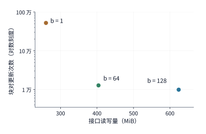

*图 5-20　在 RTX PRO 6000 单个线程块 $99\ \mathrm{KB}$ 共享内存预算下（序列长度 $L=8192$、头维度 $d=128$、无因果掩码），三种不同 $K/V$ 分块行数 $b$ 对应的性能权衡曲线。横轴为跨片上缓冲接口的总访存量（越靠左越省带宽），纵轴为在线 Softmax 状态更新总次数（对数刻度，越靠下越省非矩阵开销）。可以看到，从 $b=64$ 缩减到 $b=1$ 虽然少读了 $144\ \mathrm{MiB}$ 数据，但在线状态更新次数却暴增至原来的约 41 倍。*

图 5-20 把这两项彼此拉扯的代价清晰地展现在了同一个二维平面上：从 $b=64$ 退到 $b=1$，虽然跨接口访存量减少了 $144\ \mathrm{MiB}$（约 $36\%$），但片上在线更新次数却从 $12{,}800$ 次激增到了 $524{,}288$ 次（扩大约 **41 倍**）。要知道，每一次在线更新都意味着全套的循环分支控制、行最大值比较、指数函数求值以及对 $a\times d$ 输出累加器的逐元素乘法重缩放；更致命的是，当 $b=1$ 时，矩阵乘法 $QK^\mathsf{T}$ 的一个维度退化成了 1（从矩阵乘矩阵退化成了矩阵乘向量），根本无法填满每次至少需要 $16\times8\times16$ 块粒度的硬件 Tensor Core。因此，**过小的 $K/V$ 块固然能压缩片外读取字节数，却会导致非矩阵指令开销激增并使 Tensor Core 算力严重闲置；而适度增大的 $K/V$ 块（如 $b=64$ 或 $128$）则能充分利用矩阵计算单元并大幅摊薄在线更新次数。** 真正的工程最优解，必然是平衡这两类开销之后的折中点。

当在线 Softmax 彻底消灭了 $1\ \mathrm{GiB}$ 的显存中间矩阵读写之后，原本被显存带宽掩盖的“块内矩阵乘法、特殊函数指数运算与片上统计量更新”就浮出水面成为了新的性能主导项，后续两代演进也正是围绕削减这部分剩余开销而展开：**FlashAttention-2** 重新调整了外层循环与内层循环的切分归属（改为外层遍历 $Q$ 块、内层遍历 $K/V$ 块，并在单块内部让不同 warp 切分 $Q$ 行而非切分 $K$ 列），从而消除了同一线程块内不同 warp 之间频繁通过共享内存交换部分和的通信开销，同时尽量减少非矩阵乘（non-matmul）指令占比；**FlashAttention-3** 则进一步利用了第 5.1.5 节介绍的 Hopper 架构硬件特性（TMA 异步块复制与 `wgmma` 异步矩阵指令），通过 warp 角色特化让“下一块 $K/V$ 的数据搬移”、“当前块的矩阵乘法”与“前一块的 Softmax 指数运算”三条硬件流水线在同一个 SM 内深度重叠，把注意力算子的实测算力利用率推向了新的高度。[^fa]

为了直观检验这套“片上分块 + 在线归约 + 算子融合”协同优化在真实硬件上的效果，本书配套实验在 PyTorch 中对同一个缩放点积注意力接口（`F.scaled_dot_product_attention`）下的两种不同**后端（backend，指框架在同一个高层 API 背后实际派发调用的底层算子实现）**进行了背靠背实测对比：
- **标准数学后端（`SDPBackend.MATH`）**：严格按照教科书公式依次调用通用矩阵乘法与通用 Softmax 算子，在显存中完整分配并读写 $S$ 与 $P$ 两份中间大矩阵；
- **FlashAttention 后端（`SDPBackend.FLASH_ATTENTION`）**：调用基于片上分块与在线 Softmax 归约的融合 kernel，全程不在显存中落地完整的 $S$ 与 $P$ 矩阵。

实验平台为 NVIDIA RTX PRO 6000 Blackwell，输入输出数据类型均为 BF16，单次调用处理 1 条序列、1 个注意力头（头维度 $d=128$，序列长度 $L=8192$），并开启因果注意力掩码（causal mask，即每个 token 仅关注自身及排在它前面的历史位置）。为了排除主机端 kernel 启动开销的干扰，我们在充分预热后使用 CUDA Graph 将整段 GPU 操作预先录制并反复重放计时：
- **执行耗时对比**：保存完整中间矩阵的标准数学后端单次耗时约为 **$2.6\ \mathrm{ms}$**，而采用片上分块与在线归约的 FlashAttention 后端单次耗时仅需约 **$80\ \mu\mathrm{s}$（$0.08\ \mathrm{ms}$）**，端到端实测加速比高达约 **33 倍**。[^exp3]
- **新增显存占用峰值对比**（输入 $Q, K, V$ 预先驻留显存，仅统计调用期间为输出张量与临时工作区新分配的峰值显存）：标准数学后端高达约 **$848\ \mathrm{MiB}$**，而 FlashAttention 后端仅为约 **$22\ \mathrm{MiB}$**（缩减至近四十分之一）。

这组高达 33 倍提速与近 40 倍省显存的实测对照，生动诠释了**软件分块、在线代数归约与跨算子融合**三者协同的化学反应：分块让工作集得以放入几十 KB 的片上高速存储，在线归约打破了全局分母对分块流式推进的封锁，而算子融合则彻底消灭了庞大中间张量的片外往返——三者紧密配合，从根本上改写了长上下文注意力的时空复杂度边界。

## 5.4 编译器：表达、变换与选择

在前两节中，我们完全依靠手工推导来选择循环次序、分块尺寸、片上缓冲区配置以及算子融合边界。然而在真实的深度学习系统中，模型包含成百上千种不同的输入张量形状与算子连接组合，而每一代加速器（如不同代际的 NVIDIA GPU 或华为昇腾 NPU）又有着截然不同的片上存储层级与计算单元规格，绝不可能靠人力把每一种组合都手工推导并编写一遍。这正是**深度学习编译器（Compiler）**的核心使命：用一套形式化的中间表示（IR）把算子的各种分块与融合实现统一表达出来，依据严格的数据依赖关系自动筛除改变计算结果的非法变换，最后通过代价模型与硬件实测在合法的候选空间中选出执行开销最低的实现方案。

### 5.4.1 为什么要比较多种实现

让我们回顾第 5.3.1 节的逐元素激活量化链：先对每个元素做 $\operatorname{SiLU}$ 非线性激活，再与另一支投影逐元素相乘，最后按行缩放系数（scale）量化为低位宽格式。在这三个相邻算子之间的两道边界上，每一道边界都可以独立选择“分立执行（写回显存）”或“融合执行（片上交接）”，这就产生了 $2^2 = 4$ 种划分方案：三步完全独立、仅融合前两步、仅融合后两步、三步全部融合。如果把这条链延长到包含 10 个算子的子图，仅相邻边界的切分方式就会指数级膨胀到 $2^9 = 512$ 种；而在每一种融合边界划分内部，还可以进一步选择不同的二维分块尺寸、片上数据布局（padding 或 swizzle）以及软件流水级数（stages）。

更棘手的是，这些不同维度的决策之间还会产生强烈的**耦合与制约**：把相邻两步算子融合进同一个 kernel 固然消除了中间张量的显存往返，但同时也迫使片上寄存器或共享内存在同一时刻多保存一份中间状态；片上临时数据的膨胀，反过来又会压缩单个线程块能够采用的最大分块尺寸（或挤占驻留线程块数、拉低占用率）。正因如此，编译器绝不能只把算子当成一个不透明的黑盒函数名，而必须在统一的表示中**同时刻画“算什么（数学计算内容）”、“按什么次序算（循环调度顺序）”以及“数据放哪里（各级存储分配）”**，唯有如此才能定量推算出不同实现方案的真实硬件代价。

一套现代算子编译器通常按以下三个标准步骤在庞大的设计空间中寻找最优实现：
1. **形式化表达（Representation）**：将高层张量数学运算展开为显式的循环嵌套与多维数组读写访问，明确哪些循环维度可以拆分或交换顺序，以及各条语句之间的读写映射关系；
2. **合法性检验（Legality Check）**：根据数据读写依赖（Data Dependence）与浮点数舍入规则，严格判定某一次循环变换或算子融合是否保持了原程序的数值语义；
3. **代价评估与搜索选择（Cost Modeling & Search）**：先用片上硬件容量约束剪除装不下的非法候选，再结合访存代价模型与真机实测时间选出最优实现。

下面我们先用直观的 Python 风格伪代码演示前两个步骤，随后深入剖析自动算子生成编译器 **AKG** 如何利用**多面体编译模型（Polyhedral Model，一种用整数线性不等式约束来精确描述循环迭代域与数组访问关系的数学编译方法）**自动化组织从循环变换到片上数据搬移的全过程，并对照 **TileLang-Ascend** 如何用显式分块原语表达同一份硬件数据流。

### 5.4.2 用循环变换表达分块与融合

第 5.2 节已经说明，光决定“每次切多大一块（tile size）”还不够，还必须决定“这些块按什么先后次序遍历计算”。如果两步运算明明都要用到同一块数据，程序却在第一步刚用完时就把它从片上换走，等第二步要用时又不得不重新从显存搬回来，依然会产生大量无谓的重复访存。在编译器中，这类时空编排是通过一套标准的**循环变换（loop transformations）**原语来精确表达的：
- **`split`（循环拆分）**：将一个长循环维度拆成外层的“第几个分块（块号）”与内层的“分块内部第几个偏移位置（块内坐标）”两层循环；
- **`reorder`（循环重排）**：交换多层嵌套循环的里外遍历顺序，让即将被连续复用的数据分块有机会一直留在片上局部存储中；
- **计算与存储位置绑定（如 `compute_at`）**：明确指定某一份中间结果究竟挂载在哪一层循环下分配、计算与消费，从而精确控制它在片上存储中的生命周期（要保留多久才能释放）。

让我们以带激活函数的线性投影 $Y = \operatorname{SiLU}(AW)$ 为例（沿用前文维度 $M=1024, K=4096, N=12288$，矩阵乘法采用 FP32 累加，累加完毕后先舍入为 BF16 格式的中间矩阵 $C$，再逐元素计算 $\operatorname{SiLU}$ 得到最终输出 $Y$）。最朴素的未融合程序会写成前后两个完全独立的循环嵌套——第一个循环嵌套先把整张 $24\ \mathrm{MiB}$ 的矩阵 $C$ 全部算完并写回显存，第二个循环嵌套再从头遍历 $C$ 计算 $Y$：

```python
for i in range(M):
    for j in range(N):
        acc = 0.0
        for k in range(K):
            acc += A[i, k] * W[k, j]
        C[i, j] = round_to_bf16(acc)

for i in range(M):
    for j in range(N):
        Y[i, j] = silu(C[i, j])
```

现在我们一步步对这段朴素代码施加编译变换：

**第一步：循环拆分（`split`）。** 我们将输出行索引 `i` 按块大小 $B_M = 64$ 拆分为外层块号 $i_o$ 与内层块内坐标 $i_i$（满足 $i = 64 i_o + i_i$），于是原本 $M=1024$ 行就被拆成了 $16$ 个行块（每块 $64$ 行）；同理，将输出列索引 `j` 按块大小 $B_N = 64$ 拆分为列块号 $j_o$ 与块内坐标 $j_i$，得到 $192$ 个列块。同时拆分这两个输出维度，就在逻辑上划分出了 $16\times192$ 个大小为 $64\times64$ 的二维输出分块（tile）。

**第二步：循环重排（`reorder`）与归约维分块。** 单纯做完 `split` 只是把一层循环变成了两层，要让硬件真正按“一块接一块”的顺序连续算完每个输出 tile，还必须执行 `reorder`：把外层块号循环 `(io, jo)` 提到最外层，把块内元素坐标 `(ii, ji)` 压到内层；同时将归约维 `k` 也按步长 $B_K = 32$ 拆分为 $128$ 个归约步 `ko`。重排之后，程序的执行轨迹就变成了：外层先选定一个 $64\times64$ 的输出 tile `(io, jo)`，然后在 `ko` 循环中依次搬入所需的 $A$ 分块（$64\times32$）与 $W$ 分块（$32\times64$），反复累加进同一个输出 tile 的片上累加器中。

一旦确立了这层循环嵌套结构，每一类片上缓冲区的**数据生命周期（lifetime）**就随之水落石出：当前步读入的 $A$ 分块与 $W$ 分块各占 $4\ \mathrm{KiB}$，它们只需在单次 `ko` 归约步内部存活，当前步算完后即可被下一个 `ko` 步的新数据覆写；而包含 $64\times64 = 4096$ 个元素的 FP32 输出累加器 `acc`（占 $16\ \mathrm{KiB}$），则必须在进入 `ko` 循环之前清零创建，并在全部 $128$ 次 `ko` 归约步迭代期间始终常驻片上。换言之，输入块缓冲与输出累加器应当分别挂载在不同的循环层级上进行分配与释放。

**第三步：移动后续算子的计算位置（算子融合）。** 注意到当某一个输出 tile `(io, jo)` 走完自身的全部 $128$ 步 `ko` 归约循环后，该分块内的 $4096$ 个矩阵乘结果就已经彻底累加完毕——此时它们与其它尚未算完的输出 tile 没有任何数据依赖，完全可以在当前分块循环的末尾当场执行 `round_to_bf16` 与 `silu` 激活运算，并直接将最终结果写出到输出矩阵 $Y$。经过这一步“将消费者算子拉进生产者外层分块循环”的变换后，程序在任意时刻只需在片上暂存当前一个 $64\times64$ 分块的中间结果，再也不需要在显存中分配和读写那整张 $24\ \mathrm{MiB}$ 的全局中间矩阵 $C$（直接省去了 $48\ \mathrm{MiB}$ 的显存写回与重读）：

```python
for io in range(ceil_div(M, BM)):
    for jo in range(ceil_div(N, BN)):
        acc = zeros_fp32(BM, BN)
        for ko in range(ceil_div(K, BK)):
            a = load_tile(A, io, ko, BM, BK)
            w = load_tile(W, ko, jo, BK, BN)
            matmul_accumulate(acc, a, w)
        c = round_to_bf16(acc)
        store_tile(Y, io, jo, silu(c))
```

在这段变换后的伪代码中，`load_tile` 和 `matmul_accumulate` 分别代表分块搬移与块内矩阵乘加（当矩阵维度不能被分块大小整除时，边界尾块通过谓词掩码标出有效元素位置）。仔细观察代码的缩进层级，就能一眼看清各变量的生命周期边界：输入块 `a`、`w` 在最内层 `ko` 循环体内创建并更新，累加器 `acc` 跨越整个 `ko` 循环常驻，而 BF16 舍入与 `silu` 激活则紧贴在 `ko` 循环结束之后、当前 `(io, jo)` 分块退出之前原地完成。

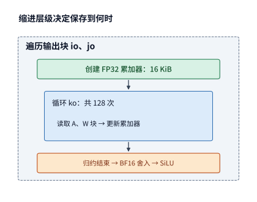

*图 5-21　循环嵌套的层级直接决定了片上临时数据的生命周期与所需容量。外层 `(io, jo)` 循环选定一个 $64\times64$ 输出分块并分配 $16\ \mathrm{KiB}$ 的 FP32 累加器；内层 `ko` 循环每次搬入各 $4\ \mathrm{KiB}$ 的 $A$、$W$ 输入分块并累加；待全部 `ko` 归约步走完后，在片上原地完成 BF16 舍入与 SiLU 激活并写出。*

在现代张量编译系统中，上述每一步变换都有着专门的调度原语（scheduling primitives）与之对应：
- **Halide** 开创性地提出了将“算法定义（计算什么）”与“调度策略（如何执行）”彻底解耦的编程范式，允许程序员通过组合 `split`、`tile`、`reorder` 等指令无损地重构执行次序；若将生成中间数据的算子称为**生产者（producer）**、使用该数据的后续算子称为**消费者（consumer）**，Halide 中的 `compute_at` 原语便用于精确指定“生产者在消费者的哪一层循环内部按需生成数据”。
- **TVM**（以及其新一代张量中间表示 **TensorIR**）将这一解耦思想推广到了深度学习张量计算与硬件加速器后端，通过调度原语显式指定片上各级缓存（如 GPU 共享内存与寄存器、NPU 的 L1 与 L0）的读写位置（`cache_read` / `cache_write`）及计算挂载点，从而让相邻算子在同一个片上数据块上紧密接力。[^schedule]

值得深思的是，`compute_at` 所指定的计算挂载位置，往往还在**“片外存储读写”与“冗余重复计算（recomputation）”**之间掌控着微妙的平衡。如果我们把生产者算子放在最外层循环之外，它会先把整张完整中间张量一次性算好存起来，供后续所有消费者分块直接读取（零重复计算，但占用大量片外存储与带宽）；反之，如果我们把生产者算子拉进消费者的内层分块循环里，它就只按需计算当前消费者分块急需的那一小片数据。倘若两个相邻的消费者输出分块在计算时需要用到**重叠的同一片生产者中间结果**（例如卷积算子中的滑动窗口，或注意力机制中多个查询块共享同一块键值），那么在每个消费者分块内部各自重算一遍就会产生冗余计算。此时编译器就必须算清一笔经济账：**究竟是“先算好保存起来供多次读取”更划算，还是“不保存中间结果、每次用时在片上重新算一遍”更省时间。**

此外，循环变换原语中的 **`fuse`（循环维度合并）** 还能把多层平行的嵌套循环拍平（flatten）成单一的一维循环——例如将上述 $16\times192$ 个二维输出分块坐标 `(io, jo)` 合并映射为编号 $0 \sim 3071$ 的一维任务索引，随后直接绑定分发给 GPU 的线程网格（grid）或 NPU 的多核队列。请注意区分这两种常被统称为“融合”的操作：合并循环维度的 `fuse` 改变的是**外层并行任务的遍历与派发方式**；而通过 `compute_at` 将 $\operatorname{SiLU}$ 挂接在矩阵乘分块末尾，则是**跨算子融合（operator fusion），用于消除算子间的中间矩阵读写**。在实际编译器的同一份调度脚本中，这两者往往是配合在一起同时使用的。

### 5.4.3 依赖与舍入如何限制变换

在上一小节的伪代码中，我们虽然把 $\operatorname{SiLU}$ 激活函数拉进了输出分块循环 `(io, jo)` 内部，但却严格把它安放在内层归约循环 `ko` **完全结束之后**，而不能把它继续移入 `ko` 循环体内部。为什么不能每算完一个 `ko` 步的部分和就顺手做一次 $\operatorname{SiLU}$ 呢？用两个最简单的数字就能一眼看穿原因：假设某个输出元素由两个归约步的部分和相加而成，两个部分和分别为 $1$ 和 $-1$。
- 按正确的数学定义**先求和归约、再做非线性激活**：两个部分和相加得到完整和 $1 + (-1) = 0$，随后计算 $\operatorname{SiLU}(0) = 0$；
- 如果错误地把激活函数拉进归约循环内，变成**先对每个部分和做 $\operatorname{SiLU}$、再把结果加起来**：由于 $\operatorname{SiLU}(x) = x / (1 + e^{-x})$ 是非线性函数，结果就会变成 $\operatorname{SiLU}(1) + \operatorname{SiLU}(-1) \approx 0.7311 + (-0.2689) = 0.4621$。

仅仅改变了激活函数与归约求和的先后次序，算出来的数学结果便截然不同。

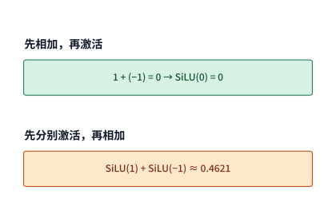

*图 5-22　面对同样两个部分和（$1$ 与 $-1$），按正确顺序先累加求和得到 $0$、再执行 $\operatorname{SiLU}(0)$ 结果仍为 $0$；若颠倒顺序先对各部分和分别执行 $\operatorname{SiLU}$ 再相加，结果则变为约 $0.4621$。这个简单的反例说明，非线性激活绝不能跨越归约求和的完成边界提前执行。*

因此，编译器在做循环变换与算子融合时，必须敬畏两条不可逾越的**数据依赖铁律**：**其一，同一个输出位置的所有部分和必须严格按照归约定义的结合规则汇总完毕；其二，任何非线性后续算子都必须等它所依赖的归约结果彻底定型之后才能启动。** 不同输出位置（如不同的 `(i, j)`）之间由于没有相互依赖，完全可以任意交换次序或并行计算；但同一个输出位置内部的归约链条与后继消费之间，则存在着刚性的先后次序约束。

那么，第 5.3.3 节介绍的 FlashAttention 为什么又能够打破常规，在还没有扫完一整行键值的时候就逐块推进 Softmax 呢？根本原因在于，FlashAttention 并没有违法地“对每一块单独做完归一化 Softmax 后直接相加”，而是利用指数函数的代数可分解性（$\exp(a+b)=\exp(a)\exp(b)$），在片上完整保留了**行最大值 $m$、未归一化指数和 $\ell$ 与未归一化加权值 $u$** 这三个完备的充分统计量（sufficient statistics），并在最大值基准发生改变时同步重缩放历史分子与分母。假使有人破坏了这一代数完整性，每个分块只向外输出“块内已经除过块内分母的归一化结果”，那就彻底丢失了不同分块之间分母权重的相对大小比例——举个最直观的例子：假设两个分块各自只包含 1 个元素，值分别为 $1$ 和 $3$；在单个元素的分块内部做归一化，不管打分是多少，单元素自己在块内的权重永远是 $100\%$，两个块各自算出的块内归一化输出永远都是 $1$ 和 $3$；仅凭这两个孤零零的输出值 $1$ 和 $3$，后续阶段根本无从知晓这两个块在全局整行 Softmax 中究竟应该按 $1:2$ 还是 $2:1$ 的权重去加权合并。这就从编译合法性的高度再次印证了：**任何跨分块的在线归约变换，都必须在块间传递足以精确还原全局归约关系的完备中间统计量。**

除了代数依赖之外，**浮点数的精度转换与舍入（rounding）位置**同样是限制编译器变换的一道硬约束。在上一小节的原程序中，矩阵乘法的 FP32 累加结果 `acc` 先被显式舍入转换为 BF16（`C[i, j] = round_to_bf16(acc)`），随后才作为输入送给 `silu`。当我们把两步融合进同一个 kernel 后，虽然中间值 `c` 直接留在片上寄存器里递交给 `silu`、不再写回显存，但代码中依然保留了 `c = round_to_bf16(acc)` 这一步精度截断操作。换言之，**“把中间张量从显存挪进寄存器（改变物理存放位置）”与“是否省略 FP32 到 BF16 的中间舍入（改变数值计算精度）”是两项彼此独立的工程决策**——如果要求融合后的算子与未融合基线保持逐比特位一致（bitwise identical），就必须在寄存器里原样保留这次向 BF16 的舍入指令。

**例 5-7：整行动态量化中的全局缩放系数（scale），如何约束分块计算的先后顺序？** 让我们再看一个低精度量化算子中的典型依赖约束。假设矩阵的一行包含 $256$ 个元素，我们将其切成前后两个分块，每块各含 $128$ 个元素；设第一个分块的首个元素为 $1$（其余元素全为 $0$），第二个分块的首个元素为 $10$（其余元素也全为 $0$）。现在我们要对该行执行整行动态量化（per-token / per-row dynamic quantization），目标格式为 8 位浮点格式 **FP8 E4M3FN**（含 1 位符号、4 位指数和 3 位尾数，无无穷大表示，其可表示的最大正有限值为 $448$）。整行动态量化的规则是：先找出整行全部 $256$ 个元素的最大绝对值 $\max(|x|)$，将整行共享的缩放系数定为 $\text{scale} = 448 / \max(|x|)$；随后将每个元素乘以 $\text{scale}$、就近舍入（round）到 E4M3FN 可精确表示的离散网格点上，最后在参与下游点积时再除以 $\text{scale}$ 反量化回来。假设下游点积的权重向量只有第一个位置为 $1$（其余全为 $0$），因此最终点积结果完全取决于该行的**第一个元素（真值为 $1$）**在量化与反量化过程中经历了怎样的舍入。

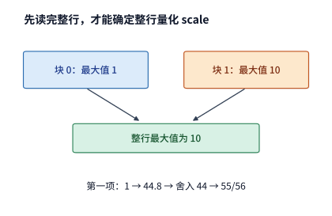

*图 5-23　一行 $256$ 个元素被分为前后两个分块，第二个分块中的元素 $10$ 决定了整行的全局最大值与量化缩放系数 $\text{scale}=448/10=44.8$。在正确的整行量化语义下，第一个分块中的首元素 $1$ 必须先乘上全局缩放系数映射为 $44.8$，经 FP8 E4M3FN 硬件格式舍入为 $44$，反量化后变为 $44\times10/448 = 55/56$。*

让我们对比“先扫完整行求全局 scale 再量化”与“仿照在线 Softmax 边扫描边按局部最大值量化”两种做法的结果：
- **标准两趟法（先读完整行求出全局最大值）**：扫完两个分块后，得知整行最大绝对值为第二块里的 $10$，于是全局缩放系数定为 $448/10 = 44.8$。第一块的首元素 $1$ 被放大映射为 $1\times44.8 = 44.8$；在 E4M3FN 格式下，数值 $44.8$ 落在离散可表示值 $44$ 与 $48$ 之间（此时指数档位对应的步长间隔为 $4$），按就近舍入规则被硬件截断舍入为 **$44$**；随后反量化乘回 $10/448$，得到的数值为 $44\times10 / 448 = \mathbf{55/56}\approx0.9821$。
- **错误的单趟流式重缩放法（读完第一块就立即按局部最大值量化）**：刚读完第一块时，当时见到的局部最大绝对值就是首元素自身的 $1$，局部缩放系数被定为 $448/1 = 448$。于是首元素 $1$ 被映射为 $1\times448 = 448$——而 $448$ 在 E4M3FN 中恰好可以**零误差精确表示**，反量化回来依然是精确的 **$1$**。

这里的关键在于量化舍入的不可逆性：第一块首元素在按局部最大值 $1$ 量化时映射为可精确表示的 $448$，已经错过了“从 $44.8$ 舍入到 $44$”的那一次非线性网格截断；即便在读到第二块的 $10$ 之后，试图仿照在线 Softmax 对第一块已算出的局部点积补乘缩放修正系数 $\frac{1}{10}$ 再按全局 $\text{scale}=\frac{448}{10}$ 反量化，线性缩放因子也会在乘除之间直接抵消（$\frac{448 \times (1/10)}{448/10} = 1$），事后无论如何做线性重缩放，都**不可能再还原出 $55/56$ 这个经过特定网格舍入的结果**（两条路径的最终点积结果相差 $1/56 \approx 1.8\%$）。这个精巧的反例深刻地阐明了：**由于低精度量化中的舍入函数 $\operatorname{round}(\cdot)$ 是阶梯状的非线性不可逆映射，它不具备指数函数 $\exp(\cdot)$ 那样的乘法可分解性；因此只要量化算法定义为“由整行最大绝对值决定同一个 scale”，编译器就必须先扫完整行求出全局最大值，绝不能在第一块尚未见到全局最大值前就提前执行量化舍入。**（这也正是为什么在大模型低精度训练与推理中，硬件与算法演进纷纷从“整行共享一个 scale 的 per-token 量化”转向“每 128 个或每 32 个元素独立拥有一个 scale 的细粒度分组/微缩放块量化，如块级 FP8 与 MXFP8”——把 scale 的归约范围直接缩进单个分块内部，才能从算法定义上彻底解开对单趟流式融合的束缚。）[^numerics]

总结以上三个例子，编译器在探索优化空间时的边界便十分清晰了：**独立的输出坐标之间可以自由交换遍历次序，只读的输入张量可以按任意分块缓存复用，已经彻底归约完毕的中间结果可以当场交给下游算子消费；然而，归约运算的完整合并边界以及非线性函数（激活或量化舍入）相对于归约的先后次序，则属于不可篡改的数学与数值定义，必须在一切编译变换中被严格守护。**

### 5.4.4 AKG：用 isl schedule 安排计算与搬移

理解了循环拆分、重排与依赖约束的原理后，我们来看看工业界编译器是如何在底层用数学语言自动完成这套推导的。**AKG（Auto Kernel Generator）** 是华为研发并开源的神经网络算子自动生成编译器，专门面向昇腾（Ascend）NPU 与 GPU 等异构加速器提供自动算子融合、循环优化与机器码生成（本书作者早年曾深度参与该系统的研发）。前一节我们用手写伪代码展示了如何把两层循环改造成分块程序；而在 AKG 内部，高层张量程序会被翻译进**多面体编译引擎（基于整数集合库 `isl`，Integer Set Library）**，由编译器通过数学映射自动求解最优的循环顺序、分块尺寸、片上多级缓冲区分配以及 DMA 数据搬移指令。下面我们先通过 **例 5-8** 的一组固定维度算清分块调度带来的巨大访存差异，再拆解 `isl schedule` 在底层究竟是如何表示并生成这套程序的。[^akg]

**例 5-8：输出驻留的分块调度，如何将 $4096\times4096$ 矩阵乘法的片外输入读取量降低 64 倍？** 设矩阵乘法 $C = AB$，其中 $A$、$B$、$C$ 三个方阵的形状均为 $4096\times4096$。输入矩阵 $A$ 和 $B$ 采用 BF16 格式（每元素占 $2\ \mathrm{bytes}$，单张矩阵大小均为 $4096^2\times2 = 32\ \mathrm{MiB}$），输出矩阵 $C$ 直接以 FP32 格式（每元素占 $4\ \mathrm{bytes}$，单张矩阵大小为 $64\ \mathrm{MiB}$）保存。完成整次矩阵乘法所需的总浮点运算量为：

$$
F=2\times4096^3\approx137.4\ \mathrm{GFLOPs}.
$$

如果直接按照最朴素的三重循环顺序执行：

```python
for i in range(4096):
    for j in range(4096):
        acc = 0
        for k in range(4096):
            acc += A[i, k] * B[k, j]
        C[i, j] = acc
```

假定片上没有任何跨迭代的数据复用，内层循环每执行一次乘加 `A[i, k] * B[k, j]` 都必须从片外下级存储读取一个 $A$ 元素（$2\ \mathrm{bytes}$）和一个 $B$ 元素（$2\ \mathrm{bytes}$），那么完成全部 $4096^3$ 次乘加所需的片外输入读取总量将高达：

$$
4096^2\times4096\times(2+2)\ \text{字节}=256\ \mathrm{GiB}.
$$

显然，这段朴素循环仅仅写出了矩阵乘法的数学定义，却完全没有规划任何片上数据复用。现在，我们引入输出驻留（output-stationary）的二维分块调度：取输出分块尺寸为 $B_M = B_N = 64$，归约维分块步长为 $B_K = 32$。这样一来，整张 $4096\times4096$ 的输出矩阵被均匀划分为 $(4096/64)\times(4096/64) = 64\times64 = 4096$ 个输出 tile；而算完每一个输出 tile，需要沿着 $K$ 维依次走完 $4096/32 = 128$ 个归约分块步。在每一个归约步中，搬入片上的一个 $A$ 分块（$64\times32$）和一个 $B$ 分块（$32\times64$）各自占用的容量仅为：

$$
64\times32\times2=4096\ \text{字节}=4\ \mathrm{KiB}.
$$

顺着这一分块结构重新核算流量：对于任意一个输出 tile，它在走完自身 $128$ 个归约步的过程中，总共需要从片外读入 $128\times(4 + 4)\ \mathrm{KiB} = 1024\ \mathrm{KiB} = 1\ \mathrm{MiB}$ 的输入数据；因此，全部 $4096$ 个输出 tile 累计产生的片外输入总读取量就骤降到了 $4096\times1\ \mathrm{MiB} = 4096\ \mathrm{MiB} = \mathbf{4\ \mathrm{GiB}}$（此外最终输出矩阵 $C$ 一次性写回 $4096^2\times4 = 64\ \mathrm{MiB}$）。对比前后的数字：仅仅通过引入 $64\times64\times32$ 的分块调度，**片外输入读取总量就从 $256\ \mathrm{GiB}$ 直降到了 $4\ \mathrm{GiB}$，缩减了 64 倍**；而我们在片上付出的容量代价，仅仅是为每个正在计算的输出 tile 常驻一块 $64\times64\times4\ \mathrm{bytes} = 16\ \mathrm{KiB}$ 的 FP32 累加缓冲区。

将这一分块调度写成显式的六层循环（外三层遍历分块坐标 `io, jo, ko`，内三层隐藏在块级指令 `load_tile` 与 `a @ b` 中），代码如下：

```python
for io in range(64):
    for jo in range(64):
        acc = zeros_fp32(64, 64)
        for ko in range(128):
            a = load_tile(A, io*64, ko*32, 64, 32)
            b = load_tile(B, ko*32, jo*64, 32, 64)
            acc += a @ b
        store_tile(C, io*64, jo*64, acc)
```

观察这段分块程序的数组下标关系，编译器已经足以从中提取出全部的片上工作集信息：在任意时刻，片上所需的 $A$ 分块地址范围仅由外层循环变量 `(io, ko)` 决定，$B$ 分块地址范围仅由 `(ko, jo)` 决定，而累加器 `acc` 则只由 `(io, jo)` 决定并在全部 $128$ 次 `ko` 迭代期间原地保持不变。接下来我们就来看，AKG 的多面体编译引擎是如何用一套严谨的代数结构把上述变换自动推导出来的。

#### 1. `isl schedule`（多面体调度映射）究竟是什么？

在多面体编译器的眼中，一段三重循环并不是铁板一块的文本代码，而是由成千上万个微小的**语句执行实例（statement instances）**组成的集合。例如，我们将上面最内层的乘加语句记作符号 $S(i, j, k)$，那么其中的一个具体坐标点 $S(17, 29, 4)$ 就代表“计算 $A[17, 4] \times B[4, 29]$ 并累加进 $C[17, 29]$”的那一次具体操作。把循环边界内所有合法的整数坐标点收集在一起，就构成了该语句的**迭代域（Iteration Domain）** $D$：

$$
D=\{S(i,j,k)\mid 0\le i<4096,\;0\le j<4096,\;0\le k<4096\}.
$$

迭代域 $D$ 只说明了“总共要做哪些计算实例”，本身并不规定谁先算、谁后算。而 **`isl schedule`（调度映射）** 所做的事情，就是**为迭代域 $D$ 中的每一个计算实例分配一组新的整数时间坐标（timestamp vector）；一旦规定所有实例严格按照这组新坐标的字典序（lexicographical order，即先比第一维，第一维相同再比第二维，依此类推）先后执行，就唯一确定了一种新的循环执行顺序。**

例如，最原始的 `i-j-k` 朴素三重循环，对应的调度映射就是最简单的恒等映射：

$$
S(i,j,k)\mapsto(i,j,k).
$$

而当我们对循环施加 $64\times64\times32$ 的三维分块并重排遍历次序后，新的 `isl schedule` 在数学上就表示为一个从 3 维原坐标到 6 维时间坐标的准仿射映射（quasi-affine mapping）：

$$
S(i,j,k)\mapsto
(\lfloor i/64\rfloor,\lfloor j/64\rfloor,\lfloor k/32\rfloor,
 i\bmod64,j\bmod64,k\bmod32).
$$

请看右侧这 6 个目标坐标：前 3 个坐标 $(\lfloor i/64\rfloor, \lfloor j/64\rfloor, \lfloor k/32\rfloor)$ 恰恰就是外层分块循环的块号 `(io, jo, ko)`，而后 3 个取模余数坐标 $(i\bmod 64, j\bmod 64, k\bmod 32)$ 则恰恰是分块内部的局部偏移坐标 `(ii, jj, kk)`。当硬件严格按照这个 6 维向量的字典序依次执行所有 $S(i,j,k)$ 实例时，自然而然就会表现出“先固定一个 `(io, jo)` 输出块 $\rightarrow$ 依次跑完它的 $128$ 个 `ko` 归约块 $\rightarrow$ 在每个归约块内部遍历 `(ii, jj, kk)` 完成块乘”的分块执行行为。注意：**这个映射丝毫没有增减任何一个计算实例 $S(i,j,k)$，也没有改动它访问的原始数组下标，仅仅是通过重排每个实例的“逻辑出场时间坐标”，就把片外读取量从 $256\ \mathrm{GiB}$ 压到了 $4\ \mathrm{GiB}$**（当然，任何合法的调度映射都必须满足归约依赖约束，保证对同一个输出位置 `(i, j)` 的各步 $k$ 更新按合法方式累加汇总）。

多面体编译中常说的“**仿射（affine）**”，指的是调度坐标或数组下标可以写成循环变量的整数线性组合加常数（例如 `2*i + j + 1`）；而像分块映射中带有整除商 $\lfloor i/64 \rfloor$ 和取模余数 $i \bmod 64$ 的形式，则称为**准仿射（quasi-affine）**表达。底层的 `isl` 库正是利用整数线性不等式集合与映射来统一刻画循环边界、数组读写映射与数据依赖关系，并在此基础上自动求解满足一切依赖约束且局部性最优的合法 schedule。简言之，`isl schedule` 不是一张静态查表，而是一个**给每一次微观乘加操作重新编排时空出场次序的数学变换函数**。

在编译器内部，为了方便对多层循环分阶段施加变换，这个映射通常被组织成一棵层次化的**调度树（Schedule Tree）**。对于上面的分块 GEMM，它的调度树结构一目了然：

```text
Domain {S(i,j,k)}
└── Band {io, jo, ko}
    └── Band {ii, jj, kk}
```

在这棵树中，根部的 `Domain` 节点定义了有哪些语句实例需要执行；下方的每一个 `Band`（调度带）节点则代表一组放在同一层级、可协同排序或并行切分的循环维度（外层 `Band` 对应块间遍历 `io, jo, ko`，内层 `Band` 对应块内计算 `ii, jj, kk`）。当遇到包含多个算子的复杂融合子图时，AKG 的调度树还会引入 `Sequence` 节点（严格规定多个子阶段的前后执行顺序）、`Filter` 节点（从全域中筛选出特定算子的语句子集）以及 `Extension` 节点（将自动生成的片上数据搬移语句或生产者算子实例精准嫁接到消费者的特定循环层下）。读者不妨将**调度树（Schedule Tree）**直观理解为“循环嵌套层级与算子先后顺序的树状骨架”，而将**仿射映射（Affine Mapping）**理解为“每个计算实例在这副骨架上分到的具体时空座位号”。

#### 2. 从抽象调度树到片上多级存储搬移

一旦确定了上述分块调度树，AKG 的存储管理（Memory Promotion）模块就能直接顺着 `Band {io, jo, ko}` 与 `Band {ii, jj, kk}` 的分界线，自动推导出昇腾 NPU 各级片上存储（如 L1 缓冲区与紧贴 Cube 矩阵单元的 L0A / L0B / L0C 缓冲区）的数据搬移映射与容量需求：

$$
\begin{aligned}
A_{L1}[io,ko,ii,kk] &\leftarrow A[64\,io+ii,\;32\,ko+kk],\\
B_{L1}[ko,jo,kk,jj] &\leftarrow B[32\,ko+kk,\;64\,jo+jj],\\
C_{L0}[ii,jj] &\leftarrow \sum_{kk} A_{L0}[ii,kk]B_{L0}[kk,jj].
\end{aligned}
$$

在上面这组映射式中，箭头右侧是片外全局显存（HBM）中的大矩阵元素地址，箭头左侧则是提升（promote）到片上各级缓冲区的局部 tile 逻辑坐标。由于外层块号 `io, jo, ko` 在进入内层 `Band` 后保持为常数，编译器立即算出：片上缓冲块 `A_L1` 与 `B_L1` 在单缓冲下各自只需容纳 $64\times32\times2\ \mathrm{bytes} = 4\ \mathrm{KiB}$（若开启双缓冲流水，则输入槽位翻倍为各需 $8\ \mathrm{KiB}$），而累加缓冲区 `C_L0`（位于昇腾 Cube 核的 L0C 累加器存储中）则需容纳 $64\times64\times4\ \mathrm{bytes} = 16\ \mathrm{KiB}$。编译器据此自动校验是否超出硬件 L1/L0 容量上限，并在调度树的恰当层级自动插入 DMA 数据搬移节点。

如果改用读者更为熟悉的 Halide / TVM 风格声明式调度原语，AKG 自动完成的上述全套“循环分块 + 片上缓存提升 + 挂载位置绑定”决策，恰好等价于以下几行简洁的调度脚本：

```python
# compute：纯数学定义，不包含任何硬件存储与分块假设
C[i, j] = sum(k, A[i, k] * B[k, j])

# schedule：显式规定循环拆分、重排次序与片上存储挂载位置
io, ii = split(i, factor=64)
jo, jj = split(j, factor=64)
ko, kk = split(k, factor=32)
reorder(io, jo, ko, ii, jj, kk)

A_L1 = cache_read(A, "L1")
B_L1 = cache_read(B, "L1")
C_L0 = cache_write(C, "L0C")
compute_at(A_L1, ko)
compute_at(B_L1, ko)
compute_at(C_L0, jo)
```

对照这两段表示可以看到：`split` 生成了商与余数两层坐标，`reorder` 将块间循环 `(io, jo, ko)` 排到了块内循环 `(ii, jj, kk)` 之外，`cache_read` / `cache_write` 声明了片上缓冲区所属的物理存储层级（`"L1"` 与 `"L0C"`），而 `compute_at(A_L1, ko)` 和 `compute_at(C_L0, jo)` 则精准指定了输入块在每次 `ko` 步更新、输出累加器在整个 `jo`（即每个输出 tile）周期内常驻。在 AKG 系统中，多面体调度器结合硬件规格表与存储管理 pass 会自动完成上述关系的推导与变换，并进一步向下生成驱动昇腾 MTE（数据搬移引擎）、Cube（矩阵计算单元）、Vector（向量计算单元）以及硬件同步信号量的底层机器码。

#### 3. 为什么把量化融合进矩阵乘有时反而会增加总访存量？

把“跨算子融合”与“二维分块复用”放在同一个多面体调度框架下联合分析，还能揭示一个反直觉却极为重要的系统现象：**并非所有算子融合都能减少显存访存；如果上游算子是一个能把数据位宽减半的“数据压缩型算子”（如 FP16 $\rightarrow$ FP8 量化），且其输出需要被下游矩阵乘的多个输出列块反复重读，那么强行把量化融合进每个输出块内部重算，反而会导致跨接口总访存量大幅上升。**

**例 5-8（续）：量化单独执行还是融合进矩阵乘，哪种方式读写更少？** 让我们用一组具体维度算清这笔账。设输入矩阵 $A$ 的形状为 $[4096, 4096]$：在原始 FP16 格式下占 $32\ \mathrm{MiB}$，量化为 1 字节的 FP8 格式后体积减半至 **$16\ \mathrm{MiB}$**；下游矩阵乘的 FP8 权重矩阵 $W$ 形状为 $[4096, 1536]$，占 **$6\ \mathrm{MiB}$**；最终 FP16 输出矩阵形状为 $[4096, 1536]$，占 **$12\ \mathrm{MiB}$**。下游矩阵乘按 $128\times128$ 对输出做二维分块，整张输出矩阵被划分为 $4096/128 = \mathbf{32\ \text{个行块}}$ 与 $1536/128 = \mathbf{12\ \text{个列块}}$；各输出块独立从全局显存读取所需输入，且量化缩放尺度（scale）由输入 $A$ 的整行最大绝对值决定。我们来对比“先单独执行量化并保存 FP8 中间结果”与“把量化融合进矩阵乘各分块内在线重算”两种方案的全局显存读写总量：
- **方案一：单独执行量化，落盘保存 $16\ \mathrm{MiB}$ 的 FP8 中间矩阵**。首先，独立量化算子逐行处理输入 $A$（每次仅需 $8\ \mathrm{KiB}$ 片上缓冲保存单行数据，扫描求出整行最大值后当场完成量化），这一步读取原 FP16 输入 $32\ \mathrm{MiB}$、写出 FP8 量化结果 $16\ \mathrm{MiB}$；随后，下游矩阵乘的 $12$ 个输出列块各自需要完整读取一遍已压缩为 FP8 的输入矩阵，共读取 $12\times16 = 192\ \mathrm{MiB}$。因此，与输入 $A$ 相关的总读写流量为 $32 + 16 + 192 = \mathbf{240\ \mathrm{MiB}}$。
- **方案二：将量化融合进矩阵乘，省去中间 FP8 矩阵落盘**。首先仍需先扫一遍 $32\ \mathrm{MiB}$ 的原 FP16 输入以求出各行的全局缩放尺度；随后，由于没有保存 $16\ \mathrm{MiB}$ 的 FP8 量化结果，下游矩阵乘的 $12$ 个输出列块在各自计算时，都不得不从显存重新读取一遍未经压缩的 **$32\ \mathrm{MiB}$ 原始 FP16 输入**并在片上临时量化，共读取 $12\times32 = 384\ \mathrm{MiB}$。于是，与输入 $A$ 相关的总访问流量激增至 $32 + 12\times32 = \mathbf{416\ \mathrm{MiB}}$——虽然省下了写出 $16\ \mathrm{MiB}$ FP8 中间结果的那一趟，但 $12$ 个列块每次重读的数据位宽翻了一倍，导致重复读取量净增了 $192\ \mathrm{MiB}$。
- **汇总对比**：在两种方案下，$32$ 个输出行块各自读取一遍 $6\ \mathrm{MiB}$ 的权重矩阵 $W$ 并最终写回 $12\ \mathrm{MiB}$ 的输出矩阵，这部分流量均为固定的 $32\times6 + 12 = \mathbf{204\ \mathrm{MiB}}$。将两部分相加，**单独保留量化结果的方案总访存量为 $240 + 204 = \mathbf{444\ \mathrm{MiB}}$，而强行融合量化的方案总访存量却高达 $416 + 204 = \mathbf{620\ \mathrm{MiB}}$——融合后跨显存接口的访问总量反而多出了约 $40\%$**（见图 5-24）。

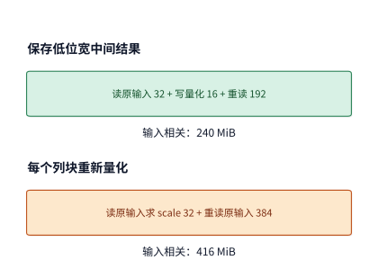

*图 5-24　两种方案都必须先读取一遍 $32\ \mathrm{MiB}$ 的原始 FP16 输入以确定整行量化尺度。单独保存 $16\ \mathrm{MiB}$ 的 FP8 量化结果后，下游 $12$ 个输出列块合计只需重读 $192\ \mathrm{MiB}$；而将量化融合进矩阵乘后，虽然省去了 $16\ \mathrm{MiB}$ 的中间写出，$12$ 个列块却必须重复读取宽一倍的原始 FP16 输入（合计重读 $384\ \mathrm{MiB}$）。权重与输出部分在两种方案下均固定占 $204\ \mathrm{MiB}$。*

从图 5-24 可以清楚地看到，拉开 $444\ \mathrm{MiB}$ 与 $620\ \mathrm{MiB}$ 差距的根源，在于通向 $12$ 个输出列块的**跨块重复读取**：每增加一个输出列块，保存 FP8 结果的方案只需多读 $16\ \mathrm{MiB}$，而融合重算的方案却要多读 $32\ \mathrm{MiB}$。诚然，如果我们把全部 $1536$ 个输出列全部放入同一个巨型分块里一次算完，就能彻底消除跨列块的重复读取；但那样一来，片上输出累加器也必须从 $128$ 列同步膨胀 12 倍至 $1536$ 列，立即超出第 5.2 节讨论过的片上局部存储容量上限。AKG 等多面体编译器之所以必须将“算子融合边界”与“循环分块大小”放在同一个代价模型中联合求解，正是因为修改中间结果的挂载位置（`compute_at`）会直接改变下游各分块的重复读取字节数与片上缓冲压力。[^numerics]

### 5.4.5 TileLang-Ascend：把同一份 schedule 写成显式 tile 程序

多面体编译器（如 AKG）走的是“从标量/张量数学式出发，由编译器全自动推导分块与搬移”的路线；而近年来备受关注的另一条技术路线，则是为算法与系统工程师提供一套**以“数据块（Tile）”为一等公民的领域特定语言（DSL）**，让程序员直接在分块粒度上以极高表达力写出数据流与软件流水。

由北京大学与微软研究院学者联合研发的 **TileLang** 正是这一路线的代表作：它将“分块级数据流（用 `T.copy`、`T.gemm`/`T.mma`、`T.reduce` 直观描述块间搬移与块内计算）”与“底层硬件调度细节（用 `T.Pipelined`、内存布局标注、线程绑定与 swizzle 重排来控制流水与无冲突访存）”优雅地分层表达。在实际工业界落地中，DeepSeek 开源的高性能算子库 **TileKernels** 正是基于 TileLang 构建了其训练与推理核心算子，并于 2026 年 9 月 30 日正式接入华为昇腾（Ascend）后端，实现了用同一套高层 Python 分块接口同时驱动 NVIDIA GPU 与华为昇腾 NPU；与此同时，开源社区的 `tilelang-ascend` 项目则贯通了从 TileLang 到昇腾底层 Ascend C / PTO 以及 AscendNPU IR 的完整编译适配链路。[^tilelang-paper][^tilekernels][^tilelang-ascend]

为了让大家直观体会这两种编译表达的内在相通性，我们仍以刚才的矩阵乘法 $C = AB$ 为例，用 `TileLang-Ascend` 风格的 Python 伪代码把同一份多级分块与片上双缓冲流水写出来：

```python
with T.Kernel(core_num, is_npu=True) as (cid, _):
    A_L1 = T.alloc_L1((stages, BM, K_L1), "float16")
    B_L1 = T.alloc_L1((stages, K_L1, BN), "float16")
    A_L0 = T.alloc_L0A((stages, BM, BK), "float16")
    B_L0 = T.alloc_L0B((stages, BK, BN), "float16")
    C_L0 = T.alloc_L0C((BM, BN), "float32")

    for ko1 in T.Pipelined(ceil_div(K, K_L1), num_stages=stages):
        T.copy(A[...], A_L1[ko1 % stages, :, :])
        T.copy(B[...], B_L1[ko1 % stages, :, :])
        for ko0 in T.serial(ceil_div(K_L1, BK)):
            T.copy(A_L1[ko1 % stages, ...], A_L0[ko0 % stages, ...])
            T.copy(B_L1[ko1 % stages, ...], B_L0[ko0 % stages, ...])
            T.mma(A_L0[ko0 % stages, ...],
                  B_L0[ko0 % stages, ...], C_L0,
                  init=(ko1 == 0 and ko0 == 0))

    T.copy(C_L0, C[...])
```

仔细对照这段十几行的 TileLang 代码与上一小节的 `isl schedule`，可以看到**它们描述的是同一套硬件数据流**：
- 代码中的外层循环 `ko1` 与内层循环 `ko0` 对应将归约维 $K$ 做两级分块（先按较大的步长 `K_L1` 从片外 HBM 搬入片上 L1 缓冲区 `A_L1 / B_L1`，再按硬件 Cube 单元要求的步长 `BK` 从 L1 搬入紧贴计算单元的 L0 寄存器缓冲区 `A_L0 / B_L0`）；
- `C_L0 = T.alloc_L0C((BM, BN), "float32")` 声明了跨越整个两层归约循环常驻片上的 FP32 输出累加器（在首次归约步 `ko1 == 0 and ko0 == 0` 时初始化清零，直到两层循环全部结束才通过最后一行 `T.copy(C_L0, C[...])` 一次性写回全局显存）；
- `T.Pipelined(..., num_stages=stages)` 与模运算下标 `ko1 % stages`、`ko0 % stages` 则直接声明了多槽位（multi-stage）乒乓缓冲，让 MTE 引擎搬移下一块数据与 Cube 引擎执行当前块 `T.mma` 矩阵乘加自动重叠执行。再加上将物理核号 `cid` 映射到输出块坐标 `(io, jo)`、处理边界尾块、配置片上分形布局（fractal layout / swizzle）以及自动插入硬件同步事件（event flag），就完整构成了一份高性能昇腾 NPU 算子实现。

简言之，**AKG 与 TileLang 从不同路径刻画了相同的片上多级数据流，只是“人机分工界面”设在了不同高度**：AKG 让程序员只写标量/张量数学定义，把循环分块、存储提升与流水同步主要交给多面体引擎去自动推导；而 TileLang 则把分块（Tile）、各级片上缓冲分配（`alloc_L1/L0`）与流水级数（`T.Pipelined`）直接暴露为清晰易写的高层语言原语，让熟悉硬件特性的系统工程师能够直接掌控核心分块架构，同时仍由底层编译器自动包揽繁琐的指令映射、地址计算与硬件同步信号插入。下表将同一个矩阵乘法在两套系统中的核心要素做了一一对齐：

| 核心编译决策 | `isl` / AKG 多面体编译器的内部表达 | `TileLang-Ascend` 显式分块程序的表达 |
| --- | --- | --- |
| 输出矩阵二维分块 | 准仿射调度映射中的商坐标 `floor(i/BM), floor(j/BN)` | `T.Kernel` 中的核号 `cid` 到输出 tile 坐标的映射与外层循环 |
| 归约维 $K$ 多级分块 | 调度映射中的 `floor(k/BK)` 与块内余数坐标 | 外层 `ko1`（HBM $\rightarrow$ L1）与内层 `ko0`（L1 $\rightarrow$ L0）两层循环 |
| 分块输入读写区域 | 由编译器对标量数组下标做多面体边界投影自动推导 | 程序员在 `T.copy` 中直接写出源切片与目标片上 buffer |
| 片上多级存储分配 | 存储管理 pass 自动将数组读写提升（promote）至 UB / L1 / L0 | 程序员通过 `T.alloc_L1 / alloc_L0A / alloc_L0B / alloc_L0C` 显式声明 |
| 硬件矩阵乘加指令 | 后端代码生成器将最内层循环模式匹配映射为 Cube 指令 | 程序员直接调用块级原语 `T.mma` 表达 Cube 矩阵乘加 |
| 多槽软件流水与同步 | 由依赖分析、容量模型与后端 pass 自动翻倍缓冲并插入同步 | 程序员用 `T.Pipelined(num_stages=...)` 声明流水，编译器自动生成硬件同步 flag |

放眼整个高性能算子编程生态，以“显式数据块（Tile）”为核心的抽象正分化出三个不同层级的代表性技术支流：**TileLang**、斯坦福大学提出的 **ThunderKittens**，以及 NVIDIA CUTLASS 3.x / 4.x 核心采用的 **CuTe DSL**。三者虽然都围绕“片上分块驻留 + 异步数据搬移 + 矩阵指令乘加”构建程序，但各自锚定的人机分工界面各有侧重：

| 显式分块编程框架 | 核心编程抽象与一等公民 | 布局、线程绑定与流水同步的职责划分 | 典型适用场景与跨平台能力 |
| --- | --- | --- | --- |
| **TileLang** | 块级算子（`T.copy`、`T.gemm`/`T.mma`、`T.reduce`）与片上存储声明（`alloc_shared` / `alloc_L1`） | 程序员用 `T.Pipelined` 声明多级软件流水，编译器自动推导线程到元素的映射、共享内存 swizzle 布局与硬件同步原语 | 兼顾高开发效率与接近手写峰值性能，支持一套前端同时编译至 NVIDIA GPU 与华为昇腾 NPU |
| **ThunderKittens** | 紧贴硬件矩阵指令粒度的 $16\times16$ 寄存器块（`rt`）与共享内存块（`st`）C++ 模板 | 提供块级 `mma`、`load`/`store` 与行/列归约原语，结合生产者/消费者 warp 组（warpgroup）显式协同流水 | 适合在 Hopper / Blackwell 上快速编写融合注意力、状态空间模型（SSM）等需要精细控制寄存器块生命周期的定制算子 |
| **CuTe（CUTLASS 3.x/4.x）** | 层次化布局代数 `Layout = (Shape, Stride)` 与硬件原子特征描述（`TiledMMA`、`TiledCopy`） | 通过布局合成（composition）、逻辑切分（logical divide）与互补求逆，将复杂的跨线程寄存器交错与 TMA 块传输统一为严格的代数运算 | 构建工业级底层算子库（如 FlashAttention-3/4、cuBLAS 级定制 GEMM）的底层基石，控制粒度最细但学习门槛最高 |

同样值得注意的是，当我们把视线从数据中心服务器移向第 4.5.2 节讨论过的 Apple Silicon 统一内存终端（如搭载 M2 Max 的 MacBook Pro 本地推理工作站）时，“哪一层软件负责内存预算、哪一层负责统一内存缓冲映射、哪一层负责手写硬件算子 kernel”的分工边界同样遵循着清晰的层次结构。以广泛使用的本地大模型运行工具 **Ollama**（以 v0.20.7 版本源码 `8d0dcf4b6daf8d7833c8b55108e5b45063795e57` 为例）在 macOS 上的完整调用链为例，许多开发者常把“模型跑在 Ollama 上”笼统视为单一软件的行为，但拆开源码可以看到，主机控制与底层算子执行被严格切分在三层不同的系统组件中：[^macbook-pro6000]
1. **应用与会话编排层（Ollama Go 主进程）**：负责模型权重拉取、HTTP 会话管理、上下文生命周期控制以及模型层在设备间的切分预算。在 Apple Silicon 上，Ollama 并不直接编写任何 GPU 算子，而是通过 CGo 桥接调用 Metal 接口读取系统推荐的最大工作集容量 `recommendedMaxWorkingSetSize`（见 `discover/gpu_darwin.m` 与 `ml/backend/ggml/ggml/src/ggml-metal/ggml-metal-device.m`），据此动态决定将多少个 Transformer 层与多大的 KV 缓存分配给 GPU 执行。
2. **张量计算图与统一内存运行时层（`llama.cpp` / `ggml` Metal 后端）**：负责将模型前向展开为算子计算图，并利用 Apple Silicon 统一内存架构（UMA）消除冗余的跨总线拷贝。在 `ggml-metal-context.m` 中，运行时通过 Metal 的共享存储模式（`MTLResourceStorageModeShared`）与零拷贝缓冲区映射接口（如 `newBufferWithBytesNoCopy`），让 GPU 计算单元能够直接按页对齐虚拟地址访问已经加载在统一物理内存中的 GGUF 量化权重与 KV 缓存；同时在每次前向推理中，将整段计算图的算子序列批量编码进同一个 Metal 命令缓冲区（`MTLCommandBuffer` 与 `MTLComputeCommandEncoder`）一次性提交给硬件队列，扮演着类似于前文 CUDA Stream 批量下发与轻量级图提交的运行时角色。
3. **设备端手写算子内核层（`ggml-metal.metal`）**：真正决定单步 prefill 与 decode 算力及带宽利用率的，是完全用 Metal Shading Language（MSL）针对 Apple GPU 线程组（threadgroup）与 32 线程 SIMD-group 硬件特性专门手写的底层算子库——包括直接读取 `Q4_0`、`Q4_K`、`Q6_K` 等压缩块并在寄存器内在线反量化的矩阵—向量乘（`kernel_mul_mv_*`）与分块矩阵—矩阵乘（`kernel_mul_mm_*`），以及利用片上线程组共享内存（`threadgroup` memory）实现的融合分块注意力（`kernel_flash_attn_ext*`）。至于苹果官方开源的 **MLX** 框架或面向神经网络引擎（ANE）的 **Core ML**，则是独立于 `Ollama -> llama.cpp/ggml -> Metal` 之外的另外两条软件栈。将“上层服务壳（Ollama）”、“统一内存运行时（`ggml-metal`）”与“硬件 SIMD-group 算子内核（`.metal`）”三层剥离开来，我们才能在性能剖析时准确判断瓶颈究竟出在内存工作集预算、命令编码提交，还是量化分块算子本身的访存效率上。

### 5.4.6 成本估计与实测选择

通过前文 **例 5-3** 与 **例 5-8** 的计算，我们已经掌握了如何根据跨接口读写字节数来初步评判两种分块实现的优劣。当编译器面对成百上千种由不同分块尺寸、循环顺序、流水级数与算子融合边界组合而成的庞大候选空间时，同样遵循一套由粗到精的**漏斗式筛选流程**：第一步，先做合法性检查，剔除违反数据依赖或破坏浮点数值规则的错误变换；第二步，做静态资源剪枝，直接淘汰掉片上局部存储（共享内存或 L1/L0）与寄存器需求超出硬件物理上限的方案；第三步，利用解析代价模型（Cost Model）估算剩余合法候选的访存与计算开销，排出优先级队列；最后一步，将排名靠前的少量优秀候选编译成二进制机器码，放到真实硬件上实测计时，选出跑得最快的最终实现。

在第 5.2.2 节中，我们曾给出过一个最简代价模型：用跨接口总读写量除以有效带宽来对比 $64\times64$ 与 $128\times128$ 两个输出分块。工业界编译器的代价模型在此基础上还会进一步纳入硬件矩阵指令（Tensor Core / Cube）形状匹配利用率、寄存器压力与溢出风险、共享内存 bank 冲突率以及 kernel 启动开销，从而更准确地决定优先把哪些候选送去真机编译测试。

让我们以第 5.2.2 节的矩阵乘法算例与 RTX PRO 6000 的硬件约束（每个 SM 共享内存上限 $100\ \mathrm{KB}$，每驻留线程块另加 $1\ \mathrm{KiB}$ 系统预留）为例，把编译器的这五个筛选与决策步骤整理成一张清晰的工程检查表。顺便注意一个细节：第 5.2.2 节假定输入分块与输出累加器全都放在共享内存里（单缓冲下 $64\times64$ 与 $128\times128$ 分块的工作集分别为 $24\ \mathrm{KiB}$ 与 $80\ \mathrm{KiB}$）；如果像第 5.1.5 节讨论的那样把输出累加器改放到线程寄存器中，静态可行性检查就必须分别核对共享内存与寄存器两本独立账本，因为这两类物理存储空间是绝不能互相借用的。同理，如果将这两个候选方案的输入缓冲从单缓冲升级为**双缓冲（double buffering）**，输入块占用的空间翻倍，两者的单块共享内存工作集就会分别从 $24\ \mathrm{KiB}$、$80\ \mathrm{KiB}$ 上升到 $(4+4)\times2 + 16 = \mathbf{32\ \mathrm{KiB}}$ 和 $(8+8)\times2 + 64 = \mathbf{96\ \mathrm{KiB}}$（算上每块 $1\ \mathrm{KiB}$ 预留即 $33\ \mathrm{KiB}$ 与 $97\ \mathrm{KiB}$），于是单个 SM 可同时驻留的线程块数也就从原来的 $4$ 块、$1$ 块相应变成了 $\lfloor 100/33 \rfloor = \mathbf{3}$ 块与 $\lfloor 100/97 \rfloor = \mathbf{1}$ 块。

| 编译器筛选步骤 | 对应本章矩阵乘法算例的具体核算内容 | 排除非法方案或比较优劣的定量依据 |
|---|---|---|
| **1. 固定优化目标** | 明确输入张量形状、数据类型（BF16/FP32）、允许误差范围与线上调用频数 | 确保所有候选方案在相同的数学运算语义与目标负载下公平对比 |
| **2. 枚举候选空间** | 组合不同的分块尺寸（tile size）、循环次序、缓冲槽数（stages）与算子融合边界 | 候选变换是否在编译器表达能力与目标硬件指令集支持范围内 |
| **3. 静态可行性剪枝** | 核算每块共享内存、每线程寄存器、线程槽占用、地址对齐要求与数据依赖 | 依据编译器静态资源报告与依赖检查，一票否决超容量或改变结果的方案 |
| **4. 静态代价模型初筛** | 估算浮点计算量、跨接口实际读写量、kernel 启动开销与布局转换代价 | 核算各硬件单元的理论服务时间下界与流水线关键路径耗时 |
| **5. 真机实测与择优** | 在代表性形状上实测候选 kernel 的真实耗时、性能抖动以及融入完整算子链后的表现 | 以最小化真实工作负载的综合耗时为准绳，并保留若干次优候选以备形状切换 |

在实际调优流程中，编译器先通过第 3 步的静态资源报告秒级剔除超标方案，再通过第 4、5 步对胜出候选测量真实有效带宽、纯计算时间与端到端算子链耗时。如果在实测中发现某个大块方案虽然理论重读量小，却因为寄存器溢出（register spilling）、矩阵边界尾块填充浪费或驻留占用率骤降而反受其累，调优器就会自动退回第 2 步缩小分块尺寸或调整缓冲级数。等到了第 6 章讨论多卡分布式超节点时，我们将看到完全相同的五步决策框架——唯一的区别是分块（tile）的放置范围从单卡的多个 SM 扩展到了集群中的多张加速卡，而分块之间的跨界依赖则从片上 L2 缓存交接换算成了跨卡集合通信（Collective Communication，即多张加速卡按固定拓扑模式协同交换或归约数据的通信原语）。

第 5 步“真机实测”之所以不可替代，可以用本书配套 **实验 5-5** 的矩阵转置（matrix transpose）算子给出一个鲜明的例证：在 RTX PRO 6000 Blackwell 上运行同一段分块矩阵转置程序，当采用 $16\times16$ 分块时单次耗时约为 **$7.9\ \mu\mathrm{s}$**；而将分块的行列边长各自扩大一倍、改用 $32\times32$ 分块后，单次耗时直接骤降到了 **$2.9\ \mu\mathrm{s}$**，实测加速比高达约 **$2.7$ 倍**。要知道，把分块边长从 $16$ 翻倍到 $32$，块内元素数量就增至原来的 4 倍（刚好凑齐一个 32 线程 warp 的整行连续合并读写宽度），不仅显存突发访问的合并效率（coalescing）与共享内存的布局利用率发生了质变，块内线程的协同分工方式也随之彻底改变。[^exp5]

为了在庞大的调度空间中自动寻优，像 TVM AutoTVM / Ansor 这样的**自动调优系统（Auto-tuning）**会结合硬件实测反馈，通过进化算法或机器学习代价模型自动搜索最佳的分块与循环参数；而近年来兴起的**基于大模型智能体（LLM Agent）的算子生成与调优系统**，则能够直接调用编译器、性能分析器（Profiler）与正确性校验工具，不仅会调整现有模板的调度参数，还能主动改写底层 kernel 源码以探索传统固定调度模板之外的全新实现方案。无论是传统的编译器自动搜索还是新兴的 Agent 进化搜索，它们都严格遵循同一套迭代反馈流程：**以编译生成后的可执行二进制程序为评估对象，先通过严格的数值比对筛出计算结果正确的实现，再以真机实测耗时作为奖励信号指导下一步搜索。** 之所以必须把整段子图编译成最终二进制程序后再做整体评测，是因为现代编译器往往会将源码里看似分开写的几个算子自动融合进同一个 kernel 中，孤立地评测单个算子源码根本无法反映融合后的真实开销。[^exp4]

在完成了单形状的实测评估后，编译器与搜索系统还必须面对最后一个关乎全局收益的核心问题：**当线上真实流量包含多种不同形状的输入时，究竟应该拿怎样的负载分布去评判一个算子实现的好坏？**

**例 5-9：不同输入形状的线上调用频数比例，如何逆转算子实现的优劣选择？** 假设线上某个算子在运行中会遇到 $A$ 和 $B$ 两种不同的输入张量形状。原有的基准算子实现（原实现）表现很均衡，处理形状 $A$ 和形状 $B$ 的耗时均为 **$10\ \mu\mathrm{s}$**。现在我们搜索出了一个专门针对形状 $A$ 深度优化的“新实现”：它处理形状 $A$ 的耗时直接减半至 **$5\ \mu\mathrm{s}$**，但在处理形状 $B$ 时却因为分块不匹配而退化翻倍至 **$20\ \mu\mathrm{s}$**。那么，我们究竟该不该用这个新实现替换原实现呢？
- 如果线上流量中形状 $A$ 和形状 $B$ **各出现 1 次（五五开）**：原实现总耗时为 $10 + 10 = 20\ \mu\mathrm{s}$；新实现总耗时却变成了 $5 + 20 = 25\ \mu\mathrm{s}$，换用新实现后整体反而变慢了 **$25\%$**。
- 反之，如果线上流量高度偏斜，形状 $A$ 是高频主干形状（**调用 100 次**），而形状 $B$ 只是偶发的罕见形状（**仅调用 1 次**）：原实现总耗时为 $100\times10 + 1\times10 = 1010\ \mu\mathrm{s}$；而新实现总耗时则大幅降至 $100\times5 + 1\times20 = 520\ \mu\mathrm{s}$，综合加速比高达约 **$1.94$ 倍（约 $1.9$ 倍）**。

我们可以用一个简单的线性期望公式把临界点算出来。设形状 $A$ 在全部调用中所占的频率比例为 $p$（则形状 $B$ 的占比为 $1-p$）。原实现的平均单次耗时恒为 $10\ \mu\mathrm{s}$；新实现的加权平均单次耗时 $\overline{T}_{\mathrm{new}}$ 为：

$$
\overline T_{\mathrm{new}}=5p+20(1-p)=20-15p\quad\mathrm{\mu s}.
$$

要想让新实现的综合平均耗时短于原实现，必须满足 $20 - 15p < 10$，解得临界比例为 **$p > 2/3$（即约 $66.7\%$）**。图 5-25 直观画出了两条平均耗时直线的交点：只有当高频形状 $A$ 的调用占比跨过 $2/3$ 这条临界线时，换用单一新实现才能带来净收益。

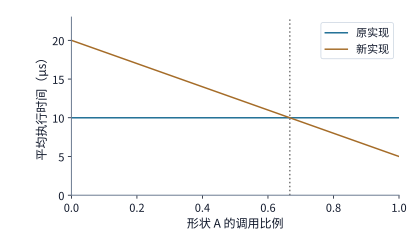

*图 5-25　只有当形状 $A$ 的调用占比 $p$ 超过 $2/3$ 时，新实现的加权平均执行时间才会低于原实现。图中原实现处理形状 $A$、$B$ 的耗时均为 $10\ \mu\mathrm{s}$（水平虚线），新实现处理 $A$、$B$ 的耗时分别为 $5\ \mu\mathrm{s}$ 与 $20\ \mu\mathrm{s}$（斜线）；假设各次调用串行执行且仅比较稳态运行耗时，两线交点（$p=2/3$）即为优劣翻转的临界点。*

例 5-9 给出了算子工程中两条实用的部署策略：**其一，如果运行时允许按输入形状动态派发（shape dispatch），且保存多份二进制代码的空间开销可控，那就为形状 $A$ 绑定新实现（$5\ \mu\mathrm{s}$）、为形状 $B$ 保留原实现（$10\ \mu\mathrm{s}$），实现全场景最优；其二，如果受限于指令缓存或编译体积而只能保留单一实现，那就绝不能只拿单一测试形状（micro-benchmark）跑分，而必须严格按照线上真实流量的形状频数分布（$p$）加权评估综合成本。** 此外，自动调优与 Agent 搜索过程本身所耗费的漫长编译与真机测量时间，则属于系统上线前的**一次性准备成本（Preparation Cost）**。本书配套的 **实验 5-6** 完整记录了 LLM Agent 自动生成算子代码、反复提交编译与真机测量的迭代轨迹；下一节我们就把这笔“前期准备成本”与“线上重复调用次数”结合起来，定量算清一项编译优化究竟要在生产环境中跑多少次才能收回成本。[^exp6]

## 5.5 运行时：提交、重放与动态形状

当编译器选定并生成了高效的设备端 kernel 代码之后，在线推理或训练的每一轮迭代中，**运行时（Runtime）** 依然要在主机（CPU）端周而复始地忙碌：准备输入数据与元数据、根据当前输入形状匹配合适的 kernel、向设备队列提交任务并管理显存缓冲区的生命周期。哪怕底层跑的是完全同一份 kernel 机器码，只要改变主机端的任务提交方式，或者把前一次已经算好的调度准备结果缓存复用起来，端到端的总耗时就会发生显著变化。本节我们顺着第 5.1 节建立的异构时间线，深入剖析主机端运行时的优化机制与代价权衡。

### 5.5.1 主机准备与加速器计算的重叠

第 5.1 节严格区分了“CPU 提交耗时”与“GPU 执行耗时”，第 5.3 节则揭示了两类独立资源如何通过流水线在时间上重叠工作。现在，我们把这两个视角合二为一，放到模型前向推理的连续多段执行中：当 GPU 正在埋头计算第 $k$ 段算子时，CPU 可以在主机端同步为第 $k+1$ 段算子检查张量形状、计算分块参数、更新页表元数据并向队列下发任务。只要下一段的准备工作能够提前启动，CPU 主机与 GPU 加速器就能严丝合缝地组成一条软硬件两级流水线；反之，如果 CPU 每次都等到 GPU 把当前段彻底算完后才动手准备下一段，加速器就会在相邻两段之间反复停工空转。

**例 5-10：当加速器算力大幅跃升后，为什么 CPU 主机反而会成为限制端到端吞吐的瓶颈？** 假设一次前向推理包含连续 $100$ 段计算任务；在初始状态下，每段任务的 CPU 主机准备耗时与 GPU 加速器计算耗时恰好均为 **$20\ \mu\mathrm{s}$**。假设准备下一段所需的元数据均已提前知晓，缓冲区充足，且 CPU 与 GPU 可完全独立并行工作：
- 如果采用**严格串行（同步等待）**模式：每段都要先花 $20\ \mu\mathrm{s}$ 准备、再花 $20\ \mu\mathrm{s}$ 计算，跑完 100 段总耗时高达 $100\times(20 + 20) = \mathbf{4000\ \mu\mathrm{s}}$。
- 如果改用**主机异步提交流水线**：CPU 先花 $20\ \mu\mathrm{s}$ 准备好第 1 段，随后在 GPU 计算第 1 段的同时，CPU 同步准备第 2 段；由于两个阶段耗时同为 $20\ \mu\mathrm{s}$，流水线每隔 $20\ \mu\mathrm{s}$ 就能稳定吐出一段，总耗时直接减半为 $20 + 100\times20 = \mathbf{2020\ \mu\mathrm{s}}$。
- 现在，假设我们换用了新一代高速加速器（或经过极致算子融合），**将每段的 GPU 计算耗时从 $20\ \mu\mathrm{s}$ 大幅压缩至 $5\ \mu\mathrm{s}$（提速 4 倍），但 CPU 主机每段准备耗时仍为 $20\ \mu\mathrm{s}$ 不变**。套用第 5.3.2 节的流水线通式 $T_{\mathrm{pipe}} = t_{\mathrm{host}} + (n-1)\max(t_{\mathrm{host}}, t_{\mathrm{dev}}) + t_{\mathrm{dev}}$，此时稳态节拍完全受制于较慢的主机准备耗时 $\max(20, 5) = 20\ \mu\mathrm{s}$，跑完 100 段的总耗时变为 $100\times20 + 5 = \mathbf{2005\ \mu\mathrm{s}}$——GPU 算力翻了 4 倍，总耗时却只缩短了微不足道的 **$15\ \mu\mathrm{s}$（不到 $1\%$）**。原因一目了然：CPU 下发任务的速度未能同步提高，GPU 算得越快，每次算完后停下来等待主机提交下一段任务的空闲时间就越长（每段空闲等待 $15\ \mu\mathrm{s}$）。
- 唯有当我们同步优化主机运行时，**将每段的 CPU 准备耗时也压缩至 $5\ \mu\mathrm{s}$**，软硬件流水线的稳态节拍才能真正缩短到每 $5\ \mu\mathrm{s}$ 完成一段，使 100 段总耗时骤降至 $5 + 100\times5 = \mathbf{505\ \mu\mathrm{s}}$（实现真正的 4 倍端到端提速）。[^host]

图 5-26 直观对比了前 4 段工作在上述三种情形下的时间线形态。

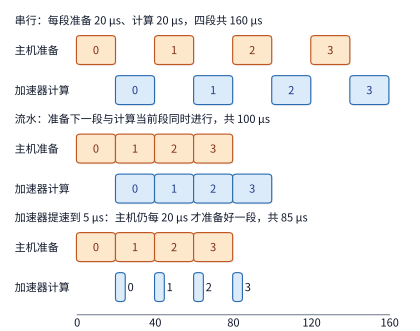

*图 5-26　设每段工作的主机准备耗时均为 $20\ \mu\mathrm{s}$。在串行模式下（上），CPU 与 GPU 轮流工作、互相等候；在均衡流水模式下（中，GPU 每段耗时 $20\ \mu\mathrm{s}$），CPU 准备下一段与 GPU 计算当前段完美重叠，每隔 $20\ \mu\mathrm{s}$ 完成一段；当 GPU 单段计算提速至 $5\ \mu\mathrm{s}$ 而主机准备仍为 $20\ \mu\mathrm{s}$ 时（下），每段计算都必须等待漫长的主机准备，导致加速器在四分之三的时间里处于空转状态。图中仅画出前 4 段示意，正文算例共含 100 段。*

例 5-10 揭示了运行时优化主机侧开销的两条核心路径：**第一条路径是直接削减主机每一步的重复准备工作量**，例如把根据请求长度与 KV 缓存页表布局事先算好的**执行计划（Execution Plan，含 kernel 选择、分块任务划分与临时工作区地址安排）**缓存起来跨层或跨步复用；**第二条路径是把必须做的主机处理挪到前一步 GPU 还在执行的时间窗口内异步重叠掉**，例如当 GPU 已经开始跑第 $t+1$ 步模型前向时，让 CPU 在后台并发处理第 $t$ 步刚生成的 token 输出（解码为文本、推送给客户端流式响应）。第一条路径直接压短了图 5-26 中每块橙色条（主机准备）的长度，第二条路径则消除了相邻两步迭代交接处的等待缝隙。

在大模型的自回归（auto-regressive）逐 token 生成过程中，某一项主机准备工作究竟能不能提前异步执行，完全取决于**它所依赖的数据在当时是否已经算好**。例如，第 $t+1$ 步前向计算本身需要读取第 $t$ 步采样选出的新 token ID（如果直接在 GPU 上完成采样并将结果留在显存中，GPU 甚至无需等待 CPU 介入就能直接启动下一步前向）；而组建下一轮连续批处理（continuous batching）队列、更新结构化输出的有限状态机或语法掩码（constrained decoding，在强制要求输出合法 JSON 等语法格式时，跟踪当前已生成序列走到了语法树的哪一步），以及判定请求是否命中停止词（EOS），则必须拿到上一轮生成的具体 token 后才能完成。因此，现代推理引擎运行时的核心设计艺术，就是把“不依赖上一轮生成结果的调度与元数据准备”尽数提前到 GPU 执行期间并发完成，把两轮迭代之间的同步屏障压缩到极致。vLLM、SGLang 等主流开源推理引擎近年来的架构演进，很大程度上正是围绕攻克这一主机侧瓶颈而展开的。[^runtime]

事实上，随着专用加速器的算力与显存带宽突飞猛进，单步 decode 的设备端模型执行耗时已经被压缩到了几毫秒甚至亚毫秒量级，往往比 Python 主机进程每一步花在调度和准备上的时间还要短——此时，流水线的稳态步间隔（step time / TPOT）下界便彻底由 CPU 主机准备时间说了算。要想继续压低步间隔，就必须把动态批处理（dynamic batching，每一步都可能有新请求加入或已完成请求退出）的元数据组装、显存页表地址更新与 kernel 提交全链路放在一起做系统级精简。

2024 年 9 月发布的 **vLLM v0.6.0** 便是大模型推理工程中一个有代表性的“消除主机瓶颈”经典案例。在 v0.6.0 发布前的性能剖析中，开发团队惊讶地发现：当在单张 H100 GPU 上运行 Llama 3 8B 推理时，每个生成步的端到端耗时中，真正花在 GPU 加速器执行模型上的时间居然只占 **$38\%$**，而花在前端 API 服务器（HTTP 请求解析与流式返回）上的时间占了 **$33\%$**，花在 CPU 调度器（Scheduler）上的时间占了 **$29\%$**——原因在于前端 API 服务器与后端推理引擎跑在同一个 Python 进程内，双方的异步协程频繁争抢同一个 Python 全局解释器锁（GIL），导致高达六成以上的时间里，昂贵的 H100 GPU 都在空转等待 CPU。针对这一病灶，vLLM v0.6.0 实施了三项纯主机侧架构手术：
1. **多进程解耦**：将前端 API 服务器剥离到独立的操作系统进程中，通过零拷贝进程间消息队列（ZeroMQ）与后台推理引擎通信，彻底根除了对同一个 GIL 的争用；
2. **多步调度（Multi-step Scheduling）**：改为由调度器一次规划好未来连续多步（如 8～10 步）的执行计划并连续下发 GPU，避免了每生成一个 token 都退回 Python 调度器重新做一遍批处理准备；
3. **异步输出处理（Async Output Processing）**：将上一轮生成的 token 拷贝回主机与解码后处理推迟到下一轮 GPU 前向启动之后并发执行。

这三项改动**没有修改哪怕一行底层 CUDA kernel 代码，也没有更换任何硬件**，却将单卡 H100 运行 Llama 3 8B 的线上吞吐量提升到了 v0.5.3 的 **$2.7$ 倍**，在计算占比更高的 Llama 3 70B 上也提升了 **$1.8$ 倍**（见图 5-27）。[^vllm060] 按照本书第 1.3.4 节确立的系统优化判据：当主机侧软件抽象与控制开销已经占到了单步总耗时的六成以上时，优先削减这部分主机侧冗余开销，比单纯升级更快的加速卡要有效得多。

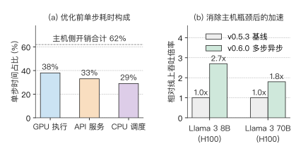

*图 5-27　在单卡 H100 运行 Llama 3 8B 的性能剖析中，优化前（v0.5.3，左）单步耗时的 $62\%$ 花在前端 API 服务（$33\%$）与 CPU 调度器（$29\%$）上，GPU 模型执行仅占 $38\%$；通过多进程解耦、多步调度与异步输出处理消除主机瓶颈后（v0.6.0，右），在不改动任何底层 CUDA kernel 的前提下，Llama 3 8B 与 70B 的线上吞吐量分别提升至 $2.7$ 倍与 $1.8$ 倍。*

除了在同一条请求的相邻生成步之间重叠与复用，**不同请求或不同层之间同样存在着大量可复用的主机准备工作**。比如线上先后到达的两条用户请求，一条要求模型解释一段 Python 代码，另一条要求模型检查单元测试——尽管它们输入的文本内容（token ID）截然不同，但流经的却是完全相同的 36 层 Transformer 计算图结构。只要当前批次的 token 数量与形状落在预先准备好的执行计划支持范围内，运行时就可以直接复用已经构建好的控制结构，仅需在原地刷新显存中的输入 token、位置编码索引和 KV 缓存页表地址即可；只有当遇到全新的形状分桶或控制流分支时，才需要切换到另一份预编译好的执行计划。简言之，**上层应用通过动态变化的上下文数据表达业务语义，而底层运行时则通过固化不变的计算图结构消灭重复的控制准备。** 下面我们就分别定量核算“计算图重放（CUDA Graph）”与“动态形状特化（Shape Specialization）”这两大核心复用机制的收益与代价边界。

### 5.5.2 CUDA Graph：提交收益与输入复制开销

在上一小节中我们看到，当模型由成百上千个细碎的小 kernel 串联而成时，CPU 逐个调用 `cudaLaunchKernel` 下发任务的控制开销往往比 GPU 真正执行计算的时间还要长。既然大模型每一轮 decode 迭代所执行的算子序列和依赖关系是完全固定的，我们自然可以把这一整串 GPU 任务（包括各个 kernel 及其间的依赖边）事先**捕获（capture）并录制为一张静态执行图——即 CUDA Graph（或昇腾上的图下沉机制）**。一旦录制完成，在随后的成千上万次迭代中，CPU 主机每次只需调用唯一一次 **图启动（`cudaGraphLaunch`，即图重放 Graph Replay）** 指令，就能把整张图里的所有任务一次性整包提交给 GPU 硬件队列，彻底省去了主机端逐个准备参数、反复跨越驱动层下发 kernel 的高昂开销。

需要特别澄清一个常见的概念混淆：**CUDA Graph（图重放）减少的仅仅是 CPU 主机端的发起（launch）次数，GPU 加速器在执行该图时，依然会按序逐个执行图中录制的每一个原始 kernel 节点。** 若目标是减少 GPU 实际执行的 kernel 数量（从而消灭中间张量的显存往返读写），则必须依靠第 5.3 节和第 5.4 节讲的**算子融合（operator fusion）**，而不是靠图重放。图 5-28 以包含 6 个算子（3 次线性投影 + $\operatorname{SiLU}$ + 逐元素乘法 + 残差相加）的单层 FFN 为例，直观对比了普通逐个提交与图重放的本质区别。

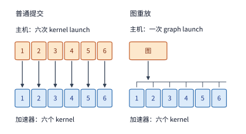

*图 5-28　在普通提交（Eager Launch）模式下，CPU 主机必须为单层 FFN 的 6 个算子逐一发起 6 次 `kernel launch`；而在图重放（CUDA Graph Replay）模式下，主机只需发起 1 次 `graph launch`，但 GPU 加速器内部依然依次执行图中录制的全部 6 个 kernel。要想真正减少加速器执行的 kernel 数量，必须依靠算子融合而非图重放。*

为了在真实硬件时间线上看清“算子融合”与“图重放”各自的作用正交性，本书配套的 **实验 5-8** 连续执行了 **3 次 FFN**（未融合时每次含 6 个 kernel，3 次共 18 个 kernel；将中间激活链融合后每次含 5 个 kernel，3 次共 15 个 kernel），并利用 Nsight Systems 采集了四种组合方式下的真实硬件轨迹（见图 5-29 至图 5-32）：
1. **普通逐个提交（图 5-29）**：CPU 主机连续发起了 **18 次** `kernel launch` API 调用，GPU 相应执行了 **18 个** kernel；
2. **仅做算子融合 + 普通提交（图 5-30）**：将激活链融合进同一个 kernel 后，CPU 主机发起的 `kernel launch` 降为 **15 次**，GPU 执行的 kernel 数量也同步降为 **15 个**；
3. **不做融合 + 仅用图重放（图 5-31）**：把单次 FFN 的 6 个未融合 kernel 录制成一张 CUDA Graph 并重放 3 次，CPU 主机端只需发起 **3 次** `graph launch`，但下方的 GPU 轨迹清晰显示加速器依然执行了全部 **18 个** kernel；
4. **算子融合 + 图重放组合（图 5-32）**：先将激活链融合（单次 FFN 缩减为 5 个 kernel），再录制成 CUDA Graph 重放 3 次——此时 CPU 主机端只需发起 **3 次** `graph launch`，同时 GPU 加速器端也只需执行 **15 个** kernel，在主机控制路径与设备执行路径上同时拿到了最优收益。[^exp8]

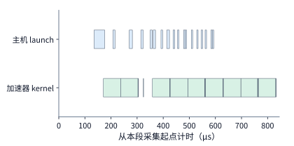

*图 5-29　普通逐个提交模式下连续执行 3 次 FFN 的真机采集轨迹。上行代表 CPU 主机调用的 `cudaLaunchKernel` API，下行代表 GPU 加速器实际执行的 kernel；横轴从当前采集区间起点开始计时。18 次主机端 `kernel launch` 一一对应设备端的 18 个执行 kernel。*

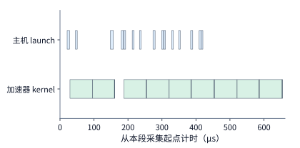

*图 5-30　对激活链实施算子融合后连续执行 3 次 FFN 的采集轨迹。主机端 `kernel launch` 次数从 18 次减少至 15 次，设备端实际执行的 kernel 数量也相应减少至 15 个。数据采自与图 5-29 同一组实验中的独立标记区间。*

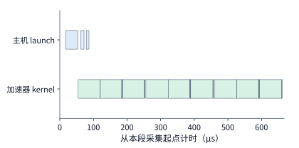

*图 5-31　对未融合 FFN 启用 CUDA Graph 图重放后连续执行 3 次的采集轨迹。主机端仅需发起 3 次极短的 `cudaGraphLaunch` 调用，而设备端依然紧凑地依次执行原图中录制的 18 个 kernel（消除了 kernel 之间的主机提交空泡）；横轴按该区间实际采集时长绘制。*

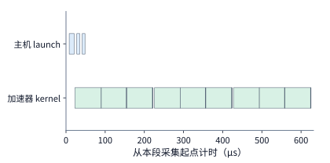

*图 5-32　“先算子融合、再图重放”组合下的采集轨迹：主机端仅发起 3 次图启动，设备端仅执行融合后的 15 个 kernel。四张轨迹图直观印证了：算子融合负责削减设备端 kernel 数量与中间访存，而图重放负责削减主机端提交次数与启动间隙。*

既然 CUDA Graph 如此高效，为什么不能对所有计算都直接套用图重放呢？因为它有一项先天的硬件约束：**CUDA Graph 在首次录制（capture）时，会把图中所有算子读写的显存指针地址作为固定常量绑定在录制好的命令节点中。** 这意味着每次重放这张图之前，新的输入数据必须刚好存放在录制时指定的那个固定显存地址 $G$ 上。如果上游模块（如图外的前置算子或数据加载器）算出的新输入张量位于另一个动态分配的显存地址 $X$ 上，运行时在发起 `cudaGraphLaunch` 之前，就不得不额外插入一次显存内拷贝（D2D copy），先把数据从地址 $X$ 复制到图的固定输入缓冲区 $G$ 中；唯有当上游算子从一开始就被改造为直接把输出写进固定缓冲区 $G$ 时，这笔图前拷贝才能省去（见图 5-33）。

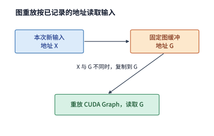

*图 5-33　CUDA Graph 重放时只会从录制阶段锁定的固定显存地址 $G$ 读取输入。若上游算子产生的新输入位于动态地址 $X$（左），重放前必须额外执行一次从 $X$ 到 $G$ 的显存内复制（D2D copy）；若让上游算子直接将结果原地写入固定地址 $G$（右），即可省去这笔中间复制开销。*

这就引出了一个非常实际的工程权衡问题：**如果启用 CUDA Graph 必须附带一次把输入张量拷贝进固定缓冲区 $G$ 的 D2D 显存复制，当输入张量变大时，这笔额外的显存复制耗时会不会反而抵消掉图重放省下的主机提交时间？**

**例 5-11：多大的输入张量复制开销会彻底抵消掉 CUDA Graph 的提交收益？** 假设在普通逐个提交模式下，某段子图的 GPU 纯计算耗时为 $20\ \mu\mathrm{s}$，但由于算子细碎，GPU 中途停下来等待 CPU 逐个提交任务的空泡时间也有 $20\ \mu\mathrm{s}$，端到端完成耗时合计为 $20 + 20 = \mathbf{40\ \mu\mathrm{s}}$。改用 CUDA Graph 图重放后，主机准备与一次性提交整张图的开销骤降至 **$5\ \mu\mathrm{s}$**，GPU 纯计算耗时仍为 $20\ \mu\mathrm{s}$ 不变——也就是说，在不计额外输入复制时，图重放原本能净省下 $20 - 5 = \mathbf{15\ \mu\mathrm{s}}$ 的主机提交等待时间。现在我们加上将新输入从 $X$ 复制到固定图缓冲 $G$ 的 D2D 拷贝开销（硬件平台取显存带宽为 $B = 1792\ \mathrm{GB/s}$ 的 RTX PRO 6000，注意一次显存内复制必须同时经显存总线读取源地址 $X$ 并写入目标地址 $G$，因此跨显存接口的实际读写字节数是输入张量大小的 **2 倍**）：
- **小输入场景（形状为 $[256, 4096]$ 的 BF16 张量，大小 $X = 2\ \mathrm{MiB}$）**：完成一次 D2D 复制需要读 $2\ \mathrm{MiB}$、写 $2\ \mathrm{MiB}$，总读写流量为 $4\ \mathrm{MiB}$（即 $4\times2^{20} = 4{,}194{,}304\ \mathrm{bytes}$）；按 $1792\ \mathrm{GB/s}$ 带宽计算，复制耗时约为 $4.194\times10^6 / (1.792\times10^{12}) \approx \mathbf{2.3\ \mu\mathrm{s}}$。于是，图重放模式下的端到端总耗时为 $5\text{（图提交）} + 2.3\text{（输入复制）} + 20\text{（计算）} \approx \mathbf{27.3\ \mu\mathrm{s}}$，相比普通提交（$40\ \mu\mathrm{s}$）依然净省了约 **$12.7\ \mu\mathrm{s}$**。
- **大输入场景（形状扩大 8 倍至 $[2048, 4096]$ 的 BF16 张量，大小 $X = 16\ \mathrm{MiB}$，为了单变量对比，暂设子图计算与准备耗时仍保持不变）**：此时一次 D2D 复制的总读写流量激增至 $16\times2 = 32\ \mathrm{MiB}$（约 $3.355\times10^7\ \mathrm{bytes}$），复制耗时激增至 $3.355\times10^7 / (1.792\times10^{12}) \approx \mathbf{18.7\ \mu\mathrm{s}}$。结果图重放模式下的总耗时变成了 $5 + 18.7 + 20 \approx \mathbf{43.7\ \mu\mathrm{s}}$——因为多出的 $18.7\ \mu\mathrm{s}$ 显存拷贝已经超过了图重放省下的 $15\ \mu\mathrm{s}$ 提交时间，启用图重放后反而比普通提交（$40\ \mu\mathrm{s}$）还要慢 **$3.7\ \mu\mathrm{s}$**。

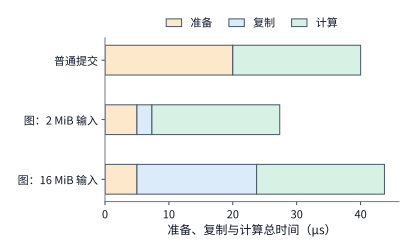

*图 5-34　图中橙色代表主机准备与提交耗时，蓝色代表写入固定图地址的额外 D2D 输入复制耗时，绿色代表 GPU 纯计算耗时。普通逐个提交总耗时为 $40\ \mu\mathrm{s}$；启用图重放后，当输入张量为 $2\ \mathrm{MiB}$ 时总耗时降至约 $27.3\ \mu\mathrm{s}$（净省 $12.7\ \mu\mathrm{s}$），而当输入张量增至 $16\ \mathrm{MiB}$ 时，高昂的复制耗时反超了省下的提交时间，使总耗时升至约 $43.7\ \mu\mathrm{s}$。复制耗时按 RTX PRO 6000 的 $1792\ \mathrm{GB/s}$ 显存带宽核算。*

观察图 5-34 可以总结出一条清晰的规律：**对于一张给定的计算图，图重放所能省下的主机提交时间是一笔与输入张量大小无关的固定收益（本例为 $\Delta T_{\mathrm{launch}} = 15\ \mu\mathrm{s}$）；而如果不做原地地址对接，额外引入的 D2D 输入复制耗时则随着输入张量大小 $X$ 线性增长。** 令两项时间相等（$\frac{2X}{B} = \Delta T_{\mathrm{launch}}$），即可求出图重放在带拷贝情况下的盈亏平衡临界输入大小 $X_{\max}$：

$$
X < \frac{15\times10^{-6}\ \mathrm{s}\times1.792\times10^{12}\ \mathrm{bytes/s}}{2}\approx12.8\ \mathrm{MiB}\quad(1.344\times10^7\ \mathrm{bytes}).
$$

当输入张量小于 $12.8\ \mathrm{MiB}$（如 $2\ \mathrm{MiB}$）时，即便多做一次显存复制，图重放依然能缩短总耗时；而一旦输入张量超过 $12.8\ \mathrm{MiB}$（如 $16\ \mathrm{MiB}$），带拷贝的图重放就会反受其累。这也解释了为什么在工程实践中，我们要么**改造上游算子使其直接将输出写入图的固定输入缓冲区**（将蓝色复制条直接清零），要么**把图捕获的起点选在中间激活张量体积较小的位置（例如从词表 Embedding 查找之前、仅传入几百字节整型 token ID 的位置就开始捕获整网计算图）**。总之，在划定 CUDA Graph 的捕获边界时，必须同时算清“省下的主机提交时间”与“边界处新增的数据搬移时间”这两本账。[^graph]

更进一步，CUDA Graph 复用的是“已经录制好的设备命令序列”，而同样的“一次准备、多处复用”思想还可以向上延伸到**生成这些 kernel 调用之前的运行时计划（Plan）阶段**。以广泛应用的大模型推理注意力算子库 **FlashInfer** 为例，它在架构上显式将注意力算子的调用拆解为 **`plan`（计划生成）** 与 **`run`（算子执行）** 两个分离的阶段：
- 在 **`plan` 阶段**，CPU 根据当前步 batch 内各条请求的实际上下文长度以及分页 KV 缓存（Paged KV Cache）在显存中的物理块索引，计算出最优的分块负载均衡切分方案、选定对应的底层 kernel、分配好临时归约工作区，并通过一次 H2D 复制把这份划分好的元数据表传入 GPU 显存；
- 在 **`run` 阶段**，每一层的注意力 kernel 直接读取显存中已经就绪的这份元数据表，高速完成注意力计算。

以 Qwen3-8B 为例：在这样包含 **36 层**相同结构 Transformer 层的模型中，同一步前向推理流经全部 36 层时，batch 内各条请求的序列长度一模一样，分页 KV 缓存在各层的分块结构也完全同构。如果在每一层注意力算子前都单独调用一次 `plan`，CPU 就要把完全相同的负载均衡计算和 H2D 元数据拷贝重复执行 **36 遍**；反之，只要我们在第 1 层开始前**仅调用 1 次 `plan`**，然后让全部 36 层的 `run` 共同复用这一份执行计划，就能省掉 35 次冗余的计划生成与 H2D 传输。在 RTX PRO 6000 上的两组真机实测对照中，将“每层各自 `plan`”改为“全网共享 1 次 `plan`”后，完成全部 36 层注意力调用的总耗时从约 **$2.0\ \mathrm{ms}$、$2.4\ \mathrm{ms}$** 直接锐减到了 **$0.72\ \mathrm{ms}$、$0.75\ \mathrm{ms}$**（提速约 3 倍），主机到 GPU 的 H2D 小数据拷贝次数从 **144 次**骤降至 **4 次**，而 GPU 实际执行的注意力 kernel 数量则保持丝毫不变。当然，复用必须严守正确性边界：一旦进入下一个生成步、各请求的上下文长度发生了改变，或者有新请求加入 batch，就必须重新调用一次 `plan` 刷新元数据；倘若在长度改变后仍强行沿用旧计划，kernel 就会按错误的旧长度读取 KV 缓存，导致计算结果彻底错乱。[^plan]

**算例 5-A：FlashInfer `plan/run` 跨层计划复用、异构模型多计划表与 RL 休眠虚拟地址保留核算**。为了看清“元数据与地址绑定复用”在更复杂的现代模型架构与强化学习（RL）训推共卡场景下的定量边界，我们结合两项生产级机制做进一步推演：[^cache-reconfig][^weight-handoff]
1. **同构模型全网共享 `plan` vs. 异构混合注意力按族分组 `plan`**：设单次 `plan` 在主机 CPU 上计算分块切分与组装页表元数据的纯主机耗时为 **$20\ \mu\mathrm{s}$**。对于 `Qwen3-8B` 这样 36 层完全同构的标准 GQA 模型（每层均为 $Q/KV = 32/8$、头维 $128$、全上下文因果掩码），若逐层独立执行 `plan`，每步累计消耗的主机计划时间为 $36\times20 = \mathbf{720\ \mu\mathrm{s}}$；改为在第 0 层前仅执行 1 次 `plan` 供 36 层 `run` 共享后，每步主机计划时间骤降至 **$20\ \mu\mathrm{s}$**，净省 **$700\ \mu\mathrm{s}$** 的主机侧工作量（注：端到端步耗时的实际缩短幅度取决于主机准备与 GPU 执行的异步重叠程度；当计入 140 次冗余 H2D 拷贝与同步开销时，真机总耗时可从 $2.0\sim2.4\ \mathrm{ms}$ 压至 $0.72\sim0.75\ \mathrm{ms}$）。然而，跨层共享同一份 `plan` 的充要条件是各层的注意力头配置、KV 页表步长与窗口掩码形态完全一致。在采用混合注意力的前沿架构中——例如第 2 章剖析的 **DeepSeek V4.1**（由全局多层潜变量注意力 MLA 层与局部滑动窗口注意力 SWA 层交错组成）或 **Kimi K3**（由 KDA 线性循环注意力层与全局 MLA 层交错组成）——全局层与局部/循环层的有效上下文长度和块表结构截然不同，绝不能让全网强行共用唯一一份计划表；此时运行时必须按注意力算子形态将全网层划分为 $G$ 个同构算子族（如“全局 MLA 族”与“局部 SWA / KDA 族”，取 $G=2$），在每一步开始前为每个算子族各自生成 1 份执行计划（每步主机计划耗时为 $2\times20 = \mathbf{40\ \mu\mathrm{s}}$），在各自的同构族内部实现跨层复用。
2. **RL 训推共卡切换中的虚拟地址保留（`cuMemUnmap`）与两级休眠（Sleep Mode）权衡**：在大模型强化学习（RLHF / GRPO）后训练系统中，同一组 GPU 往往需要在“推理引擎生成采样轨迹（Rollout）”与“训练引擎反向传播更新参数”两个阶段之间高频轮换。进入训练阶段前，推理引擎必须进入**休眠模式（Sleep Mode）**，交出 `Qwen3-8B` 的 BF16 权重（占 **$15.2564\ \mathrm{GiB}$**）与 KV 缓存（如预留 **$24\ \mathrm{GiB}$**，两项合计释放 **$39.2564\ \mathrm{GiB}$** 物理显存）供训练器使用；待训练步更新完权重后，再唤醒推理引擎执行下一轮采样。但这直接撞上了前文图 5-33 揭示的 CUDA Graph 硬约束：如果休眠时简单调用 `cudaFree` 释放显存、唤醒时再重新 `cudaMalloc`，新分配的显存指针地址几乎必然发生改变，导致推理引擎耗费数秒录制的整套 CUDA Graph 因绑定了旧指针而全部作废。为此，vLLM 与 SGLang 等现代运行时借助 CUDA 底层虚拟内存管理 API（`cuMemAddressReserve`、`cuMemUnmap`、`cuMemRelease` 与 `cuMemMap`），将**虚拟地址空间**与**物理 HBM 页面**彻底解耦：休眠时仅解除物理页面映射并归还 $39.2564\ \mathrm{GiB}$ 物理显存，但始终锁定原虚拟地址区间 $[V_{\mathrm{base}}, V_{\mathrm{end}})$ 不释放；唤醒时重新申请物理页面并映射回一模一样的虚拟地址，从而在零重新捕获开销下 $100\%$ 保活全部已录制的 CUDA Graph。在此基础上，运行时针对不同训练工作流提供了两级休眠策略（设 PCIe 迁出与迁回因受主机内存管理与同步制约，实际工程有效吞吐约为 **$25\ \mathrm{GB/s}$**）：
   - **Level 1 休眠（卸载权重至 CPU 内存，丢弃 KV 缓存）**：适用于暂停推理但不修改权重的场景。休眠时需将 $15.2564\ \mathrm{GiB}$ 权重拷入 CPU 锁页内存，唤醒时再原样拷回 GPU HBM，一出一进共传输 $30.5128\ \mathrm{GiB}$（即 $32.7629\times10^9\ \mathrm{bytes}$），仅权重备份与恢复就要耗时 $32.7629 / 25 \approx \mathbf{1.31\ \mathrm{s}}$。
   - **Level 2 休眠（直接丢弃权重与 KV 缓存）**：在每轮 RL 训练都会更新全部模型权重的场景下，训练结束唤醒推理引擎时，训练器本来就要将新权重直接覆写进推理引擎；若在休眠前还花 $0.655\ \mathrm{s}$ 把即将作废的旧权重备份到 CPU 内存，纯属白费带宽。Level 2 休眠在 `cuMemUnmap` 前直接丢弃旧权重与 KV 缓存（CPU 备份与恢复耗时降为 **$0\ \mathrm{s}$**，每轮训推切换净省 **$1.31\ \mathrm{s}$**），唤醒重映射物理页后直接接收训练器同步过来的新权重。工程上唯一必须严守的边界是：对于未参与当前 RL 训练更新的旁路模块（如冻结的多 token 预测头 MTP，或仅训练 LoRA 适配器时的冻结底座权重），由于训练器不会在唤醒时重新提供这些参数，运行时必须将它们单独标记保留或按 Level 1 备份，切忌随待更新主权重一并丢弃（见图 5-35）。

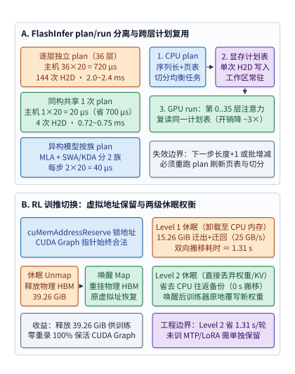

*图 5-35　上半图（A）对比 FlashInfer 注意力算子在 `Qwen3-8B`（36 层同构 GQA）中逐层独立 `plan`（主机耗时 $720\ \mu\mathrm{s}$）、全网共享 1 次 `plan`（主机耗时 $20\ \mu\mathrm{s}$，净省 $700\ \mu\mathrm{s}$，实测总耗时缩减约 3 倍）以及在 DeepSeek V4.1 / Kimi K3 等混合注意力模型中按算子族分组 `plan`（$G=2$ 族共 $40\ \mu\mathrm{s}$）的执行流；下半图（B）展示 RL 训推共卡切换时利用 `cuMemAddressReserve` 与 `cuMemUnmap`/`cuMemMap` 在释放 $39.26\ \mathrm{GiB}$ 物理显存的同时保活 CUDA Graph 固定虚拟指针，并对比 Level 1 休眠（CPU 往返备份耗时约 $1.31\ \mathrm{s}$）与 Level 2 休眠（直接丢弃旧权重、由训练器原地覆写新权重，省去 $1.31\ \mathrm{s}$）的工程权衡。*

### 5.5.3 动态形状与编译开销

前文看到，同一个生成步内的 36 个模型层之所以能共享同一份执行计划，靠的是各层计算结构与张量形状完全同构；然而，当在线推理服务面对源源不断到达的不同步请求时，每一轮拼出来的批次行数 $M$（即动态形状，Dynamic Shape）都会随流量实时波动。面对不断变化的输入行数 $M$，运行时与编译器通常有三种应对策略：
1. **通用动态形状程序（General / Dynamic Shape）**：只编译唯一一份支持任意行数 $M$ 的通用 kernel，在运行时把当前实际行数 $M$ 作为标量参数传入，由 kernel 在执行过程中动态计算边界与掩码；
2. **形状分桶（Shape Bucketing + Padding）**：预先选定少数几个离散的代表性行数（称为“桶”，如 $512$ 行、$2048$ 行），提前为这几个桶编译好专用程序（或录制好对应的 CUDA Graph）；运行时每来一批实际行数为 $M$ 的输入，就用零元素将其向上补齐（pad）到最近的那个桶尺寸，直接调用该桶的程序；
3. **逐形状完全特化（Per-Shape Specialization）**：每遇到一种具体的输入行数 $M$，编译器都针对这个精确的常数 $M$ 专门生成并调优一份定制 kernel（将循环边界全部变成编译期常量、消除尾块分支并选用最契合该尺寸的 tile）。

不难看出这三种策略之间的根本矛盾：**越是充分利用已知的具体形状信息（从通用 $\rightarrow$ 分桶 $\rightarrow$ 逐形状特化），生成的加速器 kernel 在稳态执行时跑得就越快，但前期需要耗费的编译与图捕获准备时间（以及占用的代码缓存空间）也就越庞大。**

**例 5-12：一组动态形状负载究竟要重复执行多少轮，高昂的“逐形状特化”编译开销才算物有所值？** 让我们用一个定量的线上负载模型把这笔分摊账算清楚。假设线上每 **10 次 FFN 调用** 构成一个典型的周期性负载组（group），其中包含：8 次小批量调用（每次 $M=256$ 行）、1 次中等批量调用（$M=1536$ 行）以及 1 次大批量调用（$M=2048$ 行）。算一下这 10 次调用实际携带的有效 token 总行数：

$$
M_{\mathrm{actual}} = 8\times256 + 1\times1536 + 1\times2048 = 2048 + 1536 + 2048 = 5632\ \text{行}.
$$

如果采用**形状分桶（Bucketing）**策略，仅设置 $512$ 行和 $2048$ 行两个桶：那么 8 次 $256$ 行的调用会被向上补齐到 $512$ 行的桶，1 次 $1536$ 行的调用会被向上补齐到 $2048$ 行的桶，而 $2048$ 行的调用则恰好严丝合缝落入第二个桶中（见图 5-36）。如此一来，每跑一组（10 次调用）实际塞给 GPU 执行的总行数就膨胀到了：

$$
M_{\mathrm{bucket}} = 8\times512 + 2048 + 2048 = 8192\ \text{行},
$$

也就是说，为了凑齐桶尺寸，分桶方案平白无故多算了 $(8192 - 5632) / 5632 \approx \mathbf{45.5\%}$（约 $45\%$）的无效填充行。

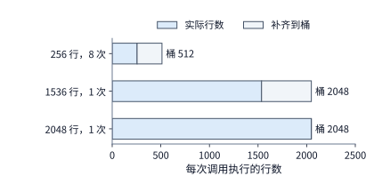

*图 5-36　在仅设置 $512$ 行与 $2048$ 行两个形状桶的分桶策略下：8 次 $256$ 行的调用被向上补齐至 $512$ 行桶，1 次 $1536$ 行的调用被补齐至 $2048$ 行桶，1 次 $2048$ 行的调用恰好对齐桶边界。图中灰色阴影代表补齐后额外多算的无效填充行；每组 10 次调用的实际有效输入合计为 $5632$ 行，补齐后实际执行 $8192$ 行（多算约 $45\%$）。*

那么，多算了 $45\%$ 无效行的分桶方案，会不会反而比只算 $5632$ 行的通用方案更快呢？我们来算一下真实执行时间。对于包含三支线性投影（门控、上投影、下投影，形状均为 $[H, F]$ 或 $[F, H]$）的完整 Qwen3-8B FFN，每处理 1 行 token 需要执行的浮点运算量为 $3 \times 2HF = 6HF\ \mathrm{FLOPs}$（代入 $H=4096, F=12288$，每行约为 $3.02\times10^8\ \mathrm{FLOPs}$）。以 BF16 稠密峰值算力为 $503.8\ \mathrm{TFLOP/s}$ 的 RTX PRO 6000 为基准：
- **通用动态形状方案**：虽然只算精确的 $5632$ 行（总计算量约 $1.70\ \mathrm{TFLOPs}$），但由于无法针对固定维度做分块特化与图录制，受限于动态分支与启动开销，假设其实际算力利用率（MFU）仅能达到峰值的约 **$20\%$**（有效吞吐率为 $100\ \mathrm{TFLOP/s}$），于是跑完一组 10 次调用需耗时约 $1.70 / 100 \approx \mathbf{17.0\ \mathrm{ms}}$；
- **形状分桶方案（2 个桶）**：虽然连同灰色填充行一共要算 $8192$ 行（总计算量增至约 $2.47\ \mathrm{TFLOPs}$），但由于固定在了 $512$ 和 $2048$ 两个规整大桶上，可以直接启用针对这两个尺寸调优过的 kernel 与 CUDA Graph，有效算力利用率翻倍至约 **$40\%$**（有效吞吐率为 $200\ \mathrm{TFLOP/s}$），于是跑完一组仅需耗时约 $2.47 / 200 \approx \mathbf{12.4\ \mathrm{ms}}$——**尽管多算了 $45\%$ 的填充行，但凭借翻倍的硬件执行效率，分桶方案反而比通用方案快了 $4.6\ \mathrm{ms}$**；
- **逐形状完全特化方案（为 256、1536、2048 三种形状各自单独编译调优）**：既只算精确的 $5632$ 行（零填充浪费），又能让每种形状都跑出高达约 **$50\%$** 的算力利用率（有效吞吐率为 $250\ \mathrm{TFLOP/s}$），跑完一组的纯执行耗时进一步压缩至约 $1.70 / 250 \approx \mathbf{6.8\ \mathrm{ms}}$。

最后，我们把三种方案在首次上线时所需付出的**一次性编译与准备耗时 $P$**（设通用方案仅需 $P=100\ \mathrm{ms}$，两个桶的分桶方案需 $P=400\ \mathrm{ms}$，三个形状的深度特化方案需 $P=900\ \mathrm{ms}$）与**每跑一组的稳态执行耗时 $T$** 汇总如下表：[^specialization]

| 动态形状处理策略 | 一次性编译与准备成本 $P$ | 每组（10 次调用）执行耗时 $T$ | 形状处理与计算方式 |
| --- | ---: | ---: | --- |
| **通用动态形状（General）** | $100\ \mathrm{ms}$ | $17.0\ \mathrm{ms}$ | 按实际 $5632$ 行动态执行，MFU 约 $20\%$（$100\ \mathrm{TFLOP/s}$） |
| **形状分桶（Bucketing）** | $400\ \mathrm{ms}$ | $12.4\ \mathrm{ms}$ | 向上补齐至 2 个桶共执行 $8192$ 行，MFU 约 $40\%$（$200\ \mathrm{TFLOP/s}$） |
| **逐形状特化（Specialization）** | $900\ \mathrm{ms}$ | $6.8\ \mathrm{ms}$ | 为 3 种实际形状分别生成专用程序，执行 $5632$ 行，MFU 约 $50\%$（$250\ \mathrm{TFLOP/s}$） |

当线上服务连续运行 $r$ 组这样的调用时，包含前期准备在内的累计总耗时就是一个简单的一次函数：

$$
T_{\mathrm{total}}(r) = P + r\cdot T.
$$

在图 5-37 的坐标系中，每一种策略都对应一条直线：直线的**纵轴截距**就是一次性准备成本 $P$，直线的**斜率**就是每组稳态执行耗时 $T$。可以看到，单组执行越快的策略（斜率越平缓），往往起跑线上的截距 $P$ 也越高。

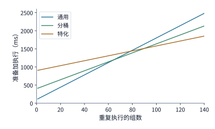

*图 5-37　当同一组动态形状调用被反复执行 $r$ 组时，累计总耗时最短的最优策略随重复次数 $r$ 发生两次切换。图中三条直线分别采用例 5-12 中通用、分桶与逐形状特化三种策略的准备耗时 $P$（截距）与单组执行耗时 $T$（斜率）；图中标注的整数适用区间（$1\sim64$ 组、$65\sim89$ 组、$\ge90$ 组）均基于未四舍五入的精确浮点数值求解交点得出。*

通过求解三条直线的两两交点，我们就能精准划定不同运行规模下的最优策略版图：
- **分桶 vs. 通用**：分桶方案前期多花了 $400 - 100 = 300\ \mathrm{ms}$ 的准备时间，但每跑一组能省下约 $17.0 - 12.4 = 4.6\ \mathrm{ms}$；因此只需连续运行约 $300 / 4.6 \approx 65$ 组（按精确未舍入数值计算为第 $65$ 组起），分桶省下的执行时间就能彻底收回多付出的准备成本。
- **逐形状特化 vs. 分桶**：特化方案比分桶方案前期又多花了 $900 - 400 = 500\ \mathrm{ms}$ 的准备时间，而每跑一组能比后者再多省约 $12.4 - 6.8 = 5.6\ \mathrm{ms}$；因此需要连续运行到第 $\lceil 500 / 5.6 \rceil \approx 90$ 组起，逐形状特化才能反超分桶，成为累计总耗时最短的方案。
- **全局最优区间划分**：当任务总共只跑 **$1\sim64$ 组**（如短平快的单次脚本测试）时，准备最快的**通用方案**总耗时最短；当运行规模落在 **$65\sim89$ 组**的中等区间时，**形状分桶**表现最佳；而当线上服务长期稳定运行 **$\ge 90$ 组**时，前期投入最大的**逐形状特化**凭借最低的斜率取得最优总耗时。

举个具体的数字：假设某个批次任务总共只运行 $r = 70$ 组就退出，代入公式算出通用、分桶、特化三种方案的累计总耗时分别约为 **$1.29\ \mathrm{s}$、$1.27\ \mathrm{s}$ 和 $1.38\ \mathrm{s}$**——此时分桶方案（$1.27\ \mathrm{s}$）总耗时最短，因为它在 70 组执行中省下的时间已经抵消了比通用方案多付出的 $300\ \mathrm{ms}$ 准备开销；而特化方案虽然单组执行最快，但在 70 组调用内累计节省的时间尚不足以弥补前期多付出的编译开销。当然，如果通过**编译产物持久化缓存（Compilation Cache）**将此前已经编译好的二进制程序保存在磁盘上，下次服务重启加载时准备成本 $P\approx 0$，那么从第 1 组调用开始，逐形状特化便始终用时最短。可见，运行时的动态编译与分桶策略，必须同时结合**线上形状的出现频数预期**与**编译缓存是否命中**来综合权衡。

完全相同的盈亏平衡公式（$N_{\mathrm{break\text{-}even}} = \frac{P}{\Delta t}$），也可以用来审视上一节提到的算子自动调优（Auto-tuning）或 Agent 进化搜索：假设为了给某个算子搜出一个每次调用能省下 $\Delta t = 5\ \mu\mathrm{s}$ 的新实现，搜索系统在后台耗费了 $P = 10\text{ 分钟} = 600\ \mathrm{s}$ 的编译与真机测量时间；那么在线上必须累计调用该算子至少：

$$
N_{\mathrm{break\text{-}even}} = \frac{600\ \mathrm{s}}{5\times10^{-6}\ \mathrm{s/次}} = 1.2\times10^8\ \text{次（1.2 亿次）},
$$

省下来的总时间才能把搜索本身消耗的 10 分钟抵消掉。如果线上服务每秒调用该算子 $10{,}000$ 次（例如 36 层模型每秒跑近 300 步），只需运行约 **$3.3$ 小时**就能回本；可如果那是一个每秒仅被调用 $100$ 次的低频边缘算子，则要连续跑上约 **$14$ 天**才能回本。这条铁律告诉我们：**编译搜索耗时越长，就越应该集中资源优先调优那些调用高度频繁、且能在长周期生产服务中反复复用的核心热形状。**

到了本书第 8 章剖析生产级推理引擎时，我们将结合线上请求的随机到达过程与连续批处理（Continuous Batching）进一步展开这一话题：当某几个形状桶在近期流量中反复高频命中时，运行时理应将其编译产物与 CUDA Graph 常驻显存缓存；而当某些冷门形状长期不再出现时，则应及时驱逐释放其占用的显存工作区，把宝贵的显存空间腾给鲜活的 KV 缓存。

### 5.5.4 Persistent Kernel：按数据块调度任务

通过前面的 CUDA Graph 与执行计划复用，我们已经把 CPU 主机端的重复准备与提交开销压到了最低。然而，把视线转回 GPU 加速器内部，传统执行模型中还潜伏着另一类难以消除的同步等待：**对于前后存在数据依赖的两个算子 kernel（例如前一个是线性投影 GEMM，后一个是逐元素激活 $\operatorname{SiLU}$），在标准的粗粒度 kernel 启动模型下，后一个 kernel 必须等前一个 kernel 在整张大矩阵的所有分块上百分之百全部执行完毕、所有 SM 都退出前一个 grid 之后，才能正式启动。**

但从数据依赖来看，后一个逐元素算子 $\operatorname{SiLU}$ 在处理第 0 个数据块时，真的需要等前一个矩阵乘法把第 7 个数据块也算完吗？完全不需要——它明明只需要等前一个算子的**第 0 个数据块**算好，当场就可以动手算第 0 块的激活了。如果我们能把前后两个算子之间的等待粒度从“等整个大张量全部算完（kernel 级屏障）”细化到**“哪一个数据块（tile）算好了，依赖它的下游任务就立即启动（数据块级流式触发）”**，就能让原本只能一前一后串行执行的两个相邻算子，在数据块粒度上实现跨算子的流水重叠。

这正是 **Persistent Kernel（持久化内核 / 常驻内核）** 架构的核心思想：不再让每个算子各自启动一个用完即拆的短命 grid，而是只启动 **1 个常驻在 GPU 所有 SM 上的大 kernel（Persistent Kernel）**；在这个常驻 kernel 内部，各个 SM 的工作组像操作系统的守护进程一样持续运转，不断从全局共享的任务队列（Task Queue）中领取分块计算任务（既可以是矩阵乘分块任务，也可以是激活分块任务），并通过轮询位于全局内存/L2 缓存中的轻量级**块完成标志（completion flag）**来确认上游依赖的那个具体数据块是否已经算好。这样一来，不仅把多次主机端 `kernel launch` 彻底压缩成了唯一一次启动，更让跨算子的相邻阶段得以按照数据块粒度无缝接力、重叠执行。卡内基梅隆大学（CMU）等机构提出的 **Mirage Persistent Kernel（MPK）** 正是将这一常驻块级任务图调度思想系统化落地的代表性研究工作。[^persistent]

让我们仍以 Qwen3-8B 中的上投影（up projection，形状 $[4096, 12288]$）后接 $\operatorname{SiLU}$ 激活这一对相邻算子为例，在 RTX PRO 6000 Blackwell 上算一笔精确的微秒级流水线账。假设当前输入包含 $512$ 个 token 的特征向量（形状 $[512, 4096]$），我们将其沿行方向每 $64$ 个 token 切成一个数据块，总共切分为 **8 个数据块**。
1. **先核算无调度开销时的单块纯计算与访存耗时**：
   - **单块线性投影（矩阵乘）**：每块处理 $64$ 行，浮点运算量为 $2\times64\times4096\times12288 \approx 6.44\ \mathrm{GFLOPs}$；按 RTX PRO 6000 的 BF16 稠密矩阵峰值算力 $503.8\ \mathrm{TFLOP/s}$ 估算，单块投影理想耗时约为 $6.44\times10^9 / (503.8\times10^{12}) \approx \mathbf{12.8\ \mu\mathrm{s}}$。
   - **单块 $\operatorname{SiLU}$ 激活（逐元素访存受限）**：每块处理 $64\times12288$ 个 BF16 元素，每个元素需读入 $2\ \mathrm{bytes}$ 并写出 $2\ \mathrm{bytes}$（共 $4\ \mathrm{bytes}$，单块读写约 $3.15\ \mathrm{MB}$）；按 $1792\ \mathrm{GB/s}$ 的显存带宽估算，单块激活耗时约为 $\mathbf{1.76\ \mu\mathrm{s}}$。
2. **传统粗粒度双 kernel 串行执行（图 5-38）**：假设矩阵计算单元（Tensor Core）与向量/特殊函数单元彼此独立、片上缓冲充足，且主机每次逐个发起 `kernel launch` 的固定开销为 **$5\ \mu\mathrm{s}$**。在传统模式下，必须先花 $5\ \mu\mathrm{s}$ 启动投影 kernel、跑完 8 块投影（$8\times12.8\ \mu\mathrm{s}$），再花 $5\ \mu\mathrm{s}$ 启动激活 kernel、跑完 8 块激活（$8\times1.76\ \mu\mathrm{s}$），端到端总耗时为：

$$
T_{\mathrm{coarse}} = 2\times5 + 8\times(12.8 + 1.76) = 10 + 8\times14.56 \approx \mathbf{126.5\ \mu\mathrm{s}}\quad(\text{约 }126\ \mu\mathrm{s}).
$$

3. **Persistent Kernel 按数据块流水调度（图 5-39）**：现在我们将整项工作拆解为共享队列中的 **8 个投影块任务**与 **8 个激活块任务**。在常驻 kernel 中，SM 每执行一个分块任务，首尾需要额外付出两笔微小的片上队列调度开销：任务开始前，对位于 L2 缓存中的共享队列计数器执行一次带返回值的原子加（`atomicAdd`）以领取任务号，约需一次 L2 往返延迟（取 **$0.15\ \mu\mathrm{s}$**）；任务算完后，向 L2 缓存写入完成标志以通知下游消费者，对应第 4.4.4 节实测的一对一跨 SM 同步交接开销（取 **$0.37\ \mu\mathrm{s}$**）。两项相加，每个分块任务额外增加了 $0.15 + 0.37 = \mathbf{0.52\ \mu\mathrm{s}}$ 的固定调度开销——于是单块投影的实际耗时变为 $12.8 + 0.52 \approx \mathbf{13.3\ \mu\mathrm{s}}$，单块激活的实际耗时变为 $1.76 + 0.52 \approx \mathbf{2.28\ \mu\mathrm{s}}$。
   然而，Persistent Kernel 只需在最开始付出 **唯一一次 $5\ \mu\mathrm{s}$ 的 `kernel launch`**；随后 8 块投影在矩阵单元上首尾相接连续执行（耗时 $8\times13.3\ \mu\mathrm{s}$），每算完一块投影，向量单元就立即并行启动该块的激活（前 7 块的激活完全隐藏在下一块投影的 $13.3\ \mu\mathrm{s}$ 之内），直到第 8 块投影算完后，再花 $2.28\ \mu\mathrm{s}$ 完成最后一块激活的收尾排空。因此，端到端总耗时降至：

$$
T_{\mathrm{persistent}} = 5 + 8\times13.3 + 2.28 = 5 + 106.4 + 2.28 \approx \mathbf{113.7\ \mu\mathrm{s}}\quad(\text{约 }114\ \mu\mathrm{s}),
$$

相比粗粒度串行（$126.5\ \mu\mathrm{s}$）净省了约 **$12.6\ \mu\mathrm{s}$**，端到端加速比约为 **$1.1$ 倍**。

让我们把省下来的这 $12.6\ \mu\mathrm{s}$ 拆开来算一笔明白账，看看收益与代价各自从何而来：
- **正向收益（共 $+17.3\ \mu\mathrm{s}$）**：省去了一次主机端 `kernel launch`（省下 **$5.0\ \mu\mathrm{s}$**），并将前 7 块激活的纯计算时间（$7\times1.76 \approx \mathbf{12.3\ \mu\mathrm{s}}$）成功隐藏在了投影计算的背后；
- **队列调度与同步开销（共 $-4.7\ \mu\mathrm{s}$）**：在关键路径上的 8 块投影加最后 1 块激活（共 9 个串行步）中，每一步都多付出了 $0.52\ \mu\mathrm{s}$ 的队列领取与标志通知开销（$9\times0.52 \approx \mathbf{4.7\ \mu\mathrm{s}}$）；
- **净收益**：$17.3 - 4.7 = \mathbf{12.6\ \mu\mathrm{s}}$。

为什么这套精密的块级流水在这里只带来了约 $10\%$ 的提速？原因与第 5.3.2 节的双缓冲如出一辙：在这个算例中，上游投影每块耗时（$12.8\ \mu\mathrm{s}$）远远长于下游激活每块耗时（$1.76\ \mu\mathrm{s}$），即便把前 7 块激活全部重叠隐藏，最多也只能省下 $12.3\ \mu\mathrm{s}$。因此，**前后两个相邻阶段的耗时越接近，Persistent Kernel 按块流水重叠所能隐藏的时间比例就越大；反之，当其中一个阶段的耗时远长于另一个阶段时，按块流水的重叠收益就会大幅受限，剩余价值主要只在于省掉主机端的 `kernel launch` 开销。**

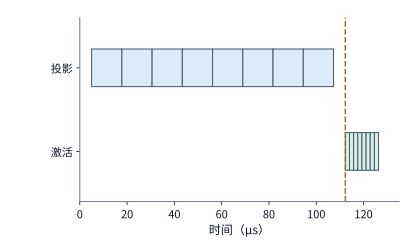

*图 5-38　传统粗粒度执行模式：必须先在全卡跑完 8 块线性投影，随后再次启动 kernel 跑完 8 块 $\operatorname{SiLU}$ 激活。按 RTX PRO 6000 矩阵峰值与显存带宽核算，每块投影耗时约 $12.8\ \mu\mathrm{s}$、每块激活耗时约 $1.76\ \mu\mathrm{s}$，两次主机 `kernel launch` 各占 $5\ \mu\mathrm{s}$；图中竖虚线标出了第二阶段激活得以启动的时刻，总耗时约 $126\ \mu\mathrm{s}$。*

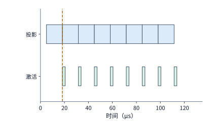

*图 5-39　Persistent Kernel 按数据块流水调度的时间线（假设矩阵与向量单元独立且缓冲充足）。每个块级任务额外计入 $0.52\ \mu\mathrm{s}$ 的队列原子领取与完成标志通知开销；第 0 块投影一算完，第 0 块激活即可立即并行启动。由于投影阶段耗时远长于激活阶段，8 块投影首尾相接决定了流水节拍，前 7 块激活被完全隐藏，整体于约 $114\ \mu\mathrm{s}$ 结束。*

顺着图 5-39 的投影时间线横向观察，可以看到它和图 5-17 的双缓冲时间线遵循着完全相同的物理定律：**第一块数据先走完上游阶段，随后每隔“上下游较慢阶段耗时 $\max(t_1, t_2)$”完成一块，最后一块再走完下游阶段收尾**——在第 5.3.2 节中，较慢的瓶颈阶段是数据搬移（$1.29\ \mu\mathrm{s}$）；而在图 5-39 中，较慢的瓶颈阶段则是线性投影（$13.3\ \mu\mathrm{s}$），整个流水线的节拍依然由较慢阶段决定。同时请注意缓冲区的占用周期：每一块中间结果缓冲槽从“投影任务开始写入”起被锁定，直到“对应的激活任务读取完毕”后才能释放回收；一旦中间缓冲槽被占满而下游激活还没来得及消费，上游投影任务同样会因为拿不到空闲缓冲槽而触发背压停顿。因此，在 Persistent Kernel 内部，**共享任务队列、块完成标志事件与空闲缓冲槽池**三者共同构成了驱动数据块流转的协同调度机制。

此外，我们还应当对“跨算子边界的真实物理代价”保持清醒的定量认知。在上面的算例中，我们假设主机逐个提交 kernel 的启动开销高达 $5\ \mu\mathrm{s}$；然而，如果已经使用了上一小节的 CUDA Graph 图重放（或者使用了 NVIDIA Hopper/Blackwell 架构引入的硬件级**编程依赖启动，Programmatic Dependent Launch，简称 PDL**，允许前一个 kernel 在进入收尾写回阶段时直接由硬件触发下一个 kernel 的前置启动），那么设备端两个相邻 kernel 之间的纯硬件切换空隙其实要短得多：在 RTX PRO 6000 Blackwell 上的真机实测表明，CUDA Graph 中两个相邻空 kernel 之间的硬件切换间隔仅为约 **$430\ \mathrm{ns}$（$0.43\ \mu\mathrm{s}$）**，开启 PDL 后更是进一步缩短至约 **$370\ \mathrm{ns}$（$0.37\ \mu\mathrm{s}$）**——这已经与第 4.4.4 节测出的“单个常驻 kernel 内部通过 L2 缓存完成一次一对一跨 SM 标志同步（约 $370\ \mathrm{ns}$）”相当。换句话说，**Persistent Kernel 能够省掉的是发起新 grid 的内核启动开销，但只要前后两步计算分属不同的物理 SM、必须通过片外 L2 缓存交接中间数据，那几百纳秒的 L2 物理往返延迟是无论采用何种任务包装形式都无法省去的。**

在单请求逐 token 生成的 **decode 阶段（`batch size = 1`）**，跨 SM 数据依赖带来的同步代价表现得尤为尖锐。当输入只有 1 个 token 的行向量时，每一次权重形状为 $[4096, 4096]$ 的矩阵—向量乘法（GEMV）为了充分利用显存带宽，都必须把 4096 个输出元素（对应权重的 4096 个输出通道）均匀切分到全卡所有 SM 上并行计算；而紧随其后的下一个矩阵—向量乘法，其输入向量恰恰需要完整读取前一个乘法在**全卡所有 SM** 上算出的全部分片——这意味着每一个相邻算子的边界，都是一次**全卡 SM 间的全局同步与数据交接（All-SM Synchronization）**。

为了测出真实模型权重流量下这道全 SM 同步边界的物理代价，作者在 RTX PRO 6000 Blackwell 工作站上做了一组严密的对照实验：将 64 个形状为 $4096\times4096$ 的 BF16 矩阵—向量乘法串联成一条长依赖链（由 16 个不同的 $32\ \mathrm{MiB}$ 权重矩阵轮换充当，总体积 $512\ \mathrm{MiB}$，是该卡 L2 缓存容量的 4 倍，从而确保所有权重读取真实穿透到 GDDR7 显存），并在软件中开启跨算子权重预取（在当前乘法进入收尾等待前，提前把下一个乘法的首块权重预取进共享内存）。实测结果显示：
- 当去掉跨算子数据依赖（即各次乘法无需等待前一次的全 SM 输出）时，每个 $4096\times4096$ 乘法的纯显存带宽受限执行耗时约为 **$21\ \mu\mathrm{s}$**；
- 当加上真实的全 SM 跨算子数据依赖、且采用**静态均分任务**（让全卡每个 SM 固定承包 21 或 22 个输出元素的计算）时，每经过一道算子边界，单步耗时就会额外多出 **$1.2\sim2.3\ \mu\mathrm{s}$**。深入剖析发现，这多出来的近 $2\ \mu\mathrm{s}$ 绝大部分并不是花在同步信号传递本身，而是花在了**“全卡所有 SM 停在栅栏前等待那个最慢的落伍 SM（straggler）”**上——因为显存控制器对全卡上百个 SM 的读取请求服务天然存在微小的不均匀性，静态均分任务必然导致有的 SM 早早算完、有的 SM 迟迟拿不到最后一块权重，单靠软件预取只能掩盖其中一部分抖动；
- 当我们将任务分配策略改为**基于原子计数器的动态工作窃取（Dynamic Work-Stealing）**——即哪个 SM 手头的共享内存缓冲槽先空出来，就立即去全局计数器领下一批行来做，让显存响应快的 SM 多干一点、响应慢的 SM 少干一点——每道算子边界额外多出的同步开销立刻从 $1.2\sim2.3\ \mu\mathrm{s}$ 降到了 **$0.74\sim1.06\ \mu\mathrm{s}$**，逼近了第 4.4.4 节在空载下测出的全 SM 硬件栅栏交接物理底线（约 $1\ \mu\mathrm{s}$）。

这组实验深刻地揭示了算子与运行时调优的物理边界：**通过动态负载均衡可以消灭各 SM 之间的长尾木桶效应（把边界损耗从 $2\ \mu\mathrm{s}$ 压回 $1\ \mu\mathrm{s}$），但只要算法数学上要求全卡所有 SM 汇总一次全局结果，那约 $1\ \mu\mathrm{s}$ 的全卡 L2 同步物理底线就是客观存在的铁律，单靠改变 kernel 的启动或包装方式是无法凭空抹除的。**[^boundary] 图 5-40 汇总对比了 $4096\times4096$ 投影链在不同任务分配策略下的单步总耗时（左）以及五种算子边界切换与全卡同步机制的单道边界延迟（右）。

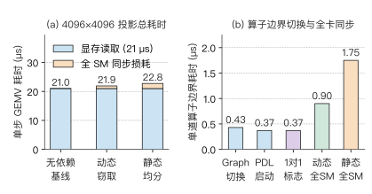

*图 5-40　在 RTX PRO 6000 Blackwell 上实测 64 个 $4096\times4096$ BF16 矩阵—向量乘法依赖链的边界开销。左图对比无跨步依赖基线（$21.0\ \mu\mathrm{s}$）、原子动态工作窃取（取区间中值 $+0.90\ \mu\mathrm{s}$ 同步损耗）与静态均分任务（取区间中值 $+1.75\ \mu\mathrm{s}$ 同步与长尾等待损耗）；右图对比 CUDA Graph 空核切换（$0.43\ \mu\mathrm{s}$）、PDL 硬件依赖启动（$0.37\ \mu\mathrm{s}$）、跨 SM 一对一标志同步（$0.37\ \mu\mathrm{s}$）以及真实权重流下的全卡 SM 同步开销。*

## 5.6 从局部优化到完整请求

前面五节剖析的每一项底层优化，都有着十分明确的作用靶心：矩阵分块用于减少输入张量的跨级重复读取，算子融合用于消除中间张量的片外往返，而运行时优化则着重削减主机准备与同步等待开销。然而，当我们将这些局部优化放入一次真实的**端到端用户推理请求（End-to-End Request）**中时，某一个局部算子省下来的时间，究竟能把整个请求的响应时间缩短多少？本节首先给出从局部算子加速折算到端到端请求加速的定量方法（Amdahl 定律与依赖图关键路径分析），随后在真机上复盘一次完整 Qwen3-8B 推理请求的算子优化实效。

### 5.6.1 热点占比决定加速空间

假设一次完整的用户推理请求由若干个严格串行执行的阶段首尾相接构成。我们选中其中的某一个**性能热点（hotspot）算子**实施专项优化，而请求中其余所有阶段的耗时均保持不变。设该热点算子在优化前占整个请求原始总耗时的时间比例为 $f$（$0 < f < 1$），专项优化将该热点算子自身的速度提升到了原来的 $s$ 倍（即局部加速比为 $s$）。若将优化前的原始请求总耗时归一化为 $1$，则优化后的请求新耗时为 $(1-f) + \frac{f}{s}$，对应的端到端请求整体加速比 $S_{\mathrm{request}}$ 为：

$$
S_{\mathrm{request}}=\frac{1}{(1-f)+f/s}.
$$

让我们代入一组数字感受一下：假设某个热点算子占原请求总耗时的比例为 $f = 20\%$（即 $0.2$）。
- 当我们将该热点算子提速至原来的 **$2$ 倍**（$s=2$）时，请求新耗时变为 $0.8 + 0.2/2 = 0.9$，端到端整体加速比仅为 $1 / 0.9 \approx \mathbf{1.11}$；
- 即便我们投入巨大精力把该热点算子提速至原来的 **$10$ 倍**（$s=10$），请求新耗时也只能降到 $0.8 + 0.2/10 = 0.82$（整体加速比约 $1.22$）；
- 哪怕在极限情况下把该热点算子的耗时彻底归零（$s \to \infty$），其余未被优化的阶段依然要消耗原总时间的 $80\%$（$0.8$），使得端到端整体加速比被封顶在 **$1 / 0.8 = 1.25$ 倍**。

这正是本书第 1 章介绍过的 **Amdahl 定律（阿姆达尔定律）**。它直白地解释了为什么针对单一局部热点的优化收益会迅速遭遇边际递减：**随着热点算子自身的耗时被越压越短，它在整条请求时间线上所占的权重 $f$ 就同步萎缩，而那些原本不起眼的其余阶段则取而代之成为了主导总耗时的大头。**

### 5.6.2 并行分支与关键路径切换

标准的 Amdahl 公式假定所有阶段都在一条单线上串行相加。然而在现代推理与训练系统中，计算图往往包含**多条并发执行的并行分支**（例如多流并行的计算分支，或计算与通信重叠的分支）。在带有并行分支的有向无环依赖图（DAG）中，缩短其中一条分支的耗时后，汇合点可能转而需要等待另一条原本较快、如今却落后了的旁路分支——因此，评估端到端耗时必须沿着整张依赖图寻找决定最终完成时刻的**最长耗时路径（即关键路径，Critical Path）**。

让我们通过一个简洁的双分支算例来看清**关键路径切换（Critical Path Switching）**的过程：假设一次调用先执行耗时 $10\ \mu\mathrm{s}$ 的公共前置准备，随后在两条独立硬件资源上同时并发启动“热点分支 A（原耗时 $60\ \mu\mathrm{s}$）”与“旁路分支 B（原耗时 $40\ \mu\mathrm{s}$）”；最后执行耗时 $10\ \mu\mathrm{s}$ 的公共收尾汇总（必须等 A、B 两条分支全部完成后才能启动）。在优化前，由于分支 A（$60\ \mu\mathrm{s}$）慢于分支 B（$40\ \mu\mathrm{s}$），关键路径走的是分支 A，整个请求的原始总耗时为：

$$
T=10+\max(60,40)+10=80\ \mathrm{\mu s}.
$$

现在，我们对热点分支 A 实施大力优化，将其速度提升至原来的 4 倍，耗时从 $60\ \mu\mathrm{s}$ 骤降至 **$15\ \mu\mathrm{s}$**，而旁路分支 B 的耗时仍为 $40\ \mu\mathrm{s}$ 不变。此时再算整个请求的新耗时：

$$
T' = 10 + \max(15, 40) + 10 = 60\ \mathrm{\mu s}.
$$

可以看到：分支 A 自身明明省下了 $60 - 15 = \mathbf{45\ \mu\mathrm{s}}$，为什么整个请求却只缩短了 $80 - 60 = \mathbf{20\ \mu\mathrm{s}}$？因为一旦分支 A 的耗时缩减到低于 $40\ \mu\mathrm{s}$，原本被掩盖在阴影里的**旁路分支 B（$40\ \mu\mathrm{s}$）就浮出水面，接替分支 A 成为了新的关键路径**（见图 5-41）。

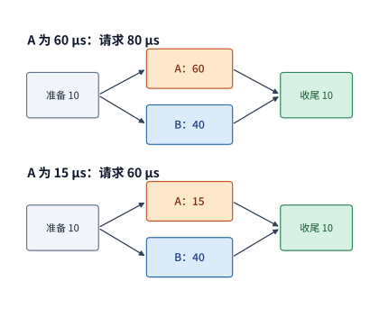

*图 5-41　收尾阶段必须等待并行分支 A 与 B 双双完成。当热点分支 A 从 $60\ \mu\mathrm{s}$ 缩短至 $15\ \mu\mathrm{s}$ 后，决定汇合时刻的较慢分支由 A 切换为 B（$40\ \mu\mathrm{s}$），使端到端请求耗时仅从 $80\ \mu\mathrm{s}$ 降至 $60\ \mu\mathrm{s}$。图中前置准备与收尾阶段各占 $10\ \mu\mathrm{s}$，且假设两条分支使用彼此独立的硬件资源。*

从图 5-41 可以一眼看出：当分支 A 的耗时从 $60\ \mu\mathrm{s}$ 缩短到 **$40\ \mu\mathrm{s}$** 时，它恰好与分支 B 同时到达终点；在此之后，哪怕继续在分支 A 上投入再多精力（从 $40\ \mu\mathrm{s}$ 压到 $15\ \mu\mathrm{s}$ 甚至 $0\ \mu\mathrm{s}$），端到端完成时间都会纹丝不动地停留在 $60\ \mu\mathrm{s}$。因此，$A = 40\ \mu\mathrm{s}$ 这个等长交点，直接定义了“单独优化分支 A 所能获得的端到端最大收益上限（$20\ \mu\mathrm{s}$）”。越过该交点后，要想继续压缩请求耗时，优化火力就必须立即转向新的关键路径——去优化分支 B，或者削减首尾各 $10\ \mu\mathrm{s}$ 的串行准备与收尾开销。

更有甚者，在真实硬件上，并行执行的分支 A 和分支 B 往往还要**争抢共享的底层硬件资源（如同一个芯片上的 HBM 显存带宽或 L2 缓存容量）**。设想一种常见的误判情景：我们为了把分支 A 从 $60\ \mu\mathrm{s}$ 压到 $15\ \mu\mathrm{s}$，换用了一个极度激进的高并发 kernel，它在短短 $15\ \mu\mathrm{s}$ 内把全卡的显存带宽和 SM 资源彻底占满，结果导致与它并发运行的旁路分支 B 因为抢不到带宽而从原本的 $40\ \mu\mathrm{s}$ 严重劣化拖长到了 **$90\ \mu\mathrm{s}$**。此时算一下端到端总耗时：

$$
T_{\mathrm{contention}} = 10 + \max(15, 90) + 10 = 110\ \mathrm{\mu s}.
$$

由于旁路分支 B 被挤占拖慢的时间（$+50\ \mu\mathrm{s}$）超过了分支 A 缩短的关键路径时间，这项所谓的“局部 4 倍加速”放到系统全局后，反而让整个请求比优化前（$80\ \mu\mathrm{s}$）还要慢上 **$30\ \mu\mathrm{s}$**。[^dag]

这种“必须把局部收益放回全局依赖图审视”的系统铁律，不仅适用于时间维度的关键路径，也同样适用于**显存空间维度的容量节省与带宽流量**——**省下一份状态的静态驻留容量（Capacity），绝不等于按相同比例省下了每一步的实际读取字节数（Traffic），因为每一步究竟要读多少字节，取决于整网有多少个层需要访问它、以及每一层实际读取了其中的哪些条目。**

让我们直接调用本书第 2.3.6 节已经算过的 **DeepSeek V4.1 跨层 KV 共享架构** 在 $8\mathrm{K}$ 上下文下的真实数字来印证这一点：在 V4.1 架构中，全网 38 个全局注意力层通过跨层共享机制共用仅有的 **4 份独立全局 KV 缓存**，这使得全局 KV 的**静态显存驻留容量**直接降到了上一代 V4-Flash（每层各自保存独立 KV）的约**四分之一**；然而，当我们统计单步 decode 流经全部模型层时的**逐层理论读取量**（计入全局 KV 条目、局部滑动窗口与稀疏索引扫描）时，V4.1 相比 V4-Flash 却仅仅减少了约 **$9\%$**，而且单步累计的理论读取总量远远超过了静态驻留容量本身。原因很清楚：跨层共享固然免除了在显存里重复存放多份副本（省了静态容量），但在未做跨层算子融合、且 KV 容量超出片上缓存时，需要用到那份共享 KV 的每一个全局注意力层在执行到自己时，依然得按序从显存里把它读进来一次——**静态容量的成倍缩减，并不会自动转化为每步读取流量的同比例缩减。**[^v41-case]

当我们将上下文长度从 $8\mathrm{K}$ 进一步拉长到 **$128\mathrm{K}$** 时，长序列下必须执行的稀疏注意力索引扫描（Index Scanning）开销就更加凸显：在 $128\mathrm{K}$ 上下文下，V4-Flash 与 V4.1 两代模型在单步 decode 中对“全局历史状态 + 索引”的理论读取量分别攀升至约 **$65.085\ \mathrm{MiB}$** 与 **$33.422\ \mathrm{MiB}$**。为什么 V4.1 的读取量依然会随上下文变长而增长？因为尽管 V4.1 的后续共享层只需在筛选出的小规模候选池（candidate pool）内做局部检索，但负责建立候选池的**初始引导索引层（initial indexer）依然必须完整遍历扫描全量 $128\mathrm{K}$ 历史上下文**。因此，即便后续层的检索窗口固定不变，整网 decode 的总访存开销依然会随着上下文长度 $L$ 的增长而水涨船高。

此外，同样一个“缩小后续层候选池搜索范围”的算法规则，在软件层面写成怎样的算子实现，也会导致截然不同的硬件执行成本：
- 在**公开的参考实现（Reference Implementation）**中，代码为了简便，依然先对全量历史索引缓存执行完整的矩阵点积，算完后再用一个布尔掩码（mask）把候选池之外的位置抹成负无穷——这种写法虽然数学结果完全正确，但池外位置的点积计算与访存已经实打实地白做了一遍；
- 而在**论文描述的生产级实现（Production Kernel）**中，算子直接根据候选池的索引地址列表做稀疏聚拢读取（gather），从发起计算的那一刻起就跳过了池外的所有条目。

可见，**完全相同的算法数学定义，仅仅因为算子实现究竟是“先全量算完再掩码丢弃”还是“按索引只读只算候选子集”，就对应着截然不同的真实硬件读取与计算成本。** 图 5-42 将 $8\mathrm{K}$ 与 $128\mathrm{K}$ 下两代架构的“全局静态驻留容量”与“单步逐层理论读取总量”并排放在同一张图上进行了直观对比。

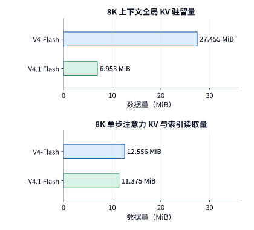

*图 5-42　将“全局 KV 静态驻留容量”与“单步逐层理论读取总量”分开对比。上半图仅统计全局 KV 缓存的静态驻留显存大小；下半图统计单步流经全网各层时的累计理论读取量（包含全局 KV 条目、局部窗口与索引扫描），左右两栏各自采用统一横轴比例尺。全部数值均按跳过池外条目的生产级算子布局核算。*

### 5.6.3 综合案例：一次 Qwen3 请求的优化选择

现在，让我们把本章学到的全套分析工具组装起来，放到一台搭载 RTX PRO 6000 Blackwell 的工作站上，完整解剖一次真实的 **Qwen3-8B 端到端推理请求**。实验配置如下：单条用户请求输入一段长 **$7239$ 个 token** 的提示词（prompt），强制模型自回归生成 **$32$ 个输出 token**，请求并发度为 $1$（`batch size = 1`），采用 BF16 精度与 **eager 模式**（即不使用 CUDA Graph，由 CPU 主机按程序顺序逐个提交 GPU kernel，且关闭前缀 KV 缓存）。由于 Qwen3-8B 共有 **36 层** Transformer 层，服务这条请求的过程分为两个大阶段：首先执行 **1 次 prefill 前向**（穿过 36 层）生成第 1 个输出 token，随后连续执行 **31 步 decode 前向**（每步穿过 36 层）生成剩余的 31 个输出 token。

我们把目光聚焦到每一层 FFN 中间那段熟悉的 **SwiGLU 逐元素激活算子**（即第 5.3.1 节的 $Z = \operatorname{SiLU}(G)\odot U$）上：在整个请求的生命周期内，每一层、每一步都要调用一次该算子，累计调用总次数为 $36\times(1 + 31) = 36\times32 = \mathbf{1152\ \text{次}}$——其中包含 **prefill 阶段的 $36$ 次调用**，以及 **decode 阶段的 $36\times31 = 1116$ 次调用**。

请对比这两类调用所处理的张量形状差异：
- 在 **prefill 阶段**的 36 次调用中，每次调用处理的都是形状为 $[7239, 12288]$ 的大矩阵（单次处理 $7239$ 行 token），36 层累计处理的 token-层特征行数高达 $36\times7239 = \mathbf{260{,}604}$ 行；
- 而在 **decode 阶段**的 1116 次调用中，每次调用处理的都只是形状为 $[1, 12288]$ 的单行向量（单次仅处理 $1$ 个新生成的 token），1116 次调用累计处理的 token-层特征行数总共只有 $36\times31 = \mathbf{1116}$ 行。

因此，**decode 阶段对该算子的调用次数是 prefill 阶段的 31 倍（$1116$ 次 vs. $36$ 次），但它累计处理的有效数据行数却还不到 prefill 阶段的千分之五（$1116$ 行 vs. $260{,}604$ 行）。** 这正是我们在本章各个小节中反复遭遇的“大形状 vs. 小形状”两极分化：prefill 的大矩阵天然具备充沛的并行度，能够充分利用 GPU 的显存带宽与计算单元；而 decode 的单行小向量每次纯计算耗时极短，导致主机端 `kernel launch` 开销、线程块任务切分以及 SM 驻留不足的矛盾暴露无遗。

现在，我们在同一个 vLLM 推理引擎中做一次单变量算子替换实验：专门针对小形状访存效率，将全网 36 层的 SwiGLU 激活 kernel 替换为一个重新调优过线程块与 warp 分配（采用 `block256 / 4-warps` 调度）的定制 kernel，其余所有算子与运行时配置保持原样不动。Profiler 轨迹确认全部 1152 次调用均已切换为新 kernel，单独采集的阶段累计耗时对比如下表所示：[^exp9]

| SwiGLU 激活所处阶段 | 输入形状与累计调用次数 | 原始基准 kernel 累计耗时 | 替换调优 kernel 后累计耗时 |
| --- | --- | ---: | ---: |
| **Prefill 阶段** | $7239$ 行/次，共调用 $36$ 次 | 约 $11.2\ \mathrm{ms}$ | 约 $11.2\ \mathrm{ms}$ |
| **Decode 阶段** | $1$ 行/次，共调用 $1116$ 次 | 约 $2.4\ \mathrm{ms}$ | 约 $0.92\ \mathrm{ms}$ |

让我们用第 5.6.1 节的 Amdahl 定律来算一下这笔端到端预期收益账：
1. **看局部加速比**：替换后的新 kernel 精准消除了瓶颈，将 1116 次单行 decode 激活的累计耗时从约 $2.37\ \mathrm{ms}$（表中记约 $2.4\ \mathrm{ms}$）大幅压缩到了 **$0.92\ \mathrm{ms}$**，在 decode 激活这一局部子项上斩获了约 **$2.6$ 倍**的显著加速，净省下约 **$1.45\ \mathrm{ms}$**；与此同时，对于本就已经充分利用带宽的 prefill 大矩阵（36 次 7239 行调用），新旧两个 kernel 的累计耗时几乎完全持平（均为约 $11.2\ \mathrm{ms}$，新 kernel 仅微增约 $0.03\ \mathrm{ms}$）。
2. **看全局热点占比（Amdahl 约束）**：在真机采集的完整请求 GPU 轨迹中，SwiGLU 激活与其他算子严格顺序串行执行，没有任何并行分支掩盖。然而，把 prefill 与 decode 加在一起，原版 SwiGLU 激活算子在整个请求中的累计总耗时也只有 $11.22 + 2.37 \approx \mathbf{13.6\ \mathrm{ms}}$，仅占约 $851\ \mathrm{ms}$ 完整采集区间总时长的 **$1.6\%$**。这意味着即便在理想极限下把全网 1152 次 SwiGLU 激活的耗时完全降为零（$s \to \infty$），整个请求最多也只能缩短 **$13.6\ \mathrm{ms}$**；而当前我们把全部激活耗时从 $13.6\ \mathrm{ms}$ 压到了 $11.24 + 0.92 \approx \mathbf{12.2\ \mathrm{ms}}$，因此在端到端请求层面，理论预计能够缩短的时间就是实打实的 **$13.6 - 12.2 = 1.4\ \mathrm{ms}$**。

为了检验这 $1.4\ \mathrm{ms}$ 的微秒级理论预测能否在客户端真实端到端测量中兑现，我们在客户端采用随机交错配对测量法（A/B interleaved benchmarking，每一轮内以随机先后顺序各跑一次原版与替换版，以消除机器背景负载漂移），连续采集了 **11 对**完整请求的端到端耗时：
- **首 token 延迟（TTFT）**：由于新旧 kernel 在 prefill 阶段的耗时完全一致（均为 $11.2\ \mathrm{ms}$），替换前后的客户端 TTFT 中位数毫无变化，均稳定在约 **$436\ \mathrm{ms}$**；
- **完整请求端到端耗时**：原版中位数约为 **$817\ \mathrm{ms}$**（$816.6\ \mathrm{ms}$），替换后中位数降至约 **$815\ \mathrm{ms}$**（$815.4\ \mathrm{ms}$）；
- **逐轮配对耗时差（Paired Difference，即同一轮内“原版请求耗时 $-$ 替换版请求耗时”）**：在全部 11 对测试中，有 **9 对**表现为替换后更快（差值为正），仅 2 对受系统微小抖动影响为负；11 对配对时间差的中位数恰好为 **$1.3\ \mathrm{ms}$（精确值 $1.343\ \mathrm{ms}$，占原请求总耗时的约 $0.16\%$）**——与我们在 Profiler 中根据算子局部耗时算出的 **$1.4\ \mathrm{ms}$ 理论预期**严丝合缝地吻合（见图 5-43）。

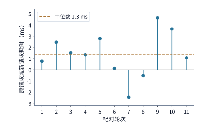

*图 5-43　11 轮交错配对实测中，每一轮“替换前原版请求耗时减去替换后新请求耗时”的配对差值分布（正值代表替换新 kernel 后端到端变快）。实验条件为 RTX PRO 6000 运行 Qwen3-8B，输入长 $7239$ token、固定生成 $32$ 个输出 token，并发度为 1，BF16 精度、eager 模式且关闭前缀缓存；每轮内部新旧版本出场顺序随机，机器同时存在背景常驻服务。水平虚线标出了配对耗时差的中位数（约 $+1.3\ \mathrm{ms}$），与表中的阶段性能分析预期（$1.4\ \mathrm{ms}$）高度吻合。*

这个综合案例为我们展示了从微观 kernel 调优通往宏观系统收益的完整分析链条：
1. 由于这项优化改进的是单行输入的 decode 激活，它完全发生在生成首个输出 token（TTFT）之后，因此长输入请求的首 token 响应时间依然由 prefill 阶段的大矩阵计算与等待全权决定；
2. 随着用户要求的生成输出长度（decode 步数）不断增加，单行输入的算子调用次数成倍累加，每一步省下的微秒级时间就会像聚沙成塔一样在总生成时间（TPOT $\times$ 输出长度）中累积放大；
3. **在着手优化任何一个具体算子之前，永远要先完成三步定量推演：第一，统计该算子在目标业务负载下各种输入形状的真实调用次数；第二，核算新实现能在每种形状的单次调用中省下多少微秒；第三，将累计节省的时间放回整网依赖图与端到端总耗时（Amdahl 占比与关键路径）中，确认它最终能为用户实实在在省下多少等待时间。** 唯有如此，我们才能把微观的“算子局部加速比”与宏观的“用户体验收益”精准锚定在一起。

## 常见误区

- **误区一：仅凭主机端或设备端的 kernel 计数，就断言程序的真实执行成本。**
  在 3 次 FFN 的对照实验中，启用 CUDA Graph 图重放将主机端提交调用从 18 次压到了 3 次，但 GPU 加速器依然执行了全部 18 个 kernel；唯有算子融合才真正将 GPU 执行的 kernel 数量减少到了 15 个。评估优化效果时，必须将主机控制时间线与设备执行时间线分开核算，切勿将“减少提交次数”与“减少显存往返”混为一谈。
- **误区二：认为跨存储接口访问字节数最小的分块方案，实际运行速度就一定最快。**
  在 FlashAttention 的片上分块分析中，将键值块行数从 $b=64$ 极端缩小到 $b=1$，虽然让跨接口读取流量减少了 $144\ \mathrm{MiB}$，却导致片上在线 Softmax 状态更新次数暴增至原来的约 41 倍，且令矩阵指令因维度退化而无法充分利用 Tensor Core。算子的真实执行成本是由**跨级访存耗时、片上非矩阵更新开销以及硬件矩阵单元利用率**三者共同决定的。
- **误区三：以为只要不断增加片上流水缓冲槽位（stages），就能持续提高算子吞吐率。**
  在 H100 单个 SM 份额下，每块数据搬移需 $1.29\ \mu\mathrm{s}$、矩阵计算仅需 $0.28\ \mu\mathrm{s}$；此时仅靠双缓冲（2 个槽位）就已经让硬件搬移通道 $100\%$ 连续满载运转（4 块总耗时 $5.44\ \mu\mathrm{s}$）。在搬移带宽已经彻底饱和的前提下，增加第 3 个缓冲槽既不能加快搬移速度，去优化计算指令也无济于事；此时要想继续提速，唯一有效的途径是扩大分块复用以减少每块需搬移的字节数，或者提升物理带宽。
- **误区四：以为稳态单次执行最快的特化方案，端到端累计总耗时就一定最短。**
  在动态形状的 70 组调用算例中，形状分桶方案的累计总耗时约为 $1.27\ \mathrm{s}$，而单组跑得最快的逐形状特化方案累计总耗时却高达 $1.38\ \mathrm{s}$——原因在于 70 组调用所省下的稳态执行时间，还不足以填平逐形状特化前期多付出的 $500\ \mathrm{ms}$ 编译准备开销。脱离调用频数与缓存命中率去空谈稳态最高性能，在工程实践中往往会入不敷出。
- **误区五：认为只要开启 CUDA Graph 或 Persistent Kernel，就能彻底消除单请求 decode 中相邻算子之间的全部跨步同步等待。**
  CUDA Graph 与 Persistent Kernel 能够消除的是主机端逐个发起 `kernel launch` 的提交开销；然而在单请求 decode 阶段，每次矩阵—向量乘法为了充分利用显存带宽都必须将输出通道切分到全卡所有 SM 上并行计算，当紧随其后的下一个算子需要读取拼接完整的全长向量时，全卡所有 SM 就必须通过片上 L2 缓存完成一次全局栅栏同步与数据交接。如第 5.5.4 节实测所示，即便采用原子动态工作窃取消除了各 SM 的长尾等待，每道全 SM 依赖边界依然存在约 $0.74\sim1.06\ \mu\mathrm{s}$ 的硬件同步物理底线。

## 习题与配套实验

以下练习与实验顺着本章的主线算例逐步改变约束条件。建议读者先在纸面上完成定量公式推导，再运行配套实验代码或查阅采集轨迹印证分析结论；各实验均保留原始编号，具体的环境配置、运行命令与完整轨迹记录详见对应目录文档。

> **实验 5-1 · 延伸：矩阵块大小如何改变局部存储与读取量**
>
> 将例 5-3 中的输出分块形状从正方形改为长方形 $64\times128$（即 $m=64, n=128$），归约步长仍取 $k=32$。试求：（1）单块所需的片上局部存储容量 $S$、输入矩阵 $A$ 与权重 $W$ 各自被重复读取的次数以及跨接口总访存量 $V$；（2）与 $64\times64$ 分块方案相比，$64\times128$ 方案在实际运行时跑出的有效访存带宽至少要达到前者的百分之多少，才能保证实际访存耗时比前者更短？（3）对照配套实验中不同循环嵌套次序的真机执行记录，解释内存连续合并访问（coalesced access）是如何影响实际吞吐率的。[^exp1]

> **实验 5-2 · 核心：激活算子融合能减少多少访存与显存占用**
>
> 针对输入张量 $G$、$U$ 各占 $24\ \mathrm{MiB}$ 的三步激活量化链（$\operatorname{SiLU} \rightarrow \text{逐元素乘} \rightarrow \text{8-bit 量化}$）：（1）分别画出“三步完全独立执行”与“三步完全融合执行”时，各个输入、中间与输出张量的显存分配、读写使用与释放生命周期顺序，严格推导出 $156\ \mathrm{MiB}$ 与 $60\ \mathrm{MiB}$ 的总访存量，以及两种方案各自的峰值显存占用（$72\ \mathrm{MiB}$ vs. $60\ \mathrm{MiB}$）；（2）假设融合 kernel 因为复杂的边界控制每次调用会额外增加 $5\ \mu\mathrm{s}$ 的固定启动开销，显存有效带宽取 RTX PRO 6000 的标称值 $1792\ \mathrm{GB/s}$，试求输入张量的行数 $M$（隐藏层列宽仍为 $12288$）至少达到多少行时，融合省下的显存读写时间才能超过这 $5\ \mu\mathrm{s}$ 的固定开销？（3）结合配套实验的实测计时数据，分析“访存字节数缩减比例”与“实际执行时间缩短比例”之间的定量关系。[^exp2]

> **实验 5-3 · 延伸：分块归约与预取如何改变注意力计算和访存**
>
> （1）在例 5-6 的两元素输入基础上再追加第三个块（含 1 个元素，其注意力打分为 $\ln 4$、对应值标量为 $5$），请逐步写出处理第三块时行最大值 $m$、缩放系数 $r$、偏移指数和 $\ell$ 与未归一化加权值 $u$ 的更新数值，并验证最终输出 $u/\ell$ 与一次性处理全部三个元素的标准 Softmax 结果完全相等。（2）保持单个线程块的共享内存总预算为 $99\ \mathrm{KB}$（$101{,}376\ \mathrm{bytes}$），假设为了实现双缓冲预取，需要从这 $99\ \mathrm{KB}$ 中额外多划出一个大小为 $b\times d$ 的 BF16 键值预取槽（即 $K/V$ 输入槽空间翻倍为 $4bd\ \mathrm{bytes}$）；仍取 $b=64, d=128, L=8192$，试求此时片上最多还能容纳多少行查询 $Q$（即新的最大整数 $a$），并重新计算 $K/V$ 全量扫描趟数与跨接口总访存量，解释为什么增加片上预取缓冲反而会改变下级存储的数据重复读取次数。[^exp3]

> **实验 5-4 · 延伸：算子融合会改变计算结果还是执行成本**
>
> 在第 5.4.2 节的分块融合伪代码基础上，分别考察以下三种修改方案：（a）将 `silu` 激活函数移入内层 `ko` 归约循环内部；（b）删去 `ko` 循环结束后的 `round_to_bf16(acc)`，直接将 FP32 的 `acc` 送入 `silu` 计算；（c）在后接整行动态量化（如例 5-7）时，将求行最大值与量化操作直接移入每个输出列块 `jo` 的循环末尾独立执行。请逐一判定这三种修改各自改变的是**数学运算定义、浮点数值舍入精度，还是纯粹的硬件执行成本**，并各自构造一组最简单的具体输入数值，使得修改前后的输出结果（或访存量）产生可观测的差异。[^exp4]

> **实验 5-5 · 延伸：分块循环如何改变访问顺序与临时存储**
>
> （1）使用外层块号 `(io, ko, jo)` 与块内局部坐标 `(ii, kk, jj)` 写出 `i-k-j` 顺序的六层分块矩阵乘循环，并在代码缩进中明确标出片上输入缓冲块与输出累加器的分配创建位置、最后一次读写位置以及释放位置。（2）对照配套实验 5-5 中矩阵转置程序在采用 $16\times16$ 分块与 $32\times32$ 分块时的真机剖析记录，从显存合并访问连续性、线程块内同步次数以及共享内存临时数据量三个维度，定量解释为什么 $32\times32$ 分块能够获得约 $2.7$ 倍的实测加速。[^exp5]

> **实验 5-6 · 延伸：输入形状的调用比例如何影响调优收益**
>
> （1）沿用例 5-9 的两种输入形状 $A$ 和 $B$（原实现耗时均为 $10\ \mu\mathrm{s}$，新实现耗时分别为 $5\ \mu\mathrm{s}$ 和 $20\ \mu\mathrm{s}$），分别计算当形状 $A$ 的调用占比 $p$ 取 $1/2$、$2/3$ 和 $9/10$ 时，原实现与新实现的加权平均单次耗时。（2）假设运行时引入动态形状派发（对形状 $A$ 派发新实现、对形状 $B$ 派发原实现），但每次动态检查形状并查表派发需要额外消耗 $1\ \mu\mathrm{s}$ 的主机 CPU 开销；试求形状 $A$ 的调用占比 $p$ 满足什么条件时，这套“动态派发组合方案”的综合平均耗时优于“不派发、始终固定使用原实现”？（3）查阅配套实验 5-6 的 Agent 搜索日志，统计两轮搜索耗费的总准备时间，并核算若找到更快实现，在线上重复调用中需要多少次才能收回搜索成本。[^exp6]

> **实验 5-7 · 延伸：特化需要重复执行多少次才有收益**
>
> （1）参照例 5-12 的参数，将每组调用中小形状（$256$ 行）的出现次数从 8 次减少为 **4 次**，其余两种形状（$1536$ 行与 $2048$ 行）仍各出现 1 次（即每组共 6 次调用）；重新计算通用、分桶（$512$ 与 $2048$ 两桶）与逐形状特化三种策略每跑一组的执行耗时 $T$，并通过两两联立一次方程求出各对方案累计总耗时相等时的临界重复组数 $r$。（2）进一步假设分桶方案所需的两个桶（$512$ 与 $2048$）对应的编译产物已经在磁盘缓存中命中（使分桶方案的准备成本从 $400\ \mathrm{ms}$ 降为 $100\ \mathrm{ms}$），而逐形状特化遇到的 $1536$ 行仍需现场编译（准备成本变化后重新核算），试求此时在整数调用组数 $r$ 的各个区间内，哪一种策略的累计总耗时最短。[^specialization]

> **实验 5-8 · 核心：图重放与算子融合分别减少哪些开销**
>
> （1）仔细阅读图 5-29 至图 5-32 的四条真机轨迹，列表统计“普通提交”、“仅融合”、“仅图重放”与“融合+图重放”四种模式下的 CPU 主机提交 API 调用次数与 GPU 实际执行的 kernel 数量。（2）将例 5-11 的硬件平台更换为显存带宽 $B = 1008\ \mathrm{GB/s}$ 的 NVIDIA RTX 4090（假设其余计算耗时与 $15\ \mu\mathrm{s}$ 提交节省保持不变），试求此时输入张量大小 $X$ 增大到多少 $\mathrm{MiB}$ 时，额外的 D2D 输入复制开销恰好完全抵消图重放省下的主机提交时间？（3）如果改造上游算子使其直接将输出写入图的固定输入缓冲区（省去 D2D 复制），分别写出在输入大小为 $2\ \mathrm{MiB}$ 和 $16\ \mathrm{MiB}$ 时普通提交与图重放的端到端完成时间。[^exp8]

> **实验 5-9 · 核心：kernel 加速如何改变请求耗时与关键路径**
>
> （1）根据配套实验 5-9 提供的 11 对请求原始计时记录，先逐对计算每轮的耗时差 $\Delta_i = T_{\mathrm{old},i} - T_{\mathrm{new},i}$ 并求出这 11 个差值的中位数（即配对差中位数），再与“先分别求 11 次原版耗时的中位数和 11 次新版耗时的中位数、最后将两个中位数相减”的结果进行对比，从统计学与背景噪声消除的角度解释为什么在存在机器背景负载波动时，配对差中位数能更灵敏、更准确地捕捉微秒级优化收益。（2）保持本章 5.6.3 节综合案例的 prefill 条件（$7239$ token）不变，将强制生成的输出长度从 $32$ 个 token（即 $31$ 步 decode）延长至 **$128$ 个 token（即 $127$ 步 decode）**；假设每一步 decode 中新 kernel 节省的时间保持不变，试估算在整个请求中 SwiGLU 激活计算总共能省下多少毫秒？（3）回到图 5-41 的双分支依赖图，若将分支 A 的耗时从 $60\ \mu\mathrm{s}$ 开始连续逐步缩短，画出端到端请求总耗时随分支 A 耗时变化的分段折线函数，指出当分支 A 缩短到多少微秒时，端到端请求耗时不再随 A 的缩短而下降。[^exp9]

> **实验 5-10 · 延伸：主机侧调度开销占比与多步异步流水收益核算**
>
> 对照第 5.5.1 节图 5-27 的单步耗时构成（在优化前的同步串行架构下，单步总耗时中 GPU 模型执行占 $38\%$、前端 API 服务占 $33\%$、CPU 调度器占 $29\%$，设单步总耗时为 $10\ \mathrm{ms}$）：（1）若仅通过算子优化将 GPU 模型执行速度提升至原来的 $2$ 倍，而前端 API 服务与 CPU 调度器的串行耗时保持不变，计算此时的单步总耗时与端到端吞吐加速比；（2）若不改动任何 GPU kernel（GPU 模型执行仍为 $3.8\ \mathrm{ms}$），而是通过多进程解耦与异步输出处理将前端 API 服务耗时完全重叠隐藏到 GPU 执行期间，并通过连续 $8$ 步的多步调度将 CPU 调度器开销分摊降至原来的 $1/8$，重新计算单步平均耗时与端到端吞吐加速比，说明为什么此时纯主机侧改造的收益远超单纯优化 GPU 算子。

> **实验 5-11 · 延伸：单请求 decode 全 SM 同步税与动态工作窃取的边界收益**
>
> 对照第 5.5.4 节图 5-40 的 $4096\times4096$ BF16 矩阵—向量乘法（GEMV）依赖链实测数据（无跨步依赖时单次投影纯显存读取耗时为 $21.0\ \mu\mathrm{s}$；存在全 SM 跨算子依赖时，静态均分任务每道边界增加 $1.75\ \mu\mathrm{s}$ 中位损耗，原子动态工作窃取每道边界增加 $0.90\ \mu\mathrm{s}$ 中位损耗）：（1）对于一个包含 $36$ 层、每层含 $4$ 次连续线性投影（即每步 decode 共穿过 $144$ 道全 SM 同步边界）的模型，分别计算在“静态均分任务”与“动态工作窃取”下，单步 decode 花在算子边界同步与等待上的累计时间各是多少微秒，动态工作窃取每步可节省多少时间？（2）若将并发批大小从 $B=1$ 扩大至 $B=16$，使单次投影的显存读取与计算耗时从 $21.0\ \mu\mathrm{s}$ 增至 $28.0\ \mu\mathrm{s}$，而单道全 SM 同步边界的固定延迟仍保持 $0.90\ \mu\mathrm{s}$ 不变，计算全 SM 同步损耗占投影总耗时的比例如何变化。

> **实验 5-12 · 延伸：动态请求下注意力算子 plan/run 分离、多层计划复用与虚拟地址保留的耗时拆解**
>
> 结合第 5.5.2 节算例 5-A 与图 5-35 的分析框架：（1）设单次 FlashInfer `plan` 的主机计算与元数据组装耗时为 $20\ \mu\mathrm{s}$，在一个包含 $48$ 层的混合注意力模型中（其中 $12$ 层为全局 MLA 层、$36$ 层为局部滑动窗口注意力 SWA 层），分别计算“每层独立调用 `plan`”与“按算子族分组调用 `plan` 并跨层复用”在连续生成 $100$ 个输出 token 期间累计消耗的主机计划时间及节省的微秒数；说明若在第 $50$ 步时有 1 条新请求加入批次（或某条请求触发停止词退出），为什么全局族与局部族的计划表都必须立即重新生成。（2）在 RLHF 训推共卡切换场景中，设模型 BF16 主权重为 $15.2564\ \mathrm{GiB}$，冻结的多 token 预测（MTP）附加模块占 $0.85\ \mathrm{GiB}$，KV 缓存预留 $24\ \mathrm{GiB}$，PCIe 双向迁出与迁回的实际有效带宽为 $25\ \mathrm{GB/s}$；对比“全量采用 Level 1 休眠（主权重与 MTP 全部备份至 CPU 内存并在唤醒时拷回）”与“主权重采用 Level 2 休眠直接丢弃（唤醒时由训练器直接覆写新权重）、仅对冻结的 MTP 模块采用 Level 1 备份与恢复”两种方案在单轮训推切换中的 PCIe 搬移字节数与耗时差，并解释为什么必须使用 `cuMemAddressReserve` 与 `cuMemUnmap`/`cuMemMap` 保留虚拟地址区间才能避免唤醒后重新捕获 CUDA Graph。[^cache-reconfig][^weight-handoff]

## 历史与进一步阅读

在深度学习与图像处理编译器的演进历程中，**Halide**（Ragan-Kelley 等，2013）首次将“算法数学定义（Algorithm）”与“执行调度策略（Schedule）”清晰地解耦开来，使循环拆分（split）、二维分块（tile）、循环重排（reorder）和计算挂载位置（compute_at）成为程序员手中可以像搭积木一样自由组合的代数原语；**TVM**（Chen 等，2018）与随后的 **TensorIR** 将这一思想推广至张量计算图、异构加速器硬件指令映射与基于机器学习代价模型的自动调优（Auto-tuning）；而 **AKG**（Zhao 等，2021）则进一步将多面体编译模型（Polyhedral Model）、跨算子分层融合与面向昇腾达芬奇架构的片上多级存储（L1/L0/UB）自动提升及 DMA 同步插入融为一体。顺着这三篇奠基性论文的原始文献阅读，读者可以清晰地追踪到：编译器中间表示（IR）的表达方式是如何一步步演进，并直接决定编译器能够自动完成的优化深度的。[^schedule][^akg]

对于从事硬件加速的工程师而言，现场可编程门阵列（**FPGA**）上的**高层次综合（High-Level Synthesis，简称 HLS，即将 C/C++ 等高级语言程序自动综合转换为硬件寄存器传输级数据通路的技术）**提供了另一面极佳的镜子。笔者早年在从事 FPGA / HLS 系统研究时，也曾亲历过一段从“单纯做主机接口封装”走向“深入源码做循环与数据流变换”的深刻转变：当年我们发现，要想让 HLS 编译器综合出高吞吐的片上硬件流水线，绝不能原样照搬 CPU 上的串行 C 代码，而必须先识别出核心计算原语与数组读写依赖，对循环做拆分、重排与片上缓冲分区（array partitioning），从根本上重构生成的硬件数据通路。这段跨领域的亲身经历印证了同一个道理：无论底层载体是可重构硬件逻辑还是 GPU/NPU 软件内核，高性能系统研究的真正重心，终究都要从“仅仅把程序跑通的接口封装”下沉到“重构数据局部性与并发流水的执行方式改造”。

最后，算子编排优化系统 **Korch**（华盛顿大学等提出）为我们提供了一个打破“算子融合越多越好”思维定势的绝佳历史案例：在论文分析的一个真实子图案例中，传统贪心算子融合将该子图合并为 **3 个 kernel** 执行，累计耗时约为 **$91\ \mu\mathrm{s}$**（各 kernel 分别为 $38.7\ \mu\mathrm{s}$、$24.2\ \mu\mathrm{s}$ 和 $28.2\ \mu\mathrm{s}$）；而 Korch 通过全局搜索重新切分融合边界，将该子图改由 **4 个 kernel** 执行后，累计总耗时反而大幅降到了约 **$69\ \mu\mathrm{s}$**（各 kernel 分别为 $7.6\ \mu\mathrm{s}$、$18.4\ \mu\mathrm{s}$、$7.5\ \mu\mathrm{s}$ 和 $35.7\ \mu\mathrm{s}$）。为什么多启动了一个 kernel 反而快了 $22\ \mu\mathrm{s}$？因为强行把形状或并行维度不匹配的算子合并进同一个融合 kernel 中，会严重束缚核心算子的分块尺寸与硬件占用率；适度拆开重组后，各个 kernel 都能选用最契合自身访存与计算特征的分块方案，由此在加速器执行时间上省下的大把微秒，远远超过了多付出一次 `kernel launch` 与中间张量传递的微小代价。[^korch] 这一精彩案例与本章反复强调的容量及关键路径约束遥相呼应，再次提醒我们：**一切编译与运行时优化，都必须以整个计算子图乃至端到端请求的综合实测开销为最终准绳。**

[^model]: [固定 Qwen3-8B 配置](../calculations/configs/models/qwen3-8b/config.json)；[模型算子与实现](../case-studies/model-operator-examples.md)。

[^tiles]: [分块容量与数据复用](../case-studies/buffer-capacity-and-data-movement.md)，含循环计数、Orojenesis 选读与 bank 映射。

[^order]: [切成几段与合并次序的浮点复算](../calculations/results/reduction-order.md)。教学用的这一行由给定公式生成后舍入到 BF16，不是采集到的激活；每个平方在 FP32 中都精确，各条路径的差别只来自加法次序。精确值用有理数算得，只作比较基准；枚举合并次序覆盖原子加可能出现的先后，不代表某个后端的实际分布。

[^reduction]: [RMSNorm 三阶段拆分计算](../calculations/results/rmsnorm-row1024-split8.md)。输入和 gamma 为 BF16，gamma 每行读取；一组一行保留输入，三阶段方案在应用阶段重读输入。

[^exp1]: [实验 5-1](../experiments/ch05/05-01/README.md)、[GPU 分块](../experiments/ch05/05-01/gpu-tiles/README.md)、[归约拆分](../experiments/ch05/05-01/rmsnorm-split/README.md)。

[^fusion]: [固定 scale 融合与张量生命周期](../calculations/results/fusion-qwen8-pointwise.md)。

[^exp2]: [实验 5-2 的原始条件、数据与分析](../experiments/ch05/05-02/README.md)。RTX PRO 6000、共享 GPU、热缓存与图重放；原始中位数为 14.20／7.68 μs，仅测激活子链。

[^buffer]: [流式顺序与缓冲预算](../case-studies/stream-order-and-buffer.md)；[主机搬移与缓冲区占用时间](../case-studies/host-transfer-and-buffer-lifetime.md)。

[^attention]: [注意力分块与在线状态](../case-studies/attention-tiles-and-io.md)；[99 KB 缓冲下的块大小与访问量](../calculations/results/attention-tiles-rtxpro6000.md)。容量模型采用单头、无掩码、K/V 复用输入槽和 S/P 复用临时槽；每个线程块 99 KB 的共享内存上限取自 [CUDA 编程指南的计算能力表](../references/files/documents/cuda-compute-capabilities.md)（计算能力 12.x 列）。

[^fa]: [FlashAttention](../references/files/papers/flashattention.pdf)、[FlashAttention-2](../references/files/papers/flashattention2.pdf)、[FlashAttention-3](../references/files/papers/flashattention3.pdf)。

[^exp3]: [实验 5-3](../experiments/ch05/05-03/README.md)。RTX PRO 6000 热缓存单头对照：2.64 ms／79.5 μs；新增分配峰值约 848／22.2 MiB，包括各后端分配的临时量。

[^tilelang-paper]: Wang 等，2025，[TileLang: A Composable Tiled Programming Model for AI Systems](https://arxiv.org/abs/2504.17577)。论文第 3 节介绍分块算子、显式内存分配和编译流程，第 4 节介绍布局、线程绑定和软件定义流水。

[^tilekernels]: [DeepSeek TileKernels](https://github.com/deepseek-ai/TileKernels) 的 README（读取于 2026 年 9 月 30 日）说明，该项目基于 TileLang，并加入华为昇腾后端。

[^tilelang-ascend]: [TileLang-Ascend](https://github.com/tile-ai/tilelang-ascend) 的 Ascend C/PTO 与 AscendNPU IR 适配器及 GEMM 示例；README 读取于 2026 年 9 月 30 日。

[^akg]: Zhao 等，2021，[AKG: Automatic Kernel Generation for Neural Processing Units using Polyhedral Transformations](../references/files/papers/akg-pldi21.pdf)。AKG 源码已在 [MindSpore AKG 仓库](https://gitee.com/mindspore/akg) 开源。

[^korch]: [Korch 的编排案例](../case-studies/kernel-orchestration-and-quantization.md)：论文 V100／FP32 子图，三 kernel 为 38.7、24.2、28.2 μs，四 kernel 为 7.6、18.4、7.5、35.7 μs。

[^schedule]: [TVM](../references/files/papers/tvm.pdf)、[TensorIR](../references/files/papers/tensorir.pdf)。

[^numerics]: [融合合法性、FP8 舍入和量化投影](../case-studies/fusion-legality-and-precision.md)；[RedFuser 后端阅读](../experiments/ch05/05-04/redfuser/README.md)。444／620 MiB 计数包括 A、W 与输出；行 scale 的辅助读写另见配套计算。

[^exp4]: [实验 5-4 的编译、舍入与执行差异](../experiments/ch05/05-04/README.md)、[DeepSeek V4-Flash 专家子链](../experiments/ch05/05-04/v4/README.md)。

[^exp5]: [实验 5-5 的生成代码与转置对照](../experiments/ch05/05-05/README.md)。

[^exp6]: [实验 5-6 的搜索与测量记录](../experiments/ch05/05-06/README.md)；[评测与部署计算](../case-studies/optimization-evaluation-and-deployment.md)。已记录两轮共 12 次 Agent 调用，未产生新的更快实现。

[^host]: [主机时间线调研](../research/2026-infra-survey/parallel-host-timeline/NOTES.md)；[配置流水与图执行](../case-studies/graph-execution-tradeoffs.md)。

[^vllm060]: [vLLM v0.6.0 发布公告归档](../research/2026-infra-survey/parallel-host-timeline/vllm-2024-blog.md)；收益归因的辨析见 [token 成本调研 第 8.2 节](../research/token-cost-2023-2026/report.md#runtime)。公告的吞吐在请求同时到达、`--num-scheduler-steps 10` 的条件下测得，2.7 倍是三项改动的合计收益，不能全部归于 GIL；多步调度在低负载下可能延长首个 token 的等待。

[^runtime]: [运行方式与反馈](../case-studies/execution-feedback.md)、[框架演进](../case-studies/framework-evolution.md)及[token 成本调研 第 7—8 节](../research/token-cost-2023-2026/report.md#runtime)。

[^graph]: [图重放的小输入复制](../calculations/results/graph-small-input-rtxpro6000.md)、[大输入复制](../calculations/results/graph-large-input-rtxpro6000.md)与[图执行取舍](../case-studies/graph-execution-tradeoffs.md)。复制带宽按源读加目标写的接口流量定义。

[^plan]: [FlashInfer 计划复用实测](../experiments/ch05/05-08/flashinfer-plan/README.md)。

[^specialization]: [形状特化的完整输入与交点](../calculations/results/specialization-medium.md)。

[^exp8]: [实验 5-8](../experiments/ch05/05-08/README.md)与[轨迹分析 JSON](../experiments/ch05/05-08/results/trace-analysis.json)。

[^boundary]: 笔者在 RTX PRO 6000 Blackwell Workstation 上的测量，[测量说明](../calculations/sources/opentallas/blackwell-sync-latency-notes.md)中“Under a real weight stream”一节及[数值摘录](../calculations/sources/opentallas/blackwell-sync-latency.json)。16 个 $4096\times4096$ 矩阵轮换使用，共 512 MiB，为 L2 容量的 4 倍；每个边界多出的时间为依赖链每个乘法的中位耗时减去同结构无依赖 kernel 的耗时。CUDA Graph 与 PDL 的边界用空 kernel 测得，实际 kernel 还要加上收尾与准备时间。

[^persistent]: [设备任务组织与 MPK](../case-studies/execution-feedback.md)；[八块任务计算](../calculations/results/persistent-tiles-rtxpro6000.md)。投影按 RTX PRO 6000 的 BF16 稠密峰值 503.8 TFLOP/s 推得，激活按 1792 GB/s 显存带宽与每元素 4 bytes 读写（448 G 元素/s）推得，两项取自[硬件表](../calculations/results/hardware.md)；独立资源、任务开销和缓冲条件采用例中设定。

[^dag]: [请求关键路径教学计算](../calculations/results/request-dag-path-switch.md)、[争用情景](../calculations/results/request-dag-contention.md)。

[^exp9]: [实验 5-9 的 kernel 实现、执行记录与 11 对请求](../experiments/ch05/05-09/README.md)。vLLM 0.23，替换后的 kernel 采用 block256／4-warps 调度，11 对输出 token 一致。客户端中位数为 816.640／815.406 ms，配对时间差的中位数 1.343 ms，首 token 中位数 435.674／436.353 ms。单独采集的性能分析记录中，prefill 为 11.218659／11.244366 ms，decode 为 2.369803／0.920376 ms。原 kernel 耗时 13.588462 ms，替换后 12.164742 ms，采集区间 850.848989 ms；各热点与其他观测 GPU 工作的时间交集为零。

[^sm]: [SM 驻留、延迟隐藏与 MMA 指令数](../calculations/results/sm-occupancy-book-tile.md)、[累加器放入寄存器](../calculations/results/sm-occupancy-register-accumulator.md)、[延迟 1000 ns 与每 warp 2 条加载](../calculations/results/sm-occupancy-latency-1000ns.md)。SM 限制取自 [CUDA 编程指南的计算能力表](../references/files/documents/cuda-compute-capabilities.md)（计算能力 9.0 列）与 [Hopper 调优指南](../references/files/documents/nvidia-hopper-tuning.md)，占用率定义取自[编程指南的 kernel 编写一节](../references/files/documents/cuda-writing-kernels.md)，异步复制、栅栏、warp 分工与 swizzle 取自[异步数据复制一节](../references/files/documents/nvidia-async-copies.md)，3.35 TB/s 取自 [H100 产品页](../references/files/specs/nvidia-h100-spec.md)，132 个 SM 与 BF16 稠密矩阵峰值 989.4 TFLOP/s 取自 [H100 架构白皮书](../references/files/specs/nvidia-h100.pdf)（表 3）。每线程寄存器数、显存延迟、每 warp 未完成加载数与加载宽度、MMA 指令形状是本节选定的取值。

[^execution]: [CUDA 执行模型](https://docs.nvidia.com/cuda/cuda-programming-guide/02-basics/intro-to-cuda.html)；[CUDA Runtime API 的同步语义](https://docs.nvidia.com/cuda/cuda-runtime-api/api-sync-behavior.html)；[CUDA stream 管理](https://docs.nvidia.com/cuda/cuda-runtime-api/group__CUDART__STREAM.html)与[event 管理](https://docs.nvidia.com/cuda/cuda-runtime-api/group__CUDART__EVENT.html)；[PyTorch 锁页内存与异步复制教程](https://docs.pytorch.org/tutorials/intermediate/pinmem_nonblock.html)。主机复制与缓冲复用另见本章引用的本地计算材料。

[^v41-case]: [DeepSeek V4.1 官方技术报告](../calculations/sources/deepseek-v4.1-flash/DeepSeek_V41_Tech_Report.pdf)，第 1、2、3 节与第 6 节；[跨章会话的固定条件与复算](../calculations/results/v41-throughline.json)。

[^pcie]: [RTX PRO 6000 Blackwell 工作站版规格](../references/files/specs/nvidia-rtx-pro6000-spec.pdf)列出系统接口为 PCIe 5.0 x16；[NVIDIA H100 规格](../references/files/specs/nvidia-h100-spec.md)给出 PCIe Gen5 x16 为 128 GB/s，是收发两个方向的合计，每个方向 64 GB/s。

[^cc12]: RTX PRO 6000 Blackwell 为 SM120 架构（见[实验 5-2 的运行环境](../experiments/ch05/05-02/README.md)），即计算能力 12.0；[CUDA 编程指南的计算能力表](../references/files/documents/cuda-compute-capabilities.md)给出该列每个 SM 的共享内存上限 100 KB、每个线程块上限 99 KB，两者之差即每块的 1 KiB 预留。

[^macbook-pro6000]: [MacBook 与 RTX PRO 6000：从存储组织到本地推理](../case-studies/macbook-rtx-pro6000.md)（含 Ollama v0.20.7 源码调用链、`ggml-metal` 统一内存映射与 `.metal` 量化算子分层解析）。

[^cache-reconfig]: [缓存复用与重配置开销](../case-studies/cache-and-reconfiguration.md)（含 FlashInfer `plan/run` 跨层复用条件及异构模型多计划表分析）。

[^weight-handoff]: [训练到推理的权重交接与休眠唤醒](../case-studies/weight-handoff.md)（含 RL 训推共卡切换中虚拟地址保留保活 CUDA Graph 以及 vLLM / SGLang Level 1 与 Level 2 休眠的定量核算）。

## 本章小结

本章从单次矩阵线性投影出发，层层深入剖析了单算子分块与片上存储布局、跨算子融合与双缓冲流水、编译器自动调度与代码生成、主机运行时提交流水与图重放，最后落脚于端到端用户请求的全局收益核算。贯穿全章各个层面的分析，始终围绕着三条核心系统准则展开：

第一，**数据复用必须以片上空间占用为代价**。无论是在矩阵乘法中扩大二维输出分块（tile）以让每次搬入的输入参与更多次乘加，还是在注意力机制中常驻更多行查询以减少键值矩阵的全量扫描趟数，抑或是在流水线中开辟多槽双缓冲以隐藏搬移延迟，更高的复用度无一例外要求占用更多的片上寄存器或共享内存。评估这笔空间投入是否划算，不仅要算它减少了多少跨接口重复读取或重复计算，更要在 SM 资源约束下审视它是否因工作集膨胀而挤占了并发驻留线程块数，进而导致在途访存请求（in-flight bytes）不足以掩盖显存延迟。

第二，**数据依赖与数值规则决定了变换的合法边界**。逐元素运算由于各坐标彼此独立，可以在输入分片读入寄存器后当场一气呵成算完；而跨维度的归约运算（如矩阵乘法的 $K$ 维求和、RMSNorm 的整行均方归约、Softmax 的分母归一化以及动态量化的整行最大值统计）则必须在片上保留部分和或完备的在线充分统计量，且任何非线性激活或不可逆的量化舍入都绝不能跨越归约完成边界提前执行。编译器依据读写依赖合法地移动计算挂载位置（`compute_at`），而运行时则通过流（stream）、事件（event）与片上栅栏（barrier）确保新输入已就绪、旧缓冲区已用完——一切算子融合与软硬件流水线，都建立在对这些依赖关系的严密守护之上。

第三，**端到端总耗时取决于各项工作在时间线上的重叠与关键路径**。物理带宽决定了单次搬移一批数据的耗时下界，上下游中的较慢阶段（$\max(t_m, t_c)$）决定了双缓冲与 Persistent Kernel 流水线中相邻两块的稳态产出间隔，线上重复调用次数决定了稳态省下的微秒数能否抵消前期编译与调优的准备成本，而依赖图上的关键路径与 Amdahl 热点占比则决定了局部算子提速最终能把整个请求缩短多少毫秒。因此，做系统优化绝不能只盯着“消灭了多少冗余操作”，还必须查明这些被消灭的操作原本究竟是否处在决定最终完成时刻的关键路径上。

下一章我们将把这套“分块、依赖、缓冲与流水”的分析框架从单张加速卡内部正式推广到由多张加速卡组成的高速互连超节点（Supernode）：当一个分块的计算结果需要跨越卡间互连网络交给其他加速卡消费时，“哪一片数据何时算好、谁需要读取它、在缓冲区里要保留多久”，将直接决定集合通信何时能够启动、能否与计算流水重叠，以及通信链路两端需要配置多大的显存缓冲区。
