# 第 6 章 超节点

上一章讨论了如何把一个大矩阵切成小块（tile），让输入数据在单颗芯片的计算单元附近反复复用。现在，假设我们把其中一个分块交给**另一张加速卡**去计算：这张卡需要读取哪些输入？它算出来的是完整的最终输出，还是仅仅占一部分贡献的部分和？算出的结果接下来又要交给哪张卡继续使用？可以看到，底层的数学运算并没有丝毫改变，但原本在芯片内部经过片上共享内存就能交接的数据，现在却必须穿过加速器互联总线乃至机房网络。同一套矩阵分块与依赖分析方法，由此从单卡算子自然延伸成了**多卡并行方案**。

当模型权重超过单张加速卡的显存容量时，单卡独立运行完整模型的做法就行不通了。例如 Qwen3-235B-A22B 的 BF16 权重约为 470 GB，接近单张 H100 显存容量的六倍。面对一台配有八张加速卡的服务器，我们既可以让每张卡各自独立处理不同的请求，也可以让八张卡合力加速同一个请求；具体的切分方案既要装得下模型与上下文状态，又要满足延迟与成本目标。本章将从算子的张量维度与数据依赖出发，逐步推导出六种并行方式所产生的跨卡通信开销，最后结合给定的模型规模、八卡硬件参数和请求完成期限（deadline）筛选出可行的部署方案。读完本章，读者应当能够针对具体的模型与硬件列出备选方案、排除不可行项，并根据系统瓶颈与实测数据做出定量取舍，而不是仅仅记住几个并行方式的英文缩写。

回顾上一章，我们在单颗加速器内部反复追问的正是同一组问题：沿着哪些维度切分、每一个分块存放在哪里、各分块需要哪些输入、部分结果在哪里汇合，以及按照什么次序调度执行。本章把这套分析方法扩展到多张加速卡：先将矩阵和上下文状态切分到多张卡上，推导由此产生的跨卡数据交换；再将这些通信映射到底层物理互联拓扑上，最终决定单个推理实例应当占用多少张卡、整机应当同时部署多少个独立实例。本章以常见的 HGX H100 八卡服务器作为硬件基准，并贯穿分析两个代表性模型：一是权重占满整台八卡服务器的稀疏混合专家模型 **Qwen3-235B-A22B**，用来剖析显存容量、专家分工与 MoE 通信；二是单卡即可装下权重、但长上下文 KV 缓存迫使模型跨卡切分的稠密模型 **Qwen3-32B**，用来定量比较张量并行的卡数与服务实例数。此外，我们还会结合其他前沿模型与超节点系统，说明模型架构与互联硬件的演进如何改变系统设计。

## 6.1 从单卡到多卡

### 6.1.1 八张卡的独立部署与协作

第 1 章介绍的**推理实例（inference instance）**既可以只占用一张加速卡，也可以将同一个模型切分部署在多张加速卡上；而**超节点（supernode）**则为实例内部频繁的跨卡协作提供了硬件载体——其中的多颗加速器通过高带宽、低延迟的专用互联网络紧密连接在一起。

简言之，推理实例描述的是软件层面的模型部署与执行单元，而超节点描述的是硬件层面的加速器互联范围。同样是一台八卡超节点，我们既可以在上面部署八个独立的单卡实例，也可以部署两个四卡实例，或者合并成一个八卡实例（见图 6-1）。在第一种部署下，八个实例各自处理的请求彼此完全独立；而在后两种部署下，每一个请求都需要由四张卡或八张卡频繁交换中间结果、协同计算才能完成。此外，服务器机箱和机柜只是物理安装与供电的边界：属于同一个推理实例的多张卡既可以全部位于同一台服务器内部，也可以跨越机柜分布在多台服务器上。

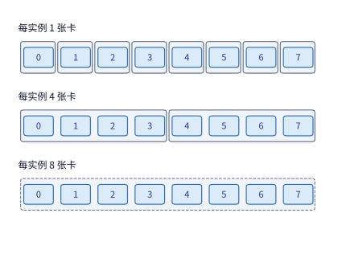

*图 6-1：相同八张卡上的三种实例分组。每个外框表示一个独立推理实例，内部连线表示完成请求所需的协作。各实例一次处理一个请求时，三种部署方式分别能同时处理八个、两个和一个请求。*

在工程实践中，动用多张加速卡通常源于以下三类需求：
1. **解决显存容量瓶颈**：模型权重或长上下文状态超过了单卡显存上限，必须分散存储到多张卡上；
2. **降低单请求执行延迟**：单张卡处理单个请求耗时过长，需要将计算任务与访存读取分摊给多张卡并行完成；
3. **提高系统整体吞吐**：同时到达的并发请求过多，需要增加能够独立处理请求的服务实例数量。

这三类需求分别对应着**容量（capacity）**、**延迟（latency）**和**吞吐（throughput）**三个核心优化目标。

### 6.1.2 贯穿算例：Qwen3-235B-A22B 的容量与单步时间

本章的第一个贯穿算例是：在一台 **HGX H100 八卡服务器**上运行 **Qwen3-235B-A22B**，假设某个请求已经完成了输入提示词的 prefill 阶段，显存中缓存了 8192 个上下文 token 的 KV 状态，现在进入逐 token 生成的 decode 阶段。HGX H100 是数据中心广泛部署的八卡服务器机型：机箱内配有八张 H100 SXM 加速卡，每张卡拥有 80 GB HBM 显存，单卡显存峰值带宽为 3350 GB/s，BF16 稠密矩阵峰值算力为 989.4 TFLOP/s；八张卡内部通过 NVSwitch（用于组织 NVLink 全互连交换网络的专用交换芯片）以第四代 NVLink 互联，每张卡在每个方向上的互联带宽均为 450 GB/s；此外，每张加速卡还配有一张 400 Gbit/s（即单向 50 GB/s）的 ConnectX-7 网卡，用于连接其他服务器。[^hgx]

设计多卡方案的第一步是核算显存容量，确定各项数据存放在哪里。设第 $i$ 张加速卡在同一时刻驻留的模型权重为 $W_i$、上下文 KV 状态为 $K_i$、中间激活张量为 $A_i$、其余运行时工作区为 $U_i$，则这四项之和必须不超过该卡可供任务使用的物理显存上限 $C_i$：

$$
W_i+K_i+A_i+U_i\le C_i. \tag{6-1}
$$

在式 (6-1) 中，权重 $W_i$ 由模型参数规模与切分方式决定，KV 状态 $K_i$ 随会话上下文长度线性增长，激活 $A_i$ 与工作区 $U_i$ 则取决于具体的执行与分块方式。这四项数据在同一时刻共同占用该卡的物理显存。

**Qwen3-235B-A22B 的模型结构与规模。** 该模型采用 BF16 格式（每元素占 2 字节）保存权重与 KV 状态，全网共 94 层，隐藏层维度为 4096；每层包含 64 个查询头（query heads）和 4 个键值头（KV heads），单头维度为 128。前馈网络（FFN）采用稀疏混合专家（MoE）架构，每层由 128 个路由专家组成，每个 token 通过路由器动态激活其中的 8 个专家，每个专家的中间层维度为 1536。（注：本章统一采用十进制单位 GB、TB 表示 $10^9$、$10^{12}$ 字节，采用二进制单位 MiB、GiB 表示 $2^{20}$、$2^{30}$ 字节。）

我们先核算单卡与八卡切分下的**显存容量需求**。全模型的 BF16 权重总计约为 470.2 GB。对于每个上下文 token，需要在全部 94 层中各自保存 4 个 KV 头的键（K）向量和值（V）向量，因此每个 token 在全模型中占用的 KV 容量为：

$$
2\times94\times4\times128\times2=188\ \mathrm{KiB}.
$$

当上下文长度为 8192 个 token 时，单个会话的 KV 缓存总共占用约 1.58 GB。若再为中间激活与其余工作区预留 2 GiB（约合 2.15 GB），单卡运行该模型所需的总显存高达约 473.9 GB，接近单张 H100 显存容量（80 GB）的六倍。

要想装下这个模型，就必须将数据切分到八张卡上：我们将权重矩阵按行或按列均分成八份，每张卡各存一份；2 GiB 的工作区预留依然需要在每张卡上各自保留一份。至于 KV 缓存，由于注意力层通常按注意力头切分，而该模型每层总共只有 4 个 KV 头，当切分到八张卡时，每两张卡必须共享同一个 KV 头并各自保存一份副本，因此每张卡需要保存全量 KV 缓存的四分之一（这种切分方式为何能保持数学计算结果严格不变，将在第 6.2.2 节详细推导）。切分前后的每卡显存需求对比如下表所示：

| 放置方案 | 权重 | KV 缓存 | 激活与工作区预留 | 合计 |
|---|---:|---:|---:|---:|
| 单卡（TP1） | 470.2 GB | 1.58 GB | 2.15 GB | 473.9 GB |
| 八卡中的每张卡（TP8） | 58.96 GB | 0.39 GB | 2.15 GB | 61.50 GB |

可以看到，切分到八张卡后，每张卡的显存需求降至约 61.50 GB，低于单张 H100 的 80 GB 上限；整台服务器八张卡合计占用约 492.0 GB，在 640 GB 总显存中还留有约 148 GB 的余量。读者可能会注意到，每张卡上的权重（58.96 GB）比 470.2 GB 的八分之一（58.78 GB）略多一点，这是因为层归一化（RMSNorm）参数和 MoE 路由器权重体积很小，在每张卡上都完整保留了一份副本。此时每张卡剩余的约 18.5 GB 显存空间可以用来并发承载更多用户会话：按上述切分方式，一个 8192 token 的会话在每张卡上仅占 0.39 GB 的 KV 空间，因此整台八卡服务器最多可以同时驻留 47 个这样的 8K 会话。因此，**跨卡分散存储降低了单张卡的显存占用门槛，而整个推理实例消耗的物理显存总量则是各张卡实际占用量之和。**[^dense]

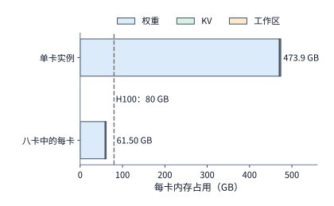

*图 6-2：单卡实例与分到八张卡后的每卡内存需求。单卡需要约 473.9 GB，远超 H100 的 80 GB（虚线）；分到八张卡后每卡约 61.50 GB。2 GiB 工作区在每张卡分别预留。*

算清了显存容量，接下来我们核算**单步执行时间**。显存容量决定了硬件能否装下这些数据，而每步的显存访问量（traffic）则决定了执行一次前向计算需要读写多少字节。我们以单层 MoE 的专家计算为例：在逐 token 生成（batch=1）时，路由器为当前这 1 个 token 选中 8 个专家；每个专家包含门控投影、上投影和下投影三个权重矩阵，因此这 8 个被激活专家的 BF16 权重总量为 $8\times3\times4096\times1536\times2=288\ \mathrm{MiB}$，执行时必须从 HBM 显存完整读取一遍。按 H100 单卡 3350 GB/s 的峰值显存带宽计算，光是读取这 288 MiB 权重就需要约 $90.1\ \mu\mathrm{s}$；而这 1 个 token 与 8 个专家做矩阵乘法的浮点运算量总共只有约 3.02 亿 FLOPs，按 989.4 TFLOP/s 的矩阵算力峰值执行仅需约 $0.31\ \mu\mathrm{s}$。权重读取耗时比矩阵计算耗时高出了两个多数量级。因此，要想缩短单步生成的耗时，首要任务就是**减少每张卡在每一步中需要读取的权重数据量**。放眼全网 94 层，每生成 1 个 token 总共需要读取约 43.1 GB 的激活权重和 1.58 GB 的历史 KV 缓存：若全部由单张卡读取，仅显存读取一项就需耗时约 13.3 ms；而按上述八卡方案均摊后，每张卡只需读取约 5.79 GB 数据，理论读取时间随之大幅缩减至约 1.73 ms。

当算子内部的计算与显存访问通过流水线重叠执行时，单个算子的理论执行耗时可以用如下下界公式估算：

$$
T_{\mathrm{op}}=\max\left(\frac{F}{P},\frac{V}{B_{\mathrm{HBM}}}\right). \tag{6-2}
$$

其中 $F$ 为算子的浮点运算量（FLOPs），$P$ 为硬件的矩阵运算峰值性能（FLOP/s），$V$ 为跨 HBM 显存接口的读写字节数（bytes），$B_{\mathrm{HBM}}$ 为显存带宽（byte/s）。由于计算与访存并行推进，耗时较长的那一项直接决定了算子的执行时间；而在层内与层间存在先后数据依赖的算子链中，后一个算子必须等待前一个算子算出结果才能启动，因此整步耗时需要将各串行阶段的耗时依次相加。式 (6-2) 正是本书第 4.8.1 节介绍的 **Roofline 模型**。按照第 1.2.2 节对模型算力利用率（MFU）的定义，在单 token 生成（batch=1）时，上述专家计算的 MFU 最高也不会超过 $0.31 / 90.1 \approx 0.3\%$。需要注意，这 $0.3\%$ 是由 `batch=1` 极低的算术强度决定的物理上限，与底层算子代码写得好不好无关；本章接下来要讨论的各种并行切分方案，本质上都是在这一物理约束下重新组织权重的跨卡分摊与批内复用。第 6.2 节将具体推导如何把模型权重与计算切分到多张卡上，第 6.4 节则会进一步把多卡交换中间结果的通信耗时纳入总时间账本。

### 6.1.3 Prefill、Decode 与训练对资源的不同要求

第 6.1.2 节算出的“读取耗时 $90.1\ \mu\mathrm{s}$、计算耗时 $0.31\ \mu\mathrm{s}$”对应的是每次只处理 1 个 token 的单请求 decode 阶段。如果一次调用能够同时处理更多个 token，那么从显存读入的同一份权重就能被多行输入共同复用，计算时间与访存时间的比例关系也会随之发生反转。

具体而言，当一次调用同时处理 $m$ 个 token 时，矩阵乘法的浮点运算量 $F$ 与行数 $m$ 成正比线性增长，而被激活专家的权重却可以在这 $m$ 个 token 之间共享复用。我们将上面的单层算例从 1 个 token 的 decode 改为 **8192 个 token 的 prefill**：此时这 8192 个 token 选中的专家将覆盖全层全部 128 个专家，单层专家权重的读取量增长到上限 $128\times36\ \mathrm{MiB} = 4.5\ \mathrm{GiB}$，按 3350 GB/s 读取约需 **1.44 ms**；与此同时，矩阵乘法的总运算量扩大了 8192 倍，达到约 $2.47\ \mathrm{TFLOPs}$，按 989.4 TFLOP/s 的峰值算力执行约需 **2.50 ms**，反过来超过了权重读取时间。可见，当一次处理的 token 数量足够大时，一份权重能够供大量输入行反复复用，算子执行时间的主要瓶颈就会从**受显存带宽限制（memory-bound）**切换为**受矩阵算力限制（compute-bound）**。

跨卡通信的特征同样会随着输入 token 数量的变化而发生质变。对于隐藏维度为 4096 的 BF16 激活张量（形状为 $m\times4096$），单 token（$m=1$）时仅占 **8 KiB**，而在 8192 个 token（$m=8192$）的 prefill 阶段则高达 **64 MiB**。两次前向调用同样流经全网 94 层、触发相同次数的跨卡集合通信，但每次通信传输的数据量却相差 8192 倍——在 8 KiB 的小消息场景下，通信耗时主要受每次通信的固定启动延迟（latency）支配；而在 64 MiB 的大消息场景下，通信耗时则主要取决于互联链路的持续传输带宽（bandwidth）。

此外，自回归 decode 阶段还受到严格的**时间步先后依赖**约束：当前这一步生成的输出 token，直接决定了下一步送入模型的输入 token。因此，同一个用户会话的生成过程无法在时间步上并行，只能一步接一步地串行推进；但如果我们同时服务多个互不依赖的用户会话，就能在同一步内凑出多条已经就绪的输入行。并发会话数越多，每步权重复用的机会就越多，但显存中需要同时驻留和每步扫描的 KV 缓存总量也随之成倍增加，从而同时改变计算时间、显存访问时间以及请求的排队等待时间。

至于**模型训练（training）**，它在完成与 prefill 类似的前向传播之后，还必须反向遍历整张计算图执行反向传播（backward pass），分别算出对输入激活的梯度和对模型权重的梯度，最后再用权重梯度更新优化器状态与模型参数；而且前向传播算出的各层中间激活张量必须一直保存在显存中，直到反向传播对应的层使用完毕后才能释放。因此，多卡分布式训练除了要承担前向与反向的跨卡激活/梯度交接外，还必须在每个训练步末尾跨数据并行副本同步权重梯度，并保存庞大的优化器状态。本章将首先建立模型切分与跨卡数据交换的统一分析框架，第 10 章再进一步探讨这些基本操作如何组合成完整的分布式训练流水线。

### 6.1.4 并行方式一览：切分哪个维度

无论是为了装下超大模型、缩短单请求延迟还是提高并发吞吐，我们都需要把原本集中的计算与存储任务拆分给多张加速卡，但不同并行方式的**切分维度**截然不同。具体怎么切，取决于模型处理的数据张量形状以及模型自身的网络结构。

观察模型任意一层的输入激活张量，它包含三个基本维度：
1. **样本维度 $B$（batch size）**：一次并发处理的独立样本数（在推理场景下即同时处理的请求/会话数）；
2. **序列维度 $S$（sequence length）**：每个样本包含的上下文 token 位置数；
3. **特征维度 $H$（hidden dimension）**：每个 token 位置上的隐藏特征向量宽度。（在第 5 章分析矩阵乘法时，由于线性投影对不同样本和不同序列位置一视同仁，我们曾把 $B$ 和 $S$ 合并记作矩阵行数 $M=B\times S$；但注意力算子必须在同一个样本序列的内部跨位置交互，因此这里将 $B$ 和 $S$ 明确区分开来。）

除了输入激活的这三个维度之外，模型自身的结构还提供了两个可切分的维度：
4. **层维度 $L$（layers）**：模型由前往后串联堆叠的 Transformer 层；
5. **专家维度 $E$（experts）**：MoE 模型在每一层前馈网络中并列设置的路由专家集合。

图 6-3 将这五个维度放在同一幅图中，直观标出了大模型系统中最常用的**六种并行方式**各自切分在哪个维度上。

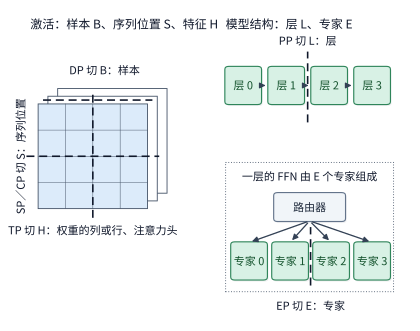

*图 6-3：左侧是一层的输入激活，三个维度分别对应数据并行、序列并行与上下文并行、张量并行的切分位置；右侧是模型结构，流水线并行切在层与层之间，专家并行切在同一层的专家之间。粗虚线表示切分位置，不表示数据流向。*

按照所切分的维度，我们可以把这六种并行方式的分工与跨卡通信需求总结在下表中（表中“卡之间必须交换什么”将在第 6.2 节各小节中逐一给出精确的字节数推导）：

| 并行方式 | 切分的维度 | 每张卡保存和计算什么 | 卡之间必须交换什么 |
|---|---|---|---|
| **数据并行（DP）** | 样本维度 $B$ | 保存一份完整模型，各自处理不同的样本 | 推理时互不通信；训练时需跨卡归约汇总梯度 |
| **张量并行（TP）** | 特征维度 $H$（权重的列或行、注意力头） | 保存并计算同一层权重矩阵的一部分 | 按列切分时按需收集输出分片；按行切分时必须跨卡对部分和做求和归约 |
| **序列并行（SP）** | 逐 token 算子的序列位置 $S$ | 在 LayerNorm、残差等逐 token 算子上只保存并处理一段序列位置 | 进入列并行矩阵乘前收集全部序列位置；行并行矩阵乘后对部分和求和并重新按位置分片 |
| **上下文并行（CP）** | 注意力算子的序列位置 $S$ | 保存并计算同一长序列中某一段位置的 $Q$、$K$、$V$ 与局部注意力 | 交换远端位置上的 $K$、$V$ 分片，或跨卡合并各段注意力的局部统计量 |
| **流水线并行（PP）** | 模型层维度 $L$ | 保存并计算模型中一段连续的层（构成一个流水阶段） | 相邻流水阶段之间点对点交接前向激活；训练时再反向交接激活梯度 |
| **专家并行（EP）** | 专家集合维度 $E$ | 保存并计算同一层 MoE 中的一部分路由专家 | 将各 token 的输入派发（dispatch）到所选专家所在的卡，算完后再将结果送回原卡合并（combine） |

**为什么需要六种并行方式：从单一瓶颈到嵌套组合。**

这张总览表不仅回答了“每种并行切在哪里”，更揭示了“每种切分针对什么系统瓶颈”。我们可以借用**俄罗斯套娃**的层级视角来理解这六种并行方式的协作关系：
- 最外层负责管理并发样本或用户请求，由**数据并行（DP）**决定整个集群同时推进多少份彼此独立的模型副本；
- 在单个模型副本内部，计算沿着从浅到深的网络层依次推进，由**流水线并行（PP）**把长长的网络层序列切分成若干个流水阶段；
- 进入某一个具体的网络层后，如果是 MoE 层，则由**专家并行（EP）**将上百个专家分散到不同的加速卡上；而在单个矩阵或注意力模块内部，则由**张量并行（TP）**沿着特征或注意力头维度切分权重矩阵，并辅以**序列并行（SP）**和**上下文并行（CP）**沿着序列长度维度分摊激活张量与长上下文注意力计算。

套娃中的每一层都有自己独立的数据依赖、同步栅栏和通信边界。华为半导体首席科学家廖恒博士于 2026 年 9 月提出的 **Nested BSP（嵌套批量同步并行）** 架构，正是将“并行计算—同步—数据交换—结果聚合”这一基本执行模式递归地组织在多个软硬件层级上，其论文图 1 同样采用了软件套娃的直观比喻来刻画这种多层嵌套结构。[^nested-bsp]

在实际部署中，这六种并行方式沿着正交的坐标轴切分同一个计算空间，各自攻克一类特定的瓶颈，并可以灵活拼装组合：
- **DP（数据并行）**：面向高并发样本或请求，用于线性扩展系统的整体吞吐；
- **TP（张量并行）**：面向层内大矩阵与单次请求加速，分摊单层计算量、权重容量与中间结果；
- **SP（序列并行）**：依附于 TP 通信组内，专门分摊 LayerNorm、残差等逐 token 算子的激活存储与计算开销；
- **CP（上下文并行）**：面向超长上下文序列，分摊庞大的历史 KV 状态容量与注意力计算量，并通过跨卡交换远端上下文完成全局注意力；
- **PP（流水线并行）**：面向层数极多、总权重超出单机容量的超大模型，把具有严格先后依赖的层间计算组织成多级流水线；
- **EP（专家并行）**：面向稀疏 MoE 架构，将庞大的专家权重集合分散到各卡，并通过动态 token 路由发挥稀疏计算优势。

将这些正交维度组合起来，就构成了具体的多卡设备网格（device mesh）。例如，我们可以把 16 张加速卡组织为 `DP2 × PP2 × TP4`：即建立 2 个完整的数据并行模型副本分别处理不同批次的样本；每个模型副本在纵向上切分为 2 个流水线阶段；每个流水线阶段内部则由 4 张卡组成张量并行组（同时在这 4 张卡上启用序列并行 SP），总卡数恰好为 $2\times2\times4 = 16$ 张。架构师在设计并行组合时，核心原则就是**让当前最突出的系统瓶颈在最匹配的维度上被切开，并把通信最频繁的维度映射到物理带宽最高、延迟最低的内部互联链路上**。

此外，仔细观察上表还能发现两类截然不同的结果汇合机制：当我们沿着样本（DP）、序列位置（SP/CP）、网络层（PP）或专家（EP）切分时，各张卡负责的是不同的样本、不同的位置、不同的层或不同的专家，跨卡通信主要表现为**数据的收集（gather）、路由派发（dispatch）或流水阶段交接**；唯有当我们沿着特征维度（TP 的行并行矩阵）或完整上下文归约维度（CP 的 decode 归约）切分时，各张卡算出的只是**同一个输出元素的部分和或局部统计量**，后续算子在使用前必须先通过跨卡归约（reduction）将各卡的贡献加到一起。这与第 5.2.4 节在单卡内部区分“输出网格维”与“归约累加维”的原理完全一致。第 6.3 节将具体演示如何为组合并行中的每张卡分配多维坐标。

> **实验 6-1 · 延伸：上下文长度与输入行数如何影响容量和执行瓶颈**
>
> （a）求 Qwen3-235B-A22B 在 4096、8192、16384 个上下文 token 时的单请求 KV 容量。
>
> （b）按本节的八卡分法，每卡预留 2 GiB 工作区，求一台 HGX H100 最多能同时保存多少个 32768 token 的会话，权重精确值见注释。
>
> （c）对 1、64、8192 个 token，分别计算一层专家计算的矩阵运算量与被选中专家的权重读取时间（64 个 token 时被选中的专家数用第 6.3.2 节的式（6-8）估计），使用 H100 的参数判断执行时间主要受计算还是内存访问限制。
>
> （d）把 HBM 带宽减半，比较上述三种 token 数下的调用耗时增幅。

## 6.2 六种并行方式

本节按照图 6-3 的顺序，逐一剖析六种基本并行方式的切分机制与通信代价。为了让读者一眼看清每张卡上的数据分工，每一小节都先从最简单的**两张卡协作**讲起，再自然推广到任意多张卡。

### 6.2.1 数据并行：复制模型，切分样本

**数据并行（data parallelism，DP）** 的做法最直观：让每一张加速卡各自保存一份完整的模型权重，并各自独立处理不同批次的输入样本。如图 6-4 所示，当一个包含 8 个样本的批次到来时，卡 0 负责处理前 4 个样本，卡 1 负责处理后 4 个样本，两张卡各自算出自己那一半样本的输出。

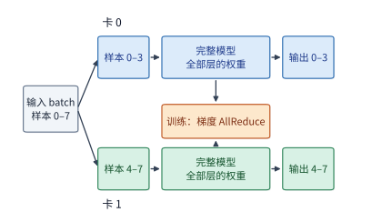

*图 6-4：两张卡各保存一份完整模型，分别处理不同样本。推理时两张卡互不等待；训练时两张卡的梯度要先汇合，再各自更新参数副本。*

在**模型推理**中，数据并行直接对应于**部署多个独立的服务实例**。只要单张卡的显存足以装下完整模型与会话状态，且线上源源不断地有多个独立请求到达，最直接的扩容方式就是把不同的用户请求分发给不同的单卡实例。每个实例独立维护自己的模型权重与会话 KV 缓存，从头到尾算完输出，实例之间不需要任何跨卡通信。假设单个单卡实例每秒能够完成 $r$ 个请求，那么在请求充足的满载状态下，8 个独立的单卡实例每秒就能完成 **$8r$ 个请求**。

反之，如果我们把这 8 张卡合并成一个 8 卡协作实例来共同加速单个请求，设单个请求在 8 卡协作下的端到端加速比为 $S(8)$，那么这个 8 卡实例每秒能够完成的请求数就是 $S(8)r$。对比两种方案：它们动用了完全相同的 8 张物理加速卡，但总吞吐量之比却是 **$S(8)/8$**——这意味着唯有当 8 卡协作能把单个请求恰好加速 8 倍（$S(8)=8$）时，协作大实例的总吞吐才能追平 8 个独立单卡实例；一旦跨卡通信和无法并行的串行环节吃掉了一部分加速比（导致 $S(8) < 8$），**采用多卡协作实例本质上就是牺牲一部分系统总吞吐，去换取更短的单请求响应时间（延迟）。**

在**模型训练**中，数据并行同样在每张卡上放置一套完整的模型参数副本，但不同卡上的计算在每个训练步结束时存在耦合：各张卡算出的局部权重梯度必须汇总到一起，共同决定参数下一次更新的方向。例如在图 6-4 中，卡 0 和卡 1 各自前向、反向处理完 4 个样本后，分别求出了本地 4 个样本的平均梯度 $g_0$ 和 $g_1$；此时两张卡必须通过一次跨卡 AllReduce 求得全部 8 个样本的全局平均梯度 $(g_0+g_1)/2$，然后再用这份相同的全局梯度各自更新本地的参数副本，从而保证两张卡上的模型权重在下一步开始前依然完全一致。推理服务因为不修改模型权重，所以天然免去了这笔跨副本同步开销。

### 6.2.2 张量并行：切分一层内的矩阵

增加数据并行实例虽然能成倍提高系统的并发吞吐，却丝毫不能缩短单个请求在单张卡上的执行时间，也救不了那些单卡显存根本装不下的长上下文会话或超大模型。要想让两张或多张加速卡真正合力分担同一个请求，就必须走进 Transformer 层的内部，把单层里的权重矩阵和上下文状态切开。**张量并行（tensor parallelism，TP）** 正是将同一层内部的权重矩阵切分给多张卡，让每张卡各自计算矩阵乘法的一部分，再通过高速跨卡通信汇合结果。图 6-5 标出了一个标准 Transformer 层内部进行张量并行切分的两处核心位置：**多头注意力模块**与**前馈网络（FFN）模块**。

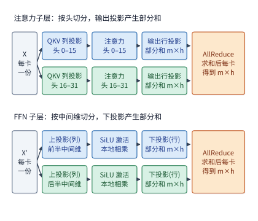

*图 6-5：注意力按头分给两张卡，前馈网络按中间维分给两张卡；两处的最后一个投影都只得到部分和，各需要一次 AllReduce 把两卡的部分和相加。m 为一次处理的 token 数，h 为隐藏维。*

**为什么权重能放进单卡的稠密模型，在长上下文下也会被迫跨卡切分？** 我们以本章的第二个贯穿模型——稠密模型 **Qwen3-32B** 为例来算一笔容量账。Qwen3-32B 的 BF16 权重总计约为 **65.52 GB**，单张 80 GB 的 H100 原本是可以装下这份权重的。该模型预训练原生支持 32K token 的上下文，在推理时通过 YaRN 位置编码外推技术将最大上下文长度扩展了四倍，达到 **128K（131,072）个 token**。[^qwen3-context] 由于 Qwen3-32B 共有 64 层，每层配 8 个 KV 头、单头维度 128，因此每个上下文 token 需要保存的 BF16 KV 缓存大小为 $2\times64\times8\times128\times2 = 256\ \mathrm{KiB}$；当一个会话扩展到 128K 上下文时，光这一个会话的 KV 缓存就要占用约 **34.36 GB** 显存。如果采用单卡部署（记作 **TP1**，其中 TP 后面的数字代表单个实例使用的张量并行卡数），那么常驻权重（65.52 GB）、一个 128K 会话的 KV 缓存（34.36 GB）再加上预留工作区（2 GiB $\approx 2.15\ \mathrm{GB}$），单卡总显存需求高达 **102.03 GB**，直接超出了 H100 的 80 GB 物理上限。而一旦我们将该模型做跨卡张量并行切分：
- 切分到 **2 张卡（TP2）** 时，每卡权重与 KV 各减半，加上 2.15 GB 工作区后单卡仅需约 **52.09 GB**，不仅装得下，还能同时容纳 **2 个** 128K 会话；
- 切分到 **4 张卡（TP4）** 时，单卡占用降至约 **27.12 GB**，可同时容纳 **7 个** 128K 会话；
- 切分到 **8 张卡（TP8）** 时，可同时容纳 **16 个** 128K 会话。

因此，对于长上下文下的 Qwen3-32B 而言，启用多卡张量并行的首要驱动力甚至还不是为了加速，而是为了**解决显存容量问题**——因为单卡 TP1 连哪怕一个 128K 会话都装不下。

当然，正如本书第 2 章所剖析的，近年来许多新模型通过演进**注意力架构**大幅压缩了长上下文下的 KV 状态体积。一个模型每 token 需要保存多少 KV 状态，完全由其注意力层的结构参数决定：包含多少层完整注意力、每层有几个 KV 头、单头维度多大，以及是否将其余层替换成了固定状态的线性注意力。下表横向对比了三个总参数量同处 30B 级别的代表性模型：
1. **Qwen3-32B（稠密模型）**：全网 64 层全部采用标准分组查询注意力（GQA），每层 8 个 KV 头、头维 128；
2. **Qwen3-30B-A3B（第一代 MoE 模型）**：将 FFN 替换为稀疏 MoE，但全网 48 层依然全部采用标准 GQA，每层 4 个 KV 头、头维 128；
3. **Qwen3.6-35B-A3B（混合注意力 MoE 模型）**：全网 40 层中**仅有 10 层保留完整注意力**（每层 2 个 KV 头、头维 256），其余 **30 层全部替换为线性注意力**（无论上下文多长，每层仅维护固定大小的 FP32 递推状态与短卷积状态）。

| 对比维度 | Qwen3-32B（稠密 + 全 GQA） | Qwen3-30B-A3B（MoE + 全 GQA） | Qwen3.6-35B-A3B（MoE + 混合线性注意力） |
| ------------------------ | ----------: | ------------: | ------------------------------: |
| 常驻 BF16 权重总量 | 65.52 GB | 61.06 GB | 69.32 GB |
| 每 token 增量 KV 大小 | 256 KiB | 96 KiB | 20 KiB（仅 10 个完整注意力层） |
| 每请求的固定状态大小 | — | — | 62.9 MB 递推状态（FP32）＋ 2.0 MB 卷积状态 |
| 单个 128K 请求的总状态容量 | 34.36 GB | 12.88 GB | 2.75 GB |
| 每步权重读取量（batch 1，32K 上下文） | 63.97 GB | 6.08 GB | 5.89 GB |
| 每步权重读取量（batch 64，32K 上下文） | 63.97 GB | 60.44 GB | 68.30 GB |
| 每步矩阵运算量（batch 64，32K 上下文） | 8.49 TFLOPs | 2.04 TFLOPs | 0.73 TFLOPs |
| 每步历史状态读取量（batch 64，32K 上下文） | 549.8 GB | 206.2 GB | 47.1 GB |
| 单张 H100（TP1）能容纳的 128K／32K 请求数 | 0／1 | 1／5 | 3／11 |
| 两张 H100（TP2）能容纳的 128K／32K 请求数 | 2／10 | 7／29 | 31／117 |

对比表中的数字，可以得出三条极为重要的系统启示（见图 6-6）：
- **第一，MoE 的权重读取优势在小 batch 下显著，但在大 batch 下会消退**：当 `batch=1` 时，两个 MoE 模型每步只需读取约 6 GB 的被激活专家权重，仅为稠密模型（63.97 GB）的十分之一；然而当并发增大到 `batch=64` 时，64 个 token 选中的专家几乎覆盖了全层所有专家，两个 MoE 模型的每步权重读取量立刻回升到了 60～68 GB，与稠密模型的 64 GB 不相上下。
- **第二，MoE 的矩阵计算量优势在任何 batch 大小下都始终保持**：即便在 `batch=64` 下权重需要全量读入，两个 MoE 模型的每步浮点运算量（2.04 与 0.73 TFLOPs）依然只有稠密模型（8.49 TFLOPs）的四分之一到十二分之一，这是稀疏激活赋予 MoE 的永久计算红利。
- **第三，在长上下文、大 batch 的 decode 场景下，每步耗时完全由“历史状态读取量”主宰，而这取决于注意力架构而非 MoE**：在 `batch=64`、32K 上下文下，按 H100 的 3350 GB/s 带宽计算，三个模型每步读取权重同样只需 18～20 ms；但读取 64 个请求的历史状态却分别需要约 **164 ms**（549.8 GB）、**62 ms**（206.2 GB）和 **14 ms**（47.1 GB），相差超过十倍。请注意，这一悬殊差距完全来自注意力机制的设计（GQA 头数缩减与 3:1 混合线性注意力），而与 FFN 是否采用 MoE 无关——Qwen3-30B-A3B 虽然也是 MoE 模型，但由于 48 层全用 GQA，每 token 仍需保存 96 KiB 的 KV。

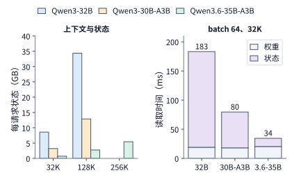

*图 6-6：左图为单个请求在 32K、128K 与 256K 上下文下的状态，Qwen3-32B 与 Qwen3-30B-A3B 的上下文上限为 128K。右图为 batch 64、32K 上下文时一次 decode 读取权重和状态的时间，按 H100 的 3350 GB/s 计。三种模型的权重读取相近，状态读取相差十倍以上。*

状态体积的缩减直接改写了多卡部署的容量边界：在每卡预留 2 GiB 工作区的前提下，单张 H100（TP1）能容纳的 128K 长上下文请求数在三个模型上分别为 **0 个、1 个和 3 个**；扩展到两张 H100（TP2）后，可容纳的 128K 请求数则拉开到了 **2 个、7 个和 31 个**（哪怕把 Qwen3.6-35B-A3B 扩展到其原生支持的 256K 即 262,144 token 上下文，单请求状态也仅占约 5.43 GB）。因此，**一个 30B 规模的模型在 128K 长上下文下究竟需不需要跨卡张量并行，主要取决于它的注意力状态设计，而不是它是稠密模型还是 MoE 模型。**（关于 DeepSeek V4-Flash 等采用 MLA 进一步压缩 KV 的模型对比，详见第 2.6.1 节。）[^dense-moe]

现在我们回到图 6-5 标出的层内切分结构，弄清楚一个核心数学问题：**为什么把一个权重矩阵切给两张卡时，有的切法算完后只需直接拼接（或留在本地继续用），有的切法算完后却必须发起一次跨卡 AllReduce 把两张卡的结果加起来？** 在 Qwen3-32B 的张量并行中，每一层的注意力输出投影和 FFN 下投影末尾都必须各做一次 AllReduce 求和，全网 64 层合起来每步要做 **128 次 AllReduce**（后文推导多卡执行时间时将反复用到这个 128 次）。为了彻底看透这两种切法的本质区别，我们先来看一个最小的 $2\times2$ 矩阵乘法算例。

设输入行向量为 $x=[2,3]$，权重矩阵为 $W=\begin{bmatrix}1&4\\2&5\end{bmatrix}$，完整矩阵乘法的输出应为 $xW=[2\times1+3\times2,\ 2\times4+3\times5] = [8,23]$。现在用两张卡协同计算 $xW$，共有两种正交的切法：
- **第一种切法：按权重矩阵的列切分（column-parallel，即切分输出特征维）**。如图 6-7 所示，两张卡都持有完整的输入向量 $x=[2,3]$；卡 0 保存 $W$ 的第一列 $\begin{bmatrix}1\\2\end{bmatrix}$，独立算出输出向量的第一个元素 $2\times1+3\times2 = 8$；卡 1 保存 $W$ 的第二列 $\begin{bmatrix}4\\5\end{bmatrix}$，独立算出输出向量的第二个元素 $2\times4+3\times5 = 23$。可以看到，按列切分时，每张卡算出的都是**不同输出位置上的最终精确值**；如果要恢复完整输出，只需把两个元素并排拼接（concatenate）成 $[8,23]$ 即可，不需要做任何加法。

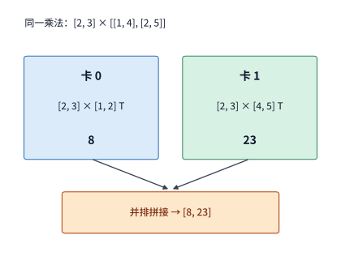

*图 6-7：按权重矩阵的列切分时，每张卡使用完整输入，计算不同的输出元素。格内的转置符号 T 表示把方括号中横排的数当作列向量。*

- **第二种切法：按权重矩阵的行切分（row-parallel，即切分输入特征维 / 归约维）**。如图 6-8 所示，此时输入向量 $x=[2,3]$ 也跟着按特征维切成了两半：卡 0 只持有第一个输入特征 $2$ 和 $W$ 的第一行 $[1,4]$，相乘得到向量 $2\times[1,4] = [2,8]$；卡 1 只持有第二个输入特征 $3$ 和 $W$ 的第二行 $[2,5]$，相乘得到向量 $3\times[2,5] = [6,15]$。请注意：此时两张卡各自算出的虽然都是长度为 2 的向量，但它们都只是**同一个输出向量的部分和（partial sum）**，各自只包含了半截输入特征的贡献；唯有将两张卡的向量按对应位置相加（$[2,8]+[6,15]=[8,23]$），才能恢复出正确的矩阵乘法结果。

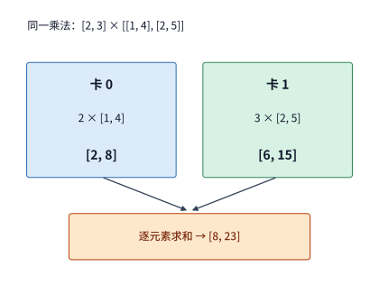

*图 6-8：按权重矩阵的行切分时，两卡产生形状相同的输出部分和。对应位置相加，恢复完整乘法的结果。*

掌握了“按列切分得独立分片、按行切分得部分和”的规律，就能立刻明白 Megatron-LM 是如何把这两种切法巧妙地首尾拼接在同一个 FFN（或注意力层）内部，从而省去中间通信的（见图 6-5 下半部分与图 6-9）。我们以第 2 章介绍的 **SwiGLU 前馈网络**为例：设一次处理 $m$ 个 token，隐藏层维度为 $h$，FFN 中间层维度为 $f$；输入矩阵为 $X\in\mathbb{R}^{m\times h}$，门控投影与上投影权重分别为 $W_g,W_u\in\mathbb{R}^{h\times f}$，下投影权重为 $W_d\in\mathbb{R}^{f\times h}$，则完整 FFN 的计算公式为：

$$
Y=\left[\operatorname{SiLU}(XW_g)\odot(XW_u)\right]W_d.
$$

现在我们将中间层宽度 $f$ 左右对半切分给两张卡（见图 6-9）：
1. **第一步（上投影按列切分）**：让卡 0 保存 $W_g, W_u$ 左半边的 $f/2$ 列，卡 1 保存 $W_g, W_u$ 右半边的 $f/2$ 列；两张卡都读取完整的输入 $X$，各自独立算出左半边和右半边的投影结果。由于随后的 $\operatorname{SiLU}$ 激活函数与哈达玛积 $\odot$ 都是纯粹的逐元素（elementwise）运算，不同列之间没有任何交叉依赖，因此两张卡可以直接在本地算完各自的半截中间激活 $Z_0, Z_1 \in \mathbb{R}^{m\times(f/2)}$，**中间完全不需要任何跨卡通信**。
2. **第二步（下投影按行切分）**：接下来执行下投影 $Z W_d$。由于此时输入激活 $[Z_0\ Z_1]$ 刚好是按特征列切开的分片，我们顺势把下投影矩阵 $W_d\in\mathbb{R}^{f\times h}$ **按行上下对半切开**——让卡 0 保存上半部分的 $f/2$ 行 $W_{d,0}$，卡 1 保存下半部分的 $f/2$ 行 $W_{d,1}$。根据分块矩阵乘法法则：

$$
Y=[Z_0\ Z_1]\begin{bmatrix}W_{d,0}\\W_{d,1}\end{bmatrix}
=Z_0W_{d,0}+Z_1W_{d,1}. \tag{6-3}
$$

式 (6-3) 右侧的两个乘积 $Z_0W_{d,0}$ 与 $Z_1W_{d,1}$ 的形状都是完整的 $m\times h$，分别由卡 0 和卡 1 在本地独立算出；但它们各自只累加了 $f/2$ 个中间维度的贡献，是典型的**输出部分和**。因此在 FFN 的最末尾，两张卡必须将各自的 $m\times h$ 部分和逐元素相加，才能得到供下一层使用的完整输出 $Y$。

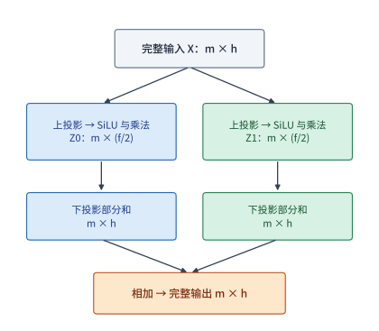

*图 6-9：SwiGLU 的两卡切分。上投影按权重矩阵的列划分输出特征，逐元素运算留在本地；下投影按权重矩阵的行划分输入特征。两步均保留全部 $m$ 个 token，切分的是每个 token 的特征维度。每卡中间激活为 $m\times(f/2)$，输出部分和仍为 $m\times h$，最后逐元素求和。*

在汇总这两份部分和时，具体调用哪一种集合通信原语，取决于后续算子需要什么数据布局：
- 如果下一层算子要求每张卡都持有完整的 $m\times h$ 张量（标准张量并行），就调用 **AllReduce（全归约）**，把各卡的部分和相加并让每张卡都拿到完整的总和；
- 如果紧接着的下一个算子可以按序列位置分片执行（见第 6.2.3 节的序列并行），则只需调用 **ReduceScatter（归约后分散）**：一边把各卡的部分和相加，一边把求和结果的不同行片段分别留在不同的卡上；
- 反过来，当某个算子需要从分散在各卡上的分片重新拼出完整张量时，则调用 **AllGather（全收集）**，把各卡持有的片段广播拼接起来。

**例 6-1：将 Qwen3-32B 的单层 FFN 切分到 4 张卡（TP4），每卡能少读多少权重、节省多少时间，又需要增加多少跨卡通信？**
已知 Qwen3-32B 的隐藏层宽度为 $h=5120$，FFN 中间层宽度为 $f=25600$。单卡完整保存一层 FFN 的三个 BF16 权重矩阵（$W_g, W_u, W_d$）共占 $3\times5120\times25600\times2 = 750\ \mathrm{MiB}$。
当我们将中间维度 $f=25600$ 均分到 4 张卡（每卡负责 $25600/4 = 6400$ 维）后：
- 每张卡上的门控与上投影矩阵形状缩小为 $5120\times6400$，下投影矩阵形状缩小为 $6400\times5120$，三个矩阵合起来仅占 **$187.5\ \mathrm{MiB}$**，恰好缩减为原来的四分之一；
- 按 H100 单卡 3350 GB/s 的显存带宽计算，单 token decode 时读取一层 FFN 权重的时间从单卡的约 **$234.8\ \mu\mathrm{s}$** 直接降到了 **$58.7\ \mu\mathrm{s}$**（每卡少读 $562.5\ \mathrm{MiB}$ 权重，净省约 **$176.1\ \mu\mathrm{s}$**）；
- 换取这 $176.1\ \mu\mathrm{s}$ 本地读取加速的代价是：在 FFN 末尾，4 张卡必须发起一次跨卡 AllReduce，将各自算出的 $1\times5120$ BF16 输出部分和（每卡 **$10\ \mathrm{KiB}$**）加到一起。第 6.4 节将用具体的环形与树形通信算法算出这次跨卡求和所需的微秒数。

**多头注意力模块的张量并行切分**遵循完全相同的逻辑（见图 6-5 上半部分）：在进入注意力层时，$Q$、$K$、$V$ 三个投影矩阵**按列（即按注意力头）切分**，每张卡只生成并计算分配给自己的那几个注意力头，注意力核心运算（$QK^\top$、Softmax 与乘 $V$）在各卡本地完全独立完成；随后的输出投影矩阵 $W_o$ 则**按行（即按输入注意力头）切分**，将本卡那些头的结果映射回完整的隐藏维度 $h$，算出一个 $m\times h$ 的部分和，最后同样通过一次跨卡 AllReduce 将所有卡的部分和相加。因此，在标准张量并行下，**每一个 Transformer 层都必须在注意力末尾和 FFN 末尾各执行 1 次 AllReduce（即每层 2 次）**；对于 64 层的 Qwen3-32B，每生成一个 token 就要累计执行 $64\times2 = \mathbf{128\ \text{次}}$ AllReduce。至于模型首尾的词嵌入表（Embedding）和词表输出头（LM Head），则通常沿着词表维度切分到各卡上。

在按头切分注意力时，有一条重要的硬件与算法边界：**单个注意力头是不可再拆分的最小分配粒度，而在采用分组查询注意力（GQA）的模型中，KV 头的数量往往远少于查询头。** 例如 Qwen3-32B 每层有 64 个查询头，但只有 **8 个 KV 头**（每 8 个查询头共享 1 个 KV 头）：
- 当采用 **TP8（8 张卡）** 时，每张卡恰好分到 8 个查询头和 **1 个独立的 KV 头**，全网 KV 缓存在 8 张卡上完全不重复；
- 可一旦我们继续扩大到 **TP16（16 张卡）**，每张卡分到 4 个查询头，这就意味着原本共享同一个 KV 头的 8 个查询头被迫拆散到了两张不同的卡上——为了让这两张卡都能在本地独立算出那 4 个查询头的注意力，**这两张卡就必须在各自的显存里同时保存那同一个 KV 头的完整副本**。以 128K 上下文为例，单个 KV 头在全网 64 层的状态占 $4\ \mathrm{GiB}$，TP8 时 8 张卡合计保存 $8\times4 = 32\ \mathrm{GiB}$（无冗余），而 TP16 时 16 张卡合计要保存 $16\times4 = 64\ \mathrm{GiB}$（翻了一倍）。同理，前文第 6.1.2 节的 Qwen3-235B-A22B 每层只有 **4 个 KV 头**，因此在八卡 TP8 下就已经触发了每两张卡复制一份 KV 头的现象。简言之：**只要张量并行的卡数 $p$ 超过了模型每层的 KV 头数，继续成倍增加 TP 卡数就不再能减少每张卡需要保存和读取的 KV 容量，反而会导致 KV 缓存跨卡重复存储。**

为了在后文中定量对比不同规模的张量并行部署，我们约定用 $p$ 表示单个推理实例占用的 TP 卡数；当手头共有 8 张加速卡时，能够同时部署的独立服务实例数即为 $8/p$。下面我们先推导出单个 $p$ 卡实例每生成 1 个 token 的单步耗时模型 $T(p)$，第 6.7 节再将其换算为一组并发用户请求的整体完成时间。

**从单层访存与通信推导完整 decode 步的耗时模型 $T(p)$。** 我们仍以 Qwen3-32B 运行单个 128K 上下文会话的 decode 步为例。在每一步 decode 中，模型需要从 HBM 读取一遍全部 64 层的权重矩阵和历史 KV 缓存，并把新生成的 1 个 token 的 K、V 写入显存：
1. **单层注意力投影权重**：隐藏维 $h=5120$，64 个查询头（总宽 $64\times128=8192$），8 个 KV 头（总宽 $8\times128=1024$）。因此单层 $W_q, W_o$（各为 $5120\times8192$）与 $W_k, W_v$（各为 $5120\times1024$）的 BF16 权重总量为：

$$
2\left(2\times5120\times8192+2\times5120\times1024\right)=180\ \mathrm{MiB}.
$$

2. **单层总权重**：加上前面算过的单层 FFN 权重 $750\ \mathrm{MiB}$，每一层的 BF16 权重合计为 $180 + 750 = \mathbf{930\ \mathrm{MiB}}$。
3. **全网 KV 缓存访问量**：设当前步开始前已缓存的上下文 token 数为 $s$，加上本步新写入的 1 个 token，共访问 $(s+1)$ 个 token 的 KV（每 token 在全网 64 层占 $256\ \mathrm{KiB}$）。当 $s=131{,}064$ 时，每层读取的 KV 约为 $512\ \mathrm{MiB}$。
4. **词表输出头（LM Head）权重**：词表大小 $V_{\text{vocab}}=151{,}936$，输出投影矩阵 $5120\times151936$ 的 BF16 权重约为 **$1.56\ \mathrm{GB}$**。

将以上各项相加，单卡完整执行一步 decode 的 HBM 显存总访问量 $V(s)$ 为：

$$
V(s)=64\times930\ \mathrm{MiB}
+256\ \mathrm{KiB}\times(s+1)
+151936\times5120\times2\ \mathrm{bytes}. \tag{6-4}
$$

将 $s=131{,}064$ 代入式 (6-4)，可得全步显存总访问量约为 **$98.32\ \mathrm{GB}$**（其中模型权重占 $63.97\ \mathrm{GB}$，历史与当前 KV 占 $34.36\ \mathrm{GB}$）。按单张 H100 的峰值显存带宽 $3350\ \mathrm{GB/s}$ 计算，读完这 $98.32\ \mathrm{GB}$ 数据约需 **$T_{\mathrm{local}} \approx 29.35\ \mathrm{ms}$**；而同一步的浮点矩阵运算量总共只有约 $0.34\ \mathrm{TFLOPs}$，按 $989.4\ \mathrm{TFLOP/s}$ 计算仅需约 $0.34\ \mathrm{ms}$。显然，每一层注意力与 FFN 的本地执行耗时完全受显存带宽支配（memory-bound）。

当我们在 $p$ 张卡（$p \le 8$，未超过 8 个 KV 头）上采用张量并行时，全部权重与 KV 缓存都均匀切分到了 $p$ 张卡上，因此每张卡的本地显存读取耗时直接缩减为 **$T_{\mathrm{local}}/p = 29.35/p\ \mathrm{ms}$**（层归一化、逐元素激活与词表采样只读写寥寥几个隐藏向量，耗时占比极小，此处忽略不计）。[^continuous] 随后，加上全网 64 层串行触发的 **128 次跨卡 AllReduce** 耗时，就得到了贯穿本章后续各节的 **TP 单步执行时间模型**：

$$
T(p)=\frac{T_{\mathrm{local}}}{p}+128\,T_{\mathrm{AR}}(p),
\qquad T_{\mathrm{local}}\approx29.35\ \mathrm{ms}. \tag{6-5}
$$

其中 $T_{\mathrm{AR}}(p)$ 表示 $p$ 张卡执行一次 AllReduce 的耗时。式 (6-5) 清晰地刻画了增加 TP 卡数的收益与代价：等号右边的第一项（本地访存耗时）随着卡数 $p$ 的增加按 $1/p$ 反比例下降，而第二项（128 次跨卡归约通信耗时）则会随着参与卡数 $p$ 的增加而上升。如果我们考虑将 TP 卡数从 $p$ 翻倍到 $2p$，本地访存能够节省的时间为 $\frac{T_{\mathrm{local}}}{p} - \frac{T_{\mathrm{local}}}{2p} = \frac{T_{\mathrm{local}}}{2p}$；因此，**把卡数翻倍到 $2p$ 能够真正缩短单步总耗时的充要条件是：128 次归约新增加的通信耗时必须小于本地省下的访存时间**，即：

$$
128\left[T_{\mathrm{AR}}(2p)-T_{\mathrm{AR}}(p)\right]
<\frac{T_{\mathrm{local}}}{2p}. \tag{6-6}
$$

观察式 (6-6) 右侧的分母 $2p$ 可以发现：基数 $p$ 越大，再翻倍所能省下的本地时间 $\frac{T_{\mathrm{local}}}{2p}$ 就越少（边际收益递减）；此时哪怕每次 AllReduce 只比原来多花几微秒，乘上 128 次之后也会轻易抵消掉本地访存节省的时间，甚至让翻倍后的总时间反过来变慢。

最后顺带一提，当参与并行的加速卡数量更多时，一个线性层除了单纯按列或按行做一维切分外，还可以**同时切分两个矩阵维度（二维张量并行 / 2D Tensor Parallelism）**，将加速卡排列成行、列两个正交方向的二维网格通信组。例如对于 $[8192,4096]\times[4096,12288]$ 的 BF16 线性投影，若将输出矩阵切分成 16 片放到 16 张卡上，每张卡起初只持有 $4\ \mathrm{MiB}$ 的输入分片和 $6\ \mathrm{MiB}$ 的权重分片：
- 如果将 16 张卡排成 **$4\times4$ 方阵网格**，每张卡需要横向收集同一行其余 3 张卡的输入分片（接收/发送 $12\ \mathrm{MiB}$），同时纵向收集同一列其余 3 张卡的权重分片（接收/发送 $18\ \mathrm{MiB}$）；
- 如果排成 **$2\times8$ 网格**，两个方向的通信量分别变为 $28\ \mathrm{MiB}$ 和 $6\ \mathrm{MiB}$；
- 如果排成 **$8\times2$ 网格**，则分别变为 $4\ \mathrm{MiB}$ 和 $42\ \mathrm{MiB}$。

当横向与纵向链路彼此独立且带宽相等时，总传输耗时由两个方向中数据量较大的那一方决定（$\max(12,18)=18\ \mathrm{MiB}$ 最小），因此对称的 $4\times4$ 网格最快。前沿工作如 MeshSlice 正是沿着这种二维网格继续细分数据块，让跨卡收集与本地矩阵乘法形成重叠流水；而推理系统 Arctic 则在同一次前向传播的不同阶段之间动态切换并行网格分工（其涉及的跨卡状态迁移将在第 9 章详细展开）。[^variants]

### 6.2.3 序列并行：逐 token 算子沿序列分片

张量并行让每张卡仅保存权重矩阵的一部分，但同一层内还有一些不做矩阵乘法的算子，如 LayerNorm（层归一化）、Dropout 与残差相加。这类算子按 token 逐个独立计算，每个 token 的输出仅依赖其自身的隐藏向量。**序列并行**（sequence parallelism，SP）正是将这些逐 token 算子沿序列位置切分：TP 组内的每张卡只处理一段序列位置，不再各自保存一份完整的激活张量。本书采用大模型训练框架 Megatron 中的这一常见定义。[^sequence-context]

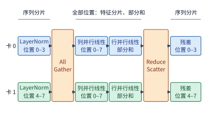

*图 6-10：LayerNorm 和残差只用到本 token 的数据，两张卡各处理一半位置；进入列并行线性层前用 AllGather 收集全部位置，行并行线性层的部分和用 ReduceScatter 求和并重新按位置分片。*

具体而言，列并行线性层需要完整的输入序列，因此在进入该层之前先用 AllGather 收齐各卡的序列分片；而行并行线性层产生部分和之后，则改用 ReduceScatter 一边跨卡求和、一边按序列位置重新切分。由于一次 AllReduce 在代数上本就等价于 ReduceScatter 与 AllGather 的串联，序列并行并未增加总通信量，只是把这两半通信拆开并放置在不同算子的边界上，从而省去了中间逐 token 算子在每张卡上重复保存完整激活的开销。

以形状为 $[8192,4096]$ 的 BF16 激活张量为例，完整张量占 64 MiB；若四张卡各自仅保留连续的 $[2048,4096]$ 序列分片，则每卡仅占 16 MiB，四卡合计 64 MiB；反之，若四张卡各自保存完整张量，四卡总占用将达 256 MiB。需要注意，这一显存节省仅发生在保持序列分片的算子区间内，并非模型的所有激活与权重都缩小四倍。矩阵乘法内部归约维与输出维的关系仍与图 6-9 完全一致，变化的只是下游算子接收何种分片布局。配套实验在 JAX（支持自动求导与编译执行的数值计算框架）中对比展示了保持分片与重新收集这两条 FFN 执行路径。[^tp-experiment]

### 6.2.4 上下文并行：切分同一序列的注意力

序列并行仅适用于逐 token 独立计算的算子，而自注意力机制却要求每个位置与序列中的其他位置交互。**上下文并行**（context parallelism，CP）把同一条长序列的不同位置分配给多张卡：每张卡保存本卡所负责位置区间的 Q、K、V，并计算这一区间的注意力输出。图 6-11 以 8 个序列位置为例，展示了两张卡的分工方式。

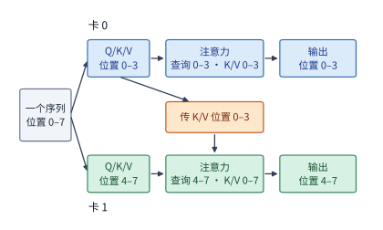

*图 6-11：每张卡保存自己那段位置的 Q、K、V。因果注意力下，卡 1 的查询还要用到卡 0 的 K、V，所以 K、V 必须跨卡传递；非因果注意力时两个方向都要传。*

在计算本卡负责位置的注意力时，查询向量仍需访问因果掩码允许范围内的远端 K、V。系统既可以先一次性收齐全部 K、V，也可以让 K、V 分块在各卡之间沿环路依次传递，每收到一块就用第 5.3.3 节介绍的在线 softmax 递推更新局部最大值、指数和与加权输出。这里需要区分两个概念：上下文并行是工作划分方式，而环形注意力（Ring Attention）则是其中一种具体的通信调度与流式计算实现，二者并非同义词。[^sequence-context]

图 6-12 将这种跨位置依赖表示为 8 个位置之间的可见性矩阵。

*图 6-12：八个 token 的因果注意力，横轴为键的位置、纵轴为查询的位置。实色格是必须计算的查询—键配对；前四行归卡 0，后四行归卡 1。虚线只是设备边界，左下区域的远端依赖并不因此消失。*

在因果注意力下，若简单按序列位置前、后连续切半，还会引发显著的负载失衡。8 个位置的因果注意力共有 $1+\cdots+8=36$ 个查询—键配对，其中前 4 个位置仅有 10 对，而后 4 个位置多达 26 对——两张卡分到的 token 数量相同，实际计算量却相差 2.6 倍。若将靠前与靠后的位置对称搭配，例如让卡 0 持有位置 $1,2,7,8$、卡 1 持有位置 $3,4,5,6$，两张卡便各自恰好承担 18 对计算。工程实现中通常采用分块交错的“之”字形（zigzag）布局来均衡负载，但此时必须严格保留每个 token 的原始位置编码与因果掩码关系，并相应调整通信配对；远端上下文绝不能当作无效填充（padding）直接丢弃。

在自回归 decode 阶段，新生成的查询位置很少，但历史 K、V 序列却可能很长。沿历史位置切分 KV 缓存后，每张卡先独立算出本卡历史区间的局部最大值 $m_r$、局部指数和 $l_r$ 以及未归一化的加权输出向量 $u_r$，再跨卡合并为全局结果：

$$
m=\max_r m_r,\qquad
l=\sum_r e^{m_r-m}l_r,\qquad
u=\sum_r e^{m_r-m}u_r,\qquad o=u/l.
$$

其中 $o$ 即为新 token 在全部历史位置上的精确注意力输出。这一跨卡归约公式与第 5 章在不同数据块（tile）之间合并在线 softmax 的代数形式完全相同，区别仅在于统计量与部分和向量需要跨卡传输。显然，各卡不能先各自完成局部 softmax 归一化再简单平均输出向量。总体而言，上下文并行降低了单卡保存的上下文状态容量与本地注意力计算量，代价是引入了 K、V 分块的跨卡交换或在线 softmax 统计量的跨卡归约；自回归生成时前后 token 之间的先后依赖并不会因此消失。由于不同框架对“序列并行”和“上下文并行”的命名常有交叠，评估具体配置时应直接核查切分了哪些算子、哪些张量以及使用了哪个通信组，而不必拘泥于缩写名称。

### 6.2.5 流水线并行：按层划分阶段

前面介绍的几种切分方式均在模型单层内部划分工作。**流水线并行**（pipeline parallelism，PP）则改为沿模型深度方向按层分工：将模型的连续层按顺序划分为若干阶段（stage），每个阶段由一张或一组卡负责。图 6-13 将 Qwen3-32B 的 64 层划分为两个流水阶段。

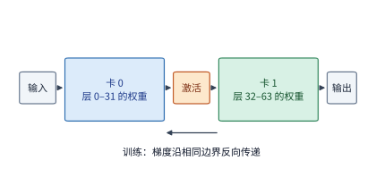

*图 6-13：两个阶段各保存自己那些层的权重。相邻阶段之间只交接激活；训练时梯度沿同一边界反向传递。*

前一个阶段算完本阶段负责的模型层后，仅需将边界处的激活张量传给下一个阶段继续计算。每个阶段只需保存本阶段各层的权重，相邻阶段之间只交接中间激活（训练反向传播时则沿同一边界回传梯度）。

为了让不同阶段同时工作，送入流水线的请求批次会拆分为多个微批次（micro-batch），使各个阶段能够并发处理不同的 micro-batch。设模型共划分为 $q$ 个阶段，每个阶段的执行耗时（含阶段间激活传输）均为 $t$，输入包含 $b$ 个已经就绪且互不依赖的 micro-batch。以 4 个阶段、每阶段耗时 1 ms 为例：micro-batch 0 在 0 ms 时刻进入阶段 0，依次流经 4 个阶段后于 4 ms 时刻完成；阶段 0 在 1 ms 时刻即可接收 micro-batch 1，后者于 5 ms 时刻完成；其余 micro-batch 依次跟进，此后每隔 1 ms 便产出一个完成结果。

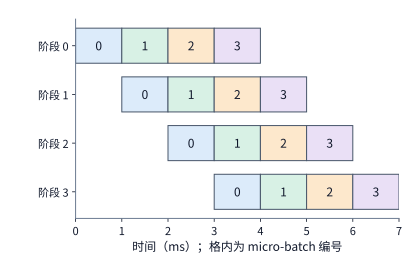

*图 6-14：四个等时阶段处理四个独立 micro-batch。每格为 1 ms，同色表示同一 micro-batch。第一项结果在 4 ms 产生，最后一项在 7 ms 产生；左上到右下的空白来自流水填充与排空。*

第一个 micro-batch 走完流水线需耗时 $qt$，其后每增加一个 micro-batch 仅使总完成时间增加 $t$，因此总耗时与流水线利用率分别为

$$
T_{\mathrm{PP}}=(q+b-1)t,\qquad
\eta_{\mathrm{PP}}=\frac{qb\,t}{q(q+b-1)t}=\frac{b}{q+b-1}. \tag{6-7}
$$

式（6-7）中，分子为全部阶段实际有效工作时间的总和，分母为阶段数乘以整批任务走完流水线的总时长。在 4 个阶段、4 个 micro-batch 的情形下，流水线利用率为 $4/7\approx 57\%$；当 micro-batch 数量增加到 16 个时，利用率提升至 $16/19\approx 84\%$。可见，可并发填入的独立 micro-batch 越多，流水线启动填充（fill）与末尾排空（drain）所造成的空闲气泡（bubble）占比就越小。

除首尾气泡外，各阶段执行耗时不均同样会导致计算卡空闲等待。若 4 个阶段的单步耗时分别为 1、1、2、1 ms，则第一个 micro-batch 在 5 ms 时刻完成，此后流水线受限于耗时 2 ms 的瓶颈阶段，最快只能每 2 ms 产出一个结果。由于上游阶段送出数据的速度高于瓶颈阶段的处理速度，中间队列会逐渐积压；一旦缓冲区占满，上游阶段便不得不暂停等待。因此，工程上需根据各层的实际执行耗时（而非简单按层数均分）来划分流水阶段，使各阶段耗时尽量接近，以减少阻塞与等待。[^pipeline]

需要注意，自回归解码会话中下一步的输入 token 必须等当前步生成完毕后才能就绪。4 个彼此独立的并发会话可以拆成 4 个可同时填入流水线的 micro-batch，而同一个会话未来的 4 个生成步则构成一条严格的串行依赖链，无法同时送入不同阶段并行执行。因此，推理场景下的流水线利用率直接取决于系统同时拥有多少个独立的在途 micro-batch。

### 6.2.6 专家并行：切分专家集合

最后一种并行方式专门针对稀疏混合专家（MoE）模型中的专家集合。稠密模型中所有 token 都共用唯一一组 FFN 权重；MoE 模型则在同一层内准备了多个结构相同的前馈网络作为“专家”（expert），由路由器（router）先为每个 token 计算门控打分，再从中选出少数几个专家实际执行。虽然单个 token 只激活极少数专家，但整套专家集合都必须常驻在加速器显存中，以备不同 token 随时调用。这就引出了 MoE 特有的切分维度——**专家并行**（expert parallelism，EP）：将不同专家分配到不同的计算卡上，每张卡仅负责执行落在本卡专家上的 token 输入。图 6-15 展示了将 8 个专家平分到两张卡上的基本流程。

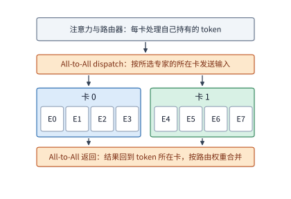

*图 6-15：注意力和路由器在 token 所在的卡完成；输入按所选专家的所在卡发送，专家算完后结果送回原卡，按路由权重合并。两次交换都是 All-to-All（全交换），即每张卡向其他各卡分别发送不同的数据。*

理解专家并行需要依次厘清两个问题：一是各专家的权重存放在哪张卡上，二是当前批次的 token 如何跨卡流转并完成计算。

先以 4 张卡、8 个专家为例说明这一过程。设卡 0 存放专家 0 和 1，卡 1 存放专家 2 和 3，以此类推。假设卡 0 当前持有 token A，路由器为 token A 选中了专家 1 和专家 6：其中专家 1 位于卡 0 本地，而专家 6 位于远端的卡 3。于是，卡 0 一方面要在本地执行专家 1，另一方面还要将 token A 的隐藏向量发送给卡 3 执行专家 6，最后将两份专家输出收回卡 0 并按路由门控权重加权求和。

将 token 输入按路由结果发往目标专家所在卡的过程称为 **dispatch（派发）**，将各专家计算完毕的输出送回原卡并加权累加的过程称为 **combine（合并）**。仍以 token A 为例：设专家 1 与专家 6 的输出向量分别为 $y_1,y_6$，对应的路由门控权重为 $a_1,a_6$，则合并后的完整 MoE 层输出为 $a_1y_1+a_6y_6$。在这一过程中，发起端需记录每个 token 的原始位置编号与路由权重，接收端负责执行本卡专家的矩阵乘法，返回的结果再按编号归入原 token 名下完成加权合并。

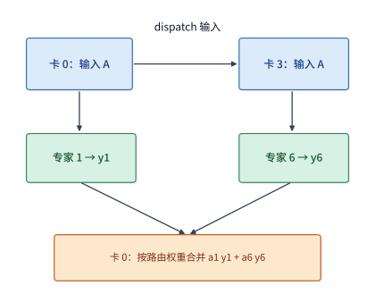

*图 6-16：卡 0 持有 token A，选择本地专家 1 与卡 3 上的专家 6。dispatch 沿上方路径发送输入，combine 沿下方送回专家输出并加权合并。每个 token 选中几个专家，就要算几次；专家在哪张卡，决定输入要送到哪里。*

当同一个 token 选中的多个专家恰好位于同一张远端卡上时，只需向该目标卡发送一份输入向量即可。例如，若某个 token 选中的 8 个专家恰好两两分布在 4 张远端卡上，单个 4096 维 BF16 输入向量占 8 KiB：若按所选专家逐次独立发送，共需传输 64 KiB；而按目标卡去重发送则只需传输 32 KiB，落入同一张目标卡的两个专家可直接共享这份输入。

当一批 token 同时执行时，每张卡都需要向其他各卡发送数量不等的 token 向量，这正是图 6-15 所示的 All-to-All（全交换）通信模式。接收端收到来自各卡的输入向量后，先按本卡各个专家将其重排（permute）为连续的矩阵行，批量执行专家矩阵乘法，随后再按原 token 编号将输出排回（unpermute）发送顺序并返回。可见，在当前步收到 token 分派最多的那张卡，往往也要承担最重的专家计算负载。

以 Qwen3-235B-A22B 为例，该模型共 94 层，每层设有 128 个路由专家，每个 token 激活其中 8 个。单个专家包含 3 次线性投影，隐藏维为 4096，专家中间维为 1536，因此单个专家的 BF16 权重容量为 $3\times4096\times1536\times2=36\ \mathrm{MiB}$。据此推算，单层全部 128 个专家共占 4.5 GiB，全模型 94 层的专家权重合计约 423 GiB。若将每层的 128 个专家均匀切分到 8 张卡上，每张卡分担的专家权重约为 52.9 GiB；在此之外，每张卡还需存放注意力子层、路由器、词嵌入与输出头的权重，以及 KV 缓存和运行时工作区。在典型的混合部署中，庞大的专家集合通过专家并行分散到各卡，而注意力子层的头与 KV 状态则按照注意力自身的并行策略组织。

> **实验 6-2 · 核心：张量切分与 micro-batch 流水如何改变执行时间**
>
> （a）写出两卡 SwiGLU 的六个权重分片和两个输出部分和的形状，用式（6-3）说明为什么需要将两张卡的输出部分和相加。
>
> （b）对 TP1、TP2、TP4、TP8，计算 Qwen3-32B 一个 128K 会话的本地内存访问时间，暂不计通信开销；求卡数每次翻倍所节省的时间。
>
> （c）采用第 6.4 节的归约时间，将其代入式（6-5），重新计算加速比，解释差距从哪里产生。
>
> （d）画出四阶段处理八个 micro-batch 的时序，分别考虑四个阶段均耗时 1 ms，以及耗时依次为 1、1、2、1 ms 的情况；比较两种情况下的完成时间，并指出 micro-batch 会在哪个阶段之前积压。
>
> （e）进阶：对同一个 FFN，比较输出完整张量与保留输出分片两种方式下，相邻算子之间需要传递的数据；也可选择配套二维网格方案，进一步推导通信数据的分块方式。

## 6.3 组合并行与模型规模

前面介绍的六种基本并行方式在实际系统中很少单独使用。本节先说明如何将多种并行方式组合起来并为每张卡建立多维坐标，随后深入分析 MoE 模型的两个核心工程问题：同一批次内 token 的专家选择分布如何改变权重读取量与各卡负载，以及当模型规模从数千亿迈向万亿参数时并行组合方案如何演进。

### 6.3.1 组合方案与设备坐标

张量并行与流水线并行可以直接正交组合：例如将 8 张卡划分为 4 个流水阶段，每个阶段内部由 2 张卡执行张量并行。此时，每层内部的张量并行归约在阶段内的 2 张卡之间完成，而相邻流水阶段之间则只跨阶段传递边界层的激活张量。若阶段内的两张卡在每层结束时各自持有完整的 8 KiB 隐藏向量，并分别点对点传给下一阶段对应的卡，则相邻阶段之间共需发送 16 KiB；反之，若阶段之间直接传递未合并的序列或特征分片，则传输量减半，由下一阶段根据算子需求再做拼接。因此，组合多种并行方式时，必须明确规定每个阶段或算子边界输出何种分片、下一阶段每张卡接收何种分片。

在工程实现中，组合多种并行方式的标准做法是：先为每张卡赋予一个多维设备坐标，再对计算图中的每个算子明确写出其输入、权重与输出的分片规则，以及跨卡通信所沿着的坐标轴（即通信组）。例如，数据并行度为 2、流水线并行度为 2、张量并行度为 4 的混合方案记作 DP2×PP2×TP4，共需动用 $2\times2\times4=16$ 张卡；若在同一个 TP4 通信组内开启序列并行，由于序列并行复用现有的 TP4 卡组而不额外增加设备维度，总卡数仍为 16 张，记号中不再额外乘上 SP4。简言之，**模型切分**规定了每份数据与算子归哪张卡负责，**运行时调度**规定了数据就绪、算子执行、跨卡通信与显存回收的先后次序，二者结合才构成一套完整的并行执行方案。

同样地，专家并行（EP）也可以与专家内部的张量并行（TP）组合。以 8 张卡部署 Qwen3-235B-A22B 为例：可将 8 张卡划分为 4 个专家组（EP4），每组负责 32 个路由专家；在每个专家组内部，再用 2 张卡沿专家 FFN 的中间维切分权重（TP2），使每张卡仅计算 768 维的专家中间特征。此时整个实例仍使用 8 张卡，每张卡由一个二维坐标唯一标识：第一个坐标（专家组编号 $0\sim3$）指示该卡负责哪 32 个专家，第二个坐标（组内 TP 编号 $0\sim1$）指示该卡负责这 32 个专家矩阵的哪一半。下文将沿用这一 TP2×EP4 混合布局来推导跨卡通信量。

在这套 TP2×EP4 布局中，还可以借由注意力子层的副本来省去跨组派发（dispatch）专家输入的开销：让 4 个专家组各自对同一个请求执行相同的注意力计算（每组内部的 2 张卡对注意力头做 TP2 切分，各自保存一半 KV 头）。这样一来，当注意力子层算完并完成组内 TP2 归约后，4 个专家组在本地都已持有完全相同的完整专家输入向量，只需各自从中选出选中了本组专家的 token 行直接计算即可，无需先做跨组 dispatch；待各组算完本组专家后，再将结果跨组归约求和。各卡的具体分工汇总如下表所示：

| 专家组 | 卡 | 专家编号 | 每卡专家中间维 | 每卡 KV 头 |
|---|---|---|---:|---|
| 0 | 0、1 | 0—31 | 768 | 偶数卡 0、1；奇数卡 2、3 |
| 1 | 2、3 | 32—63 | 768 | 同上 |
| 2 | 4、5 | 64—95 | 768 | 同上 |
| 3 | 6、7 | 96—127 | 768 | 同上 |

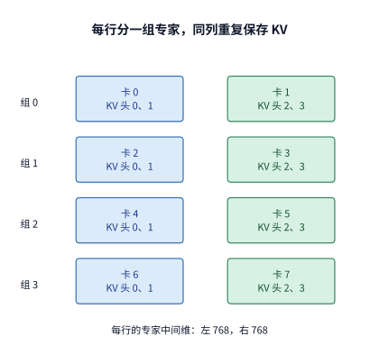

*图 6-17：八张卡排成四个专家分组，每组两卡沿专家中间维分工。同一列的注意力头与 KV 重复四份；每组因此都能在本地得到相同的专家输入。*

明确了数据与权重的放置位置后，再来追踪专家层的输出如何分两步汇合。第一步，在每个专家组内部，两张卡各自算完专家中间维的一半并完成下行投影后，先在组内两卡之间做一次求和，得到本组所负责的 32 个专家对该 token 的完整输出贡献；第二步，再将 4 个专家组各自的贡献跨组相加，还原出全部 128 个专家的完整 MoE 输出。

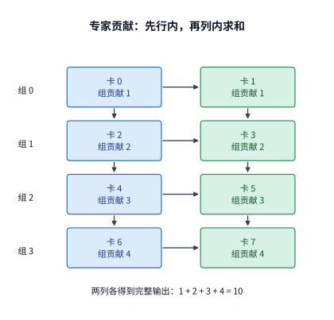

*图 6-18：横向箭头表示组内两卡求和，纵向箭头表示四个组求和。格内数字是某个输出元素经组内求和后的值，两列各自都得到相同的完整结果 10。*

如图 6-18 所示，第二步的跨组求和发生在组内 TP 编号相同的卡之间（即纵向通信组）。例如，假设 4 个专家组对某个输出元素产生的部分和贡献分别为 1、2、3、4，那么 4 张偶数卡（卡 0、2、4、6）组成一个通信组归约求和得到 10，4 张奇数卡（卡 1、3、5、7）组成另一个通信组同样归约求和得到 10。两步归约结束后，8 张卡全都持有相同的完整 MoE 层输出，即可直接进入下一层的计算。

当然，用注意力副本换取免 dispatch 通信并非没有代价，它需要付出额外的显存容量与重复计算。按上述 TP2×EP4 布局，由于非专家权重在 4 个专家组间重复存放了 4 份，每张卡需保存约 64.8 GB 权重，8 卡合计 518.6 GB，比每个参数仅存一份的基准容量（470.2 GB）多出约 48.4 GB。同时，当上下文长度为 8192 个 token 时，每张卡需保存 752 MiB 的 KV 缓存，8 卡合计占 5.875 GiB，是该请求真实 KV 缓存容量的 4 倍。此外，4 个专家组还要对同一批 token 重复执行 4 遍注意力计算。[^ownership]

**例题：注意力复制与专家切分的布局需要多少归约通信？** 设跨卡归约采用 FP32 精度，单个 token 的 4096 维完整隐藏向量占 $4096\times4=16\ \mathrm{KiB}$。采用第 6.4.2 节的环形 AllReduce 算法：在 2 张卡之间完成一次全归约，每张卡需发送 1 个完整向量的数据量（16 KiB）；在 4 张卡之间完成一次全归约，每张卡需发送 $2\times(4-1)/4=1.5$ 倍向量大小的数据量（24 KiB）。在每一层中，依次包含注意力子层的组内两卡归约、专家子层的组内两卡归约，以及 4 个专家组之间的跨组四卡归约共三次汇合，因此单层内每张卡的总发送量为

$$
16+16+24=56\ \mathrm{KiB}.
$$

8 张卡单层合计发送 448 KiB；若对 8192 个 token 的 prefill 批次采用同样的并行分工，则单层每张卡的发送量线性放大为 448 MiB。

### 6.3.2 批内复用与负载不均

第 6.3.1 节确定了 128 个专家静态存放在哪些卡上，但在每一次前向传播中究竟哪些卡最繁忙，还取决于当前批次（batch）动态激活了哪些专家。单个 token 仅激活 8 个专家，而一个包含多个 token 的批次则可能触发遍布整个专家集合的调用。下面考虑一个包含 64 个 token 的批次，每个 token 选择 8 个专家，全批共产生 $64\times8=512$ 次“token—专家”分派。

不妨对比两种极端情形：第一种情形下，这 512 次分派恰好均匀覆盖全部 128 个专家，每个专家各自处理 4 个 token 的特征向量；第二种情形下，全部 64 个 token 恰好选中了完全相同的 8 个专家，这 8 个活跃专家各自处理 64 个 token 的特征向量，其余 120 个专家则完全闲置。可以看到，两种情形下的有效浮点矩阵运算总量完全相等（均为 512 个 token—专家乘加任务）。然而，假定在同一批次内每个被激活专家的权重只需从 HBM 读取一次，则均匀覆盖情形需要从 HBM 读取全部 128 个专家的权重，即 $128\times36\ \mathrm{MiB}=4.5\ \mathrm{GiB}$；而集中选择情形只需读取 8 个专家的权重，即 $8\times36\ \mathrm{MiB}=288\ \mathrm{MiB}$——二者对 HBM 的权重读取量相差 16 倍。

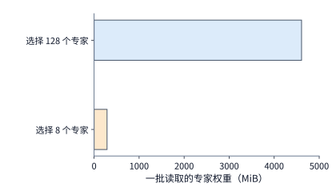

*图 6-19：64 个 token、每 token 八个专家，共 512 次分派。均匀覆盖与集中选择的有效计算量相同，被选中专家的权重读取相差 16 倍。每个专家 BF16 权重为 36 MiB，批内读取一次。*

因此，批内激活的专家种类越集中，每个活跃专家的权重就能被越多输入行共享复用，不仅大幅降低了 HBM 权重读取总量，也提高了每个专家 GEMM 算子的有效批大小（即算术强度）。但与此同时，这些被激活的专家落在哪几张卡上，同样直接决定整批任务的完成时间。在前面的 TP2×EP4 布局中，当 512 次分派均匀覆盖 128 个专家时，4 个专家组各自均衡承担 $32\times4=128$ 次分派；反之，若全批集中选中的 8 个热点专家恰好全部位于同一个专家组（例如专家组 0），则专家组 0 必须独自承担全部 512 次计算，其负载是均匀分布时的 4 倍，而其余 3 个专家组在整个专家层计算期间只能空闲等待。

因此，评估 MoE 层的实际执行耗时必须同时考察两个指标：一是全批激活专家所需的总权重读取量，二是负载最重的那个专家组所承担的计算与访存量。在批大小较小的 decode 阶段，瘦长的专家矩阵乘法主要受限于 HBM 权重读取带宽；而在批大小较大的 prefill 阶段，稠密的专家矩阵乘法则更容易受限于最繁忙专家组的计算耗时。若能将常被同时选中的热点专家均匀打散到不同的 EP 专家组中，便能在保留高批内权重复用率的同时，避免单一专家组成为算力瓶颈。

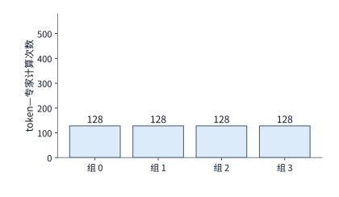

*图 6-20：均匀使用 128 个专家时，四个 EP 组各处理 128 次 token—专家计算，合计读取 4.5 GiB 权重。*

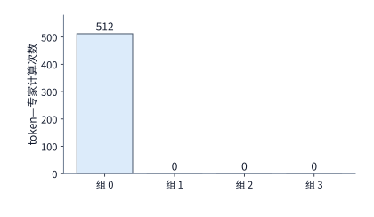

*图 6-21：所选八个专家都在组 0：权重读取降到 288 MiB，512 次计算却全部压在同一组。*

*图 6-22：把同样的八个专家分散到四组，将读取量维持在 288 MiB，同时让四组各承担 128 次计算。三图纵轴范围相同。*

对比图 6-21 与图 6-22 可以看出，后两种情形在整个集群范围内读取的专家权重总量完全相同（均为 288 MiB），但实际完成时间却截然不同，原因就在于实际分担这批工作的计算卡数量相差 4 倍。因此，批内权重复用率必须与专家在各卡上的物理分布结合起来一并分析。

除了完全均匀覆盖与完全集中这两种极端边界外，我们还可以用概率模型给出均匀随机路由假设下的期望活跃专家数。设每层共有 $E$ 个路由专家，每个 token 独立且等概率地从中无放回选取 $k$ 个专家。于是，某个特定专家在单个 token 的路由中未被选中的概率为 $1-k/E$；在包含 $m$ 个独立 token 的批次中，该专家自始至终一次都未被选中的概率为 $(1-k/E)^m$，从而至少被选中一次的概率为 $1-(1-k/E)^m$。对全部 $E$ 个专家分别定义指示随机变量（批内被激活取 1，否则取 0）并利用期望的线性性质求和，即得批内活跃专家数的数学期望：

$$
\mathbb{E}[E_{\mathrm{active}}]=E\left[1-\left(1-\frac{k}{E}\right)^m\right]. \tag{6-8}
$$

将 $E=128,k=8,m=8$ 代入式（6-8），可得期望活跃专家数约为 52 个，对应的理想权重读取量约为 $52\times36\ \mathrm{MiB}\approx1.8\ \mathrm{GiB}$；作为对比，若这 8 个 token 全部选中相同的 8 个专家，则只需读取 288 MiB 权重。随着批大小 $m$ 继续增大，括号内的指数项趋近于 0，活跃专家数很快逼近总专家数 $E$；此时继续扩大批大小，主要收益在于提高每份专家权重的批内复用次数。[^moe-tax]

在实际推理中，真实的专家路由分布由输入文本语义与模型训练共同决定，并非均匀随机分布。本书配套资料收录了 DeepSeek V4-Flash 在 4 条真实输入、43 个 MoE 层上采集的约 131 万次专家路由轨迹，其中不同专家被选中的频次呈现出明显的冷热分化。将每个专家实际收到的 token 数换算为矩阵行数，再按每张卡所存放的专家子集汇总，即可直接从真实轨迹还原出各卡的实际计算负载分布（逐层负载热图见配套资料）。[^routes]

### 6.3.3 从数千亿到万亿参数：并行组合如何变化

第 6.3.2 节关于权重复用与负载均衡的分析，建立在“全模型专家集合已经能够装入超节点显存”的前提之上。当模型参数量从数千亿进一步扩展至万亿规模时，系统设计者首先必须重新核算总显存容量，进而调整 TP、PP 与 EP 的组合比例。以 Qwen3-235B-A22B 为例，其全模型 BF16 权重（每个参数仅存一份）约为 470 GB；而参数量约 284B 的 DeepSeek V4-Flash 若按同样精度存放，仅权重就需约 568 GB。相比之下，一台标准八卡 HGX H100 服务器的总 HBM 容量为 $8\times80=640\ \mathrm{GB}$，装入上述权重后留给 KV 缓存与运行时工作区的余量已十分局促。此外，DeepSeek V4-Flash 每层拥有 256 个路由专家（每 token 激活 6 个）并额外配有常驻执行的共享专家（shared expert），专家集合更庞大，规划权重放置时必须同时兼顾共享专家与路由专家的切分策略。[^models]

当模型规模迈入万亿参数级别时，单机显存容量便彻底无法容纳。例如，DeepSeek V4-Pro 拥有约 1.6T 参数，即便采用每参数仅占 0.5 字节的 FP4 量化格式，全模型权重仍高达约 800 GB；而拥有约 2.8T 参数的 Kimi K3 在相同量化精度下权重容量更达约 1.4 TB，均已远超单台 HGX H100 服务器的物理显存上限。面对这一规模的模型，系统可以通过三个正交方向扩展设备规模：增加 EP 分组数，将庞大的专家集合分散到更多计算卡上；增加专家内部的 TP 切分度数，缩小单卡保存的单个专家矩阵分片；或者增加 PP 流水阶段数，减少每个阶段需要驻留的模型层数。

与此同时，模型内部对专家输入特征的表征方式也会直接影响跨卡通信量。以 Kimi K3 为例，其主干残差流的隐藏向量维度为 7168，但路由专家实际在 3584 维的低维潜空间中工作。若在发起跨卡 dispatch 之前先在本地完成从 7168 维到 3584 维的降维投影，则每个 token 传输的 BF16 向量即可从 14 KiB 减半至 7 KiB；反之，若先发送原始隐藏向量再在目标卡上降维，跨卡传输的数据量便会翻倍。可见，对于数学上完全等价的专家计算，仅改变降维投影置于跨卡通信之前还是之后，就会成倍改变网络传输字节数。此外，Kimi K3 每层从 896 个路由专家中激活 16 个，并配有 2 个直接处理 7168 维完整主干向量的共享专家；其全模型 93 层采用混合注意力架构，其中 69 个 KDA（核化线性注意力）层使用固定形状的状态矩阵递推浓缩历史上下文，其余 24 个 MLA 层则用低维潜在向量保存逐位置上下文。在显存规划中，KDA 层的状态占用仅由其固定矩阵维度决定，不随序列变长而膨胀；而 MLA 层的 KV 缓存容量则仍随会话上下文长度线性增长。[^models]

归纳起来，模型架构的演进从两个维度塑造着底层并行系统设计：一方面，参数总量与状态规模的增长决定了至少需要聚合多少张加速器的显存容量；另一方面，计算图内部的数据流与维度变换决定了算子之间需要交换多少字节的数据。前者划定了计算集群的最小资源规模下界，后者则决定了这些计算卡之间应当采用何种互联拓扑与并行组合。

> **实验 6-3 · 核心：专家分派与放置如何改变各卡负载和通信量**
>
> （a）沿图 6-16 写出 token A 的输入发送、两次专家执行和加权合并顺序。
>
> （b）复算 64 个 token 的两种专家分派，求权重读取量与负载最重的 EP 组的任务数。
>
> （c）把八个热点专家均分到四个 EP 组，比较总读取量与负载最重的专家组的计算量，解释变化来自哪里。
>
> （d）采用本节 TP2×EP4 表，求上下文长度为 8192 与 16384 时，每张卡需要保存的 KV 容量，并推导三次结果汇合的发送量。
>
> （e）进阶：对 DeepSeek V4-Flash、DeepSeek V4-Pro 或 Kimi K3，选择一个具体存储格式，逐项放置路由专家、共享专家、注意力状态与工作区。

## 6.4 集合通信的实现与执行代价

### 6.4.1 根据模型切分方式确定通信需求

第 6.2 节定义了 AllReduce、All-to-All 等集合通信原语的逻辑语义，本节进一步探讨它们的底层算法实现与运行时执行代价。先考虑一个基础问题：4 张卡如何对一个包含 4 个元素的向量完成跨卡求和？起初，每张卡在本地各持有一份 4 元素向量的部分和贡献，目标是让每张卡最终都获得全部 4 张卡的逐元素总和。这一过程可以拆分为两个阶段完成：第一阶段先跨卡求和，并让卡 0 保存元素 0 的完整总和、卡 1 保存元素 1 的完整总和，以此类推；第二阶段再让各卡互相广播各自已求和完毕的元素，使 4 张卡全部拼齐完整的 4 元素结果向量。

这两个阶段对应的集合通信原语分别是 ReduceScatter 与 AllGather，二者串联起来便构成一次完整的 AllReduce。可以看到，前一阶段同时改变了数值（完成累加）与数据的分布位置（变为分片持有），后一阶段则只改变数据的分布位置（从分片恢复为全集）。除求和外，稠密模型与 MoE 模型在并行执行中还需要拼接序列分片，或将 token 输入按路由结果发往不同的目标卡。按照通信开始时各卡持有的初始数据与通信完成时各卡获得的目标数据，可将最常用的四种集合通信原语归纳如下表：

| 操作 | 开始时各卡持有 | 完成时各卡持有 | 用途 |
|---|---|---|---|
| AllReduce | 同一张量的部分结果 | 完整归约结果 | TP 部分和、训练梯度 |
| ReduceScatter | 同一张量的部分结果 | 归约结果的不同分片 | 分片输出、梯度分片 |
| AllGather | 一个张量的不同分片 | 完整拼接结果 | 恢复完整输入 |
| All-to-All | 发往不同目的地的数据 | 各源卡发给本卡的数据 | 专家输入的 dispatch 与结果回传 |

与之相比，Broadcast（广播）是将某一张指定源卡的数据分发给通信组内的所有卡，而 Reduce（归约）则是将全组归约结果仅汇总到某一张指定目标卡上，二者都不像上表中的四类原语那样在结束时让全组每张卡都持有结果。这里还需注意两处常见误区：其一，AllGather 仅按照通信组内的卡编号（rank）顺序拼接各卡分片，不做任何数值求和；其二，All-to-All 仅按目标卡编号重新分发数据块，并不会自动按路由权重合并专家输出。因此，MoE 模型中的 combine 阶段实际包含三个步骤：通过 All-to-All 将专家结果传回源卡、按原 token 编号恢复排列顺序、再乘上路由门控权重累加求和，绝不能仅凭“合并”二字将其混同于 AllReduce。[^nccl-basics]

总之，集合通信原语的名称规定了“对什么数据算什么结果、结果最终落在哪些卡上”，而底层集合通信算法则规定了“数据切成多少块、分几轮沿什么路径传递”。下一小节将具体追踪其中一个数据块沿环形拓扑逐轮传递的过程。

在此之前还需指出一点：通信算法只决定“全组卡全部就绪之后，数据交换本身耗时多久”，而每张卡实际发起通信的时刻差异（即到达偏斜，arrival skew）则决定了先就绪的卡要在同步屏障前等待多久。由于集合通信要求全组协同，必须等最后一张慢卡（straggler）完成前序计算并进入通信后，跨卡数据交换才能真正推进；各卡到达时刻相差越大，单纯加快通信传输本身所带来的端到端收益就越有限。第 7.6.1 节将基于同一组实测数据定量展开这一分析。[^collective-path]

### 6.4.2 环、树与通信轮次

**环形 AllReduce**（Ring AllReduce）将参与通信的 $n$ 张卡在逻辑上排成一个单向环路：在每一轮通信中，每张卡同时向环上的下游邻居发送一个数据块，并从上游邻居接收一个数据块。设每张卡持有的完整部分和张量大小为 $M$ 字节，算法先将其均分为 $n$ 个数据块，每块大小为 $M/n$。

以四卡环路 $0\to1\to2\to3\to0$ 为例。初始时，每张卡都在本地持有块 0、1、2、3 的局部贡献。第一轮（ReduceScatter 的第 1 步），卡 $r$ 向下游发送块 $r$，接收方将收到的块与本地同一编号块的贡献逐元素相加；第二轮，各卡将上一轮刚累加形成的部分和块继续向下游转发并再次累加；第三轮，再次转发并加上最后一张卡的本地贡献。

不妨单独追踪“块 0”的流转轨迹：块 0 从卡 0 出发，依次流经卡 1、卡 2，最终在第三轮结束时到达卡 3。假设卡 0、1、2、3 对块 0 中某个元素的局部贡献分别为 1、10、100、1000，那么该元素在沿环传递过程中的数值依次变为 1、11、111、1111。第三轮结束时，卡 3 便持有了块 0 的完整四卡总和；由于其余三个数据块也在同一环路上错位同步流转，此时卡 0、1、2 也恰好各自持有了块 1、2、3 的完整四卡总和。

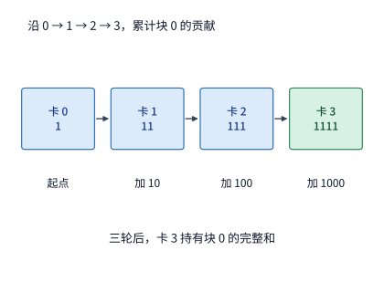

*图 6-23：仅跟踪块 0 的一个元素：每经过一张卡，就加入该卡的贡献。三轮后得到 1111，保存在卡 3。其他三个块同时沿环推进。*

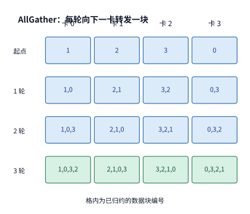

*图 6-24：ReduceScatter 结束时，卡 0、1、2、3 分别持有块 1、2、3、0。接下来每轮转发一块，三轮后每卡都拥有四块完整结果。*

之所以只需 3 轮就能完成求和，是因为每个数据块在起点卡上本就包含 1 份初始贡献，只需再依次流经其余 3 张卡即可攒齐全部 4 份贡献。推广到 $n$ 张卡的情形，第一阶段（ReduceScatter）共需 $n-1$ 轮。紧接着进入第二阶段（AllGather）：每张卡从自己已持有完整总和的那个块开始，沿环路向下游逐轮接力转发（只覆盖写入、不再相加），每经过一轮每张卡就多收齐一个完整块；再经过 $n-1$ 轮后，所有卡便都收齐了全部 $n$ 个块。汇总两个阶段，环形 AllReduce 共需执行 $2(n-1)$ 轮通信，每张卡累计向外发送的数据总量为 $2(n-1)M/n$。

设每轮通信的固定启动开销（延迟项）为 $\alpha$，环上每条有向物理链路的有效带宽为 $B$，且各卡必须等本轮数据块发送完毕后才进入下一轮，则环形 AllReduce 的总耗时模型（即经典的 $\alpha$-$\beta$ 模型）为

$$
T_{\mathrm{ring}}=2(n-1)\alpha+\frac{2(n-1)M}{nB}. \tag{6-9}
$$

式（6-9）中，第一项（启动延迟项）随卡数 $n$ 线性增长，第二项（带宽传输项）则随 $n$ 增大而渐近趋向常数 $2M/B$。可见，环形算法通过将大张量切分为 $n$ 份并在环上流水并发传输，在大消息场景下能充分利用每张卡的链路带宽；但在小消息场景下，每一轮发送的数据块极小，累计 $2(n-1)$ 轮的固定启动延迟反而成为主导耗时。

**例题：计入归约通信后，增加 TP 卡数还能加速多少？** 仍以 Qwen3-32B 在 128K 上下文下的单会话 decode 为例。每次张量并行归约的输入是单个 token 的 BF16 隐藏向量，数据量 $M=10\ \mathrm{KiB}$；在八卡 HGX H100 服务器内部，每张 GPU 经 NVSwitch 互联的单向有效带宽为 $B=450\ \mathrm{GB/s}$；每轮固定启动开销 $\alpha$ 取 MSCCL++ 论文在同一八卡 H100 平台上实测的 NVLink 单向延迟 $0.822\ \mu\mathrm{s}$。试求 TP2、TP4、TP8 下的单次归约耗时以及代入式（6-5）后的单步总时间。

**解答**：在 TP8 配置下，一次环形 AllReduce 共需 $2\times(8-1)=14$ 轮，仅固定启动开销就达 $14\times0.822\approx11.51\ \mu\mathrm{s}$；每张卡累计发送 $14\times10/8=17.5\ \mathrm{KiB}$，按 $450\ \mathrm{GB/s}$ 带宽计传输仅耗时约 $0.04\ \mu\mathrm{s}$，相加得单次归约耗时约 $11.55\ \mu\mathrm{s}$。将 TP2、TP4、TP8 的结果分别代入式（6-9）与式（6-5），汇总如下表（其中 TP1 一行仅作理论基准参照，单张 80 GB 显卡无法装下一个 128K 会话）：

| TP 卡数 | 本地内存访问 | 128 次归约 | 单步时间 |
|---|---:|---:|---:|
| 1 | 29.35 ms | 0 | 29.35 ms |
| 2 | 14.68 ms | 0.21 ms | 14.89 ms |
| 4 | 7.34 ms | 0.64 ms | 7.97 ms |
| 8 | 3.67 ms | 1.48 ms | 5.15 ms |

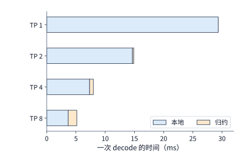

*图 6-25：根据式（6-5）和环形归约模型绘制的单步时间。本地内存访问随卡数增加而减少，归约时间则增加；条形总长度为单步执行时间。本地项包括权重与 KV 读取，归约项是卡间集合通信。*

观察图 6-25 可以看到：随着 TP 卡数翻倍，代表本地 HBM 访存的蓝色条每次减半，而代表跨卡归约的橙色条则成倍增长。从 TP2 扩至 TP4 时，本地访存耗时减少约 7.34 ms，通信耗时仅增加约 0.42 ms，单步净节省约 6.92 ms；而从 TP4 扩至 TP8 时，本地访存耗时仅再减少约 3.67 ms，通信耗时却增加了约 0.84 ms，单步净节省收窄至约 2.83 ms。此时式（6-6）不等号左右两端的数值已明显拉近，但由于本地访存节省量仍大于新增通信开销，八卡 TP8 依然是单会话最快的选择。

更进一步看，在这种 10 KiB 的小消息 decode 场景下，单纯提高互联带宽几乎毫无帮助：八卡单次归约的 $11.55\ \mu\mathrm{s}$ 中有 $11.51\ \mu\mathrm{s}$ 来自 14 轮固定启动延迟；即便把链路带宽推向无穷大、让数据传输耗时降为零，这 14 轮握手等待也依然存在。具体而言，将 NVLink 带宽翻倍，全模型 128 次归约合起来仅能省下约 $2.5\ \mu\mathrm{s}$；反之，若能将每轮固定开销 $\alpha$ 减半，128 次归约便可直接省下约 $0.74\ \mathrm{ms}$。[^ring]

为了压缩通信轮数，小消息场景通常改用**树形算法**（Tree AllReduce）。以 4 张卡为例：先让卡 0 与卡 1、卡 2 与卡 3 两两配对归约，再由两个子树的根节点汇总出全局总和，仅需 $\log_2 4=2$ 轮即可完成归约；随后沿同一棵树反向广播 2 轮，合计只需 4 轮（低于四卡环形算法的 6 轮）。一般地，当卡数 $n$ 为 2 的整数次幂时，未分段二项树（binomial tree）完成一次 AllReduce 共需 $2\log_2n$ 轮，但关键路径上每一轮都需要传输完整的 $M$ 字节张量，其耗时模型为

$$
T_{\mathrm{tree}}=2\log_2n\left(\alpha+\frac{M}{B}\right). \tag{6-10}
$$

在八卡（$n=8$）、消息大小 $M=10\ \mathrm{KiB}$ 的 decode 场景下，树形算法仅需 $2\log_2 8=6$ 轮，代入式（6-10）得单次归约耗时约 $5.07\ \mu\mathrm{s}$，比环形算法的 $11.55\ \mu\mathrm{s}$ 快一倍以上。然而，当输入变为 8192 个 token 的 prefill 批次、单次归约消息扩大至 $M=80\ \mathrm{MiB}$ 时，环形算法仅需约 $0.34\ \mathrm{ms}$，而未分段树形算法却高达约 $1.12\ \mathrm{ms}$——此时树形算法减少轮次所省下的几微秒启动延迟，远不足以弥补在关键路径上连续 6 轮整块传输 80 MiB 大张量所增加的带宽耗时。令式（6-9）与式（6-10）相等，可解得八卡下的算法切换交点约为 $680\ \mathrm{KiB}$：消息小于该阈值时树形算法占优，越过该阈值后环形算法胜出。

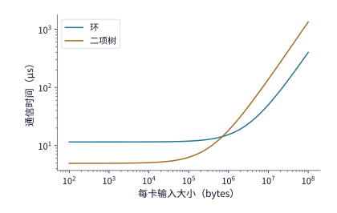

*图 6-26：八卡环形算法与未分段二项树的时间模型，每轮 0.822 μs、每方向 450 GB/s。交点约为 680 KiB；10 KiB 的 decode 输入位于主要受启动开销影响的一侧，80 MiB 的 prefill 输入位于主要受数据传输时间影响的一侧。*

> **实验 6-4 · 延伸：数据量多大时，环形归约比树形归约更快？**
>
> （a）按图 6-23 的发送规则，跟踪块 1 的三轮归约，写出每轮由哪张卡持有该块，以及其中已经累加了哪些卡的贡献。
>
> （b）求四卡和八卡环形归约的每卡发送量，再推导相同数据量下树形归约的耗时。
>
> （c）求八卡部署下两种归约算法耗时相等时的数据量；将 $\alpha$ 减半后重算，解释两种算法耗时相等时的数据量为何变化。
>
> （d）将树形算法归约 10 KiB 数据所需的时间代入本章 Qwen3-32B 算例，求八卡单步时间，比较算法选择与带宽翻倍的收益。

### 6.4.3 通信库与计算的资源竞争

无论是环形算法还是树形算法，最终都要由运行在加速器与主机上的软件执行，这类软件即为**集合通信库**——例如 NVIDIA 平台上的 NCCL（NVIDIA Collective Communications Library），以及昇腾平台上的 HCCL（Huawei Collective Communication Library）。应用程序在使用通信库时，需先初始化一个通信组（communicator），为组内每张卡分配唯一的序号（rank），随后向指定的设备执行流（如 CUDA stream）提交集合通信调用，并传入发送/接收缓冲区地址、元素数量、数据类型与归约算子。这里必须遵守严格的异步编程契约：通信组内所有卡必须按完全一致的顺序发起匹配的集合通信调用；同时，主机端函数调用返回仅代表通信任务已排入设备流队列，绝不意味着底层传输已经完成，因此主机或其他流绝不能立即覆写发送缓冲区或读取接收缓冲区。后续算子若要消费通信结果，必须通过位于同一个 stream 的顺序语义或显式的事件（event）依赖来等待通信完成；同理，绝不能把异步提交的集合通信调用误当作主机 CPU 代码的全局同步屏障。

在 MoE 模型的专家并行中，每对计算卡之间需要交换的 token 数量随每个批次的动态路由结果而变化。固定分块长度的常规 All-to-All 接口无法直接表达这种不等长交换，运行时必须先交换各卡之间的 token 计数并计算接收偏移量，完成本地张量重排打包与接收缓冲区分配后，再执行不等长数据搬移。在 NCCL 中，这类不规则的全交换可通过成组提交（group call）的点对点 Send/Recv 原语实现：每条发送必须与对端的一条接收严格配对，且同一轮并发推进的所有点对点操作必须封装在同一个通信组调用内批量提交，否则各卡会因串行等待对方尚未发出的配对操作而陷入死锁或退化为串行执行。针对 MoE 场景定制的专用通信库（如 DeepEP）则进一步将动态路由元数据、数据打包重排与底层传输融合在一起实现高效的 dispatch 和 combine。无论采用哪种通信实现，性能评测时都必须明确记录通信库版本与实际调用接口，切不可用固定等长分块的合成 All-to-All 基准测试来直接代替真实 MoE 负载下的动态通信耗时。[^nccl-basics]

在阅读 NCCL 等集合通信库的基准测试报告时，还必须严格区分它所输出的两种带宽口径：**算法带宽**（`algbw`）直接用应用层传入的逻辑张量大小除以通信耗时，而**总线带宽**（`busbw`）则乘上了集合通信算法在单卡上实际引发的流量放大系数，以便与硬件物理链路带宽直接对标。以 $n$ 卡 AllReduce 为例，设每卡输入张量大小为 $M$、实测耗时为 $T$，则算法带宽为 $\mathrm{algbw}=M/T$，而按环形算法单卡发送量折算的总线带宽为 $\mathrm{busbw}=2(n-1)M/(nT)$。例如，在实验 7-3 保存的公开实测记录中，两台八卡 HGX H100（共 16 个 rank）执行每卡 64 MiB 的 AllReduce 耗时 $466.1\ \mu\mathrm{s}$，对应的 `algbw` 为 $143.99\ \mathrm{GB/s}$，而 `busbw` 则为其 $2\times15/16=1.875$ 倍，即 $269.98\ \mathrm{GB/s}$。需要注意，`busbw` 只是一个按理想环形公式折算的归一化指标，不能直接等同于跨机网卡上的真实物理吞吐——当底层启用了机内 NVSwitch 与跨机网卡的分层归约、交换机网内计算（in-network aggregation）或链路复用时，各段物理链路的真实流量仍需按照第 7 章的物理路径逐跳核算。简言之，小消息通信看延迟，大消息通信看持续带宽，而放入完整模型推理时，最终要看从前序算子产出数据到下游算子消费完结果的端到端阻塞时间。[^nccl-basics]

此外，第 6.4.2 节在推导环与树的时间模型时，默认集合通信独占整张加速器的硬件资源。但在实际训练与推理系统中，人们常将当前微批次的跨卡通信与另一微批次的矩阵计算安排在不同流中并发重叠（overlap），此时二者便会在加速器内部争用硬件资源。具体而言，通信内核完成跨卡归约不仅要收发网络报文，还必须从 HBM 读取本地部分和、在计算单元上执行浮点累加、再将结果写回 HBM——这些操作会同时占用 GPU 的流多处理器（SM）、HBM 显存带宽以及卡间互联接口，而同一时刻并发执行的 GEMM 算子恰恰也在高强度争用这三类资源。因此，当通信与计算并发重叠时，二者的实际执行速度都会比各自独占运行时有所下降。

本书配套的实验 6-5 定量测量了这种并发资源争用效应。实验使用 Gloo 集合通信库在 4 个 CPU 进程之间执行 AllReduce，同时让每个进程并发执行一次矩阵乘法，分别记录通信独占、计算独占以及二者并发运行时的完成时间（取 5 组重复实验的中位数）：

| 归约数据量 | 通信单独运行 | 计算单独运行 | 同时运行时的通信 | 同时运行时的计算 | 同时运行的整组完成 |
|---|---:|---:|---:|---:|---:|
| 4 MiB | 2.67 ms | 11.53 ms | 6.14 ms | 11.52 ms | 11.58 ms |
| 64 MiB | 36.92 ms | 11.03 ms | 45.21 ms | 12.89 ms | 45.24 ms |

可以看到：当归约数据量为 4 MiB 时，虽然并发争用使通信耗时从 2.67 ms 延长了一倍多（增至 6.14 ms），但它依然在耗时 11.52 ms 的矩阵乘法结束前完成，整组并发耗时为 11.58 ms，与仅运行矩阵乘法（11.53 ms）几乎一致，说明小数据量通信被计算成功掩盖。然而，当归约数据量扩大到 64 MiB 时，并发争用不仅使通信耗时从 36.92 ms 膨胀至 45.21 ms，也使矩阵乘法耗时从 11.03 ms 延长至 12.89 ms；若将二者串行执行共需约 $36.92+11.03\approx48.0\ \mathrm{ms}$，而并发重叠后整组完成时间为 45.24 ms，实际仅节省了约 2.7 ms，远低于矩阵乘法原本的 11.03 ms。这一实验清楚地表明：评估计算与通信重叠的真实收益时，必须直接测量二者并发运行时的端到端完成时间，绝不能将各自独立测得的独占耗时直接相减。[^comm-experiment]

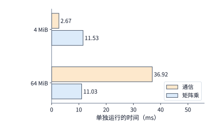

*图 6-27：实验 6-5 中通信与矩阵乘单独运行的时间，四个 CPU 进程，五组中位数。4 MiB 通信约 2.67 ms，64 MiB 通信约 36.92 ms，矩阵乘约 11 ms。*

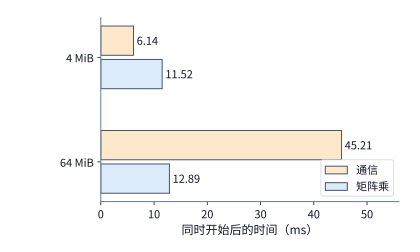

*图 6-28：同一实验中两者同时开始。橙色为通信，蓝色为计算；后续工作等待两者都完成。4 MiB 的通信增至 6.14 ms，仍藏在计算之内；64 MiB 的通信增至 45.21 ms，计算也增至 12.89 ms。*

这一规律在 GPU 上同样成立。在 NCCL 中增加通信通道数（channels）与线程块数量固然能提升通信独占运行时的吞吐，但同时也会占去更多 SM 与显存带宽，导致并发运行的 GEMM 算子降速；因此，若仅凭空载通信基准测试的最高带宽来配置通信库参数，反而可能拖慢模型端到端的步时间。针对这一问题，集合通信自动调优系统 AutoCCL 选择在实际训练迭代过程中在线采集包含并发计算干扰的真实通信耗时：它先确定算法、协议与传输层实现，再进一步搜索并发线程数、通道数与分块大小。论文实测表明，在强计算干扰下，AutoCCL 可将 AllGather 的有效带宽从 18.26 GB/s 提升至 32.44 GB/s。当然，在线搜索与配置切换本身也会引入额外开销：若搜索过程累计多花时间 $S$，调优后每次集合通信调用可节省时间 $\Delta$，则后续至少需要连续调用 $S/\Delta$ 次才能收回搜索成本。[^tuning]

### 6.4.4 通信融合、加速器发起与专用卸载

既然单纯在通信内部堆砌资源未必能缩短端到端耗时，系统优化就需要沿着两个更根本的方向推进：一是减少通信启动次数与中间结果的冗余显存读写，二是降低通信过程对通用计算单元（SM）的挤占。回顾第 6.4.2 节 Qwen3-32B 的八卡 decode 算例，单步 128 次小消息归约的固定启动延迟高达约 1.47 ms。围绕这项开销，我们可以从三个不同层面加以改进：单次内核启动完成多少工作（通信融合）、由哪个部件发起通信请求（加速器发起），以及由哪个硬件单元执行数据搬移与归约（专用卸载）。

第一项技术是**算子与通信融合**（fusion），即将集合通信与紧邻的上下游算子合并到同一个内核（kernel）中连续执行。例如，张量并行下行投影的跨卡归约结束后，紧接着就要执行残差相加与下一层的 RMSNorm；若分三个独立内核依次执行，中间结果就必须反复写回 HBM 再重新读入，并承受三次内核启动延迟；将三者融合后，归约得出的分片数据仍在片上寄存器或高速缓存中便可直接完成残差相加与归一化。需要注意，融合绝不能违背算子之间的代数依赖顺序：由于 RMSNorm 是非线性运算，必须等跨卡归约算出完整的向量和之后才能做归一化。举例来说，忽略防除零常数 $\epsilon$ 与可学习缩放参数，对两个二维向量先求和再归一化有 $\operatorname{RMSNorm}([1,0]+[0,1])=\operatorname{RMSNorm}([1,1])=[1,1]$；若颠倒顺序，先在两卡上各自做完 RMSNorm（分别得到 $[\sqrt2,0]$ 与 $[0,\sqrt2]$）再跨卡相加，结果将变成错误的 $[\sqrt2,\sqrt2]$。因此，融合内核必须在内部严格保持“先归约、后归一化”的数据依赖。

第二项技术是**加速器直接发起**（accelerator-initiated communication），即省去主机 CPU 介入提交的往返延迟：当前序计算内核在加速器上产出数据后，无需返回主机通知 CPU，而是由加速器内核直接向通信硬件发起后续传输请求，从而显著缩短从计算完成到通信启动之间的控制等待。第三项技术是**专用硬件卸载**（dedicated offload），即将数据搬移、归约累加与同步信号处理交给独立的 DMA 复制引擎、片上专用通信单元或交换机内的网内计算逻辑，从而将通用矩阵计算单元（如 GPU 的 SM 或 NPU 的 Cube/Vector 核）彻底解放出来。

在实际硬件与软件栈中，华为昇腾处理器内置了专用的集合通信单元（CCU），将数据搬移、归约求和、同步与完成通知集中在独立硬件单元内完成；而 NVIDIA NCCL 的部分路径则利用节点内的硬件复制引擎（Copy Engine，CE）以及节点间的 CPU 代理线程（proxy thread，替 GPU 向 RDMA 网卡提交工作请求的主机后台线程）来分担数据搬移与控制任务。在评估这类卸载机制时，核心在于认清瓶颈究竟在哪里：如果端到端变慢是因为通信内核与 GEMM 算子争用 SM，那么把通信搬移卸载出去、腾出 SM 就能显著缩短计算耗时；但如果系统的真实瓶颈在于多条流共享的物理网络出口带宽，那么无论由谁发起或搬移，需要跨网传输的字节数并未减少，出口排队时间也不会因此缩短。[^ub][^tuning]

为了更具体地看清“由谁发起通信”对延迟与吞吐的影响，图 6-29 对比了跨机通信中构造并提交传输请求的三种硬件位置——它们直接决定了控制路径需要穿越几次 PCIe 总线，以及会占用哪一侧的计算核：

- **CPU 代理线程发起**：GPU 算完数据后，先通过 PCIe 在主机内存中写入一个就绪标志；主机侧轮询的 CPU 代理线程检测到该标志后，在主机内存中构造工作请求描述符（work request descriptor，记录源/目的地址与长度等传输元数据），并通过 PCIe 写网卡寄存器以“敲门铃”（doorbell，通知网卡有新请求到达）；随后网卡再通过 PCIe 从主机内存读取该描述符；待传输完成后，完成记录（completion queue entry）同样写回主机内存，由 CPU 线程轮询后再转告 GPU。在这一路径上，仅控制信令就要穿越 PCIe 总线 3 次，每次耗时数百纳秒；同时，单个 CPU 线程每秒能打包处理的请求数有限，面对高频小消息时极易在主机侧形成排队瓶颈。
- **GPU 的 SM 直接发起**：GPU 内核直接在显存或片上内存中构造请求描述符并直接跨 PCIe 敲响网卡门铃，网卡随后经 PCIe 从 GPU 侧读取描述符，完成记录也直接写回 GPU 显存供 SM 轮询。这一方式将主机 CPU 移出了关键路径，使控制路径的 PCIe 穿越次数降至 2 次；但其代价是必须抽调一部分 GPU SM 专门用于构造请求、敲门铃与轮询完成状态，这部分 SM 在此期间无法用于执行矩阵运算。NVIDIA 的 GPUDirect Async（GDA / IBGDA）技术以及 MoE 专用通信库 DeepEP 的低延迟内核（low-latency kernel）采用的正是由 SM 直接发起的路径。
- **网卡内置处理器发起**：以 NVIDIA BlueField DPU/SuperNIC 为代表的智能网卡内置了多核多线程的数据通路加速器（DPA），可将请求描述符的构造、敲门铃与描述符读取全部留在网卡芯片内部完成，主机或 GPU 只需为整批通信操作下发一次高层触发指令即可。此时，逐包控制路径实现了 **0 次 PCIe 穿越**，且既不占用 GPU 的 SM，也不消耗主机 CPU 核。

需要注意，无论采用上述三种发起位置中的哪一种，在发起端将数据载荷（payload）从 GPU 显存读出送到网卡、以及在传输结束后将最终完成通知写回 GPU 显存，都各需穿越发起端 PCIe 总线 1 次，这两项数据面与完成面开销不随控制发起位置的改变而消失；同理，接收端网卡读写对端 GPU 显存时，也仍需在对端穿越 1 次 PCIe。因此，三种发起方式的工程取舍在于：由哪个部件出让计算核、控制信令路径需要穿越几次 PCIe、以及每秒钟最高能发起多少次通信请求（消息率）。第 7.3.3 节将逐阶段累加每次穿越的精确延迟，第 7.3.4 节则进一步把请求发起速率纳入网络吞吐模型。[^initiator]

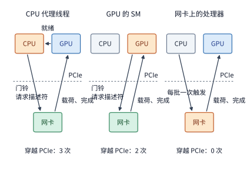

*图 6-29：三种发起位置。橙色是构造请求描述符的部件；虚线是 PCIe 边界。CPU 代理线程的控制路径穿越 PCIe 三次，GPU 发起两次，网卡上的处理器零次；发起端的载荷与完成记录在三种方式下都各穿越一次。*

最后回到本节开头的 Qwen3-32B 八卡 decode 算例：每步 128 次小消息归约的启动开销之所以突出，是因为每次传输的数据量极小。当一次并发处理 1、4、16 个 token 时，每次归约的输入张量仅分别为 10、40、160 KiB；针对这一区间，vLLM 等主流推理框架通常会绕开通用的重型通道协议，专为小数据量启用低延迟的定制 AllReduce 内核（custom AllReduce）。因此，要压缩式（6-5）中的集合通信耗时 $T_{\mathrm{AR}}$，系统设计者共有两条互补的路径：一是在算法层改用树形或一阶段归约以减少通信轮次，二是在实现层通过算子融合、加速器直接发起与定制轻量内核来压低每一轮的软件与硬件启动开销。[^collective-path]

> **实验 6-5 · 延伸：通信优化能节省多少时间，何时抵消准备开销？**
>
> （a）用图 6-27 与图 6-28 的实测值，分别求 4 MiB 与 64 MiB 时同时运行比分开运行省下多少时间，指出每种情况下是计算还是通信决定了整体完成时间。
>
> （b）设一次调优需要额外花费 $S$ 的搜索与切换时间，此后每次调用节省 $\Delta$。写出累计节省首次超过 $S$ 所需的最少调用次数；以 64 MiB 实测的重叠收益作为 $\Delta$，求 $S=1$ s 时的次数。
>
> （c）用两个各含两个元素的向量，比较先归约后执行 RMSNorm 与先分别执行 RMSNorm 后归约的结果，判断两者能否交换顺序。
>
> （d）加速器选做：比较同一形状的独占与并发执行，记录就绪、开始和完成事件，说明共享后哪一段改变最多。

## 6.5 超节点的物理组织

### 6.5.1 直连、交换与分层拓扑

第 6.4 节从逻辑通信图的角度规定了每一轮集合通信“谁发给谁、发多少字节”，但尚未涉及这些字节在物理硬件上究竟流经哪些线缆与芯片。换言之，集合通信算法规定了逻辑上的发送方与接收方，而**物理互联拓扑**则决定了数据流实际途经的交换设备与物理链路。在硬件系统中，两张计算卡之间既可以通过点对点线缆直接相连，也可以经过交换芯片、其他计算卡或主机内存中转；一旦多条逻辑传输流在某一时刻汇入同一个物理接口或同一条物理链路，它们就必须分时排队共享同一份物理带宽。

**例题：再加一台服务器，TP16 能否比 TP8 更快？** 考虑两台八卡 HGX H100 服务器，共 16 张 GPU，服务器之间通过每张 GPU 配属的 400 Gbit/s ConnectX-7 网卡经网络相连。现将 Qwen3-32B 的单个 128K 上下文会话扩展为跨两台服务器的 TP16 部署（即一个 16 卡张量并行组横跨两台机器），此时每层的 2 次 AllReduce 都必须跨越服务器间的网络。试问单步 decode 时间相比单机内 TP8 会变快还是变慢？

**解答**：先看本地 HBM 访存耗时。卡数从 8 张增至 16 张后，每张卡分担的模型权重进一步减半；但由于 Qwen3-32B 每层只有 8 个 KV 头，在 TP16 下无法再继续切分，只能让每两张卡复制保存同一个 KV 头，因此每张卡每步需要读取的 KV 缓存量与 TP8 完全相同。两项合计，单步本地 HBM 访存时间仅从 TP8 的 3.67 ms 降至 2.48 ms。再看跨卡归约通信耗时：若简单将 16 张卡排成一个跨越网络的平面单环，每轮通信都必须受制于跨机网卡那一跳的较高延迟——取 MSCCL++ 论文在同一硬件平台上实测的 InfiniBand（服务器间广泛使用的低延迟 RDMA 交换网络）单向延迟 $3.76\ \mu\mathrm{s}$，16 卡环形 AllReduce 共需 30 轮，单次归约仅启动延迟就高达约 $113\ \mu\mathrm{s}$。当然，实际生产级通信库会采用机内 NVSwitch 与机间网卡相结合的分层（hierarchical）归约算法来减少跨网轮次。我们直接采用实验 7-3 保存的 `nccl-tests`（NCCL 官方集合通信基准测试程序）在两台 HGX H100、16 个 rank 上的公开实测数据：10 KiB 消息对应测试记录中的 16 KiB 档位，实测单次 AllReduce 耗时为 $32.74\ \mu\mathrm{s}$。代入式（6-5）可得 TP16 的单步总耗时：

$$
T(16)\approx2.48\ \mathrm{ms}+128\times32.74\ \mu\mathrm{s}\approx6.67\ \mathrm{ms}.
$$

对比单台服务器内 TP8 的 5.15 ms 可以看到，跨两台服务器做 TP16 不仅没有加速，单步反而变慢了约 1.52 ms。原因十分清楚：多加一台服务器虽然让单卡权重读取时间省下了 1.19 ms，却换来了代价高昂的跨机网络同步——即便采用了高度优化的分层集合通信算法，跨机单次归约仍需约 $33\ \mu\mathrm{s}$，几乎是单机内 NVSwitch 归约（$11.55\ \mu\mathrm{s}$）的 3 倍，128 次累加后彻底抵消了本地访存的收益。

可见，要让更多计算卡在同一个高频同步组内高效协作，底层硬件必须提供充足的互连端口与低延迟交换容量。如果不用交换芯片而让 $N$ 张卡两两直接相连（全连接），则每张卡都需要引出 $N-1$ 条独立连接，这在卡数稍多时便会超出芯片封装引脚与机箱布线的物理极限。**交换网络**通过引入交换芯片将连接集中起来：每张计算卡只需连接到交换层，再由交换芯片根据目的地址将报文转发至目标卡。单颗交换芯片所能提供的双向端口总数称为该交换芯片的**基数**（radix）。

以 HGX H100 服务器采用的第三代 NVSwitch 芯片为例，单颗芯片拥有 64 个第四代 NVLink 端口（radix 为 64），每个端口提供单向 25 GB/s 带宽。当我们需要用这种芯片搭建更大规模的两级叶脊（leaf-spine）交换网络时，若将一颗芯片用作第一级**叶交换机**（leaf switch），就必须在“向下接多少个 GPU 端口（下联）”与“向上接多少个**脊交换机**（spine switch）端口（上联）”之间做出划分：
- 若采用 **32 下联 / 32 上联**的对称分配，则接入该叶交换机的 GPU 侧总带宽与通往脊交换机的上联总带宽均为 $32\times25=800\ \mathrm{GB/s}$，实现无阻塞（1:1）转发；
- 若改为 **48 下联 / 16 上联**，虽然单颗叶交换芯片能多接一半的 GPU 链路（下联总带宽达 1200 GB/s），但这批 GPU 同时向其他叶交换机发送数据时，共享的上联出口总带宽却降至 $16\times25=400\ \mathrm{GB/s}$，仅为下联总带宽的 1/3（即 3:1 收敛）。

可见，在交换芯片总端口数固定的前提下，向下多接计算卡就必然要减少向上的上联端口与跨机带宽。NVIDIA DGX H100 SuperPOD 中的 NVLink Switch System 将多台八卡服务器接入同一个机柜间 NVLink 交换域时，所做的正是这一工程折中：每台服务器仅将机内 NVSwitch 一半的端口带宽引出机箱连往外部脊交换机，形成 2:1 的上下行收敛比（oversubscription ratio）。[^nvswitch]

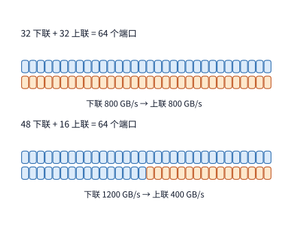

*图 6-30：同一颗 64 端口 NVSwitch 的两种分配，每个端口每方向 25 GB/s。上联链路是所有跨交换机流量的共同出口；32／32 分配提供 800 GB/s 上联带宽，48／16 分配只提供 400 GB/s。颜色条的格数与端口数一致。*

顺着 32/32 的无阻塞分配方式，我们可以将交换网络扩展到单颗交换芯片的基数之外：使用 4 颗叶交换芯片，每颗提供 32 个下联端口，合计可提供 $4\times32=128$ 个下联端口；同时在上层配置 32 颗脊交换芯片，每颗脊交换芯片各引出 1 条链路分别连接到全部 4 颗叶交换芯片上，恰好接满每颗叶交换芯片的 32 个上联端口。在图论与网络分析中，若将整个互联系统的节点划分为 $A$、$B$ 两个不相交子集，所有横跨在 $A$ 与 $B$ 之间的物理链路集合便称为一个**割集**（cut）。如果在某一通信阶段，共有 $V_{A\to B}$ 字节的数据必须从子集 $A$ 穿过该割集传往子集 $B$，而该割集在 $A\to B$ 方向上的物理链路总带宽为 $B_{A\to B}$，那么无论上层采用何种路由或调度算法，完成这批传输所需的时间都存在一个不可逾越的物理下界：$V_{A\to B}/B_{A\to B}$。叶交换芯片上下联端口的分配比例，直接决定了跨叶交换机割集的总带宽上限。

除了交换芯片端口分配决定的静态割集带宽外，通信算法在每轮选择的**物理路由路径**同样决定了流量是否会在局部链路上扎堆拥塞：即便每张卡在每一轮向外发送的字节数完全相同，选择不同的通信对端也会在物理拓扑上形成截然不同的瓶颈负载。为了直观说明这一点，考虑将 16 张卡连接成一个双向物理环（1D torus），对比两种 ReduceScatter 算法在处理每卡 8 MiB 输入时的前三轮通信表现：第一种是经典的**递归对折算法**（recursive halving），每轮将通信对端的逻辑距离翻倍（依次相距 1、2、4 跳）；第二种是专为环面拓扑设计的 **Swing 算法**，通过在相邻轮次间正负交替改变对端位置来打散物理链路上的重叠流量。在前三轮中，两种算法下每张卡每轮发送的数据量完全相同（依次为 4 MiB、2 MiB、1 MiB），但因通信对端不同，落在物理环路上的负载差异显著：

| 前三轮 | 递归路径 | Swing 路径 |
|---|---|---|
| 每次传输经过的物理跳数 | 1、2、4 | 1、1、3 |
| 最大单向链路传输量 | 4、4、4 MiB | 4、2、2 MiB |
| 全网物理链路累计传输量 | 64、64、64 MiB | 64、32、48 MiB |

看第三轮的差异：在递归算法中，每张卡发送的 1 MiB 数据都必须沿物理环走 4 跳才能到达对端，导致环上每条有向物理链路在同一时刻要叠加承载 4 份 1 MiB 的过路流量（合计 4 MiB）；而在 Swing 算法中，第三轮的数据只需走 3 跳，且依靠对端交错配对，最繁忙的有向物理链路只需同时承载 2 份 1 MiB 数据（合计 2 MiB）。按 Google TPU v4 每条芯片间互联（ICI）链路单向 50 GB/s 的带宽折算，前三轮受瓶颈物理链路限制的累计传输时间在递归算法下约为 $252\ \mu\mathrm{s}$，而在 Swing 算法下则降至约 $168\ \mu\mathrm{s}$。发送端发出的字节数分毫未减，仅靠缩短物理跳数并减少共享链路上的叠加拥塞，传输耗时便直接缩短了 1/3。[^swing]

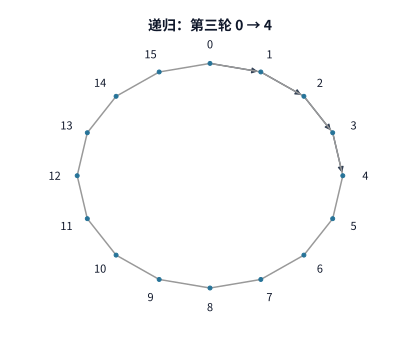

*图 6-31：递归算法第三轮，卡 0 发往卡 4。细线为 16 张卡组成的物理环，箭头标出经过的四条链路。*

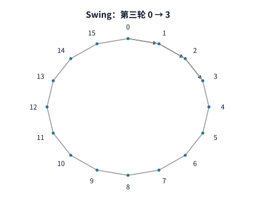

*图 6-32：同一物理环上，Swing 第三轮卡 0 发往卡 3，经过三条链路。每张卡这一轮的发送量仍为 1 MiB。*

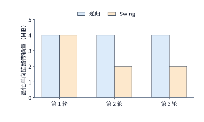

*图 6-33：把所有发送方的数据累加到各条有向链路上，取每轮的最大值。递归前三轮均为 4 MiB，Swing 为 4、2、2 MiB。*

当多卡通信需要借由主机内存中转（staging）时，上述“逻辑配对如何映射到物理拓扑”的问题同样会以 **NUMA（非一致内存访问）** 的形式出现。在双路服务器中，主机内存被分别挂载在两颗 CPU 各自的本地内存控制器上，跨 CPU 访问远端内存必须穿越两颗处理器之间的互连总线。假设卡 0、1 挂载在 NUMA 节点 A（CPU 0）下，卡 2、3 挂载在 NUMA 节点 B（CPU 1）下，4 张卡经主机内存中转执行一次环形 AllReduce，累计向主机发送 48 MiB 数据。我们来对比三种中转缓冲与逻辑环序方案：
1. 若将全部中转缓冲区集中分配在节点 A 的内存上，则 CPU 互连总线在每个方向上都必须承载 24 MiB 的跨 NUMA 流量；
2. 若将每张卡的中转缓冲区就近分配在其所属的本地 NUMA 节点上，并让属于同一 NUMA 节点的卡在逻辑环中相邻排列（如 $0\to1\to2\to3\to0$），则只有跨节点的两跳（$1\to2$ 与 $3\to0$）需要穿越 CPU 互连总线，每个方向的跨 CPU 流量立刻减半至 12 MiB；
3. 若虽然就近分配了缓冲区，却把逻辑环顺序排成了交替横跨两个 NUMA 节点的次序（如 $0\to2\to1\to3\to0$），则每一跳都变成跨节点传输，CPU 互连总线每个方向的流量又会退化回 24 MiB。

以真实的 NVIDIA DGX H100 主机为例，其主板采用双路架构：两颗 Intel Xeon Platinum 8480C 处理器各自构成一个 NUMA 节点，两颗 CPU 之间最多通过 4 条速率为 16 GT/s 的 UPI（Ultra Path Interconnect）链路互连；而每张 H100 GPU 则通过单向带宽 64 GB/s 的 PCIe Gen5 x16 接口接入各自归属的 CPU 侧。在上述三种方案中，每张 GPU 经由自身 PCIe 接口进出主机的字节数完全相等，但流经两颗 CPU 之间 UPI 总线的字节数却呈现 $2:1:2$ 的悬殊比例，跨 CPU 中转耗时也随之成倍变化。因此，中转缓冲区的物理内存位置与各卡在通信组中的逻辑排列次序，共同决定了数据在机器内部的真实物理搬移路径。[^numa]

**设计案例：构建 64 卡超节点，应当选择直连环面还是交换网络？** 在前面的例子中，计算卡之间要么直接通过点对点链路相连，要么通过中心化的交换芯片互连。当我们要把 64 张加速器卡组织成一个紧密协作的超节点时，工业界形成了两条截然不同的架构路线：
- 第一条路线是**无交换机的邻居直连**：将 64 张卡在空间上排列成 $4\times4\times4$ 的三维网格，每张卡沿 $x,y,z$ 三个正交维度各自与前、后两个直接邻居相连，且每个维度首尾闭合环绕，形成**三维环面**（3D Torus）拓扑。三维环面是高性能计算（HPC）超级计算机长期沿用的经典拓扑，Google TPU 系列便采用了这一路线。
- 第二条路线是**全交换网络**：计算卡之间不设任何直连线缆，每张卡的所有高速端口全部接入专用的交换芯片，所有跨卡通信统一由交换层路由转发。NVIDIA 的 GB200 NVL72 与华为的 CloudMatrix384 均采用了这一路线。

为了在完全对等的硬件条件下比较两条路线，我们给每张计算卡配置完全相同的对外接口：每卡 6 个高速端口，每个端口提供单向 50 GB/s 带宽（这恰好是单颗 Google TPU v4 芯片的 ICI 端口配置）。两条路线的唯一区别在于：这 6 个端口的另一端究竟是直接插在相邻的 6 张计算卡上，还是统一插在中心交换芯片上。图 6-34 对比了在这两种拓扑下，相距最远的一对计算卡完成一次通信所经过的物理路径。

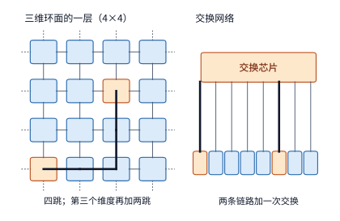

*图 6-34：左侧是三维环面的一层，每张卡与四个邻居直连，虚线表示每一维首尾相连；从角上的卡到中心的卡要经过四跳，加上第三个维度最多六跳。右侧是交换网络，任意两张卡之间都是两条链路加一次交换。橙色是相距最远的一对卡，粗线是它们之间传输经过的路径。*

我们可以从**通信跳数（延迟）**、**典型流量模式下的有效带宽**以及**硬件建设成本**三个维度对这两条路线做一番定量权衡：

首先比较**最大跳数与转发延迟**。在 $4\times4\times4$ 的三维环面中，由于每一维首尾相连，任意两卡在单个维度上的最大距离为 $\lfloor 4/2\rfloor=2$ 跳，三个维度叠加后的最远距离（网络直径）为 $2+2+2=6$ 跳（途经 5 颗中间计算芯片的片上路由器转发）；而在单级全交换网络中，任意两张卡之间的通信永远固定为“上行链路 + 1 次交换芯片转发 + 下行链路”（共 2 条链路、1 次转发）。设报文每经过一颗计算芯片内置路由器或一颗独立交换芯片的转发延迟均为 200 ns（这是开放加速器互连标准 UALink 2.0 规范为 128-lane 交换芯片设定的空载转发延迟目标），并暂且忽略线缆上的光速传播延迟。那么，在三维环面上相距最远的两卡通信需经过 5 次中间芯片转发（耗时 $1.0\ \mu\mathrm{s}$），而单级交换网络只需经过 1 次交换芯片转发（耗时 $0.2\ \mu\mathrm{s}$），单次最远传输环面要多花 $0.8\ \mu\mathrm{s}$。单看一次通信，$0.8\ \mu\mathrm{s}$ 似乎微不足道；但在自回归 decode 阶段，每层需执行 2 次张量并行归约，64 层的 Qwen3-32B 单步就要连续执行 128 次归约——若每次同步都受最远跳数限制，环面拓扑在单步内累计多付出的转发延迟便达 $128\times0.8\ \mu\mathrm{s}\approx0.10\ \mathrm{ms}$，约占八卡 TP8 全部归约耗时（1.48 ms）的 7%。更关键的是，当超节点规模从 64 卡扩大到 $8^3=512$ 卡时，三维环面的最远距离会翻倍至 $4+4+4=12$ 跳（11 次中间转发）；而在交换网络路线下，只需增加一级脊交换机变成两级叶脊网络，任意两卡之间也不过是 4 条链路加 3 次交换芯片转发。

其次比较**不同流量模式下的有效带宽**。考察大模型中最具代表性的两类集合通信流量：
1. 第一类是**沿网格维度的规则归约（AllReduce）**。在三维环面上，编译器可将一次全局 AllReduce 分解为沿 $x,y,z$ 三个维度的多轮环形 ReduceScatter 与 AllGather，每一步只与直接相邻的邻居收发数据，且 6 个方向的端口可同时满负荷运转。在此模式下，三维环面能够 100% 用满每张卡全部 $6\times50=300\ \mathrm{GB/s}$ 的端口总带宽，其理论完成时间与无阻塞交换网络完全一致。Google TPU 的 XLA 编译器正是通过将软件层面的数据并行（DP）、张量并行（TP）等通信轴直接映射到三维环面的物理坐标轴上，从而充分发挥环面的近邻通信优势。
2. 第二类是**均匀全交换（All-to-All）**，即每张卡向其余 63 张卡各自发送一份独立数据——MoE 模型专家并行的跨卡 dispatch 与 combine 正属于此类模式。在 $4\times4\times4$ 环面上，任意两卡在一个长度为 4 的环维上平均相距 $(0+1+2+1)/4=1$ 跳，因此在三维环面上每份数据平均需要走 $1+1+1=3$ 跳才能到达目的卡。这意味着，当 64 张卡各自向外发送 $M$ 字节数据时，每份数据在途中会被重复转发 3 次，全网所有物理链路累计需要承载的总流量膨胀为 $3\times64M$；将其分摊到全网 $64\times6=384$ 条有向物理链路上，平均每条有向链路必须承载 $\frac{3\times64M}{384}=M/2$ 的数据量。相比之下，在无阻塞交换网络中，每份数据从源卡发出后经交换芯片一次直达目标卡，64 张卡各自的 $M$ 字节发送量均匀分摊到本卡的 6 个发送端口上，每条有向链路只需承载 $M/6$ 的数据量。取单卡发送量 $M=32\ \mathrm{MiB}$、单端口带宽 50 GB/s 计算，三维环面完成一次全网 All-to-All 的理论传输下界约为 $336\ \mu\mathrm{s}$，而无阻塞交换网络仅需约 $112\ \mu\mathrm{s}$，二者相差 **3 倍**；若规模进一步扩大到 $8\times8\times8=512$ 卡，三维环面的平均跳数翻倍至 6 跳，全交换下的理论带宽差距将进一步拉大到 **6 倍**。图 6-35 直观对比了这两种流量模式在两类拓扑上的耗时表现。

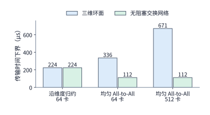

*图 6-35：每张卡六个 50 GB/s 端口、每卡发送 32 MiB。沿维度归约时两种拓扑都用满端口带宽；均匀 All-to-All 时环面上的数据平均要走三跳，共享链路承载的数据随之增加，512 卡时增至六跳。图中是链路负载给出的下界，不含启动开销与排队；交换网络按无阻塞计，即交换层不限制各端口同时满速收发。*

最后比较**硬件建设成本与扩展代价**。在 64 卡规模下，三维环面只需将相邻卡的端口用线缆直接对连，全网共需 $64\times6/2=192$ 条双向线缆，**完全不需要任何独立交换芯片**（路由转发逻辑直接集成在每颗计算芯片内部）；而同样规模的单级全交换网络不仅需要翻倍的 384 条线缆（每张卡的 6 个端口都要连到交换机），还必须额外配置 6 颗 64 端口的高速交换芯片。当超节点规模继续扩大并超过单颗交换芯片的基数上限时，交换网络还必须引入第二级脊交换机，硬件成本与布线复杂度随之陡增：例如华为 CloudMatrix384 为了将 384 颗昇腾 NPU 无阻塞互连起来，在 48 个计算节点内部各配置了 7 颗第一级交换芯片（共 336 颗），又在跨节点的 7 个交换平面中各配置了 16 颗第二级交换芯片（共 112 颗，集中安装在 4 个专用通信机柜内），整套超节点累计动用了多达 **448 颗高速交换芯片**。反观三维环面拓扑，无论超节点扩展到多大，每颗计算芯片始终只需引出 6 条邻居线缆且无需外部交换机，硬件扩展成本呈现极佳的线性特征；但它为此付出的代价则是网络直径随规模增大而拉长，且平均每张卡分摊到的跨分区割集带宽随规模扩大而下降（第 6.5.4 节将定量推导这一性质）。

将以上三个维度的对比汇总起来，便构成了超节点物理拓扑选型的核心工程准则：
1. 目标工作负载究竟是以沿固定坐标轴映射的规则集合通信（如稠密模型的 DP/TP AllReduce）为主，还是包含大量目的地址动态变化的随机小包访问与全网 All-to-All（如大规模 MoE 的专家并行与全局内存池访问）？
2. 单个紧密协作域究竟需要容纳多少张计算卡？
3. 系统设计者是否愿意付出数百颗专用交换芯片与翻倍线缆的硬件成本，去换取“超节点内任意两张卡等距直达、无阻塞全交换”的平坦通信视图？

接下来的第 6.5.3 至 6.5.5 节将具体剖析 NVIDIA、Google 与华为三家厂商围绕这三个问题所做出的不同架构选择。[^topology-choice]

> **实验 6-6 · 延伸：通信拓扑与缓冲位置如何影响传输耗时**
>
> （a）复算两台 HGX H100 上 TP16 的单步时间，再求跨服务器的一次 AllReduce 降到多少时，TP16 与单台服务器内 TP8 的单步时间恰好相同。
>
> （b）对 64 端口的 NVSwitch，比较下联／上联端口分别为 32／32 与 48／16 的两种分配，计算所有 GPU 链路同时向上发送时每条链路的平均可用带宽。
>
> （c）根据图 6-31，累加第三轮经过同一条有向链路的数据量，说明跳数与链路传输量的区别。
>
> （d）在 NUMA 例中先移动缓冲，再改变环的次序，分别画出新增与消失的跨 CPU 访问。
>
> （e）把设计案例中的 64 卡改为 $8\times8\times8$ 环面，求最远跳数、均匀 All-to-All 时每条有向链路的负载，以及两级无阻塞交换网络需要多少颗 64 端口交换芯片；说明哪一项随卡数增长得最快。

### 6.5.2 互联介质、供电与物理规模

第 6.5.1 节在分析拓扑时将每条链路抽象为具有给定带宽与延迟的逻辑边；但在真实机房中把这些高速连接建造出来，还必须直面传输距离、机柜布线密度、供电上限与散热能力等一系列物理工程约束。首先，要把数千吉比特每秒的高速低延迟互连延伸到更远的物理距离，底层**传输介质**就必须随之演进。在几米以内的机箱内部或相邻托盘之间，无源或有源铜缆（DAC/ACC）可以直接传输高频电信号，成本最低且功耗最小；然而随着线缆长度增加，高频电信号在铜线中的介质损耗（衰减）与通道间串扰迅速加剧，接收端难以从失真波形中恢复出正确的数据与时钟，必须引入复杂的均衡器（equalizer）或重定时器（retimer）芯片来整形接力。同时，为了降低远距离损耗而加粗铜缆线径，又会使成百上千根背板线缆变得粗硬笨重，严重挤占机柜内的走线空间与风道。因此，选择铜互连还是光互连，必须在传输距离、信号完整性损耗与物理布线密度三者之间综合权衡。

当互连距离跨出单个机柜（或高密超节点相邻机柜群）时，**光纤互连**便成为必由之路：它将电信号调制到光载波上，在玻璃光纤中能以极低损耗跨越数十米乃至数千米。但光互连也引入了光电转换（O/E/O）的额外功耗、采购成本与现场维护负担。目前主流工程实现分为两代形态：传统方案采用**可插拔光模块**（pluggable optics），将激光器与光电转换电路封装在面板可热插拔的独立模块内，便于损坏后单独更换；而面向下一代超高密超节点的**共封装光学**（Co-Packaged Optics，CPO）则直接将光学引擎移入计算芯片或交换芯片的同一个封装基板内，大幅缩短高速电信号在印刷电路板（PCB）上的走线距离，从而同时降低接口功耗并提升单芯片边缘的端口密度。我们可以用单比特传输能耗（$\mathrm{pJ/bit}$）来定量对比这三种物理互连介质在 224G PAM4 SerDes 时代的工程边界：在单机柜内部（走线距离 $<2\ \mathrm{m}$），**高速背板铜缆（Copper Flyover）**无需任何光电转换器件，接口能耗仅约 **$5\ \mathrm{pJ/bit}$**，且彻底消除了激光器热衰减导致的链路闪断故障点（这正是 GB200 NVL72 采用全液冷将 72 张 GPU 紧密压缩在单机柜内、以五千余根铜缆完成背板全互连的核心原因）；一旦互连范围跨出单机柜（距离 $>2\sim3\ \mathrm{m}$，如多机柜 NVL144／NVL576、跨柜 UB 或 TPU 集群），电信号在铜缆中的高频衰减迫使系统转向光互连——此时传统**可插拔光模块（OSFP／QSFP-DD）**由于电信号需先跨过较长的 PCB 走线与重定时器（retimer）才能抵达前面板模块，加上内置数字信号处理器（DSP）与激光器开销，单比特能耗跃升至 **$15\sim20\ \mathrm{pJ/bit}$**（单个 $1.6\ \mathrm{Tbps}$ 端口功耗达 $24\sim32\ \mathrm{W}$）；而**共封装光学（CPO／硅光互连）**配合外置激光源（ELS）将电走线缩短至毫米级并省去通道重定时器，可将光互连能耗压回 **$5\sim9\ \mathrm{pJ/bit}$**，在构建跨机柜千卡级全交换网络时仅互连端口一项即可为每个机柜省下数十千瓦电力。不过，将对温度敏感的光学器件与高发热的计算或交换裸片封装在一起后，热管理、出厂测试与现场故障维修的工程难度也随之显著上升。简言之，物理连接介质决定了在给定距离与速率下实现一条链路的单口成本与功耗，而网络拓扑则决定了如何用这些物理链路编织出全局通信路径。[^physical]

在通信介质之外，机房机柜的**供电预算**（power budget）从另一个维度对单个超节点可容纳的计算卡数量划定了刚性上限。在实际工程中，计算卡是以整台服务器或计算托盘（tray）为单位安装的。设一组机柜可用的总供电预算为 $P_b$，机柜内独立交换机、存储与管理设备占用的固定配套功率为 $P_0$，每台服务器（或托盘）内装有 $g$ 张计算卡且整机满载功率为 $P_s$，则该供电预算最多允许安装的计算卡数量 $N$ 满足

$$
N\le g\left\lfloor\frac{P_b-P_0}{P_s}\right\rfloor. \tag{6-11}
$$

以 NVIDIA DGX H100 整机为例，一台包含 8 张 H100 SXM GPU、双路 CPU、4 颗 NVSwitch、网卡及散热风扇的服务器，其整机最大功率上限为 $P_s=10.2\ \mathrm{kW}$，折合平均每张 GPU 分摊 $1.275\ \mathrm{kW}$；注意单张 H100 SXM 模组本身的功耗上限（TDP）虽然是 $700\ \mathrm{W}$，但其余近 $575\ \mathrm{W}$ 的配套功耗来自主机侧 CPU、内存、高速互连芯片、电源转换损耗与大风量风扇。[^dgx-power] 假设某机房为一个超节点机柜群分配的总供电预算为 $P_b=120\ \mathrm{kW}$，作为初步估算暂不单列机柜外独立交换机功耗（取 $P_0=0$），代入式（6-11）可知最多可安装 $\lfloor 120/10.2\rfloor=11$ 台八卡服务器，即 88 张 GPU。在这一约束下，64 卡方案（8 台服务器，总功率 $81.6\ \mathrm{kW}$）与 72 卡方案（9 台服务器，总功率 $91.8\ \mathrm{kW}$）均可装入该供电预算内，而 96 卡方案（12 台服务器，总功率 $122.4\ \mathrm{kW}$）则会超出供电上限；至于在 64 卡与 72 卡之间最终如何取舍，还需进一步结合交换芯片的端口基数（如 64 端口或 72 端口）与机柜物理 U 位空间来敲定。

紧随供电而来的另一道物理墙是**机柜散热能力**。由于芯片消耗的电能几乎全部转化为热能，单机柜功率密度越高，散热系统的排热压力就越大。传统的风冷机柜完全依靠高转速风扇将热量吹入机房冷热通道空气中：根据美国采暖、制冷与空调工程师学会（ASHRAE）发布的液冷技术白皮书，一个功率达 $40\sim50\ \mathrm{kW}$ 的高密机柜需要高达 $5{,}000\ \mathrm{cfm}$（立方英尺每分钟）的冷却风量，然而数据中心最高规格的架空地板通风口每个最多只能提供约 $1{,}900\ \mathrm{cfm}$ 的风量；况且在 $50\ \mathrm{kW}$ 的风冷机柜中，仅驱动气流的散热风扇本身就要消耗至少 $5\ \mathrm{kW}$ 的额外电力。在本书算例中，我们取 $40\ \mathrm{kW}$ 作为单机柜风冷散热的工程阈值：据此计算，单个标准机柜最多只能装入 3 台 DGX H100 服务器（共 24 张 GPU，总功率 $30.6\ \mathrm{kW}$），一旦装入第 4 台（$40.8\ \mathrm{kW}$）便会突破风冷极限——事实上，在 NVIDIA 官方发布的 DGX SuperPOD H100 参考架构中，凡是单机柜功率超过 $40\ \mathrm{kW}$ 的高密布置均需配套专门的制冷方案。对于需要将 64 张卡（$81.6\ \mathrm{kW}$）或 72 张卡（$91.8\ \mathrm{kW}$）紧密收拢在极少数机柜内以维持短距离铜缆互连的超节点而言，其单柜热密度远超风冷上限，必须改用**液冷**（liquid cooling）技术，通过冷板将热量直接导入高比热容的冷却液中带走，而不再依赖机房空气对流。[^ashrae]

当单机柜功率从 $120\ \mathrm{kW}$ 量级（如 GB200 NVL72）进一步迈向 **$500\ \mathrm{kW}\sim1\ \mathrm{MW}$**（如面向百卡级超高密超节点的机柜架构）时，除了冷板液冷之外，机柜内部的**直流配电母排（DC Busbar）电压体制**也会撞上欧姆定律与焦耳热定律划定的物理墙：

> **算例 6-B（$500\ \mathrm{kW}$ 超节点机柜在 $50\ \mathrm{V}$ 与 $800\ \mathrm{VDC}$ 供电下的母排电流与 $I^2R$ 铜损账本）**：
> 设一座高密超节点机柜的满载输入功率为 $P_{\mathrm{rack}}=500\ \mathrm{kW}$，对比传统数据中心标准 **$50\ \mathrm{V}$ 直流母排**与新一代 **$800\ \mathrm{VDC}$ 高压直流供电架构**：
> 1. **在传统 $50\ \mathrm{V}$ 直流供电下**：根据 $I=P/V$，机柜主母排必须承载的总电流高达
>
> $$
> I_{50\mathrm{V}}=\frac{500{,}000\ \mathrm{W}}{50\ \mathrm{V}}=\mathbf{10{,}000\ \mathrm{A}}.
> $$
>
> 要在机柜背部安全传输一万安培电流，不仅需要截面积极为庞大、重达数十千克的重型实心铜母排，而且即便将正负极母排回路的等效电阻压低至 $R_{\mathrm{bus}}=0.5\ \mathrm{m\Omega}$，母排自身的焦耳发热损耗仍高达 $P_{\mathrm{loss},50\mathrm{V}}=I_{50\mathrm{V}}^2 R_{\mathrm{bus}}=(10{,}000)^2\times0.0005=\mathbf{50\ \mathrm{kW}}$——相当于整柜 $10\%$ 的电能尚未进入计算托盘就已在铜排上转化为废热。
> 2. **升级至 $800\ \mathrm{VDC}$ 高压直流供电后**：配电电压提高 **$16\ \text{倍}$**，输送同样 $500\ \mathrm{kW}$ 功率所需的母排电流随即缩减为原来的 $1/16$：
>
> $$
> I_{800\mathrm{V}}=\frac{500{,}000\ \mathrm{W}}{800\ \mathrm{V}}=\mathbf{625\ \mathrm{A}}.
> $$
>
> 3. **铜损与空间收益**：在相同母排电阻 $R_{\mathrm{bus}}$ 下，母排上的 $I^2R_{\mathrm{bus}}$ 导电损耗直接下降 **$16^2=256\ \text{倍}$**（从 $50\ \mathrm{kW}$ 骤降至 $625^2\times0.0005\approx\mathbf{195.3\ \mathrm{W}}$）；工程上亦可据此将铜母排截面积缩减一个数量级，从而在机柜背部腾出宝贵的物理空间，用于布置高密液冷分集水器（Manifold）与数千通道的盲插背板（见第 6.6.3 节图 6-48 下图）。

此外，硬件规模扩展还会受到交换机基数与机柜尺寸所带来的**整组扩容台阶效应**（step-function cost）。举例来说，如果某套单级交换单元的物理端口上限恰好为 64 张卡，那么当业务需要将超节点从 64 卡哪怕只扩充到第 65 张卡时，也必须为整个系统增配第二级脊交换机机柜、配套光模块以及成倍的跨柜线缆。也就是说，随着计算卡数量的增加，超节点配套互连与基础设施的建设成本并非平滑线性上升，而是在跨越交换芯片基数、单托盘卡数或单机柜供电上限等物理边界时呈现出陡峭的阶梯式跳升。因此，工程设计的完整流程应当是：先用式（6-11）算出供电与散热允许的粗略卡数上限，再将其规整到计算托盘、交换机基数与机柜单元的整数倍组合上，最终确定一套物理上可落地建造的超节点规格。

> **实验 6-7 · 延伸：功率预算与整组扩容要求如何限制加速器数量**
>
> （a）分别复算安装 64、72、96 张卡时的总功率，按式（6-11），求功率预算增加到 150 kW 时最多可以安装多少张卡。
>
> （b）若超过 64 卡后要为第二级交换设备预留相当于一台服务器的 10.2 kW，求 120 kW 功率预算下最多可以安装多少张卡。
>
> （c）沿用（b）的功率预算和额外交换设备条件，假设只能按四台服务器（32 张卡）整组增加，求最多可以安装多少张卡，并解释（a）至（c）的上限为何不同。
>
> （d）用前面得到的单实例服务时间比较其中两种加速器配置的服务能力。

### 6.5.3 NVIDIA：从八卡服务器到机柜

在封装端口、线缆距离与机柜供电散热的共同塑造下，NVIDIA 的超节点硬件架构历经数代演进，逐步从早期的“机箱内部分直连”走向了如今的“整机柜全交换网络”。回顾第一代八卡服务器 DGX-1，由于当时尚未引入独立交换芯片，机箱内的 8 张 GPU 采用 NVLink 混合立方体网格（hybrid cube-mesh）点对点直连：每张 GPU 只与部分邻居直接相连，访问不相邻的 GPU 则必须借由中间 GPU 转发。在这种非平坦拓扑上，运行时软件必须精心执行拓扑感知的任务放置（topology-aware placement），尽量将通信频繁的张量并行组安排在有高速直连链路的相邻 GPU 上，才能减轻中间转发延迟与共享链路拥塞。

到了第二代系统 DGX-2，NVIDIA 首次引入了专用的 NVSwitch 交换芯片，在单台服务器内将 16 张 V100 GPU 接入同一个全互联无阻塞交换平面。交换层的引入将原本复杂的“某两张 GPU 之间是否有物理直连线”转化为平坦的“交换层一共能提供多少并发转发带宽”，消除了机箱内的拓扑不对称性。随后的 DGX A100 与 DGX H100 考虑到单卡功耗上升与风冷机架的供电散热边界，重新以 8 张 GPU 作为单台标准服务器的基本装配单元，并在机箱内部配备多颗 NVSwitch 实现八卡全速无阻塞互连。纵观这几代产品，单机 GPU 数量与互连结构的调整，本质上都是在当时芯片封装接口、机箱散热空间与主流模型规模之间做出的工程平衡。[^nvidia]

随着万亿参数大模型对超节点规模提出更高要求，Blackwell 一代的 **GB200 NVL72** 借助全液冷机柜与背板铜缆技术，将 72 张 B200 GPU 与 36 颗 Grace CPU 全部收拢进同一个机柜级 NVLink 全交换域内，使多达 72 张 GPU 能够像在单台八卡服务器内部一样通过低延迟 NVLink 频繁交换数据。这里不妨回到第 6.5.1 节开头的 Qwen3-32B 算例来审视“扩大 NVLink 交换域究竟意味着什么”：此前当我们将一个 128K 会话的 TP16 横跨两台通过 InfiniBand 网卡相连的 HGX H100 服务器时，单步 128 次跨机归约耗时约 4.19 ms，导致单步总耗时增至约 6.67 ms。现在假设这 16 张 H100 处于同一个机柜级 NVLink 交换域内（例如 DGX H100 的 NVLink Switch System 最多可将 256 张 H100 接入同一 NVLink 网络）：按每轮 NVLink 延迟 $0.822\ \mu\mathrm{s}$ 计算，16 卡环形归约共需 30 轮，单步 128 次归约耗时随即从跨网卡的 4.19 ms 缩短至约 3.16 ms，单步总耗时降至约 5.64 ms——但这依然慢于单台八卡服务器内部 TP8 的 5.15 ms。究其原因，Qwen3-32B 每层只有 8 个 KV 头，扩至 TP16 时每卡读取的 KV 缓存量已不再减少，而环形归约的通信轮数却从 14 轮翻倍到了 30 轮。这个算例深刻地说明：对于 Qwen3-32B 这类单台八卡服务器已经装得下、且 KV 头数有限的中等规模稠密模型，机柜级大超节点的核心价值并不在于把单个会话强行切分得更碎（如盲目扩大 TP 度数），而在于**在同一个高速互连域内容纳更多并发推理实例，或者直接装下单台八卡服务器根本无法容纳的超大规模 MoE 模型与万亿参数模型**。[^nvl]

简言之，机柜级全交换互联把高速协作的物理边界从 8 张卡推展到了 72 张乃至数百张卡：面对单机即可装下的中小模型，系统可根据延迟与吞吐目标在超节点内灵活划分多个推理实例；面对权重与专家集合远超八卡显存上限的巨型模型，则可动用整机柜的数十张 GPU 共同驻留模型权重与专家分片，让层内的高频 AllReduce 与 All-to-All 通信全部留在机柜内部的高速 NVLink 交换平面上完成。

### 6.5.4 TPU：拓扑与负载协同

NVIDIA 的演进路线是通过不断扩大中心化 NVSwitch 交换网络来抹平拓扑距离；Google 的张量处理器（TPU）则选择了另一条软硬协同路线——沿用第 6.5.1 节设计案例中的**三维环面（3D Torus）直连拓扑**，通过编译器将模型并行切分、设备网格坐标与底层三维物理连接紧密对应。在环面拓扑中，二维环面（2D Torus）让每颗芯片沿前/后、左/右两个正交维度与邻居相连，且每一维首尾环绕闭合；三维环面（3D Torus）则在此基础上增加上/下第三个正交维度，使数据能够沿着三个空间坐标轴并发流转。

以 Google **TPU v4** 为例，其硬件基本构建块是一个由 $4\times4\times4=64$ 颗芯片组成的全电互连三维立方体（cube），内部通过高速铜缆实现三维环面直连；在此之上，再使用**光路交换机**（Optical Circuit Switch，OCS——一种利用微机电 MEMS 反射镜阵列在物理层直接切换光纤光路走向、无需进行光电转换与逐包路由解析的无源光交换设备）将数十个 64 芯片基本单元动态拼接成最多包含 4096 颗芯片的超大集群。这种“机柜内铜缆固定连接 + 机柜间 OCS 光路重配置”的分层设计同时兼顾了信号传输物理特性与机房工程装配：64 颗 TPU v4 芯片连同配套的 16 台 CPU 主机恰好可以紧凑地装入一个标准液冷机柜内，全部采用低成本短距铜缆互连；而当作业需要 $8\times8\times8=512$ 颗芯片的更大三维环面时，就必须跨越 8 个机柜，此时跨机柜的长距离边界链路便交由光纤与 OCS 光路交换机来动态桥接。[^tpu]

我们可以利用第 6.5.1 节引入的**割集带宽**（更具体地说是将网络等分为两半时的**对分带宽**，bisection bandwidth）来定量揭示三维环面拓扑随规模扩张时的物理特性。考虑一个规模为 $k\times k\times k$（共 $k^3$ 颗芯片）的对称三维环面：若沿着其中某一个坐标轴（例如 $x$ 轴）在正中间切开，将整个立方体等分为左、右两个各含 $k^3/2$ 颗芯片的子集，那么由于每一维首尾闭合环绕，这一切分必须同时切断中间截面与首尾环绕截面共两处连接，每个截面各包含 $k\times k=k^2$ 条物理链路，因此整个对分割集共包含 $2k^2$ 条二分链路（见图 6-36）。现在观察规模从 $k=4$ 扩大到 $k=8$ 时的变化：芯片总数 $k^3$ 从 $4^3=64$ 增长到 $8^3=512$，扩大为原来的 **8 倍**；然而横跨两半的对分链路数 $2k^2$ 却仅从 $2\times4^2=32$ 增长到 $2\times8^2=128$，只扩大为原来的 **4 倍**（见图 6-37）。这意味着，如果某一通信阶段要求左半区的每颗芯片都向右半区发送相同数量的数据（如全局均匀 All-to-All），那么当环面边长 $k$ 翻倍、总芯片数扩大 8 倍后，平均每颗芯片分摊到的跨半区对分带宽反而会**减半**（一般地，体积按 $k^3$ 增长，而截面积仅按 $k^2$ 增长，单芯片对分带宽按 $1/k$ 衰减）。正是这种“算力与显存随体积 $k^3$ 增长、而跨区通信带宽仅随表面积 $k^2$ 增长”的几何缩放定律，决定了三维环面天然契合那些通信局限在局部维度或近邻之间（如规则 DP、TP 与 PP）的并行布局，而在面对跨全网的大规模随机 All-to-All 时则必须审慎权衡。

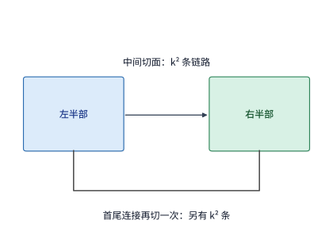

*图 6-36：沿一个维度把三维环面网络分成两半，需要切断中间连接和首尾连接。每处包含 k² 条链路，合计 2k² 条。*

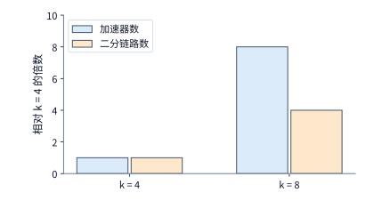

*图 6-37：k 从 4 增到 8 时，芯片数从 64 增到 512，二分链路从 32 增到 128。两种增长均以 k = 4 时为基准。k 表示三维环面每个维度的节点数，总节点数为 k³。*

除了决定了大尺度下的对分带宽外，固定网格拓扑还会给集群作业调度带来一个棘手的**拓扑碎片化**问题：集群中不仅要有足够数量的空闲芯片，这些空闲芯片在物理网格上的位置还必须能够拼出作业所需的连续几何形状（在 TPU 系统中，分配给单个作业的一组规则拓扑子网称为一个**切片**，slice）。以一个 $4\times4$ 的二维芯片网格为例：如果当前空闲的 8 颗芯片恰好是连续的两整行，调度器便能轻松从中切出两个完整相邻的 $2\times2$ 作业切片；反之，如果同样是 8 颗空闲芯片，却因前序作业随机释放而呈黑白棋盘格状交错散布在网格中，那么在固定连线下就根本找不出任何一个物理相邻的 $2\times2$ 子网格。此时，TPU v4 引入的 OCS 光路交换机便展现出另一项关键价值：它可以在 64 芯片基本单元之间按需重构物理光路连接，绕开故障或碎片节点，为不同规模的作业动态拼装出几何形状规整的环面切片。

当然，按需重配光路拓扑并非免费，只有当新拓扑在后续运行中省下的通信时间超过光路切换本身的停顿开销时，重配置才真正划算。前沿工作 Morphlux 正是围绕这一权衡，研究如何在运行期间按不同模型阶段的通信模式动态重构 OCS 光互连拓扑。我们可以通过一个具体算例来核算这笔时间账：设 8 颗 TPU v4 芯片组成一个通信组执行每芯片 8 MiB 输入的环形 AllReduce，按式（6-9）每颗芯片单次归约共需发送 $2\times(8-1)/8\times8=14\ \mathrm{MiB}$ 数据。假设在重配置前的通用拓扑切片下，每颗芯片在这个环方向上仅有 1 条单向 50 GB/s 的 ICI 链路可用，则单次归约的纯传输耗时约为 $293.6\ \mu\mathrm{s}$；若通过 OCS 重构光路，将原本闲置在其他维度的端口汇聚起来，使该环形通信方向上每跳拥有 3 条并联的 50 GB/s 链路（合计 150 GB/s），则单次归约的传输耗时立即可缩短至约 $97.9\ \mu\mathrm{s}$，每次调用净省约 $195.7\ \mu\mathrm{s}$。已知 TPU v4 的 MEMS 光路交换机完成一次物理反射镜偏转切换需要毫秒级时间：若切换光路耗时 1 ms，则重构后只需连续执行 $\lceil 1000/195.7\rceil=6$ 次该归约操作即可收回切换成本；若包含软件协调在内的完整重配置流程耗时 100 ms，则需要连续执行至少 511 次归约才能回本。可见，单个计算阶段或作业持续运行的迭代步数越长，为其专门定制重构物理光拓扑的收益就越可观。[^swing]

### 6.5.5 Unified Bus 与 CloudMatrix

纵观前两小节，无论是 NVIDIA 的 NVLink 交换网络还是 Google TPU 的三维环面加 OCS，它们的出发点都集中于“如何把更多加速器芯片高速连接起来”。华为提出的 **Unified Bus（统一总线，简称 UB）** 则进一步将问题推进到了更底层的系统资源解耦与直接访问：**当我们将多台物理主机连接进同一个超节点后，一台主机上的处理器或加速器能否跨越主机边界，像直接读写本地内存一样低延迟地使用另一台主机上的内存与计算资源？** 笔者对 Unified Bus 的早期思考来自主机内总线与主机间网络的分界。同样是读取一块数据，跨过主机边界后，软件往往要改用消息传递接口，重新安排缓冲区，每多一层抽象就多一段时间。UB 希望去掉这些抽象层，扩大资源直接访问的范围，使计算、内存和存储能够按任务重新组合。

本书将在第 6 章与第 7 章分两个层次剖析 UB 的架构设计与定量模型。本节将 UB 视为一种超节点互联架构，重点回答三个直接决定超节点规模上限的宏观问题：**通信控制器应当接在芯片内部的什么位置？网卡片上高速缓存（SRAM）能够支撑多少台主机的互联状态？以及在作业启动时建立全网连接需要花费多长时间？** 第 7 章则将深入微观，沿着单次远程内存访问的完整生命周期逐跳展开：第 7.1.3 节阐明统一协议接口的设计动机，第 7.3.3 节逐阶段累加单次远程读取的纳秒级延迟，第 7.3.4 节计算并发在途请求数对消息吞吐率的限制，第 7.4.2 节推导连接上下文状态的膨胀规律与片上缓存溢出惩罚，第 7.4.3 节讨论按需松弛的事务顺序语义。两章的分析使用同一组参数和同一个计算脚本，推导结果都与笔者的 UB 实现 OpenURMA 在仿真中测得的数值对照。[^ub-fabric]

要把原本割裂的“机内总线访问”与“机间网络通信”统一到同一套架构下，首先必须在协议栈中清晰拆解两类性质截然不同的职责：第一类职责关乎**应用语义**——当前这次操作究竟由谁发起、要访问哪个远端目标的哪段地址、执行读还是写、以及应用何时可以安全使用返回的结果；第二类职责关乎**网络传输**——承载这次操作的数据包如何穿过物理交换网络、如何应对丢包与乱序并可靠送达对端。UB 架构将前一类职责交由**事务层**（Transaction Layer）处理，而将后一类职责交由**传输层**（Transport Layer）处理（注：此处的“事务”指代一次完整的读写或消息通信操作，而非数据库系统中带有 ACID 提交与回滚语义的事务）。

具体而言，在事务层，UB 引入了名为 **Jetty（栈桥）** 的统一通信端点抽象，供应用程序提交工作请求、接收数据并获取完成通知，其中仅维护与应用身份、权限校验及操作完成归属直接相关的轻量上下文；而在传输层，则由独立的**传输通道**（在 UB 规范中称为 TP Channel，其中 TP 是 Transport Protocol 的缩写，切勿与前文的张量并行 Tensor Parallelism 混淆）负责维护数据包序列号、确认应答（ACK）、超时重传以及端到端拥塞控制状态。通过这种“事务层端点与传输层通道解耦”的设计，同一台主机上不同进程或线程所持有的多个应用端点（Jetty）在访问同一台远端主机时，可以直接**多路复用（multiplex）同一条底层传输通道（TP Channel）**，而无需像传统协议那样让每一对应用连接都各自携带一整套完整的可靠传输状态机。图 6-38 展示了这一分层复用机制。作为对比，传统远程直接内存访问（RDMA——一种允许网卡硬件绕过远端操作系统内核、直接读写已授权远端内存的技术）中的可靠连接（Reliable Connection，RC）模式将应用层通信端点与传输层状态机紧密绑定在同一个队列对（Queue Pair，QP，由一对发送队列与接收队列组成）中；而 UB 则将二者分离，允许系统独立规划应用端点与底层传输通道的数量、生命周期与共享范围。[^ub-design]

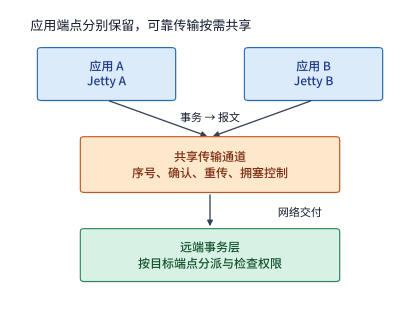

*图 6-38：两个本地应用保留各自的 Jetty，经共享传输通道访问远端端点。事务层区分操作及其完成归属，传输层处理报文的可靠交付；共享通道不取消权限检查，也不自动建立跨应用的全局顺序。*

UB 的另一项核心架构抉择是原生支持**单边内存语义**（memory semantics）。在单边操作模式下，发起方直接指定事先已获授权的远端内存虚拟或物理地址即可发起读写，远端应用程序完全无需像双边消息传递（Send/Recv）那样事先提交一个匹配的接收工作请求。UB 同时支持两种粒度的单边访问方式：一是面向细粒度低延迟访问的 **Load/Store**，由处理器或加速器的加载/存储指令直接触发；二是面向大块数据异步搬移的 **Read/Write**，由应用向 Jetty 显式提交请求描述符触发。需要特别说明的是，无论采用这两种方式中的哪一种直接读写远端内存，都不代表硬件会自动维护跨主机、跨设备的硬件缓存一致性（cache coherence）——第 7.3.3 节将定量对比这两种发起方式的延迟差异，第 7.4.1 节则将详细规定写入数据何时对远端可见、以及一次操作何时才算真正完成。

下面我们用定量模型依次回答关乎超节点扩展性的三个核心问题：

**第一个问题：通信控制器接在芯片何处，如何改变访问延迟？** 在传统服务器架构中，RDMA 网卡是一个挂载在 PCIe 根复合体（Root Complex）外部的独立 I/O 外设，第 6.4.4 节图 6-29 已经追踪过它的请求路径：当主机处理器或加速器发起一次远程内存读取时，敲门铃、网卡读取请求描述符、目标端网卡读取远端内存数据、发起端网卡将返回数据写回本地内存、以及最后写入完成队列记录，前前后后一共需要**穿越 PCIe 总线 5 次**，每次穿越都要付出数百纳秒的协议转换与串行化延迟。而在 UB 架构中，通信控制器被直接集成并挂载在处理器或加速器的**片上互连总线**（on-chip interconnect / coherent fabric）上：当处理器核心执行一条面向远端地址的 `Load` 指令时，该读请求直接通过片上总线抵达 UB 控制器并封装发往网络，远端返回的数据也直接经片上总线写回处理器的目标寄存器。图 6-39 直观对比了这两条物理路径。第 7.3.3 节将对这两条路径上的每一个硬件阶段做逐项累加：在网络线缆单程传播延迟同为 100 ns 的条件下，经由传统 PCIe 外设网卡完成一次 64 B 远程读取的总延迟约为 $2.2\ \mu\mathrm{s}$，其中仅 5 次 PCIe 穿越就占去了约 $1.65\ \mu\mathrm{s}$；而经由片上总线 UB 控制器完成同样的 64 B 远程读取，总延迟骤降至约 **$0.42\ \mu\mathrm{s}$**。可以看到，省下的近 $1.8\ \mu\mathrm{s}$ 并非靠把原有的 PCIe 与软件队列步骤加速一点点抠出来的，而是因为处理器与 UB 控制器共享同一个物理地址空间，那些跨总线握手、描述符搬移与完成轮询阶段从根源上被彻底消除了。去掉中间软件与 I/O 抽象层，让处理器像访问本地内存一样直接访问远端内存，正是 UB 超低延迟的核心来源；剩下的 $0.42\ \mu\mathrm{s}$ 已基本由光电信号在线缆上的物理飞行时间与远端 DRAM 访存延迟构成，逼近了物理定律允许的硬件下限。

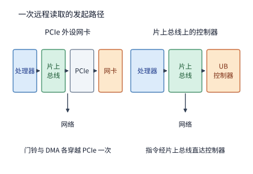

*图 6-39：左图的网卡接在 PCIe 之后，门铃、请求描述符、返回数据和完成记录在发起端的处理器与网卡之间各穿越 PCIe 一次，目标端网卡读取数据时再穿越一次；右图的控制器接在片上总线上，处理器的指令直接到达控制器。两条路径从控制器到网络的部分相同。*

**第二个问题：网卡片上缓存能装下多少台主机的连接状态？** 为了在线速收发报文时无需频繁回退到缓慢的主机 DRAM 查阅上下文，高速网卡（或片上通信控制器）必须将活跃通信关系的上下文状态（context state）缓存在片上高速 SRAM 中；在本节基准算例中，我们取通信控制器的片上上下文缓存容量为 **256 KiB**。设超节点互连域内共有 $H$ 台主机，每台主机上运行着 $A$ 个需要对外通信的应用端点（例如每台主机上的 8 个加速器进程），且全网任意两台主机的任意两个端点之间都可能发生 All-to-All 通信。我们来对比三种连接状态组织方式在单张网卡上所需的上下文存储量：
1. 第一种是传统的**端到端逐对连接（Pairwise QP）**，以 RoCE（RDMA over Converged Ethernet）的可靠连接（RC）模式为代表：本机的每一个应用端点都必须与其余 $H-1$ 台远端主机上的每一个应用端点单独建立一条双向 QP 连接，每条 QP 连接需维护 512 B 的完整上下文状态，外加每个本地端点 32 B 的内存注册段记录；
2. 第二种是 UB 的**端点加共享传输通道（Jetty + Shared TP Channel）**：本机的每个应用端点仅需维护一份 20 B 的 Jetty 上下文与一份 32 B 的内存段记录（合计每本地端点 52 B），而底层的可靠传输通道则在主机粒度上共享——本机只需为其余 $H-1$ 台远端主机各维护一条 56 B 的共享 TP Channel 即可。

据此，上述两种方式在单张网卡上需要保存的连接状态总字节数分别为：

$$
S_{\mathrm{pair}}(H)=512A^{2}(H-1)+32A,\qquad
S_{\mathrm{UB}}(H)=52A+56(H-1).
$$

将每台主机 8 个端点（$A=8$）代入上式对比：在传统的逐对连接方式下，超节点每增加 1 台主机，每张网卡需要维护的 QP 状态就会增加 $512\times64=32\ \mathrm{KiB}$，因此 256 KiB 的片上 SRAM 缓存**最多只能装下 8 台主机**（64 个端点）的全互联状态；而在 UB 的“端点加通道”方式下，每增加 1 台远端主机仅需增加 56 B 的通道状态，同样 256 KiB 的片上缓存足以装下**四千多台主机**的全互联状态。若以华为 CloudMatrix384 超节点所包含的 $H=192$ 台主机计算，传统逐对连接在每张网卡上需要高达约 **6 MiB** 的连接上下文，是 256 KiB 片上缓存容量的 24 倍；而 UB 仅需约 **11 KiB**，还不到片上缓存容量的 1/20。一旦连接状态超出片上 SRAM 缓存容量（发生上下文缓存缺失，context cache miss），网卡每次收发不同对端的报文都必须通过 PCIe DMA 从主机内存换入对应的连接上下文——第 7.4.2 节的定量计算表明，在逐对连接方式下，每次缓存缺失都会额外引入 2 次 PCIe DMA 读取，使单次操作延迟增加约 $1\ \mu\mathrm{s}$。

3. 第三种参考方式是**基于目录的硬件缓存一致互连（Directory-based Cache-Coherent Fabric）**，NVIDIA 的 NVLink 交换域便属于这一类型：它允许一张加速器卡直接将远端加速器的内存行读入并保留在自己的片上高速缓存（L1/L2 cache）中。为了保证当某张卡修改了某个内存地址时，全网所有持有该缓存行副本的远端卡都能及时获知并使旧副本失效，硬件必须维护一个缓存一致性目录（coherence directory），用位向量（bit-vector）记录每一个缓存行当前被哪些远端节点持有，因此每一行目录项至少要为每一个远端节点预留 1 bit 的存在位。假设单卡目录只需跟踪 $W=2^{20}$ 个缓存行（按每行 64 B 计，仅对应 64 MiB 的可缓存共享窗口），且每行目录另需 8 B 的地址标签（tag）与状态开销，则单卡目录状态占用的空间为 $W\cdot\big((H-1)/8+8\big)$ 字节：当只有 2 台主机时，目录状态就已达约 **8 MiB**；当扩展到 1024 台主机时，目录状态更膨胀至约 **136 MiB**。不仅如此，每次向共享缓存行写入数据时，控制器还必须向所有持有副本的远端节点广播缓存失效（invalidation）报文，一致性维护流量随节点数 $H$ 线性增长。正是目录存储开销与失效广播流量的双重制约，将硬件缓存一致互连域的工程规模限制在数十个节点的范围内——NVIDIA GB200 NVL72 将单机柜缓存一致域定在 72 张 GPU，正处于这一物理甜点区内。相比之下，UB 明确选择了**不在硬件层维护跨主机的自动缓存一致性**，而是将“写入数据何时对其他设备可见”的同步时机交由应用软件或运行时按需显式控制（详见第 7.4.1 节）；正因甩掉了沉重的一致性目录包袱，在图 6-40 绘制的三条状态增长曲线中，唯有 UB 的“端点加通道”曲线能够平坦地延伸至上千台主机而始终驻留在 256 KiB 的片上缓存线以内。

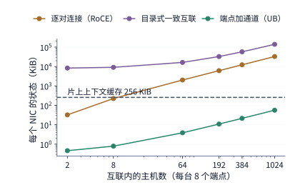

*图 6-40：每台主机 8 个端点时，三种组织方式下每个网卡的状态随互联内主机数的变化。虚线是 256 KiB 的片上缓存。逐对连接在 8 台主机时超出缓存，目录式缓存一致互联从两台主机起就远超缓存，端点加通道到上千台主机仍在缓存之内。*

**第三个问题：作业启动或故障重连时，建立全网通信关系需要多长时间？** 连接状态对象的数量不仅占用片上存储，还直接决定了分布式作业在启动初始化或故障恢复时需要执行多少次控制面操作。在传统的逐对连接（RoCE RC QP）模式下，每建立一条点对点 QP 连接，驱动软件都必须依次执行创建队列对及三次状态机迁移（Reset $\to$ Init $\to$ RTR $\to$ RTS），共需 **4 次内核系统调用**；不仅如此，通信双方还必须通过控制面网络交换各自的队列对编号（QPN）与地址信息，这至少需要 **1 次带外网络往返**（out-of-band RTT，即经由管理网或 TCP 控制通道往返通信一次）。按每次系统调用耗时 $5\ \mu\mathrm{s}$、每次带外网络往返耗时 $500\ \mu\mathrm{s}$ 计算，建立单条 QP 连接约需 $4\times5\ \mu\mathrm{s}+500\ \mu\mathrm{s}=0.52\ \mathrm{ms}$。当超节点内的 $N$ 个本地端点需要与 $M$ 个远端端点建立全互联（All-to-All）关系时，逐对连接模式总共必须建立 $N\times M$ 条独立连接；而在 UB 的“端点加通道”模式下，系统只需为 $N$ 个本地应用端点各自执行 1 次创建 Jetty 的系统调用，并为 $M$ 台远端主机各自执行 1 次创建共享传输通道的系统调用外加 1 次带外往返即可。取 $N=M=1024$ 的千卡级规模对比：传统逐对连接总共需要建立 $1024\times1024=1{,}048{,}576$（逾百万）条连接，若单核串行执行需耗时约 **545 秒（超过 9 分钟）**，即便动用 32 个 CPU 核心并行建连也仍需约 **17 秒**；反观 UB 的端点加通道模式，全网只需创建 2048 个轻量对象，32 核并行建连耗时仅约 **16 毫秒**——二者相差逾千倍（见图 6-41）。由于大模型训练或推理作业每逢节点故障重启、弹性扩缩容或动态实例重配置时都必须重新走一遍建连流程，从 17 秒压缩到 16 毫秒直接决定了第 6.7.2 节所讨论的集群故障恢复时间。

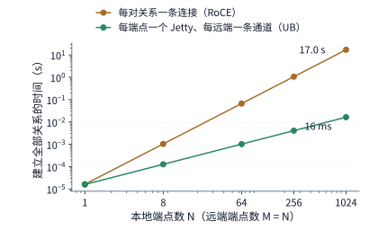

*图 6-41：在 N 个本地端点与 N 个远端端点之间建立全部连接所需的时间，32 个核并行执行。逐对连接的时间随 N² 增长，端点加通道随 N 增长；N = 1024 时二者相差约一千倍。*

将上述 UB 架构机制落地到真实超节点系统中的代表作，正是华为的 **CloudMatrix384**：该系统通过高密 UB 全交换网络，将 **384 颗昇腾 910C NPU** 与 **192 颗鲲鹏（Kunpeng）CPU** 统一组织进同一个超节点互连域内；在超节点之间，系统通过标准 RDMA 网络横向扩展成更大集群；而面向多租户云服务的业务接入与安全隔离，则交由独立的虚拟私有云（VPC）网络承担。可以算一笔简单的连线账：若不采用交换机而将 384 颗 NPU 两两直接相连，仅点对点线缆就需要 $\frac{384\times383}{2}=73{,}536$ 条，在工程上根本无法实现；CloudMatrix384 正是依靠两级高基数 UB 交换网络，通过统一的端口接入与路由转发实现了全超节点内任意计算与内存资源的平坦互连。[^cloudmatrix]

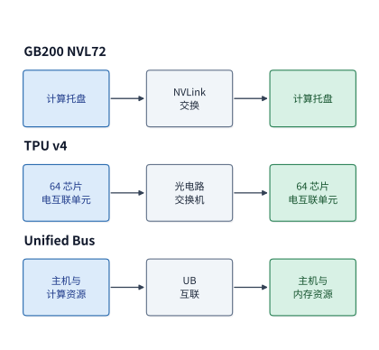

*图 6-42：三个公开系统的连接层次。NVIDIA 用 NVLink 连接设备，TPU v4 用 OCS 连接电互联单元，Unified Bus 将主机侧计算和内存资源接入统一互联。*

回到大模型并行部署：无论是 NVIDIA 的 NVL72、Google 的 TPU v4 切片，还是华为的 CloudMatrix384，都可以运行第 6.3.1 节推导的 TP2×EP4 等混合并行方案，但软件通信组映射到硬件物理边界的方式各有不同。一般原则是：将每层触发频繁、对延迟极度敏感的张量并行（TP）归约放在延迟最低的节点内或近邻链路上，而将跨专家组（EP）的大流量全交换（All-to-All）或跨组归约映射到具备充足对分带宽的交换平面上。只有把算法层的逻辑通信组准确投射到底层物理交换拓扑上，才能算清每一次张量汇合究竟占用了哪些物理端口与链路。

最后补充一项阅读硬件规格书时的关键工程细节：用芯片互连带宽计算传输时间时，必须严格区分厂商标注的是**单向带宽（unidirectional）**还是**双向合计带宽（bidirectional / aggregated）**。例如，华为昇腾 950 处理器公开的 UB 接口双向合计线速为 2016 GB/s——这是按 72 条高速串行通道（lanes）、每条通道单向速率 112 Gbit/s（即 14 GB/s）计算的收发双工总和，因此其单向发送或单向接收的物理线速均为 $72\times14=1008\ \mathrm{GB/s}$。此外，昇腾 950 支持两种协议形态：一种是在标准以太网帧上承载 UB 协议的 **UBoE（UB over Ethernet）**，另一种是采用原生低开销链路层协议的 **UB Link**。由于这两种协议在芯片边缘共享同一组高速串行器/解串器（SerDes——负责将芯片内部的并行数据流与外部物理线缆上的高速串行差分信号相互转换的模拟/混合信号电路），系统在部署时需按预设配置将这 72 条物理 SerDes 通道划分给不同的互连平面，而最终的通道分配比例便决定了上层通信组在各个平面上实际可用的物理带宽。[^ub]

> **实验 6-8 · 延伸：用通信需求解释超节点的互联结构**
>
> （a）选择 DGX-1、DGX-2 或 DGX A100，画出一个通信组经过的直连或交换层。
>
> （b）复算 4³ 与 8³ 环面的芯片数和均衡二分链路数，解释为什么每芯片可用的跨分区带宽下降。
>
> （c）将 TP2×EP4 放到两台各有四张卡的主机上，标出跨主机的专家组归约。
>
> （d）把每台主机的端点数改为 64，求 256 KiB 缓存在逐对连接方式下还能容纳几台主机；再把缓存扩大到 1 MiB，判断 CloudMatrix384 的 192 台主机是否放得下。
>
> （e）把一次带外往返改为 50 μs，重新计算 N = M = 1024 时两种方式的连接建立时间，说明哪一种对往返时延更敏感。
>
> （f）选择 UB 或 TPU 的一个设计，说明安装、通信或资源访问中的哪项需求促成了这种系统结构。

## 6.6 内存池

### 6.6.1 局部容量不足与全局空闲

当 Unified Bus 等超节点互连将低延迟直接内存访问扩展到主机与主机之间后，便带来了一项重要的系统能力：**让本地内存不足的计算节点直接借用超节点内其他节点的空闲内存**。回顾第 6.2 节，张量并行、流水线并行与专家并行都是通过把计算任务与模型权重切分到多张卡上来降低单卡显存占用；而本节讨论的**内存池**（memory pool）则提供了另一种正交思路——保持计算任务所在的位置不变，仅将单节点溢出的那部分数据放置到远端节点的空闲内存中，从而把散布在各个节点上的碎片化空闲容量汇聚起来供有需要的任务按需取用。

不妨看一个直观的四节点算例：假设超节点内有 4 个节点，每个节点配备一张 80 GB 显存的 H100，当前 4 个节点上运行的任务所需内存容量分别为 100、60、40、40 GB。汇总全系统来看，4 个任务的总内存需求为 $100+60+40+40=240\ \mathrm{GB}$，显著低于 4 个节点的物理总容量（$4\times80=320\ \mathrm{GB}$）；但问题出在局部与全局的不对称：节点 0 上的任务 0 需要 100 GB 内存，超出了本节点 80 GB 的物理上限 20 GB，而其余三个节点此时却分别闲置着 20、40、40 GB（合计 100 GB）的空闲内存。

显然，即便把任务 0 整体迁移到其他任何一个节点，其 100 GB 的单体需求依然装不进任何单节点的 80 GB 物理内存中。但如果允许跨节点内存借用——将任务 0 溢出的 20 GB 数据放置到节点 1 的空闲内存区中，那么 4 个节点的实际物理内存占用便变为 80、80、40、40 GB，无一超出单卡上限。此时，任务 0 的逻辑工作集依然是完整的 100 GB（其中 80 GB 驻留本地、20 GB 驻留远端节点 1），从而顺利盘活了原本闲置在其他节点上的内存空间。

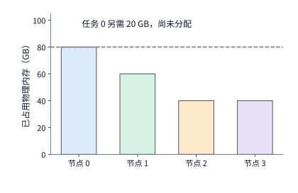

*图 6-43：借用前的物理占用。每节点容量为 80 GB，任务 0 的需求为 100 GB，其中 20 GB 尚未找到存储位置。颜色表示数据所属任务。*

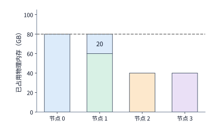

*图 6-44：把任务 0 的额外 20 GB 放在节点 1。节点 1 的绿色 60 GB 属于任务 1，蓝色 20 GB 属于任务 0；每个节点都没有超过 80 GB。*

这里需要注意区分借用前后的全网可用余量：在借用发生前，节点 1、2、3 合计拥有 100 GB 空闲内存；将其中的 20 GB 借给节点 0 的任务 0 之后，4 个节点合计剩余的全局空闲容量变为 80 GB。换言之，内存池借用并不会凭空创造出额外的物理内存，它的作用是打破单机物理边界，消解节点间的容量冷热不均。笔者早期关于 UB 内存池的构思，关注的正是这种服务器之间的不均衡；KV 的保存与复用后来成为它的具体用途。

### 6.6.2 内存借用与访问边界

图 6-44 为溢出的 20 GB 数据找到了物理落脚点，接下来的核心工程问题是：如何让节点 0 既安全又高效地读写远端节点 1 上的这段内存？在系统层面，一次跨节点内存借用首先必须确立清晰的**所有权与访问边界**：提供空闲内存的节点（借出方）从本地内存池中划出一段物理连续或分块的区域并导出，借用内存的节点（借入方）将其映射到本地地址空间中；底层互连与管理软件则负责硬件级访问权限校验，并跟踪该内存段的租约生命周期（何时可安全释放与重分配）。在独占借用（exclusive borrowing）期间，该内存段的读写使用权移交给借入方，借出方必须等待借入方显式归还后才能重新分配使用；而在多节点共享访问（shared access）模式下，多个节点则需严格遵循约定的一致性与同步原语来协同读写。[^ub]

以大模型推理中跨节点借用内存存放 KV 缓存为例：设节点 1 将一段内存借给节点 0 使用，节点 0 在当前生成步中需要先将新算出的 K、V 向量写入这段远端内存，随后才能在后续注意力计算中读取完整的历史 KV。此时，节点 0 必须先收到硬件返回的写入完成（completion）确认、确保新写入的 KV 数据对后续读操作已经可见，才能启动依赖该数据的注意力内核；同理，节点 1 若要回收这段内存另作他用，也必须严格排在节点 0 的会话结束并解除映射之后。简言之，**地址映射**回答“访问哪里”，**权限校验**回答“谁有权访问”，而**事务完成序与生命周期管理**则回答“从哪一刻起可以安全读写或回收”——唯有将地址、权限与访问顺序三者严密结合，远端内存池才能在生产环境中正确运转。

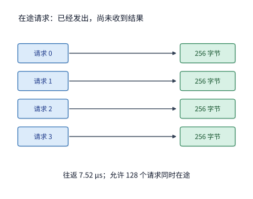

*图 6-45：一批读取请求发出后，要经过往返时间 L 才能收到结果。最多有 u 个请求在途、每个返回 q 字节时，在一个往返时间内最多返回 uq 字节。图中四个请求仅用于展示过程；正文算例采用 128 个请求，每个 256 字节，往返时间为 7.52 μs。*

在保证了数据访问的正确性之后，图 6-45 揭示的往返等待过程则直接决定了远端内存的**实际有效读取带宽**。由于发起端发出一条远程读请求后，必须等待至少一个网络往返时间（RTT）才能收到返回的字节，如果采用“发一条、等一条”的串行方式，高带宽物理链路在绝大部分等待时间里都将处于空转状态。为了让物理互连管道持续满载，发起端必须通过流水线并发同时保持足够多的请求处于**在途状态**（in-flight / outstanding，即请求已发出但数据尚未返回）。设单次读事务返回的数据块大小为 $q$ 字节，从请求发出到数据返回落地的单次往返延迟为 $L$，硬件控制器最多允许同时存在 $u$ 个在途读事务，那么在任意长度为 $L$ 的时间窗口内，网络最多只能返回 $u\cdot q$ 字节的数据（即利特尔法则 Little's Law 在内存总线上的体现）。将在途窗口限制的带宽上限与物理路径本身的线速带宽 $B_{\mathrm{path}}$ 结合起来，可得远端内存的实际可用读取带宽：

$$
B_{\mathrm{window}}=\frac{uq}{L},\qquad
B_{\mathrm{usable}}=\min\left(B_{\mathrm{path}},\frac{uq}{L}\right). \tag{6-12}
$$

下面代入一组真实的硬件参数来感受式（6-12）的威力：设两个节点通过 400 Gbit/s ConnectX-7 网卡的 RDMA 路径相连，物理路径带宽为 $B_{\mathrm{path}}=50\ \mathrm{GB/s}$。一次远程读请求从发出到数据返回需经历一去一回两次网络传输，取 MSCCL++ 论文在 H100 + ConnectX-7 平台上实测的 InfiniBand 单向延迟 $3.76\ \mu\mathrm{s}$ 的两倍，即往返延迟 $L=7.52\ \mu\mathrm{s}$。设每次细粒度读事务读取的数据块大小为 $q=256\ \mathrm{B}$——这恰好对应 Qwen3-32B 中单个 KV 头在单层、单个 token 位置上的 K 向量大小（128 维 BF16）。如果通信控制器或软件队列最多只允许 $u=128$ 个读事务同时在途，那么在途总数据量（飞行窗口）仅为 $128\times256\ \mathrm{B}=32\ \mathrm{KiB}$，代入式（6-12）算出的窗口带宽上限仅为

$$
B_{\mathrm{window}}=\frac{32\,768\ \mathrm{B}}{7.52\ \mu\mathrm{s}}\approx4.36\ \mathrm{GB/s},
$$

还不到物理链路 50 GB/s 线速的十分之一。要想充分利用 50 GB/s 的物理路径带宽，硬件必须允许的同时在途读事务数至少需达到

$$
u\ge\left\lceil\frac{50\times10^9\times7.52\times10^{-6}}{256}\right\rceil=1469.
$$

这一算例清晰地说明：当单次事务粒度较小（256 B）且跨节点往返延迟在微秒量级时，如果硬件队列深度仍限制在 128 个在途事务，那么即便把底层网卡线速从 400G 升级到 800G，实际能读出来的有效带宽依然被限制在 4.36 GB/s；反之，若将硬件支持的并发在途事务上限放宽到 $u=4096$，窗口带宽上限随即升至约 $139\ \mathrm{GB/s}$，超过 50 GB/s 的物理线速，此时系统瓶颈才真正转移到物理链路带宽本身。简言之，**物理链路带宽、单次读写事务粒度与网络往返延迟三者，是通过硬件允许的最大在途数据量（带宽延迟积）紧密耦合在一起的**。

### 6.6.3 共享容量与 KV 缓存

弄清了远端内存池能够提供多大的可用读取带宽后，下一步便是将其与上层模型负载的真实读取需求相对照，从而判断远端内存池究竟能否替代本地显存。同样是在远端内存池中存放 20 GB 的数据，上层应用读取它的**时间频率**直接决定了所需的平均带宽：如果每分钟才完整读取一次这 20 GB 数据，平均只需约 $0.33\ \mathrm{GB/s}$ 的带宽；如果每秒完整读取一次，就需要 $20\ \mathrm{GB/s}$；而如果要求每秒完整扫描 20 次，所需的平均带宽便高达 $400\ \mathrm{GB/s}$。数据占用的静态容量完全相同，但因访问频率不同，对互连网络提出的带宽需求却相差上千倍。

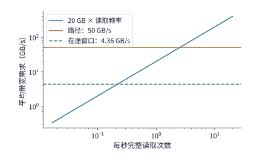

*图 6-46：完整读取 20 GB 的频率与平均带宽需求。路径带宽为 50 GB/s；每事务返回 256 bytes、往返 7.52 μs 时，128 个在途事务将有效带宽限制到约 4.36 GB/s。*

我们可以算一下连续读取时的排队稳定性边界：当在途事务数充足、能够用满 50 GB/s 的物理路径带宽时，完整读取一遍 20 GB 远端数据约需 $20/50=0.40\ \mathrm{s}$。如果业务每秒才触发一次读取，那么两次读取之间还留有约 $0.60\ \mathrm{s}$ 的链路空闲余量；但如果业务每隔 $0.05\ \mathrm{s}$（每秒 20 次）就触发一次读取，那么上一次读取还远未完成，新的读取请求便源源不断涌入，请求队列将迅速积压。更进一步，若硬件受限于 $u=128$ 个在途事务（有效带宽仅 $4.36\ \mathrm{GB/s}$），那么完整读取一次 20 GB 数据的时间将拉长至约 $4.59\ \mathrm{s}$，此时哪怕只是每秒触发一次读取，系统也会陷入持续积压。[^pool]

这一量化对比直接指明了大模型 **KV 缓存**在内存池中的合理放置策略。在多轮对话或 Agent 推理中，当某个用户会话暂时处于等待用户下一轮输入（或等待外部工具返回结果）的挂起状态时，系统在数秒乃至数十秒内完全不需要读取该会话的 KV 缓存——此时将这些非活跃会话的庞大 KV 缓存卸载（offload）到远端内存池中保存，待会话恢复活跃时再按需取回，只需极小的平均带宽即可换取宝贵的本地 HBM 容量。反之，对于正在逐 token 连续解码的活跃会话，由于每生成一个新 token 都必须把全部历史 KV 缓存完整扫描一遍，若直接隔着网络在远端内存池上原地反复扫描，就会持续消耗高昂的跨机带宽并拉长每步延迟。当然，每个会话需要搬移的 KV 状态究竟有多大，还取决于第 2 章讨论的模型上下文表征设计：第 9.2.2 节将定量对比同样 8192 个 token 的历史上下文在 Qwen3-8B（采用 GQA）与 DeepSeek-V3（采用紧凑的 MLA 潜在向量）两种架构下的字节数与跨网取回耗时，后者的状态体积与传输耗时均压缩到了前者的一半左右。

此外，当同一份远端数据需要在短时间内被连续读取多次时，还可以采用**先整体取回本地 HBM 缓存、再在本地反复复用**的策略。举例来说，若某份 20 GB 的远端状态快照需要被连续扫描 10 次：若每次都直接走 50 GB/s 的远端网络路径读取，10 次累计需耗时约 $10\times0.40=4.0\ \mathrm{s}$；反之，若先花 $0.40\ \mathrm{s}$ 将其一次性取回本地 H100 显存，随后利用高达 $3350\ \mathrm{GB/s}$ 的本地 HBM 带宽在片内连续扫描 10 次（仅需约 $0.06\ \mathrm{s}$），则总耗时缩短至约 $0.46\ \mathrm{s}$。可以看到，后者虽然在复用期间临时占用了 20 GB 的本地 HBM 空间，却省下了约 $3.54\ \mathrm{s}$ 的等待时间。因此，面对需要多次复用的远端数据，系统应当定量权衡“远端直读的带宽耗时”与“取回本地缓存的传输加占用代价”，据此决定何时直接远端读取、何时提前换入本地显存（见图 6-47）。

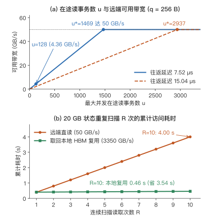

*图 6-47：远端内存池的在途窗口带宽与本地缓存复用收益对比。上图展示单事务 $q=256\ \mathrm{B}$、物理路径带宽 $50\ \mathrm{GB/s}$ 时，可用读取带宽随最大并发在途读事务数 $u$ 的变化（往返延迟 $7.52\ \mu\mathrm{s}$ 与 $15.04\ \mu\mathrm{s}$ 的线速饱和阈值分别为 $u^*=1469$ 与 $u^*=2938$）；下图对比对 $20\ \mathrm{GB}$ 状态快照连续扫描 $R$ 次（$R=1\sim10$）时，“远端直读（$50\ \mathrm{GB/s}$）”与“先取回本地 HBM 再复用（$3350\ \mathrm{GB/s}$）”的累计访问耗时。*

在包含超节点内存池、主机内存与跨节点远端层的多级分层内存系统中，评估一次数据搬移对端到端延迟的真实影响时，还必须严格区分**“存储层空载带宽”**与**“关键路径暴露停顿（Exposed Stall）”**。一段数据从外部存储层送入加速器显存往往要经过“源存储层读出 $\to$ 主机至设备（H2D）链路写入”两级串联流水，同时上层运行时还会利用前序算子执行的时间窗提前发起异步预取（prefetch）。唯有把多级流水瓶颈与预取掩盖窗口合在一起算账，才能判断升级外部内存层带宽或执行冷热页迁移（Page Promotion）究竟能否缩短端到端迭代时间：[^memory-tiering]

> **算例 6-A（分层内存源端带宽、H2D 瓶颈、预取提前量与冷热页迁移回本阈值）**：
> 以 `Qwen3-8B` 单层 BF16 前馈网络（FFN）权重块为例，三个投影矩阵的合计大小为 $3\times4096\times12288\times2=\mathbf{288\ \mathrm{MiB}}$。假设该权重块存放在 GPU 显存之外的三级候选存储层中，其源端读取带宽分别为 $B_{\mathrm{source}}\in\{100,\ 40,\ 8\}\ \mathrm{GiB/s}$（分别对应高带宽远端内存池、本地双通道主机内存与慢速远端冷层），读出后均需经过一条有效带宽为 $B_{\mathrm{H2D}}=\mathbf{24\ \mathrm{GiB/s}}$ 的下游 H2D 链路送入 GPU：
> 1. **两级流水传输下界（为何源端从 $40\ \mathrm{GiB/s}$ 升至 $100\ \mathrm{GiB/s}$ 净收益为零）**：当采用细粒度分块流水搬移时，纯源端读取时间分别为 $288\ \mathrm{MiB}/(100\ \mathrm{GiB/s})\approx2.81\ \mathrm{ms}$（按 $1\ \mathrm{GiB}=1024\ \mathrm{MiB}$ 折算，下同）、$288\ \mathrm{MiB}/(40\ \mathrm{GiB/s})\approx7.03\ \mathrm{ms}$ 与 $288\ \mathrm{MiB}/(8\ \mathrm{GiB/s})\approx35.16\ \mathrm{ms}$，而下游 H2D 链路的纯传输耗时固定为 $288\ \mathrm{MiB}/(24\ \mathrm{GiB/s})\approx\mathbf{11.72\ \mathrm{ms}}$。在理想分块流水下，完整搬完 $288\ \mathrm{MiB}$ 的传输耗时下界由两级中最慢的一级决定：
>
> $$
> t_{\mathrm{transfer}}\ge\max\!\left(\frac{288\ \mathrm{MiB}}{B_{\mathrm{source}}},\ \frac{288\ \mathrm{MiB}}{24\ \mathrm{GiB/s}}\right).
> $$
>
> 代入上式可知，$100\ \mathrm{GiB/s}$ 与 $40\ \mathrm{GiB/s}$ 两档源端由于均快于下游的 $24\ \mathrm{GiB/s}$ H2D 链路，端到端传输耗时下界完全相同，均为 **$11.72\ \mathrm{ms}$**；唯有 $8\ \mathrm{GiB/s}$ 冷层受制于源端自身，传输耗时拉长至 **$35.16\ \mathrm{ms}$**。这意味着，在不拓宽下游 H2D 链路的前提下，将外部内存层从 $40\ \mathrm{GiB/s}$ 升级到 $100\ \mathrm{GiB/s}$ 并不能缩短分毫的端到端搬移时间。
> 2. **预取提前量与关键路径暴露停顿**：设运行时在消费该层权重前能够提前 $W_{\mathrm{prefetch}}$ 毫秒发起异步预取，则计算引擎实际被迫停顿等待的时间为 $t_{\mathrm{exposed}}=\max(0,\ t_{\mathrm{transfer}}-W_{\mathrm{prefetch}})$。当预取提前量 $W_{\mathrm{prefetch}}=\mathbf{16\ \mathrm{ms}}$ 时，$100\ \mathrm{GiB/s}$ 与 $40\ \mathrm{GiB/s}$ 两档的 $11.72\ \mathrm{ms}$ 传输耗时被前序计算 **100% 掩盖**，关键路径暴露停顿均为 **$0\ \mathrm{ms}$**；而 $8\ \mathrm{GiB/s}$ 冷层则会留下 $35.16-16=\mathbf{19.16\ \mathrm{ms}}$ 的暴露停顿。反之，若模型前序层计算充裕、使预取提前量达到 $W_{\mathrm{prefetch}}=\mathbf{40\ \mathrm{ms}}$，则连 $8\ \mathrm{GiB/s}$ 冷层的 $35.16\ \mathrm{ms}$ 传输也能在消费前完成，三档存储层的暴露停顿全部归零。
> 3. **冷热页迁移（Page Promotion）的回本阈值**：假设当前系统处于 $W_{\mathrm{prefetch}}=16\ \mathrm{ms}$ 场景，拟将该 $288\ \mathrm{MiB}$ 权重块从 $8\ \mathrm{GiB/s}$ 冷层迁移（提升）至 $40\ \mathrm{GiB/s}$ 温层。执行这次迁移本身首先需要从 $8\ \mathrm{GiB/s}$ 冷层完整读出该块，至少付出 $t_{\mathrm{migrate}}=\mathbf{35.16\ \mathrm{ms}}$ 的一次性搬移代价（同时占用温层 $288\ \mathrm{MiB}$ 容量）。迁移完成后，未来每次在关键路径上访问该块可省下 $19.16\ \mathrm{ms}$ 的暴露停顿（从 $19.16\ \mathrm{ms}$ 降至 $0\ \mathrm{ms}$）。因此，该权重块在迁移后至少要在关键路径上被复用
>
> $$
> N_{\mathrm{reuse}}\ge\left\lceil\frac{35.16\ \mathrm{ms}}{19.16\ \mathrm{ms}}\right\rceil=\mathbf{2\ \text{次}}
> $$
>
> （累计省下 $2\times19.16\approx38.31\ \mathrm{ms}>35.16\ \mathrm{ms}$），这次页迁移才能收回时间成本；而在 $W_{\mathrm{prefetch}}=40\ \mathrm{ms}$ 的宽裕预取窗口下，由于原本暴露停顿已为 $0\ \mathrm{ms}$，盲目按访问频次触发页迁移只会白白消耗互连带宽（见图 6-48 上图）。这也正是体系结构顶会 ASPLOS 2026 上的两项代表性研究——**PACT** 与 **Camp**——所揭示的核心洞见：传统的分层内存管理仅凭页面访问计数（热度）触发迁移，忽略了不同缺失请求在流水线中的内存级并行度（MLP）与关键路径阻塞权重；**PACT** 通过按在途并发缺失数的倒数（$1/\mathrm{MLP}$）对延迟做关键度加权，精准识别真正阻塞核心推进的页面，而 **Camp** 则进一步区分按需读取（demand read）、异步预取与写回背压（store backpressure），动态调节多级内存的加权交错比例与页迁移阈值。

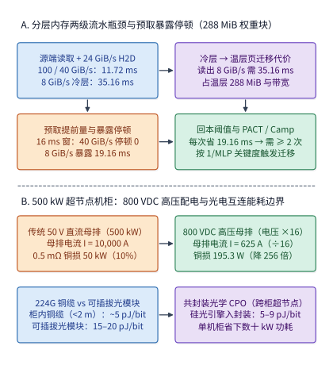

*图 6-48：分层内存关键路径暴露停顿与超节点机柜供电互连物理边界。上图（A）对应算例 6-A，对比 288 MiB 权重块在三级源端带宽（100、40、8 GiB/s）与 24 GiB/s H2D 瓶颈下的流水传输下界、16 ms／40 ms 预取窗口下的暴露停顿以及冷热页迁移回本条件；下图（B）对应第 6.5.2 节算例 6-B，对比 500 kW 超节点机柜在 50 V 与 800 VDC 配电体制下的母排电流（10,000 A vs. 625 A）、铜损降幅（256 倍）以及 224G 铜缆、可插拔光模块与 CPO 共封装光学的单比特能耗边界。*

> **实验 6-9 · 延伸：远端内存何时应直接读取，何时应缓存到本地**
>
> （a）复算四节点借用前后的物理占用，分别计算其他节点在借用前的空闲容量，以及全部节点在借用后的剩余容量。
>
> （b）每个事务传输 256 bytes，往返时间分别为 7.52 μs 和 15.04 μs。求两种情况下达到 50 GB/s 带宽所需的最少在途事务数。
>
> （c）比较 128 与 4096 个在途事务时的单次读取时间，假设前一次读取完成后才发起下一次，求连续读取时每秒最多能完成多少次完整读取。
>
> （d）采用本节远端与本地带宽，求重复读多少次时，先取回本地的总访问时间更少；同时说明所需本地容量。

## 6.7 从并行方案到超节点规模

### 6.7.1 更大的协作组与更多推理实例

本节将前面各节建立的容量、访存与集合通信模型融会贯通，在一台八卡 HGX H100 服务器上完整推演一次多会话推理部署。设当前有 4 个并发的 Qwen3-32B 长上下文会话同时到达：这 4 个会话均已完成 prefill 阶段，各自在显存中保存着 131,064 个历史上下文 token 的 KV 缓存，且手头各有 1 个刚刚生成、尚未追加写入 KV 缓存的新 token 作为下一步 decode 的输入；现在 4 个会话同时请求继续自回归生成 8 个 token，生成的第 8 步恰好写满 Qwen3 通过 YaRN 扩展支持的最大上下文长度（131,072 个位置）。我们约定服务调度规则如下：每个推理实例（instance）在同一时刻专心服务 1 个会话（即实例内 decode 批大小为 1），连续走完这 8 步生成后再接手本实例队列中的下一个会话；4 个会话在启动时按轮询（round-robin）方式均匀分配给各个实例；整台服务器的全部 8 张 H100 显卡自始至终专属分配给这批任务，直到 4 个会话全部完成为止。

单个生成步的耗时直接由式（6-5）给出：在连续生成 8 个 token 的过程中，式（6-4）中的当前上下文长度依次从 131,064 递增至 131,071，每步读取的 KV 缓存量随之微幅递增；将连续 8 步的耗时累加起来，即得单个会话走完 8 步续写的服务时间。在显存占用方面，同一个推理实例下正在排队等待的会话只需在显存中驻留各自的 KV 缓存，而模型权重则由该实例所服务的全部会话共享。我们先用式（6-1）做显存容量筛选：首先被排除的是“8 个单卡实例（TP1）”方案——单张 80 GB 显卡连保存权重外加 1 个 128K 会话的 KV 缓存（合计需 102.03 GB）都装不下。而按照第 6.2.2 节的容量公式计算，每个两卡实例（TP2）最多可同时驻留 2 个 128K 会话的 KV 缓存，每个四卡实例（TP4）最多可驻留 7 个会话，八卡实例（TP8）则最多可驻留 16 个会话；在本例共有 4 个并发会话的条件下，4 个两卡实例、2 个四卡实例与 1 个八卡实例这三种切分方案中，每个实例实际分担的会话数分别为 1 个、2 个与 4 个，全都满足单卡 80 GB 的显存容量约束。四种部署方案下的单会话耗时与四会话完成时刻汇总如下表：

| 部署方式 | 一个会话的八步 | 四会话完成时刻 | 全部会话完成 |
|---|---:|---|---:|
| 八个单卡实例 | 无法容纳 | — | — |
| 四个两卡实例 | 119.1 ms | 119.1、119.1、119.1、119.1 ms | 119.1 ms |
| 两个四卡实例 | 63.8 ms | 63.8、63.8、127.6、127.6 ms | 127.6 ms |
| 一个八卡实例 | 41.2 ms | 41.2、82.4、123.5、164.7 ms | 164.7 ms |

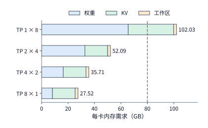

*图 6-49：四种部署在 128K 会话下的每卡内存需求，包括权重、实例内全部排队会话的 KV 和 2 GiB 工作区。单卡实例每卡要 102.03 GB，超过 H100 的 80 GB（虚线）；两卡、四卡、八卡实例分别约为 52.09、35.71、27.52 GB。*

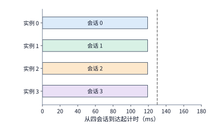

*图 6-50：四会话同时推进，每个约 119.1 ms 完成。颜色与相邻配置图中的会话一致。本图使用四个 TP2 实例，每实例两张卡，每个会话续写八个 token；虚线为 130 ms 期限。*

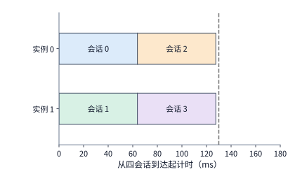

*图 6-51：每个实例顺序处理两个会话，分别在约 63.8 ms 和 127.6 ms 完成。本图使用两个 TP4 实例，每实例四张卡，每个会话续写八个 token；虚线为 130 ms 期限。*

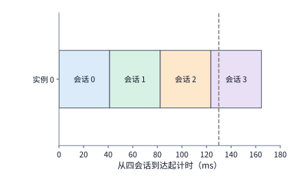

*图 6-52：单会话缩短到约 41.2 ms，四会话依次执行，最后一个约 164.7 ms 完成。三图横轴使用同一尺度。本图使用一个 TP8 实例，共八张卡，每个会话续写八个 token；虚线为 130 ms 期限。*

对照图 6-50 至图 6-52 可以看到一个很有启发性的现象：动用全部 8 张卡组成一个 TP8 大协作组，确实能将单个会话的 8 步续写时间从 TP2 的约 119.1 ms 大幅压缩至 **41.2 ms**；但由于全机只有这唯一一个实例，4 个会话必须排成一列依次串行执行，导致最后一个会话要等到 **164.7 ms** 才能完成。反之，若将 8 张卡拆分为 4 个独立的 TP2 实例，虽然每个会话单独执行需要 119.1 ms，但 4 个实例能够并行处理 4 个会话，结果在 **119.1 ms** 时刻全部 4 个会话便同时完成。至于原本并发度最高的 8 个 TP1 单卡实例，则因突破显存容量上限而在第一关就被排除。

这一算例直观揭示了分布式推理系统中相互竞争的**两个并行层次**：一是**单个请求内部的模型并行**（通过切分矩阵让多张卡合力加速同一个会话），二是**不同请求之间的实例级并发**（通过复制多个推理实例同时服务多个独立会话）。当硬件总卡数固定为 8 张时，这两种并行方式直接争用同一池加速器资源：把单实例的协作组切得越大，能同时并发服务的独立实例数就越少。唯有分清这两层并行的消长关系，才能根据业务的服务等级目标（SLO，即请求的完成期限）做出最优划分。概括而言，上层**服务调度器**决定了有多少个会话同时在途推进，中间层**模型切分策略**决定了每一步计算需要交换多少跨卡数据，底层**物理互连拓扑**决定了每次数据交换与同步需要消耗多少微秒——三者紧密耦合，共同锁定了上表中的每一个完成时刻。

在图 6-50 至图 6-52 的甘特图中，每个彩色条块的**横向宽度**代表单个会话的执行耗时，而**纵向并排的轨道数**则代表系统能同时推进多少个独立会话。业务给定的完成期限（deadline）直接决定了应当如何在“缩短横向条块宽度”与“增加纵向并发轨道”之间取舍：
- 如果当前只有 1 个紧急会话到达，且要求在 **50 ms** 内完成 8 步续写，那么唯有八卡协作的 TP8 实例（41.2 ms）能够达标；
- 如果同时有 4 个会话到达，且要求在 **130 ms** 期限内全部完成，那么 4 个两卡实例（119.1 ms 全部完成）与 2 个四卡实例（127.6 ms 全部完成）都能达标，且 4 个两卡实例完成得更早。

简言之，**单会话的延迟期限越苛刻，就越需要扩大单实例的张量并行协作组；而当并发到达的独立会话充足、且期限允许时，拆分成更多较小实例则能获得更高的整体吞吐**。

当底层物理连接跨出单台服务器边界时，上述定量公式同样适用。例如，若像第 6.5.1 节例题那样动用两台 HGX H100 服务器的全部 16 张卡组成跨机 TP16 实例，受跨网卡归约延迟拖累，单步耗时增至约 6.67 ms，8 步续写耗时随之拉长至约 **53.3 ms**，反而无法满足 50 ms 的单会话期限要求。此时，新增的第二台八卡服务器与其强行并入 TP16，不如独立运行另一个 TP8 实例来服务更多并发请求；如果业务确实需要让单个会话动用超过 8 张卡来进一步压缩延迟，就必须先从硬件或算法上把跨机通信开销降下来——例如升级机间互连带宽与延迟、改用分层低延迟集合通信算法，或者直接采用机柜级超节点将这些卡收拢进同一个高速互连域内。

此外，第 4 章探讨的**固定权重专用架构（ROM 晶圆）**也会显著改变上述并行取舍。当庞大的模型权重改由高带宽片上掩模 ROM 直接供给后，原本需要靠多卡张量并行分摊的 HBM 权重读取时间大幅缩减，此时张量并行引入的跨卡 AllReduce 同步延迟在单步耗时中的占比便急剧上升。在此架构下，适度缩小 TP 协作组规模即可省去可观的同步开销，并将腾出的计算芯片组成更多独立实例以提升并发吞吐；当然，缩小 TP 组也意味着每颗芯片必须独自承担更大份额的会话 KV 状态。本节建立的逐卡容量表与会话时间线分析方法可直接迁移用于量化这一新型权衡，第 6.7.4 节将给出具体的数值对比。

同样地，这套分析方法也可推广至上下文状态经过高度压缩的新一代模型架构。例如，在核算运行 DeepSeek V4.1 需要动用多少张卡时，除了依据每 token 约 890 B 的逻辑状态容量外，还必须考察这些跨层共享状态在物理卡间的具体分布方式：890 B/token 的数字是将跨层共享的 KV 状态仅按一份计入的逻辑最小值；但在流水线并行或跨卡分层部署下，若消费该状态的后续层与生成该状态的前序层被放置在不同的计算卡上，下游卡就必须设法获取上游卡生成的共享状态。工程上面对这一跨层依赖通常有三种处理方案：一是施加放置约束，强制将共享同一份状态的上下游层安排在同一张或相邻的卡上；二是在消费该状态的目标卡上冗余复制一份状态副本；三是建立跨卡按需远程读取路径。第一种方案限制了层间切分的自由度，第二种方案增加了显存占用与状态同步开销，第三种方案则引入了跨卡通信延迟——因此，实际规划时必须按照每张卡真实驻留与跨卡访问的字节数逐项核算资源需求。[^v41-case]

### 6.7.2 功率、成本与故障范围如何改变选择

第 6.7.1 节的时间线不仅标出了每个会话的完成时刻，也给出了整台八卡服务器需要被这批任务占用多长时间；据此我们可以直接将执行时间折算为硬件占用成本，定量比较在满足服务等级目标（SLO）的前提下哪种切分方案最省钱。我们以 H100 的**卡时（$\mathrm{GPU\cdot s}$，即占用 1 张 GPU 1 秒钟）**作为算力成本的基本计量单位：整台服务器的 8 张 H100 从 4 个会话同时到达的 0 ms 时刻起开始计费，直到全部 4 个会话均执行完毕时停止计费。设业务规定的完成期限（SLO deadline）为 **130 ms**，且服务质量条款要求 4 个并发会话中**至少有 3 个（75%）必须在 130 ms 期限内按时完成**。

我们来逐一核算无故障正常运行时各方案的成本账：
- **4 个两卡实例（TP2）**：全部 4 个会话均在 119.1 ms 按时完成（按时率 100%），8 张卡共占用 $0.1191\ \mathrm{s}$，总占用成本为 $8\times0.1191\approx0.953\ \mathrm{GPU\cdot s}$；分摊到 4 个按时完成的会话上，平均每个按时完成会话的成本约为 **$0.238\ \mathrm{GPU\cdot s}$**。
- **2 个四卡实例（TP4）**：4 个会话分别在 63.8 ms 与 127.6 ms 全部按时完成（按时率 100%），8 张卡占用至 $0.1276\ \mathrm{s}$，总占用成本约为 $8\times0.1276\approx1.021\ \mathrm{GPU\cdot s}$；平均每个按时完成会话的成本约为 **$0.255\ \mathrm{GPU\cdot s}$**。
- **1 个八卡实例（TP8）**：前 3 个会话分别在 41.2、82.4、123.5 ms 完成，恰好在 130 ms 期限内完成了 3 个会话（按时率 75%，刚达到最低比例要求），但第 4 个会话要到 164.7 ms 才跑完；8 张卡一直被占用到 $0.1647\ \mathrm{s}$，总占用成本高达 $8\times0.1647\approx1.318\ \mathrm{GPU\cdot s}$，而分母中按时完成的合格会话只有 3 个，因此平均每个按时完成会话的成本上升至 $1.318/3\approx\mathbf{0.439\ \mathrm{GPU\cdot s}}$。
- **8 个单卡实例（TP1）**：因单卡显存容量不足无法容纳 128K 会话，直接排除。

将这一核算口径写成通用公式：以实际按时完成（满足 SLO）的合格会话数 $N_{\mathrm{on\ time}}$ 为分母，单个按时完成会话的平均有效成本定义为

$$
C_{\mathrm{on\ time}}=
\frac{C_{\mathrm{occupied}}}
{N_{\mathrm{on\ time}}}. \tag{6-13}
$$

式（6-13）中，分子 $C_{\mathrm{occupied}}$ 是完成整批任务期间集群实际消耗的总卡时（包含因故障停顿、恢复与重算所额外占用的全部卡时），而分母 $N_{\mathrm{on\ time}}$ 仅统计在规定期限内成功交付的会话数。这意味着，任何因中途故障重做或排队超时而未能按时交付的请求，其消耗的算力成本都不会消失，而是全额计入分子，最终分摊到那些成功按时完成的合格会话上。

上面的无故障对比默认全部 8 张卡始终健康运转。然而在实际大规模集群中，单卡软硬件故障时有发生：一旦某张计算卡出现异常，包含这张卡在内的整个并行推理实例就必须暂停，不仅当前正在执行的会话被迫中断，分配给该实例的后续排队会话也会一并顺延。为了定量考察**故障影响范围（blast radius）**对成本的影响，我们在上述时间线上注入一次相同的单卡故障：假设在 $20\ \mathrm{ms}$ 时刻，**卡 0** 突发故障；包含卡 0 的那个推理实例随即停顿 $40\ \mathrm{ms}$ 进行故障恢复，至 $60\ \mathrm{ms}$ 时刻恢复正常，并从刚才中断的那个会话的 8 步续写起点重新开始执行；与此同时，未包含卡 0 的其他独立推理实例则完全不受影响，继续按原计划推进。

我们来看这次单卡故障在三种部署方案下引发的连锁反应：
- **在 4 个两卡实例（TP2）方案中**：卡 0 的故障仅波及实例 0（卡 0、1），其余 3 个实例（卡 2～7）不受影响，其负责的 3 个会话依然准点在 **119.1 ms** 完成；受影响的实例 0 在 60 ms 恢复后重做，于 $60+119.1=179.1\ \mathrm{ms}$ 完成第 4 个会话。最终 130 ms 期限内完成了 3 个会话，**按时完成率仍达 75%（继续满足 SLO 要求）**。
- **在 2 个四卡实例（TP4）方案中**：未受波及的实例 1（卡 4～7）依然在 63.8 ms 和 127.6 ms 准点完成两个会话；受卡 0 故障波及的实例 0（卡 0～3）在 60 ms 恢复后依次重做两个会话，完成时刻推迟至 $60+63.8=123.8\ \mathrm{ms}$ 与 $60+127.6=187.6\ \mathrm{ms}$。由于实例 0 的第一个重做会话（123.8 ms）恰好赶在 130 ms 期限前完成，全机按时完成的会话数同样是 3 个，**按时完成率也是 75%（满足 SLO 要求）**。
- **在 1 个八卡实例（TP8）方案中**：由于全部 8 张卡绑在同一个实例里，卡 0 一旦故障，整台服务器的 8 张卡全部停摆；60 ms 恢复后，4 个会话的完成时刻整体顺延至约 **101.2、142.4、183.5、224.7 ms**——在 130 ms 期限内**仅能完成 1 个会话（按时率跌至 25%，直接违反 SLO）**。

再来算故障后的有效成本：在 4 个两卡实例方案下，虽然依然满足至少 75% 按时完成的 SLO 底线，但全机 8 张卡的占用时长被慢实例拖长到了 $179.1\ \mathrm{ms}$，总卡时增至 $8\times0.1791\approx1.433\ \mathrm{GPU\cdot s}$；分摊到 3 个按时完成的合格会话上，单会话平均成本上升至 $1.433/3\approx\mathbf{0.478\ \mathrm{GPU\cdot s}}$，恰好是无故障时（$0.238\ \mathrm{GPU\cdot s}$）的 **2.0 倍**；同理，2 个四卡实例方案在故障后的单会话平均成本也上升至约 **$0.500\ \mathrm{GPU\cdot s}$**。这一算例清晰地展示了多实例隔离的双重效应：将八卡拆分为多个较小实例，成功把单卡故障限制在单一实例内部，保住了其余 3 个会话的按时交付与整体 SLO 达标率；但由于全机释放时间受故障重做实例拖累，且合格会话分母从 4 减为 3，每个合格会话分摊的算力成本依然翻了一倍。

*图 6-53：无故障时，按时完成会话的平均成本随期限变化。八卡计费至所有会话结束；曲线从至少三个会话按时完成处开始。TP 数值为每实例使用的卡数；成本以 H100 的 GPU·s 计。TP1 放不下 128K 会话，没有曲线。*

*图 6-54：20 ms 时卡 0 故障，受影响实例在 60 ms 从当前会话起点重新执行。采用与无故障图相同的计费方法和纵轴范围。TP 数值为每实例使用的卡数；成本以 H100 的 GPU·s 计。*

进一步看，故障影响范围的大小不仅取决于软件层面的实例划分，还取决于底层硬件是否真正做到了**物理故障域隔离**。如果两个逻辑上独立的推理实例在物理上共用了同一个机框电源模块或同一台叶交换机，那么一旦该共享电源或交换机发生硬件故障，两个实例就会同时中断；换言之，软件层面的实例拆分必须与底层供电、散热及交换网络的物理隔离边界相匹配，才能真正保住其他实例的执行进度。一般而言，单个并行实例横跨的加速卡、网卡与交换芯片越多，每一次请求成功执行所依赖的串联正常部件就越多，遭遇单点故障中断的概率也随之上升。因此，在超节点内划分推理实例时，必须将电源、主板与交换机的物理共享拓扑一并纳入考量。

顺着占用时间，我们还可以直接算出不同部署方案的**物理能耗（焦耳）**。按第 6.5.2 节给出的 DGX H100 整机满载功率上限 $10.2\ \mathrm{kW}$ 计算：在无故障情况下，4 个两卡实例完成全部任务共运行 $119.1\ \mathrm{ms}$，消耗电能约 $10.2\ \mathrm{kW}\times0.1191\ \mathrm{s}\approx1.21\ \mathrm{kJ}$；而 2 个四卡实例运行 $127.6\ \mathrm{ms}$，消耗电能约 $1.30\ \mathrm{kJ}$。在占用的硬件设备与运行功率相同时，越早完成整批工作负载的并行方案，所消耗的总电能就越少。

最后需要强调，模型的动态状态容量会随着负载特征而改变可行方案的淘汰顺序。在本节的 128K 长上下文算例中，单卡 TP1 方案首先是因为 **显存容量超限**（需 102.03 GB，超过 80 GB）而被淘汰的；但如果把请求的上下文长度缩短到 **32K**，单张 80 GB 显卡便足以装下模型权重与 1 个会话的 KV 缓存——此时 TP1 在容量上完全可行，但它完成 8 步续写需要 **173.3 ms**，超出了 130 ms 的服务期限，因此 TP1 转而被 **延迟期限（时间约束）** 淘汰出局。这再次印证了贯穿全书的分析次序：**先用显存容量约束筛出装得下的可行部署方案，再在这些可行方案之间定量比较执行时间、容错能力与有效成本**。[^cost]

> **实验 6-10 · 核心：按会话完成期限与成本选择并行配置**
>
> （a）从式（6-4）、（6-5）逐步求四种 TP 配置的八步续写时间，再计算四个会话各自的完成时刻。
>
> （b）分别采用 100、130、170 ms 期限，要求至少 75% 会话按时完成，找出满足要求的部署方案并比较成本。
>
> （c）改用两台 HGX H100 上的 TP16，跨服务器的 AllReduce 取实验 7-3 的实测值，重新计算单会话续写时间，判断能否满足 50 ms 的完成期限。
>
> （d）复算故障后的会话完成情况和成本；将停顿从 40 ms 改为 10 ms，解释满足要求的部署方案怎样变化。
>
> （e）把上下文改为 32K，加入功率条件，说明容量、时间和功率各自先排除了哪种部署方案。

### 6.7.3 给定模型与硬件，如何选择切分策略

现在我们可以回到本章开篇提出的核心问题，将分布式并行切分策略的选择总结为一个目标明确、边界清晰的**带约束优化问题**：设一个候选部署方案 $\pi$ 完整包含各维度的并行切分度数、设备网格物理放置、集合通信算法、微批次（micro-batch）划分以及单卡算子内核实现；给定业务优化目标函数 $J(\pi)$，系统设计者的任务就是在所有满足软硬件可行性约束的方案集合 $\mathcal P_{\mathrm{feasible}}$ 中寻找最优方案 $\pi^*$：

$$
\pi^*=\arg\min_{\pi\in\mathcal P_{\mathrm{feasible}}}J(\pi).
$$

其中，可行集 $\mathcal P_{\mathrm{feasible}}$ 内的每一个候选方案都必须同时满足单卡显存容量上限、算子分片间的代数依赖正确性、现有算子内核与通信库接口支持、以及业务规定的服务完成期限（SLO）。至于目标函数 $J(\pi)$，既可以取单个请求的端到端延迟，也可以取第 6.7.2 节定义的单次按时完成会话成本 $C_{\mathrm{on\ time}}$；若业务追求最大吞吐量，则等价于在满足相同延迟 SLO 的前提下最大化系统可持续接纳的请求到达率。脱离了具体的负载特征与优化目标，“最优并行方案”便无从谈起。

在工程实践中，我们可以按照以下**五步量化决策法**系统地完成并行策略选型：

**第一步：完整盘点模型结构、工作负载与硬件资源参数。**
- **模型侧**：记录层数、各线性层矩阵形状、查询头与 KV 头数量、MoE 路由专家总数与每 token 激活专家数、权重与激活数值精度、共享权重以及跨层复用的状态张量；
- **负载侧**：明确 prefill 输入长度、decode 历史上下文长度、同时就绪的并发请求数、专家路由冷热分布、目标延迟期限（SLO）以及请求到达过程；
- **硬件侧**：核查单卡可用 HBM 容量、各算子在具体矩阵形状下的实测有效算力与显存带宽，以及节点内与节点间互连拓扑在每个方向上的物理带宽、单跳启动延迟与多流共享割集瓶颈。其中硬件基础参数来自第 4 章，算子在不同形状下的局部执行时间来自第 5 章；切记不可将集群的理论总带宽简单除以通信组数量来充当每组的可用带宽。

**第二步：针对当前首要瓶颈列出候选并行维度，而非盲目套用现成缩写。** 下表归纳了面对不同系统瓶颈时应当优先纳入考察的并行机制及其必须同步补算的附加代价；该表用于快速收敛候选空间，最终取舍仍取决于端到端耗时。

| 当前约束或瓶颈 | 优先考虑的方案 | 必须补算的代价 |
|---|---|---|
| 权重无法容纳，或小 batch 重复读权重过慢 | TP、PP；MoE 可用 EP | 归约、阶段串行、专家流量与工作区 |
| 独立请求多，完整模型已能容纳 | 更多 DP／服务副本，较小 TP 组 | 排队、批内复用、每副本 KV 容量 |
| 特定区间的激活重复存储 | 同一 TP 组内启用 SP | 布局边界的收集与归约，kernel 支持 |
| 长上下文的 KV 与注意力占主导 | CP 与 TP 的组合 | K、V 交换、统计量归约、因果注意力的负载不均 |
| 多层权重容量大，跨节点归约昂贵 | 节点内 TP＋跨节点 PP | micro-batch 是否足够、最慢阶段与流水空档 |
| 专家集合大、路由热点突出 | EP、专家副本、专家分离（路由专家放到独立的专家资源池） | dispatch／combine 两个方向的流量、最忙的卡与专家池的队列 |

**第三步：为每个候选方案明确写出数据归属表与关键路径时间线。** 先为每张卡列出其静态存放的层、注意力头、专家分片，以及动态驻留的激活与 KV 缓存；在核算峰值显存时，除权重与 KV 外还必须加上集合通信收发缓冲区、流水线双缓冲（double buffering）、张量边界填充（padding）、在途 micro-batch 暂存区以及动态副本迁移预留空间。随后，为每个局部算子算出计算与本地访存时间，为每次跨卡通信算出通信轮次、传输字节数与所经物理路径耗时，并将二者严格按照数据依赖关系排布到同一条时间线上——牢记同一个 token 的前、后层计算绝不会因为启用了流水线并行而在同一时刻并发完成，同一个 token 所选中的远端专家输出也绝不会在网络传输完成前提前就绪。对于 MoE 模型，跨卡专家计算耗时必须代入当前步负载最重的那个专家组而非全网平均值（第 9.4 节将给出具体的路由偏斜统计模型）。

**第四步：在所有可行方案中按同一目标函数定量排序。** 以本章贯穿的八卡 HGX H100 部署稠密模型 Qwen3-32B（128K 会话、每实例每次服务 1 个会话）为例，第一轮候选集包含 TP1、TP2、TP4、TP8 四种划分（剩余显卡组成独立服务实例）：由于对象是稠密模型，专家并行（EP）自然无需考虑；序列并行（SP）仅降低逐 token 算子区间的激活占用，在这种单 token decode 且预留固定 2 GiB 工作区的算例中不产生额外收益；流水线并行（PP）在不交错处理多个微批次时，单个会话依然要串行流经全部阶段，因此也不作为压缩单会话延迟的首选。至于上下文并行（CP）、跨会话交错流水以及连续批处理（continuous batching，在每步迭代边界动态增删合并在途请求），则可纳入第二轮扩展搜索空间，但此时必须各自补齐在线 softmax 统计量跨卡归约、流水线气泡排程以及批大小动态变化后的时间模型，绝不可简单套用张量并行的 $1/p$ 线性缩放公式。

基于前两节已经算出的逐会话完成时刻与有效卡时成本，我们可以直接针对四种典型业务约束给出如下最优选择——不难看出，一旦改变延迟期限、跨机物理边界或上下文长度，胜出的方案便随之改变：[^parallel-choice]

| 给定条件 | 约束内的选择 | 为什么 |
|---|---|---|
| 四会话、128K、130 ms 内至少完成 75% | 四个 TP2 实例 | TP1 无法容纳；TP2 全部约 119.1 ms 完成，每个按时会话约 0.238 GPU·s，低于 TP4 的 0.255 与 TP8 的 0.439 |
| 单会话、128K、50 ms 期限 | 一个 TP8 实例 | 约 41.2 ms；TP4 约 63.8 ms，已超过期限 |
| 两台 HGX H100 共 16 卡，单会话、128K、50 ms | 仍选一个 TP8 实例 | 跨服务器的 TP16 按实测 AllReduce 约 53.3 ms，超过期限；另一台服务器可以运行其他实例 |
| 四会话、32K、130 ms 内至少完成 75% | 四个 TP2 实例 | TP1 可以容纳，但八步要 173.3 ms；TP2 约 88.3 ms 全部完成，每个按时会话约 0.177 GPU·s |

**第五步：用真实硬件剖析数据校准纸面估算，切勿将纸面排序直接当作最终结论。** 对纸面排序靠前的两三个候选方案，必须在目标硬件上用真实的请求长度、真实路由轨迹和相同的数值精度跑一遍端到端基准测试，实测记录峰值显存占用、各算子与通信阶段的起止时间戳、各物理端口的实际收发字节数以及服务尾延迟（如 P99）。尤其当两个候选方案的纸面预测总耗时非常接近时，我们无需盲目重测所有算子，而应当**先计算足以令两方案排序发生翻转的敏感参数阈值，再专门针对通信或重叠占比较高的风险阶段做定向补测**。例如，假设基于空载微基准建立的纸面模型预测：候选方案 A 的计算耗时为 $70\ \mathrm{ms}$、未能被掩盖的暴露通信耗时为 $30\ \mathrm{ms}$，纸面总耗时为 $100\ \mathrm{ms}$；候选方案 B 采用更小的跨卡切分度数，计算耗时为 $90\ \mathrm{ms}$、暴露通信耗时仅为 $12\ \mathrm{ms}$，纸面总耗时为 $102\ \mathrm{ms}$。表面上看方案 A 以 $2\ \mathrm{ms}$（约 $2\%$）的微弱优势领先，但方案 A 的暴露通信占比高达 $30\%$，远高于方案 B 的 $11.8\%$。设真实多流并发、SM 抢占与交换机拥塞使实际暴露通信耗时相对于空载基准放大为原来的 $k$ 倍，则两方案的真实步时间分别为 $T_A(k)=70+30k$ 与 $T_B(k)=90+12k$。令 $T_A(k)=T_B(k)$，立即可解出排序翻转的临界膨胀系数：

$$
70+30k^*=90+12k^*\implies k^*=\frac{10}{9}\approx\mathbf{1.11}.
$$

这表明，只要真实并发环境下的通信耗时比空载单测慢 **$11.1\%$** 以上（例如当 $k=1.3$ 时，$T_A=109\ \mathrm{ms}$ 而 $T_B=105.6\ \mathrm{ms}$），方案 B 就会反超方案 A。因此，此时最关键的补测动作就是在实际计算并发下单独测量两方案的真实暴露通信膨胀系数 $k$ 是否越过了 $1.11$ 这道门槛。[^plan-ranking] 一份严谨的系统设计交付物，应当同时包含**最终选定的并行方案、被淘汰的备选方案及其淘汰原因、足以让选型结论发生翻转的敏感参数阈值，以及实测验证的边界条件**。本书配套脚本可一键复算上表中的四组部署方案，但它仅枚举显式声明的候选配置，并非包揽任意模型与框架的全自动编译器。

回顾整个选型框架，不同的架构旋钮分别作用于时间模型中的不同分项：调整 **TP 度数**主要改变单卡计算量、HBM 访存量与参与同步归约的卡数；调整 **集合通信算法**主要改变通信轮数与单卡发送字节数；调整 **物理互连拓扑**主要改变多流共享路径带宽与单跳固定转发延迟；而增加 **独立推理实例数**则主要改变多个并发会话之间的排队等待次序。只要将这四类变化统一映射到同一个端到端执行时间模型中，任何复杂的组合设计都能放在同一把标尺下定量对比。

在此基础上，我们还可以对式（6-5）等时间公式做**参数敏感性分析**（sensitivity analysis），从而找准系统优化的切入点：
- 在八卡 HGX H100 的小消息 decode 算例中，将 NVLink 带宽翻倍仅能使单步缩短约 $2.5\ \mu\mathrm{s}$，而将每轮通信的固定启动开销减半却能直接省下约 $0.74\ \mathrm{ms}$——这立刻指明此时应当优先优化内核融合与轻量级通信发起，而非盲目扩充链路带宽；
- 在 MoE 推理中，若端到端步时间受制于负载最重的那个热点专家组，那么通过专家副本或均衡路由削平该组峰值，就能直接缩短整步等待；
- 在通过网络读取远端内存池中的 KV 缓存时，若有效带宽受限于有限的在途事务窗口（$uq/L$），那么扩充硬件并发在途队列深度才是充分利用物理网卡线速的关键。

通过这种“定位主导项 $\to$ 计算边际收益 $\to$ 精准投放资源”的量化推演，系统工程师便能清晰判断下一步究竟应当优先削减哪一项软件开销，或是优先扩充哪一类硬件资源。

### 6.7.4 超节点扩大与权重、Engram 表、KV 的放置：V4.1 Flash 的综合算例

第 6.7.1 至 6.7.3 节探讨的是一台八卡服务器内部的资源划分；作为本章的压轴综合算例，本节将视野放大到整个超节点尺度，依次定量回答三个前沿架构问题：**第一，将超节点的互连规模从 8 卡一路扩大到 256 卡，究竟能换来什么收益？第二，如果按照第 4.7.3 节的思路将模型权重固化进掩模 ROM 晶圆，系统的性能瓶颈会发生怎样的转移？第三，面对模型中庞大的只读 Engram 记忆表与动态可写的 KV 缓存，应当如何为它们选择最佳的物理存储层次？**

本节算例仍以第 2 章详述的 **DeepSeek V4.1 Flash** 模型为对象，工作负载设定为 **200K 超长上下文的 decode 生成**。基准硬件集群共包含 256 张 H100 SXM（80 GB）显卡，我们对比将超节点规模 $S$ 分别设定为 **8、64、128、256 卡**四种配置，且规定每个推理实例恰好完整占用 1 个超节点。在每个超节点实例内部，我们采用业界主流的 **“注意力 DP + 专家 EP”混合并行布局**：注意力子层与共享专家按数据并行（DP）方式部署，每张卡各自独立负责本卡所分配会话的注意力计算并保存对应的 KV 缓存；而庞大的路由专家集合与 Engram 记忆表则按专家并行（EP）方式均匀切分到超节点内的全部 $S$ 张卡上，每一层前向传播中各卡通过 1 次跨卡 dispatch 与 1 次 combine（全模型 40 层共 80 次 All-to-All）完成专家与查表协同。[^supernode-inference]

#### 1. 超节点规模与单卡并发会话数、吞吐量的关系

先用式（6-1）核算超节点规模 $S$ 扩大时每张卡的显存账。在每张卡上，需要常驻的模型参数分为两部分：一部分是每张卡都必须各自保存一份完整副本的注意力层、共享专家与词表输出头权重，合计固定为 $9.5\ \mathrm{GB}$；另一部分是由超节点内全部 $S$ 张卡均匀分摊的路由专家权重（全量 $288.8\ \mathrm{GB}$）与 Engram 表（全量 $203.1\ \mathrm{GB}$）。从单卡容量 $C=80\ \mathrm{GB}$ 中扣除本卡常驻参数 $W_{\mathrm{card}}$ 与运行时工作区 $U$ 后，剩余的全部 HBM 空间均可用于存放并发会话的 200K 上下文 KV 缓存（由于采用了紧凑的注意力状态设计，单个 200K 会话的 KV 缓存仅占 $K=180.7\ \mathrm{MB}$）。于是，单卡需保存的参数量 $W_{\mathrm{card}}$ 与单卡最多可同时驻留的并发会话数 $N_{\mathrm{session}}$ 分别为：

$$
W_{\mathrm{card}}=9.5\ \mathrm{GB}+\frac{288.8\ \mathrm{GB}+203.1\ \mathrm{GB}}{S},\qquad
N_{\mathrm{session}}=\left\lfloor\frac{C-W_{\mathrm{card}}-U}{K}\right\rfloor. \tag{6-14}
$$

单步 decode 耗时依然按式（6-2）估算：每张卡在每步中需要将本卡驻留的激活权重与本卡全部 $N_{\mathrm{session}}$ 个并发会话的 KV 缓存各扫描读取一遍，本地耗时取 HBM 访存时间与矩阵计算时间中的较大值，最后再加上全模型 40 层共 80 次跨卡 All-to-All（dispatch + combine）的通信时间。将 $S=8, 64, 128, 256$ 代入模型，得到四种超节点规模下的定量指标如下表所示：

| 超节点 | 每卡权重 | 每卡会话 | 步时间 | 每卡吞吐 |
|---|---:|---:|---:|---:|
| 8 卡 | 71.0 GB | 37 | 14.1 ms | 2,632 token/s |
| 64 卡 | 17.2 GB | 335 | 17.3 ms | 19,420 token/s |
| 128 卡 | 13.4 GB | 356 | 18.4 ms | 19,392 token/s |
| 256 卡 | 11.5 GB | 367 | 18.9 ms | 19,378 token/s |

仔细观察上表，可以得出三条极为重要的系统规律：
- **为什么从 8 卡扩至 64 卡时，单卡吞吐大幅提升 7.4 倍？** 当超节点仅有 8 张卡时，每张卡分摊了高达 $71.0\ \mathrm{GB}$ 的权重与表（每层需保存 48 个路由专家），扣除工作区后留给 KV 缓存的显存十分有限，每卡最多只能装下 37 个并发会话；在 37 个会话并发路由下，单卡上的 48 个专家几乎每步都会被全部激活，导致从 HBM 读取庞大专家权重的时间占去了单步耗时的绝大部分。而当超节点扩大到 **64 卡**时，每张卡分摊的路由专家与 Engram 表容量缩小为原来的 1/8，单卡常驻参数降至 $17.2\ \mathrm{GB}$：这一方面使单步读取本地专家权重的时间降到了原来的十分之一以下，另一方面更释放出大量 HBM 空间，使单卡可容纳的并发会话数从 37 个升至 **335 个（扩大约 9 倍）**，从而推动单卡 decode 吞吐从 $2{,}632\ \mathrm{token/s}$ 升至 **$19{,}420\ \mathrm{token/s}$（提升约 7.4 倍）**。
- **为什么超过 64 卡后，继续扩大超节点不再提升单卡吞吐？** 当超节点从 64 卡继续扩至 128 卡、256 卡时，单卡上的专家权重占比本就已经很小，继续切分省下的几吉字节显存只能让单卡会话数微幅增加（从 335 增至 367）；与此同时，单卡每步必须扫描的 KV 缓存总量、注意力矩阵计算量以及跨卡 All-to-All 流量全都随着并发会话数同步线性增长，步时间也相应从 17.3 ms 拉长至 18.9 ms，分子（会话数）与分母（步时间）同比例增长，单卡吞吐便稳定在约 $19{,}400\ \mathrm{token/s}$ 的平台期不再上升。事实上，8 卡到 64 卡那 7.4 倍的吞吐提升主要源于**显存容量的释放**：如果我们在 8 卡超节点上先把占 203.1 GB 的 Engram 表卸载到主机内存中，8 卡超节点的单卡可容纳会话数也能立刻从 37 个提升至 178 个，此时它与 64 卡超节点的单卡吞吐差距便会从 7.4 倍大幅收窄至 **1.9 倍**。
- **扩大超节点能否加快单个用户的生成速度？** 答案是**不能**。当并发批大小降为 $\mathrm{batch}=1$（单用户独占）时，每生成一个 token 的关键路径是：该用户所在卡读取一遍本卡常驻的 $8.2\ \mathrm{GB}$ 稠密与共享权重，并在每一层读取被该 token 激活的本卡专家分片，全步耗时固定为 **$2.76\ \mathrm{ms}$（即单用户速度 $362\ \mathrm{token/s}$）**——无论超节点是 8 卡还是 256 卡，这一单用户速度完全相同。换言之，**通过专家并行（EP）放大超节点规模，换来的是显存容量与集群总吞吐，而非单个会话的解码速度**；若要进一步缩短单会话延迟，只能像第 6.7.1 节那样对注意力与激活专家本身启用张量并行（TP）。反过来，如果同样动用 64 张 H100 组成 EP64 实例，却没有机柜级高速超节点，而是将它们分散在 8 台标准八卡 HGX H100 服务器上通过每卡一张的 400G 网卡相连，那么每次 dispatch 与 combine 都有 $7/8$ 的流量必须跨过服务器间的慢速网卡，单步通信耗时将从超节点内的 $3.7\ \mathrm{ms}$ 增加至 **$29.2\ \mathrm{ms}$**，单卡吞吐随即跌落至 $7{,}828\ \mathrm{token/s}$（见图 6-55 中的橙色点）。**超节点高速互连真正省下的，正是这二十多毫秒的跨机全交换等待**。

*图 6-55：V4.1 Flash 在 256 张 H100 上的每卡 decode 吞吐随超节点大小的变化，服务目标为每 token 50 ms。蓝线：实例都在一个超节点内，8 卡到 64 卡提高约 7.4 倍，此后不再增长；橙点：同样 64 张卡分散在八台服务器上组成专家并行组。*

#### 2. 将模型权重固化进掩模 ROM 晶圆

接下来看第二个问题：如果打破传统 GPU“权重与 KV 缓存共用 HBM”的架构常规，会发生什么？图 6-56 对比了模型权重与 KV 缓存的三种硬件放置形态：左侧是传统 GPU，权重与 KV 缓存均存放在片外 HBM 中，每生成一个 token 都必须经过 HBM 总线重新读取一遍权重；中间是第 4.7.3 节介绍的**掩模 ROM（Mask ROM）晶圆架构**，将在模型发布后便不再改变的静态权重直接刻写在高密度片上 ROM 中，让片外 HBM 专门用于存放动态读写的 KV 缓存；右侧则是更激进的全片上形态，权重刻入片上 ROM，而 KV 缓存则直接放入超高速的片上 SRAM 中。

*图 6-56：权重与 KV 的三种放置方式。左：GPU 的权重与 KV 共用 HBM；中：权重在制造时写入 ROM，KV 放 HBM；右：权重在 ROM，KV 放片上 SRAM，容量小得多。箭头是每步都要读取的数据，方框高度示意容量。*

我们引用作者在开源硬件评估项目 OpenTallas 中对 DeepSeek V4.1 Flash 的等硅面积建模数据来定量对比后两种架构：采用两片 N5（5 纳米）工艺的晶圆级 ROM 加速器，测试条件同样为 200K 上下文、$\mathrm{batch}=1$ 单用户解码。在 ROM 晶圆架构下，片上 ROM 权重读取通路、HBM/SRAM KV 读取通路与矩阵计算单元各自拥有独立的物理数据通路，三者可以在流水线上高度并发重叠，唯有跨计算阵列的片上集合通信（AllReduce）必须等三者全部完成后才能启动。因此，单步生成一个 token 的端到端耗时模型为：

$$
T_{\mathrm{token}}=\frac{\max(T_{\mathrm{weight}},T_{\mathrm{KV}},T_{\mathrm{compute}})}{0.9}+T_{\mathrm{comm}}+T_{\mathrm{fixed}}. \tag{6-15}
$$

式（6-15）中，分母上的 $0.9$ 反映了模型各层切分到两片晶圆上时难以做到绝对完美均衡的折损系数，$T_{\mathrm{fixed}}$ 则是每层固有的硬件流水线填充延迟；而在传统 GPU 对照组中，由于权重与 KV 缓存共用同一组 HBM 接口，两项读取时间必须直接相加。三种机器配置下的单用户每 token 耗时分解如下表所示：

| 机器 | 存储与计算 | 集合通信 | 单用户速度 | 通信占比 |
|---|---:|---:|---:|---:|
| 8 张 H100，权重在 HBM | 2,689 μs | 76 μs | 362 token/s | 3% |
| 58 张 B200 张量并行，权重在 HBM | 165 μs | 562 μs | 1,357 token/s | 76% |
| 两片 ROM 晶圆，权重在 ROM | 77 μs | 159 μs | 4,070 token/s | 65% |

对照上表与图 6-57，可以看到系统瓶颈发生了明显的转移：
- 在 8 张 H100 上，权重存放在 HBM 中，单步存储读取与计算耗时高达 $2{,}689\ \mu\mathrm{s}$（约 $2.7\ \mathrm{ms}$），而跨卡通信仅占 $76\ \mu\mathrm{s}$（占比仅 **3%**），此时系统是典型的**访存受限（memory-bound）**；
- 当把权重固化进两片 ROM 晶圆后，凭借片上 ROM 极高的读取带宽，权重读取耗时从 $2.7\ \mathrm{ms}$ 大幅缩短至 $69\ \mu\mathrm{s}$（加上不均衡折损后存储与计算项仅 $77\ \mu\mathrm{s}$）；然而此时全模型 80 次片上 AllReduce 同步仍需消耗 **$159\ \mu\mathrm{s}$**，占到了每 token 总耗时的 **65%**，单用户生成速度提升至 **$4{,}070\ \mathrm{token/s}$**；
- 作为对照，如果不用 ROM 晶圆，而是用多达 **58 张 NVIDIA B200 GPU** 做高并发的张量并行来分摊 HBM 权重读取，虽然也能把存储与计算耗时压低到 $165\ \mu\mathrm{s}$（其中权重读取 $148\ \mu\mathrm{s}$），但跨 58 张卡的集合通信耗时却大幅增加至 **$562\ \mu\mathrm{s}$（占比高达 76%）**，最终单用户速度止步于 $1{,}357\ \mathrm{token/s}$。

这一对比揭示了一条重要的体系结构规律：**一旦通过新型存储介质（如片上 ROM）或大规模分片消除了权重读取瓶颈，单用户推理速度的上限便立刻转移到了集合通信的延迟上**——此时，第 6.5.1 节建立的“按物理跳数与每跳转发延迟核算通信耗时”的方法，便成为决定整机性能的关键依据。

*图 6-57：三种机器上 V4.1 Flash 单用户每 token 时间的构成，200K 上下文，batch 为 1。权重在 HBM 时存储读取占绝大部分，权重进 ROM 之后集合通信成为最长的一项。*

#### 3. Engram 记忆表应当放在哪里？

再看第三个问题：DeepSeek V4.1 Flash 架构中包含两个庞大的 **Engram 记忆查表模块**，每个模块各持有一张包含 3.84 亿行（384M rows）的嵌入表，每行存放 256 个 FP8 数值外加 8 字节缩放因子（每行 264 B），两张表合计容量高达 **$203.1\ \mathrm{GB}$**。在推理过程中，每生成一个 token，两个 Engram 模块各自只需根据输入序列静态查表读取 24 行（合计 48 行，总读取量仅 **$12.7\ \mathrm{KB}$**）。虽然这两张表在部署后同样属于只读静态权重，但它们的访问特性与每步必读数吉字节的矩阵权重截然不同：其一，203.1 GB 的表容量庞大，但每步仅稀疏读取 12.7 KB；其二，要查询哪 48 行完全由输入 token 序列的哈希值决定，**不依赖前序 Transformer 层的动态激活值**，因此在每一步迭代刚开始时就可以立刻提前发起异步预取（prefetch）。只要能在第 1 个 Transformer 块计算结束之前把这 48 行（12.7 KB）数据取回计算单元，Engram 查表的延迟就能被前序计算 **100% 掩盖**。在时间窗口上，第 1 个 Transformer 块的执行耗时（即可用于掩盖预取的时间预算）在 H100 上约为 **$69\ \mu\mathrm{s}$**，而在高速的 ROM 晶圆上则仅有 **$6.1\ \mu\mathrm{s}$**。图 6-58 与下表对比了将这张 203.1 GB 的大表放置在三种不同存储介质中的资源代价与取回延迟：

*图 6-58：Engram 表的三种放置方式。要查哪些行在第一个 Transformer 块计算之前就已确定，三种放法的差别在于取回这 48 行要走什么路径，以及表占用哪一种存储。*

| 放置 | 占用的容量 | 取回 48 行 |
|---|---|---|
| 主机内存，经 PCIe 或 RDMA 预取 | 不占 HBM | 一次往返 1.05 μs |
| 超节点各卡的 HBM 分片 | 8 卡每卡 25.4 GB，相当于 140 个会话；64 卡每卡 3.2 GB，相当于 18 个会话 | 一轮 NVLink 交换 0.83 μs |
| 掩模 ROM | 21,651 mm²，约半片晶圆 | 片内读取 |

分别在两类硬件平台上审视这三种放置方案：
- **在 H100 GPU 超节点上**：无论是从主机内存经 PCIe/RDMA 预取（一次往返耗时 $1.05\ \mu\mathrm{s}$），还是从超节点各卡的 HBM 分片经 NVLink 交换取回（耗时 $0.83\ \mu\mathrm{s}$），都远短于第 1 个 Transformer 块 $69\ \mu\mathrm{s}$ 的掩盖时间窗，因此延迟并非瓶颈，选型完全取决于 **HBM 容量账**。在 8 卡超节点上，若将 203.1 GB 的表放进 HBM，每卡要占去 $25.4\ \mathrm{GB}$（相当于占用了 140 个并发会话的 KV 空间），将表移入主机 DRAM 后，单卡并发会话数立刻从 37 个增加至 178 个；而到了 64 卡超节点上，每卡仅分摊 $3.2\ \mathrm{GB}$（仅相当于 18 个会话的 KV 空间，约占 5%），此时放在主机内存或 HBM 均可满足需求。即便在大批量并发服务下，主机内存的随机读取吞吐也不会成为瓶颈：64 卡实例在满载 335 个会话时，每卡每步共需发起 $335\times48=16{,}080$ 次随机行读取，按第 7.3.4 节实测的单节点每秒 6100 万次细粒度读取速率（61 MIOPS）折算，全部读完仅需 $0.26\ \mathrm{ms}$，还不到单步总耗时（17.3 ms）的 $1.5\%$。正因如此，DeepSeek 官方的生产推理部署正是将 Engram 表放置在主机内存中，并在执行第 1 个 Transformer 块的同时通过异步 RDMA 预取。
- **在高速的 ROM 晶圆上**：工程取舍随之改变。由于晶圆算力极强，第 1 个 Transformer 块的计算时间仅需 **$6.1\ \mu\mathrm{s}$**，此时若去主机内存走一次 $1.05\ \mu\mathrm{s}$ 的往返预取，仅单次延迟就占去了掩盖窗口的六分之一，且一旦批量并发使步时间短于 $42\ \mu\mathrm{s}$，主机预取吞吐便无法被计算掩盖；反过来，若把这张 203.1 GB 的表直接刻进片上掩模 ROM，虽然读取延迟最低，却要耗费 **$21{,}651\ \mathrm{mm}^2$ 的晶圆面积（约占半片 12 英寸晶圆）**，而这半片晶圆每步只用于读取 12.7 KB 的数据，面积利用效率很低；相比之下，将这张表放置在**晶圆边缘挂载的片外 HBM** 中，203.1 GB 仅占用相当于 $1{,}124$ 个会话的 HBM 空间（在两片晶圆的 HBM 容量中占比很小），且片内直读 HBM 无需跨机互连。更重要的是，一旦把这 203.1 GB 的 Engram 表从掩模 ROM 中移出，原本需要两片晶圆才能刻下的模型权重，现在**仅用一片晶圆即可完整容纳**，省去了跨晶圆通信后，单用户解码速度反而从 $4{,}070\ \mathrm{token/s}$ 进一步提升至 **$5{,}037\ \mathrm{token/s}$**。这一算例表明：**计算引擎本身的速度越快，像 Engram 表这样“容量巨大但每步读取极度稀疏”的只读大表，就越不该刻入片上 ROM，也不该留在延迟较高的主机内存，而应当放置在紧贴计算核心的高密度可写存储（如晶圆边缘 HBM）中**。

#### 4. 能否把 KV 缓存也放进片上 SRAM？

最后看图 6-56 右侧的方案：既然片上 SRAM 的带宽比 HBM 高出一个数量级，我们能否把权重或 KV 缓存全部放进片上 SRAM？依然先用式（6-1）算容量账：DeepSeek V4.1 Flash 的完整检查点（checkpoint）达 $510.3\ \mathrm{GB}$；即便采用第 4.7.2 节 Cerebras WSE-3 晶圆级芯片那样高达 $44\ \mathrm{GB}$ 的单片 SRAM 容量，仅装下静态权重就需要至少 12 片晶圆，因此“权重放 SRAM”的方案在第一关就被容量直接排除。那么，若将静态权重刻入高密度掩模 ROM（1～2 片晶圆即可装下），把晶圆上剩余的片上 SRAM 全部用来存放动态 KV 缓存呢？核算表明，两片 ROM 晶圆上剩余的 SRAM 容量**最多只够装下 1 个 200K 上下文会话的 KV 缓存**；而如果把 KV 缓存改放到晶圆边缘配套的 HBM 中，同样两片晶圆却可以同时驻留多达 **9,637 个** 200K 会话。对比这两种方案：它们在 $\mathrm{batch}=1$ 下的单用户峰值解码速度完全相同，但总吞吐量却相差**三个数量级**（见图 6-59）。这再次呼应了第 6.7.1 节区分的两层并行本质：**单个会话的极限生成速度，由关键路径上的权重读取与跨卡同步延迟决定；而整套系统能同时服务多少用户、产生多高的总吞吐，则由可写存储介质（HBM vs. SRAM）所能容纳的动态状态总容量决定**。

*图 6-59：DeepSeek V4.1 Flash（200K 上下文）在不同存储层次放置下的单用户解码速度（上图）与整机可同时驻留的 200K 并发会话总数（下图，对数纵轴）。将 203.1 GB 的 Engram 表移至晶圆边缘 HBM 可将掩模 ROM 缩减至 1 片晶圆并把单用户速度推高至 5,037 token/s；将动态 KV 缓存从片上 SRAM 改放至边缘 HBM 则使并发会话容量从 1 个扩展至 9,637 个。*

回顾本节逐步深入的四个综合算例，背后贯彻的始终是同一套定量分析方法：**第一步先按式（6-1）核算各级存储容量，第二步按式（6-2）逐项累加访存、计算与通信耗时，第三步找出关键路径上耗时最长的瓶颈项并针对性地优化**。通过这套方法，四条核心结论清晰呈现：
1. 依靠专家并行放大超节点规模，主要收益是释放 HBM 容量以提升集群并发吞吐，并不会加快单用户的解码速度；
2. 当静态权重固化进片上 ROM 从而消除了 HBM 权重读取瓶颈后，互连网络的单跳延迟与集合通信轮次便成为单用户速度的决定性上限；
3. 面对 Engram 表这类容量达数百吉字节但每步读取仅十余千字节的稀疏只读大表，计算芯片越快，就越应当将其放在紧邻计算核心的 HBM 中，而非占用宝贵的片上 ROM 面积或放在高延迟的主机内存中；
4. 可写存储介质（SRAM 或 HBM）的物理容量上限，直接决定了超节点能够同时承载的并发会话规模。

> **实验 6-11 · 延伸：超节点、ROM 与 SRAM 的综合算例**
>
> （a）按式（6-14）复算表中各行的会话数，把服务目标改为每 token 20 ms，求各超节点大小下每卡能服务的会话数。
>
> （b）把实例内的注意力改为 TP8，其余不变，重算 batch 为 1 的单用户速度，与 362 token/s 比较。
>
> （c）把跨服务器的每轮启动开销从 5 μs 改为 2 μs，并给每卡配两张网卡，判断跨服务器的 64 卡实例能否追平超节点内的实例。
>
> （d）把片上每跳延迟减半，按式（6-15）重算 ROM 晶圆一行的单用户速度和通信占比。
>
> （e）把上下文改为 1M，重算 KV 放 SRAM 时能驻留的会话数，以及 KV 放 HBM 时的会话数。
>
> （f）把主机内存的一次往返改为 2 μs，求 H100 和 ROM 晶圆各在多快的单用户速度下，Engram 查表开始占用步时间。

> **实验 6-12 · 延伸：MoE 批内活跃专家数与跨卡降维通信核算**
>
> （a）利用第 6.3.2 节的式（6-8）$\mathbb{E}[E_{\mathrm{active}}]=E\big[1-(1-k/E)^m\big]$，对 Qwen3-235B-A22B（$E=128,k=8$，单专家 BF16 权重 $36\ \mathrm{MiB}$）分别计算批大小 $m=1, 8, 32, 64$ 时的期望活跃专家数与单层专家权重读取量（$\mathrm{MiB}$ 或 $\mathrm{GiB}$），并求出每个活跃专家平均被多少个 token 复用（$mk/\mathbb{E}[E_{\mathrm{active}}]$）。
>
> （b）参考第 6.3.3 节 Kimi K3 的专家输入特征设计（主干残差流隐藏维 $7168$，路由专家潜空间输入维 $3584$，每层激活 $k=16$ 个路由专家，采用 BF16 传输）：假设某批次包含 $m=64$ 个 token，且每个 token 选中的 16 个专家均位于远端卡上且互不重卡，试对比“先在本地完成 $7168\to3584$ 降维投影再发起跨卡 dispatch”与“先直接跨卡发送 $7168$ 维主干向量再在目标卡上降维”两种方案在单层 dispatch 阶段产生的跨卡总发送字节数（$\mathrm{MiB}$）。
>
> （c）若在（b）中同一个 token 选中的 16 个远端专家恰好两两落在同一张远端卡上（即共发往 8 张不同的远端卡），求按目标卡去重发送后两种方案各自的跨卡发送字节数（$\mathrm{MiB}$），并说明何时应当优先采用目标卡去重策略。

> **实验 6-13 · 延伸：Unified Bus 片上连接状态与建连时间缩放推演**
>
> （a）依据第 6.5.5 节的连接状态公式 $S_{\mathrm{pair}}(H)=512A^2(H-1)+32A$ 与 $S_{\mathrm{UB}}(H)=52A+56(H-1)$，当每台主机运行 $A=16$ 个加速器通信端点、网卡（或通信控制器）片上上下文 SRAM 容量为 $512\ \mathrm{KiB}$ 时，分别求传统逐对连接（Pairwise QP）与 UB“端点加共享传输通道”最多能将多少台主机（$H$）的全互联状态完整驻留在片上 SRAM 中。
>
> （b）沿用第 6.5.5 节的建连耗时参数（每次内核系统调用耗时 $5\ \mu\mathrm{s}$，每次带外网络往返耗时 $500\ \mu\mathrm{s}$，由 32 个 CPU 核心并行执行）：当超节点规模扩大至 $H=256$ 台主机、每台主机 $A=8$ 个端点（即全网 $N=M=2048$ 个端点建立全互联关系）时，分别计算传统逐对连接模式与 UB 端点加通道模式所需的总建连时间，并算出二者的比值。
>
> （c）若将（a）中的连接组织改为基于目录的硬件缓存一致互连（跟踪 $W=2^{20}$ 个 64 B 缓存行，每行目录项为每个远端主机保留 1 bit 存在位外加 8 B 标签），求 $H=256$ 台主机时单卡目录状态所需的容量（$\mathrm{MiB}$），并与 UB 的片上状态量对比。

> **实验 6-14 · 延伸：分层内存中预取提前量、暴露停顿与冷热页迁移的净收益边界**
>
> （a）参考第 6.6.3 节算例 6-A，对于 `Qwen3-8B` 单层 $288\ \mathrm{MiB}$ 的 BF16 FFN 权重块，若下游 H2D 链路有效带宽升级至 $B_{\mathrm{H2D}}=48\ \mathrm{GiB/s}$，重新计算源端存储层带宽分别为 $B_{\mathrm{source}}\in\{100,\ 40,\ 8\}\ \mathrm{GiB/s}$ 时的分块流水传输下界 $t_{\mathrm{transfer}}$（单位：$\mathrm{ms}$），并指出此时将源端从 $40\ \mathrm{GiB/s}$ 升级至 $100\ \mathrm{GiB/s}$ 可缩短多少毫秒。
>
> （b）在（a）的 $B_{\mathrm{H2D}}=48\ \mathrm{GiB/s}$ 条件下，若前序算子提供的异步预取提前量分别为 $W_{\mathrm{prefetch}}=6\ \mathrm{ms}$ 与 $W_{\mathrm{prefetch}}=16\ \mathrm{ms}$，分别计算三档源端带宽下的关键路径暴露停顿 $t_{\mathrm{exposed}}=\max(0,\ t_{\mathrm{transfer}}-W_{\mathrm{prefetch}})$。
>
> （c）在 $B_{\mathrm{H2D}}=24\ \mathrm{GiB/s}$、预取提前量 $W_{\mathrm{prefetch}}=25\ \mathrm{ms}$ 的场景下，将该 $288\ \mathrm{MiB}$ 权重块从 $8\ \mathrm{GiB/s}$ 冷层迁移至 $40\ \mathrm{GiB/s}$ 温层一次至少需耗时 $35.16\ \mathrm{ms}$；求迁移后该块至少需要在关键路径上被访问多少次才能收回迁移时间成本。

> **实验 6-15 · 延伸：高功率超节点机柜的 800 VDC 高压供电母排损耗与光电互连能耗核算**
>
> （a）参考第 6.5.2 节算例 6-B，当下一代超节点单机柜满载功率达到 $P_{\mathrm{rack}}=1\ \mathrm{MW}$（$1{,}000\ \mathrm{kW}$）、机柜主母排回路等效电阻为 $R_{\mathrm{bus}}=0.4\ \mathrm{m\Omega}$ 时，分别计算采用 $50\ \mathrm{V}$ 直流供电与 $800\ \mathrm{VDC}$ 高压直流供电时的母排总电流（$\mathrm{A}$）与母排焦耳热损耗（$\mathrm{kW}$）。
>
> （b）某跨机柜 144 卡超节点交换平面中，每张加速卡提供 $1.8\ \mathrm{TB/s}$ 单向（即 $14.4\ \mathrm{Tbit/s}$ 单向，收发双工每秒共传输 $28.8\times 10^{12}\ \mathrm{bit}$）的互连带宽，且每条跨柜链路均需经过卡侧与交换机侧共 2 个光学接口：分别按传统可插拔光模块（$18\ \mathrm{pJ/bit}$）与共封装光学 CPO（$6\ \mathrm{pJ/bit}$）核算全部 144 张卡满载通信时的光互连总功耗（$\mathrm{kW}$），并求出 CPO 节省的机柜功率预算。
>
> （c）在第 6.7.3 节第五步的并行方案排序校准中，若候选方案 A 的计算耗时为 $65\ \mathrm{ms}$、空载暴露通信为 $25\ \mathrm{ms}$，候选方案 B 的计算耗时为 $80\ \mathrm{ms}$、空载暴露通信为 $10\ \mathrm{ms}$，求真实并发下暴露通信膨胀系数 $k$ 超过多少时方案 B 反超方案 A。

当模型权重、上下文状态或并发服务需求继续扩张时，即便是一个数十至数百卡的高密超节点，也终将不足以独自支撑整个训练或推理系统的运转。下一章（第 7 章）将顺着本章建立的数据传输路径与同步依赖关系，进一步走出单个超节点，把网卡架构、数据中心多级交换网络、远程内存操作的完成序语义以及网络拥塞控制逐一纳入定量模型，继续推演在全数据中心尺度上扩大协作范围所带来的收益与代价。

## 常见误区

- **误区一：认为张量并行（TP）卡数翻倍就能无条件将单卡 KV 缓存占用减半、单步解码耗时减半。** 这种直觉忽视了两个物理与算法边界：其一，在采用分组查询注意力（GQA）的模型中，单个 KV 头是不可拆分的最小单位，一旦 TP 卡数 $p$ 超过每层 KV 头数（例如 Qwen3-32B 每层仅 8 个 KV 头，扩至 TP16 时；或 Qwen3-235B-A22B 每层仅 4 个 KV 头，在 TP8 时），多张卡必须复制保存相同的 KV 头，每卡 KV 容量与每步 KV 读取量不再随卡数翻倍而减少；其二，小消息 decode 场景下每层 2 次 AllReduce 的耗时受固定启动延迟 $\alpha$ 与通信轮次支配，跨两台服务器做 TP16 时，128 次跨机归约耗时高达约 $4.19\ \mathrm{ms}$，导致单步总耗时（$6.67\ \mathrm{ms}$）反而慢于单机内 TP8（$5.15\ \mathrm{ms}$）。
- **误区二：认为通过专家并行（EP）将超节点从 8 卡扩大到 64 卡或 256 卡，能够加快单个用户的解码生成速度。** 这种看法混淆了“单用户关键路径延迟”与“集群并发吞吐”两个正交指标。在 $\mathrm{batch}=1$ 单用户独占解码时，每一层被激活的路由专家数量与本卡常驻的稠密/共享权重完全固定（例如 DeepSeek V4.1 Flash 单用户每步耗时在 8 卡与 256 卡超节点上同为 $2.76\ \mathrm{ms}$，即 $362\ \mathrm{token/s}$）。依靠 EP 放大超节点规模的真正收益在于将庞大的路由专家与记忆表分摊到更多卡上，从而释放单卡 HBM 容量以驻留更多并发会话（从 8 卡每卡 37 个会话增至 64 卡每卡 335 个会话），使每卡吞吐提升 7.4 倍，而非缩短单会话延迟。
- **误区三：认为评估计算与通信并发重叠（Overlap）的收益时，只需将独立测得的空载通信耗时与空载计算耗时直接取最大值。** 这种估算忽略了通信内核与矩阵乘法（GEMM）在加速器内部对流多处理器（SM）、HBM 显存带宽以及互联接口的硬件资源争用。如实验 6-5 所示，当 64 MiB 归约与矩阵乘法并发执行时，通信耗时从独占时的 $36.92\ \mathrm{ms}$ 延长至 $45.21\ \mathrm{ms}$，矩阵乘法也从 $11.03\ \mathrm{ms}$ 延长至 $12.89\ \mathrm{ms}$，并发总耗时为 $45.24\ \mathrm{ms}$，仅比串行相加（约 $48.0\ \mathrm{ms}$）节省约 $2.7\ \mathrm{ms}$。若盲目按照空载基准测试分配过多通信通道与线程块，反而会因挤占计算单元而拖慢端到端迭代。
- **误区四：认为只要两节点间的物理网卡线速足够高（如 400 Gbit/s），细粒度远程内存池读取就能自动达到物理链路带宽。** 根据式（6-12）给出的在途窗口带宽上限 $B_{\mathrm{window}}=uq/L$，当单次读事务仅取回 $q=256\ \mathrm{B}$ 数据块、跨节点往返延迟为 $L=7.52\ \mu\mathrm{s}$ 时，若硬件或协议队列最多只允许 $u=128$ 个读事务同时在途，实际可用带宽将被限制在约 $4.36\ \mathrm{GB/s}$，不足 $50\ \mathrm{GB/s}$ 物理线速的十分之一；唯有将并发在途事务上限扩展至 $u\ge 1469$，才能真正填满带宽延迟积管道。
- **误区五：认为在八卡服务器上部署单个八卡大实例（TP8）一定比拆分为四个两卡实例（4×TP2）具备更高的服务效率与更低的成本。** 单个 TP8 实例虽然能将单个 128K 会话的 8 步续写延迟压至最短（$41.2\ \mathrm{ms}$），但面对同时到达的 4 个会话时必须串行排队执行，全部完成需 $164.7\ \mathrm{ms}$，在 $130\ \mathrm{ms}$ 期限下仅能按时完成 3 个会话（单位合格会话成本达 $0.439\ \mathrm{GPU\cdot s}$），且一旦单卡故障会导致全机 8 张卡同时停摆、按时率跌至 25%；反观 4 个独立的 TP2 实例可四路并行推进，在 $119.1\ \mathrm{ms}$ 全部按时完成，单位合格会话成本仅 $0.238\ \mathrm{GPU\cdot s}$，并将单卡故障的爆炸半径严格隔离在单一实例之内。

[^dense]: 单卡完整 BF16 权重为 470,187,269,120 bytes，8192 个 token 的 KV 为 1,577,058,304 bytes；八卡 TP 时每卡权重为 58,959,617,024 bytes（含每卡各存一份的归一化参数与路由器），每卡 KV 为 394,264,576 bytes，每卡最多保存 47 个 8192 token 的会话。表中 GB 为十进制，GiB／MiB 为二进制，合计先用精确值求和再取近似；2 GiB 包含激活与其余工作区预留。详见[Qwen3-235B-A22B 八卡放置](../calculations/results/qwen235-placement-tp8-kv-replica.md)及其 JSON，读取固定官方配置与权重索引。单步读取量与运算量见[单请求 8K decode](../calculations/results/qwen3-235b-a22b-decode-b1-s8192.md)与[8192 token prefill](../calculations/results/qwen3-235b-a22b-prefill-8192.md)。

[^models]: [具体模型的并行推算](../case-studies/model-parallelism.md)，[Qwen3-235B-A22B 配置](../references/outline-checks/2026-09-07/scaling-history/qwen3-235b-config.json)，[DeepSeek V4 报告](../references/files/papers/deepseek-v4.pdf)，[Kimi K3 报告](../references/files/papers/kimi-k3.pdf)表 1 与 §2.3。DeepSeek-V3 的 671B 为历史对照模型。

[^tp-experiment]: 八个正式配置通过 FP64 参考检查，配对 TP/SP 输出逐位相同；完整形状与验收见[实验 6-2：JAX TP/SP 实际 FFN 路径](../experiments/ch06/06-02/jax-tp-sp/README.md)。实验在 CPU 逻辑设备上执行。

[^variants]: [MeshSlice 的矩阵形状与流水推算](../case-studies/mesh-shape-and-slicing.md)、[Shift Parallelism 的状态与额外驻留](../case-studies/parallel-switching-and-state.md)。MeshSlice 的部分重叠为预测，Arctic 的 SP 定义及动态切换边界按固定实现说明。

[^pipeline]: [有限槽位与背压计算](../calculations/results/pipeline-finite-1-slots.md)、[基础 TP／PP 通信路径](../calculations/results/dense-comm-qwen8-tp8-pp1-t1.md)。

[^ownership]: [Qwen235 所有权连接练习](../research/2026-infra-survey/parallel-moe-ownership/NOTES.md)及[独立核对结果](../research/2026-infra-survey/parallel-moe-ownership/results.json)。本例采用正文给定的 TP2×EP4 布局。

[^moe-tax]: [专家复用与 MoE Serving Tax 阅读](../case-studies/moe-and-startup.md)。式（6-8）假设各 token 独立、均匀地选择专家；原论文分别以激活 FLOPs 和总参数匹配稠密对照模型。

[^routes]: 图形与样本说明见[路由热图](ch06/route-observation.png)和[配套图说明](ch06/README.md)。记录覆盖 43 层，每题四个实际 decode 输入，包含调度器提前执行的 EOS forward。来源：[DeepSeek V4-Flash 路由观测](../experiments/ch06/06-03/README.md)及[原始计数分析](../experiments/ch06/06-03/runs/routes-001/route-analysis.json)。

[^ring]: [Ring 逐轮结果](../calculations/results/ring-qwen3-32b-t1-p8-h100.md)、[未分段二项树结果](../calculations/results/tree-qwen3-32b-t1-p8-h100.md)，按无争用计算。带宽为 H100 的 18 条 NVLink 4 每方向合计 450 GB/s，见 [H100 架构白皮书](../references/files/specs/nvidia-h100.pdf)第 47 页；每轮开销取 C. Hwang 等，[MSCCL++: Rethinking GPU Communication Abstractions for AI Inference](../references/proceedings/ASPLOS/2026/paper-034.pdf)，ASPLOS 2026，表 1 与表 2：在每节点 8 张 H100、NVLink 4、每卡一张 400 Gbit/s ConnectX-7 的平台上，nvbandwidth 测得 NVLink 延迟 822 ns、吞吐 397.5 GB/s，RDMA perftest 测得 InfiniBand 延迟 3.76 μs、吞吐 48.94 GB/s。

[^collective-path]: [集合通信路径与诊断](../case-studies/collective-paths-and-diagnosis.md)，涵盖固定框架源码、custom AllReduce 分派、就绪偏差和测量范围。

[^tuning]: AutoCCL 采用 16／32 张 A40 与 NCCL 2.18.3，八卡 NVLink 为四对连接；其直接搜索目标仍是通信性能，18.26→32.44 GB/s 为论文表 6 的 AllGather 在重计算干扰下的测量。NCCL 2.31.2 跨网络零 CTA 的 AllGather／AlltoAll 路径涉及对称注册窗口、节点内 CE 和节点间 CPU proxy。详见[通信调优、计算争用与卸载](../case-studies/communication-tuning.md)。

[^comm-experiment]: [实验 6-5：四进程实际通信与计算并行](../experiments/ch06/06-05/README.md)。实验在一台 M2 Max 上用 PyTorch CPU 版运行，四个进程经本机 TCP 通信。正式测量分五组，每组把单独通信、单独计算、同时运行三种方式各跑一次，组内顺序随机；表中每项先取组内最慢进程的时间，再取五组的中位数。通信时间从提交异步 AllReduce 算起，到主机收到完成回调为止，可能略晚于数据实际传完。

[^swing]: [集合通信的物理路径与作业错峰](../case-studies/network-planning-and-collectives.md)、[96 条消息的物理路径计算](../calculations/results/collective-paths-book.md)、[NSDI 2024 选读](../research/2026-infra-survey/reading-nsdi-2024.md)、[Morphlux 版本与阅读记录](../research/2026-infra-survey/reading-asplos-2026.md)。TPU v4 的 OCS 基于 MEMS 反射镜，切换需要毫秒级时间，见 [TPU v4 论文](../references/files/papers/tpu-v4.pdf) §2。

[^numa]: [PCIe 中转与 NUMA 放置](../case-studies/pcie-staging-and-numa.md)、[发送端附近缓冲的计算](../calculations/results/staging-local-grouped.md)（本章只用其中的字节计数）。HGX H100 主机的 CPU 型号见 [DGX H100 用户指南](../references/files/specs/nvidia-dgx-h100-user-guide.md)；Xeon 8480C 是 Xeon Platinum 8480+ 的定制版本，后者最多 4 条 UPI 链路、每条 16 GT/s，见 [Intel 产品规格](../references/files/specs/intel-xeon-8480plus-ark.md)与 [第四代至强技术概览](../references/files/specs/intel-xeon-4th-gen-overview.md)表 1。Intel 未公开 UPI 每方向的 GB/s，这里不换算传输时间；PCIe Gen5 x16 每方向 64 GB/s 见 [H100 架构白皮书](../references/files/specs/nvidia-h100.pdf)第 48 页。

[^physical]: [端口数量与互联介质分析](../research/draft11-outline-audit/report.md#radix)。端口与功率算例采用题设输入。

[^ashrae]: ASHRAE TC 9.9，[Emergence and Expansion of Liquid Cooling in Mainstream Data Centers](../references/files/documents/ashrae-liquid-cooling.pdf)，2021，第 14、28 页：白皮书没有给出单一的风冷上限，40 kW 是本例按其风量对比选取的阈值；[DGX SuperPOD H100 参考架构](../references/files/documents/dgx-superpod-h100-ra.pdf)第 10 页的示例机柜布置中每机柜功率超过 40 kW。按服务器计的功率上限见[第 6 章计算结果](ch06/continuity-model.json)的 `rack` 字段。

[^nvidia]: [V100 架构白皮书](../references/files/specs/nvidia-v100.pdf)，NVLink 拓扑与 DGX-1 附录；[A100 架构白皮书](../references/files/specs/nvidia-a100.pdf)，NVLink／NVSwitch 与 DGX A100 附录；DGX-2 的 16 卡历史配置亦见[ZeRO 论文](../references/files/papers/zero.pdf)平台说明。

[^topology-choice]: 设计案例每芯片 6 个端口、每端口每方向 50 GB/s 取自 TPU v4：[TPU 多代综述](../references/files/papers/google-tpu-generations.pdf)表 1 列出 TPU v4 每芯片 6 条 ICI 链路、每条 50 GB/s，脚注 4 说明按每方向计（TPU v5p 与 Ironwood 为每条 100 GB/s）；[TPU v4 论文](../references/files/papers/tpu-v4.pdf)表 4 同为 6 条 50 GB/s 链路。每次转发 200 ns 取 [UALink 2.0 规范](../references/files/specs/ualink-common.pdf) §9.9.2 为 128 lane 交换芯片设定的空载延迟目标，把它同时用于环面芯片内的路由器。32 MiB 为题设的每卡发送量；均匀 All-to-All 的链路负载按维序路由的平均跳数计算。其余系统数据来自 TPU v4 论文 §2（光链路成本、OCS 占比、3D 环面的割集）、[NVLink 官方规格](../references/text/nvidia-nvlink-spec.txt)（每 GPU 18 条链路、72 GPU 无阻塞）、[CloudMatrix384 论文 v2](../references/files/papers/cloudmatrix384-v2.pdf) §3.3.2–3.3.3（一级、二级交换芯片数量与无阻塞设计）。

[^nvl]: [GB200 NVL72 官方归档](../references/files/specs/nvidia-gb200.md)，固定快照中 72 GPU／36 CPU 与机柜级 NVLink 组织；NVLink Switch System 最多连接 256 张 H100，见 [H100 架构白皮书](../references/files/specs/nvidia-h100.pdf)第 48 页。16 卡环形归约的时间见[第 6 章计算结果](ch06/continuity-model.json)的 `two_servers.nvlink_domain_tp16` 字段。

[^tpu]: [TPU v4 论文](../references/files/papers/tpu-v4.pdf)、[TPU 多代系统综述](../references/files/papers/google-tpu-generations.pdf)，电互联 cube、OCS、切片与故障隔离的设计。

[^ub]: [UB 与昇腾 950 资料核对](../references/UB-ASCEND-NOTES.md)、[UB OS 参考设计](../references/files/specs/UB-Software-Reference-Design-for-OS-2.0-zh.pdf)§4、[950 官方白皮书](../references/files/specs/ascend-950-official.pdf)§4.6。

[^cloudmatrix]: [CloudMatrix384 论文 v2](../references/files/papers/cloudmatrix384-v2.pdf)§3.2、图 2、表 1；论文表中的部分 NPU 测量按 die 计，系统 384 则按 NPU 计。

[^pool]: [第 6 章内存池计算](ch06/continuity-model.json)的 `memory_pool` 字段：四个 80 GB 节点的借用前后占用、窗口带宽 $uq/L$、读取时间与重复读取的比较。路径带宽取 ConnectX-7 的 400 Gbit/s，往返时间取 MSCCL++ 表 1 的 InfiniBand 单向延迟 3.76 μs 的两倍，本地带宽取 H100 的 3350 GB/s。

[^cost]: [逐会话时间线、故障与 GPU·s](ch06/continuity-model.json)的 `candidates` 与 `candidates_32k` 字段，由[计算脚本](ch06/continuity_model.py)生成；四组部署条件的筛选见[切分选择结果](../calculations/results/parallel-choice-book.md)。能耗按 DGX H100 系统功率上限 10.2 kW 计，见[第 6 章计算结果](ch06/continuity-model.json)。

[^continuous]: 贯穿模型与逐步计算见[模型说明](ch06/continuous-example.md)、[计算脚本](ch06/continuity_model.py)和[完整结果](ch06/continuity-model.json)。Qwen3-32B 形状取自已锁定配置，H100 的 HBM 容量、带宽与矩阵峰值取自[硬件表](../calculations/results/hardware.md)。矩阵算子的时间取内存访问与计算时间的较大值，均按峰值计；通信按层串行，上下文 KV 每步增长。

[^v41-case]: [DeepSeek V4.1 官方技术报告](../calculations/sources/deepseek-v4.1-flash/DeepSeek_V41_Tech_Report.pdf)，第 1、2、3 节与第 6 节；[跨章会话的固定条件与复算](../calculations/results/v41-throughline.json)。

[^ub-design]: 李博杰，〈[Unified Bus 背后的思考](../references/files/documents/ub-reflection.md)〉，Jetty、事务序与 Load/Store 各节；[OpenURMA 论文](../references/files/papers/openurma.pdf)，2026-06-02 修订版（arXiv:2605.28717），§3 设计、§7–§9 状态与延迟、§11 全系统验证、§13 结果汇总。[本次整合的来源与适用范围](../research/ub-ep-integration-2026-09-10/README.md)。
[^ub-fabric]: 主机数与连接建立时间的参数和结果见[UB 互联计算](../calculations/results/ub-fabric-book.md)，运行 `python3 calculations/calc.py ub-fabric --format md` 可以复算；记录尺寸、阶段延迟和缓存条目数取自 OpenURMA 论文表 3、表 7 与 §7.2。目录式缓存一致互联按每个缓存行为每个对端保留 1 bit 的公式计算；NVL72 的 72 张 GPU 是该代产品的公开配置，不是本书推导的结果。

[^initiator]: NVIDIA 技术博客 [Improving Network Performance of HPC Systems Using NVIDIA Magnum IO NVSHMEM and GPUDirect Async](https://developer.nvidia.com/blog/improving-network-performance-of-hpc-systems-using-nvidia-magnum-io-nvshmem-and-gpudirect-async/)（CPU 代理线程与 GPU 发起两条路径的步骤）；[NVIDIA DOCA DPA 文档](https://docs.nvidia.com/doca/sdk/doca-dpa/index.html)（把通信代码卸载到 BlueField-3 网卡内处理器的编程模型）；[DeepEP README 快照](../research/ub-ep-integration-2026-09-10/sources/deepep.md)。三种位置的穿越次数按各自的控制路径计，具体实现可能合并或增加步骤；抓取快照见[来源记录](../research/ub-ep-integration-2026-09-10/sources.json)。

[^nccl-basics]: NVIDIA，[NCCL 集合通信语义](https://docs.nvidia.com/deeplearning/nccl/user-guide/docs/usage/collectives.html)、[点对点与不等长交换](https://docs.nvidia.com/deeplearning/nccl/user-guide/docs/usage/p2p.html)、[nccl-tests 带宽口径](https://github.com/NVIDIA/nccl-tests/blob/master/doc/PERFORMANCE.md)；阅读快照与哈希见[来源记录](../research/ub-ep-integration-2026-09-10/sources.json)。

[^sequence-context]: Korthikanti 等，[Reducing Activation Recomputation in Large Transformer Models](../references/files/papers/activation-recompute.pdf)，§3 的 tensor 与 sequence parallelism；[Megatron Core 的 Context Parallelism 文档](https://github.com/NVIDIA/Megatron-LM/blob/main/docs/user-guide/features/context_parallel.md)；Liu 等，[Ring Attention with Blockwise Transformers for Near-Infinite Context](https://arxiv.org/abs/2310.01889)。本节 SP 采用 Megatron 的特定含义，CP 的八位置例子为本书推导。

[^nested-bsp]: 华为半导体首席科学家廖恒博士，[Nested Parallel von Neumann Architecture and Nested BSP](https://arxiv.org/abs/2609.16787)，arXiv:2609.16787，2026-09-15。§2 与图 1 提出软件并行的递归嵌套，图中由外向内为 DP、PP、EP、FSDP、CP、TP。第 6 章借用论文的层级化视角解释组合关系，第 10 章说明 FSDP 与 SP 的分工；16 卡例子为本书教学示例。

[^parallel-choice]: [切分选择输入](../calculations/scenarios/parallel-choice-example.json)、[方案筛选脚本](../calculations/parallel_choice.py)、[完整结果](../calculations/results/parallel-choice-book.md)。使用本章的执行时间模型，按实例内全部排队会话的峰值上下文计算 KV 容量；只在明示的 TP 与实例数组合内排序。

[^supernode-inference]: [固定场景](../calculations/scenarios/supernode-inference-example.json)、[计算脚本](../calculations/supernode_inference.py)与[完整结果](../calculations/results/supernode-inference-book.md)。权重按锁定的 V4.1 Flash checkpoint 分片头逐张量累加；KV 与矩阵运算量分别由 `kv-comparison` 与 `v41-forward` 在 200,000 上下文下算出；H100 参数取自[硬件表](../calculations/results/hardware.md)；NVLink 与网卡的每轮启动开销与第 7.6.3、7.6.4 节相同。ROM 晶圆与 58 张 B200 两行取自作者的 [OpenTallas](https://github.com/bojieli/OpenTallas) 仓库 commit c7093ba 中 DeepSeek-V4.1-Flash 的 roofline 分析，所用分析点保存在[摘录](../calculations/sources/opentallas/v41-flash-roofline-n5-vs-b200.json)中。这些是等硅面积下的分析结果：OpenTallas 尚无流片的芯片，其 ROM 密度与读取带宽在 N5 工艺上也未经测量。Engram 表的行数、每行字节与两个模块的查表行数取自同一 checkpoint 与配置；DeepSeek 的部署把表放在主机内存并用 RDMA 预取，见 [V4.1 技术报告](../calculations/sources/deepseek-v4.1-flash/DeepSeek_V41_Tech_Report.pdf)§2.4.2 与 §3.1.3；主机内存一次往返与在途标签限制的读取率取第 7.3.4 节 KV-Direct 的测量；ROM 面积按 OpenTallas 的 N5 掩模 ROM 密度换算，表移出 ROM 后的一片晶圆设计取自同一 commit 的 engram-host 分析。WSE-3 的 44 GB 片上 SRAM 见第 4.7.2 节。

[^hgx]: [HGX H100 数据手册](../references/files/specs/nvidia-hgx-h100-datasheet.pdf)：八张 GPU 经 NVSwitch 互联，GPU 间 NVLink 900 GB/s，网络速率至 400 Gbit/s；[NVIDIA H100 规格](../references/files/specs/nvidia-h100-spec.md)列出 H100 SXM 的 80 GB、3.35 TB/s、NVLink 900 GB/s 与 PCIe Gen5 128 GB/s，后两项为收发两个方向的合计；[H100 架构白皮书](../references/files/specs/nvidia-h100.pdf)第 47 页：18 条第四代 NVLink，每条每方向 25 GB/s；[ConnectX-7 数据手册](../references/files/specs/nvidia-connectx7-datasheet.pdf)：单端口至 400 Gbit/s；[DGX H100 用户指南](../references/files/specs/nvidia-dgx-h100-user-guide.md)：8 张 H100、640 GB GPU 内存。每卡一张 400 Gbit/s 网卡的配置也见[实验 7-3 的公开运行记录](../experiments/ch07/07-03/README.md)。HBM 带宽与 989.4 TFLOP/s 取自[硬件表](../calculations/results/hardware.md)的 `h100-sxm` 行。

[^qwen3-context]: [Qwen3 技术报告](../references/files/papers/qwen3.pdf)表 1 列出 Qwen3-32B 为 64 层、64／8 个查询／KV 头、上下文 128K；§3.2 说明预训练序列长 32,768，推理时用 YaRN 与 DCA 把可处理的序列长度提高到四倍。

[^dense-moe]: [Qwen3-32B batch 1](../calculations/results/qwen3-32b-decode-b1-s32768.md)与[batch 64](../calculations/results/qwen3-32b-decode-b64-s32768.md)、[Qwen3-30B-A3B batch 1](../calculations/results/qwen3-30b-a3b-decode-b1-s32768.md)与[batch 64 均匀路由](../calculations/results/qwen3-30b-a3b-decode-b64-s32768-balanced.md)、[Qwen3.6-35B-A3B batch 1](../calculations/results/qwen36-decode-b1-s32768.md)与[batch 64](../calculations/results/qwen36-decode-b64-s32768.md)、[Qwen3.6 的 128K 状态](../calculations/results/qwen36-capacity-b1-n131072.md)与[256K 状态](../calculations/results/qwen36-capacity-b1-n262144.md)。能放下的请求数按 $\lfloor(n\times(80\ \mathrm{GB}-2\ \mathrm{GiB})-W)/S\rfloor$ 计，$n$ 为卡数，$W$ 为常驻权重，$S$ 为每请求状态，汇总见[第 6 章计算结果](ch06/continuity-model.json)的 `dense_moe` 字段。Qwen3.6 的状态读取包括完整注意力层的 KV、线性注意力层的递推状态与卷积状态。

[^nvswitch]: [H100 架构白皮书](../references/files/specs/nvidia-h100.pdf)第 47–48 页：第三代 NVSwitch 每颗提供 64 个第四代 NVLink 端口，每条 NVLink 每方向 25 GB/s；NVLink Switch System 中每个节点以 2:1 收敛引出节点内全部 NVLink 带宽。

[^dgx-power]: [DGX H100 用户指南](../references/files/specs/nvidia-dgx-h100-user-guide.md)表 3：系统功率 10.2 kW max；H100 SXM 的 700 W 见[硬件表](../calculations/results/hardware.md)。按服务器计的功率上限见[第 6 章计算结果](ch06/continuity-model.json)的 `rack` 字段。

[^memory-tiering]: [分层内存：容量、等待与迁移收益](../case-studies/memory-criticality-and-tiering.md)：包含 `Qwen3-8B` 单层 $288\ \mathrm{MiB}$ FFN 权重在三级源端带宽（$100, 40, 8\ \mathrm{GiB/s}$）与 $24\ \mathrm{GiB/s}$ H2D 瓶颈下的传输耗时下界、$16\ \mathrm{ms}$／$40\ \mathrm{ms}$ 预取窗口暴露停顿、冷热页迁移回本阈值，以及 ASPLOS 2026 论文 PACT 与 Camp 的关键路径机制分析（详见[ASPLOS 2026 阅读笔记](../research/2026-infra-survey/reading-asplos-2026.md)）。

[^plan-ranking]: [配置预测接近时，应该补测什么](../case-studies/profile-and-plan-ranking.md)：候选方案 A（$70\ \mathrm{ms}$ 计算 + $30\ \mathrm{ms}$ 通信）与候选方案 B（$90\ \mathrm{ms}$ 计算 + $12\ \mathrm{ms}$ 通信）在真实通信膨胀系数 $k>10/9\approx1.11$ 时的排序翻转推导与补测优先级准则。

## 本章小结

多卡并行本质上是第 5 章单卡算子分块与流水调度思想在设备维度的自然延伸。沿着独立样本、序列位置、隐藏特征维、模型层深度以及稀疏专家集合五个正交方向切分工作，每张加速器卡所持有的本地数据与跨卡数据依赖各不相同——数据并行（DP）、张量并行（TP）、序列并行（SP）、上下文并行（CP）、流水线并行（PP）与专家并行（EP）正是对这几类切分方式的标准抽象。模型切分催生了跨卡数据交换，运行时调度决定了何时发起通信、何时等待汇合，而集合通信算法与底层物理拓扑则共同决定了每一次数据交换的时间代价。在工程选型中，必须遵循“先用显存容量与代数依赖筛选合法方案，再按真实负载下的端到端延迟、吞吐或单位合格会话成本排序”的准则。

多卡并行的加速收益随规模扩大而递减：随着协作卡数增加，单卡分担的计算量与本地显存访存量虽成比例缩减，但不可切分的串行开销依然存在，且跨卡归约轮次与机间网络同步等待反而不断增长。与此同时，MoE 批内权重复用率、路由热点偏斜、远端访存的并发在途事务窗口以及物理拓扑的对分割集带宽，又分别制约着实际有效传输速率与最慢阶段的执行耗时。剖析这些复杂交织的因素时，只要始终紧扣“每份数据在何处产生、由哪张卡持有、下一次在何处被哪个算子消费”这条主线，就能准确推导出每一项开销如何传导至端到端执行时间。Unified Bus（UB）的定量算例则进一步揭示：通信连接状态是按“本地端点数加远端主机数”线性相加，还是按“全网端点对”平方相乘，直接决定了网卡片上高速缓存能够支撑数十台还是数千台主机的互联，也决定了作业启动建连需要数十秒还是十余毫秒；而将通信控制器直接挂载在处理器片上总线上而非 PCIe 外设之后，则从根源上消除了跨 I/O 总线的多次握手穿越。

在本章贯穿始终的 Qwen3-32B 128K 长上下文续写任务中，单卡实例因显存容量超限首先出局，八卡 TP8 实例拿下了最短的单会话延迟，而四个两卡 TP2 实例则凭借多实例并发更早完成了全部四个会话并取得了最低的单位合格会话成本；一旦引入单卡故障、缩短上下文长度或跨越服务器网络边界，胜出的部署方案又随之转移。从根本上看，超节点的硬件规模与并行切分策略始终服务于明确的系统目标：装下模型与动态状态，在服务期限内完成推理或训练任务，并将单个合格请求的资源与能量成本降至最低。
