# 第 7 章 数据中心网络

上一章我们将矩阵、网络层和专家切分到不同的加速卡上，并根据通信开销选择了合适的超节点实例规模。现在假设模型结构与总卡数保持不变，仅将其中一部分加速卡移至另一个超节点：原本合理的切分方案是否依然适用？在单超节点内部，局部部分和的归约走的是高带宽、低延迟的节点内高速互联；一旦跨越超节点边界，同样的同步操作就必须改走 InfiniBand 或 RoCE 等数据中心网络，所占用的链路带宽、网卡队列以及所处的故障域都会随之改变。此时并行维度本身的数学定义并未变化，真正需要重新核算的是切分方案在跨节点拓扑上的物理放置代价与通信执行开销。

当模型分布到多台服务器上进行协同训练时，面临的第一项全局通信任务就是汇总各数据并行副本的梯度。不同的数据并行副本各自处理完一批独立样本后，必须先通过归约（AllReduce）合并梯度，才能基于全量样本一致地更新模型参数。在多机环境下，通常的做法是先在超节点（或服务器）内部合并本机各副本的梯度，再跨节点交换部分归约结果——这与第 5 章先在片上累加局部部分和、再写回外部显存以减少远端数据搬移的思路完全一致。当然，节点内的局部归约本身也要消耗时间；只有当它所节省的跨机传输与排队等待时间大于本地归约开销时，这种分层安排才真正划算。此外，通用数据中心网络承载的是大量彼此独立的数据流，网络拥塞造成的延迟只会分摊到受影响的单条流上；而深度学习中的同步归约要求所有参与卡共同等待同一批数据就绪，每一轮同步的完成时刻始终受限于最慢的那一次传输（详见第 7.2.1 节）。

本章沿着数据离开单台服务器的物理路径，系统探讨分布在多台服务器上的加速卡如何高效协同。全章以“两台八卡服务器（共 16 张卡）”的基准配置为主线逐步展开：首先分析梯度如何跨服务器高效归约，接着讨论网卡与运行时如何连续提交并处理通信请求，随后厘清远端数据何时对消费者可见、收发缓冲区何时能够安全复用，以及如何应对共享网络中的突发拥塞与丢包重传；最后将这套分析框架推广到固定 1024 卡的大规模训练任务中，定量比较不同超节点规模下的通信分层策略、端到端吞吐与故障恢复成本。在此基础上，本章还会对比低并发推理中的小报文传输特征，阐明同一套数据中心网络在不同负载形态下应当优先优化的性能维度。

全章的分析建立在三类基础模型之上：**流量与资源模型**用于计算数据流经各段链路与接口所需的传输时间，定位物理带宽瓶颈；**并发与吞吐模型**用于刻画为用满链路带宽而必须同时维持的在途请求数量与发起速率；**依赖与关键路径模型**则用于判断哪些计算与通信操作可以并行重叠，以及缩短哪一环节的耗时才能真正压缩端到端总时间。书中的若干设计案例源自笔者亲身参与的研发工作：KV-Direct 利用可编程网卡直接处理键值存储请求；1Pipe 在网络层提供全局操作顺序，以简化分布式系统的协同逻辑；灵衢（UB）则面向统一的设备互联架构而设计。在参与这些系统研究与工程设计的过程中，笔者始终围绕三个核心问题展开思考：如何减少不必要的数据搬移，如何在等待远端操作完成的同时推进其他独立工作，以及如何在简化上层编程模型的同时避免底层系统因过度同步而停顿。

在单位约定上，本章统一使用十进制的 GB/s 表示链路与接口带宽，使用二进制的 KiB、MiB、GiB 表示数据与缓冲区容量（其中 $1\ \mathrm{GiB}=2^{30}$ bytes）。

## 7.1 从超节点走向集群

### 7.1.1 存储需求如何引出跨服务器协作

训练或推理所需的显存空间超出单机容量，是促成跨服务器协同的最直接动因。以采用混合精度 Adam 优化器训练 8B 参数规模的模型为例。所谓**混合精度**（mixed precision），是指在训练过程中为前向激活、梯度和主权重等不同张量选用不同的数值精度。若模型参数、梯度、FP32 主权重以及优化器的一阶矩和二阶矩合计占用 16 bytes／参数，则仅存放这些静态训练状态就需要 128 GB 显存。单张 80 GB 显存的加速卡显然无法容纳；使用两张卡（合计 160 GB）扣除上述状态后，也仅剩 32 GB 空间可供前向激活与临时工作区使用。当模型参数量进一步扩大到 284B 时，采用同样的训练状态表示共需约 4.5 TB 显存，必须将其切分并分布到更多服务器的加速卡上协同存储与计算。[^capacity]

推理阶段虽然无需保存梯度和优化器状态，但超大模型的权重本身依然可能超出单台服务器的显存上限。例如，将约 1.6T 参数的 DeepSeek V4-Pro 和约 2.8T 参数的 Kimi K3 按每参数 0.5 byte（FP4 量化）存放，仅模型权重就分别高达约 800 GB 和 1.4 TB。一台配备八张 80 GB 加速卡的服务器总显存为 640 GB，哪怕只存放静态权重，也至少分别需要两台和三台服务器。在混合专家（MoE）模型中，门控路由器虽然只为每个 token 动态激活少数几个专家以削减单次前向的矩阵计算量，但所有专家的权重参数都必须常驻显存，以备随时被路由选中。

将模型权重分散存放到多台服务器之后，运行时还必须通过网络把各个分片的局部计算串联成完整的前向与反向计算图。按模型层做流水线切分时，需要在相邻阶段之间跨机传递层间激活；在单层内部做张量切分或专家切分时，需要实时汇合局部矩阵乘结果或收发专家 token；而在多组模型副本之间做数据并行时，则需要在反向传播中汇总全量梯度。因此，即便面对同一个模型，选用不同的并行切分方案，也会在服务器之间激发出截然不同的网络通信模式。

为了定量比较这些跨机通信方式，本章以两台 HGX 规格的八卡 H100 服务器组成一个包含 16 张加速卡的通信组，每张卡上运行一个独立的通信进程。这些协同执行集合通信的进程在下文中统称为**参与者**（participant），并用通信组序号（rank）加以区分：rank 0 至 7 位于服务器 A，rank 8 至 15 位于服务器 B。单台服务器内部的八张加速卡通过 NVSwitch 实现 NVLink 全互连，每张 H100 的 NVLink 双向总带宽为 900 GB/s（即单向收发各 450 GB/s）。同时，每张加速卡均经由专用 PCIe 交换芯片独立连接一张 400 Gbit/s（单向 50 GB/s）的网卡（NIC），不与其他加速卡共享主机侧通道。两台服务器上局部编号相同的网卡接入同一台叶交换机，这样一条从网卡经交换机直达对端同号网卡的通路称为一条**导轨**（**rail**），底层交换网络可同时承载两台服务器八条 rail 上的全双工双向流量。集合通信每一轮同步的固定启动开销取为 0.83 μs：根据公开的 `nccl-tests` 实测记录，在两台同规格服务器上，16 张卡对 16 B 至 128 B 的极小数据执行一次环形 AllReduce 约耗时 25 μs；由于载荷极小、纯传输耗时可忽略不计，将这 25 μs 平摊到下一节环形 AllReduce 的 30 个通信轮次上，即可折算出每轮启动耗时约为 0.83 μs。[^hgx]

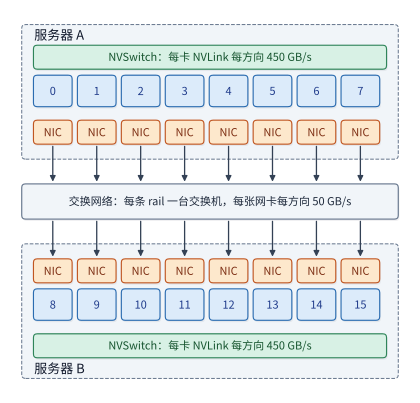

*图 7-1　固定两台服务器（每台八张卡）的基准通信拓扑。服务器内部的八张卡经 NVLink 与 NVSwitch 全互连，每张卡各配一张专用网卡；跨服务器流量从发送端网卡经交换网络到达接收端网卡，每张网卡单向提供 50 GB/s 带宽。*

图 7-1 标出的服务器物理边界，正是本章反复剖析的通信瓶颈边界。在基准算例中，我们选取一个大小为 192 MiB 的梯度张量，要求全部 16 个参与者最终都获得完整的归约结果。结合后文例题 7.6（第 7.6.2 节）的训练步时间线：单步总计算耗时为 20 ms，该梯度张量在第 17 ms 时计算就绪；若要让跨机梯度通信完全隐藏在剩余的 3 ms 计算窗口之内，通信总耗时就必须控制在 3 ms 以内——本章将这 3 ms 作为梯度归约的目标时间预算。这个算例既便于按轮次逐步手算，也直观揭示了跨服务器协同的核心矛盾：机内高速计算产出的结果，必须挤过带宽远低于 NVLink（单向 450 GB/s）的外置网卡（单向 50 GB/s），才能送达另一台服务器。

正因为跨机网卡带宽远低于机内 NVLink，系统架构设计的第一步就是决定将哪一类并行通信留在机内、哪一类放到机间。本章直接沿用第 6.1.4 节给出的并行方式分类，不再重复定义。工程上最优先评估的候选策略，通常是将每层都要高频触发的张量并行（TP）归约限制在机内高速互联域中，而将触发频率较低的数据并行（DP）梯度同步或流水线并行（PP）阶段间激活交接放在服务器之间。当然，一旦单机显存容量不足以放下完整切分、长序列上下文并行（CP）需要跨越多台服务器拼接上下文，或者大规模专家并行（EP）的动态路由跨越了机柜边界，高频通信就不可避免地要外溢到服务器之间。具体应当如何映射并行维度，最终仍须由实际的跨机流量与关键路径耗时来裁定。

需要注意，跨越超节点或服务器边界这一物理事实本身并不会改变算法所需的理论交换字节数：决定总发送字节数的是集合通信算法、数据放置方式、数值精度以及接收端是否做合并去重；而物理网络路径决定的则是这些字节必须流经哪些有限的出口、并在沿途排队等待多久。仅仅知道集群采用了 InfiniBand 还是 RoCE 协议，并不足以推算出实际有效带宽、端到端延迟、交换网超售比（交换机下行接入总带宽与上联汇聚总带宽之比）、在途并发窗口以及故障恢复时间。后文的所有推导均基于明确给定的网络参数展开，读者在实际工程部署中只需替换为目标集群的实测参数即可复用同一套计算方法。

> **实验 7-1 · 延伸：八卡服务器之间的模型切分**
>
> 计算上述两个推理模型的最低服务器数量，再加入每卡 8 GB 的 KV 与工作区。分别画出服务器内张量并行或专家并行、服务器间流水线并行的分工，以及跨服务器张量并行的分工，标出一次 prefill 与一次 decode 需要跨服务器交接的位置。

### 7.1.2 流量与资源模型

明确了加速卡的拓扑位置与待传张量的大小之后，下一步就是计算数据流经物理路径上每一段链路与接口所需的耗时。一段数据从发送端 GPU 显存出发，需要先经过机内互连或主机接口到达本地网卡，再穿过数据中心交换网络到达对端网卡，最终写入接收端显存。同一块数据必须按先后顺序依次穿过这些串联的接口与链路，但前后切分开的不同数据块则可以在各段路径上同时传输，从而构成跨层流水线。当发送端持续发送大块数据时，整条串联路径上带宽最低的那一段将决定端到端的稳态吞吐率。例如，即便单张 H100 经 NVLink 的单向发送能力高达 450 GB/s，只要它通往外部网络的专用网卡单向只能发送 50 GB/s，该卡向另一台服务器持续发送数据的稳态速率就会被网卡限制在 50 GB/s 以内。

将这一单路径瓶颈分析推广到整个集群网络时，可以先在拓扑图上选定一个待考察的网络边界，再统计所有必须穿过该边界的数据总量。将网络中的所有节点划分为两个互斥集合，连接这两个集合的全部物理链路就构成了第 6 章引入的**割集**（cut）。若某次通信任务需要沿某一方向跨越割集 $\mathcal C$ 传输总计 $V_{\mathcal C}$ bytes 的数据，且该割集在该方向上所能提供的有效总带宽为 $B_{\mathcal C}$，则完成这次跨边界传输的时间下界为

$$
T_{\mathcal C}=\frac{V_{\mathcal C}}{B_{\mathcal C}}.
$$

上式给出了物理层面的绝对传输时间下界：无论上层如何优化调度，穿过割集的所有链路每秒能够搬运的字节总数都不可能超过其物理带宽上限。对于全双工链路，收发两个方向的流量应当分别独立核算；若多个外部网络端口在机内共享同一个上游总线接口（如共用同一个 PCIe 插槽），则还需将该共享接口作为另一道内部割集核算汇总流量。由于同一份数据必须依次穿过串联的各段路径，端到端有效带宽始终取决于最窄的那道割集，切不可将串联各段的带宽直接相加。

整个集群层面的割集究竟有多宽，取决于数据中心交换网络的组网拓扑。现代数据中心普遍采用由多层交换机构成的 **Clos 网络**，通过中间交换层为任意两台服务器之间提供多条等价转发路径。在典型的分层 Clos 网络中，底层的叶交换机（leaf switch，或称接入交换机）直接连接服务器网卡，上层的脊交换机（spine switch，或称汇聚/核心交换机）则负责在叶交换机之间提供多路径高速互联。以 NVIDIA DGX SuperPOD 参考架构所采用的 Quantum QM9700 InfiniBand 交换机为例，其单端口工作在 InfiniBand NDR 速率等级下，提供 400 Gbit/s（即单向 50 GB/s）带宽。若一台 64 端口的叶交换机将其中的 48 个端口用于下联服务器网卡、仅留 16 个端口上联脊交换机，则其下行接入总带宽为 2.4 TB/s，而上联汇聚总带宽仅为 0.8 TB/s；二者之比 3:1 即称为该交换层的**超售比**（oversubscription ratio）。这 16 条合计 0.8 TB/s 的上联链路，就构成了所有离开该叶交换机的跨机柜流量必须穿过的带宽割集：接入同一台叶交换机的服务器之间可以直接以全速线速交换数据，唯有跨越不同叶交换机的通信才会争用这 0.8 TB/s 的上联割集带宽。

**例题 7.1：增加卡数的收益何时受跨服务器通信限制？** 将 16 个参与者排成一个逻辑环执行梯度归约（具体轮次见第 7.2.1 节推导），每台服务器需要向另一台服务器累计发送 360 MiB 数据，且这些跨机字节全部只经过单张单向带宽为 50 GB/s 的网卡。设在初始卡数下，单步纯计算耗时为 20 ms；当继续增加加速卡数量时，计算工作量随卡数均匀分摊（按反比缩短），但跨越服务器边界的数据传输总量与所经网卡路径保持不变。试求在“计算与通信完全串行”和“计算与通信完全重叠”两种调度安排下，单步总耗时随卡数倍数的变化规律。

解答：根据割集带宽公式，单方向跨服务器传输的时间下界为

$$
T_{\mathcal C}=\frac{360\times2^{20}}{50\times10^9}
\approx7.5\ \mathrm{ms}.
$$

设扩容后的加速卡数量为初始卡数的 $x$ 倍，则分摊后的计算耗时缩短为 $20/x$ ms。在完全串行安排下，单步总耗时为 $20/x+7.5$ ms；在计算与通信完全重叠的理想安排下，单步总耗时取决于计算与通信两者的较大值 $\max(20/x,\,7.5)$ ms。当卡数翻倍（$x=2$）时，串行与重叠两种安排的单步耗时分别从初始的约 27.5 ms 和 20.0 ms 下降至 17.5 ms 和 10.0 ms；当卡数扩大至四倍（$x=4$）时，串行安排降至约 12.5 ms，而完全重叠安排则触及 7.5 ms 的通信下限。图 7-2 绘出了两种安排下单步完成时间随卡数倍数变化的曲线。

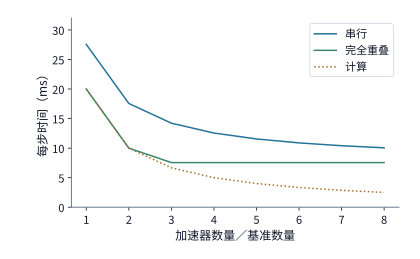

*图 7-2　跨服务器传输量固定时增加加速卡数量的加速效果。每方向固定发送 360 MiB 并经过单张 50 GB/s 网卡；计算耗时从 20 ms 起随卡数倍数成反比缩短。两条曲线分别对应计算与通信完全串行、完全重叠两种情况，其中通信耗时取割集传输下界 7.5 ms。*

令计算耗时与跨机传输耗时相等，即 $20/x=7.5$，解得临界倍数为 $x\approx2.6$。一旦扩容规模越过这一临界点，纯计算时间就已经短于跨机传输时间；在完全重叠安排下，继续增加加速卡数量将无法再缩短哪怕一毫秒的端到端耗时。若要进一步突破这一平台期，唯有从通信侧入手：要么通过改进算法减少穿过服务器割集的数据量，要么让多张网卡同时参与收发以成倍拓宽割集的有效带宽。第 7.2 节将具体展示，仅需将平面环形归约重构为分层归约，就能同时实现这两项改进。

像上述例题这样保持全局总任务量固定、单纯通过增加加速卡数量来缩短运行时间的扩展方式，称为**强扩展**（strong scaling）；反之，随加速卡数量成比例放大全局任务规模（例如保持每卡局部 batch size 不变）的扩展方式，则称为**弱扩展**（weak scaling）。在弱扩展场景下，如果每个方向跨越割集的通信量随卡数翻倍，而实际动用的出口带宽保持不变，那么跨机通信耗时也会随之翻倍。一条扩展曲线最终呈现何种走势，完全取决于单步计算量与跨边界通信量各自随集群规模增长的缩放规律。

> **实验 7-2 · 延伸：通信量与出口带宽如何限制扩容收益**
>
> 沿用例题 7.1，分别考虑每个方向的流量减半，以及让两张网卡同时工作使出口带宽翻倍这两种改动，分别画出串行与完全重叠两种安排下，完成时间随卡数倍数变化的曲线，并求计算耗时与通信耗时相等时的卡数倍数。再令流量随卡数倍数线性增长，求完全重叠安排下使完成时间最短的卡数倍数。

**Clos 网络的层数与半分带宽。** 前文以单台叶交换机的上联链路为例说明了局部割集；若要核算整个数据中心集群的全局割集宽度，则需要从单台交换机的端口基数（radix）算起。设每台交换机拥有 $k$ 个全双工端口，单端口单向带宽均为 50 GB/s（对于 QM9700 交换机，$k=64$）。叶交换机使用其中 $d$ 个端口下联服务器网卡、$u$ 个端口上联脊交换机，比值 $d/u$ 即为超售比。在 1:1 无阻塞（non-blocking）配置下，叶交换机上下行端口对半分配，即 $d=u=k/2$。在两层 Clos（leaf-spine）拓扑中，每台脊交换机的 $k$ 个端口分别连接一台叶交换机，而每台叶交换机的 $k/2$ 条上联链路也分别接入 $k/2$ 台脊交换机，因此整个网络最多可部署 $k$ 台叶交换机、接入 $k^2/2$ 个服务器网卡端点；若扩展为三层 fat-tree（胖树，即各层总聚合带宽保持不收窄的多层 Clos 网络）的单元化（pod）结构（每个 pod 由若干台叶交换机与中间汇聚层交换机组成，不同 pod 之间再经由顶层核心交换机全互连），则最多可接入 $k^3/4$ 个网卡端点。将 $k=64$ 代入可知：无阻塞两层 Clos 最多可接入 2048 个端点，共需 96 台交换机——这恰好对应 NVIDIA DGX SuperPOD 参考架构中连接 2048 张 GPU 所使用的 64 台叶交换机与 32 台脊交换机；而无阻塞三层 fat-tree 则可扩展至 65536 个端点，共需 5120 台交换机。[^clos-cut]

将整个集群的所有端点对半划分为规模相等的两个集合，连接这两半集群的全部跨界链路带宽之和称为网络的**半分带宽**（bisection bandwidth，或称对分带宽）。在 1:1 无阻塞 Clos 网络中，半分带宽严格等于半数端点的注入带宽之和：两层 2048 个端点下的半分带宽为 $1024\times50=51.2$ TB/s，三层 65536 个端点下则高达 1638.4 TB/s。若改用 3:1 超售配置，每台叶交换机以 48 个端口下联服务器、16 个端口上联脊交换机，此时两层 Clos 仅需 80 台交换机（64 台叶交换机加 16 台脊交换机）即可接入 3072 个端点；但 64 台叶交换机总共只有 1024 条上联链路，穿过半分割集的链路取其一半（512 条），对应的半分带宽仅为 25.6 TB/s——这一数值只有同等 3072 个端点在无阻塞网络下所得半分带宽（76.8 TB/s）的三分之一，相当于每个端点分摊到的半分割集带宽份额从 50 GB/s 降至 16.7 GB/s。图 7-3 给出了两层 Clos 网络的拓扑结构及其半分割集示意。

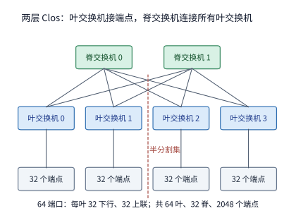

*图 7-3　两层 Clos 网络及其半分割集。每台叶交换机将一半端口下联服务器、另一半端口上联脊交换机，任意两台叶交换机之间均可经由任一脊交换机互通；图中虚线将全部端点对半切开，所有穿过虚线的叶—脊上联链路即构成网络的半分割集。图中以 4 台叶交换机和 2 台脊交换机作为示意代表，在 64 端口无阻塞配置下实际对应 64 台叶交换机与 32 台脊交换机。*

当后文第 7.6.4 节中的 1024 卡训练作业独占整数台叶交换机时，该作业对外通信的物理割集就是这批叶交换机的全部上联链路：

| 超售比 | 每叶下行／上联 | 1024 卡占用的叶交换机 | 割集链路数 | 割集带宽 | 每卡份额 |
|---|---:|---:|---:|---:|---:|
| 1:1 | 32／32 | 32 | 1024 | 51.2 TB/s | 50 GB/s |
| 3:1 | 48／16 | 22 | 352 | 17.6 TB/s | 17.2 GB/s |

超售比还会直接改变第 7.6.4 节汇总表中“出口随卡数增长”一列的有效带宽取值。该列在基准计算中将每个超节点的外部总出口设为“超节点卡数 $\times 50$ GB/s”，其隐含前提是底层交换网络为 1:1 无阻塞；一旦交换网络采用 3:1 超售，跨叶交换机的有效出口带宽便缩水为原来的三分之一，跨超节点阶段的纯传输耗时也随之拉长至原来的三倍：

| 超节点卡数 | 每节点跨域发送 | 无阻塞出口 | 3:1 超售出口 | 跨域传输时间（无阻塞 → 3:1） |
|---:|---:|---:|---:|---:|
| 8 | 127 GB | 400 GB/s | 133 GB/s | 0.318 → 0.953 s |
| 64 | 120 GB | 3.2 TB/s | 1.07 TB/s | 37.5 → 112.5 ms |
| 128 | 112 GB | 6.4 TB/s | 2.13 TB/s | 17.5 → 52.5 ms |
| 256 | 96 GB | 12.8 TB/s | 4.27 TB/s | 7.5 → 22.5 ms |

上表列出的是纯数据传输耗时。第 7.6.4 节完整的跨域通信耗时还包含 $2(H-1)$ 轮每轮 0.83 μs 的启动开销（例如 128 卡超节点对应超节点数 $H=8$，共 14 轮启动、合计约 12 μs），但这点微秒级的启动时间对表中数十毫秒乃至近一秒的传输耗时几乎没有影响。

**讨论：超售的割集何时成为瓶颈？** 在超售比为 $r$ 的叶交换机下，每张网卡分摊到的上联割集带宽份额降至 $50/r$ GB/s。设某张网卡发出的全部通信字节中，仅有比例为 $f$ 的流量需要离开当前叶交换机（即跨叶转发），那么上联割集不成为瓶颈的充要条件是 $f\le1/r$：在 $r=1$ 的无阻塞网络中，任意跨叶比例 $f$ 都不会受限于上联；而在 $r=3$ 的超售网络中，只有当跨叶流量占比不超过三分之一（$f\le 1/3$）时，上联链路才不会造成拥塞。以分层归约的跨服务器阶段为例：在后文第 7.2.5 节介绍的多轨（rail-optimized）拓扑中，各台服务器上编号相同的网卡接入同一台叶交换机，每 32 台服务器构成一个接入组（pod/rail group）。如果参与配对归约的两台服务器分属不同的接入组（即不在同一台叶交换机下），那么每张网卡发出的全部字节都必须跨叶经由脊交换机转发，此时 $f=1$，3:1 超售的上联割集将直接把跨服务器阶段的传输耗时拉长到无阻塞时的 $r=3$ 倍；反之，如果这两台服务器位于同一个 32 台服务器的接入组内，第 7.2.5 节的同轨对齐配对就能保证每一对网卡的流量都只在一台叶交换机内部完成一跳交换，此时跨叶比例 $f=0$，叶交换机的上联链路完全不承载这次归约的任何字节。因此，在集群调度时尽量将同一个集合通信同步组的服务器分配在同一个叶交换机接入组内，正是工程上降低跨叶比例 $f$、规避超售割集瓶颈的核心手段。

> **实验 7-3 · 延伸：交换机端口数与超售比如何决定割集**
>
> 把交换机端口数改为 128，分别求无阻塞两层与三层 Clos 的端点数、交换机数和半分带宽。保持 64 端口，把超售比改为 2:1，求 1024 卡分区的割集带宽和每卡份额，并求第 7.6.4 节 128 卡超节点的跨域传输时间。最后求超售比为 3 时，分层归约跨服务器阶段的每张网卡需要有多大比例的字节留在本叶交换机内，割集才不再是瓶颈。

### 7.1.3 统一互联

前文的割集下界揭示了物理链路带宽的硬性约束；而在软件与体系结构层面，分布式程序还面临另一重障碍：同样一份张量数据，在节点内传输与跨服务器传输时往往不得不调用截然不同的访问接口。这一割裂源于计算机体系结构中“内部总线”与“外部网络”长期以来的历史分工：以 PCIe、NVLink 为代表的紧耦合总线将外设直接挂接在处理器与内存子系统之上，专为高频、细粒度的低延迟访存而设计；而以以太网、InfiniBand 为代表的集群网络则面向连接成百上千个自治计算节点的场景，必须额外处理路由寻址、拥塞控制以及节点与链路的异步故障。当大模型切分跨越单机边界之后，同一个训练或推理算子往往需要同时驱动这两套机制——在算法逻辑上同样表达“读取上游数据并等待就绪”的数据依赖，落到底层却分裂为两套完全不同的任务提交与完成确认路径。

笔者参与灵衢（UB）早期架构设计时，面临的核心课题之一正是如何为节点内访存与跨节点通信提供统一的编程与硬件抽象。从上层应用的视角看，程序真正需要表达的原语无非是“读取远端指定数据”“将计算结果推送给下一阶段”以及“确认对端消费完毕后复用本地缓冲区”。统一互联架构用于为跨域寻址、远端内存访问以及设备间协同提供一致的接口抽象，使 CPU、NPU/GPU 加速器乃至各类智能网卡都能在同一套语义下直接交互。

要准确把握“统一互联”的工程价值，必须将**接口语义**与**物理路径**区分开来：接口决定了程序如何发起工作与管理依赖，而物理路径则决定了数据包实际流经哪些硬件队列与链路资源。哪怕上层允许用一条处理器的 `Load` 指令直接发起跨机远程读取，底层数据依然要穿过单向 50 GB/s 的网卡出口；哪怕异步写入请求可以提前批量入队，接收端算子也必须等到数据实际落盘并对本地可见之后才能启动计算。因此，本章的分析将严格遵循三个递进层次：首先核算算法必需的跨边界字节流量，其次计算用满物理链路所需的在途并发请求数，最后厘清保证数据正确交接所需的操作顺序与状态开销。统一互联架构的技术收益同样体现在这三个层次上——消除冗余的中间缓冲拷贝、缩短请求下发与完成确认的控制路径，以及简化跨设备的顺序同步。第 6.5.5 节已经从超节点架构的视角探讨了 UB 的两项关键设计抉择（将互联控制器直接挂接在片上总线上，以及将连接状态解耦为端点记录 Jetty 与共享传输通道）；本章则将沿着一次远程访问的完整生命周期，逐阶段定量推算这两项设计在实际运行中所节省的延迟与状态空间。

## 7.2 跨节点流量与物理路径

### 7.2.1 数据并行的跨服务器流量

统一接口本身并不能减少算法必需交换的字节数，但合理设计集合通信的归约拓扑，却能大幅削减需要跨越服务器边界的数据流量。我们首先从数据并行（DP）的梯度同步算起：每个参与者各自反向算出局部梯度张量后，需要将所有参与者在对应位置上的梯度元素逐一累加，最终让每个参与者都持有完整的全局归约梯度。算例选取 Qwen3-8B 第一层 FFN 中门控投影矩阵（gate projection）的梯度张量，其形状为 $[12288,4096]$，按每元素 4 字节的 FP32 格式存放，因此每个参与者的输入梯度体积为

$$
M=12288\times4096\times4=192\ \mathrm{MiB}.
$$

第 6.4.2 节已经推导过经典的环形 AllReduce（Ring AllReduce）算法：第一阶段先执行 ReduceScatter，经过 $p-1$ 轮接力累加后，每个参与者各自持有一份长度为 $M/p$ 的完整归约结果分片；第二阶段再执行 AllGather，经过 $p-1$ 轮接力广播后，将该完整分片分发给所有其他参与者。由于整个张量被均分为 $p$ 个分片，两个阶段合计执行 $2(p-1)$ 轮通信，每轮每个参与者都沿环向下一个邻居发送一份大小为 $M/p$ 的分片。因此，在整个环形 AllReduce 过程中，每个参与者累计发出的数据总量为

$$
V_{\mathrm{rank}}=2\frac{p-1}{p}M.
$$

将参与者数量 $p=16$、张量大小 $M=192$ MiB 代入上式，可知每个参与者累计发送 360 MiB 数据，16 个参与者的逻辑发送总量为 $16\times360=5760$ MiB，全程共经历 30 个通信轮次。可以看到，环形算法本身固定了每个参与者的总发送字节数；而这 16 个参与者在两台服务器上的逻辑排列顺序，则决定了这 5760 MiB 流量中有多少字节需要跨越服务器边界、以及具体流经哪几张网卡。

**例题 7.2：哪种归约算法能在 3 ms 内完成传输？** 基于第 7.1 节定义的两台八卡服务器基准配置，定量对比不分层的“连续环”、“交错环”以及两级“分层归约”三种方案的跨服务器流量与完成时间。

**解答：第一步，核算三种归约方案的跨服务器传输量。**
1. **连续环（Contiguous Ring）**：将 16 个参与者按自然序号 $0, 1, \dots, 15$ 排成一个单环。在环上的 16 条有向通信边中，只有 $7\to8$（从服务器 A 到服务器 B）和 $15\to0$（从服务器 B 到服务器 A）这两条边跨越了服务器边界。由于每轮每条边发送 $192/16=12$ MiB，经过 30 轮传输后，每个跨机方向各发送 $30\times12=360$ MiB，收发两个方向跨服务器传输的流量合计为 720 MiB。需要注意，这 720 MiB 跨机流量在服务器 A 一侧全部只流经 rank 7 的网卡，在服务器 B 一侧全部只流经 rank 15 的网卡，两台服务器上其余 14 张网卡在整个归约过程中完全处于闲置状态。
2. **交错环（Interleaved Ring）**：若将环上的参与者排列顺序改为两台服务器交替穿插，即 $0, 8, 1, 9, \dots, 7, 15$，那么环上的全部 16 条有向边都将跨越服务器边界。此时每一轮通信中，16 张网卡都会各自向对端服务器发送 12 MiB 数据；虽然全部网卡都被动用起来，但收发两个方向跨越服务器边界的流量总和也随之暴增至 5760 MiB（即全部逻辑发送量都变成了跨机流量）。
3. **分层归约（Hierarchical AllReduce）**：第一阶段先在每台服务器内部，由本机的 8 个参与者通过高速 NVLink 独立执行一次机内 ReduceScatter。经过 7 轮机内通信后，每个参与者各自持有本服务器八卡局部归约结果的八分之一分片，大小为 $192/8=24$ MiB。第二阶段进入跨服务器归约：两台服务器上负责同一个分片位置的两个参与者（即 rank $i$ 与 rank $i+8$）两两配对，针对这 24 MiB 分片执行一次双节点 AllReduce——双方各自将 24 MiB 拆成两个 12 MiB 的子分片，第 1 轮互相交换并累加其中一半，第 2 轮再互相交换补齐另一半。在这一阶段中，每一对参与者在收发两个方向上合计传输 48 MiB，八对参与者跨服务器双向总传输量仅为 $8\times48=384$ MiB；更重要的是，这八对参与者各自独占一条独立的 rail，使两台服务器上的全部八对网卡同时满负荷工作。第三阶段再回到各台服务器内部，通过 7 轮机内 NVLink AllGather 将拼齐的完整归约结果分发给本机所有参与者。图 7-4 至图 7-6 分别展示了这三种方案的通信拓扑路径，图 7-7 则直观对比了三者的跨服务器传输字节数。

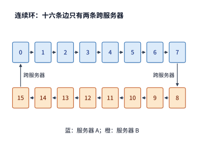

*图 7-4　连续环将同一台服务器内的参与者排在相邻位置。16 条有向环边中仅有 $7\to8$ 与 $15\to0$ 两条边跨越服务器边界，跨机流量完全集中在两张边界网卡上（图中不同底色代表所属服务器）。*

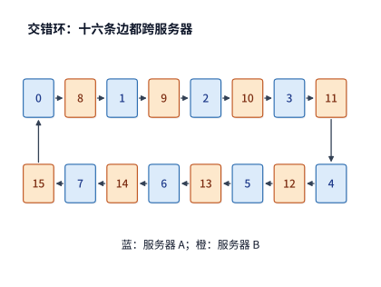

*图 7-5　交错环按 A、B 两台服务器交替排列参与者，导致全部 16 条有向环边均跨越服务器边界。虽然 16 张网卡全部参与工作，但每个参与者的总发送字节数全部转化成了跨机流量。*

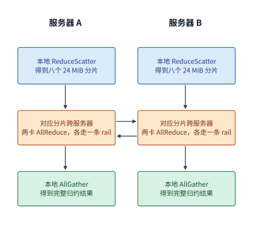

*图 7-6　分层归约的三个执行阶段：每台服务器先在机内将八张卡的梯度归约为 24 MiB 分片（ReduceScatter），再与对端服务器同号卡通过各自的 rail 交换并归约对应分片（跨机 AllReduce），最后在机内收集拼接出完整的 192 MiB 结果（AllGather）。图中每列自上而下推进，横向箭头表示跨机成对交换。*

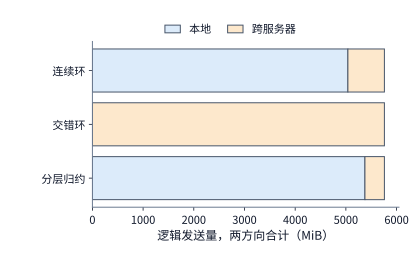

*图 7-7　三种方案在所有参与者上的逻辑发送总量均为 5760 MiB（双向合计），但其中跨越服务器边界的流量（橙色部分）分别为 720 MiB、5760 MiB 和 384 MiB。*

**解答：第二步，根据各轮链路负载计算总归约耗时。** 在同步集合通信中，各个轮次按先后顺序串行推进，而同一轮次内的多条传输则在各自的物理链路上并行执行。设第 $r$ 轮通信流经物理资源 $e$ 的数据量为 $V_{r,e}$、该资源的可用带宽为 $B_e$、每轮同步的固定启动开销为 $\alpha$，则总通信耗时模型可写为

$$
T_{\mathrm{comm}}=\sum_r\left(\alpha+\max_e\frac{V_{r,e}}{B_e}\right).
$$

顺着上述三种方案在每一轮的数据流向逐轮代入，即可将字节流量换算为端到端通信时间。上式清晰刻画了同步通信的两重约束：**同一轮内看木桶短板**（耗时取决于该轮负载最重、带宽最窄的那条链路 $\max_e (V_{r,e}/B_e)$），**不同轮间做串行累加**（对所有轮次求和 $\sum_r$）。此处暂只核算数据传输与每轮启动开销。[^gradient]

- 在**连续环**方案中，每一轮在每个跨机方向上都要经由单张 50 GB/s 网卡发送 12 MiB 数据，单轮跨机传输耗时约为 $12\ \mathrm{MiB}/(50\ \mathrm{GB/s})\approx0.25$ ms；同一轮内的其余 14 条边虽然走的是 450 GB/s 的高速 NVLink（传完 12 MiB 仅需约 0.03 ms），却必须在屏障处等待那条最慢的跨机边传完才能进入下一轮。因此，30 轮通信累计耗时高达约 7.6 ms。
- 在**交错环**方案中，每一轮的 16 条边各自经由一张独立的 50 GB/s 网卡发送 12 MiB 数据，单轮受网卡限制同样耗时约 0.25 ms，30 轮累计耗时依然约为 7.6 ms——交错排列虽然让全部 16 张网卡都忙碌起来，却把跨服务器总流量放大到了连续环的 8 倍，两相抵消之下，端到端耗时分毫未减。
- 在**分层归约**方案中，跨服务器交换被压缩到了短短 2 轮，每轮每张网卡各自发送 12 MiB，跨机阶段总传输耗时仅约 0.50 ms；机内的 ReduceScatter 与 AllGather 合计 14 轮，每轮每个参与者经由 450 GB/s 的 NVLink 发送 24 MiB，机内阶段总传输耗时约为 0.78 ms；再加上全程 16 轮启动开销（合计约 13 μs），总通信耗时为

$$
T_{\mathrm{hier}}=
14\frac{24\ \mathrm{MiB}}{450\ \mathrm{GB/s}}
+2\frac{12\ \mathrm{MiB}}{50\ \mathrm{GB/s}}
+16\times0.83\ \mu\mathrm{s}
\approx1.3\ \mathrm{ms}.
$$

对比 3 ms 的目标通信预算：平面环（连续环与交错环）耗时 7.6 ms，远超预算；而分层归约仅需约 1.3 ms，不仅顺利达标，还为加法归约算子执行、信号传播及排队抖动留出了约 1.7 ms 的充裕余量。与连续环相比，分层归约的跨服务器总字节数仅减少了约 47%（从 720 MiB 降至 384 MiB），但总通信时间却大幅缩短了约 83%（从 7.6 ms 降至 1.3 ms）。二者降幅之所以如此悬殊，根本原因不仅在于字节数的削减，更在于物理出口路径的并行化：连续环在全部 30 轮中每一轮都卡在单张网卡发送 12 MiB 的瓶颈上，机内 14 条 NVLink 边每轮在 0.03 ms 传完后只能空等，其余 14 张网卡更是全程闲置；而分层归约通过机内预归约将跨机交换浓缩为 2 轮，并在这 2 轮中同时唤醒全部八对网卡并行发送，使跨越服务器割集的单向有效总带宽从单卡的 50 GB/s 跃升至八卡聚合的 400 GB/s。

**讨论：本地互联要多快，分层才合算？** 设服务器内部的单向互连带宽为 $B_L$，每张网卡的单向带宽仍固定为 50 GB/s。在分层归约中，机内 14 轮通信共需每个参与者发送 $14\times24=336$ MiB 数据，跨机 2 轮通信耗时固定约为 0.5 ms；而在连续环中，只要机内带宽 $B_L$ 不低于网卡带宽（50 GB/s），每一轮的瓶颈就始终卡在那条跨机网卡边上，总耗时恒定约为 7.6 ms。令分层归约与连续环的总耗时相等，即 $336\ \mathrm{MiB}/B_L+0.5\ \mathrm{ms}=7.6\ \mathrm{ms}$，解得临界本地带宽 $B_L\approx50$ GB/s——这表明，在这台每卡独享一张网卡的服务器上，只要机内互连带宽不慢于单张网卡，分层归约就一定快于连续环；而 H100 的 NVLink 单向带宽（450 GB/s）高出该临界值近一个数量级。之所以如此，是因为在该拓扑下分层归约的机内发送量（336 MiB）本来就不高于连续环的总发送量（360 MiB），同时还在跨机阶段额外获得了八张网卡的并行聚合带宽。

然而，分层归约并非在所有硬件拓扑下都是稳赚不赔的“免费午餐”。作为反例，我们考察一种常见的 PCIe 服务器（下文简称**对照配置**）：每台服务器配备四张 A100 80GB PCIe 加速卡，卡间通过 PCIe Gen4 x16 进行点对点传输，单向带宽为 32 GB/s；每台服务器仅配备一张双端口 ConnectX-7 网卡，其两个 200 Gbit/s 端口虽然各自提供 25 GB/s 线速带宽，但向上必须共用该网卡所在的同一个 PCIe Gen4 x16 主机插槽，导致整机跨服务器通信的单向总出口被插槽限制在 32 GB/s。在两台该规格服务器组成的八卡通信组中：若采用连续环，共执行 14 轮、每轮每边发送 24 MiB，无论机内点对点边还是跨机网卡插槽边，单向有效带宽均为 32 GB/s，因此 14 轮总耗时约为 11.0 ms；若改用分层归约，跨机阶段虽然只有 2 轮，但本机四个参与者的分片必须同时挤过那一个 32 GB/s 的共享 PCIe 插槽，导致每个方向在每轮都要通过该插槽串行传输 96 MiB 数据（2 轮共 192 MiB，耗时约 6.3 ms），再加上机内 6 轮 ReduceScatter 与 AllGather（每轮 48 MiB 走 32 GB/s 的 PCIe，耗时约 9.4 ms），总耗时反而膨胀到约 15.7 ms，比不分层的连续环还要慢。令这两种方案的耗时相等，可以算出分层归约要想在该共享出口配置下反超连续环，机内互连带宽至少需要达到约 64 GB/s（即约为共享网卡插槽带宽的两倍）。[^two-nic] 尽管 A100 PCIe 支持通过单向 300 GB/s 的 NVLink 桥接器（bridge）两两互连，但单个桥接器只能连接两张卡，四卡环路中仍有两条边必须走 32 GB/s 的 PCIe；只有当四卡环路的每一条本地边都能提供 300 GB/s 带宽时，分层归约的总耗时才会降至约 7.3 ms，重新快于连续环。这一反转揭示了共享接口对算法选择的深刻影响：当跨机流量必须汇聚到同一个 32 GB/s 的共享插槽时，分层归约在跨机阶段把多个分片浓缩到两轮并发发送的做法，并不会拓宽出口总带宽，反而把单轮跨机时间拉长了；如果机内互连带宽又没有明显快于外部共享出口，机内预归约多花的时间就无法被跨机阶段节省的字节数所抵消。

归结起来，分层归约的本质是利用更快的本地互联预先合并数据，再将浓缩后的分片交由外部网卡发出。它一方面削减了跨服务器的总字节数，另一方面更重要的是让本机每一张网卡都分摊到了独立的待传分片。当跨服务器带宽由多张独立网卡并行提供时，分层归约几乎没有任何额外代价；而当多张加速卡共享同一个跨机出口瓶颈时，唯有当机内归约额外付出的时间小于其所节省的远端传输时间时，分层归约才能带来净收益。

**第四种方案：在网归约（In-Network Aggregation）。** 前述三种方案均由端点加速卡之间两两收发数据，网络交换机仅承担原样转发报文的通道职能。**在网归约**则让交换机在转发报文的同时直接执行加法归约：例如 NVIDIA 的 SHARP（Scalable Hierarchical Aggregation and Reduction Protocol，可扩展分层聚合与归约协议）在 InfiniBand 交换芯片内部构建聚合树，直接对来自多个下行端口的分片数据求和，再将归约完毕的单一结果广播回各端口，从而免去了端点之间多轮接力发送同一分片的开销。[^in-network] 若我们在分层归约的基础上保留机内的 ReduceScatter 与 AllGather，仅将中间的跨服务器阶段替换为 SHARP 在网归约，那么每个参与者只需将自己持有的 24 MiB 分片向交换机发送一次、再从交换机接收一次汇总结果，整个跨服务器阶段便浓缩为短短 1 轮。在仅有两台服务器的基准算例中，每张网卡在收发每个方向上依然各传输 24 MiB，跨服务器双向总流量仍为 384 MiB，与普通分层归约完全相同；跨机阶段耗时仅从 2 轮的 0.505 ms 微降至 1 轮的 0.504 ms，相当于只省下了 1 次 0.83 μs 的轮次启动开销。

在网归约的真正威力体现在服务器数量扩展之后。设持有同一位置梯度分片、需要跨机同步的服务器共有 $S$ 台：若跨机阶段采用环形 AllReduce，每张网卡需要累计发送 $2\frac{S-1}{S}\times24$ MiB 数据、经历 $2(S-1)$ 个通信轮次；若采用在网归约，无论 $S$ 扩大到多少，每张网卡始终只需向交换机发送一次 24 MiB 分片并接收一次 24 MiB 结果（恒为 1 轮）。随着服务器台数 $S$ 从 2 扩展至 32，两种方案在跨服务器阶段的流量与耗时对比如下表及图 7-8 所示：

| 服务器数 | 环：每网卡发送 | 环：轮数 | 环：时间 | 在网归约：每网卡发送 | 在网归约：时间 |
|---:|---:|---:|---:|---:|---:|
| 2 | 24 MiB | 2 | 0.505 ms | 24 MiB | 0.504 ms |
| 4 | 36 MiB | 6 | 0.760 ms | 24 MiB | 0.504 ms |
| 8 | 42 MiB | 14 | 0.892 ms | 24 MiB | 0.504 ms |
| 16 | 45 MiB | 30 | 0.969 ms | 24 MiB | 0.504 ms |
| 32 | 46.5 MiB | 62 | 1.027 ms | 24 MiB | 0.504 ms |

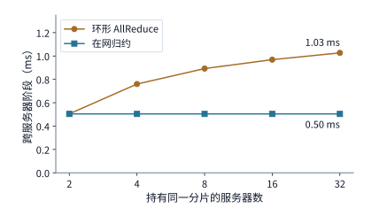

*图 7-8　持有同一分片的服务器数量 $S$ 从 2 台增至 32 台时，跨服务器阶段的归约耗时对比。环形方案中每张网卡的发送量随 $S$ 增大而趋近于两倍分片（48 MiB），轮数按 $2(S-1)$ 线性增长；在网归约则始终保持单分片（24 MiB）与单轮次不变。在两台服务器（$S=2$）时，二者仅相差一次启动开销。*

**讨论：在网归约何时明显更快？** 当 $S=2$ 时，环形交换与在网归约在字节数上完全等价，仅相差一次启动时间；但从 $S=3$ 开始，环形方案在每张网卡上的发送字节数就是在网归约的 $2(S-1)/S>1$ 倍（渐近趋于 2 倍），并且还要多付出 $2S-3$ 轮同步启动开销。因此，参与跨机同步的服务器台数越多，在网归约的优势就越显著——当扩展至 32 台服务器时，在网归约的跨机耗时仅为环形方案的 49%。需要注意的是，上述理想模型仅核算了网卡端口的串行发送时间与轮次启动开销；在实际硬件中，交换机内置归约引擎每秒能够处理的归约字节上限及其所支持的数据类型（如 FP16/BF16/FP32）是需要额外代入的硬件约束——一旦多条 rail 并发注入的归约流量超出交换芯片归约引擎的处理能力，系统瓶颈就会从网卡链路转移到交换机内部。此外，根据 SHARP 论文在 128 台主机上的实测数据，8 字节极小消息的 AllReduce 延迟从 6.01 μs 降至 2.83 μs，4096 字节消息从 46.93 μs 降至 14.48 μs，说明在小报文同步场景下，在网归约节省的主要是原本随节点数增长的多轮接力启动与转发延迟。[^in-network]

> **实验 7-4 · 延伸：在网归约何时值得**
>
> 把梯度改为 BF16（每参与者 96 MiB），重算两台与八台服务器的环形与在网归约跨服务器时间。设交换机归约引擎每方向的归约吞吐为 200 GB/s，求八条 rail 同时归约时它是否成为瓶颈，并求使在网归约仍快于环的最小引擎吞吐。最后按第 7.6.3 节的 8 KiB 输入，比较 36 层、每层两次归约的总启动时间在两种方案下相差多少。

### 7.2.2 张量并行与流水线并行的通信需求

数据并行是在反向传播阶段通过归约汇合各副本的梯度；而在前向与反向的模型切分中，**张量并行（TP）**与**流水线并行（PP）**则呈现出截然不同的跨机通信特征。张量并行将单层内部的矩阵乘法切分给多个参与者协同执行，当前层的后续算子（如 LayerNorm 或残差相加）必须等待所有参与者的局部结果汇合完毕后才能启动，因此层内通信会直接卡在计算关键路径上；流水线并行则是按层将模型纵向切分为若干连续阶段（stage），把跨服务器的激活交接集中在相邻阶段的边界处。这两种切分方式直接决定了数据在一轮前向或反向中跨越服务器边界的频次与粒度。

我们先从单次层间交接的数据量算起。以隐藏维度 $d=4096$ 的 Qwen3-8B 为例，单个 token 的 BF16 隐藏状态向量大小为 $4096\times 2\ \mathrm{B}=8\ \mathrm{KiB}$。在上下文长度为 8192 个 token 的 prefill 阶段，一次交接的激活张量体积为 $8192\times 8\ \mathrm{KiB}=64\ \mathrm{MiB}$；而在单请求（$\mathrm{batch}=1$）的自回归 decode 阶段，每步仅生成 1 个 token，单次交接的数据量只有 8 KiB。设跨机网卡的单向带宽仍为 $B=50\ \mathrm{GB/s}$，单次通信请求的固定启动开销设为 $\alpha=5\ \mu\mathrm{s}$，则传输 $M$ 字节数据的端到端耗时为

$$
T_{\mathrm{msg}}=\alpha+\frac{M}{B}.
$$

将上述两种负载代入公式：传输 64 MiB 的 prefill 激活约耗时 $5\ \mu\mathrm{s} + 1.34\ \mathrm{ms} \approx 1.3\ \mathrm{ms}$，绝大部分时间花在物理链路的字节传输上；而传输 8 KiB 的 decode 激活总耗时约为 $5\ \mu\mathrm{s} + 0.16\ \mu\mathrm{s} \approx 5.2\ \mu\mathrm{s}$，其中约 97% 的时间都消耗在固定的启动开销上。令启动耗时与纯传输耗时相等，即可求出区分“延迟敏感型小消息”与“带宽敏感型大消息”的临界消息体积：

$$
M=\alpha B=5\ \mu\mathrm{s}\times 50\ \mathrm{GB/s}=250000\ \mathrm{bytes}\approx 244\ \mathrm{KiB}.
$$

当单次交接的数据量远大于 244 KiB（如长序列 prefill 或大批量训练）时，传输时间占主导，拓宽物理链路带宽或压缩传输字节数最为有效；反之，当单次数据量远小于 244 KiB（如低并发 decode）时，固定启动延迟占主导，此时单纯升级网卡带宽几乎无济于事，唯有减少跨机通信的触发次数或缩短每次请求的启动路径才能见效。

上式刻画了单次边界交接的开销；而要评估流水线并行（PP）的整体效率，还需考察多次阶段交接如何与计算在时间轴上穿插。流水线并行将连续若干个 Transformer 层打包为同一个阶段并放置在一台服务器上，相邻阶段之间仅在边界处传递一层激活张量。当上游阶段正在处理下一个微批次（micro-batch）时，下游阶段可以同时处理刚刚收到的上一个微批次。设我们将前向计算均分为 $p=4$ 个等耗时阶段，每个阶段处理一个微批次耗时 $\tau=1\ \mathrm{ms}$。单个微批次从第 1 阶段依次流经第 4 阶段，需要 4 ms 完成；若连续注入 $m=8$ 个彼此独立的微批次，第 1 阶段每毫秒向下游移交一个微批次的结果，则全部 8 个微批次将在第 11 ms 全部完成。

顺着图 7-9 中相同的微批次编号（沿右下方对角线）追踪，可以看到任意一个微批次都必须串行走完四个阶段；而顺着同一水平行观察，则可以看到每个阶段都在连续处理 8 个微批次。图中左下角（流水线填充期）与右上角（流水线排空期）的空白格，直观展现了流水线启动与收尾阶段不可避免的设备空闲——即**流水线气泡**（pipeline bubble）。

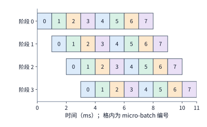

*图 7-9　四阶段前向流水线连续处理八个独立微批次（micro-batch）的时空甘特图。每个水平行代表一个流水线阶段，每格代表 1 ms，格内数字表示微批次编号；同一编号沿右下方移动，代表该微批次依次流经四个阶段。每个阶段实际计算 8 ms，在 11 ms 的总周期内各有 3 ms 处于气泡空闲状态（图中假设各阶段计算耗时相同，且暂忽略微秒级的阶段交接通信开销）。*

一般地，对于划分为 $p$ 个等耗时阶段、连续注入 $m$ 个独立微批次、单阶段单微批次耗时为 $\tau$ 的流水线，完成整批任务的总时间 $T_{\mathrm{pipe}}$ 与各阶段的平均计算利用率 $U_{\mathrm{pipe}}$ 分别为

$$
T_{\mathrm{pipe}}=(m+p-1)\tau,\qquad
U_{\mathrm{pipe}}=\frac{m}{m+p-1}.
$$

在 $p=4$、$m=8$ 时，流水线利用率约为 $8/(8+4-1)\approx 73\%$。若希望将设备利用率提升至 90% 以上，由 $m/(m+3)\ge 0.9$ 可知，至少需要同时向流水线注入 $m\ge 27$ 个独立微批次。这意味着，要想让跨服务器的流水线各阶段持续满载运转，系统必须具备充足的并发微批次。在低并发自回归 decode 场景下，同一个用户请求的第 $t+1$ 个 token 严格依赖第 $t$ 个 token 的最终输出，单纯增加服务器数量（加深流水线阶段 $p$）并不会凭空创造出新的独立微批次，反而会拉长气泡占比；唯有汇聚足够多的并发用户请求，才能填满流水线中的各阶段槽位。

可见，张量并行与流水线并行在跨机部署时面临着性质完全不同的等待代价：张量并行需要在每一层内部频繁跨机汇合局部结果（每层触发 2 次 AllReduce），极易被小消息的启动延迟拖慢；流水线并行虽然将跨机通信频次压缩到了阶段边界，但在并发微批次不足时会遭受严重的气泡空闲。因此，在工程实践中：面对张量体积庞大的 prefill 阶段，应优先减少跨服务器传输的字节总量；面对逐 token 生成的低并发 decode 阶段，应极力避免跨服务器做张量并行，以减少每层通信的启动次数；而当采用跨服务器流水线并行时，则必须通过连续批处理（continuous batching）维持足够高的并发请求数以摊薄流水线气泡。

### 7.2.3 专家并行的通信负载

张量并行与流水线并行的通信拓扑在模型切分时就已经静态确定；而混合专家（MoE）模型则引入了一个动态变量：不同 token 经门控路由器（router）打分后选中的专家组合各不相同，跨服务器发送的目标节点与数据量也会随输入内容实时波动。在**专家并行（EP）**中，不同的专家权重被分散存放在不同服务器的加速卡上：前向计算时，先通过分发（**dispatch**）通信将每个 token 的激活向量发送到其所命中专家所在的加速卡；待专家 FFN 计算完毕后，再通过合并（**combine**）通信将计算结果按原路径送回 token 原本所在的加速卡并加权求和。

我们通过一个具体的定量算例来核算跨机流量：假设当前批次共有 $n=1024$ 个 token，每个 token 路由选中 $k=8$ 个活跃专家，则全批次共触发 $1024\times 8=8192$ 次专家分发。设每份 token 激活向量占 $d=8\ \mathrm{KiB}$（4096 维 BF16），且平均有一半（跨边界比例 $f=0.5$）的目标专家位于另一台服务器上，那么需要跨越服务器边界分发到远端专家的激活就有 4096 份，总发送体积为 $4096\times 8\ \mathrm{KiB}=32\ \mathrm{MiB}$；专家计算完成后，combine 阶段需要将同等大小的激活结果沿原路传回，跨机再传输 32 MiB。[^parallel]

将上述过程写成通式：设批次内 token 数为 $n$、每 token 选中的专家数为 $k$、单份激活大小为 $d$ bytes、命中远端服务器的比例为 $f$。若每次跨机命中都单独发送一份激活，则 dispatch 阶段跨越服务器边界的传输量为 $nkfd$；若 combine 阶段采用相同数值精度返回结果，则往返跨机总流量为 $2nkfd$。这一公式直接指明了削减 MoE 跨机流量的三条工程途径：
1. **降低跨界比例 $f$**：例如通过统计将高频激活的“热门专家”复制或迁移到发送方所在的本地服务器，或者像 DeepSeek-V3 那样在路由算法中引入**节点受限路由**（node-limited routing，限制每个 token 选中的 8 个专家最多只能分布在 $M=4$ 个计算节点内），并让发往同一个远端节点内多个专家的同一个 token 只跨机传输一次激活、到达目标节点后再通过机内 NVLink 分发给各卡。
2. **压缩单份激活字节数 $d$**：例如在开源通信库 DeepEP 的典型实践中，dispatch 阶段先将激活量化为 FP8（每元素 1 字节）再跨机发送，使分发流量直接减半；而 combine 阶段由于需要保持残差累加精度，仍采用 BF16（每元素 2 字节）传回，此时 combine 的载荷约为 dispatch 的两倍（FP8 的量化缩放因子 scale 等微量元数据另计）。

除了跨机总字节数之外，这 32 MiB 远端激活在接收端服务器上如何分配到各张网卡，同样直接决定了接收耗时：
- 若远端命中的专家恰好全部集中在一张加速卡上，导致全部 32 MiB 流量涌向同一张单向带宽为 50 GB/s 的网卡，则接收阶段至少需要 $32\ \mathrm{MiB}/(50\ \mathrm{GB/s})\approx 0.67\ \mathrm{ms}$（见图 7-10）；
- 若路由负载均衡，将这 32 MiB 均匀分散到接收端服务器的八张独立网卡上（每张网卡仅接收 4 MiB），则接收时间骤降至约 0.08 ms，缩短为原来的八分之一（见图 7-11）；
- 而在前文提到的四卡 A100 PCIe 对照配置中，尽管双端口网卡拥有两个 25 GB/s 的物理端口，但二者向上共用同一个单向 32 GB/s 的 PCIe Gen4 x16 主机插槽——此时无论外部交换网如何将 32 MiB 流量均匀分摊到两个网络端口，所有字节在进入主机时都必须串行挤过这一个 32 GB/s 的共享插槽，接收耗时至少需要约 1.05 ms（见图 7-12）。

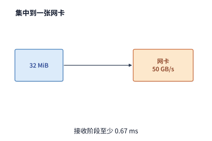

*图 7-10　单网卡热点接收瓶颈：当远端命中的专家全部集中在一张加速卡上时，32 MiB 的 dispatch 流量全部涌入单张 50 GB/s 网卡，接收耗时至少需要约 0.67 ms。*

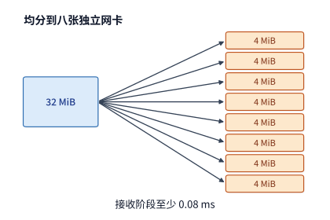

*图 7-11　八网卡均衡并行接收：当远端专家均匀分布在八张加速卡上时，八张独立的 50 GB/s 网卡各自仅接收 4 MiB，接收阶段大幅缩短至约 0.08 ms。*

将接收目标分散到多个物理端口之后，还必须沿着数据写入显存的路径继续向内追踪，检查各端口在机内是否共享上游总线接口。图 7-12 单独标出了对照配置中的 PCIe 插槽瓶颈：无论两个网络端口在网线上如何并行收包，32 MiB 载荷最终都必须穿过同一个 32 GB/s 的主机插槽。

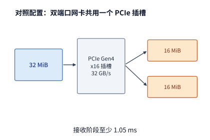

*图 7-12　共享主机插槽瓶颈：在对照配置中，双端口网卡的两个 25 GB/s 端口共用同一个 32 GB/s 的 PCIe Gen4 x16 插槽，导致 32 MiB 接收流量受限于插槽带宽，至少耗时约 1.05 ms（图 7-10 至图 7-12 均仅核算有效载荷的纯传输时间）。*

对比图 7-10 至图 7-12 可以看出，打散接收目标能够消除单张网卡端口的局部拥塞，但如果多张网卡（或多个端口）在机内共用更窄的上游接口，瓶颈就会转移到该公共接口上。一般地，在分析任意不规则的全互连（AllToAll）通信时，我们可以将从卡 $i$ 发往卡 $j$ 的数据量记为通信矩阵元素 $V_{ij}$：
- 对矩阵的第 $i$ 行求和 $\sum_j V_{ij}$，即为发送卡 $i$ 的总发送量；
- 对矩阵的第 $j$ 列求和 $\sum_i V_{ij}$，即为接收卡 $j$ 的总接收量；
- 对所有跨越某个物理割集 $\mathcal C$ 的矩阵元素求和 $\sum_{(i,j)\in\mathcal C} V_{ij}$，即为穿过该割集的总流量。
将上述各位置的累计字节数分别除以对应端口或割集的有效带宽，再取全网最大值，就将第 7.1.2 节的流量与资源模型自然推广到了动态不规则的 MoE 交换场景。

从通信矩阵 $V_{ij}$ 还能直接看出 dispatch 与 combine 两个阶段的热点对称性：如果每个 token 发往专家的激活与专家返回的结果字节数相同，且中途不做合并去重，那么 combine 阶段的流量矩阵恰好就是 dispatch 流量矩阵的转置 $V^{\top}$——**dispatch 阶段最拥塞的热点接收卡，在几百微秒后的 combine 阶段就会反转成为最拥塞的热点发送卡**。当然，往返总字节数对称并不意味着两阶段的实际耗时完全相等：combine 必须等待最慢的热点专家完成 FFN 矩阵计算后才能启动发送，且往返两个方向的数据精度（如 FP8 分发、BF16 合并）、链路争用状态与归约位置也可能不同。第 9.4 节将把这种动态流量倾斜与专家计算就绪时间结合起来做联合分析。

归纳起来，MoE 系统的专家放置与路由优化始终围绕两个相互关联的目标展开：一是提高本地命中率（降低跨机比例 $f$），二是将必须跨机的流量均匀打散到带宽尚有余量的网卡入口。为高频热门专家在多台服务器上冗余部署副本，是用额外的显存容量换取更低的跨机流量 $f$；而将发往同一张远端卡（或同一台远端服务器）上多个专家的重复 token 合并为单次传输，则是通过消除冗余副本直接削减跨界字节数。

### 7.2.4 多网卡

专家 dispatch 的分析揭示了接收端“多入口并行”的收益与“共享插槽”的上限；完全对称的逻辑也适用于发送端：在一台服务器上增加网卡（或端口）数量，只有当新增网卡确实拓宽了通往外部网络的物理割集、并且通信算法确实将待传数据均匀分配到了每张网卡上时，才能真正缩短跨机传输时间。第 7.2.1 节的连续环就是最典型的反例：尽管每台 HGX 服务器都配备了八张独立的 400 Gbit/s 网卡，但连续环拓扑在每一轮只让边界上的单张网卡（rank 7 与 rank 15）有数据可发，其余七张网卡全程空转；直到改用分层归约将 8 个分片分别绑定到八对参与者，才将全部八张网卡同时驱动起来，使跨服务器阶段的传输时间从 7.6 ms 骤降至约 0.5 ms。简言之，**物理上装了多张网卡并不等于实际用上了多张网卡，上层通信算法决定了每张网卡究竟能分到多少字节**。

对照配置则展示了主机接口共享带来的另一重限制。在该配置中，双端口 ConnectX-7 网卡的两个 200 Gbit/s（各 25 GB/s）端口共用一个单向 32 GB/s 的 PCIe Gen4 x16 插槽。当八个参与者执行 14 轮连续环 AllReduce 时：若仅启用网卡的单个端口（25 GB/s），总通信耗时约为 14.1 ms；若将每次跨机传输的数据切分为两半、通过多队列同时交由两个端口并行发出，跨机吞吐并不会达到两个端口的线速之和（50 GB/s，对应约 7.1 ms），而是受限于上游共享的 PCIe 插槽而停留在 32 GB/s，总耗时仅降至约 11.0 ms。哪怕进一步换用四端口的 ConnectX-7 网卡并同时启用三个乃至四个端口，只要它们底层仍然插在同一个 PCIe Gen4 x16 插槽上，这段跨机传输的耗时就无法再缩短分毫。一旦上游共享接口的带宽耗尽，继续增加下游网络端口将不再带来任何吞吐收益。[^nic-count]

在实际集群运行中，还会遇到第三种负载不均情形：某张 GPU 直连的本地网卡正处于满负荷发送状态（例如该卡恰好承载了热门专家），而同一台服务器上相邻 GPU 直连的网卡却处于空闲状态。此时，如果能够借助机内高达 450 GB/s 的高速 NVLink，先把一部分待发送数据转发给相邻 GPU，再借用相邻 GPU 的空闲网卡发往外部网络，就能突破单张直连网卡的出口瓶颈。OSDI 2025 发表的多网卡通信系统 **FuseLink** 正是采用了这一“机内中继借道”的思想：通过驱动层与运行时协同，将 GPU 显存中的网络通信缓冲区经由机内 NVLink 动态重映射到相邻的空闲网卡上，从而在不改动上层集合通信算法的前提下聚合多张网卡的空闲带宽。[^fuselink]

下面我们定量推导“直连发送”与“经相邻 GPU 中继”联合工作的有效带宽。设当前 GPU 直连网卡的单向带宽为 50 GB/s，机内有两张相邻 GPU 的空闲网卡可供借用（每张单向带宽亦为 50 GB/s，合计 100 GB/s），而当前 GPU 通往相邻 GPU 的机内 NVLink 可用单向带宽为 450 GB/s，数据路径如图 7-13 所示。

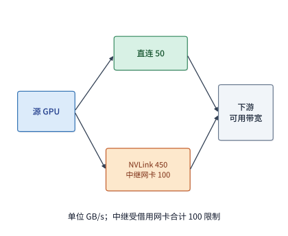

*图 7-13　经由机内 NVLink 借用相邻空闲网卡的中继路径。直连路径最多提供 50 GB/s 发送带宽；中继路径上的数据需先穿过 450 GB/s 的机内 NVLink 到达相邻 GPU，再经由两张合计 100 GB/s 的中继网卡发出。两路流量在外部交换网汇合后，最终还受限于下游网络割集与接收端可用带宽 $B_D$。*

顺着图 7-13 的分叉与汇合路径计算：直连路径与中继路径可以同时向外发送数据（二者带宽相加），但走中继路径的那部分数据必须依次穿过“机内 NVLink”与“相邻网卡”两段串联链路（二者带宽取最小值）。因此，发送端本地能够泵出的最大合成带宽为 $50+\min(450,100)=150\ \mathrm{GB/s}$。再设外部交换网络与远端接收方共同允许的下游接收带宽上限为 $B_D$（单位 GB/s），则端到端的实际有效发送带宽 $B_{\mathrm{eff}}$ 为

$$
B_{\mathrm{eff}}=\min\bigl(B_D,\ 50+\min(450,100)\bigr)\ \mathrm{GB/s}.
$$

由此可以直接看出不同网络条件下的收益边界：
- 当下游可用带宽 $B_D\le 50\ \mathrm{GB/s}$ 时，单张直连网卡本身就已经能够达到下游瓶颈上限，开启机内中继不会带来任何加速；
- 当 $50 < B_D < 150\ \mathrm{GB/s}$ 时，中继路径的有效收益随下游可用带宽线性增长；
- 当 $B_D \ge 150\ \mathrm{GB/s}$ 时，直连网卡与两张中继网卡全部达到满载，总吞吐稳定在 150 GB/s。
反之，如果此时机内 NVLink 正同时承担着繁重的本地张量并行归约流量，导致留给中继转发的 NVLink 剩余带宽跌破 100 GB/s，那么限制中继路径的短板就会从相邻网卡转移到机内 NVLink 上。以发送一份 1.125 GiB 的 KV 缓存载荷为例：仅靠单张 50 GB/s 直连网卡传输约需 24.2 ms；当下游支持 100 GB/s（借用一张相邻网卡）时缩短至 12.1 ms；当下游支持 150 GB/s（借用两张相邻网卡）时则进一步缩短至 8.1 ms。

需要说明的是，上述按字节带宽比例借用网卡的推导，隐含了一个前提：**单次传输的消息体积足够大，使网卡受限于比特率（bit rate）而非包处理率（packet/message rate）**。在 MoE 模型的自回归 decode 阶段，dispatch 和 combine 往往要求每张卡在极短时间内并发发出数千条细粒度小消息，此时还必须检验网卡硬件每秒最多能发起多少项通信请求——即第 7.3.4 节将要推导的事务发起速率上限 $1/\delta$。按第 7.3.4 节中 RoCE 可靠连接（RC）硬件实现的最小启动间隔 $\delta\approx 18.6\ \mathrm{ns}$ 计算，单张网卡每秒最多只能发起约 $1/(18.6\times 10^{-9})\approx 5400$ 万项请求；在单向 50 GB/s 的链路上，当单条消息大小低于临界值 $50\ \mathrm{GB/s}\times 18.6\ \mathrm{ns}\approx 0.93\ \mathrm{KB}$（931 B）时，网卡的请求发起速率就会先于物理链路带宽成为瓶颈。在 DeepSeek-V3 等主流 MoE 模型中，dispatch 发送的一条消息对应单个 token 的完整隐藏向量：当隐藏维度为 7168 时，FP8 格式单条消息约为 7 KiB，BF16 格式约为 14 KiB，二者均远高于 0.93 KB 的交叉点。因此，承载热门专家的加速卡最先耗尽的依然是网卡的字节带宽，按字节比例借用相邻网卡的分析完全成立；唯有当每次通信发送的是不足 1 KB 的极小控制报文或标量元数据时，网卡的事务发起速率才会率先触顶——第 9.4.2 节在讨论专家副本动态放置时，会将这种小报文场景下网卡的请求处理率也一并纳入资源预留约束。[^nic-rate]

归结起来，无论面对的是分层集合通信、MoE 专家动态分发，还是多网卡中继借道，底层的量化分析方法完全相通：**先画出数据流经的完整物理路径，再逐段统计每条链路与共享接口所需搬运的字节数（及请求次数），最后找出耗时最长的那道瓶颈**。

> **实验 7-5 · 核心：本地带宽与共享出口如何影响归约算法选择**
>
> 完整复算例题 7.2，再改用对照配置（每台四张 A100 80GB PCIe，卡间经 PCIe Gen4 点对点每方向 32 GB/s，双端口 ConnectX-7 的两个 25 GB/s 端口共用 32 GB/s 的 PCIe 插槽）重算连续环和分层归约。在对照配置下把本地带宽从 32 GB/s 提高到 NVLink 桥接器的 300 GB/s（设四张卡之间的每条边都有这样的带宽），解释为什么归约算法的选择会翻转，而在本章配置下不会。再将对照配置每台服务器使用的端口数从一个增为两个、三个，保持 32 GB/s 的插槽不变，画出归约时间随端口数变化的曲线，指出增加到多少个端口后，继续增加已无法缩短时间。

### 7.2.5 多轨拓扑

在第 7.2.1 节的分层归约中，两台服务器的八对参与者各自独占一条独立的 rail 并行通信。在现代大规模 GPU 集群（如 NVIDIA DGX SuperPOD 参考架构）中，计算网络普遍按照这种**多轨拓扑**（**rail-optimized topology**）进行工程布线：每台八卡服务器上的八张网卡分别接入八台不同的叶交换机——更准确地说，集群内所有服务器的第 $i$ 号网卡（$i\in\{0,\dots,7\}$）统一接入第 $i$ 号叶交换机，这台叶交换机连同挂载在它下面的所有同号网卡就构成了第 $i$ 条 **rail**（导轨）。在每 32 台服务器组成的同一个接入组（rail group）内部，位于同一条 rail 上的任意两张网卡之间只需经过该 rail 对应的叶交换机即可**一跳直达**（one-hop），完全无需上行穿越脊交换机；唯有跨越不同 rail（或跨越不同 32 机接入组）的流量，才必须上行经过脊交换机转发。[^rail] 前文图 7-1 中标注的“每条 rail 一台交换机”，指的正是这种多轨交换结构。

现在我们来检验分层归约在多轨拓扑上的物理路径：在跨服务器阶段，算法将服务器 A 的 rank $i$ 与服务器 B 的 rank $i+8$ 配对交换分片。由于 rank $i$ 使用服务器 A 的第 $i$ 号网卡，而 rank $i+8$ 恰好使用服务器 B 的第 $i$ 号网卡，这两张网卡在物理上挂载于同一台叶交换机（第 $i$ 号叶交换机）之下。因此，全部八对参与者的跨机归约流量都严格封闭在各自的 rail 内部，每一对都只需经过一台叶交换机一跳完成，没有任何一个字节会上行流入脊交换机。在此对齐状态下，每条 rail 每个方向承载 24 MiB 流量，2 轮跨机交换耗时 0.505 ms；相比之下，若将全部 192 MiB 流量挤在单张网卡上串行发送则需要 4.03 ms，八条 rail 对齐并发直接将耗时压缩到了约八分之一。[^rail] 图 7-14 上半部分展示了这种同轨对齐配对，下半部分则展示了错位配对导致的脊层绕行。

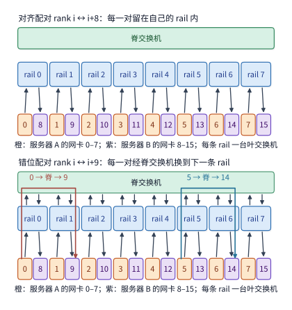

*图 7-14　多轨拓扑（rail-optimized）下对齐配对与错位配对的物理路径对比。图中将八条 rail 画作八条竖直车道，每条车道包含一台叶交换机及两台服务器上局部编号相同的网卡。上半图按 $\mathrm{rank}\ i$ 与 $\mathrm{rank}\ (i+8)$ 同号对齐配对，每对流量严格留在各自车道内，经叶交换机一跳直达；下半图按 $\mathrm{rank}\ i$ 与 $\mathrm{rank}\ (i+9)$ 错位配对，导致每一对流量都必须从第 $i$ 条 rail 上行穿过脊交换机才能切换到第 $(i+1)$ 条 rail，使每方向 192 MiB 流量全部涌入脊交换层。*

如果我们把跨机配对关系改为错位配对——即让服务器 A 的 rank $i$ 与服务器 B 的 rank $i+9$ 配对（最后一对为 rank 7 与 rank 8），情况会发生什么变化？此时，发送端 rank $i$ 依然从第 $i$ 条 rail 的叶交换机注入数据，但接收端对端却位于第 $(i+1)\bmod 8$ 条 rail 的叶交换机下。由于不同叶交换机之间没有直接连线，全部八对参与者的跨机流量都必须先进入第 $i$ 台叶交换机，再上行穿过脊交换机，最后下行进入第 $i+1$ 台叶交换机——八对流量无一例外，导致每个方向 192 MiB 的归约数据 100% 涌入了脊交换层。尽管在无阻塞且无其他作业干扰的理想情况下，每张网卡的发送量未变、跨机阶段的理论传输下界依然是 0.505 ms，但在真实数据中心里，这 192 MiB 跨轨流量不仅额外占用了宝贵的叶—脊上联割集带宽（在超售网络中会直接受限），还会与集群内其他作业的跨组流量发生激烈争用，并触发后文第 7.5.3 节将要分析的等价多路径（ECMP）哈希冲突。

由此可以提炼出多轨拓扑下的黄金法则：**跨机通信配对是否同轨对齐，完全取决于通信双方在各自服务器内部的局部卡号是否相同**——只要两端满足 $i \bmod 8$ 相等，流量就留在同一条 rail 内一跳完成；一旦局部卡号不等，流量就必须绕行脊层（在工程实现中，现代 NCCL 还引入了 **PXN**，即 PCIe-switched NVLink 转发机制：当发现跨机通信的目标网卡位于不同 rail 时，发送端 GPU 会先通过机内高速 NVLink 把数据转发给本机对应目标 rail 编号的辅助 GPU 及网卡，从而在机内完成“变轨”，避免流量进入外部交换网后跨脊绕行）。回头审视前文图 7-5 的交错环（Interleaved Ring）：它的 16 条有向边全部跨越服务器边界，其中从服务器 A 到服务器 B 的 8 条边（$i\to i+8$）局部卡号相同、属于同轨对齐，而从服务器 B 回到服务器 A 的 8 条边（$i+8\to (i+1)\bmod 8$）局部卡号错开了一位、全部属于跨轨通信，因此交错环有一半的跨机流量（2880 MiB）必须绕行脊交换机。

我们再将这条同轨对齐法则应用到后文第 7.6.4 节的 128 卡超节点训练算例中。设一个 128 卡超节点由 16 台八卡服务器组成，每个八卡张量并行组（TP8）恰好占满一台服务器的八张卡，那么在任意一台服务器内部，张量并行局部坐标为 $t\in\{0,\dots,7\}$ 的加速卡永远是该服务器的第 $t$ 号卡、固定连接在第 $t$ 条 rail 上。当位于同一张量并行坐标 $t$ 上的 16 个数据并行副本先在超节点内部完成 ReduceScatter 预归约后，紧接着在超节点之间做跨节点交换的，依然是同属于坐标 $t$ 的参与者——它们在各自服务器内全部都是第 $t$ 号卡、全部走第 $t$ 条 rail。由于八个张量并行坐标持有的梯度分片大小完全相等（每卡初始分片均为 $G=8\ \mathrm{GB}$），超节点对外发出的 112 GB 跨节点流量会完全均匀地平摊在八条 rail 上（每条 rail 精确承载 $112/8=14\ \mathrm{GB}$），没有任何一条 rail 会成为局部热点。唯有当模型各层张量切分不均匀，或者某张网卡发生硬件故障、迫使其流量通过第 7.2.4 节的机内 NVLink 借道相邻网卡时，八条 rail 之间的完美负载均衡才会被打破。

> **实验 7-6 · 延伸：rail 对齐与脊层流量**
>
> 在两台服务器上把配对改为 rank $i$ 与 rank $((i+4)\bmod 8)+8$，求经过脊层的字节数。再让服务器 B 的网卡 3 故障，rank 11 的流量经 NVLink 借用网卡 2 和网卡 4 各一半，求各条 rail 承载的字节与跨服务器阶段的时间。最后在第 7.6.4 节的 128 卡超节点里改用 TP16（一组跨两台服务器），说明每条 rail 承载哪些坐标的分片、负载是否仍然均匀。

## 7.3 远程访问的路径与并发

### 7.3.1 数据传输与完成通知

第 7.2 节从宏观上核算了多少字节流经哪些物理链路以及需要传输多久，但尚未触及微观机制：**两台服务器上的加速卡究竟是如何完成一次数据交接的？** 以分层归约的跨服务器阶段为例，服务器 A 上的卡 0 已经在本地算好了 12 MiB 的部分归约分片，需要将它移交给服务器 B 上的卡 8 继续累加。在底层系统看来，一次完整的数据交接必须包含两项性质不同的动作：第一是**数据载荷搬移**（把这 12 MiB 字节写入卡 8 能够读取的显存地址），第二是**控制就绪通知**（让卡 8 确切知道这批数据已经全部落盘且可以安全读取）。前者改变的是数据在物理空间中的存储位置，后者传递的则是触发下游计算开始的时间信号。

围绕这两项动作如何配合，网络通信发展出了三类基本交互原语：
1. **单边远程内存读写（One-Sided RDMA Read/Write）**：正如第 6.5.5 节所介绍的，发起方在事先获得远端内存区域（Memory Region）访问授权的前提下，可以在指令或请求中直接指定远端虚拟地址发起读写。例如卡 0 直接将分片写入卡 8 预留的接收缓冲区：发起端网卡通过 DMA 从卡 0 显存读出数据并封装发包，目标端网卡收到报文后直接通过 DMA 将载荷静默写入卡 8 的显存，全程无需卡 8 所在的远端应用程序（或 CPU）介入数据搬移。
2. **双边消息传递（Two-Sided Send/Receive）**：要求发送方与接收方显式配对。接收方必须预先向网卡队列提交一个带有本地缓冲区地址的接收请求（Receive WQE），发送方再提交发送请求（Send WQE）；当报文到达目标网卡时，硬件按队列顺序将收到的消息填入预先挂载的接收缓冲区，并生成一条完成通知（CQE）。在工程实践中，目标地址已知的大块张量分片非常适合用单边 Write 直接写入，而来自多个不同发送方的轻量级就绪信号则适合投递到双边消息队列中，由完成队列统一区分消息来源并唤醒对应的数据使用方（下文统称为**消费者**）。
3. **写带立即数（RDMA Write with Immediate Data）与融合交接**：既然大块数据适合单边直写、就绪信号适合队列通知，将二者结合便形成了高效分工——先用单边 Write 推送分片数据，再发一条短消息通知对端数据就绪；如果底层协议支持在单边 Write 报文的尾部附带一个 32 位立即数（Immediate Data）并在目标端自动产生一条完成队列通知，还能把“数据写入”和“就绪通知”合并为单次请求提交，省去额外发起一次通知消息的开销。消费者轮询到该完成通知后即可启动归约计算（关于数据写入与就绪通知在网络乱序下的严格先后顺序保证，将在第 7.4 节深入展开）。

单边读写与双边消息解决的是“把数据送到指定位置并通知对端”；如果发起方还要求远端节点按照指定的函数逻辑立即处理这批数据并返回结果，就会采用更高层的**远程过程调用（RPC）**原语。一次完整的 RPC 调用串联了“客户端序列化参数 → 网络请求传输 → 服务端反序列化并执行函数 → 网络响应返回”五个环节。在这一链条中，参数序列化（编码）方式往往会成为意想不到的性能黑洞。例如，Web 服务常用的 JSON 属于纯文本数据交换格式，无法直接嵌入原始二进制浮点数组；若采用 Base64 编码将二进制张量转为文本字符串，每 3 个原始二进制字节都会被膨胀编码为 4 个 ASCII 字符，这意味着传输一份 1 MiB 的二进制张量，仅 Base64 文本编码就会让网络载荷凭空增加约三分之一（膨胀至约 1.33 MiB），同时还要消耗大量 CPU 周期做字符转换。若直接改用紧凑的二进制 RPC 协议（如 Protobuf 加原始字节流，或零拷贝 RDMA 张量传输），就能同时削减网络传输字节数与两端 CPU 的编码/解码工作量。

在本书配套的一组跨主机 RPC 实测实验中，将 1 MiB 张量载荷从 JSON+Base64 编码改为直接二进制传输后，网络请求体积从约 1.33 MiB 降至 1.00 MiB，客户端 CPU 的序列化处理时间中位数更是从约 9.8 ms 骤降至 1.1 ms（节省了近 90% 的 CPU 时间）。不过，在 20 对成对端到端调用测量中，仅有 11 对调用的总完成时间显著变快，原因是跨主机网络传输与 SSH 转发等待的抖动幅度超过了本地 CPU 节省的毫秒数。[^rpc] 这组实测数据清晰地提醒我们区分两类开销：去掉冗余编码能够直接降低本地 CPU 处理耗时，但要想稳定缩短整个远程调用的端到端时间，还必须一并排查并消除网络链路、中间转发与远端排队中的等待。

> **实验 7-7 · 延伸：去掉编码转换能缩短多少远程调用时间**
>
> 从配套记录选取同一载荷的成对调用，画出客户端编码、发送、等待、解码和服务端执行的时间线。解释为什么服务端的执行时间已经包含在客户端的等待时间中。计算省去 base64 编码后减少的传输字节数，并分析编码耗时占比如何影响完整调用的加速收益。

### 7.3.2 由产生数据的加速器直接发起通信

第 7.3.1 节从接收端的视角区分了单边读写、双边消息与 RPC；现在我们切换到发送端视角，追问另一个直接决定启动延迟 $\alpha$ 的核心问题：**当一份数据在 GPU 上计算完成时，究竟是谁最先感知到数据就绪，又是谁负责向网卡下发通信请求？**

在分层归约算例中，卡 0 的梯度分片是由 GPU 上的流多处理器（SM）算出来的。在传统的以主机为中心（CPU-centric）的通信模式中，GPU 算完分片后无法自己操作网卡，必须先通过 PCIe 向主机 CPU 发出内核完成信号（或由 CPU 轮询 CUDA Event）；主机 CPU 收到信号后，在主存中构造网卡工作队列描述符（WQE）并通过写 PCIe 门铃（doorbell）寄存器通知网卡发送；等远端传输完成后，再由 CPU 轮询网卡完成队列（CQ），最后通知 GPU 启动下一步计算。不难看出，哪怕数据载荷本身没有经过主机内存，光是这条“GPU → CPU → 网卡 → CPU → GPU”的控制路径就要在慢速 PCIe 总线上来回交接多次，每一次跨设备交接都会叠加上百纳秒乃至数微秒的固定启动延迟。

为了消除冗余的数据与控制中转，硬件与系统软件沿着“先解放数据通路、再解放控制通路”的脉络演进了四个阶段（图 7-15 至图 7-18）：
1. **传统主机 RPC / Socket 通路（图 7-15）**：数据载荷与控制信令全部经由主机 CPU 与主存中转，既有多次内存拷贝，又有冗长的系统调用开销。
2. **CPU 提交的 GPUDirect RDMA（图 7-16）**：标准 RDMA 网卡支持直接读写预先注册的远端内存，而 NVIDIA 的 **GPUDirect RDMA** 技术进一步建立了网卡与 GPU 显存之间的 P2P PCIe 通路，允许网卡 DMA 引擎直接从已注册的本地 GPU 显存读取数据并直写远端 GPU 显存，数据载荷彻底绕开了主机 CPU 内存。然而在这一模式下，通信请求的提交（写门铃）与完成轮询仍然由主机 CPU 代理（CPU proxy）负责。
3. **加速器直接发起通信（GPU-Initiated Communication，图 7-17 与图 7-18）**：为了把 CPU 从高频通信的控制环路中也彻底解放出来，现代互联架构允许产生数据的加速器自己直接构造并触发通信请求、自己轮询完成状态，真正做到“数据在 SM 上一算完，通信指令立刻就地发出”。例如，在机内超节点中，GPU 核函数可以直接通过 NVLink 对远端 GPU 显存发起读写指令（图 7-17）；在跨节点网络中，NVIDIA 的 **IBGDA**（InfiniBand GPUDirect Async，被 DeepEP 等高性能 MoE 通信库广泛采用）允许 GPU 线程在核函数内直接向网卡工作队列写入描述符并敲击门铃，而灵衢（UB）提供的统一远程内存访问接口 **URMA** 则进一步在硬件层面允许设备直接提交异步读写请求（图 7-18）。顺着图 7-15 至图 7-18 中的实线（数据载荷通路）与虚线（控制提交通路）对比演进轨迹，可以清晰区分“数据搬移开销”与“请求管理开销”是如何被逐一剥离的。

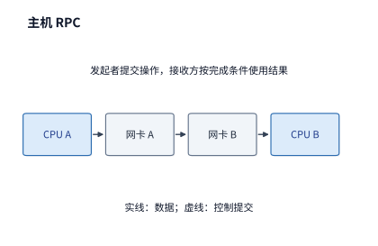

*图 7-15　主机 RPC 通路：请求参数从主机 CPU A 的主存出发，经本地网卡与交换网络到达主机 CPU B 的主存，由远端 CPU 执行函数后沿反方向返回结果，数据与控制均经由主机中转。*

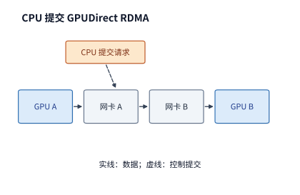

*图 7-16　CPU 提交的 GPUDirect RDMA 通路：预先建立地址映射与访问权限后，数据载荷（实线）直接从发起端 GPU 显存经网卡直达远端 GPU 显存，无需经过主机内存；但通信请求的提交与完成轮询（虚线）仍由主机 CPU 代理。*

当数据通路绕开主机内存之后，下一步自然就是让控制通路也绕开主机 CPU。在图 7-17 中，GPU 核函数直接通过 NVLink 发起对端显存访问，彻底省去了每次通信都向 CPU 报备的跨设备交接。

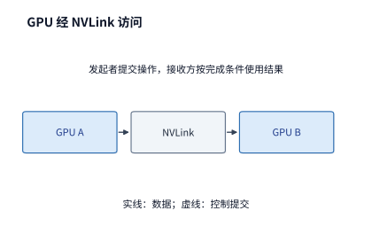

*图 7-17　GPU 经 NVLink 直接发起访问：由产生数据的发起端 GPU 直接在核函数内执行已授权的远端 GPU 显存访问，控制与数据均无需主机 CPU 介入。*

图 7-18 将同样的“设备直接发起与完成确认”机制推广到了灵衢（UB）的 URMA 异步访问接口上：沿着实线追踪数据载荷、沿着虚线追踪提交与完成事件，即可把底层链路的数据传输耗时与上层接口的请求管理耗时清晰解耦。

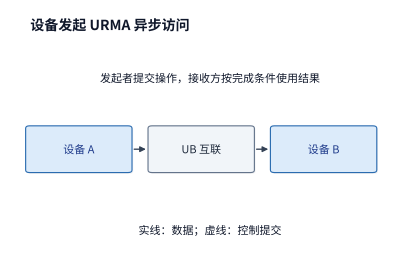

*图 7-18　设备直接发起的 URMA 异步访问：加速设备直接通过 URMA 接口向互联控制器提交异步读写请求，数据载荷经 UB 网络直达目标设备显存；操作完成后，由设备按接口约定直接检查完成状态。*

这种控制路径的缩短究竟能带来多大收益？我们可以直接代入第 7.2.2 节的传输时间公式 $T_{\mathrm{msg}}=\alpha+M/B$ 进行定量核算：在单向 $B=50\ \mathrm{GB/s}$ 的网卡链路上，传输一份 8 KiB 的 decode 激活张量，纯数据传输耗时仅需 $8\ \mathrm{KiB}/(50\ \mathrm{GB/s})\approx 0.16\ \mu\mathrm{s}$；如果通过让加速器直接发起通信，将单次通信的固定启动开销 $\alpha$ 从 5 μs 压缩至 2 μs，那么端到端单次通信耗时就会从约 5.2 μs 直接降至 2.2 μs，降幅超过一半。反之，如果传输的是 64 MiB 的大块 prefill 张量，由于纯传输耗时本身高达约 1.3 ms，同样省下的这 3 μs 启动开销在总时间中占比不足 0.3%，几乎难以察觉。这一鲜明对比再次印证了一条核心工程准则：**面对高频小数据量通信（如 decode 阶段的 TP/EP 同步），系统优化的当务之急是缩短请求提交与完成确认的控制路径（削减 $\alpha$）；而面对低频大数据量通信（如 prefill 或 DP 大梯度同步），优化的重心则应放在拓宽物理链路带宽与减少跨界字节数（削减 $M/B$）**。

从操作系统与硬件架构的分工来看，传统的“主机 CPU 统一代管通信”模式用于为任意不可信的通用应用程序提供安全的权限检查与多路复用；而在大模型训练与推理系统中，计算图内部的数据生产者、消费者、缓冲区大小与就绪依赖在编译或初始化阶段就已经完全确定。因此，现代 AI 基础设施普遍采用**控制面与数据面分离**的架构：由主机操作系统在初始化阶段（慢路径）预先建立跨节点虚拟地址映射、完成权限认证并分配队列资源；一旦进入迭代执行阶段（快路径），则交由加速设备在已授权的地址空间内直接、连续地发起计算与通信指令，不再每次绕道主机内核。

当发起通信的职责下放到加速设备侧之后，设备侧负责提交请求的硬件单元（或专用通信线程/warp）自身的发射速率与管理槽位，又会成为新的吞吐边界。要定量刻画这一边界，我们必须先厘清“单次远程访问在硬件上究竟要等待多久”以及“在等待结果返回期间硬件还能并发发出多少个独立请求”，这正是接下来第 7.3.3 节与第 7.3.4 节要深入剖析的主题。

### 7.3.3 内存语义：Load／Store 与 Read／Write

要算清单次远程访问的等待时间与并发能力，首先要区分硬件与运行时表达远程内存访问的两种范式：**处理器原生的加载／存储指令（Load／Store）**，以及**显式的异步读取／写入请求（Read／Write）**。只要数据需要跨芯片或跨节点传输，硬件或软件就必须追踪那些“已经发出但尚未返回结果”的在途请求；两种范式的核心分界，正在于**由谁来维护在途请求的状态与数据依赖**。

在同步的 Load／Store 范式下，Load 指令的返回值直接绑定到目标寄存器，成为后续算术指令的输入操作数。现代处理器（CPU 或 GPU SM）会通过硬件记分牌（scoreboard）或未命中状态保持寄存器（MSHR）自动追踪这条数据依赖：在远端数据尚未返回期间，硬件调度器会自动挂起依赖该结果的指令，转而发射其他互不依赖的就绪指令或切换到其他活跃 warp。需要说明的是，本书将 Load／Store 归类为“同步访问接口”，意在强调**数据依赖的检查与阻塞由处理器硬件在指令粒度自动完成**，绝非意味着整个处理器每次只能维持一个在途访存——现代乱序执行核心或海量线程 GPU 完全可以同时并发发出数十乃至上百个独立的 Load 请求，Store 指令也可先写入写合并缓冲区（Write Combining Buffer）后立即继续执行。

而在异步的 Read／Write 范式下，软件或加速核会显式构造包含源地址、目的地址、字节长度与完成通知方式的请求描述符（WQE），并将其推入发送队列；调用方可以一次性连续提交几十项搬移任务，随后继续执行本地计算，直到真正需要消费远端数据或复用缓冲区之前，再去轮询完成队列（CQ）或等待内存标志位就绪。简言之，**Load／Store 把在途依赖管理交给了处理器微架构，而异步 Read／Write 则把依赖管理与流水线编排交给了运行时软件**。下表从五个工程维度总结了这两类内存访问接口的差异：

| 比较维度 | 同步 Load／Store 指令 | 异步 Read／Write 请求 |
|---|---|---|
| 发起方式与硬件路径 | 由处理器或加速核直接执行内存指令，经统一物理/虚拟地址空间映射直达远端内存；在灵衢（UB）架构中可由片上互联控制器直接承接 | 由主机或设备构造包含地址与长度的请求描述符，经发送队列、门铃寄存器或设备直接发起接口（如 IBGDA／URMA）交由 DMA 引擎异步推进 |
| 依赖追踪与完成确认 | 处理器硬件自动阻塞依赖 Load 结果的后续指令；Store 指令的远端可见性与顺序则需显式配合内存屏障（fence）保证 | 运行时软件或加速核按约定轮询完成队列（CQ）或内存完成标志位，确认操作完成后再消费数据或回收缓冲区 |
| 典型适用场景 | 细粒度元数据读取、稀疏指针跳转、控制标志位轮询，以及访问极频繁且对单次提交开销高度敏感的小载荷操作 | 激活张量、KV 缓存块、专家权重等大块连续或步进数据的批量搬移，以及计算与通信显式重叠的多级软件流水线 |
| 并发度受限因素 | 线程内指令级并行度（ILP）、活跃 warp 数量、硬件未完成访存槽位（如 MSHR）上限及地址转换（TLB）容量 | 发送队列（SQ）与完成队列（CQ）深度、已注册/映射内存额度，以及软件或设备端发射单元的请求提交速率 |
| 异常与故障恢复 | 触发处理器硬件级的总线超时、页错误或机器检查异常（Machine Check Exception），应用层通常难以按单条指令做细粒度重试 | 可在完成队列中按单条请求独立报告状态码与错误类型；但运行时仍须自行处理超时重传、部分写入清理与缓冲区安全回收 |

尽管这两种接口都以“读写远端内存地址”的形式呈现（即都采用内存语义），但在系统设计中切忌望文生义地将“内存语义”等同于“跨节点硬件缓存一致性（Cache Coherency）”。单边异步 Read／Write 虽然免去了远端 CPU 逐次挂载接收缓冲区（Receive WQE）的配对开销，但依然要求通信双方事先交换访问密钥并严格管理目标内存的生命周期；同理，支持跨节点 Load／Store 指令也并不意味着远端节点修改内存后本地缓存行会自动失效。例如，在 OpenURMA 实现的跨节点 Load／Store 路径中，硬件并不维护跨节点的目录式缓存一致性协议，生产者写入数据、发布就绪标志与消费者读取数据之间的先后可见性完全由应用程序通过显式同步原语来编排。Load／Store 路径之所以能大幅削减访问延迟，根源在于**互联控制器被移到了片上总线、且处理器指令直接省去了软件队列与门铃交互**；倘若硬件底层的控制器位置与 PCIe 路径丝毫未变，仅仅在软件库表面把异步读取函数重命名为 `load()`，是绝无可能获得同等延迟收益的。[^ub-design]

**一次 64 B 远程读取的关键路径延迟拆解。** 为了看清硬件拓扑与接口抽象究竟把时间花在了哪里，不妨将一次 64 B 小载荷远程读取的关键路径拆解到纳秒级的各个微阶段，逐一核算出端到端总延迟。我们重点对比三条典型硬件路径：
1. **经 PCIe 外设网卡的异步读取**（传统 RoCE/IB 模式）；
2. **经片上总线控制器的异步读取**（灵衢 UB 的 URMA 异步接口）；
3. **经片上总线控制器的原生 Load 指令**（灵衢 UB 的同步 Load 路径）。

统一给定如下硬件与物理链路基准参数：单次片上总线穿越耗时 30 ns；单次 PCIe 门铃寄存器写入耗时 150 ns，单次 PCIe DMA 内存读取耗时 500 ns、DMA 内存写入耗时 250 ns；物理光纤或铜缆的单程传输时延为 100 ns；目标端内存访问命中已打开的 DRAM 行缓冲区（Row Buffer Hit）耗时 30 ns；互联控制器的发送与接收协议流水线按 322 MHz 工作时钟换算——传统外设网卡单次穿越需 9 个周期（约 28 ns），UB 异步路径需 25 个周期（约 78 ns），UB Load 路径需 8 个周期（约 25 ns）；此外，软件接口库函数调用、请求描述符构造与完成队列轮询均计入软件与内存完成开销。下表按请求从发起、去程、目标端访存、回程到完成确认的先后时序，完整列出了三条路径在每一阶段的耗时（单位：ns，空格表示该路径无需经历对应阶段）：

| 关键路径阶段 | 所属开销类别 | PCIe 外设网卡（ns） | UB 异步读取（ns） | UB Load（ns） |
|---|---|---:|---:|---:|
| 接口库提交调用 | 软件提交 | 50 | 50 | |
| 构造请求描述符 | 软件提交 | 30 | 30 | |
| 门铃寄存器写入 | PCIe 穿越 | 150 | | |
| 网卡 DMA 读取描述符 | PCIe 穿越 | 500 | | |
| 片上总线请求提交 | 片上总线 | | 30 | 30 |
| 发送端网卡流水线 | 网卡流水线 | 28 | 78 | 25 |
| 物理线路去程传播 | 线路 | 100 | 100 | 100 |
| 目标端网卡接收流水线 | 网卡流水线 | 28 | 78 | 25 |
| 目标端网卡 DMA 读主机内存 | PCIe 穿越 | 500 | | |
| 目标端片上总线访存 | 片上总线 | | 30 | 30 |
| 目标端内存行命中读取 | 内存与完成 | 30 | 30 | 30 |
| 目标端网卡发送响应流水线 | 网卡流水线 | 28 | 78 | 25 |
| 物理线路回程传播 | 线路 | 100 | 100 | 100 |
| 发起端网卡接收响应流水线 | 网卡流水线 | 28 | 78 | 25 |
| 响应载荷 DMA 写回内存 | PCIe 穿越 | 250 | | |
| 完成记录（CQE）DMA 写回 | PCIe 穿越 | 250 | | |
| 片上总线返回完成数据 | 片上总线 | | 30 | 30 |
| 完成队列硬件/缓存轮询 | 内存与完成 | 70 | 5 | |
| 接口库返回轮询结果 | 内存与完成 | 30 | 30 | |
| 连接序号分配串行化开销 | 内存与完成 | 50 | | |
| **理论推导合计** | | **2222** | **746** | **419** |
| **周期级仿真测得** | | **2236** | **757** | **500** |

（注：表中“网卡流水线”各栏显示的是四舍五入后的整数纳秒值，而“理论推导合计”则是按取整前的精确时钟周期耗时累加后取整所得。）对比表中的合计行可以清晰看到：经由 PCIe 外设网卡的传统路径总延迟高达 2222 ns，其中仅**五次跨 PCIe 总线穿越**（门铃写 150 ns + 读描述符 500 ns + 目标端读内存 500 ns + 写回载荷 250 ns + 写回完成记录 250 ns）就占去了 **1650 ns**，占总延迟的近四分之三；将互联控制器移至片上总线后，UB 异步路径彻底消除了 PCIe 穿越，总延迟骤降至 746 ns；而进一步改用处理器原生 UB Load 指令后，连软件构造描述符与轮询完成队列的开销也一并省去，总延迟进一步压缩至 **419 ns**。图 7-19 将这三条路径按开销类别绘制成了直观的堆叠条形图。笔者的 OpenURMA 实现在两节点周期级硬件仿真器中、采用完全相同的物理参数实测得到的端到端延迟分别为 2236 ns、757 ns 和 500 ns，与理论推导值仅相差 14 ns、11 ns 和 81 ns。这点微小差值源于仿真器在跨模块传递事务时的固定框架开销；由于 UB Load 路径历经的硬件阶段最少、基数最短，这项仿真框架固定开销所占的相对比例看起来也就最明显。[^ub-fabric]

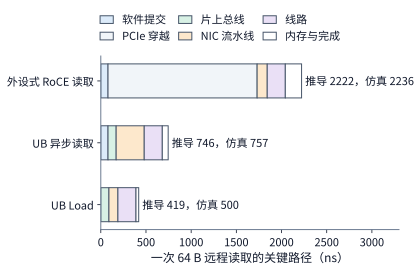

*图 7-19　一次 64 B 远程读取在三条硬件路径上的关键阶段耗时堆叠对比：经 PCIe 外设网卡的路径中，浅灰色区块代表的五次 PCIe 穿越就占去了 1650 ns；两条片上总线路径消除了 PCIe 穿越，而 UB Load 路径还进一步省去了软件提交与完成轮询。条形右侧同时标出了理论推导值与周期级仿真值。*

深入审视这张拆解表就会发现，PCIe 外设网卡路径之所以多出九个耗时环节，绝非因为工程师在九处代码里写出了低效实现，而是由**三项根本性的体系结构边界**决定的：
1. **软件队列抽象边界**：异步请求必须先由软件在主机内存中格式化为描述符，再交由硬件读取，这就必然引入“接口库提交”与“构造请求描述符”两道软件工序；
2. **外设地址空间隔离边界**：PCIe 网卡与主处理器分属不同的独立设备域，控制信号与数据载荷每次跨界都必须封装为 PCIe 事务层报文（TLP），由此衍生出“门铃写”“网卡 DMA 读描述符”以及“目标端网卡 DMA 读内存”三次昂贵的跨总线事务；
3. **跨界完成通知边界**：外设完成传输后，必须再次跨越 PCIe 总线把数据与状态通知给处理器，从而带来“响应载荷 DMA 写”“完成记录 DMA 写”以及软件侧的两次完成轮询。

一旦将互联控制器直接集成到处理器的片上一致性总线上，第二类跨外设域的五次 PCIe 穿越便自然坍缩为三次极轻量的片上总线握手（合计仅 90 ns）；而当编程接口进一步切换为同步 Load 指令时，处理器硬件自带的寄存器记分牌直接接管了完成同步，第一类软件构造描述符与第三类完成队列轮询也随之彻底消失。

沿着这一分析框架，我们还可以立即推演出第四种工程架构——即第 6.4.4 节讨论过的**智能网卡（SmartNIC／DPU）片上处理器代管发起模式**：网卡依然挂载在 PCIe 总线上，但请求描述符改由网卡内部嵌设的处理器核直接生成并提交给同芯片的发送引擎。对照上表做加减法即可算出：该方案省去了主机到网卡的“门铃写（150 ns）”和“网卡 DMA 读取描述符（500 ns）”两次 PCIe 穿越，共节省 650 ns；软件提交与构造描述符的 80 ns 转移到了网卡内部处理器上执行（按相同耗时计）；但由于最终的数据载荷与完成通知依然要写回主机或 GPU 显存，目标端 DMA 读（500 ns）、发起端响应载荷 DMA 写（250 ns）与完成记录 DMA 写（250 ns）这三次跨界依然无法省去。如此累加，第四条路径的理论延迟约为 $2222 - 650 = 1572\ \mathrm{ns}$，恰好落在传统 PCIe 外设网卡（2222 ns）与片上总线异步路径（746 ns）之间。这一推演清晰地揭示了：**在网卡内嵌处理器只能省去控制面下发阶段的跨界开销，却无法消除数据面写回与完成通知阶段跨越地址空间的物理成本**。

如果把两节点之间的物理距离拉长，这三条路径的优劣对比又会发生怎样的演变？由于物理线路的单程传播时延 $L$ 在去程（请求）与回程（响应）中各出现一次，任意路径的单次读取总延迟都可以写成“节点内固定开销 + $2L$”的线性形式：
- **PCIe 外设网卡**：$T_{\mathrm{PCIe}}(L) = 2022\ \mathrm{ns} + 2L$；
- **UB 异步读取**：$T_{\mathrm{UB\text{-}async}}(L) = 546\ \mathrm{ns} + 2L$；
- **UB Load 指令**：$T_{\mathrm{UB\text{-}load}}(L) = 219\ \mathrm{ns} + 2L$。

图 7-20 绘制了单程线路时延 $L$ 从 50 ns（机柜内短距铜缆/光纤）延伸至 500 ns（跨数据中心机房长距光纤，约合 100 米光纤加多级光模块与交换转发）时的总耗时曲线：三条直线的斜率均为 2，彼此之间的**绝对延迟差值**始终恒定（UB Load 比 PCIe 外设网卡固定快约 $1.8\ \mu\mathrm{s}$）；但两者的**相对加速比**却随着距离拉长而逐渐稀释——从 $L=100\ \mathrm{ns}$ 时的 $2222 / 419 \approx 5.3$ 倍，收敛到 $L=500\ \mathrm{ns}$ 时的 $3022 / 1219 \approx 2.5$ 倍。这一几何特征蕴含着深刻的架构启示：物理距离越短，控制器集成位置与接口精简所带来的相对性能收益就越显著，因此在几十米以内的**超节点（SuperPod）内部**，采用片上总线互联与原生 Load／Store 语义最具性价比；而在跨越数百米的数据中心长距链路上，光速限制下的物理传播时延 $2L$ 逐渐占据主导地位。这两部分耗时在物理学上具有截然不同的性质：$2L$ 受制于电磁波在介质中的传播速度，属于任何软件或微架构都无法逾越的物理底线；而直线截距中高出 219 ns 的那部分（尤其是 1650 ns 的五次 PCIe 穿越），则是分层硬件接口与外设总线强加的“抽象税”。至于前文理论推导值与仿真值之间仅存的 14 ns、11 ns 和 81 ns 偏差，则正是第 1.3.4 节所剖析的第一类模型误差——只要把仿真器跨模块传递事件的固定开销补入模型，理论值便与实测严丝合缝，无需再去怀疑硬件流水线本身存在未知的性能黑洞。

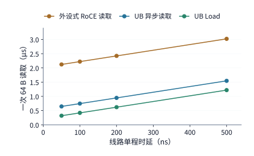

*图 7-20　单次 64 B 远程读取总耗时随物理线路单程时延 $L$ 的变化曲线：三条直线的斜率均为 2（对应一去一回两次线路传播），纵轴截距则代表各自的节点内固定开销；不同架构之间的绝对延迟差距完全由节点内固定开销决定，不随线路拉长而改变。*

看清了单次远程访问的延迟构成后，我们再来考察**多个请求之间的并发关系与数据局部性复用**。需要明确的是，“能否并发发出多个请求”取决于请求之间的地址依赖关系（无论采用 Load／Store 还是异步 Read／Write 均适用）；而“每次按需远程读取还是预先整块搬回本地显存复用”，则是更高一层的**数据放置与缓存策略选择**——按需远程读取既可以用 Load 指令实现，也可以用细粒度异步 Read 实现，切勿将“访问粒度/复用策略”与“同步/异步接口形式”混为一谈。

先看**请求间的并发与指针依赖**。假设程序需要从远端节点读取 8 个 64 B 的数据块，且底层硬件支持至少 8 个请求同时在途，单次经 PCIe 网卡的远程读取延迟仍按约 $2.2\ \mu\mathrm{s}$ 计（已含软件提交开销）。如果这 8 个读取请求的目标地址在发起前均已确知、彼此毫无依赖：
- 若采用串行的“发出一个 $\to$ 等待返回 $\to$ 再发下一个”方式，总耗时高达 $8 \times 2.222 \approx 17.8\ \mu\mathrm{s}$；
- 若将 8 个独立请求一次性连续发出，让它们在网络与目标端流水线上并行推进，则大约只需等待一个往返周期（约 $2.2\ \mu\mathrm{s}$ 加极短的连续发射间隔），8 份结果便会先后抵达。

然而，假如这 8 次访问构成一条**指针追逐链（Pointer Chasing，例如遍历远端链式哈希表或树结构）**——即第 1 次读取返回的数据内容本身，恰恰是第 2 次读取所需的目标内存地址，第 2 次返回的数据又是第 3 次的地址——那么即便底层硬件拥有再多的并发槽位，程序也只能被迫等上一次读取结果跨网返回后，才能算出下一次读取的地址并提交请求，端到端耗时将不可避免地退化回 $17.8\ \mu\mathrm{s}$。因此，**系统实际能够发挥出多高的访存并发度，首先受制于算法数据结构中“地址已知且互不依赖的就绪请求数量”**。

如果多次访问之间不存在地址相互阻塞，而是**反复读取远端同一份只读数据对象**，我们就有了除并发之外的另一项关键手段——**本地暂存与数据复用（Staging & Reuse）**。设想在长上下文多轮对话或多分支采样（如 Best-of-$N$ 推理）场景中，某个计算节点需要反复完整扫描一份存放在远端内存池中、大小为 144 MiB 的只读 KV 缓存快照，且本地 GPU 显存拥有充裕的空闲空间可容纳该副本。我们沿用本章的硬件基准参数：网卡单向有效带宽为 $50\ \mathrm{GB/s}$，本地 GPU（以 H100 为例）的 HBM 显存带宽为 $3350\ \mathrm{GB/s}$。计入请求启动与目标端写入开销后：
- 若采用**按需远程读取（Direct Remote Read）**，每次直接跨网卡流式读取这 144 MiB 快照，单次耗时约为 $3.02\ \mathrm{ms}$；
- 若采用**预先搬回本地再复用（Local Staging）**，首次将 144 MiB 快照完整拉取并写入本地 HBM 的固定搬移成本约为 $3.07\ \mathrm{ms}$；但在此之后，每一次在本地 HBM 上扫描该副本仅需约 $0.046\ \mathrm{ms}$。[^remote]

设该快照在整个任务周期内被完整读取的复用次数为 $r$，则两种策略的累计耗时分别为：

$$
T_{\mathrm{remote}}(r) = 3.02r\ \mathrm{ms},\qquad
T_{\mathrm{stage}}(r) = (3.07 + 0.046r)\ \mathrm{ms}.
$$

令 $T_{\mathrm{stage}}(r) < T_{\mathrm{remote}}(r)$，即可解出预先搬回本地更划算的盈亏平衡点：

$$
r > \frac{3.07}{3.02 - 0.046} \approx 1.03.
$$

这意味着，只要这份快照会被完整读取 **2 次或以上**（$r \ge 2$），预先搬回本地就全面胜出：当只使用 1 次（$r=1$）时，直接流式远程读取因省去了本地落盘再读出的二次访存，略快一筹（$3.02\ \mathrm{ms}$ 对 $3.12\ \mathrm{ms}$）；而当复用达到 4 次（$r=4$）时，先搬回本地可将累计耗时从约 $12.1\ \mathrm{ms}$ 大幅压缩至 $3.3\ \mathrm{ms}$，同时跨机网络的总传输字节数也从 $576\ \mathrm{MiB}$ 降至 $144\ \mathrm{MiB}$。图 7-21 对比了这两种使用路径的数据流向，图 7-22 则直观标出了两条累计耗时直线的交点。

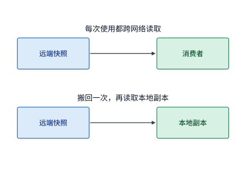

*图 7-21　远端 144 MiB 只读快照的两种消费路径对比：上半图每次消费都直接跨网络读取远端内存，导致同一份数据在网络上被重复传输多次；下半图在首次访问时将快照完整搬回本地显存，后续消费均在本地高速 HBM 上直接复用。*

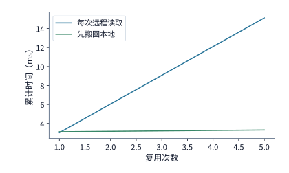

*图 7-22　每次完整扫描 144 MiB 快照时两种策略的累计耗时对比：预先搬回本地需在首次付出约 3.07 ms 的固定搬移成本，但从第 2 次读取（$r \ge 2$）开始便显著节省总时间。*

上述 $r \approx 1.03$ 的极低交点，建立在“每次使用都需要 100% 扫描整份快照”的前提之上。假如算法采用了稀疏注意力（Sparse Attention）或动态块选择机制，**每次调用只需按需读取该快照中 10% 的活跃页面（约 14.4 MiB）**，而“整块搬回方案”由于在搬移前无法预知后续哪几个分块会被选中，依然只能在首次将 144 MiB 快照全量复制到本地，情况就会大不相同。此时，按需远程读取单次只需跨网传输 10% 的数据，耗时降至约 $0.302\ \mathrm{ms}$，累计耗时变为 $T_{\mathrm{remote}}^{(10\%)}(r) \approx 0.302r\ \mathrm{ms}$；而整块搬回方案的首次固定搬移成本仍高达 $3.07\ \mathrm{ms}$，后续每次在本地读取 10% 数据的耗时约为 $0.0046\ \mathrm{ms}$。重新求解不等式 $3.07 + 0.0046r < 0.302r$，盈亏平衡点就会向右大幅推迟至：

$$
r > \frac{3.07}{0.302 - 0.0046} \approx 10.3.
$$

如图 7-23 所示，在 10% 稀疏访问比例下，只有当同一份快照被反复查询 **11 次及以上**时，全量搬回本地的沉重前期投入才能被摊平。

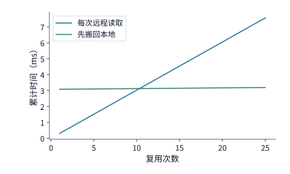

*图 7-23　每次仅稀疏访问快照中 10% 数据时的累计耗时对比：由于整块搬回方案在首次仍需全量复制 144 MiB 数据，盈亏平衡点推迟到了第 10.3 次访问之后（即从第 11 次读取起才开始获益）。*

这一组定量对比给出了分布式推理与存储引擎中选择数据访问方式的核心判据：**必须同时权衡“单次访问的空间覆盖率（稀疏度）”与“生命周期内的时间复用次数 $r$”**——对于高覆盖率或高频复用的热数据，应当尽早整块拉取到本地显存缓存；而对于低覆盖率、低复用次数的长尾冷数据，则宜采用按引用传递（Pass-by-Reference）的方式，让远端执行体或本地算子仅按需拉取实际命中的细粒度切片。例如，统一互联架构上的远程过程调用框架 URPC 就原生支持这种按引用传递模式，允许被调用函数根据运行时计算出的索引只拉取所需的远端数据分块。至于远端数据写入本地后何时才算真正落地、何时又能安全回收缓冲区，则是第 7.4 节即将探讨的状态与生命周期管理问题。[^ub]

### 7.3.4 并发与吞吐模型

第 7.3.3 节展示了如何通过本地复用来削减跨网读取的次数；而对于那些确实必须跨越网络传输的数据，工程优化的目标就转向了：**如何利用并发请求填满漫长的往返等待时间，让物理链路时刻保持满载传输**。

我们在本节的 50 GB/s 单向网卡链路上具体算一笔账。在硬件与协议栈中，每一项已发出但尚未彻底处理完毕的远程访问，都必须占用一个**请求槽位（Request Slot）**——它是用于记录该请求的目标地址、字节长度、序列号及当前状态的硬件表项或队列条目。一个槽位从请求提交时被分配占用，一直到响应数据返回、完成状态被妥善处理后才得以释放归还；在此期间，该槽位无法被任何新请求挪用。假设每次远程读取传输的数据载荷为 $m = 256\ \mathrm{B}$，而一个槽位从分配到释放的完整周转时间（即往返占用时间）为 $T = 2\ \mu\mathrm{s}$。在这 $2\ \mu\mathrm{s}$ 的等待窗口内，一条 $B = 50\ \mathrm{GB/s}$ 的物理链路理论上能够持续输送 $50\ \mathrm{GB/s} \times 2\ \mu\mathrm{s} = 100{,}000\ \mathrm{B}$ 的数据，折合 $100{,}000 / 256 \approx 390.6$ 次 256 B 远程访问。这就意味着，要想在第一个请求的响应返回之前不让物理链路出现哪怕一纳秒的断流空闲，发起方就必须至少同时维持 **391 个在途事务（In-Flight Transactions）**。图 7-24 描绘了单个请求槽位从分配、在途等待到完成释放的完整生命周期。

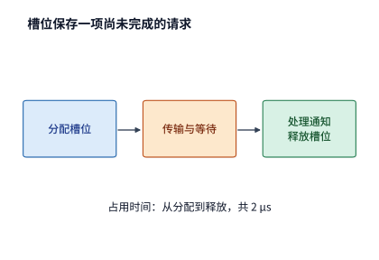

*图 7-24　单个请求槽位的完整生命周期：一项远程请求从提交时刻起占用一个槽位记录，经历请求发送、链路传输与响应等待，直至完成状态被消费处理后才归还槽位；图中的 $2\ \mu\mathrm{s}$ 覆盖了槽位被占用的全部时间区间。*

将这一物理关系推广为通用公式：设单个事务携带的有效数据载荷为 $m$，单个槽位的平均周转占用时间为 $T$，目标物理链路带宽为 $B$，则用满链路所需的最小并发在途槽位数 $N$ 必须满足：

$$
N \ge \left\lceil \frac{BT}{m} \right\rceil.
$$

式中的分子 $B \cdot T$ 即是网络与计算机体系结构中著名的**带宽—时延积（Bandwidth-Delay Product, BDP，对应排队论中的 Little 定律 $L = \lambda W$）**，它代表了物理管道在一次往返时间内所能容纳的“在途字节总量”；再除以单次事务的字节数 $m$，便得到了填满管道所需的最小并发请求数。该公式直观地揭示了高带宽网络对硬件并发度的苛刻要求：**物理链路带宽 $B$ 越高、往返等待时间 $T$ 越长、单次访问粒度 $m$ 越细碎，系统就必须提供越庞大的并发在途槽位池**。

**例题 7.3：当在途槽位数或请求发射速率不足时，为何无法用满网卡出口带宽？** 设单次远程读取事务的有效载荷为 $m = 256\ \mathrm{B}$，槽位周转占用时间为 $T = 2\ \mu\mathrm{s}$，物理路径带宽为 $B_{\mathrm{path}} = 50\ \mathrm{GB/s}$。试求：（1）当系统仅允许 $N = 128$ 个活跃槽位同时在途时的最大有效读取带宽；（2）若硬件请求处理单元连续发射两项事务的最短时间间隔为 $\delta = 18.6\ \mathrm{ns}$（对应后文 RoCE 可靠连接硬件实现的实测间隔），求同时受链路带宽、槽位数量与发射速率三项约束时的有效吞吐上界。

**解答**：
（1）当并发度被限制在 $N = 128$ 个活跃槽位时，每个槽位每 $T = 2\ \mu\mathrm{s}$ 只能周转一次、搬运 $256\ \mathrm{B}$ 数据。因此在 $2\ \mu\mathrm{s}$ 周期内，128 个槽位最多只能输送 $128 \times 256\ \mathrm{B} = 32{,}768\ \mathrm{B}$ 数据，折算为有效带宽上限仅为：

$$
B_{\mathrm{slot}} = \frac{Nm}{T} = \frac{128 \times 256\ \mathrm{B}}{2\ \mu\mathrm{s}} \approx 16.4\ \mathrm{GB/s},
$$

还不到 50 GB/s 物理带宽的三分之一；倘若退化为每次只允许 $N = 1$ 个事务在途的串行等待模式，有效带宽更会骤降至 $256\ \mathrm{B} / 2\ \mu\mathrm{s} = 0.128\ \mathrm{GB/s}$。这里在工程排查时需要特别留心一点：**硬件或软件静态分配了多少个队列槽位，与程序在运行时真正同时派发了多少个并发在途请求，是两个完全不同的概念**——即便队列深度设为 1024，如果上层算子每次只提交 32 个请求就停下来同步等待，实际生效的 $N$ 依然只有 32。

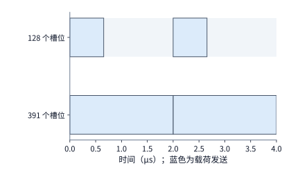

*图 7-25　在途请求槽位不足导致的物理链路周期性断流：当仅有 128 个槽位时，发起方在约 $0.66\ \mu\mathrm{s}$ 内便将全部槽位耗尽，随后只能被迫闲置链路（灰色区间），苦等最早发出的请求在 $2\ \mu\mathrm{s}$ 处完成并归还槽位；唯有配齐 391 个并发槽位，蓝色发送区间才能无缝填满整个 $2\ \mu\mathrm{s}$ 周期。*

（2）图 7-25 中的灰色断流区间源于“槽位耗尽后等待归还”；然而，即便我们将并发槽位扩充到 391 个甚至更多，如果**请求发射单元自身的点火速率跟不上**，链路同样无法达到满载。当连续两次请求的最小发射间隔为 $\delta = 18.6\ \mathrm{ns}$ 时，硬件每秒钟最多只能启动 $1 / (18.6\ \mathrm{ns}) \approx 5.38 \times 10^7$ 项事务（约 5400 万次/秒，即 54 MOPS）。在每项事务仅携带 $m = 256\ \mathrm{B}$ 的前提下，发射单元所能注入的最大数据率仅为：

$$
B_{\mathrm{issue}} = \frac{m}{\delta} = \frac{256\ \mathrm{B}}{18.6\ \mathrm{ns}} \approx 13.8\ \mathrm{GB/s}\quad(\text{精确按时钟周期换算约为 }13.7\ \mathrm{GB/s}).
$$

这一数值甚至比 128 个槽位所能支撑的 $16.4\ \mathrm{GB/s}$ 还要低。换言之，此时哪怕给系统配备 1000 个槽位，由于发射前端每 $2\ \mu\mathrm{s}$ 最多只能发出 $2000 / 18.6 \approx 107$ 个请求，实际同时在途的请求数永远不可能超过 108 个，系统吞吐被严格限制在发射速率瓶颈上。将**物理路径带宽 $B_{\mathrm{path}}$**、**并发槽位周转上限 $Nm/T$** 与**请求发射速率上限 $m/\delta$** 这三道物理枷锁合并在一起，我们就得到了远程访问有效吞吐量的统一屋顶模型：

$$
B_{\mathrm{eff}} \le \min\left(B_{\mathrm{path}},\ \frac{Nm}{T},\ \frac{m}{\delta}\right).
$$

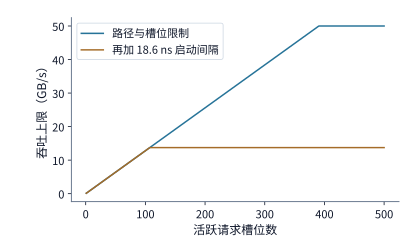

*图 7-26　并发槽位上限与请求发射速率对有效吞吐的双重制约：蓝色曲线仅考虑物理链路带宽（50 GB/s）与在途槽位限制（$Nm/T$），随着槽位数增至 391 即可触及满速；橙色曲线则叠加了每 $18.6\ \mathrm{ns}$ 发射一次请求的速率约束（$m/\delta$），导致有效带宽在槽位数达到约 108 后便被提前截断在 13.7 GB/s。*

式中的 $T$ 决定了单个槽位多久能够周转复用一次，而 $\delta$ 则决定了发射流水线每隔多久能够吐出一个新的请求包。图 7-26 清晰展示了这两道上限是如何先后截断吞吐增长曲线的。[^window]

**工程讨论：怎样才能让远程读取真正达到 50 GB/s 满载？** 对照上述三元最小值公式，当单次访问载荷固定为细粒度的 $m = 256\ \mathrm{B}$ 时，要想突破 $B_{\mathrm{eff}} = 50\ \mathrm{GB/s}$，一方面必须将发射间隔压缩至 $\delta \le 256\ \mathrm{B} / (50\ \mathrm{GB/s}) = 5.12\ \mathrm{ns}$（这甚至比后文 UB 单流水线每 2 周期发射一次的 $6.2\ \mathrm{ns}$ 还要苛刻，必须依靠多条硬件发射通道并行点火），另一方面还必须维持至少 391 个并发在途槽位。而在系统工程中，另一条往往更易落地的出路是**合并相邻或同目标的细粒度访问（Request Coalescing / Batching），增大单次事务载荷 $m$**：倘若我们将单次请求载荷从 256 B 聚合放大 16 倍至 $m = 4\ \mathrm{KiB}$，那么达到 50 GB/s 所需的最大允许发射间隔就放宽到了 $\delta \le 4096\ \mathrm{B} / (50\ \mathrm{GB/s}) \approx 81.9\ \mathrm{ns}$——此时即便沿用 $\delta = 18.6\ \mathrm{ns}$ 的慢速发射单元，其理论注入能力也高达 $4\ \mathrm{KiB} / 18.6\ \mathrm{ns} \approx 220\ \mathrm{GB/s}$，远超 50 GB/s 链路需求；与此同时，覆盖 $T = 2\ \mu\mathrm{s}$ 往返等待所需的最小在途槽位数也从 391 个骤降至 $\lceil 50\ \mathrm{GB/s} \times 2\ \mu\mathrm{s} / 4\ \mathrm{KiB} \rceil = 25$ 个。简言之，**硬件架构师通过多通道并行与流水线精简来压低 $\delta$、提高每秒事务率（IOPS），而系统与算子工程师则通过合并访存粒度来增大 $m$、摊薄单次提交开销**。

那么，硬件发射间隔 $\delta$ 在真实芯片设计中究竟是由什么决定的？我们可以直接剖析 OpenURMA 与 RoCE 硬件协议栈的微架构实现：在笔者的 OpenURMA 硬件实现中，发送流水线最慢的瓶颈级每 2 个时钟周期即可接纳一项新请求，在 322 MHz 工作主频（单周期约 $3.1\ \mathrm{ns}$）下，最小发射间隔为 $\delta_{\mathrm{UB}} \approx 6.2\ \mathrm{ns}$，对应单通道理论峰值事务率约为 $1.61\ \text{亿次/秒}$（161 MOPS）；而在采用完全相同工艺与工具链实现的 RoCE 可靠连接（RC）对照设计中，由于每条 RC 连接在分配包序列号（PSN）与更新连接状态时存在跨拍的数据先后依赖，每处理一项请求需要占用 6 个时钟周期，导致最小发射间隔拉长至 $\delta_{\mathrm{RoCE}} \approx 18.6\ \mathrm{ns}$，理论峰值事务率降至约 $0.54\ \text{亿次/秒}$（54 MOPS）。在周期级仿真器中连续打入 256 项突发请求时，实测两者的持续发射速率分别为每微秒 150 项（UB）和 54 项（RoCE）：RoCE 实测值与理论推导的 53.7 项完全吻合，而 UB 因突发首尾的流水线填充与排空开销比理论值（161 项）略低约 7%；当把连续突发长度扩大到 1000 项以摊薄首尾开销后，UB 实测速率便升至每微秒约 159 项，与理论极限仅差约 1%。将这两组 $\delta$ 代入 $m/\delta$ 核算：当传输 $m = 64\ \mathrm{B}$ 极小载荷时，UB 与 RoCE 单通道最多只能提供 $10.3\ \mathrm{GB/s}$ 和 $3.4\ \mathrm{GB/s}$ 的有效带宽，双双受限于发射速率 $\delta$；而当载荷增大至 $m = 4\ \mathrm{KiB}$ 时，两者单通道注入上限分别跃升至 $660\ \mathrm{GB/s}$ 和 $220\ \mathrm{GB/s}$，双双远超 400 Gbps 网卡单向 50 GB/s 的物理线速。这一对比铁证如山地表明：**在小载荷随机访存场景下，网络吞吐的真正瓶颈在于协议栈硬件的每秒请求发射率（$1/\delta$）；唯有在大块连续传输场景下，瓶颈才会回归到物理光纤的比特线速（$B_{\mathrm{path}}$）**。[^ub-fabric]

**深入剖析：为什么在底层总线上“读（Read）”与“写（Write）”会受到截然不同的吞吐限制？** 公式 $B_{\mathrm{eff}} \le \min(B_{\mathrm{path}}, Nm/T, m/\delta)$ 中的在途上限 $N$ 与发射间隔 $\delta$，在服务器内部的 PCIe 总线上有着明确的硬件对应物。PCIe 是一种基于分组交换的串行总线，任何一次 DMA 内存读写都会被打包成一个或多个事务层报文（Transaction Layer Packet, TLP）。在 PCIe 协议规范中，写操作与读操作被赋予了完全不对称的传输机制：
- **DMA 写操作属于投递式事务（Posted Transaction）**：发起方将目标地址与写入数据封装进同一个存储器写请求报文（MWr TLP）推上链路，**报文一旦跨过链路即告完成**，无需目标端返回任何确认包；
- **DMA 读操作则属于非投递式事务（Non-Posted Transaction）**：发起方必须先发送一个仅含目标地址与读取长度、并打上唯一**事务标签（Tag）**的存储器读请求报文（MRd TLP）；随后必须等待目标端从内存中取出数据、封装成一个或多个携带相同 Tag 的**完成报文（Completion with Data, CplD TLP）**沿反方向送回，发起方依靠 Tag 将返回的数据对号入座后，这次读事务才算真正终结。

正因如此，发起方在同一时刻能够维持的**在途 DMA 读请求数量 $N$**，会同时受到两道硬性配额的制约：一是接收端（如主机根复合体 Root Complex 或交换芯片）缓冲池为非投递读请求预先发放的**流控信用额度（Flow Control Credits）**，二是发起方 DMA 引擎自身硬件能够分配并追踪的**在途事务标签（Tags）总数**。图 7-27 对比了 PCIe 总线上这两种事务的不对称生命周期。

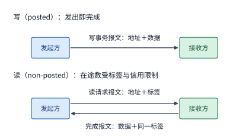

*图 7-27　PCIe 总线上的写事务与读事务对比：DMA 写属于投递式（Posted）事务，请求报文携地址与数据单向发出即告完成；DMA 读属于非投递式（Non-Posted）事务，必须先发出带唯一标签（Tag）的读请求报文，并持续占用该 Tag 直至携带相同 Tag 的完成报文（CplD）将数据送回，因而同时在途的读请求数严格受限于可用 Tag 总数与接收端信用额度。*

这两道硬件配额并非纸面理论，而是真实卡住系统吞吐的常见瓶颈。笔者在设计研发 KV-Direct 系统时，就曾在真实硬件平台上精确测量并定位过这一瓶颈。当时所使用的可编程网卡通过 PCIe Gen3 x8 链路访问主机内存，物理层理论双向单边带宽为 $7.87\ \mathrm{GB/s}$；由于每次 $64\ \mathrm{B}$ 的细粒度 DMA 读写都必须附带 $26\ \mathrm{B}$ 的 PCIe 帧头、序列号、CRC 校验及字节对齐填充开销，扣除报文封装税后的有效载荷带宽上限降为 $5.6\ \mathrm{GB/s}$，折合每秒最多完成约 $8700\ \text{万次}$（87 MOPS）64 B 操作。然而，当我们测试 $64\ \mathrm{B}$ 随机 DMA 读时，由于单次 PCIe 往返延迟高达 $T \approx 1050\ \mathrm{ns}$，要想达到 87 MOPS 的报文上限，至少需要维持 $87\ \mathrm{MOPS} \times 1.05\ \mu\mathrm{s} \approx 92$ 个读请求同时在途；遗憾的是，当时主机 CPU 的 PCIe 根复合体仅向网卡发放了 84 个非投递读信用额度，而网卡侧 FPGA 的硬核 DMA 引擎更是只支持最多 $N = 64$ 个并发 Tag。受制于这 64 个 Tag 的硬上限，系统每秒最多只能周转 $64 / (1050\ \mathrm{ns}) \approx 6100\ \text{万次}$（61 MOPS）随机读；最终硬件实测得到的 64 B 随机 DMA 读吞吐恰为 **6000 万次/秒（60 MOPS）**，与 Tag 上限推导值（61 MOPS）几乎分毫不差。作为对照，同样是 64 B 操作，由于 DMA 写属于不需要等待回应、也不占用读取 Tag 的 Posted 事务，其实测吞吐直接逼近了 87 MOPS 的报文封装上限。图 7-28 将这几道理论上限与实测值绘制在同一坐标系下：DMA 读被卡在在途槽位项 $Nm/T$（64 个 Tag），而 DMA 写则推进到了报文发射与封装速率项 $m/\delta$（87 MOPS）。我们在 KV-Direct 中将键值索引查找、内存地址计算、DMA 访存与结果拼装全部下沉到网卡硬件流水线内部异步并发执行，正是为了在等待前一个读请求返回期间毫不间断地用满所有可用 Tag。这组实测案例也完美重现了第 1.3.4 节所倡导的建模方法论：从物理线速（1.23 亿次/秒）出发，依次引入协议帧头开销（压至 8700 万次/秒）与硬件在途 Tag 上限（压至 6100 万次/秒）修正模型，当理论上界与实测值（6000 万次/秒）收敛到仅差约 1.6% 时，性能瓶颈便已水落石出，无需再做盲目的猜测。[^kv-direct]

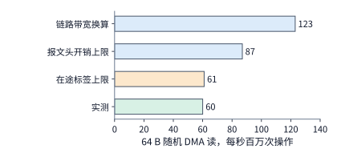

*图 7-28　KV-Direct 平台上 64 B 随机 DMA 读的四级性能屋顶与实测值对比：PCIe Gen3 x8 裸链路带宽对应每秒 1.23 亿次操作，扣除 26 B 报文头开销后上限降至 8700 万次，而 64 个硬件 Tag 在 1050 ns 往返延迟下最多只允许每秒周转 6100 万次；最终实测值为 6000 万次/秒，确证了在途 Tag 数量是该平台上小粒度随机读的真正瓶颈。*

为什么 KV-Direct 的可编程网卡能够把 64 个硬件 Tag 滴水不漏地时刻塞满，而早期运行在主机 CPU 核上的网络与存储软件栈却往往在远低于硬件上限处就早早力竭？将笔者在 ClickNP 与 KV-Direct 中的 FPGA **元素级空间流水线（Element-level Spatial Pipeline）** 与传统 **CPU 核时间分片处理** 作一对照，背后的微架构分野便一目了然。如第 1.4.2 节所述，一条 $40\ \mathrm{Gbps}$（约 $5\ \mathrm{GB/s}$）链路在满载跑 $64\ \mathrm{B}$ 最小以太网帧（计入前导码与帧间隙共占 $84\ \mathrm{B}$ 链路时间）时，每秒到达的报文数高达 $5\times10^9/84\approx5950\ \text{万个}$（约 $60\ \mathrm{Mpps}$）。在传统主机软件路径上，数据包必须先经 PCIe DMA 写入主机内存，再由 CPU 核轮询或中断取包、执行协议解析与规则查找；由于单颗 CPU 核仅做简单转发每秒也只能处理 $1000\ \text{万}\sim2000\ \text{万个包}$，仅接住这 $60\ \mathrm{Mpps}$ 小包就需持续消耗 $3\sim6$ 个专用 CPU 核，且一旦涉及主存随机查找或跨 PCIe 往返，CPU 线程便会频繁困在微秒级的缓存缺失与总线等待中，难以维持足够高的发射率 $1/\delta$。相比之下，ClickNP 将报文解析、流表匹配、键值哈希计算与 DMA 引擎触发拆解为数百个通过片上先入先出通道（FIFO Channel）串联的细粒度硬件原语（Element）：尽管 FPGA 的时钟主频通常仅有 $200\ \mathrm{MHz}$（单周期 $5\ \mathrm{ns}$），远低于 CPU 的 $3\ \mathrm{GHz}$，但由于所有处理级在芯片空间上物理展开、每个时钟周期均可向前推进一个新包（流水线启动间隔 $\mathrm{II}=1$），单条空间流水线的理论吞吐率天然高达 $200\ \mathrm{Mpps}$，且片上纯硬件通道的单跳交接延迟仅为纳秒级（整条网卡内部流水线延迟不足 $1\ \mu\mathrm{s}$，比经由主机 CPU 转发缩短一个数量级）。正是凭借这种“零上下文切换、每拍持续点火”的空间流水线，可编程网卡才能把发射间隔 $\delta$ 压到远小于 $m/B_{\mathrm{path}}$ 的水平，让系统吞吐真正推进到 PCIe 在途 Tag 配额 $Nm/T$ 的物理边界上。[^kv-direct]

更进一步，当同一条双向 PCIe 链路被“Posted 写”与“Non-Posted 读”两股流量同时混用时，这种机制差异还会演化出**严重的带宽抢占不对称性**。设想在一台推理服务器中，连接某张 GPU 的 PCIe 链路上同时运行着两项任务（图 7-29）：
- **在进入 GPU（Host/NIC $\to$ GPU）的链路方向上**：一方面，RDMA 网卡正通过 GPUDirect RDMA Write 将远端发来的 KV 缓存以 **Posted 写报文**源源不断地直接灌入 GPU；另一方面，该 GPU 自身的内部 DMA 复制引擎（Copy Engine）正在执行 `cudaMemcpyAsync`（Host-to-Device），它向主机内存发出读请求，主机内存返回的 **CplD 读完成数据报文**同样要沿着这条进入 GPU 的下行链路传输。一旦该方向链路趋于饱和，网卡发出的 Posted 写报文无需等待回执、按 PCIe 流控规则可以持续抢占发送；而 GPU 复制引擎发起的读操作一旦耗尽手中的有限 Tag，就必须等下行链路把 CplD 完成报文送回后才能腾出 Tag 发出新请求——下行链路被 Posted 写挤占导致 CplD 回程变慢，回程变慢又反过来扼杀了新读请求的发出（正反馈节流），最终导致主机到 GPU 的复制带宽被挤压到远低于二分之一。
- **在离开 GPU（GPU $\to$ Host/NIC）的链路方向上**：情况则大不相同。假设 GPU 复制引擎正在执行 Device-to-Host 复制（由 GPU 直接向外发出 **Posted 写报文**），与此同时远端网卡正在发起 GPUDirect RDMA Read 读取该 GPU 显存（由 GPU 响应并返回 **CplD 读完成报文**）。尽管一者是 Posted 写、一者是读完成响应，但在离开 GPU 的这一侧，两股流量都必须先通过 GPU 内部的显存控制器从 HBM 中读出数据，再共同排队进入 GPU 的 PCIe 发送引擎；由于瓶颈落在了 GPU 内部共用的取数与发送通路上，两股流量的性能退化反而相对均衡。

因此，在诊断生产环境中离奇的“通信与本地拷贝互相拖慢”故障时，切忌笼统地将 PCIe 视为一条均分的双向水管，而应当遵循三步排查法：**先甄别每一股流量的底层事务属性（是 Posted 写还是受 Tag 限制的 Non-Posted 读），再标出请求包与数据完成包各自流经的物理方向，最后检查它们在链路哪一侧的哪个共用队列或信用池处发生了交汇竞争**。近年来针对共享 PCIe 互连系统的基准测试研究（如 rPCIeBench）也通过大量实证数据证实，在途请求配额（Tag/Credit）与入口仲裁竞争会显著扭曲多租户或多引擎共享 PCIe 链路时的实际带宽分配比例。[^pcie] 无论面对何种底层总线，本节建立的三元吞吐不等式 $B_{\mathrm{eff}} \le \min(B_{\mathrm{path}}, Nm/T, m/\delta)$ 始终是定位性能瓶颈的第一把标尺：它能帮我们迅速判断当前究竟是物理带宽已经用满，还是在途槽位（Tag／队列深度）周转不过来，抑或是前端请求发射率太低。

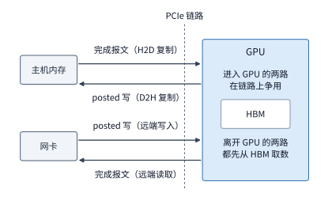

*图 7-29　共享 PCIe 链路上两个传输方向的争用不对称性：在进入 GPU 的方向上（左），网卡直接灌入的 Posted 写无需等待回执，而 GPU 复制引擎发起的读操作必须等待主机返回完成报文（CplD）以释放 Tag，导致读流量在争用中严重吃亏；在离开 GPU 的方向上（右），D2H 复制发出的 Posted 写与响应远端读取的完成报文均需先从本地 HBM 取数并共用 GPU 发送通路，两者的退化程度更为接近。*

至此，我们已经厘清了如何通过分层归约削减跨机流量，以及如何凭借充足的并发槽位与发射速率让物理网络连续满载运转。然而，数据跑得快只是第一步；在多节点协同的异步流水线中，接收方算子究竟在什么时刻才能安全地读取刚抵达的数据？发送方与接收方又在什么时刻才能安全地覆写并复用缓冲区？这就把我们引向了第 7.4 节的核心议题——数据生命周期、可见性顺序与连接状态管理。

> **实验 7-8 · 延伸：用满远程读取带宽需要多少在途事务**
>
> 在例题 7.3 的基准配置（$B_{\mathrm{path}} = 50\ \mathrm{GB/s}$）下，假设由于跨机架交换机排队，单个请求槽位的周转占用时间从 $T = 2\ \mu\mathrm{s}$ 拉长到了 $T = 4\ \mu\mathrm{s}$（从请求提交算起，直至完成确认并释放槽位为止）。请计算：
> 1. 当单次事务传输载荷分别为 $m = 256\ \mathrm{B}$ 和 $m = 4\ \mathrm{KiB}$ 时，达到 $50\ \mathrm{GB/s}$ 目标带宽所需的最小并发在途事务数 $N$ 各是多少？
> 2. 固定 RoCE 协议栈的请求发射间隔 $\delta = 18.6\ \mathrm{ns}$，求使发射速率不成为瓶颈（即 $m/\delta \ge 50\ \mathrm{GB/s}$）所需的最小单次事务载荷 $m$；若换用 UB 协议栈的 $\delta = 6.2\ \mathrm{ns}$，该最小事务载荷又可缩小到多少？
> 3. 若将原本互不依赖的 $K$ 个读取地址改为一条长度为 $K$ 的串行指针追逐链（即第 $i$ 次读取返回的数据中包含第 $i+1$ 次读取的目标地址），请推导完成整条指针链读取的总耗时如何随链长 $K$ 增长，并说明此时增加硬件并发槽位数 $N$ 能否缩短总耗时。

## 7.4 数据交接、顺序与状态管理

### 7.4.1 数据分片的生成、使用与缓冲区复用

在异步网络通信中，一个极易引发隐蔽数据损坏的思维盲区，是把“网络传输完成”直接等同于“缓冲区可以安全回收覆写”。事实上，当网卡把数据块写入远端显存并报告发送完成时，接收方的计算核可能尚未被唤醒去读取它，又或者正读到一半。这就像工厂流水线上的工位交接：上一道工序把装满零件的周转托盘推到下一道工位的案头上，仅仅意味着“配送动作完成”；在下一道工位的工人真正把托盘里的零件全部取走加工完毕之前，谁若是贸然把托盘清空换上新一批零件，就会酿成严重的生产事故。映射到分布式通信系统中，**发送端传完（Send Complete）**、**数据对接收端可见（Data Visible）** 与 **接收端消费完毕（Consumption Complete）** 是三个在时间轴上严格分离的独立事件。第 7.3.4 节曾将请求槽位的占用时间 $T$ 简化为一个给定的常数，本节则要沿着这三个关键事件，精确界定发送端源缓冲区与接收端目的缓冲区各自的存活周期与安全复用时刻。

让我们回到第 7.2.3 节的分层归约场景：节点 0 上的 GPU 0 需要将本地归约好的数据分片跨网卡发送给节点 1 上的 GPU 8，由 GPU 8 将该分片与自身分片累加。在这一交接过程中，系统必须先后回答三个生命周期问题：
1. **发送方（GPU 0）何时可以安全改写并复用自己的源缓冲区（Source Buffer）？**
2. **接收方（GPU 8）何时可以开始安全读取目的缓冲区（Destination Buffer）中的数据？**
3. **发送方发起下一次跨网写入时，何时才能安全覆盖接收方的这块目的缓冲区？**

这三个问题分别绑定在整条数据交接链的不同关键节点事件上。一份数据分片从诞生到空间回收，必须完整经历六个阶段：**（1）本地算子生成数据 $\to$（2）跨网写入远端内存 $\to$（3）确保写入数据在远端内存子系统中全局可见 $\to$（4）向接收方发布就绪通知 $\to$（5）接收方算子读取并消费数据 $\to$（6）释放目的缓冲区供下一轮写入复用**。其中，源缓冲区能否复用，取决于发送接口的本地完成语义（Local Completion）是否保证网卡 DMA 引擎已经彻底读完源内存、不再重传引用；接收方能否开始读取，取决于“数据落地可见”与“就绪标志置位”之间的内存顺序保证；而目的缓冲区能否被下一轮数据覆写，则必须等待接收方显式发回“消费完毕（信用归还）”的反向确认——单凭网络层的发送完成事件，绝不能推断远端算子已经用完了数据。

我们用一组具体的时间戳来直观展示这种生命周期错位（图 7-30）：假设发送方在 $t = 0\ \mu\mathrm{s}$ 发起写入，网络传输在 $t = 5\ \mu\mathrm{s}$ 宣告完成；接收方消费者算子在 $t = 8\ \mu\mathrm{s}$ 被调度启动并开始读取目的缓冲区，直至 $t = 12\ \mu\mathrm{s}$ 才完成累加计算。在这一时序下，发送方的**源缓冲区**在 $t = 5\ \mu\mathrm{s}$ 发送完成那一刻即可安全回收复用；但接收方的**目的缓冲区**却必须一直锁定保护到 $t = 12\ \mu\mathrm{s}$ 消费者算子执行完毕为止。倘若发送方误以为“$5\ \mu\mathrm{s}$ 传完即可复用目标空间”，在 $t = 6\ \mu\mathrm{s}$ 便立即向同一目的地址发起下一轮单边写入覆盖，那么消费者在 $8\text{--}12\ \mu\mathrm{s}$ 期间读到的就会是被新数据篡改后的错乱内容——此时底层网络传输的每一个比特都准确无误，但上层模型训练或推理却因为违反了缓冲区生命周期契约而悄然算出错误结果。

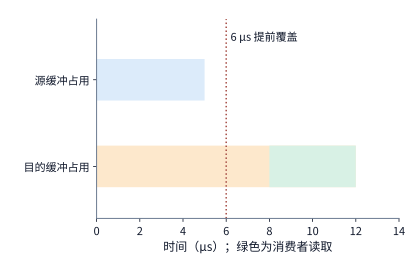

*图 7-30　源缓冲区与目的缓冲区截然不同的安全复用时刻：源缓冲区仅需占用至 $5\ \mu\mathrm{s}$ 发送传输完成即可释放；而目的缓冲区则必须持续锁定至 $12\ \mu\mathrm{s}$ 接收方消费者算子读取完毕（绿色区间为 $8\text{--}12\ \mu\mathrm{s}$ 的读取消费窗口）。图中红色虚线标出了在 $6\ \mu\mathrm{s}$ 提前覆写目的地址所引发的数据污染错误。*

将图 7-30 中“后一个动作必须等待前一个事件达成”的约束抽象为有向边，就构成了刻画分布式数据交接的有向无环依赖图（DAG）：图中每个顶点代表一项计算或通信动作，有向边 $u \to v$ 表示动作 $v$ 必须在动作 $u$ 完成后方能启动。对图中任意顶点，取其所有直接前驱顶点的最晚完成时刻，再加上该顶点自身的执行耗时，即可递推算出其完成时刻；而从起点到终点累计耗时最长的那条有向链，便是决定端到端延迟的**关键路径（Critical Path）**。

这一依赖图模型把**程序正确性**与**系统性能**统一到了同一个数学框架下：
- 如果图中**漏掉了必要的依赖边**（例如漏掉了“数据写入全局可见 $\to$ 置位就绪通知”或“消费者读取完毕 $\to$ 下一轮覆写目的缓冲”），系统就会发生数据竞争（Data Race），导致消费者读到尚未落地的半截数据或被提前覆写的脏数据；
- 反之，如果图中**强加了多余的依赖边**（例如强行规定“即便发往不同缓冲区的无关传输，也必须排队等待上一笔传输的通知完成”），就会人为拉长关键路径，引入无谓的串行等待。

因此，通信运行时与硬件状态管理的核心使命，就是以最小的开销精准追踪“哪些顶点已经完成、哪些有向边已经满足、哪些缓冲区与槽位已经可以归还”。

在工程实践中，这套生命周期规则还直接决定了**算子计算缓冲区与通信已注册缓冲区（Registered Buffer）能否合二为一**。在传统的通用通信库设计中，为了简化内存生命周期管理，通信库往往在内部私自维护一块已向网卡注册并锁页固定（Pinned）的专用发送/接收中转缓冲池：每次通信前，GPU 必须先启动一个拷贝核函数，将计算算子的输出张量复制进发送中转缓冲，并把路由元数据与数据打包拼装；抵达接收端后，又要再次启动拆包核函数，将数据从接收中转缓冲搬移到目标算子的输入张量区。这些额外的显存内拷贝与拆打包不仅额外消耗了宝贵的 HBM 带宽，更占用了大量原本可用于矩阵乘法的 GPU SM 计算资源。为了彻底消除这笔拷贝税，像 DeepEP 这样的现代高性能 MoE 通信库普遍采用**计算直写零拷贝架构（Zero-Copy Registered Buffer）**：直接将已向 RDMA 网卡注册好的通信缓冲区暴露给上游计算算子，让门控或投影算子把输出直接写进发送缓冲区，并让下游专家算子直接从接收缓冲区就地读取。然而，省去中转拷贝的代价，正是应用程序必须亲自、严格地履行本节所述的事件顺序契约：**上游计算算子的写入必须通过内存屏障确保对网卡 DMA 引擎完全可见后，才能敲响发送门铃；在发送彻底完成前绝不能覆写源缓冲；而在接收端，也必须通过细粒度的就绪队列与信用计数，精确判定每一块接收槽位何时可读、何时可向发送端归还覆写信用**。[^ep-buffer]

### 7.4.2 事务层与传输层分离：Jetty 与共享状态

既然每一条通信关系都需要追踪请求依赖、完成状态与重传进度，那么随着集群规模扩大，网卡硬件需要维护的状态表项会膨胀到什么地步？在只有 16 张卡的小型归约算例中，连接数量微不足道；但在万卡大模型集群中，每台服务器上运行着多个训练或推理进程，每个进程内又有数十个并发工作线程或通信流（Stream），且每个线程都需要与远端成百上千张加速卡直接交换数据（典型如 MoE 的全对全专家分发）。此时，集群中的逻辑通信关系数量就会按“本地并发实体数 $\times$ 远端目标数”发生乘积级爆炸。

要想扼制状态爆炸，关键在于看清通信状态内部包含着两类性质截然不同的信息：
- 第一类是**事务层／应用端点状态（Application Endpoint State）**：用于标识“是谁提交了请求、访问权限是否合法、操作完成后应当把完成通知（CQE）投递到哪个完成队列”，它代表的是上层软件的逻辑身份；
- 第二类是**传输层状态（Transport Channel State）**：用于维护“数据包序列号（PSN）、滑动窗口确认（ACK）、丢包重传定时器以及端到端拥塞控制速率”，它的职责是保证两个物理节点之间的比特流可靠、有序、不拥塞地送达。

在传统的 RoCE／InfiniBand 可靠连接（RC）架构中，事务层身份与传输层状态被固定捆绑在同一个队列对（Queue Pair, QP）对象里：哪怕本地的 64 个应用线程访问的是**同一台远端服务器**，只要它们各自建立了独立的 QP，网卡就必须为这 64 条连接重复维护 64 套完全独立的包序列号、重传计时器与拥塞窗口。

我们不妨算一笔具体的存储开销账。定义**应用端点（Endpoint）**为程序提交请求并接收完成通知的逻辑接口，**传输状态（Transport Context）**为维护序列号、确认、重传与发送速率的底层通道记录。假设某节点上有 $L = 64$ 个本地应用端点，每个端点都需要与 $P = 128$ 个远端目标建立通信，总计形成 $L \times P = 64 \times 128 = 8192$ 条逻辑通信关系。设每份传输状态占用 $t = 1\ \mathrm{KiB}$（1024 B）：
- 若采用**逐关系独占传输状态（Private Transport per Relation，如传统 RC QP）**，仅传输状态一项就要消耗 $8192 \times 1\ \mathrm{KiB} = 8\ \mathrm{MiB}$ 的存储空间；
- 若采用**传输层与事务层解耦、按远端目标共享传输状态（Shared Transport per Target）**——即本地所有发往同一个远端目标的请求都复用同一条底层可靠传输通道——那么整张网卡只需为 128 个远端目标维护 $P = 128$ 份传输状态，仅占 $128 \times 1\ \mathrm{KiB} = 128\ \mathrm{KiB}$，传输状态开销瞬间缩减至原来的 $1/64$。

当然，解耦之后，上层的应用端点身份与绑定关系依然需要保留：设每个本地端点的自身描述符占 $e = 256\ \mathrm{B}$（64 个端点共 $16\ \mathrm{KiB}$），每条逻辑通信关系的轻量级权限与路由绑定记录占 $r = 64\ \mathrm{B}$（8192 条关系共 $512\ \mathrm{KiB}$）。将这些部分全部计入后：
- 独占传输方案的总状态量为 $16\ \mathrm{KiB} + 512\ \mathrm{KiB} + 8192\ \mathrm{KiB} = 8720\ \mathrm{KiB} \approx 8.52\ \mathrm{MiB}$；
- 共享传输方案的总状态量则仅为 $16\ \mathrm{KiB} + 512\ \mathrm{KiB} + 128\ \mathrm{KiB} = 656\ \mathrm{KiB} \approx 0.64\ \mathrm{MiB}$，总内存占用直接压缩至原来的约 **$1/13$**。[^states]

将上述核算写成通用代数公式：设本地应用端点数为 $L$，远端目标数为 $P$，单个本地端点描述符、单条关系绑定记录与单份传输通道状态分别占用 $e$、$r$、$t$ 字节，则两种架构下的状态总容量分别为：

$$
S_{\mathrm{private}} = Le + LP(r + t),\qquad
S_{\mathrm{shared}} = Le + LPr + Pt.
$$

在 OpenURMA 论文的复杂度分析中，采用了更为纯粹的硬件状态口径：当网卡将逐关系的地址绑定记录下放到主机软件映射表（相当于硬件侧 $r = 0$）时，本地 $L$ 个应用端点与 $P$ 台远端目标节点通信所需的网卡核心硬件状态（端点描述符加传输通道上下文）便严格按加法量级 **$O(L + P)$** 线性增长；而在传统的一对一可靠连接模型中，核心硬件状态则按乘积量级 **$O(LP)$** 二次方膨胀。当然，在阅读文献时需要明确其边界：$O(L+P)$ 描述的是可复用的核心网卡队列与通道上下文，至于上层软件页表映射、内存注册权限表以及与并发度成正比的在途请求槽位（第 7.3.4 节），依然要按实际工作负载规模分配。上面的教学公式之所以显式保留了 $LPr$ 项，正是为了向读者展示即便保留逐关系硬件绑定表，单靠消除 $LPt \to Pt$ 的冗余传输状态就能带来十倍以上的空间收益；本小节稍后还将直接代入 OpenURMA 芯片实现的真实字节尺寸（$r=0$）做一次严格核对。[^ub-design]

这正是第 6.5.5 节所介绍的灵衢（UB）**Jetty 机制**的核心设计哲学：将代表应用端点身份的 **Jetty（事务层队列）** 与负责端到端可靠传输的**传输通道（Transport Channel）** 彻底解耦（图 7-31），让成百上千条上层应用关系多路复用同一套底层序列号与重传上下文。[^ub]

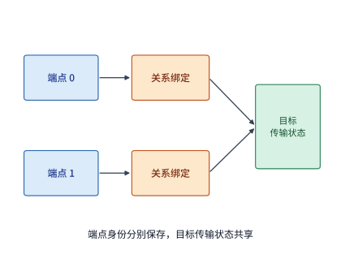

*图 7-31　应用端点（Jetty）与底层传输状态解耦共享示意图：两个本地应用端点各自保留独立的身份描述符与关系绑定记录，但它们发往同一远端目标的流量共同指向同一份共享传输状态；底层共享通道统一维护序列号、确认与重传进度，而上层端点依然能够精准区分各自的请求与完成通知。*

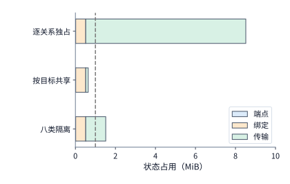

*图 7-32　64 个本地端点访问 128 个远端目标时不同共享策略的状态容量对比：蓝色代表本地端点记录（16 KiB），橙色代表逐关系绑定记录（512 KiB），绿色代表传输层状态。水平虚线标出了 1 MiB 的网卡片上缓存容量上限；当按业务优先级划分为 8 个独立隔离组时，每个远端目标需维护 8 份独立传输状态。*

当然，正如图 7-31 所示，让多条应用关系共享同一条底层传输通道，在大幅节省硬件存储的同时，也必然引入**多业务共享通道时的资源争用与干扰问题**：不同应用关系提交的请求会竞争同一条传输通道的发送滑动窗口、仲裁调度机会以及丢包重传恢复资源。这里首先要澄清一个概念误区：**传输通道共享并不要求把所有上层应用事务强行放入一条全局串行等待的 FIFO 队列**——事务层的请求提交顺序、完成通知顺序与底层网络报文的到达顺序完全可以分别定义。然而，如果硬件实现简单粗暴地让所有共享该通道的请求排入同一个严格保序队列，那么一旦排在队首的某个大请求遭遇丢包重传或目标端停顿，排在它后面的其他无关短请求就会被一并阻塞，形成典型的**队头阻塞（Head-of-Line Blocking, HOL Blocking）**；即便硬件允许互不依赖的事务越过阻塞点继续推进（详见第 7.4.3 节），如果某一条海量吞吐的后台通信关系瞬间塞满了共享传输通道的未完成窗口，其他对延迟高度敏感的短控制消息依然会因为抢不到发送窗口而被迫排队。

为了在“状态空间开销”与“业务性能隔离”之间取得可调的工程平衡，系统可以引入**分组共享（Grouped Sharing / Traffic Class Isolation）**机制：不再让所有流量无差别地挤在同一条通道上，而是按服务质量（QoS）或业务类型（例如将高优的 TP/EP 推理同步流、中优的 KV 缓存迁移流与低优的检查点后台落盘流分开），为每个远端目标建立 $K$ 组相互独立的传输通道状态。此时，网卡所需的总状态容量泛化为 $K$ 的线性函数：

$$
S(K) = Le + LPr + KPt.
$$

代入前文算例参数（固定基础部分 $Le + LPr = 16\ \mathrm{KiB} + 512\ \mathrm{KiB} = 528\ \mathrm{KiB}$，每增加一组覆盖 128 个目标的独立传输状态增加 $Pt = 128\ \mathrm{KiB}$）：假设网卡片上分配给状态表的宝贵 SRAM 预算为 **1 MiB（1024 KiB）**，那么系统最多可以容纳 $K = 3$ 组完全独立的传输通道（占用 $528 + 3 \times 128 = 912\ \mathrm{KiB} \le 1024\ \mathrm{KiB}$）；一旦试图划分 $K = 4$ 组，所需空间就达到 $1040\ \mathrm{KiB}$，突破了 1 MiB 的片上容量红线；若划分 $K = 8$ 组，则需约 $1.52\ \mathrm{MiB}$（图 7-32）。这一推导为集群网络架构师提供了清晰的资源规划公式：**在有限的网卡片上 SRAM 预算内，应当仅为延迟极度敏感的核心业务（如小批量 decode 同步）单独划拨专属传输通道，而让其余大吞吐或容忍延迟的业务共享通用传输通道**。

除了削减状态总量之外，解耦共享还能从根本上改善**网卡缓存层级（NIC Context Cache Hierarchy）的命中率**。现代高性能 RDMA 网卡通常将全量连接状态存放在主机内存中，而在网卡芯片内部集成容量有限的高速 SRAM 作为上下文缓存（Context Cache，常见容量为几百 KiB 到几 MiB）。一旦活跃连接的总状态量超出片上 SRAM 容量，网卡在处理请求时就会频繁遭遇**上下文缓存未命中（Context Cache Miss / Thrashing）**，被迫通过 PCIe 总线去主机内存临时拉取连接状态，导致单次通信延迟陡增、吞吐大幅下跌。通过共享传输状态将总体积压缩一个数量级以上，原本会撑爆片上缓存的数千条活跃通信关系便能常驻片上 SRAM，从而彻底免去了跨 PCIe 拉取状态的昂贵惩罚。

**芯片级实证：OpenURMA 与 RoCE 的真实硬件状态尺寸及缓存悬崖（Cache Cliff）。** 前文的 256 B、64 B 和 1024 B 是便于心算的教学取整值；现在让我们直接调出笔者在 OpenURMA 硬件实现与同工艺 RoCE 可靠连接（RC）对照设计中的真实寄存器/表项字节尺寸进行核对：
- 在 **OpenURMA（UB）实现**中：每个应用端点（Jetty）上下文仅占 **20 B**，每个已注册内存段（Memory Segment）权限表项占 **32 B**，每条底层可靠传输通道上下文仅占 **56 B**，且关系绑定由软件寻址完成（硬件 $r = 0$）；
- 在对照的 **RoCE RC 实现**中：每个已注册内存段同样占 **32 B**，但每一对可靠连接都必须维护一份完整的 **512 B** QP 上下文。

设本地有 $N$ 个活跃应用端点，需要与远端 $M$ 个端点进行全连接通信（All-to-All），则单张网卡在这两种架构下需要维护的硬件上下文总字节数分别为：

$$
S_{\mathrm{pair}}(N, M) = 512NM + 32N,\qquad
S_{\mathrm{UB}}(N, M) = (20 + 32)N + 56M = 52N + 56M.
$$

对照前文的通用公式，此处 $e = 52\ \mathrm{B}$、$t = 56\ \mathrm{B}$、$r = 0$。当本地与远端规模对称且取 $N = M = 1024$ 时，传统逐对连接（RoCE RC）需要维护 $1024 \times 1024 \approx 105\ \text{万条}$ QP 状态，总体积高达 $512 \times 1024^2 + 32 \times 1024 \approx \mathbf{512\ \mathrm{MiB}}$；而采用“端点加共享通道”的 UB 架构，仅需 $108 \times 1024 = 110{,}592\ \mathrm{B} = \mathbf{108\ \mathrm{KiB}}$，两者状态体积相差达 **4855 倍**（即便将 Jetty 表项按灵衢完整规范补齐全部可选字段至 48 B，总状态也仅 136 KiB，压缩比依然高达三千八百倍以上）。图 7-33 在双对数坐标系下画出了当 $M = N$ 时两条状态增长曲线的分野：传统逐对连接的斜率为 2（二次方爆炸 $O(N^2)$），而 UB 架构的斜率仅为 1（线性增长 $O(N)$），两者的状态比值随集群规模 $N$ 呈线性发散。

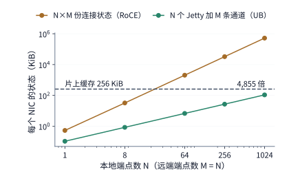

*图 7-33　当 $N$ 个本地端点与 $M=N$ 个远端端点全连接通信时，单张网卡所需维护的硬件上下文体积（双对数坐标）：传统逐对连接（RoCE RC，斜率为 2）在 $N$ 刚超过 22 时便撑破了 256 KiB 的网卡片上缓存红线；而“端点加传输通道”解耦架构（UB，斜率为 1）直至 $N=1024$ 时占用仍不足片上缓存的一半（仅 108 KiB）。*

**状态膨胀如何直接转化为微秒级的延迟悬崖？** 假设网卡片上专用于缓存连接上下文的 SRAM 容量为 **256 KiB（262,144 B）**，容纳不下的上下文只能溢出一部分存放在外部内存中：
- 对于传统逐对连接，令 $512N^2 + 32N > 262{,}144$，解得当活跃端点数达到 **$N \ge 23$** 时，片上缓存即告溢出；
- 对于 UB 端点加通道架构，令 $108N > 262{,}144$，直至活跃端点数达到 **$N \ge 2428$** 时才会发生溢出。

一旦发生片上缓存溢出（Cache Miss），每次通信操作在收发两端都必须额外付出一次“从外部内存拉取上下文”的惩罚，且这笔惩罚的大小直接取决于网卡所处的总线位置（回顾第 7.3.3 节）：
- 在 **PCIe 外设网卡**上，未命中的上下文存放在主机 DRAM 中，发起端网卡与目标端网卡各自需要额外执行一次跨 PCIe 的 DMA 读取（每次 500 ns），导致单次远程读取延迟瞬间激增约 **$1000\ \mathrm{ns}$（$1\ \mu\mathrm{s}$）**；
- 而在 **UB 片上总线控制器**上，未命中的上下文存放在本地一致性内存中，收发两端各自只需做一次片上总线穿越加内存行读取，合计仅增加约 **$200\ \mathrm{ns}$**。

图 7-34 将第 7.3.3 节推导的单次 64 B 远程读取延迟扩展为了活跃端点数 $N$ 的函数曲线。在大模型分布式训练与 MoE 专家并行推理中，单次全交换（All-to-All）通信通常涉及几十到数千个并发端点（$N \in [32, 2048]$），恰好落在图 7-34 中间的黄金区间内：在此区间中，传统 PCIe 逐对连接早已跌落缓存悬崖，每一次细粒度读取都要背负额外的 $1000\ \mathrm{ns}$ 上下文换入税（总延迟从 $2.22\ \mu\mathrm{s}$ 恶化至 $3.22\ \mu\mathrm{s}$）；而 UB 架构则稳稳运行在片上缓存平地上，保持约 $0.75\ \mu\mathrm{s}$ 的极低延迟。（顺带一提，笔者的周期级硬件仿真器是按固定表项槽位数——RoCE 512 条、UB 2048 条——而非总字节数来配置片上缓存容量的，因此在仿真曲线中 UB 的溢出点出现在 $N=1024$ 处；但无论按字节数还是按表项数口径核算，核心工程结论都完全一致：**事务层与传输层解耦不仅将片上缓存溢出的临界规模推迟了一个数量级以上，更配合片上总线将溢出后的未命中惩罚压缩了五倍**。）[^ub-fabric]

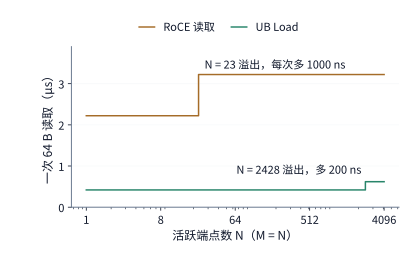

*图 7-34　单次 64 B 远程读取延迟随并发活跃端点数 $N$ 变化的“缓存悬崖”曲线（片上上下文缓存容量为 256 KiB，横轴为对数坐标）：传统逐对连接在 $N = 23$ 处即触发缓存溢出，因收发两端跨 PCIe 拉取上下文而使延迟陡增 1000 ns；UB 端点加通道架构直至 $N = 2428$ 处才触及缓存上限，且溢出后经片上总线拉取上下文仅增加约 200 ns。*

> **实验 7-9 · 延伸：共享传输状态能支持多少隔离组**
>
> 1. 保持本地有 $L = 64$ 个应用端点，但假设它们只需访问 $P = 1$ 个远端目标节点。请沿用教学参数（$e = 256\ \mathrm{B}$，$r = 64\ \mathrm{B}$，$t = 1024\ \mathrm{B}$），分别计算独占传输状态与共享传输状态所需的总存储空间。
> 2. 将远端活跃目标数恢复为 $P = 128$ 个，并将网卡片上可用状态存储空间上限提升至 $2\ \mathrm{MiB}$（2048 KiB），求此时系统最多可以划分多少个完整的业务隔离组 $K$？请对比分析：当集群规模扩大时，增加本地端点数 $L$ 与增加远端目标数 $P$，分别对“固定身份与绑定状态（$Le + LPr$）”和“传输通道状态（$KPt$）”产生怎样的影响？
> 3. 改用 OpenURMA 与 RoCE 的真实硬件表项尺寸（Jetty 20 B、注册内存段 32 B、UB 传输通道 56 B、RoCE QP 上下文 512 B），若将网卡片上上下文缓存容量扩大至 $1\ \mathrm{MiB}$，试求在 $M = N$ 全连接场景下，两种组织方式各自发生片上缓存溢出的临界端点数 $N$。

### 7.4.3 操作依赖与故障隔离

第 7.4.2 节展示了如何通过划分独立的传输通道组，切断不同业务流之间的资源争用。然而，即便在**同一个业务流或同一条共享传输通道内部**，如果硬件或协议栈对操作之间的执行顺序施加了过于死板的约束，同样会制造出严重的无谓等待。

让我们再次以节点 0 向远端发布数据分片的日常场景为例。假设本地端点先后提交了三项操作：
- **操作 A**：将一块计算好的数据载荷 $D$ 跨网写入远端内存；
- **操作 B**：向远端写入一个控制标志位，发布“数据 $D$ 已就绪可读”的通知；
- **操作 C**：向远端另一块完全独立的缓冲区传输另一份毫无关联的张量数据。

从程序正确性的角度看，为了防止接收方在收到通知时读到尚未落地的半截数据，系统**唯一必须严格保序的依赖边是 $\mathrm{A} \to \mathrm{B}$**（即操作 B 必须在操作 A 的数据写入彻底完成并对远端可见之后才能执行）；至于操作 C，由于它访问的是另一块独立内存，在逻辑上与 A、B 毫无瓜葛，完全可以利用空闲的传输窗口并行推进。

**例题 7.4：剔除强加的伪顺序约束，能让无关操作提前多久完成？** 设在某次通信过程中，操作 A 的正常写入传输耗时为 $20\ \mu\mathrm{s}$，但因途中遭遇偶发丢包重传，额外耗费了 $80\ \mu\mathrm{s}$ 的故障恢复时间，直至 $t = 100\ \mu\mathrm{s}$ 时数据 $D$ 才在远端完整落地可见；随后的就绪通知操作 B 耗时 $2\ \mu\mathrm{s}$；而另一项完全独立的数据传输操作 C 本身仅需耗时 $10\ \mu\mathrm{s}$。试对比以下两种顺序管理策略下，整组操作（A、B、C）以及独立操作 C 各自的完成时刻：
1. **严格全局串行（FIFO 全序）**：强制要求 A、B、C 严格按提交先后顺序依次执行完成；
2. **按需偏序（仅保留必要依赖 $\mathrm{A} \to \mathrm{B}$）**：仅要求 B 等待 A 完成，允许无依赖的 C 立即并发执行。

**解答**：
无论是哪种策略，包含丢包恢复在内的“数据写入 $\to$ 恢复可见 $\to$ 发出通知”这条必要依赖链（$\mathrm{A} \to \mathrm{B}$）的累计耗时均为 $20 + 80 + 2 = 102\ \mu\mathrm{s}$。
- 在**策略 1（严格串行）**下，尽管操作 C 与操作 A 毫无数据依赖，但由于被排在同一条 FIFO 顺序队列中，C 被迫为 A 的丢包恢复陪绑等待，直到 $t = 102\ \mu\mathrm{s}$ 时 B 彻底结束后才能启动，最终在 $t = 102 + 10 = 112\ \mu\mathrm{s}$ 时才宣告完成（图 7-35）；
- 在**策略 2（仅保留必要依赖）**下，操作 C 在 $t = 0\ \mu\mathrm{s}$ 时刻即可与操作 A 并行发出，仅需 $10\ \mu\mathrm{s}$ 便早早执行完毕；而受丢包影响的发布链 A→B 则在自己的轨道上继续恢复，于 $t = 102\ \mu\mathrm{s}$ 结束（图 7-36）。

对比两组结果可以发现一个极富启发性的现象：从整组任务的完工时刻看，策略 2 似乎只把总时间从 $112\ \mu\mathrm{s}$ 缩短到了 $102\ \mu\mathrm{s}$（整体仅提前 $10\ \mu\mathrm{s}$）；但对于**正在下游苦苦等待操作 C 结果的算子**而言，策略 2 却让 C 的交付时刻从 $112\ \mu\mathrm{s}$ 骤然提前到了 $10\ \mu\mathrm{s}$，**提前了 $102\ \mu\mathrm{s}$（提速逾 11 倍）**。

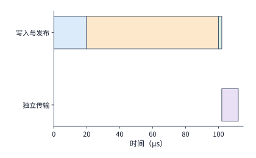

*图 7-35　严格串行顺序下的队头阻塞：将独立传输 C 也强行排在发布链 A→B 之后，导致 A 遭遇的 $80\ \mu\mathrm{s}$ 丢包恢复把无关的 C 一并拖延到了 $102\ \mu\mathrm{s}$ 之后才能启动，整组操作直至 $112\ \mu\mathrm{s}$ 方才结束。*

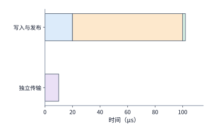

*图 7-36　仅保留必要偏序依赖（$\mathrm{A} \to \mathrm{B}$）时的故障隔离效果：蓝色代表 A 正常写入（$20\ \mu\mathrm{s}$），橙色代表 A 丢包恢复（$80\ \mu\mathrm{s}$），绿色代表 B 发出就绪通知（$2\ \mu\mathrm{s}$）；由于解除了多余的串行约束，使用独立资源的传输 C（紫色）得以从 $0\ \mu\mathrm{s}$ 直接启动并在 $10\ \mu\mathrm{s}$ 完成，彻底免受 A 故障恢复的牵连。*

倘若网络抖动加剧，使操作 A 的丢包重传恢复时间从 $80\ \mu\mathrm{s}$ 恶化至 $200\ \mu\mathrm{s}$，那么在严格串行模式下，无辜的操作 C 将被迫推迟到 $232\ \mu\mathrm{s}$ 才能完成；而在按需偏序模式下，操作 C 依然稳如泰山地在 $10\ \mu\mathrm{s}$ 准时交付。这正是**细粒度依赖管理在故障隔离（Fault & Straggler Isolation）上的核心价值**：剔除强加的伪顺序约束，能够将单次丢包或局部慢节点的停顿半径，严密禁锢在真正消费该份数据的那条因果链内部，防止局部抖动演变为波及全局的队头阻塞。[^ordering]

从编程模型演进的角度看，“全局严格保序（Total Order）”之所以在早期协议（如传统 RoCE RC 单队列）中广受青睐，是因为它替上层程序员省去了显式声明依赖的编程负担——程序员只需按先后次序往队列里塞请求，底层硬件便无条件保证“先提交的请求一定先完成”。然而，这种省心是以牺牲所有独立工作的并发自由度为代价的。而在大模型计算图中，哪些数据写入（A）与哪些控制通知（B）存在因果依赖、哪些分片传输（C）彼此正交独立，编译器与通信运行时一清二楚。只要通信接口允许上层**按需显式标注依赖关系（Explicit Dependency Tagging）**，底层网络硬件就只需对真正挂有依赖标签的操作实施保序拦截，而让其余无依赖操作全速超车。

当然，在画依赖图时还必须警惕另一类隐性约束——**物理硬件资源的独占争用（Resource Dependency）**。在例题 7.4 中，操作 C 之所以能在 $0\text{--}10\ \mu\mathrm{s}$ 内顺利跑完，隐含了一个前提：底层硬件拥有独立的发送通道或充裕的交替发射能力，使得 A 在等待恢复的 $80\ \mu\mathrm{s}$ 内不会阻塞发送引擎。假如硬件设计存在缺陷，导致同一个处理单元一旦开始执行 A，就必须一直独占保持到 B 通知结束才能切换处理下一个描述符，那么这台独占处理单元本身就在依赖图上强行添上了一条从 $\mathrm{B} \to \mathrm{C}$ 的**资源依赖边**——此时哪怕软件接口完全放开了顺序约束，操作 C 依然只能在 $102\ \mu\mathrm{s}$ 后启动、$112\ \mu\mathrm{s}$ 处完成。因此，真正的无阻塞通信必须“软硬兼施”：既要在软件接口上消除多余的逻辑顺序边，又要在硬件微架构上消除单通道阻塞的资源独占边。

**硬件微架构实证：OpenURMA 按需顺序跟踪器的零额外延迟与故障隔离。** 在芯片硬件上实现“按需指定顺序”究竟会不会拖慢正常流水线？笔者的 OpenURMA 硬件实现将灵衢（UB）规范定义的四种顺序服务模式与三种执行依赖标签统一集成到了同一条 322 MHz 发送流水线中。周期级硬件仿真给出了清晰的实测数据：
1. **正常发送零额外周期开销**：无论上层请求指定哪一种顺序模式，只要其前序依赖已经满足（或本身不带顺序约束），请求从提交进入流水线到首个数据包出线，耗时恒定为 **24 个时钟周期**——无顺序要求的自由请求完全不必为硬件顺序跟踪器支付任何额外周期税；
2. **有依赖请求的精准拦截开销极低**：唯有当某个请求明确打上“必须等待前序操作完成”的标签、且前序操作确实尚未结束时，硬件顺序跟踪器才会将其精准挂起；当前序未完成操作不超过 4 项时，状态检查与唤醒开销至多不超过 **50 个时钟周期（约 $155\ \mathrm{ns}$）**；
3. **跨发起方的彻底非阻塞隔离**：为了验证故障隔离能力，我们在仿真中人为构造了一个极端阻塞场景——将某一个发起方的请求固定停留在“等待前序慢操作完成”的挂起槽位上；与此同时，让另外 4 个发起方连续提交 8 个不带顺序依赖的独立请求。实测显示，这 8 个独立请求在 **78 个时钟周期（约 $242\ \mathrm{ns}$）** 内便悉数顺畅出线完毕，那个被挂起的阻塞请求没有对旁路造成哪怕一个周期的拖累。作为鲜明对照，在同工具链实现的 RoCE 可靠连接（RC）硬件中，由于同一个 QP 内的所有请求必须严格按 PSN 顺序串行推进，一旦队首请求因等待确认或重传而停顿，排在后面的所有请求便瞬间全部冻结——这恰恰就是例题 7.4 中图 7-35 在硅片硬件上的真实写照。[^ub-design]

> **设计背景：网络层全局全序（Total Order）如何简化上层状态机复制与容错？**
>
> 既然细粒度偏序能最大化并发性能，那么在什么场景下我们反而需要网络主动提供“全局全序”保证呢？笔者在早期的 **1Pipe** 研究中曾深入探索过由数据中心网络直接提供原子的全局全序广播（Totally Ordered Multicast）机制。在分布式共识、元数据状态机复制以及参数服务器协同更新等场景中，如果底层网络能够保证所有参与节点都以完全一致的全局顺序观察到每一笔更新请求，上层应用程序就可以彻底省去复杂的分布式锁与多轮两阶段提交协议，用极简的状态机逻辑实现强一致复制。然而，1Pipe 的深入实践也让我们深刻认识到，一旦将视野扩展到节点随时可能宕机的真实容错环境，**“操作顺序保证（Ordering）”与“可靠交付及故障恢复（Delivery & Fault Recovery）”就必须清晰解耦**：例如当某个发送方发出一半报文后突然掉线退出，系统必须依靠独立的成员管理与恢复协议来裁定哪些节点已经收到了半截数据、哪些在途事务应当原子回滚；当某个接收方永久宕机时，系统又必须及时将其踢出同步组以免拖死全局。正是这些来自极端容错场景的经验，促使我们在设计新一代 AI 互联架构时，将“细粒度偏序依赖表达”与“底层通道可靠交付及超时隔离”模块化地分离开来。

在厘清了发送端的“写入 $\to$ 通知”顺序之后，我们还必须补上接收端的最后一块拼图：**就算发送端严格遵守了“先写完数据 $D$、再发出就绪通知”的铁律，如果接收端自身的读取时机或乱序执行出了差错，消费者依然可能读到陈旧的过期数据（Stale Data）**。

让我们通过图 7-37 的反例来剖析这一隐蔽陷阱。设远端内存中的数据块 $D$ 初始旧值为 $0$；生产者在 $t = 2\ \mu\mathrm{s}$ 时将 $D$ 更新为新值 $1$，随后严格保序地在 $t = 3\ \mu\mathrm{s}$ 时将就绪标志位更新为“已就绪”。现在考察接收端消费者算子的行为：假设由于乱序投机执行或缺乏读取端内存屏障，消费者在 $t = 1\ \mu\mathrm{s}$ 时就提前发出了读取数据 $D$ 的请求（此时读到的是旧值 $D = 0$），而在 $t = 4\ \mu\mathrm{s}$ 时才去读取就绪标志位（此时读到了 $3\ \mu\mathrm{s}$ 发布的“已就绪”新标志）。更具有迷惑性的是，假设底层网络或本地接口队列在向应用程序交付结果时，特意按照“先返回标志位结果、再返回数据 $D$ 结果”的顺序在 $t = 5\ \mu\mathrm{s}$ 呈报给上层程序——上层程序看到“标志位确实已就绪”，便放心地使用了随之返回的 $D$，殊不知这个 $D$ 里装的依然是在 $t = 1\ \mu\mathrm{s}$ 采样到的陈旧值 $0$。

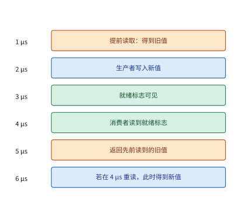

*图 7-37　接收端提前读取导致获取到陈旧数据的反例：时间轴上依次标出了消费者实际读取采样时刻（实心圆点）、生产者数据更新（$2\ \mu\mathrm{s}$）、就绪标志发布（$3\ \mu\mathrm{s}$）以及结果返回给上层的时刻（空心圆点）。即便在 $5\ \mu\mathrm{s}$ 处按序向程序返回结果，里面携带的依然是 $1\ \mu\mathrm{s}$ 处采样到的旧值 $0$；唯有在 $4\ \mu\mathrm{s}$ 处检测到版本/时序冲突并发起重读，才能在 $6\ \mu\mathrm{s}$ 处拿到正确的新值 $1$。*

图 7-37 揭示了一条在并发编程与硬件内存模型中十分关键的定理：**决定读取操作拿到新值还是旧值的，是请求在目标内存上真正发生采样的物理时刻（图中实心点），而不是读取结果最终返回给调用方的交付时刻（图中空心点）**——仅仅把空心点向后推迟排队，绝不会改变实心点当初采样到的历史旧值。为了杜绝此类过期读取，接收端只有两条合法路径可选：
1. **保守的观察后读取（Read-after-Observe / Acquire Semantics）**：强制消费者必须先轮询看到就绪标志位置位（在 $3\ \mu\mathrm{s}$ 之后），再通过读取屏障（Load-Acquire Fence）发起对数据 $D$ 的实际读取；
2. **乐观的投机读取加冲突重读（Speculative Read with Validation & Retry）**：允许消费者在 $1\ \mu\mathrm{s}$ 提前投机读取 $D$，但在 $4\ \mu\mathrm{s}$ 检查就绪标志或版本号时，硬件/运行时必须对比时间戳或版本计数，一旦发现“数据采样发生在版本更新之前”的读写冲突，立即作废旧结果并发起重读（若重读耗时 $2\ \mu\mathrm{s}$，则在 $t = 6\ \mu\mathrm{s}$ 拿到正确的新值 $1$）。

简言之，要想通过顺序保证来简化上层分布式编程，系统就必须在收发两端同时守住边界：发送端保证“数据可见先于通知发布（Release）”，接收端则必须保证“通知观察先于数据采样（Acquire）”或配备完备的投机冲突重读机制。

### 7.4.4 请求槽位的释放与背压

在第 7.3.4 节的吞吐模型 $B_{\mathrm{eff}} \le \min(B_{\mathrm{path}}, Nm/T, m/\delta)$ 中，我们曾指出：单个请求槽位的周转占用时间 $T$，不仅包含请求在网络上的往返传输耗时，还包含**完成通知（CQE）在完成队列中排队等待软件或设备轮询消费并释放槽位的时间**。如果物理网络传输极快，但下游或本地负责收割完成队列的线程处理得太慢，系统中就会堆积起大量“网络传输早已结束，但请求槽位迟迟无法释放归还”的僵尸条目，最终导致发送端因槽位耗尽而完全停滞。

让我们用一组具体参数来复盘这一阻塞过程（图 7-38 与图 7-39）。假设某个通信端点需要连续发起 16 次远程传输操作，每次传输载荷为 $m = 8\ \mathrm{KiB}$，发送前端最快每 $1\ \mu\mathrm{s}$ 可以提交一次请求，且每次请求一旦发出，仅需 $5\ \mu\mathrm{s}$ 即可完成网络传输。然而，负责轮询完成队列（CQ）并回收槽位的软件线程每隔 $20\ \mu\mathrm{s}$ 才被调度唤醒一次，且每次唤醒最多只能批量处理并释放 4 条完成记录（因而处理完 16 条完成通知总共需要 $4 \times 20\ \mu\mathrm{s} = 80\ \mu\mathrm{s}$）。现在对比两种槽位配额下的系统表现：
- **情形一（配备 16 个请求槽位，图 7-39）**：由于槽位充裕，发送端可以从 $t = 0\ \mu\mathrm{s}$ 到 $t = 15\ \mu\mathrm{s}$ 一次性将 16 次请求全部提交出去，到 $t = 20\ \mu\mathrm{s}$ 时所有数据均已跨网传输完毕；但软件线程仍需按部就班地每 $20\ \mu\mathrm{s}$ 回收 4 个槽位，直到 $t = 80\ \mu\mathrm{s}$ 时全部槽位才彻底归还。
- **情形二（仅配备 8 个请求槽位，图 7-38）**：发送端在最初 $0\text{--}7\ \mu\mathrm{s}$ 内迅速提交完前 8 次请求，便将 8 个槽位悉数占满；尽管这 8 次传输在 $t = 12\ \mu\mathrm{s}$ 时就已全部跑完，但由于软件线程要到 $t = 20\ \mu\mathrm{s}$ 才首次醒来回收前 4 个槽位，第 9 至第 12 次请求被迫一直卡到 $t = 20\ \mu\mathrm{s}$ 才能提交，第 13 至第 16 次请求更是被推迟到 $t = 40\ \mu\mathrm{s}$（第二批槽位回收后）才能发出，导致全部数据传输拖延到 $t = 48\ \mu\mathrm{s}$ 才告结束；至于全部槽位的最终释放时刻，则依然是 $t = 80\ \mu\mathrm{s}$。[^reclaim]

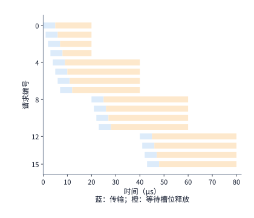

*图 7-38　当仅有 8 个请求槽位时的提交阻塞与延迟释放：蓝色条带表示请求从提交到网络传输完成的区间（$5\ \mu\mathrm{s}$），橙色条带表示传输完成后等待软件轮询处理完成通知的滞留区间，唯有橙色区间结束槽位才得以复用。由于前 8 个槽位被迅速占满且每 $20\ \mu\mathrm{s}$ 才批量回收 4 个，后续请求被迫分批推迟提交，数据传输拖延至 $48\ \mu\mathrm{s}$ 才结束。*

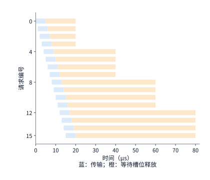

*图 7-39　将请求槽位扩充至 16 个后的时序对比（与图 7-38 采用相同时间轴）：充足的槽位让全部 16 次请求得以在最初 $15\ \mu\mathrm{s}$ 内连续提交、$20\ \mu\mathrm{s}$ 内完成传输（蓝色条带整体左移）；但由于完成通知依然每 $20\ \mu\mathrm{s}$ 才批量消费 4 项，右侧漫长的橙色等待区间丝毫未减，最后一个槽位依然要到 $80\ \mu\mathrm{s}$ 才能释放。*

将图 7-38 与图 7-39 上下对照，一条核心系统工程定律跃然纸上：**盲目扩充队列槽位数量（从 8 增至 16），只能吸收短时间的突发提交（让前 16 个请求的蓝色传输条带左移提前），却丝毫无法缩短右侧漫长的橙色回收滞留区间；决定系统长期稳态持续吞吐的，永远是槽位最终被消费并归还的平均速率**。

我们可以直接用第 7.3.4 节的吞吐公式定量印证这一点：软件轮询线程每 $20\ \mu\mathrm{s}$ 处理 4 项完成通知，相当于槽位回收率仅为 $4 / (20 \times 10^{-6}\ \mathrm{s}) = 200{,}000\ \text{项/秒}$（0.2 MOPS）；在单次操作传输 $m = 8\ \mathrm{KiB}$ 的粒度下，这套回收机制所能支撑的长期稳态吞吐上限仅为 $200{,}000 \times 8\ \mathrm{KiB} \approx \mathbf{1.64\ \mathrm{GB/s}}$。要想在 $m = 8\ \mathrm{KiB}$ 粒度下真正用满一张 400 Gbps 网卡的单向 $50\ \mathrm{GB/s}$ 线速，系统每秒钟必须完成并回收 $50\ \mathrm{GB/s} / 8\ \mathrm{KiB} \approx 610\ \text{万项}$（6.1 MOPS）请求，即平均每 **$0.164\ \mu\mathrm{s}$（164 ns）** 就必须处理完一条完成通知。因此，面对持续的高负载流量，工程上要么通过批量合并完成事件（如仅对每批最后一个请求生成 CQE，即 Selective Signaling）来提高完成处理速率，要么将单次传输载荷 $m$ 进一步放大，绝不能指望靠无限加长队列来掩盖回收慢的顽疾。

当下游完成通知处理不过来、导致可用槽位耗尽时，上游提交端被迫暂停或放慢发送速率的机制，正是我们在第 5 章中深入讨论过的**背压（Backpressure）**。在跨节点网络中，背压不仅发生在本地请求队列与完成队列之间：回顾第 7.4.1 节，如果接收端的目的缓冲区必须等待远端消费者算子算完之后才能归还写入信用，那么一旦远端某个 GPU 算子因计算变慢而迟迟不释放缓冲区，这股背压就会顺着信用反馈链路跨网络反向传播回发送端，迫使发送端停发；而如果多条原本无关的业务流恰好共享了同一个未完成窗口或缓冲池（第 7.4.2 节），单条慢流引发的背压甚至会横向蔓延，演变为跨业务的级联阻塞。

最后，在异常处理与故障恢复场景下，**槽位与缓冲区的安全回收还必须严格遵循“先清空在途残留、再释放复用空间”的准则**。设想某个远程请求因网络超时而被上层判定失败并执行取消（Cancel）：此时如果系统立即将该请求占用的接收缓冲区释放并分配给新的张量对象，万一刚才那个被判定超时的“幽灵旧报文”仅仅是在某个交换机队列里多排了一会儿队、随后又姗姗来迟地写入了网卡，它就会直接覆盖破坏刚刚分配的新对象数据（即著名的**迟到脏写问题，Late / Stale DMA Write**）。为了根除这一隐患，现代 RDMA 与统一互联协议在超时恢复时都必须执行严格的**静默排空与权限吊销流程（Quiesce & Invalidation）**：首先冻结端点禁止新请求提交，随后在硬件层吊销旧内存访问密钥（R_Key / Token）或递增缓冲区世代版本号（Generation Number），并等待网络中最大报文存活周期排空或将失联远端端点彻底隔离（Fencing）之后，方可将缓冲区与请求槽位重新投入循环使用。

以上我们站在单个端点的视角，剖析了“发送提交速率”与“完成回收速率”失配如何导致本地槽位积压与背压；而当视野放大到成百上千个端点共同汇入同一张物理交换网络时，同样的“瞬时注入速率大于链路排空速率”的失配，就会在交换机芯片内部转化为剧烈震荡的**物理排队队列**——这正是第 7.5 节即将展开的共享网络拥塞控制与无损可靠传输主题。

> **实验 7-10 · 核心：放宽操作顺序如何减少等待并保持数据正确**
>
> 1. 在例题 7.4 中，保持操作 A 写入耗时 $20\ \mu\mathrm{s}$、丢包恢复耗时 $80\ \mu\mathrm{s}$、通知操作 B 耗时 $2\ \mu\mathrm{s}$ 不变，但将独立传输操作 C 的耗时从 $10\ \mu\mathrm{s}$ 延长至 $50\ \mu\mathrm{s}$。试分别计算在“严格串行顺序”与“仅保留必要依赖（$\mathrm{A} \to \mathrm{B}$）”两种安排下，整组操作（A、B、C）以及独立操作 C 各自的完成时刻。
> 2. 承接第 1 问，假设接收端消费者算子在收到操作 B 的就绪通知后，需要耗费 $30\ \mu\mathrm{s}$ 来读取并处理数据 $D$。请结合第 7.4.1 节的生命周期规则，标出远端目的缓冲区最早可以安全接收下一轮新数据覆写的时刻。
> 3. 针对图 7-37 的陈旧数据读取反例，请分别画出“保守观察标志位后再发起读取”与“在 $1\ \mu\mathrm{s}$ 提前投机读取、$4\ \mu\mathrm{s}$ 发现冲突后立即重读”两条完整执行路径的时序图，并对比两者最终拿到正确新值的完成时刻。

## 7.5 共享网络中的拥塞与可靠性

### 7.5.1 从固定流量到随时间变化的需求

在前几节的分析中，我们大多假设网络中只有单一的训练或推理任务在独占物理链路。然而在真实的云数据中心或大型 AI 集群中，一张多轨 Clos 网络往往同时承载着多个训练与推理作业。让我们把前几节的双机训练算例扩展一步：假设集群中同时运行着**两项相互独立的双机训练作业**，且这两项作业被调度器放置在了第 7.2.5 节所述的多轨拓扑上——每项作业的两台服务器恰好分属不同的叶交换机机柜组（每组 32 台服务器）。此时，同一条 rail 平面上的跨机流量无法再在单台叶交换机内部一跳直达，而必须通过叶交换机的上联端口（Uplink）汇入脊交换机层（Spine）；不巧的是，由于静态路由或哈希碰撞，这两项作业在该 rail 上的跨机流恰好被分配到了**同一条 400 Gbps（单向 50 GB/s）的叶到脊上联链路**上。由于每项作业在执行分层归约的跨机阶段时，都会让各自网卡以 50 GB/s 的线速全力发送，一旦两项作业的通信窗口在时间轴上发生重叠，涌向这条共享上联链路的瞬时总流量就会达到 $100\ \mathrm{GB/s}$，瞬间超出物理链路 $50\ \mathrm{GB/s}$ 的承载极限。

**例题 7.5：为什么一条平均带宽利用率只有 40% 的网络链路，依然会发生严重的排队与拥塞？** 假设上述两项训练作业的迭代周期均为 $100\ \mathrm{ms}$；在每个周期内，每项作业都有 $80\ \mathrm{ms}$ 在执行纯本地前向与反向计算（期间不发送任何跨机流量），随后在剩下的 $20\ \mathrm{ms}$ 通信窗口内以 $50\ \mathrm{GB/s}$ 的全速发送梯度归约数据。设共享上联链路的出口速率为 $B = 50\ \mathrm{GB/s}$，交换机队列初始为空，且先假设交换机拥有无限大的缓冲区来容纳所有积压报文。试分析两项作业在不同时间相位关系下的排队行为。

**解答**：
若先按传统的分钟级监控指标核算，两项作业在 $100\ \mathrm{ms}$ 周期内的平均总注入带宽仅为：

$$
\bar{\lambda} = 2 \times 50\ \mathrm{GB/s} \times \frac{20\ \mathrm{ms}}{100\ \mathrm{ms}} = 20\ \mathrm{GB/s}.
$$

与 $50\ \mathrm{GB/s}$ 的上联出口能力相比，这条链路的**平均带宽利用率只有 40%**，从宏观监控图上看似乎空闲得很。然而，AI 集合通信具有鲜明的“平时静默、瞬时全速脉冲”特征：
- **当两项作业的 $20\ \mathrm{ms}$ 通信高峰完全重叠时**（例如都在 $t = 0\ \mu\mathrm{s}$ 同时开始通信）：在 $0\text{--}20\ \mathrm{ms}$ 期间，交换机上联端口的总到达速率高达 $\lambda = 100\ \mathrm{GB/s}$，比出口排空速率 $B = 50\ \mathrm{GB/s}$ 净高出 $50\ \mathrm{GB/s}$。短短 $20\ \mathrm{ms}$ 内，交换机队列中累积的未发出数据峰值将高达：

$$
Q_{\max} = (100 - 50)\ \mathrm{GB/s} \times 20\ \mathrm{ms} = 1\ \mathrm{GB}.
$$

更糟糕的是，当 $t = 20\ \mathrm{ms}$ 两项作业双双把数据发完、停止注入后，交换机还得花费额外的 $1\ \mathrm{GB} / (50\ \mathrm{GB/s}) = 20\ \mathrm{ms}$ 才能把这 1 GB 积压数据彻底排空——也就是说，两项作业虽然在 $20\ \mathrm{ms}$ 时就发完了包，但接收端要等到 $t = 40\ \mathrm{ms}$ 才能收齐数据，通信完成时间整整翻了一倍。
- **当两项作业的通信高峰只发生部分重叠（如重叠 $5\ \mathrm{ms}$）时**：重叠期间队列以 $50\ \mathrm{GB/s}$ 净速率增长，峰值积压降至 $50\ \mathrm{GB/s} \times 5\ \mathrm{ms} = 250\ \mathrm{MB}$。
- **当我们将第二项作业的启动时刻人为推迟 $20\ \mathrm{ms}$、使两个通信高峰完全错开时**：第一项作业在 $0\text{--}20\ \mathrm{ms}$ 独占 50 GB/s 链路，第二项作业紧接着在 $20\text{--}40\ \mathrm{ms}$ 独占链路；在任意时刻，上联端口的总到达速率都不超过 $50\ \mathrm{GB/s}$，交换机队列始终保持为 **0 MB**，两项作业各自的通信耗时都恢复到了理想的 $20\ \mathrm{ms}$。

图 7-40 对比了完全重叠、部分重叠（$5\ \mathrm{ms}$）与完全错峰三种情形下的瞬时到达速率波形，图 7-41 则画出了对应的交换机队列积压曲线。[^queue]

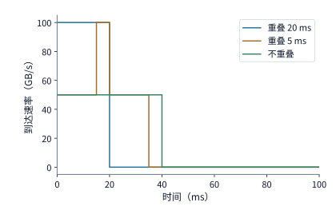

*图 7-40　两项周期性训练作业在不同时间相位下的瞬时到达速率叠加：每项作业在 100 ms 周期内各有 20 ms 以 50 GB/s 全速发送；当两者的通信窗口发生完全重叠、5 ms 部分重叠或完全错开时，共享的 50 GB/s 上联出口将面对截然不同的瞬时流量冲击。*

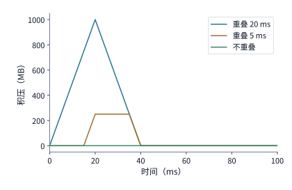

*图 7-41　三种通信重叠程度在交换机出口处产生的队列积压曲线（按理想无限缓冲计算）：对到达速率与 50 GB/s 出口速率的差额随时间积分，完全重叠、5 ms 部分重叠与完全错峰分别产生 1000 MB（1 GB）、250 MB 与 0 MB 的峰值排队积压。*

**工程讨论：真实的交换机芯片缓冲区究竟能容忍多大的发送时刻重叠误差？** 在上面的理想算例中，我们假设交换机拥有足以吞下 1 GB 乃至 250 MB 积压的“无限缓冲”。然而回到真实的商用交换机芯片（参见第 6 章），整颗交换芯片由全部 64 个端口共享的片上高速缓冲区总量通常只有几十到一百多 MiB，分摊到单条端口、单个突发流上的可用缓冲配额往往仅有几百 KiB。设两项作业的通信重叠时长为 $h$，则重叠期间产生的新增队列积压为 $\Delta Q = (100 - 50)\ \mathrm{GB/s} \times h = 50h\ \mathrm{GB/s}$。假如我们为这次突发留出的交换机端口缓冲配额为 **$512\ \mathrm{KiB}$（约 $524.3\ \mathrm{KB}$）**，那么从空队列出发，在缓冲区被彻底撑爆之前所允许的最大重叠时间 $h_{\max}$ 仅为：

$$
h_{\max} = \frac{512\ \mathrm{KiB}}{50\ \mathrm{GB/s}} \approx 10.5\ \mu\mathrm{s}.
$$

这个数字足以让任何一位系统工程师警醒：在以百毫秒（$100\ \mathrm{ms}$）为周期的训练迭代中，哪怕两项作业的通信窗口仅仅因为细微的时钟抖动擦碰重叠了 **10.5 微秒**（占周期的万分之一），就足以把 512 KiB 的交换机队列瞬间填满；如果是毫秒级的重叠（如 $5\ \mathrm{ms}$ 重叠产生 $250\ \mathrm{MB}$ 积压），更是超出了交换机物理缓冲容量近五百倍。

既然错开通信高峰如此诱人，工业界能否直接在集群调度器中利用训练迭代的周期性来实施“错峰调度”呢？近年来的网络系统研究（如 **CASSINI**）正是沿着这一思路展开的：调度器先通过剖析各训练作业的计算—通信周期特征，在拓扑放置与启动相位上将共享瓶颈链路的不同作业交错排布，并在运行过程中持续监测各作业的迭代时间漂移（Phase Drift），动态微调相位以维持错峰状态。[^cassini] 这里必须强调“持续动态校准”的必要性——本书配套实验曾在 CPU 集群上用两个并发运行的分布式数据并行（DDP）训练作业做过“仅在启动时一次性错峰”的对照实验：即便在启动时特意将第二个作业推迟 50 ms 以错开首个通信波峰，由于操作系统调度抖动与缓存争用会导致两个作业的单步迭代耗时存在微小的随机偏差，跑过十几步之后两者的通信相位便会重新漂移撞车；在三轮实测中，单纯依靠静态初始错峰不仅未能消除拥塞，整组作业的端到端完成时间反而因附加等待拉长了约 2% 到 3%。[^phase] 因此，在真实生产集群中，**宏观层面的周期错峰调度必须与微观层面的实时网络拥塞控制（Congestion Control）相互配合**：前者负责在秒级和毫秒级尺度上削减大面积撞车的概率，而后者则负责在微秒级尺度上根据交换机队列的实时反馈迅速压低偏离预期的发送速率。

### 7.5.2 反馈延迟与缓冲容量

既然多作业相位漂移与集合通信的天然汇聚随时可能在局部端口制造超额流量，网络就必须在交换机队列开始抬头增长的那一刻，尽快通知源头发送方减速。我们用连续流体模型来刻画交换机出口队列的动态演化：记时刻 $t$ 的队列积压字节数为 $Q(t)$，瞬时总到达速率为 $\lambda(t)$，物理端口的恒定排空速率为 $B$。当队列非空且尚未溢出时，队列长度随时间的变化率遵循微分方程：

$$
\frac{dQ}{dt} = \lambda(t) - B.
$$

只要瞬时到达速率高于出口速率（$\lambda(t) > B$），队列就以净速率 $\lambda(t) - B$ 线性膨胀；唯有将到达速率压低到出口速率以下（$\lambda(t) < B$），历史积压才能以净速率 $B - \lambda(t)$ 逐步消退。

为了在缓冲区溢出丢包之前把 $\lambda(t)$ 压下来，现代数据中心网络构建了相互配合的**两道防线**：
1. **逐跳链路流控（Hop-by-Hop Link Flow Control）**：当下游交换机或网卡的接收缓冲区占用量逼近警戒线时，立即向直接相连的**上一跳邻居端口**发送暂停指令，强行冻结上游端口的发送，以最快速度阻止本地接收缓冲区溢出；
2. **端到端拥塞控制（End-to-End Congestion Control）**：将瓶颈交换机处的排队拥塞信号跨越整条网络路径传回给**最源头的发送端网卡**，由源头网卡主动调低注入网络的发包速率，使源头速率从根本上匹配瓶颈链路的承载能力。

为什么需要这两道防线同时存在？根本原因就在于**反馈信号的传播延迟（Feedback Delay）与有限缓冲容量之间的物理矛盾**。让我们沿用 $\lambda = 100\ \mathrm{GB/s}$ 到达、$B = 50\ \mathrm{GB/s}$ 出口的算例来做定量核算：假设交换机端口分配给该队列的总缓冲容量为 $512\ \mathrm{KiB}$（$524{,}288\ \mathrm{B}$），在拥塞刚被检测到时队列中已有 $256\ \mathrm{KiB}$ 的基础积压，仅剩 $Q_{\mathrm{free}} = 256\ \mathrm{KiB}$（约 $262.1\ \mathrm{KB}$）的可用剩余空间。此时每过 $1\ \mu\mathrm{s}$，就会有 $(100 - 50)\ \mathrm{GB/s} \times 1\ \mu\mathrm{s} = 50\ \mathrm{KB}$ 的超额数据涌入队列；这意味着剩下的 $256\ \mathrm{KiB}$ 缓冲空间最多只能撑住：

$$
\frac{262{,}144\ \mathrm{B}}{50{,}000\ \mathrm{B/\mu s}} \approx 5.24\ \mu\mathrm{s}.
$$

假如拥塞反馈信号需要耗费 $T_f = 20\ \mu\mathrm{s}$ 的往返时间才能传回源头网卡并使降速真正生效，那么在这 $20\ \mu\mathrm{s}$ 的“反馈盲区”内，源头仍会源源不断地多灌入 $50\ \mathrm{KB/\mu s} \times 20\ \mu\mathrm{s} = 1\ \mathrm{MB}$（$1{,}000\ \mathrm{KB}$）的超额数据；扣除仅有的 $262.1\ \mathrm{KB}$ 剩余缓冲后，整整有约 **$738\ \mathrm{KB}$ 的数据包因缓冲区溢出而被丢弃**。[^feedback]

将这一物理约束提炼为通用不等式：设检测到拥塞时刻的可用剩余缓冲空间为 $Q_{\mathrm{free}}$，从发现拥塞到源头降速生效的反馈回路总时延为 $T_f$，超额到达速率为 $\lambda - B$，则要想在反馈生效前绝不发生缓冲区溢出丢包，反馈时延必须满足：

$$
T_f \le \frac{Q_{\mathrm{free}}}{\lambda - B}.
$$

这一简洁的不等式道破了无损网络设计的命门：**可用剩余缓冲 $Q_{\mathrm{free}}$ 翻倍，系统所能容忍的反馈延迟上限才翻倍；而一旦多流汇聚导致超额注入速率 $(\lambda - B)$ 翻倍，允许的反馈反应时间就会立即减半**。例如在上述速率下，倘若反馈延迟拉长到 $50\ \mu\mathrm{s}$，期间新涌入的超额数据就会高达 $2.5\ \mathrm{MB}$。

更进一步，当反馈终于在 $t = 20\ \mu\mathrm{s}$ 生效后，源头应该把发送速率降到多少呢？如果源头仅仅把发送速率从 $100\ \mathrm{GB/s}$ 降到与出口持平的 $\lambda' = 50\ \mathrm{GB/s}$，那么此时 $dQ/dt = 50 - 50 = 0$，虽然队列不再继续恶化，但此前已经塞满整个 $512\ \mathrm{KiB}$ 缓冲区的历史积压将**永远无法排空**，队列将长期锁定在满载高延迟状态；唯有将源头发送速率进一步压低到出口速率之下——例如降至 $\lambda' = 40\ \mathrm{GB/s}$，为出口腾出每秒 $B - \lambda' = 10\ \mathrm{GB/s}$（即 $10\ \mathrm{KB/\mu s}$）的净排空余量——塞满的 $512\ \mathrm{KiB}$（$524.3\ \mathrm{KB}$）缓冲才能在约 $524.3 / 10 \approx 52.4\ \mu\mathrm{s}$ 内被逐步抽干，从而在 $t \approx 20 + 52.4 \approx 72\ \mu\mathrm{s}$ 时让队列彻底归零。图 7-42 描绘了这一“前向排队—反向反馈”的反馈控制结构，图 7-43 则完整展示了缓冲区在反馈生效前被迅速填满、溢出丢包，以及在反馈降速至 $40\ \mathrm{GB/s}$ 后线性排空的全过程。

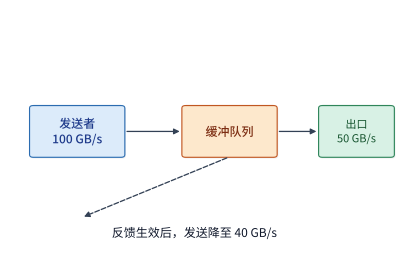

*图 7-42　端到端拥塞控制的反馈回路：数据流沿实线汇入交换机队列并由瓶颈出口排空；当队列超过标记阈值时，拥塞反馈信号沿虚线路径返回源头发送方。在反馈信号跨越网络抵达源头并完成降速之前，发送方仍会按原高速率继续填充队列。*

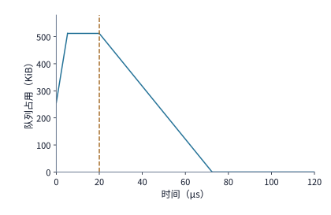

*图 7-43　有限缓冲区在反馈延迟期内的溢出与降速后的排空过程：初始到达速率为 100 GB/s，出口速率为 50 GB/s，512 KiB 缓冲区初始已占用一半（256 KiB）。在 $5.2\ \mu\mathrm{s}$ 时缓冲区即被填满，直至 $20\ \mu\mathrm{s}$ 反馈生效前超额到达的约 738 KB 数据被持续丢弃；$20\ \mu\mathrm{s}$ 处发送速率被压低至 40 GB/s 后，出口才得以按 10 GB/s 的净排空速率在约 $72\ \mu\mathrm{s}$ 处将积压彻底清空。*

观察图 7-43 的折线形态可以看出：**反馈回路时延 $T_f$ 决定了队列满载（或丢包）平台期持续的宽度，而反馈后的降速幅度 $(B - \lambda')$ 则决定了右侧积压消退斜坡的陡峭程度**。工业界形形色色的拥塞控制协议，归根结底都是在围绕这两个几何参数做文章：
- 在传统 RoCEv2 网络中，广泛采用**显式拥塞通知（ECN）**配合 **DCQCN 算法**：当交换机队列超过阈值时在路过的数据包 IP 头中打上 ECN 标记，该包一路走到**接收端网卡**后，再由接收端生成一个拥塞通知包（CNP）沿反方向传回**发送端网卡**来调低发送速率；
- 以 Google **TIMELY** 或 **Swift** 为代表的基于时延（Delay-based）机制，则通过精确测量网络往返时间（RTT）的微秒级增量来推算交换机排队深度，无需等待 ECN 标记即可调节窗口；
- 而在灵衢（UB）架构的 **协同主动队列管理（C-AQM）** 中，交换网络与端点控制器协同联动，能够在队列远未触及溢出红线之前，依据队列占用深度的先验变化率提前向源头下发平滑降速指令。

在评估任何一种新型拥塞控制机制时，读者只需抓住两个核心问题：**第一，它把拥塞信号传回源头的反馈路径缩短了多少微秒？第二，源头收到信号后是按什么函数调整发送速率或窗口的？** 标记阈值高低、调速步长大小与反馈频率快慢，共同决定了系统在“低排队延迟”与“高带宽利用率”之间的动态平衡。

**多对一突发汇聚（Incast）与 PFC／DCQCN 的两级协同。** 在上面的例子中，$100\ \mathrm{GB/s}$ 的到达速率仅来自两条流的叠加；而在大模型集合通信或分布式存储读取中，经常会瞬间爆发严重得多的**多对一扇入汇聚（Incast）**。以第 7.2.2 节的直接 ReduceScatter（或 MoE 的 All-to-All 分发）为例：假设有 $N$ 个参与者同时采用一轮直接发送模式，每个参与者都需要将自己手中的第 $j$ 号数据分片直接发给对应的持有者节点 $j$。如果这 $N$ 个参与者在代码实现中没有错开发送目标次序，而是步调一致地在第一拍全都先向节点 $0$ 以网卡全速 $B = 50\ \mathrm{GB/s}$ 发送各自的第 $0$ 号分片，那么在这一拍内，除节点 $0$ 自身以外的其余 **$N - 1$ 个发送方就会在同一微秒内同时向节点 $0$ 发送**——通往节点 $0$ 的那台叶交换机下行端口瞬间将承受高达 $\lambda = (N - 1)B$ 的总到达速率（反之，若在算法实现中让第 $i$ 号参与者按 $(i + s) \bmod N$ 的循环移位次序错开发送目标，则每个目标端口在任一时刻就只会收到 1 条流，从而在软件层巧妙规避 Incast）。

当 $(N - 1)$ 条 $50\ \mathrm{GB/s}$ 的流同时涌向同一个 $50\ \mathrm{GB/s}$ 交换机出口时，超额到达速率高达 $\lambda - B = (N - 2)B$。设交换机为该端口预留的可用剩余缓冲为 $Q_{\mathrm{free}} = 1\ \mathrm{MiB}$（约 $1.049\ \mathrm{MB}$），代入公式 $T_f \le Q_{\mathrm{free}} / (\lambda - B)$，即可算出在不同汇聚规模 $N$ 下，1 MiB 缓冲区所能撑住的最大反应时间：[^incast]

| 同步汇聚规模 $N$ | 并发发送方数 $(N-1)$ | 瞬时总到达速率 $\lambda$ | 净超额速率 $(\lambda - B)$ | 1 MiB 缓冲允许的最大反馈时延 $T_f$ |
|---:|---:|---:|---:|---:|
| 8 | 7 | 350 GB/s | 300 GB/s | **3.50 μs** |
| 16 | 15 | 750 GB/s | 700 GB/s | **1.50 μs** |
| 64 | 63 | 3150 GB/s | 3100 GB/s | **0.34 μs** |

这张表直观地解释了为什么在 RoCE 无损以太网中，**单靠端到端拥塞控制（DCQCN）根本不可能防住 Incast 丢包，必须依赖逐跳链路流控（PFC）来保障**：
- **第一道防线（PFC 逐跳流控，反馈距离 $\approx 0.33\ \mu\mathrm{s}$）**：IEEE 802.1Qbb 定义的**基于优先级的流控（Priority-based Flow Control, PFC）**工作在相邻两台设备的一跳物理链路上。当下游端口的队列深度超过暂停阈值（XOFF Threshold）时，立即向上游相邻端口发送一个 PFC Pause 暂停帧。我们来算一算这一跳物理反馈回路需要多少时间：假设连接两台设备的 30 米光纤按电磁波传播速度 $5\ \mathrm{ns/m}$ 计算，暂停帧逆流而上传播到上游端口需 $150\ \mathrm{ns}$；而在暂停帧还在路上飞行的这 $150\ \mathrm{ns}$ 内，上游已经发出的在途比特流正顺流而下，还需 $150\ \mathrm{ns}$ 才会全部抵达下游；再加上上游端口收到暂停帧时可能恰好刚开始发送一个 1500 B 的最大以太网帧（无法中途截断，必须等其发完，在 $50\ \mathrm{GB/s}$ 线速下串行化耗时为 $1500\ \mathrm{B} / 50\ \mathrm{GB/s} = 30\ \mathrm{ns}$），三项相加，**PFC 的一跳物理反馈反应时间仅为 $150 + 150 + 30 = 330\ \mathrm{ns} = 0.33\ \mu\mathrm{s}$**。在这短短 $0.33\ \mu\mathrm{s}$ 的刹车距离内继续涌入的在途超额数据，必须由专门预留的**缓冲余量（Headroom Buffer）**全数承接：代入表中超额速率可知，当 $N = 8$ 时需预留 $300\ \mathrm{GB/s} \times 0.33\ \mu\mathrm{s} = 99\ \mathrm{KB}$；当 $N = 16$ 时需预留 $231\ \mathrm{KB}$；即便到了 $N = 64$ 的极端汇聚，所需 Headroom 也约为 $3100\ \mathrm{GB/s} \times 0.33\ \mu\mathrm{s} \approx 1.023\ \mathrm{MB} < 1\ \mathrm{MiB}$（$1.049\ \mathrm{MB}$），全部都能稳稳装进 1 MiB 的缓冲池内（注：在经典 DCQCN 论文中，针对单条 40 Gbps 链路、1500 B MTU 计算出的单端口单优先级 Headroom 典型值为 22.4 KB）。
- **第二道防线（DCQCN 端到端拥塞控制，反馈距离 $\approx 20\ \mu\mathrm{s}$）**：相比之下，从瓶颈交换机打上 ECN 标记、经接收端网卡生成 CNP、再跨网络传回源头网卡降速，整条端到端反馈回路在数据中心内通常耗时约 **$20\ \mu\mathrm{s}$**。如果取消 PFC、单靠 DCQCN 在 $20\ \mu\mathrm{s}$ 后才降速，那么在这 $20\ \mu\mathrm{s}$ 内涌入瓶颈端口的超额数据总量将高达：
  - $N = 8$ 时：$300\ \mathrm{GB/s} \times 20\ \mu\mathrm{s} = 6.0\ \mathrm{MB}$（约 $5.72\ \mathrm{MiB}$）；
  - $N = 16$ 时：$700\ \mathrm{GB/s} \times 20\ \mu\mathrm{s} = 14.0\ \mathrm{MB}$（约 $13.35\ \mathrm{MiB}$）；
  - $N = 64$ 时：$3100\ \mathrm{GB/s} \times 20\ \mu\mathrm{s} = 62.0\ \mathrm{MB}$（约 $59.13\ \mathrm{MiB}$）。
  这三组数字无一例外地将 1 MiB 缓冲区彻底冲垮。图 7-44 将 $N = 8, 16, 64$ 三条陡峭的队列增长斜线与 $0.33\ \mu\mathrm{s}$（PFC 一跳刹车线）绘制在同一张图上。

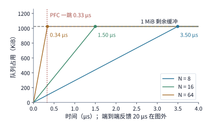

*图 7-44　不同规模多对一汇聚（Incast，$N = 8, 16, 64$）下的交换机队列激增速度与两级反馈时间尺度对比：三条斜线分别以 300、700、3100 GB/s 的超额速率攀升，实心圆点标出了冲爆 1 MiB 剩余缓冲的时刻（分别为 3.50、1.50、0.34 μs）。左侧竖直虚线代表 PFC 的一跳刹车时间（0.33 μs），在此之前三条斜线均未突破 1 MiB 红线；而端到端反馈所需的 20 μs 则远远甩在横轴右侧之外。*

图 7-44 清晰地勾勒出了现代无损网络中 **“PFC 救急、DCQCN 治本”的协同分工**：面对突如其来的多对一微突发（Microburst），PFC 凭借 $0.33\ \mu\mathrm{s}$ 的极短一跳回路瞬间拉住上游闸门，替端到端拥塞控制争取到宝贵的 $20\ \mu\mathrm{s}$ 喘息窗口，确保在这 $20\ \mu\mathrm{s}$ 内交换机绝不因缓冲溢出而丢包；随后，DCQCN 端到端反馈抵达源头网卡，将各个发送端的注入速率平稳压低至瓶颈出口所能消化的水平，下游队列深度随之回落并发送解除暂停帧（XON），网络恢复正常流动。读者不妨用不等式 $(N - 2) \times 50\ \mathrm{GB/s} \times 20\ \mu\mathrm{s} \le Q_{\mathrm{free}}$ 反推一下：倘若没有逐跳流控保障、纯粹依靠 $20\ \mu\mathrm{s}$ 的端到端反馈，那么 1 MiB 的缓冲区最多只能容忍 **$N \le 3$**（即仅 2 个发送方并发汇聚）；即便把单队列缓冲扩大四倍到 4 MiB（允许反馈时延放宽至 $13.98\ \mu\mathrm{s}$、$5.99\ \mu\mathrm{s}$ 与 $1.35\ \mu\mathrm{s}$），最多也只能撑到 **$N \le 6$**，依然无法应对几十上百张卡的集合通信汇聚。[^incast] 当然，PFC 这种强制暂停也潜藏着另一项代价：如果下游长期不解除暂停，暂停帧就会沿着交换机层级一路向上游逆流蔓延（PFC Storm / Spreading），一旦在拓扑中咬合成环，就会酿成令整个集群停滞的**物理死锁**——我们将在第 7.5.4 节专门剖析这一机制。

> **实验 7-11 · 延伸：缓冲大小与降速幅度如何影响积压消退**
>
> 设某交换机瓶颈端口的初始总到达速率为 $\lambda = 100\ \mathrm{GB/s}$，恒定出口排空速率为 $B = 50\ \mathrm{GB/s}$，拥塞发生时队列中已有初始积压 $256\ \mathrm{KiB}$。
> 1. 当该端口分配的总缓冲容量分别为 $512\ \mathrm{KiB}$ 和 $1\ \mathrm{MiB}$ 时，为避免发生溢出丢包，系统所能容忍的最大反馈回路时延 $T_f$ 各是多少？
> 2. 假设拥塞反馈信号恰好在缓冲区刚刚被填满（100% 占用）的那一微秒精准抵达源头并生效。若源头将总发送速率分别调低至 $\lambda' = 50\ \mathrm{GB/s}$、$45\ \mathrm{GB/s}$ 和 $40\ \mathrm{GB/s}$，试分别计算从反馈生效时刻起、直至缓冲区积压彻底清空归零所需的排空时间，并从微分方程 $dQ/dt = \lambda(t) - B$ 的角度解释为何其中某一个速率永远无法清空历史积压。

> **实验 7-12 · 延伸：incast 的缓冲与反馈距离**
>
> 1. 在第 7.5.2 节的 Incast 算例中，假设接收端节点通过链路聚合（LAG）或双网卡绑定将下行出口总带宽翻倍至 $B_{\mathrm{out}} = 100\ \mathrm{GB/s}$，而每个发送方网卡的注入速率仍为 $B_{\mathrm{in}} = 50\ \mathrm{GB/s}$。请重新计算当 $N = 8, 16, 64$ 时，1 MiB 剩余缓冲所允许的最大反馈时延 $T_f$ 以及 $0.33\ \mu\mathrm{s}$ PFC 所需的缓冲余量（Headroom）。
> 2. 保持原算例的单向 50 GB/s 出口不变，若将跨机房交换机之间的光纤长度从 30 米拉长至 100 米（仍按光速 $5\ \mathrm{ns/m}$ 计），求此时 PFC 的一跳物理反馈回路时间变为多少微秒？在 $N = 64$ 规模汇聚下，所需的 Headroom 缓冲余量是否还能装进 1 MiB 的剩余缓冲内？
> 3. 若通过将互联协议下沉到超节点内部，使端到端拥塞控制的往返反馈时延从 $20\ \mu\mathrm{s}$ 大幅缩短至 $T_f = 5\ \mu\mathrm{s}$，试求在 1 MiB 剩余缓冲、单端口 50 GB/s 条件下，纯粹依靠端到端反馈即可保证不丢包的最大汇聚规模 $N$。

### 7.5.3 多路径与重传

第 7.5.2 节的拥塞控制通过让源头降速来迁就瓶颈链路；但在一张拥有数十条上联链路的 Clos 多路径网络中，一个更积极的思路是：**既然当前这条路径堵了，为什么不把流量分摊到其他空闲路径上去？**

在多路径网络中，流量分摊有两种截然不同的粒度：
- 第一种是**按流／连接选路（Flow-level Routing）**：将不同的通信连接分配到不同的物理路径上，而同一条连接内部的所有报文始终沿着固定路径行进，从而天然保证了包序列不乱序，但可能因为多条大流碰巧撞在同一条链路上而引发局部拥塞；
- 第二种是**逐包多路径分摊（Packet-level Multipath / Spraying）**：把同一次大数据传输拆碎后的各个报文轮流分发到多条独立路径上并行传输，从而把多条物理链路的带宽拧成一股绳，但代价是**不同路径的排队与传播时延差会原封不动地转化为接收端的报文乱序（Out-of-Order Arrival）**。

让我们先用一组具体的报文时序，算清多路径并行传输的收益与乱序代价（图 7-45 与图 7-46）。假设我们需要跨节点传输 4 个 token 的 BF16 隐藏层向量（总计 $32\ \mathrm{KiB}$），将其拆分为 8 个大小为 $4\ \mathrm{KiB}$ 的数据包（编号 $0\sim 7$），轮流分发到两条相互独立的 $50\ \mathrm{GB/s}$ 物理路径上（每条路径各承担 4 个报文）。在 $50\ \mathrm{GB/s}$ 线速下，每个 $4\ \mathrm{KiB}$ 报文的网卡串行化发送耗时约为 $4096\ \mathrm{B} / (50\ \mathrm{GB/s}) \approx 82\ \mathrm{ns}$，因此每条路径连续发完各自 4 个报文约需 $4 \times 82\ \mathrm{ns} \approx 0.33\ \mu\mathrm{s}$：
- **理想对称情形（图 7-45）**：当两条路径的物理传播与排队时延均为 $1\ \mu\mathrm{s}$ 时，两条路径并行发送，整份 $32\ \mathrm{KiB}$ 数据在 $0.33 + 1.00 = \mathbf{1.33\ \mu\mathrm{s}}$ 时便全部到齐并按序交付给上层算子；相比之下，倘若让全部 8 个报文只走单条路径串行发送，则需要 $8 \times 82\ \mathrm{ns} + 1\ \mu\mathrm{s} \approx \mathbf{1.66\ \mu\mathrm{s}}$。双路径并行切切实实省下了 $0.33\ \mu\mathrm{s}$ 的串行发送时间。[^packets]
- **非对称慢路径情形（图 7-46）**：现在假设第一条路径（快路径，承载偶数号包 $0, 2, 4, 6$）时延仍为 $1\ \mu\mathrm{s}$，而第二条路径（慢路径，承载奇数号包 $1, 3, 5, 7$）因途经拥塞交换机排队，传播加排队时延骤增至 **$9\ \mu\mathrm{s}$**。此时，慢路径上的最后一个报文（7 号包）要到 $0.33 + 9.00 = \mathbf{9.33\ \mu\mathrm{s}}$ 才能抵达接收端；而在快路径上早在 $1.33\ \mu\mathrm{s}$ 前就已全部抵达的 $2, 4, 6$ 号报文，由于排在它们前面的奇数号报文（$1, 3, 5$ 号）迟迟未到，如果协议要求按序交付，这 3 个快路径报文（共 $3 \times 4\ \mathrm{KiB} = 12\ \mathrm{KiB}$）就只能滞留在接收端的**乱序重组缓冲区（Reorder Buffer）**中苦苦等待缺口补齐。结果，传输同样的 $32\ \mathrm{KiB}$ 数据，启用两条路径（$9.33\ \mu\mathrm{s}$）反而比单纯只走第一条快路径（$1.66\ \mu\mathrm{s}$）慢了近 6 倍——根源就在于**双路径并行省下的 $0.33\ \mu\mathrm{s}$ 串行发送时间，在慢路径新增的 $8\ \mu\mathrm{s}$ 排队时延差面前根本入不敷出**。

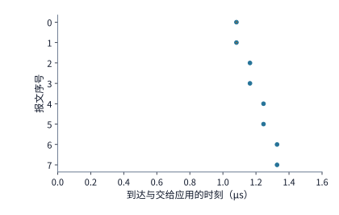

*图 7-45　两条对称路径（时延均为 $1\ \mu\mathrm{s}$）并行传输 8 个 4 KiB 报文的到达时序：两条路径各发 4 个包，约在 $1.33\ \mu\mathrm{s}$ 处全部到齐交付。图中实心圆点代表报文物理到达时刻，圆点右侧的短横线代表因等待前序包而滞留缓存的时间窗口。*

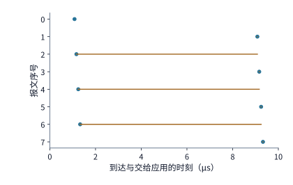

*图 7-46　当第二条路径时延恶化至 $9\ \mu\mathrm{s}$ 时的乱序等待（纵轴为报文序号 $0\sim 7$）：快路径上的后续报文（2、4、6 号）虽早早抵达（左侧圆点），但因慢路径上的奇数号报文（1、3、5、7 号）迟迟未到而形成序号缺口，被迫拉出漫长的水平等待横线（需缓存 12 KiB 乱序数据），直至约 $9.33\ \mu\mathrm{s}$ 时整份数据方能按序交付。*

从图 7-45 与图 7-46 的几何对比中，我们可以直接推导出**双路径均匀分摊优于单条快路径的临界条件**：单路径发送 8 个包需 $0.66\ \mu\mathrm{s}$，双路径各发 4 个包需 $0.33\ \mu\mathrm{s}$，并行节省的串行发送时间仅为 $\Delta T_{\mathrm{tx}} \approx 0.33\ \mu\mathrm{s}$；因此，只要慢路径比快路径多出的单程时延差 $\Delta L > 0.33\ \mu\mathrm{s}$，盲目对半分摊就会落入“被最慢路径拖死”的陷阱。在 $50\ \mathrm{GB/s}$ 的高速链路上，$0.33\ \mu\mathrm{s}$ 的时间余量仅仅相当于 30 m 线缆单程传播时延（约 150 ns）的两倍多（或约 16.5 KB 的排队差异）——这意味着**对于几十 KiB 量级的短消息（如小批量 decode 同步），将其拆散均分到时延不均的多条路径上几乎总是亏本买卖**；短消息要么应当整块走单条最优路径，要么必须根据路径实时时延按非均匀比例配发报文（让慢路径少分包，使各路径的尾包尽量同时抵达）。反之，只有当**单次传输的数据总量足够庞大，使得每条路径分摊到的串行发送时间远大于路径间的物理时延差**时，多路径逐包喷洒才能充分发挥聚合带宽优势——后文即将核算的 $8\ \mathrm{MiB}$ prefill 激活喷洒正是这一正面典型。

除了慢路径导致的乱序迟到，网络中还有另一种更为彻底的异常——**报文真实丢失（Packet Loss）**。假设在传输上述 8 个报文时，排在最前面的 **0 号首包**在途中不幸丢失，直到其原定发送结束时刻过去 $20\ \mu\mathrm{s}$ 后才触发超时重传，并于约 $t = 21.2\ \mu\mathrm{s}$ 处重传抵达接收端（图 7-47）。由于 0 号包是整块数据的开头，在 $21.2\ \mu\mathrm{s}$ 缺口补齐之前，后面早在 $1.66\ \mu\mathrm{s}$ 前就已悉数到达的 $1\sim 7$ 号报文（共 $7 \times 4\ \mathrm{KiB} = 28\ \mathrm{KiB}$）都无法向上层按序交付。但此时面对这 $28\ \mathrm{KiB}$ 已经安全抵达接收端的数据，重传协议有着两种截然不同的处理方式：
- **回退 $N$ 步重传（Go-Back-$N$, GBN，传统 RoCEv2 默认机制）**：接收端一旦发现 0 号包缺失，直接将后续到达的 $1\sim 7$ 号包全部丢弃；发送端超时后，被迫从 0 号包开始把全部 8 个包（共 **$32\ \mathrm{KiB}$**）重新发一遍，额外浪费了 $28\ \mathrm{KiB}$ 的宝贵网络带宽；
- **选择性重传（Selective Repeat / SACK）**：接收端在乱序缓冲区中妥善保留已到达的 $1\sim 7$ 号包（$28\ \mathrm{KiB}$），并通过选择性确认（SACK）明确告知发送端“仅缺 0 号包”；发送端只需精准补发缺失的 **$4\ \mathrm{KiB}$** 即可完成修复。

图 7-47 展示了选择性重传下的到达与交付时序。笔者的 OpenURMA 两节点周期级仿真同样验证了这一显著分野：由于 UB 传输层原生采用选择性确认与按包重传，当链路随机丢包率上升时，系统有效吞吐仅按丢失报文本身的比例平缓下降；而对照的回退 $N$ 步（Go-Back-$N$）实现在相同丢包率下则因反复重发整个滑动窗口而发生了吞吐雪崩。[^ub-design]

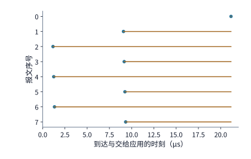

*图 7-47　0 号首包丢失后的选择性重传（Selective Repeat）时序：尽管 1～7 号报文均已正常抵达并暂存于接收端缓存（共 28 KiB），但因 0 号首包缺失，整块数据仍须等待 0 号包在 20 μs 超时后单独补发，直至约 21.2 μs 处补齐缺口方能按序交付。相比于把 8 个包推倒重发的回退 N 步机制，选择性重传将重传流量从 32 KiB 压缩到了 4 KiB。*

当然，要把多路径乱序与选择性重传结合好，传输层还必须破解一道经典的**乱序容忍与快速重传判定难题**：当接收端发现某个序号出现缺口时，究竟该等多久才判定它是“真丢了”而不是“走在慢路径上还没到”？如果判定阈值设得太长，真丢包时的恢复停顿就会像图 7-47 那样拖得很久；反之，如果一见到乱序缺口便立即请求重传，那些仅仅是在慢路径上多走了几微秒的正常报文就会被误判重发，制造出大量无谓的幽灵重复流量。因此，网络路径间的最大时延差分布决定了重传检测必须容忍多宽的乱序窗口，而接收端芯片能分配多大的乱序位图（Bitmap）与重组缓冲，则决定了在缺口补齐前最多能暂存多少后续到达的数据。

**流级等价多路径（ECMP）的哈希碰撞定量分析。** 看完了单次传输内部拆包分摊的利弊，我们再来审视传统数据中心最常用的第一种多路径机制——**等价多路径路由（Equal-Cost Multipath, ECMP）**。当叶交换机需要将跨机柜组的流量发往脊交换机时，必须从该叶交换机的 $m$ 条上联链路中挑选一条。为了防止同一条流内部发生乱序，ECMP 规定交换机对每个数据包头部的五元组（源/目的 IP、源/目的端口、协议号）计算静态哈希值，将哈希结果对上联数 $m$ 取模来决定出口：**同一条流的所有数据包哈希值相同，因而永远走同一条上联链路；不同的流则依靠各自不同的哈希值分散到各条上联上**。

这种静态随机哈希看似公平，实则存在致命的**生日悖论式哈希碰撞（Hash Collision）**：由于每条流是独立随机扔进 $m$ 个篮子（上联链路）里的，极有可能出现“某几条上联链路空无一物，而另一条上联链路上却不幸挤了三四条大流”的严重负载不均。这里需要先结合第 7.2.5 节的拓扑澄清一个关键细节：**只有从同一台叶交换机出发的跨组流，才会共同竞争这台叶交换机的 $m$ 条上联并发生哈希碰撞**——在第 7.2.5 节那个仅有 8 台服务器错位的简单算例中，虽然产生了 8 条跨组流，但那 8 台服务器恰好分散在 8 台不同的叶交换机下，每台叶交换机上仅有 1 条跨组流，自然谈不上同叶碰撞；而在大规模任务中，一旦同一台叶交换机属下的多台服务器同时向外发送跨组流，碰撞就不可避免（这正是 rail 对齐极力把跨组流压到最低的另一个深层原因）。

让我们用概率论精确计算这一碰撞代价。假设同一台叶交换机下同时有 $n$ 条速率相等的大流（Elephant Flows）需要跨组上行，交换机将它们独立、均匀地随机哈希到 $m$ 条上联链路上（沿用第 6 章的交换机配置：$k = 64$ 端口的无阻塞叶交换机拥有 $m = 32$ 条上联，而 3:1 超售叶交换机则拥有 $m = 16$ 条上联）。记随机分配后**最繁忙的那条上联链路分到的流数为 $L_{\max}$**。
- 在理想无碰撞（或完美全局调度）状态下，最忙上联最多只需承载 $\lceil n / m \rceil$ 条流；
- 而在随机哈希下，由于同一条上联链路上的多条流只能平分该链路的单向 $50\ \mathrm{GB/s}$ 带宽，且整组集合通信必须等待**最慢的那条流（即落在最拥挤上联上的流）**传完才能进入下一步，因此整组通信相对于理想无碰撞状态的**有效吞吐保持率**直接退化为：

$$
\text{相对无冲突的有效速度} = \frac{\lceil n / m \rceil}{\mathrm{E}[L_{\max}]}.
$$

下表通过精确求解多项分布的最大值分布，列出了在几种典型流数 $n$ 与上联数 $m$ 组合下的期望最大负载 $\mathrm{E}[L_{\max}]$、第 99 百分位最大负载（p99，即 99% 的随机哈希结果中最忙上联流数不超过该值）、完全无碰撞概率以及相对无冲突的有效速度：[^ecmp]

| 同叶并发流数 $n$ | 叶交换机上联数 $m$ | 理想无冲突最忙流数 $\lceil n/m \rceil$ | 随机哈希期望最忙流数 $\mathrm{E}[L_{\max}]$ | 最忙流数 p99 | 完全无冲突概率 | 相对理想无冲突的有效速度 |
|---:|---:|---:|---:|---:|---:|---:|
| 8 | 32（1:1 无阻塞） | 1 | 1.66 | 3 | 38.6% | **60.1%** |
| 8 | 16（3:1 超售） | 1 | 2.06 | 4 | 12.1% | **48.5%** |
| 32 | 32（1:1 无阻塞） | 1 | 3.53 | 6 | $1.8 \times 10^{-13}$ | **28.3%** |
| 32 | 16（3:1 超售） | 2 | 4.83 | 8 | 0 | **41.4%** |
| 128 | 16（3:1 超售） | 8 | 13.36 | 18 | 0 | **59.9%** |

仔细品读这张表，可以发现几个反直觉却十分关键的工程规律（图 7-48）：
1. **哪怕流数远少于上联数，碰撞依然频繁发生**：当一台 1:1 无阻塞叶交换机（$m = 32$ 条上联）上仅仅只有 $n = 8$ 条跨组流时，完全不发生碰撞的概率也只有 $38.6\%$；在超过六成的情况下都会发生至少两条流撞进同一条上联的事故，导致期望最忙流数升至 $1.66$，整组集合通信的平均速度直接打六折（**$60.1\%$**）；若换用 $m = 16$ 的 3:1 超售叶交换机，无冲突概率更是跌至 $12.1\%$，平均速度跌破一半（**$48.5\%$**）。
2. **当并发流数 $n$ 与上联链路数 $m$ 相等时，ECMP 的效率跌入谷底**：考察整组 32 台服务器同时各发出 1 条跨组流（$n = 32$）、且叶交换机恰好配备 $m = 32$ 条无阻塞上联的黄金配置——按理说 32 条流配 32 条链路，本应一条流独占一条链路、跑出 100% 满速；然而在随机哈希下，32 个球随机扔进 32 个箱子而每个箱子恰好 1 个球的概率仅为 $32! / 32^{32} \approx 1.8 \times 10^{-13}$（近乎为零）。实际上，几乎必然有三分之一的上联完全空转，而最倒霉的那条上联平均要挤进 $\mathrm{E}[L_{\max}] = 3.53$ 条流（p99 甚至高达 6 条流），导致斥巨资建设的 1:1 无阻塞网络**实际只发挥出了 $1 / 3.53 \approx \mathbf{28.3\%}$ 的有效带宽**。
3. **当流数远多于上联数（$n \gg m$）时，大数定律反而平抑了相对波动**：当同一台 $m = 16$ 的超售叶交换机上并发汇入 $n = 32$ 条流乃至 $n = 128$ 条细流时，虽然每条上联都要承载多条流（理想无冲突时分别为 2 条和 8 条），但根据大数定律，随机分桶的相对方差随 $n/m$ 增大而收敛，使得整组相对无冲突的有效速度反而从 28.3% 回升到了 **$41.4\%$**（$n=32, m=16$）和 **$59.9\%$**（$n=128, m=16$）。

由此我们提炼出多路径选路的**翻转条件**：在静态流级 ECMP 哈希下，当**并发大流数 $n$ 与上联链路数 $m$ 旗鼓相当（$n \approx m$）**时，哈希碰撞造成的木桶短板效应最惨烈；唯有当流数极少（$n \ll m$）或将大流拆碎成海量微流（$n \gg m$）时，相对损耗才会减轻。要在工程上彻底根除这一顽疾，出路只有两条：**要么在拓扑与集合通信层通过 rail 对齐将同叶跨组大流数压到最低，要么在传输层彻底抛弃“一条流绑死一条路”的陈规，转向逐包喷洒**。

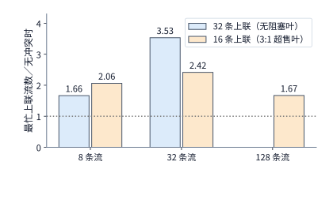

*图 7-48　静态流级 ECMP 哈希在不同流数 $n$ 与上联数 $m$ 配置下的最忙链路过载倍数（即 $\mathrm{E}[L_{\max}] / \lceil n/m \rceil$，其倒数即为整组相对无冲突的有效速度）：蓝色对应 32 上联的 1:1 无阻塞叶交换机，橙色对应 16 上联的 3:1 超售叶交换机。当 32 条流哈希到 32 条上联时过载倍数达到峰值 3.53（有效速度仅 28.3%）；而当 128 条流哈希到 16 条上联时，大数定律使过载倍数回落至 1.67（有效速度恢复至 59.9%）。*

**逐包喷洒（Packet Spraying）与超以太网（UEC）实践。** 既然流级哈希是因为“切分粒度太粗”而无法均匀填满上联篮子，那么只要把同一条大流的数千个数据包逐包轮流喷洒到所有可选路径上，就能让每条上联链路的负载实现像素级的绝对均衡。

让我们用前文建立的乱序模型，核算一次真实大模型 prefill 阶段的逐包喷洒账本：假设需要将 1024 个 token 的 BF16 隐藏层激活张量（总大小 $M = 8\ \mathrm{MiB}$）跨机发送，将其拆分为 2048 个大小为 $4\ \mathrm{KiB}$ 的数据包，均匀轮转喷洒到 **8 条独立的 $50\ \mathrm{GB/s}$ 路径**上；由于各条路径途经的脊交换机队列深度不同，设这 8 条路径的单程传播加排队时延分别分布在 $1\ \mu\mathrm{s}$ 到 $8\ \mu\mathrm{s}$ 之间。我们来对比单路径与 8 路径喷洒的耗时：
- **若走单条 $50\ \mathrm{GB/s}$ 快路径（时延 $1\ \mu\mathrm{s}$）**：串行发送 $8\ \mathrm{MiB}$ 数据需耗时 $8\ \mathrm{MiB} / (50\ \mathrm{GB/s}) \approx 167.77\ \mu\mathrm{s}$，加上 $1\ \mu\mathrm{s}$ 传播时延，总完成时间为 **$168.8\ \mu\mathrm{s}$**；
- **若采用 8 路径逐包喷洒**：每条路径恰好分担 $1\ \mathrm{MiB}$（256 个包），各自串行发送耗时骤降至 $1\ \mathrm{MiB} / (50\ \mathrm{GB/s}) \approx 20.97\ \mu\mathrm{s}$；即便加上最慢那条路径的 $8\ \mu\mathrm{s}$ 时延，全部 2048 个包到齐的总耗时也仅为 $20.97 + 8.00 = \mathbf{28.97\ \mu\mathrm{s}}$（约 **$29.0\ \mu\mathrm{s}$**），比单路径快了将近 **6 倍**。

套用本节开头推导的多路径收益判据：由于 8 路径并行将串行发送时间从 $167.8\ \mu\mathrm{s}$ 大幅砍到了 $21.0\ \mu\mathrm{s}$，省下了整整 $146.8\ \mu\mathrm{s}$ 的发送时间；只要最慢路径的单程时延不超过 $168.8 - 21.0 = \mathbf{147.8\ \mu\mathrm{s}}$，逐包喷洒就稳赚不赔——而这里的慢路径时延仅仅只有 $8\ \mu\mathrm{s}$，远在盈亏红线之内。当然，这 $7\ \mu\mathrm{s}$ 的路径时延差（从最快 $1\ \mu\mathrm{s}$ 到最慢 $8\ \mu\mathrm{s}$）需要由接收端的**乱序重组缓存**来买单：当最慢路径上的某个序号包还在路上磨蹭时，其余 7 条快路径已经超前送达了一批序号更大的报文；经精确计算，接收端在峰值时刻最多需要同时暂存 **339 个乱序报文（约合 $1.39\ \mathrm{MB}$）**。对于现代网卡或片上互联控制器而言，用一两兆字节的缓冲空间换取近 6 倍的端到端带宽提升与彻底免除 ECMP 哈希碰撞，是一笔十分划算的工程交换。[^ecmp]

正因如此，近年来由各大芯片与云厂商联合制定的**超以太网规范（Ultra Ethernet Consortium, UEC）** 以及新一代 AI 专用互联协议，已将**“自适应逐包喷洒 + 选择性重传”**确立为现代 AI 传输层的标准范式：发送端网卡在封装每个数据包时，动态改变报文头中的**路径熵字段（Entropy Field，如 RoCEv2 外层 UDP 源端口号或专用流标签）**，通常在 64 到 256 个不同的熵值之间轮转，从而引导沿途交换机将同一条流的报文均匀喷洒到所有可用上联路径上；一旦拥塞反馈显示某几个熵值对应的路径出现排队积压，发送端便智能绕开这些拥塞熵值（Congestion-aware Spraying）；而在接收端，硬件原生配备大容量乱序位图与选择性确认（SACK）机制，遇到偶发丢包时只精准补发缺失的单包，彻底告别了传统 RoCE 因忌惮乱序而绑死单路径 ECMP、因回退 $N$ 步重传而依赖全网严苛 PFC 的历史包袱。[^ecmp]

**万卡集群光模块微闪断（Link Flapping）与 SACK vs. Go-Back-$N$ 抗丢包定量账本。** 在万卡规模的训练与推理集群中，选择性重传（SACK）的价值不仅体现在拥塞丢包恢复上，更在于抵御光电物理层频繁发生的**间歇性微闪断（Micro-flapping）**。一座万卡智算中心通常部署有数万只 $400\ \mathrm{Gbps}$ 或 $800\ \mathrm{Gbps}$ 高速光模块（涵盖多模 VCSEL 与单模硅光模块）。在长期高负载运行下，由于局部冷却液温波动引起的激光器波长与结温漂移、DSP 时钟恢复环路（CDR）瞬时失锁或光纤端面微米级灰尘散射，部分光链路会间歇性地出现持续数毫秒至数十毫秒的信噪比劣化，导致原始误码率（Pre-FEC BER）瞬间冲破前向纠错（如 RS(544,514) FEC）的纠错上限，演化为概率约 $p = 10^{-4}\sim 10^{-3}$ 的突发物理丢包。这类“亚健康”微闪断极其隐蔽：由于链路并未彻底断开（未触发端口物理 `Link Down` 中断），且持续时间远短于传统网管系统秒级乃至分钟级的 SNMP 轮询周期，常规监控往往显示链路一切正常，但同步集合通信却会频繁卡死在长尾重传上。工程上要捕获并隔离微闪断，必须在网卡与交换机侧开启毫秒级高频遥测，联合追踪物理层的 **FEC 不可纠块计数（`fec_uncorrectable_blocks`）** 与传输层的 **序列号错误／重传计数（`packet_seq_err`）**。

我们可以通过一组简明公式，算清当一条单向 $B = 50\ \mathrm{GB/s}$ 链路遭遇 $p = 10^{-4}$（万分之一）微闪断丢包率时，传统 RoCEv2 **回退 $N$ 步（Go-Back-$N$, GBN）** 与 **UEC 选择性重传（SACK）** 的有效带宽差距（以 $m = 4\ \mathrm{KiB} = 4096\ \mathrm{B}$ 数据包为例，单包串行化耗时 $t_{\mathrm{pkt}} = 4096\ \mathrm{B} / (50\ \mathrm{GB/s}) = 81.92\ \mathrm{ns}$）：
1. **在回退 $N$ 步（GBN）机制下**：每当发生一次丢包，接收端丢弃所有后续到达的乱序包，发送端必须回退重发整个在途滑动窗口，或者经历一次超时等待后再重新填满管道。记单次丢包事件造成的等效额外损失包槽位数为 $K$（若由接收端 NAK 触发快速回退整个 $1\ \mathrm{MiB}$ 在途窗口，则重发窗口包数 $K = N_{\mathrm{win}} = 256$；若尾包或确认包丢失触发时长 $T_{\mathrm{to}} = 200\ \mu\mathrm{s}$ 的重传超时停顿，则损失的等效包槽位数高达 $K = T_{\mathrm{to}} / t_{\mathrm{pkt}} = 200\ \mu\mathrm{s} / 81.92\ \mathrm{ns} \approx \mathbf{2441\ \text{个包}}$）。按更新报酬过程核算，平均每成功交付 1 个有效包需要耗费 $1 + \frac{p}{1-p}K \approx 1 + pK$ 个包的时间槽位，因此链路的**有效吞吐量 $B_{\mathrm{GBN}}$** 退化为：

$$
B_{\mathrm{GBN}} = \frac{B}{1 + \dfrac{p}{1-p}K} \approx \frac{B}{1 + pK}.
$$

代入 $p = 10^{-4}$：即便每次丢包都能走最理想的 NAK 快速回退（$K = 256$），有效带宽也会降至 $50 / (1 + 0.0256) \approx \mathbf{48.75\ \mathrm{GB/s}}$；而一旦触发 $T_{\mathrm{to}} = 200\ \mu\mathrm{s}$ 的超时重传（$K \approx 2441$），万分之一的微小丢包率就会把 $50\ \mathrm{GB/s}$ 链路的有效吞吐直接拉低至 $50 / (1 + 0.2441) \approx \mathbf{40.19\ \mathrm{GB/s}}$（损失近 **$20\%$** 带宽）。倘若光模块微闪断加剧使丢包率升至 $p = 10^{-3}$（千分之一），超时 GBN 的有效吞吐更会雪崩至 $50 / (1 + 2.441) \approx \mathbf{14.53\ \mathrm{GB/s}}$（损失逾 **$70\%$** 带宽），并通过集合通信的木桶效应拖慢整座万卡集群。
2. **在 UEC 逐包喷洒 + 选择性重传（SACK）机制下**：接收端利用硬件乱序位图缓存后续正常抵达的报文，发送端仅需补发丢失的那 1 个包（$K = 1$）。忽略极小的控制信令开销，其有效吞吐保持为：

$$
B_{\mathrm{SACK}} = B(1 - p).
$$

在 $p = 10^{-4}$ 下，$B_{\mathrm{SACK}} = 50 \times 0.9999 = \mathbf{49.995\ \mathrm{GB/s}}$（保持 **$99.99\%$** 线速）；即便丢包率恶化十倍至 $p = 10^{-3}$，SACK 依然能维持 $50 \times 0.999 = \mathbf{49.95\ \mathrm{GB/s}}$（**$99.9\%$** 线速），将单链路微闪断对集群全局集合通信的冲击消弭于无形（见第 7.6.4 节图 7-64 下图）。

**UEC 1.0 四大支柱协议栈、UCCL-Tran 解耦传输引擎与 MoE 热点专家逻辑切分。** 如果我们将上述逐包喷洒与选择性重传放回完整的数据中心网络协议栈中审视，就会看到 **超以太网联盟规范（UEC 1.0）** 实质上通过四大协同支柱重构了 AI 集群的跨节点传输基座（见第 7.6.4 节末尾图 7-66 上图 A）：
1. **报文路由接口（`PRI`，Packet Routing Interface）**：在数据包头部引入标准化路径熵与负载感知路由标签，发送端在 64 至 256 个熵值之间动态轮转以打散 ECMP 流级哈希极化，并在检测到特定上联拥塞时动态剔除慢路径熵值；
2. **超以太网传输层（`UET`，Ultra Ethernet Transport）**：在接收端网卡硬件内建大容量乱序位图（Out-of-Order Bitmap）与直接数据放置（Direct Data Placement，即便报文乱序到达也能根据包头偏移量直接 DMA 写入目标 GPU 显存的正确地址，免除中间重排序缓冲区拷贝），配合融合往返时延（RTT）与显式拥塞标记（ECN）的现代拥塞控制算法（NSCC / SMART）以及按包选择性重传（SACK）；
3. **基于信用的无死锁流控（`CBFC`，Credit-Based Flow Control）**：用细粒度的逐虚通道信用管理逐步取代传统 RoCEv2 中动辄冻结整条物理端口、易诱发跨交换机级联暂停风暴（Pause Storm）的粗粒度优先级流控（PFC）；
4. **链路级局部重传（`LLR`，Link-Level Retry）**：在相邻交换机端口或网卡与叶交换机之间，直接由物理编码子层与数据链路层在百纳秒至微秒级窗口内拦截并重传因光模块微闪断受损的数据帧，避免局部物理误码演变为端到端传输层超时。

与此同时，在多云或异构加速集群中，不同代际的 RDMA 网卡（如 NVIDIA ConnectX-7/8、AWS EFA、Broadcom Thor 2）对硬件乱序重组与多路径喷洒的支持程度参差不齐。针对这一碎片化困局，**UCCL 与 UCCL-Tran（EuroSys '25 / OSDI '26）** 提出了软件定义的**解耦传输层引擎（Decoupled Transport Engine）**：将多路径包喷洒、细粒度流控窗口与多队列对（Multi-QP）调度逻辑从黑盒网卡固件中剥离出来，上移至主机侧高吞吐轻量驱动与可编程传输层中统一编排，从而在不改动底层网卡硬件的前提下，为上层集合通信提供一致的抗哈希碰撞与抗微突发尾延迟保障。[^uccl-tran]

然而，哪怕底层网络通过 UEC 1.0 与 UCCL-Tran 彻底消除了**交换机上联链路**的哈希不均，在大模型 MoE（混合专家）训练与推理的 All-to-All 通信中，依然存在一类由算法自身语义制造的接收端汇聚瓶颈——**应用层热门专家负载偏斜（Hot-Expert Load Skew）**。让我们结合 **Demystifying the Mixture of Experts Serving Tax（MLSys '26）** 与 **CRAFT（MLSys '26）** 的建模算例，把这笔跨算法与系统的通信—计算耦合账算清楚（见图 7-66 下图 B）：[^moe-tax]
- **接收端 All-to-All 热门专家汇聚瓶颈（$2.5\times$ 尾减速）**：考察一个包含 $E = 64$ 个路由专家、部署在 $8$ 张 GPU 卡上（每卡驻留 $8$ 个专家）的 MoE 层，单步全局批大小为 $B = 2{,}048$ 个 token，每个 token 选取 Top-$k = 2$ 个专家，全网共产生 $2{,}048 \times 2 = 4{,}096$ 次 token-专家派发。在理想均匀分布下，单个专家平均接收 $4{,}096 / 64 = 64$ 个 token，单张卡（或一组 4 专家分片）均衡接收 **$256$ 个 token**；但在真实语料下，由于语义聚类偏向，某张卡上的热门专家分片可能单步涌入 **$640$ 个 token**。此时即便网络内部全无碰撞，该热门卡的接收网卡与本地矩阵乘也必须独自吞下 $640 / 256 = \mathbf{2.5\ \text{倍}}$ 的超额流量与算力负荷，直接将整步 All-to-All 与专家计算的完成时刻拖慢 $2.5\ \text{倍}$。
- **批内活跃专家数膨胀与本地分块补齐（Tile Padding）代价**：再以本书固定的 **Qwen3-235B-A22B** 配置（每层 $E = 128$ 个专家、Top-$K = 8$，单个专家含三个 $4096 \times 1536$ 矩阵共 $18{,}874{,}368$ 个参数，BF16 下占 **$36\ \mathrm{MiB}$**，单层 128 个专家常驻占 **$4.5\ \mathrm{GiB}$**）为例。当批内输入 token 数为 $m$ 时，在独立均匀路由的教学基线下，批内至少被选中一次的**独立活跃专家期望数**为
  $$E_{\mathrm{active}}(m) = E \times \left[1 - \left(1 - \frac{K}{E}\right)^m\right].$$
  当 $m = 1$ 时仅激活 $8$ 个专家（逻辑权重读取 $288\ \mathrm{MiB}$）；当 $m = 8$ 时跃升至 **$51.62$ 个专家**（约 $1.815\ \mathrm{GiB}$）；当 $m = 32$ 时已达 **$111.77$ 个专家**，迅速逼近全量 128 个专家。同时在单卡本地算子执行时，假设卡上 8 个本地专家实际分到的 token 行数高度偏斜，依次为 `[32, 16, 8, 4, 2, 1, 1, 0]`（有效载荷合计仅 **$64$ 行**）：若底层分组矩阵乘（Grouped GEMM）内核要求每个非空专家按 $B_{\mathrm{tile}} = 32$ 行硬件分块对齐，则实际填充执行行数为 $\sum_{e: N_e>0} \lceil N_e / 32 \rceil \times 32 = 32 \times 7 = \mathbf{224\ \text{行}}$（膨胀 $3.5\ \text{倍}$）；若按全卡 8 个专家统一对齐到局部最大专家行数（$32$ 行），则高达 $8 \times 32 = \mathbf{256\ \text{行}}$（膨胀 $4\ \text{倍}$）。
- **选择性专家副本（CRAFT）与零拷贝逻辑切分**：为了在不撑爆显存的前提下削平上述 $640$ vs. $256$ token 的热点洪峰，系统无需机械地为全网 94 个 MoE 层的每张卡都各增加 1 个完整 BF16 专家副本（那样每卡需额外消耗 $94 \times 36\ \mathrm{MiB} = 3{,}384\ \mathrm{MiB} \approx \mathbf{3.305\ \mathrm{GiB}}$ 显存，严重挤压 KV 缓存空间）；**CRAFT（MLSys '26）** 证明只需根据各层历史路由倾斜度，在最拥塞的少数关键层按需放置合计 **8 个专家副本/卡**（仅占 $8 \times 36\ \mathrm{MiB} = 288\ \mathrm{MiB} = \mathbf{0.28125\ \mathrm{GiB}/\text{卡}}$，不到全层复制的十二分之一），并在 All-to-All 调度层对超过阈值的热门专家实施**零拷贝逻辑专家切分（Logical Expert Splitting）**——将原本发往单一物理卡的 640 个热门 token 拆分为两份或三份逻辑分片，通过 UEC 多路径喷洒分流至持有该专家副本的空闲伙伴卡上并行计算后再归约合并，即可在源头铲平 All-to-All 的接收端 Incast 尖峰。

> **实验 7-13 · 延伸：路径时延差与重传如何推迟按序交付**
>
> 1. 在图 7-45 与图 7-46 的双路径算例（传输 8 个 4 KiB 报文，共 32 KiB，单路径速率 50 GB/s，第一条路径传播时延固定为 $1\ \mu\mathrm{s}$）中，让第二条路径的传播时延 $L_2$ 在 $1\ \mu\mathrm{s}$ 至 $9\ \mu\mathrm{s}$ 之间连续变化。试求当“双路径平均分配（各发 4 个包）”与“仅使用第一条快路径串行发送全部 8 个包”的按序交付完成时间恰好相等时，第二条路径的临界传播时延 $L_2^*$ 是多少？
> 2. 承接第 1 问，当第一条路径时延为 $1\ \mu\mathrm{s}$、第二条路径时延为 $9\ \mu\mathrm{s}$ 时，若改为非均匀分配——让第一条快路径承担 5 个报文、第二条慢路径承担 3 个报文，求此时的按序交付完成时间；若想让全部 8 个报文最晚到达时刻最小化，两条路径各自应分配多少个报文？
> 3. 在图 7-47 的首包（0 号包）丢失算例中，若将超时重传的等待检测时间从 $20\ \mu\mathrm{s}$ 延长至 $40\ \mu\mathrm{s}$，试计算接收端首次能够向上层按序交付整块数据的时刻，以及在此之前接收端乱序缓冲区需要持续锁定的数据字节数。

> **实验 7-14 · 延伸：哈希冲突与喷洒的边界**
>
> 1. 参照第 7.5.3 节的 ECMP 哈希碰撞表，试通过编程模拟或概率公式求当同一台无阻塞叶交换机（$m = 32$ 条上联）上有 $n = 16$ 条等速跨组流时，最忙上联链路的期望流数 $\mathrm{E}[L_{\max}]$ 与相对无冲突的有效速度；并将其与表中同样满足负载比 $n/m = 1/2$ 的“$n = 8$ 条流哈希到 $m = 16$ 条上联”配置进行对比，解释为何两者的有效速度不同。
> 2. 在 8 MiB prefill 激活（2048 个 4 KiB 报文）分摊到 8 条 50 GB/s 路径的逐包喷洒算例中，若将 8 条路径的传播时延改为从 $1\ \mu\mathrm{s}$ 到 $30\ \mu\mathrm{s}$ 均匀分布，求整块数据的全部到达完成时刻以及接收端峰值乱序缓存开销；再求出使 8 路径均匀喷洒不再快于单条快路径（$1\ \mu\mathrm{s}$）的最慢路径临界时延。
> 3. 保持 8 MiB 总数据量与路径时延分布不变，若将每个数据包的拆分粒度从 $4\ \mathrm{KiB}$ 缩小为 $1\ \mathrm{KiB}$（共 8192 个包），请定性与定量说明接收端峰值乱序缓存的“报文槽位数”和“总字节数”各自会发生怎样的变化。

### 7.5.4 死锁

在第 7.5.2 节与第 7.5.3 节中我们看到，当接收端因乱序缺口未补齐、算子未消费完毕或下行端口拥塞而填满本地缓冲区时，端点背压（Backpressure）与逐跳链路流控（如 PFC Pause 帧）会迫使上游暂停发送，让等待沿着网络链路逐跳向上游蔓延。这种“下游未腾出空位、上游便暂停推进”的保守机制虽然避免了丢包，却隐藏着分布式系统中最凶险的灾难——一旦“释放某项资源 A 所需的前置动作，反过来又必须先申请获得早已被另一方占满的资源 B”，等待链就会首尾咬合成一个闭合的环，触发**死锁（Deadlock）**。

让我们先从最抽象的两方互斥模型看起（图 7-49）：设有两项并发推进的工作任务 1 和任务 2，以及两类容量有限的硬件资源 A 和 B。假设在某一时刻，任务 1 已经占满了资源 A，但必须继续申请获得资源 B 才能执行完并释放 A；与此同时，任务 2 恰好已经占满了资源 B，且必须继续申请获得资源 A 才能执行完并释放 B。此时，双方都攥着对方救命所需的资源不撒手，又都在苦苦等待对方先释放资源，系统便陷入永久停滞。

在大规模集合通信与统一互联系统中，这种循环等待往往**跨越了网络协议栈、内存子系统与算子运行时的多个层次**。例如在分层归约或远程读写中：远端发来的大量请求报文占满了本地网卡的**接收缓冲区（资源 A）**；本地处理引擎为了消费这些请求并腾出接收缓冲，必须向远端发回完成响应或同步消息，因而需要申请本地网卡的**发送队列槽位（资源 B）**；然而此时本地发送队列偏偏已经被发往远端的其他请求塞满，正在等待远端接收缓冲区腾出空间并发回信用——如果远端节点此刻也处于完全对称的“接收缓冲满、等待发送槽位回响应”状态，两台节点之间的请求流与响应流就会使彼此陷入死锁。如果我们将每一类缓冲池或队列槽位画作图中的顶点，把“当前持有资源 $u$ 的事务正在阻塞等待申请资源 $v$”画作有向边 $u \to v$，就得到了系统的**资源依赖图（Resource Dependency Graph）**。只要这张图上出现有向环，且环上每一个顶点的资源池恰在同一时刻被占满，环上所有事务的释放条件便同时冻结，死锁即告爆发。图 7-49 画出了这一双资源循环等待结构，图 7-50 则展示了通过预留独立响应通路来破除死锁的经典解法。

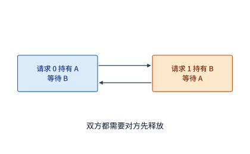

*图 7-49　循环资源依赖引发的死锁：两项请求分别占满了资源池 A 与资源池 B，同时各自阻塞等待申请对方手中的资源（有向箭头代表“持有尾端资源、等待头部资源”）；由于环上无一资源能够先行释放，两项请求陷入永久僵局。*

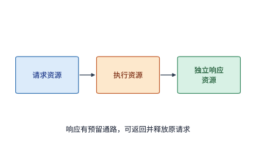

*图 7-50　通过资源物理隔离与单向申请次序破除死锁：将请求接收、本地执行与完成响应拆分为相互独立的资源池，并严格规定按“请求 $\to$ 执行 $\to$ 响应”的单向次序申请资源；由于完成响应拥有专属预留的缓冲区与发送通道，任何已执行的请求都能确保将其响应顺利发回并释放上游资源，从而彻底消除依赖环。*

在体系结构与网络协议设计中，打破资源死锁环主要有两条正交的基本法则：
1. **法则一：强加全局严格偏序的资源申请次序（Ordered Resource Acquisition）**。例如规定系统中的所有事务必须严格按照“先申请资源 A、获得后再申请资源 B”的拓扑序来分配资源，绝不允许任何已经持有 B 的事务反过来去申请 A。如此一来，资源依赖图从数学上就变成了一张有向无环图（DAG），循环等待从根源上无法闭合（在路由算法中，经典的维度序路由 DOR 或 Up\*/Down\* 路由正是利用这一法则来消除交换机端口间的 PFC 路由死锁环）。
2. **法则二：按事务类别划分独立的虚拟通道与预留缓冲池（Virtual Channels & Reserved Response Pool，图 7-50）**。回顾刚才那个“接收缓冲满、响应发不出”的死锁案例：设接收方共有 8 个通用数据槽位，已被上游发来的请求占满，上游发送方正停发等待槽位释放；如果本地生成的“处理完成／释放响应报文”也必须去排队争抢这同一个 8 槽位通用池，双方就会当场陷入死锁。反之，只要我们在硬件上额外划拨出**专为完成响应预留的独立缓冲池与独立发送队列（Response-reserved Slots）**，禁止任何新发起的请求侵占响应槽位，那么无论请求队列堵成什么样，排在最前面的已处理请求总能畅通无阻地通过专属响应通道把完成回执发出去，从而释放掉至少 1 个请求槽位，让整条数据流水线重新转动起来。

在现代交换机芯片、PCIe 总线与片上互连网络中，**虚拟通道（Virtual Channel, VC）** 或服务等级（Traffic Class / Virtual Lane）正是实现法则二的硬件载体：尽管底层只有一根物理光纤或铜缆，但硬件在逻辑上为不同消息类别（如请求类 Request VC、响应类 Response VC、控制信令类 Control VC）分别维护完全独立的缓冲区队列与独立的流控信用计数（PCIe 之所以将 Posted 写、Non-Posted 读请求与 Completion 完成报文严格划分为三个独立的流控信用池，并规定 Completion 报文永远不得被 Non-Posted 请求阻塞，正是为了防止总线协议层死锁）。这里需要特别提醒读者注意：**单靠在报文头里打一个虚拟通道编号并不能变魔术般地消除死锁；真正起决定性作用的，是为高优先级后续阶段（如响应包）物理预留的独立缓冲容量，以及严格禁止低阶段流量回流抢占高阶段资源的单向晋升次序**。

在支持统一虚拟编址与按需分页的现代 AI 互联架构中，这种跨层资源依赖环往往隐藏得更深。举例来说，当网卡或片上互联控制器收到一个远端发来的内存读写请求时，可能需要先查询本地 IOMMU／SMMU 页表以完成虚拟地址到物理地址的转换（Address Translation）；如果恰好发生页表缓存（IOTLB）未命中、甚至需要跨网络向远端管理节点发起一次页表读取或缺页中断处理，那么就会出现**“原始数据请求占着接收槽位等待地址转换完成，而地址转换发出的子请求又必须去申请同一个已耗尽的请求/接收槽位池”**的自锁环路。笔者在参与灵衢（UB）互联架构与 OpenURMA 硬件设计时，就必须将事务层调度、MMU 地址转换、内存控制器访存与物理链路流控画在同一张全系统资源依赖图上进行形式化审查——唯有为完成通知（Completion）、地址转换（ATS/Page Walk）以及超时故障恢复信令分别预留出不受普通数据流挤占的独立硬件通道与保底缓冲配额，才能确保整个超节点集群在遭遇极端微突发拥塞或局部节点宕机时，依然能够稳健排空并自愈，而不至于陷入全网死锁。

## 7.6 从通信改进到任务完成

### 7.6.1 关键路径从数据就绪开始

在第 7.2 至 7.5 节中，我们的视线始终紧跟着一份已经生成好的数据：追踪它如何在拓扑上选路、如何通过并发槽位填满链路、如何按序交付并释放缓冲区。然而，站在整个训练或推理任务的视角来看，评估一项网络优化究竟能把端到端迭代时间缩短多少，绝不能只盯着“数据上路之后”的传输耗时，而必须把**生产数据的上游计算**与**消费数据的下游更新**一并画进同一张全局时间线，尤其要追问：**集合通信究竟是在哪一微秒真正开始传输的？**

在生产集群的性能剖析（Profiling）中，工程师经常会看到某种怪象：某张 GPU 卡在调用 `ncclAllReduce` 之后阻塞了十几毫秒才返回，于是大家第一反应往往是怀疑“网络堵了”或“网卡坏了”。但深入排查却往往发现，物理网络畅通无阻——真正的原因是，这张卡早早算完了自己的反向传播、进入了集合通信屏障，而同组的另一张慢卡（Straggler）连梯度都还没算出来。由于集合通信要求所有参与者协同交换，先到的快卡只能在通信算子内部等待慢卡就绪。**这段漫长的同步等待在性能火焰图上被记在了“通信调用耗时”名下，但它的病根却完完全全出在上游的计算负载不均或主机侧抖动上。**

让我们用四个参与者的本地归约算例来定量对比“缩短纯网络传输”与“消除上游就绪偏差（Readiness Skew）”的不同收益（图 7-51 至图 7-53）。假设四个参与者在算完本地梯度后需要执行一次耗时 $0.4\ \mathrm{ms}$ 的同步数据交换：
- **基准情形（存在就绪偏差，图 7-51）**：前三个参与者在 $t = 0\ \mathrm{ms}$ 时便已准备就绪，唯独第四个参与者因上游停顿直到 $t = 2.0\ \mathrm{ms}$ 才姗姗来迟。按照第 7.4.1 节的依赖图规则，同步交换的真正启动时刻取决于所有参与者就绪时刻的最大值 $\max(0, 0, 0, 2.0) = 2.0\ \mathrm{ms}$；随后全体执行 $0.4\ \mathrm{ms}$ 交换，整组任务在 $t = 2.4\ \mathrm{ms}$ 处完成。
- **方案一（仅将纯网络交换耗时减半，图 7-52）**：保持各卡的就绪时刻不变，即便我们将网络带宽翻倍、把交换耗时从 $0.4\ \mathrm{ms}$ 压缩到 $0.2\ \mathrm{ms}$，前三个参与者依然要苦等至 $2.0\ \mathrm{ms}$ 才能开传，整组完成时间仅从 $2.4\ \mathrm{ms}$ 微幅缩减至 $2.2\ \mathrm{ms}$（仅提速约 $8\%$）。
- **方案二（消除上游就绪偏差，图 7-53）**：保持网络交换耗时仍为 $0.4\ \mathrm{ms}$ 不变，但通过修复慢节点的上游停顿，让四个参与者在 $t = 0\ \mathrm{ms}$ 齐步就绪；此时整组在 $t = \mathbf{0.4\ \mathrm{ms}}$ 处便干净利落地全部完成（提速整整 **6 倍**）。[^tail]

*图 7-51　存在上游就绪偏差时的集合通信时间线：前三个参与者在 0 ms 处即已就绪，被迫在通信调用内空等（橙色区间）第四个慢参与者在 2.0 ms 处算完就绪（灰色区间），随后才共同执行 0.4 ms 的网络交换（蓝色区间），全组在 2.4 ms 处完成。*

*图 7-52　仅优化网络传输（交换耗时从 0.4 ms 减半至 0.2 ms）：由于 2.0 ms 的上游就绪偏差未消除，前三个参与者的橙色空等时间丝毫未减，全组完成时刻仅从 2.4 ms 微幅提前至 2.2 ms。*

*图 7-53　消除上游就绪偏差后的时间线（与前两图采用相同时间轴）：四个参与者在 0 ms 处同时就绪并立即启动 0.4 ms 的网络交换，橙色同步等待彻底消失，全组在 0.4 ms 处即告完成。*

这种由“上游木桶短板”伪装成的通信延迟，在万卡规模生产集群中屡见不鲜。字节跳动在研发万卡大模型训练系统 **MegaScale** 时就曾记录过一个有代表性的诊断案例：监控显示底层 RoCE 网络的物理链路带宽始终平稳，但随着训练推进，ReduceScatter 集合通信算子的账面耗时却越来越长；团队顺着依赖链向上游追踪才查明，罪魁祸首并非网络拥塞，而是部分机器在前向与反向计算期间触发了主机侧操作（如 Python 垃圾回收 GC、数据加载线程争用或内核后台任务），拉大了各张卡进入通信屏障的时间差。[^megascale] 本书配套实验在单机多核 CPU 上使用 Gloo 集合通信库开展的四进程实测也复现了完全一致的数量关系：在仅传输 $4\ \mathrm{KiB}$ 极小张量时，正常对齐状态下全组 AllReduce 完成时间中位数约为 $1.6\ \mathrm{ms}$；一旦人为让其中一个进程晚到约 $25.1\ \mathrm{ms}$，全组账面通信耗时中位数便立即激增至 $26.6\ \mathrm{ms}$，而从最后一个慢进程到达算起的真实网络交换尾段依然稳稳停留在约 $1.6\ \mathrm{ms}$。[^readiness]

正因如此，完整的分布式性能优化必须将时间线的起点前移到**每一份数据分片生成的时刻**。在现代深度学习框架（如 PyTorch DDP / FSDP 与 Megatron-LM）中，普遍采用**梯度分桶与计算通信重叠（Gradient Bucketing & Overlapping）**策略：不再等待整座模型所有层的反向梯度全部算完才发起一次庞大的归约，而是按照反向传播从后往前的计算次序，将相邻若干层的梯度打包成一个固定大小的“梯度桶（Bucket，例如 25 MiB 或 64 MiB）”；前一个梯度桶一旦计算就绪，立即在独立的通信流（Communication Stream）上异步启动 AllReduce 或 ReduceScatter 传输，使其与后续网络层的反向梯度计算在时间轴上并行重叠。当然，这种重叠也需遵循资源与依赖约束：不同梯度桶的异步通信会竞争网卡与网络链路（同时也会与计算算子争用显存带宽），而最终的优化器参数更新（Optimizer Step）依然必须等待最后一个梯度桶归约完毕才能执行。

### 7.6.2 分层网络的通信耗时计算

为了看清“算法选型、并发槽位、计算重叠与硬件故障降级”这四股力量究竟如何共同塑造一个完整训练步（Training Step）的关键路径，让我们把前几节的所有模型串联起来，算一道综合工程大题。

**例题 7.6：在一个完整的训练迭代步中，归约算法、在途并发度、计算通信重叠与网卡链路数量应当按什么次序协同优化？** 沿用第 7.2 节双机 16 卡（每机 8 张 H100 + 8 张 ConnectX-7 网卡）同步 $192\ \mathrm{MiB}$ FP32 梯度的基准算例。设每步前向与反向计算总耗时为 $20\ \mathrm{ms}$，梯度归约全部完成后还需执行耗时 $2\ \mathrm{ms}$ 的优化器参数更新。试依次核算以下六种工程状态下的单步总耗时 $T_{\mathrm{step}}$（图 7-54 至图 7-59）：
1. **连续环归约 + 完全串行执行**；
2. **两级分层归约 + 完全串行执行**；
3. **两级分层归约 + 串行执行，但每张网卡仅分配 128 个 256 B 在途请求槽位（并发不足）**；
4. **连续环归约 + 梯度在 17 ms 处提早就绪并与剩余 3 ms 计算重叠**；
5. **两级分层归约 + 梯度在 17 ms 处提早就绪并与剩余 3 ms 计算重叠**；
6. **在状态 5 的基础上，假设每台服务器的 8 张网卡中有 7 张因故障离线，仅剩 1 张网卡可用**。

**解答**：
**第一步：核算无重叠串行执行时的训练步耗时（状态 1 与状态 2）。** 当“计算（$20\ \mathrm{ms}$）$\to$ 梯度归约（$T_n$）$\to$ 参数更新（$2\ \mathrm{ms}$）”严格串行排布时，根据第 7.2.2 节与第 7.2.3 节算出的归约耗时：
- 在**状态 1（连续环串行，图 7-54）**下，通信耗时 $T_n \approx 7.6\ \mathrm{ms}$，单步总耗时为 $T_{\mathrm{step}} = 20 + 7.6 + 2 = \mathbf{29.6\ \mathrm{ms}}$；
- 在**状态 2（分层归约串行，图 7-55）**下，通过节点内 NVLink 预归约并激活全部 8 张网卡，通信耗时骤降至 $T_n \approx 1.3\ \mathrm{ms}$，单步总耗时缩短为 $T_{\mathrm{step}} = 20 + 1.3 + 2 = \mathbf{23.3\ \mathrm{ms}}$。

对比这两个数字，正是第 1 章 **Amdahl 定律**在分布式网络中的鲜活教材：尽管分层归约将纯通信耗时从 $7.6\ \mathrm{ms}$ 砍到了 $1.3\ \mathrm{ms}$（**通信自身缩短了约 $83\%$，加速近 6 倍**），但由于占大头的 $20\ \mathrm{ms}$ 计算与 $2\ \mathrm{ms}$ 更新纹丝不动，**整步端到端时间仅仅缩短了 $(29.6 - 23.3) / 29.6 \approx \mathbf{21.3\%}$**。写成通用公式：设不受网络优化影响的计算与更新固定耗时为 $T_c$，原始通信耗时为 $T_n$，网络优化使通信加速了 $s$ 倍，则整个训练步的端到端加速比上限为：

$$
S = \frac{T_c + T_n}{T_c + T_n / s}.
$$

**第二步：考察网卡在途并发槽位不足造成的吞吐退化（状态 3，图 7-56）。** 即使上层通信库正确切换到了两级分层归约算法，如果底层传输层配置不当——例如像第 7.3.4 节例题 7.3 那样，每张网卡仅允许 $N = 128$ 个 $256\ \mathrm{B}$ 事务同时在途（槽位周转时间 $T = 2\ \mu\mathrm{s}$，暂不计发射间隔限制），那么单张网卡的有效吞吐就会从 $50\ \mathrm{GB/s}$ 骤降至 $16.4\ \mathrm{GB/s}$。在分层归约的跨机阶段，每张网卡需要收发共 $24\ \mathrm{MiB}$ 数据，受限于 $16.4\ \mathrm{GB/s}$ 吞吐，仅跨机传输一项就会从约 $0.5\ \mathrm{ms}$ 拉长至约 $1.5\ \mathrm{ms}$；叠加上节点内归约与启动开销后，总通信时间回升至 $T_n \approx 2.3\ \mathrm{ms}$，单步总耗时也随之退化到 **$24.3\ \mathrm{ms}$**。唯有配齐至少 391 个并发在途槽位并保证前端发射速率充裕，分层归约才能真正跑出 $23.3\ \mathrm{ms}$ 的理论水平。这说明：**再精妙的上层集合通信算法，也必须靠底层充足的在途并发度与槽位周转率来托底**。

**第三步：引入梯度分桶提早就绪与计算通信重叠（状态 4 与状态 5）。** 现在假设通过梯度分桶调度，待归约梯度在计算开始后 $t = 17\ \mathrm{ms}$ 时便已全部就绪并立即启动通信，而余下的 $3\ \mathrm{ms}$ 本地收尾计算（$17\text{--}20\ \mathrm{ms}$）可以与网络通信在互不争用的硬件资源上并行推进；下游的 $2\ \mathrm{ms}$ 参数更新则必须等待“$20\ \mathrm{ms}$ 的计算”与“$17\ \mathrm{ms} + T_n$ 的通信”两者全部完成后才能启动。此时单步总耗时的关键路径方程变为：

$$
T_{\mathrm{step}} = \max\bigl(20,\ 17 + T_n\bigr) + 2\ \mathrm{ms}.
$$

将两种归约算法代入该重叠方程：
- 在**状态 4（连续环提前于 17 ms 启动，图 7-57）**下，由于连续环通信长达 $T_n \approx 7.6\ \mathrm{ms}$，$3\ \mathrm{ms}$ 的计算窗口根本盖不住它——通信一直拖到 $17 + 7.6 = 24.6\ \mathrm{ms}$ 才结束，参数更新随之在 $26.6\ \mathrm{ms}$ 完成（单步耗时 **$26.6\ \mathrm{ms}$**）；
- 而在**状态 5（分层归约提前于 17 ms 启动，图 7-58）**下，由于分层归约仅需 $T_n \approx 1.3\ \mathrm{ms}$，通信在 $17 + 1.3 = 18.3\ \mathrm{ms}$ 时便早早宣告结束，**被完整地隐藏在了 $17\text{--}20\ \mathrm{ms}$ 的计算阴影之内**；当 $t = 20\ \mathrm{ms}$ 计算结束时，梯度早已归约完毕待命，参数更新随即启动，单步总耗时直接触及纯计算加更新的物理底线：$20 + 2 = \mathbf{22.0\ \mathrm{ms}}$。

事实上，只要分层归约的数据最晚在 $20 - 1.3 = \mathbf{18.7\ \mathrm{ms}}$ 之前就绪，这 $1.3\ \mathrm{ms}$ 的通信就能被完全掩盖。一旦越过这一临界点，**通信便彻底退出了关键路径**——此时哪怕再把网络带宽翻十倍、把通信从 $1.3\ \mathrm{ms}$ 压到 $0.1\ \mathrm{ms}$，单步总耗时也依然是雷打不动的 $22.0\ \mathrm{ms}$；要想进一步提速，接力棒就必须交回给算子工程师去优化那 $20\ \mathrm{ms}$ 的矩阵计算或 $2\ \mathrm{ms}$ 的优化器更新。

**第四步：考察多网卡降级故障如何让已被隐藏的通信重新暴露为瓶颈（状态 6，图 7-59）。** 在状态 5 的理想重叠配置下，假如每台服务器的 8 张网卡中有 7 张因光模块故障或链路闪断而不可用，仅剩 1 张网卡可用：此时分层归约虽仍在节点内做好了预归约，但全部 8 个分片（每轮每方向 $96\ \mathrm{MiB}$，两轮共 $192\ \mathrm{MiB}$）都必须排队挤过仅存的这一张 $50\ \mathrm{GB/s}$ 网卡，跨机传输时间从约 $0.5\ \mathrm{ms}$ 激增 8 倍至约 $4.0\ \mathrm{ms}$，总通信耗时拉长至 $T_n \approx 4.8\ \mathrm{ms}$。即便依然在 $17\ \mathrm{ms}$ 提早启动通信，它也会一直拖到 $17 + 4.8 = 21.8\ \mathrm{ms}$ 才结束，重新刺破 $20\ \mathrm{ms}$ 的计算掩护罩，把单步总耗时推高至 $21.8 + 2 = \mathbf{23.8\ \mathrm{ms}}$。

*图 7-54　状态 1（连续环串行执行）：计算 20 ms（灰）、通信约 7.6 ms（蓝）、参数更新 2 ms（绿）依次串行，整步耗时约 29.6 ms；实心圆点标出通信数据就绪时刻。*

*图 7-55　状态 2（两级分层归约串行执行）：计算与更新不变，分层归约将蓝色通信条带大幅压缩至约 1.3 ms，整步耗时降至约 23.3 ms。*

*图 7-56　状态 3（分层归约但网卡在途并发槽位不足）：每张网卡受限于 128 个在途事务，跨机吞吐跌至 16.4 GB/s，蓝色通信条带被拉长至约 2.3 ms，整步耗时回升至约 24.3 ms。*

*图 7-57　状态 4（连续环提前至 17 ms 就绪并与计算重叠）：蓝色通信条带左移至 17 ms 启动，但因长达 7.6 ms 而严重溢出 20 ms 计算边界，整步耗时约为 26.6 ms。*

*图 7-58　状态 5（分层归约提前至 17 ms 就绪并与计算重叠）：1.3 ms 的蓝色通信条带在 18.3 ms 处即告结束，被完全掩盖在 20 ms 灰色计算区间之内，整步耗时触及 22.0 ms 的理论下限。*

*图 7-59　状态 6（提前通信的分层归约遭遇网卡降级，仅剩 1 张网卡可用）：跨机阶段两轮共 192 MiB 数据被迫挤过单张网卡，通信耗时反弹至约 4.8 ms 并再次刺破 20 ms 计算边界，整步耗时升至约 23.8 ms（图 7-54 至图 7-59 均采用完全相同的横轴时间标尺）。*

将图 7-54 至图 7-59 纵向排比，分布式系统的**四步递进优化方法论**便一目了然：
1. **向拓扑与算法要传输量缩减**（图 7-54 $\to$ 图 7-55）：通过两级分层归约减少跨机字节数并用满多轨网卡，把蓝色通信条带本身尽量压短；
2. **向并发槽位与发射率要满载带宽**（图 7-56 $\to$ 图 7-55）：配齐带宽—时延积所需的在途槽位与完成回收速率，防止硬件因饥饿而跑不出算法应有的速度；
3. **向计算图调度要时间轴左移重叠**（图 7-55 $\to$ 图 7-58）：通过分桶提前发布就绪数据，把压短后的蓝色通信条带平移藏进灰色计算阴影之下；
4. **当通信已被完全掩盖后，立即转移优化重心**：此时网络已不再是关键路径瓶颈，唯有转身去削减灰色计算区间或绿色更新区间，才能继续缩短端到端迭代时间。

在工程实践中，上述第一步“通过两级分层归约压短通信条带”还可以借助超节点内部的硬件网内规约进一步加速。在例题 7.6 的状态 2 与状态 5 中，服务器内部的 8 张 GPU 采用的是传统的 7 步环形 ReduceScatter 与 7 步环形 AllGather，每张卡需要沿 NVLink 环路发送并接收 $\frac{7}{8}M$ 数据两次（合计传输量 $2\frac{S-1}{S}M = 1.75M$）。而在配备第三代及更新一代 NVSwitch 芯片的服务器与机柜超节点中，NCCL 可直接启用 **NVLS（NVLink SHARP）机架内网内规约算法**：各张 GPU 不再沿环逐跳传递分片，而是通过 `multimem.ld_reduce` 指令直接请求 NVSwitch 交换芯片内部的算术逻辑单元（ALU）对多卡梯度分片执行线速硬件求和，再由 `multimem.st` 多播写回各卡显存。这一机制将超节点内部的 NVLink 逻辑传输量从 $2\frac{S-1}{S}M$ 一步到位地压缩至 **$1.0\,M$**（在 8 卡节点内省去 $42.9\%$ 的本地通信耗时，在 64 卡超节点内更可省去近一半的本地规约流量），并与跨机架的 Rail-Optimized 多轨并发 AllReduce 构成细粒度块级流水线——第 7.6.4 节的算例 7-A 将对这一千卡级两级流水账本做出完整定量拆解。

### 7.6.3 训练与推理的通信瓶颈

在图 7-54 到图 7-59 的训练算例中，我们之所以能通过拓宽带宽和分层归约把通信时间削减 80% 以上，是因为 $192\ \mathrm{MiB}$ 的庞大梯度属于典型的**带宽主导型（Bandwidth-bound）负载**。然而，当我们把视线切换到大模型在线推理的**低并发自回归解码（Low-batch Decode）阶段**时，物理图景会发生 180 度的根本逆转：此时每个解码步只需在张量并行（TP）各卡之间同步少数几个 token 的隐藏层激活向量（例如仅 $8\ \mathrm{KiB}$），且每一层 Transformer 的注意力子层与 FFN 子层算完后都必须当场完成同步才能进入下一层（基本无法与计算重叠）。在这种高频、微载荷的极限场景下，真正传输那几千字节数据只需零点几微秒，**真正卡住系统咽喉的，是每一次集合通信雷打不动的固定启动与同步开销 $\alpha$（延迟主导型，Latency-bound）**。

让我们用定量公式算出“启动开销主导”与“带宽主导”的临界分界线。考察一个由 $N = 8$ 个参与者组成的环形 AllReduce 通信组，完成一次归约共需经历 $2(N - 1) = 14$ 轮步进交换。设每轮步进的固定启动与同步延迟为 $\alpha = 5\ \mu\mathrm{s}$，每个参与者的单向有效链路带宽为 $B$，输入张量总大小为 $M$，则完成一次环形 AllReduce 的总耗时为：

$$
T_{\mathrm{AR}}(M) = 14 \times 5\ \mu\mathrm{s} + \frac{2(8-1)}{8} \cdot \frac{M}{B} = 70\ \mu\mathrm{s} + \frac{1.75M}{B}.
$$

单是 14 轮步进的固定启动开销，一上来就固定吃掉了 **$70\ \mu\mathrm{s}$**。代入本章网卡的单向带宽 $B = 50\ \mathrm{GB/s}$，令右侧的纯数据传输项 $1.75M / B$ 恰好等于固定启动项 $70\ \mu\mathrm{s}$，即可解出两者的**平衡数据量交点**：

$$
M^* = \frac{70\ \mu\mathrm{s} \times 50\ \mathrm{GB/s}}{1.75} = 2\ \mathrm{MB} \approx 1.91\ \mathrm{MiB}.
$$

只有当单次归约的张量规模跨过约 **$2\ \mathrm{MB}$（$1.91\ \mathrm{MiB}$）** 这道门槛之后，数据传输耗时才会成为主要矛盾；而低并发 decode 阶段的 $8\ \mathrm{KiB}$ 激活张量还不到这一门槛的**两百四十分之一**，其通信耗时逾 $99.5\%$ 全都消耗在启动与同步上。

*图 7-60　8 参与者环形 AllReduce 总耗时随输入数据量 $M$ 的变化曲线（横纵轴均为对数坐标）：蓝色基准曲线对应每轮启动 $\alpha = 5\ \mu\mathrm{s}$、带宽 $B = 50\ \mathrm{GB/s}$；绿色曲线将带宽提升三倍至 $150\ \mathrm{GB/s}$，仅能压低右侧大数据量区间的爬升斜坡，对左侧小数据量平坦区几乎毫无帮助；橙色曲线将每轮启动开销压缩至 $\alpha = 2\ \mu\mathrm{s}$，则使左侧小数据量平坦区整体大幅下移。*

沿着图 7-60 的双对数坐标轴从左向右审视，可以清楚地看到两类优化手段的作用边界：
- **在右侧大数据量区（如 $M = 8\ \mathrm{MiB}$ 的 prefill 激活或训练梯度）**：将网络带宽从 $50\ \mathrm{GB/s}$ 提升三倍至 $150\ \mathrm{GB/s}$（绿色曲线），单次归约耗时立即从约 $364\ \mu\mathrm{s}$ 大幅降至 $168\ \mu\mathrm{s}$（节省近 $200\ \mu\mathrm{s}$）；
- **在左侧小数据量平坦区（如 $M = 8\ \mathrm{KiB}$ 的 decode 激活）**：同样把带宽翻三倍到 $150\ \mathrm{GB/s}$，单次归约耗时仅仅从 $70.3\ \mu\mathrm{s}$ 变成 $70.1\ \mu\mathrm{s}$，省下的 $0.2\ \mu\mathrm{s}$ 根本无济于事。假设我们正在运行一个 36 层的 Transformer 模型，每层的注意力子层与 FFN 子层各需执行一次这样的跨机 TP 归约，每生成一个 token 共需串行执行 **72 次**归约：在 $50\ \mathrm{GB/s}$ 与 $150\ \mathrm{GB/s}$ 两种带宽下，72 次归约的累计耗时均高达约 **$5.1\ \mathrm{ms}$**，把带宽扩充三倍在整步中一共只省下了微不足道的 $14\ \mu\mathrm{s}$；反之，如果我们保持 $50\ \mathrm{GB/s}$ 带宽不变，而是通过加速卡直接发起通信（IBGDA／URMA）或采用两阶段一跳直传算法，**将每轮启动开销从 $5\ \mu\mathrm{s}$ 压缩至 $2\ \mu\mathrm{s}$（橙色曲线）**，那么 72 次归约的累计耗时就会直接减少约 **$3.0\ \mathrm{ms}$**（直接削减近六成延迟）。[^planning]

这一鲜明对比再次印证了分布式系统架构设计的基本准则：**大模型训练与大批量 prefill 推理属于高带宽需求型任务，极易从压缩字节（量化）、拓宽物理带宽与计算重叠中获益；而低并发在线 decode 推理则属于延迟敏感型任务，其生死线在于把张量并行（TP）严格收敛在超节点高带宽低延迟域内部、避免层内跨服务器同步，并通过设备直发与片上集成极力削平每一次通信的启动开销 $\alpha$**。这也从反面印证了第 7.2.4 节的结论：当模型实在太大、一台服务器放不下时，在线 decode 宁可采用跨机流水线并行（PP，仅在层间传递一次小激活），也绝不轻易将层内频繁同步的 TP 切过慢速跨机网卡。

除了平均延迟之外，生产级推理与训练服务还必须高度关注**长尾延迟（Tail Latency，如 p99）**。假设系统连续执行了 100 次集合通信：其中 98 次都在正常的 $0.4\ \mathrm{ms}$ 内顺利完成；但有 1 次因某张卡上游数据晚就绪而多等了 $2.0\ \mathrm{ms}$（耗时 $2.4\ \mathrm{ms}$），另有 1 次因遭遇链路丢包重传恢复而多等了 $10.0\ \mathrm{ms}$（耗时 $10.4\ \mathrm{ms}$）。如果我们只看算术平均值，这 100 次通信的平均耗时不过是 $(98 \times 0.4 + 2.4 + 10.4) / 100 \approx 0.52\ \mathrm{ms}$，看似一切正常；然而按从小到大排序取第 99 项（**p99 尾延迟**），数值却高达 **$2.4\ \mathrm{ms}$**。此时如果只优化正常传输路径（将正常耗时减半至 $0.2\ \mathrm{ms}$），p99 仅仅微降至 $2.2\ \mathrm{ms}$；而倘若网络稳定性恶化、使耗时 $10.4\ \mathrm{ms}$ 的丢包恢复事件在 100 次中出现了 **2 次**，那么 p99 就会瞬间被推高到 **$10.4\ \mathrm{ms}$**（激增逾 4 倍）。[^tail] 因此，要压低大规模集群的尾延迟，高频小传输靠削减 $\alpha$，偶发慢抖动靠消除上游就绪偏差（第 7.6.1 节）与细粒度偏序故障隔离（第 7.4.3 节）；至于节点彻底宕机后的通信组重建与训练状态回滚，则将在第 10 章专门展开。

进一步将上层服务等级目标（SLO）与多层模型的集合通信次数挂钩，可以从单步输出间隔预算（`TPOT`）直接倒推出单次非重叠集合通信所允许的微秒级耗时上限。设一个包含 $L$ 层串行 Transformer 块的模型在每个解码步（Decode Step）的每层关键路径上包含 $k$ 次无法被计算掩盖的集合通信（如张量并行下的两次 AllReduce，或大专家并行下的 Dispatch 与 Combine 两阶段 All-to-All），且系统架构师将单步 `TPOT` 预算中的比例 $f$ 分配给暴露在外的集合通信，则每次关键集合通信的平均耗时预算上限 $\tau_{\mathrm{comm}}$ 为：

$$
\tau_{\mathrm{comm}} = \frac{f \times \mathrm{TPOT}}{L \times k}.
$$

需要强调的是，上式是一项**自顶向下的工程预算分配关系**，而非预测物理通信延迟的经验公式。以 $L = 61$ 层（如 DeepSeek-V3/R1 架构）、每层 $k = 2$ 次关键集合通信（单步合计串行执行 $L \times k = 122$ 次集合通信）、通信预算占比 $f = 20\%$ 为例：
- 在宽松交互档位（$\mathrm{TPOT} = 50\ \mathrm{ms}$，约 $20\ \mathrm{token/s}$）下，单步总通信预算为 $10.0\ \mathrm{ms}$，分摊到单次集合通信的平均上限为 $\tau_{\mathrm{comm}} = 10\ \mathrm{ms} / 122 \approx \mathbf{82.0\ \mu\mathrm{s}}$；
- 在标准对话档位（$\mathrm{TPOT} = 25\ \mathrm{ms}$，约 $40\ \mathrm{token/s}$）下，单次集合通信上限收紧至 $\tau_{\mathrm{comm}} \approx \mathbf{41.0\ \mu\mathrm{s}}$（若按 $L = 60$ 层估算则为 $5\ \mathrm{ms} / 120 \approx 41.7\ \mu\mathrm{s}$）；
- 在严苛实时档位（$\mathrm{TPOT} = 20\ \mathrm{ms}$，约 $50\ \mathrm{token/s}$）与投机解码极速档位（$\mathrm{TPOT} = 5\ \mathrm{ms}$，约 $200\ \mathrm{token/s}$）下，单次集合通信的平均预算更分别骤降至 **$\mathbf{32.8\ \mu\mathrm{s}}$** 与 **$\mathbf{8.2\ \mu\mathrm{s}}$**（见第 7.6.4 节末尾图 7-65 上图）。

由于一个解码步需要串行穿过 $L \times k = 122$ 次集合通信，即便单次集合通信的 `p99` 尾延迟只出现几百微秒的毛刺，经过百余次串行累加后也会直接击穿整步的 `TPOT` 预算。而在生产集群排障中，集合通信的 `p99` 与 `max` 尾延迟飙升往往由四类截然不同的物理根因交织而成——不能一看到 `All-to-All` 或 `AllReduce` 变慢就盲目归咎于交换机拥塞（同时在核算 $D$ 路专家并行的 All-to-All 时需注意，$D \times D$ 代表的是**潜在源—目的配对总数**，每步实际发出的非空消息数还取决于批大小与 Top-$k$ 路由稀疏度）。表 7-A 梳理了集合通信长尾延迟的四类根因、误判陷阱与联合验证矩阵。

**表 7-A　集合通信长尾延迟四类根因与联合验证矩阵（D11-06）**

| 尾延迟根因类别 | 物理作用机理与串行放大效应 | 常见归因误区 | 联合验证与观测规范 |
|---|---|---|---|
| **1. 拓扑路径与哈希碰撞** | 跨叶脊跳数增加或静态 ECMP 将多条大象流哈希至同一上联，引起微秒级排队并经 $L \times k$ 次串行放大 | 仅看平均链路利用率低便断言无拥塞 | 采集交换机端口微秒级队列水线、ECMP 路径分布与 PFC/ECN 计数 |
| **2. MoE 专家负载偏斜** | 热门专家（Hot Expert）在单步内接收远超均值的 Token，使 All-to-All 受制于最重接收端分片 | 将 $D \times D$ 潜在配对直接当作等大小并发消息数 | 同步记录每步各专家实际接收 Token 分布（Max/Mean 偏斜比）与字节矩阵 |
| **3. Rank 到达不齐（Straggler）** | 前序算子负载不均、CPU 发射抖动或内核抢占导致个别 Rank 晚进入集合通信屏障 | 把“早到 Rank 等待晚到 Rank 的屏障时间”全部算作网络传输慢 | 在集合通信入口打点，严格剥离**屏障等待耗时**与**纯网络传输耗时** |
| **4. 竞争流量与流控风暴** | 检查点写盘、日志回传或跨租户流量抢占共享交换机缓冲，触发 PFC 暂停帧蔓延 | 只报告算术平均耗时，掩盖偶发毛刺 | 同报 `p50`、`p99`、`max`、样本总数、采样窗口时长与硬件时间戳精度 |

当然，无论是带宽优化还是延迟优化，都不必把上层算法的通信模式视为不可更改的铁板一块：通过联合设计模型并行策略与 MoE 专家放置（如节点受限路由），可以直接减少跨界交接次数；通过将通信下沉到加速卡或卸载引擎，可以缩短单次交接路径；反过来，随着新一代 GPU 专用矩阵单元（Tensor Core）把计算耗时越压越短，原本占比不高的通信时间在关键路径上的相对比重还会持续攀升，倒逼硬件互联与算法架构共同演进。

最后，让我们把这套传输耗时核算模型应用到贯穿全书的 **DeepSeek V4.1 在线推理会话迁移（KV Cache Live Migration）** 场景中。设想一条正在进行的 128K 超长上下文多轮对话请求，因负载均衡调度需要从原推理实例迁移到另一台尚未缓存其全局历史 KV 状态的实例上继续执行；跨机迁移路径经过一张运行在 $200\ \mathrm{Gbps}$ 速率下的 ConnectX-7 网卡（单向有效带宽 $B = 25\ \mathrm{GB/s}$）。根据前几章核算过的 128K 上下文全局 KV 状态体积：
- 若采用未压缩或传统架构的 **V4-Flash 基准状态（$439.281\ \mathrm{MiB}$）**，跨网卡传输该历史状态需耗时 $439.281\ \mathrm{MiB} / (25\ \mathrm{GB/s}) \approx \mathbf{18.425\ \mathrm{ms}}$；
- 若采用经 MLA／状态压缩后的 **DeepSeek V4.1 全局状态（仅 $111.250\ \mathrm{MiB}$）**，在同一条 $25\ \mathrm{GB/s}$ 链路上仅需耗时 $111.250\ \mathrm{MiB} / (25\ \mathrm{GB/s}) \approx \mathbf{4.666\ \mathrm{ms}}$。

模型架构层面的状态压缩，直接在数据中心网络传输环节省去了 **$18.425 - 4.666 = 13.759\ \mathrm{ms}$** 的跨网搬移延迟。[^v41-case] 在完整的在线会话迁移流程中，一次跨实例恢复通常由“调度排队 $\to$ 远端缓存索引查询 $\to$ 跨网状态传输 $\to$ 局部滑动窗口注意力（SWA）状态重算”四段串行拼接而成；在这条串行恢复链上，网络传输省下的这 $13.759\ \mathrm{ms}$ 将一分不差地直接转化为用户首字延迟（TTFT）的缩短。到了第 9 章（分布式推理），我们将把这条“跨网拉取历史 KV”的路径，与“留在原繁忙实例继续排队”以及“在目标实例从原始文本重新计算 prefill”放在同一个天平上定量比武，给出分布式推理路由调度的完整决策边界。

### 7.6.4 固定 1024 卡，超节点变大后如何重新选择

前几节我们主要围绕双机 16 卡的局部拓扑剖析通信机理；现在，让我们把视野扩展到 **1024 张加速卡**的生产级集群规模，回答一个令无数 AI 基础设施架构师魂牵梦萦的核心选型问题：**当集群总卡数固定为 1024 张卡不变，如果我们将底层超节点（高速域）的单节点规模从传统的 8 卡服务器依次扩大到 64 卡、128 卡乃至 256 卡，训练步中的哪些耗时会被大幅压缩，哪些耗时又会岿然不动？当超节点变大后，我们是否应该顺势把张量并行度（TP）也一并放大？** 下面我们遵循严格的控制变量法：先固定模型计算量与并行切分方案，对比不同网络供给下的吞吐演进；随后在超节点内部重新枚举对比不同的并行度组合；最后再把硬件故障与检查点（Checkpoint）恢复开销纳入账本。[^supernode-scaling]

**第一步：固定模型规格与分布式训练切分基准。** 我们选用 **Qwen3-32B** 稠密大模型作为基准负载：共 64 层 Transformer、隐藏层维度 5120，总参数量取 $P = 32 \times 10^9$（32B）。整座集群由 **1024 张 H100 SXM 80 GB GPU** 组成，初始采用**张量并行度 8、数据并行度 128（记作 $\mathrm{TP8} \times \mathrm{DP128}$）**的二维并行组织方式，其中每一个 8 卡 TP 组都完整放置在同一个超节点内部。每次优化器更新固定处理全局批大小（Global Batch Size）为 $2^{20} = 1{,}048{,}576$ 个 token，即全部 128 个数据并行副本各自处理一个包含 $8192$ 个 token 的微批次（Micro-batch）——无论底层超节点怎么变，全局批大小、数值精度与优化器更新的数学语义均保持绝对一致。在显存占用方面，混合精度 Adam 训练状态按每参数 16 字节（第 7.1.1 节）计，经过 TP8 切分后每张卡恰好持有 $32 \times 10^9 \times 16 / 8 = 64\ \mathrm{GB}$ 的模型参数、梯度与优化器状态；假设剩余的 $16\ \mathrm{GB}$ 显存足以容纳 $8\ \mathrm{GB}$ 激活值与临时通信工作区，因此本算例无需启用 ZeRO 跨数据并行分片，数据并行维度仅需在每步反向传播结束时同步梯度。

在梯度同步阶段，各卡按 BF16（每元素 2 字节）格式传输梯度，因而每张卡持有的待归约梯度分片大小为：

$$
G = \frac{2P}{8} = \frac{2 \times 32 \times 10^9}{8} = 8\ \mathrm{GB}.
$$

设单个超节点包含 $S \in \{8, 64, 128, 256\}$ 张 GPU 卡，则 1024 卡集群共由 $H = 1024 / S$ 个超节点组成；而在每一个超节点内部，包含 $q = S / 8$ 个完整的数据并行副本——也就是说，对于 8 卡 TP 组中的**任意一个张量并行坐标（Rank Offset $0\sim 7$）**，在同一个超节点内部都恰好驻留着 $q$ 个持有相同模型分片的数据并行同伴。图 7-61 以 $S = 64$ 卡超节点（$H = 16$ 个超节点，每个超节点内 $q = 8$）为例，直观画出了这 $8 \times 8$ 的二维分组网格：处于**同一行**的 8 张卡共同组成一个 TP8 模型副本，协同计算同一个 8192-token 微批次；而处于**同一列**的 8 张卡则持有相同的模型切分坐标，它们可以先在超节点内部通过高速互联把各自的 $8\ \mathrm{GB}$ 梯度预先汇合归约，然后再与其他 15 个超节点上的同列伙伴做跨节点同步。

*图 7-61　64 卡超节点内部的张量并行（TP8）与数据并行（本地 $q=8$）二维正交坐标：同一行的 8 张卡组成一个 TP8 模型副本，协同处理同一个 micro-batch 的不同模型分片；同一列的 8 张卡持有相同的模型分片坐标，先在超节点内部通过高速域完成本地梯度预归约，再跨超节点交换对应分片。这一结构清晰地表明：让一项训练作业用满超节点内的全部加速卡，绝不等于把全部加速卡编入同一个张量并行组。*

**第二步：核算跨超节点出口的梯度传输总量与分层耗时公式。** 当采用两级分层归约算法同步全网梯度时，同一列上的数据并行同伴分三阶段协同：
1. **超节点内 ReduceScatter**：同一超节点内同列的 $q$ 个数据并行同伴先通过节点内高速互联执行 ReduceScatter，使每张卡身上只留下 $G / q$ 字节的已局部求和梯度子片；
2. **跨超节点 AllReduce**：分布在 $H$ 个超节点上、持有同一份 $G / q$ 子片的 $H$ 张对应卡之间，跨数据中心交换网络执行环形 AllReduce，每张卡经过各自网卡单向发送的跨节点字节数为 $2 \frac{H-1}{H} \cdot \frac{G}{q}$；
3. **超节点内 AllGather**：各超节点内部同列的 $q$ 个同伴再次通过节点内高速互联执行 AllGather，使每张卡拿回完整的 $G = 8\ \mathrm{GB}$ 全局归约梯度。

现在我们来算一算：**将单张卡的跨节点发送量乘以整个超节点内部的 $S = 8q$ 张卡，每个超节点在每个方向上需要跨过超节点边界发送的总字节数 $V_{\mathrm{out}}$ 是多少？** 分子与分母中的 $q$ 恰好直接约掉：

$$
V_{\mathrm{out}} = 8q \times \left(2\frac{H-1}{H}\frac{G}{q}\right) = 2\frac{H-1}{H}\,8G.
$$

这是一个常被误解的重要数学结论：**当超节点规模 $S$ 从 8 卡扩大 16 倍到 128 卡（$H$ 从 128 降至 8，$q$ 从 1 增至 16）时，虽然平均到每张卡身上的跨节点发送量骤降了约 16 倍，但由于超节点内部的卡数也同步乘了 16 倍，整个超节点需要向外发送的跨域总流量 $V_{\mathrm{out}}$ 仅仅只是因为系数 $(H-1)/H$ 从 $127/128$ 变成 $7/8$，而从 $127\ \mathrm{GB}$ 微幅降至 $112\ \mathrm{GB}$（仅减少约 $12\%$）**。换句话说，把超节点做大 16 倍，绝不意味着流出超节点大门的总字节数也会跟着缩小 16 倍；分层归约之所以能在大超节点上大幅提速，靠的是**超节点的总外部出口带宽 $B_{\mathrm{out}}$ 随着节点内网卡数量的增加而同步拓宽了 16 倍**（即让 16 倍的网卡分头并行搬运原来由 1 个 8 卡节点搬运的 $128\ \mathrm{GB}$ 级总梯度）。

我们代入具体的硬件带宽参数写出分层梯度同步耗时 $T_{\mathrm{grad}}$ 的解析方程：
- **超节点内部带宽 $B_L$**：按第四代 NVLink 每卡每方向 $450\ \mathrm{GB/s}$ 计——当 $S = 8$ 卡时即为单台 HGX H100 服务器；当 $S = 64, 128, 256$ 卡时则对应 NVIDIA NVLink Switch System（最高可将 256 张 Hopper GPU 连成一个无阻塞全交换 NVLink 域，聚合双向带宽高达 $115.2\ \mathrm{TB/s}$，折合每卡每方向恰好 $450\ \mathrm{GB/s}$）；
- **跨超节点网卡带宽 $B_{\mathrm{NIC}}$**：每张 GPU 配备一张 400 Gbps ConnectX-7 网卡，单向有效带宽 $B_{\mathrm{NIC}} = 50\ \mathrm{GB/s}$；
- **整个超节点的可用外部单向总出口 $B_{\mathrm{out}}$**：取决于外部交换网络配置（见下文两种供给方案）；
- **每轮步进启动延迟**：节点内外 $\alpha_L$ 与 $\alpha_R$ 均取第 7.1.1 节实测折算的 $0.83\ \mu\mathrm{s}$。

综合节点内两阶段（共 $2(q-1)$ 轮）与跨节点阶段（共 $2(H-1)$ 轮，受限于单卡网卡带宽与超节点总出口带宽两者中的瓶颈项），得到分层梯度同步总耗时：

$$
T_{\mathrm{grad}} =
2(q-1)\alpha_L + \frac{2(q-1)G}{qB_L}
+ 2(H-1)\alpha_R +
\max\left(\frac{2(H-1)G}{HqB_{\mathrm{NIC}}},
\frac{V_{\mathrm{out}}}{B_{\mathrm{out}}}\right).
$$

**第三步：核算完整训练步耗时与系统吞吐 $\Theta$。** 为了评估梯度同步在整步中的真实权重，我们把前反向计算、层内张量并行通信与优化器更新一并算入（采用保守的串行基准调度，以便清晰分离各项贡献）：
- **前反向纯计算耗时（$0.485\ \mathrm{s}$）**：每张 H100 SXM 的 BF16 稠密峰值算力为 $989.4\ \mathrm{TFLOP/s}$，乘以真实大规模训练的典型有效算力利用率（MFU）$41\%$（取自 Meta Llama 3 405B 在 16,384 张 H100 上以 $\mathrm{TP8}\times\mathrm{PP16}\times\mathrm{DP128}$ 训练时实测报告的 BF16 MFU），得到单卡实际有效算力约为 $405.7\ \mathrm{TFLOP/s}$。（顺带一提，按第 1.2.2 节的定义，$41\%$ 的 MFU 意味着有 $59\%$ 的硬件峰值算力未能转化为一阶线性公式 $6PD$ 中的核心矩阵乘工作量：其中一部分耗费在了长序列注意力的二次方运算量与激活检查点重算上，另一部分则损耗在了像第 7.6.1 节的就绪偏差与第 7.3.4 节的在途槽位不足等系统等待上。）按一阶公式核算，1024 张卡处理 $2^{20}$ 个 token 的纯计算耗时约为 $6 \times (32 \times 10^9) \times 2^{20} / (1024 \times 405.7\ \mathrm{TFLOP/s}) \approx \mathbf{0.485\ \mathrm{s}}$；
- **64 层张量并行（TP8）激活同步耗时（$0.086\ \mathrm{s}$）**：每层 Transformer 在前向与反向传播中合计需执行 4 次 TP AllReduce，每次归约 8192 个 token 的 BF16 隐藏层张量（大小为 $80\ \mathrm{MiB}$），由于 TP8 始终位于超节点 $450\ \mathrm{GB/s}$ NVLink 域内，64 层累计耗时恒定约为 **$0.086\ \mathrm{s}$**；
- **优化器更新与固定开销（$0.050\ \mathrm{s}$）**：每步末尾的本地参数更新固定计 **$0.050\ \mathrm{s}$**。

将四部分相加，固定串行调度下的单步总耗时 $T_{\mathrm{step}}$（单位：秒）与集群总吞吐 $\Theta$（每秒处理的 token 总数）分别为：

$$
T_{\mathrm{step}} = 0.485 + 0.086 + T_{\mathrm{grad}} + 0.050,\qquad
\Theta = \frac{2^{20}}{T_{\mathrm{step}}}.
$$

作为算法对照，我们同时计算另一种**不经过节点内预归约的扁平连续数据并行环（Flat Contiguous Ring）**：在每个 TP 坐标上，让分布在不同超节点上的 128 个数据并行副本直接连成一个 128 卡大环，在超节点内部走 NVLink、在跨越超节点边界时仅使用单条网卡环边（不借用同列其他卡的网卡）。下表在“两级分层归约”与“扁平连续环”两种算法中自动选取较快者，对比了在**“外部出口随超节点卡数成比例扩展（$B_{\mathrm{out}} = S \times 50\ \mathrm{GB/s}$）”**与**“外部出口严格封顶在单机水平（$B_{\mathrm{out}} = 400\ \mathrm{GB/s}$）”**两种网络供给下的单步耗时与集群吞吐：

| 每超节点卡数 $S$ | 超节点总数 $H$ | 节点内 DP 副本数 $q$ | 每超节点单向跨域总发送量 $V_{\mathrm{out}}$ | 出口随卡数扩展（$S \times 50\ \mathrm{GB/s}$）：单步耗时／总吞吐 | 出口固定封顶（$400\ \mathrm{GB/s}$）：单步耗时／总吞吐 |
|---:|---:|---:|---:|---|---|
| **8 卡** | 128 | 1 | 127 GB | **0.939 s** ／ **111.7 万 token/s** | **0.939 s** ／ **111.7 万 token/s** |
| **64 卡** | 16 | 8 | 120 GB | **0.690 s** ／ **152.0 万 token/s** | **0.939 s** ／ **111.7 万 token/s** |
| **128 卡** | 8 | 16 | 112 GB | **0.672 s** ／ **156.0 万 token/s** | **0.935 s** ／ **112.2 万 token/s** |
| **256 卡** | 4 | 32 | 96 GB | **0.663 s** ／ **158.1 万 token/s** | **0.896 s** ／ **117.1 万 token/s** |

仔细对照表中的两列吞吐数字与图 7-62 的三条曲线，我们可以读出四条关键的硬件规划规律：
1. **外部交换网络出口不会随着超节点变大而“自动变宽”，必须按比例配齐每卡外联端口**：“出口随卡数扩展”一列要求当超节点从 8 卡扩至 64 卡、128 卡时，超节点对外接入 Clos 交换网络的 400 Gbps 光模块与网卡数量也必须同步从 8 个扩充到 64 个（$3.2\ \mathrm{TB/s}$）、128 个（$6.4\ \mathrm{TB/s}$），且上层交换机必须提供无阻塞割集（回顾第 7.1.2 节：若采用 3:1 超售叶交换机，128 卡超节点的有效出口被砍至三分之一，跨节点归约耗时将从约 $17.5\ \mathrm{ms}$ 恶化至 $52.5\ \mathrm{ms}$，单步耗时凭空增加约 $35\ \mathrm{ms}$）。反观表右侧的“出口固定封顶 $400\ \mathrm{GB/s}$”方案（即无论超节点做得多大，对外只接 8 根 400 Gbps 光纤）：在 64 卡超节点上，由于 $120\ \mathrm{GB}$ 跨域流量全都要挤过这 $400\ \mathrm{GB/s}$ 的受限出口，两级分层归约耗时高达 $31.1\ \mathrm{ms}\text{（本地）} + 300.0\ \mathrm{ms}\text{（跨机）} = 331.1\ \mathrm{ms}$，甚至比不做本地预归约的扁平连续环（约 $317.7\ \mathrm{ms}$）还要慢（这与第 7.2.3 节对照配置中“外部出口受制于单插槽时分层归约反而不划算”的翻转机理如出一辙）。结果，**如果不配套拓宽外部网络出口（图 7-62 橙色水平线），哪怕把超节点从 8 卡扩大 16 倍到 128 卡，训练吞吐也几乎纹丝不动（从 111.7 万微增至 112.2 万 token/s，增幅不足 0.5%）**。
2. **在外部出口同步扩展的前提下，超节点从 8 卡扩至 64 卡收益最丰厚，再往上则迅速遭遇 Amdahl 边际收益递减（图 7-62 蓝色曲线）**：当 $S = 8$ 卡时，超节点内仅有 $q = 1$ 个数据并行副本，每张卡的整份 $8\ \mathrm{GB}$ 梯度都必须直接走 $50\ \mathrm{GB/s}$ 慢速网卡跨机同步，梯度归约耗时高达 $0.318\ \mathrm{s}$，占了整个训练步（$0.939\ \mathrm{s}$）的三分之一强；而一旦将超节点扩大到 **$S = 64$ 卡**（$q = 8$），8 个副本先在 $450\ \mathrm{GB/s}$ 的 NVLink 上把各自需要跨网发送的梯度压缩到八分之一，使梯度同步总耗时大幅下降至约 $69\ \mathrm{ms}$，集群总吞吐一举跃升约 **$36\%$**（从 $111.7\ \text{万}$ 增至 $152.0\ \text{万}\ \mathrm{token/s}$）。然而，当继续把超节点从 128 卡倍增到 256 卡时，由于此时前反向计算（$0.485\ \mathrm{s}$）与层内 TP 通信（$0.086\ \mathrm{s}$）合计已经占到了单步总耗时的 **$86\%$**，梯度同步只剩极小的压缩空间，因此吞吐仅仅微增了约 **$1.3\%$**（从 $156.0\ \text{万}$ 到 $158.1\ \text{万}\ \mathrm{token/s}$）。
3. **区分“扩大超节点规模 $S$”与“提升超节点内部单卡带宽 $B_L$”的独立贡献（图 7-62 绿色曲线）**：如果在出口同步扩展的基础上，进一步将超节点内部的互连技术从第四代 NVLink（单向 $450\ \mathrm{GB/s}$）升级为第五代 NVLink（单向 $900\ \mathrm{GB/s}$，对应 Blackwell 架构的双向 $1800\ \mathrm{GB/s}$），那么不仅节点内的梯度 ReduceScatter／AllGather 减半，更重要的是占固定大头的层内 TP8 激活同步耗时也随之减半（从 $86\ \mathrm{ms}$ 降至约 $43\ \mathrm{ms}$），使 128 卡超节点的单步耗时进一步降至 **$0.614\ \mathrm{s}$**，总吞吐跃升至 **$170.9\ \text{万}\ \mathrm{token/s}$**。在架构归因时必须清醒地认识到：这额外多出来的 $14.9\ \text{万}\ \mathrm{token/s}$ 吞吐，功劳完全在于**单卡内部带宽 $B_L$ 翻倍缩短了 TP8 通信**，而不能张冠李戴地归因于超节点卡数 $S$ 的扩大。

*图 7-62　固定 1024 张卡总规模与全局批大小时，不同网络供给下集群训练吞吐随超节点规模 $S$ 的变化曲线：蓝色曲线表示超节点外部出口随卡数同步扩展（$S \times 50\ \mathrm{GB/s}$），从 8 卡扩至 64 卡吞吐提升 36%，但 128 卡之后趋于平缓；橙色曲线将超节点外部总出口封顶在 400 GB/s，吞吐几乎无法随超节点扩大而增长；绿色曲线则在出口扩展基础上进一步将超节点内部单向带宽从 450 GB/s 翻倍至 900 GB/s（每个数据点均在连续环与分层归约中取最优值）。*

**第四步：当超节点变大到 128 卡后，是否应该顺势把张量并行度（TP）也从 TP8 放大到 TP16、TP32 乃至 TP64？** 初学者拿到一台 128 卡全互连超节点时，最容易产生的一个冲动就是：“既然 128 张卡都在同一个 $450\ \mathrm{GB/s}$ 的 NVLink 高速域里，我干脆把张量并行度从 TP8 放大到 TP16、TP32 甚至 TP64，让模型切得更细、每卡梯度更小，岂不是更好？”

让我们用定量计算来检验这个直觉。在 128 卡超节点、外部出口随卡数扩展的条件下，保持全局批大小 $2^{20}$ 个 token 和单序列长度 $8192$ 不变，我们依次枚举 $\mathrm{TP} \in \{8, 16, 32, 64\}$ 四种切分方案（对应的全局数据并行副本数分别为 $\mathrm{DP} \in \{128, 64, 32, 16\}$）。注意，当 DP 副本数减半时，为了凑够全局 $2^{20}$ 个 token，**每个 TP 模型副本在单步内需要处理的微批次序列条数就必须翻倍**，因而每层前反向需要同步的 TP 激活张量总体积也会成倍膨胀。哪怕我们乐观地假设切碎后的瘦长矩阵依然能达到 $405.7\ \mathrm{TFLOP/s}$ 的有效算力、且大于 8 个 KV 头时的 GQA 头复制（KV Replication）不引入额外核函数退化，四种并行方案算出的单步总耗时依次为：
- **$\mathrm{TP8} \times \mathrm{DP128}$**：**$0.672\ \mathrm{s}$**（最优）；
- **$\mathrm{TP16} \times \mathrm{DP64}$**：**$0.753\ \mathrm{s}$**；
- **$\mathrm{TP32} \times \mathrm{DP32}$**：**$0.942\ \mathrm{s}$**；
- **$\mathrm{TP64} \times \mathrm{DP16}$**：**$1.333\ \mathrm{s}$**（比 TP8 慢了近一倍）。

结果令人警醒：**盲目把 TP 从 8 放大到 64，单步耗时反而从 $0.672\ \mathrm{s}$ 恶化到了 $1.333\ \mathrm{s}$**。背后的物理账本非常清晰：在 128 卡超节点上，TP8 方案下的梯度同步耗时本就已被压缩到了几十毫秒；此时若将 TP 放大，虽然每张卡持有的模型分片和梯度进一步变小了，但**每一层前反向都必须执行的 TP 激活 AllReduce 通信量却随着每个副本承担的 token 数成倍激增**，新增的层内激活交换代价远远超过了梯度同步省下的那点微弱收益。这一筛选过程深刻地诠释了第 6 章与本章一以贯之的准则：**1024 张卡协同训练同一个大模型，绝不意味着要把模型的每一层矩阵都切碎撒到 1024 张卡上；超节点高速域扩大的真正价值，是为张量并行、专家并行、流水线并行与数据并行局部预归约提供一块宽裕的组合画布，只有在显存容量放不下或局部算子效率有特殊要求时，才需按第 6.7.3 节的方法扩展重算 TP／CP／PP 组合，切忌把高速域大小直接等同于 TP 大小**（同理，在第 6.7.4 节的在线推理分析中，用大超节点运行多个较小 TP 的独立推理实例，在吞吐与故障隔离上也往往优于单一大实例）。

**第五步：将硬件故障中断与检查点（Checkpoint）回滚恢复纳入有效吞吐账本。** 前面所有的吞吐数字 $\Theta$ 都建立在“1024 张卡永远不坏、连续 24 小时满负荷无中断运转”的理想假设之上。然而在真实的千卡乃至万卡同步训练作业中，**全网紧密耦合的数据依赖决定了“一卡宕机、全员停摆”**——同步数据并行副本不能像无状态的在线推理实例那样坏掉一个就直接丢弃，因为丢弃该副本正在处理的微批次会改变当前步的全局有效批大小与梯度分布；除非系统实现了复杂的动态热备替换与在途状态无损迁移，否则一旦任意一张加速卡、光模块或主机发生硬故障，整个 1024 卡作业都必须停下来，将模型与优化器状态**整体回滚到最近一次保存的一致性检查点（Consistent Checkpoint）**，替换故障节点后再重新起跑。

让我们建立一个简洁而实用的**平均有效训练进度（Effective Throughput）开销模型**（图 7-63）：
1. **周期性保存检查点的固定暂停开销（$C / I$）**：设训练作业每正常推进 $I$ 秒的有效计算，就暂停 $C$ 秒将各卡状态持久化写入远程存储保存一次检查点，这项常规保险税占有效计算时间的比例为 $C / I$；
2. **突发故障引发的进度作废与重启恢复开销（$\lambda (I/2 + R)$）**：设整座集群作业的平均故障中断率为 $\lambda$（即平均每 $1/\lambda$ 秒发生一次中断）。当故障率较低、且故障发生时刻在两次检查点之间的 $[0, I]$ 区间内近似均匀分布时，每次故障平均会额外丢掉自上次检查点以来已经算完的一半进度，即平均作废 **$I / 2$** 秒的有效计算；紧接着，集群还需要耗费 **$R$** 秒来完成故障隔离、通信组重建（`ncclCommInitRank`）以及从存储或幸存副本中重新读回检查点状态。

将这两笔时间损耗叠加，相对于有效计算时间的**总附加开销比例 $\epsilon$** 与扣除损耗后的**长期平均有效吞吐 $\Theta_{\mathrm{effective}}$** 分别为：

$$
\epsilon \approx \frac{C}{I} + \lambda\left(\frac{I}{2} + R\right),\qquad
\Theta_{\mathrm{effective}} \approx \frac{\Theta}{1 + \epsilon}.
$$

*图 7-63　1024 卡同步训练的周期性检查点保存与故障回滚恢复模型：上方时间线展示了每正常训练 $I = 600\ \mathrm{s}$ 暂停 $C = 10\ \mathrm{s}$ 保存检查点，当遭遇突发故障中断时，平均丢失 $I/2 = 300\ \mathrm{s}$ 已算进度并需耗费 $R$ 秒回滚恢复；下方对比了在平均中断间隔 $7.9\ \mathrm{h}$、单节点恢复通道 $64\ \mathrm{GB/s}$ 条件下，128 卡与 256 卡超节点各自的恢复耗时 $R$、附加开销比例 $\epsilon$ 与最终有效吞吐 $\Theta_{\mathrm{effective}}$。*

需要说明的是，该公式用于核算长期运行下的**平均有效训练进度（Goodput）**，而非刻画单次故障的尾延迟；在实际可靠性建模中，单卡独立硬件故障的总中断率可按卡数线性累加，而超节点内部的公共交换背板、供电或液冷故障则应按其真实的物理故障域（Blast Radius）单独统计，切勿简单地将所有故障都视为独立同分布。在本算例中，我们直接引用 **Meta 大规模生产训练集群公开的实测故障率统计**：一个 1024 卡训练作业平均每 **$7.9\ \text{小时}$（$28{,}440\ \mathrm{s}$）** 遭遇一次计划外中断（由于中断率与总卡数成正比，折算到单张卡的平均无故障时间 MTBF 约为 $337\ \text{天}$，即约 $8090\ \text{小时}$，第 10 章也将沿用这一工业界基准数据）。由于这组生产统计本身已经包含了交换机等公共设备故障，我们在固定 1024 卡总规模时保持 $\lambda = 1 / (7.9\ \mathrm{h})$ 恒定，且任何一次中断均触发全作业回滚。

进一步给定检查点与恢复通道参数：设每训练 $I = 600\ \mathrm{s}$（10 分钟）暂停 $C = 10\ \mathrm{s}$ 保存一次检查点（基础保存税 $C/I \approx 1.67\%$）；当某个超节点发生故障并启用热备节点恢复时，集群固定重启与通信初始化耗时为 $60\ \mathrm{s}$，随后受影响的整座超节点（共 $S$ 张卡）按算例基准设定，将每张卡持有的 $64\ \mathrm{GB}$ 训练状态经由一条共享的 PCIe Gen5 x16 恢复通道（单向有效带宽 $64\ \mathrm{GB/s}$）依次读回，读回耗时为 $S \times 64\ \mathrm{GB} / (64\ \mathrm{GB/s}) = S\ \mathrm{s}$。如此算来：
- 在 **128 卡超节点**方案下，单次故障恢复耗时为 $R_{128} = 60 + 128 = \mathbf{188\ \mathrm{s}}$，代入公式得总附加开销比例 $\epsilon_{128} \approx 10/600 + (300 + 188)/28440 \approx \mathbf{3.4\%}$，折算后长期有效吞吐为 $\Theta_{\mathrm{effective}} \approx 156.0 / 1.034 \approx \mathbf{150.9\ \text{万}\ \mathrm{token/s}}$；
- 在 **256 卡超节点**方案下，由于受影响超节点一次要经共享恢复通道读回 256 张卡的状态，恢复耗时拉长至 $R_{256} = 60 + 256 = \mathbf{316\ \mathrm{s}}$，总附加开销比例升至 $\epsilon_{256} \approx \mathbf{3.8\%}$，折算后长期有效吞吐为 $\Theta_{\mathrm{effective}} \approx 158.1 / 1.038 \approx \mathbf{152.3\ \text{万}\ \mathrm{token/s}}$。

对比两组数字可以看到：尽管 256 卡超节点在单次故障恢复时因共享恢复通道瓶颈而慢了 $128\ \mathrm{s}$（使故障开销上升了约 $0.4$ 个百分点），但这笔多出来的恢复损耗依然小于它在正常运行时带来的吞吐提升，最终净有效吞吐仍略占优势（$152.3\ \text{万}$ 对 $150.9\ \text{万}\ \mathrm{token/s}$）。当然，这一结论高度依赖于具体的故障率分布与恢复通道带宽：如果超节点扩大导致公共背板故障率上升、或者恢复通道带宽减半（见实验 7-15），盈亏天平就可能逆转；反之，如果引入内存级异步检查点与跨数据并行副本的对等并行恢复（将在第 10 章深入剖析），$R$ 与 $C$ 则可被压缩一个数量级以上。因此，**严谨的集群架构评估绝不能只报喜不报忧地展示无故障峰值吞吐 $\Theta$，而必须将正常吞吐、故障恢复模型与目标运行周期内的有效训练进度 $\Theta_{\mathrm{effective}}$ 放在同一张表里综合权衡**。

为了将本节的千卡拓扑规划与第 7.6.5 节即将讨论的 `nccl-tests` **16 GiB** 超大张量实测基准直接衔接，我们在进入部署选型前，专门对 **1,024 卡集群同步 $16\ \mathrm{GiB}$ 梯度** 的四种典型集合通信架构算一笔分阶段耗时明细账：

> **算例 7-A（1,024 卡集群上扁平 Ring vs. 机架内 NVLS + 跨机架多轨 AllReduce 同步 $16\ \mathrm{GiB}$ 梯度的分阶段耗时账本）**：
> 设集群共含 $N = 1{,}024$ 张 H100 SXM GPU（超节点内单卡单向 NVLink 带宽 $B_L = 450\ \mathrm{GB/s}$，每卡配一张单向有效带宽 $B_{\mathrm{NIC}} = 50\ \mathrm{GB/s}$ 的 400 Gbps 网卡，每轮步进启动开销 $\alpha = 0.833\ \mu\mathrm{s}$），全网需对一份总大小为 $M = 16\ \mathrm{GiB} = 17{,}179{,}869{,}184\ \mathrm{B}\approx\mathbf{17.180\ \mathrm{GB}}$ 的梯度张量执行完整 AllReduce。对比以下四级演进方案（见图 7-64 上图）：
> 1. **方案一：1,024 卡扁平连续环（128 台 8 卡服务器，单轨串行跨机）**：将 1,024 张卡首尾相接排成一条连续大环（每台服务器内 7 条边走 NVLink，仅 1 条边界边走单张网卡跨机，其余 7 张网卡闲置）。全环共需 $2(N-1) = 2{,}046$ 轮步进，每轮切分块大小为 $M / 1{,}024 = \mathbf{16\ \mathrm{MiB}} \approx 16.777\ \mathrm{MB}$。由于每一轮步进都受限于跨机边界上那张 $50\ \mathrm{GB/s}$ 网卡（单步传输耗时 $16\ \mathrm{MiB} / 50\ \mathrm{GB/s} \approx 335.54\ \mu\mathrm{s}$），总耗时高达
>
> $$
> T_{\mathrm{flat}} = 2{,}046 \times (335.54\ \mu\mathrm{s} + 0.833\ \mu\mathrm{s}) \approx 686.52\ \mathrm{ms} + 1.70\ \mathrm{ms} = \mathbf{688.22\ \mathrm{ms}}.
> $$
>
> 2. **方案二：节点内 8 卡 Ring + 跨机 128 节点 8 轨并发 Ring（传统两级分层归约）**：
>    - **第一阶段（节点内 8 卡 Ring ReduceScatter）**：每台服务器内 8 张卡沿 NVLink 执行 7 步归约散播，每卡发送 $\frac{7}{8}M = 14\ \mathrm{GiB} \approx 15.032\ \mathrm{GB}$，耗时 $15.032\ \mathrm{GB} / (450\ \mathrm{GB/s}) + 7\alpha \approx \mathbf{33.41\ \mathrm{ms}}$，完成后每张卡持有 $M/8 = \mathbf{2\ \mathrm{GiB}}$ 的局部求和分片；
>    - **第二阶段（跨机 128 节点 8 轨并发 Ring AllReduce）**：每台服务器的第 $i$ 号卡（$i=0\dots 7$）通过各自专属的第 $i$ 条 rail 叶交换机，与其他 127 台服务器的同号卡并行执行 128 节点环形 AllReduce（共 254 轮）。每张网卡单向发送 $2\times\frac{127}{128}\times 2\ \mathrm{GiB} = 3.96875\ \mathrm{GiB} \approx 4.261\ \mathrm{GB}$，耗时 $4.261\ \mathrm{GB} / (50\ \mathrm{GB/s}) + 254\alpha \approx 85.23 + 0.21 = \mathbf{85.44\ \mathrm{ms}}$；
>    - **第三阶段（节点内 8 卡 Ring AllGather）**：再次经 NVLink 执行 7 步收集，耗时 **$\mathbf{33.41\ \mathrm{ms}}$**。
>    三阶段串行合计耗时为 $T_{\mathrm{hier,ring}} = 33.41 + 85.44 + 33.41 = \mathbf{152.26\ \mathrm{ms}}$（相比扁平环提速 **$4.52\ \text{倍}$**）。
> 3. **方案三：节点内 8 卡 NVLS（NVLink SHARP）+ 跨机 8 轨并发 AllReduce**：将第一、三阶段的节点内 8 卡环形归约替换为 NVSwitch 硬件网内规约（NVLS）。在 NVLS 下，每张卡向 NVSwitch 写入并读回的数据量从环形算法的 $2\frac{8-1}{8}M = 1.75M$（$28\ \mathrm{GiB}$）降至 **$1.0\,M$（$16\ \mathrm{GiB}$）**，使节点内本地规约与广播两阶段合计耗时从 $66.82\ \mathrm{ms}$ 压缩 $42.9\%$ 至 $16\ \mathrm{GiB} / (450\ \mathrm{GB/s}) \approx \mathbf{38.18\ \mathrm{ms}}$；叠加跨机 8 轨的 $85.44\ \mathrm{ms}$ 后，三阶段合计耗时降至 **$123.62\ \mathrm{ms}$**（若进一步对切分块启用节点内 NVLS 与跨机 RDMA 流水线重叠，端到端耗时更可逼近跨机瓶颈下界 $\sim 90\ \mathrm{ms}$）。
> 4. **方案四：64 卡超节点机架内 NVLS + 跨机架 16 节点 64 轨并发 AllReduce**：当超节点规模扩大至 $S = 64$ 卡（全集群共 $H = 16$ 个 64 卡超节点机架，外部出口随卡数同步扩展至每机架 64 轨）时，第一、三阶段通过机架级 NVLink Switch System 执行 64 卡 NVLS 网内规约，本地阶段合计耗时仍为 $16\ \mathrm{GiB} / (450\ \mathrm{GB/s}) \approx \mathbf{38.18\ \mathrm{ms}}$（若用 64 卡传统 Ring 则需 $\frac{126}{64}\times 16\ \mathrm{GiB} / 450\ \mathrm{GB/s} \approx 75.16\ \mathrm{ms}$）；而此时每张卡分担的跨机架分片已缩小至 $16\ \mathrm{GiB} / 64 = \mathbf{256\ \mathrm{MiB}}$，在 64 条独立 rail 上跨 16 个机架做 AllReduce 仅需发送 $2\times\frac{15}{16}\times 256\ \mathrm{MiB} = 480\ \mathrm{MiB} \approx 0.503\ \mathrm{GB}$，跨机架耗时骤降至 $0.503\ \mathrm{GB} / (50\ \mathrm{GB/s}) + 30\alpha \approx \mathbf{10.09\ \mathrm{ms}}$。整步 $16\ \mathrm{GiB}$ 梯度同步总耗时随即缩短至 $38.18 + 10.09 = \mathbf{48.27\ \mathrm{ms}}$（相比方案一提速 **$14.3\ \text{倍}$**）。

*图 7-64　上图（A）对应算例 7-A，对比 1,024 卡集群同步 16 GiB 梯度时，扁平连续环（688.2 ms）、8 卡 Ring + 8 轨（152.3 ms）、8 卡 NVLS + 8 轨（123.6 ms）与 64 卡超节点 NVLS + 64 轨（48.3 ms）的分阶段耗时；下图（B）对应第 7.5.3 节万卡微闪断分析，对比丢包率 $p = 10^{-4}$ 与 $10^{-3}$ 下传统 RoCEv2 回退 N 步（GBN）与 UEC 选择性重传（SACK）的有效带宽保持率。*

*图 7-65　对应第 7.6.3 节与表 7-A：上图（A）展示在 $L=61$ 层、每层 $k=2$ 次非重叠集合通信、通信占比 $f=20\%$ 条件下，从不同 `TPOT` 目标倒推得到的单次集合通信平均预算上限 $\tau_{\mathrm{comm}}$；下图（B）总结集合通信尾延迟的四类根因解耦与联合验证矩阵。*

**第六步：单芯片 `102.4 Tbps` 交换机带来的两层扁平 Clos 万卡组网变革。** 在前文的千卡与万卡组网算例中，我们默认沿用了单芯片交换容量为 $25.6\ \mathrm{Tbps}$ 或 $51.2\ \mathrm{Tbps}$（如 NVIDIA Quantum-2 QM9700 或 Spectrum-4，在 $400\ \mathrm{GbE}$ 下提供 $k = 64$ 或 $128$ 个端口，但在升级至新一代 **$800\ \mathrm{GbE}$** 网卡后单芯片仅剩 $k = 64$ 个端口）的传统假设。回顾第 7.1.2 节的 Clos 拓扑代数关系：对于端口基数（Radix）为 $k$ 的交换机芯片，若采用 1:1 无阻塞的**两层叶脊拓扑（2-Tier Leaf–Spine Clos）**，每台叶交换机将 $k/2$ 个端口用于下行连接 GPU 服务器网卡、另外 $k/2$ 个端口用于上联连接脊交换机，而每台脊交换机的全部 $k$ 个端口分别连接 $k$ 台不同的叶交换机，则两层无阻塞 Clos 网络能够直接容纳的最大 GPU 网卡端点数 $N_{\text{2-tier}}$ 与所需交换机总数 $S_{\text{2-tier}}$ 分别为：

$$
N_{\text{2-tier}}(k) = k \times \frac{k}{2} = \frac{k^2}{2},\qquad
S_{\text{2-tier}}(k) = k\text{（叶）} + \frac{k}{2}\text{（脊）} = \frac{3k}{2}.
$$

这个关于基数 $k$ 的**二次方缩放定律（$k^2 / 2$）**揭示了数据中心网络演进中最具决定性的杠杆效应：
- 在上一代 **$51.2\ \mathrm{Tbps}$** 交换芯片时代，当集群升级至单卡 $800\ \mathrm{GbE}$ 网卡时，单颗交换芯片的端口基数只有 $k = 64$，两层无阻塞 Clos 最多只能连接 $64^2 / 2 = \mathbf{2{,}048\ \text{张 GPU}}$；一旦要建设 $8{,}192$ 卡或 $16{,}384$ 卡集群，架构师别无选择，只能向上堆叠出包含叶（Leaf）、脊（Spine）、核心（Core）的**三层胖树（3-Tier Fat-Tree，$N_{\text{3-tier}} = k^3 / 4$）**；
- 而随着 **Broadcom Tomahawk 6（代号 Davisson，单芯片交换容量跃升至 `102.4 Tbps`）** 以及同代际 NVIDIA Spectrum-5/6（`102.4 Tbps`）的问世，单颗交换 ASIC 集成了 **$512 \times 200\mathrm{G}$ PAM4 SerDes**（或 $1{,}024 \times 100\mathrm{G}$ 通道，并提供共封装光学 CPO 版本与 Cognitive Routing 2.0 全局动态负载均衡），使得单芯片原生支持 **$k = 128$ 个 $800\ \mathrm{GbE}$ 端口**或 **$k = 256$ 个 $400\ \mathrm{GbE}$ 端口**（乃至 $k = 64$ 个 $1.6\ \mathrm{TbE}$ 端口）。[^tomahawk6]

把翻倍后的端口基数代入 $k^2 / 2$ 公式，万卡集群的物理形态发生了质的飞跃（见图 7-67 上图 A）：
1. **在 $400\ \mathrm{GbE}$ 速率下（$k = 256$）**：仅靠简单的**两层 Leaf–Spine 扁平架构**（$256$ 台叶交换机加 $128$ 台脊交换机，共 $384$ 台交换机），就能在 1:1 零超售下直接无阻塞互连 $256^2 / 2 = \mathbf{32{,}768\ \text{张 GPU}}$；
2. **在 $800\ \mathrm{GbE}$ 速率下（$k = 128$）**：1:1 无阻塞两层 Clos 可直接容纳 $128^2 / 2 = \mathbf{8{,}192\ \text{张 GPU}}$（仅需 $128$ 台叶交换机与 $64$ 台脊交换机）；若结合双平面（Dual-Plane）多轨设计，或采用轻微的 2:1 超售配比（每台叶交换机将 $85$ 个端口用于下行、$43$ 个端口用于上联，连接 $85$ 台脊交换机），两层扁平拓扑即可单平面直连高达 **$14{,}450$ 至 $16{,}384$ 张 $800\ \mathrm{GbE}$ GPU**；
3. **砍掉整层核心交换机与三分之一光模块成本**：在连接 $N$ 张 GPU 的网络中，信号每跨过一层交换机级联边，线段两端都需要各插一只高速光模块（共 2 只）。在**两层 Clos** 中，每条服务器到叶交换机链路消耗 2 只光模块（或 1 根 AOC/DAC 线缆两端），每条叶到脊链路消耗 2 只光模块，全网光模块总数为 **$4N$**（其中交换机侧光模块为 $3N$）；而在**三层 Fat-Tree** 中，脊交换机到顶层核心交换机之间又多出了一整层上联边，全网光模块总数激增至 **$6N$**（交换机侧光模块为 $5N$），且还要额外采购并供电 $N / (k/2)$ 台昂贵的核心交换机。因此，用 `102.4 Tbps` 高基数芯片将万卡集群从三层压平为两层，不仅把跨组通信的最坏转发跳数从 **5 跳压缩到 3 跳**（直接削减微秒级交换延迟与排队抖动），更直接**省去了整整 $2N / 6N = \mathbf{1/3}$（$33.3\%$）的高速光模块与光纤布线**——以一座 $N = 16{,}384$ 卡的 $800\ \mathrm{GbE}$ 集群为例，仅光模块一项即可少采购 **$32{,}768$ 只 $800\mathrm{G}$ 光模块**，直接节省数千万美元硬件资本开支（CapEx）与近兆瓦的光学功耗（与此同时，在机柜内 Scale-Up 维度，开放标准联盟推出的 **UALink 200G 1.0** 亦利用同代 $200\mathrm{G}$ SerDes 为最多 1,024 个加速器提供低延迟内存语义互连，与 Scale-Out 侧的 UEC 1.0 + Tomahawk 6 形成完整协同体系）。

*图 7-66　上图（A）对比传统 RoCEv2（流级 ECMP 碰撞、PFC 暂停帧扩散与 Go-Back-N 整窗重传）与 UEC 1.0 四大支柱（PRI 逐包熵喷洒、UET 硬件乱序直接落盘与 SACK 单包重传、CBFC 信用流控、LLR 链路级局部重传）及 UCCL-Tran 解耦多路径传输引擎；下图（B）展示 MoE 64 专家 8 卡 All-to-All 中热门专家负载偏斜（640 vs. 256 tokens 引起 $2.5\times$ 尾减速）、本地分块 Padding 膨胀（64 行有效负载补齐至 224/256 行）以及 CRAFT 选择性专家副本（0.28 GiB/卡）配合零拷贝逻辑专家切分的消峰机制。*

*图 7-67　上图（A）展示单芯片 `102.4 Tbps` 交换机（Tomahawk 6，$k=128$ @ 800G 或 $k=256$ @ 400G）如何通过 $k^2/2$ 二次方定律将万卡集群从三层 Fat-Tree 压平为两层 Leaf–Spine Clos，砍掉核心交换层与 $1/3$（33.3%）的光模块；下图（B）对应第 7.6.5 节通信调优案例，揭示孤立通信基准测试与计算通信并发重叠下的 SM/HBM 争用性能反转（Qwen3-8B 8 MiB 张量下配置 B 孤立快 33.3%，但重叠下因拖慢矩阵乘反而比配置 A 慢 40.9%），以及 AutoCCL（NSDI '25）与 NCCL 2.28–2.31.2 Zero-CTA 引擎的破局之道。*

### 7.6.5 部署选型与实测标定

回顾整章内容，从百兆字节的大梯度归约、千字节级的 decode 激活交接，到千卡规模的周期错峰与故障恢复，不同的 AI 工作负载把网络底层的**物理割集带宽**、**单次启动开销**与**依赖等待顺序**分别推到了聚光灯下。当我们在工程实践中面对 InfiniBand、RoCEv2 与灵衢（UB）等不同技术体制的部署选型时，切勿陷入厂商宣传口号的无效争论，而应当拿起本章建立的三把定量标尺去逐一丈量它们的真实通信路径：
1. **看物理拓扑与割集带宽**：加速器到网卡的互联方式（PCIe 还是片上总线）、是否存在多端口共用插槽瓶颈，以及叶脊交换网的超售比与 rail 拓扑，决定了物理带宽上限 $B_{\mathrm{path}}$；
2. **看请求发射与槽位周转**：谁来提交请求、在途槽位（Tag／队列）配额有多少、上下文能否常驻片上 SRAM 缓存，以及完成通知回收有多快，决定了硬件能否用满物理线速（$B_{\mathrm{eff}} \le \min(B_{\mathrm{path}}, Nm/T, m/\delta)$）；
3. **看顺序依赖与流控恢复**：事务层是否支持按需偏序以消除队头阻塞、传输层是否支持逐包喷洒与选择性重传以规避 ECMP 哈希碰撞，以及缓冲流控是否预留了无死锁响应通道，决定了复杂流量下的尾延迟与稳定性。

在核算真实硬件平台的可用带宽时，有一个容易忽视的工程细节：**必须先查清芯片底层高速串行通道（SerDes）的物理复用与端口拆分配置**。以昇腾 950（Ascend 950）架构为例，其片上集成的 UBoE（兼容以太网协议栈）与原生 UB Link 链路在物理层按预设配置共享同一组底层高速 SerDes 通道；唯有先明确当前服务器硬件与固件将该组 SerDes 拨给了哪个端口、配成了何种协议模式，才能准确算出 Scale-Up 域与 Scale-Out 域各自真正可用的单向物理带宽。[^ubspec] 换言之，编程接口与内存语义的统一，让上层软件得以用一致的抽象访问全网资源；但底层的物理端口划分与线缆连接，依然刚性地决定着每一份数据究竟流经哪条通道、能分到多少 GB/s 的带宽。

公开的集合通信实测基准记录（如 `nccl-tests`）正是检验这三项因素综合作用的基准工具。例如，在与本章主算例完全同规格的 H100 服务器（每机 8 张 H100 SXM + 8 张 400 Gbps ConnectX-7 InfiniBand 网卡）上，对一份高达 **16 GiB** 的超大输入张量执行非原位（Out-of-place，输入与输出分占独立缓冲区）AllReduce 时，公开实测记录显示：两台服务器（16 卡）协同完成约需 **$68.7\ \mathrm{ms}$**，而扩展到四台服务器（32 卡）时则增至约 **$91.0\ \mathrm{ms}$**。[^allreduce] 为什么每台机器都配齐了 8 张 400 Gbps 网卡，从 2 台扩到 4 台耗时还是增加了 22.3 ms？用第 7.2.3 节与第 7.6.4 节的分层公式一看便知：一是跨机环形归约系数 $(H-1)/H$ 从 $1/2$（0.5）上升到了 $3/4$（0.75），使每张网卡必须跨网发送的数据量增加了 50%；二是参与者翻倍拉长了跨机协作链路的步数与同步等待。

**警惕孤立通信基准的陷阱：计算通信并发争用反转、在线调优回本账与 AutoCCL / NCCL Zero-CTA 演进。** 在使用 `nccl-tests` 进行实测标定时，还有一条极易让资深工程师翻车的系统铁律：**在孤立无计算的微基准测试（Isolated Microbenchmark）中跑得最快的集合通信配置，一旦放回真实训练或推理的“计算与通信并发重叠（Compute–Communication Overlap）”环境，反而可能因为争抢 GPU SM 线程束（Warps）与 HBM 显存带宽而变成最慢的配置**（见第 7.6.4 节图 7-67 下图 B）。[^autoccl-nccl]

让我们用本书基准模型 **Qwen3-8B** 在 $\mathrm{TP} = 8$ 下的单层前馈网络（FFN）计算与通信重叠算例，把这一反转机理算得一清二楚：
- **工作负载与硬件设定**：设单步处理 $1{,}024$ 个 token，隐藏层激活张量形状为 $[1024, 4096]$（BF16，单次通信载荷恰好为 **$8\ \mathrm{MiB}$**）；在 $\mathrm{TP} = 8$ 切分下，一层 FFN 的三个矩阵投影（Gate、Up、Down）在每张 GPU 上共需执行 **$38.65\ \mathrm{GFLOPs}$** 的浮点运算。
- **孤立通信测试中的假象**：对比通信库的两种通道与分块配置——**配置 A**（保守占用少量 SM 通信通道）在空载 GPU 上单独跑完 $8\ \mathrm{MiB}$ 集合通信耗时 **$0.24\ \mathrm{ms}$**；而**配置 B**（激进开启大量 SM 线程块与高频大缓冲区轮询以榨干链路）在单独测试时耗时仅 **$0.18\ \mathrm{ms}$**。若仅看孤立测试，配置 B 比配置 A 快了 $(0.24 - 0.18) / 0.18 = \mathbf{33.3\%}$，似乎毫无疑问应当选 B。
- **计算与通信并发重叠下的性能反转**：然而，当我们将这笔 $8\ \mathrm{MiB}$ 通信与同层或相邻层 $38.65\ \mathrm{GFLOPs}$ 的 FFN 矩阵乘放在同一张 GPU 的不同 CUDA 流上并发重叠执行时，由于传统 NCCL 通信内核需要占用 GPU 的流多处理器（SM）执行数据打包、归约与解包，并与矩阵乘核函数争抢 HBM 内存控制器带宽及 L2 缓存：
  - 在温和的**配置 A** 下，计算耗时为 $0.44\ \mathrm{ms}$，通信耗时微增至 $0.26\ \mathrm{ms}$，两者并发重叠后的总耗时取决于关键路径最大值 $\max(0.44,\ 0.26) = \mathbf{0.44\ \mathrm{ms}}$；
  - 而在激进的**配置 B** 下，虽然通信自身仅耗时 $0.20\ \mathrm{ms}$，但大量通信线程块抢走了原本属于 GEMM 的 SM 算力槽位与显存带宽，导致并发的 FFN 矩阵乘耗时从 $0.44\ \mathrm{ms}$ 严重劣化拉长至 **$0.62\ \mathrm{ms}$**，使重叠阶段的总耗时飙升至 $\max(0.62,\ 0.20) = \mathbf{0.62\ \mathrm{ms}}$——**在孤立测试中快了 $33.3\%$ 的配置 B，在真实并发重叠下反而比配置 A 慢了 $(0.62 - 0.44) / 0.44 \approx \mathbf{40.9\%}$**。
- **在线搜索调优的回本步数（Break-Even Steps）**：如果运行时在线调优器（Online Tuner）为了在真实并发流下探测不同分块与通道配置的实际耗时，在训练初期多付出了合计 **$12\ \mathrm{ms}$** 的搜索探测额外时间开销，从而成功识别出争用反转并从配置 B（$0.62\ \mathrm{ms}$）切回配置 A（$0.44\ \mathrm{ms}$），每步净省下 $\Delta t = 0.62 - 0.44 = \mathbf{0.18\ \mathrm{ms}}$，那么此次在线调优至少需要连续执行
  $$N_{\mathrm{break\text{-}even}} = \left\lceil \frac{12\ \mathrm{ms}}{0.18\ \mathrm{ms/step}} \right\rceil = \mathbf{67\ \text{次调用}}$$
  才能赚回前期探测成本（若短作业仅调用 $50$ 次，则净亏 $12 - 50 \times 0.18 = \mathbf{3.0\ \mathrm{ms}}$；若长作业调用 $100$ 次，则净赚 $100 \times 0.18 - 12 = \mathbf{6.0\ \mathrm{ms}}$）。

正是为了系统性解决上述“计算通信资源争用”与“静态启发式参数失配”，近年来工业界集合通信库完成了两项重大演进：
1. **并发感知的自动通信调优器（`AutoCCL` NSDI '25 与 `NCCL tuner_v6`）**：**AutoCCL（NSDI '25）** 针对并发重度计算争用下的集合通信，在线协调数据分块尺寸（Chunk Size）、流水深度与 SM 通道配额——在 16 至 32 张 A40 GPU（基于 NCCL 2.18.3）的实测中，面对重度计算争用，AutoCCL 将 AllGather 的有效通信吞吐从默认配置的 **$18.26\ \mathrm{GB/s}$ 提升至 $32.44\ \mathrm{GB/s}$（提升 $77.7\%$）**，推动端到端分布式训练获得 **$1.07\times\text{–}1.32\times$** 的整体加速（单步时间最多缩短 **$24.2\%$**）。与此同时，NVIDIA 在 **NCCL 2.28 至 2.31.2** 的插件接口演进中（如 `tuner_v6.h`），专门在调优回调中新增了动态 `getChunkSize` 与协议/算法覆盖能力，允许外部调优器根据当前算子并发度细粒度接管每个集合通信的传输切片。[^autoccl-nccl]
2. **零计算核占用的拷贝引擎集合通信（`Zero-CTA` Copy Engine Collectives）**：既然传统通信内核与矩阵乘争抢 SM 是造成图 7-67（B）性能反转的病根，最彻底的解法就是**让不需要算术规约的数据搬移型集合通信（如 `AllGather`、`AlltoAll`）彻底退出 GPU SM，交由 GPU 芯片上独立的硬件 DMA 拷贝引擎（Copy Engine, CE）执行**。从 **NCCL 2.28** 引入节点内 NVLink 的 Copy Engine 集合通信，到 **NCCL 2.30.6 / 2.31.2-1** 将 **Zero-CTA（零线程块）机制扩展至跨节点网络的 `AllGather` 与 `AlltoAll`**：系统通过对称内存窗口注册（Symmetric Memory Registration），让节点内数据交换直接走硬件 Copy Engine，跨节点数据转发则由主机 CPU 代理线程（CPU Proxy）驱动 RDMA 网卡并与本地 CE 联动，从而在实现 **0 个 GPU SM 线程块占用（Zero-CTA）** 的同时，消除了计算与通信重叠时的算力抢占与尾延迟抖动。

从根本上看，笔者理解现代统一互联（如灵衢 UB）演进的出发点，正是为了在硬件与协议栈底层同时贯通这三件事：**让加速设备能够绕过主机与外设藩篱直接发起远端访存（削减单次固定开销 $\alpha$ 与五次 PCIe 穿越），让上层计算图能够向硬件精准表达细粒度偏序依赖（消除无谓串行等待与队头阻塞），并让底层可靠传输状态与上层应用端点彻底解耦复用（以 $O(L+P)$ 线性空间稳驻片上缓存）**。今后无论面对何种新型网络架构或通信算子，读者只需紧扣三个终极问题，便能一眼洞穿其本质价值：**第一，它帮瓶颈链路少搬了哪些字节？第二，它帮关键路径少等了哪段时间？第三，为了换取上述收益，硬件与运行时需要额外维护多少字节的状态、付出多少处理开销？**

> **实验 7-15 · 核心：通信优化能缩短多少训练与推理时间**
>
> 1. 复算第 7.6.4 节的 1024 卡 Qwen3-32B 训练算例：保持全局批大小 $2^{20}$ 个 token 不变，依次改变超节点大小 $S \in \{8, 64, 128, 256\}$、外部出口带宽上限 $B_{\mathrm{out}}$ 以及节点内单卡带宽 $B_L$，记录在每种组合下“两级分层归约”与“扁平连续环”谁更快，以及在 128 卡超节点下哪个张量并行度候选（TP8/16/32/64）最优；随后将故障恢复通道的有效带宽从 $64\ \mathrm{GB/s}$ 减半至 $32\ \mathrm{GB/s}$，重新计算 128 卡与 256 卡超节点的恢复耗时 $R$、附加开销 $\epsilon$ 与长期有效吞吐 $\Theta_{\mathrm{effective}}$，观察两者的优劣排序是否发生翻转。
> 2. 复算第 7.6.2 节例题 7.6，动手绘制连续环串行、分层归约串行、在途请求槽位不足（128 个）、提前于 17 ms 就绪重叠以及仅剩 1 张网卡可用时的整步时间线；求出使 $1.3\ \mathrm{ms}$ 分层归约通信恰好被 $20\ \mathrm{ms}$ 计算完全掩盖的数据最晚就绪时刻。
> 3. 将工作负载切换为 36 层在线 decode 推理（每层执行 2 次 $8\ \mathrm{KiB}$ 的 8 卡环形 AllReduce，共 72 次串行归约）：分别计算“将网络带宽从 50 GB/s 提升三倍至 150 GB/s”与“将每轮步进启动开销从 5 μs 压缩至 2 μs”所能节省的端到端延迟，总结训练大梯度与推理小激活这两类负载的优化优先级为何截然相反。

> **实验 7-16 · 实战：GPUDirect RDMA 零拷贝缓冲区生命周期与乱序喷洒模拟**
>
> 1. **缓冲区生命周期与迟到脏写复现**：编写一个多线程或双进程共享内存模拟程序，复现第 7.4.1 节图 7-30 的生产—传输—消费流水线。设每次传输 $64\ \mathrm{KiB}$ 数据块，对比以下两种同步协议的正确性与吞吐：（a）发送端仅凭本地 DMA 发送完成事件（$t = 5\ \mu\mathrm{s}$）即立即发起下一轮覆写，统计消费者读到脏数据的比例；（b）引入双缓冲（Double Buffering / Ping-Pong Buffer）配合显式的“就绪序列号发布（Release）”与“消费完毕信用归还（Credit Return）”，推导当消费者处理耗时波动时，为了使发送端不因等待信用而停顿，最少需要配置几个循环缓冲区槽位（Ring Buffer Depth）。
> 2. **ECMP 哈希碰撞与 UEC 逐包喷洒对比模拟**：使用 Python 编写一个两层叶脊网络（1 台叶交换机含 $m = 32$ 条 50 GB/s 上联链路）的离散事件模拟器。当叶交换机下属服务器同时发起 $n = 32$ 条各传输 $8\ \mathrm{MiB}$ 数据的跨组流时，运行 10,000 次蒙特卡洛实验，统计静态流级 ECMP 哈希下的期望完成时间与 p99 完成时间；随后改用包含 128 个路径熵值的逐包喷洒（Packet Spraying，每包 $4\ \mathrm{KiB}$，路径时延在 $1\sim 8\ \mu\mathrm{s}$ 间均匀分布）加选择性重传（SACK），对比两者的整组完成时间与接收端乱序重组缓存峰值。

> **实验 7-17 · 延伸：超节点检查点频率优化（Young-Daly 最优检查点间隔推导）**
>
> 在第 7.6.4 节的故障恢复开销公式
> $$\epsilon(I) = \frac{C}{I} + \lambda\left(\frac{I}{2} + R\right)$$
> 中，检查点保存间隔 $I$ 是一个可调的系统超参数：如果 $I$ 设得太短，系统会频繁暂停训练去写盘，导致常规保存税 $C / I$ 过高；如果 $I$ 设得太长，一旦发生故障就要回退作废长达 $I / 2$ 的海量计算进度。
> 1. 将 $\epsilon(I)$ 视为关于保存间隔 $I$ 的连续可微函数，对其求导并令 $d\epsilon / dI = 0$，推导出使总开销比例 $\epsilon(I)$ 最小化的理论最优检查点间隔公式 $I^* = \sqrt{2C / \lambda}$（即分布式容错领域著名的 **Young-Daly 公式**）。
> 2. 代入第 7.6.4 节的基准参数（单次保存暂停 $C = 10\ \mathrm{s}$，1024 卡集群平均中断间隔 $1/\lambda = 7.9\ \mathrm{h} = 28{,}440\ \mathrm{s}$），计算此时的最优检查点间隔 $I^*$ 为多少秒（约合多少分钟）？将其与正文中给定的 $I = 600\ \mathrm{s}$ 对比，看总开销比例 $\epsilon$ 可进一步降低多少。
> 3. 若集群规模从 1024 卡扩大 16 倍至 **16,384 卡**（假设全集群故障中断率 $\lambda$ 随总卡数线性增加 16 倍，平均每 $7.9 / 16 \approx 0.494\ \mathrm{h} \approx 29.6\ \text{分钟}$ 就发生一次中断），保持 $C = 10\ \mathrm{s}$ 不变，求此时的最优检查点间隔 $I^*$ 缩短到了多少秒？如果我们通过异步内存快照技术将训练暂停时间从 $C = 10\ \mathrm{s}$ 压缩至 $C = 0.5\ \mathrm{s}$，16,384 卡集群在 $R = 188\ \mathrm{s}$ 下的最小总故障开销 $\epsilon(I^*)$ 将从多少下降到多少？

> **实验 7-18 · 延伸：万卡链路微闪断（$10^{-4}$ 丢包率）下 Go-Back-N 与选择性重传（SACK）的有效带宽校准**
>
> 在第 7.5.3 节与图 7-64（B）的万卡微闪断模型中，一条单向物理线速为 $B = 50\ \mathrm{GB/s}$ 的跨机架链路以 $m = 4\ \mathrm{KiB}$（$4096\ \mathrm{B}$，单包串行化耗时 $t_{\mathrm{pkt}} = 81.92\ \mathrm{ns}$）的粒度持续发送集合通信分片，因光模块温漂出现随机丢包率 $p = 10^{-4}$。请计算：
> 1. **回退 $N$ 步（Go-Back-$N$）在快速回退与超时重传下的有效吞吐对比**：若接收端检测到包序列号缺口后立即返回 NAK，迫使发送端回退重发在途滑动窗口内的全部 $N_{\mathrm{win}} = 256$ 个报文（对应 $1\ \mathrm{MiB}$ 在途窗口），求此时的有效吞吐量 $B_{\mathrm{GBN,fast}}$；若因尾包丢失未能触发 NAK，发送端必须等待超时阈值 $T_{\mathrm{to}} = 200\ \mu\mathrm{s}$ 后才能重传，求折算后的等效损失包槽位数 $K_{\mathrm{to}} = T_{\mathrm{to}} / t_{\mathrm{pkt}}$ 与有效吞吐量 $B_{\mathrm{GBN,to}}$。
> 2. **UEC 选择性重传（SACK）的有效吞吐与乱序缓存开销**：若改用 UEC 选择性确认与按包重传（$K = 1$），求 $p = 10^{-4}$ 与 $p = 10^{-3}$ 两种丢包率下的有效吞吐量 $B_{\mathrm{SACK}}$；若一次单包重传的往返修复耗时为 $T_{\mathrm{repair}} = 16\ \mu\mathrm{s}$，求在修复期间接收端乱序重组缓冲区为了不阻塞后续正常报文所需暂存的字节数 $B \cdot T_{\mathrm{repair}}$。
> 3. **结合算例 7-A 评估微闪断对 1,024 卡梯度同步的木桶放大效应**：在算例 7-A 的方案三（8 卡 NVLS + 跨机 8 轨并发 AllReduce，无丢包时跨机阶段耗时 $85.44\ \mathrm{ms}$）中，假设 1,024 张网卡中仅有 **1 张网卡** 的光模块发生微闪断（$p = 10^{-3}$），导致该条 rail 的跨机有效带宽分别按超时 GBN（$14.53\ \mathrm{GB/s}$）与 SACK（$49.95\ \mathrm{GB/s}$）退化，试求两种协议下全集群 1,024 卡完成一次 $16\ \mathrm{GiB}$ AllReduce 的端到端耗时各变为多少毫秒。

> **实验 7-19 · 核心：从 TPOT 预算倒推多层模型单次集合通信微秒级上限及尾延迟联合验证设计（D11-06）**
>
> 结合第 7.6.3 节及表 7-A、图 7-65 的定量分析模型，考察一个包含 $L = 61$ 层的 MoE 模型在线解码服务，每层关键路径包含 $k = 2$ 次非重叠集合通信（1 次 All-to-All Dispatch 与 1 次 All-to-All Combine），系统将单步输出间隔预算（`TPOT`）中的 $f = 20\%$ 分配给暴露的集合通信：
> 1. **微秒级集合通信预算上限核算**：分别求当服务等级目标为 $\mathrm{TPOT} \in \{50\ \mathrm{ms},\ 25\ \mathrm{ms},\ 20\ \mathrm{ms},\ 5\ \mathrm{ms}\}$ 时，单步总集合通信预算 $f \times \mathrm{TPOT}$（单位：$\mathrm{ms}$）以及单次集合通信的平均耗时预算上限 $\tau_{\mathrm{comm}} = \frac{f \times \mathrm{TPOT}}{L \times k}$（单位：$\mu\mathrm{s}$）；说明为什么该公式属于自顶向下的预算切分关系而非预测物理通信延迟的经验公式。
> 2. **122 次串行集合通信下的尾延迟累积冲击**：假设在 $\mathrm{TPOT} = 20\ \mathrm{ms}$ 档位下，单次集合通信在 $99\%$ 的调用中耗时均为 $28\ \mu\mathrm{s}$，但在 $1\%$ 的调用中因偶发干扰出现 $650\ \mu\mathrm{s}$ 的尾延迟毛刺。若单步内的 $L \times k = 122$ 次集合通信独立遭遇该毛刺，求一个解码步内至少遭遇 1 次毛刺的概率 $1 - 0.99^{122}$ 以及遭遇 1 次毛刺时的单步总集合通信耗时，判断其是否击穿 $4.0\ \mathrm{ms}$ 的整步通信预算。
> 3. **尾延迟四因素解耦与实验排障方案设计**：在线上监控发现某次 All-to-All 的 `p99` 耗时从 $35\ \mu\mathrm{s}$ 飙升至 $820\ \mu\mathrm{s}$ 时，请基于表 7-A 设计一套能够明确区分“拓扑哈希碰撞”、“MoE 专家负载偏斜”、“前序算子慢节点（Straggler）导致 Rank 晚到屏障”与“检查点背景流量争用”四类根因的联合打点与验证矩阵，并说明为什么必须同时记录 `p50`、`p99`、`max`、样本数量、采样窗口时长与微秒级时钟精度。

> **实验 7-20 · 核心：基于 `102.4 Tbps` 交换芯片（Radix $k=128$ @ 800G 或 $k=256$ @ 400G）推导两层 Clos 最大无阻塞 GPU 规模与省去的光模块数**
>
> 结合第 7.6.4 节第六步与第 7.6.5 节的拓扑及并发调优模型，完成以下定量核算：
> 1. **两层无阻塞 Clos 容量与光模块节省账本**：对于单芯片交换容量为 `102.4 Tbps` 的高基数交换芯片（在 $800\ \mathrm{GbE}$ 端口速率下提供 $k = 128$ 个端口，在 $400\ \mathrm{GbE}$ 端口速率下提供 $k = 256$ 个端口），分别计算 1:1 无阻塞两层 Leaf–Spine Clos 网络所能容纳的最大 GPU 网卡数 $N_{\text{2-tier}} = k^2 / 2$ 以及所需的叶交换机与脊交换机台数；若要建设一座连接 $N = 8{,}192$ 张 $800\ \mathrm{GbE}$ GPU（或双平面 $16{,}384$ 张 GPU）的无阻塞网络，对比采用 `102.4 Tbps` 芯片构建两层 Clos（总光模块数 $4N$）与采用上一代 `51.2 Tbps` 芯片（$k=64$ @ $800\mathrm{G}$）被迫构建三层 Fat-Tree（总光模块数 $6N$）所需的全网高速光模块总数、核心交换机台数以及跨组通信的最坏交换机跳数。
> 2. **计算与通信并发争用反转及在线调优回本核算**：在 Qwen3-8B（$1{,}024$ tokens，$[1024, 4096]$ BF16 载荷为 $8\ \mathrm{MiB}$，$\mathrm{TP}=8$ 下单层 FFN 运算量为 $38.65\ \mathrm{GFLOPs/GPU}$）算例中，已知通信配置 A 与配置 B 在孤立通信测试下的耗时分别为 $0.24\ \mathrm{ms}$ 与 $0.18\ \mathrm{ms}$，而在与 FFN 矩阵乘并发重叠执行时，配置 A 下计算与通信耗时分别为 $0.44\ \mathrm{ms}$ 与 $0.26\ \mathrm{ms}$，配置 B 下计算与通信耗时分别为 $0.62\ \mathrm{ms}$ 与 $0.20\ \mathrm{ms}$。求两种配置在孤立测试与并发重叠下的相对快慢百分比；若在线调优器耗费 $12\ \mathrm{ms}$ 探测开销从配置 B 切回配置 A，分别计算调用 $50$ 次、$67$ 次与 $100$ 次时的净时间收益。

> **实验 7-21 · 延伸：核算 UEC 1.0 逐包喷洒在单链路微突发丢包 $0.1\%$ 时，选择性重传相比 RoCEv2 Go-Back-N 节省的重传字节与尾延迟**
>
> 结合第 7.5.3 节的 UEC 1.0 传输层模型与 MoE 热点专家切分算例，完成以下分析：
> 1. **微突发丢包 $p = 0.1\%$（$10^{-3}$）下的重传字节数与尾延迟对比**：设一条单向 $B = 50\ \mathrm{GB/s}$ 链路以 $m = 4\ \mathrm{KiB}$ 报文粒度传输 $M = 16\ \mathrm{MiB}$（共 $4{,}096$ 个报文）的 All-to-All 分片，途中遭遇 $p = 0.1\%$ 的微突发丢包（期望丢失约 $4$ 个报文）。分别计算：（a）在 RoCEv2 回退 $N$ 步（GBN，每次丢包回退重发 $N_{\mathrm{win}} = 256$ 个报文，或遭遇 $T_{\mathrm{to}} = 200\ \mu\mathrm{s}$ 超时）下额外重传的无效字节数与完成时间；（b）在 UEC 1.0 逐包喷洒配合选择性重传（SACK，仅精准重传缺失的 $4\ \mathrm{KiB}$ 单包，单次修复往返 $16\ \mu\mathrm{s}$ 且不阻塞后续报文直接落盘）下节省的重传字节数与有效吞吐保持率。
> 2. **MoE 热门专家偏斜（$640$ vs. $256$ tokens）与本地分块 Padding 核算**：在 Qwen3-235B-A22B（$E=128, K=8$，单专家 BF16 权重 $36\ \mathrm{MiB}$）中，复算批内输入 token 数 $m \in \{1, 8, 32\}$ 时的期望独立活跃专家数 $E_{\mathrm{active}}(m)$ 与理想单次权重读取体积；当单卡 8 个本地专家收到的 token 行数分别为 `[32, 16, 8, 4, 2, 1, 1, 0]` 时，分别求出按非空专家 32 行对齐与按全卡最大专家行数对齐的总执行行数，并计算 CRAFT 在全网 94 层每卡仅放置 8 个热点专家副本相比每层各放 1 个副本所节省的显存容量。

## 常见误区

- **误区一：“只要算法逻辑发送的总字节数相同，网络通信耗时就一定相同。”**
  **更正**：在第 7.2 节同步 192 MiB 梯度的双机 16 卡算例中，连续环、交错环与两级分层归约在逻辑上发出的总数据量分毫不差，全都是 **5760 MiB**；然而落到物理拓扑上，它们跨越慢速服务器边界的数据量却相差悬殊（分别为 **720 MiB**、**5760 MiB** 与 **384 MiB**），且同时激活工作的网卡数量也截然不同（分别为 **1 张**、**8 张** 与 **8 张**），最终导致通信耗时相差十余倍。**决定通信快慢的从来不是逻辑总字节数，而是“有多少字节跨过了最窄的物理割集”以及“这些字节被分摊到了几条独立并行的物理通道上”。**

- **误区二：“只要交换机链路的平均带宽利用率很低（比如不到 40%），网络就不会发生排队拥塞。”**
  **更正**：在第 7.5.1 节例题 7.5 中，两项周期性训练作业在 100 ms 周期内的平均带宽需求加起来只有 **20 GB/s**，面对 50 GB/s 的上联链路平均利用率仅 **40%**；然而一旦两者的 20 ms 通信脉冲窗口在时间轴上对齐重叠，瞬时到达速率便激增至 **100 GB/s**，短短 20 ms 内就能堆积出 **1 GB** 的庞大队列（而 512 KiB 的真实片上缓冲连 **10.5 μs** 的重叠都撑不住）。**交换机缓冲区承接的是微秒级时间窗口内的“瞬时到达与排空速率之差”，而非分钟级的平均速率；能否避免溢出丢包，完全取决于作业相位与微秒级流控反馈回路的距离。**

- **误区三：“只要底层传输层保证按序向应用交付结果，消费者就一定能读到更新后的正确数据。”**
  **更正**：在第 7.4.3 节图 7-37 的反例中，消费者在 $1\ \mu\mathrm{s}$ 时提前投机采样到了旧数据 $D=0$，而生产者在 $2\ \mu\mathrm{s}$ 更新 $D=1$、$3\ \mu\mathrm{s}$ 发布就绪标志；即便接收端队列特意等到 $5\ \mu\mathrm{s}$ 才严格按照“先报标志、再报数据”的顺序把结果呈交给上层，交出去的也依然是 $1\ \mu\mathrm{s}$ 采样到的过期脏数据。**决定读取新旧的是请求在目标内存上真正发生采样的物理时刻，而非结果返回给调用方的交付时刻；正确的发布—获取（Release-Acquire）依赖必须直接约束内存采样时机，任何提前投机读取都必须配备版本冲突检测与重读机制。**

- **误区四：“把网络通信时间缩短 80%，整个训练或推理任务的端到端速度就能相应提升 80%。”**
  **更正**：在第 7.6.2 节例题 7.6 中，两级分层归约将纯通信时间从 $7.6\ \mathrm{ms}$ 削减到了 $1.3\ \mathrm{ms}$（缩减高达 $83\%$），但在串行执行下，单步总时间仅从 $29.6\ \mathrm{ms}$ 降至 $23.3\ \mathrm{ms}$（仅缩短 $21\%$）；而当通过梯度分桶使通信在 $17\ \mathrm{ms}$ 提早就绪并与余下 $3\ \mathrm{ms}$ 计算重叠后，这 $1.3\ \mathrm{ms}$ 的通信便被彻底隐藏在 $20\ \mathrm{ms}$ 计算阴影之下（单步耗时触底至 $22.0\ \mathrm{ms}$）——此时哪怕再把通信优化十倍，端到端耗时也不会再减少一分一毫。**通信加速比必须通过计算图依赖链与 Amdahl 定律折算，才能转化为真实的任务端到端收益。**

- **误区五：“只要把超节点从 8 卡扩大到 256 卡，集群训练速度就必然成倍提升，且超节点内的全部加速卡都应当编入同一个张量并行组。”**
  **更正**：在第 7.6.4 节的 1024 卡 Qwen3-32B 算例中，若超节点外部交换网出口固定限制在 $400\ \mathrm{GB/s}$，单靠做大超节点卡数 $S$ 无法带来任何跨超节点梯度同步收益；即便外部出口随卡数同步扩展，当 $S$ 超过 64 卡后，单步耗时已由计算与层内 TP 通信主导（占 $86\%$），继续扩大超节点的边际收益迅速趋平，且更大的爆炸半径还会拉长故障恢复时间 $R$。同时，在 128 卡超节点内强行将张量并行从 TP8 扩大到 TP64，虽然省去了节点内梯度同步，却会使每步层内激活通信膨胀数倍，导致整体吞吐反降约 $32\%$。**超节点规模 $S$、节点内单卡带宽 $B_L$ 与外部出口带宽 $B_{\mathrm{out}}$ 必须协同规划，并行切分粒度更需按每步通信增量与计算效率独立寻优。**

[^capacity]: 模型规模与状态大小的计算方法见[模型资源计算](../case-studies/model-resource-accounting.md)及[第 7 章扩写资料](../archive/outlines/extensions/07-数据中心网络.md#detail-7.1)。混合精度 Adam 算例按每参数 16 bytes 保存训练状态；万亿参数推理例子按每参数 0.5 byte 计算权重容量。

[^ub]: [UB 规范与操作系统参考设计核对记录](../references/UB-ASCEND-NOTES.md)。

[^gradient]: [两级梯度归约计算](../calculations/results/gradient-fp32-hierarchical-nic8.md)、[连续环](../calculations/results/gradient-fp32-flat-contiguous-nic8.md)、[交错环](../calculations/results/gradient-fp32-flat-interleaved-nic8.md)。固定模型形状；各轮以屏障同步，所列时间为无争用条件下的载荷传输与启动时间之和：NVLink 每方向 450 GB/s、每卡一张 NIC 每方向 50 GB/s、每轮启动 0.833 μs。运行 `python3 calculations/calc.py hierarchical-gradient --inputs calculations/scenarios/hierarchical-gradient-example.json --format md` 可以复算。

[^two-nic]: [对照配置的分层归约](../calculations/results/gradient-fp32-hierarchical-two-nic.md)、[连续环](../calculations/results/gradient-fp32-flat-contiguous-two-nic.md)、[交错环](../calculations/results/gradient-fp32-flat-interleaved-two-nic.md)：每台四张 A100 80GB PCIe，卡间 PCIe Gen4 x16 点对点每方向 32 GB/s；一张双端口 ConnectX-7，两个 200 Gbit/s 端口各 25 GB/s，共用 PCIe Gen4 x16 插槽的每方向 32 GB/s；每轮启动 0.833 μs。[A100 80GB 数据手册](../references/files/specs/nvidia-a100-80-spec.pdf)列出 PCIe 4.0 为 64 GB/s、两卡 NVLink 桥接器为 600 GB/s，均为收发两个方向的合计；[ConnectX-7 数据手册](../references/files/specs/nvidia-connectx7-datasheet.pdf)列出 1／2／4 端口配置、单卡合计至 400 Gbit/s，主机接口为 PCIe Gen5 x16／x32；对照配置按这张卡装在 PCIe Gen4 x16 插槽上计算。本地带宽为 300 GB/s 的数字把 `local_bytes_per_second` 改为 300 GB/s 重算得到。

[^nic-count]: 对照配置下[一个端口](../calculations/results/gradient-fp32-flat-contiguous-one-nic.md)、[两个端口](../calculations/results/gradient-fp32-flat-contiguous-two-nic.md)、[三个端口](../calculations/results/gradient-fp32-flat-contiguous-three-nic.md)的连续环：跨服务器消息按端口条带化，PCIe Gen4 x16 插槽每方向 32 GB/s 不随端口数增加。第 7.6.2 节只剩一张网卡的分层归约见[单网卡分层归约](../calculations/results/gradient-fp32-hierarchical-nic1.md)。

[^hgx]: [HGX H100 数据手册](../references/files/specs/nvidia-hgx-h100-datasheet.pdf)：八张 GPU 经 NVSwitch 互联，GPU 间 NVLink 900 GB/s，网络速率至 400 Gbit/s；[NVIDIA H100 规格](../references/files/specs/nvidia-h100-spec.md)列出 H100 SXM 的 NVLink 900 GB/s 与 PCIe Gen5 128 GB/s，均为收发两个方向的合计；[NVLink 规格页](../references/files/specs/nvidia-nvlink-spec.md)按代给出每 GPU 的 NVLink 带宽；[ConnectX-7 数据手册](../references/files/specs/nvidia-connectx7-datasheet.pdf)：单端口至 400 Gbit/s，主机接口 PCIe Gen5 x16；[DGX H200 数据手册](../references/files/specs/nvidia-dgx-h200-datasheet.pdf)：八张 GPU 配八张 400 Gbit/s ConnectX-7。每卡一张 400 Gbit/s 网卡的配置取自 [experiments/ch07/07-03 的公开运行记录](../experiments/ch07/07-03/README.md)：两台 HGX 服务器各有 8 张 H100 与 8 张 ConnectX-7 400 Gbit/s InfiniBand 网卡。编号相同的网卡接同一台交换机的 rail 组网见 [DGX SuperPOD H100 参考架构](../references/files/documents/dgx-superpod-h100-ra.pdf)。PCIe Gen5 x16 每方向 64 GB/s 高于网卡的 50 GB/s，网卡是这条路径的限制。每轮 0.833 μs 的启动时间由同一份公开记录推得：[原始日志](../experiments/ch07/07-03/raw/hgx2.txt)中 16 rank 非原位 AllReduce 在 16 B 到 128 B 为 24.93–25.68 μs，取 25 μs，除以十六个参与者环形 AllReduce 的 30 轮；NCCL 在小消息上实际选用的算法未随日志公开，这里只按本章的环模型折算。

[^parallel]: [模型并行案例](../case-studies/model-parallelism.md)、[第 6 章正文](06-超节点.md)。本章 EP 算例使用 1024 个 token、每 token 八次 dispatch、每份 8 KiB、跨边界比例二分之一，路由为教学构造。

[^fuselink]: Ren 等，*Enabling Efficient GPU Communication over Multiple NICs with FuseLink*，OSDI 2025；[正式会议稿](../references/proceedings/OSDI/2025/selected/osdi25-ren.pdf)、[通信路径推算](../case-studies/resource-sharing-and-placement.md)。本文中继路径按本章配置取值：网卡每方向 50 GB/s、NVLink 每方向 450 GB/s；插件实现与实验平台见原论文。

[^allreduce]: [experiments/ch07/07-03 的公开运行记录核验](../experiments/ch07/07-03/README.md)。数据来自官方项目中的用户提交记录。

[^rpc]: [RPC 阶段与配对复算](../calculations/results/rpc-trace-1048576.md)、[264 次调用原记录](../experiments/ch07/07-04/README.md)。CPU 阶段与请求字节的变化、配对调用变化分别统计。测量路径为 Mac 经 SSH 转发到 Linux 主机，含加密、转发与网络波动；配对完整调用节省中位数约 10.1 ms。

[^window]: [远程读取窗口](../calculations/results/remote-window-book.md)、[逐次等待](../calculations/results/remote-window-source-wait.md)：路径 50 GB/s、每事务 256 B、槽位占用 2 μs。启动间隔 18.6 ns 与 6.2 ns 取自[UB 互联计算](../calculations/results/ub-fabric-book.md)的请求速率一项（OpenURMA 工具链中 RoCE 可靠连接每项请求 6 个周期、UB 每项 2 个周期，时钟 322 MHz）。公式中的请求等待与服务启动间隔分别定义。

[^kv-direct]: 李博杰等，[KV-Direct: High-Performance In-Memory Key-Value Store with Programmable NIC](../references/files/papers/kv-direct-sosp17.pdf)，SOSP 2017，§2.4 与图 3；PCIe 信用与标签、ClickNP 空间流水线及软件转发核数基线的说明另见[可编程网卡：从网络虚拟化到数据访问](../case-studies/programmable-nic.md)与[笔者博士论文](../references/files/papers/bojieli-phd-thesis.pdf)第 4、5 章。数字按原平台（PCIe Gen3 x8、FPGA 网卡）引用，其他平台的信用数、标签数和延迟不同，但读受在途数限制、写受报文速率限制的结构相同。

[^nic-rate]: 报文速率与带宽的交叉点按第 7.3.4 节 RoCE 可靠连接的启动间隔 18.63 ns 和本章网卡的 50 GB/s 推得，约 931 B；FuseLink 的带宽借用见 [^fuselink]，MoE dispatch 的隐藏维 7168、FP8 dispatch 与 BF16 combine 见 [DeepEP README 快照](../research/ub-ep-integration-2026-09-10/sources/deepep.md)。

[^ep-buffer]: [DeepEP README 快照](../research/ub-ep-integration-2026-09-10/sources/deepep.md)中为 NVLink 与 RDMA 分别预留的缓冲区大小说明；复制与打包的开销按本节的事件模型推断，不是对某一版本的测量。

[^pcie]: Hou 等，*Understanding Routable PCIe Performance for Composable Infrastructures*，NSDI 2024，实验使用 PCIe Gen3 平台；[PCIe 路径与诊断](../case-studies/collective-paths-and-diagnosis.md)。

[^remote]: [不变 KV 快照的远程读取与取回](../calculations/results/remote-state-reused.md)。快照为 Qwen3-8B 的 1024 个 token、BF16 全层 KV，共 144 MiB；远程读取与搬回按 ConnectX-7 每方向 50 GB/s、391 个 256 B 事务在途，本地读写按 H100 SXM 的 HBM 3350 GB/s；一次搬回固定成本约 3.075 ms、每次远程读取约 3.025 ms、本地读约 0.046 ms。10% 访问反例按相同比例缩放每次访问成本，仍按整份快照计算搬回成本。

[^ordering]: [必要依赖与旧值反例](../calculations/results/operation-ordering-book.md)、[共享资源变体](../calculations/results/operation-ordering-shared.md)、[远端排序研究与固定 NVSHMEM 实现阅读](../case-studies/remote-ordering-and-completion.md)。目标端排序属于需要新增硬件支持的设计；当前网卡的参照实验用于观察请求与完成时序。发布链的 20＋80＋2 μs 与旧值反例的 1–6 μs 是两组独立输入。“全部依次执行”作为串行对照策略。

[^states]: [活跃关系与传输状态](../calculations/results/connection-states-full.md)、[八类隔离](../calculations/results/connection-states-isolated.md)。模型分别计入端点、关系绑定和传输状态三类容量。

[^reclaim]: [完成通知处理与槽位释放](../calculations/results/completion-reclaim-book.md)、[增加槽位](../calculations/results/completion-reclaim-more-slots.md)。轮询周期、每次轮询处理的完成通知数量与槽位占用时间为教学条件。

[^queue]: [周期需求与队列](../calculations/results/periodic-queue-aligned.md)、[错峰](../calculations/results/periodic-queue-staggered.md)、[相位漂移](../calculations/results/periodic-queue-drift.md)。算例的到达速率按给定周期变化。

[^cassini]: Rajasekaran 等，*CASSINI: Network-Aware Job Scheduling in Machine Learning Clusters*，NSDI 2024；[作业放置与相位调度](../case-studies/network-planning-and-collectives.md)。论文主实验为 24 台单 A100 40 GB 服务器、50 Gbps 网卡及 2:1 超售逻辑网络；各作业独占训练设备、共享网络。

[^phase]: [experiments/ch07/07-08：真实 CPU 训练与一次性错峰](../experiments/ch07/07-08/README.md)。三轮结果计入初始 50 ms 延迟，模型与优化器状态核验一致；这一对照用于分析 CPU 执行顺序。环境为共享 CPU、Gloo loopback，三轮完成时间增加 2.27%–3.32%。

[^feedback]: [有限缓冲与反馈延迟](../calculations/results/feedback-queue-overflow.md)。反馈时刻设为 20 μs，反馈后的发送速率按题设调整。

[^packets]: [两路径均延迟](../calculations/results/packet-reorder-balanced.md)、[路径时延不等](../calculations/results/packet-reorder-skewed.md)、[指定丢包恢复](../calculations/results/packet-reorder-loss.md)。字节数按应用载荷统计。两条路径各 50 GB/s，报文 4 KiB，采用固定载荷与轮转分配，恢复时刻由题设给定；从缺失报文起重发的 32 KiB 数据用于计算额外载荷。

[^megascale]: Jiang 等，*MegaScale: Scaling Large Language Model Training to More Than 10,000 GPUs*，NSDI 2024；[正式论文](../references/proceedings/NSDI/2024/selected/nsdi24-jiang-ziheng.pdf)、[集合通信诊断](../case-studies/collective-paths-and-diagnosis.md)。

[^tail]: [就绪偏差教学记录](../calculations/results/collective-tail-book.md)、[100 条混合记录](../calculations/results/collective-tail-mixed.md)、[两条恢复记录](../calculations/results/collective-tail-fault-heavy.md)。p99 取排序后第 $\lceil0.99N\rceil$ 项。

[^readiness]: [experiments/ch07/07-10/rank-readiness：四进程 Gloo 就绪偏差](../experiments/ch07/07-10/rank-readiness/README.md)。Apple M2 Max、本机 CPU，180 组正式记录；全组完成从最早屏障返回到最晚调用返回，最后到达后尾段仍包含归约、调度与唤醒。正文采用不同样本统计的中位数，逐样本时间线见原记录。

[^planning]: [网络规划与集合通信案例](../case-studies/network-planning-and-collectives.md)。小消息算例设每轮启动 5 μs、每个参与者有效带宽为本章网卡的 50 GB/s 及其三倍 150 GB/s，环形模型计载荷传输与启动，数值见[本章教学算例](ch07/teaching-data.json)的 `small_messages` 项；前述大块归约用由 nccl-tests 记录推得的每轮 0.833 μs。

[^ubspec]: [UB 与昇腾 950 原件核对](../references/UB-ASCEND-NOTES.md)，包含 UB 基础规范 2.0.1、操作系统参考设计 2.0 及[昇腾 950 官方白皮书](../references/files/specs/ascend-950-official.pdf)。域、传输模式、双向带宽与 SerDes 复用分别核算。

[^v41-case]: [DeepSeek V4.1 官方技术报告](../calculations/sources/deepseek-v4.1-flash/DeepSeek_V41_Tech_Report.pdf)，第 1、2、3 节与第 6 节；[跨章会话的固定条件与复算](../calculations/results/v41-throughline.json)。

[^ub-design]: 李博杰，〈[Unified Bus 背后的思考](../references/files/documents/ub-reflection.md)〉，Jetty、事务序与 Load/Store 各节；[OpenURMA 论文](../references/files/papers/openurma.pdf)，2026-06-02 修订版（arXiv:2605.28717），§3 设计、§7–§9 状态与延迟、§10 顺序、§12 传输、§13 结果汇总。[本次整合的来源与适用范围](../research/ub-ep-integration-2026-09-10/README.md)。

[^ub-fabric]: 阶段延迟、请求速率和状态增长的参数与结果见[UB 互联计算](../calculations/results/ub-fabric-book.md)，运行 `python3 calculations/calc.py ub-fabric --format md` 可以复算。各阶段延迟取自 OpenURMA 论文表 7 给定的值，记录尺寸取自表 3，仿真对照值取自 §8.1 与 §8.3。推导把所有阶段串行相加，不考虑并发请求之间的重叠。

[^supernode-scaling]: [1024 卡固定场景](../calculations/scenarios/supernode-scaling-example.json)、[完整计算与候选比较](../calculations/results/supernode-scaling-book.md)、[脚本](../calculations/supernode_scaling.py)。形状来自 [Qwen3-32B 配置](../calculations/configs/models/qwen3-32b/config.json)，参数总量用 32B 近似。H100 SXM 的 BF16 稠密峰值见[硬件表](../calculations/results/hardware.md)；41% MFU 取自 [Llama 3 论文](../references/text/llama3.txt)表 4；NVLink Switch System 最多连接 256 张 GPU、全交换带宽 115.2 TB/s 见 [Grace Hopper 架构文章快照](../references/files/documents/nvidia-grace-hopper-blog.md)；第五代 NVLink 每 GPU 1800 GB/s（双向合计）见 [NVLink 规格页](../references/files/specs/nvidia-nvlink-spec.md)；1024 卡作业平均 7.9 小时中断一次、中断率与卡数成正比见 [Meta 集群可靠性论文](../references/text/meta-cluster-reliability.txt)图 7。checkpoint 间隔与暂停、固定恢复时间为给定输入。

[^clos-cut]: [64 端口无阻塞 Clos](../calculations/results/clos-cut-k64-nonblocking.md)、[3:1 超售](../calculations/results/clos-cut-k64-oversub3.md)：叶交换机 $d$ 下行、$u$ 上联，上层对叶上联不阻塞，三层沿 fat-tree 的 pod 结构；半分带宽按顶层链路的一半计；1024 卡分区按占用整数台叶交换机计割集；超节点出口取[1024 卡场景](../calculations/scenarios/supernode-scaling-example.json)的每卡 50 GB/s 乘卡数再除以超售比，跨域字节取自[1024 卡计算](../calculations/results/supernode-scaling-book.md)。交换机取 [DGX SuperPOD H100 参考架构](../references/files/documents/dgx-superpod-h100-ra.pdf)所用的 NVIDIA Quantum QM9700（NDR 400 Gbit/s），其表 3 中 2048 张 GPU 用 64 台叶交换机、32 台脊交换机，与 64 端口两层 Clos 的数目一致。运行 `python3 calculations/calc.py clos-cut --inputs calculations/scenarios/clos-cut-example.json --format md` 可以复算。

[^in-network]: [在网归约对照](../calculations/results/clos-cut-in-network.md)：本地阶段与分层归约相同，跨服务器阶段每张网卡发送分片一次、接收结果一次；$S$ 台服务器的环按每网卡 $2(S-1)/S$ 个分片、$2(S-1)$ 轮计，每轮启动 0.833 μs；交换机归约引擎的吞吐不在模型内。SHARP 的定义取自 [NVIDIA SHARP 文档](../references/files/documents/sharp-docs-intro.md)，测量值取自 [SHArP 论文](../references/files/papers/sharp-paper.pdf)摘要。

[^rail]: [对齐配对](../calculations/results/clos-cut-rail-aligned.md)、[错位配对](../calculations/results/clos-cut-rail-shifted.md)：两台服务器各八张网卡，第 $i$ 张网卡接第 $i$ 条 rail 的叶交换机，跨服务器阶段为两 rank 的 ReduceScatter 加 AllGather，只计网卡串行发送与每轮 0.833 μs 启动。多轨拓扑、32 台服务器一组内同一 rail 一跳到达、跨 rail 经脊层，取自 [DGX SuperPOD H100 参考架构](../references/files/documents/dgx-superpod-h100-ra.pdf) PDF 第 8、14 页。

[^incast]: [incast 反馈](../calculations/results/incast-feedback-book.md)、[4 MiB 缓冲](../calculations/results/incast-feedback-4mib.md)：$N-1$ 个发送方各 50 GB/s 向 50 GB/s 出口发送，流体模型；一跳反馈距离为 30 m 线缆的往返传播加一个 1500 B 报文的串行化，端到端反馈距离取 20 μs 往返。PFC 按流量类别暂停全双工链路的定义取自 [IEEE 802.1Qbb 条目](../references/files/standards/ieee-802-1qbb-entry.md)；1500 B MTU 与每端口每优先级 22.4 KB 的 headroom 取自 [DCQCN 论文](../references/files/papers/dcqcn.pdf)§4。

[^ecmp]: [8 流 32 上联](../calculations/results/hash-collision-8-on-32.md)、[8 流 16 上联](../calculations/results/hash-collision-8-on-16.md)、[32 流 32 上联](../calculations/results/hash-collision-32-on-32.md)、[32 流 16 上联](../calculations/results/hash-collision-32-on-16.md)、[128 流 16 上联](../calculations/results/hash-collision-128-on-16.md)：同一台叶交换机上的每条流独立均匀地哈希到该叶的上联，最大负载的分布按截断指数多项式精确计算，相对无冲突的速度为 $\lceil n/m\rceil$ 除以最大负载的期望（$n\ge m$ 时即结果文件中的有效割集）。逐包喷洒沿用本节的报文乱序模型：8 MiB 拆成 4 KiB 报文轮转到八条 50 GB/s 路径，路径时延 1 到 8 μs 为给定输入。喷洒与熵值取自 [Ultra Ethernet 规范 v1.0.1](../references/files/standards/uec-spec-10.pdf)§3.6.5.2，回退 N 步的代价取自 [UEC 概述](../references/files/standards/uec-overview.pdf)第 5 页。

[^uccl-tran]: [Ultra Ethernet 规范 v1.0.1](../references/files/standards/uec-spec-10.pdf)（PRI、UET、CBFC 与 LLR 四大支柱定义）及 [OSDI 2026 / NSDI 2026 网络系统调研](../research/2026-infra-survey/README.md)（UCCL 与 UCCL-Tran 解耦多路径传输引擎）。

[^moe-tax]: [专家执行、容量与服务启动的取舍](../case-studies/moe-and-startup.md)，整理自 *Demystifying the Mixture of Experts Serving Tax*（MLSys 2026）与 *CRAFT*（MLSys 2026）：Qwen3-235B-A22B 单专家 36 MiB、批内独立活跃专家期望公式、8 本地专家 `[32,16,8,4,2,1,1,0]` 分块补齐（224 行 vs. 256 行）以及 94 层全复制（3.305 GiB/卡）与选择性复制 8 个热点副本（0.28125 GiB/卡）对比。

[^tomahawk6]: Broadcom Tomahawk 6（Davisson，`102.4 Tbps` 单芯片交换 ASIC，`512×200G` SerDes，支持 `128×800GbE` 或 `256×400GbE` 端口及 CPO 共封装光学选项）与两层 Clos 容量公式 $N = k^2/2$、光模块计数（两层 $4N$ vs. 三层 $6N$）推导。

[^autoccl-nccl]: [集合通信调优、并发争用与拷贝引擎卸载案例](../case-studies/communication-tuning.md)，整理自 *AutoCCL*（NSDI 2025，表 6 重度计算争用下 AllGather 吞吐 `18.26 -> 32.44 GB/s` 及图 11 端到端训练提速 `1.07x–1.32x`）、Qwen3-8B（1024 tokens，8 MiB，TP=8 下 38.65 GFLOPs/GPU）孤立测试（0.24 vs. 0.18 ms）与并发重叠（0.44 vs. 0.62 ms）反转及 67 步回本核算，以及 NCCL 2.28 / 2.30.6 / 2.31.2-1（`tuner_v6.h` `getChunkSize` 与 Zero-CTA Copy Engine 集合通信）。

## 本章小结

从单卡算子、超节点高速域，一路扩展到跨越整个机房的数据中心网络，模型的切分与调度始终围绕着同一组底层物理约束展开。剖析任何一项跨服务器分布式任务时，最清晰的切入点莫过于**紧盯一份数据分片的完整生命周期**：先顺着算法依赖图查明它必须交付给哪些参与者，再顺着物理拓扑图找准它流经了哪些共享硬件与割集瓶颈。在本章贯穿始终的双机 16 卡同步 192 MiB 梯度算例中，我们看到：通过引入节点内高速预归约的两级分层算法，不仅将跨越服务器边界的慢速数据量从连续环的 720 MiB（乃至交错环的 5760 MiB）大幅压缩至 384 MiB，更让每台服务器上的 8 张网卡得以齐头并进，将归约耗时从 7.6 ms 大幅缩减至 1.3 ms。与此同时，连接服务器的 Clos 交换网络本身也是一项必须精确建模的物理资源：叶脊拓扑的超售比直接决定了跨节点割集的宽度，多轨（Rail-optimized）拓扑中的编号对齐决定了流量是一跳直达还是绕道脊层，静态 ECMP 哈希碰撞与多对一 Incast 汇聚决定了链路的真实有效吞吐与微秒级 PFC／DCQCN 缓冲防线，而交换机在网归约（SHARP）则将跨机协同直接压缩为与节点数无关的一轮往返。

选定了物理通信路径之后，硬件能否真正用满这条路径的线速，则取决于**端点侧的请求发射率、并发在途槽位与状态管理机制**。带宽—时延积（$B \cdot T$）划定了填满物理管道所需的最小在途字节数，单次事务载荷 $m$ 与最小发射间隔 $\delta$ 决定了前端每秒能够注入多少数据（$B_{\mathrm{eff}} \le \min(B_{\mathrm{path}}, Nm/T, m/\delta)$），而完成队列（CQ）的轮询处理速率则决定了槽位与缓冲区多久能够周转复用。将一次 64 B 远程读取的关键路径拆解到纳秒级阶段可以看出：互联控制器究竟是挂载在 PCIe 外设总线上（需经历 5 次合计 1650 ns 的 PCIe 穿越，总耗时 2222 ns），还是直接集成在处理器片上总线上并配合原生 Load／Store 指令（总耗时压缩至 419 ns），直接决定了高频小消息通信的固定延迟基数；而将应用端点身份（Jetty）与底层可靠传输通道解耦共享，则使网卡核心硬件状态从乘积量级 $O(LP)$ 降至加法量级 $O(L+P)$，让上千个全交换活跃端点稳稳驻留在百 KiB 级的网卡片上 SRAM 缓存之内，彻底避开了微秒级的缓存溢出悬崖。

1024 卡 Qwen3-32B 集群的扩展算例则进一步揭示了**超节点规模 $S$、节点内单卡带宽 $B_L$ 与外部交换网络出口 $B_{\mathrm{out}}$ 三者之间的正交解耦关系**。在外部出口随卡数同步扩展的前提下，将高速域从单台 8 卡服务器扩大到 64 卡超节点，能够把单步梯度同步耗时占比从三分之一强压降至一成左右，推动集群训练吞吐跃升约 36%；但继续向 128 卡、256 卡扩大时，边际收益便受制于计算与层内 TP 通信占比（86%）而趋于平缓；倘若外部出口固定限制在 400 GB/s，单靠做大超节点则几乎无法带来任何吞吐收益。更重要的是，让一项作业用满 1024 张卡，绝不意味着要把每一种并行通信都铺满 1024 张卡——将张量并行严控在最优的局部粒度（如 TP8），再结合检查点（Checkpoint）保存与故障恢复模型综合评估长期有效吞吐 $\Theta_{\mathrm{effective}}$，才是大规模集群架构设计的成熟范式。

总结而言，将数据生成就绪、跨网传输、远端可见、算子消费与空间回收的先后因果画成一张全局依赖图，我们便掌握了将底层网络优化转化为上层任务端到端收益的三把钥匙：**削减跨过瓶颈割集的字节数与请求处理开销、通过分桶调度让独立通信提早启动并与计算重叠、以及精准缩短暴露在外的关键路径**。从下一章（第 8 章）开始，我们将转入大模型推理系统的世界：先利用前七章建立的计算、显存与互联能力打造极致高效的单实例推理引擎，随后在第 9 章中进一步将这些单实例编织成跨节点的分布式推理集群。
