# 第 8 章 推理优化

在日常使用大模型在线服务时，我们常常会观察到一个看似矛盾的现象：同样一个大语言模型运行在同一张 GPU 加速卡上，单个用户独自提问时，屏幕上的回答每秒钟只能生成三四十个 token；可当成百上千名用户同时在线提问时，这张加速卡每秒钟向外输出的总 token 数却能轻松突破上千个。为什么单用户的生成速度难以进一步加快，而多用户的总吞吐量却能成倍跃升？

答案藏在自回归解码（Decode）独特的硬件访存特征之中。在第 2 章与第 3 章中我们看到，当模型仅为单条请求生成下一个 token 时，加速卡必须把十几吉字节（GiB）的模型权重从显存（HBM）完整搬入计算单元一遍，却仅仅只与一行输入特征向量做一次矩阵—向量乘法。此时的算术强度极低，生成速度完全受制于显存读取带宽，而高达数百 TFLOP/s 的矩阵计算单元绝大部分时间都在空转等待数据。一旦我们将多条并发请求的最新 token 拼成一个批次（Batch）送入加速卡，从显存读入一次的模型权重就能同时与多行输入向量执行矩阵—矩阵乘法，将昂贵的权重读取成本分摊到所有请求头上，总吞吐量便随之成倍增长。然而，批处理并非没有代价：每条请求自带的上下文键值缓存（KV Cache）会迅速占满宝贵的显存容量，而新请求冗长的提示词预填充（Prefill）又会挤占正在生成请求的执行周期，拉长用户的排队与卡顿时间。**大模型推理优化的核心命题，正是在显存容量上限、显存带宽与计算峰值的物理边界之内，通过精妙地编排请求调度、状态内存与解码算法，在规定的服务时限（SLO）内向用户交付尽可能多的正确回答。**

一个推理服务实例既可以运行在单张加速卡上，也可以借由第 6、7 章剖析过的张量并行、流水线并行或专家并行横跨多张加速卡与多台服务器。为了将“单实例内部的运行时与算法机制”同“跨实例的集群拓扑组织”清晰解耦，本章首先将底层加速器组合视为一个给定容量的执行引擎，聚焦剖析**批处理与连续调度（Orca / Sarathi-Serve）、KV 缓存分页与前缀复用（vLLM PagedAttention / SGLang RadixAttention）、权重量化与卸载、以及推测解码（Speculative Decoding）**五大核心技术，定量推演每项机制各自省下了哪部分资源、又额外引入了什么开销。到了第 9 章，我们再将视野扩展到分布式推理集群，探讨如何将预填充与解码拆分为独立的服务池（P/D 分离）、如何跨节点路由与迁移 KV 状态，并据此核算出支撑线上流量所需的服务规模。

为了避免空泛的定性讨论，本章围绕一个贯穿始终的**定量工程设计问题**展开。设我们的生产推理实例在单张 **NVIDIA RTX PRO 6000 Blackwell 工作站版 GPU** 上运行 **Qwen3-8B** 模型：该卡配备 $96\ \mathrm{GB}$ GDDR7 显存、$1792\ \mathrm{GB/s}$ 显存带宽，BF16 输入加 FP32 累加的稠密矩阵峰值算力为 $503.8\ \mathrm{TFLOP/s}$，功耗上限为 $600\ \mathrm{W}$。[^device]（除第 8.4.1 节在 Apple M2 Max 统一内存平台上开展的实验 8-7 外，本章其余全部真机实验均在这张卡上实测完成。）Qwen3-8B 的模型权重采用每元素 2 字节的 BF16 格式存放，常驻显存约占 $15.3\ \mathrm{GiB}$；推理过程中，模型还必须在显存中维护各条活跃请求的 **KV 缓存**（保存历史上下文 token 在各层的键向量 $K$ 与值向量 $V$，供后续自注意力计算直接读取）。与章末综合实验 8-9 的生产容器配额一致，该推理实例共被分配了 **$32\ \mathrm{GiB}$ 显存预算**：扣除约 $15.3\ \mathrm{GiB}$ 权重后，专门划出 **$12\ \mathrm{GiB}$ 留给 KV 缓存及辅助状态缓冲区**，其余约 $4.7\ \mathrm{GiB}$ 则用于容纳前向中间激活张量、CUDA Graph 图重放（回顾第 5.5.2 节）的固定输入输出缓冲区以及其他运行时工作区。

该推理实例在线上面对两类典型的用户工作负载（具体参数汇总如下表）：
1. **短对话请求**：每条输入提示词长 $2048$ 个 token（无跨请求公共前缀），要求模型生成 $256$ 个输出 token；
2. **长上下文请求（如带固定工具库的代码智能体 Agent）**：每条输入提示词长 $8192$ 个 token，同样要求生成 $256$ 个输出 token；其中前 **$6144$ 个 token** 是所有同类请求完全一致的系统提示词（System Prompt）与工具函数定义，仅末尾 $2048$ 个 token 是当前用户的具体问题。

线上服务等级目标（SLO）明确规定：**任何一条请求从抵达服务器到完整返回全部 $256$ 个正确输出 token，端到端总耗时不得超过 $7\ \mathrm{s}$**。这个 $7\ \mathrm{s}$ 的时限究竟有多紧迫？正如我们在第 8.1.1 节即将算出的那样，哪怕整张显卡只单独运行唯一一条短对话请求，跑完也需要约 $6.95\ \mathrm{s}$，距离超时红线仅剩约 $0.05\ \mathrm{s}$ 的微弱余量。

| 线上负载设计条件 | 短对话请求（Short Chat） | 长上下文请求（Long-Context Agent） |
|---|---:|---:|
| 输入提示词长度（Prompt Length） | $2048\ \text{token}$ | $8192\ \text{token}$ |
| 生成输出长度（Output Length） | $256\ \text{token}$ | $256\ \text{token}$ |
| 跨请求公共前缀长度（Shared Prefix） | $0$ | $6144\ \text{token}$ |
| 端到端完成时限（Latency SLO） | $7\ \mathrm{s}$ | $7\ \mathrm{s}$ |

接下来，我们将沿着“容量核算 $\to$ 批处理与调度 $\to$ 状态分页与前缀共享 $\to$ 量化压缩与卸载 $\to$ 推测解码”的脉络层层推进，最后在章末（第 8.6.3 节）正面解答那个终极架构考题：**当 16 条长上下文请求在同一时刻并发涌入这台仅预留了 12 GiB KV 空间的推理实例时，我们究竟应该选择哪一套技术组合，才能让全部 16 条请求既不超出显存上限、又在 7 秒时限之内悉数返回正确答案？**

## 8.1 推理请求的执行过程与资源需求

### 8.1.1 执行资源与请求生命周期

在深入推理引擎内部之前，我们首先需要严格界定三个最基础的系统执行概念：
- **请求（Request）**：代表一次来自用户的独立推理任务，拥有自身专属的输入提示词、已生成输出序列、历史 KV 状态以及终止条件（如达到最大生成长度或采样出结束符 EOS）；
- **批次（Batch）**：指在同一次加速器前向核函数调用中被拼成一张大矩阵、协同完成计算的**一组输入 token**；
- **调度迭代（Scheduling Iteration / Step）**：指推理引擎的调度器选定本轮参与计算的活跃请求与 token 子集、向加速器提交执行并取回本轮输出结果的**一个完整工作周期**。

理解现代推理引擎的关键，在于看清“请求生命周期”与“单次调度迭代”之间的多对多解耦关系：一条需要生成几百个 token 的请求会跨越成百上千个连续的调度迭代；而在不同的调度迭代中，与它并肩拼在同一个 batch 里共享计算的邻居请求，完全可以随着老请求的完成退出与新请求的动态加入而时刻变换。图 8-1 直观展示了这一动态演进过程：请求 A 跨越前后两轮迭代持续生成；请求 B 在第一轮迭代结束时恰好生成最后一个 token 并完成退出，调度器随即在第二轮迭代中将新到达的请求 C 无缝填入 B 腾出的**执行槽位（Execution Slot，即每轮迭代中为一条活跃请求分配的计算行位置）**；尽管批次成员完成了新老交替，每条请求各自的历史上下文 KV 状态依然严格绑定在各自的请求身份（Request ID）名下独立保存。

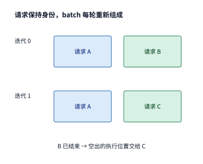

*图 8-1　请求身份与每轮迭代 batch 的动态映射关系：请求 A 跨越连续两轮迭代继续执行；请求 B 在第一轮结束时完成退出，下一轮迭代由新请求 C 接替其空出的执行位置（每轮为一条活跃请求预留的一行或多行计算槽位），而各请求的历史 KV 状态仍严格按各自请求身份独立保存。*

顺着时间轴追踪一条请求从进入系统到彻底销毁的完整生命周期，它可以清晰地划分为以下几个阶段：
1. **排队等待（Queueing）**：请求抵达服务器后，先进入调度器的等待队列；只有当调度器确认显存中有足够的空闲 KV 缓存空间、并将该请求纳入某一轮迭代的 batch 之后，它才正式踏上加速卡开始计算。
2. **预填充阶段（Prefill Phase）**：由于用户输入的提示词（比如 $2048$ 个 token）在请求开始时就已经全部给定，模型可以在一次前向传播中并行处理这整段输入序列，算出所有输入 token 在全部 36 层中的键（$K$）和值（$V$）并写入 KV 缓存；当提示词最后一个位置的隐藏状态流经输出层（LM Head）并完成采样后，模型便吐出了**第 1 个输出 token**。
3. **自回归解码阶段（Decode Phase）**：从第 2 个输出 token 开始，生成过程进入严格的因果串行循环——模型必须将上一步刚生成的那个最新 token 作为下一步前向计算的唯一新输入，在每一层注意力计算中完整读取此前积累的全部历史上下文 KV 缓存，才能算出并采样出下一个新 token。对于同一条请求而言，这 255 步解码前后依赖、绝无可能直接并行；但对于同时在线的多条不同请求而言，它们各自的“当前那一步解码”彼此独立，完全可以横向合并进同一个 batch 中共享一次权重读取。

让我们用本书配套 **实验 8-1** 在 RTX PRO 6000 上的真机实测数据，把一条短对话请求（输入 $2048$ token、输出 $256$ token）的生命周期还原到毫秒级时间线上。当这张显卡在 `batch size = 1` 下单独服务这一条短请求时，实测完成 $2\mathrm{K}$ 提示词的 prefill 并返回第 1 个输出 token 约需 **$0.096\ \mathrm{s}$（$96\ \mathrm{ms}$）**；在此之后，每执行一步 decode 生成下一个 token 平均耗时约 **$26.5\ \mathrm{ms}$（$0.0265\ \mathrm{s}$）**。假设该请求在抵达服务器后先在队列里等待了 $0.1\ \mathrm{s}$，那么用户在请求发出后的第 $0.1 + 0.096 = \mathbf{0.196\ \mathrm{s}}$ 看到屏幕上返回第 1 个 token；为了凑齐全部 $256$ 个输出 token，在首字返回之后还需要连续经历 **$255$ 个输出时间间隔**，因此该请求的端到端总完成时间为：

$$
0.1+0.096+255\times0.0265=6.95\ \mathrm{s}.
$$

由于 $6.95\ \mathrm{s} < 7\ \mathrm{s}$，这条独自运行的短请求刚好能在 7 秒 SLO 时限内完成（仅剩 $0.05\ \mathrm{s}$ 余量）。然而，请设想一个在线服务中再平常不过的插曲：**如果在这条请求漫长的 255 步生成中途，服务器新到了另一条短请求，且调度器决定立即插入执行新请求那耗时 $0.096\ \mathrm{s}$ 的 prefill**——那么老请求在这两步 decode 之间的某一次输出间隔就会被阻塞，从正常的 $26.5\ \mathrm{ms}$ 延长至 $26.5 + 96 \approx \mathbf{123\ \mathrm{ms}}$，连带使老请求的端到端总耗时推迟到 $6.95 + 0.096 \approx \mathbf{7.05\ \mathrm{s}}$，直接突破 7 秒红线而宣告超时违约。请注意：老请求自身每一个 token 的计算量没有发生丝毫改变，仅仅因为调度器在迭代序列中改变了一次执行先后顺序，就足以让原本合格的请求变为超时废品。

图 8-2 按真实时间比例画出了这 $6.95\ \mathrm{s}$ 的生命周期横条。**第 1 个输出 token 的返回时刻（$0.196\ \mathrm{s}$）** 如同一道分界线，将整条时间线切分为前后性质截然不同的两段：前半段（排队 + Prefill）决定了用户提问后要盯住空白屏幕等多久才能看到首次响应；后半段（255 个连续的 Decode 输出间隔）则占据了总时长的 **$97\%$（$6.76\ \mathrm{s}$）**，直接决定了用户何时才能拿到完整答案。本章后续讨论的一切调度、缓存与推测解码算法，本质上都是在设法压缩这条时间线上某一段的长度。

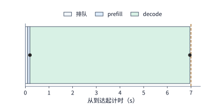

*图 8-2　单条短对话请求（输入 2048 token、输出 256 token）从抵达系统到吐出最后一个 token 的完整时间线：经历排队 0.1 s 与 prefill 0.096 s 后，于 0.196 s 处返回首个输出 token；随后的解码阶段包含 255 个连续输出间隔，每个间隔实测为 26.5 ms（实验 8-1 的 batch 1 测量值），合计 6.76 s。横条严格按实际时间比例绘制，右侧红色虚线标出了 7 s 的完成时限（SLO）。*

当第 256 个输出 token 交付给用户后，该请求的生命周期宣告终结，调度器立即将其从活跃执行槽位中移除；而显存状态管理器则要紧接着裁决它留下的 KV 缓存该如何处置：属于该请求独有的私有上下文与生成后缀应当立即回收归还空闲池，而各请求共用的系统提示词公共前缀 KV 则可以保留在显存缓存中供后续请求直接复用——第 8.3 节将详细拆解这套共享与回收的状态机机制。

### 8.1.2 权重、KV 与运行时缓冲的存储容量需求

要想让多条请求在同一台推理实例上并行不悖地沿着各自的时间线向前推进，加速卡的显存必须同时装得下所有必需的数据结构。在本章的单卡实例中，所有状态都存放在同一张显卡的显存内（若到了第 9 章的多卡分布式实例中，则必须按每张加速卡各自持有的权重分片、KV 分片与工作区分别列式核算——因为除非改变并行切分或跨卡搬移数据，否则卡 1 上的空闲显存绝不可能拿去替卡 0 存放局部变量）。

我们将单张加速卡上的显存占用划分为四本相互独立的账目：
- **$M_w$（常驻模型权重容量）**：保存模型各层参数矩阵所需的固定空间；
- **$M_{\mathrm{KV}}$（物理 KV 缓存总容量）**：保存当前所有驻留请求的上下文键值状态所需的物理显存空间（注意，当 KV 按固定大小的物理块分页分配且允许前缀共享时，多条请求共同引用的同一个公共前缀物理块在显存中只存一份、只计一次）；
- **$M_a$（激活与普通工作区容量）**：前向计算过程中存放层间临时激活张量与算子归约缓冲区的峰值空间；
- **$M_u$（图重放及其他运行时固定缓冲容量）**：为录制好的多种形状 CUDA Graph 锁定的固定输入输出缓冲区及通信缓冲空间。

在任何时刻，这四项显存占用的总和都必须严格小于或等于加速卡分配给该实例的可用显存上限 $C$（本章设定 $C = 32\ \mathrm{GiB}$）：

$$
M_w+M_{\mathrm{KV}}+M_a+M_u\le C.
$$

在这四项开销中，模型权重 $M_w$（约 $15.3\ \mathrm{GiB}$）与运行时固定工作区 $M_a + M_u$（约 $4.7\ \mathrm{GiB}$）在服务启动后便基本固定，唯有 **$M_{\mathrm{KV}}$ 会随着并发请求数量的增减以及每条请求生成序列的不断变长而剧烈伸缩**。因此，要想算出留给 KV 的 $12\ \mathrm{GiB}$ 预算究竟能同时接纳多少条并发请求，第一步必须先从模型架构参数出发，精确算出**每增加 1 个上下文 token 需要占用多少字节的 KV 缓存**。

让我们对照第 2 章熟悉的 **Qwen3-8B 分组查询注意力（GQA）** 规格来手算这个数字：全网共有 $36$ 层 Transformer 层；虽然每层有 32 个查询头（Query Heads），但采用了 4:1 的 GQA 分组共享，每层只需保存 **$8$ 个键值头（KV Heads）**，每个头的特征维度为 $128$；在每一层中，每个 token 都要同时保存键向量（$K$）和值向量（$V$）两份张量，且采用每元素 $2\ \mathrm{bytes}$ 的 BF16 浮点格式。将上述因子连乘，即可得出单个 token 在全网 36 层中占用的 KV 缓存容量 $k$：

$$
k=2\times36\times8\times128\times2
 =147\,456\ \mathrm{bytes}=144\ \mathrm{KiB}.
$$

记住 **$k = 144\ \mathrm{KiB/token}$** 这个核心基准常数，我们立刻就能看清长上下文推理面临的显存容量墙有多么严峻：
- 一条短对话请求刚做完 $2048$ 个输入 token 的 prefill 时，其 KV 缓存就已占用 $2048 \times 144\ \mathrm{KiB} = \mathbf{288\ \mathrm{MiB}}$；
- 一条长上下文请求刚做完 $8192$ 个输入 token 的 prefill 时，其 KV 缓存更是高达 $8192 \times 144\ \mathrm{KiB} = \mathbf{1152\ \mathrm{MiB}}$（即 **$1.125\ \mathrm{GiB}$**）。
要知道，无论系统并发服务多少条请求，大家共用的模型权重总共也才 $15.3\ \mathrm{GiB}$；可是每多接纳一条上下文互不共享的 $8\mathrm{K}$ 长请求，显存里就要额外多装入 $1.125\ \mathrm{GiB}$ 的私有 KV 状态。当章首算例中的 **16 条长请求**同时到达时，假定各请求独立保存上下文，单单把它们各自的 $8192$ 个输入 token 装进显存，就需要 $16 \times 1.125\ \mathrm{GiB} = \mathbf{18\ \mathrm{GiB}}$ 的 KV 空间——还没开始生成哪怕一个输出字，就已经把实例预留的 **$12\ \mathrm{GiB}$ KV 预算**彻底撑爆了。[^batch]

不仅如此，在随后的自回归 decode 阶段，每条请求的 KV 缓存还会随着新 token 的吐出而一步步膨胀。仔细核对生成的步数：prefill 阶段在消化完输入提示词的同时直接产出了第 $1$ 个输出 token；随后的 $255$ 步 decode 依次将第 $1$ 至第 $255$ 个输出 token 送回模型前向计算并追加写入 KV 缓存，最终在第 255 步结束时吐出第 $256$ 个输出 token（这个最末 token 直接返回给用户即可，无需再为其计算和保存 KV）。因此，一条请求在整个生命周期内需要实际写入 KV 缓存的 token 总数，对于短对话请求是 $2048 + 255 = \mathbf{2303\ \text{个 token}}$，对于长上下文请求则是 $8192 + 255 = \mathbf{8447\ \text{个 token}}$。假设底层显存分配器以**每块容纳 $16$ 个 token** 的粒度按块分配空间（第 8.3.1 节），那么向上取整到 16 的整数倍后，每条短请求在生成结束时实际需分配容纳 $\lceil 2303/16 \rceil \times 16 = \mathbf{2304\ \text{个 token}}$（即 $2304 \times 144\ \mathrm{KiB} = \mathbf{324\ \mathrm{MiB}}$）的物理块空间，每条独立长请求则需分配容纳 $\lceil 8447/16 \rceil \times 16 = \mathbf{8448\ \text{个 token}}$（即 $8448 \times 144\ \mathrm{KiB} = \mathbf{1188\ \mathrm{MiB}}$）的物理块空间。下表对比了在 $12\ \mathrm{GiB}$（$12{,}288\ \mathrm{MiB}$）KV 显存预算下，两类独立请求在 prefill 结束时与生成全部 256 个输出 token 后的容量需求及最大并发容纳上限：

| 独立请求类型（无前缀共享） | Prefill 结束时的 KV 占用 | 生成 256 个输出 token 后的 KV 分配量 | 12 GiB 预算可同时容纳的最大完整请求数 |
|---|---:|---:|---:|
| **短对话请求（2K 输入 + 256 输出）** | $288\ \mathrm{MiB}$ | $324\ \mathrm{MiB}$ | $\lfloor 12288 / 324 \rfloor = \mathbf{37\ \text{条}}$ |
| **长上下文请求（8K 输入 + 256 输出）** | $1152\ \mathrm{MiB}$ | $1188\ \mathrm{MiB}$ | $\lfloor 12288 / 1188 \rfloor = \mathbf{10\ \text{条}}$ |

观察这张表，可以体会到为什么在线推理的准入控制必须把“未来生成阶段的 KV 增长量”一并纳入考量：倘若调度器只看 prefill 结束时的瞬时大小（$288\ \mathrm{MiB}$），误以为 $12\ \mathrm{GiB}$ 显存可以一次性放入 $\lfloor 12288 / 288 \rfloor = 42$ 条短请求；那么当这 42 条请求同时向前推进、各自慢慢吐出 256 个输出 token 时，它们累计需要的 KV 空间就会膨胀到 $42 \times 324 = \mathbf{13{,}608\ \mathrm{MiB}}$（约 $13.29\ \mathrm{GiB}$），在半路上触及 $12\ \mathrm{GiB}$ 的显存上限，迫使引擎中途挂起甚至强行丢弃部分已经算了一半的请求。在接纳请求时就为其预留或核算好后续生成所需的空间余量，正是为了防范这种半途显存耗尽（Mid-generation OOM）的系统颠簸。

那么，面对 $12\ \mathrm{GiB}$ 预算最多只能装下 **10 条**独立长请求的硬约束，我们怎样才能让章首的 **16 条**长请求同时装进显存呢？解决问题的关键就在于表中特意注明的“无前缀共享”前提：在这类长上下文请求长达 $8192$ 个 token 的输入中，前 $6144$ 个 token（对应 $6144 \times 144\ \mathrm{KiB} = \mathbf{864\ \mathrm{MiB}}$ 的 KV 缓存）是完全相同的系统提示词与工具定义，只有后 $2048$ 个输入 token（占 $288\ \mathrm{MiB}$）因人而异。如果让 16 条请求各自在显存中重复保存 16 份相同的前缀，仅这项重复前缀就会占用 $16 \times 864\ \mathrm{MiB} = 13.5\ \mathrm{GiB}$；反之，只要通过页表映射让全部 16 条请求**共同指向同一份只读的 $864\ \mathrm{MiB}$ 公共前缀物理块**，省下来的逾 $12\ \mathrm{GiB}$ 显存就足以轻松装下 16 条请求各自的私有后缀与生成结果——第 8.3 节将给出这一分页映射与共享容量的严格推导。

### 8.1.3 从单请求时间到服务目标

看清了单条请求的时间线结构与显存账本后，我们需要将图 8-2 的两段耗时提炼为工业界通用的**服务质量指标（Service-Level Objectives, SLOs）**。设某条请求抵达推理服务器的时刻为 $t_a$，要求共生成 $G$ 个输出 token，其中第 1 个输出 token 交付给用户的时刻为 $t_1$，第 $j$ 个输出 token 交付的时刻为 $t_j$，最后一个输出 token 交付的时刻为 $t_G$。由此定义三个核心延迟指标：
1. **首字延迟（Time to First Token, TTFT）**：即从请求到达系统，经历排队等待与提示词 prefill 计算，直到向用户吐出第 1 个输出 token 所耗费的时间：

$$
\mathrm{TTFT}=t_1-t_a.
$$

2. **相邻输出间隔（Inter-Token Latency, ITL）与每输出 token 平均耗时（Time Per Output Token, TPOT）**：在流式输出阶段，第 $j$ 个与第 $j+1$ 个输出 token 之间的时间跨度定义为第 $j$ 个输出间隔 $\mathrm{ITL}_j = t_{j+1} - t_j$（共 $G-1$ 个间隔，其算术平均值 $\frac{1}{G-1}\sum_{j=1}^{G-1}\mathrm{ITL}_j$ 即为常见的 TPOT）。
3. **端到端请求完成时间（End-to-End Request Latency, $T_{\mathrm{request}}$）**：将首字返回前的等待时间与首字返回后的全部 $G-1$ 个生成间隔相加，即得整条请求从发问到全部答完的总耗时：

$$
T_{\mathrm{request}}=\mathrm{TTFT}+\sum_{j=1}^{G-1}\mathrm{ITL}_j.
$$

对照第 8.1.1 节的短请求算例：其 $\mathrm{TTFT} = 0.196\ \mathrm{s}$，后续 $255$ 个输出间隔合计 $\sum \mathrm{ITL}_j = 6.76\ \mathrm{s}$，两者相加给出了 $T_{\mathrm{request}} = 6.95\ \mathrm{s}$。在真实产品体验中，这三个指标分别对应着用户感知的不同侧面：**足够短的 TTFT** 让用户点击发送后立刻看到光标闪烁出字，不会误以为网页失去响应；**平稳且低于人类阅读速度的 $\mathrm{ITL}_j$** 保证了流式文字平稳输出，不会出现“先输出半句话、随后停顿半秒钟”的阅读顿挫；而**端到端总耗时 $T_{\mathrm{request}}$** 则直接决定了下游依赖完整 JSON 或代码输出的智能体（Agent）工作流何时才能进入下一步执行。因此，本章章首算例将端到端时限设为 $T_{\mathrm{request}} \le 7\ \mathrm{s}$，而在第 8.2 节的调度设计中，我们还将重点考核并压制**最大单次输出间隔 $\max_j \mathrm{ITL}_j$**。

延迟指标衡量的是一条请求在用户侧的主观等待体验；而站在基础设施运营方的视角，同样关心这台昂贵的加速卡在单位时间内总共能产出多少工作量——即**系统吞吐量（Throughput）**。系统的输出吞吐量直接取决于每一轮 decode 迭代能够同时合批处理多少条请求（即批大小 `batch size`，下文简称 `batch` 或 $b$）。让我们对比 **实验 8-1** 在 RTX PRO 6000 上的两组实测数据：
- 当 `batch = 1`（仅服务 1 条 $2\mathrm{K}$ 短请求）时，引擎每执行一轮纯 decode 耗时约 **$26.26\ \mathrm{ms}$**，每轮仅产出 $1$ 个 token，整卡生成吞吐量只有 $1 / 0.02626 \approx \mathbf{38\ \mathrm{token/s}}$；
- 当我们将并发度扩大 16 倍至 **`batch = 16`**（同时合批处理 16 条独立的 $2\mathrm{K}$ 短请求）时，引擎每执行一轮纯 decode 的耗时仅仅从 $26.26\ \mathrm{ms}$ 微增到了 **$27.44\ \mathrm{ms}$**（耗时仅增加 $4.5\%$），但每一轮却能同时为 16 条请求各吐出 1 个 token（共产出 $16$ 个 token），使得整卡生成吞吐量一举跃升至 $16 / 0.02744 \approx \mathbf{583\ \mathrm{token/s}}$（吞吐激增逾 **15 倍**）。

这组鲜明的实测对比，正是打开本章后续所有章节的钥匙：**无论是设法在一轮迭代里合入更多并发请求（增大 batch 或通过推测解码单轮产出多个 token），还是设法压短每一轮迭代的执行时间，都能推高系统的账面 token 吞吐量；但在真实在线流量下，更高的并发度又往往意味着更长的排队等待与更大的单步耗时。** 更重要的是，如果我们为了追求高吞吐或低显存而激进地降低了数值精度，导致模型输出的答案错误百出，那么再快的乱码生成也毫无商业价值。因此，在本章的实验中，我们在评测底层硬件与运行时吞吐时采用**固定输出长度（256 token）**以严格控制计算工作量一致；而在评测量化精度与端到端服务效果（第 8.4.4 节与第 8.6.2 节）时，则允许模型**自然生成至停止符**，通过校验答案正确率、输出长度变化与失败重试成本，最终以**“单位时间内既回答正确、又在规定时限（SLO）内按期交付的有效请求吞吐（Goodput）”**作为评判一切推理优化的终极准绳。

## 8.2 批处理与请求调度

### 8.2.1 权重复用如何提高批处理效率

为什么在上一节的实测中，把 decode 的批大小从 `batch = 1` 扩大到 `batch = 16`，每轮耗时几乎不变（从 $26.26\ \mathrm{ms}$ 到 $27.44\ \mathrm{ms}$），而吞吐量却能激增 15 倍？让我们从线性投影层的矩阵乘法 $Y = XW$ 出发，用第 3 章的**算术强度（Arithmetic Intensity，即每从显存读取 1 字节数据所能支撑的浮点运算次数）**把这笔物理账算清楚。

在一步 decode 迭代中，假设当前批次包含 $b$ 条活跃请求，每条请求各自提供一个最新生成的 token（其隐藏层特征向量构成输入矩阵 $X$ 的一行），因此输入矩阵 $X$ 共有 $b$ 行。当计算 $Y = XW$ 时，权重矩阵 $W$ 中的每一个元素一旦从 HBM 显存读入片上寄存器或共享内存，都会依次与输入矩阵 $X$ 的全部 $b$ 行对应元素各做一次乘加运算（每次乘加计为 2 次浮点运算 FLOPs）。设每个权重元素占用的字节数为 $s_w$（对于 BF16 格式，$s_w = 2\ \mathrm{bytes}$），且在理想分块下整份权重矩阵在单轮迭代中只需从显存读取一次。若暂且只统计权重矩阵本身的显存读取量（忽略体积远小于权重的输入激活 $X$ 与输出 $Y$），则权重的算术强度 $I_{\mathrm{weight}}$ 为：

$$
I_{\mathrm{weight}}\approx\frac{2b}{s_w}.
$$

代入 BF16 的 $s_w = 2\ \mathrm{bytes}$，算术强度直接简化为 **$I_{\mathrm{weight}} \approx b\ \mathrm{FLOP/byte}$**：当 `batch = 1` 时，每从显存读入 1 字节权重，仅能执行 1 次浮点运算（远低于 RTX PRO 6000 约 $503.8 / 1.792 \approx 281\ \mathrm{FLOP/byte}$ 的机器平衡点，处于极度的访存带宽受限区）；而当我们将批大小从 $b = 1$ 扩大到 $b = 16$ 时，输入矩阵 $X$ 从 1 行变成 16 行，**同样读取一遍权重所支撑的有效浮点运算量直接放大了 16 倍**。这就是批处理能够成倍提升解码效率的第一个物理支柱——**跨请求共享并摊薄常驻权重的显存读取带宽**。当然，请时刻牢记注意力机制的另一面：不同请求固然可以共享同一套模型权重矩阵 $W$，但在自注意力层计算 $QK^\top V$ 时，由于每条请求的对话历史各不相同，加速卡依然必须为批次内的每一条请求分别从显存读取它自己那一份私有的历史上下文 KV 缓存。

**多租户低秩微调服务（Multi-LoRA Serving：Punica 与 S-LoRA）。** 上述“整批请求共享一次权重读取”隐含了一个前提：这 $b$ 条请求调用的是完全相同的模型权重。如果在多租户云服务场景下，成百上千个企业客户各自针对不同的垂直业务（如法律咨询、医疗问诊、代码补全、财务报表提取）微调出了专属于自己的定制模型，难道我们必须为每个客户各自部署一套 $15.3\ \mathrm{GiB}$ 的完整模型副本、从而彻底丧失跨租户合批（Batching）的机会吗？

**低秩适配（Low-Rank Adaptation, LoRA）** 架构优雅地打破了这一僵局：它冻结并原样保留预训练基础模型的大权重矩阵 $W_0$，仅用两个极窄的低秩小矩阵乘积 $\Delta W_k = A_k B_k$（其中秩 $r \ll d_{\mathrm{model}}$）来表达第 $k$ 个垂直任务的权重微调增量。如此一来，前向传播的数学表达式便拆分为两条并行分支之和：$Y = X W_0 + X (A_k B_k)$。以 Qwen3-8B 为例，若对全网 36 层的查询（$Q$）与值（$V$）投影矩阵附加秩为 $r = 16$、BF16 格式的 LoRA 适配器（Adapter，即附加在基础模型之上的轻量级可训练参数模块），单套 adapter 的总体积仅占 **$14.6\ \mathrm{MiB}$**；哪怕在同一张显卡上同时驻留 **100 套不同业务的 adapter**，它们加在一起也才占用 **$1.43\ \mathrm{GiB}$** 显存，还不到 $14.1\ \mathrm{GiB}$ 核心矩阵权重的十分之一。

当同一轮 batch 里的 $b$ 条请求分别挂接了不同的 LoRA adapter 时，以华盛顿大学等提出的 **Punica（MLSys 2024）** 与加州大学伯克利分校等提出的 **S-LoRA（MLSys 2024）** 为代表的现代多 LoRA 推理引擎，会将计算拆解为两步（见图 8-3a）：
1. **基础权重全批共享（Dense Base GEMM）**：忽略各请求的 adapter 差异，将整批全部 $b$ 条请求拼成一个大矩阵 $X$，共同乘上唯一一份基础权重 $W_0$（$14.1\ \mathrm{GiB}$），让最沉重的主干权重依然保持 100% 的全批读取复用；
2. **低秩增量按 Adapter 聚拢分组计算（Segmented Gather-Scatter BGMV）**：通过定制的批量分组矩阵—向量乘法算子（Batched Gather Matrix-Vector Multiplication），仅将批次内属于同一个 adapter $k$ 的请求子集聚拢在一起，读取对应的 $14.6\ \mathrm{MiB}$ 小矩阵 $A_k, B_k$ 算出增量 $\Delta Y$，最后再按请求索引散射（scatter）累加回主干输出中。

从图 8-3 可以提炼出多 LoRA 推理系统设计中两条极为关键的**正交解耦原则**：
- **其一，在计算访存效率上，“一批里包含多少条请求（总 batch 大小 $b$）”与“这批请求分散在多少种不同的 adapter 上”是两个必须分开衡量的维度**：主干权重 $W_0$ 的复用度仅由总请求数 $b$ 决定；而低秩分支的复用度则取决于每个被激活 adapter 分组内部平均分到了几条请求——请求跨越的 adapter 种类越零散，每个分组的行数就越少，低秩小矩阵的读取复用就越接近单行 GEMV；
- **其二，在显存容量规划上，“显卡能常驻多少套 adapter”与“显卡能同时并发服务多少条活跃请求”由两本截然不同的容量账本决定（图 8-3b）**：在显存中驻留 100 套 LoRA adapter 仅消耗 **$1.43\ \mathrm{GiB}$**，占比很小；但倘若要让 100 条互不共享前缀的 $8\mathrm{K}$ 上下文请求同时在线生成，它们的 KV 缓存合计却高达 $100 \times 1.125\ \mathrm{GiB} = \mathbf{112.5\ \mathrm{GiB}}$（接近 adapter 体积的 80 倍）。因此，**切忌因为单套 LoRA 权重十分轻巧，就误以为单卡可以无上限地提高并发请求数——能够装载多少种微调技能由小矩阵决定，而能够同时服务多少名在线用户依然由上下文 KV 缓存容量严格决定。**[^lora]

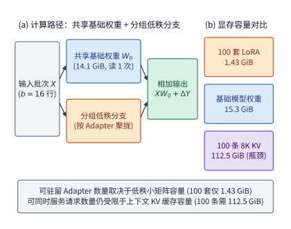

*图 8-3　多 LoRA 服务（Punica / S-LoRA）的计算与容量解耦机制：（a）计算路径将整批 $b$ 条请求合一执行共享基础权重 $W_0$（14.1 GiB）的稠密矩阵乘，再按请求所属的 Adapter 分组执行低秩小矩阵分支并相加；（b）显存容量上，驻留 100 套 Qwen3-8B LoRA 适配器仅占 1.43 GiB，而 100 条独立 8K 请求的 KV 缓存却高达 112.5 GiB，证明并发服务上限仍由 KV 容量主导。*

现在，让我们回到同质权重场景，将“共享的模型权重读取”与“各请求私有的历史 KV 读取”合并到同一个解码步流量方程中。设单步 decode 中全批只需共同读取一次的共享矩阵权重总字节数为 $D_w$（对于 Qwen3-8B，扣除按 token ID 查表读取的词表 Embedding 后，每步必读的稠密线性层矩阵权重精确值为 $D_w = 15{,}136{,}811{,}008\ \mathrm{bytes} \approx \mathbf{14.10\ \mathrm{GiB}}$，约合十进制 $15.14\ \mathrm{GB}$）；设当前批次共有 $b$ 条活跃请求，每条请求当前各拥有 $L$ 个历史上下文 token（彼此不共享 KV），且每个上下文 token 的 KV 缓存大小为 $k = 144\ \mathrm{KiB}$。那么，加速卡完成这一轮 decode 迭代需要从显存读取的**全批总字节数 $D(b, L)$**，以及折算到**平均每生成 1 个输出 token 所分摊的显存读取字节数 $d(b, L)$**，分别为：

$$
D(b,L)=D_w+bLk,\qquad
d(b,L)=\frac{D_w}{b}+Lk.
$$

请仔细端详右边的单 token 分摊读取量公式 $d(b, L) = \frac{D_w}{b} + Lk$：它的第一项 $\frac{D_w}{b}$ 是**随批大小 $b$ 成反比衰减的共享权重分摊项**，而第二项 $Lk$ 则是**无论批大小 $b$ 开得多大都无法被分摊、每条请求必须各自照单全收的私有上下文 KV 读取地板**。让我们代入 Qwen3-8B 的真实参数（$D_w \approx 14.10\ \mathrm{GiB}$，当上下文长度 $L = 2048$ 时单请求 KV 读取量为 $Lk = 288\ \mathrm{MiB} = \mathbf{0.28125\ \mathrm{GiB}}$）看一看随着批大小 $b$ 倍增，这两项的攻守易位过程：
- 当 **`batch = 1`** 时：每生成 1 个 token 需读取 $14.10\ \mathrm{GiB}$ 权重加 $0.28\ \mathrm{GiB}$ KV，合计约 **$14.38\ \mathrm{GiB}$**（此时权重读取占了 $98\%$ 的绝对大头）；
- 当 **`batch = 16`** 时：每个输出 token 分摊的权重读取骤降 16 倍至 $14.10 / 16 \approx \mathbf{0.88\ \mathrm{GiB}}$，加上不变的 $0.28\ \mathrm{GiB}$ KV，单 token 读取量降至约 **$1.16\ \mathrm{GiB}$**；
- 当 **`batch = 64`** 时：每个输出 token 分摊的权重读取进一步缩减至 $14.10 / 64 \approx \mathbf{0.22\ \mathrm{GiB}}$，此时**每生成一个 token 需要读取的私有上下文 KV（$0.28125\ \mathrm{GiB}$）已经正式反超了分摊后的模型权重读取量（$0.22\ \mathrm{GiB}$）**，两者相加使单 token 总读取量收敛至约 **$0.50\ \mathrm{GiB}$**（仅为 `batch = 1` 时的约 **$1/29$**）。[^batch]

图 8-4 在双对数坐标系下画出了这一经典的摊薄收敛曲线。由于横轴相邻刻度代表 batch 翻倍，代表权重分摊项 $\frac{D_w}{b}$ 的灰色虚线呈现为一条每次减半的斜直线；代表单请求私有 KV 读取量 $Lk$ 的水平点线则是一道不可逾越的渐近底线。当上下文长度从 $2\mathrm{K}$（蓝线）拉长四倍到 $8\mathrm{K}$（绿线，$Lk = 1.125\ \mathrm{GiB}$）时，水平渐近底线整体大幅抬升了 4 倍，导致合批曲线在早得多的位置就触及了 KV 带宽下界。

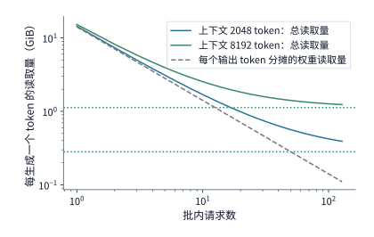

*图 8-4　批大小 $b$ 增大时每生成 1 个输出 token 所分摊的显存读取量（双对数坐标）：横轴为同时参与一步 decode 的活跃请求数 $b$，纵轴为单步全批读取总字节数除以本轮产出的 token 数 $d(b,L) = D_w/b + Lk$。蓝色与绿色实线分别对应每条请求已累积 2048 与 8192 个上下文 token 时的总分摊读取量（含权重与私有 KV）；同色水平点线标出了不可被合批摊薄的单请求私有 KV 读取底线 $Lk$；灰色斜虚线为批内共享权重的分摊项 $D_w/b$（模型为 Qwen3-8B BF16，各请求 KV 彼此独立）。*

从图 8-4 可以看出，随着 batch 不断增大，靠增加并发来摊薄权重读取的边际收益会迅速递减。我们可以定义一个物理意义明确的临界指标——**KV 读取超越权重的转折批大小 $b_{\mathrm{KV}}$**（即令全批 KV 读取总量 $bLk$ 首次达到或超过共享权重读取量 $D_w$，亦即单 token 分摊权重 $\frac{D_w}{b}$ 与私有 KV 读取 $Lk$ 相等的最小整数批大小）：

$$
b_{\mathrm{KV}}=\left\lceil\frac{D_w}{Lk}\right\rceil.
$$

代入未经四舍五入的精确权重字节数 $D_w = 15{,}136{,}811{,}008\ \mathrm{bytes}$ 与 $k = 147{,}456\ \mathrm{bytes}$：
- 在 **$2\mathrm{K}$ 短上下文（$L = 2048$）** 下，转折批大小为 $b_{\mathrm{KV}} = \lceil 15136811008 / (2048 \times 147456) \rceil = \mathbf{51}$；
- 在 **$8\mathrm{K}$ 长上下文（$L = 8192$）** 下，由于每条请求的 KV 体积膨胀了四倍，转折批大小骤然前移至 $b_{\mathrm{KV}} = \lceil 15136811008 / (8192 \times 147456) \rceil = \mathbf{13}$。

这一公式深刻地揭示了长上下文推理的瓶颈转移规律：**当上下文较短（2K）时，直到批大小超过 51 之前，显存带宽的主要矛盾始终是搬运模型权重；而一旦进入长上下文（8K 及以上）场景，仅仅合并 13 条请求，读取历史 KV 缓存的流量就会超过模型权重，成为主导显存带宽的首要开销。** 与此同时，我们还必须把显存容量约束放在一起对照：即便拥有整张卡的全部显存，64 条独立 $2\mathrm{K}$ 请求的常驻权重加上执行一步 decode 后的 KV 缓存合计就已高达约 $35.7\ \mathrm{GB}$；而在本实例 $12\ \mathrm{GiB}$ 的 KV 预算下，独立 $2\mathrm{K}$ 与 $8\mathrm{K}$ 请求更是分别在 $37$ 条和 $10$ 条时就先遇到了显存容量限制（甚至还没来得及跑到它们各自的带宽转折点 $51$ 和 $13$）。简言之：**合批（Batching）用“空间换带宽”——它大幅削减了每生成一个 token 的显存读取字节数，却成倍放大了同一时刻必须在显存中驻留的状态总容量。**

算清了读取字节数，我们再应用第 3 章的 Roofline 屋顶模型来估算执行这一步 decode 迭代所需的硬件时间下界 $T_{\mathrm{step}}$。设单步 decode 中每条请求所需的浮点运算量为 $F$，加速卡的有效峰值算力为 $P$，有效显存带宽为 $\beta$。当计算与访存流水充分重叠时，单步耗时取决于整批计算耗时与整批显存读取耗时两者中的较大值：

$$
T_{\mathrm{step}}\approx\max\left(\frac{bF}{P},\frac{D_w+bLk}{\beta}\right).
$$

令括号内的计算时间项与访存时间项相等（$\frac{bF}{P} = \frac{D_w + bLk}{\beta}$），移项整理可得：

$$
b\left(\frac{F}{P}-\frac{Lk}{\beta}\right)=\frac{D_w}{\beta}.
$$

这个简洁的平衡方程把单步解码的时间增长率拆解得一清二楚：批大小 $b$ 每增加 1 条请求，全批计算耗时就固定增加 $\frac{F}{P}$，而全批显存读取耗时则因为多读一份私有 KV 而固定增加 $\frac{Lk}{\beta}$。**唯有当每条请求新增的计算耗时大于其新增的 KV 读取耗时（即 $\frac{F}{P} > \frac{Lk}{\beta}$，对应上下文较短或算力相对较低的平台）时，随着批大小 $b$ 不断增大，计算耗时直线才会最终追上并反超访存耗时直线，使解码从访存受限（Memory-bound）跨入计算受限（Compute-bound）；反之，若上下文 $L$ 极长、导致每增一条请求读 KV 花的时间 $\frac{Lk}{\beta}$ 比算矩阵花的时间 $\frac{F}{P}$ 还要多，那么无论把 batch 开到多大，解码步耗时将始终受显存带宽制约。** 请注意区分本节推导的两个临界点：前面的 $b_{\mathrm{KV}} \in \{51, 13\}$ 比较的是显存总线上“KV 读取字节数”与“权重读取字节数”谁占大头；而这里的平衡方程比较的则是“计算单元耗时”与“显存带宽耗时”谁决定最终的单步延迟。当式中的 $P$ 和 $\beta$ 直接代入硬件手册上的理论峰值算力与峰值带宽时，算出的 $T_{\mathrm{step}}$ 即为该硬件条件下的理论物理下界；而理论物理下界与真实测量耗时之比，正是本书第 1.2.2 节定义的有效算力利用率（MFU）与有效带宽利用率（MBU）——在第 8.6.3 节中，我们将用逐轮实测数据校准这两个效率比值，并将其用于最终的架构选型。

当然，站在用户侧审视增大 batch 的代价，不能只看系统总吞吐涨了多少，还必须看**更大的 batch 把首字延迟（TTFT）和相邻输出间隔（ITL）推高了多少**。在 **实验 8-1** 的 batch 扫描实测中，我们让 $b \in \{1, 4, 16, 64\}$ 条输入 $2\mathrm{K}$、输出 $256$ token 的短对话请求同时提交给 Qwen3-8B 实例执行：随着 batch 从 $1$ 增至 $64$，整卡输出总吞吐固然从约 **$37\ \mathrm{token/s}$** 跃升到了 **$1165\ \mathrm{token/s}$**（增长逾 31 倍）；但与此同时，由于 64 条请求的 $2\mathrm{K}$ 输入提示词需要在首字返回前集中完成计算，请求的**首字延迟（TTFT）从约 $96\ \mathrm{ms}$ 大幅延后到了 $3.29\ \mathrm{s}$**，而解码阶段的**平均相邻输出间隔（ITL）也从约 $27\ \mathrm{ms}$ 增长到了 $40\ \mathrm{ms}$**。而且这还是在“整批请求恰好在同一时刻到达”的实验条件下测得的；如果在线服务为了凑够一个大 batch 而让先到的请求在网关队列里空等后到的请求（Dynamic Batching Window），这段凑批等待时间还得额外加进首字延迟里。[^batch-measure]

> **练习 8-1 · 计算：batch 增大时的读取量变化。** 取 $D_w=15,136,811,008$ bytes、$k=144$ KiB，计算 2K 与 8K 上下文在 batch 为 1、4、16、64 时每个输出 token 的读取量，并分别求两种上下文长度下，KV 读取量首次达到或超过分摊权重读取量的最小整数 batch。再用 12 GiB KV 可用内存、每块 16 个 token 和 256 个输出，分别求两种上下文长度下最多可以接纳多少条独立请求。比较可容纳请求数的上限与两类读取量相等时的 batch，判断容量限制是否会先阻止 batch 继续增大。

**反事实推演：如果模型权重改由超高速独立片上存储（如专用 ROM / 大容量 SRAM）提供，批处理的收益边界会发生怎样的剧变？** 让我们沿用本书第 4 章探讨过的存储架构演进思想做一次定量推演。在传统 HBM 架构下，模型权重与动态 KV 缓存混居在同一片 HBM 显存中，争抢同一条显存总线带宽：设整批读取的共享权重字节数为 $W$，批内并发请求数为 $B$，单条请求在当前步需读取的私有历史 KV 字节数为 $K$，则传统路径下每生成 1 个输出 token 需要占用的 HBM 读取流量为 $\frac{W}{B} + K$。现在假设芯片引入了带宽充裕的独立快速权重存储（Dedicated Weight ROM/SRAM），将静态权重读取完全从 HBM 总线上剥离出去，使得 HBM 显存只需负责提供动态增长的上下文 KV 缓存——此时无论批大小 $B$ 是 1 还是 64，每生成 1 个输出 token 需要占用的 HBM 读取流量都将恒定为水平常数 **$K$**（图 8-5）。[^core-calculation]

观察图 8-5 中两条曲线的几何关系：在左端小 batch 区域（如 $B=1\sim 8$），独立快速权重存储通过直接省去庞大的 $\frac{W}{B}$ 项，将单 token 的 HBM 访问量压低了一个数量级，使原本受限于权重读取带宽的单请求低并发 decode 获得显著加速；而随着批大小 $B$ 向右增大，传统路径的 $\frac{W}{B} + K$ 曲线逐渐逼近水平线 $K$，说明**在传统架构中单纯用于“摊薄 HBM 权重读取”的那部分合批红利，已被独立快速权重存储提前兑现**。当然，这绝不意味着在新架构下 batch 失去了意义：一方面，矩阵计算单元（Tensor Core）依然需要一定的批大小 $B$ 才能填满脉动阵列或 MMA 指令的矩阵行宽、提高计算利用率；另一方面，批次越大，HBM 每步需要读取的 KV 总量 $B \cdot K$ 也依然线性增长。将新的 HBM 读取量 $B \cdot K$ 代入前文的时间屋顶方程 $T_{\mathrm{step}} \approx \max(\frac{BF}{P}, \frac{W}{\beta_{\mathrm{ROM}}}, \frac{BK}{\beta_{\mathrm{HBM}}})$，架构师便能立刻算出新硬件下的最优运行批大小。

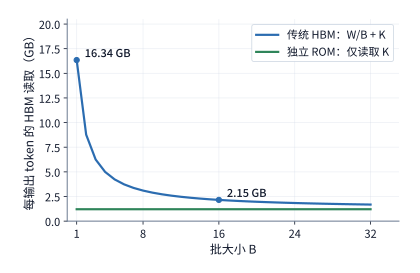

*图 8-5　传统混合 HBM 架构与独立快速权重 ROM 架构下，每生成 1 个输出 token 所分摊的 HBM 显存读取量对比（固定 8K 上下文）：传统路径下每输出 token 需从 HBM 读取 $W/B + K$ 字节（随批大小 $B$ 增大而下降并渐近于 $K$）；当静态权重 $W$ 改由独立高速 ROM 提供后，HBM 仅需承担恒定的私有上下文 KV 读取量 $K$，使低并发小 batch 解码不再受困于权重读取瓶颈。*

### 8.2.2 从固定 batch 到连续批处理

在上一小节的理论公式中，我们假定同一个批次里的 $b$ 条请求步伐完全一致地同时开始、同时结束。然而在真实的线上对话服务中，不同用户问题的回答长度往往相差悬殊。设想一个极简的场景：两条请求在同一时刻进入同一个 batch 开始生成，其中请求 A 需要回答一段长代码（共需生成 **8 个 token**），而请求 B 只需回答“是”或“否”（仅需生成 **2 个 token**）。当执行完第 2 轮迭代后，短请求 B 就已经全部生成完毕；但在传统的**静态／固定批处理（Static / Request-level Batching）**框架下，由于整个 batch 的输入输出张量在任务开始前被绑定为固定行数的静态生命周期，系统必须一直等到批内最慢的长请求 A 跑完剩余的 **6 步 decode** 之后，才能释放整批资源、去队列里接纳下一批新请求。在这漫长的 6 步等待期内，短请求 B 提前腾出的那个执行槽位只能一直闲置空转（甚至填入无效的 padding token 额外消耗算力）。

为了根除因生成长度参差不齐造成的槽位闲置，首尔国立大学团队在 **Orca（OSDI 2022）** 系统中提出了改变大模型推理引擎演进轨迹的**迭代级调度（Iteration-level Scheduling，工业界普遍称为连续批处理 Continuous Batching）**机制。其核心思想正如本章开头图 8-1 所描绘的那样：**将调度器的决策粒度从“整批请求从头跑到尾”细化到“每一轮前向迭代（Step）的边界”**——在每一轮迭代结束时，调度器立刻检查批内是否有请求已经命中结束符或达到最大长度；一旦发现短请求（如 B）完成，当场将其移出批次、释放其占用的 KV 显存，并在紧接着的下一轮迭代开始前，立即从等待队列中拉取一条新请求（如 C）补进空出的执行槽位中（注意区分：这里所说的“执行槽位”是指单步矩阵计算中分配给一条活跃请求的行位置与 KV 状态配额，与第 7 章网络网卡上用于追踪在途通信报文的硬件“请求槽位”分属不同层次的系统资源）。能否在老请求退出的第一时间内无缝补入新请求，直接决定了加速卡在每一轮迭代中究竟能维持多少行有效计算。

然而，当我们将连续批处理落地到工程实践中时，立刻就会遭遇一个棘手的**两难调度冲突**：当一条老请求结束退位、调度器把一条刚到达的新请求补进活跃批次时，新请求并不是直接做单 token 的轻量级 decode，而是**必须先执行它那动辄数千个输入 token 的预填充（Prefill）**。如果调度器采用最朴素的“新请求一旦补入，就优先把它的整段长提示词一次性 prefill 算完（或与老请求的当前步 decode 拼在同一个超大迭代里一起执行）”，那么原本正在以每步 $26\ \mathrm{ms}$ 匀速流畅吐字的老请求，就会被新请求庞大的 prefill 计算瞬间卡住，导致用户界面上的流式输出突然冻结数百毫秒。因此，现代推理调度器的核心权衡，正是在**“尽快处理新到达请求的输入以缩短其 TTFT”**与**“保障已在途请求按固定节拍连续生成以控制其最大 ITL”**这两项相互冲突的目标之间分配加速卡时间。[^schedule-survey]

**定量算例：为什么朴素的连续批处理在缩短总完成时间的同时，反而会让单次输出停顿（最大 ITL）暴增 14 倍？** 让我们用一组可精确手算的请求流轨迹（图 8-6 至图 8-8），把静态批处理、朴素连续批处理与分块预填充（Chunked Prefill）三者的时间线差异展现出来。设推理实例受显存容量限制，**同一时刻最多允许 $2$ 条请求并发驻留执行**（即最多 2 个执行槽位）。现有 $r_0, r_1, r_2, r_3$ 四条请求按如下时刻表依次抵达系统：
- **$r_0$ 与 $r_1$**：均在 $t = 0\ \mathrm{ms}$ 时刻同时到达，输入提示词均为 $2048$ 个 token，其中 $r_0$ 需要生成 **$8$ 个输出 token**，$r_1$ 只需生成 **$2$ 个输出 token**；
- **$r_2$（长提示词请求）**：在 $t = 20\ \mathrm{ms}$ 时刻到达，输入提示词长达 **$8192$ 个 token**，需生成 $2$ 个输出 token；
- **$r_3$**：在 $t = 30\ \mathrm{ms}$ 时刻到达，输入提示词为 $2048$ 个 token，需生成 $4$ 个输出 token。

为了精确算出每一轮混合迭代的真实耗时，我们使用基于 **实验 8-1** 在 RTX PRO 6000 上实测校准的单步执行时间模型：每一轮调度迭代的耗时由三部分线性叠加而成——**（1）与 token 数无关的每轮固定开销 $26.22\ \mathrm{ms}$**（包含读取一遍整份模型权重——按 $1792\ \mathrm{GB/s}$ 峰值带宽读取约 $15.14\ \mathrm{GB}$ 需约 $8.4\ \mathrm{ms}$——以及未开启 CUDA Graph 时主机端逐层提交 kernel 与同步的固定开销）；**（2）本轮参与前向计算的每一个新输入/生成 token 贡献的线性投影与 FFN 耗时 $30.4\ \mu\mathrm{s}$**；**（3）本轮注意力计算中每一对满足因果掩码的“查询—键（Query-Key）”配对贡献的注意力耗时 $3\ \mathrm{ns}$**。你可以当场验算一下：当单独运行一条 $2\mathrm{K}$ 短请求时，一步纯 decode 处理 $1$ 个新 token 与 $2049$ 对因果注意力，耗时恰好为 $26.22 + 0.0304 + 2049 \times 3\times 10^{-6} \approx \mathbf{26.26\ \mathrm{ms}}$；而一次 $2048$ token 的 prefill 处理 $2048$ 个新 token 与 $\frac{2048 \times 2049}{2} = 2{,}098{,}176$ 对因果注意力，耗时恰好为 $26.22 + 2048 \times 0.0304 + 2.098\times 10^6 \times 3\times 10^{-6} \approx \mathbf{94.8\ \mathrm{ms}}$，与实验 8-1 的真机实测分毫不差。[^schedule]

现在，让我们对照图 8-6、图 8-7 与图 8-8，逐一复盘这四条请求在三种不同调度策略下的命运：
1. **策略一：固定批处理（Static Batching，图 8-6）**。在 $t = 0$ 时，$r_0$ 和 $r_1$ 占满两个槽位开始执行（首轮合并处理两条 $2\mathrm{K}$ prefill 耗时约 $163.3\ \mathrm{ms}$ 产出各自的第 1 个 token，第 2 轮耗时约 $26.3\ \mathrm{ms}$ 产出各自的第 2 个 token）。此时 $r_1$ 虽然在约 $189.6\ \mathrm{ms}$ 处就已经全部答完，但固定批处理拒绝中途接纳早已在队列外等候的 $r_2$ 和 $r_3$，而是留着空槽位陪 $r_0$ 独自跑完剩余 6 步 decode（耗时 $6 \times 26.26\ \mathrm{ms}$），直到约 $347.2\ \mathrm{ms}$ 处第一批彻底清空后，才将 $r_2$ 与 $r_3$ 作为第二批接纳进来。最终全部四条请求跑完的总耗时（Makespan）高达约 **$870\ \mathrm{ms}$**。
2. **策略二：Prefill 优先的朴素连续批处理（Continuous Batching，图 8-7）**。当 $r_1$ 在第 2 轮结束（约 $189.6\ \mathrm{ms}$）退出的瞬间，调度器立刻将排队中的长请求 $r_2$ 补入第二个槽位。然而在紧接着的第 3 轮迭代中，为了将 $r_2$ 长达 $8192$ 个 token 的完整 prefill 与 $r_0$ 的第 3 个输出 token 合并执行，这一轮迭代总共需要处理 $8193$ 个新位置与高达 $33{,}560{,}578$ 对因果注意力配对，致使该轮迭代耗时暴增至约 **$376.0\ \mathrm{ms}$**。从全局看，由于消灭了槽位空转，四条请求全部完成的总时间从 $870\ \mathrm{ms}$ 大幅缩短到了约 **$766\ \mathrm{ms}$（总耗时节省约 $12\%$）**；但站在正在流式阅读 $r_0$ 的用户眼中，$r_0$ 在吐出第 2 个字与第 3 个字之间的**最大输出间隔（Max ITL）却从正常的 $26\ \mathrm{ms}$ 猛增到了 $376\ \mathrm{ms}$，单次卡顿停顿激增至原来的 14 倍**。

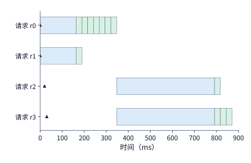

*图 8-6　固定批处理（Static Batching）策略下的四请求执行时间线：尽管 $r_1$ 在第二轮结束（约 190 ms）即已完成全部 2 个输出 token，系统仍必须等待同批的 $r_0$ 跑完剩余 6 步 decode（至约 347 ms）后，才能接纳早已到达的 $r_2$ 与 $r_3$，全部请求约在 870 ms 处完成。图中蓝色块代表输入处理（Prefill），绿色块代表输出生成（Decode），空心三角标出请求到达时刻，色带水平宽度对应单次调度迭代的真实耗时（按 RTX PRO 6000 实测模型核算）。*

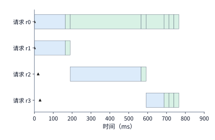

*图 8-7　朴素连续批处理（Continuous Batching）策略下的执行时间线：$r_1$ 在第一轮 decode 结束后立即腾出槽位接纳 $r_2$；但由于新加入的 $r_2$ 需要在单轮内一次性处理完 8192 个输入 token 的长 prefill，导致同批正在生成的 $r_0$ 被迫陪等这轮超长迭代，使其最长相邻输出间隔从约 26 ms 暴增至约 376 ms（增长 14 倍），全部请求约在 766 ms 处完成。*

3. **策略三：Decode 优先的分块预填充（Chunked Prefill，图 8-8）**。怎样才能既享受连续批处理的槽位复用，又不让 $r_2$ 的 $8\mathrm{K}$ 长输入把 $r_0$ 阻塞 $376\ \mathrm{ms}$？微软研究院等在 **Sarathi-Serve（OSDI 2024）** 中系统阐述了**分块预填充与捎带解码（Chunked Prefill & Piggybacking Decode）**机制：设置单轮迭代允许处理的最大 token 总预算（例如与实验 8-1 默认配置一致，设为每轮最多处理 $4096$ 个 token，并将长 prefill 切分为每块 $2048$ 个 token 的子块）；在每一轮调度时，**优先保障所有在途请求的那 1 个 decode token 纳入本轮批次**，然后再用剩余的预算顺带处理新请求的**一小块 prefill**。在图 8-8 中，当 $r_1$ 退出、$r_2$ 补入后，$r_2$ 的 $8192$ 个输入 token 被切分为 **4 个各含 $2048$ token 的分块**，分布在连续 4 轮迭代中与 $r_0$ 的 4 步 decode 结伴执行。如此一来，单轮迭代的耗时被严格约束在百毫秒以内，**使 $r_0$ 的最大输出间隔从 $376\ \mathrm{ms}$ 大幅回落至约 $133\ \mathrm{ms}$（卡顿缩减近三倍）**，而全部四条请求的总完成时间也仅微增至约 **$844\ \mathrm{ms}$**，在吞吐与流式平稳度之间取得了理想的平衡。

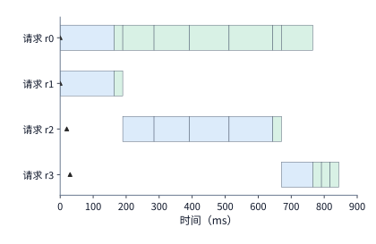

*图 8-8　Decode 优先的分块预填充（Chunked Prefill）策略时间线（与图 8-6、图 8-7 采用完全相同的时间标尺）：将 $r_2$ 的 8192-token 长输入切分为 4 个 2048-token 子块，在连续四轮迭代中每轮先安排在途请求 $r_0$ 生成 1 个输出 token，再捎带处理 $r_2$ 的一块输入；最长输出间隔由此从 376 ms 大幅压降至约 133 ms，全部请求约在 844 ms 处平稳完成。*

### 8.2.3 长 prefill 对生成的干扰与分块执行

仔细观察图 8-8 中 $r_2$ 那连续四个蓝色 prefill 分块的水平宽度，细心的读者一定会发现一个有趣的现象：**明明每一个分块切出来的都是整整齐齐的 $2048$ 个新 token，为什么越往后的蓝色分块画出来却越宽（耗时越长）？**

让我们从自注意力机制的几何结构出发，把这个重要规律推导出来。在分块预填充中，每一次迭代处理的分块大小决定了新请求需要分几轮才能跑完 prefill（块越大，所需轮数越少；块越小，在途 decode 请求获得下一次吐字的机会就越早）。然而，即便每个分块包含的新 token 数量 $c$ 完全相同，**随着前面的分块陆续算完并写入 KV 缓存，后续分块在进行因果自注意力计算时必须回看（attend to）的历史上下文长度 $h$ 却在逐块累加**。

设当前正在处理的预填充子块包含 $c$ 个新输入 token，而在它之前已经计算完毕并存入 KV 缓存的旧上下文共有 $h$ 个 token。根据因果掩码（Causal Mask）规则，当前块内的每个新 token 既要关注全部 $h$ 个旧上下文位置，又要关注当前块内排在它自己及它前面的新位置：
- 块内第 $1$ 个新 token 需要与 $h + 1$ 个键位置计算点积配对；
- 块内第 $2$ 个新 token 需要与 $h + 2$ 个键位置计算点积配对；
- ……
- 块内第 $c$ 个（最后一个）新 token 需要与 $h + c$ 个键位置计算点积配对。

将这 $c$ 个新 token 的注意力配对数逐项相加，利用等差数列求和公式，即可得到处理该分块所需的**总因果注意力配对数 $N_{\mathrm{pair}}(c, h)$**：

$$
N_{\mathrm{pair}}=(h+1)+(h+2)+\cdots+(h+c)
=ch+\frac{c(c+1)}{2}.
$$

这个公式由几何意义直观的两部分组成（见图 8-9 与图 8-10）：
- 第一项 **$c \cdot h$（历史交叉矩形项）**：来自当前块的 $c$ 个新查询对此前已缓存的 $h$ 个旧历史键的完整访问，在注意力矩阵上构成一块宽为 $h$、高为 $c$ 的**实心矩形**；
- 第二项 **$\frac{c(c+1)}{2}$（块内自因果三角形项）**：来自当前块内部 $c$ 个新 token 彼此之间的下三角因果注意力，构成一块底和高均为 $c$ 的**直角梯形／三角形**。

让我们代入一组具体数字来感受第一项 $ch$ 的威力：假设我们将一条 $8192$ token 的长输入按固定块长 **$c = 512$** 切分为 16 个分块依次执行：
- 在处理**第 1 个分块（首块，此前历史长度 $h = 0$）**时，矩形项 $ch = 0$，全部注意力计算仅来自块内下三角项 $\frac{512 \times 513}{2} = \mathbf{131{,}328\ \text{个配对}}$；
- 而在处理**第 16 个分块（末块，此前已累积历史长度 $h = 15 \times 512 = 7680$）**时，虽然块内下三角项依然是 $131{,}328$，但左侧历史矩形项 $ch$ 却膨胀到了 $512 \times 7680 = 3{,}932{,}160$，使总配对数激增至 $3{,}932{,}160 + 131{,}328 = \mathbf{4{,}063{,}488\ \text{个配对}}$——**同样是处理 512 个新 token，末块的注意力计算与 KV 读取工作量达到了首块的 31 倍**。

图 8-9 与图 8-10 以 $c = 4$ 个新 token 为例，将“无旧历史（$h=0$）”与“已有 $h=8$ 个旧历史 token”时的注意力访问矩阵并排画成了等比例方格面积图：可以看到，当分块大小 $c$ 固定时，右侧的块内三角形面积（10 个格子）恒定不变，而左侧的历史矩形面积（$4 \times 8 = 32$ 个格子）则随着已处理上下文 $h$ 的增长而不断横向拉宽。这正是分块 prefill 中越靠后的分块耗时越长的根本原因。

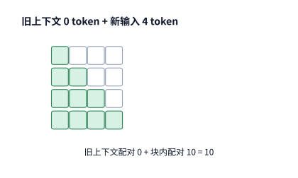

*图 8-9　首次处理 $c=4$ 个新 token（此前旧上下文长度 $h=0$）时的因果注意力配对矩阵：此时无旧历史可供回看，仅有块内 4 个新 token 之间的下三角因果注意力配对，共形成 $1+2+3+4 = 10$ 个有效计算格；右上角白色方格对应尚未出现的未来位置，被因果掩码屏蔽。*

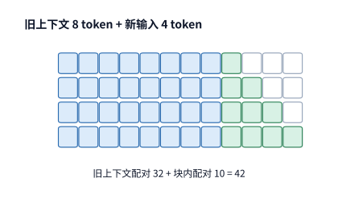

*图 8-10　当已累积 $h=8$ 个旧上下文 token 时，继续处理同样大小（$c=4$）的新分块：4 个新查询必须完整读取并访问左侧全部 8 个旧历史键位置（形成 $4\times 8 = 32$ 个历史矩形配对格），同时加上右侧不变的 10 个块内因果配对格，总有效配对数在相同块长下从 10 跃升至 42。*

当然，一层 Transformer 除自注意力外，还包含线性投影（QKV 与输出投影）和前馈网络（FFN）。这些逐 token 独立进行的矩阵变换只与本块的新 token 数量 $c = 512$ 有关，在首块和末块上的运算量完全一致。在本书配套的 16 块逐块实测记录（$8\mathrm{K}$ 输入切为 16 个 512-token 块）中，计入注意力与主干线性层后，末块（第 16 块）的整网总矩阵浮点运算量比首块（第 1 块）多出约 **$32\%$**，而在 RTX PRO 6000 上实测的单块执行时间中位数则从首块的约 **$25.3\ \mathrm{ms}$** 上升到了末块的 **$35.1\ \mathrm{ms}$（耗时增加约 $39\%$）**。可见，任何一个预填充子块的真实执行时间，都是由**“仅随本块新增 token 数 $c$ 变化的线性层主干耗时”**与**“同时随本块长度 $c$ 及既有历史长度 $h$ 增长的注意力耗时”**两部分共同决定的。[^chunk]

既然长历史会让大块越来越慢，那么如果我们反其道而行之，**把分块尺寸 $c$ 切得极小（比如从 256 切成两个 128，甚至切成 32），是不是就能让延迟无限降低呢？** 绝非如此——把分块切得过碎，会立刻在显存总线上招致另一笔沉重的惩罚：**模型权重的跨轮次重复读取开销**。

让我们算一笔账：假设在低并发场景下，我们将原本可以在 1 轮迭代内算完的 $256$ 个 prefill token，拆分为两个各含 $128$ 个 token 的小块，分两轮迭代先后执行。虽然在这两块之间多腾出了一次调度窗口，但由于矩阵行数减半、且分成了两次独立的模型前向传播，每一轮前向都必须从显存重新把整网的模型权重完整读进片上一次。单单以 Qwen3-8B 中**一层 FFN 的三个 BF16 权重矩阵（合计占 $288\ \mathrm{MiB}$）**为例：1 次跑完 256 个 token 只需从显存读取 $288\ \mathrm{MiB}$ 权重；拆成 2 次各跑 128 个 token 后，单这一层 FFN 的权重读取量就翻倍到了 **$576\ \mathrm{MiB}$**（全网 36 层更是额外多读了逾 $14\ \mathrm{GiB}$ 权重），同时主机端发起的 kernel 启动次数也随之翻倍。华盛顿大学等在 **NanoFlow（OSDI 2025）** 的研究中同样深入剖析了这一权衡：只有当批内总 token 数已经大到足以让矩阵计算完全达到算力饱和（Compute-bound）时，继续切分算子以在设备内部做计算与通信/访存流水重叠才不会劣化单 token 效率；而在小批量或访存受限区间，过细的分块只会加剧权重的重复搬运。因此，生产级调度器在选择分块大小 $c$ 时遵循一条核心准则：**在确保单轮执行时间不超过相邻输出间隔（ITL）上限的前提下，应尽可能选用较大的分块尺寸，以最大限度摊薄模型权重的读取次数与内核启动开销。**[^nanoflow]

### 8.2.4 Token 预算、动态形状与执行时间

在实际推理引擎（如 vLLM 与 SGLang）的调度配置中，管理员通常通过设置**单轮最大 token 预算（Token Budget，如 `max_num_batched_tokens = 4096`）**来统管每一轮迭代的计算规模。然而，从调度器选定本轮的 token 数量，到 GPU 真正执行完这一轮前向传播，中间还隔着我们在第 5.5 节深入讨论过的**运行时动态形状与 CUDA Graph 分桶（Shape Bucketing）**机制——由于预先录制的 CUDA Graph 只支持少数几个离散的固定矩阵行数（桶尺寸），**调度器在预算内少安排 1 个 token，在硬件上并不一定能少做 1 份计算**。

举一个具体的例子：假设运行时为了消除主机端提交开销，预先为 $16$ 行和 $32$ 行两种输入批次尺寸捕获了对应的 CUDA Graph；任何实际行数落在 $17\sim 32$ 行之间的迭代批次，在送入 GPU 重放前都会被向上补齐（Pad）到 **$32$ 行**来执行。在这样的分桶配置下：
- 如果调度器将本轮安排的 token 数从 $18$ 个削减为 $17$ 个，由于 $17$ 依然落在 $(16, 32]$ 的桶区间内，GPU 实际重放的依然是那张 $32$ 行的计算图，单轮执行耗时不会有丝毫缩短；
- 唯有当调度器将本轮 token 数从 $17$ 个再减 1 个至 **$16$ 个**时，恰好跨过分桶台阶，运行时得以切换到 $16$ 行的计算图，单轮耗时才会出现台阶式下降。
当然，你可能会问：为什么不为 $17$ 行也专门捕获一张计算图，省掉那 $15$ 行无效填充呢？回顾第 5.5.2 节与第 8.1.2 节的显存不等式：每多捕获一张固定形状的 CUDA Graph，不仅在服务启动时要多耗费漫长的编译与录制准备时间，更重要的是每张图绑定的私有固定缓冲区还要长期侵占第 8.1.2 节中的运行时显存项 $M_u$，直接挤压留给 KV 缓存的宝贵空间 $M_{\mathrm{KV}}$。

由此我们可以看清**“预设执行形状（Graph Buckets）”**与**“每轮 Token 预算上限（Token Budget）”**的联动关系：执行形状决定了跑完这一轮迭代实际要花多少毫秒，而 Token 预算上限则决定了在这一轮里究竟拨出多少配额去消化新请求的 prefill。调高单轮 Token 预算上限，固然能让新到达的长输入请求更快走完 prefill、尽早离开等待队列；但同批正在 decode 的老请求就不得不陪着等待这轮更庞大的迭代跑完，才能拿到自己的下一个输出 token。

本书配套的 **实验 8-2** 在 RTX PRO 6000 上对 **6 条每隔 $80\ \mathrm{ms}$ 依次到达的请求**进行了完整的轨迹回放，定量记录了当我们将单轮 Token 预算上限从 $512$ 一路调高至 $8192$ 时，新老请求体验的此消彼长：
- **对后到达新请求的排队等待时间**：当每轮预算上限从 $512$ 提高到 $8192$ 时，前序请求的输入被一轮扫清，使后到请求在引擎队列中等待接纳的时间从约 **$149\ \mathrm{ms}$ 骤降至不足 $0.1\ \mathrm{ms}$**；
- **对已在途老请求的最大输出间隔（Max ITL）**：与此同时，由于单轮合并了高达数千个 prefill token，在途请求遭遇的最长单次输出间隔却从平稳的约 **$32\ \mathrm{ms}$ 激增到了 $183\ \mathrm{ms}$（卡顿放大近 6 倍）**。[^replay]

基于这一清晰的折中规律，我们在工程上可以采用**“两步倒推法”**来科学设定每轮处理的 token 预算：
1. **第一步（由 ITL 时限锁定单轮时间上限）**：先根据业务允许的最大相邻输出间隔（例如要求 $\mathrm{ITL} \le 50\ \mathrm{ms}$），确定单轮调度迭代最多允许占用加速卡多少毫秒；
2. **第二步（结合历史长度 $h$ 与形状分桶换算可接纳的新 token 数 $c$）**：根据当前待 prefill 请求已经累积的历史上下文长度 $h$（回顾第 8.2.3 节：历史 $h$ 越长，每个新 token 附带的注意力配对开销 $ch$ 就越重）以及运行时的 CUDA Graph 形状分桶台阶，反推出在该时间上限内本轮最多还能纳入多少个新 prefill token（对齐到不超过时间上限的最大桶尺寸）。这样一来，当遇到历史上下文尚短的新块时，调度器会自动选用较大分块处理更多新 token；而当处理到长上下文末尾的重负载分块时，调度器则自动缩减块长 $c$，从而在任何上下文深度下都能稳稳守住流式输出的延迟红线。

确定了每一轮迭代纳入哪些请求、处理多少个 token 之后，我们还必须审视 decode 步末尾经常隐藏在主机侧的一处调度暗礁——**结构化生成与语法引导解码（Structured Generation / Grammar-Guided Decoding）**。在工具调用（Function Calling）、JSON Schema 强制约束、SQL/代码语法生成等智能体场景中，推理引擎必须在每一个生成步的采样阶段，将当前不满足上下文无关文法（CFG）或正则表达式的所有词表 token 的对数几率（Logits）屏蔽为 $-\infty$。若每一步都由 CPU 临时遍历庞大词表构造掩码，并同步阻塞 GPU 等待掩码生成完毕后再采样，主机侧的语法自动机就会把原本仅耗时数毫秒的 GPU 解码迭代彻底拖慢。

为了消除这一主机侧瓶颈，陈天奇团队等在 **XGrammar（Dong 等，MLSys 2025）** 中提出了一套软硬件协同的字节级下推自动机（Pushdown Automaton, PDA）编译与运行时流水线：首先，XGrammar 将词表中的所有 token 划分为**上下文无关 token（Context-Independent Tokens）**与**上下文相关 token（Context-Dependent Tokens）**——绝大多数（通常超过 $99\%$）普通词表 token 是否合法仅取决于当前所处的局部词法规则，因此在文法编译阶段即可预先计算并存入自适应压缩掩码缓存（Adaptive Token Mask Cache），运行时仅需对极少数跨越规则边界的上下文相关 token 动态查询树状**持久化执行栈（Persistent Execution Stack，支持 $O(1)$ 分支复制与回滚）**，从而将单请求单步的 CPU 掩码生成耗时压缩上百倍至数十微秒以内；其次，XGrammar 将词表掩码打包为紧凑的 **32 位整型位图（`int32` Bitmask）** 传输至 GPU，并通过专用 CPU 线程与独立 CUDA 流实现**下一轮 CPU 掩码生成与当前轮 GPU 前向计算的跨步流水重叠（CPU-GPU Pipeline Overlap）**。让我们通过一组定量算例，核算结构化生成在 PCIe 传输、HBM 访存与 CPU-GPU 流水线三个维度上的真实开销账本：[^structured-gen]

> **算例 8-A（XGrammar 词表位图掩码传输、Logits 访存与 CPU-GPU 流水重叠账本）**：
> 设推理实例运行本章基准模型 **Qwen3-8B**（词表大小 $V = 151{,}936$），当前解码批次包含 $B = 64$ 条并发结构化生成请求（见图 8-39 上图 A）：
> 1. **词表位图掩码体积与 PCIe H2D 传输耗时**：XGrammar 将每条请求的词表合法性编码为按 32 个 token 打包的 `int32` 位图，单条请求每步所需的掩码字数为 $\lceil 151{,}936 / 32 \rceil = 4{,}748\ \text{个}\ \texttt{int32}$，对应 $\mathbf{18{,}992\ \mathrm{B}}\approx 18.55\ \mathrm{KiB}$；整批 $B = 64$ 条请求单步合计需生成并传输的位图载荷为
>
> $$
> M_{\mathrm{mask}} = 64 \times 18{,}992\ \mathrm{B} = \mathbf{1{,}215{,}488\ \mathrm{B}} \approx \mathbf{1.159\ \mathrm{MiB}}\ (\text{十进制}\ 1.215\ \mathrm{MB}).
> $$
>
> 在有效单向主机至设备（H2D）带宽为 $25\ \mathrm{GB/s}$ 的 PCIe 链路上，搬运这 $1.215\ \mathrm{MB}$ 位图的纯传输时间仅为 $1{,}215{,}488 / (25\times 10^9) = \mathbf{48.62\ \mu\mathrm{s}}$。这说明位图本身的 PCIe 带宽开销微乎其微，真正危险的是未重叠的 CPU 掩码计算以及同步拷贝带来的流阻塞。
> 2. **GPU 侧 Logits 矩阵物化与掩码应用访存**：若在 GPU 显存中将形状为 $[64, 151{,}936]$ 的 FP32 Logits 矩阵完整物化，并启动一个独立内核执行“读入 Logits $\to$ 按位图解包屏蔽非法位置 $\to$ 写回 Logits”，单次读写一趟 HBM 的流量就高达
>
> $$
> D_{\mathrm{logits}} = 2 \times 64 \times 151{,}936 \times 4\ \mathrm{B} = \mathbf{77{,}791{,}232\ \mathrm{B}} \approx \mathbf{74.188\ \mathrm{MiB}},
> $$
>
> 达到位图掩码体积本身的 **64 倍**。按 $1\ \mathrm{TB/s}$ 的有效显存带宽折算，仅这趟未融合的 Logits 读写就要耗费 **$77.79\ \mu\mathrm{s}$**；因此高性能运行时会将位图解包与掩码屏蔽直接融合进采样（Sampling）或 LM Head 尾声核函数中，避免将巨型中间 Logits 反复写回 HBM。
> 3. **CPU 掩码生成与 GPU 前向的跨步流水重叠**：设 CPU 单核为单条请求生成一行动态语法掩码平均耗时 $50\ \mu\mathrm{s}$，单线程串行处理 $64$ 条请求共需 $64 \times 50\ \mu\mathrm{s} = \mathbf{3.2\ \mathrm{ms}}$，而假设在高性能集群或轻量化配置下 GPU 执行一轮模型前向传播耗时为 **$2.0\ \mathrm{ms}$**：
>    - **朴素串行执行**：GPU 跑完 $2.0\ \mathrm{ms}$ 前向后停下来干等 CPU 算完 $3.2\ \mathrm{ms}$ 掩码，单步总耗时膨胀至 $2.0 + 3.2 = \mathbf{5.2\ \mathrm{ms}}$（降速逾 $60\%$）；
>    - **单线程 CPU-GPU 流水重叠**：让 CPU 在 GPU 执行当前步前向的同一时刻并行计算掩码，单步耗时下界即收缩为 $\max(3.2, 2.0) = \mathbf{3.2\ \mathrm{ms}}$，但此时系统反过来被单核 CPU 掩码生成卡住了咽喉；
>    - **多核并行掩码 + 流水重叠**：进一步利用多线程并行生成批内各请求的掩码（例如 4 线程并行将 CPU 掩码耗时压至 $0.8\ \mathrm{ms} < 2.0\ \mathrm{ms}$），掩码生成与 $48.62\ \mu\mathrm{s}$ 的异步 H2D 传输便能被彻底隐藏在 **$2.0\ \mathrm{ms}$** 的 GPU 前向阴影之内，实现近似零额外开销的结构化生成（工程实现如 vLLM 还会设置并发阈值，例如仅当批内结构化请求数超过 128 时才唤醒多线程池以规避小批量下的线程调度开销，并将首次高昂的 JSON Schema 语法编译结果持久化缓存以消除冷启动毛刺）。

确定了每一轮迭代的 token 预算、动态形状分桶与主机侧语法流水之后，推理引擎紧接着必须在显存中为这些新产生的状态妥善分配空间——下一节我们就深入显存管理器内部，剖析 KV 缓存是如何通过分页、写时复制与前缀树实现高效分配与跨请求复用的。

> **练习 8-2 · 核心 · 分析：由输出间隔限制确定 prefill 分块大小。** 采用第 8.2.2 节的四条请求与执行时间模型，手算 r0、r1 的初次 prefill 和下一步 decode 各需多久，再计算连续批处理接纳 r2 时该轮的耗时。解释最长输出间隔的来源。固定新块长度 $c=512$，分别计算已有上下文长度 $h=0$ 与 $h=7680$ 时的注意力配对数。最后分析配套的六条请求回放记录，在“最长间隔小于 50 ms”和“后到请求尽快接纳”两种目标下分别选择每轮 token 上限，并指出哪一项耗时决定了选择。

## 8.3 KV 缓存的分配、复用与释放

### 8.3.1 预留、碎片与分页分配

在第 8.1.2 节的显存预算中，为了保证每条请求在自回归生成过程中都有连续的地址空间追加 KV，传统推理框架往往在请求一进入系统时，就按照允许的最大输出长度（例如 256 甚至 4096 个 token）为其一次性划出一整块连续显存。然而在实际线上业务里，绝大部分请求都会提前吐出结束符 `EOS` 而终止——那一大截预留却从未写过数据的尾部空间，在请求存活期间既不能借给别人，也无法产生任何收益，形成了严重的**内部预留浪费**。反过来，如果试图只按当前长度分配并在生成时动态扩容，一旦要求张量在物理显存中保持连续，只要紧邻的地址已被其他并发请求占据，引擎就不得不停下来搬移整段历史 KV，或者在显存池里留下大量无法拼成完整长序列的**外部碎片**。

要根治这一顽疾，我们可以向操作系统的虚拟内存机制取经，把 KV 缓存的管理改造为一本“活页夹”：读者的阅读顺序（序列中的 token 逻辑顺序）由活页纸上的页码决定，而每一页纸实际插在档案柜的哪个物理抽屉里，根本无需彼此相邻——只要有一张目录表记录“第几页放在哪个抽屉”即可。当序列继续变长、写满当前活页时，引擎只需从空闲抽屉池里随便抽出一个空抽屉放进新页，并在目录表里添上一笔映射，就再也不必为了维持物理连续而整本搬迁历史数据。

这种机制就是推理引擎中的**分页分配（Paged Allocation）**：它将每条请求的 KV 序列切分为固定大小（例如每块容纳 $p$ 个 token）的块。其中，**逻辑块（Logical Block）**按照序列中的 token 位置依次编号（0, 1, 2, ...），相当于活页页码；**物理块（Physical Block）**则是 HBM 显存池中实际存放 KV 数据的等长物理槽位；每条请求各自维护一张**块表（Block Table）**，专门记录每一个逻辑块映射到哪一个物理块编号。当 decode 逐轮推进、已有逻辑块被填满时，引擎才按需从全局空闲池申领一个新的物理块并追加块表项；注意力算子在读取历史上下文时，直接顺着块表索引去对应的物理块抓取 KV，物理块在显存中完全可以零散分布（本小节着重讨论 HBM 内部的分页寻址，跨 HBM 与主机内存的多级换入换出将在第 8.3.4 节与第 8.4.3 节展开）。

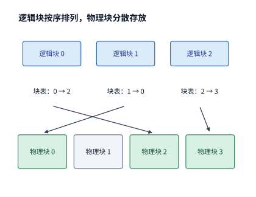

*图 8-11　从逻辑块查到物理块的分页寻址示意：逻辑块 0、1、2 按序列先后顺序排列，请求专属的块表分别指向物理块 2、0、3；物理块 1 当前处于空闲池中，注意力算子通过查阅块表即可按逻辑顺序还原完整上下文。*

设每个物理块可容纳 $p$ 个 token 的 KV，某条请求当前的实际上下文长度为 $L$ 个 token，则它一共需要占用 $\lceil L/p\rceil$ 个物理块。由于前 $\lceil L/p\rceil - 1$ 个块都已被完全填满，只有最后一个尾块可能存在尚未写满的空余槽位，其内部碎片浪费量为：

$$
p\left\lceil\frac{L}{p}\right\rceil-L,
$$

也就是说，无论请求总长度有多长，单条请求最多只会浪费末尾块里的 $p-1$ 个 token 空间。块尺寸 $p$ 选得越小，这一尾部浪费上限就越低，但块表的条目数与分配调度频次也会相应增加（工程中常取 $p=16$ 或 $p=32$，以兼顾访存对齐与碎片控制）。2023 年，加州大学伯克利分校等机构的研究者在 vLLM（Kwon 等，SOSP 2023）中提出了著名的 **PagedAttention**，首次把操作系统虚拟内存分页的思想系统性地引入大模型 KV 缓存管理，消除了静态预留与外部碎片对服务并发度的限制。需要注意，PagedAttention 与第 5 章介绍的 FlashAttention 解决的是不同层面的问题：PagedAttention 在**显存状态管理层**通过块表映射允许 KV 非连续存放与动态按需增长，而 FlashAttention 则在**算子内核执行层**通过片上 SRAM 分块（Tiling）与在线 Softmax 消除巨型注意力分数矩阵的 HBM 读写；现代推理引擎会将两者结合——由块表提供物理地址，再由融合内核分块流式计算注意力。

**算例：KV 分页分配能减少多少预留空间？** 设实例中同时运行着 A、B、C、D 四条请求，它们当前的上下文长度分别为 9、13、5、15 个 token，而系统设定的单条请求最大允许长度均为 16 个 token。如果采用传统的整段连续预留方案（图 8-12），四条请求无论当前多短，都必须各自按上限占住 16 个 token 的连续槽位，合计预留 $4 \times 16 = 64$ 个 token 的 KV 空间；而如果改用块大小 $p=4$ 的分页按需分配方案（图 8-13），四条请求分别只需分配 $\lceil 9/4\rceil\times 4 = 12$、$\lceil 13/4\rceil\times 4 = 16$、$\lceil 5/4\rceil\times 4 = 8$ 以及 $\lceil 15/4\rceil\times 4 = 16$ 个 token 的物理块容量，合计仅占 $12 + 16 + 8 + 16 = 52$ 个 token 的 KV 空间。在这两种方案下，四条请求实际已经写入的有效 KV 都是 $9 + 13 + 5 + 15 = 42$ 个 token，但分页分配将未使用的预留空位从 $64 - 42 = 22$ 个 token 压缩到了 $52 - 42 = 10$ 个 token，直接省下了超过一半的闲置开销。

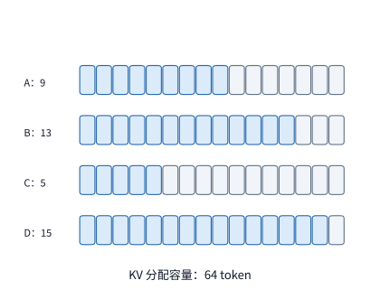

*图 8-12　整段连续预留方案下的 KV 分配容量：四条请求当前分别含 9、13、5、15 个有效 token（蓝色已用），但每条都必须按最大长度预留 16 个 token 的连续空间，合计占掉 64 个 token 的 KV 容量（灰色为预留未用空间，达 22 个 token）。*

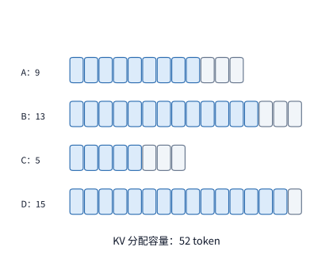

*图 8-13　改用每块保存 4 个 token 的分页按需分配：四条请求分别按需申领 3、4、2、4 个物理块（对应 12、16、8、16 个 token 容量），合计分配 52 个 token；灰色尾块内部未用容量从 22 个 token 降至 10 个 token。*

分页带来的惊喜还不止于此。因为逻辑块与物理块已经通过块表解耦，如果请求 A 和请求 B 的前 8 个输入 token 完全相同（例如共享同一段系统提示词），它们的块表完全可以把各自的逻辑块 0 和逻辑块 1 同时指向显存里的**同一对物理块**（图 8-14）。这样一来，那 8 个共同前缀 token 的 KV 只需在物理显存中保存一份，四条请求的总分配容量便从 52 个 token 进一步降至 $52 - 8 = 44$ 个 token。可以看到，**分页分配**消除的是“尚未生成的尾部预留泡沫”，而**跨请求块共享**消除的则是“重复存储的公共前缀冗余”，两者从一头一尾共同挤出了 KV 显存中的冗余空间。

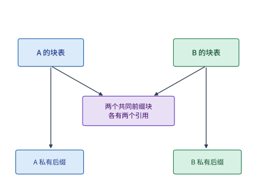

*图 8-14　两个请求通过块表引用同一前缀物理块：请求 A 与请求 B 的前两个完整块（8 个共同前缀 token）在物理显存中只保存一份，两张块表同时指向它们，各自仅独立分配后续私有尾块；四条请求实际分配的 KV 总容量进一步降至 44 个 token。*

### 8.3.2 分支共享、写时复制与内存释放

一旦允许多个请求的块表指向同一个物理块，显存管理器就必须像操作系统内核管理共享内存页那样，严谨地回答两个生命周期与并发隔离问题：第一，如果图 8-14 中的请求 A 先一步生成完毕并退出了，它所引用的那两个前缀物理块能立刻回收吗？显然不能，因为请求 B 还在继续读取它们；第二，如果某两个共享块尚未写满，接下来请求 A 和请求 B 要在同一个尾块里续写各自不同的新 token，怎样防止 B 把 A 的数据冲掉？

为了解决这两个问题，分页管理器为每个物理块引入了**引用计数（Reference Counting）**与**写时复制（Copy-on-Write, CoW）**机制。具体而言，每张块表中指向某个物理块的一条映射记录称为对该物理块的一个**引用（Reference）**，每个物理块在元数据区维护一个整型的引用计数器，统计当前有多少个活跃使用者正在依赖它。每当一条新请求或新分支通过块表共享该物理块时，其引用计数加 1；每当一条请求结束或释放该块时，其引用计数减 1。只有当引用计数归零（没有任何块表再指向它），**并且**此前已下发给加速卡的所有引用该块的异步内核操作均已执行完毕时，这个物理块才被允许归还到全局空闲池中（图 8-15）。凭借引用计数，同一份公共前缀既能在并发生命周期内安全服务多条分支（如并行采样 `n>1`、束搜索 Beam Search 或共享系统提示），也能在任意分支先后结束时做到不早放、不漏放。

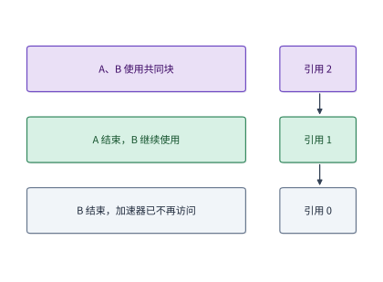

*图 8-15　根据引用计数安全释放共享物理块：A 与 B 共享时物理块引用计数为 2；A 率先结束后释放引用，计数从 2 降为 1，物理块继续留在显存中供 B 读取；直到最后一个引用释放且加速卡异步内核执行完毕后，该物理块才真正归还空闲池。*

而当两条共享分支需要向同一个**尚未填满的共享尾块**写入各自不同的新 token 时，**写时复制（Copy-on-Write）**便会介入（图 8-16）。举例来说，设每个物理块可存 4 个 token，某个尾块中已经写入了 `a, b, c` 三个共同 token 的 KV，且被两条分支共同引用（引用计数为 2）。接下来，分支 1 要在第 4 个槽位写入 token `x`，分支 2 则要写入 token `y`。如果直接往原物理块里写，两边就会在第四个槽位发生数据覆盖冲突。在写时复制机制下，当某条分支即将向引用计数大于 1 的物理块写入新数据时，引擎会先从空闲池分配一个全新的私有物理块，把原块里已有的 `a, b, c` 三个 token 的 KV 复制过去，将原块的引用计数减 1，然后再让两条分支在各自独立的物理尾块上分别追加 `x` 和 `y`；至于前面那些早已填满且只读不写的完整前缀块，则完全不受影响，继续保持单份共享。

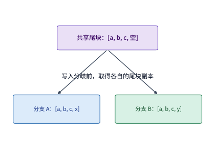

*图 8-16　分支写入前对未满共享尾块执行写时复制（CoW）：容量为 4 个 token 的尾块内已有共同前缀 `a, b, c`，当两条分支分别要追加不同的新 token `x` 与 `y` 时，引擎通过写时复制使它们各自持有独立的物理尾块，而此前已填满的只读前缀块继续保持共享。*

在配套的四分支并行生成实验（实验 8-3）中，我们可以直观看到这套机制带来的显存节省幅度：四条分支共享一段长达 95 个物理块的公共前缀，随后各自独立生成了 9 个物理块的私有后缀。如果四张块表各自独立存储，总共需要分配 $4\times(95+9)=416$ 个物理块；而在启用块级共享与写时复制后，系统实际分配的物理块总数仅为：

$$
95+4\times9=131.
$$

与独立存储的 416 块相比，物理显存占用直降约 69%——其中公共前缀的 95 个块被彻底去重为 1 份，只有分支分叉后新生成的 $4\times 9 = 36$ 个私有尾块随分支数线性增长。[^pages]

正是因为推理服务系统清楚地掌握了哪些 token 属于只读的公共前缀、哪些 token 会在分叉后独立写入，它才能通过“块表地址映射 + 引用计数共享 + 分叉写时复制”这套协同机制，把原本按整条请求粗放预留的显存，改造为按实际产生与复用的状态精确分配。

**公共前缀共享后的整批 KV 容量。** 现在让我们回到章首的 16 条长请求（输入 8192 个 token、输出 256 个 token）：设这 16 条请求来自同一个智能体应用，共享前 6144 个输入 token 的系统提示与工具定义（这部分公共前缀 KV 刚好占 $6144 \times 0.140625\ \mathrm{MiB} = 864\ \mathrm{MiB}$）。除去这 6144 个公共 token 外，每条请求各自私有的部分包含剩余的 $8192 - 6144 = 2048$ 个输入 token 以及生成阶段的 255 个已写入输出 token，合计 $2048 + 255 = 2303$ 个私有 token。按每块 $p=16$ 个 token 分页分配，每条请求的私有部分需要 $\lceil 2303/16\rceil = 144$ 个物理块（对应 $144 \times 16 = 2304$ 个 token 的容量），即占用 $2304 \times 0.140625\ \mathrm{MiB} = 324\ \mathrm{MiB}$。因此，当整批 16 条长请求全部生成到最后一步时，所需的总 KV 显存空间骤降为：

$$
M_{\mathrm{KV}}=864+16\times324=6048\ \mathrm{MiB}.
$$

回顾第 8.1.2 节，这 16 条长请求在独立预留时原本需要 $16\times1188=19008\ \mathrm{MiB}$（约 $18.56\ \mathrm{GiB}$），根本塞不进 12 GiB 的 KV 显存池；而在启用分页与公共前缀共享后，总占用降到了 $6048\ \mathrm{MiB}\approx 5.91\ \mathrm{GiB}$，不仅能轻松装进 12 GiB 显存池，还留出了充足的余量。更一般地，对于 $b$ 条共享这段 6144-token 前缀的同类长请求，总 KV 占用为 $864 + 324b\ \mathrm{MiB}$，这意味着 12 GiB（$12288\ \mathrm{MiB}$）显存池所能同时承载的最大并发长请求数，从独立存放时的 10 条一举跃升到了 $\lfloor (12288 - 864)/324 \rfloor = 35$ 条。

除了分配与共享，物理块用完后的**异步安全释放**也是工程实现中容易出错的一环。正如前面强调的，释放一块显存必须同时满足“主机侧块表无引用”和“设备侧已提交的 GPU 内核不再访问”两个条件。当用户在客户端中途点击“停止生成”取消一条请求时，CPU 上的调度器会立刻将该请求标记为取消、不再为其排入下一轮迭代，并立即向前端返回取消成功；但此时 GPU 流（CUDA Stream）里可能还有刚才已经下发、正在执行或排队执行的前向算子正在读取该请求的物理块。在实验 8-3 的一次实测追踪中，取消 API 调用仅耗时约 $1.6\ \mathrm{ms}$ 就向调用方返回了，但该请求所持有的 104 个物理块直到约 $31\ \mathrm{ms}$ 时（待 GPU 侧在途算子全部跑完并触发同步事件后）才真正释放回空闲池（图 8-17）。唯有严格遵守这一“先停调度、等算子排空、再回收物理块”的时序纪律，后续接纳的新请求在复用这些物理块时，才不会把正在执行的旧内核尚未读完的数据冲毁。[^cancel]

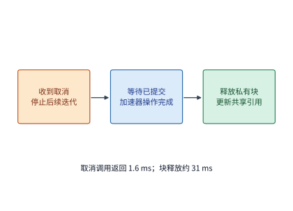

*图 8-17　异步取消请求时的物理块安全释放时序：取消接口在约 1.6 ms 处返回仅代表主机侧已接收取消指令并停止排入新迭代；必须等待已提交给加速卡的在途内核执行完毕（约 31 ms 处），对应的 104 个私有物理块才能安全归还空闲池。*

最后，除了请求正常结束或用户主动取消，当多条并发请求在生成过程中持续伸长、导致空闲物理块池彻底见底时，调度器还必须具备**内存抢占（Preemption）**能力：临时暂停其中一条或几条低优先级请求，将其已分配的物理块强行腾退出来让给其他请求继续跑完；等稍后显存宽裕时，再将刚才被抢占的请求恢复执行（可通过换出到主机内存 Swapping，或丢弃 KV 后根据已保存的原始输入与已生成 token 重新执行 prefill 即 Recomputation 来恢复状态）。在实验 8-3 的同一组工作负载中，当我们将 KV 池上限人为限制在 1 GiB 时，系统因显存耗尽触发了一次重计算抢占，导致全过程比正常情况多调度执行了 1805 个重算 token；而当 KV 池扩大到 2 GiB 时，全程零抢占顺畅跑完。抢占机制虽然用“重算或换入换出的额外耗时”为代价避免整批服务因显存溢出（OOM）而崩溃，但也提醒我们：合理规划 KV 容量与准入阈值，才是避免抢占开销的根本之策。[^pages]

> **练习 8-3 · 计算：KV 块大小与前缀共享如何影响容量。** 将四条长度 9、13、5、15 的序列分别按 2、4、8 个 token 分页，计算四条序列各自尾块中未使用的 KV 槽位数，并分别求出未使用 KV 槽位和块表项的总数。再按章首算例计算 8、16、32 条长请求在独立与共享状态下的完整容量。保持每条请求的总长度不变，将一个原本私有的完整块改为公共前缀的一部分，求 $b$ 条请求合计可以少分配多少物理块。

### 8.3.3 对话与智能体的前缀复用

第 8.3.2 节展示的是“同一时刻正在并行的多条请求”如何共享物理块。而在真实的在线服务中，这种共享还可以进一步跨越时间维度——**让早已结束的旧请求留下的 KV 块，继续为未来到达的新请求省去重复的 prefill 计算**，这就是以 SGLang 的 RadixAttention（Zheng 等，2024）和 vLLM 的 Automatic Prefix Caching（APC）为代表的**跨请求前缀缓存（Prefix Caching）**技术。只要后来到达的新请求与缓存中保留的历史序列拥有完全一致的前缀 token 序列，并且采用相同的模型权重、位置编码规则、LoRA adapter 与状态数值格式，引擎就可以直接挂载缓存中现成的物理块，跳过前面成千上万个公共 token 的计算，只对分叉点之后的新增后缀做增量 prefill。以章首的长请求算例来说，一旦前 6144 个公共前缀 token 命中了缓存，每条新到达的 8192-token 长请求就只需对剩余的 $8192 - 6144 = 2048$ 个私有输入 token 做 prefill，首 token 之前的计算工作量瞬间省去了四分之三。

不过，自回归因果注意力的数学性质决定了一条铁律：**前缀复用只能从序列起点开始连续匹配，一旦中间哪怕有一个 token 不同，后续所有位置的 KV 都必须推倒重算**。道理很简单：假设两条提示词的前 100 个 token 一模一样，唯独第 101 个 token 不同，那么哪怕从第 102 个到第 8000 个 token 的文字又完全相同，在因果注意力下，第 102 个及之后所有 token 的特征表示都参与了对第 101 个 token 的注意力聚合，其计算出的 KV 张量已经发生了改变，无法再直接复用。这一机制对上层应用开发者提出了十分关键的**上下文工程（Context Engineering）**准则：如果漫不经心地把“当前精确时间戳”或“随机请求 ID”塞在系统提示词的最开头，后面长达数千 token 的固定人设与工具定义（Tool Definitions）就会因为开头的几个变化 token 而全盘丧失缓存命中机会；反之，只要把稳定不变的系统提示词、Few-shot 示例与工具说明严格固定在提示词最前端，把每轮动态变化的用户输入或环境状态追加在末尾，就能最大化保留跨轮次与跨会话的公共前缀。[^context]

为了在运行时高效检索任意长度的前缀匹配，现代推理引擎（如 SGLang）通常使用**基数树 / 压缩前缀树（Radix Tree）**来组织缓存中的物理块：从树根到各个分叉节点的路径代表多轮或多请求共享的公共上下文，从分叉点延伸到叶子节点的边则代表各自的私有后缀。图 8-18 展示了实验 8-4 中一个真实代码智能体（Coding Agent）前四轮输入所构成的压缩前缀树：根部首先共享了 206 个共同的系统与任务前缀 token，随后的轮次沿着树干不断追加工具调用与文件读取结果（树边上的数字标出了每一步新增的 token 数量，叶子节点标出了该轮完整输入的总长度）。图 8-19 则将该智能体连续 12 轮交互的输入拆解为“与上一轮逐 token 完全一致的可复用前缀（蓝色）”和“本轮新增输入（橙色）”——可以看到，在顺次追加的交互模式下，每一轮都有绝大部分历史输入落在蓝色可复用区间内（至于这些蓝色前缀在实际运行中能否真正命中，还取决于缓存池容量是否足以将它们保留到下一轮到达，这一点马上会在第 8.3.4 节验证）。

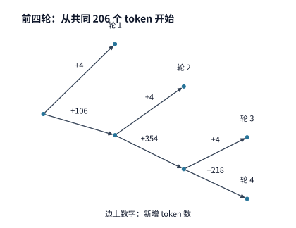

*图 8-18　前四轮代码智能体（Coding Agent）输入的压缩前缀树（Radix Tree）：根节点已包含 206 个共同前缀 token，树边标出各段新增的 token 数量，叶子节点给出各轮完整输入的总长度；节点分叉处代表后续上下文内容开始分化。*

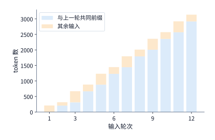

*图 8-19　代码智能体连续十二轮输入中的共同前缀占比：蓝色部分为与上一轮逐 token 完全相同、具备理论复用条件的前缀，橙色部分为当轮新增输入；实际运行时的缓存命中率还取决于显存池是否将这些前缀状态保留到了下一轮。*

在标准的全注意力（Full Attention）模型中，每一层、每一个历史 token 都有自己独立的一行 KV，因此前缀树可以在任意块边界处精准切入并恢复状态。但随着近年混合架构的兴起，前缀复用遇到了新的挑战：

**扩展：混合注意力模型如何确定可恢复的前缀位置。** 回顾第 2 章，诸如 Mamba-2、Gated DeltaNet、Kimi KDA 等线性注意力或状态空间递推（Recurrent / SSM）模块，并不按 token 逐个保存历史 KV，而是把从序列起点到当前位置的所有历史信息不断折叠更新进一个固定大小的**递推隐状态（Recurrent State）**中。在普通前向生成时，系统只需保留最新一步的递推状态即可；但如果想支持跨请求前缀复用，问题就来了：由于递推状态是不可逆地逐步累乘更新的，你无法像切片数组那样从“第 12000 个 token 的状态”倒推出“第 10752 个 token 的状态”。为了在混合模型中实现前缀恢复（如 MLSys 2025 的 Marconi 系统所研究的机制），引擎必须在处理长序列时每隔一定步数保存一份**递推状态快照（State Snapshot / Checkpoint）**。如图 8-20 所示，假设新请求的输入文本与历史记录一直匹配到了第 10,752 个 token，但系统中只保存了第 4096 和第 8192 个 token 处的两份递推状态快照；那么引擎只能退而求其次，先加载离匹配末端最近的 8192 处快照，然后从第 8192 个 token 开始重新前向计算 $10752 - 8192 = 2560$ 个 token，才能拼出第 10,752 个 token 处的准确递推状态。显然，快照打得越密，恢复时需要重算的过渡 token 数就越少，但快照本身吃掉的显存也成倍增加。以第 2 章剖析的 Kimi KDA 混合架构为例，在 8 卡张量并行（$\mathrm{TP}=8$）部署下，每张卡上单份递推状态快照就占约 $53.6\ \mathrm{MiB}$：如果只保存 2 份快照，每卡仅需约 $107\ \mathrm{MiB}$；但如果为了缩短重算距离而密集保存 32 份快照，单是快照就会吃掉每卡约 $1714\ \mathrm{MiB}$ 的宝贵空间。针对这一空间与重算的尖锐矛盾，**Marconi（MLSys 2025）** 提出了两条面向混合 SSM/Attention 模型的**前缀检查点准入准则**：第一是**纯输入公共前缀二次命中准入（Admission on 2nd Occurrence）**——系统绝不在第一次遇到某段新提示词时就盲目保存体积庞大的递推状态快照，而是仅记录轻量级的压缩前缀树（Radix Tree）token 哈希轨迹；唯有当某段纯输入公共前缀在后续请求中**第二次出现**并被识别为共享分支点时，引擎才在该前向过程中将其递推状态物化保存为检查点，从而让**第三次及后续到达的请求**真正享受到免重算复用，避免了一次性长提示词把宝贵的显存池冲垮；第二是**硬件分块边界对齐约束（Chunk Boundary Alignment）**——由于 Mamba-2 SSD 等现代状态空间算子在 prefill 阶段采用固定块长（如 $64$ 或 $256$ 个 token）的硬件分块扫描（Chunked Scan）核函数，仅在分块交界处才将片上 SRAM 中的递推状态写回 HBM，因此检查点位置必须严格对齐到硬件分块的整数倍边界，以免为了中途导出快照而打断算子融合流水线。如何在“快照存储开销”与“回退重算耗时”之间取得最优平衡，正是混合注意力推理引擎设计的核心课题。[^hybrid][^cache-reconfig]

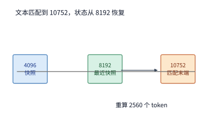

*图 8-20　混合注意力模型从最近递推状态快照恢复前缀：虽然文本逐 token 匹配到了第 10,752 个位置，但最近的一份递推状态快照保存在第 8,192 个位置；引擎加载 8,192 处快照后，仍需重算中间的 2,560 个 token 才能还原匹配末端的准确递推状态。*

**上下文编排还可以主动改变复用机会。** 随着智能体对话轮次不断累积，一味在末尾追加内容虽然能保住前缀命中，但越来越长的历史上下文会让 KV 显存占用和每步 decode 的注意力读取量持续膨胀。在工程实践中，上层智能体框架通常面临图 8-21 所示的三种上下文更新策略：
1. **末尾直接追加（Append）**：设已有 8K token 的历史上下文，本轮新增 1K 工具返回结果。直接追加在末尾可以 100% 复用已缓存的 8K 前缀 KV，本轮只需增量 prefill 新增的 1K token，但后续 decode 每步都要读取整整 9K 的 KV；
2. **改写前部指令（Prefix Edit）**：如果本轮修改了最前面的系统指令，哪怕后面的 8K 历史文本一字未改，因果依赖的断裂也会导致 8K 缓存全部失效，引擎不得不对全部 9K token 重新做 prefill；
3. **历史压缩摘要（Summarization）**：先把冗长的 8K 历史浓缩总结为一段 2K token 的精简摘要，再拼上 1K 新结果。这样做虽然打断了原有的 8K 缓存、需要额外付出一次生成摘要和重建 3K 缓存的计算开销，但在此后的所有轮次里，系统的上下文包袱从 9K 大幅减轻到了 3K，显著降低了后续长链条推理的显存占用与每步 decode 读取量。因此，优秀的智能体基础设施必须综合权衡显存占用、重算耗时与后续多轮读取收益，在“保前缀追加”与“周期性摘要重建”之间做动态编排。

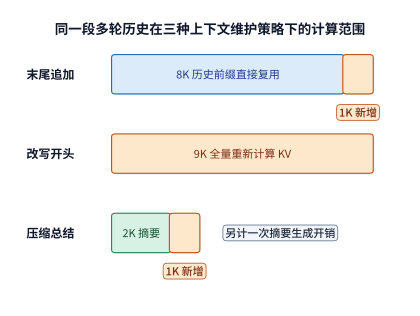

*图 8-21　同一段 8K 历史上下文的三种更新编排方式对比（长度以 K token 示意）：蓝色代表可直接复用的已缓存前缀，橙色代表本轮必须重新执行 prefill 的输入；摘要方案虽然先付出了总结与重建缓存的代价，但大幅缩短了后续轮次需要维护的上下文长度。*

除了递推快照与上下文编排，当模型在架构层面融合了滑动窗口注意力（SWA）与非对称编码器—解码器结构时，前缀复用的状态分类与恢复路径还会呈现出更加精妙的层次感。让我们继续追踪贯穿全书的 **DeepSeek V4.1** 案例：回顾第 2 章，DeepSeek V4.1 采用的 CED（Causal Encoder-Decoder）架构包含因果编码器与解码器两部分，其中既有全序列可见的**全局注意力层（Global KV）**，也有只看最近局部窗口的**滑动窗口注意力层（SWA）**。在进行跨轮次前缀复用时，DeepSeek V4.1 并没有把所有状态不加区分地放入同一个缓存池，而是根据它们在下一轮中的职责进行了精细的分层处置：
- **全局注意力状态（Global KV）**：跨越完整上下文，进入可长期复用的持久化前缀缓存池；
- **编码器局部状态（Encoder SWA）**：仅需保留窗口末端的状态，可在主机 DRAM 缓存池中作**短期保留**，以便下一轮对话紧接着已有前缀直接增量处理新追加的输入；
- **解码器局部状态（Decoder SWA）**：仅供当前这一轮自回归 decode 生成期间使用；在技术报告的部署方案中，一旦本轮回答生成结束，这 20 层解码器 SWA 就立即释放，**根本不作为跨轮次前缀缓存保存**。因此，在核算显存与缓存预算时，必须将“生成期间驻留加速卡的 40 层在线 SWA”与“跨轮次保留的前缀缓存”严格区分开来。[^v41-case]

这种分层保留策略，直接决定了当下一轮对话（例如工具调用返回结果后）到来时，因果编码器会走哪一条前缀恢复路径（设模型版本、位置索引与历史文本均一致，如图 8-22 所示）：
1. **路径一（Global KV 与 Encoder SWA 双重命中）**：如果全局 KV 和主机 DRAM 中的短期编码器 SWA 都命中了，编码器无需做任何历史重放，直接从断点处接着处理本轮新增的输入后缀；
2. **路径二（仅 Global KV 命中，Encoder SWA 已淘汰）**：如果间隔稍久、短期编码器 SWA 已被逐出，但长期全局 KV 仍在，编码器只需取出已缓存前缀**末尾最多 128 个 token** 进行局部窗口重放（Replay），与本轮未缓存的新增后缀一起执行前向——其中这 128 个重放 token 借助现成的历史全局 KV 快速重建出编码器 SWA 局部状态，而新增后缀则正常生成新的全局 KV 与 SWA；
3. **路径三（Global KV 亦未命中）**：此时只能按常规流程重算缺失的前缀。

无论编码器走完上述三条路径中的哪一条，在每次 prefill 的收尾阶段都有**共同的最后一步**：系统取出完整提示词末尾最多 128 个 token 的编码器输出表示，送入 20 层因果解码器执行一次短窗口前向，从而为即将开始的第一步 decode **近似构建出解码器 SWA 局部状态**。也就是说，即便编码器缓存 100% 命中、省去了编码器侧的历史恢复，解码器在启动生成前依然要执行这最多 128 个 token 的窗口重放。

为什么说这种 128-token 短窗口重放构建出的是“近似状态（Approximate State）”呢？从计算图依赖来看，虽然单层滑动窗口注意力只直接读取最近 128 个 token，但在多层堆叠的网络中，第 $l$ 层窗口边界处的隐状态其实通过第 $l-1$ 层、第 $l-2$ 层的窗口接力，间接承载了更早期历史 token 的感受野信息。当我们直接从前缀末尾 128 个 token 的边界截断并重新执行窗口重放时，更早期的多层间接局部依赖就被截断了。DeepSeek V4.1 技术报告第 3.2.2 节因此严谨地将这种短窗口重建出的 SWA 状态定义为近似恢复状态；并且由于该近似状态会继续参与后续前向计算，本轮新增后缀所产生的全局 KV 与 SWA 也会随之带有这一恢复起点的印记，但换来的是十分可观的存储减负：

在原版 DeepSeek V4 的工作负载与缓存策略下，SWA 状态大约占据了长期前缀缓存池总容量的一半。DeepSeek V4.1 通过上述“窗口重放近似恢复”机制将 SWA 彻底移出了长期持久化缓存（缩减 $1/2$），同时又通过紧凑表示将全局 KV 压缩到了原来的约四分之一（再乘 $1/4$），使得长期前缀缓存的存储体量一举降到了原来的 $1/2\times 1/4 = 1/8$。配合“编码器 SWA 短期驻留主机 DRAM、解码器 SWA 仅在线生成时驻留加速卡”的分级生命周期管理，系统以极小的短窗口重放开销，换取了长期缓存容量的八倍跃升。

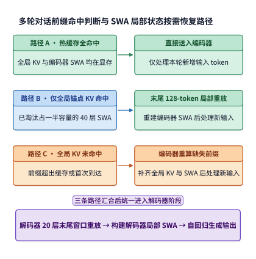

*图 8-22　DeepSeek V4.1 中因果编码器的三条前缀恢复路径与共同的解码器短窗口重放（框内 SWA 在缓存判断阶段专指编码器 SWA）：无论编码器走哪条恢复路径，prefill 末尾都会取最后最多 128 个 token 的编码器输出送入解码器重放，以构建解码器在线 SWA 状态（箭头代表执行先后顺序，方框宽度不代表实际耗时）。*

### 8.3.4 缓存准入、淘汰、换出与重计算

既然跨请求保留前缀 KV 能省下可观的 prefill 重算时间，那我们是不是应该把每一条历史请求的 KV 都无限期地留在缓存里呢？在真实的生产集群中，无论是 HBM 显存还是主机 DRAM，容量都是有限且昂贵的；把一个前缀换出到主机内存再取回，同样需要消耗 PCIe 带宽与传输时间。为了用定量工程法则指导缓存管理，我们可以为每一段候选前缀建立一个清晰的**期望时间净收益模型**。

设某段历史前缀在未来被后续请求再次命中的概率为 $p_h$；如果未缓存而从头重算这段前缀，需要消耗加速卡时间 $T_r$；如果将其保留在二级缓存（如主机 DRAM）中，命中时将其取回（Fetch）并恢复到加速卡就绪状态需要时间 $T_f$；而为了在缓存中接纳并维护这段前缀（如请求结束时将其从 HBM 换出写回主机内存），系统先期付出的维护时间成本为 $T_m$。那么，每次命中实际省下的时间是 $T_r - T_f$，乘以命中概率 $p_h$ 并扣除先期维护成本 $T_m$ 后，保留这段前缀的**期望净节省时间（Expected Net Time Savings）** $V_h$ 为：

$$
V_h=p_h(T_r-T_f)-T_m.
$$

让我们立刻把章首长请求中那段 **6144 个 token 的公共前缀**代入公式算一笔细账。这段前缀的 BF16 KV 占 $864\ \mathrm{MiB}$（按十进制计为 $905{,}969{,}664\ \mathrm{bytes}\approx 0.906\ \mathrm{GB}$）。在 RTX PRO 6000 上，如果从头重算这段 6144-token 前缀，共需执行约 $96.5\ \mathrm{TFLOP}$ 的矩阵运算；按照实验 8-1 中 batch 1 prefill 实测达到的 BF16 峰值算力（$503.8\ \mathrm{TFLOP/s}$）的 $62\%$ 有效利用率（详见第 8.6.3 节）折算，重算耗时约为 $T_r \approx 307.9\ \mathrm{ms}$。现在假设我们将这段前缀换出到主机内存保存：通过该卡配备的 PCIe Gen5 x16 链路（单向标称带宽 $64\ \mathrm{GB/s}$）将其取回 GPU 显存，传输耗时下界约为 $T_f = 0.906 / 64 \approx 14.2\ \mathrm{ms}$；[^pcie]维护成本 $T_m$ 取换出时写回主存的一次单向传输，同样为 $14.2\ \mathrm{ms}$。当这段前缀的未来命中概率为 $p_h = 50\%$ 时，保留它能带来的期望净节省时间为 $V_h = 0.5\times(307.9 - 14.2) - 14.2 = 132.7\ \mathrm{ms}$。更一般地，要使换出保留这段前缀不亏本（即 $V_h > 0$），其命中概率 $p_h$ 必须跨越如下盈亏平衡门槛：

$$
p_h>\frac{T_m}{T_r-T_f}=\frac{14.2}{293.7}=4.8\%.
$$

也就是说，在 PCIe Gen5 链路上，只要这段 6K 前缀有超过 $4.8\%$ 的把握被再次用到，把它换出到主存就比直接丢弃重算更划算。而如果我们将服务器主板降级为上一代 PCIe Gen4 x16（单向标称带宽减半至 $32\ \mathrm{GB/s}$），取回时间 $T_f$ 与换出时间 $T_m$ 都会翻倍至 $28.3\ \mathrm{ms}$，每次命中省下的时间缩水为 $307.9 - 28.3 = 279.6\ \mathrm{ms}$，此时盈亏平衡所需的最低命中率门槛就会翻倍抬升至 $28.3 / 279.6 \approx 10.1\%$。这组对比清晰地表明：主机换出（Offloading / Swapping）虽然解放了宝贵的 HBM 空间，但唯有当链路带宽足够快且前缀复用频率足够高时，才能抵消数据往返搬移的时间税。

进一步地，“保留某段前缀能赚钱（$V_h > 0$）”并不等于“在空间紧张时应该优先保留它”。因为在有限的缓存池里，留下一条长达 6144 token 的大前缀 A（占 $864\ \mathrm{MiB}$），就意味着要挤走三条长度各为 2048 token 的小前缀 B（每条占 $288\ \mathrm{MiB}$，三条合计正好也是 $864\ \mathrm{MiB}$）。那么，同样的 $864\ \mathrm{MiB}$ 缓存空间，究竟该留给一个大前缀 A，还是留给三个小前缀 B 呢？

让我们用同样的 RTX PRO 6000 与 PCIe Gen5 参数算一下每个 B 类小前缀（2048 个 token，占 $288\ \mathrm{MiB}$）的账：由于缺少了长序列的后半截二次方注意力项，重算一个 2048-token 前缀只需 $T_r = 94.7\ \mathrm{ms}$，取回与换出各需 $T_f = T_m = 4.7\ \mathrm{ms}$；在相同的 $50\%$ 命中率下，单个 B 前缀的期望净节省时间为 $0.5\times(94.7 - 4.7) - 4.7 = 40.3\ \mathrm{ms}$。图 8-23 将这两种缓存分配方案摆在了同一个 $864\ \mathrm{MiB}$ 天平上：保留一个大前缀 A 能净省 **$132.7\ \mathrm{ms}$**，而保留三个小前缀 B 合计只能净省 $3 \times 40.3 = \mathbf{120.9\ \mathrm{ms}}$。为什么同样占 $864\ \mathrm{MiB}$ 空间、同样是 $50\%$ 命中率，大前缀 A 的收益会压倒三个小前缀 B 之和？核心奥秘就在于第 8.2.3 节剖析过的**注意力超线性重算成本**：KV 缓存占用的空间随序列长度呈**线性**增长（6144 是 2048 的 3 倍），但 prefill 重算时间中的因果注意力项却随序列长度呈**二次方**增长，使得 6144 个 token 的整体重算耗时（$307.9\ \mathrm{ms}$）达到了 2048 个 token（$94.7\ \mathrm{ms}$）的 **$3.25$ 倍**。

如果我们将期望净节省时间除以各自占用的缓存字节数，就能提炼出一个非常实用的**单位容量时间收益（Value Density）**指标：大前缀 A 每占用 $1\ \mathrm{MiB}$ 缓存可节省 $132.7 / 864 \approx 0.154\ \mathrm{ms}$，而小前缀 B 每占用 $1\ \mathrm{MiB}$ 仅节省 $40.3 / 288 \approx 0.140\ \mathrm{ms}$。在工程实现中，缓存淘汰器只需按这一“每 MiB 期望节省毫秒数”对候选前缀排序，就能在尺寸各异的前缀之间做出收益最大化的去留抉择。在混合 SSM/Attention 架构中，**Marconi（MLSys 2025）** 将这一思想进一步推广为**每字节节省重算浮点运算量（`FLOPs/byte`）与访问新近度联合加权的淘汰策略**：对于前缀树中的任意候选节点，系统将其下游可免除的注意力层二次方重算 FLOPs 与 SSM 层线性重算 FLOPs 之和，除以该节点持有的注意力 KV 块与递推状态快照总字节数（即 $\mathrm{Utility} \propto \mathrm{FLOPs}_{\mathrm{saved}} / \mathrm{Bytes}_{\mathrm{cached}}$），从而在“单点体积庞大但能省去长链条重算的递推快照”与“按 token 线性占用空间的注意力 KV 块”之间建立起统一的淘汰度量衡。[^cache-reconfig]

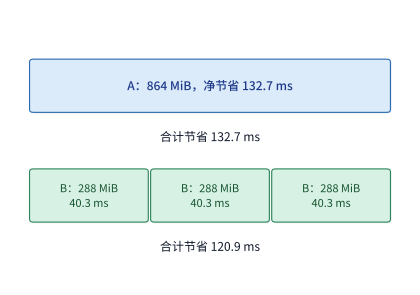

*图 8-23　在相同的 864 MiB 缓存空间下保留一个大前缀 A 与保留三个小前缀 B 的净收益对比：大前缀 A（6144 token）占 864 MiB，期望净节省 132.7 ms；三个 B 类小前缀（各 2048 token）各占 288 MiB、各节省 40.3 ms，合计仅节省 120.9 ms（时间按 RTX PRO 6000 重算速度与 PCIe Gen5 传输带宽折算，命中概率均取 50%）。*

当然，上述一切精妙收益都有一个硬性前提：**缓存池的物理容量必须撑到该前缀下一次被访问的时刻**。如果缓存池太小，在多租户干扰请求轮番冲刷下，旧轮次留下的前缀还没等到下一轮对话到达就已经被淘汰出局（Thrashing），那么文本层面的可复用率再高也无法转化为实际收益。实验 8-4 对图 8-19 所示的 12 轮代码智能体交互（累计包含 19,556 个输入 token）进行了缓存回放测试：在混入相同背景干扰请求的情况下，当给系统配置 **6 GiB** 缓存池时，12 轮共有 **16,304 个 token** 成功命中缓存，引擎只需增量处理剩余的 3,252 个新 token；而当缓存池缩减到 **1 GiB** 时，由于干扰请求在两轮间隙把智能体的历史前缀挤出了缓存，12 轮下来缓存命中数为 **0**，全部 19,556 个输入 token 都不得不从头重算。更有意思的是，当我们把相邻两轮对话之间的客户端思考等待时间人为拉长 $0.2$ 秒后，两种配置下的命中 token 数分毫不差——这雄辩地证明了：在这组工作负载下，决定前缀能否复用的瓶颈是**缓存池容量能否容下活跃工作集（Working Set）**，单纯微调请求到达的时间间隔并不能改变因容量不足引发的缓存颠簸。[^prefix]

总结起来，一个完备的 KV 缓存生命周期管理器由四道防线共同组成：**缓存准入（Admission）**评估一条请求结束后其前缀是否有资格留存；**淘汰策略（Eviction）**在空间告急时依据访问频率、新近度（LRU）与单位容量重算收益裁决先删除哪棵子树；**换出策略（Swapping / Offloading）**决定将暂时不用的冷状态搬移到主机 DRAM 还是本地 NVMe SSD；而**重计算策略（Recomputation）**则负责在状态缺失或仅存稀疏快照时，以最小代价重放恢复所需的前缀状态。对于章首那 16 条并发长请求，正是因为提前在缓存中驻留了那份仅占 $864\ \mathrm{MiB}$ 的公共前缀，系统才得以同时省去重复显存占用与四分之三的 prefill 计算量。

> **练习 8-4 · 核心 · 分析：有限缓存应保留哪些前缀，才能节省最多时间？** 缓存可用空间为 864 MiB。前缀 A 含 6144 个 token、占 864 MiB；三个相互独立的 B 类前缀各含 2048 个 token、占 288 MiB。在 RTX PRO 6000 上，按 BF16 峰值 503.8 TFLOP/s 的 62% 由矩阵运算量求重算时间，按 PCIe Gen5 x16 每方向 64 GB/s 求取回时间，维护时间取一次换出，与取回相同；命中概率均为 50%。比较保留一个 A 前缀与保留三个 B 类前缀的期望净节省时间。保持 B 类前缀的命中概率不变，求 A 的命中概率低于多少时，应改为保留三个 B。再把链路换成 PCIe Gen4 x16（每方向 32 GB/s），重新比较。数据分析部分读取配套 12 轮输入与缓存回放，分别计算共同前缀比例和实际命中比例，解释其他请求占用缓存空间为何会影响实际命中比例。

## 8.4 压缩与卸载

### 8.4.1 权重量化后的内存占用

第 8.3 节通过分页与前缀共享，消除了预留泡沫和重复的公共前缀。但如果到达系统的 16 条长请求彼此毫无关系、没有任何公共前缀可共享，或者我们想在单台工作站上运行一个参数量高达两千亿的巨型模型，仅靠状态去重就无能为力了。此时，另一条核心防线便是通过**低比特量化（Quantization）**直接削减每个权重参数或 KV 元素所占的物理字节数。

回顾第 1 章与第 5 章介绍的分组量化（Group-wise Quantization）原理：为了在降低位宽的同时尽量保全数值动态范围，工程实现通常将连续的一组浮点数（例如 32 个或 256 个数值）打包为一个量化块（Block / Super-block），在块内用极低位宽的整数存储各个元素的量化码值（Quants），同时额外附带少量较高精度的缩放因子（Scale）和零点偏移（Zero-point / Min）等元数据；到了矩阵乘或注意力算子执行时，内核再读取这些码值与元数据，在线反量化恢复出近似的浮点数值参与计算。

当量化位宽压到极致时，一个常被忽视的工程现象就会浮出水面：**缩放因子等元数据（Metadata）在总体积中的占比会显著抬头，使实际平均每参数比特数明显高于标称的码值位宽**。以端侧与工作站推理框架（如 GGML / llama.cpp）广泛使用的 **`Q2_K`** 超块量化格式为例：它将每 256 个权重参数划分为一个超块（Super-block），主编码采用 2-bit 整数，这部分码值共占 $256\times 2 / 8 = 64\ \mathrm{bytes}$；为了控制 2-bit 量化带来的精度损失，超块内部又细分为多个子块，并用额外的 **20 bytes** 存储子块的缩放因子（Scales）与最小值（Mins）等元数据。把码值与元数据加起来，一个包含 256 个参数的超块实际占用 $64 + 20 = 84\ \mathrm{bytes}$，折算下来平均每个权重参数占 $84\times 8 / 256 = 2.625\ \mathrm{bit}$——其中高达 $20 / 84 \approx 24\%$ 的存储空间花在了元数据上，而不再是码值本身。[^gguf]

**扩展算例：量化权重加载到内存后，还能容纳多长的上下文？** 这种“几吉字节的量化格式差异决定服务生死”的边界效应，在统一内存工作站运行超大 MoE 模型时表现得淋漓尽致。让我们考察总参数量达 235B、激活参数 22B 的 **Qwen3-235B-A22B** 模型在两个真实 GGUF 量化发行版下的体积拆解：第一个是标准 **`Q2_K`** 混合量化变体（主体采用 2-bit 分组量化，少量敏感层保留较高位宽），其量化码值与未量化浮点载荷合计约 $64.43\ \mathrm{GiB}$，量化元数据高达约 $15.37\ \mathrm{GiB}$，再加上文件头与对齐填充，整个模型文件共占约 **$79.81\ \mathrm{GiB}$**；第二个则是对更多敏感注意力与路由层提升了位宽的动态混合量化变体 **`UD-Q2_K_XL`**，其文件总大小约为 **$81.97\ \mathrm{GiB}$**。现在，我们尝试在实验 8-7 所使用的一台配备 **96 GB（十进制标称，折合二进制为 $89.41\ \mathrm{GiB}$）统一内存**的 Apple M2 Max 工作站上部署这两个模型。扣除操作系统内核、窗口环境与基础计算工作区必须预留的 $8\ \mathrm{GiB}$ 内存后，留给模型权重与 KV 缓存的可用物理内存上限约为 **$81.41\ \mathrm{GiB}$**。[^files]

把上面两个模型文件放进这 $81.41\ \mathrm{GiB}$ 的可用空间里比对，结果立判高下：
1. 如果加载 $79.81\ \mathrm{GiB}$ 的标准 `Q2_K` 变体，权重常驻内存后还剩下 $81.41 - 79.81 = \mathbf{1.60\ \mathrm{GiB}}$ 的余量；对于该模型而言，单条 8K 上下文请求的 BF16 KV 缓存约占 **$1.47\ \mathrm{GiB}$**，因此系统恰好还能完整塞下一条 8K 请求并留出约 $0.13\ \mathrm{GiB}$ 的安全缓冲；但如果我们试图把单条请求的上下文拉长到 32K（对应 KV 膨胀 4 倍至约 **$5.88\ \mathrm{GiB}$**），这仅剩的 $1.60\ \mathrm{GiB}$ 空间就会瞬间爆仓，必须扩容硬件或改用 KV 压缩；
2. 反观另一个 $81.97\ \mathrm{GiB}$ 的 `UD-Q2_K_XL` 变体，单是把权重装入内存就已经超出了 $81.41\ \mathrm{GiB}$ 可用上限约 **$0.56\ \mathrm{GiB}$**，连一个 token 的 KV 缓存都还没分配就已经放不下了。可以看到，两个量化变体之间仅仅 **$2.16\ \mathrm{GiB}$**（不到 $3\%$）的体积之差，在内存红线附近直接划出了“能顺畅跑通 8K 推理”与“连模型都无法完整驻留”的分界线。

在 Apple Silicon 这类 CPU 与 GPU 共享同一块物理内存的统一内存架构（Unified Memory Architecture）下，工程上虽然可以通过 `mmap` 将磁盘上的模型文件直接映射到虚拟地址空间，使得唯有被算子实际访问到的文件页才按需调入物理内存；但如果单步 decode 需要触碰的活跃权重页与 KV 总和依然超出了物理内存上限，操作系统就会在每一轮生成中陷入频繁的磁盘页面换入换出（Page Thrashing），推理吞吐将跌落数个数量级。因此，当静态容量触顶时，我们只有两条正道可走：要么进一步**压缩 KV 缓存本身的字节数**（第 8.4.2 节），要么只让当前层计算急需的权重分批搬入、算完即走（即第 8.4.3 节的**权重卸载与预取**）。

### 8.4.2 KV 压缩与读取成本

既然分组量化能大幅缩减静态权重的体积，我们自然可以把同样的招数用到动态增长的 KV 缓存上。而且与被所有并发请求共享的静态权重不同，KV 缓存是按“每条请求、每个上下文 token”独立累积的——压缩 KV 不仅能省下显存以接纳更多并发请求，还能直接减少每步 decode 注意力算子从 HBM 读取的历史数据量。

在动手量化每个数值之前，值得先回顾一下：决定一条上下文 KV 总字节数的有两个正交维度——**每个 token 需要保存多少个数值（上下文状态表示）**，以及**每个数值占用多少个比特（数值量化格式）**。第 9.2.2 节将会对比同一条 8K 上下文在标准 GQA 与紧凑 MLA 状态表示下的体积差异（后者仅需 $549\ \mathrm{MiB}$）；而在本节中，我们固定本章基准模型（Qwen3-8B，GQA 含 8 个 KV 头、每头维度 128）的状态表示不变，重点考察数值量化格式带来的改变。

在未压缩的 BF16 基线下，该模型一条 8K（8192 token）上下文的 KV 缓存恰好占 **$1152\ \mathrm{MiB}$**。如果按每 32 个连续数值分为一组（Group Size = 32），在 BF16 格式下每组占 $32\times 2 = 64\ \mathrm{bytes}$。现在我们引入 GGML 体系中两种经典的对称分组量化格式（图 8-24）：
- **`q8_0` 格式（8-bit 分组量化）**：将组内 32 个数值量化为 32 个 8-bit 有符号整数（占 $32\ \mathrm{bytes}$），并让这 32 个值共用 1 个 FP16 缩放因子 scale（占 $2\ \mathrm{bytes}$）。这样每组总长度为 $32 + 2 = 34\ \mathrm{bytes}$，压缩比为原来的 $34/64$（平均每个数值占 $34\times 8 / 32 = 8.5\ \mathrm{bit}$）；
- **`q4_0` 格式（4-bit 分组量化）**：同样以 32 个数值为一组共用 1 个 2-byte scale，但将每个数值的码值进一步压至 4 bit（32 个码值共占 $32\times 0.5 = 16\ \mathrm{bytes}$）。这样每组总长度为 $16 + 2 = 18\ \mathrm{bytes}$，压缩比为原来的 $18/64$（平均每个数值占 $18\times 8 / 32 = 4.5\ \mathrm{bit}$）。

将这两个精确的分组压缩比代入，同一条 8K 上下文在两种量化格式下的 KV 显存占用便一目了然：

$$
M_{q8}=1152\times\frac{34}{64}=612\ \mathrm{MiB},
\qquad
M_{q4}=1152\times\frac{18}{64}=324\ \mathrm{MiB}.
$$

与 BF16 基线的 $1152\ \mathrm{MiB}$ 相比，`q8_0` 为每条 8K 请求省下了 **$540\ \mathrm{MiB}$** 显存，而 `q4_0` 更是省下了 **$828\ \mathrm{MiB}$**。同时请注意：由于每一组 32 个元素都必须附带一个 2-byte 的 scale，这部分量化元数据也会随着上下文长度 $L$ 的增长而同步线性增长，使得实际压缩比固定在 $34/64$（约 $53.1\%$）和 $18/64$（约 $28.1\%$），而不会达到理想无元数据时的 $50\%$ 和 $25\%$。[^kv-format]

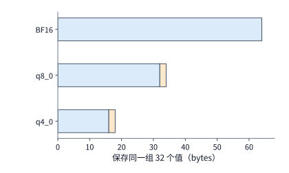

*图 8-24　同一组 32 个 KV 数值在 BF16、`q8_0` 与 `q4_0` 三种格式下的字节布局（横条宽度按实际字节数成比例绘制）：蓝色为量化码值，橙色为每组共用的 2-byte 缩放因子 scale；计入 scale 后，`q8_0` 与 `q4_0` 每组分别占 34 bytes 和 18 bytes，将单组字节数乘以总组数即得整条上下文的 KV 容量。*

让我们立刻看看 `q8_0` KV 压缩能否解救章首那 16 条**没有公共前缀**的独立长请求：在 BF16 下，每条长请求生成到末尾时按块分配需占 $1188\ \mathrm{MiB}$，16 条合计 $19008\ \mathrm{MiB}$（约 $18.56\ \mathrm{GiB}$），超出了 12 GiB 的显存池上限；而在改用同布局的 `q8_0` KV 格式后，单条长请求的完整状态缩减为 $1188\times 34/64 = 631.125\ \mathrm{MiB}$，16 条独立长请求合计仅占 $16\times 631.125 = 10{,}098\ \mathrm{MiB}\approx \mathbf{9.86\ \mathrm{GiB}}$，无需任何前缀共享就能顺利装进 12 GiB 的显存预算中。这再次印证了前缀共享与 KV 压缩在物理机制上的互补性：**前缀共享靠“跨请求合并同类项”消除重复前缀，而 KV 压缩则靠“缩减每个数值的编码字节”无差别地降低所有独立上下文的体积**。

不过，把 KV 压小之后，每步 decode 的注意力计算就一定会变快吗？这要算一笔“**访存节省时间 vs. 在线反量化转换开销**”的加减法。设将 KV 压缩后，一次计算少从 HBM 读取了 $\Delta D$ 字节的数据，加速卡在读取受限阶段的有效显存带宽为 $\beta$，但在算子执行路径中额外增加的在线量化/反量化格式转换串行耗时为 $T_c$；那么，这次计算最终获得的**净节省时间** $\Delta T$ 为：

$$
\Delta T=\frac{\Delta D}{\beta}-T_c.
$$

举例来说，在 RTX PRO 6000 上，将一条 8K 上下文的 KV 从 BF16（$1152\ \mathrm{MiB}$）改为 `q8_0`（$612\ \mathrm{MiB}$），单次读取少搬运了 $\Delta D = 540\ \mathrm{MiB}$（约 $0.566\ \mathrm{GB}$）。按照第 8.6.3 节实测该卡在大 batch 读取受限时的有效带宽 $\beta \approx 1.16\ \mathrm{TB/s}$（即峰值 $1792\ \mathrm{GB/s}$ 的 $65\%$）计算，减少访存直接省下的传输时间约为 $\Delta D / \beta \approx 0.487\ \mathrm{ms}$。此时，算子内核的实现质量决定了最终成败：如果将反量化融合进注意力内核寄存器流水线，使转换带来的额外串行开销仅为 $T_c = 0.2\ \mathrm{ms}$，那么单步净省 $0.487 - 0.2 = \mathbf{0.287\ \mathrm{ms}}$（提速）；反之，如果采用未融合的独立反量化算子，导致额外开销高达 $T_c = 0.8\ \mathrm{ms}$，那么总耗时反而会倒贴 $0.487 - 0.8 = \mathbf{-0.313\ \mathrm{ms}}$（变慢）。

由此还可以推导出一个重要的工程规律：**上下文长度 $L$ 越长，KV 压缩省下的访存字节数 $\Delta D$ 就越多，也就越容易跨过固定转换开销 $T_c$ 的盈亏平衡点**。在一项针对 H100 运行 Llama-3.1-8B 的实测基准中，研究者分别用线性函数拟合了 BF16 KV 与 FP8 KV 下单步输出间隔随上下文长度 $L$ 的变化：BF16 耗时为 $6.44 + 4.37\times 10^{-5}L\ \mathrm{ms}$，而 FP8 耗时为 $6.58 + 2.37\times 10^{-5}L\ \mathrm{ms}$。对比两式可以发现：FP8 因为引入了在线缩放转换，其与长度无关的固定截距项比 BF16 高出了 $6.58 - 6.44 = 0.14\ \mathrm{ms}$；但由于每步读取的 KV 字节数减半，FP8 每增加一个上下文 token 的边际斜率比 BF16 少了 $(4.37 - 2.37)\times 10^{-5} = 2.0\times 10^{-5}\ \mathrm{ms/token}$。用固定开销之差除以边际斜率之差，立刻就能求出两条直线的翻转交点：$L^\star = 0.14 / (2.0\times 10^{-5}) = \mathbf{7000\ \mathrm{tokens}}$。当上下文较短（如 $L=2\mathrm{K}$）时，BF16（约 $6.53\ \mathrm{ms}$）略快于 FP8（约 $6.63\ \mathrm{ms}$）；而一旦上下文跨过 7000 token 来到长序列区间（如 $L=16\mathrm{K}$），FP8（约 $6.97\ \mathrm{ms}$）便凭借访存减半的优势反超了 BF16（约 $7.16\ \mathrm{ms}$）。[^kv-format]

最后，我们把本节开头的“状态表示压缩”与“局部/全局混合状态”结合起来，看看 **DeepSeek V4.1** 在 8K 上下文基线下的状态缩减成效：当把跨完整序列的全局历史 KV 与固定窗口大小的有效 SWA 状态加在一起核算时，DeepSeek V4.1 的全局历史仅占 $6.953\ \mathrm{MiB}$、有效 SWA 占 $2.578\ \mathrm{MiB}$，两者合计仅 **$9.531\ \mathrm{MiB}$**；而前代 DeepSeek V4 在相同 8K 条件下的对应两项合计高达 **$30.521\ \mathrm{MiB}$**，是 V4.1 的 **$3.20$ 倍**。注意到由于局部滑动窗口 SWA 在短上下文下占据了固定大小的空间，8K 基线下的总容量缩减倍数（$3.20\times$）略小于单纯比较全局历史时的缩减倍数（$3.95\times$）；随着上下文进一步向 32K、128K 延伸，全局历史的占比越来越高，整体压缩收益还会持续向 $3.95\times$ 逼近。

### 8.4.3 权重卸载、预取与每步搬移

如果既不想因为激进量化而损伤模型精度，手头的 GPU 显存又确实装不下全部权重与并发 KV，还有一种“以时间（或互联带宽）换空间”的办法：**权重卸载（Weight Offloading）**。其核心思想是打破“所有模型权重必须全程常驻 GPU 显存”的惯例，将一部分网络层的权重移到容量充裕的主机内存（Host DRAM）中存放；在 GPU 逐层前向计算的过程中，只在即将算到某一层之前，把该层的权重从主机内存动态搬回 GPU 显存的**预取缓冲区（Prefetch Buffer）**，算完该层后立刻释放或覆写这块缓冲区供后续卸载层复用。这样腾出来的宝贵 GPU 显存就可以划拨给 KV 缓存池；但代价是：**在自回归 decode 的每一个生成步（Iteration）中，这些被卸载的权重都必须周而复始地从主存往 GPU 搬运一遍**。

让我们以本章基准模型 Qwen3-8B 为例，精确核算一下权重卸载能腾出多少显存、又会引来多大的每步传输负担。Qwen3-8B 共有 36 层 Transformer，其中每一层前馈网络（FFN / MLP）的三个 BF16 权重矩阵（Gate、Up、Down 投影）合计恰好占用 **$288\ \mathrm{MiB}$**。假设我们采取“每 4 层卸载 1 层 FFN”的策略，在 36 层中一共选出 9 层 FFN 权重卸载到主机内存，表面上一共从 GPU 腾出了 $9\times 288 = \mathbf{2592\ \mathrm{MiB}}$ 的静态空间。但别忘了，GPU 显存里还必须留出专门接收搬入权重的**预取缓冲区**（图 8-25）：
1. **单缓冲方案（Single Buffering，占 1 份即 $288\ \mathrm{MiB}$）**：GPU 上只留一个 $288\ \mathrm{MiB}$ 的缓冲区，扣除后实际净省下 $2592 - 288 = \mathbf{2304\ \mathrm{MiB}}$ 显存；
2. **双缓冲方案（Double Buffering，占 2 份即 $576\ \mathrm{MiB}$）**：为了实现计算与传输的流水线重叠，GPU 上预留两个各 $288\ \mathrm{MiB}$ 的缓冲区（共 $576\ \mathrm{MiB}$），扣除后实际净省下 $2592 - 576 = \mathbf{2016\ \mathrm{MiB}}$ 显存。

如果以单条 8K 输入请求的初始 KV 状态（$1152\ \mathrm{MiB}$）为衡量单位，单缓冲净省的 $2304\ \mathrm{MiB}$ 刚好能多塞下 **2 条** 8K 输入状态，而双缓冲净省的 $2016\ \mathrm{MiB}$ 则只能多塞下 **1 条**；如果按章首长请求生成完毕所需的完整预留空间（$1188\ \mathrm{MiB}$）计算，那么无论是单缓冲（$2304 / 1188 < 2$）还是双缓冲（$2016 / 1188 < 2$），这 9 层 FFN 卸载最终都**只能为实例多增加 1 条完整长请求的并发容量**。[^offload]

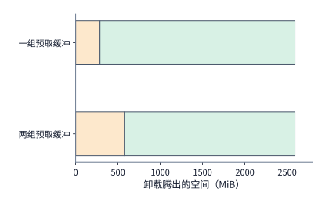

*图 8-25　卸载 9 层 FFN 权重后的显存收支账本：卸载 9 份 FFN 共从 GPU 释放 2592 MiB 空间，但扣除必须留在 GPU 上的预取缓冲区（橙色）后，单缓冲方案净省 2304 MiB，双缓冲方案净省 2016 MiB（绿色为可重新划拨给 KV 缓存池的净增空间）。*

为什么在工程上宁可少省 $288\ \mathrm{MiB}$ 显存，也往往倾向于采用**双缓冲预取**呢？因为任何异步预取调度都必须严格遵守两条数据依赖铁律：第一，**写后读依赖（RAW）**——某层权重的 DMA 复制必须 100% 完成，GPU 计算流才能开始读取该缓冲区执行矩阵乘；第二，**读后写依赖（WAR）**——当前层矩阵乘内核必须 100% 读完该缓冲区，DMA 复制流才能把下一个卸载层的权重覆盖写进同一个缓冲区。如果只用单缓冲，同一个缓冲区只能按“DMA 搬入 → GPU 计算 → 下一次 DMA 搬入”完全串行交替，PCIe 传输耗时将一分不落地直接叠加在每步延迟上；唯有配备双缓冲（Ping-Pong Buffers），系统才能在 GPU 正在缓冲区 0 上计算前几层的同时，让 DMA 引擎在后台把后续卸载层的权重静默搬入缓冲区 1，从而实现传输与计算的时间重叠（Overlap）。

然而，**双缓冲流水线只能掩盖“短于计算时间”的传输；一旦每步需要搬运的权重字节数除以链路带宽所得的传输下界超过了 GPU 计算耗时，整条流水线就会沦为彻底的传输受限（Link-bound）**。让我们算一算在 RTX PRO 6000 的 **PCIe Gen5 x16** 链路（单向标称带宽 $64\ \mathrm{GB/s}$）上，每轮 decode 搬入这 9 层 FFN 权重至少需要多久。9 层 FFN 共 $2592\ \mathrm{MiB}$，折合十进制字节数为 $2592\times 2^{20}\approx \mathbf{2.72\ \mathrm{GB}}$，因此单步 decode 的 PCIe 复制时间下界为：

$$
T_{\mathrm{copy}}\ge\frac{2.72\ \mathrm{GB}}{64\ \mathrm{GB/s}}\approx42.5\ \mathrm{ms}.
$$

请注意这个数字：**$42.5\ \mathrm{ms}$** 已经远远超过了该卡在权重常驻时跑完一整轮 batch 1 decode 的总时间（$26.26\ \mathrm{ms}$）。这意味着哪怕采用最理想的双缓冲预取、把 GPU 上的所有计算都完全藏进传输阴影里，每轮 decode 也至少要被 PCIe 链路卡住 $42.5\ \mathrm{ms}$。如果在这个实例上以 batch 4 并发生成，系统的总输出吞吐上限将被限制在 $4 / 0.0425 \approx 94\ \mathrm{token/s}$，每条请求的相邻 token 输出间隔（ITL）至少为 $42.5\ \mathrm{ms}$；要完成 256 个输出 token（即 255 轮后续 decode），单是把这 9 层权重来回搬运 255 遍就要耗费 $255\times 0.0425 \approx \mathbf{10.8\ \mathrm{s}}$，直接突破了章首设定的 7 秒完成时限。可见，在传统的 PCIe 链路上，对自回归 decode 阶段每步必经的稠密层做权重卸载，是一种为了仅增加 1 个并发槽位而付出数倍延迟代价的低效方案。

那么，权重卸载在什么硬件条件下才能真正发挥威力呢？答案是拥有超高带宽 CPU–GPU 一体化互联的超级芯片架构。例如 NVIDIA **Grace Hopper（GH200）** 通过 **NVLink-C2C（Chip-to-Chip）** 总线将 Grace CPU 的 LPDDR5X 主存与 Hopper GPU 直接相连，单向传输带宽高达 **$450\ \mathrm{GB/s}$**（双向合计 $900\ \mathrm{GB/s}$），是 PCIe Gen5 x16 的 7 倍以上。在 GH200 上搬运同样的 $2.72\ \mathrm{GB}$ 权重，单步传输时间下界骤降至 $2.72 / 450 \approx \mathbf{6.0\ \mathrm{ms}}$（255 轮累计仅需约 $1.54\ \mathrm{s}$），远远短于一轮 decode 的 GPU 计算时间（图 8-26）。此时，双缓冲预取就能把这 $6.0\ \mathrm{ms}$ 的搬移完全掩盖在其余非卸载层的计算背后，实现真正的“零延迟感知扩容”。

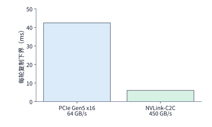

*图 8-26　每轮 decode 搬入相同的 2592 MiB（2.72 GB）卸载权重在两种互联带宽下的耗时下界对比：经 PCIe Gen5 x16（单向 64 GB/s）至少需约 42.5 ms，已超过单轮计算本身；而经 GH200 的 NVLink-C2C（单向 450 GB/s）仅需约 6.0 ms，可通过双缓冲预取完全掩盖在计算时间之内。*

从根本上看，决定权重卸载可行性的物理量只有一个——**每步必须搬移的数据字节数与链路有效带宽之比**。双缓冲预取只能让搬移与计算并行，却无法减少每步必须跨链路运送的字节数。

既然链路带宽如此珍贵，有人自然会问：能不能在主机内存里先把权重用高压缩率编码器压小，经 PCIe 传到 GPU 后再实时解压恢复呢（例如利用软硬件编解码器的张量压缩方案 LLM.265）？这同样可以用一条简洁的不等式判定盈亏。设原始权重块大小为 $S$ 字节，压缩后体积变为 $rS$ 字节（$0 < r < 1$），主机到加速卡的链路带宽为 $B_{\mathrm{link}}$，GPU 端解压器的有效吞吐率为 $R_{\mathrm{dec}}$（按每秒吐出的**原始未压缩字节数**计量）。在不重叠的“先传完再解压”路径下，总耗时为 $rS/B_{\mathrm{link}} + S/R_{\mathrm{dec}}$；而完全不压缩、直接裸传原始权重的耗时为 $S/B_{\mathrm{link}}$。要让“压缩传输 + 解压”比直接裸传更快，解压吞吐率 $R_{\mathrm{dec}}$ 必须满足：

$$
R_{\mathrm{dec}}>\frac{B_{\mathrm{link}}}{1-r}.
$$

举一个具体的数字：设我们将一块 $96\ \mathrm{MiB}$（约 $100.66\ \mathrm{MB}$）的权重压缩到原来的四分之一（$r = 0.25$）。在 PCIe Gen5 x16（$B_{\mathrm{link}} = 64\ \mathrm{GB/s}$）上，直接裸传需要 $100.66 / 64 \approx 1.57\ \mathrm{ms}$，而传输压缩后的数据只需 $0.39\ \mathrm{ms}$，在链路上省下了 $1.18\ \mathrm{ms}$；但为了保住这 $1.18\ \mathrm{ms}$ 的胜利果实，GPU 解压器必须在 $1.18\ \mathrm{ms}$ 内吐出 $100.66\ \mathrm{MB}$ 的原始数据，即解压吞吐必须跨过 $R_{\mathrm{dec}} > 64 / (1 - 0.25) \approx \mathbf{85.3\ \mathrm{GB/s}}$ 的高门槛。显然，底层的互连链路 $B_{\mathrm{link}}$ 越快，留给解压器的时间窗口就越窄，对解压硬件吞吐的要求也就越苛刻。[^codec]

最后值得指出的是，在本节讨论的权重卸载中，**所有的矩阵乘计算依然坚持在 GPU 上完成**，主机内存仅仅充当了一个“暂存冷权重的仓库”，因此每一步都逃不掉把庞大的权重矩阵搬上 GPU 的高昂运费。到了第 9.3 节讨论 MoE 异构推理时，我们将看到另一种彻底反转的思路：**既然专家权重已经在主机内存里了，为什么不直接让 CPU 就地算完这些稀疏激活的专家层，只通过 PCIe 把体积小上千倍的激活向量（Activations）传回 GPU 呢？** 届时，我们将把“每个专家分到的输入 token 行数、CPU 矩阵乘耗时与 PCIe 权重传输耗时”放在同一个不等式里做定量抉择。

> **练习 8-5 · 计算：权重卸载节省的容量与增加的搬移。** 设卸载九份 FFN 权重，每份占 288 MiB。设每组预取缓冲可以容纳一份 FFN 权重，分别计算使用一组和两组缓冲时净节省的加速器内存，并求这些空间能多容纳多少份 1152 MiB 的输入状态，或多少份 1188 MiB 的完整请求状态。再分别取 PCIe Gen5 x16 的每方向 64 GB/s 与 GH200 NVLink-C2C 的每方向 450 GB/s，求每步复制以及累计 255 步复制的时间下界。若留给所有复制的总时间为 1 秒，求所需的最低单向带宽。

### 8.4.4 质量约束下的容量与速度选择

在第 8.4.2 节中，我们算清了压缩 KV 缓存能省下多少显存、减少多少毫秒访存；但在把任何低精度配置推上生产环境之前，系统工程师都必须先回答一个关键问题：**把 KV 从 BF16 压成 FP8 或 `q8_0` 之后，模型给出的答案还对吗？如果答案变差了，究竟是因为 KV 存储位宽不够，还是因为底层注意力算子内核（Kernel Backend）顺带篡改了查询向量 $Q$ 的计算精度？**

之所以要特别警惕“算子内核的连带精度变化”，是因为在推理引擎中切换 KV 缓存格式时，往往会触发底层执行后端（Attention Backend）的切换：有些 FP8 注意力内核为了图省事或追求极致指令吞吐，在读取 FP8 KV 的同时，会把原本处于 BF16 精度的**查询向量 $Q$（Query）**也一并在线截断量化为 FP8，然后再送入 FP8 Tensor Core 做点积；而另一些精细实现的内核则只将历史 KV 存为 FP8，在计算时坚持把查询 $Q$ 保留为高精度的 BF16。唯有把“KV 的存储格式”与“查询 $Q$ 的计算精度”拆开做单变量受控对照，我们才能揪出导致长上下文检索失误的真正元凶。

实验 8-8 专门设计了这样一组严密的受控对照测试。实验选取了 8 道固定答案的精确键值检索任务（大海捞针式的六位数字记录查找），按相同顺序排列在图 8-27、图 8-28 与图 8-29 的纵轴上：其中任务 1 至 4（实验记录编号 `n128-r0` 至 `n128-r3`）每份文档包含 128 条记录，任务 5 至 8（`n512-r0` 至 `n512-r3`）每份长文档包含 512 条记录。每道任务分别在并发度 1 和并发度 4 下各独立运行两次（对应图中横轴的 4 列），全程固定 Qwen3-8B 的模型权重为 BF16 不变，仅切换注意力路径的三种精度配置，总计每组 32 次生成：
1. **配置一（BF16 KV + BF16 Q 基线，图 8-27）**：在 32 次运行中答对了 **28 次**（错误集中在任务 5 `n512-r0` 的全部 4 次运行）；
2. **配置二（原版默认 FP8 注意力实现，将 Q 也连带量化为 FP8，图 8-28）**：32 次运行中仅答对 **26 次**，除了任务 4 和任务 6 出错外，还在长文档检索上出现了明显的额外退化；
3. **配置三（保留 FP8 KV 存储，但强制将查询 Q 恢复为 BF16 精度，图 8-29）**：仅仅把查询 $Q$ 的精度恢复回 BF16、完全不动 FP8 KV 存储，正确次数就立刻回升到了与 BF16 基线完全持平的 **28/32**。这一现象有力地证明了：此前默认 FP8 路径掉点的罪魁祸首，并非历史 KV 缓存采用 FP8 存储本身，而是内核顺带把当前步高度敏感的查询向量 $Q$ 也降格成了 FP8。[^quality]

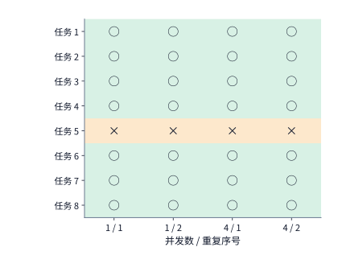

*图 8-27　BF16 KV + BF16 Q 基线下的逐题正确性矩阵：每行对应一道固定检索任务（任务 1–4 为 128 条记录文档，任务 5–8 为 512 条记录长文档），四列分别为并发 1 与并发 4 下各重复运行两次的结果；绿色圆圈表示回答正确，橙色叉号表示回答错误，合计 28/32 正确。*

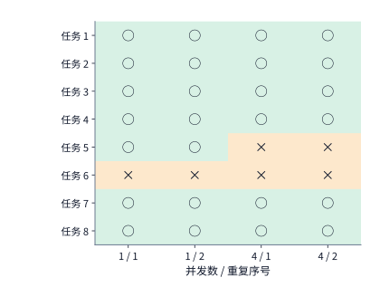

*图 8-28　原版默认 FP8 注意力内核（连带将查询 Q 降为 FP8）下的逐题结果：采用完全相同的任务与运行顺序，总正确率滑落至 26/32，反映出将查询 Q 降精度对长文档精确检索的不利影响。*

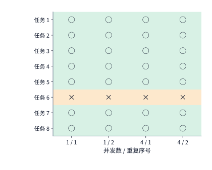

*图 8-29　保留 FP8 KV 存储但将查询 Q 保持为 BF16 精度下的逐题结果：总正确数恢复至与基线相同的 28/32，但发生错误的题目从基线的任务 5 转移到了任务 6，揭示出数值舍入微扰对边界样本的确定性偏移效应。*

把图 8-27 与图 8-29 按行逐一比对，还能发现一个只有“逐题矩阵视图”才能揭示的微妙现象：虽然“BF16 KV 基线”和“FP8 KV + BF16 Q”的总正确率都是 $28/32$（$87.5\%$），但它们答错的却不是同一道题——任务 5（`n512-r0`）在 BF16 KV 下四次全部答错，到了“FP8 KV + BF16 Q”下却四次全部答对；而任务 6（`n512-r1`）则恰恰相反，在 BF16 下四次全对，在“FP8 KV + BF16 Q”下却四次全错。为什么在同一配置下重复跑四次（跨不同并发度）结果高度一致，而换一种格式就会在任务 5 和任务 6 之间发生翻转？因为在这类长上下文精确数字检索任务中，正确数字与干扰数字的注意力得分往往处在十分接近的临界边界上；改变 KV 的数值存储格式引入了微小但**确定性（Deterministic）**的舍入偏移，足以把处于悬崖边的某道题往左推一把（从错变对），同时把另一道处于边界的题往右推一把（从对变错）。因此，在做推理系统的精度验收时，绝不能只看粗粒度的平均得分，而必须建立固定题集的逐样本回归矩阵，排查数值改动是否在特定长尾模式上引发了系统性偏差。

更进一步，从端到端服务的视角来看，**一次错误的生成不仅损害用户体验，还会直接转化为实实在在的“重试时间开销（Retry Cost）”**。在具备工具校验、代码编译检查或格式验证的智能体工作流中，一旦首次生成给出的答案未能通过校验，系统就必须发起重试（Retry）。此时，用户拿到一个正确结果所等待的真实端到端时间，绝不是“最后一次成功生成的时间”，而是**首次失败生成耗时 + 校验耗时 + 重试生成耗时**的总和。在实验 8-8 配套的重试追踪记录中，有两道初次答错的任务通过触发重试最终拿到了正确答案，但这两次重试额外消耗了约 **$2.0\ \mathrm{s}$** 的 GPU 生成时间，并多吐出了 **92 个废案 token**。这给我们敲响了警钟：如果某种激进的压缩配置虽然把单次生成的速度提升了 $10\%$，却导致任务首次失败率上升、频繁触发整轮重试，那么它完成有效任务的实际耗时反而会大幅倒退。[^retry]

除了“答错触发整轮重试”这一显性惩罚，**Rethinking KV Cache Compression（MLSys 2025）** 的系统实证研究还揭示了另一项更为隐蔽的端到端陷阱——**有损 KV 缓存压缩引发的输出长度膨胀与延迟反转（Output Length Inflation & Latency Reversal）**。在许多固定输出长度的微基准测试中，将历史 KV 缓存激进量化或按注意力分数淘汰部分历史 token（Token Eviction / Dropping），确实能减少每步 HBM 读取字节数、显著推高单步解码吞吐率 $r_{\mathrm{decode}}$（单位：$\mathrm{token/s}$）。然而在真实的复杂推理（Reasoning）、数学推导或代码生成任务中，单条请求的真实端到端完成时间 $T_{\mathrm{req}}$ 同时取决于单步解码速率 $r_{\mathrm{decode}}$ 与模型自然生成至停止符的**实际输出长度 $N_{\mathrm{out}}$**：

$$
T_{\mathrm{req}} \approx \mathrm{TTFT} + \frac{N_{\mathrm{out}}}{r_{\mathrm{decode}}}.
$$

当有损 KV 压缩或历史 token 驱逐使模型对前文中间推导步骤的记忆变得模糊时，模型往往不会立刻报错停机，而是会在思维链（Chain-of-Thought）中陷入反复自我怀疑、兜圈子重算与冗余确认，导致最终吐出的总 token 数 $N_{\mathrm{out}}$ 大幅膨胀。让我们通过一组定量算例，算清为什么“每秒吐字更快”反而会让用户“等得更久”：[^cache-reconfig]

> **算例 8-B（KV 缓存压缩后单步提速但输出变长导致端到端耗时反转：$4.5\ \mathrm{s}\to 5.5\ \mathrm{s}$）**：
> 设一条代码推理请求在 prefill 阶段的首字延迟固定为 $\mathrm{TTFT} = 0.5\ \mathrm{s}$（见图 8-39 下图 B）：
> 1. **未压缩 BF16 KV 基线**：模型思路清晰、一步到位，生成 $N_{\mathrm{out,base}} = \mathbf{200\ \mathrm{tokens}}$ 即顺利输出正确结论并终止；基线解码吞吐率为 $r_{\mathrm{base}} = \mathbf{50\ \mathrm{tok/s}}$（对应单步耗时 $\mathrm{TPOT} = 20.0\ \mathrm{ms/tok}$）。此时该请求的端到端总完成耗时为
>
> $$
> T_{\mathrm{base}} = 0.5 + \frac{200}{50} = 0.5 + 4.0 = \mathbf{4.5\ \mathrm{s}}.
> $$
>
> 2. **启用有损 KV 压缩 / Token 驱逐后**：由于每步读取的 KV 体积缩减，单步解码吞吐率提升了 **$20\%$**，达到 $r_{\mathrm{comp}} = \mathbf{60\ \mathrm{tok/s}}$（对应 $\mathrm{TPOT} = 16.67\ \mathrm{ms/tok}$）；若只看固定长度微基准，人们会误以为解码阶段加快了 $16.7\%$。然而在自然生成下，由于历史上下文信息受损，模型在回答中多出了大量重复验算与迂回分支，使实际输出长度膨胀了 **$50\%$**，达到 $N_{\mathrm{out,comp}} = \mathbf{300\ \mathrm{tokens}}$。代入端到端时间方程，压缩后的实际完成耗时变为
>
> $$
> T_{\mathrm{comp}} = 0.5 + \frac{300}{60} = 0.5 + 5.0 = \mathbf{5.5\ \mathrm{s}}.
> $$
>
> 3. **耗时反转判据（Latency Reversal Criterion）**：对比可见，有损压缩后请求完成时间非但没有缩短，反而从 $4.5\ \mathrm{s}$ 延长到了 **$5.5\ \mathrm{s}$（端到端延迟劣化 $+22.2\%$，同时多消耗了 $25\%$ 的解码步数）**。一般地，记压缩前后的输出长度膨胀比为 $\gamma_L = N_{\mathrm{out,comp}} / N_{\mathrm{out,base}}$，单步解码速率提升比为 $\gamma_r = r_{\mathrm{comp}} / r_{\mathrm{base}}$；只要
>
> $$
> \gamma_L > \gamma_r\quad (\text{本例中}\ 1.50 > 1.20),
> $$
>
> 输出变长所增加的生成步数就会彻底吞噬单步访存提速带来的收益。因此，评估任何有损 KV 压缩算法时，严禁仅报告固定输出长度下的单步延迟（TPOT），而必须以相同任务准确率下的**端到端请求完成时间 $T_{\mathrm{req}}$** 与真实生成长度分布作为验收准绳。

现在，让我们把前几节手里攒下的牌梳理一下：面对章首那 16 条长请求（以及 12 GiB 显存、7 秒完成时限的双重硬约束），我们已经找到了两条能把 KV 装入 12 GiB 显存的路径——一条是第 8.4.2 节的“独立 `q8_0` 压缩”（占 $9.86\ \mathrm{GiB}$），另一条是第 8.3.2 节的“BF16 公共前缀共享”（仅占 $5.91\ \mathrm{GiB}$）。但在第 8.6 节揭晓最终胜负之前，我们还会发现一个严峻的事实：即便省去了重复 prefill，要在 RTX PRO 6000 上逐轮串行跑完 255 轮自回归 decode，时间依然不够用。怎样才能突破“一轮前向只生成一个 token”的限制呢？这就引出了下一节的主角——**推测解码（Speculative Decoding）**。

> **练习 8-6 · 数据分析：KV 压缩如何影响容量、答案正确性与重试成本。** 设每组包含 32 个值，另用 2 字节保存 scale，复算 8K 输入和完整长请求在 q8_0、q4_0 格式下的 KV 容量。再读取配套三种 KV／Q 精度配置的逐题结果，列出 BF16 KV 与“FP8 KV＋BF16 Q”中正确性改变的题目。最后读取重试记录，对每个成功任务合计首答与重试时间，并与只计入最后一次成功生成时间的结果比较。

## 8.5 推测解码

### 8.5.1 草稿、验证、回退与正确性

回顾第 8.3 节与第 8.4 节，无论是分页、前缀共享还是量化压缩，本质上都在优化“数据如何存放与搬运”；但只要依然遵循传统的自回归解码模式，目标模型每执行一轮完整的前向计算（把 $15.14\ \mathrm{GB}$ 权重从显存读一遍），每条请求就只能往前推进 1 个 token，生成 256 个输出 token 依然要执行完 255 轮 decode。第 8.2.1 节的跨请求批处理（Batching）通过“把多条不同请求合并在一起共享一次权重读取”提高了总吞吐，却无法缩短单条请求要跑的轮数。那么，能不能换一条思路：**在单条请求内部做“时间维度的纵向批处理”——让目标模型在一次前向计算中同时检验并确定同一条请求的多个后续 token，从而把 255 轮前向压缩到几十轮以内**？

这正是**推测解码（Speculative Decoding**，Leviathan 等，ICML 2023；Chen 等，2023）的核心洞见。它利用了我们在第 8.2.1 节算过的那条硬件物理规律：**在低并发 decode 阶段，GPU 的瓶颈完全卡在从 HBM 读取庞大权重的带宽上，而 Tensor Core 的矩阵乘算力大量闲置；把一次前向处理的序列行数从 1 行增加到 5 行或 8 行，需要从 HBM 读取的权重字节数分毫不增，多出来的几十 GFLOP 矩阵乘在充沛的算力面前几乎不增加耗时**。因此，推测解码将每一轮生成拆解为两步：首先，用一个开销极低的机制快速猜出一段包含 $m$ 个候选 token 的**草稿序列（Draft Tokens）**；接着，把这段草稿连同最后一个已确认的 token（共 $m+1$ 个位置）一次性送入目标大模型，在**单次前向计算**中并行算出目标模型在这 $m+1$ 个位置上的真实预测分布，并逐一验证草稿是否正确。一旦前几个草稿 token 顺利通过验证，目标模型一次前向就能一次性确认多个输出 token。

为了看清验证与回退（Rollback）的完整逻辑，我们先从最直观的**贪心解码（Greedy Decoding，即温度 $T=0$，每步必选目标模型概率最高者）**说起。假设本轮草稿机制猜出了长度为 4 的候选序列 `a, b, c, d`，目标模型在一次前向中并行算出了这四个位置各自应当输出的最高概率 token（以及假设 `d` 正确时第五个位置的预测）。现在按从左到右的因果顺序逐位核对（图 8-30）：
1. 第一个位置草稿猜 `a`，目标模型也选 `a`——**接受**；
2. 第二个位置草稿猜 `b`，目标模型也选 `b`——**接受**；
3. 第三个位置草稿猜 `c`，但目标模型在给定前缀和 `a, b` 之后算出的最高概率 token 却是 `x`（$x \ne c$）——**在此发生分歧，拒绝草稿 `c`，并直接采纳目标模型算出的正确 token `x` 作为第三位的输出（称为修正 token / Bonus Token）**；
4. 第四个位置的草稿 `d`（以及其后的预测）是在错误前提“第三位是 `c`”之下计算出来的，由于第三位已经修正为 `x`，第四位及之后的验证结果全部因因果前提失效而**作废丢弃**。

于是，这一轮验证最终为输出序列稳稳推进了 **`a, b, x` 共 3 个完全准确的目标模型 token**（2 个接受的草稿 token + 1 个目标模型亲自给出的修正 token），下一轮推测解码便从修正后的新序列末端 `... a, b, x` 继续出发。特别地，如果运气更好，四个草稿 token `a, b, c, d` 全部与目标模型一致，那么目标模型在最后一个草稿 `d` 位置算出的预测 token 也是完全有效的，单轮就能一次性收获 $4 + 1 = 5$ 个输出 token。

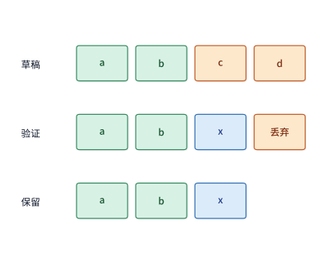

*图 8-30　贪心推测解码的并行验证与回退过程：草稿猜出 `a, b, c, d` 四个 token，目标模型在单次前向中并行验证各位置；前两位 `a, b` 匹配保留，第三位目标模型选出 `x`（与草稿 `c` 不同），因此第三位直接修正输出为 `x`，而依赖错误前提 `c` 的第四位草稿 `d` 及其后结果全部丢弃，本轮最终确定 `a, b, x` 三个输出（方框表示序列位置，不代表耗时）。*

贪心解码下的正确性十分直观，因为在每个位置上我们都严格采纳了目标模型的 $\arg\max$ 结果。但在实际对话与创作中，我们通常使用带温度的**随机采样（Stochastic Sampling）**。此时，草稿分布为 $q(x)$，目标分布为 $p(x)$，两者并不完全一致；怎样设计验证规则，才能在尽量多接受草稿的同时，从数学上严格保证**最终输出的每个 token 都 100% 精确服从目标模型分布 $p(x)$（即所谓无损推测采样 Lossless Speculative Sampling）**呢？

推测采样采用了一套精巧的“**接受—拒绝重采样（Accept-Reject Resampling）**”准则：在某个位置上，先按照草稿分布 $q(x)$ 采样出一个候选草稿 token $x$；在目标模型前向算出该位置的目标概率 $p(x)$ 后，系统以如下接受概率 $\alpha(x)$ 决定是否直接放行该草稿 token：

$$
\alpha(x)=\min\left(1,\frac{p(x)}{q(x)}\right).
$$

换句话说，只要目标模型赋予 $x$ 的概率不低于草稿模型（$p(x) \ge q(x)$），就以 $100\%$ 概率无条件接受；反之，若草稿高估了 $x$（$p(x) < q(x)$），则只以折算比例 $p(x)/q(x)$ 的概率接受它。算一下就会发现：某个符号 $x$ 被草稿抽中**并且**直接通过验证的联合概率，恰好等于 $q(x)\alpha(x) = \min(p(x), q(x))$。那么，距离我们想要达到的目标概率 $p(x)$，还差多少概率质量没补齐呢？恰好还差非负差额 $[p(x) - q(x)]_+$（其中 $[z]_+ = \max(z, 0)$ 表示只保留正差额）。因此，一旦草稿 token 在上述检验中被拒绝（总拒绝概率为 $1 - \sum_{x'}\min(p(x'), q(x'))$），系统无需再调用任何模型，只需直接从归一化后的正差额残差分布 $p'(x) \propto [p(x) - q(x)]_+$ 中重新采样一个修正 token 即可。把“直接接受”与“拒绝后按正差额重采样”两条路径的概率加在一起，最终输出任意符号 $x$ 的总概率不多不少，恒等于 $\min(p(x), q(x)) + [p(x) - q(x)]_+ = p(x)$。这就是推测采样“既能利用草稿加速、又严格保持目标输出分布不变”的数学基石。[^spec]

为了帮读者把这个抽象的概率公式彻底变成直觉，我们用只有 `A`、`B` 两个符号的极简词表算两个例子。设目标模型在该位置的真实分布为 $p(A) = 1/4$、$p(B) = 3/4$：
1. **情形一（拙劣草稿：恒猜 `A`，即 $q(A)=1, q(B)=0$，图 8-31）**：草稿每次必交出 `A`。代入公式，接受 `A` 的概率为 $\alpha(A) = \min(1, (1/4)/1) = 1/4$；而在其余 $3/4$ 的概率下，草稿 `A` 被拒绝，由于只有 `B` 存在正差额 $[p(B)-q(B)]_+ = 3/4 > 0$，拒绝后重采样必以 $100\%$ 概率改为输出 `B`。最终输出分布依然严格是 $1/4$ 的 `A` 和 $3/4$ 的 `B`，但草稿接受率仅为 $1/4$；
2. **情形二（优质草稿：恒猜 `B`，即 $q(B)=1, q(A)=0$，图 8-32）**：草稿每次必交出 `B`。代入公式，接受 `B` 的概率跃升至 $\alpha(B) = \min(1, (3/4)/1) = 3/4$；在其余 $1/4$ 拒绝的情况下，重采样必改为输出正差额符号 `A`。最终输出分布同样严格等于 $p(A)=1/4, p(B)=3/4$，但草稿单步接受率从 $1/4$ 跃升到了 $3/4$。

这两个小例子清晰地表明：**无论草稿猜得多准或多离谱，接受—拒绝重采样都能在数学上保证最终输出质量与目标模型完全等价；草稿质量的高低，只会决定“有多少比例的候选能直接通过验证”，从而决定系统的加速倍率**。

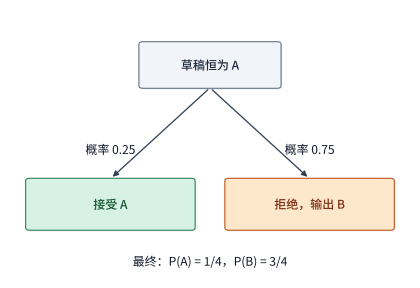

*图 8-31　当目标分布为 $p(A)=1/4, p(B)=3/4$ 而草稿恒猜 A 时的接受与修正路径：草稿 A 以 $1/4$ 的概率被直接接受，以 $3/4$ 的概率被拒绝并重采样修正为 B，两条路径合起来严格还原目标分布。*

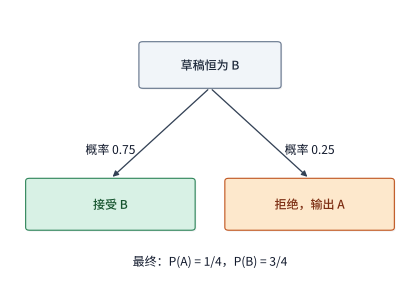

*图 8-32　同一目标分布下当草稿恒猜 B 时的接受与修正路径：草稿 B 以 $3/4$ 的高概率被直接接受，仅以 $1/4$ 的概率被拒绝并修正为 A；输出分布与图 8-31 完全一致，但草稿接受率提升了三倍。*

在推理引擎的系统实现层面，每一轮验证收尾时都必须执行一次轻量级的**状态对齐与回退（State Rollback）**：对于那些未通过验证而被丢弃的尾部草稿位置，目标模型在并行前向中顺带算出的 KV 缓存必须通过移动有效长度指针（或释放末尾未确认的物理块引用）予以作废，使其绝不参与后续轮次的注意力计算；与此同时，随机数采样器状态以及第 8.2.4 节剖析的**结构化生成语法状态机（如 XGrammar 的树状持久化下推自动机栈）**也必须精确回滚到本轮最后确认的那个输出位置。具体而言，当推测解码与 XGrammar 语法约束同时开启时，若每条请求每轮提交 $m = 4$ 个草稿 token，目标模型在单次验证前向中需要对每条请求同时校验 $m + 1 = 5$ 个位置的词表合法性：一方面，在算例 8-A 的 $B = 64$ 并发批次下，语法引擎必须在草稿推进过程中沿着候选序列 `[a, b, c, d]` 试探性步进 4 次，并在单轮验证前一次性生成并传输 $5 \times 64 = \mathbf{320\ \text{行}}$ 词表位图掩码（位图总载荷放大 5 倍至 $320 \times 18{,}992\ \mathrm{B} = \mathbf{6{,}077{,}440\ \mathrm{B}}\approx\mathbf{5.796\ \mathrm{MiB}}$，合十进制 $6.077\ \mathrm{MB}$）；另一方面，一旦图 8-30 中的第 3 个草稿 token `c` 在验证时被拒绝并修正为 `x`，XGrammar 的持久化执行栈就必须立即丢弃 `c`、`d` 两步试探分支，将栈顶指针 $O(1)$ 回退至 `b` 之后的状态节点并按修正 token `x` 重新状态转移，然后再启动下一轮草稿生成与验证。[^structured-gen]

### 8.5.2 每轮耗时与输出数量

弄清了单轮验证的机制后，我们再来建立推测解码的端到端性能核算公式。与普通自回归 decode 每轮固定输出 1 个 token 不同，推测解码同时改变了两个量：它一方面因为生成草稿和多位置验证而改变了**每轮迭代的耗时** $T_r$，另一方面又让**每轮最终敲定的输出 token 数** $N_r$ 变成了一个在 $1$ 到 $m+1$ 之间波动的随机变量。因此，在连续执行多轮推测解码后，衡量真实生成速度的**平均每个输出 token 耗时（Amortized Time per Output Token）** $\bar t_{\mathrm{spec}}$，必须定义为所有轮次的总耗时除以所有轮次的总产出 token 数：

$$
\bar t_{\mathrm{spec}}=\frac{\sum_r T_r}{\sum_r N_r}.
$$

这里要特别提醒初学者避开一个常见的统计陷阱：**切忌先算出每一轮的“单轮耗时除以单轮产出（$T_r/N_r$）”，然后再把各轮的比值简单相加取算术平均**。举个直观的例子：假设第一轮耗时 $1.5\ \mathrm{ms}$ 只吐出了 $1$ 个 token（当轮比值为 $1.5\ \mathrm{ms/token}$），第二轮同样耗时 $1.5\ \mathrm{ms}$ 却一次性产出了 $5$ 个 token（当轮比值为 $0.3\ \mathrm{ms/token}$）。两轮合在一起看，系统一共花了 $1.5 + 1.5 = 3.0\ \mathrm{ms}$，总共交付了 $1 + 5 = 6$ 个 token，真实的平均每 token 耗时显然是 $3.0 / 6 = \mathbf{0.5\ \mathrm{ms/token}}$；如果你错误地把第一轮的 $1.5$ 和第二轮的 $0.3$ 直接做等权算术平均，就会算出 $(1.5 + 0.3)/2 = 0.9\ \mathrm{ms/token}$ 的荒谬结果——因为这种算法错误地让“只产出 1 个 token 的低效轮”和“产出 5 个 token 的高产轮”在按 token 计量的指标里占了相同的权重。唯有坚持“总时间除以总 token 数”（在平稳遍历假设下即等于 $\mathbb{E}[T]/\mathbb{E}[N]$），才能准确反映用户感知的流式吐字速度。

**算例：草稿接受率如何决定每轮的平均输出数？** 让我们沿用上一小节的两符号目标分布（$p(A)=1/4, p(B)=3/4$），假设各个 token 位置相互独立，每轮草稿固定提交 $m=4$ 个候选 token。无论这 4 个草稿 token 在哪里被拒绝（哪怕第 1 个草稿就全错），目标模型在验证时都会免费给出 1 个准确的修正 token；而如果 4 个草稿全部通过，目标模型还会在第 5 个位置顺带算出 1 个额外 token（Bonus Token）。因此，设在前面所有草稿位置均已通过验证的前提下，当前草稿位置的条件接受概率恒为 $a \in [0, 1]$，我们可以按“最终至少产出第 $k$ 个 token 的概率”逐项累加，简洁地推导出单轮期望输出 token 数 $\mathbb{E}[N]$：
- 产出第 1 个 token 是完全确定的（要么接受草稿 1，要么拒绝后直接拿修正 token），概率为 $1$；
- 要产出第 2 个 token，前提是第 1 个草稿必须通过验证，概率为 $a$；
- 要产出第 3 个 token，前提是前 2 个草稿连续通过验证，概率为 $a^2$；
- 以此类推，要产出第 4、第 5 个 token 的概率分别为 $a^3$ 与 $a^4$。

把这五项加起来，长度为 4 的草稿在单轮验证中的**期望输出 token 数**为：

$$
\mathbb E[N]=1+a+a^2+a^3+a^4.
$$

把两种极端草稿代入上式：当草稿恒猜低概率符号 `AAAA` 时，单步接受率 $a = 1/4$，单轮平均只能输出 $\mathbb{E}[N] = 1 + 0.25 + 0.0625 + 0.015625 + 0.00390625 \approx \mathbf{1.33\ \mathrm{tokens}}$；而当草稿恒猜高概率符号 `BBBB` 时，单步接受率 $a = 3/4$，单轮平均输出数便跃升至 $\mathbb{E}[N] = 1 + 0.75 + 0.5625 + 0.421875 + 0.31640625 \approx \mathbf{3.05\ \mathrm{tokens}}$。

现在把真实的硬件时间代进去算总账。在 RTX PRO 6000 上，实验 8-1 测得 batch 1、2K 上下文下普通自回归 decode 跑一轮（生成 1 个 token）耗时 **$26.26\ \mathrm{ms}$**。当我们改用长度为 4 的草稿做并行验证（一次前向同时算 5 个位置）时，从显存读取的权重与历史 KV 字节数与普通 decode 一步完全相同；多出来的 4 行矩阵乘总共只增加了约 $65\ \ \mathrm{GFLOP}$ 的运算量，按该卡 BF16 峰值算力的 $62\%$ 折算仅需约 $0.2\ \mathrm{ms}$，完全被显存读取与调度延迟掩盖，因此单轮目标模型验证耗时依然按 **$26.26\ \mathrm{ms}$** 计算。这一点在实验 8-5 的实测中也得到了印证：采用单次前向并行生成整段草稿的 DFlash 草稿网络，每轮生成 7 个草稿 token 并让目标模型并行验证 8 个位置，实测整轮中位耗时仅为 $15.2\ \mathrm{ms}$，与同一环境下普通 decode 单步的 $16.9\ \mathrm{ms}$ 几乎处于同一水平。

假设我们从预先建好的上下文索引中极速查出 4 个草稿 token 只需 $0.1\ \mathrm{ms}$，那么一轮“查草稿 + 目标验证”的总耗时为 $T = 26.26 + 0.1 = \mathbf{26.36\ \mathrm{ms}}$。将其除以各自的期望产出数 $\mathbb{E}[N]$：
- 对于接受率较高的 `BBBB` 草稿（$\mathbb{E}[N]\approx 3.05$），平均每个输出 token 耗时骤降至 $26.36 / 3.05 \approx \mathbf{8.64\ \mathrm{ms/token}}$，比普通 decode（$26.26\ \mathrm{ms/token}$）快了 **3 倍以上**；
- 即便对于接受率仅有 $25\%$ 的拙劣草稿 `AAAA`（$\mathbb{E}[N]\approx 1.33$），平均每个输出 token 耗时也降到了 $26.36 / 1.33 \approx \mathbf{19.8\ \mathrm{ms/token}}$，依然显著快于普通 decode 的 $26.26\ \mathrm{ms/token}$。为什么连大多数时候都被拒绝的 `AAAA` 草稿也能实现净加速？原因就在于两点：**第一，目标模型并行验证 5 个位置几乎是“零边际时间成本”的；第二，由于保底修正 token 的存在，哪怕草稿全部被拒，每轮也至少能保底获得 1 个正确 token（$\mathbb{E}[N] \ge 1$），绝不会空手而归**。[^history]

当然，这是在草稿获取成本极低（仅 $0.1\ \mathrm{ms}$）的前提下。如果生成这段草稿本身要花不少时间（记单轮草稿获取耗时为 $T_{\mathrm{draft}}$），那么当 $T_{\mathrm{draft}}$ 超过某个临界值时，多产出 token 省下的时间就会被草稿开销彻底吃光。具体而言，要让推测解码快于普通 decode（$26.26\ \mathrm{ms/token}$），单轮总耗时 $26.26 + T_{\mathrm{draft}}$ 必须小于 $\mathbb{E}[N]\times 26.26\ \mathrm{ms}$。扣除目标验证本身用掉的 $26.26\ \mathrm{ms}$ 后，留给单轮草稿获取的最大允许时间预算为 $(\mathbb{E}[N] - 1)\times 26.26\ \mathrm{ms}$：对于 `AAAA` 草稿，草稿获取耗时一旦超过 $(1.33 - 1)\times 26.26 \approx \mathbf{8.7\ \mathrm{ms}}$ 就会倒贴变慢；而对于高接受率的 `BBBB` 草稿，留给草稿获取的时间预算则宽裕到了 $(3.05 - 1)\times 26.26 \approx \mathbf{53.9\ \mathrm{ms}}$。图 8-33 直观地绘出了两条平均每 token 耗时曲线随草稿查询成本上升而穿过普通 decode 基准线的交点。

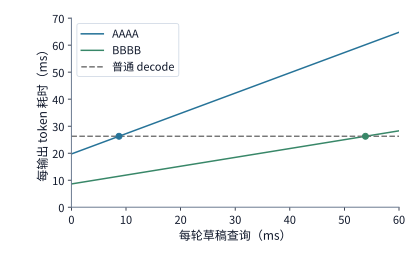

*图 8-33　在两符号目标分布下，单轮草稿查询时间对平均每个输出 token 耗时的影响（目标验证固定为 26.26 ms，横轴为单轮草稿查询耗时）：圆点标出查询耗时为 0.1 ms 时的算例位置；随着查询成本增加，低接受率的 AAAA 草稿在约 8.7 ms 处与普通 decode（26.26 ms/token 水平虚线）相交并丧失加速收益，而高接受率的 BBBB 草稿直到查询耗时达约 53.9 ms 处才触及盈亏平衡线。*

同理，如果某种草稿机制在请求刚开始生成前需要付出一次性的**前期准备开销**（例如花费 $2\ \mathrm{s}$ 为长文档构建用于检索草稿的后缀树或 N-gram 索引），我们也必须把这笔前期投入分摊到整条请求的输出长度上来检验是否划算。以 `BBBB` 草稿为例，它在进入生成阶段后，每吐出一个 token 能比普通 decode 净省 $26.26 - 8.64 \approx 17.6\ \mathrm{ms}$；因此，要想把前期建索引花掉的 $2000\ \mathrm{ms}$ 赚回来，这条请求至少需要连续生成 $2000 / 17.6 \approx \mathbf{114\ \mathrm{tokens}}$ 才能回本。对于章首需要生成 256 个输出 token 的请求，普通 decode 跑完需 $256\times 0.02626 \approx 6.72\ \mathrm{s}$，而“先花 $2\ \mathrm{s}$ 建索引 + 再用 `BBBB` 推测生成”期望只需 $2 + 256\times 0.00864 \approx \mathbf{4.22\ \mathrm{s}}$，净省 $2.5\ \mathrm{s}$；如果这份上下文索引还能跨多轮或多条共享前缀的请求复用，分摊到每个输出 token 上的准备成本还会进一步降低。

### 8.5.3 草稿来源与串行、并行生成方式

既然推测解码的成败系于“**草稿既要猜得准（高 $\mathbb{E}[N]$），又要来得快（低 $T_{\mathrm{draft}}$），还要少占显存**”，近年来工业界与学术界围绕“从哪里变出草稿、怎样更快地生成草稿”演化出了五条代表性的技术路线：
1. **无模型上下文检索（Prompt Lookup / N-gram Matching）**：无需任何额外神经网络权重，直接从当前请求的输入提示词或历史回答中检索重复出现的短语片段作为草稿（非常适合代码补全、文档摘要、RAG 原文引用等输入输出高度重合的场景），主要开销仅在于字符串匹配与索引维护；
2. **独立小草稿模型（Standalone Draft Model）**：部署一个同词表但参数量小一个数量级的独立语言模型（如用 0.5B 模型为 8B/70B 模型打草稿），逐个 token 自回归生成草稿；缺点是需要额外占用显存存放小模型权重及其专属 KV 缓存，且串行自回归跑 $m$ 步仍需多次内核启动；
3. **特征级轻量自回归预测头（如 EAGLE 系列，Li 等，ICML 2024）**：不再从底层词嵌入重新跑一个小模型，而是直接把目标大模型倒数第二层富含语义的隐状态特征（Hidden States）连同上一步 token 嵌入送入一个仅有单层或极浅层的轻量级草稿头，大幅提高了草稿与目标模型的分布对齐度；
4. **单次前向并行块草稿网络（如 DFlash，实验 8-5）**：打破草稿阶段自身还要逐 token 串行自回归的束缚，通过训练一个支持多位置并行解码的轻量草稿网络，在**单次前向计算（1 Forward Pass）**中一次性并行产出整段长度为 $m$ 的候选草稿块，将草稿生成延迟压缩到极致；
5. **原生多 Token 预测头（Native Multi-Token Prediction / MTP，如 DeepSeek-V3）**：在目标大模型预训练阶段就原生加入用于预测未来第 $2, 3, \dots$ 个 token 的辅助 MTP 头，推理时直接开启这些原生预测头作为高命中率草稿源，无需事后拼凑外部模型。[^spec]

为了直观比较“串行自回归打草稿”与“单次前向并行打草稿”在时间账本上的本质差异，我们可以将每一轮推测解码拆解为“**生成草稿 → 准备验证输入 → 目标模型并行验证 → 确认输出并回退状态**”四个阶段，并用实验 8-5 中 **DFlash** 草稿网络的实测参数算一笔对比账（图 8-34）。该 DFlash 草稿网络的权重约为 $1.95\ \mathrm{GiB}$（十进制约 $2.10\ \mathrm{GB}$）；按照 RTX PRO 6000 在 batch 1 下实测的有效显存读取带宽（$26.26\ \mathrm{ms}$ 读取 $15.44\ \mathrm{GB}$，即约 $588\ \mathrm{GB/s}$）折算，把这 $2.10\ \mathrm{GB}$ 草稿网络权重读一遍完成单次前向计算，大约需要 **$3.57\ \mathrm{ms}$**。现在对比生成 $m=4$ 个草稿 token 的不同方式（目标模型验证耗时均固定为 **$26.26\ \mathrm{ms}$**）：
- **方式一（串行草稿模型，高接受率 $\mathbb{E}[N]=3$）**：如果用同等规模的小模型逐个 token 串行自回归生成 4 个草稿 token，草稿网络必须连续跑 4 次前向，光打草稿就要花掉 $4\times 3.57 = \mathbf{14.28\ \mathrm{ms}}$；加上目标验证的 $26.26\ \mathrm{ms}$，单轮总耗时达 $40.54\ \mathrm{ms}$。在每轮平均产出 $\mathbb{E}[N]=3$ 个 token 时，平均每 token 耗时为 $(14.28 + 26.26)/3 \approx \mathbf{13.5\ \mathrm{ms/token}}$；
- **方式二（DFlash 并行草稿网络，同样高接受率 $\mathbb{E}[N]=3$）**：像 DFlash 那样一次前向并行吐出全部 4 个草稿 token，草稿阶段耗时直接从 $14.28\ \mathrm{ms}$ 砍到了 **$3.57\ \mathrm{ms}$**（省下 $10.71\ \mathrm{ms}$）；在同样平均产出 3 个 token 的情况下，平均每 token 耗时进一步降至 $(3.57 + 26.26)/3 \approx \mathbf{9.9\ \mathrm{ms/token}}$；
- **方式三（并行草稿但接受率下滑，$\mathbb{E}[N]=2$ 的反事实警示）**：但如果某个并行草稿网络为了图快而牺牲了多步之间的因果协调性，导致草稿接受率下滑、每轮平均产出数从 3 个掉到了 **2 个**，情况就会瞬间逆转——此时哪怕草稿生成依然只需 $3.57\ \mathrm{ms}$，分摊到 2 个输出 token 上的平均耗时也会反弹至 $(3.57 + 26.26)/2 \approx \mathbf{14.9\ \mathrm{ms/token}}$，反而比按部就班跑 4 步的串行草稿方式（$13.5\ \mathrm{ms/token}$）还要慢。

图 8-34 将这四种执行方式的单轮时间结构与最终每 token 延迟并列呈现。它深刻地揭示了推测解码系统设计的黄金平衡律：**缩短草稿生成耗时 $T_{\mathrm{draft}}$ 固然重要，但它位于分式的分子上（且只占单轮总耗时的一小部分）；而草稿接受率所决定的期望产出数 $\mathbb{E}[N]$ 却位于整个分式的分母上，直接对高达 $26.26\ \mathrm{ms}$ 的目标模型验证耗时进行除数级摊薄。任何以显著降低接受率为代价换取的草稿提速，最终都会在分母缩水的惩罚下反受其累**。

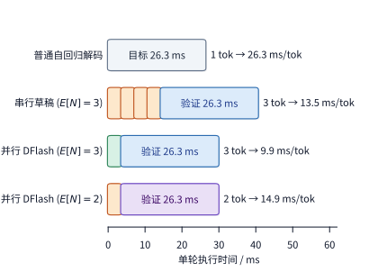

*图 8-34　不同草稿生成方式的单轮时间结构与平均每个输出 token 延迟对比（RTX PRO 6000，batch 1）：普通自回归 decode 每轮 26.3 ms 仅产出 1 个 token；串行草稿模型跑 4 次前向需 14.3 ms 草稿时间，在 $\mathbb{E}[N]=3$ 时折合 13.5 ms/tok；DFlash 单次前向并行生成 4 个草稿仅需 3.57 ms，在 $\mathbb{E}[N]=3$ 时压至 9.9 ms/tok；但若并行草稿接受率下滑使 $\mathbb{E}[N]$ 降至 2，分摊耗时将反弹至 14.9 ms/tok，反而不如高接受率的串行草稿。*

**扩展：扩散语言模型（Diffusion LLM，`Fast-dLLM`）的分块近似双缓存与基于置信度阈值的并行解码。** 前述五条推测解码路线均立足于传统的因果自回归（Autoregressive）大模型——即便草稿能够并行产出，目标模型在验证时依然受制于从左到右的严格因果掩码链条。回顾第 2.3.6 节介绍的**掩码扩散语言模型（Masked Diffusion LLM，如 LLaDA、Dream）**，其生成范式从根本上抛弃了逐字因果自回归，转为对包含掩码标记 `[MASK]` 的序列执行多步双向注意力去噪。然而，原生扩散语言模型在推理落地上长期受困于两大瓶颈：一是由于采用全序列双向注意力（无因果掩码），每一轮去噪步中所有位置的隐状态都会随部分掩码的揭晓而轻微变动，导致无法直接使用标准 KV 缓存；二是若在单步去噪中盲目并行揭晓过多掩码位置，违反多 token 联合分布独立性假设会导致生成质量明显劣化。针对这两项挑战，**`Fast-dLLM`（Wu 等，2025）** 提出了两项优雅的系统与算法协同机制：第一是**分块近似双缓存（Block-wise Approximate DualCache）**——将生成序列划分为固定长度的局部去噪块，在块内迭代去噪期间，直接缓存并复用当前活跃块之前的已定稿前缀（Prefix Cache）与当前活跃块之后的未揭晓掩码后缀（Suffix Cache）的键值张量（利用非活跃区域的双向表征在相邻去噪步间高度稳定的物理特性，省去了逾 $90\%$ 的冗余重算）；第二是**基于置信度阈值的并行解码（Confidence-aware Parallel Decoding）**——在每一步去噪前向结束时，无需借助任何外部草稿模型，直接并发接受当前块内所有最大预测概率超过预设置信度阈值 $\tau$（例如 $\tau = 0.9$）的掩码位置（理论证明在高置信度区间内，边缘分布贪心采样与联合分布采样近似等价），从而在保持无损或近无损生成质量的前提下，实现单步多 token 原生并行吐字与最高达十余倍的端到端推理加速。

### 8.5.4 草稿长度的动态选择与并发竞争

确定了采用哪种草稿模型之后，引擎在每一轮迭代中还面临一个关键的超参数决策：**每轮究竟应该往前猜几个草稿 token（即草稿长度 $m$ 选多大）？**

直觉上看，草稿长度 $m$ 拉得越长，单轮可能中奖的最大输出上限 $m+1$ 就越高；但由于因果验证是一场“连环过关游戏”——唯有前面第 $1, 2, \dots, j-1$ 个草稿 token 全部通过验证，第 $j$ 个草稿 token 才有资格进入最终输出，越往后的草稿位置能够存活下来的概率其实呈指数级衰减。设在前面 $i-1$ 个草稿均已通过验证的条件下，第 $i$ 个草稿位置通过验证的条件概率为 $a_i$，那么当草稿长度设为 $m$ 时，单轮期望输出的 token 总数 $\mathbb{E}[N_m]$ 为：

$$
\mathbb E[N_m]=1+\sum_{j=1}^{m}\prod_{i=1}^{j}a_i.
$$

现在让我们运用微观经济学中的**边际分析法（Marginal Analysis）**来判断：当草稿长度已经达到 $m-1$（对应单轮总耗时 $T$、期望产出 $N = \mathbb{E}[N_{m-1}]$，当前平均每 token 耗时为 $T/N$）时，**再把草稿长度多延长 1 步到 $m$，究竟划不划算？**

把草稿从 $m-1$ 增至 $m$，单轮期望多产出的边际 token 数为 $\Delta N = \prod_{i=1}^{m}a_i$，同时单轮草稿生成与目标验证合计多付出的边际时间为 $\Delta T$。要使延长这一步之后的新平均每 token 耗时 $(T + \Delta T)/(N + \Delta N)$ 比原来的 $T/N$ 更短，交叉相乘化简后立刻得到一条简洁的**边际草稿延长判据**：

$$
\frac{\Delta T}{\Delta N}<\frac{T}{N}.
$$

这条不等式的物理意义一望即知：左边 $\Delta T / \Delta N$ 是“**为了多搏出这最后一个边际 token 所付出的边际每 token 时间成本**”，右边 $T/N$ 则是“**现有配置下已经实现的平均每 token 耗时**”。只有当新增这一步的边际时间成本低于当前平均成本时，延长草稿才能拉低整体均值；而由于分母 $\Delta N = \prod_{i=1}^{m}a_i$ 随着步数 $m$ 呈连乘衰减，越往后的草稿位 $\Delta N$ 越接近于 0，左边的边际成本 $\Delta T / \Delta N$ 就会急剧激增并很快突破右边的平均线。

在实际 GPU 运行时中，除了 $\Delta N$ 的连乘衰减，分子上的边际耗时 $\Delta T$ 还会受到第 8.2.4 节讲过的**预设执行形状分桶（CUDA Graph Bucketing / Tensor Core Tile Alignment）**的强烈调制，呈现出鲜明的“台阶式跳变”：
- 假设当前待验证位置数是 4 个或 5 个，底层内核都会将特征矩阵统一补齐（Pad）到 **8 行**的硬件分桶尺寸并调用预先录制好的 8 行计算图，那么把验证位置从 4 个增加到 5 个（乃至 8 个），目标验证阶段的边际耗时几乎为 $\Delta T_{\mathrm{verify}} \approx 0$；
- 但如果你试图把待验证位置数从 **8 个（即草稿长 K7）再加到 9 个（乃至 16 个，即草稿长 K15）**，输入矩阵就会越过 8 行桶的边界，被迫向上补齐到 **16 行**分桶计算图，引发矩阵乘计算量与寄存器压力的台阶式跳升。

与此同时，系统的**在线并发请求数（Batch Size）**也会改变推测解码的收益天平：在单请求低负载（batch 1）时，GPU 算力严重过剩，利用闲置算力去多验证几个草稿位置几乎不增加额外耗时；而在高并发满载（如 batch 32 或 64）时，普通的跨请求批处理本身就已经让几十条请求充分分摊了权重读取、把 Tensor Core 算力吃得很满，此时再让每条请求各自膨胀出 8 倍、16 倍的草稿验证行数，就会直接把 decode 阶段推入算力受限区，并加剧草稿模型与目标模型对 HBM 容量及带宽的争抢。

实验 8-5 在 Qwen3-8B + DFlash 并行草稿体系上对不同草稿长度做了实测对比（其中 **K7** 代表每轮生成 7 个草稿 token、目标模型验证 8 个位置；**K15** 代表每轮生成 15 个草稿 token、验证 16 个位置）。在并发度为 1 的短信息提取任务上，普通自回归 decode、K7 配置与 K15 配置跑完完整请求的中位总耗时分别为 **$90.0\ \mathrm{ms}$**、**$30.6\ \mathrm{ms}$** 与 **$29.4\ \mathrm{ms}$**。可以看到：从普通 decode 切换到 K7，端到端耗时一下子削减了约 **$59.4\ \mathrm{ms}$**（提速近 3 倍）；而把草稿块长再翻倍从 K7 拉到 K15，边际收益却缩减到了仅 **$1.2\ \mathrm{ms}$**。翻开逐轮内核追踪日志还能看到更加生动的现场证据：在遇到较难预测的转折词时，K7 和 K15 在同一轮里都只接受了第 1 个草稿 token——K7 丢弃了后面 6 个草稿位置的计算，而 K15 则丢弃了多达 14 个草稿位置的计算，两者在该轮最终吐出的有效输出长度一模一样，但 K15 却实打实地多付出了 16 行验证块的算力与功耗代价。[^spec-measure]

因此，现代高性能推理引擎（如 vLLM、SGLang 的动态推测解码调度器）普遍采用基于上述边际判据 $\Delta T / \Delta N < T/N$ 的**自适应动态草稿长度调节（Dynamic Draft Length Control）**：当监测到某条请求正处于输出确定性高（如固定格式代码、模板文本，草稿前几位置信度与历史接受率高）且未跨越计算图分桶边界时，自动放宽草稿步数；一旦发现草稿前几个位置频繁被拒（$\Delta N$ 骤降），或者系统当前并发 batch 升高导致验证进入算力受限区（$\Delta T$ 激增），便立即缩短草稿长度甚至动态退回普通批处理 decode。并且，在开启推测解码之前，还必须先把草稿模型自身的权重与 KV 缓存预算纳入第 8.3 节的显存总账中，这正是下一节我们将要完成的全局统筹。

> **练习 8-7 · 推导：多长的草稿能使平均每个输出 token 的耗时最短？** 固定草稿接受概率 $a=3/4$，计算草稿块长为 1、2、4、8 时，每轮平均输出的 token 数。沿用第 8.5.3 节 RTX PRO 6000 上的数据并保留一位小数：一轮验证 26.3 ms，草稿网络逐个生成、每个草稿 token 3.6 ms，即 $T_m=26.3+3.6m$ ms，求每种块长的平均每个输出 token 的耗时。再设草稿按每组 4 个位置执行，不足一组也按整组计时，即 $T_m=26.3+3.6\times4\lceil m/4\rceil$ ms，比较块长 4 与 5，并用边际条件解释选择。

## 8.6 请求负载下的性能与配置选择

### 8.6.1 到达率、排队、准入与取消

在第 8.2 至 8.5 节中，我们逐一掌握了调整单个推理实例显存占用与执行速度的四项关键技术：连续批处理与分块 prefill、分页与前缀共享、量化与卸载、以及推测解码。然而，当我们将实例接入真实的生产流量时，还必须面对一个动态的排队论现实：**用户的请求是源源不断随机到达的**。上一批请求还在半途生成，下一波新请求就已经涌入了等待队列；而在多轮智能体（Agent）工作流中，某条请求在吐完工具调用指令、等待外部沙箱或搜索引擎返回结果的几秒钟内，虽然暂时不消耗 GPU 算力，但它在 HBM 显存里的 KV 物理块却不能轻易丢弃。因此，在线调度器不仅要编排当下这一毫秒的 GPU 内核执行，还必须在整个时间轴上统筹管理“排队等待接纳的请求”“正在活跃生成的请求”以及“挂起等待工具返回但仍占着显存的请求”。

要估算一个稳定运行的推理服务在任意时刻平均需要在系统内维护多少条未完成请求的状态，我们可以直接调用排队论中最具普适性的基石定律——**利特尔法则（Little's Law）**：在一个处于统计稳态的服务系统中，系统内同时驻留的平均请求数 $\bar n$，恒等于请求的平均到达率 $\lambda$ 与单条请求在系统内的平均停留总时间 $\bar T$（含排队等待时间与实际服务时间）的乘积：

$$
\bar n=\lambda\bar T.
$$

从测量上看，只要把一段观察窗口内所有请求各自在系统里停留的秒数加起来，再除以观察窗口的总时长，得到的就是系统内的时间平均驻留请求数 $\bar n$。举个直观的例子：如果线上流量以平均每秒 $\lambda = 4\ \mathrm{req/s}$ 的速度到达，且每条请求从进入到吐完最后一个 token 平均耗时 $\bar T = 0.5\ \mathrm{s}$，那么系统内平均只需要同时维护 $\bar n = 4\times 0.5 = 2$ 条请求的状态；但如果因为上下文变长或生成变慢，单条请求的平均停留时间延长到了 $\bar T = 2.0\ \mathrm{s}$，那么在完全相同的 $4\ \mathrm{req/s}$ 到达率下，系统内平均堆积的并发请求数就会翻四倍达到 $\bar n = 4\times 2.0 = 8$ 条。

在这 $\bar n$ 条同时驻留的请求里，一部分正在 GPU 上合并执行 prefill 或 decode，一部分在主机内存中挂起等待外部工具响应，还有一部分则堵在入口队列（Waiting Queue）里等待空闲的 KV 物理块。正如第 8.2.1 节所分析的，适当放大并发 batch size 能有效摊薄权重读取、推高系统的总输出 token 吞吐率；但随着 batch 的持续增大，每步额外增加的 KV 访存与矩阵乘算力开销会让总吞吐率逐渐逼近硬件上限（饱和区）。一旦外部请求的平均到达率 $\lambda$ 接近甚至越过了实例的最大完成吞吐率，新到达的请求就会在入口队列中快速积压，排队等待时间呈非线性陡增，最终导致大面积请求超出业务服务等级目标（SLO）。

为了防止系统在流量洪峰下陷入“所有请求一起排队、算完时早已全部超时作废”的雪崩瘫痪，生产级推理网关必须配合实施严格的**准入控制（Admission Control）**与**超时取消（Cancellation）**：
- **准入控制**：在决定把一条排队请求放进引擎分配 KV 块之前，调度器先核查当前剩余的 KV 物理块容量，并结合当前并发度下的预计执行时间，估算该请求距离其 SLO 截止期限（Deadline）还剩多少时间裕量（Slack Time）。以第 8.1.1 节的短请求为例，光在加速卡上跑完 $0.196\ \mathrm{s}$ 的 prefill 和 $6.76\ \mathrm{s}$ 的 255 轮 decode 就已经花掉了 $6.95\ \mathrm{s}$；面对 $7.0\ \mathrm{s}$ 的总时限，它在入口队列里哪怕多排 $0.1\ \mathrm{s}$ 的队，就注定无法按期交卷。准入控制器一旦识别出这类“尚未开始执行就已注定超时”的请求，便可果断提前拒绝（Fast Fail）、将其路由转发给负载较轻的空闲副本，或者为其动态切换开启推测解码等加速档位；
- **超时与中途取消**：一旦某条正在排队的请求已经越过截止时间，或者正在生成的请求因客户端断开连接而丧失业务价值，调度器便立即终止其后续迭代排期，并在 GPU 在途内核排空后第一时间回收其占用的 KV 物理块（回顾第 8.3.2 节图 8-17 的安全释放时序），把宝贵的显存与算力及时让给后面还能挽救的正常请求。

更重要的是，前几节介绍的各项单点优化在真实负载下会发生深刻的**耦合与联动**：例如，启用第 8.4.2 节的 KV 压缩不仅省下了显存，还让实例能够同时接纳更大的并发 batch；而当并发 batch 变大之后，第 8.2.1 节的普通批处理本身就已经把权重读取分摊得很充分了，这又会反过来压缩第 8.5 节推测解码的边际加速空间。因此，唯有把到达率、正确率、SLO 时限与各项优化配置放进同一个端到端天平上综合考核，才能选出真正契合业务需求的生产配置。

### 8.6.2 质量与 SLO 约束下的有效吞吐

在评测一个推理服务时，如果只盯着“每秒吐出了多少个 token”或“每秒跑完了多少条请求”，往往会产生片面的性能判断：首先，第 8.4.4 节的质量实验已经证明，不当的低精度内核可能导致长上下文检索给出错误答案——**算得再快，给用户返回一个错误结果也是毫无价值的（甚或带来负面损失）**；其次，上一小节的排队分析指出，在高到达率下由于队列积压，许多请求虽然最终算出了正确答案，但返回给客户端时早已超过了业务允许的最大响应时限——**一个迟到的正确答案同样违背了服务等级协议（SLO）**。

为了将“数值质量损失”与“排队超时损失”同时纳入核心考核，现代 AI 基础设施工程采用**有效吞吐（Goodput）**作为衡量在线服务真实产出能力的黄金指标。设在一段长度为 $T_{\mathrm{obs}}$ 的观察时间窗口内，系统共接收并处理了一系列请求；对于第 $i$ 条请求，用二元指示变量 $Q_i \in \{0, 1\}$ 表示其输出答案是否满足质量/正确性标准（正确记为 $Q_i = 1$，错误记为 $0$），用二元指示变量 $D_i \in \{0, 1\}$ 表示其从计划到达时刻起到完整返回结果的总端到端延迟是否满足 SLO 时限要求（按期完成记为 $D_i = 1$，超时记为 $0$）。那么，按每秒交付的**合格请求数**计量的**有效吞吐** $R_{\mathrm{good}}$ 定义为：

$$
R_{\mathrm{good}}=\frac{\sum_i Q_iD_i}{T_{\mathrm{obs}}}.
$$

请注意上式的分子 $\sum_i Q_i D_i$：唯有**既答对（$Q_i=1$）又按时交卷（$D_i=1$）**的请求才能得 1 分。如果我们把分子换成不加筛选的“全部已完成请求总数”，算出来的就是传统的**完成吞吐（Completed Throughput）**。对比“完成吞吐”与“有效吞吐 $R_{\mathrm{good}}$”之间的落差，就能看清系统究竟有多少算力与电费被消耗在了“算错的无效输出”或“迟到的超时回答”上。

实验 8-9 在 RTX PRO 6000 上用真实的测量数据展示了这两项损失的威力。实验采用与第 8.4.4 节相同的 8 道 Qwen3-8B 精确检索题，设定硬性服务时限为**请求到达后 $3\ \mathrm{s}$ 内必须完整返回正确答案**，系统对比了“逐个串行接纳请求（Serial，每次只放 1 条进引擎）”“在线连续批处理（Continuous Batching）”以及“离线一次性全部提交（Offline Burst）”三种模式在不同到达率下的表现。在每个测试条件下，系统分三个独立的 16 请求窗口（每个条件共 48 条请求，全部 7 个条件总计 $336$ 次生成）采集数据：在全部 $336$ 次生成中，模型总共给出了 **$294$ 次**正确回答（其余 $42$ 次为回答错误），但在叠加了“必须在 $3\ \mathrm{s}$ 内返回”的时限筛选后，最终同时满足“答案正确且未超时”的合格回答只剩下了 **$155$ 次**——那中间差出来的 $294 - 155 = \mathbf{139\ \mathrm{次}}$ 回答，虽然模型完整算出了正确答案，却因为排队与执行耗时越过了 $3\ \mathrm{s}$ 红线而成为无效产出。[^service]

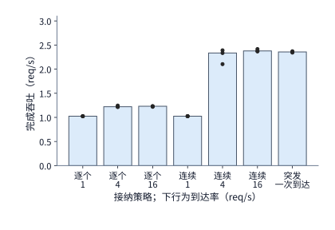

*图 8-35　不同接纳策略与请求到达率下的全部完成吞吐（Completed Throughput）：每种条件运行三个含 16 条请求的测量窗口，柱高表示全部完成请求吞吐的中位数，圆点表示各独立窗口的实测值（请求延迟均从计划到达时刻起算）。*

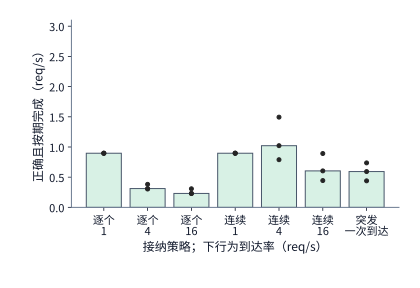

*图 8-36　同一组测量窗口下的有效吞吐（Goodput $R_{\mathrm{good}}$）：分子仅统计“答案正确且在到达后 3 秒内按期完成”的合格请求；与图 8-35 采用相同的横轴排列与纵轴刻度，两图柱高之差即为消耗在错误回答与超时回答上的无效算力产出。*

把图 8-35（完成吞吐）与图 8-36（有效吞吐）上下对照，我们可以清晰地读出流控与批处理在三个负载区的行为演变：
1. **轻载区（到达率 $\lambda = 1\ \mathrm{req/s}$）**：此时每秒只来 1 条请求，无论是逐个接纳（`serial@1/s`）还是连续批处理（`cont@1/s`），引擎都能随到随算，几乎没有排队积压，两者的有效吞吐均稳定在约 **$0.90\ \mathrm{req/s}$**（仅扣除固定比例的答题错误）；
2. **中载分化区（到达率升至 $\lambda = 4\ \mathrm{req/s}$）**：当流量翻四倍达到每秒 4 条时，两种调度策略立刻分出了高下。逐个串行接纳模式（`serial@4/s`）的完成吞吐虽然勉强爬升到了约 $1.22\ \mathrm{req/s}$，但因为后面的请求全堵在应用层入口队列里等待前面的请求一条条跑完，严重的排队延迟导致大批正确回答越过了 3 秒时限，其**有效吞吐反而从 $0.90\ \mathrm{req/s}$ 骤降到了 $0.31\ \mathrm{req/s}$**；反观连续批处理模式（`cont@4/s`），它利用多请求合批将完成吞吐拉升到了约 $2.33\ \mathrm{req/s}$，有效缓解了排队，使**有效吞吐攀升至约 $1.02\ \mathrm{req/s}$**，达到了逐个接纳模式的 **3.3 倍**；
3. **过载排队崩塌区（到达率强行推高至 $\lambda = 16\ \mathrm{req/s}$）**：如果我们继续向连续批处理实例注入 4 倍流量（`cont@16/s`），会发生什么呢？看图 8-35，由于 GPU 已经被高并发填满，实例的完成吞吐仅从 $2.33\ \mathrm{req/s}$ 微弱蠕动到约 **$2.38\ \mathrm{req/s}$**，基本触及硬件饱和上限；但看图 8-36，由于每秒涌入 16 条请求而引擎每秒只能消化 2.38 条，后到的请求在队列里排起了长龙，导致更多正确回答超时作废，系统的**有效吞吐不仅没有上升，反而从 $1.02\ \mathrm{req/s}$ 倒退跌落至约 $0.60\ \mathrm{req/s}$，缩水了约 $41\%$**。

这组对照为线上容量规划提供了一条铁律：**当请求到达率越过实例的饱和拐点后，继续盲目放行新请求进入队列，绝不会增加系统的实际完成吞吐，反而会因为排队膨胀成批毒化在途请求的 SLO 达标率，造成有效吞吐（Goodput）的严重倒退**。因此，生产部署时必须先通过压测绘出图 8-36 这样的有效吞吐曲线，找准 $R_{\mathrm{good}}$ 达到峰值的最优到达率阈值（如本例中的 $4\ \mathrm{req/s}$ 附近），并在该阈值处果断设定队列上限与准入控制，将超出单实例消化能力的溢出流量导向扩容副本。同时在测量方法学上，切记所有请求的延迟计时器都必须从**请求计划到达系统的那一刻（Scheduled Arrival Time）**启动，把在引擎外部应用队列里等待接纳的时间一分不漏地统计进来，绝不能只统计请求进入 GPU 之后的服务时间。

### 8.6.3 配置、加速器与完整任务成本

掌握了有效吞吐的评判准绳后，我们终于可以在把代码推上集群之前，仅凭一张纸、一支笔和几个核心基准参数，对各种复杂的“前缀共享 + KV 压缩 + 推测解码”组合配置做定量的**先验可行性与成本推演**了。

在进行跨配置推演之前，我们先把单实例在给定批大小与精度下的实测开销统一折算为两个直观的**阶段处理速率**：
- **prefill 处理速率 $r_P$**：定义为引擎在 prefill 阶段每秒实际处理完的**新输入 token 总数**（单位：新 $\mathrm{token/s}$）；
- **decode 处理速率 $r_D$**：定义为引擎在 decode 阶段每秒实际完成的**有效 decode 步调用次数**（单位：调用/s；注意当 batch 内的 $b$ 条请求共享同一轮 GPU 前向执行时，这 $b$ 条请求各自都算完成了 1 次调用，而占用的加速卡墙钟时间只计 1 份）。

有了这两个速率，一条包含 $L$ 个需要实际计算的新输入 token、并生成 $G$ 个输出 token（含首 token 后的 $G-1$ 步 decode）的请求，在全生命周期内实际分摊占用的**加速卡时间（以 GPU 秒 GPU-second 计）** $t_{\mathrm{GPU}}$ 就可以简洁地写成：

$$
t_{\mathrm{GPU}}=\frac{L}{r_P}+\frac{G-1}{r_D}.
$$

如果手头暂时没有某个特定 batch 下的实测速率，我们完全可以用第 1 章建立的“硬件规格峰值 × 实测效率系数（MFU / MBU）”来精准外推：计算受限的 prefill 耗时等于矩阵乘总浮点运算量除以“BF16 峰值算力 × prefill 算力效率（MFU）”；访存受限的单轮 decode 耗时等于每轮读取的权重与 KV 总字节数除以“显存峰值带宽 × decode 带宽效率（MBU）”。下表汇总了实验 8-1 在 RTX PRO 6000（峰值显存带宽 $1792\ \mathrm{GB/s}$，BF16 峰值算力 $503.8\ \mathrm{TFLOP/s}$）上实测标定出的各档 batch 效率基准（注：表中“实测一轮 decode”取自引擎内部不含 prefill 的纯 decode 迭代中位数；客户端在外部观测到的流式输出间隔还会额外包含约 $0.2\ \mathrm{ms}$ 的主机侧交付开销，如第 8.1.1 节所见的 $26.5\ \mathrm{ms}$）。

| 2K 上下文、无共享前缀 | batch 1 | batch 4 | batch 16 | batch 64 |
|---|---:|---:|---:|---:|
| 每轮读取的权重与 KV | 15.44 GB | 16.34 GB | 19.97 GB | 34.46 GB |
| 按 1792 GB/s 读取所需时间 | 8.62 ms | 9.12 ms | 11.14 ms | 19.23 ms |
| 实测一轮 decode | 26.26 ms | 26.62 ms | 27.44 ms | 29.63 ms |
| decode 带宽效率 | 33% | 34% | 41% | 65% |
| prefill 算力效率 | 62% | 61% | 61% | 58% |

仔细审视这张实测标定表，一个很有启发性的硬件现象跃然纸上：为什么随着并发度从 batch 1 扩大到 batch 64，decode 阶段的显存带宽利用率（MBU）会从 $33\%$ 一路攀升到 $65\%$？并不是因为显存颗粒本身的读取速度变快了，而是因为**这组基线实验关闭了 CUDA Graph，每一轮迭代都需要由 CPU 主机侧逐个向 GPU 提交通知数百个算子内核**。你看：当每轮实际读取的字节数从 batch 1 的 $15.44\ \mathrm{GB}$ 翻倍增长到 batch 64 的 $34.46\ \mathrm{GB}$（理论纯传输耗时从 $8.62\ \mathrm{ms}$ 增加到 $19.23\ \mathrm{ms}$，净增约 $10.6\ \mathrm{ms}$）时，实测的一轮 decode 墙钟耗时却仅仅从 $26.26\ \mathrm{ms}$ 微增到了 $29.63\ \mathrm{ms}$（净增仅 $3.37\ \mathrm{ms}$）。

把表中的带宽效率（即第 1.2.2 节的 MBU）和算力效率（即 MFU）对照第 1.3.4 节的误差诊断判据，我们立刻就能揪出 batch 1 时那多出来的 $26.26 - 8.62 \approx \mathbf{17.6\ \mathrm{ms}}$ 究竟去了哪里：由于这十多毫秒的额外开销几乎不随每轮读取字节数的增加而增长，它显然不是理论公式漏算了某个张量的访存，而是实打实的**主机侧逐个提交内核（Kernel Launch Overhead）、Python 调度器循环与设备同步所构成的固定每轮税**。当 batch 变大时，这段几乎恒定的主机调度开销被更多的并发读取字节所摊薄，表观 MBU 自然随之水涨船高；而如果我们像第 5.5.1 节剖析的 vLLM v0.6.0 那样开启 CUDA Graph 录制与异步多步调度，就能直接消除这十多毫秒的主机侧气泡，让小 batch 下的 decode 延迟逼近 $8.62\ \mathrm{ms}$ 的物理带宽下界。与此同时，计算密集的 prefill 阶段由于单次内核运算时间远大于启动开销，其算力效率（MFU）在所有 batch 下都稳健地保持在 BF16 峰值的 **$58\%\text{–}62\%$** 之间（在 8K 输入且前 6K 命中前缀缓存的条件下亦稳定在 $52\%\text{–}58\%$）。

**综合算例：在内存与时限约束下选择前缀共享、压缩和推测配置。** 现在，让我们迎来贯穿全章的终极综合实战：回到章首第 8.1.2 节留下的那道棘手工程难题，把前五节学到的全部技术组装起来一决高下。
- **硬件与显存约束**：一台 RTX PRO 6000 工作站加速卡分给当前推理实例 $32\ \mathrm{GiB}$ 显存；扣除 Qwen3-8B 的 BF16 权重（$15.26\ \mathrm{GiB}$）与基础运行工作区后，**留给 KV 缓存及一切辅助模型/缓冲区的可用显存硬上限为 $12\ \mathrm{GiB}$（$12288\ \mathrm{MiB}$）**；
- **负载与 SLO 时限约束**：**16 条长请求同时到达**，每条请求包含 **8192 个输入 token**（其中前 **6144 个输入 token** 为可跨请求复用的公共系统与工具前缀，后 2048 个为各请求私有输入），每条请求均要求生成 **256 个输出 token**（即首 token 之后还要跑 255 个输出 token），且整批请求从到达至全部生成完毕的**端到端完成时限为 $7.0\ \mathrm{s}$**。

假设以下四种候选工程方案（方案 A、B、C、D）在数值质量上均能给出正确回答，其中开启前缀共享的方案（B 与 D）在请求到达前已在缓存池中驻留了那份 6144-token 公共前缀；开启推测解码的方案（D）采用实验 8-5 的 **DFlash 并行草稿网络**——实测启用 DFlash 后，进程显存峰值会额外增加约 **$3.1\ \mathrm{GiB}$（精确记录为从 $17{,}706\ \mathrm{MiB}$ 增至 $20{,}894\ \mathrm{MiB}$，净增 $3188\ \mathrm{MiB}$，其中草稿模型自身权重占约 $1.95\ \mathrm{GiB}$）**；同时由于草稿网络在 prefill 阶段也要顺带处理输入序列以建立自身状态，实验 8-5 实测在约 2300 个新输入 token 下，启用 DFlash 会使整批首 token 时间（TTFT）从 $129.4\ \mathrm{ms}$ 增加到 $141.6\ \mathrm{ms}$，即 **prefill 耗时增加约 $9.4\%$**；进入生成阶段后，DFlash 方案每轮并行生成草稿并验证 8 个位置，设在这组任务上**平均每轮成功输出 3 个 token**。

我们先来看这四种方案的基准锚点——**方案 B（BF16 + 公共前缀共享）**：这恰好就是实验 8-1 在真实硬件上直接跑过的测量条件（8K 输入、前 6K 已缓存、batch 16）。在实测中，方案 B 在 prefill 阶段只需为 16 条请求增量处理 $16\times 2048 = 32{,}768$ 个私有新输入 token，耗时 **$2.04\ \mathrm{s}$**（折合 prefill 速率 $r_P \approx 16{,}059\ \text{新 token/s}$，达到 BF16 峰值算力的 $58\%$）；进入 decode 阶段后，每轮为 16 条请求各生成 1 个 token 耗时 **$27.35\ \mathrm{ms}$**（折合 decode 速率 $r_D = 16 / 0.02735 \approx 585\ \text{调用/s}$）。按单条请求核算，每条请求实际消耗的加速卡时间为 $t_{\mathrm{GPU}} = 2048 / 16059 + 255 / 585 \approx 0.563\ \text{GPU 秒}$，16 条请求合计消耗约 **$9.01\ \text{GPU 秒}$**。

以方案 B 的实测数据与前面的硬件效率表为基准，我们可以严谨地推算出其余三种方案（A、C、D）在 prefill 与 decode 各阶段的耗时参数（汇总于下表）：[^service-plan]

| 方案 | 状态组织 | 首 token 返回前（整批 prefill） | 首 token 返回后的执行 |
|---|---|---:|---|
| A | BF16，独立上下文 | 7.34 s | 255 轮，每轮 29.63 ms |
| B | BF16，共享前缀 | 2.04 s | 255 轮，每轮 27.35 ms |
| C | q8_0，独立上下文 | 7.34 s | 255 轮，每轮约 28.26 ms |
| D | BF16，共享前缀与推测 | 2.23 s | 85 轮，每轮输出 3 个 token，每轮 27.35 ms |

让我们逐一核对表中 A、C、D 三种方案的时间参数是如何从物理模型推导出来的：
1. **方案 A（BF16，独立上下文，无前缀共享）**：由于不共享前 6144 个公共 token，16 条请求都必须从头对完整的 8192 个输入 token 做 prefill，整批矩阵乘与注意力的总浮点运算量高达 $2137.5\ \mathrm{TFLOP}$；按同条件下 $58\%$ 的实测算力效率（MFU）折算，整批 prefill 耗时激增至 **$7.34\ \mathrm{s}$**。进入 decode 阶段后，16 条独立的 8K 请求每轮共需读取权重与 KV 合计 $34.46\ \mathrm{GB}$，这恰好与前面效率表中“64 条独立的 2K 请求（batch 64）”每轮读取的总字节数完全相等，因此单轮 decode 耗时直接取表中的实测值 **$29.63\ \mathrm{ms}$**；
2. **方案 C（`q8_0` KV 压缩，独立上下文，无前缀共享）**：同样因为没有跨请求前缀复用，其整批 prefill 耗时与方案 A 一样为 **$7.34\ \mathrm{s}$**。进入 decode 阶段后，由于 `q8_0` 将 KV 体积压缩到了原来的 $34/64$，每轮读取的权重与压缩 KV 总字节数从 $34.46\ \mathrm{GB}$ 降到了 **$25.40\ \mathrm{GB}$**；在效率表的 $19.97\ \mathrm{GB}$（$27.44\ \mathrm{ms}$）与 $34.46\ \mathrm{GB}$（$29.63\ \mathrm{ms}$）两列之间按读取字节数做线性插值，得到单轮 decode 耗时约为 **$28.26\ \mathrm{ms}$**（注：此处尚未计入在线反量化的额外耗时，已是对方案 C 最有利的乐观估计）；
3. **方案 D（BF16 + 公共前缀共享 + DFlash 推测解码）**：在方案 B 共享前缀的基础上开启 DFlash 草稿网络，整批 prefill 耗时比方案 B 的 $2.04\ \mathrm{s}$ 增加 $9.4\%$，即为 $2.04\times 1.094 \approx \mathbf{2.23\ \mathrm{s}}$。进入生成阶段后，每轮让 16 条请求各自并行验证 8 个候选位置（合计 $16\times 8 = 128$ 行），单轮矩阵乘运算量约为 $2.56\ \mathrm{TFLOP}$，按 $58\%$ 算力效率折算的计算耗时仅为 $8.8\ \mathrm{ms}$，依然远短于方案 B 单轮读取权重与共享 KV 所需的 $27.35\ \mathrm{ms}$；按照第 8.2.1 节 Roofline 取计算与访存较大值的原则，目标验证耗时仍为 $27.35\ \mathrm{ms}$；并且正如第 8.5.2 节所证实的，实验 8-5 中 DFlash 单轮总耗时并不长于普通 decode 单步，因此单轮迭代仍按 **$27.35\ \mathrm{ms}$** 计，但每轮平均能产出 **3 个输出 token**。

现在，我们按照“**先过显存容量关（$\le 12\ \mathrm{GiB}$），再过完成时限关（$\le 7.0\ \mathrm{s}$）**”的两步筛选法，对四种方案做最终裁决：

**第一步：显存容量红线审查（上限 $12\ \mathrm{GiB} = 12288\ \mathrm{MiB}$）**。
- **方案 A**：16 条独立 BF16 长请求需要 $16\times 1188 = 19008\ \mathrm{MiB}\approx \mathbf{18.56\ \mathrm{GiB}}$，直接撑爆 $12\ \mathrm{GiB}$ 显存池，**在第一关即被淘汰出局**；
- **方案 B**：1 份公共前缀（$864\ \mathrm{MiB}$）加 16 份私有后缀（$16\times 324 = 5184\ \mathrm{MiB}$），合计仅需 $6048\ \mathrm{MiB}\approx \mathbf{5.91\ \mathrm{GiB}}$，轻松过关；
- **方案 C**：16 条独立长请求的 KV 按 `q8_0` 的 $34/64$ 压缩后，合计占 $19008\times 34/64 = 10098\ \mathrm{MiB}\approx \mathbf{9.86\ \mathrm{GiB}}$，同样小于 $12\ \mathrm{GiB}$，顺利过关；
- **方案 D**：在方案 B（$6048\ \mathrm{MiB}$）的基础上，加上 DFlash 草稿模型权重与运行缓冲区的额外开销（$3188\ \mathrm{MiB}$），合计占用 $6048 + 3188 = 9236\ \mathrm{MiB}\approx \mathbf{9.02\ \mathrm{GiB}}$，依然稳稳控制在 $12\ \mathrm{GiB}$ 红线之内，顺利过关。

**第二步：端到端完成时限审查（上限 $7.0\ \mathrm{s}$）**。我们对通过了显存关的 B、C、D 三种方案核算跑完 256 个输出 token（即 prefill + 后续 255 个 token）的总时间：
- **方案 B**：虽然 prefill 靠前缀共享压缩到了 $2.04\ \mathrm{s}$，但后续逐 token 执行完 255 轮 decode 需要 $255\times 0.02735 = 6.97\ \mathrm{s}$，两者相加总耗时为 $2.04 + 6.97 = \mathbf{9.01\ \mathrm{s}}$（与实验 8-1 实测的请求耗时的中位数 $9.02\ \mathrm{s}$ 高度吻合）。请注意：**在这张卡上，单是跑完 255 轮普通 decode 的 $6.97\ \mathrm{s}$ 就已经逼近了 $7\ \mathrm{s}$ 大关，加上 prefill 后必然超时，方案 B 在时限关遗憾出局**；
- **方案 C**：虽然靠 `q8_0` 压缩挤进了显存，但因为放弃了前缀共享，单是 16 条完整 8K 的 prefill 就要花掉 $7.34\ \mathrm{s}$（还没开始吐第二个 token 就已经超时了），加上 255 轮 decode 后总耗时高达 $7.34 + 255\times 0.02826 = \mathbf{14.55\ \mathrm{s}}$，**严重超时出局**；
- **方案 D**：凭借前缀共享把 prefill 控制在 $2.23\ \mathrm{s}$，同时凭借 DFlash 推测解码每轮平均产出 3 个 token，把原本需要跑 255 轮的生成阶段一举砍到了 $255 / 3 = \mathbf{85\ \text{轮}}$，整批请求的总完成时间骤降为：

$$
T_D=2.23+85\times0.02735=4.56\ \mathrm{s}.
$$

**$4.56\ \mathrm{s} \le 7.0\ \mathrm{s}$**。至此结论十分明确：在“12 GiB 显存 + 7 秒完成时限”的双重约束下，显存超限的方案 A、被 255 轮自回归延迟拖慢的方案 B、以及因丧失前缀复用而慢了三倍的方案 C 均未能达标；**唯有将“前缀共享（省出显存余量并省去四分之三 prefill）”与“推测解码（用前缀共享省下的显存装入草稿网络，把 255 轮 decode 压缩到 85 轮）”协同配合的方案 D，才能在双重红线内按时交付全部 16 个正确结果**。图 8-37 将这四种配置定格在了“显存占用—完成时间”二维决策平面上，唯有方案 D 稳稳落在了左下角的绿色可行域内。

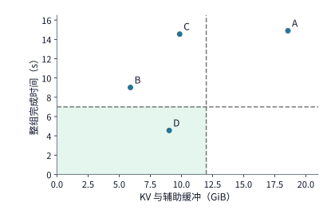

*图 8-37　16 条并发长请求在 RTX PRO 6000 上的四种配置可行域对比：横轴为 KV 缓存及辅助缓冲区显存占用（上限为 12 GiB 竖直虚线），纵轴为整批请求端到端完成总耗时（上限为 7 秒水平虚线）；方案 A 超出显存上限，方案 B 与 C 超出时间上限，唯有结合了 BF16 前缀共享与 DFlash 推测解码的方案 D（9.02 GiB，4.56 s）落入左下角阴影可行域内。*

最后，我们把账算到最底层的硬件与能源成本——**每个合格结果消耗的 GPU 秒与焦耳能耗**：在唯一合格的方案 D 下，整批 16 条请求从到达至全部按期交卷共占用这张加速卡 $4.56\ \mathrm{s}$，产出 16 个合格结果，平均每个合格结果仅消耗 $4.56 / 16 \approx \mathbf{0.285\ \text{GPU 秒}}$；按该卡 $600\ \mathrm{W}$ 的满载功耗上限估算，每个合格结果的能耗上界不超过 $0.285\times 600 \approx \mathbf{171\ \mathrm{J}}$。反观方案 B，它虽然持续占用了加速卡 $9.01\ \mathrm{s}$、消耗了数千焦耳的电能，但在 7 秒硬性 SLO 时限下，它交付的按期合格结果数为 **0**——这 9.01 秒的算力与电费在实际业务考核中全部沦为无效消耗。

**内存减少或输出缩短时，选择如何变化？** 优秀的系统工程师绝不会把“方案 D 最优”当成死记硬背的教条，因为一旦外部边界条件发生偏移，最优解的归属就会立即翻转：
1. **情形一（显存预算减半：从 $12\ \mathrm{GiB}$ 缩减至 $6\ \mathrm{GiB}$）**：此时需要 $9.02\ \mathrm{GiB}$ 的方案 D 因放不下草稿模型而越界出局；而唯一能装入 $6\ \mathrm{GiB}$ 显存的方案 B（占 $5.91\ \mathrm{GiB}$）又需要 $9.01\ \mathrm{s}$ 才能跑完，超出了 7 秒时限。这意味着在现有四套方案下可行域为空集——要想解决这一矛盾，系统要么放宽时限、要么减少单批并发度，要么像练习 8-9 那样**改用不占用 GPU 显存的无模型上下文检索（Prompt Lookup）作为草稿源**；
2. **情形二（输出长度大幅缩短：从 256 个 token 缩短为仅生成 16 个 token）**：当每条请求只需在首 token 后再生成 15 个 token 时，方案 B 只需跑 15 轮普通 decode，总耗时为 $2.04 + 15\times 0.02735 = \mathbf{2.45\ \mathrm{s}}$；而方案 D 虽然把 15 轮压缩到了 5 轮，但由于其 prefill 阶段为草稿网络多花了 $0.19\ \mathrm{s}$，总耗时为 $2.23 + 5\times 0.02735 = \mathbf{2.37\ \mathrm{s}}$。此时，B 和 D 都能在 7 秒内轻松交卷，而方案 D 耗费 $3.1\ \mathrm{GiB}$ 显存换来的端到端提速只剩下了 **$0.08\ \mathrm{s}$**——草稿模型在 prefill 阶段多付出的 $0.19\ \mathrm{s}$ 准备代价，几乎把少跑 10 轮 decode 省下的 $0.27\ \mathrm{s}$ 抵消殆尽。因此，在“长输入、极短输出”的分类或简短提取场景下，轻装上阵的方案 B 反而是更具性价比的明智之选。

至此，我们已经彻底算清了加速卡实例内部的每一毫秒。但当我们把视线拉远到**完整的端到端智能体（Agent）工作流**时，还必须把模型推理之外的“外部代码沙箱执行、搜索引擎 API 调用、数据库连接等待”等非 decode 阶段一并纳入版图。设一个完整的多轮 Agent 任务端到端总耗时原本为 $100\ \mathrm{s}$，其中模型自回归 decode 阶段占了 $50\ \mathrm{s}$（占比 $f = 50\%$），其余 $50\ \mathrm{s}$ 花在 prefill 与外部工具等待上；此时如果我们用推测解码将 decode 阶段加速 $s = 4$ 倍（从 $50\ \mathrm{s}$ 压到 $12.5\ \mathrm{s}$），整个任务的端到端总耗时将变为 $50 + 50/4 = 62.5\ \mathrm{s}$，整体端到端加速比为 $100 / 62.5 = \mathbf{1.6\ \text{倍}}$。而如果在这项任务中，外部工具执行与网络等待异常漫长，使得 decode 原本只占总时间的 $20\ \mathrm{s}$（$f = 20\%$），那么即便同样把 decode 加速 4 倍（压到 $5\ \mathrm{s}$），端到端总耗时也只能从 $100\ \mathrm{s}$ 降到 $80 + 20/4 = 85\ \mathrm{s}$，整体加速比骤降至约 **$1.18\ \text{倍}$**。这正是系统结构中经典的**阿姆达尔定律（Amdahl's Law）**——当仅占原总时间比例为 $f$ 的局部阶段获得 $s$ 倍加速、而其余 $1-f$ 部分保持不变时，完整任务的端到端加速比 $S_{\mathrm{task}}$ 受制于：

$$
S_{\mathrm{task}}=\frac{1}{(1-f)+f/s}.
$$

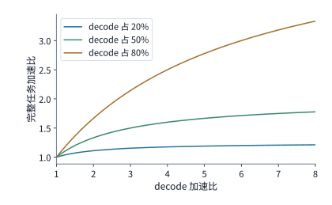

*图 8-38　阿姆达尔定律（Amdahl's Law）下局部 decode 加速对完整 Agent 任务的端到端加速比曲线（假设其他阶段耗时固定且无额外准备开销）：三条曲线分别对应 decode 阶段占原始任务总时间的 20%、50% 与 80%；原有的 decode 耗时占比 $f$ 越低，曲线越早趋于平缓，单纯优化生成阶段的收益上限就越低。*

如图 8-38 所示，当局部占比 $f$ 较低时，阿姆达尔曲线很早就进入了平缓的边际收益递减区。这也提示我们在核算生产集群的硬件占用与能源账单时，必须以整个观测窗口的全局成本除以最终产出的合格结果数 $N_g$：设观测期内占用的加速卡总时间为 $T_{\mathrm{GPU}}$、服务器整机（含 GPU 与 CPU 封装）消耗的总电能为 $E_{\mathrm{obs}}$，则每个合格结果的平均硬件时间成本为 $T_{\mathrm{GPU}} / N_g$，**每个合格结果的平均焦耳能耗（Joules per Good Response）**为 $E_{\mathrm{obs}} / N_g$。在实验 8-9 中，研究者通过硬件传感器（NVML 与 Intel/AMD RAPL 计数器）同步读取了图 8-36 同一组服务窗口下的 GPU 与 CPU Package 真实能耗：在连续批处理模式下，当请求到达率分别为 $1$、$4$、$16\ \mathrm{req/s}$ 时，系统每成功交付一个按期合格结果所消耗的能量分别为 **$615.0\ \mathrm{J}$**、**$652.0\ \mathrm{J}$** 与 **$1083.7\ \mathrm{J}$**；而在 $4\ \mathrm{req/s}$ 下采用逐个串行接纳模式时，每个合格结果的能耗更是攀升到了 **$1982.3\ \mathrm{J}$**。对比 $16\ \mathrm{req/s}$ 与 $4\ \mathrm{req/s}$ 下的连续批处理可以看到：虽然两者的原始完成吞吐相差无几，但过载排队导致大量回答超时作废，使得 $16\ \mathrm{req/s}$ 下每个合格结果分摊的真实能耗比 $4\ \mathrm{req/s}$ **高出了约 $66\%$**。同样地，图 8-39 将第 8.2.4 节算例 8-A（XGrammar 结构化生成 CPU-GPU 流水重叠）与第 8.4.4 节算例 8-B（有损 KV 压缩引发输出长度膨胀与耗时反转）汇总在同一个端到端视角下：无论是主机侧未重叠的语法掩码计算，还是因有损压缩诱发的冗余输出步数，都会直接侵蚀有效吞吐与单次合格响应的能耗效率。这给我们留下了本章最核心的工程启示：**无论答案算错了、输出变长兜圈子了还是返回晚了，机器已经烧掉的每一焦耳电能和每一毫秒 GPU 寿命都无法撤回，它们最终都会一分不少地分摊到那些合格结果的成本账单上**。[^service][^structured-gen][^cache-reconfig]

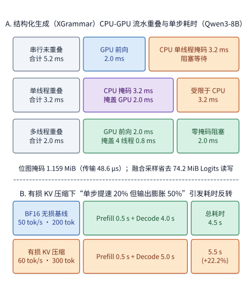

*图 8-39　上图（A）对应第 8.2.4 节算例 8-A（XGrammar 结构化生成）：对比 Qwen3-8B（$B=64$）下 GPU 前向（2.0 ms）与 CPU 词表掩码生成（单线程串行 3.2 ms）在串行阻塞（5.2 ms）、单线程流水重叠（3.2 ms）及多线程并行重叠（2.0 ms）三种调度下的单步迭代耗时；下图（B）对应第 8.4.4 节算例 8-B（有损 KV 压缩）：尽管单步解码速率从 50 tok/s 提升 20% 至 60 tok/s，但输出长度从 200 tok 膨胀 50% 至 300 tok，导致端到端完成耗时从 4.5 s 反弹至 5.5 s（延迟劣化 22.2%）。*

> **练习 8-8 · 计算：阶段加速与草稿准备如何改变任务总时间。** 一个 100 秒任务由 prefill 20 秒、decode 50 秒、工具及等待 30 秒组成。分别将三个部分的耗时单独减半，求每种情况下的任务总耗时。另从原始任务出发，将 decode 耗时降为原来的四分之一，并增加 8 秒草稿准备时间，求净加速比，并计算准备时间达到多少时这项改动不再节省时间。

> **练习 8-9 · 核心 · 综合设计：在容量与时限内减少每个合格结果占用的 GPU 时间。** 沿用综合算例在 RTX PRO 6000 上的容量与时间，以 B 为基础构造方案 E：共享 BF16 前缀，草稿改为从上下文中查找（第 8.5.2 节），索引放在主机内存，不占显存，也不增加 prefill；每条请求平均每轮输出 2 个 token，后续执行 128 轮，整批每轮 27.35 ms 加 0.1 ms 查询。计算 E 的显存占用、总耗时和每个合格结果占用的 GPU 秒，与 B、D 比较；再分别把 KV 和辅助缓冲区的可用内存改为 6 GiB、把输出长度改为 16 个 token，重新选择。开放实验部分使用相同题集和到达轨迹运行两种配置，记录全部请求的到达、首个输出 token、结束、正确性与状态峰值，按本节公式计算有效吞吐。

> **练习 8-10 · 实战：多 LoRA 批处理与分页 KV 缓存分配器模拟。** 基于第 8.2.1 节的 Qwen3-8B 多 LoRA 算例（常驻基础模型权重 $15.3\ \mathrm{GiB}$，其中共享矩阵权重 $14.1\ \mathrm{GiB}$；单个 $r=16$ BF16 LoRA 约 $14.6\ \mathrm{MiB}$；单条 8K 请求 BF16 KV 占 $1152\ \mathrm{MiB}$），计算当实例需要同时挂载 200 个不同客户的 LoRA 适配器、并在 32 条并发请求（每条当前平均上下文长度 4096 token，分页大小 $p=16$）之间共享同一个基础模型时，静态权重、LoRA 适配器池与分页 KV 池各自占用的显存大小。编写一个简短的 Python 模拟器，实现支持引用计数（Reference Counting）与写时复制（Copy-on-Write）的块表分配器，验证当 4 条分支从长度为 95 块的公共前缀分叉并各自追加 9 块时，总物理块分配数恰好为 131 块。

> **练习 8-11 · 延伸：混合注意力模型（线性递推 + 全局注意力）的前缀快照间隔优化。** 参考第 8.3.3 节图 8-20 的混合注意力前缀恢复机制，设某混合模型在 $\mathrm{TP}=8$ 下每份递推状态快照占每卡 $S_{\mathrm{snap}} = 53.6\ \mathrm{MiB}$，单 token 重算耗时为 $t_{\mathrm{recomp}} = 0.05\ \mathrm{ms}$。若一条长度为 $L = 32{,}768$ token 的长上下文每隔固定步长 $\Delta$（即在 $\Delta, 2\Delta, \dots$ 处）保存一份递推状态快照，且后续请求的前缀匹配末端在 $[1, L]$ 上均匀分布：（1）写出恢复前缀所需的期望重算时间 $\mathbb{E}[T_{\mathrm{recomp}}(\Delta)]$ 与每卡快照总显存占用 $M_{\mathrm{snap}}(\Delta)$ 关于步长 $\Delta$ 的函数表达式；（2）当每卡允许用于保存该请求递推快照的显存预算上限为 $450\ \mathrm{MiB}$ 时，求使期望重算时间最短的快照间隔 $\Delta^\star$（取 2 的整数次幂）及对应的期望重算耗时。

> **练习 8-12 · 计算：结构化生成（XGrammar）位图掩码传输、CPU/GPU 重叠与投机解码多草稿掩码核算。** 基于第 8.2.4 节算例 8-A 与第 8.5.1 节的耦合模型（Qwen3-8B 词表 $V = 151{,}936$，并发批大小 $B = 64$）：（1）复算单条请求与整批 64 条请求的 32 位打包位图掩码字节数（以 $\mathrm{B}$ 和 $\mathrm{MiB}$ 计），求在 $25\ \mathrm{GB/s}$ 有效 PCIe H2D 带宽下的传输时间，并与在 $1\ \mathrm{TB/s}$ 有效 HBM 带宽下读写一次 $[64, 151{,}936]$ FP32 Logits 矩阵的耗时比较；（2）若单核 CPU 生成一行掩码需 $50\ \mu\mathrm{s}$、GPU 单步前向需 $2.0\ \mathrm{ms}$，分别计算“串行不重叠”“单核 CPU-GPU 流水重叠”以及“$k$ 核并行生成掩码 + 流水重叠”下的单步迭代耗时，求完全掩盖 CPU 掩码开销所需的最少并行线程数 $k_{\min}$；（3）当开启每轮提交 $m = 4$ 个草稿 token 的推测解码时，求整批 64 条请求在单次验证步中需要生成并传输的位图总行数与总字节数。

> **练习 8-13 · 分析：有损 KV 压缩下的输出长度膨胀反转判据与混合模型（Marconi）检查点准入分析。** （1）在端到端请求延迟模型 $T_{\mathrm{req}} = \mathrm{TTFT} + N_{\mathrm{out}} / r_{\mathrm{decode}}$ 中，设 $\mathrm{TTFT} = 0.5\ \mathrm{s}$，无损基线以 $r_{\mathrm{base}} = 50\ \mathrm{tok/s}$ 生成 $N_{\mathrm{out,base}} = 200\ \mathrm{tok}$；若某种有损 KV 压缩方案将解码速率提升至 $r_{\mathrm{comp}} = 60\ \mathrm{tok/s}$，但引起输出长度膨胀至 $N_{\mathrm{out,comp}} = 300\ \mathrm{tok}$，计算压缩前后的端到端耗时并导出不发生耗时反转的最大允许输出长度 $N_{\mathrm{out,max}}$；（2）结合第 8.3.3–8.3.4 节的 Marconi 混合 SSM/Attention 缓存机制，解释为什么递推状态快照应当在“纯输入公共前缀第二次出现”时才准入保存，并说明按 $\mathrm{FLOPs}_{\mathrm{saved}} / \mathrm{Bytes}_{\mathrm{cached}}$ 加权淘汰相比单纯 LRU 的优势。

## 常见误区

- **误区一：“只要把并发批大小（Batch Size）不断调大，解码吞吐就一定能持续成倍增长。”**
  **更正**：在第 8.2.1 节的合批访存公式 $\frac{W}{B} + K(s)$ 中，增大批大小 $B$ 只能分摊跨请求共享的模型权重读取 $\frac{W}{B}$，而无法分摊每条请求各自独立的 KV 缓存读取 $K(s)$。当 $B$ 超过转折批大小 $B_{\mathrm{cross}} = W / K(s)$（例如 Qwen3-8B 在 8K 无共享前缀下仅需 $B \approx 12.5$）后，每步访存便由 KV 读取主导，吞吐曲线趋于平缓；更现实的是，当每条请求的上下文拉长至 8K 或 32K 时，实例往往在尚未到达算力转折点 $B_{\mathrm{compute}}$ 之前，就已经先触及显存容量上限（如 12 GiB 预算下分别最多容纳 37 条与 10 条请求）。

- **误区二：“启用分块预填充（Chunked Prefill）并保持每个子块的新 token 数 $c$ 恒定，每个子块的 GPU 执行耗时就一定相同。”**
  **更正**：在第 8.2.2 节式（8-4）中，一个含 $c$ 个新 token 的预填充子块除了对块内做因果注意力外，还必须与此前已封存的 $h$ 个历史上下文 token 逐一计算交叉注意力并读取全部历史 KV。在 8K 请求拆为 16 个 512-token 子块的实测中，末块（$h=7680$）的注意力配对数是首块（$h=0$）的 31 倍，实测 GPU 执行耗时从首块的 $25.30\ \mathrm{ms}$ 上升至末块的 $35.07\ \mathrm{ms}$（增幅约 $39\%$）。因此，要平稳控制捎带执行下的每轮迭代耗时（ITL），调度器必须根据当前已累积的历史长度 $h$ 动态收紧新块大小 $c$。

- **误区三：“把 KV 缓存量化到 4 比特（如 `q4_0`）节省了一半显存，推理服务的综合吞吐成本就一定比 8 比特更低。”**
  **更正**：在第 8.4.4 节的 8K 长上下文检索实测中，虽然 `q4_0` 将每条请求的 KV 体积压缩至 8 比特的一半，但由于默认执行路径同时将查询向量 $Q$ 量化到了 `q8_0`，引入的双侧量化误差使长文检索准确率从 $32/32$ 退化至 $17/32$（仅 $53.1\%$）。一旦上层业务为保证结果正确而触发失败重试，单次正确回答的期望耗时反而从 BF16 的 $1.120\ \mathrm{s}$ 上升至 $1.517\ \mathrm{s}$（慢了 $35.4\%$）。脱离任务准确率基准与重试惩罚去孤立比较单步显存或吞吐，往往会得出方向相反的选型结论。

- **误区四：“只要草稿模型本身跑得越快、或者一次往前猜的草稿长度 $m$ 越长，推测解码的端到端生成速度就一定越快。”**
  **更正**：在第 8.5 节的推测解码公式 $T(m)/\mathbb{E}[N(m)]$ 中，延长草稿步数 $m$ 的收益严格受制于条件接受率 $\alpha_i$ 的连乘衰减与硬件矩阵乘的分块台阶（Tile Alignment）。唯有满足边际判据 $\Delta T / \Delta N < T/N$ 时，继续延长草稿才能缩短单 token 平均耗时：例如在 DFlash 实测中，将候选块从 K7 扩至 K15 时，由于两次前向均落在同一个 Tensor Core 16 行矩阵分块台阶内（$\Delta T \approx 0$），平均每轮耗时从 $30.58\ \mathrm{ms}$ 进一步降至 $29.43\ \mathrm{ms}$；但若草稿模型因自身表达力不足导致接受率偏低，或者在线高并发使验证阶段进入算力受限区导致 $\Delta T$ 激增，盲目拉长草稿反而会拖慢整体吞吐。

- **误区五：“在线推理服务只要将并发推至满载、让原始 token 吞吐率（Raw Throughput）达到最高，单位算力成本与单次响应能耗就最低。”**
  **更正**：在第 8.6.1 节与实验 8-9 的实测中，当请求到达率从 $\lambda = 4\ \mathrm{req/s}$ 增至过载的 $16\ \mathrm{req/s}$ 时，虽然 GPU 的原始完成吞吐率稳定在饱和上限（$0.93\ \mathrm{req/s}$），但排队积压使 p95 延迟从 $4.41\ \mathrm{s}$ 拉长至 $14.37\ \mathrm{s}$，导致按期合格吞吐（Goodput）骤降至 $0.56\ \mathrm{req/s}$，每个合格响应分摊的真实能耗也从 $652.0\ \mathrm{J}$ 攀升至 $1083.7\ \mathrm{J}$（高出约 $66\%$）。无论结果超时作废还是中途取消，已消耗的 GPU 时间与电能都无法收回，真实服务成本必须以按期且正确的合格结果数作为分母核算。

## 历史与延伸阅读

回顾大模型推理系统的演进历程，**迭代级连续批处理（Iteration-level Scheduling）**、**分页注意力（PagedAttention）**与**基数树前缀缓存（RadixAttention）**构成了现代推理引擎的三块奠基石：Orca（Yu 等，OSDI 2022）率先打破静态请求级批处理的藩篱，实现了按轮接纳与退出的迭代级调度；vLLM（Kwon 等，SOSP 2023）借鉴操作系统虚拟内存分页机制提出了 PagedAttention，消除了 KV 预留泡沫与外部显存碎片；SGLang（Zheng 等，2024）则将前缀共享推广为跨请求生命周期的 RadixAttention 压缩前缀树。在此基础上，Sarathi-Serve（Agrawal 等，OSDI 2024）通过分块 prefill 与捎带执行（Chunked Prefill & Piggybacking）平抑了生成阶段的流式输出停顿，而 NanoFlow（Zhu 等，OSDI 2025）则进一步在算子内部将计算、显存访存与网络通信拆分为纳米批流水线以充分利用多维硬件资源。[^schedule-survey][^nanoflow]

针对第 8.2.1 节探讨的多租户微调服务，读者可延伸阅读 Punica（Chen 等，MLSys 2024）与 S-LoRA（Sheng 等，MLSys 2024）：两者分别从分段聚合低秩矩阵乘算子（SGMV）与统一分页管理异构秩适配器及 KV 缓存的角度，实现了单实例数千个 LoRA 适配器的高吞吐并发服务。[^lora]

随着 Mamba、Gated DeltaNet、Kimi KDA 及 DeepSeek V4.1 CED 等混合注意力与线性递推架构的普及，传统的逐 token 前缀缓存演变为跨层异构状态的快照与近似恢复问题，Marconi（MLSys 2025）等工作系统地建模了混合模型中状态快照的存储开销与重算收益密度；而在容量受限场景下，FlexGen（Sheng 等，ICML 2023）等权重卸载系统、LLM.265 等硬件辅助张量编解码器以及 Apple Silicon 统一内存架构下的 GGUF 分组量化实践，共同勾勒出了“存储层级—互连带宽—数值精度”之间的定量折中边界。[^hybrid][^codec][^mac]

在打破自回归步数束缚的道路上，Leviathan 等（ICML 2023）与 Chen 等（2023）奠定了无损推测采样（Speculative Sampling / Decoding）的概率接受与残差重采样理论框架；此后，Medusa（Cai 等，ICML 2024）、EAGLE（Li 等，ICML 2024）、DFlash 并行块草稿网络以及 DeepSeek-V3 原生多 Token 预测（MTP）头不断刷新着“草稿生成速度”与“多步条件接受率”的帕累托前沿。当我们将推理实例嵌入多步工具调用的智能体（Agent）执行流程时，读者可结合本章第 8.6 节的利特尔法则、有效吞吐（Goodput）与阿姆达尔定律，进一步审视全链路延迟与单次合格响应能耗的全局优化。[^spec][^task]

[^batch]: 固定模型在 RTX PRO 6000 上的[批处理计算](../calculations/results/batch-reuse-pro6000-2k.md)及[8K 对照](../calculations/results/batch-reuse-pro6000-8k.md)。完整 BF16 权重为 16,381,470,720 bytes，一步理想共享矩阵权重读取为 15,136,811,008 bytes；embedding 按请求查行，内存中仍需保存完整的 embedding 矩阵。读取表先用精确字节计算，再舍入各项。

[^device]: [NVIDIA RTX Blackwell PRO 规格](../references/files/specs/nvidia-rtx-blackwell-pro.pdf)附录 A 表 4，整理在[硬件参数表](../calculations/results/hardware.md)的 rtx-pro6000-blackwell-ws 一行。

[^batch-measure]: [batch 扫描原始记录](../experiments/ch08/08-01/README.md)。RTX PRO 6000、vLLM 0.23.0、BF16，三轮；正文报告中位数，吞吐覆盖剩余 prefill 和生成，排除加载与预热；8K 条件先建立共享前缀。

[^schedule-survey]: [Orca 原文](../references/files/papers/orca.pdf)与[分块计算和版本说明](../case-studies/chunking-and-state-transfer.md)。

[^schedule]: [固定 batch](../calculations/results/iteration-batching-pro6000-fixed.md)、[连续批处理](../calculations/results/iteration-batching-pro6000-continuous.md)、[分块策略](../calculations/results/iteration-batching-pro6000-chunked.md)。每轮耗时参数由[实验 8-1 的逐轮记录](../experiments/ch08/08-01/efficiency.json)拟合：batch 1 的 2K decode 一轮 26.26 ms、prefill 94.8 ms；最后一个输出 token 在请求结束时尚未写入 KV。

[^chunk]: [逐块计算和封存测量](../calculations/results/chunk-history-book.md)。11 次请求、每次 16 块，首末块时间中位数 25.30、35.07 ms；CUDA event 区间包括完整模型路径和可能的主机间隙，不含外部 logits／采样。各块按原始顺序执行，输入 token 与内容逐块变化。

[^nanoflow]: [OSDI 2025 调研](../research/2026-infra-survey/reading-osdi-2025.md)、[NanoFlow 正式稿](../references/proceedings/OSDI/2025/selected/osdi25-zhu-kan.pdf)与[资源共享算例](../case-studies/resource-sharing-and-placement.md)。

[^replay]: [六请求实测](../experiments/ch08/08-02/README.md)及[图执行取舍](../case-studies/graph-execution-tradeoffs.md)。实验在共享 GPU 上按固定顺序执行六条合成文本请求。

[^pages]: [分页、取消与抢占](../experiments/ch08/08-03/README.md)、[四分支共享](../experiments/ch08/08-03/branch-sharing/README.md)、[冷分支对照](../experiments/ch08/08-03/cold-branches/README.md)。共享分支的输出相同；冷、热分支具有相同的块峰值，但 prefill 量不同。

[^lora]: [MLSys 2024 调研](../research/2026-infra-survey/reading-mlsys-2024.md)与[多 LoRA 计算](../case-studies/multi-lora-serving.md)。

[^context]: [上下文工程案例](../case-studies/author-context-and-design.md)。

[^hybrid]: [混合状态恢复与 checkpoint 计算](../case-studies/hybrid-prefix-state.md)、[MLSys 2025 调研](../research/2026-infra-survey/reading-mlsys-2025.md)。Kimi K3 的容量按指定存储格式和并行配置计算。

[^prefix]: [12 轮实际输入的缓存回放](../experiments/ch08/08-04/README.md)。回放采用原任务的输入序列，串行执行请求，每轮生成一个 token。

[^files]: [固定模型文件与业务预算](../case-studies/inference-training-scenarios.md)及[235B 分片元数据](../references/outline-checks/2026-09-07/systems-cases/qwen235-gguf-metadata.json)。精确字节、GB 与 GiB 分别报告。

[^kv-format]: [KV 格式和执行成本](../case-studies/kv-quantization-and-execution.md)。资料包含 GGML 分组格式、FP8 scale 粒度及 H100 上的拟合结果。

[^offload]: [权重卸载与预取计算](../case-studies/weight-offload-execution.md)；[PCIe Gen5](../calculations/results/weight-offload-pcie5.md)与[NVLink-C2C](../calculations/results/weight-offload-gh200-c2c.md)两档链路的复制与预取调度，每层计算时间取 batch 1 一轮 decode 的 26.26 ms 除以 36 层；[GH200 架构说明](../references/files/documents/nvidia-grace-hopper-blog.md)：NVLink-C2C 合计 900 GB/s，每方向 450 GB/s。

[^codec]: [张量压缩与传输](../case-studies/tensor-codec-and-transfer.md)。资料包含 LLM.265 的视频引擎实现、专用硬件设计与性能估计。

[^mac]: [M2 Max 小模型容量记录](../experiments/ch08/08-07/README.md)及[32K 补测](../experiments/ch08/08-07/context32k/README.md)。各槽依次执行 prefill。

[^quality]: [KV 与 Q 精度对照](../experiments/ch08/08-08/README.md)、[固定 FP8 权重的 Q 控制](../experiments/ch08/08-08/quantized-q-control/README.md)、[并发容量记录](../experiments/ch08/08-08/concurrency/README.md)。正文采用 BF16 权重组。另一组固定 FP8 权重时，BF16 Q 与默认路径分别为 32/32、28/32。

[^retry]: [自然输出与重试成本](../experiments/ch08/08-08/retry-cost/README.md)。实验使用已知答案校验，重试成本包含错误首答的生成成本。

[^spec]: [推测采样原文](../references/files/papers/speculative-sampling.pdf)、[推测解码原文](../references/files/papers/speculative-decoding.pdf)、[框架计数与预算笔记](../case-studies/speculative-execution.md)、[调研中的框架覆盖](../research/2026-infra-survey/framework-coverage.md)。基础概率算法、草稿路线和具体实现分别引用。

[^history]: [上下文草稿的分布与成本计算](../case-studies/history-drafts-and-rollout.md)及[有理数穷举结果](../research/2026-infra-survey/history-speculation-arithmetic.json)。算例采用二符号目标分布；RTX PRO 6000 上的每轮时间见 [AAAA](../calculations/results/speculative-round-pro6000-aaaa.md)、[BBBB](../calculations/results/speculative-round-pro6000-bbbb.md) 与[含 2 秒索引的 256 token 请求](../calculations/results/speculative-budget-pro6000-index.md)；普通 decode 一轮 26.26 ms 取自[实验 8-1 的逐轮记录](../experiments/ch08/08-01/efficiency.json)，DFlash 的每轮耗时取自[实验 8-5](../experiments/ch08/08-05/README.md)的逐步记录。

[^spec-measure]: [DFlash 同执行器对照](../experiments/ch08/08-05/README.md)及[逐请求阶段观测](../experiments/ch08/08-05/kernel-trace/README.md)。实验在低并发下，按固定顺序执行给定短题集。并发 1 通过短题的普通、K7、K15 时间中位数分别为 90.02、30.58、29.43 ms；配对输出共 32 对。

[^service]: [服务与能量原始记录](../experiments/ch08/08-09/README.md)。同一设备、八道题、七条件各三个 16 请求窗口；同题跨条件输出一致，42 个错误来自同一道题。吞吐表为各窗口指标中位数。每窗口包含 16 条请求，按排序后向上取整的位置计算 p95，得到的就是最大值。NVML 与 RAPL 组件计数窗口略宽于请求窗口，其他服务仍在运行。

[^service-plan]: [实验 8-1 的效率表](../experiments/ch08/08-01/efficiency.json)由[计算脚本](../experiments/ch08/08-01/efficiency.py)从[batch 扫描的逐轮记录](../experiments/ch08/08-01/README.md)导出，峰值取硬件表中 RTX PRO 6000 的 1792 GB/s 与 503.8 TFLOP/s；DFlash 的显存峰值、首 token 时间与每轮耗时取自[实验 8-5](../experiments/ch08/08-05/README.md)。各方案的内存与时间由[算例检查](ch08/teaching-check.py)复算。

[^task]: [生成实验与 Agent 运行记录](../experiments/ch08/08-06/README.md)。Agent 记录采用非流式调用；阶段时间图采用题设参数。

[^gguf]: [Q2_K 的逐张量布局](../calculations/results/gguf-layout-q2k.md)、[8K 文件容量](../calculations/results/gguf-inventory-8k.md)与[32K 对照](../calculations/results/gguf-inventory-32k.md)。文件总量 85,691,002,112 bytes，码值／浮点载荷 69,178,275,840 bytes，量化元数据 16,506,720,256 bytes，文件头与填充 6,006,016 bytes。上述文件大小按已归档文件头与发布元数据计算。

[^pcie]: [RTX PRO 6000 Blackwell 工作站版规格](../references/files/specs/nvidia-rtx-pro6000-spec.pdf)：系统接口 PCIe 5.0 x16，带宽为 PCIe Gen4 的两倍；[A100 80GB 规格](../references/files/specs/nvidia-a100-80-spec.pdf)：PCIe 4.0 为 64 GB/s（收发合计），即 x16 每方向 32 GB/s。由此 PCIe Gen5 x16 每方向 64 GB/s。正文按标称值计算，得到的是传输时间的下界。前缀的重算时间按[实验 8-1 的效率表](../experiments/ch08/08-01/efficiency.json)计算。

[^cancel]: 取消观察来自[状态实验](../experiments/ch08/08-03/README.md)。记录值约 1.55 ms 与 31.41 ms，计时包含观察器开销。

[^core-calculation]: 本章条件比较的[逐项复算](../calculations/results/core-principles.json)与[计算程序](../calculations/core_principles.py)。

[^v41-case]: [DeepSeek V4.1 官方技术报告](../calculations/sources/deepseek-v4.1-flash/DeepSeek_V41_Tech_Report.pdf)，第 1、2、3 节与第 6 节；[跨章会话的固定条件与复算](../calculations/results/v41-throughline.json)。

[^structured-gen]: [结构化生成与语法掩码案例](../case-studies/structured-generation.md)及[MLSys 2025 调研](../research/2026-infra-survey/reading-mlsys-2025.md)（XGrammar 下推自动机编译、32 位词表位图掩码与 CPU-GPU 跨步流水重叠）。

[^cache-reconfig]: [缓存与重配置案例](../case-studies/cache-and-reconfiguration.md)及[MLSys 2025 调研](../research/2026-infra-survey/reading-mlsys-2025.md)（Marconi 混合 SSM/Attention 检查点准入与 `FLOPs/byte` 淘汰，以及 Rethinking KV Cache Compression 输出长度膨胀与耗时反转实证）。

## 本章小结

本章从单条大模型推理请求的生命周期出发，沿着“**显存容量预算 → 迭代与分块调度 → KV 状态生命周期管理 → 数值压缩与卸载 → 推测解码加速 → 在线服务有效吞吐统筹**”的工程脉络，建立了一套完整的单实例推理优化分析框架：
1. **阶段特征与批处理调度（第 8.1–8.2 节）**：prefill 阶段一次性并行处理完整输入，通常处于算力受限区；decode 阶段逐轮只追加一个 token，因每步都必须重读庞大权重而处于显存带宽受限区。跨请求合批（Batching）让多条请求共享同一次权重读取，从而大幅摊薄每个输出 token 的权重访存成本，但每条请求独有的 KV 状态仍随上下文独立增长（若底层硬件将权重置于超高带宽的片上非易失存储中，合批摊薄权重读取的收益便会消失，各项技术需重新权衡）。在在线流式服务中，连续批处理（Continuous Batching）在每轮迭代粒度及时回收短请求释放的槽位，而分块 prefill（Chunked Prefill）则将长输入切分为小块并结合历史上下文长度 $h$ 动态控制每轮新 token 数，平抑了长请求插入对在途请求输出间隔（ITL）的冲击。
2. **KV 缓存分配、共享与生命周期（第 8.3 节）**：分页分配（PagedAttention）通过块表将逻辑连续的序列映射到离散的物理块，将单条请求的尾部预留浪费限制在 $p-1$ 个 token 以内；配合引用计数与写时复制（CoW），多条请求得以安全共享只读公共前缀，而跨请求前缀树缓存（RadixAttention）则进一步免去了后续请求对相同前缀的重复 prefill 计算。对于混合注意力与非对称架构（如 Kimi KDA 与 DeepSeek V4.1 CED），还需结合递推快照或短窗口重放近似恢复，按状态使用时段实施分层保留。上下文的直接追加、前部改写与压缩摘要会深刻改变缓存命中率与后续访存开销，评估时必须置于相同的任务质量基准下。
3. **量化压缩、权重卸载与推测解码（第 8.4–8.5 节）**：分组量化（如 `Q2_K`、`q8_0`、`q4_0`、FP8）直接缩减权重与 KV 的字节数，但在极低位宽下需计入缩放因子等元数据的体积占比，且必须单独检验查询向量 $Q$ 的计算精度以防检索退化引发高昂的重试时间税；权重卸载通过双缓冲预取释放 GPU 显存，但其可行性严格受制于每步搬移字节数与互连带宽（如 PCIe Gen5 vs. NVLink-C2C）之比。推测解码则通过“低成本生成草稿 + 目标模型单次前向并行验证 + 接受—拒绝残差重采样”，在严格保持目标分布无损的前提下将多步自回归折叠进单轮迭代；其净收益取决于单轮耗时 $T$ 与期望产出 token 数 $\mathbb{E}[N]$ 之比，并可通过边际条件 $\Delta T / \Delta N < T/N$ 动态调节草稿长度。
4. **负载统筹与有效吞吐决策（第 8.6 节）**：在章末的 16 条并发长请求综合算例中，我们演示了如何依次运用“12 GiB 显存红线”与“7 秒 SLO 时限红线”排除不可行配置——前缀共享先将 KV 显存从 $18.56\ \mathrm{GiB}$ 压至 $5.91\ \mathrm{GiB}$ 并省去四分之三 prefill，推测解码再利用腾出的显存空间将 255 轮 decode 压缩至 85 轮，最终在 $4.56\ \mathrm{s}$ 内按期交付全部合格结果；而当可用显存缩减或输出长度变短时，最优配置亦随之规律性迁移。

在完成单实例推理优化与基准标定后，工程团队应当建立起三组关键性能画像：**给定加速卡、数值精度与上下文长度下单实例可同时容纳的最大请求状态数**、**prefill 速率 $r_P$ 与 decode 速率 $r_D$ 随批大小变化的实测曲线**、以及**有效吞吐 $R_{\mathrm{good}}$ 与尾延迟随请求到达率 $\lambda$ 变化的饱和拐点**。

然而，当模型参数量膨胀到单张加速卡连权重都装不下（如数百吉字节的超大稠密或 MoE 模型），或者单实例哪怕优化到极致也无法满足超低延迟与超大并发吞吐时，我们就必须跨出单实例的边界。下一章（第 9 章：分布式推理）将以本章标定出的单实例性能画像为基石，深入剖析如何让多张加速卡协同作战——怎样在张量并行（TP）、专家并行（EP）、序列并行（SP）与数据并行副本（DP）之间划分计算与状态，以及怎样通过 **Prefill–Decode（PD）分离部署**与高速 KV 传输网络，构建大规模分布式推理服务集群。
