# 第 9 章 分布式推理

第 8 章讨论了在给定计算资源上如何借助连续批处理、请求调度、分页 KV 缓存与推测解码提升单实例的推理效率。这些方法既适用于单卡，也适用于多卡协同执行的单个推理实例。当线上流量继续增长、上下文不断拉长或模型转向稀疏混合专家（MoE）架构时，工程师很快会遇到单实例内部调优无法解决的新问题：计算与状态究竟应当放在哪里？不同计算资源应当分别承担哪些生成阶段与层内算子？模型权重与上下文 KV 缓存如何在多台服务器与多级存储之间分布？不同执行位置之间又该如何高效地交接数据、均衡负载并从硬件故障中恢复？随着上下文窗口扩展到数万乃至数十万个 token，请求携带的状态往往比模型权重本身还要庞大——例如在第 9.2.3 节的算例中，当批大小（batch size）为 32 时，上下文 KV 缓存合计占用 43.5 GB，约为 Qwen3-8B 模型权重的 2.7 倍。在这样的规模下，状态存放在何处、沿哪条路径交接，与计算任务如何切分具有同等重要的地位。

为便于表述，本章用 **P** 表示处理输入提示的 prefill 阶段，用 **D** 表示逐个生成后续 token 的 decode 阶段。将这两个阶段交由不同计算资源池独立执行的部署方式称为 **PD 分离**（Prefill–Decode Disaggregation）；将模型每一层内部的注意力算子（Attention）与前馈网络或专家网络（FFN / MoE Experts）交由不同计算资源执行的部署方式则称为 **AF 分离**（Attention–FFN Disaggregation）。

围绕计算与状态的放置位置，本章重点考察四种基本的系统组织方式：第一，增加**完整服务副本**，让多个相互独立的资源组各自接收并处理完整请求；第二，采用 **PD 分离**，根据 prefill 偏重矩阵算力、decode 偏重显存带宽的特征为两个阶段分别配置计算资源与批处理策略；第三，采用 **AF 分离**，利用不同处理器在计算吞吐与内存容量上的互补优势分别执行注意力与专家算子；第四，构建**跨实例共享 KV 缓存**，使后续请求能够直接复用其他执行位置已计算好的上下文状态。在实际生产系统中，这些组织方式既可以出现在单个推理实例内部，也可以通过高速网络将多个独立调度的服务池连接起来。

贯穿本章的主线设计问题来自一个典型的异构机房场景：假设手头有一台配备四张 A100 80GB SXM 的服务器和另一台配备四张 H20 SXM5 96GB 的服务器，这两台服务器共八张 GPU 应当如何组织，才能持续处理每秒到达的 3.5 个线上请求？每个请求输入 8192 个 token、输出 1025 个 token，代表典型的长上下文深度推理（Reasoning）负载——模型需要先生成较长的思维链推导，再输出最终答案。模型采用 Qwen3-8B，权重与 KV 缓存均采用每元素 2 字节的 BF16 格式。由于单张 GPU 即可容纳完整的 Qwen3-8B 模型权重，每张卡都可以作为一个独立的执行单元（worker）。两台服务器之间没有跨机 NVLink，只能通过 200 Gbit/s 的 RDMA 网卡通信。下文将循着这一具体任务，依次定量回答计算如何分工、上下文在哪里交接、缓存何时值得保留，以及实例冷启动期间积压的请求需要多久才能排空，并在第 9.7 节综合各项分析为这八张卡敲定最终部署方案。作为基准对照，第 9.2 节也会分析由八张 A100 组成的同构集群。

贯穿第 9.3 节与第 9.4 节的第二个核心算例采用 Qwen3-235B-A22B 混合专家模型，重点探讨庞大的专家权重应当放在何处执行。同样是单层 512 次“token 到专家”的分派任务，当路由结果分散时，系统需要从内存中读取上百个专家的权重；而当路由结果集中在少数热点专家上时，系统则只需反复复用这几个专家的权重。我们将据此推导专家计算应当留在主机 CPU 还是搬移到 GPU 的临界条件，进而分析当热点专家集中到同一张 GPU 时为何会拖慢整层同步，以及何时值得在空闲卡上创建专家副本。这两个算例遵循同一套一阶量化分析方法：先明确单个请求所需的计算量与状态字节数，再核算各类处理器执行计算与各级存储、网络传输数据的耗时，最后通过对比不同路径的完成时间做出架构取舍。

## 9.1 计算与状态的分布方式

### 9.1.1 计算资源、推理实例与服务副本

在讨论分布式推理架构之前，首先需要厘清物理硬件组织与逻辑服务组织之间的区别。GPU、NPU 等加速器以及主机 CPU 提供底层的算力与存储空间；操作系统进程在这些物理设备上运行算子内核与通信逻辑，通信组内的每个进程拥有唯一的编号（rank）。一个**推理实例**（inference instance）既可以运行在单张卡上，也可以由多个进程跨多卡协同执行。而一个**完整服务副本**（replica）则拥有完成整个模型前向推理所需的全部权重与执行逻辑，能够独立于其他副本接收并完成用户请求。

图 9-1 至图 9-4 对比了八张加速器常见的四种组织方式。前两种方式中的每个实例都执行完整的模型前向图，区别在于图 9-1 将八张卡编为一个协作组（例如采用张量并行或流水线并行）共同处理同一批请求，而图 9-2 则将硬件拆成两个各自拥有完整权重的服务副本，分别接收不同的请求流。后两种方式进一步打破了“同一资源池从头算到尾”的边界：图 9-3 的 PD 分离按生成阶段切分，图 9-4 的 AF 分离则深入模型层内部按算子类别切分。无论采用哪种方式，每个独立的服务池都配有自己的调度器来管理队列与批次。

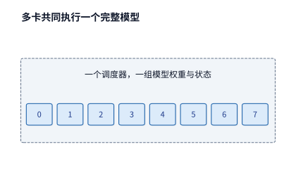

*图 9-1　八张卡共同组成一个完整推理实例（如采用张量并行或专家并行），在统一调度器管理下协同处理同一批请求。图中卡号表示协作组内的成员进程。*

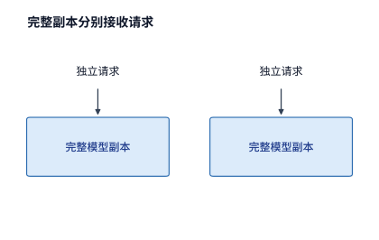

*图 9-2　将计算资源划分为两个完整模型副本。每个副本都持有全量权重与独立的 KV 缓存空间，能够分别接收并完成独立请求；单个副本内部本身也可以由多张卡协同组成。*

完整副本之间按请求粒度分担负载；而在图 9-3 所示的 PD 分离架构中，同一条请求会先后流经两个不同的服务池。顺着从 P 池指向 D 池的箭头可以看到，两池之间交接的核心载荷是输入处理阶段生成的上下文 KV 缓存，而 P 池与 D 池各自内部仍然执行对应阶段的完整模型层。

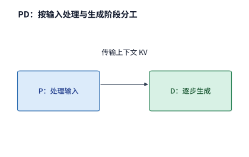

*图 9-3　按生成阶段分工的 PD 分离架构。P 服务池专职处理输入提示（prefill），D 服务池专职执行逐 token 生成（decode）；两个服务池分别配置队列与批大小，生成的上下文 KV 缓存通过网络从 P 池交接给 D 池。*

图 9-4 则将切分边界推入每一个 Transformer 层内部：注意力一侧计算出的隐状态激活发送给前馈或专家网络一侧，计算完成后再将输出激活传回注意力一侧以继续下一层。与每条请求仅需交接一次 KV 缓存的 PD 分离相比，AF 分离的这条激活数据通路在模型的每一层、生成的每一步中都要往返走过一遍。

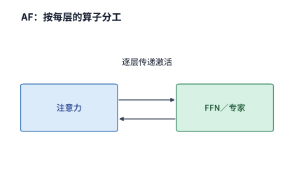

*图 9-4　按层内算子分工的 AF 分离架构。注意力算子与 FFN／专家算子放置在不同的计算资源上执行，隐状态作为激活张量在两侧之间往返传输，模型的每一层都需要经历这一往返交接。*

要定量比较这些部署方式，可以先沿用第 8 章单实例调优后得到的各阶段运行配置与处理速度，再考察改变计算资源分工后的系统吞吐。将 prefill 与 decode 放在同一组执行资源上混合处理的方式称为**共置**（colocation）。设请求的输入长度为 $L$ 个 token，总输出长度为 $G$ 个 token。在 prefill 阶段，模型处理全部 $L$ 个输入 token 并计算出最后一个输入位置的 logits，直接采样得到第 1 个输出 token。因此，在本章的生成口径下，后续 decode 阶段只需再调用模型 $G-1$ 次：当第 $G$ 个输出 token 采样返回给用户时，生成即告结束，该末尾 token 无须再送入模型做前向计算。

对于给定的请求负载分布，记每个请求在某类资源 $r$ 上消耗的平均服务时间为 $d_r$ 秒，系统中该类资源共有 $n_r$ 个可独立工作的执行单元。为了使请求队列不发生无限积压，请求到达率 $\lambda$（单位：请求/s）与资源占用时间必须满足稳态排队约束：

$$
\lambda d_r < n_r.
$$

如果同一请求的多个操作阶段共用同一类资源，应先将这些阶段在该资源上的占用时间相加；如果不同阶段分别使用相互独立的资源池，则需要为每种资源池单独列出上述不等式。资源的消耗量以“资源单元数 $\times$ 占用秒数”计量；在本章的 GPU 集群算例中，这一乘积记为 **GPU 秒**（GPU-seconds）。例如，若线上每秒到达 4 个请求，每个请求平均占用 0.5 个 GPU 秒，则至少需要 $4\times 0.5 = 2$ 张持续满载工作的 GPU 才能与到达流量持平。如果集群恰好只配了 2 张 GPU，一旦遇到短时流量突发，多出来的请求就会在队列中长期滞留，因为两张卡的全部服务能力都已被源源不断的新请求占满；唯有配置高于 $\lambda d_r$ 的资源余量，系统才有能力逐步消化积压队列。

设单个请求在某类共置副本上执行 prefill 和 decode 分别需要占用 $d_P$ 秒和 $d_D$ 秒，且两个阶段在该副本上串行交替占用计算资源，那么由 $N$ 个同类共置副本组成的集群，其稳态请求吞吐率上限为

$$
\mu_{\mathrm{co}}=\frac{N}{d_P+d_D}.
$$

第 9.2.3 节将从芯片手册的峰值指标出发，推导章首算例中两类 GPU 在两个阶段的服务时间：单张 A100 处理一次 8192 个 token 的 prefill 约需 $d_P = 0.856$ 秒，完成一条请求的 1024 次 decode 调用分摊下来约占 $d_D = 1.764$ GPU 秒；单张 H20 的 prefill 约需 $1.805$ 秒，但完成同样的 1024 次 decode 仅占约 $0.878$ GPU 秒。当采用完整副本共置部署时，每张卡都必须完整承担一条请求的 prefill 与 decode 两个阶段，因此单张 A100 每处理一条请求共消耗 $0.856 + 1.764 = 2.620$ GPU 秒（单卡吞吐率约 $0.382$ 请求/s），单张 H20 每处理一条请求共消耗 $1.805 + 0.878 = 2.683$ GPU 秒（单卡吞吐率约 $0.373$ 请求/s）。将四张 A100 与四张 H20 全部作为独立共置副本运行时，八张卡合计每秒只能完成约 $4/2.620 + 4/2.683 \approx 3.02$ 个请求，低于线上每秒 3.5 个请求的到达率，导致系统每秒净积压约 0.48 个请求。章首的设计问题由此转化为一个清晰的定量挑战：在不增加硬件卡数的前提下，仅靠重新安排这八张卡的计算分工，能否填平这近 0.5 请求/s 的吞吐缺口？

需要特别注意的是，一个完整服务副本未必对应单张物理卡，它常常由多张卡协同构成。例如，在部署 Qwen3-235B-A22B 时，一种常见的 TP2×EP4 方案使用八张 GPU 共同组成一个推理实例（其中 TP2 将每个专家的矩阵按列与行二分到两张卡上，EP4 将每层的 128 个专家分到四个专家并行组中）。由于四个 EP 组处理的是同一批请求，注意力层与上下文 KV 缓存在四个 EP 组之间各保存一份完整拷贝，因此单条请求 8192 个 token 的上下文在整个八卡实例内部实际占用了 $5.875\ \mathrm{GiB}$ 显存，是单份逻辑 KV 缓存容量的四倍。这八张卡绑在一起才构成一个能够服务请求的完整实例；如果希望增加第二个独立接收请求的服务副本，就必须另外再拿出一组八张卡并加载全套权重与状态。[^ownership]

### 9.1.2 计算分工与状态共享

对比上述四种基本手段可以看到：增加完整副本改变的是请求在实例间的分流方式；PD 分离改变的是 prefill 与 decode 两个生成阶段的物理执行位置；AF 分离改变的是注意力与前馈／专家算子的层内执行位置；而共享 KV 缓存改变的则是历史上下文状态的保存寿命与跨实例读取范围。下表总结了这四类手段各自追求的收益与引入的新系统约束，它们在架构设计中既可以单独采用，也可以叠加组合。

| 部署方式 | 希望获得的核心收益 | 引入的主要系统约束 |
| --- | --- | --- |
| 增加完整副本 | 线性扩展独立请求处理能力，分散排队等待 | 权重多份驻留、缓存分散难以跨副本命中、实例冷启动与常驻成本 |
| PD 分离 | 为算力密集的 P 与带宽密集的 D 分别匹配硬件与批大小 | 跨实例 KV 缓存传输、交接期间双端同时占用内存、双池配比与排队耦合 |
| AF 分离 | 让注意力与稀疏专家各自使用匹配的算力与大容量存储资源 | 逐层激活往返通信、微秒级启动与同步开销、微批次流水线的阶段负载均衡 |
| 共享 KV 缓存 | 跨实例与跨轮次复用历史上下文，省去重复 prefill 计算 | 全局缓存标识一致性、远端读取延迟、发布就绪通知、失效淘汰与空间回收 |

*表 9-1　分布式推理四类基本系统组织方式的核心收益与新增系统约束对比。*

在实际工程中选型时，第一步永远是剖析当前工作负载的资源瓶颈。如果一条请求在 prefill 与 decode 两个阶段的硬件资源需求结构相近，且单卡共置配合分块 prefill 已经能够平稳满足延迟目标，那么强行拆分为 PD 两池反而只会平白增加一次大块 KV 缓存的网络搬移。反之，如果线上大量多轮对话或 Agent 请求共享冗长的系统提示词与历史前缀，那么优先建设跨实例的共享 KV 缓存池，往往比拆分算子执行位置更能直接削减计算负载。把每一项计算占用时间与状态交接时间放进同一张收支表里核算，才能判断当前究竟应该扩充副本、拆分阶段，还是共享状态。

### 9.1.3 同一请求的执行路径与状态驻留时间

明确了空间上的分工方式后，接下来沿着时间轴追踪一条请求从进入系统到彻底结束所经历的阶段，以及它在各个阶段留下的状态足迹。图 9-5 将一次典型多模态与工具调用（Tool Use）请求的计算阶段与各类状态的驻留区间画在了同一条时间线上。当请求包含图像或视频输入时，视觉编码阶段（E）首先将原始像素转换为视觉特征 token，编码结果缓存（EC）将这些特征保存下来供后续轮次复用；随后语言模型的 P 阶段一并处理视觉特征与文本提示，D 阶段逐步自回归生成回复；当模型输出工具调用指令后，推理计算暂时挂起以等待外部环境返回执行结果，待工具结果返回后再启动新一轮 P 阶段继续处理新增上下文。在整个生命周期中，模型权重跨所有请求常驻显存，层间激活张量仅在相邻算子之间短暂传递后即可释放，唯独上下文 KV 缓存随着已处理 token 位置的增加而单调增长。尤其需要注意，在等待外部工具返回结果的数秒乃至数十秒内，GPU 计算单元虽然可以切去执行其他请求的算子，但这名用户已生成的上下文 KV 状态如果留在原地，仍会持续占据宝贵的显存空间。

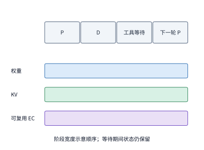

*图 9-5　计算暂停期间，上下文状态仍需驻留存储空间。图中沿同一条多轮请求的时间线展示视觉编码（E）、prefill（P）、decode（D）、工具执行等待与下一轮 prefill 期间各类状态的驻留区间；横轴按逻辑阶段排列，宽度不代表相等物理时长，视觉编码缓存（EC）仅在包含视觉输入时出现。*

以本章主线算例中的 Qwen3-8B 为例，一份包含 8192 个 token 的 BF16 上下文 KV 缓存恰好占用 $1.125\ \mathrm{GiB}$ 空间。假设模型在生成工具调用指令后需要等待外部代码沙箱或搜索引擎执行 10 秒，在此期间 GPU 虽然不执行该请求的任何浮点运算，但这 $1.125\ \mathrm{GiB}$ 的上下文状态如果继续留在显存中，就会产生 $1.125\ \mathrm{GiB}\times 10\ \mathrm{s} = 11.25\ \mathrm{GiB\cdot s}$ 的“容量—时间”占用积分；如果有 10 个这样的 Agent 会话同时处于工具等待状态，仅挂起会话的 KV 缓存就会占去 $11.25\ \mathrm{GiB}$ 显存。计算早已暂停而状态仍占着空间，这正是第 9.5 节引入跨实例共享缓存与多级存储换出（offloading）机制要解决的核心矛盾。

如果这条请求在完成 8192 个输入 token 的 prefill 后继续生成了 1025 个输出 token，那么 P 阶段先产出第 1 个输出 token，随后的 1024 次 decode 调用依次将前 1024 个生成 token 送入模型并追加对应的 KV 状态。到第 1025 个输出 token 采样产生时，显存中连续保存的 KV 缓存恰好覆盖 $8192 + 1024 = 9216$ 个 token 位置，而刚刚吐出的第 1025 个输出 token 尚未经过模型前向计算，因此还没有对应的 KV 记录。当下一轮对话或工具返回结果到达时，新的 prefill 阶段将直接接在这 9216 个已缓存位置之后，把那个尚未写入 KV 的第 1025 号末尾输出 token 与本轮新增输入一并送入模型计算；第 9.6.3 节讨论流式生成故障恢复时，也将严格依据这一位置边界来确定需要重放的 token 范围。

## 9.2 Prefill–Decode 分离与资源配比

### 9.2.1 Prefill 与 Decode 为什么需要分离

回顾第 8 章的分析，prefill 与 decode 两个阶段具有截然不同的硬件资源偏好：prefill 阶段在单次前向调用中并行处理成百上千个输入 token，算子表现为大尺寸矩阵乘法（GEMM），能够充分复用从显存读入芯片的权重，属于典型的计算受限（compute-bound）阶段；而在 decode 阶段，每条活动请求在每一步仅推进 1 个新 token，即使将几十条请求合批处理，算术强度仍然较低，且每步都必须完整扫描一遍模型权重与全部历史上下文 KV 缓存，属于典型的显存带宽受限（memory-bandwidth-bound）阶段。当这两个阶段共置在同一组 GPU 上混合执行时，一旦插入一条长上下文请求的 prefill，就会长时间占用计算单元并阻塞同卡正在进行的 decode 批次，导致在途请求的输出 token 间隔（TPOT / ITL）剧烈抖动；反过来，如果调度器为了保护 decode 延迟而过度推迟新请求的 prefill，又会导致首 token 延迟（TTFT）显著恶化。

第 8.2 节介绍的分块 prefill（chunked prefill）通过将长输入切分成较小的 token 块、穿插捎带在 decode 步之间执行，在单个实例内部缓解了长输入对生成的阻塞。本节则在保持模型与请求负载完全不变的前提下，从空间维度彻底解耦两个阶段：**PD 分离**将 prefill 与 decode 分别部署到两个独立的服务池中，使它们各自拥有独立的请求队列、独立的批大小策略以及按需定制的实例数量配比。DistServe 与 Splitwise 等代表性推理系统深入研究了这一架构：在由八张 A100 组成的同构集群中，PD 分离主要依靠独立队列消除两个阶段之间的调度干扰，并允许 P 池与 D 池分别选用各自最优的并行策略（如 P 池优先张量并行以降低首 token 延迟，D 池扩大批大小以充分利用显存带宽）；而在由 A100 与 H20 组成的异构集群中，PD 分离还能进一步发挥硬件特长，让高算力卡专职负责 prefill、高带宽大显存卡专职负责 decode。[^pd]

这种跨池分工就好比流水线办案：前一个人先把厚厚的卷宗通读一遍并做好结构化摘录，再把摘录移交给后一个人逐条撰写批复。接手者必须拿到前一个人整理好的完整工作记录，才能接着往下写；对于 Transformer 语言模型而言，这份必须跨池移交的工作记录就是输入阶段产生的**上下文 KV 缓存**。需要注意，P 池与 D 池处理的是同一条请求在时间上的前后两个阶段，每个阶段都要完整走过模型从第 1 层到最后一层的前向计算——在本章算例中，Qwen3-8B 的 P 阶段对 8192 个输入 token 执行一次 36 层前向传播，D 阶段随后对新增 token 执行 1024 次 36 层前向传播。因此，P 池和 D 池都必须各自驻留完整的模型权重，而每条请求的上下文 KV 缓存则在 P 阶段结束时通过网络一次性交接给 D 池。任何 PD 分离方案要想取得正收益，独立调度与异构匹配所省下的时间必须首先抵消这次新增的跨机 KV 传输开销。

从外部调用者的视角看，应用程序依然只需发起一次标准的生成请求；而在推理服务内部，系统则依据模型的数据依赖关系在 P 与 D 的交界处切开执行图，用 KV 缓存界定跨池传输的精确字节数，再根据线上请求的输入输出长度比动态调整两池的机器配比。在统一的 API 接口之下，输入处理与逐步生成由此获得了各自独立的批次规模与硬件资源。

### 9.2.2 KV 传输与两端内存占用

当 P 实例完成输入提示的前向计算后，D 实例必须先完整拿到这批输入 token 的上下文 KV 缓存，才能开始第一步 decode。在采用分组查询注意力（GQA，见第 2.3.1 节）的模型中，多个查询头共享同一组键（K）和值（V）投影，系统需要为上下文中的每一个 token 保存每一层的 K 向量与 V 向量。设模型层数为 $n$，上下文长度为 $L$，KV 头数为 $h_{kv}$，每个头的维度为 $d_h$，每个数值元素占 $b$ 字节，则单条请求需要交接的逻辑 KV 状态总字节数为

$$
V_{KV}=2nLh_{kv}d_hb,
$$

其中系数 $2$ 分别对应 K 和 V 两个张量。对于本章使用的 Qwen3-8B 模型，其官方架构参数为 $n=36$ 层、$h_{kv}=8$ 个 KV 头、每头维度 $d_h=128$。在 BF16 格式（$b=2$ 字节）下，每个上下文 token 在全部 36 层上产生的 KV 缓存大小为 $2\times 36\times 8\times 128\times 2 = 147{,}456\ \mathrm{bytes} = 144\ \mathrm{KiB}$；因此，8192 个输入 token 的上下文 KV 缓存总量为

$$
V_{KV}=8192\times144\ \mathrm{KiB}=1{,}207{,}959{,}552\ \mathrm{bytes}=1.125\ \mathrm{GiB}.
$$

**例 9.1　prefill 与 decode 之间的 KV 交接需要多长时间？** 设 A100 服务器与 H20 服务器之间通过一张 200 Gbit/s 的 RDMA 网卡直连，扣除协议栈包头等开销后的有效单向载荷带宽按 $B_{\mathrm{net}} = 25\ \mathrm{GB/s}$（十进制，即 $2.5\times 10^{10}\ \mathrm{B/s}$）计算，采用整份状态一次性直接传输。单条请求的纯载荷传输耗时为

$$
T_{\mathrm{payload}}=\frac{1.125\times2^{30}}{25\times10^9}
=\frac{1{,}207{,}959{,}552}{2.5\times 10^{10}}
\approx48.32\ \mathrm{ms}.
$$

如果再加上一次 RDMA 传输约 $5\ \mu\mathrm{s}$ 的固定启动与完成同步开销，整份 KV 交接的总耗时仍约为 $48.3\ \mathrm{ms}$。可以看到，对于 $1.125\ \mathrm{GiB}$ 这样的大块连续或聚合状态传输，微秒级的固定启动开销仅占总时间的万分之一左右，交接延迟几乎完全由数据量与网络带宽之比决定；这与后文第 9.3.4 节 AF 分离中逐层传输几千字节激活、固定启动开销占比显著的情形形成了鲜明对比。[^handoff]

上述 $1.125\ \mathrm{GiB}$ 的状态体积源于 GQA 保存了投影展开后的 K、V 张量。如果模型改用第 2.3.2 节介绍的多头潜在注意力（MLA），系统便不再缓存展开后的多头键和值，而是只缓存低秩压缩后的潜在向量（latent vector）：每个上下文 token 在每一层仅需保存一条维度为 $d_c$ 的压缩 KV 潜变量和一条维度为 $d_r$ 的解耦旋转位置编码（RoPE）分支，其逻辑状态大小降为

$$
V_{KV,\mathrm{MLA}}=nL(d_c+d_r)b.
$$

以 DeepSeek-V3 为例，其模型配置为 $n=61$ 层、$d_c=512$、$d_r=64$，在 BF16 格式下每个 token 的全层状态仅占 $61\times(512+64)\times2=70{,}272\ \mathrm{bytes}\approx 68.625\ \mathrm{KiB}$；同样 8192 个 token 的上下文状态总量为 $575{,}668{,}224\ \mathrm{bytes}\approx 549\ \mathrm{MiB}$。沿用例 9.1 中 $25\ \mathrm{GB/s}$ 的 RDMA 链路，纯载荷传输时间缩短至约 $23.0\ \mathrm{ms}$；若将网卡升级为 $400\ \mathrm{Gbit/s}$（有效带宽 $50\ \mathrm{GB/s}$），传输时间进一步减半至 $11.5\ \mathrm{ms}$，而同一条 $50\ \mathrm{GB/s}$ 链路上传输 Qwen3-8B 的 GQA 状态仍需 $24.2\ \mathrm{ms}$。

| 交接状态表示 | 每 token 状态大小 | 8192 个 token 总载荷 | 25 GB/s 链路传输耗时 | 50 GB/s 链路传输耗时 |
| --- | ---: | ---: | ---: | ---: |
| Qwen3-8B（36 层 BF16 GQA） | 144 KiB | 1.125 GiB | 48.3 ms | 24.2 ms |
| DeepSeek-V3（61 层 BF16 紧凑 MLA） | 68.6 KiB | 549 MiB | 23.0 ms | 11.5 ms |
| DeepSeek V4.1 Flash（4 锚点全局 KV，不含局部 SWA） | 890 B | 6.953 MiB | 0.292 ms | 0.146 ms |

*表 9-2　三种注意力状态表示在 8192 token 上下文下的跨机交接载荷与纯传输耗时对比。*

MLA 之所以能大幅削减跨机交接字节数，归根结底是利用矩阵乘法结合律将缓存切分点移到了上投影矩阵的输入侧：GQA 为每个 KV 头保存展开后的 $K$、$V$，而 MLA 只保存上投影之前的低维潜变量，并在 decode 阶段将原本作用于全体历史潜变量的 KV 上投影矩阵吸收到当前步的查询（Query）向量与输出投影一侧执行。如果不采用这种紧凑表示，而是把 DeepSeek-V3 的 128 个注意力头全部展开保存，每个 token 的状态将高达 $61\times128\times(192+128)\times2\ \mathrm{bytes}\approx 4.77\ \mathrm{MiB}$，是紧凑 MLA 表示的约 71 倍；即便与仅有 8 个 KV 头的 Qwen3-8B GQA 状态相比，61 层 DeepSeek-V3 的紧凑 MLA 状态也只有前者的约 $0.48$ 倍。为了清晰展现模型架构对系统设计的深远影响，后文凡是涉及 KV 字节数进入公式推导的地方，都会同步列出 GQA 与紧凑 MLA 两种表示下的核算结果。[^mla-handoff]

如果把模型与系统协同设计进一步推向极致，我们甚至可以发问：**在 PD 分离或跨实例恢复时，是否所有注意力层的 KV 状态都必须无条件地跨网传输？** 以第 2.3.6 节与第 8.3.3 节剖析过的 DeepSeek V4.1 Flash（共 40 层）为例，其上下文状态由两部分异构拼接而成：一部分是由编号为 `2, 8, 14, 20` 的 **4 个全局 KV 拥有层（锚点层）** 生成并供其余 36 个非拥有层跨层共享的全局主 KV 与 MXFP4 索引（合计每 token 仅占 $(3/2 + 1)\times(288 + 68) = \mathbf{890\ \mathrm{B}}$，在 $8192$ 个 token 下共占 $7{,}290{,}880\ \mathrm{B} \approx \mathbf{6.953\ \mathrm{MiB}}$）；另一部分则是全部 40 层各自独立维护的 **128-token FP8 局部滑动窗口（SWA）状态**（每层固定占 $128 \times 528\ \mathrm{B} = 67{,}584\ \mathrm{B} = 66\ \mathrm{KiB}$，40 层合计固定占 $2{,}703{,}360\ \mathrm{B} \approx \mathbf{2.578\ \mathrm{MiB}}$，其中 36 个非拥有层的局部 SWA 占 $2{,}433{,}024\ \mathrm{B} \approx \mathbf{2.320\ \mathrm{MiB}}$）。在 $8\mathrm{K}$ 上下文下，这份不随总长度增长的 $2.578\ \mathrm{MiB}$ 局部窗口状态占到了整条请求总驻留状态（$9{,}994{,}240\ \mathrm{B} \approx 9.531\ \mathrm{MiB}$）的 **$27.0\%$**。由于局部 SWA 仅依赖序列最末尾的 $W=128$ 个 token，系统在跨节点交接或从远端恢复时无需跨网搬移这 $2.578\ \mathrm{MiB}$ 的局部 KV 张量，而是只传输 $6.953\ \mathrm{MiB}$ 的 4 锚点层全局 KV 外加末尾 128 个位置的 Token ID（仅 $128 \times 4\ \mathrm{B} = \mathbf{512\ \mathrm{B}}$），随后在目标实例上直接执行一次**有界 128-token 局部重放（Bounded Replay）** 来重建 SWA 状态。记局部窗口 KV 体积为 $V_{\mathrm{SWA}}$、有效跨网传输带宽为 $B_{\mathrm{net}}$、跨网内存分配与目录同步附加开销为 $\alpha_{\mathrm{mem}}$，目标端对 $W$ 个末尾 token 执行局部重算耗时为 $T_{\mathrm{replay}}(W)$，则当
$$
T_{\mathrm{replay}}(W) + \frac{4W}{B_{\mathrm{net}}} < \frac{V_{\mathrm{SWA}}}{B_{\mathrm{net}}} + \alpha_{\mathrm{mem}}
$$
（或在共享缓存池中省去 $V_{\mathrm{SWA}}$ 的落盘与跨网双跳带宽）时，“仅传末尾 Token ID + 目标端有界重算”便优于“跨网传输完整 SWA KV”。[^v41-case]

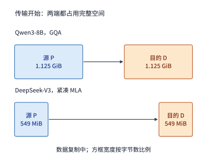

*图 9-6　KV 交接期间源端与目的端同时占用显存。源端 P 实例在发送完成前必须保留完整状态，目的端 D 实例则需提前分配同等大小的接收缓冲区：GQA 状态下两端各占 1.125 GiB（传输期间全系统共占 2.25 GiB），紧凑 MLA 状态下两端各占 549 MiB（共占 1.07 GiB）。图中方框宽度按实际字节数比例绘制。*

除了占用网络带宽，跨实例 KV 交接还会带来显存的双端同时驻留开销。在采用整份状态缓冲交接时，从传输启动直到全部字节落盘目的端之前，源端 P 实例必须保留完整的发送缓冲区，目的端 D 实例也必须预先分配好同等容量的接收缓冲区。图 9-6 至图 9-8 按时间顺序展示了交接开始、传输完成发布与源端空间释放三个关键时刻：当全部载荷写入目的端显存后，P 实例向 D 实例发送完成标记（completion flag），D 实例唯有观测到该标记后才能安全地读取这批 KV 状态启动 decode（图 9-7）；待执行权正式移交给 D 实例后，P 实例才能回收源缓冲空间以接纳后续请求（图 9-8）。如果系统改用按层或按页的流水式分块传输，目的端每确认收妥一块，源端就可以立即释放对应块的空间，从而缩短两端重复驻留的时长，此时目的端依靠细粒度的完成标记来追踪哪些连续块已经就绪。若两台机器之间无法使用 GPU Direct RDMA，而必须经由两端主机内存（Host DRAM）中转，则状态将依次占用源 GPU 显存、源主存、目的主存与目的 GPU 显存，PCIe 总线上的主机到设备拷贝也将成为关键路径上的新增依赖边。

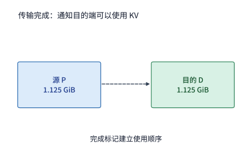

*图 9-7　完整的 1.125 GiB KV 载荷写入目的端显存后，P 实例发出轻量级完成标记。该控制标记本身不搬移业务数据，而是强制建立“先写完数据、后读取使用”的内存可见性顺序，确保 D 实例不会读到尚未写完的半截状态。*

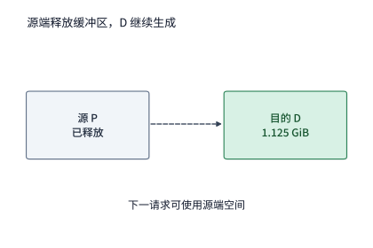

*图 9-8　当执行权正式移交给 D 实例后，P 实例立即释放源端的 1.125 GiB 缓冲空间以服务新到达的 prefill 请求，D 实例则保留该上下文 KV 缓存并在其上逐 token 追加新生成的状态。*

当线上请求持续到达时，交接链路的带宽不仅决定了单条请求等待 KV 传输的时间下界，还直接限制了系统每秒最多能交接多少条请求。以 Qwen3-8B 每请求 $1.125\ \mathrm{GiB}$（约 $1.208\ \mathrm{GB}$）的 GQA 状态为例：若系统每秒需要完成 8 次交接，平均网络流量需求约为 $8\times 1.208\ \mathrm{GB/s}\approx 9.7\ \mathrm{GB/s}$；若每秒需要完成 16 次交接，平均流量需求则翻倍至约 $19.3\ \mathrm{GB/s}$。假设两池之间仅有一条 $100\ \mathrm{GbE}$（单向有效带宽 $12.5\ \mathrm{GB/s}$）的网络链路：对于每秒 8 次交接的负载，链路带宽尚有余量，单份状态在独占链路时的传输下界约为 $1.208 / 12.5 \approx 96.6\ \mathrm{ms}$；但对于每秒 16 次交接的负载，数据产生速率超出了链路的物理传输能力，即便 P 池和 D 池都有空闲算力，待发送的 KV 状态也会以每秒 $19.3 - 12.5 = 6.8\ \mathrm{GB}$ 的速率在网络发送队列中无限积压。反之，如果模型采用每请求 $549\ \mathrm{MiB}$（约 $0.576\ \mathrm{GB}$）的紧凑 MLA 状态，每秒 8 次和 16 次交接所需的平均带宽分别降至约 $4.6\ \mathrm{GB/s}$ 和 $9.2\ \mathrm{GB/s}$，同一条 $100\ \mathrm{GbE}$ 链路便能轻松承载这两种到达率，单份状态的独占传输时间也缩短至约 $46.1\ \mathrm{ms}$。因此，网络队列是否会发生拥塞积压，取决于每请求状态体积与链路带宽的乘除关系；仅仅改变模型的注意力缓存表示，就能让同一条物理链路从系统瓶颈变为宽裕通道。

### 9.2.3 阶段处理能力与实例数量配比

在为 P 池与 D 池分配 GPU 卡数之前，必须先把一条请求在两个阶段的工作量统一折算为同一种可比较的计量单位——每请求占用的 GPU 秒。设一条请求包含 $L_{\mathrm{new}}$ 个需要 P 阶段新计算的输入 token，以及 $G-1$ 次后续 decode 调用。若某型号 GPU 作为 P worker 时每秒可处理 $r_P$ 个新输入 token，作为 D worker 时每秒可完成 $r_D$ 次面向整个批次的 decode 步调用，且每个 decode 批次稳定并行服务 $B$ 条请求，则单条请求在该型号 GPU 上消耗的平均阶段服务时间分别为

$$
d_P=\frac{L_{\mathrm{new}}}{r_P},\qquad d_D=\frac{G-1}{r_D}.
$$

注意这里的 $r_D$ 是指单张 GPU 每秒能够归属给单条请求的等效 decode 推进速率（若每次批调用耗时 $t_{\mathrm{step}}$ 且同时推进 $B$ 条请求，则单条请求每步分摊占用 $t_{\mathrm{step}}/B$ 的 GPU 时间，等效 $r_D = B / t_{\mathrm{step}}$）。千万不能把“prefill 每秒处理的输入 token 数”与“decode 每秒生成的输出 token 数”直接相除来配置卡数，唯有将两者都折算为单条请求的资源占用秒数 $d_P$ 与 $d_D$，才能直接相加或按比例配平。

下面从芯片规格表出发，利用第 4 章的 Roofline 模型推导章首算例中 A100 与 H20 两款 GPU 的 $r_P$ 与 $r_D$。Roofline 模型指出，一个阶段在加速器上的执行时间下界等于其算术计算时间下界与显存访存时间下界两者中的较大值。下表列出了 A100 80GB SXM 与 H20 SXM5 96GB 的硬件标称峰值：可以看到，H20 的 BF16 矩阵峰值算力不到 A100 的一半（约为 $47\%$），但其 HBM 显存带宽却高达 $4096\ \mathrm{GB/s}$，约为 A100 的两倍。这一鲜明的硬件剪刀差，正是 H20 十分擅长访存密集的 decode、却在算力密集的 prefill 上表现吃力的物理根源。

| 加速器型号 | BF16 稠密矩阵峰值算力 | 显存带宽峰值 | 显存容量 |
| --- | ---: | ---: | ---: |
| A100 80GB SXM | 312 TFLOP/s | 2039 GB/s | 80 GB |
| H20 SXM5 96GB | 148 TFLOP/s | 4096 GB/s | 96 GB |

*表 9-3　A100 80GB SXM 与 H20 SXM5 96GB 的硬件标称算力、显存带宽与容量指标。*

在实际运行中，算子内核无法达到 $100\%$ 的硬件标称峰值。回顾第 8.6.3 节在 RTX PRO 6000 上的实测校准结果：decode 阶段的显存带宽利用率（MBU）随批大小从 batch 1 的 $33\%$ 爬升至 batch 64 的 $65\%$，在 batch size 为 32 时按实测插值约为 $49\%$；prefill 阶段的算力利用率（MFU）则稳定在 $58\%\text{–}62\%$ 之间。为了保持全章算例简洁统一，本章将两款 GPU 在两个阶段的实际有效效率均取为标称峰值的 $50\%$（即 $\mathrm{MFU} = \mathrm{MBU} = 0.5$）：这一取值在 decode 侧与 batch 32 的实测插值高度吻合，在 prefill 侧则比实测略保守约一成。按 $50\%$ 有效效率折算后，A100 的有效算力与有效带宽分别为 $156\ \mathrm{TFLOP/s}$ 和 $1020\ \mathrm{GB/s}$，H20 的有效算力与有效带宽则分别为 $74\ \mathrm{TFLOP/s}$ 和 $2048\ \mathrm{GB/s}$。

为什么实际系统会损失掉另外 $50\%$ 的硬件峰值潜力？按照第 1.3.4 节建立的分类判据，这部分损耗主要来自两个层面：第一类是本章一阶理想模型尚未计入的额外硬件工作，例如算子内核为了凑齐 Tensor Core 分块（tile）整数倍而补入的无效零行运算，或者未能与计算完全重叠的集合通信等待；第二类则是可以通过软件重构消除的主机侧与运行时开销，例如逐个算子发起内核启动（kernel launch）的空隙，或者动态扩缩容时重建通信组与重新捕获计算图的停顿。第 9.4.3 节与第 9.6.2 节将分别对这两类损耗展开具体核算。

现在将上述有效算力与有效带宽代入章首的 Qwen3-8B 请求（输入 $L=8192$、输出 $G=1025$、decode 批大小 $B=32$）：
1. **Prefill 阶段（计算受限）**：处理一条 8192 个输入 token 的请求共需执行约 $133.6\ \mathrm{TFLOPs}$ 的矩阵浮点运算，期间只需读取一次约 $15.1\ \mathrm{GB}$ 的模型权重并写出约 $1.21\ \mathrm{GB}$ 的 KV 缓存，计算时间远大于访存时间。在 A100 上，单次 prefill 耗时 $133.6 / 156 \approx 0.856\ \mathrm{s}$，等效每秒处理约 $9566$ 个新输入 token；在 H20 上，由于有效算力减半，单次 prefill 耗时增至 $133.6 / 74 \approx 1.805\ \mathrm{s}$，等效每秒仅能处理约 $4538$ 个新输入 token。
2. **Decode 阶段（访存受限）**：每一步 decode 调用同时为批内 $B=32$ 条请求各生成 1 个新 token。在生成 1024 步的过程中，每条请求的上下文长度从 8192 增长到 9216，平均上下文长度为 $8192 + 512 = 8704$ 个 token；因此单步 decode 需读取一次约 $15.1\ \mathrm{GB}$ 的权重和 32 条请求共约 $41.1\ \mathrm{GB}$ 的历史 KV 缓存（合计读取约 $56.2\ \mathrm{GB}$），而整批 32 个 token 的矩阵浮点运算量仅有约 $0.65\ \mathrm{TFLOPs}$，访存时间完全主导了单步耗时。在 A100 上，单步 decode 耗时约 $56.2 / 1020 \approx 55.1\ \mathrm{ms}$（每秒完成约 $18.1$ 步，折合 $32\times 18.1 \approx 580$ 次单请求 decode 调用，单条请求 1024 步分摊占用 $d_D = 1.764$ GPU 秒）；而在高带宽的 H20 上，单步 decode 耗时缩短至约 $56.2 / 2048 \approx 27.4\ \mathrm{ms}$（每秒完成约 $1166$ 次单请求 decode 调用，单条请求分摊仅占 $d_D = 0.878$ GPU 秒）。
3. **显存容量校核**：当批内 32 条请求生成到最后一步（9216 个 token）时，KV 缓存共占约 $43.5\ \mathrm{GB}$，加上约 $16.4\ \mathrm{GB}$ 的模型权重与运行缓冲共约 $59.9\ \mathrm{GB}$，无论是 80 GB 的 A100 还是 96 GB 的 H20 都能完整装下。可以看到，两款芯片的强弱项正好互补：A100 执行 prefill 比 H20 快一倍以上，而 H20 执行 decode 则比 A100 快一倍。[^rates]

在进入异构集群之前，先考察一个经常引起争论的基准问题：**如果集群是由八张同构的 A100 组成，做 PD 分离能不能提高总吞吐率？** 在共置部署下，每张 A100 完成一条请求需要 $d_P + d_D = 0.856 + 1.764 = 2.620$ GPU 秒，八张卡合计的最大稳态吞吐率为 $8 / 2.620 \approx 3.05$ 请求/s。如果将这八张 A100 拆分为独立的 P 池与 D 池，由于每张卡只能整张划归某一池，在整数卡约束下最优切分是拿 3 张 A100 做 P（提供 $3 / 0.856 \approx 3.50$ 请求/s）、拿 5 张 A100 做 D（提供 $5 / 1.764 \approx 2.83$ 请求/s），全系统吞吐率受 D 池限制而降至 $\min(3.50, 2.83) = 2.83$ 请求/s，反而比共置降低了约 $7\%$。道理很直观：在同构硬件且阶段运行效率不变的前提下，单条请求消耗的总 GPU 秒数（$2.620$ 秒）并不会因为拆池而减少，而按整数张卡切分还会导致两个池的服务能力无法精确配平，较快一池的多余算力只能闲置。[^pool]

既然同构分离在固定效率下不能提高总吞吐，为什么许多同构生产集群仍然选择或评估 PD 分离？答案在于**隔离尾延迟与解耦分阶段批处理**，如图 9-9 所示。当采用共置且不分块（图 9-9①）时，一旦某张 A100 开始执行一条 8192 token 新请求的 prefill，该卡将被连续独占 $856\ \mathrm{ms}$，导致同卡上正在生成的 32 条 decode 请求被迫停顿约 16 个步长（每步 $55.1\ \mathrm{ms}$），用户侧会直接感知到近 1 秒的吐字卡顿。如果这八张卡每秒接收 2.5 个新请求，平均每张卡每 $3.2$ 秒就要遭遇一次长达 $0.86$ 秒的生成冻结。而采用 PD 分离后（图 9-9③），D 卡彻底摆脱了大块 prefill 的穿插干扰，每步生成稳定保持在 $55.1\ \mathrm{ms}$；P 卡则专职处理输入，首 token 延迟固定为 $856\ \mathrm{ms}$ 计算加上 $48.3\ \mathrm{ms}$ 的 KV 交接。

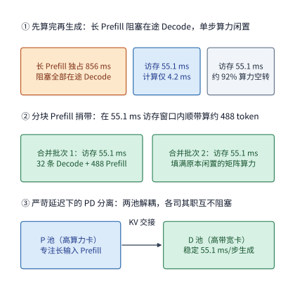

*图 9-9　A100 上处理 8192 token 新请求 prefill 与在途 32 条 decode 请求的三种方式对比。① 共置不分块时，856 ms 的 prefill 独占 GPU，导致在途 decode 请求停顿约 16 步；② 共置分块捎带利用每步 decode 访存 55.1 ms 期间仅需 4.2 ms 矩阵计算的算力空隙（50.9 ms），每步捎带约 488 个 prefill token，经 17 步（约 937 ms）完成 prefill 且不拉长 decode 步长；③ PD 分离将两阶段彻底隔离在两个资源池中独立执行，P 池完成计算后经网络交接 1.125 GiB KV 缓存（48.3 ms）。*

当然，正如第 8.2 节所分析的，在同构集群上消除 prefill 阻塞还有另一条重要路径——**分块 prefill 捎带**（图 9-9②）。在 A100 上执行一步 batch 32 的 decode 时，从显存读取 $56.2\ \mathrm{GB}$ 权重与 KV 需要 $55.1\ \mathrm{ms}$，但完成 $0.65\ \mathrm{TFLOPs}$ 的矩阵乘加只需约 $4.2\ \mathrm{ms}$，其余 $50.9\ \mathrm{ms}$ 内 Tensor Core 处于等待数据的空闲状态。按 $156\ \mathrm{TFLOP/s}$ 的有效算力计算，这段空闲算力窗口在理论上恰好足够顺带处理约 $488$ 个 prefill token。如果把 8192 个输入 token 切分成 17 个约 488 token 的小块，依次捎带在连续 17 个 decode 步中混合执行，新请求的首 token 时间约为 $17\times 55.1 \approx 937\ \mathrm{ms}$（与 PD 分离的 $856 + 48.3 \approx 904\ \mathrm{ms}$ 相当），而在途 decode 请求的输出步长则保持平滑。在最理想的情况下（即捎带的 prefill 计算完全隐藏在 decode 的显存读取时间之内，且分块读取的额外激活不挤占带宽），八张 A100 共置的理论吞吐上限甚至可以从 $3.05$ 请求/s 提升至约 $4.50$ 请求/s，显著高于同构分离的 $2.83$ 请求/s。至于实际内核究竟能把多少 prefill 计算藏进访存阴影里，则取决于融合算子或并发流能否同时占满 Tensor Core 与 HBM 带宽，需要通过实测混合步耗时来检验。因此，在同构集群上工程界通常优先启用分块 prefill；唯有当两个阶段需要采用截然不同的并行度（如 P 用小 EP、D 用大 EP）或分块干扰仍无法满足严苛的 TPOT 尾延迟目标时，才需要在同构硬件上施行物理 PD 分离。

**例 9.2　异构集群的阶段配比如何决定系统吞吐上限？** 现在回到章首的四张 A100 与四张 H20 异构集群，处理同样的 8192 输入、1025 输出请求。根据前文推导，两款 GPU 在两个阶段的单卡处理能力与每请求资源占用汇总如下表（后续小节改变请求长度或缓存命中率时，也将按相同方法重新推算该表）：

| 加速器型号 | P 阶段能力（新 token/s） | D 阶段能力（调用/s） | 每请求 P 耗时 $d_P$（GPU 秒） | 每请求 D 耗时 $d_D$（GPU 秒） |
| --- | ---: | ---: | ---: | ---: |
| A100 80GB SXM | 9566 | 580 | 0.856 | 1.764 |
| H20 SXM5 96GB | 4538 | 1166 | 1.805 | 0.878 |

*表 9-4　A100 与 H20 在 50% 有效峰值效率下处理 Qwen3-8B（8192 输入、1025 输出）的单卡阶段能力与每请求资源占用。*

当采用完整副本共置时，每张 A100 每请求占用 $2.620$ GPU 秒，每张 H20 每请求占用 $2.683$ GPU 秒，八张卡合计仅能支撑 $3.02$ 请求/s。如果实施异构 PD 分离，将全部四张 A100 划入 P 池、全部四张 H20 划入 D 池，则 P 池的总服务率为 $\mu_P = 4 / 0.856 \approx 4.67$ 请求/s，D 池的总服务率为 $\mu_D = 4 / 0.878 \approx 4.55$ 请求/s。每条请求在两台服务器之间需交接 $V_{KV} = 1.125\ \mathrm{GiB}$ 的上下文状态；按两机之间一张 $200\ \mathrm{Gbit/s}$ RDMA 网卡（有效单向带宽 $B_{\mathrm{net}} = 25\ \mathrm{GB/s}$）计算，链路每秒最多可交接 $25\times 10^9 / 1{,}207{,}959{,}552 \approx 20.7$ 份状态。全系统的稳态吞吐率上限由 P 池、D 池与交接链路三者中的最慢项决定：

$$
\mu_{PD}=\min\left(\mu_P,\mu_D,\frac{B_{\mathrm{net}}}{V_{KV}}\right)
=\min(4.67,\,4.55,\,20.7)\approx4.55\ \text{请求/s}.
$$

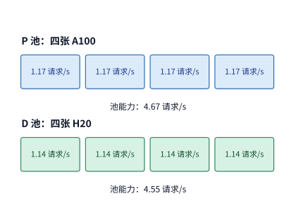

*图 9-10　异构集群下的最优 PD 分工：四张高算力 A100 专职承担 P 阶段（每卡约 1.17 请求/s，P 池合计 4.67 请求/s），四张高带宽 H20 专职承担 D 阶段（每卡约 1.14 请求/s，D 池合计 4.55 请求/s），两池服务率均远低于 25 GB/s RDMA 网卡约 20.7 请求/s 的状态交接上限。*

如图 9-10 所示，通过异构 PD 分离让两款芯片各自避开短板阶段、专攻长板阶段后，在不增加任何硬件的前提下，八卡集群的稳态吞吐率上限从共置的 $3.02$ 请求/s 跃升至 $4.55$ 请求/s，提升幅度达 $51\%$（$1.51$ 倍），一举超过了线上每秒 $3.5$ 个请求的到达率。模型执行的浮点运算次数与读写的总字节数丝毫未变，改变的仅仅是哪个阶段由哪款芯片执行。作为反面印证，如果把两类卡的角色对调——让四张 H20 做 P、四张 A100 做 D，那么 P 池能力将跌至 $4 / 1.805 \approx 2.22$ 请求/s，D 池能力也只有 $4 / 1.764 \approx 2.27$ 请求/s，系统吞吐上限还不到正确分工时的一半。

刚才在同构 A100 集群上表现出色的分块 prefill 捎带，一旦放到 H20 上就会难以承受：因为 H20 的矩阵算力较低，单步 decode 访存 $27.4\ \mathrm{ms}$ 期间的空闲算力窗口只够顺带处理约 $85$ 个 prefill token（不到 A100 的五分之一）。即便按最理想的分块捎带无损隐藏来估算，四张 A100 加四张 H20 共置的理论吞吐上限也只有约 $4.17$ 请求/s，依然低于异构 PD 分离的 $4.55$ 请求/s。这说明异构 PD 分离的核心收益源自芯片算力与带宽配比的物理差异，是单卡内部的分块调度无法替代的。

在此基础上，我们再检验改变模型上下文表示的影响。若将跨机交接的状态从 $1.125\ \mathrm{GiB}$ 的 GQA 换为 $549\ \mathrm{MiB}$ 的紧凑 MLA，公式中链路项 $B_{\mathrm{net}}/V_{KV}$ 在 $25\ \mathrm{GB/s}$ 网卡下将从 $20.7$ 请求/s 翻倍至 $43.4$ 请求/s，在 $50\ \mathrm{GB/s}$ 网卡下更是从 $41.4$ 请求/s 增至 $86.9$ 请求/s；但由于此时系统瓶颈位于 D 池的 $4.55$ 请求/s，系统的总体吞吐率上限与“四张 A100 做 P、四张 H20 做 D”的最优配比均保持不变。交接链路何时会翻转成为限制整个系统的瓶颈？其临界条件为 $B_{\mathrm{net}} < \min(\mu_P, \mu_D)\cdot V_{KV}$：要支撑 $4.55$ 请求/s 的吞吐，GQA 状态要求跨机有效带宽至少达到 $4.55\times 1.208 \approx 5.5\ \mathrm{GB/s}$，而紧凑 MLA 状态仅要求约 $2.6\ \mathrm{GB/s}$。只要实际网络带宽高于这一门槛，继续升级网卡就不会提高稳态吞吐上限；一旦带宽低于该门槛，图 9-11 热力图中所有计算能力高于 $B_{\mathrm{net}}/V_{KV}$ 的配比方案都会被网络瓶颈削平到同一个吞吐值。[^pool-mla]

不过，紧凑 MLA 路径省下的是网络传输与显存读取的字节数，却在 D 池一侧增加了额外的矩阵计算。正如第 2.3.2 节所推导的，当把 KV 上投影矩阵通过结合律吸收到查询向量与注意力输出一侧后，DeepSeek-V3 在每层、每个查询 token 上需要额外执行一次 $128\times128\times512$ 的查询吸收变换和一次同等规模的值恢复变换，单层单 token 新增约 $33.5\ \mathrm{MFLOPs}$ 运算，61 层合计新增约 $2.05\ \mathrm{GFLOPs}$，恰好等于表 2-3 中 KV 上投影（`kv_b_proj`）对单个 token 的展开计算量。需要警惕的是，这部分吸收计算量随 decode 批次内的请求数 $B$ 线性增长：单步 decode 服务 $B$ 条请求，就要多算 $2.05B\ \mathrm{GFLOPs}$。按 H20 的 $74\ \mathrm{TFLOP/s}$ 有效算力折算，单条请求每步增加约 $27.7\ \mu\mathrm{s}$ 的计算耗时，1024 步累计增加约 $28.3\ \mathrm{ms}$。即便保守地假设这部分新增计算无法隐藏在访存时间中而直接叠加在关键路径上，D 池每请求的 GPU 秒也只是从 $0.878$ 秒微增至约 $0.907$ 秒，四张 H20 的 D 池总能力从 $4.55$ 请求/s 略降至约 $4.41$ 请求/s，依然留有充足余量应对 $3.5$ 请求/s 的到达流量（单条请求每步的额外计算要超过约 $258\ \mu\mathrm{s}$，才需要增配第五张 D 卡）。更本质的变化在于，紧凑 MLA 显著移动了 D 实例从访存受限转向计算受限的转折点（ridge point）：由于每缓存 token 的读取量从展开状态的 $4.77\ \mathrm{MiB}$ 骤降至 $68.6\ \mathrm{KiB}$，而矩阵计算量随批大小 $B$ 线性增加，D 实例在比 GQA 小得多的批大小上就会提前进入计算受限区。因此，当模型架构从 GQA 切换为紧凑 MLA 时，不能直接套用在固定 batch 32 下测得的 $r_D$，而必须根据新的算术强度转折点重新核定 D 池的批大小与单卡能力。

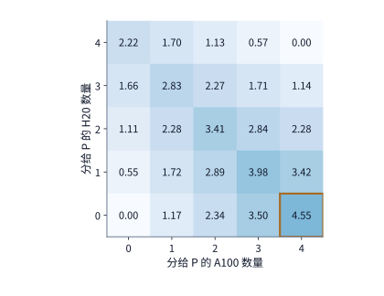

*图 9-11　异构八卡集群中 25 种整数阶段配比对应的稳态请求吞吐率上限。集群包含四张 A100 与四张 H20，单卡各阶段能力见例 9.2；横轴为分给 P 池的 A100 数量，纵轴为分给 P 池的 H20 数量，其余卡自动划入 D 池。每个方格的数值取 P 池能力、D 池能力与 25 GB/s 网卡交接能力三者的最小值（未计排队延迟），单位为请求/s；橙色粗框标出的（4 张 A100 做 P，0 张 H20 做 P）即为最优配比。*

图 9-11 把将四张 A100 与四张 H20 分配给 P、D 两池的全部 $5\times 5 = 25$ 种整数方案完整枚举了出来，直观展示了偏离最优配比时的“木桶短板效应”。从右下角的最优格（$4.55$ 请求/s）出发，如果把一张 A100 从 P 池调往 D 池（左移一格），P 池能力将从 $4.67$ 跌至 $3.50$ 请求/s，而 D 池虽从 $4.55$ 升至 $5.12$ 请求/s，全系统吞吐却被 P 池卡在 $3.50$ 请求/s；反之，如果把一张 H20 从 D 池调往 P 池（上移一格），P 池虽增至 $5.22$ 请求/s，D 池却跌至 $3.42$ 请求/s，系统吞吐同样大幅下滑。最优的实例配比总是应当让 P 池与 D 池的服务率尽量接近相等；一旦配比失衡，较快那一池多出来的处理能力无法跨阶段替较慢的一池分担工作。

为了把单请求的跨池传输下界、按层流水重叠与集群级配比约束统一到同一套可复算标尺下，我们再看一个标准 32 层 GQA 基准模型的完整算例。[^pd-af]

**算例 9-A　32 层 GQA 基准模型在 A100 Prefill + H20 Decode 下的 $1\ \mathrm{GiB}$ KV 交接下界与按层流水重叠。** 设教学基准模型共 $L=32$ 层，输入序列长度 $S=8{,}192$，KV 头数 $H_{kv}=8$，每头维度 $d=128$，采用 BF16 格式（$b=2\ \mathrm{B}$）。不计内存补齐填充、量化元数据与前缀缓存命中时，单条请求在 Prefill 阶段产生的完整 KV 状态体积为：

$$
V_{KV,32} = 2 L S H_{kv} d b = 2 \times 32 \times 8{,}192 \times 8 \times 128 \times 2 = 1{,}073{,}741{,}824\ \mathrm{B} = 1\ \mathrm{GiB}.
$$

若 A100 P 池与 H20 D 池之间的跨机 RDMA 实测有效单向带宽为 $B_{\mathrm{net}} = 25\ \mathrm{GB/s}$，且按“整份算完再一次性传输”串行交接，仅传输这一有效载荷的物理下界就需要 $T_{KV} = 1{,}073{,}741{,}824 / (25\times 10^9) \approx 42.95\ \mathrm{ms}$；计入两池排队等待 $Q_P, Q_D$ 与阶段执行耗时后，单请求关键路径为 $T_{\mathrm{PD}} = Q_P + T_{P,\mathrm{A100}} + T_{KV} + Q_D + T_{D,\mathrm{H20}}$。若改为**按层流水交接**——即 A100 每算完一层的 $32\ \mathrm{MiB}$（$33{,}554{,}432\ \mathrm{B}$）KV 就立即发起异步 RDMA 传输（单层纯传输耗时约 $1.342\ \mathrm{ms}$），使前 31 层的网络传输与后续层的 Prefill 计算重叠，则暴露在 TTFT 或首轮 Decode 之前的交接延迟可压缩至最后一层 KV 的传输耗时（约 $1.342\ \mathrm{ms}$ 加上单次启动与同步开销）。但需要强调两点工程边界：第一，按层流水只能缩短单条请求的暴露延迟，却不会减少跨池链路搬移的总字节数，设集群配置 $n_P$ 个 P 实例与 $n_D$ 个 D 实例，全系统稳态到达率 $\lambda$ 依然受制于木桶不等式 $\lambda < \min\bigl(n_P \mu_P,\, n_D \mu_D,\, B_{\mathrm{net}} / \mathbb{E}[V_{KV}]\bigr)$；第二，A100 与 H20 跨代异构交接要求两侧的模型与 Adapter 标识、位置编码、KV 数据类型与量化缩放因子（scale）、分页块大小以及张量并行（TP）分片方式严格一致（或经过显式重排转换），且必须在接收端预留充足的 HBM 缓冲并在请求取消或超时失败时明确释放归属。[^pd-af]

把视线放到 2023—2026 年单位 Token 服务成本的演进脉络中，以 DistServe、Splitwise 与 Mooncake 为代表的 **PD 分离架构（`TC-14`）**之所以能将满足百分位 SLO 的有效吞吐（Goodput）提升 **$1.4\times\text{–}4.48\times$**，核心在于它同时解除了两道耦合约束：一是从物理上根除了长输入 Prefill 对在途 Decode 步长的穿插阻塞，使 Decode 池得以在逼近 TPOT 红线的高并发批大小下稳定运行而不必为偶发的大块 Prefill 预留巨大延迟余量；二是允许 Prefill 与 Decode 各自采用最匹配的并行度数（如 Prefill 采用低通信开销的较小 TP/EP，Decode 采用高带宽聚合的大 EP）与异构硬件配比。但正如本节木桶公式所示，这一收益并非无条件成立：分离架构必须支付跨池 KV 传输带宽、双池独立副本基数以及两级队列调度的固定成本；在请求流量稀疏、输入极短、跨机互联较慢或负载剧烈波动导致单一阶段池频繁闲置的场景下，共置配合分块 Prefill 反而具备更低的单 Token 综合成本。

> **算例 9-1（异构 PD 分离木桶配比与紧凑 MLA 交接带宽边界核算）**
> 针对 4 张 A100 80GB SXM 与 4 张 H20 SXM5 96GB 组成的 8 卡集群（请求输入 $L=8192$、输出 $G=1025$，单卡耗时 $d_{P,\mathrm{A100}}=0.856\ \mathrm{s},\ d_{D,\mathrm{A100}}=1.764\ \mathrm{s}$，$d_{P,\mathrm{H20}}=1.805\ \mathrm{s},\ d_{D,\mathrm{H20}}=0.878\ \mathrm{s}$）：
> 1. **共置 vs. 异构 PD 分离**：8 卡全共置稳态吞吐为 $\mu_{\mathrm{co}} = 4/(0.856+1.764) + 4/(1.805+0.878) \approx \mathbf{3.02\ \text{请求/s}}$；采用 4 张 A100 做 P、4 张 H20 做 D 的异构 PD 分离后，$\mu_P = 4/0.856 \approx 4.67\ \text{请求/s}$，$\mu_D = 4/0.878 \approx 4.55\ \text{请求/s}$，在 $B_{\mathrm{net}}=25\ \mathrm{GB/s}$ RDMA 链路（GQA 单请求 $V_{KV}=1.125\ \mathrm{GiB} \approx 1.208\ \mathrm{GB}$，链路上限 $20.7\ \text{请求/s}$）下，全集群稳态吞吐达 $\mu_{PD} = \min(4.67,\, 4.55,\, 20.7) = \mathbf{4.55\ \text{请求/s}}$（提升 **$51\%$**）。
> 2. **GQA 与紧凑 MLA 的跨池链路临界带宽**：要使跨池网络不成为瓶颈，必须满足 $B_{\mathrm{net}} \ge \min(\mu_P,\mu_D)\cdot V_{KV}$。在 $\mu_{PD}=4.55\ \text{请求/s}$ 下，Qwen3-8B 标准 GQA（$1.208\ \mathrm{GB}$）要求最低有效网络带宽为 $4.55 \times 1.208 \approx \mathbf{5.50\ \mathrm{GB/s}}$；而 DeepSeek-V3 紧凑 MLA（$549\ \mathrm{MiB} \approx 0.576\ \mathrm{GB}$）仅需 $4.55 \times 0.576 \approx \mathbf{2.62\ \mathrm{GB/s}}$。

下面给出枚举异构集群 25 种整数 P/D 配比并校验跨池 KV 链路瓶颈的参考实现：

```python
def evaluate_pd_allocations(
    n_a100: int = 4,
    n_h20: int = 4,
    dp_a100: float = 0.8564,
    dd_a100: float = 1.7640,
    dp_h20: float = 1.8053,
    dd_h20: float = 0.8782,
    v_kv_bytes: int = 1_207_959_552,
    b_net_bytes_per_s: float = 25e9,
) -> dict:
    """枚举异构集群整数 P/D 配比并核算共置与分离的稳态吞吐上限。"""
    mu_colocated = n_a100 / (dp_a100 + dd_a100) + n_h20 / (dp_h20 + dd_h20)
    mu_link = b_net_bytes_per_s / v_kv_bytes
    best_mu, best_cfg = -1.0, (0, 0)
    for p_a in range(n_a100 + 1):
        for p_h in range(n_h20 + 1):
            mu_p = p_a / dp_a100 + p_h / dp_h20
            mu_d = (n_a100 - p_a) / dd_a100 + (n_h20 - p_h) / dd_h20
            mu = min(mu_p, mu_d, mu_link)
            if mu > best_mu:
                best_mu, best_cfg = mu, (p_a, p_h)
    return {
        "colocated_rps": round(mu_colocated, 2),
        "best_pd_rps": round(best_mu, 2),
        "best_p_cards_a100_h20": best_cfg,
        "link_limit_rps": round(mu_link, 1),
        "min_bw_gbps_for_best_pd": round(best_mu * v_kv_bytes / 1e9, 2),
    }


if __name__ == "__main__":
    res = evaluate_pd_allocations()
    assert res["colocated_rps"] == 3.02 and res["best_pd_rps"] == 4.55
    assert res["best_p_cards_a100_h20"] == (4, 0)
```

### 9.2.4 不同请求与负载下的收益边界

例 9.2 是在“无前缀缓存命中、8192 输入、1025 输出”的基准条件下求出的配比。如果线上负载的特征发生变化，原有的 4:4 配比还会是最优解吗？我们先只改变一个条件：**启用前缀缓存命中**。假设 P 池已经在本地显存或主存中缓存了每条请求前 6144 个 token 的历史 KV 状态，每次只需对剩余的 $L_{\mathrm{new}} = 2048$ 个新输入 token 执行 prefill 计算。由于新计算量缩减为原来的四分之一，单张 A100 的 prefill 耗时从 $0.856$ 秒降至约 $0.238$ 秒，单卡 P 能力从 $1.17$ 请求/s 跃升至 $4.20$ 请求/s。此时如果仍然沿用四张 A100 做 P、四张 H20 做 D 的旧配比，P 池总能力高达 $16.8$ 请求/s，而 D 池依然停留在 $4.55$ 请求/s，三张 A100 的算力都处于空转状态。

为了重新配平木桶的两块板，可以将其中两张 A100 从 P 池调往 D 池：留守 P 池的两张 A100 仍能提供 $2\times 4.20 \approx 8.41$ 请求/s 的充裕输入处理能力；而扩充后的 D 池由两张 A100 与四张 H20 共同组成，合计提供 $2 / 1.764 + 4 / 0.878 \approx 5.69$ 请求/s 的生成能力，全系统稳态吞吐率上限随之提升至 $5.69$ 请求/s。如果再多调走一张 A100（只留一张 A100 做 P），P 池能力将跌至 $4.20$ 请求/s，反而再次成为短板。注意这里假定 D 池本地并未事先缓存那 6144 个 token 的前缀，因此无论怎么调整卡数配比，P 池在算完 2048 个新 token 后仍须把拼好的一整份 8192 token（$1.125\ \mathrm{GiB}$）上下文 KV 完整交接给 D 池——换言之，前缀命中让 P 池的浮点运算量减少了七成以上，但跨机交接给 D 池的 KV 字节数并未减少。

接下来恢复“8192 个输入 token 无缓存命中”的条件，改为**缩短输出长度**：将输出从深度推理的 1025 个 token 缩短为普通问答的 129 个 token。此时每条请求的 decode 调用次数从 1024 次锐减至 128 次（加上随生成缩短而略减的平均上下文读取量），单张 H20 的 D 能力从 $1.14$ 请求/s 跃升至约 $9.46$ 请求/s，decode 阶段几乎不再构成瓶颈。重新枚举 25 种分配方案可知，最优配比变成了拿四张 A100 加三张 H20 共同做 P、仅留一张 H20 做 D，此时 P 池提供 $4\times 1.168 + 3\times 0.554 \approx 6.33$ 请求/s，D 池单卡提供 $9.46$ 请求/s，系统吞吐上限由 P 池决定，达到 $6.33$ 请求/s。同时还可以算出，在这种短输出负载下，八卡全部共置的吞吐率也已达到 $5.84$ 请求/s，异构 PD 分离相比共置仅提升了约 $8.5\%$。

图 9-12 将这三种典型请求负载下的最优卡数分工并排画在了同一组八张硬件卡上。图中每一个小方块都代表同一张物理 GPU，唯一的变量是调度系统赋予它的阶段角色：当前缀缓存命中大幅削减了 P 阶段的新计算量时，两张 A100 从 P 池转向 D 池支援生成；当输出长度大幅缩短减轻了 D 阶段的迭代负担时，三张 H20 则从 D 池转向 P 池分担输入计算。

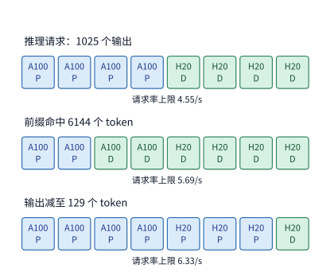

*图 9-12　请求组成变化直接驱动异构集群的资源重分配。硬件固定为四张 A100 与四张 H20，单卡各阶段能力按例 9.2 的 Roofline 方法推算：第一行为基准深度推理请求（8192 输入、1025 输出，最优为 4 张 P + 4 张 D，吞吐 4.55 请求/s）；第二行为前缀命中 6144 个位置、仅需新算 2048 个输入 token（最优变为 2 张 P + 6 张 D，吞吐 5.69 请求/s）；第三行为恢复 8192 新输入但输出缩短至 129 个 token（最优变为 7 张 P + 1 张 D，吞吐 6.33 请求/s）。*

对比图 9-12 的三行可以提炼出一条清晰的资源配比规律：在这三种负载下，最合适的 P 卡数量分别是 4 张、2 张和 7 张。前缀缓存命中削减了 P 池的工作，把硬件资源推向 D 池；输出序列变短削减了 D 池的工作，又把硬件资源推回 P 池；而深度推理（Reasoning）与长文生成负载的输出越长，D 阶段的资源耗时占比就越高，像 H20 这样显存带宽充裕而算力适中的芯片也就越能发挥用武之地。据此，分布式推理的调度自然分成了快、慢两个时间尺度：在毫秒级的**快时间尺度**上，路由器为每条新到达的请求选择当前排队最短或缓存亲和度最高的实例队列，决定单次请求的即时等待；在分钟至小时级的**慢时间尺度**上，控制面根据线上输入输出长度分布与缓存命中率的漂移，动态调整 P 池与 D 池的实例数量配比（见第 9.6.2 节），决定系统能否在长期运行中持续消化流量而不发生队列失稳。

## 9.3 Attention–FFN 分离与异构执行

### 9.3.1 Attention、FFN 与专家的执行边界

PD 分离是在整次请求的时间轴上将 prefill 与 decode 切开，而 **AF 分离**（Attention–FFN Disaggregation）则是深入到每一个 Transformer 层内部，将注意力算子与前馈网络（或混合专家网络）分配给不同的计算资源执行：注意力一侧计算出每个 token 的上下文表征后，将隐状态向量发送给前馈或专家一侧处理，随后再把计算结果传回注意力一侧进入下一层。由于下一层的注意力计算依赖上一层前馈网络的输出，这种层内交接在每一层、每一步生成中都会反复触发，微秒级的通信启动与同步等待也将被层数成倍放大。

为什么工程上有时愿意承受逐层往返的通信代价去实施 AF 分离？稀疏混合专家（MoE）模型提供了一个鲜明的场景：MoE 模型全量专家权重的体积十分庞大，往往远超单张或数张 GPU 的显存容量，但单个 token 在每一层只激活其中极少数专家（如 128 个专家中选 8 个）。当大多数非热点专家不得不存放在容量宽裕的主机内存（Host DRAM）或独立专家节点上时，系统面临两条截然不同的执行路径：
- **路径一（搬权重到 GPU 计算）**：保持计算仍在 GPU 上进行，每次按需将本批被选中的专家权重经 PCIe 总线从主存拷贝到 GPU 显存，再用 GPU 的高算力完成矩阵乘法。这条路径花费较大的 PCIe 链路带宽去换取 GPU 的高矩阵算力。
- **路径二（搬激活到 CPU 就地计算）**：保持专家权重留在主存原地不动，把体积小得多的 token 隐状态激活经 PCIe 传给 CPU，由 CPU 直接读取本地主存中的专家权重完成矩阵运算，再将结果传回 GPU。这条路径花费 CPU 算力与主存带宽，换取了极小的跨总线传输流量。

究竟哪条路径更快，核心取决于**本次分派给同一个专家的 token 数量 $m$**：每个 token 的隐状态向量对应专家输入矩阵中的一行，当 $m$ 个 token 同时命中同一个专家时，这 $m$ 行输入会共享同一次专家权重的读取与搬移。

### 9.3.2 CPU／GPU 协作

图 9-13 与图 9-14 直观对比了上述两条路径在物理链路上传输的内容：两条路径最终交付完全相同的专家层输出，但图 9-13 跨 PCIe 传输的是整份专家权重（单份 $36\ \mathrm{MiB}$），而图 9-14 跨 PCIe 往返传输的仅仅是输入与输出隐状态向量（单次分派往返合计 $16\ \mathrm{KiB}$）。第 8.4.3 节讨论的按需权重卸载采用的是第一条路径；而开源推理系统 KTransformers 则代表了第二条路径的工程实践：在典型的单机异构工作站配置（一张 **RTX 4090 `24 GB`** 搭配**双路 Intel Xeon Gold 6454S** 处理器，共 64 个物理核、128 个逻辑线程、跨越 2 个 NUMA 节点的 `1 TB` DDR5 主存）中，系统通过声明式 YAML 算子放置规则，将稠密注意力层、KV 缓存、共享专家与少量高频热点专家固定在 `24 GB` 显存内执行，而将其余数百个稀疏路由专家常驻在双路主机内存中，由绑核后的 CPU 线程调用 AMX／AVX-512 内核就地计算。在每一层中，GPU 将命中 CPU 专家的输入激活向量异步提交给主机侧工作队列后，无需原地空等，而是立即并行计算驻留在 GPU 本地的共享专家或常驻专家分支，待两侧分支均完成后再通过事件同步汇合结果进入下一层（在 DeepSeek-R1/V3 满血版实测中，这种“激活往返 + CPU 就地计算”的异构 AF 切分将生成吞吐从被动搬移权重的 `4.54 tok/s` 提升至 `13.99 tok/s`，端到端最高加速达 `28.65` 倍）。但与 PD 分离“每条请求仅交接一次 KV”不同，这种同机 AF 切分在每一步 Decode 的每一个 MoE 层都会触发至少 2 次跨 PCIe 方向交接（32 层模型每步 64 次交接、单 token 有效载荷 $V_{\mathrm{act}} = 2 L S h b = 0.5\ \mathrm{MiB}$；36 层模型每步 72 次交接、有效载荷 $0.5625\ \mathrm{MiB}$），因此微秒级的跨设备队列提交与同步等待会被层数成倍放大。[^kt][^pd-af]

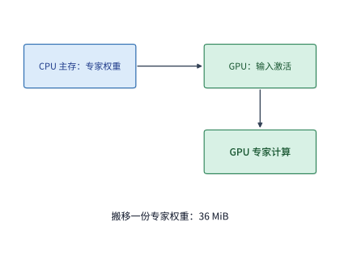

*图 9-13　路径一（搬权重到 GPU）：将本批被选中的 36 MiB BF16 专家权重经 PCIe 从主机内存复制到 GPU 显存，随后由 GPU 读取本地输入激活完成专家矩阵乘法。*

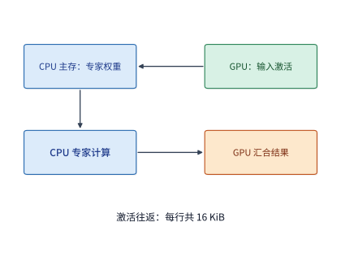

*图 9-14　路径二（CPU 就地计算，搬激活往返）：专家权重固定驻留在主机内存中，GPU 仅将命中的输入激活发往 CPU，由 CPU 读取本地主存权重执行专家计算并将输出激活传回 GPU。单次 token 到专家的分派往返仅需传输 16 KiB 激活；并行执行的 GPU 常驻专家分支与 CPU 分支在层末同步汇合。*

要定量求出两条路径优劣翻转的临界点，首先核算单份专家权重的体积。在 Qwen3-235B-A22B 模型中，每个路由专家由门控投影（gate）、上投影（up）和下投影（down）三个矩阵构成，单专家参数量为 $P_e = 3\times4096\times1536=18{,}874{,}368$（约 $18.87\ \mathrm{M}$ 参数）；在 BF16 格式下，单份专家权重的大小恰好为 $W_e = 2P_e = 37{,}748{,}736\ \mathrm{bytes} = 36\ \mathrm{MiB}$。

**例 9.3　专家权重复用度如何决定 CPU 就地计算与 GPU 搬权重的选择？** 我们采用 KTransformers 论文的基准测试平台进行核算：主机配备两颗 Intel Xeon Platinum 8452Y 处理器（每颗 36 核，各配 1 TB DDR5 主存），通过 PCIe 4.0 x16 连接一张 A100 40GB PCIe GPU。论文使用 Intel Memory Latency Checker（MLC）实测得到单颗 CPU 插槽内的本地主存带宽为 $B_D = 220\ \mathrm{GB/s}$。在单颗 CPU 上运行 MoE 专家算子时，基于传统 AVX-512（512 位向量指令集）的 PyTorch 内核实测峰值算力为 $C_C = 1.8\ \mathrm{TFLOP/s}$，而 KTransformers 针对 Intel AMX（高级矩阵扩展）指令集深度优化的内核实测算力高达 $C_C = 21.3\ \mathrm{TFLOP/s}$。GPU 一侧取 A100 40GB PCIe 标称峰值（$312\ \mathrm{TFLOP/s}$ 算力、$1555\ \mathrm{GB/s}$ 显存带宽）的 $50\%$，即有效算力 $C_G = 156\ \mathrm{TFLOP/s}$、有效显存带宽 $B_H = 778\ \mathrm{GB/s}$。PCIe 4.0 x16 的单向有效载荷带宽按 $B_L = 25\ \mathrm{GB/s}$ 计，每次跨总线传输的固定启动开销为 $\alpha = 5\ \mu\mathrm{s}$，BF16 隐状态维度为 $h=4096$（单向量 $8\ \mathrm{KiB}$）。假设单层中有 8 个被选中的专家依次执行，总耗时为 8 个专家各自耗时之和，且每个被选中的专家权重在本批内只需读取或搬移一次。

我们先对比两个直观的极端情形：
- **低复用场景（每专家仅处理 $m=1$ 个 token，如单并发 decode）**：8 个专家权重合计 $8\times 36 = 288\ \mathrm{MiB}$（约 $302\ \mathrm{MB}$）。若走 CPU 就地计算路径，在 $220\ \mathrm{GB/s}$ 的本地主存上读取这 $288\ \mathrm{MiB}$ 权重仅需约 $1.37\ \mathrm{ms}$，加上输入输出激活跨 PCIe 往返与启动开销后，CPU 路径总耗时约为 $1.46\ \mathrm{ms}$；若走搬权重到 GPU 的路径，光是把这 $288\ \mathrm{MiB}$ 权重经 $25\ \mathrm{GB/s}$ 的 PCIe 搬过去就要耗费约 $12.1\ \mathrm{ms}$，连同启动与 GPU 计算共需约 $12.5\ \mathrm{ms}$，比 CPU 就地计算慢了 8 倍以上。可见在单请求或小批量场景下，避开慢速 PCIe 上的大块权重搬移远比追求高浮点算力重要。
- **高复用场景（每专家处理 $m=128$ 个 token，如长输入 prefill 或大并发合批）**：需要读取的专家权重依然是 $288\ \mathrm{MiB}$，但每个专家的矩阵乘加计算量扩大为原来的 128 倍（8 个专家合计约 $38.7\ \mathrm{GFLOPs}$）。此时若 CPU 使用算力仅有 $1.8\ \mathrm{TFLOP/s}$ 的 AVX-512 内核，CPU 路径的计算耗时将激增至约 $21.5\ \mathrm{ms}$，连同激活传输总耗时达 $22.2\ \mathrm{ms}$；而搬权重到 GPU 的路径由于 GPU 算力极高，总耗时依然保持在约 $12.5\ \mathrm{ms}$，反超了 AVX-512 CPU 路径。图 9-15 画出了两条路径随每专家 token 数 $m$ 变化的完整曲线：对于 AVX-512 内核，当每个专家接收的 token 数从 71 增加到 72 时，GPU 搬权重路径开始快于 CPU 就地计算。然而，如果将 CPU 内核切换为 $21.3\ \mathrm{TFLOP/s}$ 的 AMX 矩阵指令内核，在 $m=128$ 时 CPU 路径总耗时仅需约 $2.57\ \mathrm{ms}$（约为 GPU 搬权重路径的五分之一），两条路径的翻转交点被大幅推迟到每专家 $m=689$ 个 token。同一台物理服务器处理同一批请求，仅仅因为 CPU 算子是否调用了硬件矩阵扩展指令，最优算子放置位置就发生了根本改变。[^locality]

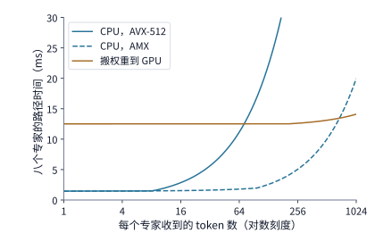

*图 9-15　每专家分派的 token 数（复用度）决定 CPU 就地计算与 GPU 搬权重哪条路径更快。单层 8 个专家各占 36 MiB BF16 权重；CPU 为单颗 Xeon Platinum 8452Y（同插槽主存带宽 220 GB/s，AVX-512 与 AMX 内核实测算力分别为 1.8 与 21.3 TFLOP/s），GPU 为 A100 40GB PCIe（按 50% 峰值计为 156 TFLOP/s、778 GB/s），PCIe 有效带宽 25 GB/s、启动开销 5 μs。横轴采用对数刻度：AVX-512 在每专家 72 个 token 处被 GPU 反超，而 AMX 将交点推迟至 689 个 token。*

我们可以将上述对比提炼为通用的解析公式。记单个专家的参数量为 $P_e$、权重字节数为 $W_e$，隐状态维度为 $h$、每元素字节数为 $b$。当某专家在当前批次收到 $m$ 个 token 时，其浮点运算量为 $F_e(m)=2mP_e$ FLOPs，且权重在批内只需读取一次。设 CPU 的有效矩阵算力与本地主存带宽分别为 $C_C$ 和 $B_D$，GPU 的有效算力与显存带宽分别为 $C_G$ 和 $B_H$，跨设备互联带宽为 $B_L$，单次传输启动开销为 $\alpha$。在交接与算子计算串行执行、且算子内部耗时遵守 Roofline 下界（取计算时间与权重读取时间之较大者）的条件下，单个专家在 CPU 就地执行路径与 GPU 搬权重路径下的耗时分别为

$$
T_C(m)=2\alpha+\frac{2mhb}{B_L}
+\max\left(\frac{2mP_e}{C_C},\frac{W_e}{B_D}\right),
$$

$$
T_G(m)=\alpha+\frac{W_e}{B_L}
+\max\left(\frac{2mP_e}{C_G},\frac{W_e}{B_H}\right).
$$

前一个式子将输入激活发往 CPU、CPU 执行专家计算、输出激活传回 GPU 三段串行耗时相加（因此包含 $2\alpha$ 的往返启动开销与 $2mhb/B_L$ 的往返激活传输）；后一个式子则先将整份权重 $W_e$ 经互联链路搬上 GPU，再由 GPU 完成矩阵计算。

这组公式还能直接用来评估服务器内存拓扑（NUMA）与量化格式的影响。在双路 CPU 服务器中，如果工作线程跨越插槽去读取另一颗 CPU 所辖的内存通道，数据必须经过处理器间互联总线（UPI），论文实测该机器的跨插槽内存带宽会从同插槽的 $220\ \mathrm{GB/s}$ 下滑至 $125\ \mathrm{GB/s}$。图 9-16 将每专家处理 $m=128$ 个 token 时 CPU 算子内部的“权重读取时间 $W_e/B_D$”与“矩阵计算时间 $2mP_e/C_C$”两项并列画了出来。可以看到：当使用算力较低的 AVX-512 内核时，矩阵计算耗时（$21.5\ \mathrm{ms}$）远长于权重读取耗时（$1.37\ \mathrm{ms}$ 或 $2.42\ \mathrm{ms}$），此时线程是否跨 NUMA 插槽访存几乎不影响总时间；但当换用算力强劲的 AMX 内核后，矩阵计算耗时被压缩到 $1.82\ \mathrm{ms}$，仅略长于同插槽读取的 $1.37\ \mathrm{ms}$，一旦发生跨插槽读取（$2.42\ \mathrm{ms}$），瓶颈就会立刻从计算受限反转为访存受限。这一对比再次印证了系统调优的基本准则：唯有找准当前支配 $\max(\cdot)$ 的那一项，优化才不会白费力气——访存受限时必须做好 NUMA 绑核与内存亲和分配，计算受限时则应调用更高吞吐的矩阵指令集；而对专家权重施行 INT4 或 INT8 量化则会同时改写这两项参数，既成比例缩减权重读取字节数 $W_e$，又通过低精度整数指令提升有效计算吞吐 $C_C$。[^kt-audit]

> **算例 9-2（KTransformers 异构 AF 切分下 AVX-512 与 AMX 的翻转交点推导）**
> 给定单层 $8$ 个被激活的 Qwen3-235B-A22B 路由专家（单专家参数量 $P_e = 18{,}874{,}368$，BF16 权重 $W_e = 36\ \mathrm{MiB}$，$8$ 个专家共 $288\ \mathrm{MiB} \approx 301.99\ \mathrm{MB}$），PCIe 4.0 x16 有效带宽 $B_L = 25\ \mathrm{GB/s}$、单次启动 $\alpha = 5\ \mu\mathrm{s}$，CPU 本地主存带宽 $B_D = 220\ \mathrm{GB/s}$，GPU 有效算力 $C_G = 156\ \mathrm{TFLOP/s}$、显存带宽 $B_H = 778\ \mathrm{GB/s}$：
> 1. **小批量（$m=1$ token/专家）**：CPU 就地执行路径读取 $288\ \mathrm{MiB}$ 主存仅需 $1.373\ \mathrm{ms}$，加上 $8$ 个专家跨 PCIe 往返 $16\ \mathrm{KiB}$ 激活与启动开销，总耗时 $T_C(1) \approx \mathbf{1.458\ \mathrm{ms}}$；而搬权重上 GPU 路径仅 PCIe 传输 $288\ \mathrm{MiB}$ 就要 $12.080\ \mathrm{ms}$，总耗时 $T_G(1) \approx \mathbf{12.508\ \mathrm{ms}}$，CPU 就地计算快 **$8.58\times$**。
> 2. **大批量（$m=128$ token/专家）与指令集翻转边界**：当 $m=128$ 时，$8$ 个专家共需执行 $38.65\ \mathrm{GFLOPs}$。AVX-512 内核（$1.8\ \mathrm{TFLOP/s}$）计算耗时升至 $21.47\ \mathrm{ms}$、总耗时 $\mathbf{22.17\ \mathrm{ms}} > T_G(128) \approx \mathbf{12.51\ \mathrm{ms}}$（在 $m=71\to 72$ 处被 GPU 反超）；而 AMX 内核（$21.3\ \mathrm{TFLOP/s}$）计算耗时仅 $1.81\ \mathrm{ms}$、总耗时 $\mathbf{2.57\ \mathrm{ms}}$，将 GPU 反超交点推迟至 **$m=688\to 689$**。

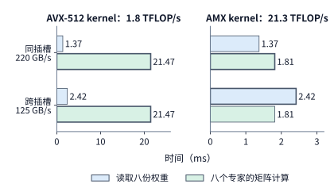

*图 9-16　8 个 Qwen3-235B-A22B 专家各处理 128 个 token 时，单颗 Xeon Platinum 8452Y 上权重读取（共 288 MiB）与矩阵计算（共 38.7 GFLOPs）两项耗时对比。深色粗框标出决定算子耗时下界的较长项：AVX-512（左图）下计算耗时占绝对主导，而 AMX（右图）下跨插槽访存（125 GB/s）会使瓶颈从矩阵计算反转为内存读取。注意左右两图的横轴刻度不同。*

### 9.3.3 容量、并发与专家复用对服务能力的影响

在异构服务器上部署超大 MoE 模型时，“内存能不能装下全量权重”只是入场券，“并发升高后能不能及时算完”才是决定服务能力的真正边界。以 Qwen3-235B-A22B 为例，模型每层有 128 个 BF16 路由专家，单层专家权重占 $128\times 36\ \mathrm{MiB} = 4.5\ \mathrm{GiB}$。如果尝试在每层挑选 32 个高频专家常驻 GPU 显存，单层需占 $1.125\ \mathrm{GiB}$，全模型 94 层合计需占用约 $105.75\ \mathrm{GiB}$ 显存——即便把一张 A100 80GB 的全部显存（约 $74.5\ \mathrm{GiB}$）都腾给专家权重也装不下，必须跨多张 GPU 切分，或者将每层常驻 GPU 的专家数缩减至 16 个（占约 $52.9\ \mathrm{GiB}$）。然而，缩减 GPU 常驻专家数量意味着会有更高比例的专家分派落到主机内存一侧由 CPU 执行。可见，显存容量的切分比例直接改写了线上请求在 GPU 与 CPU 之间的流量分配。

更重要的是，单个 token 在每层只激活 $K=8$ 个专家，绝不意味着一个包含 $M$ 个 token 的批次也只访问 8 个专家。回顾第 6.3.2 节的推导，并以 $M=64$ 个 token、每 token 选 $K=8$ 个专家（合计 $M\times K = 512$ 次分派）为例考察图 9-17 左半部分的两个极端：
- **完全集中路由**：64 个 token 选中的全是同一组 8 个热点专家，每个热点专家收到 64 行输入；
- **完全均匀覆盖**：512 次分派均匀散落在全部 128 个专家上，每个专家只收到 4 行输入。

在这两种极端分布下，需要执行的有效矩阵乘加运算量完全相等，均为 $512\times 2\times 18{,}874{,}368 \approx 19.3\ \mathrm{GFLOPs}$（对应图 9-17 左图中两个矩形的面积相等）；但在批内每份命中权重只读一次的前提下，需要从主存读取的不同专家权重总量却分别是 $8\times 36\ \mathrm{MiB} = 288\ \mathrm{MiB}$ 与 $128\times 36\ \mathrm{MiB} = 4.5\ \mathrm{GiB}$，两者相差整整 **16 倍**。放到例 9.3 那台 $220\ \mathrm{GB/s}$ 主存带宽的服务器上，仅读取专家权重这一项耗时就分别是 $1.37\ \mathrm{ms}$ 与 $22.0\ \mathrm{ms}$——相同的浮点计算量，只因路由分散程度不同，主存读取时间就拉开了超过一个数量级的差距。

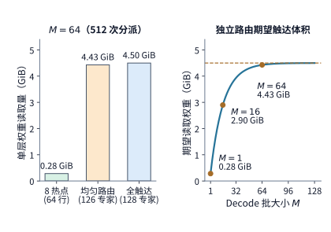

*图 9-17　批内活跃专家数决定权重读取开销。左图对比同为 512 次分派（有效计算量均为 19.3 GFLOPs，矩形面积相等）的两种分布：集中命中 8 个专家（每专家 64 行）仅需读取 288 MiB 权重（1.37 ms），而均匀覆盖 128 个专家（每专家 4 行）则需读取 4.5 GiB 权重（22.0 ms，相差 16 倍）。右图展示独立均匀随机路由下批内期望活跃专家数 $\mathbb{E}[U]$ 与权重读取量随批内 token 数 $M$ 的增长：当 $M\ge 64$ 时已接近遍历全部 128 个专家（4.43 GiB），此后继续增大批次将全部转化为对已读入权重的行复用。*

在实际服务中，不同请求的 token 往往近似独立地触发路由选择。按照第 6.3.2 节的概率模型，当批内 $M$ 个 token 各自独立、等概率地从 $E$ 个专家中无放回选取 $K$ 个专家时，批内被至少一个 token 选中的活跃专家数期望值为

$$
\mathbb{E}[U]=E\left[1-\left(1-\frac{K}{E}\right)^M\right].
$$

如图 9-17 右半部分所示，将 Qwen3-235B-A22B 的 $E=128, K=8$ 代入上式：当 $M=1$ 时仅激活 $8$ 个专家（读 $0.28\ \mathrm{GiB}$）；当 $M=16$ 时期望激活约 $82.5$ 个专家（读 $2.90\ \mathrm{GiB}$）；而当批大小增至 $M=64$ 时，期望活跃专家数已达 $\mathbb{E}[U]\approx 126$ 个，理想权重读取量高达 $4.43\ \mathrm{GiB}$，几乎与完全均匀覆盖（128 个专家、$4.50\ \mathrm{GiB}$）无异。当 $M$ 越过 64 继续增大时，由于总专家数封顶在 128 个，需要读取的权重字节数不再增长，而总分派次数 $MK$ 随 $M$ 线性增加，新增 token 终于开始高效复用已经读入缓存的专家权重。

这一规律直接解释了为什么“大容量主存 + 少量消费级或单卡 GPU”的异构个人工作站方案（例如公开配置中用单张 RTX 5090 搭配至少 200 GB 主存运行 DeepSeek V4-Flash，或搭配约 600 GB 主存运行 Q4_K_M 分组量化的 Kimi K2）非常适合单用户或低并发探索，却难以直接充当高并发线上服务节点。大容量主存解决的是“把几百 GB 稀疏权重装进一台机器”的容量约束；但在并发请求数或输入长度上升后，批内活跃专家数迅速逼近全集，且随着每专家平均输入行数 $m$ 的增加，CPU 很快会越过图 9-15 的翻转交点而陷入算力瓶颈。并发度提升一方面摊薄了单次权重读取的成本，另一方面也迅速耗尽了主存带宽与 CPU 矩阵算力。[^capacity]

### 9.3.4 跨机 AF、专家分离与 micro-batch 流水

前两小节讨论的还是同一台服务器内部 CPU 与 GPU 之间的算子分工。在大规模 GPU 集群中，同样可以按 AF 分离的思想将 MoE 模型的注意力层与路由专家层部署到两组独立的 GPU 服务器池上：一组 GPU 保留注意力权重与上下文 KV 缓存（Attention workers），另一组 GPU 专职持有庞大的路由专家权重（Expert workers），两侧通过高速 RDMA 或 NVLink 网络收发隐状态激活。工程界通常将这种跨设备池的架构称为**专家分离**（Expert Disaggregation，简称 EP 分离）。为了避免概念混淆，本书统一用“专家分离”指代注意力与专家分处不同资源池的部署边界，而用 **EP**（Expert Parallelism）指代专家并行组的卡数规模。在实际设计专家分离系统时，还必须明确界定共享专家（shared experts）、门控路由器（router）以及注意力前后的投影矩阵究竟放在哪一侧执行。

我们以第 7 章介绍的两台 HGX H100 服务器为例，追踪一层 MoE 在专家分离架构下的完整执行流程（图 9-18）。设服务器 A 上的四张卡 A0–A3 专职执行注意力计算并维护各自请求的 KV 缓存，服务器 B 上的四张卡 B0–B3 各持有全层四分之一的路由专家。在每一层内部，数据流严格遵循四步顺序推进：
1. **注意力与门控路由（Attention & Gating）**：A0–A3 完成当前层的自注意力计算，门控路由器为每个 token 选出得分最高的 8 个目标专家。
2. **输入分发（Dispatch All-to-All）**：即第 6.2.6 节介绍的 dispatch 通信。每张 A 卡将本地各个 token 的隐状态向量按照目标专家所属的 B 卡编号打包分组，经跨机网络发往对应的 B0–B3。由于四张 A 卡都要向四张 B 卡发送数量不等的特征向量，这一步在通信模式上构成一次典型的 $4\times 4$ 全对全交换（All-to-All）。
3. **专家矩阵计算（Expert GEMM）**：每张 B 卡收齐来自四张 A 卡的所有输入向量后，按本地专家编号将输入行重排（permute）为连续分块，调用分组矩阵乘法（Grouped GEMM）完成专家前馈计算。
4. **结果合并（Combine All-to-All）**：各专家计算出的输出向量沿原路发回该 token 最初所在的 A 卡（第二次 $4\times 4$ All-to-All）；A 卡必须收齐同一个 token 派出的全部 8 份专家输出，按门控权重加权求和并加上残差连接后，才能启动下一层的注意力计算。

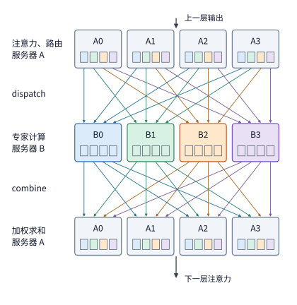

*图 9-18　专家分离架构下一层 MoE 在两台服务器间的四步执行流程（时间自上而下推进）。服务器 A（A0–A3）执行注意力与门控路由，服务器 B（B0–B3）执行路由专家计算。图中每个彩色小方块代表某张 A 卡发往对应颜色 B 卡的一批 token 隐状态：dispatch 阶段将各色方块跨网汇聚到同色 B 卡，专家计算完成后 combine 阶段再将输出沿原路退回源 A 卡，两次跨池交换均为 4×4 的 All-to-All 通信。*

仔细观察图 9-18 可以发现两处结构性的同步等待点（barrier）：第一处位于专家计算开始前，每张 B 卡通常需要等待来自所有 A 卡的输入分派全部到达后才能启动分组矩阵乘；第二处位于层末合并时，每张 A 卡必须等待每个 token 派往不同 B 卡的全部专家分支都返回结果后才能加权求和。一旦某张 B 卡因为命中的热点专家过多而接收了超量字节、执行了更久的矩阵乘，它不仅会推迟自身的计算与回传，还会通过第二处同步点拖慢所有等待其结果的 A 卡。第 9.4 节即将深入剖析的负载倾斜（skew）问题，正是通过这两道同步屏障将单张慢卡的延迟放大为整层的全局等待。

与“专家分离”紧密相关但不能混为一谈的另一个重要概念是**大 EP**（Large-scale Expert Parallelism）。大 EP 是指将每层的专家切分到规模很大的专家并行组（例如几十乃至上百张 GPU）上，使每张 GPU 仅需驻留极少数路由专家，从而腾出显存空间并汇聚来自几十个并行进程的大批量输入 token，让每个专家获得足够多的输入行来充分利用 Tensor Core 算力。应当明确：**采用大 EP 并不要求必须做物理上的 AF 池分离**——同一张 GPU 完全可以既执行自己分到的那一部分请求的注意力（作为 DP 副本），又同时持有大 EP 组中的几个专家（在注意力算完后全组原地切换为 EP 模式通信）；反过来，独立的专家资源池内部也未必只建一个超大 EP 组，而可以划分为多个中等规模的 EP 副本。例如，DeepSeek-V3/R1 的公开推理工程报告披露其线上服务在 prefill 阶段采用 EP32、在 decode 阶段采用跨机 EP144，并配合冗余专家副本与多级负载均衡机制；这证明了大 EP 在超大 MoE 推理中的核心地位，但阅读这类工程报告时应注意区分“大并行度 EP”与“独立资源池分离”两个不同维度的设计选择。[^ep-system]

此外还要破除一个常见直觉误区：**单纯把专家并行度 EP 拆得更大，并不会自动增加每个专家分到的 GEMM 批大小（输入行数）。** 设当前全局批次共有 $n$ 个 token，每个 token 选择 $k$ 个专家，模型每层共有 $E$ 个逻辑路由专家，那么在均匀路由下，每个逻辑专家平均收到的输入行数恒为 $nk/E$。例如当全局批大小 $n=1024$、$k=8$、$E=256$ 时，每个专家平均收到 $1024\times 8 / 256 = 32$ 行输入；如果保持全局批大小 $n=1024$ 不变，仅仅把这 256 个专家从 32 张卡（EP32，每卡 8 个专家）摊薄到 128 张卡（EP128，每卡 2 个专家），每个专家平均收到的输入行数依然是 32 行，减少的只是每张卡持有的专家个数与权重显存占用。唯有伴随 EP 规模扩大同步汇聚更多并行来源的输入 token（即增大全局批大小 $n$），才能真正提高每专家的矩阵行数；但与此同时，All-to-All 通信的横跨范围与图 9-18 中的同步屏障范围也会随之扩大到上百张卡，且每张卡持有的专家数越少，不同专家之间的冷热波动就越难在同一张卡内部相互抵消，第 9.4.1 节将用同一组 $n,k,E$ 参数定量推导这种负载倾斜放大效应。

当把 AF 分离部署到跨服务器的独立注意力池与专家池上时，虽然专家池获得了独立扩缩容与异构选型的灵活性，但原本可以在同卡内部传递的激活现在全部变成了跨机网络流量。为了掩盖跨机传输延迟并避免注意力池与专家池轮流空转，MegaScale-Infer 等跨机 AF 分离系统引入了**微批次交错流水线**（ping-pong micro-batch pipelining）：将一批请求切分为多个相互独立的微批次（micro-batch），当微批次 1 的激活发往专家节点执行专家计算时，注意力节点立即开始计算微批次 2 的注意力；随后当微批次 1 的结果传回注意力节点进入下一层时，微批次 2 恰好接力进入专家节点。在理想无阻塞条件下，若单个微批次在注意力阶段与专家阶段的服务耗时分别为 $t_A$ 和 $t_F$，且通信完全隐藏在计算阴影内，则处理 $q$ 个独立微批次所需的单层双阶段流水线总耗时为

$$
T_{\mathrm{pipe}} = t_A + t_F + (q-1)\max(t_A, t_F),
$$

其中第 1 个微批次耗时 $t_A + t_F$ 完成管线填充，此后每隔较慢阶段的一个周期 $\max(t_A, t_F)$ 即可稳定产出一个微批次，并在层与层之间首尾相接。

MegaScale-Infer（2025）的实验数据展示了这套交错流水架构在生产级负载下的潜力。该研究在 Mixtral-8×22B、DBRX 以及 317B 参数的 Scaled-MoE 模型（权重、激活与 KV 均为 BF16，生产请求输入／输出长度中位数分别为 571 与 159 个 token）上进行了评测：在给定单步生成延迟 TPOT 不超过 $150\ \mathrm{ms}$ 的服务目标（SLO）约束下，于 8 节点×8 张 80 GB Ampere GPU 的集群上，其单卡等效 decode 吞吐达到了基准框架 TensorRT-LLM 的 $1.90$ 倍。在解读这一成绩时应当看到，这 $1.90$ 倍的收益是“注意力与专家池化分离 + 差异化并行度 + 乒乓微批流水 + 定制高吞吐通信库 + 热点专家冗余副本”共同作用的系统工程成果，不能简单归结为“只要拆开 AF 两池就能自动获得近两倍加速”。[^ep-papers]

我们用一组具体数字来算清乒乓微批流水的收益边界（图 9-19）：设单个微批次在注意力阶段耗时 $t_A = 2\ \mathrm{ms}$，在专家阶段耗时 $t_F = 3\ \mathrm{ms}$。如果将 $q=4$ 个微批次按部就班地串行执行（图 9-19 上图），注意力节点与专家节点轮流计算、交替空转，每个微批次耗时 $2+3=5\ \mathrm{ms}$，4 个微批次共需 $4\times 5 = 20\ \mathrm{ms}$；如果改用理想双阶段交错流水（图 9-19 下图），微批次 1 在专家节点执行 $3\ \mathrm{ms}$ 的同时，微批次 2 已在注意力节点完成了 $2\ \mathrm{ms}$ 的计算，4 个微批次全部完成仅需 $2 + 3 + 3\times\max(2,3) = 14\ \mathrm{ms}$，净节省 $6\ \mathrm{ms}$。但这一算例也揭示了流水线失效的翻转条件：如果把原批次拆成 4 个小微批次后，因矩阵行数变小导致算子硬件效率下滑，或者跨机往返激活通信无法完全隐藏，只要这 4 个微批次在关键路径上累计增加的额外通信与算力效率损失超过 $6\ \mathrm{ms}$，交错流水线省下的时间就会被全部抵消。[^af]

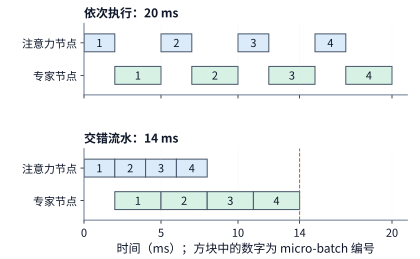

*图 9-19　四个微批次（micro-batch）在注意力节点与专家节点之间的串行执行与交错流水对比（每微批注意力耗时 2 ms、专家耗时 3 ms，暂略通信耗时）。上图串行执行时两节点交替空闲，总耗时 20 ms；下图采用乒乓交错流水，当微批 1 在专家节点计算时，微批 2 同时在注意力节点计算，流水填满后由较慢的专家节点（每 3 ms 一批）决定产出节奏，总耗时缩短至 14 ms。*

**例 9.4　AF 逐层激活交接与 PD 整份 KV 交接的通信代价有何本质区别？** 为了在完全相同的模型基准上对比 PD 与 AF 的通信特性，我们回到 36 层的 Qwen3-8B，考虑一种教学对照部署：将每层的注意力留在节点 A，将 36 层稠密前馈网络（FFN）拆到节点 B，单条请求在 decode 阶段每走一层都要把长度为 $h=4096$ 的 BF16 隐状态向量发往节点 B，算完 FFN 后再将同样大小的向量传回节点 A。单向传输一次的载荷仅为 $4096\times 2 = 8192\ \mathrm{bytes} = 8\ \mathrm{KiB}$；单步 decode 走完 36 层共需往返通信 $36\times 2 = 72$ 次，累计传输载荷为 $V_{AF} = 72\times 8\ \mathrm{KiB} = 576\ \mathrm{KiB}$（$589{,}824\ \mathrm{bytes}$）。沿用例 9.1 中有效带宽 $B = 25\ \mathrm{GB/s}$、单次传输固定启动开销 $\alpha = 5\ \mu\mathrm{s}$ 的 RDMA 网卡，单步 decode 的纯载荷传输时间仅为 $589{,}824 / (2.5\times 10^{10}) \approx 23.6\ \mu\mathrm{s}$，但 72 次往返的固定启动开销却高达 $72\times 5\ \mu\mathrm{s} = 360\ \mu\mathrm{s}$，占了单步串行交接总时间（约 $0.384\ \mathrm{ms}$）的 **$94\%$**。

初看之下，单步 AF 交接的 $0.384\ \mathrm{ms}$ 似乎比一次 PD 交接的 $48.3\ \mathrm{ms}$（例 9.1）快得多；但别忘了两者的触发频次截然不同：**PD 分离在整条请求生命周期中只交接 1 次，而 AF 分离在生成的每一步都要交接 72 次**（若 prefill 阶段的 8192 个 token 也做整批 AF 跨机交接，仅 prefill 阶段的往返激活载荷就高达 $8192\times 576\ \mathrm{KiB} = 4.5\ \mathrm{GiB}$，纯传输耗时约 $193\ \mathrm{ms}$）。而且，AF 交接传输的是层间隐状态向量（维度固定为 $h=4096$），它与注意力层采用 GQA 还是紧凑 MLA 毫无关系——换言之，紧凑 MLA 能把 PD 的单次 KV 交接体积砍半，却无法帮 AF 省掉哪怕一个字节的层间激活。

我们先比较“单次 PD 交接”与“单步 AF 交接”随启动开销 $\alpha$ 变化的临界点（图 9-20）。令两者的串行通信耗时相等：

$$
\frac{V_{KV}}{B}+\alpha=\frac{V_{AF}}{B}+72\alpha
\quad\Longrightarrow\quad
\alpha^*=\frac{V_{KV}-V_{AF}}{71B},
$$

其中 $V_{AF}=576\ \mathrm{KiB}$，$B$ 为链路带宽。当单次启动延迟 $\alpha < \alpha^*$ 时，一步 AF 交接快于一次 PD 交接；一旦 $\alpha > \alpha^*$，72 次启动的累加惩罚就会反超整份 KV 缓存的搬移时间。代入数值可知：在 $25\ \mathrm{GB/s}$ 链路上，GQA 状态（$1.125\ \mathrm{GiB}$）与紧凑 MLA 状态（$549\ \mathrm{MiB}$）对应的临界启动时间 $\alpha^*$ 分别为 $680\ \mu\mathrm{s}$ 与 $324\ \mu\mathrm{s}$；当链路带宽翻倍至 $50\ \mathrm{GB/s}$ 时，这两个临界值减半为 $340\ \mu\mathrm{s}$ 与 $162\ \mu\mathrm{s}$。在 RDMA 网络 $\alpha = 5\ \mu\mathrm{s}$ 的正常水平下，单看一步 decode，AF 交接确实远快于一次 PD 交接；但当我们把视野拉回到章首请求的完整 1024 步 decode 过程时，1024 步 AF 交接的累计通信时间高达 $1024\times 0.3836\ \mathrm{ms} \approx 392.8\ \mathrm{ms}$，反而是 GQA 单次 PD 交接（$48.3\ \mathrm{ms}$）的 **$8.1$ 倍**，更是紧凑 MLA 单次 PD 交接（$23.0\ \mathrm{ms}$）的 **$17$ 倍**。这一鲜明的反转深刻揭示了两种切分范式的物理边界：PD 分离做的是“一次性的阶段状态搬移”，上下文越短或状态压缩率越高（如 MLA）越划算；AF 分离做的是“高频的层间微消息往返”，输出序列越长累计代价越大，因此跨机 AF 分离必须高度依赖超低延迟 RDMA 原语与多微批交错流水线来隐藏这笔可观的累计开销。

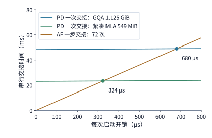

*图 9-20　25 GB/s 链路上单次 PD 交接与单步 AF 交接（72 次传输）的串行耗时随单次启动开销 $\alpha$ 的变化关系。PD 仅启动 1 次，直线斜率为 1；AF 单步启动 72 次，直线斜率高达 72。两条水平近乎平坦的 PD 线分别对应 GQA 状态（1.125 GiB）与紧凑 MLA 状态（549 MiB），它们与 AF 陡峭斜线的交点即为临界启动时间 $\alpha^*=680\ \mu\mathrm{s}$ 与 $324\ \mu\mathrm{s}$（在 50 GB/s 链路下交点左移至 $340\ \mu\mathrm{s}$ 与 $162\ \mu\mathrm{s}$）。*

在稠密模型中，AF 交接只是把向量发往对端再原样收回；而在混合专家（MoE）模型中，每个 token 的激活还要根据动态门控结果分发给多张不同的专家卡，待所有被选中的专家都算完后才能汇合。下一节我们将深入考察这种一对多动态路由带来的负载倾斜与负载均衡机制。

## 9.4 专家放置、复制与负载均衡

### 9.4.1 大 EP 中的计算与通信 skew

在第 9.3.3 节的单机分析中，路由集中到少数热点专家是个好消息——它把需要读取的专家权重从 $4.5\ \mathrm{GiB}$ 压缩到了 $288\ \mathrm{MiB}$。然而，一旦进入多卡专家并行（EP）架构，如果这几个被高频选中的热点专家恰好都放置在同少数一两张 GPU 上，其余空闲的 GPU 就只能停下来等待。本节继续追踪同样的 512 次“token 到专家”分派任务，考察当专家分布在多张 GPU 上时，单卡负载不均（skew）如何决定整层的完成时刻。对于专家并行组中的任意一张卡 $r$，记其在本层分到的有效矩阵浮点运算量为 $F_r$、需要从显存读取的专家权重字节数为 $W_r$，该卡的有效算力与有效显存带宽分别为 $C_r$ 和 $B_r$。根据 Roofline 下界，卡 $r$ 完成本地专家计算的时间至少为 $\max(F_r/C_r, W_r/B_r)$；而由于层末的 combine 阶段必须等待所有参与卡返回结果，整层专家计算的完成时间由耗时最长的那张最忙卡（straggler）决定。

把上一节的 512 次分派放到一台八卡 HGX H100 服务器（每张 H100 SXM 按 BF16 稠密峰值 $989.4\ \mathrm{TFLOP/s}$ 的 $50\%$ 计，有效算力为 $494.7\ \mathrm{TFLOP/s}$）上，就能看清集中路由硬币的另一面（图 9-21 与图 9-22）：
- **均匀分布到八张卡（图 9-21）**：每张卡恰好分到 $512 / 8 = 64$ 次任务，各自执行约 $2.42\ \mathrm{GFLOPs}$ 的矩阵乘加，单看矩阵计算每张卡耗时约 $4.9\ \mu\mathrm{s}$，八张卡齐头并进、同时抵达层末汇合线；
- **热点集中到单张卡（图 9-22）**：被选中的 8 个热点专家恰好全部驻留在卡 0 上，导致卡 0 独自承担全部 512 次任务（约 $19.3\ \mathrm{GFLOPs}$），计算耗时拉长至约 $39.1\ \mu\mathrm{s}$（为均匀分布时的 **8 倍**），而卡 1 至卡 7 在整个阶段完全空转。

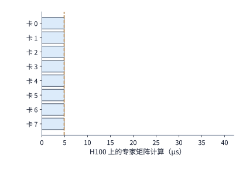

*图 9-21　512 次专家分派均匀落到八张 H100 GPU 上（每卡 64 次任务、约 2.42 GFLOPs）：八张卡均在约 4.9 μs 时完成计算，橙色虚线标出全组可以启动结果合并的时刻。*

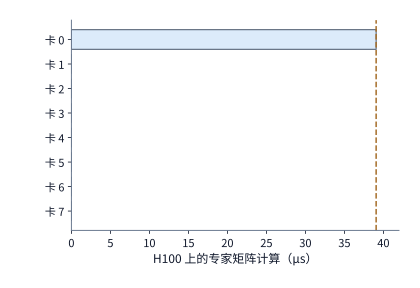

*图 9-22　相同的 512 次专家分派全部命中驻留在卡 0 上的 8 个热点专家，卡 1 至卡 7 完全空闲。尽管全系统总浮点运算量与图 9-21 完全相等（19.3 GFLOPs），但整层必须等待卡 0 在 39.1 μs 完成计算后才能合并，耗时膨胀为原来的 8 倍。*

对比这两幅图可以得出一条核心判断准则：路由集中将需要读取的不同专家权重从 $4.5\ \mathrm{GiB}$ 减至 $288\ \mathrm{MiB}$，有利于受限于权重读取的小批量场景；但若热点专家集中在同一张卡上，又会把最忙卡的计算与通信负载放大至原来的数倍，严重拖累受限于算力或跨卡带宽的大批量场景。因此，设计专家负载均衡策略之前，必须先看清当前处于哪一类瓶颈区，再决定是优先利用批内复用还是优先将热点打散到多张卡上。

更值得警惕的是，**即便每个逻辑专家的冷热程度完全固定，扩大专家并行度（大 EP）也会显著放大卡与卡之间的负载倾斜（card-level skew）。** 沿用第 9.3.4 节贴近 DeepSeek-V3 架构的参数：$n=1024$ 个 token、每 token 选 $k=8$ 个专家、每层共 $E=256$ 个逻辑路由专家，全批合计产生 $nk = 8192$ 次分派，平均每个逻辑专家收到 $8192 / 256 = 32$ 行输入。假设其中编号为 0 的专家是一个“4 倍热点专家”，独自收到了 $128$ 行输入；其余 $8192 - 128 = 8064$ 行输入均匀分给另外 255 个普通专家，每个普通专家收到约 $31.6$ 行。现在将这 256 个专家按编号顺序均分到不同规模的 EP 组中（图 9-23）：
- **在 EP8 下（每卡持有 32 个专家）**：卡 0 持有 1 个热点专家和 31 个普通专家，合计处理 $128 + 31\times 31.6 \approx 1108$ 行，仅比全组每卡平均值（$1024$ 行）高出约 **$8\%$**；
- **在 EP32 下（每卡持有 8 个专家）**：卡 0 持有 1 个热点专家和 7 个普通专家，合计处理 $128 + 7\times 31.6 \approx 349$ 行，比每卡平均值（$256$ 行）高出约 **$36\%$**；
- **在 EP256 下（每卡仅持有 1 个专家）**：卡 0 独占该热点专家，处理 $128$ 行，而全组每卡平均值只有 $32$ 行，最忙卡负载直接达到了平均值的 **$400\%$（4 倍）**。

同一个 4 倍热度的逻辑专家，在小 EP 中被同卡驻留的几十个普通专家稀释得几乎看不出来，而在大 EP 中由于每卡只放一两个专家，专家维度的冷热不均被毫无缓冲地原样映射成了 GPU 卡间的严重不均。

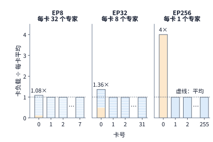

*图 9-23　同一个 4 倍热点专家（128 行，平均为 32 行）在 EP8、EP32 与 EP256 三种并行规模下造成的卡间负载倾斜（256 个专家，1024 个 token 各选 8 个）。每根柱子代表一张 GPU，柱内分段代表该卡持有的各个专家（橙色段为专家 0）；纵轴已归一化为“该卡总行数 / 每卡平均行数”。随着 EP 扩大、每卡专家数减少，同卡普通专家对热点的稀释作用迅速消失，最忙卡与平均卡的负载比从 1.08 倍一路升至 4.0 倍。*

在专家分离与大 EP 架构下，单张专家卡分到的输入行数 $m_j$ 同时支配着三项关键耗时：dispatch 阶段该卡网卡需要接收的字节数、专家矩阵处于计算受限区时的 GEMM 耗时，以及 combine 阶段该卡网卡需要发回的字节数。按每行激活 $8\ \mathrm{KiB}$、每卡配备 $400\ \mathrm{Gbit/s}$（单向有效带宽 $50\ \mathrm{GB/s}$）网卡计算，在 EP256 下，接收 128 行的热点卡 0 需要收发各 $1\ \mathrm{MiB}$ 数据（单程耗时约 $21\ \mu\mathrm{s}$），而接收 32 行的平均卡只需收发 $256\ \mathrm{KiB}$（单程耗时约 $5.2\ \mu\mathrm{s}$）。哪怕在批大小较小、单卡专家 GEMM 主要受限于读取本地专家权重字节数的情形下，跨网 dispatch 与 combine 的通信字节数依然严格正比于该卡收到的行数。从 EP8 扩展到 EP256，虽然每卡平均处理的输入行数缩小到了原来的 $1/32$，但最忙卡 0 的行数仅从 1108 行降到 128 行（仅缩小到约 $1/8.7$）；由于整层同步必须等待最忙的卡 0 完成，在 EP256 下其余普通卡有近四分之三的时间都在空等卡 0。

即便门控路由完全不存在任何系统性热点——即每个 token 严格独立、等概率地随机挑选 8 个专家——扩大 EP 规模同样会显著推高最忙卡的相对负载。原因来自概率统计中的两个基本效应：第一，单卡持有的专家数量 $E/R$ 越少，各个专家在平均值 $32$ 行附近的随机涨落就越难在同一张卡内部相互正负抵消（大数定律减弱）；第二，并行组内的卡数 $R$ 越多，在一次抽样中从 $R$ 张卡里取最大值 $\max_{1\le j\le R} m_j$ 时，遇到极端高值尾部的概率就越大（极值分布右移）。图 9-24 展示了固定随机种子模拟 1000 个批次得到的统计曲线：在完全均匀随机路由（蓝线）下，EP8 时最忙卡平均仅比每卡均值高出约 $4\%$，而在 EP256 时最忙卡平均比每卡均值高出 **$52\%$**。DeepSeek 公开的线上 decode 部署采用 EP144（每张 GPU 仅放置 2 个路由专家），恰好落在这条倾斜放大曲线的右侧陡升区；为此，其系统专门在每层额外增配了 32 个冗余专家槽位，并根据线上负载统计周期性地为高负载专家创建副本，这正是第 9.4.2 节要讨论的动态均衡机制。[^ep-scale]

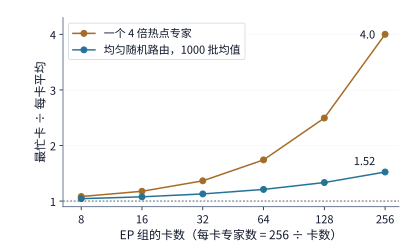

*图 9-24　最忙卡输入行数与每卡平均行数之比（卡间负载倾斜度）随 EP 组卡数的变化趋势（256 个逻辑专家按编号均分，未配置冗余副本，横轴为对数刻度）。橙线对应存在单个 4 倍热点专家的解析结果（从 EP8 的 1.08 倍升至 EP256 的 4.0 倍）；蓝线对应完全均匀随机路由下模拟 1000 批的统计均值（从 EP8 的 1.04 倍升至 EP256 的 1.52 倍）。*

在核算大 EP 的跨卡通信量时，还必须先看清输入 token 在进入 MoE 层之前的分布方式。回顾第 9.1.1 节提到的 TP2×EP4 架构：在那套方案里，四个 EP 组处理的是同一批复制的请求，每个 EP 组的卡在算完注意力后本就已经持有完全相同的 token 隐状态，因此根本不需要跨 EP 组执行远端 dispatch，只需在各自 EP 组算完本地命中的专家后通过 All-Reduce 或 Reduce-Scatter 归约部分和即可。而在图 9-18 所示的 DP + EP（或跨池专家分离）架构中，不同的注意力卡持有的是不同请求的输入 token，此时就必须先通过 All-to-All dispatch 将隐状态发往目标专家所在的远端卡，算完后再通过 All-to-All combine 发回原卡。简言之，输入状态是否预先复制，直接决定了 MoE 层需要一次还是两次跨网集合通信。

总结起来，诊断大 EP 系统的负载倾斜（skew）必须依次穿透三个层次：第一层是**逻辑专家层**，门控路由的选取频率决定了每个逻辑专家分到的有效输入行数；第二层是**物理设备层**，专家到 GPU 的放置映射与副本分流策略将逻辑专家的行数汇总为每张卡的计算与收发负载；第三层是**物理网络拓扑层**，源卡与目标卡的位置关系以及交换机路由将逐卡收发量映射为每条物理链路与网络割集上的方向性字节流。逻辑专家不均未必导致卡间不均（可被同卡其他专家冲淡或被多副本分流），而卡间计算均衡也未必意味着共享网络链路不拥塞。

下面用通用矩阵语言将这三个层次写成一个可计算的通信与执行下界模型。设当前层共有 $n$ 个 token、每 token 选 $k$ 个专家，记 $a_{ij}$ 为来源卡 $i$ 发往专家组（目标卡）$j$ 的“token—专家”分派次数，单次分派在 dispatch 阶段发送的输入向量与在 combine 阶段收回的输出向量大小分别为 $d_D$ 和 $d_C$ 字节。在直接按分派逐份发送（未做同卡多专家跨源去重或预归约）的基准方案下，从卡 $i$ 发往卡 $j$ 的 dispatch 流量 $V^D_{ij}$、从卡 $j$ 退回卡 $i$ 的 combine 流量 $V^C_{ji}$、目标卡 $j$ 接收的总分派行数 $m_j$ 以及专家组间的任务倾斜度 $s_{\mathrm{expert}}$ 分别为

$$
V^D_{ij}=a_{ij}d_D,\qquad V^C_{ji}=a_{ij}d_C,\qquad
m_j=\sum_i a_{ij},\qquad
s_{\mathrm{expert}}=\frac{\max_j m_j}{nk/R},
$$

其中 $R$ 为接收端专家组（专家卡）的数量，且满足总任务守恒 $\sum_j m_j = nk$。当 $s_{\mathrm{expert}}=1$ 时表示各专家卡收到的有效行数完全均衡；唯有在各卡专家矩阵尺寸相同、数值精度一致且忽略分块补齐（padding）的前提下，$s_{\mathrm{expert}}$ 才近似等于计算量倾斜度。对于通信阶段 $X\in\{D, C\}$，将通信矩阵按每个发送端出口、每个接收端入口以及网络拓扑中的任意物理割集（cut）$\mathcal{C}$ 分别求和，可得该阶段纯载荷传输耗时的物理下界：

$$
T_X\ge\max\left(
\max_i\frac{\sum_jV^X_{ij}}{B^{\mathrm{send}}_i},
\max_j\frac{\sum_iV^X_{ij}}{B^{\mathrm{recv}}_j},
\max_{\mathcal C}\frac{V^X_{\mathcal C}}{B_{\mathcal C}}
\right),
$$

式中 $B^{\mathrm{send}}_i$、$B^{\mathrm{recv}}_j$ 分别为节点发送与接收方向的可用带宽，$V^X_{\mathcal{C}}$ 与 $B_{\mathcal{C}}$ 分别为穿过物理割集 $\mathcal{C}$ 的总流量与割集总带宽。需要注意，凡是经过同一物理网卡方向或同一条共享上行链路的并发数据流，其字节数必须先相加再除以该链路的物理带宽。文中说的“带宽 skew”，并不是指网卡硬件额定速率发生了变化，而是指不同卡或不同方向上的流量需求冷热不均，导致那条最拥挤的收发路径决定了全组的通信完成时间。

**例 9.5　总通信字节数与总计算量完全不变，为什么热点会让 dispatch、计算和 combine 三段同时变慢？** 我们将第 7.2.3 节的算例参数（全批 $n=1024$ 个 token、每 token 选 $k=8$ 个专家、BF16 隐状态向量单份 $d_D = d_C = 8\ \mathrm{KiB}$）放到图 9-18 所示的两台 HGX H100 服务器上：服务器 A 上的四张卡为发送源（$i=0,1,2,3$），服务器 B 上的四张卡为四个专家组（$j=0,1,2,3$），所有分派均跨服务器传输。每张 GPU 通过各自独立的 $400\ \mathrm{Gbit/s}$ ConnectX-7 网卡收发数据（单卡单向有效带宽 $50\ \mathrm{GB/s}$），交换网络在两台服务器之间可提供每方向 $4\times 50 = 200\ \mathrm{GB/s}$ 的无阻塞聚合带宽。四个发送源各自发出 $256\times 8 = 2048$ 份向量，全批 dispatch 总流量恒为 $8192\times 8\ \mathrm{KiB} = 64\ \mathrm{MiB}$，combine 总流量也恒为 $64\ \mathrm{MiB}$。我们对比两种接收分布（图 9-25）：
- **四组完全均衡分布**：服务器 B 上的四个专家组各收到 $2048$ 份任务（每卡接收 $16\ \mathrm{MiB}$），此时 $s_{\mathrm{expert}} = 1$；
- **单组热点分布 $[5120, 1024, 1024, 1024]$**：专家组 0 独自收到 $5120$ 份任务（单卡接收 $40\ \mathrm{MiB}$），其余三个专家组各收到 $1024$ 份任务（每卡接收 $8\ \mathrm{MiB}$），总分派数仍为 $8192$ 份，但倾斜度升至 $s_{\mathrm{expert}} = 5120 / 2048 = 2.5$。

单次分派的专家计算量仍按 Qwen3-235B-A22B 的 $2P_e = 6\times 4096\times 1536 \approx 37.75\ \mathrm{MFLOPs}$ 计，单张 H100 的有效算力取 $494.7\ \mathrm{TFLOP/s}$。暂不计权重读取、分块补齐与启动延迟，可算出五种典型配置下的三阶段下界如下表所示（表中最后一列“阶段屏障总下界”对应在 dispatch、专家计算与 combine 之间设置整批同步屏障时的串行总和）：[^ep-calc]

| 路由分布与物理互联配置 | dispatch 下界 | 最忙卡计算下界 | combine 下界 | 阶段屏障总下界 |
|---|---:|---:|---:|---:|
| 四组均衡，跨服务器（4×400 Gbit/s） | 0.336 ms | 0.156 ms | 0.336 ms | 0.827 ms |
| 热点组（skew = 2.5），跨服务器 | 0.839 ms | 0.391 ms | 0.839 ms | 2.068 ms |
| 四组均衡，两池间仅剩 1 条 400 Gbit/s 共享链路 | 1.342 ms | 0.156 ms | 1.342 ms | 2.841 ms |
| 热点组，仅将 dispatch 激活量化为 FP8 | 0.419 ms | 0.391 ms | 0.839 ms | 1.649 ms |
| 热点组，两池同在一台 HGX 内（走 NVLink） | 0.093 ms | 0.391 ms | 0.093 ms | 0.577 ms |

*表 9-5　两台 HGX H100 服务器间大 EP 在不同路由分布与物理互联配置下的三阶段耗时下界对比。*

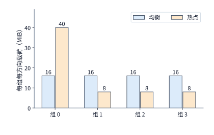

*图 9-25　两台服务器间四个专家组在 dispatch 阶段接收、combine 阶段发回的字节载荷对比。均衡分布与热点分布的全组总流量均为每方向 64 MiB（8192 次分派）；但在热点分布下，专家组 0 在接收和发回两个阶段都必须独自吞吐 40 MiB（其余三组各 8 MiB），导致单卡网卡入口与出口同时成为整层的通信瓶颈。*

剖析上表中的五组数字，可以得出一系列深刻的工程启示：
1. **跨机大 EP 下通信占大头**：在跨服务器均衡基准下，dispatch 与 combine 两次网络交换占了整层耗时下界（$0.827\ \mathrm{ms}$）的 **$81\%$**，而最忙卡的矩阵计算仅占 **$19\%$**。这是因为 H100 Tensor Core 算完一份专家任务只需约 $76\ \mathrm{ns}$，而 $50\ \mathrm{GB/s}$ 网卡传完一份 $8\ \mathrm{KiB}$ 的 BF16 激活却需要约 $164\ \mathrm{ns}$。
2. **热点对三阶段产生乘数级连带惩罚**：当组 0 出现 $2.5$ 倍热点时，组 0 的网卡接收、Tensor Core 计算与网卡发回三段耗时全部同步膨胀为原来的 $2.5$ 倍，整层总下界从 $0.827\ \mathrm{ms}$ 拉长至 $2.068\ \mathrm{ms}$。
3. **物理割集瓶颈独立于单卡均衡**：即便路由做到四组完全均衡，如果两台服务器之间的上联交换机出现拥塞或链路缩水，只剩一条 $400\ \mathrm{Gbit/s}$（$50\ \mathrm{GB/s}$）的共享跨池通道，那么全部 $64\ \mathrm{MiB}$ 流量都必须排队挤过这一物理割集 $\mathcal{C}$，每次交换至少耗时 $1.342\ \mathrm{ms}$——此时单纯在服务器 B 内增加专家卡数量毫无帮助。
4. **单边低精度通信的局限性**：像 DeepSeek-V3 那样将 dispatch 激活量化为 FP8（每向量降至 $4\ \mathrm{KiB}$），确实能把热点下的 dispatch 耗时砍半至 $0.419\ \mathrm{ms}$；但如果 combine 阶段为了保持累加精度仍采用 BF16，那么 combine 的 $0.839\ \mathrm{ms}$ 与专家计算的 $0.391\ \mathrm{ms}$ 依然留在原地。
5. **高带宽域翻转主要矛盾**：如果把注意力卡与专家卡放进同一台 HGX H100 服务器内部，利用单卡单向 $450\ \mathrm{GB/s}$ 的 NVLink 交换数据，即便存在 $2.5$ 倍热点，dispatch 与 combine 也都被压缩到了 $0.093\ \mathrm{ms}$，此时热点卡上 $0.391\ \mathrm{ms}$ 的专家矩阵计算反过来占到了总耗时（$0.577\ \mathrm{ms}$）的 **$68\%$**。在这种高带宽域内，继续提升网络带宽收益甚微，唯有把热点卡上的计算任务分流出去才能治本——这正是下一节“专家副本”机制登场的直接动因。

### 9.4.2 专家副本、放置与动态调整

既然图 9-22 与例 9.5 最后一行的瓶颈在于“热点专家全挤在卡 0 上，而卡 1 至卡 7 有空闲算力与带宽”，最自然的解决思路就是在空闲卡上为热点专家创建**物理副本**（expert replication）：让同一个逻辑专家在多张物理 GPU 上同时驻留相同的权重拷贝，调度器即可在路由分发时将命中该逻辑专家的 token 分流到不同的物理副本上并行处理。需要注意，只要各物理副本的权重完全一致、门控缩放系数与合并加权严格遵守原公式，增设专家副本就是一种**完全等价、无损模型精度**的系统优化；它与强行丢弃超出容量的 token（token dropping）或篡改 top-$k$ 路由规则有着本质区别，后者会改变模型的数学语义与输出质量，不能混为一谈。目前主流推理引擎（如 vLLM 与 SGLang）内置的专家负载均衡器（EPLB，Expert Parallelism Load Balancer），正是通过在线统计各层逻辑专家的命中频次，周期性地调整热点专家的物理副本数量、放置位置及分派权重。

当然，天下没有免费的副本：每多放一份专家副本，就要多占一份显存，从而直接挤压可用于存放上下文 KV 缓存与激活缓冲的空间。在 Qwen3-235B-A22B（94 层、单专家 BF16 权重 $36\ \mathrm{MiB}$）中，如果机械地为每张卡在全部 94 层上各增加 1 个专家副本，单卡需额外消耗 $94\times 36\ \mathrm{MiB} = 3384\ \mathrm{MiB}\approx 3.30\ \mathrm{GiB}$ 显存；反之，如果通过线上剖析发现只有其中 8 个拥塞最严重的层存在显著热点，只为这 8 层各增加 1 个副本，单卡仅需付出 $8\times 36 = 288\ \mathrm{MiB}$ 显存，显存开销相差近 **12 倍**。MLSys 2026 上的 CRAFT 系统专门研究了这一逐层差异化副本分配问题：将有限的冗余显存预算精准投向倾斜最严重、复制收益最高的模型层，而非在所有层平均用力。[^moe]

**例 9.6　动态创建热点专家副本需要持续多少个批次才能收回权重复制成本？** 考虑一台八卡 HGX H100 服务器（每张 H100 SXM 按 $50\%$ 峰值计，有效算力 $494.7\ \mathrm{TFLOP/s}$、有效显存带宽 $1675\ \mathrm{GB/s}$）。假设在某一负载阶段，每批 $128$ 个 token 全部集中命中驻留在卡 0 上的 8 个热点专家，产生 $1024$ 次分派。为了缓解卡 0 的拥塞，系统决定把其中 7 个热点专家各复制一份到卡 1 至卡 7 上（共复制 $7\times 36\ \mathrm{MiB} = 252\ \mathrm{MiB}$ 权重）；卡 1 至卡 7 每卡仅需新增 $36\ \mathrm{MiB}$ 权重，均可塞入各卡预留的 $64\ \mathrm{MiB}$ 冗余显存槽位中。在未复制前，卡 0 按分块（tile）调度每批需从 HBM 读写约 $921\ \mathrm{MB}$ 数据，受显存带宽限制每批耗时约 $0.550\ \mathrm{ms}$；完成复制并分流后，卡 0 每批只需承担 $576$ 次分派，耗时缩短至约 $0.309\ \mathrm{ms}$，相当于每执行一个批次可净节省 $\Delta t \approx 0.240\ \mathrm{ms}$。但创建这 7 份副本本身需要时间：若 7 份权重均由卡 0 经机内 NVLink（单向 $450\ \mathrm{GB/s}$，每次传输启动开销 $5\ \mu\mathrm{s}$）依次发出，串行复制准备总耗时为 $T_{\mathrm{copy}} \approx 0.622\ \mathrm{ms}$。要使累计节省的批执行时间超过这次复制投入，热点分布持续的批次数 $N$ 必须满足严格的回本不等式：

$$
N\Delta t>T_{\mathrm{copy}},\qquad
N_{\min}=\left\lfloor\frac{T_{\mathrm{copy}}}{\Delta t}\right\rfloor+1=3.
$$

如图 9-26 所示，在同一台 HGX 服务器内部经 NVLink 复制时，只需到**第 3 个批次**就能收回复制成本：如果该热点分布持续 16 个批次，系统可净赚约 $3.2\ \mathrm{ms}$；持续 64 个批次则可净赚约 $14.8\ \mathrm{ms}$。然而，如果热点专家的源权重位于另一台服务器上，必须经由 $400\ \mathrm{Gbit/s}$ 的 ConnectX-7 网卡（单向 $50\ \mathrm{GB/s}$）跨机复制，那么串行准备耗时将激增至 $T_{\mathrm{copy}} \approx 5.32\ \mathrm{ms}$，回本门槛随之推迟到**第 23 个批次**：此时若热点仅持续 16 个批次就发生漂移，跨机复制不仅没能加速，反而倒赔约 $1.5\ \mathrm{ms}$；只有当热点持续 64 个批次时才能净省约 $10.1\ \mathrm{ms}$。此外，显存容量是硬约束：如果接收卡当时只剩 $32\ \mathrm{MiB}$ 可用空间，连一份 $36\ \mathrm{MiB}$ 的专家权重都放不下，那么无论热点持续多久，该副本方案在容量上都是不可行的，必须先通过换出或重排腾出空间。[^replica]

> **算例 9-3（大 EP 热点倾斜放大与冗余专家副本复制回本批次核算）**
> 1. **EP 规模扩大对 4 倍热点专家倾斜度的放大**：全批 $n=1024$ token、$k=8$、$E=256$ 个逻辑专家（总分派 $8192$ 行，每专家均值 $32$ 行），设专家 $0$ 为 $4\times$ 热点（$128$ 行），其余 $255$ 个专家各约 $31.62$ 行。按编号均分到 $R$ 张卡上时，卡 $0$ 负载与每卡均值 $(8192/R)$ 之比依次为：$\mathrm{EP8}$ 下 $(128 + 31\times 31.62)/1024 \approx \mathbf{1.08\times}$；$\mathrm{EP32}$ 下 $(128 + 7\times 31.62)/256 \approx \mathbf{1.36\times}$；$\mathrm{EP256}$ 下 $128/32 = \mathbf{4.00\times}$。
> 2. **机内 NVLink 与跨机 RDMA 复制 7 份专家副本的回本门槛**：复制 $7\times 36\ \mathrm{MiB} = 252\ \mathrm{MiB}$（$264{,}241{,}152\ \mathrm{B}$）专家权重，每批节省 $\Delta t \approx 0.2405\ \mathrm{ms}$。机内 NVLink（$450\ \mathrm{GB/s}$，$7\times 5\ \mu\mathrm{s}$ 启动）准备耗时 $T_{\mathrm{copy,nvl}} \approx \mathbf{0.622\ \mathrm{ms}}$，回本批次 $N_{\min} = \lfloor 0.6222/0.2405\rfloor + 1 = \mathbf{3\ \text{批}}$；跨机 ConnectX-7（$50\ \mathrm{GB/s}$）准备耗时 $T_{\mathrm{copy,cx7}} \approx \mathbf{5.320\ \mathrm{ms}}$，回本批次推迟至 $N_{\min} = \lfloor 5.3198/0.2405\rfloor + 1 = \mathbf{23\ \text{批}}$。

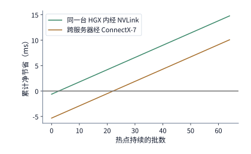

*图 9-26　热点专家复制的回本周期分析。复制 7 个热点专家（共 252 MiB）后每批次可节省约 0.240 ms：机内经 NVLink（450 GB/s）复制仅需约 0.622 ms，从第 3 批起即获得正的累计净收益；跨机经 ConnectX-7 网卡（50 GB/s）复制需约 5.32 ms，必须持续到第 23 批才能收回复制成本。图中曲线基于例 9.6 的精确数值绘制。*

CRAFT（MLSys 2026）在真实集群上的评测进一步佐证了“按层定制副本”的价值。该研究基于 SGLang v0.4.8，在由 8 个 AWS p4de.24xlarge 节点（每节点 8 张 A100 80GB）组成的集群上运行 BF16 精度的 DeepSeek-R1 与 Kimi K2：在相同的显存预算下，将按层剖析分配专家副本的策略与均匀静态复制策略对比，端到端服务吞吐平均提升了 $1.14$ 倍（最高达 $1.20$ 倍）。这表明各层专家热点的倾斜度与复制边际收益存在显著差异，将宝贵的显存预算集中投向高收益层十分关键；同时在阅读文献时也应注意其实验边界（如输入按 4096 token 分块、输出固定为 256 token，且以有效吞吐 goodput 定义容量拐点，线上部署时仍需直接核验 p99 尾延迟）。[^ep-papers]

综合图 9-26 与系统实测可以看出，动态专家均衡器的核心难点在于**预测热点的持续时间窗口**：在跨服务器（RDMA）场景下，单次重排复制耗时超过 $5\ \mathrm{ms}$，如果监控窗口设得太短、跟着瞬时抖动频繁搬移权重，系统就会陷入“刚复制完热点就转移、永远收不回复制成本”的震荡泥潭；而在机内 NVLink 场景下，亚毫秒级的复制速度几乎不构成时间障碍，真正的瓶颈在于每张 GPU 还能从 KV 缓存池里挤出多少空闲显存。

在实际工程部署中，一套完整的 MoE 负载均衡体系需要沿着“发送源 $\to$ 专家卡 $\to$ 物理网络”三个层级协同设计：在注意力发送源一侧，需平衡各 DP 副本的输入 token 数与注意力算子完成时刻（例如在长上下文 decode 中，即便各卡请求数相同，历史 KV 长度的差异也会导致注意力算完并启动 dispatch 的时刻参差不齐）；在专家卡一侧，需综合平衡有效行数、分块补齐后的实际 GEMM 耗时与网卡接收字节数；在物理网络一侧，则需监控跨机架上行链路与返回通道的拥塞情况。这正是 DeepSeek-V3/R1 推理报告将 prefill 负载均衡、decode 负载均衡与 EP 专家放置分别建模治理的原因。[^ep-system]

此外，当多个注意力实例共享同一个独立专家池时，还必须防范跨来源流量叠加引发的排队失稳：即便每个注意力 worker 各自发出的小批次看起来相当温和，一旦多个 worker 在同一时刻不约而同地命中同一个热点专家，汇合后的瞬时流量仍可能击穿该专家卡的服务能力。设专家池每秒接纳 $\lambda$ 个批次，每个批次在专家卡 $j$ 上产生的期望浮点运算量为 $\mathbb{E}[F_j]$、在物理链路 $\ell$ 上产生的期望传输字节数为 $\mathbb{E}[V_\ell]$，则系统稳态运行至少要求对所有卡与链路同时满足 $\lambda\mathbb{E}[F_j] < C_j$ 且 $\lambda\mathbb{E}[V_\ell] < B_\ell$。放置热点专家副本时，必须挑选同时具备算力余量与网卡带宽余量的目标卡（注：本节单条 dispatch 消息为一个 token 的隐状态向量，BF16 下为 $8\ \mathrm{KiB}$、FP8 下为 $4\ \mathrm{KiB}$，均远大于第 7.2.4 节求出的 $50\ \mathrm{GB/s}$ 网卡约 $0.93\ \mathrm{KB}$ 的消息速率瓶颈交点，因此热点卡首先耗尽的是字节带宽而非每秒发包率；唯有逐条发送小于 $1\ \mathrm{KB}$ 的细粒度控制消息时，才需额外校核网卡约 $54\ \mathrm{Mops/s}$ 的队列门铃能力）。在运行期动态切换或回收旧副本前，调度器还必须保留当前在途批次的路由映射表，等待所有在途 combine 消息排空后才能安全释放旧副本空间。

### 9.4.3 输入分发、计算与结果合并的重叠

前两小节在核算专家层耗时时，尚未区分 prefill 与 decode 两个阶段对路由倾斜的不同敏感度，也暂未计入矩阵分块补齐（padding）与通信—计算重叠的实际损耗。MLSys 2026 的《Demystifying the Mixture of Experts Serving Tax》通过系统的分阶段微基准实验揭示了这两者的重要影响：在算力受限的 prefill 阶段，路由倾斜会直接拉长最慢卡的 GEMM 时间并拖慢整批同步；而在访存受限的 decode 阶段，适度的路由集中反而可能通过减少活跃专家数量与分块补齐浪费来降低访存开销（这与第 6.3.2 节及图 9-17 的分析完全吻合）。这提醒我们，评估 MoE 性能时必须将门控路由分布、底层算子的实际分块形状、网络通信与显存访问放在一起联合测量。[^ep-papers]

底层算子形状带来的第一项典型“隐形税”是**分组矩阵乘法的分块补齐（tile padding）**。为了在一次内核启动中并行计算同一张卡上的多个专家，Grouped GEMM 内核要求将每个专家的输入矩阵行数向上补齐到硬件 Tensor Core 分块大小（例如 32 行或 64 行）的整数倍，不足一整块的部分必须补上全零行。举一个直观的例子：假设同一张卡上的 8 个本地专家在当前批次分别收到了 $[32, 16, 8, 4, 2, 1, 1, 0]$ 个 token，全卡合计只有 **64 个有效输入行**（对应 64 次真实的 token 到专家分派）。然而，当送入分块高度为 32 行的 Grouped GEMM 内核执行时：
- 若内核跳过 0 行专家、将其余 **7 个非空专家**各自补齐到 32 行，硬件实际执行的矩阵行数将达到 $7\times 32 = 224$ 行，是有效行数的 **$3.5$ 倍**；
- 若内核机械地将全部 **8 个专家**都按最大行数 32 补齐，硬件实际执行的行数更是高达 $8\times 32 = 256$ 行，是有效行数的 **$4$ 倍**。

这就解释了为什么两批有效分派次数完全相同的请求，在 GPU 上测出的专家 GEMM 时间却可能相差数倍：Tensor Core 实打实地消耗了周期去乘加那些补出来的全零行，而这些零行对模型输出没有任何贡献。

除了分块补齐，决定 MoE 层端到端耗时的另一项关键机制是**分发（dispatch）、专家计算与合并（combine）三阶段的流水重叠**。我们以例 9.5 第一行（跨服务器四组均衡分布）的三阶段下界为例：整批数据的 dispatch 耗时 $0.336\ \mathrm{ms}$、专家计算耗时 $0.156\ \mathrm{ms}$、combine 耗时 $0.336\ \mathrm{ms}$，三段完全串行执行时总耗时为 $0.827\ \mathrm{ms}$（图 9-27）。如果我们将这一批 token 均匀拆分为两个独立的微批次（micro-batch 1 与 micro-batch 2），每个微批次在三个阶段的耗时各减半为 $0.168\ \mathrm{ms}$、$0.078\ \mathrm{ms}$ 和 $0.168\ \mathrm{ms}$；由于网卡接收通道、GPU Tensor Core 与网卡发送通道属于三组可并发工作的物理硬件，我们可以像图 9-28 那样组织三阶段流水：当微批次 1 进入 Tensor Core 执行专家计算时，网卡接收通道同时 dispatch 微批次 2；当微批次 1 进入网卡发送通道执行 combine 时，微批次 2 恰好接力进入 Tensor Core 计算。在理想无争用条件下，双微批流水线的总耗时等于单个微批次的三段耗时之和再加上最慢阶段（此处为通信段 $0.168\ \mathrm{ms}$）的一次管线步长，即 $(0.168 + 0.078 + 0.168) + 0.168 \approx 0.581\ \mathrm{ms}$，相比串行执行净省了 $0.246\ \mathrm{ms}$（提速约 $30\%$）。

然而，硬件并发并非毫无代价：当网卡通过 PCIe/NVLink 对 HBM 发起高吞吐 DMA 读写（执行微批次 2 的 dispatch 或微批次 1 的 combine）的同时，GPU 上的 SM 也在密集访问同一个 HBM 显存控制器（执行专家 GEMM），两者会争用显存带宽与片上缓存。我们可以直接算出流水线收益被显存争用完全抵消的临界点：只要并发争用导致每个微批次的 dispatch 与 combine 通信耗时各自拉长约 **$49\%$**（或者反过来，在通信不慢的前提下导致专家计算耗时拉长至原来的 **$3.1$ 倍**），双微批流水线的总耗时就会退化回 $0.827\ \mathrm{ms}$，使重叠优化名存实亡。[^expert-exp]

回顾第 9.2.3 节留下的问题——为什么实际推理系统的 MFU/MBU 往往只有硬件标称峰值的 $50\%$ 左右？这里的**分块补齐**与**通信—计算访存争用**正是发生在底层实现中的两大元凶：前者让矩阵单元把大量算力花在了没有对应真实 token 的零行上，后者则在重叠执行时互相拖慢了彼此的有效吞吐。这两项损耗都无法靠查阅芯片手册峰值看出来，唯有选用贴合实际输入行数的自适应分块内核（如 Triton 变长分组 GEMM 或专门针对小批量调优的内核），并在硬件层面错开 DMA 与计算对显存带宽的争抢，才能把这部分损失的效率夺回来。

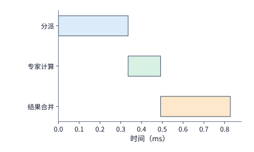

*图 9-27　单批次串行执行时间线（对应例 9.5 跨服务器四组均衡分布）：整批依次执行 dispatch（0.336 ms）、专家计算（0.156 ms）与 combine（0.336 ms），三段相加总耗时为 0.827 ms。*

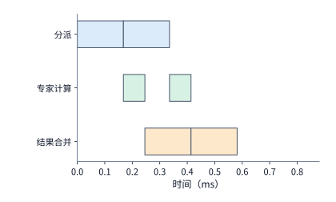

*图 9-28　将同一批次拆分为两个微批次（编号 1、2）后的三阶段流水执行时间线。每个微批次的各阶段耗时减半，分发、计算与合并三条硬件轨道并行推进：微批 1 计算时重叠执行微批 2 的分发，微批 1 合并时重叠执行微批 2 的计算，理想总耗时降至 0.581 ms。*

顺着图 9-28 的时间轴还可以看到，微批 1 的 dispatch 属于填充管线的头步，微批 2 的 combine 属于排空管线的尾步，这两段处于流水重叠区之外，无法被计算掩盖。

更进一步看，图 9-28 假设了两个微批次内部的所有分支都能整齐划一地推进；而在真实的跨机专家分离系统中，哪怕是**同一个 token 选中的不同专家分支**，其返回时刻也会出现参差不齐的**返回就绪倾斜**（return-readiness skew，图 9-29）。对于批次中的任意一个 token $t$，记其门控选中的 $k$ 个目标专家集合为 $\mathcal{E}(t)$，从当前层起点出发、沿第 $e\in\mathcal{E}(t)$ 条专家分支经历发送排队、dispatch 传输、目标卡排队与专家计算、再到 combine 传回源卡的累计路径耗时为 $L_{t,e}$。由于源卡必须收齐该 token 的全部 $k$ 份专家输出才能执行加权合并（耗时 $T_{\mathrm{merge}, t}$），token $t$ 在当前层的完成时刻由其最慢的那条专家分支决定：

$$
T_t=\max_{e\in\mathcal E(t)}L_{t,e}+T_{\mathrm{merge},t}.
$$

如图 9-29 所示，假设某个 token 选中的两条专家分支分别在 $0.5\ \mathrm{ms}$ 和 $1.4\ \mathrm{ms}$ 返回结果，那么快分支传回的激活必须在源卡缓冲区里等待 $0.9\ \mathrm{ms}$，直到 $1.4\ \mathrm{ms}$ 慢分支到达后才能合并；此时哪怕把快分支进一步优化到 $0.3\ \mathrm{ms}$，该 token 的完成时刻依然纹丝不动地卡在 $1.4\ \mathrm{ms}$。如果底层运行时采用整批同步屏障（batch barrier），那么不仅该 token 要等，同批次里哪怕完全没有选中慢专家的其他健康 token 也会被一并拦住。这也解释了为什么不能简单套用理想公式 $\max(t_A, t_F)$ 来预测跨机专家池的流水线周期：真实周期还受到最忙专家排队、往返链路争用、接收缓冲区配额以及层间同步粒度的多重制约。

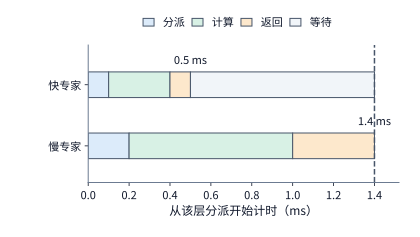

*图 9-29　单个 token 选中的两条专家分支因负载不同产生返回就绪倾斜（教学示意时长分别为 0.5 ms 与 1.4 ms）。每条分支均依次经历 dispatch、专家计算与 combine；由于同一个 token 必须集齐所有被选专家的输出才能执行加权求和（图中暂略本地合并耗时），0.5 ms 提前返回的快分支结果必须在缓冲区中等待 0.9 ms（灰色阴影段），直到 1.4 ms 慢分支到达。*

在实际系统中，dispatch 与 combine 这两次高频全对全通信通常交由专门定制的 EP 通信库执行。通用集合通信库 NCCL 提供了基础的点对点与集合通信原语，而像 DeepSeek 开源的 **DeepEP** 这样的专用 MoE 通信库则将门控路由索引解析、激活分块打包、FP8/BF16 低精度格式转换、跨网 RDMA 传输与结果加权合并深度融合在定制内核中。为了同时适配算力密集的 Prefill／训练阶段与延迟敏感的 Decode 阶段，DeepEP 针对两类负载的物理瓶颈分别设计了截然不同的通信数据通路：

1. **高吞吐内核（Normal / High-Throughput Kernel）：`RDMA -> NVLink` 非对称两阶段域转发**。在由 $N_{\mathrm{node}}$ 台服务器、每台 $G=8$ 张 GPU 组成的集群中，若让每张源 GPU 直接向所有远端节点的全部目标专家 GPU 发起点对点 RDMA 写入，跨节点队列对（QP）扇出规模将膨胀至 $(N_{\mathrm{node}}G)^2$，且同一节点内多张 GPU 并发争抢同一张远端网卡端口会引发严重的 PCIe 交换机争用与 RDMA 队头阻塞。DeepEP 利用机内 NVLink 带宽（Hopper $450\ \mathrm{GB/s}$、Blackwell $900\ \mathrm{GB/s}$ 单向）远高于机间 RDMA 网卡带宽（$50\text{–}100\ \mathrm{GB/s}$ 单向）的非对称特性，将跨机分派拆解为“**先跨机同号对等传输、后机内高速转发**”两步：源节点上的第 $i$ 号 GPU（$i \in \{0,\dots,G-1\}$）首先将发往目标节点上任意专家的 token 激活统一打包，顺着轨道优化（Rail-Optimized）的直连网卡单跳发送给目标节点上具有**相同本地序号 $i$** 的对等 GPU；目标节点的第 $i$ 号 GPU 收到数据后，再经由机内高带宽 NVLink 将各 token 二次转发至本机真正持有目标专家的第 $j$ 号 GPU（combine 阶段则按 `NVLink -> RDMA` 逆序归并）。这一非对称两阶段转发将每个节点的跨机 RDMA 连接扇出缩减了 $G=8$ 倍，彻底消除了多卡跨网争抢同一远端端口的微突发拥塞，并通过流水线缓冲使跨机 RDMA 传输与机内 NVLink 转发在时间上深度重叠。
2. **低延迟解码内核（Low-Latency Decode Kernel）：`IBGDA` 直接门铃驱动与零 SM 接收钩子（0-SM Hook）**。在单步仅数毫秒的 Decode 阶段，每个专家分得的 token 行数很少，通信耗时不再受限于大块带宽，而是受制于内核启动、CPU 代理线程同步与完成队列轮询延迟。DeepEP V1 的低延迟内核绕开了两阶段转发的二次跳数开销，采用纯单跳 RDMA 直连并引入 **IBGDA（InfiniBand GPUDirect Async）**：由 GPU 线程直接在显存与寄存器中构造工作队列元素（WQE）并敲响网卡硬件门铃（Doorbell），完全革除了主机 CPU 代理线程的上下文切换与中断抖动。更精巧的是，为了在双微批乒乓重叠（图 9-28）期间不抢占宝贵的计算 SM，DeepEP 设计了**后台接收钩子（Receiving Hook）**机制——发起非阻塞 RDMA 发送后，通信流立即释放全部 SM 给另一个微批的 MLA 注意力或专家 FFN 计算，仅在后续依赖该数据的算子启动前通过轻量级钩子核验网卡写入的完成标记，从而在通信等待期内实现了**零 SM 占用（0-SM Communication）**。
3. **DeepEP V2（`ElasticBuffer` + `NCCL Gin`）与 `SwiftEP` 动态流量整形**。随着底层硬件从 Hopper（`SM90`）演进至 Blackwell（`SM100`），DeepEP V2 在公开接口中引入了统一弹性缓冲管理 `ElasticBuffer`，并将底层 GPU 直驱网络后端迁移至 **NCCL Gin（GPU-Initiated Networking）**，在峰值通信吞吐最高提升 **$1.3\times$** 的同时，将通信内核占用的 SM 数量大幅压降了最高 **$4\times$**（例如从 V1 的 24 个 SM 降至仅需 $4\sim 6$ 个 SM）。实测基准表明：在 `SM90` + ConnectX-7 平台上，`EP 8×2`（16 卡跨 2 机）仅占用 **12 个 SM** 即可跑出 $90\ \mathrm{GB/s}$（dispatch）与 $81\ \mathrm{GB/s}$（combine）的有效带宽，`EP 8×4`（32 卡跨 4 机）仅用 **6 个 SM** 即可达到 $61 / 61\ \mathrm{GB/s}$；在 `SM100` Blackwell 机内 `EP8` 下，24 个 SM 即可在 NVLink 上跑出 $643 / 675\ \mathrm{GB/s}$（64 个 SM 达 $726 / 740\ \mathrm{GB/s}$）。此外，V2 还新增了基于 RDMA 的零 SM 跨层特征／流水线通信（`0-SM Engram/PP`）、基于硬件复制引擎（Copy Engine）的零 SM 上下文并行通信（`0-SM CP`），以及允许 Decode 阶段复用预注册路由句柄以避免主机侧同步的 `cached_handle` 快速通道。与此同时，针对多租户并发下门控偏斜引发的微秒级网络突发，NSDI 2026 的 **SwiftEP** 进一步在 EP 通信层引入了动态流量整形与自适应令牌桶注入控制，在发送端按远端接收队列水位平滑瞬时流量尖峰，防止多对一汇合时的交换机浅缓冲溢包与重传退化。因此，在做技术选型或性能复现时，绝不能只报一个通信库名称，而必须严格锁定软件版本、张量形状、数值精度、SM 配额与网络拓扑，对照整层与端到端请求的 p50／p99 延迟进行端到端核算。[^ep-system][^ep-calc][^deepep-v2]

## 9.5 KV 的分布、共享与请求路由

前几节探讨的是如何把**当前正在执行的请求**拆分到不同机器与阶段上，从而缩短单次前向耗时。而在多轮对话、代码补全与 Agent 连续调用工具的真实线上场景中，节省算力的另一条重要途径是**跨请求复用历史计算的 KV 缓存**。第 8.3 节已经在单实例内部剖析了分页管理、基数树前缀匹配、引用计数共享与 LRU 淘汰机制；当推理服务扩展到由数十上百台机器组成的分布式集群时，同一会话的前后两轮请求很可能落到不同的物理节点上。此时系统必须回答三个紧密关联的分布式问题：如何跨越实例边界唯一标识并定位一份可复用的状态？如何在 HBM、主机内存、本地 NVMe SSD 与远端存储池构成的四级存储层次之间权衡容量、带宽与寿命？当存有缓存的实例正在排队而另一台空闲实例没有缓存时，请求路由器又该如何依据完成时间做出最优选择？

### 9.5.1 缓存标识、共享范围与可用状态

在分布式缓存系统中，首先需要明确的是：**“两段文本表面相同”并不等价于“它们的 KV 状态可以直接互换复用”**。一份 KV 缓存能够安全复用的前提，是生成这段状态的所有上游计算条件完全一致。因此，分布式缓存键（cache key）不能只对 token 序列做哈希，还必须将模型权重版本、LoRA adapter 标识、位置编码索引、KV 量化与张量布局格式以及必要的分词配置一并纳入沿前缀链递推的哈希计算中：
- 同样的 token 序列挂载不同的 LoRA adapter 后，经过线性投影生成的 $K$、$V$ 向量截然不同；
- 同样的一段代码片段接在不同长度的系统提示词后面，其绝对或相对位置编码（如 RoPE 旋转角）不同，注意力层看到的上下文语义也不同；
- 对于包含局部滑动窗口注意力（SWA）或线性递推状态（如 Mamba/GDN）的混合架构，缓存元数据还必须精确记录状态截断边界处的 token 位置索引与最后更新步数，才能在恢复后无缝续接。

确定了两份状态在语义上可互换之后，下一步是区分**私有缓存容量之和**与**真正可跨实例共享的缓存池**。假设两个推理实例各自配有 $4\ \mathrm{GiB}$ 私有的主机内存缓存，当它们先后处理包含同一份 $1.125\ \mathrm{GiB}$ 公共前缀的请求时，两个实例必须在各自的主机内存里分别保存一份副本，合计消耗 $2.25\ \mathrm{GiB}$ 容量，且实例 1 淘汰或新增的缓存对实例 2 完全不可见。反之，若将这两个实例接入同一个分布式共享缓存后端（如 SGLang 的分层缓存系统 HiCache、vLLM 的多级缓存连接器或专门的 KV 缓存管理层 LMCache），集群只需保存一份 $1.125\ \mathrm{GiB}$ 的共享对象即可服务所有实例；代价则是未在本地命中该对象的实例在开始生成前，必须先经由网络或 PCIe 总线将其取回本地显存。取回路径是否需要经过主机 CPU 中转，直接决定了下一节将要核算的传输延迟。[^cache]

在分布式环境下，缓存对象的生命周期管理还需要将**目录元数据（directory metadata）**与**实际缓存对象（cache object）**解耦（图 9-30）。当某个实例生成并写出一批新的 KV 块时，它会向全局目录或路由器发布一条轻量级的缓存事件，其中只包含缓存键哈希与存储位置标识，而不携带庞大的 KV 字节载荷。由于各级存储每时每刻都在发生容量淘汰（例如 GPU HBM 上的副本已被挤出，但主机内存或远端存储池里的副本仍然存活），路由器看到的目录视图与底层存储节点的真实可用状态之间不可避免地存在时间差。因此，一次完整的跨实例缓存复用必须依次通过两道校验：先查目录定位对象所在的节点与层级，再向目标存储发起读取并校验对象版本与完整性；一旦遭遇事件延迟、消息遗漏或对象恰好在路由途中被回收，系统必须能够安全回退到次级存储读取或本地重新 prefill。

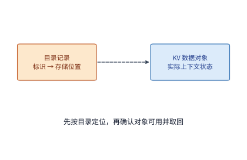

*图 9-30　分布式 KV 缓存中目录元数据与实际缓存对象的分离架构。虚线表示路由器按缓存标识查找对象所在位置，实线表示实例读取实际 KV 字节并恢复计算；路由与执行之间必须核验对象版本与真实可用性。*

更进一步，在面向多租户的公有云或企业共享推理集群中，还必须严守一条安全铁律：**“内容相同”绝不等于“有权限跨租户共享”（`D11-07`）**。假设租户 A 与租户 B 各自提交了包含同一段机密合同模板或内部系统提示词的请求，如果底层基数树（RadixAttention）或分页哈希表仅按纯 Token 序列计算全局缓存键，就会引发两类严重的安全与隔离隐患：
1. **首 Token 延迟计时侧信道攻击（Timing Side-Channel）**：在 Qwen3-8B 的 $8\mathrm{K}$ 前缀算例中，未命中时从头执行 Prefill 需耗时约 $856\ \mathrm{ms}$，而命中缓存后仅需执行增量计算（如 $256$ 新 Token 仅需 $30.9\ \mathrm{ms}$），两者相差近 $28$ 倍。恶意租户只需构造候选敏感文本或私有代码片段发起探测请求，通过测量返回的 TTFT 是落在百毫秒级还是数十毫秒级，就能以高置信度推断出其他租户刚刚是否查询过该敏感文档。
2. **未授权跨租户状态复用与缓存挤占污染**：未配置权限域隔离时，低优先级租户的突发大流量可以轻易冲刷掉高优先级租户常驻在 HBM 中的热前缀，破坏租户间的性能服务等级协议（SLA）。

为了在共享物理显存池的同时彻底阻断跨租户侧信道与越权复用，vLLM 等现代生产推理引擎在前缀哈希链的起点引入了**租户缓存盐值（`cache_salt`）**机制：当计算一段序列第 $0$ 个 KV 块的哈希标识时，系统不再仅对起始块 Token 序列 $T_0$ 求哈希，而是将经由网关鉴权注入的租户或信任组盐值 $s_{\mathrm{tenant}}$ 一并混入起始哈希：

$$
h_0 = \operatorname{Hash}\bigl(s_{\mathrm{tenant}} \,\|\, \mathrm{ModelID} \,\|\, T_0\bigr),\qquad
h_i = \operatorname{Hash}\bigl(h_{i-1} \,\|\, T_i\bigr)\quad (i \ge 1).
$$

由于后续所有 KV 块的哈希值 $h_i$ 均递归依赖前驱块哈希 $h_{i-1}$，起始块注入的 `cache_salt` 会自动沿着整条前缀链向下传导——只有携带完全相同 `cache_salt` 的同租户（或同一授权共享组）请求，才会算出相同的块哈希并命中复用对应的物理 KV 页；不同租户即便提交一字不差的 Token 序列，也会在块表中分叉为彼此隔离的独立物理页（见第 9.7.3 节末尾图 9-50 左栏）。在工程落地上，必须由受信任的 API 网关根据租户身份认证凭据强制注入或校验 `cache_salt`，绝不能直接信任客户端明文传入的任意盐值字符串。

当然，安全隔离必然伴随着显存容量与命中率的定量折损。设集群用于前缀缓存的总显存容量固定为 $C$，原本全局无隔离共享时热门公共前缀体积为 $V_{\mathrm{shared}}$；当引入 $K$ 个相互隔离的租户命名空间后，同一份公共前缀在最坏情况下需要在显存中重复驻留 $K$ 份独立副本（占用 $K\cdot V_{\mathrm{shared}}$），且每个租户在 FIFO/LRU 共享池中的等效留存时间窗口从 $C / r_{\mathrm{total}}$ 被摊薄，导致集群整体前缀命中率从 $p_{\mathrm{global}}$ 降至 $p_{\mathrm{salted}}(K)$，期望首 Token 延迟随之抬升为 $\mathbb{E}[\mathrm{TTFT}(K)] = p_{\mathrm{salted}}(K)T_{\mathrm{hit}} + \bigl(1 - p_{\mathrm{salted}}(K)\bigr)T_{\mathrm{miss}}$。表 9-A 汇总了三种多租户缓存隔离策略的工程边界。

**表 9-A　多租户前缀缓存隔离策略与 `cache_salt` 机制对安全性、命中率及显存容量的影响对比（D11-07）**

| 隔离策略 | 缓存键构造方式 | 跨租户计时侧信道风险 | 公共前缀显存副本数（$K$ 租户） | 全局有效命中率与平均 TTFT | 适用工程场景 |
| --- | --- | --- | ---: | --- | --- |
| 全局内容寻址（无隔离） | $\operatorname{Hash}(\mathrm{ModelID}\,\|\,T_{0:i})$ | 高（可由 TTFT 陡降探测他人上下文） | $1\times$ | 最高（全集群合并复用） | 单一企业内部可信部门或纯公开知识库问答 |
| 网关注入 `cache_salt` 逻辑隔离 | $\operatorname{Hash}(s_{\mathrm{tenant}}\,\|\,\mathrm{ModelID}\,\|\,T_{0:i})$ | 零（不同盐值哈希链完全分叉） | 至多 $K\times$（仅在同租户内共享） | 中等（随租户分割度 $K$ 上升而下降） | 多租户公有云 API、SaaS 租户级共享系统提示词 |
| 租户独占物理实例 / 独立显存池 | 物理隔离实例或硬配额分区 | 零（软硬件与淘汰队列均不共享） | 严格 $K\times$（且存在分区碎片浪费） | 最低（无法跨租户弹性借用空闲池） | 金融/政务高密级合规隔离与严格 SLA 保障 |

*表 9-A　多租户前缀缓存隔离策略与 `cache_salt` 机制对安全性、命中率及显存容量的影响对比（D11-07）。*

### 9.5.2 多级存储层次：容量、预加载重叠与写入寿命

第 8.3.4 节曾在一张 GPU 上比较过保留、换出与重算；如果把视野扩展到整台推理服务器乃至集群，同一份 KV 状态可以依次存放在四个物理层级上：**GPU HBM $\to$ 主机内存（DRAM） $\to$ 本地 NVMe SSD $\to$ 远端分布式存储池**。越往下走，存储容量成倍扩大，但距离 GPU 计算核心也越远、访问带宽越低。

我们以一台标准的 NVIDIA DGX A100 服务器为例来做定量核算：整机配有 8 张 A100 80GB SXM GPU、$2\ \mathrm{TB}$（按二进制均分为每卡 $256\ \mathrm{GiB}$）主机内存、8 块 $3.84\ \mathrm{TB}$ 的 U.2 NVMe SSD（型号为 Solidigm D7-P5520，标称顺序读带宽最高 $7.1\ \mathrm{GB/s}$、顺序写带宽最高 $4.2\ \mathrm{GB/s}$）以及 8 张 $200\ \ \mathrm{Gbit/s}$（单向 $25\ \mathrm{GB/s}$）网卡。将整机资源按 8 张 GPU 均分，每张 A100 分到的四级存储容量、到 GPU 的物理传输路径，以及取回一份 Qwen3-8B 的 $8192$ token 前缀（$1.125\ \mathrm{GiB}$）所需的时间如下表与图 9-31 所示。[^tiers]

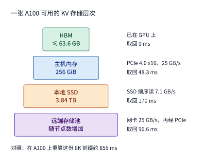

*图 9-31　DGX A100 服务器中每张 A100 分到的四级 KV 存储层次。左侧方框宽度示意各层容量量级，右侧列出从该层到 GPU HBM 的物理路径及取回 1.125 GiB（8K token）前缀的耗时；其中远端存储池取回需先经网卡（25 GB/s）写入主机内存，再经 PCIe 4.0 x16（25 GB/s）拷入 GPU，两段串行合计 96.6 ms。*

| 层级 | 每张 GPU 的容量 | 到 GPU 的路径 | 取回 8K 前缀 |
| --- | ---: | --- | ---: |
| HBM | $\le 63.6\ \mathrm{GB}$ | 已在 GPU 上 | $0$ |
| 主机内存 | $256\ \mathrm{GiB}$ | PCIe 4.0 x16，$25\ \mathrm{GB/s}$ | $48.3\ \mathrm{ms}$ |
| 本地 SSD | $3.84\ \mathrm{TB}$ | SSD 顺序读，$7.1\ \mathrm{GB/s}$ | $170\ \mathrm{ms}$ |
| 远端存储池 | 随节点数增加 | 网卡 $25\ \mathrm{GB/s}$，再经 PCIe | $96.6\ \mathrm{ms}$ |
| 对照：在 A100 上重算 | — | 按峰值的 $50\%$ 计 | $856\ \mathrm{ms}$ |

*表 9-6　DGX A100 服务器中每张 GPU 分到的四级 KV 存储容量、物理传输路径与取回一份 8K 前缀（1.125 GiB）的耗时对照。*

上表中 HBM 的 $63.6\ \mathrm{GB}$ 上限是由 $80\ \mathrm{GB}$ 物理显存减去 $16.4\ \mathrm{GB}$ 的 BF16 权重得出的，尚未扣除运行期激活与临时工作区。观察表格最右列可以发现一个鲜明的事实：**无论把这份 $1.125\ \mathrm{GiB}$ 前缀放在哪一级存储里，单次取回耗时（$48.3\ \mathrm{ms}\sim 170\ \mathrm{ms}$）都远小于在 A100 上重新计算一遍的 $856\ \mathrm{ms}$**。既然各级取回都比重算快得多，为什么不能简单地把所有 KV 都往下一级塞？真正制约多级缓存设计的，是以下四个物理边界：

#### 1. 存储容量决定了缓存能跨越多少秒的复用间隔

假设一张 A100 持续不断地对未命中的 $8\mathrm{K}$ 请求执行 prefill：每 $0.856\ \mathrm{s}$ 就会新产生一份 $1.125\ \mathrm{GiB}$（约 $1.208\ \mathrm{GB}$）的 KV 状态，即单卡满负荷产生新 KV 的物理速率为

$$
r \approx 1.41\ \mathrm{GB/s}.
$$

如果我们将新产生的 KV 全部顺序写入容量为 $C$ 的某一级存储，并按先进先出（FIFO）规则淘汰旧数据，那么这一级存储最多只能保留最近 $C/r$ 秒内产生的历史状态：HBM（$\le 63.6\ \mathrm{GB}$）只能留存约 **$45\ \mathrm{s}$**，主机内存（$256\ \mathrm{GiB} \approx 275\ \mathrm{GB}$）约能留存 **$195\ \mathrm{s}$（3.25 分钟）**，而一块 $3.84\ \mathrm{TB}$ 的本地 SSD 则能留存约 **$2722\ \mathrm{s}$（45 分钟）**。反过来讲，如果业务场景中同一份前缀两次被访问的时间间隔为 $T$，要想让间隔 $T$ 以内重访的请求在该级存储中稳定命中，该级存储的容量至少必须满足：

$$
C \ge rT.
$$

阿里云团队发表于 USENIX ATC 2025 的《KVCache Cache in the Wild》对线上真实推理流量（trace）做了系统统计，发现不同业务形态的复用时间跨度截然不同：在面向个人用户的多轮对话负载中，$80\%$ 的前缀复用发生在 **$10\text{ 分钟}$（$600\ \mathrm{s}$）**以内；而在面向企业程序的 API 调用负载中，$80\%$ 的复用都集中在 **$10\ \mathrm{s}$** 以内。将这两个时间跨度代入 $C = rT$（图 9-32）：覆盖 $10\ \mathrm{s}$ 复用间隔仅需 $14.1\ \mathrm{GB}$ 容量，单卡 HBM 即可轻松容纳；而覆盖 $10\text{ 分钟}$ 的人工对话复用间隔则需要高达 $846\ \mathrm{GB}$ 容量，不仅远超 HBM，也超过了每卡 $275\ \mathrm{GB}$ 的主机内存上限，必须引入本地 NVMe SSD 才能承接这部分长间隔复用。[^wild]

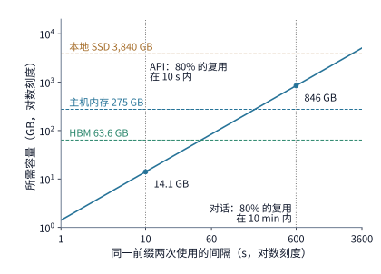

*图 9-32　支持不同复用时间间隔 $T$ 所需的最小存储容量 $C = rT$（双对数坐标）。斜线对应单张 A100 连续执行无命中 8K prefill 时的 KV 产生速率 $r \approx 1.41\ \mathrm{GB/s}$；三条水平虚线标出每张 GPU 分到的 HBM、主机内存与本地 SSD 容量上限，两条竖线标出企业 API 负载（10 s）与个人对话负载（10 min）涵盖 80% 复用所在的时间跨度。*

式 $C \ge rT$ 同时揭示了**什么时候并不需要引入 SSD 或远端存储**。在同一篇阿里云论文测试的 Llama3-70B 对话负载中，作者发现所需的总缓存容量大约只是可用 HBM 的 4 倍；对于配有 $1\ \mathrm{TB}$ 主机内存的 8 卡 A100 服务器（每卡分到 $128\ \mathrm{GB}$ 主机内存），单靠“HBM + 主机内存”两级就已经足够覆盖线上复用，无需再挂载 SSD。为什么同样是对话负载，那里不需要 SSD 而图 9-32 需要？关键就在于实际产生速率 $r$：图 9-32 假设 GPU 每秒都在满负荷跑无命中的 $8\mathrm{K}$ 长请求；而在该论文的真实线上流量中，单轮请求平均只有 $973$ 个 token、多轮请求平均 $5953$ 个 token，且已有相当比例的前缀直接命中，因此实际产生新 KV 的速率 $r$ 低得多。同理，若模型从标准 GQA 换成每 token KV 字节数减半的紧凑 MLA，$r$ 也会随之减半。简言之，$T$ 由外部调用者决定（人工阅读打字以分钟计，自动化程序循环以秒计），而 $r$ 则由请求到达率、未命中率与每 token 状态大小共同决定。

#### 2. 容量边际收益递减与长尾分布

不断扩大存储容量并不能让缓存命中率无限制地线性增长，因为线上流量中存在大量“只用一次就再也不会重访”的临时上下文。Mooncake 团队公开了 Kimi 线上服务一小时的采样请求记录（每块 512 个 token）：如图 9-33 所示，在采用最近最少使用（LRU）策略淘汰时，将缓存池容量从 $1000$ 块扩充到 $50{,}000$ 块（按 Qwen3-8B 每 token $144\ \mathrm{KiB}$ 折算约为 $3.77\ \mathrm{TB}$，恰好相当于一块 $3.84\ \mathrm{TB}$ 的 SSD），前缀命中率从 $30\%$ 提升到了 $50\%$；但即便此后把容量设为无穷大，命中率上限也只有 **$51\%$**。剖析底层数据可以发现极强的马太效应：在这份 Kimi 采样记录中，超过一半的 KV 块自产生后从未被第二次访问，而少数热门系统提示词与公共文档块却被反复访问了上万次；阿里云的线上记录同样显示，最热的 $10\%$ 缓存块贡献了高达 $77\%$ 的复用命中。[^moontrace]

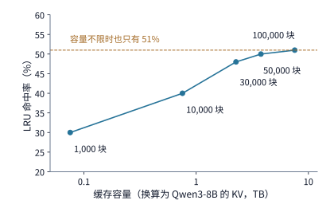

*图 9-33　Kimi 线上服务一小时采样流量（Mooncake trace）在 LRU 淘汰策略下的缓存容量与命中率曲线。每个缓存块含 512 个 token，横轴按 Qwen3-8B 每 token 144 KiB 折算为字节容量；当容量达到约 3.77 TB（50,000 块）后，命中率趋近于 51% 的理论渐近上限。*

#### 3. 跨网络复用模式：取回一次驻留 vs. 每步远程读取，以及读写回本条件

当一份共享 KV 状态存放在远端存储池或另一台节点的内存中时，计算节点有三种典型使用方式：① 放弃远程状态、在本地重新计算 prefill；② 在会话开始时从远端**取回一次并驻留在本地 HBM**，供后续连续 decode 步反复读取；③ 不在本地 HBM 驻留，而是在**每一步 decode 时都通过网络从远端读取一遍历史 KV**。

我们用一笔简单的带宽账就能看清为什么第 ③ 种方式在工程上几乎不可行。沿用 $1.125\ \mathrm{GiB}$ 的 $8\mathrm{K}$ 前缀与 $200\ \mathrm{Gbit/s}$（$25\ \mathrm{GB/s}$）网卡，单次完整取回耗时约 $48.3\ \mathrm{ms}$。如果一个请求在连续 100 步 decode 中每一步都重新从远端拉取这份不变的前缀，累计占用网卡的时间将高达 $4.83\ \mathrm{s}$；要想在 $1\ \mathrm{s}$ 内完成这 100 步生成，单是这一个请求的历史前缀就要消耗约 $121\ \mathrm{GB/s}$ 的网络带宽，是整张 $200\ \mathrm{Gbit/s}$ 网卡物理极值的 **$4.8$ 倍**。哪怕换成体积减半的紧凑 MLA 前缀（$549\ \mathrm{MiB}$，单次读取约 $23.0\ \mathrm{ms}$），100 步累计读取仍需 $2.30\ \mathrm{s}$，要在 $1\ \mathrm{s}$ 内跑完仍需约 $57.6\ \mathrm{GB/s}$ 带宽（网卡能力的 $2.3$ 倍）。因此，无论算子如何做通信重叠，**在 decode 阶段每步跨网拉取全量历史 KV 都会受到网卡带宽的刚性制约**。

相比之下，第 ② 种方式（“取回一次、本地驻留”）把跨网传输频次从“每生成一个 token 传一次”降到了“每次会话恢复传一次”，其代价则是状态在本地驻留期间会持续占用宝贵的 HBM 容量。如第 9.1.3 节所述，一份体积为 $V$ 字节的状态在本地驻留 $\tau$ 秒所消耗的时空资源由乘积 $V\tau$（字节·秒）度量：当 Agent 调用外部工具暂停生成 $10\ \mathrm{s}$ 时，将 $1.125\ \mathrm{GiB}$ 的 GQA 状态留在 HBM 会无谓占用 $11.25\ \mathrm{GiB\cdot s}$（紧凑 MLA 为 $5.36\ \mathrm{GiB\cdot s}$）。因此，最合理的调度策略是在会话进入秒级以上暂停时将其换出到远端或主机内存，待工具返回、会话恢复活跃时再一次性取回 HBM 连续执行 decode。

那么，把一份刚刚算出来的 KV 写到外部存储、日后再取回复用，究竟在什么条件下比直接重算更划算？设写入外部存储耗时 $T_{\mathrm{write}}$、单次取回耗时 $T_{\mathrm{read}}$、本地重新 prefill 耗时 $T_{\mathrm{recompute}}$；若该状态在未来会被复用 $k$ 次（暂不计排队与缓存挤占效应），则“保存并取回”快于“每次重算”的充要条件为：

$$
T_{\mathrm{write}}+kT_{\mathrm{read}}<kT_{\mathrm{recompute}}.
$$

以 Qwen3-8B 的 $8192$ token 前缀为例：在 A100 上重算一次需 $T_{\mathrm{recompute}} = 856\ \mathrm{ms}$，经 $25\ \mathrm{GB/s}$ 链路写出与取回各需 $48.3\ \mathrm{ms}$。即便未来只复用 $k=1$ 次，写加读合计也只需 $96.6\ \mathrm{ms}$，不到重算耗时的八分之一（若换成 $549\ \mathrm{MiB}$ 的紧凑 MLA 状态，写加读一次更是只需 $46.1\ \mathrm{ms}$）。然而，如果把外部传输链路降级为老旧的慢速网络，结论就会发生翻转：
- 当链路有效带宽落入 $1.41\ \mathrm{GB/s} \sim 2.82\ \mathrm{GB/s}$ 区间时，单次复用（$k=1$）写加读的总耗时已经超过 $856\ \mathrm{ms}$，至少要复用 $k \ge 2$ 次才能摊平初次写入的成本；
- 当链路有效带宽低于 **$1.41\ \mathrm{GB/s}$**（例如单端口 $10\ \mathrm{GbE}$ 网卡，单向仅 $1.25\ \mathrm{GB/s}$，单次取回就要 $966\ \mathrm{ms}$）时，哪怕单次读取本身（$T_{\mathrm{read}}$）就已经比 GPU 本地重算（$856\ \mathrm{ms}$）还要慢，此时复用次数 $k$ 越多反而亏得越多。

细心的读者会发现，这里的临界读取带宽 **$1.41\ \mathrm{GB/s}$ 恰好就是上文求出的 GPU 产生新 KV 的速率 $r$**：因为取回 $V$ 字节耗时 $V/B$，而在 GPU 上重算生成这 $V$ 字节耗时 $V/r$，所以只要存储或网络的读取带宽 $B > r$，取回就一定比重算快。对照前文四级存储表中本地 NVMe SSD 的带宽（写 $4.2\ \mathrm{GB/s}$、读 $7.1\ \mathrm{GB/s}$，均显著高于 $1.41\ \mathrm{GB/s}$）：写入一份 $8\mathrm{K}$ 前缀耗时约 $288\ \mathrm{ms}$、读出耗时约 $170\ \mathrm{ms}$，复用一次合计 $458\ \mathrm{ms}$，依然比 $856\ \mathrm{ms}$ 的重算省去了近一半时间。

#### 4. 逐层预加载、排队预取与 SSD 写入寿命上限

即便缓存命中后读取比重算快，如果机械地按照“先把整份历史 KV 全部读进 HBM，再启动新 token 的前向计算”串行执行，I/O 等待仍然会拖慢首 token 延迟。假设请求命中了主机内存中的 $8192$ token 历史前缀，本轮只需增量计算 $256$ 个新输入 token（按 A100 峰值的 $50\%$ 计，计算耗时 $T_{\mathrm{new}} \approx 30.9\ \mathrm{ms}$）：
- **整份先读后算（图 9-34）**：先花 $T_{\mathrm{read}} = 48.3\ \mathrm{ms}$ 经 PCIe 读完 $1.125\ \mathrm{GiB}$ 历史 KV，再花 $30.9\ \mathrm{ms}$ 计算新 token，端到端耗时为 $48.3 + 30.9 = 79.2\ \mathrm{ms}$，I/O 读取时间反客为主超过了计算时间。
- **逐层流水预加载（图 9-35）**：利用 Transformer 逐层顺序执行的特性（计算第 $i$ 层时只需用到第 $i$ 层的 KV），CachedAttention（USENIX ATC 2024）让 PCIe 总线在 GPU 计算第 $i$ 层的同时并行预加载后续层的历史 KV。对于 Qwen3-8B（共 36 层），每层历史 KV 占 $32\ \mathrm{MiB}$，经 PCIe 读取一层需 $1.34\ \mathrm{ms}$，而 GPU 计算一层新 token 仅需 $0.857\ \mathrm{ms}$。由于每层读取比计算慢，GPU 每算完一层仍需等待下一层数据到位，端到端耗时由 36 层的连续读取加上最后一层计算决定，降至约 $49.2\ \mathrm{ms}$。
- **利用前序批次时间提前预读缓冲区（图 9-36）**：要想把这 $49.2\ \mathrm{ms}$ 进一步压缩到纯计算下界 $30.9\ \mathrm{ms}$，就必须在当前请求开始执行前，趁着 GPU 还在跑**上一个批次**的空档，提前把前若干层的历史 KV 读入 HBM 预留的缓冲区中。预留缓冲区需要容纳的字节数，正好等于整份读取时间超出新 token 计算时间的那部分传输量：

$$
S_{\mathrm{buf}}=B\,(T_{\mathrm{read}}-T_{\mathrm{new}}).
$$

将 $B = 25\ \mathrm{GB/s}$、$T_{\mathrm{read}} = 48.3\ \mathrm{ms}$ 与 $T_{\mathrm{new}} = 30.9\ \mathrm{ms}$ 代入，可得 $S_{\mathrm{buf}} \approx 437\ \mathrm{MB}$（折合 $13.02$ 层，按整层向上取整为 **14 层，共 $448\ \mathrm{MiB}$**）。如图 9-36 所示，只要提前把前 14 层读进 HBM 缓冲区，其余 22 层的 PCIe 读取就能在 $30.9\ \mathrm{ms}$ 的计算过程中被完全掩盖。同理，当新输入 token 数增加使得 $T_{\mathrm{new}} \ge T_{\mathrm{read}}$ 时，无需任何预读缓冲即可实现零等待掩盖：从主机内存读取时，这一免缓冲临界点约为新输入 $400$ 个 token；从远端存储池串行读取时约为 $800$ 个 token；从本地 SSD 读取时则约为 $1400$ 个 token。CachedAttention 在 LLaMA-13B（$1\mathrm{K}$ 历史 token + $100$ 新 token）上的实测证实，单纯逐层预加载可将 prefill 耗时缩短 $35\%$，配合 15 层预读缓冲区后更是缩短了 $61\%$。[^cachedattention]

更进一步，当主机侧本身也由快慢两级异构内存（如本地 DDR5 DRAM 与 CXL 扩展内存池）组成时，决定某份缓存页或卸载权重是否值得从慢层迁移到快层的标尺，并不是它的历史访问总次数，而是它**暴露在计算关键路径上的净等待耗时**。例如，将一份 $288\ \mathrm{MiB}$ 的数据块从主机侧经有效带宽 $24\ \mathrm{GiB/s}$ 的 PCIe H2D 通道搬入 GPU 时，理想流水传输下界为 $t \ge \max(288\ \mathrm{MiB} / B_{\mathrm{source}},\, 288\ \mathrm{MiB} / 24\ \mathrm{GiB/s})$：只要源端供给带宽达到 $40$ 或 $100\ \mathrm{GiB/s}$，整条路径都会被 $24\ \mathrm{GiB/s}$ 的 H2D 链路卡在 $11.72\ \mathrm{ms}$；唯有当源端跌至 $8\ \mathrm{GiB/s}$ 慢层时，传输下界才会拉长到 $35.16\ \mathrm{ms}$。即便如此，若调度器能提前 $16\ \mathrm{ms}$ 发起异步预取，快层（$11.72\ \mathrm{ms}$）的传输已被完全掩盖，慢层也只向关键路径暴露约 $19.16\ \mathrm{ms}$ 等待；若预取提前量扩大到 $40\ \mathrm{ms}$，连慢层的 $35.16\ \mathrm{ms}$ 也会被彻底隐藏，此时花费 $35.16\ \mathrm{ms}$ 将该页从慢层迁移到快层对端到端延迟毫无收益。正如 ASPLOS 2026 的 PACT 与 Camp 等分层内存研究所示，只有当“未来复用次数 $\times$ 每次真正削减的关键路径暴露停顿”严格大于“迁移拷贝 $+$ 挤占淘汰 $+$ 通道争用干扰”之和时，跨层升迁才具有正收益。[^mem-tiering]

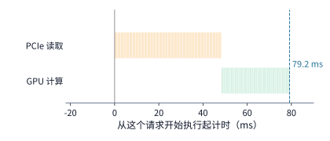

*图 9-34　整份先读后算时间线：先经 PCIe 将 1.125 GiB 历史 KV 完整读入 HBM（48.3 ms），再计算 256 个新 token（30.9 ms），总耗时 79.2 ms。橙色代表 PCIe 读取，绿色代表 GPU 计算，每个小格对应模型的一层。*

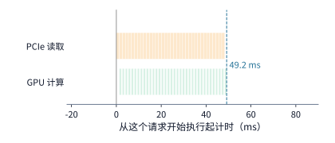

*图 9-35　逐层流水预加载时间线：GPU 计算当前层（0.857 ms/层）时，PCIe 并行读取后续层（1.34 ms/层）；因单层读取慢于计算，每层计算仍需等待读取完成，总耗时降至 49.2 ms。*

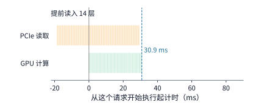

*图 9-36　带 14 层（448 MiB）预读缓冲区的逐层加载时间线：利用上一批次的执行时间提前读入前 14 层后，其余 22 层的 PCIe 读取被 GPU 计算完全掩盖，当前请求有效耗时降至纯计算时间 30.9 ms（图 9-34 至图 9-36 横轴刻度完全一致）。*

当历史 KV 位于更慢的本地 NVMe SSD 上时，读取一层需要 $4.73\ \mathrm{ms}$，是单层计算时间（$0.857\ \mathrm{ms}$）的 $5.5$ 倍；如果等到请求上卡执行时才开始从 SSD 读，哪怕做逐层流水也要花约 $171\ \mathrm{ms}$。解决之道是**利用请求在调度队列中的排队等待时间提前从 SSD 预取到主机内存**（图 9-37）：只要请求在队列里的等待时间 $Q \ge 170\ \mathrm{ms}$，调度器就可以在它排队期间静默完成“SSD $\to$ 主机内存”的搬移；等轮到该请求上 GPU 执行时，数据已经在主机内存中就绪，只需按图 9-36 走高速 PCIe 预加载即可。

主机内存的总容量决定了调度器最多能为等待队列中的前多少个请求提前预取：$256\ \mathrm{GiB}$ 主机内存约可容纳 $227$ 份 $8\mathrm{K}$ 前缀，因此只需盯着队列最前面的 $227$ 个请求做精准预取。同时，等待队列还提供了比传统 LRU/FIFO 准确得多的**明知淘汰策略（clairvoyant eviction）**：凡是队列前方请求即将用到的状态一律锁定不准换出；需要腾空位时，优先换出队列里最晚才会用到的状态。CachedAttention 在 4 张 A100、$128\ \mathrm{GB}$ 主机内存与 $10\ \mathrm{TB}$ SSD 上回放 ShareGPT 多轮对话数据集的结果表明：采用按队列预取与淘汰时，总缓存命中率达 $86\%$，且其中 **$99.6\%$ 以上的命中直接来自高速主机内存**；而采用只看历史访问记录的 LRU 与 FIFO 时，总命中率不仅跌至 $58\%$ 和 $48\%$，而且来自主机内存的命中率还不到 $1\%$，几乎每次命中都不得不去慢速 SSD 上现读。[^cachedattention]

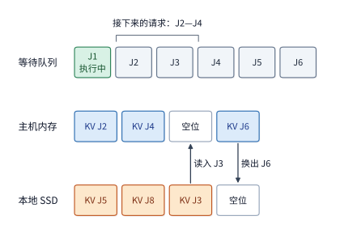

*图 9-37　依据调度等待队列执行的 SSD 预取与主机内存换出示意。假设主机内存有 4 个槽位（1 个预留作读入缓冲，3 个分配给队列紧随其后的请求 J2～J4）：当检测到排队中的 J3 所需状态仍在 SSD 上时，系统趁其排队期间将其预取至主机内存空位；同时将排在更后面的 J6 状态换出到 SSD。*

最后，将 NVMe SSD 纳入 KV 缓存层次还必须严守一条极易被忽视的硬件红线：**闪存颗粒的写入寿命（DWPD，每日全盘写入次数）**。从带宽看，即使按前文满负荷产生新 KV 的速率 $r \approx 1.41\ \mathrm{GB/s}$ 持续落盘，也只占 PCIe 带宽的 $5.6\%$ 和 SSD 顺序写带宽（$4.2\ \mathrm{GB/s}$）的 $34\%$，似乎毫无压力。然而，数据中心级 NVMe SSD Solidigm D7-P5520 的标称寿命为 **5 年内每天全盘写入 1 次（1 DWPD）**：对于一块 $3.84\ \mathrm{TB}$ 的硬盘，平均每秒允许持续写入的额定上限仅为

$$
\frac{3.84\times 10^{12}\ \text{bytes}}{86400\ \mathrm{s}} \approx 44.4\ \mathrm{MB/s}.
$$

如果把 GPU 以 $1.41\ \mathrm{GB/s}$ 产生的新 KV 不加筛选地全量写入 SSD，实际写入速率将高达额定寿命上限的 **$31.7$ 倍**——原本设计使用五年的企业级 SSD，在**不到两个月内就会彻底写穿报废**。换言之，受闪存擦写寿命制约，长期稳态下最多只能允许约 **$3.2\%$**（$44.4\ \mathrm{MB/s} / 1.41\ \mathrm{GB/s}$）的新产生 KV 写入 SSD。好在前面图 9-33 的线上流量分析已经告诉我们，超过一半的 KV 块从未被二次访问，且绝大多数复用高度集中在少数热门块上；因此在写 SSD 前设置一道**准入过滤器（admission filter）**——例如只允许已经被复用过至少一次的热门前缀、或明确标记为长周期多轮对话的会话状态落盘——就能在严守 $44.4\ \mathrm{MB/s}$ 寿命红线的同时，把最近 24 小时内最核心的高价值前缀稳稳保存在 $3.84\ \mathrm{TB}$ SSD 中。

这种“缓存容量决定淘汰边界、进而决定重算与搬移次数”的规律在受控实验中同样清晰可见：在一组同卡双引擎共享 CPU 缓存池的对比实验中，面对 12 次前缀复用机会，$4\ \mathrm{GiB}$ 共享池因容量不足中途发生淘汰，仅完整命中 5 次；而将共享池扩至 $8\ \mathrm{GiB}$ 后，原本被挤出的 7 份前缀得以保留，实现了 12 次全部命中。因此，评估任何一级共享缓存的工程收益，都必须放在“能留存多久 $\to$ 多保住几次完整命中 $\to$ 净省多少重算与跨网搬移”的完整账本中核算。[^shared]

> **算例 9-4（多级 KV 缓存留存窗口、14 层预读缓冲与 NVMe SSD 写入寿命准入边界）**
> 给定 DGX A100 节点中单张 GPU 的四级 KV 存储参数：单卡连续执行无命中 $8\mathrm{K}$ Prefill 时新 KV 产生速率 $r \approx 1.41\ \mathrm{GB/s}$（每 $856\ \mathrm{ms}$ 生成 $1.125\ \mathrm{GiB} \approx 1.208\ \mathrm{GB}$），HBM 可用缓存上限 $63.6\ \mathrm{GB}$，主机内存容量 $256\ \mathrm{GiB}$（约 $275\ \mathrm{GB}$），本地 NVMe SSD（Solidigm D7-P5520）容量 $3.84\ \mathrm{TB}$、标称寿命 $5$ 年 $1\ \mathrm{DWPD}$。
> 1. **三级存储留存时间窗口 $T = C / r$ 与业务覆盖边界**：HBM 留存窗口为 $63.6 / 1.41 \approx \mathbf{45\ \mathrm{s}}$（足以覆盖 $80\%$ 复用间隔 $\le 10\ \mathrm{s}$ 的企业 API 流量，仅需 $14.1\ \mathrm{GB}$）；主机内存留存窗口为 $275 / 1.41 \approx \mathbf{195\ \mathrm{s}}$；覆盖个人多轮对话 $10\ \text{分钟}$（$600\ \mathrm{s}$）复用间隔需容量 $1.41 \times 600 = \mathbf{846\ \mathrm{GB}}$，必须落入留存窗口达 $3840 / 1.41 \approx \mathbf{2722\ \mathrm{s}}$（约 $45$ 分钟）的本地 NVMe SSD。
> 2. **CachedAttention 零等待预读缓冲层数 $S_{\mathrm{buf}}$**：当命中主机内存中的 $8192$ token 历史前缀并增量计算 $256$ 个新 token 时，PCIe 整份读取耗时 $T_{\mathrm{read}} = 48.3\ \mathrm{ms}$，GPU 增量计算耗时 $T_{\mathrm{new}} = 30.9\ \mathrm{ms}$。为将 I/O 完全掩盖在 $30.9\ \mathrm{ms}$ 计算内，需趁上一批次执行期间提前读入 $S_{\mathrm{buf}} = 25\ \mathrm{GB/s} \times (48.3 - 30.9)\ \mathrm{ms} \approx 437\ \mathrm{MB}$，按 Qwen3-8B 单层 $32\ \mathrm{MiB}$ 向上取整为 **$\mathbf{14}\ \text{层}$（$\mathbf{448\ \mathrm{MiB}}$）**。
> 3. **NVMe SSD 1 DWPD 写入寿命准入上限**：$3.84\ \mathrm{TB}$ 硬盘在 $1\ \mathrm{DWPD}$ 下的额定持续写入上限为 $3.84\times 10^{12} / 86400 \approx \mathbf{44.4\ \mathrm{MB/s}}$，仅占满负荷新 KV 产生速率 $1.41\ \mathrm{GB/s}$ 的 **$\mathbf{3.2\%}$**（无过滤全量落盘将超标 $\mathbf{31.7\times}$，不到两个月写穿报废）。因此必须在 SSD 入口配置准入过滤器（仅放行二次命中或长会话热门前缀）。

### 9.5.3 持久化、检查点与部分重算

上一小节默认写入存储层的 KV 状态都能原封不动地完整读回；而在真实的分布式生产环境中，实例进程可能因升级或故障重启，长周期 Agent 任务可能被挂起数小时后再恢复。此时，内存目录、磁盘持久化数据与当前请求所需的连续前缀之间可能出现局部偏差，恢复流程必须精确判定“哪些历史计算成果可以直接复用，哪些缺失部分需要补算”。

为了在实例重启或任务挂起后免于从头重算，系统需要引入**状态持久化（persistence）与周期性检查点（checkpoint）**：全量持久化能最大化恢复时的命中率，但写入开销高；周期性检查点能大幅削减日常写入带宽，但在故障恢复时只能回退到最近一次完整检查点，并对检查点之后的增量 token 执行**部分重算（partial recomputation）**。尤其需要注意的是，一份可恢复的检查点必须完整包含模型继续前向计算所需的**全部异构状态**，但不同子层状态在“短期内存暂存”与“长期落盘持久化”两级池中的去留策略可以截然不同：
- 对于标准 GQA 模型，只需统一保存各层的上下文 $K$、$V$ 页；而对于像 DeepSeek V4 这样融合了压缩注意力与局部窗口机制的架构，内存检查点必须同步保存已生成的压缩块表示、当前活跃的滑动窗口状态以及尚未凑齐一整块的尾部未压缩状态，恢复时才能严格从检查点记录的最后一次完整状态更新处无缝续算。[^v4]
- 到了采用 40 层 128-token 滑动窗口注意力（SWA）配 4 个全局 MLA 锚点层的 DeepSeek V4.1 Flash，系统进一步按**存活周期（TTL）**对两类异构状态实施了分层裁剪：在面向多轮对话或外部工具调用（Pause-and-Resume）的**短期分布式主机内存（DRAM）缓存池**中，4 个锚点层的全局 KV 与 40 层 SWA 的活跃窗口（固定 $40\times 128\times 528\ \mathrm{B} = 2{,}703{,}360\ \mathrm{B} \approx 2.578\ \mathrm{MiB}$）一并保留数分钟，以便会话恢复时零重算立即续生；而在面向跨小时长周期复用的**长期 NVMe SSD 持久化池**中，系统**彻底省去了全部 40 层 SWA 状态的落盘写入**，仅将 4 个锚点层的全局主 KV 与索引状态（每 token 合计 $(3/2+1)\times(288+68) = 890\ \mathrm{B}$，在 $8\mathrm{K}$ 下共 $6.953\ \mathrm{MiB}$）写入 SSD。由于免除了原本在多轮负载持久化缓存中占约一半容量的 40 层 SWA 状态（$\approx \frac{1}{2}$），且跨层共享（CSA2）与低比特格式将全局状态从前代 V4 的 $3{,}514.25\ \mathrm{B/token}$ 压缩至 $890\ \mathrm{B/token}$（$\approx \frac{1}{4}$），V4.1 Flash 写入长期持久化池的数据体积骤降至前代 V4 的约 $\frac{1}{2}\times\frac{1}{4}=\frac{1}{8}$（直接将单盘 DWPD 写入寿命额度放大了约 8 倍）；当长周期历史会话从 SSD 读回 4 个锚点层的全局 MLA 状态后，只需对序列末尾最后 $128$ 个 token 执行一次有界局部重放（bounded local replay），即可在毫秒级时间内精准重建全部 40 层 SWA 窗口状态。[^v41-case]

从全栈成本归因的视角看，第 9.5.2 至 9.5.3 节剖析的多级分布式 KV 缓存池（如 SGLang HiCache、Mooncake 与 HiSparse）正是支撑商业 API 推出 **“缓存命中输入折扣（Cached Input Pricing，通常给予 $50\%\text{–}90\%$ 价格减免）”** 的底层物理基础（`TC-15`）：当多轮 Agent 循环或长文档问答命中已持久化的前缀时，服务端用一次毫秒级的跨网/主机内存取回（$T_{\mathrm{lookup}} + T_{\mathrm{fetch}}$）替代了原本耗时数百毫秒的 GPU Prefill 矩阵重算（$T_{\mathrm{recompute}}$），实打实地省下了绝大部分输入阶段的算力消耗。但必须把**物理成本节省**与**商业定价规则**区分开来核算：一方面，用户提交的请求哪怕在账单上享受了缓存折扣，底层系统仍需承担各级存储驻留、目录同步与跨网搬移的真实开销；另一方面，若业务流量的前缀复用间隔超出了缓存池留存窗口 $C/r$（或因多租户 `cache_salt` 隔离导致命中率偏低），盲目搭建庞大的远端缓存池反而会因高昂的写入流量与未命中回退开销拉高单次请求的综合成本。

在底层存储格式上，持久化的 KV 状态通常以固定大小的**逻辑页（logical page）**为单位落盘与读回。仍以 Qwen3-8B（36 层）为例，一个包含 16 个 token 的逻辑页总大小为 $16\times 144\ \mathrm{KiB} = 2.25\ \mathrm{MiB}$。如果在落盘与读取时将 36 层的 $K$、$V$ 张量分开独立寻址，读取一页就会碎裂成 $36\times 2 = 72$ 次仅 $32\ \mathrm{KiB}$ 的细碎随机 I/O，极易受制于存储设备或网络的每秒操作次数（IOPS）上限；反之，若在写出时就按逻辑页将各层数据打包聚合成一个连续的 $2.25\ \mathrm{MiB}$ 对象，恢复时就能用单次大块顺序读取充分利用设备带宽。

即便按页整块读回，**“从磁盘读入的字节数”也不完全等于“真正省掉重算的有效复用字节数”**（图 9-38）。举例来说，某个请求在实例正常重启后从持久化存储中顺序读入了 64 个逻辑页（覆盖 $64\times 16 = 1024$ 个 token，共 $144\ \mathrm{MiB}$），但在做前缀匹配与边界校验时发现，只有前 63 页（$1008$ 个 token，约 $141.75\ \mathrm{MiB}$）能够构成连续匹配的有效前缀，第 64 页因末尾 token 变动或需要重新生成下一 token 的 logits 而仍需送入模型重算。此时，虽然存储层实打实传输了 64 页数据，计算层真正复用的只有 63 页——单纯提升磁盘读取速度只能缩短 I/O 时间，却无法省掉这最后一页的补算工作。[^restart]

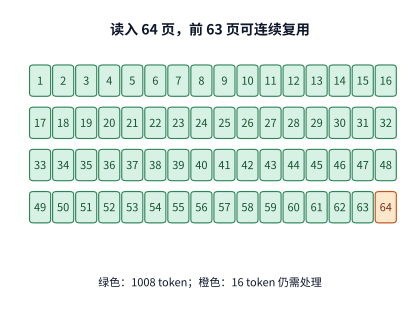

*图 9-38　持久化恢复中读取页数与实际可复用连续前缀的差异。实例重启后某请求读入了 64 个逻辑页（每页 16 个 token、2.25 MiB，共 1024 个 token、144 MiB），但匹配边界停在 1008 个 token（前 63 页），最后 1 页仍需重新参与前向计算。*

更进一步，如果在恢复读取时遇到某个逻辑页损坏、截断或远端存储节点迟迟不响应（页面缺失），系统必须在**继续等待远端返回**与**立即放弃等待、本地重算**之间设定明确的超时熔断阈值。道理很简单：在 A100 上把 $8192$ 个 token 的整段前缀从头重算一遍总共也只需 $0.856\ \mathrm{s}$；如果为了等一个坏页或慢节点已经空等了 $1\ \mathrm{s}$，这次等待本身就已经比全量重算更慢了。在一项针对截断页（truncated page）的容错对照实验中，未设超时退避、一直等待缓存返回的请求在 $60\ \mathrm{s}$ 的观测窗口内一直未能完成；而一旦允许在超时后放弃等待并回退到本地重算，请求便能迅速跑通返回。同时，在当前请求回退重算之后，系统还必须在目录中立即隔离或修复该损坏页，以免后续到达的请求再次掉进同一个超时陷阱。[^fault]

### 9.5.4 缓存亲和性与请求路由

当分布式集群中明确知道某份前缀缓存位于哪台机器或哪个存储池后，顶层请求路由器（router）还要面对一个经典的调度抉择：**是把请求发给已经有本地缓存但正在排队的繁忙实例 A（缓存亲和路由），还是发给没有本地缓存但可以立刻开始干活的空闲实例 B（负载均衡路由）？**

评判这一抉择的唯一客观标尺，是请求在目标实例上的**预计完成时间（或首 token 返回时间 $T_{\mathrm{first}}$）**。设目标实例上的 GPU 最早空闲可执行时刻为排队时间 $Q$，该请求所需的历史 KV 状态从请求到达起算的就绪时刻为 $R$，状态与 GPU 均就绪后的剩余增量计算耗时为 $C$。如果状态预取（如从远端存储或主机内存拉取）可以在请求排队等待 GPU 的同时并行推进，且必须等整份状态到齐后才启动增量计算，那么首 token 返回时间可以简洁地写为：

$$
T_{\mathrm{first}}=\max(Q,R)+C.
$$

反之，如果系统实现简陋，必须等 GPU 排完队空出来之后才开始发起网络取回，那么首 token 时间就会退化为三者直接相加 $Q + R + C$。举一个直观的数字例子：设排队时间 $Q = 80\ \mathrm{ms}$、状态取回耗时 $R = 60\ \mathrm{ms}$、增量计算耗时 $C = 10\ \mathrm{ms}$；若排队与取回并行重叠，首 token 只需 $\max(80, 60) + 10 = 90\ \mathrm{ms}$；若等排完队再串行取回，耗时就会激增至 $80 + 60 + 10 = 150\ \mathrm{ms}$——计算量与搬移字节数分毫未变，仅因调度依赖关系不同就凭空多出了 $60\ \mathrm{ms}$ 延迟。下面我们通过例 9.7 完整核算缓存亲和与空闲实例之间的路由翻转边界。

**例 9.7　缓存命中与排队等待如何共同决定请求路由？** 集群中有 A、B 两个 A100 80GB SXM 实例。当前到达一条携带 $8192$ 个历史前缀 token 与 $256$ 个新输入 token 的请求：实例 A 的 HBM 中已经驻留了这 $8192$ 个 token 的前缀缓存，但当前正忙，新请求需排队 $Q_A = 250\ \mathrm{ms}$；实例 B 只需排队 $Q_B = 20\ \mathrm{ms}$ 即可空闲，但其本地没有任何相关缓存。按第 9.2.3 节约定取 A100 峰值的 $50\%$（$156\ \mathrm{TFLOP/s}$）核算：若在 B 上从头完整重算全部 $8448$ 个 token，需执行约 $138.4\ \mathrm{TFLOPs}$ 矩阵运算，耗时约 $887\ \mathrm{ms}$；若复用已命中的 $8192$ token 前缀、仅增量计算 $256$ 个新 token，则只需约 $4.81\ \mathrm{TFLOPs}$ 运算，耗时 $C = 30.9\ \mathrm{ms}$。此外，实例 B 也可以选择在请求到达时立即从远端存储池取回那份 $1.125\ \mathrm{GiB}$ 前缀：目录查找固定开销为 $10\ \mathrm{ms}$，随后数据先经网络传至 B 的主机内存，再经 PCIe 4.0 x16（按 $25\ \mathrm{GB/s}$ 计，耗时约 $48.3\ \mathrm{ms}$）搬入 B 的 GPU。试比较将请求路由给 A 或 B（直接重算、经 $50\ \mathrm{GbE}$ 取回、经 $200\ \mathrm{GbE}$ 取回）四条路径的首 token 返回时间。

| 路由路径 | 首 token 返回时间 $T_{\mathrm{first}}$ |
| --- | ---: |
| 路径 1（发给实例 A，本地 HBM 命中） | $250 + 30.9 \approx 281\ \mathrm{ms}$ |
| 路径 2（发给实例 B，放弃缓存直接重算） | $20 + 887 \approx 907\ \mathrm{ms}$ |
| 路径 3（发给实例 B，经 $50\ \mathrm{GbE}$ 即 $6.25\ \mathrm{GB/s}$ 远端取回） | 约 $282\ \mathrm{ms}$ |
| 路径 4（发给实例 B，经 $200\ \mathrm{GbE}$ 即 $25\ \mathrm{GB/s}$ 远端取回） | 约 $137\ \mathrm{ms}$ |

*表 9-7　例 9.7 中四条候选路由路径（实例 A 本地 HBM 命中 vs. 实例 B 直接重算或跨网取回）的首 token 返回时间对照。*

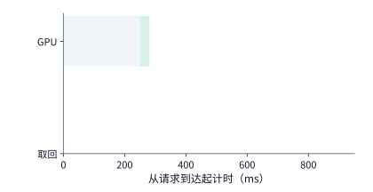

*图 9-39　路径 1（路由至实例 A）：本地 HBM 已命中前缀，状态就绪时间 $R_A = 0$，但需等待 GPU 排队 $Q_A = 250\ \mathrm{ms}$ 后再执行 30.9 ms 增量计算，首 token 在约 281 ms 返回（灰色为排队，绿色为计算）。*

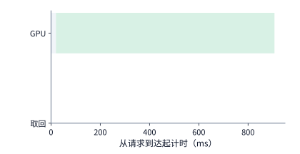

*图 9-40　路径 2（路由至实例 B 直接重算）：实例 B 仅需排队 $Q_B = 20\ \mathrm{ms}$ 即空闲，但从头重算 8448 个 token 需 887 ms，首 token 迟至约 907 ms 才返回。*

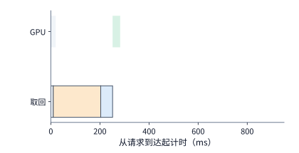

*图 9-41　路径 3（路由至实例 B 经 50 GbE 远端取回）：请求到达即发起目录查找（10 ms），随后经 50 GbE（6.25 GB/s）读取 1.125 GiB 至主机内存，再经 PCIe（25 GB/s，48.3 ms）拷入 GPU；状态就绪耗时 $R_B \approx 251\ \mathrm{ms} > Q_B$，加上 30.9 ms 增量计算后首 token 在约 282 ms 返回，比实例 A 慢约 1.6 ms。*

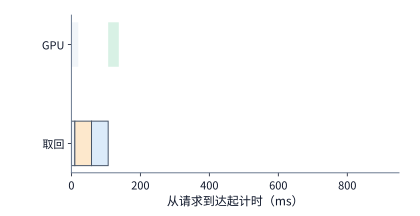

*图 9-42　路径 4（路由至实例 B 经 200 GbE 远端取回）：远端网络升级为 200 GbE（25 GB/s）后，网络传输段（橙色）大幅缩短，状态就绪耗时降至约 106.6 ms，首 token 在约 137 ms 返回，比实例 A 快一倍以上（图 9-39 至图 9-42 横轴刻度完全一致）。*

对照图 9-39 至图 9-42 的四条时间线，我们可以清晰地推导出路由决策翻转的**临界网络带宽**。实例 B 若想依靠“远端取回 + 增量计算”击败实例 A 的 $281\ \mathrm{ms}$，扣除同样需要执行的 $30.9\ \mathrm{ms}$ 增量计算后，B 的整份状态必须在 $R_B < 250\ \mathrm{ms}$ 内在 GPU 上就绪；再扣除固定的 $10\ \mathrm{ms}$ 目录查找与 $48.3\ \mathrm{ms}$ 的主机内存到 GPU 传输，留给远端网络传输 $1.125\ \mathrm{GiB}$（约 $1.208\ \mathrm{GB}$）数据的预算只剩约 $191.7\ \mathrm{ms}$。用数据量除以该时间预算，即得 B 远端取回与 A 本地命中打平的临界带宽：

$$
B_{\mathrm{tie}} = \frac{1.208\ \mathrm{GB}}{0.1917\ \mathrm{s}} \approx 6.30\ \mathrm{GB/s}.
$$

这解释了为什么在 $50\ \mathrm{GbE}$（$6.25\ \mathrm{GB/s} < 6.30\ \mathrm{GB/s}$）下应该坚守缓存亲和路由把请求发给 A，而在 $200\ \mathrm{GbE}$（$25\ \mathrm{GB/s} \gg 6.30\ \mathrm{GB/s}$）下则应该果断打破固定亲和，把请求发给空闲的 B 并跨网拉取状态。至于“B 远端取回”与“B 本地重算（$907\ \mathrm{ms}$）”打平的临界带宽，更是低至约 $1.48\ \mathrm{GB/s}$——在高速数据中心网络下，跨网拉取已有 KV 几乎总是远快于在 GPU 上从头重算 $8\mathrm{K}$ 前缀。

当然，单请求延迟占优并不意味着可以把所有请求无限制地导向远端取回。在 $200\ \mathrm{GbE}$（$25\ \mathrm{GB/s}$）链路上，只要每秒并发执行 16 次这样的 $1.125\ \mathrm{GiB}$ 跨网取回，持续带宽消耗就会达到约 $19.3\ \mathrm{GB/s}$，吃掉整条物理链路约 **$77\%$** 的容量；一旦遇到突发流量，网络传输队列本身的排队延迟就会迅速推高 $R_B$。因此，生产级路由器不仅要按单请求公式 $\max(Q, R) + C$ 估算延迟，还必须实时追踪网络链路的在途字节预算。[^route]

在实际系统中，路由决策还面临另一重不确定性：**路由器依据异步缓存事件维护的目录可能是过期的**。为了看清目录预测失准对均值与尾延迟（p99）的不同冲击，我们把实例 A 的排队时间改为 $Q_A = 80\ \mathrm{ms}$，并设请求到达 A 时，其前缀缓存只有概率 $p$ 真正存活可用：若命中（概率 $p$），首 token 在 $80 + 30.9 = 110.9\ \mathrm{ms}$ 返回；若不幸已被淘汰且各级缓存均失效（概率 $1-p$），实例 A 只能在排队 $80\ \mathrm{ms}$ 后从头重算 $887.2\ \mathrm{ms}$，首 token 迟至 $967.2\ \mathrm{ms}$ 才返回。此时选择实例 A 的期望首 token 时间为：

$$
\mathbb{E}[T_A]=110.9p+967.2(1-p)=967.2-856.3p\ \mathrm{ms}.
$$

如果只看**平均响应时间**，只要命中概率 $p > 7.0\%$，$\mathbb{E}[T_A]$ 就能优于实例 B 直接重算的 $907\ \mathrm{ms}$；当 $p = 0.9$ 时，平均耗时更是只有约 $196.5\ \mathrm{ms}$，看起来十分漂亮。然而，如果业务考核的是 **p99 尾延迟（要求不超过 $220\ \mathrm{ms}$）**，情况就截然不同了：当 $p = 0.9$ 时，仍有 $10\%$ 的请求会掉进 $967.2\ \mathrm{ms}$ 的重算慢路径，该两点分布的 p99 高达 **$967.2\ \mathrm{ms}$**，严重违背服务等级目标；要想让 p99 压进 $220\ \mathrm{ms}$ 以内，在这个两点分布模型下缓存真实存活率至少要达到 **$p \ge 99\%$**。这再次印证了系统设计的一条铁律：平均数很容易被高命中率美化，而尾延迟则直接暴露出那 $1\% \sim 10\%$ 预测失准时的最坏回退代价。[^events]

此外，路由器的优化目标还会引发**单请求最快完成（greedy latency）**与**全局批次最早排空（overall makespan）**之间的博弈。在一组同时运行两个长短任务的路由压力实验中：若坚持“缓存优先”将目标请求留在原实例排队，目标请求需约 $1.38\ \mathrm{s}$ 完成，此时两个任务也恰好同时在 $1.38\ \mathrm{s}$ 全部结束；若改为“空闲优先”将目标请求迁移到另一台空闲实例重算/取回，目标请求自身的完成时间大幅缩短至约 $0.33\ \mathrm{s}$（快了 $1.05\ \mathrm{s}$），但由于占用了额外实例资源，两个任务全部排空的时刻反而推迟到了约 $1.54\ \mathrm{s}$（慢了 $0.16\ \mathrm{s}$）。因此，设计路由策略前必须先明确业务优先级：究竟是优先保高优先级交互请求的响应速度，还是优先最大化集群整体的批次吞吐。[^pressure]

最后，如果我们将第 8 章讨论的混合架构状态恢复也纳入路由模型，路由器就需要把多段异构状态的准备时间统一折算到就绪时刻 $R$ 中。以 DeepSeek V4.1 的会话恢复为例（图 9-43）：假设实例 A 本地完整保留了全局 KV 与编码器的局部滑动窗口（SWA）状态，但当前有排队 $Q_A$；实例 B 完全空闲（$Q_B = 0$），但需要花 $4.666\ \mathrm{ms}$（沿用第 7 章算例）跨网传输全局 KV 状态，并花假设的 $8\ \mathrm{ms}$ 恢复编码器 SWA 状态，两项准备串行合计耗时 $R_B = 12.666\ \mathrm{ms}$。由于后续的新增输入处理、解码器窗口重放与生成耗时在 A、B 两端完全相同，路由选择完全取决于谁能更早完成准备阶段：当实例 A 的排队时间 $Q_A = 10\ \mathrm{ms} < 12.666\ \mathrm{ms}$ 时，留在 A 复用本地状态更快；当 $Q_A$ 增加到 $20\ \mathrm{ms} > 12.666\ \mathrm{ms}$ 时，果断切往空闲实例 B 并承受 $12.666\ \mathrm{ms}$ 的状态迁移与恢复反而更快。这里的 **$12.666\ \mathrm{ms}$** 就是该混合架构会话在缓存亲和与空闲迁移之间翻转的精确排队阈值。[^v41-case]

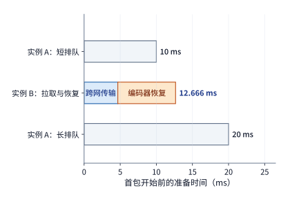

*图 9-43　DeepSeek V4.1 混合状态下缓存亲和（实例 A）与空闲迁移（实例 B）的路由翻转比较（隐去两端相同的解码器窗口重放与后续计算，仅对比前置准备耗时）。实例 B 虽无排队，但需串行执行 4.666 ms 全局状态传输与 8 ms 编码器 SWA 状态恢复（共 12.666 ms）；当实例 A 的排队等待时间从 10 ms 增至 20 ms（跨过 12.666 ms 阈值）时，更快启动后续计算的优胜方案由实例 A 翻转为实例 B。*

### 9.5.5 以 KV 为中心的解耦池（Mooncake）、框架事件目录边界与预测性早期拒绝

把第 9.2 节的 PD 阶段分离与第 9.5.1–9.5.4 节的多级缓存路由推向极致，便催生了以 **Mooncake**（FAST 2025 Best Paper）为代表的**以 KV 缓存为中心的解耦推理架构（KVCache-Centric Disaggregated Architecture）**。与传统“以计算实例为中心、将 KV 视为附属本地状态”的架构不同，Mooncake 将集群内所有服务器的 GPU HBM、主机 CPU DRAM、本地 NVMe SSD 与高速 RDMA 网卡统一抽象为一座跨节点共享的分布式多级 KV 对象池，由全局调度器 **Conductor** 结合前缀哈希目录与各池实时负载执行统一编排；在长上下文与多轮 Agent 负载下，这种以 KV 复用与零拷贝 RDMA 传输为核心的解耦设计，使集群在严格满足 TTFT 与 TPOT 服务等级目标（SLO）下的有效吞吐比传统共置方案提升了最高达 **$525\%$**。[^mooncake-fast25]

然而，将全局缓存目录投入生产框架时，必须严格厘清**底层引擎发布缓存事件的真实边界**，否则全局路由器极易因目录失步而做出错误调度。对照主流开源推理栈在 `2026` 年初的源码实现，可以清晰看到三类关键工程约束：
1. **硬件层级与模型架构的发射过滤（vLLM `0.24.0`）**：vLLM 的 `KVEventAggregator` 仅在显式开启 `enable_prefix_caching` 时才会向外部发布 `BlockStored` 与 `BlockRemoved` 事件，且**只汇报驻留在 GPU HBM 池中的缓存块**——换出到 CPU DRAM 或磁盘的二级块不会触发全局路由事件；同时，对于包含线性注意力或状态空间的混合架构模型，引擎会直接抛出约束拒绝开启事件流（`Hybrid KV cache manager does not support KV events`），防止路由器将缺少递推快照的半截前缀当作完整状态去匹配。
2. **全局基数树哈希冲突时的覆写行为（NVIDIA Dynamo `v1.3.0`）**：Dynamo 的全局路由器通过 `KvIndexer` 订阅各工作节点的事件流以维护全局基数树。当两个工作节点在相同序列位置汇报了不一致的 `block_hash` 时，系统在前三次冲突（`warning_count < 3`）中仅打印告警日志（`Mismatch in block hashes: External sequence hash ...`），随后便**直接用后到达的事件覆写路由表条目**，而非隔离冲突分片；若多租户或多版本权重未在哈希键中严格隔离，这种静默覆写将导致跨节点路由频繁震荡。
3. **异步回写与预取配额限流（SGLang `HiCache` + `Mooncake`）**：SGLang 的分层缓存控制器将 GPU HBM 与主机内存、Mooncake 远端池联动，利用后台异步写回线程隐藏落盘开销，但对并发请求的跨层预取施加了严格的 token 配额上限（如单批次预取窗口限额），以防突发的长前缀拉取占满 PCIe 与网卡通道而拖慢在途生成。[^events]

除了目录一致性，PD 分离与以 KV 为中心的架构在高负载下还潜藏着一个致命的资源死锁与算力浪费陷阱：**Decode 池未来 KV 容量耗尽引发的“先算后弃”**。在朴素的阶段分离调度中，准入控制器（Admission Controller）只检查当前 Prefill 池是否有空闲算力：只要 P 池有空位，就立即接纳新请求并耗费数十至数百毫秒完成长上下文 Prefill；然而，当生成的数吉字节 KV 缓存准备交接给 Decode 池（或在 Decode 池生成了若干步后），由于 D 池中大量在途并发序列都在持续增长 KV 占用，D 池的 HBM 容量 $M_{D,\max}$ 可能在未来某一时刻被彻底撑爆。此时 D 池被迫抢占（Preempt）并丢弃部分请求的 KV 状态，导致此前 P 池满负荷运转所消耗的巨额矩阵算力与能耗化为乌有。

为了根除这一浪费，Mooncake 的 Conductor 引入了**预测性早期拒绝（Predictive Early Rejection）**：在决定是否准入一条新请求 $r$（设其输入长度为 $L_{\mathrm{in},r}$，基于历史分布或长度预测器估计的输出长度为 $\hat{L}_{\mathrm{out},r}$，单 token 全层 KV 字节数为 $v_{\mathrm{tok}}$）进入 Prefill 池之前，调度器不仅检查当前时刻 $t$ 的静态剩余显存，而且沿着未来生成时间窗 $[t,\, t + T_{\mathrm{gen}}]$ 推演整个 Decode 池的动态水位轨迹。记当前已在 Decode 池中生成的活跃请求集合为 $\mathcal{A}(t)$，已获准进入 Prefill 池但尚未完成交接的在途请求集合为 $\mathcal{P}(t)$；对于任意未来时刻 $\tau \in [t,\, t + T_{\mathrm{gen}}]$，若请求 $i$ 在时刻 $\tau$ 仍未达到其预计完成时刻，记其已生成的输出 token 数为 $\hat{\ell}_i(\tau)$（按稳态步长 $1/\mathrm{TPOT}$ 线性增长至 $\hat{L}_{\mathrm{out},i}$ 后即刻释放全部显存），则接纳请求 $r$ 后 Decode 池在时刻 $\tau$ 的预测 KV 显存总占用 $M_D(\tau)$ 必须处处满足安全水位约束：

$$
M_D(\tau) = \sum_{i \in \mathcal{A}(\tau) \cup \mathcal{P}(\tau)} v_{\mathrm{tok}} \cdot \bigl(L_{\mathrm{in},i} + \hat{\ell}_i(\tau)\bigr) + v_{\mathrm{tok}} \cdot \bigl(L_{\mathrm{in},r} + \hat{\ell}_r(\tau)\bigr) \le \eta_{\mathrm{safe}} \cdot M_{D,\max}, \qquad \forall \tau \in [t,\, t + T_{\mathrm{gen}}],
$$

其中 $\eta_{\mathrm{safe}} \in (0, 1)$（如 $0.90\sim 0.95$）是为吸收输出长度预测误差而预留的安全裕度系数。一旦预测轨迹在未来任意时刻突破上限（$\max_{\tau} M_D(\tau) > \eta_{\mathrm{safe}} M_{D,\max}$），Conductor 会在**请求进入 Prefill 池之前**就立即执行早期拒绝（返回过载错误码或将其留在网关队列延后准入），绝不让注定会在 Decode 阶段遭遇显存溢出驱逐的请求白白消耗 Prefill 池的宝贵算力与互联带宽。[^mooncake-fast25]

## 9.6 服务启动、扩缩容与故障恢复

第 9.2 至 9.5 节讨论的都是“当集群各实例已经稳定就绪时，如何分配请求与放置状态”。然而在真实的生产环境中，推理集群本身始终处于动态变化之中：面对流量洪峰需要拉起新副本扩容，面对负载形态切换需要在运行期调整并行策略，面对硬件或进程异常需要在部分 GPU 失效后迅速恢复流式生成。本节将实例生命周期纳入同一套时间线账本，定量回答三个问题：新实例启动与预热期间积压的请求需要多久才能排空？运行中在线迁移或切换并行度时，状态追赶与软件重配置各自占多少时间？当流式生成中途遭遇故障时，如何借助预写日志（WAL）与 KV 检查点实现不重采样的无缝续生？

### 9.6.1 启动与预热开销、图捕获回本周期与积压排空

在第 9.5.4 节的路由比较中，我们假设备用实例随时可以接收请求；而在自动扩缩容（autoscaling）或故障拉起场景下，新副本从容器启动到真正能够处理首个请求，必须依次走完一条漫长的初始化链路：创建运行时进程与通信组、加载分词器（tokenizer）、从存储读取并按并行度切分模型权重、触发算子即时编译（JIT）、探测可用显存以分配分页 KV 缓存池，最后还要执行若干次试运行以录制 **CUDA Graph 执行图**（见第 5.5.2 节）。

发表于研究社区的《Breaking the Ice》对 vLLM 历史版本的启动过程做了细粒度拆解，指出工程分析中一个常见的计时误区：**把存在嵌套包含关系的子阶段耗时直接相加**。例如，当首次试运行（warmup run）在内部同步触发了算子编译时，试运行的外层耗时其实已经包含了编译时间；唯有将嵌套包含关系展开，沿着从进程创建到开放服务端口的**最长依赖关键路径**累加，才能准确找到拖慢冷启动的真正瓶颈。[^startup]

在冷启动的各项准备工作中，录制 CUDA Graph 是一个典型的“先付固定准备代价、后享每步加速收益”的工程权衡。设录制并预热执行图使实例启动时间额外增加了 $T_s$，但此后每执行一个 decode 批次都能省下 $\delta$ 的内核启动与调度开销，则经过 $N$ 个批次后的累计净收益为 $N\delta - T_s$。举一个具体数字：若捕获多档批大小的 CUDA Graph 使启动时间增加了 $T_s = 10\ \mathrm{s}$，换来每步节省 $\delta = 0.2\ \mathrm{ms}$，那么新实例必须连续运行

$$
N = \frac{10\ \mathrm{s}}{0.2\ \mathrm{ms}} = 50{,}000\ \text{步}
$$

才能恰好收回启动阶段多付出的 $10\ \mathrm{s}$（从第 $50{,}001$ 步起获得净正收益）。如果每个 decode 批次平均为 32 条并发请求各生成 1 个 token，这 $50{,}000$ 步对应着约 **$160\text{ 万}$个输出 token**。注意，CUDA Graph 的节省是按批次（step）触发而非按请求单独触发的，因此核算回本周期时必须以实际执行的批次数为单位。

更关键的是，在新实例花费 $T_s$ 秒冷启动的窗口期内，外部请求仍在以速率 $\lambda$ 源源不断地到达并积压在等待队列中。假设冷启动期间原有服务不可用（或超出原有容量的溢出流量为 $\lambda$），到第 $T_s$ 秒新实例就绪的瞬间，队列中已经积压了约 $\lambda T_s$ 个等待请求。设新实例就绪后的稳态服务能力为 $\mu$（且必须满足 $\mu > \lambda$，否则队列永远无法收敛）；在连续流体近似下，就绪后每秒钟的服务能力 $\mu$ 中有 $\lambda$ 要用于应付源源不断的新到达请求，真正能够用来削减历史积压的**净排空速率（net drain rate）**只有 $\mu - \lambda$。因此，消退全部冷启动积压所需的额外排空时间为：

$$
T_{\mathrm{drain}}=\frac{\lambda T_s}{\mu-\lambda}.
$$

我们将章首的 8 卡异构集群（4 张 A100 + 4 张 H20）代入上式，直观对比不同部署方案的抗冲击恢复能力（图 9-44）。设冷启动耗时 $T_s = 10\ \mathrm{s}$，期间外部请求以 $\lambda = 3.5\ \text{请求/s}$ 持续到达，至第 $10\ \mathrm{s}$ 就绪时共积压了 $\lambda T_s = 35$ 个请求：
- **直接 PD 分离（$\mu = 4.55\ \text{请求/s}$）**：就绪后扣除新到达的 $3.5\ \text{请求/s}$，每秒可净消化 $4.55 - 3.5 = 1.05$ 个积压请求，还需 $T_{\mathrm{drain}} = 35 / 1.05 \approx 33.3\ \mathrm{s}$ 排空队列，即从冷启动开始算起在**第 $43\ \mathrm{s}$** 完全恢复稳态；
- **理想分块捎带的共置副本（$\mu = 4.17\ \text{请求/s}$）**：就绪后每秒仅能净消化 $4.17 - 3.5 = 0.67$ 个积压请求，额外排空时间拉长至约 $52.5\ \mathrm{s}$，要到从启动算起的**第 $63\ \mathrm{s}$** 才能排空；
- **不分块的共置副本（$\mu = 3.02\ \text{请求/s} < \lambda$）**：由于就绪后的最大服务能力仍低于外部到达率，队列不仅无法排空，反而会以每秒约 $0.48$ 个请求的速度无限期膨胀下去。

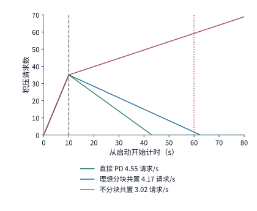

*图 9-44　不同部署方案在冷启动后的积压队列消退曲线（连续流量模型）。前 10 s 启动期内请求以 $\lambda = 3.5\ \text{请求/s}$ 持续到达并累积至 35 个请求；第 10 s 服务就绪后，直接 PD 分离（$\mu = 4.55\ \text{请求/s}$）与理想分块共置（$\mu = 4.17\ \text{请求/s}$）分别在第 43 s 与第 63 s 排空积压（虚线标出例 9.8 设定的 60 s 恢复期限），而不分块共置（$\mu = 3.02\ \text{请求/s}$）则持续发散。*

当冷启动结束、几十个积压请求在同一瞬间涌入推理引擎时，**并发预取配额**还会引发一个有趣的“未命中反超命中”现象。在 HiCache 的一项并发请求分支观测实验中：某条包含 $1024$ 个 token 的请求在单独运行时，可以顺利从分层缓存中复用 $1008$ 个 token；然而当 8 条同类请求同时涌入时，前 4 条请求率先抢注了各自 $1024$ 个 token 的异步预取任务（合计占用 $4096$ 个 token 的预取缓冲，超过了系统设定的 $3289$ token 预取配额上限），导致后到达的请求因拿不到预取空间而直接放弃缓存复用。结果最先跑完返回的恰恰是后面那条**放弃缓存、直接进入 GPU 执行全量 prefill 的请求**——因为前面 4 条“命中缓存”的请求还在排队等待异步预取把数据搬进显存，而放弃预取的请求反而越过 I/O 等待直接上了空闲的 GPU。这一现象提醒我们：缓存对象在存储层存在，并不代表请求能零等待地用上它；在突发流量冲击下，预取缓冲区配额与传输通道争用同样会重构请求的实际完成顺序。[^branch]

此外，集群扩缩容还必须统筹考虑模型权重版本与底层硬件代际的绑定关系。当某些专用推理加速卡或固定介质将特定版本的量化权重固化在硬件中时，增加同型号加速卡只能横向扩展同一模型版本的吞吐；一旦业务需要上线新版本权重或切换精度格式，调度器就必须按版本标签将流量精准切分到对应硬件池，并在容量规划中为新旧版本灰度并存及硬件替换预留缓冲余量。

### 9.6.2 运行中重配置与状态交接

冷启动解决的是“从无到有拉起新实例”，而运行期重配置（in-flight reconfiguration）则要求**在不中断现有生成流的前提下，将正在执行的请求与权重平滑交接给新的资源拓扑**——例如将即将下线维护节点上的 Decode worker 迁走，或者根据昼夜负载变化在张量并行（TP）、序列并行（SP）与弹性专家并行（Elastic EP）之间动态切换。

对于计划内的在线实例迁移，系统可以充分利用“源实例在迁移期间仍能正常执行生成”这一有利条件，采用类似虚拟机热迁移的**后台预复制（pre-copy）+ 短暂停机交接**机制（图 9-45）：第一步，源实例继续按部就班地执行 decode 生成，同时后台传输线程将已生成的历史上下文 KV 批量复制到目标实例；第二步，由于在后台复制期间源实例又新生成了一小批增量 KV，当历史积压接近搬空时，系统短暂挂起源实例，将最后这一点增量状态与最新输出位置同步给目标实例，随即由目标实例无缝接管后续 decode 步。

我们用一组真实数值来核算后台预复制的**追赶时间（catch-up time）**。假设要将一张 H20 上的 Decode worker 完整迁往另一台节点：当前批内共驻留 32 条活跃请求，平均上下文长度为 $8704$ 个 token，初始待复制的历史 KV 总量约为 $V_0 = 41.1\ \mathrm{GB}$。在迁移期间，源卡每秒钟完成约 $1166$ 次 decode 调用，每次调用追加 1 个 token 的 KV（$144\ \mathrm{KiB}$），因此源端状态总量仅以

$$
r_{\mathrm{grow}} \approx 1166 \times 144\ \mathrm{KiB/s} \approx 0.172\ \mathrm{GB/s}
$$

的缓慢速率增长。只要后台网络复制带宽 $B$ 大于状态增长速率 $r_{\mathrm{grow}}$，未复制积压量就会以净速率 $B - r_{\mathrm{grow}}$ 稳步缩小：
- 若目标节点经由 $200\ \mathrm{Gbit/s}$ 网卡（$B = 25\ \mathrm{GB/s}$）拉取状态，净追赶速率高达 $25 - 0.172 \approx 24.8\ \mathrm{GB/s}$，只需约 **$1.65\ \mathrm{s}$** 即可追平全部历史状态（在此期间源端新增的状态仅约 $0.28\ \mathrm{GB}$）；
- 若目标节点仅有一条 $50\ \mathrm{GbE}$ 链路（$B = 6.25\ \mathrm{GB/s}$），净追赶速率为 $6.08\ \mathrm{GB/s}$，追平时间随之延长至约 **$6.76\ \mathrm{s}$**。

如图 9-45 所示，由于 decode 阶段每秒新增的 KV 字节数远小于现代网卡带宽，源端状态增长曲线（斜率 $0.172\ \mathrm{GB/s}$）几乎是一条水平线，追赶耗时绝大多数由初始的 $41.1\ \mathrm{GB}$ 存量决定；唯有当网络带宽退化到接近或低于 $r_{\mathrm{grow}}$ 时，两条斜线才会平行乃至发散，导致后台迁移永远无法追上源端进度。

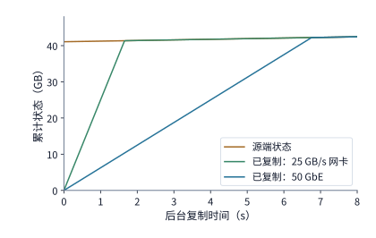

*图 9-45　Decode 实例在线迁移时源端状态增长与后台网络复制的追赶进度。初始待复制 KV 状态为 41.1 GB，源端在持续生成过程中每秒仅新增约 0.172 GB（黑色微倾线）；目标端经 25 GB/s（200 Gbit/s 网卡）或 6.25 GB/s（50 GbE）后台复制时，分别在约 1.65 s 与 6.76 s 追平源端状态（两条复制线与源端线的交点），交点之前的垂直距离即尚未同步的剩余字节量。*

除了整卡实例迁移，运行期重配置的另一类常见场景是**动态切换并行策略**——例如在同一个 GPU 组上将模型从 TP4 切换为 TP8，或在 TP 与 $\mathrm{SP}\times\mathrm{TP}$ 之间切换（如 Snowflake 开源的 vLLM 插件 ArcticInference 以及弹性专家并行 Elastic EP 的在线扩缩容）。切换并行度不仅意味着要重新切分模型权重与重排 KV 缓存布局，还意味着每张卡参与集合通信的进程组、张量形状以及对应的 CUDA Graph 执行图都发生了改变。如果为了追求零切换延迟而在显存中同时常驻两套并行模式的权重分片与执行图，可用作 KV 缓存的显存空间就会被大幅压缩；反之，若在切换时现场重排权重并重建执行环境，就必须同时核算**数据搬移耗时**与**软件控制面重配置耗时**。[^switch]

这里隐藏着一个很有启发性的阿姆达尔定律（Amdahl's Law）陷阱。假设我们将 Qwen3-8B 从 TP4 在线切换为 TP8，期间需要跨网传输约 $16.4\ \mathrm{GB}$ 数据，并在本地显存内读写重排约 $4.7\ \mathrm{GB}$ 张量：
- 若仅看**网络数据传输耗时**，从 $50\ \mathrm{GbE}$（$6.25\ \mathrm{GB/s}$）升级到 $200\ \mathrm{Gbit/s}$ 网卡（$25\ \mathrm{GB/s}$），纯搬移时间从约 $2.63\ \mathrm{s}$ 骤降至约 $0.66\ \mathrm{s}$，整整快了 4 倍；若 8 张卡位于同一台 $8\times\text{A100}$ 服务器内部改走 NVLink（单向 $300\ \mathrm{GB/s}$，发送量最大的一张卡需送出约 $4.7\ \mathrm{GB}$），纯传输时间更是缩短到了微不足道的 **$15.7\ \mathrm{ms}$**。
- 然而，如果在数据传输完毕后，运行时还必须**串行执行**销毁并重建 NCCL 通信组、重新分配缓冲区、重新捕获 CUDA Graph 以及恢复调度器注册等一系列软件准备工作（在实测基准中这九项串行准备合计耗时约 **$9.0\ \mathrm{s}$**），那么三种硬件链路下的端到端重配置总耗时就会变成：$50\ \mathrm{GbE}$ 下约 **$11.6\ \mathrm{s}$**、$200\ \mathrm{Gbit/s}$ 网卡下约 **$9.7\ \mathrm{s}$**（仅缩短约 $17\%$）、机内 NVLink 下仍高达约 **$9.0\ \mathrm{s}$**。[^migration]

这一对比深刻地印证了第 1.3.4 节提出的性能归因准则：当数据搬移本身已经被高速互联压到几十毫秒乃至接近物理下界时，端到端切换时间的瓶颈就彻底转移到了那 $9\ \mathrm{s}$ 的串行软件准备上。此时继续堆砌网络带宽毫无助益，唯有重构运行时软件架构——将进程组初始化、执行图预捕获与权重传输解耦并提前在后台异步完成——才能真正把在线重配置停机窗口压进亚秒级。

### 9.6.3 部分故障与流式生成恢复

与计划内迁移不同，当线上突发 GPU 掉卡、ECC 显存不可纠正错误或节点宕机时，源端内存中的活跃状态瞬间丢失，系统只能依靠故障前已经持久化保存的外部记录来恢复中断的请求。

对于正在向用户逐字流式输出（或正在为强化学习采集长思维链样本）的请求，故障恢复面临的首要问题是：**用户客户端（或上层调用方）已经收到了前若干个生成的输出 token，恢复后的实例该如何接着往下写？** 工程上通常有三种恢复语义可供选择：
1. **直接基于已保存的完整 KV 状态继续 decode**：前提是故障前恰好把截至最后一个已输出 token 的 KV 状态都做了同步检查点，这在高频生成中开销极大；
2. **基于已确定的输出 token 序列补做增量 prefill（状态重放），再继续 decode**：利用最近一次 KV 检查点加上故障前已生成但尚未存盘的 token 序列，通过一次快速 prefill 重建丢失的尾部 KV 状态；
3. **退回到旧检查点重新随机采样生成**：这会导致重算部分生成出与故障前已发给客户端截然不同的文本后缀，不仅在交互式对话中造成输出撕裂，在强化学习（RL rollout）中还会破坏策略采样的轨迹一致性。

为了以最小开销实现第 2 种无损无缝恢复，生产级推理系统（如 DeepSeek V4 的生成服务）借鉴了数据库系统的经典设计，将**预写日志（write-ahead log，WAL）**与**周期性 KV 检查点**结合使用（图 9-46）：每当模型采样确定一个新的输出 token，系统在将其发送给用户之前，先将该 token 的整数编号追加写入轻量级的持久化 WAL 中（每个 token 仅几个字节，写入开销极低）；与此同时，体积庞大的 KV 缓存则按固定间隔（例如仅在 prefill 结束时或每上千个 token）异步保存检查点。[^v4]

我们通过图 9-46 的具体数字来看看这套双轨恢复机制是如何工作的。假设某请求原始输入为 $8192$ 个 token，故障发生前已经向用户流式返回了 $1025$ 个输出 token（这些输出 token 均已可靠记录在 token 级 WAL 中），但外部存储里最近一份完整的 KV 检查点仅覆盖原始输入的 $8192$ 个 token。当备用实例接管该请求时：
- **WAL 决定了“应该沿着哪条确定的 token 序列继续生成”**，从而严格避免了重新随机采样导致的后缀分叉；
- **KV 检查点决定了“需要从哪个位置开始补算”**：实例先加载 $8192$ token 的输入 KV 检查点，随后从 WAL 中取出已确定的前 $1024$ 个输出 token，将其作为一段已知文本送入模型执行一次增量 prefill，从而快速重建出覆盖 $8192 + 1024 = 9216$ 个 token 的完整上下文 KV；最后把第 $1025$ 个已输出 token 作为当前步输入，无缝生成第 $1026$ 个输出 token。反之，如果故障前恰好已经有一份覆盖 $9216$ 个 token 的兼容 KV 检查点，那么连这 $1024$ 个 token 的增量 prefill 重放也可以一并省去。在恢复过程中，系统还必须严格核对模型权重版本、RoPE 位置索引与采样器状态的一致性。

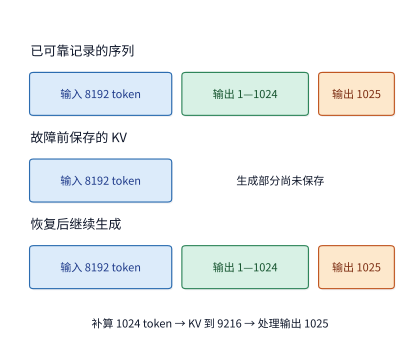

*图 9-46　结合 token 级预写日志（WAL）与 KV 检查点的流式生成无损恢复机制。假设故障前已向用户可靠返回并记录了 1025 个输出 token（上方 WAL 记录），但持久化 KV 检查点仅保存了原始 8192 个输入 token 的状态（下方深色段）；恢复时无需重新采样，只需将 WAL 中的前 1024 个输出 token 作为增量 prefill 补算以重建 9216 token 的完整 KV，随后输入第 1025 个 token 即可无缝继续后续生成（图中各段宽度仅示意先后逻辑关系，未按 token 数等比例缩放）。*

在分布式集群中，单张加速卡故障的爆炸半径（blast radius）直接取决于实例内部的并行同步边界（`D14-04`）：在一个紧耦合的张量并行组（TP）或大规模专家并行组（大 EP）内部，任意一张卡掉线都会导致整组集合通信（`AllReduce` 或 `All-to-All`）挂起，使该协作实例承载的所有在途请求被迫中断；而集群中其他相互独立的数据并行（DP）副本则不受波及，可以继续对外服务并分担故障实例重路由过来的恢复流量。

我们以一座由 $64$ 张 GPU 组成的推理集群为例，定量对比**独立副本部署（$8$ 个独立的 `TP8` 副本）**与**大规模专家并行部署（单组 `DP8 × TP8 / EP64` 紧耦合实例）**在单张 GPU 突发掉卡时的爆炸半径与恢复时间线（见表 9-B 与第 9.7.3 节末尾图 9-50 右栏）：
1. **受波及的在途请求比例（爆炸半径）**：在 $8$ 个独立 `TP8` 副本下，单张 GPU 故障仅令其所属的那 $1$ 个副本停摆，爆炸半径严格收敛在 **$1/8 = 12.5\%$** 的在途请求，其余 $7$ 个健康副本立即承接流量并维持集群 **$87.5\%$** 的稳态服务能力；而在 `EP64` 大专家并行组中，由于每一层 MoE 的 `All-to-All` 分发与合并都横跨全部 $64$ 张卡，任意 $1$ 张卡掉线都会触发全组通信超时阻塞，瞬间波及组内 **$100\%$** 的在途请求。
2. **故障恢复四阶段时间线分解**：一次完整的流式故障恢复依次经历**① 故障检测与隔离（$T_{\mathrm{detect}}$）$\to$ ② 通信域重建与专家权重恢复（$T_{\mathrm{reinit}}$）$\to$ ③ WAL 与 KV 检查点状态重放（$T_{\mathrm{replay}}$）$\to$ ④ 停机积压队列排空（$T_{\mathrm{drain}}$）**四个阶段。设前三个阶段导致服务中断的总停机窗口为 $T_{\mathrm{outage}} = T_{\mathrm{detect}} + T_{\mathrm{reinit}} + T_{\mathrm{replay}}$，在此期间外部请求仍以速率 $\lambda$ 到达并积压了 $\lambda T_{\mathrm{outage}}$ 个请求；当集群以净服务率 $\mu_{\mathrm{post}} > \lambda$ 恢复服务后，彻底排空故障积压所需的恢复尾巴耗时为：

$$
T_{\mathrm{drain}} = \frac{\lambda\, T_{\mathrm{outage}}}{\mu_{\mathrm{post}} - \lambda}.
$$

3. **大 EP 的冗余专家热切换降级恢复**：为了避免大 EP 因单卡故障被迫耗费十余秒从存储冷加载专家权重并重建 64 卡通信组，生产级大 EP 系统（如结合冗余专家副本的 EPLB 架构）可利用已在存活卡上常驻的**冗余专家副本（redundant expert replicas）**实施秒级降级接管：检测到单卡掉线后，控制面直接将故障卡剔除出通信组、修改门控路由映射表将原本发往故障卡专家的分派流量重定向至存活卡上的热备专家副本，从而跳过权重冷加载阶段，将 $T_{\mathrm{outage}}$ 从十秒级压缩至亚秒级。第 10 章将进一步探讨这类流式恢复对强化学习 rollout 样本有效性与训练吞吐的影响，第 11 章则将视野扩展到外部工具调用与沙箱环境的任务级恢复。

**表 9-B　独立 DP 副本与大规模专家并行（EP）集群在单卡故障下的爆炸半径与恢复阶段对比（D14-04）**

| 评估维度 | 独立 DP 副本架构（如 $8\times\mathrm{TP8}$，共 64 卡） | 紧耦合大 EP 架构（无热备降级，$\mathrm{EP64}$） | 大 EP + 冗余专家热备降级（$\mathrm{EP64}\to\mathrm{EP63}$） |
| --- | --- | --- | --- |
| 单卡故障瞬时爆炸半径 | $12.5\%$（仅所属 `TP8` 副本中断） | $100\%$（全组 64 卡 `All-to-All` 同步阻塞） | $100\%$ 短暂挂起后迅速收缩至局部请求 |
| 故障期间集群剩余可用吞吐 | $87.5\%$（其余 7 个健康副本持续服务） | $0\%$（直至整组完成重初始化） | 恢复后保持约 $95\%\text{–}98\%$（由冗余副本分担） |
| 阶段 ①：心跳超时与故障检测 $T_{\mathrm{detect}}$ | $0.05\text{–}0.2\ \mathrm{s}$ | $0.1\text{–}0.5\ \mathrm{s}$（跨机 RDMA 超时判定） | $0.1\text{–}0.3\ \mathrm{s}$（快速错误传播与熔断） |
| 阶段 ②：通信组重建与权重准备 $T_{\mathrm{reinit}}$ | 无需等待（请求直接重路由至其余 7 个健康副本） | $8\text{–}15\ \mathrm{s}$（拉起备卡 + 重建通信组 + 加载权重） | $0.3\text{–}1.0\ \mathrm{s}$（剔除坏卡 + 路由表切向常驻热备副本） |
| 阶段 ③：WAL 与 KV 检查点重放 $T_{\mathrm{replay}}$ | 仅中断的 $1/8$ 在途请求需重放恢复 | 全部 64 卡在途请求均需按 WAL/KV 重放 | 仅受坏卡在途步影响的批次执行增量重放 |
| 阶段 ④：积压队列排空耗时 $T_{\mathrm{drain}}$ | 短（停机期间其余 7 副本已消化绝大部分新流量） | 极长（$\lambda T_{\mathrm{outage}} / (\mu_{\mathrm{post}} - \lambda)$，积压基数大） | 显著缩短（$T_{\mathrm{outage}}$ 压至 $1\ \mathrm{s}$ 以内，积压极少） |

*表 9-B　独立 DP 副本与大规模专家并行（EP）集群在单卡故障下的爆炸半径与恢复阶段对比（D14-04）。*

## 9.7 部署方案的综合比较

走到本章最后一节，我们已经集齐了分布式推理架构设计的全部核心构件：用于匹配异构算力与访存特征的 **PD 分离**、用于剥离逐层稠密注意力与稀疏专家的 **AF 分离与专家并行**、用于跨请求复用历史计算的 **多级共享 KV 缓存**，以及决定系统动态韧性的 **冷启动与故障恢复机制**。本节将把这些机制放回章首提出的“4 张 A100 + 4 张 H20”八卡异构集群与统一业务负载下，沿着“状态交接路径 $\to$ 显存容量校验 $\to$ 稳态吞吐与冷启动排空期限 $\to$ 有效合格请求成本 $\to$ 负载演化后的配比调整”做一次完整的端到端工程综合推演。

### 9.7.1 组合副本、PD、AF 与共享 KV 的交接路径

在将 PD 分离与分布式共享 KV 缓存池结合时，首先需要确定的是 **Prefill 实例（P）生成的上下文 KV 如何交接给 Decode 实例（D）**。如图 9-47 与图 9-48 所示，工程上存在两条典型的交接路径：
- **直接点对点交接（P $\to$ D，图 9-47）**：P 算完一份 $1.125\ \mathrm{GiB}$ 的 $8\mathrm{K}$ 上下文 KV 后，直接通过高速网络推送到目标 D 实例的显存接收缓冲区，整个交接过程只发生 **1 次**跨网传输（经 $25\ \mathrm{GB/s}$ 链路耗时约 $48.3\ \mathrm{ms}$）。
- **经由共享缓存池中转（P $\to$ 池 $\to$ D，图 9-48）**：P 先将完整的 $1.125\ \mathrm{GiB}$ 状态写入共享缓存池并发布目录事件，随后 D 再从共享池中读取同一对象。在共享的两台服务器互联通道上，同一份状态先后经历了“写入池”与“从池读出” **2 次**传输，累计占用通道载荷翻倍至 $2.25\ \mathrm{GiB}$；若两侧均按整份写完后再读出、通道总带宽仍为 $25\ \mathrm{GB/s}$ 计，单次中转交接的等待时间将增至约 $96.6\ \mathrm{ms}$，比直接交接多等了约 $48.3\ \mathrm{ms}$。

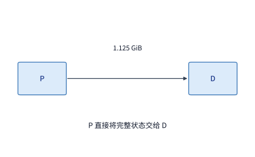

*图 9-47　直接点对点交接（P $\to$ D）：Prefill 实例将生成的 1.125 GiB 上下文 KV 缓存直接传输给目标 Decode 实例，仅占用 1 次网络传输（约 48.3 ms）。*

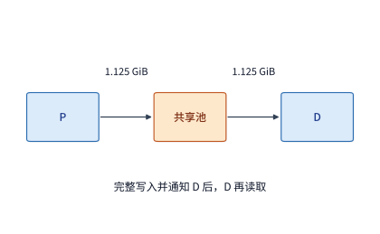

*图 9-48　经由共享缓存池中转（P $\to$ 池 $\to$ D）：Prefill 实例先向共享池写入 1.125 GiB 状态并发布目录，Decode 实例再从池中取回该对象，共经历写入与读取 2 次传输（串行共约 96.6 ms），但留在池中的对象可供后续到达的请求直接复用。*

既然经由共享池中转既让网络流量翻倍、又增加了 $48.3\ \mathrm{ms}$ 的交接延迟，什么时候才应该采用图 9-48 的中转架构？答案完全取决于**这份状态在未来是否会被后续请求再次复用**：
- 如果业务流量是单轮独立问答，D 实例生成完当前回答后这份上下文就再也不会被访问，那么写入共享池就是纯粹的冗余开销，直接 P $\to$ D 交接显然更优；
- 反之，如果这是多轮对话或共享长文档分析，后续到达的另一个请求还能从共享池中把这份 $1.125\ \mathrm{GiB}$ 状态再读出来复用一次，那么系统就能用约 $48.3\ \mathrm{ms}$ 的池读取替代一次在 A100 上耗时高达 $856\ \mathrm{ms}$ 的重算——省下的 $800\ \mathrm{ms}$ 以上计算时间，足以成倍赚回初次中转多付出的 $48.3\ \mathrm{ms}$ 写入代价（我们将在第 9.7.3 节严格核算这笔账）。此外，如果 D 实例在生成过程中追加的新 KV 也需要供下一轮 P 复用，D 同样需要将增量状态写回共享池并更新目录。

值得顺带一提的是，这套“按缓存标识区分阶段复用”的逻辑同样适用于第 9.1.3 节介绍的多模态 **E $\to$ P $\to$ D** 流水线：视觉编码器（E）输出的图像特征缓存（EC）与语言模型（P）输出的文本 KV 缓存使用各自独立的缓存键与存储池；命中图像缓存（EC）可以省去 E 阶段的视觉编码计算，但只要伴随图像的文本提示词发生了变化，语言模型的 P 阶段仍然需要读取这份 EC 并执行交叉或自注意力 prefill。因此，各阶段缓存命中率的独立变化，都会通过改变 E、P、D 的实际剩余计算量而触发集群卡数配比的动态重调。

图 9-49 将本章剖析的两类核心异构切分范式——**跨节点 A100/H20 异构 PD 阶段切分**与**单机 RTX 4090 + 双路 Xeon Gold 6454S 的 KTransformers 层内 AF 切分**——并列在统一的数据流与交接开销视角下进行对比：前者在整次请求的时间边界上做“粗粒度、单次大载荷（$1\ \mathrm{GiB}\sim 1.125\ \mathrm{GiB}$ KV 快照）”交接，核心矛盾是跨池带宽与两池服务率 $\min(n_P\mu_P, n_D\mu_D, B_{\mathrm{net}}/\mathbb{E}[V_{KV}])$ 的木桶配平；后者则在每一个 Transformer 层的算子边界上做“细粒度、每步数十次微载荷（单步共 $0.5\ \mathrm{MiB}\sim 0.5625\ \mathrm{MiB}$ 激活）”往返交接，核心矛盾是跨总线启动延迟 $\alpha$、CPU AMX 矩阵算力以及双路 NUMA 内存通道亲和性。[^pd-af]

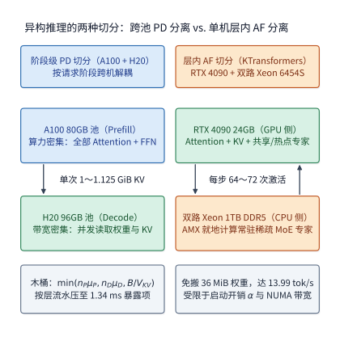

*图 9-49　异构推理的两种正交切分范式对比。左栏为跨池 A100（Prefill）+ H20（Decode）的阶段级 PD 切分：每条 8K 请求仅发生 1 次约 1 GiB～1.125 GiB 的 KV 跨网交接（25 GB/s 下纯传输 42.95～48.32 ms，按层流水可压缩暴露延迟）；右栏为单机 RTX 4090（24 GB，驻留 Attention、KV 与热点专家）+ 双路 Xeon Gold 6454S（1 TB DDR5，常驻稀疏 MoE 专家）的层内 AF 切分：每步 Decode 触发 64～72 次微激活往返（单步合计 0.5～0.5625 MiB），以 CPU AMX 就地计算避免跨 PCIe 搬移百兆级专家权重（实测吞吐从 4.54 tok/s 跃升至 13.99 tok/s）。*

### 9.7.2 同质量、同资源约束下的方案比较

现在，我们通过例 9.8 将本章建立的全套定量工具汇集到一起，对五种候选部署方案做一次严格的工程大考。

**例 9.8　哪种推理部署能持续服务并按期清空启动积压？** 沿用章首给定的硬件资源与业务负载：集群拥有 4 张 A100 80GB SXM 与 4 张 H20 SXM5 96GB（共 8 张卡），两台服务器之间通过一条共享的 $25\ \mathrm{GB/s}$ 有效载荷通道互联（所有跨机状态搬移共享该通道带宽）。外部以 $\lambda = 3.5\ \text{请求/s}$ 的速率持续到达独立请求，每条请求输入 $8192$ 个 token、输出 $1025$ 个 token（即经历 1 次 prefill 与 1024 步 decode），比较窗口内各请求的前缀互不复用。单卡各阶段能力沿用例 9.2 的实测校准值（50% 有效峰值）；当同一张卡共置执行两个阶段时依次串行占用该卡。假设服务从冷态启动，所有候选部署方案均在 $T_s = 10\ \mathrm{s}$ 后就绪并开始按连续流量模型处理队列。系统设计必须同时满足两项硬指标：① 稳态下能够持续消化每秒 $3.5$ 个新到达请求；② 在从冷启动开始算起的 **$60\ \mathrm{s}$ 期限内**（即就绪后 $50\ \mathrm{s}$ 内）彻底清空冷启动期间积压的请求。

#### 第一步：显存容量可行性校核

在比较吞吐之前，必须先确认每张卡的物理显存装得下所分配的权重与并发状态：
- **H20 Decode 卡（$96\ \mathrm{GB}$，约 $89.4\ \mathrm{GiB}$）**：每条请求完成 1024 步 decode 后，其上下文 KV 覆盖 $9216$ 个 token，在标准 GQA（Qwen3-8B）下占约 $1.27\ \mathrm{GiB}$。每张 H20 按并发批大小 $32$ 驻留活跃请求，活跃 KV 状态共占约 $40.5\ \mathrm{GiB}$；再预留 1 份 $1.125\ \mathrm{GiB}$ 的跨网接收缓冲区，加上约 $15.3\ \mathrm{GiB}$ 的 BF16 权重，总显存占用约为 **$56.9\ \mathrm{GiB}$**，完全可以放进 $89.4\ \mathrm{GiB}$ 的可用显存中。若换成紧凑 MLA 状态，每条请求结束时仅占约 $618\ \mathrm{MiB}$，32 条并发加上 1 份 $549\ \mathrm{MiB}$ 接收缓冲合计仅占约 **$19.8\ \mathrm{GiB}$**，显存余量更加宽裕。
- **A100 Prefill 卡（$80\ \mathrm{GB}$）**：只需同时驻留当前正在计算的 1 份状态与正在向网络发送的 1 份状态，合计仅占 $2.25\ \mathrm{GiB}$ 缓存空间。
- **共享缓存池**：在采用共享池中转的方案中，额外配有 $64\ \mathrm{GiB}$ 的共享状态池容量。所有尚未分配到缓存空间的排队请求仅在内存中保留轻量级的输入 token 编号，待获得缓存配额后再启动计算。

#### 第二步：稳态吞吐率与共享通道瓶颈核算

下表汇总了五种候选方案（8 个完整共置副本、GQA 状态下的直接 PD 与共享池中转 PD、紧凑 MLA 状态下的直接 PD 与共享池中转 PD）的每请求通道载荷、计算池能力、共享通道支持上限以及最终的集群总体吞吐率。

| 部署方案 | P、D 的物理卡组织 | 每请求通道载荷 | 计算池能力（请求/s） | 共享通道能力（请求/s） | 启动后的总体吞吐率 $\mu$（请求/s） |
| --- | --- | ---: | ---: | ---: | ---: |
| 方案 1：八个完整副本 | 每张卡独立执行 P 与 D | $0$ | $3.02$ | — | $3.02$ |
| 方案 2：直接 PD（标准 GQA） | 4 张 A100 做 P，4 张 H20 做 D | $1.125\ \mathrm{GiB}$ | $4.55$ | $20.7$ | $4.55$ |
| 方案 3：PD 加共享池中转（标准 GQA） | 相同的 P、D 配比，P $\to$ 池 $\to$ D | $2.25\ \mathrm{GiB}$ | $4.55$ | $10.3$ | $4.55$ |
| 方案 4：直接 PD（紧凑 MLA） | 4 张 A100 做 P，4 张 H20 做 D | $549\ \mathrm{MiB}$ | $4.55$ | $43.4$ | $4.55$ |
| 方案 5：PD 加共享池中转（紧凑 MLA） | 相同的 P、D 配比，P $\to$ 池 $\to$ D | $1.07\ \mathrm{GiB}$ | $4.55$ | $21.7$ | $4.55$ |

*表 9-8　例 9.8 中五种候选部署方案的通道载荷、计算池能力、共享通道上限与启动后总体吞吐率对照。*

审视上表可以得出三点清晰结论：
1. **方案 1（八个完整副本）首先被淘汰**：其最大稳态服务率仅为 $3.02\ \text{请求/s}$，低于外部到达率 $\lambda = 3.5\ \text{请求/s}$，一旦上线就会陷入持续积压。
2. **四种 PD 分离方案均由计算池受限，而非网络通道受限**：即便是通道载荷最重的方案 3（每请求在共享通道上读写各一次共搬移 $2.25\ \mathrm{GiB}$），$25\ \mathrm{GB/s}$ 通道每秒也能支撑 $10.3$ 个请求，远高于计算池上限 $4.55\ \text{请求/s}$。具体而言，在 $\lambda = 3.5\ \text{请求/s}$ 的日常到达负载下，方案 2（直传）与方案 3（中转）分别消耗约 $4.2\ \mathrm{GB/s}$ 与 $8.5\ \mathrm{GB/s}$ 带宽；在以 $\mu = 4.55\ \text{请求/s}$ 满负荷排空积压期间，两者分别消耗约 $5.5\ \mathrm{GB/s}$ 与 $11.0\ \mathrm{GB/s}$ 带宽（若换成紧凑 MLA 状态，上述四项带宽消耗分别减半为 $2.0$、$4.0$、$2.6$ 与 $5.2\ \mathrm{GB/s}$，通道支持能力翻倍至 $43.4$ 与 $21.7\ \text{请求/s}$）。
3. **在无前缀复用的负载下，直接 PD（方案 2/4）全面优于共享池中转（方案 3/5）**：虽然两者稳态吞吐同为 $4.55\ \text{请求/s}$，但由于本例假定各请求前缀互不复用，$64\ \mathrm{GiB}$ 共享池里缓存下来的 56 份 GQA 前缀（或 119 份紧凑 MLA 前缀）在后续请求中一次也不会被命中；引入共享池中转除了让网络流量翻倍、让每条请求额外多等约 $48.3\ \mathrm{ms}$ 之外没有任何收益。因此，针对例 9.8 的基准负载，最优架构是 **4 张 A100 做 P、4 张 H20 做 D、采用 P $\to$ D 直接交接**。

#### 第三步：冷启动积压排空期限与内核效率容差校核

选定直接 PD 方案后，接下来检验它能否在启动后 $60\ \mathrm{s}$ 内清空冷启动积压。根据第 9.6.1 节（图 9-44）的推导，$10\ \mathrm{s}$ 冷启动期间共积压了 $35$ 个请求；直接 PD（$\mu = 4.55\ \text{请求/s}$）就绪后以 $1.05\ \text{请求/s}$ 的净速率削减队列，从启动算起在**第 $43\ \mathrm{s}$** 即排空全部积压，顺利通过 $60\ \mathrm{s}$ 期限考核。相比之下，完整副本在启动后第 $60\ \mathrm{s}$ 时积压反而从 35 个膨胀到了约 59 个；即便按理想分块捎带的共置上限 $4.17\ \text{请求/s}$ 计算，也要到第 $63\ \mathrm{s}$ 才能排空，同样未能达标。

我们还可以反过来倒推：**要想在 $60\ \mathrm{s}$ 期限内排空积压，集群就绪后的最低服务率 $\mu_{\min}$ 必须达到多少？** 扣除前 $10\ \mathrm{s}$ 启动期后，留给排空的时间窗口为 $50\ \mathrm{s}$；在这 $50\ \mathrm{s}$ 内，系统不仅要实时处理每秒到达的 $3.5$ 个新请求，还要额外消化掉 $35$ 个存量积压，因此要求：

$$
\mu - 3.5 \ge \frac{35}{50} = 0.70\qquad\Longrightarrow\qquad \mu \ge 4.20\ \text{请求/s}.
$$

直接 PD 方案的 $4.55\ \text{请求/s}$ 比这一最低门槛高出约 $8\%$ 的安全余量。这一余量看似充裕，实则对底层算子执行效率高度敏感：假如线上实际部署时，H20 上的 Decode 内核有效效率只有例 9.2 假设值的九成（即从峰值的 $50\%$ 掉到 $45\%$），那么 D 池的服务能力就会按比例缩水至 $\mu \approx 4.10\ \text{请求/s}$。此时虽然 $\mu = 4.10 > 3.5$ 仍能应付日常稳态流量，但净排空速率却从 $1.05\ \text{请求/s}$ 骤降至 $0.60\ \text{请求/s}$，导致冷启动排空时刻推迟到约**第 $68.5\ \mathrm{s}$**，从而违反 $60\ \mathrm{s}$ 恢复期限。图 9-44 中两条下降直线的斜率差异，直观展示了净服务余量 $\mu - \lambda$ 对系统恢复速度的放大效应。

#### 第四步：计入服务等级目标（SLO）的有效合格请求成本核算

最后，我们将硬件租赁成本与业务服务质量（SLO）结合，核算不同部署方案的真实经济账。假设这 8 张 GPU 按小时整包预留计费，每小时总硬件成本固定为 $8$ 元：
- **按实际到达率计费（未满载）**：当外部流量固定为 $\lambda = 3.5\ \text{请求/s}$ 时，集群每小时实际完成 $3.5 \times 3600 = 12{,}600$ 个请求，折合每千个请求成本约为 $8 / 12.6 \approx 0.63\ \text{元}$。注意，在外部请求没有增加的前提下，直接 PD 高出的 $4.55 - 3.5 = 1.05\ \text{请求/s}$ 算力并不会凭空变出新请求来摊薄日常单价，这笔余量的核心价值在于吸收突发流量与按期排空冷启动积压。
- **按满载极限能力计费**：若外部流量充足、可将各方案推至满载，则完整副本（$3.02\ \text{请求/s}$）与直接 PD（$4.55\ \text{请求/s}$）每小时分别可完成约 $10{,}872$ 与 $16{,}380$ 个请求，折合每千请求成本分别约为 **$0.74\ \text{元}$** 与 **$0.49\ \text{元}$**。
- **按满足质量与时限的合格请求（goodput）计费**：如果业务除了要求返回结果，还设定了严格的端到端完成时限或任务准确率要求——例如在某高并发配置下，虽然名义吞吐达到了 $4.55\ \text{请求/s}$，但因排队过长或精度受损导致只有四分之一（$25\%$）的请求真正满足质量与延迟目标（有效合格吞吐跌至约 $1.14\ \text{请求/s}$），那么每千个**合格请求**的真实成本就会激增至约 **$1.95\ \text{元}$**。

由此我们得到评估推理基础设施经济性的通用有效成本公式：

$$
C_{\mathrm{effective}}=\frac{\text{统计期间的总基础设施成本}}
{\text{同时满足生成质量与延迟时限的合格请求（或任务）数}}.
$$

在这个分式中，分子涵盖了计算卡、主机内存、高速网络以及为容灾预留的热备实例成本，分母则严格只统计有效交付的合格任务数。例如在第 9.5.2 节提及的真实 Agent 回放实验中，某些因缓存截断或上下文丢失而提前异常退出的 Agent 轨迹虽然消耗了更少的输出 token 与 GPU 时间，但因为根本没有完成用户交办的任务，绝不能计入分母的合格任务数中。[^cost-model]

### 9.7.3 负载变化后的部署调整

任何一套推理部署架构都不是一成不变的静态配方；一旦外部请求的**前缀复用率**、**命中位置**或**输入输出长度比**发生漂移，原本最优的资源配比与交接路径就会随之改写。我们在例 9.8 的基础上依次改变三个负载条件，观察系统瓶颈与最优架构如何动态迁移。

#### 情景一：开启跨请求前缀复用——共享缓存池从“累赘”变为“加速器”

首先打破例 9.8 中“各请求前缀互不复用”的假设，设每条请求写入共享池的那份 $1.125\ \mathrm{GiB}$ 上下文 KV，在稍后到达的另一条请求中还会被再次取回并复用 **1 次**（构成一组“原始请求 + 复用请求”的请求对）。
- **计算时间收益**：在 A100 上重新计算 $8192$ 个 token 需要 $856\ \mathrm{ms}$，而从共享池取回只需 $48.3\ \mathrm{ms}$。即便把原始请求为写入共享池多付出的 $48.3\ \mathrm{ms}$ 中转代价算进来，两次额外传输合计耗时也只有 $96.6\ \mathrm{ms}$，相比重算一次净省了约 **$760\ \mathrm{ms}$** 的 A100 计算时间。在例 9.8 中毫无用处的共享缓存池，一旦遇到可复用的多轮或共享前缀流量，立刻展现出显著的算力替代价值。
- **共享通道带宽代价**：天下没有免费的午餐，省去重算的代价是共享网络通道的传输负担加重。每处理一组这样的请求对，共享通道需要依次承担“原始请求写入池（1 次）+ 原始请求 D 读出（1 次）+ 后续复用请求读出（1 次）”共 **3 次**传输，累计搬移 $3 \times 1.125 = 3.375\ \mathrm{GiB}$ 数据。当外部以每秒 $3.5$ 组请求对到达时，共享通道的持续带宽消耗升至约 $12.7\ \mathrm{GB/s}$，整条 $25\ \mathrm{GB/s}$ 通道最多只能支撑约 **$6.9\ \text{组请求对/s}$**（若换成紧凑 MLA 状态，三次传输共搬移 $1.61\ \mathrm{GiB}$，每秒 $3.5$ 组请求对消耗约 $6.0\ \mathrm{GB/s}$，通道上限提升至约 **$14.5\ \text{组请求对/s}$**）。可以看到，引入共享缓存池的本质，正是**用充裕的网络与存储带宽去置换昂贵的 GPU Prefill 算力**。

#### 情景二：Prefill 本地高比例命中——最优 P/D 卡数配比发生翻转

接着我们保持 Decode 端无缓存，仅将 Prefill 端的条件改为“每条请求已在 P 卡本地命中了 $6144$ 个历史 token，只需增量计算剩余 $2048$ 个输入 token”。由于每条请求消耗的 P 阶段算力骤降为原来的四分之一，而 D 阶段的 1024 步生成负担分毫未减，第 9.2.4 节推导的资源天平立刻向 D 侧倾斜：
- 若沿用原来的 **“4 张 A100 做 P + 4 张 H20 做 D”**，P 池能力大幅过剩，集群整体吞吐依然被 4 张 H20 限制在 **$4.55\ \text{请求/s}$**；
- 若改回 **“8 个完整共置副本”**，由于每张卡花在 prefill 上的时间大减，共置吞吐反而跃升至 **$4.90\ \text{请求/s}$**，反超了原定配比的 PD 分离；
- 若顺应负载变化，将 PD 配比调整为 **“2 张 A100 做 P + 其余 6 张卡（2 张 A100 + 4 张 H20）全部做 D”**，集群吞吐即可进一步提升至 **$5.69\ \text{请求/s}$**。

在同样的 $10\ \mathrm{s}$ 冷启动与 $\lambda = 3.5\ \text{请求/s}$ 到达率下，上述三种配置从启动算起的积压排空时刻分别为：**原 4P+4D 配比需 $43.2\ \mathrm{s}$**，**8 个完整副本只需 $35.1\ \mathrm{s}$**，而**调整后的 2P+6D 配比仅需 $26.0\ \mathrm{s}$**。这一算例生动地说明：脱离开具体的输入命中率去谈论“PD 分离一定比共置快”是片面的；当前缀命中大幅削减了 P 阶段工作量后，必须及时抽调 P 卡补充到 D 池，才能兑现分离架构的优势。

#### 情景三：长思维链输出（4097 token）——单组八卡触及物理上限与按组扩容

最后，我们恢复“无前缀命中”的 $8192$ token 输入，但将每条请求的输出长度从 $1025$ 个 token 延长至 **$4097$ 个 token**（对应深度推理模型的长思维链生成）。此时每条请求的 D 阶段驻留时间暴增至原来的 4 倍：即便将 8 张卡按最优比例调整为“2 张 A100 做 P + 6 张卡做 D”，单组 8 卡集群的最大稳态吞吐也只有约 **$1.26\ \text{请求/s}$**——无论怎样在 8 张卡内部腾挪 P、D 比例，单组集群都绝无可能消化每秒 $3.5$ 个的长输出请求。

面对这种单组物理容量不足的局面，唯一的出路是**按组横向复制扩展（scale-out）**，而扩容的组数则取决于业务对冷启动恢复期限的要求：
- 若仅要求**稳态下持续处理每秒 $3.5$ 个到达请求**，复制 **3 组**这样的 8 卡单元（共 **24 张卡**）可提供 $3 \times 1.26 \approx 3.78\ \text{请求/s} > 3.5\ \text{请求/s}$ 的服务能力，刚好满足稳态运行；
- 若同时要求满足例 9.8 的 **“$10\ \mathrm{s}$ 启动、第 $60\ \mathrm{s}$ 前排空积压”** 期限（前文已求出该期限要求集群总服务率至少达到 $\mu \ge 4.20\ \text{请求/s}$），那么 3 组（$3.78\ \text{请求/s}$）将无法按期排空积压，必须配置 **4 组** 8 卡单元（共 **32 张卡**，提供约 $5.04\ \text{请求/s}$ 的总吞吐）。这里多配的第 4 组（8 张卡），其工程用途正是提供足够的净服务余量 $\mu - \lambda$ 以加速突发与启动积压的消退。

反过来，当某项底层算法或硬件优化让**单个阶段大幅加速**时，同样的吞吐目标就能省下真金白银的机器资源。举一个直观的配比缩放例子：假设网络带宽充足，每个 P 实例每秒可处理 20 个请求，每个 D 实例每秒可完成 5 个请求；在初始状态下，必须用 **1 个 P 实例配 4 个 D 实例（共 5 个实例）** 才能让两池能力在 $20\ \text{请求/s}$ 处匹配平衡。如果通过引入投机采样（第 8.5 节）或算子优化使 D 阶段加速了 **4 倍**（单 D 实例能力升至 $20\ \text{请求/s}$），此时若仍维持 1P+4D 的旧配比，D 池能力虽然涨到了 $80\ \text{请求/s}$，但整套系统的总吞吐依然被单个 P 实例卡在 $20\ \text{请求/s}$；正确的做法是将配比调整为 **1 个 P 实例配 1 个 D 实例（共 2 个实例）**，在同样维持 $20\ \text{请求/s}$ 端到端吞吐的前提下，直接**释放掉 3 个 D 实例（节省 $60\%$ 的实例资源）**。

总结起来，把本章建立的分析方法应用到任何一套新的分布式推理系统时，都可以遵循一套固定的**四步工程推演法**：
1. **单请求资源折算**：将每条请求在各阶段（E、P、D 或 A、F）的计算量、权重读取量与状态增量，折算为对算力、显存带宽与容量的基础需求；
2. **整数配比与木桶寻优**：在给定的加速卡池与网络拓扑下，枚举或求解各阶段的整数资源分配，找出制约全局吞吐 $\mu$ 的短板池或最忙执行单元（如大 EP 中的热点专家卡）；
3. **关键路径与时空状态核算**：沿着请求执行图计入跨网状态交接延迟、分块补齐损耗、通信—计算重叠争用以及状态驻留占用的容量·时间乘积（$V\tau$）；
4. **动态队列与成本核算**：用稳态服务能力减去外部到达率得到净排空速率 $\mu - \lambda$，校核冷启动、在线迁移或故障恢复后的积压消退时间，最终以同时满足质量与延迟时限的合格任务数（$C_{\mathrm{effective}}$）完成方案选型。

图 9-50 将本章在生产安全隔离与容灾韧性上的两项核心机制并列汇总：左栏展示多租户共享集群中 `cache_salt` 如何从第 $0$ 块起切分前缀哈希链以阻断计时侧信道与跨租户越权复用（`D11-07`）；右栏展示 $64$ 卡规模下独立 `TP8` 副本与紧耦合 `EP64` 大专家并行组在单卡掉线时的爆炸半径对比，以及利用常驻冗余专家副本实现亚秒级降级恢复的四阶段时间线（`D14-04`）。

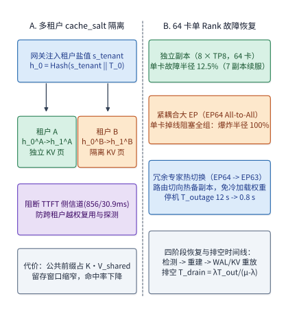

*图 9-50　多租户 `cache_salt` 前缀缓存安全隔离与大规模 EP 单卡故障恢复机制对比。左栏（`D11-07`）：API 网关将鉴权后的租户盐值 $s_{\mathrm{tenant}}$ 注入起始块哈希 $h_0 = \operatorname{Hash}(s_{\mathrm{tenant}}\,\|\,\mathrm{ModelID}\,\|\,T_0)$ 并沿前缀链传递，使相同系统提示词在不同租户间映射至隔离的物理 KV 页，彻底消除 856 ms vs. 30.9 ms 的 TTFT 计时侧信道，代价是 $K$ 租户分割下公共前缀占用升至 $K\cdot V_{\mathrm{shared}}$；右栏（`D14-04`）：64 卡集群中 8 个独立 `TP8` 副本在单卡掉线时爆炸半径仅 12.5%，而紧耦合 `EP64` 因全组 `All-to-All` 同步屏障受阻导致爆炸半径达 100%，需依靠存活卡常驻冗余专家副本热切换将停机窗口 $T_{\mathrm{outage}}$ 从十秒级压缩至亚秒级并加速积压排空 $T_{\mathrm{drain}} = \lambda T_{\mathrm{outage}}/(\mu_{\mathrm{post}}-\lambda)$。*

图 9-51 与图 9-52 进一步总结了本章在大规模专家并行通信内核（DeepEP V1/V2 与 SwiftEP）以及以 KV 为中心的解耦推理架构（Mooncake 与预测性早期拒绝）上的核心系统设计。


*图 9-51　DeepSeek DeepEP 面向高吞吐 Prefill 与低延迟 Decode 的双模态通信内核演进。左栏：高吞吐内核利用机内 NVLink 带宽远高于机间 RDMA 的非对称特性，先将跨机 token 经 RDMA 发往目标节点同号对等 GPU，再经机内 NVLink 二次转发至目标专家卡，将跨机 QP 扇出缩减 $G=8$ 倍（DeepEP V2 在 `SM90` CX7 `8×2` 下仅用 12 个 SM 即可达 90/81 GB/s）；右栏：低延迟 Decode 内核通过 `IBGDA` 由 GPU 线程直接敲响网卡门铃，并借助后台接收钩子（Hook）实现等待期零 SM 占用（0-SM），DeepEP V2 进一步结合 `ElasticBuffer` 与 `NCCL Gin` 将峰值吞吐提升 $1.3\times$、SM 占用压降 $4\times$（4～6 个 SM），配合 `SwiftEP` 流量整形消除微突发拥塞。*


*图 9-52　Mooncake（FAST 2025）以 KV 缓存为中心的解耦推理架构与预测性早期拒绝（Predictive Early Rejection）。左栏：全局调度器 Conductor 统一管理跨节点 HBM、DRAM 与 NVMe 多级 KV 池及缓存块事件目录（需严格区分 vLLM 仅 HBM 块发事件及 Dynamo 哈希冲突覆写边界），在长上下文 SLO 约束下实现最高 525% 吞吐提升；右栏：准入控制器在请求进入 Prefill 池前，沿未来生成时间窗 $[t,\, t+T_{\mathrm{gen}}]$ 预测在途序列增长后的 Decode 池峰值 KV 水位 $M_D(\tau)$，若突破安全上限 $\eta_{\mathrm{safe}} M_{D,\max}$ 则在 Prefill 前提前拒绝或延后准入，根除“算完 Prefill 却在 Decode 阶段因 OOM 被驱逐丢弃”的无效算力浪费。*

### 9.7.4 弹性专家并行（ElasticEP / EPLB）：影子专家后台预热、路由表双缓冲原子切换与在途排空

在第 9.4.3 节中，我们证明了在静态负载下复制热点专家可将任务倾斜度 $s_{\mathrm{expert}}$ 从 $4.0\times$ 压回 $1.04\times$；然而在真实生产环境中，线上流量的领域分布（如白天企业编程、夜间多语种翻译与创意写作）每隔数分钟就会发生明显漂移。如果每次调整专家副本分布都要暂停全组 `EP64` 推理、阻塞在途请求去拷贝数十兆字节的专家权重，重配置引起的秒级停顿本身就会击穿 TPOT 服务等级目标（SLO）。

为了实现**零停顿（Zero-Stall）的在线弹性专家再平衡（ElasticEP / EPLB）**，现代 MoE 推理引擎将重配置过程拆解为完全不阻塞主计算流的三阶段异步状态机（图 9-53）：
1. **阶段 ①：滑动窗口热度观测与影子专家后台预热（Background Shadow Warmup）**。每张 EP 卡的门控算子在正常执行 Decode 步的同时，通过无锁原子计数器累加当前滑动窗口（如最近 $W_{\mathrm{obs}} = 500$ 步）内各专家的实际激活 token 数。当全局 EPLB 控制器检测到最忙卡与均值之比 $s_{\mathrm{expert}} > \theta_{\mathrm{rebal}}$（如 $1.25$）时，求解出新的专家放置映射表 $M_{\mathrm{next}}$，并利用**低优先级后台 RDMA / NVLink 流**将新增副本的专家权重（每份 $W_e = 36\ \mathrm{MiB}$）静默预加载到目标冷卡预留的**影子专家槽位（Shadow Slot）**中。由于后台传输流被限制在空闲互联带宽（如仅占 $10\%\text{–}20\%$ 链路余量）内，前台 Decode 步的 `All-to-All` 延迟波动不超过 $2\%$。
2. **阶段 ②：双缓冲路由表版本对齐与原子指针翻转（Atomic Pointer Swap）**。当所有目标卡上的影子专家权重均已完成校验并就绪（Ready Barrier）后，控制器向全组 $R$ 张 EP 卡广播切换步号 $t_{\mathrm{swap}}$。每张卡在显存中维护 `Table_A`（活跃）与 `Table_B`（备用）两份路由查表缓冲区：在步号 $t < t_{\mathrm{swap}}$ 时，所有门控算子统一读取 `Table_A`；到达步号 $t = t_{\mathrm{swap}}$ 的边界瞬间，各卡仅执行一次纳秒级的**设备端指针翻转（Pointer Swap）**，使新步的所有门控分发立即按 `Table_B` 将热点专家流量均匀导向主副本与刚刚转正的影子副本，关键路径切换开销满足 $\Delta t_{\mathrm{swap}} < 5\ \mu\mathrm{s}$。
3. **阶段 ③：在途微批排空与旧副本槽位安全回收（In-Flight Drain & Eviction）**。在开启双微批乒乓重叠（如 DeepEP 的 Micro-batch A/B 交替）的流水线中，当步号 $t_{\mathrm{swap}}$ 翻转路由指针时，上一微批可能仍处于跨网 `Combine` 归并阶段、或正在旧专家槽位上执行尾声矩阵乘。因此，系统严禁在指针翻转瞬间立即覆写旧槽位，而是为每个物理专家槽位维护在途引用计数 `ref_cnt`：只有当 `ref_cnt == 0`（通常仅需等待 $1\sim 2$ 个微批，约 $1.5\text{–}3.0\ \mathrm{ms}$）后，被淘汰的旧冗余副本槽位才会安全释放并转入下一轮影子缓冲池。


*图 9-53　弹性专家并行（ElasticEP / EPLB）零停顿在线重配置架构。左栏展示三阶段异步时间线：后台低优先级 RDMA/NVLink 流在不阻塞前台 Decode 步的前提下将 36 MiB 热点专家权重预热至冷卡的影子槽位（Shadow Slot），就绪后通过双缓冲路由表（Table A / Table B）在步边界 $t_{\mathrm{swap}}$ 执行 $<5\ \mu\mathrm{s}$ 的原子指针翻转，并等待在途微批引用计数归零（`ref_cnt == 0`）后安全回收旧槽位；右栏展示切换前后单卡负载与 TPOT 演化曲线，避免了同步阻塞重配置引发的百毫秒级延迟尖峰。*

| 重配置方式 | 权重传输路径 | 路由切换机制 | 关键路径停顿 $\Delta t_{\mathrm{stall}}$ | 在途微批安全性 | 适用场景 |
| --- | --- | --- | ---: | --- | --- |
| 同步停机重排（Stop-the-World） | 暂停 Decode，全速跨网拷贝权重 | 重建通信组与静态路由表 | $50\text{–}500\ \mathrm{ms}$ | 需先排空全流水线才可启动 | 离线批处理或小时级低频维护 |
| 影子预热 + 双缓冲原子切换（EPLB） | 后台限流流预加载至 Shadow Slot | 步号对齐 + 设备指针翻转 | $< 5\ \mu\mathrm{s}$ | 引用计数排空后延迟回收 | 在线交互推理、突发热点秒级追踪 |
| 常驻冗余热备快速降级（Fault Fallback） | 无需传输（预先常驻 Top-$K$ 副本） | 屏蔽故障卡 + 切向存活副本 | $0.3\text{–}1.0\ \mathrm{s}$（含错误检测） | 重放受影响微批的 WAL | 单卡掉线或 RDMA 链路突发闪断 |

*表 9-9　三种专家并行重配置与容灾切换机制在传输路径、关键路径停顿与在途安全性上的工程对比。*

下面的纯 Python 参考实现模拟了包含影子槽位预热、双缓冲路由表原子翻转与引用计数排空的 `ElasticEPController`，并在 `EP8` 集群上验证了热点专家复制前后的倾斜度 $s_{\mathrm{expert}}$ 变化与零停顿切换条件：

```python
from dataclasses import dataclass, field

@dataclass
class ElasticEPController:
    num_ranks: int = 8
    experts_per_rank: int = 16
    expert_weight_mib: float = 36.0
    active_table: dict[int, list[int]] = field(default_factory=dict)
    standby_table: dict[int, list[int]] = field(default_factory=dict)
    shadow_ready: set[tuple[int, int]] = field(default_factory=set)
    in_flight_refs: dict[tuple[int, int], int] = field(default_factory=dict)

    def init_uniform_placement(self) -> None:
        for e in range(self.num_ranks * self.experts_per_rank):
            r = e // self.experts_per_rank
            self.active_table[e] = [r]
            self.in_flight_refs[(r, e)] = 0

    def compute_rank_skew(self, expert_tokens: dict[int, float]) -> tuple[list[float], float]:
        rank_loads = [0.0] * self.num_ranks
        for e, tok in expert_tokens.items():
            replicas = self.active_table[e]
            share = tok / len(replicas)
            for r in replicas:
                rank_loads[r] += share
        mean_load = sum(rank_loads) / self.num_ranks
        return rank_loads, max(rank_loads) / mean_load

    def stage_shadow_replicas(
        self, hot_experts: list[int], target_ranks: list[int], bg_bw_gbps: float
    ) -> float:
        self.standby_table = {e: list(rs) for e, rs in self.active_table.items()}
        for e, target_r in zip(hot_experts, target_ranks):
            self.shadow_ready.add((target_r, e))
            self.in_flight_refs[(target_r, e)] = 0
            if target_r not in self.standby_table[e]:
                self.standby_table[e].append(target_r)
        total_bytes = len(hot_experts) * self.expert_weight_mib * (1024**2)
        return (total_bytes / (bg_bw_gbps * 1e9)) * 1e3  # 后台预热耗时 (ms)

    def atomic_pointer_swap(self) -> float:
        self.active_table, self.standby_table = self.standby_table, self.active_table
        return 0.002  # 2 us 设备端路由表指针翻转开销

ctrl = ElasticEPController()
ctrl.init_uniform_placement()
# 构造 4 个 4x 热点专家集中在 Rank 0，其余 124 个专家均匀接收 32 tokens
loads = {e: (128.0 if e < 4 else 32.0) for e in range(128)}
_, skew_before = ctrl.compute_rank_skew(loads)
warmup_ms = ctrl.stage_shadow_replicas([0, 1, 2, 3], [4, 5, 6, 7], bg_bw_gbps=10.0)
swap_ms = ctrl.atomic_pointer_swap()
_, skew_after = ctrl.compute_rank_skew(loads)
print(f"Skew: {skew_before:.3f}x -> {skew_after:.3f}x | BG warmup: {warmup_ms:.1f} ms | Stall: {swap_ms*1e3:.1f} us")
```

### 9.7.5 按层流水异步 KV 交接（Layer-wise Pipelined KV Transfer）：TTFT 交接延迟隐藏与双轨拥塞回退

在第 9.2.2 节与第 9.7.1 节中，若采用朴素的**整份算完再传（All-at-Once Handoff）**策略，Prefill 实例必须等全部 $L$ 层前向计算结束，才开始将整份 $V_{KV}$ 字节的上下文 KV 发送给 Decode 实例，使完整的网络传输耗时 $T_{\mathrm{xfer}}$ 直接暴露在首 token 延迟（TTFT）的关键路径上。

事实上，Prefill 阶段在第 $l$ 层（$l \in \{1, \dots, L\}$）的自注意力算子执行完毕瞬间，该层的上下文键值对 $(K_l, V_l)$ 就已经完全确定，后续第 $l+1 \dots L$ 层的计算绝不会再修改 $(K_l, V_l)$。利用这一逐层单向产出特性，生产级 PD 分离系统普遍采用**按层流水异步 KV 交接（Layer-wise Pipelined KV Transfer）**（图 9-54）：一旦第 $l$ 层算完，GPU 计算流立即在层尾记录一个轻量级 CUDA Event，专门负责跨网传输的 RDMA 发送流（或 NIXL / Mooncake 传输引擎）监听到该事件后，立刻在后台发起第 $l$ 层 KV 块（单层体积 $V_{\mathrm{layer}} = V_{KV} / L$，单次传输耗时 $t_{\mathrm{xfer,1}} = \alpha + V_{\mathrm{layer}} / B_{\mathrm{net}}$）的异步推送，同时计算流马不停蹄地进入第 $l+1$ 层前向计算。

记单层 Prefill 计算耗时为 $t_{\mathrm{comp,1}} = T_{\mathrm{prefill}} / L$，整份 KV 总传输耗时为 $T_{\mathrm{xfer,all}} = L\cdot t_{\mathrm{xfer,1}}$。根据单层计算与单层传输的相对快慢，按层流水交接在关键路径上暴露的净交接延迟 $\Delta \mathrm{TTFT}_{\mathrm{pipe}}$ 呈现两种截然不同的物理形态：
1. **计算主导区（$t_{\mathrm{comp,1}} \ge t_{\mathrm{xfer,1}}$，如高速 RoCEv2 / IB 链路）**：每算完一层，上一层的 KV 早已传输完毕，前 $L-1$ 层的网络传输被后续层的矩阵计算 $100\%$ 掩盖，关键路径上**仅暴露最后一层（第 $L$ 层）的传输耗时**：
   $$
   \Delta \mathrm{TTFT}_{\mathrm{pipe}} = t_{\mathrm{xfer,1}} = \alpha + \frac{V_{KV}}{L\cdot B_{\mathrm{net}}}.
   $$
2. **传输主导区（$t_{\mathrm{comp,1}} < t_{\mathrm{xfer,1}}$，如跨机房慢速链路或拥塞降级）**：发送队列逐层累积积压，第 $1$ 层计算结束后网络通道连续满载发送 $L$ 层数据，此时前 $L-1$ 层的计算时间 $(L-1)t_{\mathrm{comp,1}}$ 掩盖了等量的传输时间，关键路径暴露的净延迟为：
   $$
   \Delta \mathrm{TTFT}_{\mathrm{pipe}} = L\cdot t_{\mathrm{xfer,1}} - (L - 1)\, t_{\mathrm{comp,1}}.
   $$

将上述两区合并，即可得到按层流水 KV 交接的统一闭式公式：

$$
\mathrm{TTFT}_{\mathrm{pipe}} = T_{\mathrm{prefill}} + \Delta \mathrm{TTFT}_{\mathrm{pipe}} = L\cdot t_{\mathrm{comp,1}} + \max\!\Bigl(t_{\mathrm{xfer,1}},\; L\cdot t_{\mathrm{xfer,1}} - (L - 1)\, t_{\mathrm{comp,1}}\Bigr).
$$

进一步地，当集群同时配备高速主轨（如 $25\ \mathrm{GB/s}$ RDMA）与备用辅轨（如 $6.25\ \mathrm{GB/s}$ TCP/RoCE 备份网或经由主机内存的二级通道）时，传输控制器可实时监测主轨发送队列深度：一旦主轨因突发大流争用导致等效带宽跌破单层掩盖临界值 $B_{\mathrm{crit}} = V_{\mathrm{layer}} / (t_{\mathrm{comp,1}} - \alpha)$，调度器立即开启**双轨分流（Dual-Rail Splitting）**或**动态量化降级（FP16 $\to$ FP8 KV 交接）**，将部分层的 KV 块切向辅轨并发传输，从而守住“仅暴露单层传输”的零积压流水边界。


*图 9-54　PD 分离中的按层流水异步 KV 交接（Layer-wise Pipelined KV Transfer）。上栏对比整份算完再传（All-at-Once）与按层流水交接（Layer-wise Pipelined）：当单层计算 $t_{\mathrm{comp,1}} \ge t_{\mathrm{xfer,1}}$ 时，前 $L-1$ 层的 KV 传输与后续层计算完全重叠，关键路径暴露的交接延迟从 $L\cdot t_{\mathrm{xfer,1}}$ 骤降至单层 $t_{\mathrm{xfer,1}}$；下栏展示当主轨带宽因网络拥塞跌破临界值 $B_{\mathrm{crit}}$ 时，传输引擎如何通过双轨分流或 FP8 KV 动态压缩消除发送队列积压。*

| 交接模式 | 链路有效带宽 $B_{\mathrm{net}}$ | 单层计算 $t_{\mathrm{comp,1}}$ | 单层传输 $t_{\mathrm{xfer,1}}$ | 暴露交接延迟 $\Delta\mathrm{TTFT}$ | 端到端 $\mathrm{TTFT}$（32 层算例） |
| --- | ---: | ---: | ---: | ---: | ---: |
| 整份串行交接（All-at-Once） | $25\ \mathrm{GB/s}$ | $22.00\ \mathrm{ms}$ | —（整份一次发） | $42.96\ \mathrm{ms}$ | $746.96\ \mathrm{ms}$ |
| 按层流水交接（计算主导区） | $25\ \mathrm{GB/s}$ | $22.00\ \mathrm{ms}$ | $1.350\ \mathrm{ms}$ | $\mathbf{1.35\ \mathrm{ms}}$（仅末层） | $\mathbf{705.35\ \mathrm{ms}}$ |
| 按层流水交接（拥塞降级区） | $1.2\ \mathrm{GB/s}$ | $22.00\ \mathrm{ms}$ | $28.00\ \mathrm{ms}$ | $214.00\ \mathrm{ms}$ | $918.00\ \mathrm{ms}$ |
| 按层流水 + FP8 KV 压缩回退 | $1.2\ \mathrm{GB/s}$ | $22.00\ \mathrm{ms}$ | $14.00\ \mathrm{ms}$ | $\mathbf{14.00\ \mathrm{ms}}$（重回掩盖区） | $\mathbf{718.00\ \mathrm{ms}}$ |

*表 9-10　32 层标准 GQA 模型（$V_{KV} = 1\ \mathrm{GiB}$，每层 $32\ \mathrm{MiB}$）在不同交接模式与链路带宽下的关键路径暴露延迟与端到端 TTFT 对照。*

> **算例 9-5（32 层 GQA 按层流水 KV 交接的 TTFT 隐藏收益与链路拥塞翻转核算）**
> 考虑练习 9-14 中的 32 层标准 GQA 模型（$L=32$，输入序列长度 $S=8{,}192$，$H_{kv}=8$，$d=128$，BF16 精度 $b=2\ \mathrm{B}$）：单条请求完整 KV 体积为 $V_{KV,32} = 2 \times 32 \times 8{,}192 \times 8 \times 128 \times 2 = 1{,}073{,}741{,}824\ \mathrm{B} = \mathbf{1\ \mathrm{GiB}}$（每层 $V_{\mathrm{layer}} = \mathbf{32\ \mathrm{MiB}} \approx 33.554\ \mathrm{MB}$）。设单层 Prefill 计算耗时为 $t_{\mathrm{comp,1}} = 22.0\ \mathrm{ms}$（32 层纯计算耗时 $T_{\mathrm{prefill}} = 704.0\ \mathrm{ms}$），单次 RDMA 发送启动开销 $\alpha = 8\ \mu\mathrm{s} = 0.008\ \mathrm{ms}$。
> 1. **正常高速链路（$B_{\mathrm{net}} = 25\ \mathrm{GB/s}$）**：若等 32 层全部算完后整份发送一次，暴露交接延迟为 $\Delta\mathrm{TTFT}_{\mathrm{serial}} = 0.008 + 1073.742 / 25 \approx \mathbf{42.958\ \mathrm{ms}}$，端到端 $\mathrm{TTFT} = 746.958\ \mathrm{ms}$；改用按层流水交接后，单层传输耗时 $t_{\mathrm{xfer,1}} = 0.008 + 33.554432 / 25 \approx \mathbf{1.350\ \mathrm{ms}} \ll t_{\mathrm{comp,1}}$（$22.0\ \mathrm{ms}$），前 31 层传输被计算完全掩盖，关键路径仅暴露第 32 层的 $\mathbf{1.350\ \mathrm{ms}}$，净隐藏了 $42.958 - 1.350 = \mathbf{41.608\ \mathrm{ms}}$（隐藏率达 **$\mathbf{96.9\%}$**）。
> 2. **完全掩盖的临界带宽 $B_{\mathrm{crit}}$ 与拥塞翻转**：令 $t_{\mathrm{xfer,1}} = t_{\mathrm{comp,1}}$，解得单层完全掩盖的临界有效带宽为 $B_{\mathrm{crit}} = 33.554432\ \mathrm{MB} / (22.0 - 0.008)\ \mathrm{ms} \approx \mathbf{1.526\ \mathrm{GB/s}}$。若多租户突发流量导致链路有效带宽跌至 $B_{\mathrm{deg}} = 1.20\ \mathrm{GB/s} < B_{\mathrm{crit}}$（此时 $t_{\mathrm{xfer,1}} \approx 27.970\ \mathrm{ms} > 22.0\ \mathrm{ms}$），按层流水暴露延迟升至 $32 \times 27.970 - 31 \times 22.0 = \mathbf{213.05\ \mathrm{ms}}$；此时若触发动态回退将传输态 KV 量化为 FP8（单层体积减半为 $16\ \mathrm{MiB}$，$t_{\mathrm{xfer,1}} \approx 13.989\ \mathrm{ms} < 22.0\ \mathrm{ms}$），系统即可重新回到计算主导区，将暴露延迟压回 **$\mathbf{13.99\ \mathrm{ms}}$**。

下面的 Python 代码实现了整份串行交接与按层流水交接（含动态 FP8 降级回退）的精确时间线模拟器，直接复现算例 9-5 的全部数值：

```python
def simulate_kv_handoff_timeline(
    num_layers: int = 32,
    layer_kv_mib: float = 32.0,
    t_comp_ms: float = 22.0,
    bw_gbps: float = 25.0,
    alpha_ms: float = 0.008,
    fp8_fallback_below_crit: bool = False,
) -> dict[str, float]:
    layer_bytes = layer_kv_mib * (1024**2)
    b_crit_gbps = (layer_bytes / 1e9) / ((t_comp_ms - alpha_ms) / 1e3)
    scale = 0.5 if (fp8_fallback_below_crit and bw_gbps < b_crit_gbps) else 1.0
    eff_layer_bytes = layer_bytes * scale

    t_prefill = num_layers * t_comp_ms
    t_serial_xfer = alpha_ms + (num_layers * eff_layer_bytes / (bw_gbps * 1e9)) * 1e3
    t_layer_xfer = alpha_ms + (eff_layer_bytes / (bw_gbps * 1e9)) * 1e3

    # 逐层事件驱动仿真：第 l 层在 (l+1)*t_comp_ms 算完，网卡串行排空发送队列
    nic_free_ms = 0.0
    for l in range(num_layers):
        comp_done_ms = (l + 1) * t_comp_ms
        nic_free_ms = max(nic_free_ms, comp_done_ms) + t_layer_xfer

    exposed_pipe_ms = nic_free_ms - t_prefill
    return {
        "b_crit_gbps": round(b_crit_gbps, 3),
        "t_serial_xfer_ms": round(t_serial_xfer, 3),
        "t_layer_xfer_ms": round(t_layer_xfer, 3),
        "exposed_pipe_ms": round(exposed_pipe_ms, 3),
        "ttft_pipe_ms": round(nic_free_ms, 3),
    }

print("25 GB/s normal:", simulate_kv_handoff_timeline(bw_gbps=25.0))
print("1.2 GB/s degraded:", simulate_kv_handoff_timeline(bw_gbps=1.2))
print("1.2 GB/s + FP8 fallback:", simulate_kv_handoff_timeline(bw_gbps=1.2, fp8_fallback_below_crit=True))
```

#### NVIDIA Dynamo 与 Mooncake 全局 KV 缓存智能路由器及 KTransformers CPU-GPU 异构混合专家卸载架构

在将 PD 分离、大规模专家并行与多级 KV 缓存池化推向百卡乃至千卡生产集群时，架构师还会直面两道跨越控制面与异构数据面的终极工程命题：**第一，当集群中数十个推理实例各自维护着动态演进的前缀树（Radix Tree）且排队水位剧烈波动时，全局路由器（Global Router）如何在亚毫秒级内为新到达请求选出真实首 Token 延迟（TTFT）最低的目标实例？第二，对于资金或机房功耗受限、无法组建多机 RDMA 大 EP 集群的场景，能否仅用单张 24 GB 消费级/工作站 GPU 配合双路高带宽 DDR5 CPU 服务器，高效驱动 671B 满血版 MoE 大模型？** NVIDIA 开源的分布式推理框架 **Dynamo（含 `kvRouter` 与 `NIXL` 传输库）**、**Mooncake Conductor** 以及清华大学开源的 **KTransformers** 分别从“全局缓存代价感知路由”与“CPU-GPU 算术强度非对称异构卸载”两个维度给出了工业级标准答案。

##### 1. NVIDIA Dynamo（`kvRouter`）与 Mooncake Conductor：排队—拉取—重算三元代价联合寻优与 NIXL 零拷贝传输

在传统负载均衡器中，路由策略往往陷入两个极端：若采用**仅看队列长度的最小负载路由（Least-Loaded Routing）**，路由器会将包含长公共前缀（如 $12\mathrm{K}$ Token 的系统提示词或代码仓库上下文）的请求盲目发往当前空闲但无缓存的实例 C，迫使实例 C 从头执行昂贵的 $O(S^2)$ 全量 Prefill 重算；反之，若采用**死守前缀命中的粘性路由（Sticky Prefix Routing）**，当某个热门 Agent 模板被高并发调用时，所有请求都会一窝蜂涌向唯一持有该前缀的实例 A，导致实例 A 的排队等待时间 $Q_A$ 飙升至数百毫秒，形成严重的“热门前缀队头阻塞”。

NVIDIA Dynamo 的 `kvRouter` 与 Mooncake Conductor 彻底摒弃了非黑即白的启发式规则，转而在全局路由器中维护一棵轻量级的**全局前缀块目录树（Global Block Hash Radix Directory）**：每个推理工作节点（Worker）在本地分配或淘汰 KV 块（如每块 $64$ 个 Token，以带租户 `cache_salt` 的滚动 SHA-256 哈希标识）时，通过异步事件流（ZMQ / NATS `KVEvent: BlockStored / BlockRemoved`）向全局路由器推送增量变更；同时工作节点以毫秒级心跳上报当前在途 Prefill 队列的剩余计算量 $Q_i$。当一条总长度为 $S$ 个 Token 的新请求到达时，全局路由器在微秒级内遍历前缀树，查询各候选实例 $i \in \{1, \dots, N\}$ 上的**本地 HBM 命中长度 $L_{\mathrm{local},i}$** 以及**全集群分布式 KV 池（含远端 GPU HBM / 主机 DRAM / NVMe）中的最大可拉取命中长度 $L_{\mathrm{remote}} = \max_j L_{\mathrm{local},j}$**，并按如下三元代价函数精准评估候选实例 $i$ 的预期首 Token 延迟：

$$
\widehat{\mathrm{TTFT}}(i) = Q_i + \underbrace{\mathbb{I}\!\left(L_{\mathrm{remote}} > L_{\mathrm{local},i}\right)\cdot\left(\alpha_{\mathrm{nixl}} + \frac{\left(L_{\mathrm{remote}} - L_{\mathrm{local},i}\right)\cdot v_{\mathrm{kv}}}{B_{\mathrm{nixl}}}\right)}_{T_{\mathrm{xfer}}(i)\text{：经 NIXL 从远端实例拉取缺失前缀块耗时}} + \underbrace{T_{\mathrm{prefill}}\!\left(S,\; \max(L_{\mathrm{local},i},\, L_{\mathrm{remote}})\right)}_{T_{\mathrm{comp}}(i)\text{：剩余未命中后缀增量 Prefill 耗时}}.
$$

其中 $v_{\mathrm{kv}}$ 为单 Token 的全层 KV 字节数（如 DeepSeek-V3 61 层紧凑 MLA 在 BF16 下仅占 $61 \times (512 + 64) \times 2 = 70{,}272\ \mathrm{B} \approx \mathbf{68.625\ \mathrm{KiB/tok}}$；32 层标准 GQA 占 $32 \times 2 \times 8 \times 128 \times 2 = \mathbf{128\ \mathrm{KiB/tok}}$），$B_{\mathrm{nixl}}$ 与 $\alpha_{\mathrm{nixl}}$ 分别为 **NIXL（NVIDIA Inference Xfer Library）** 跨节点 RDMA 通道的有效带宽与非阻塞批量描述符启动开销。路由器直接选取令 $\widehat{\mathrm{TTFT}}(i)$ 最小的实例 $i^* = \arg\min_i \widehat{\mathrm{TTFT}}(i)$：当本地持有缓存的实例 A 排队过长（$Q_A > Q_B + T_{\mathrm{xfer}}(B)$）时，路由器果断将请求导向空闲实例 B，并签发 NIXL 零拷贝读描述符，使实例 B 直接通过 GPUDirect RDMA 从实例 A 的 HBM 或 Mooncake 共享 DRAM 池拉取已算好的 $L_{\mathrm{remote}}$ 前缀块，仅对末尾 $S - L_{\mathrm{remote}}$ 个新 Token 执行增量 Prefill（图 9-55）。


*图 9-55　NVIDIA Dynamo（`kvRouter` + `NIXL`）与 Mooncake Conductor 全局 KV 缓存智能路由器。子图 A 展示对一条 $16\mathrm{K}$ 输入（其中 $12\mathrm{K}$ 命中公共前缀）的请求，联合代价路由如何通过向空闲实例 B 签发 NIXL 远端 KV 拉取指令（耗时 $17.7\ \mathrm{ms}$），避开实例 A 的 $340\ \mathrm{ms}$ 长队阻塞与实例 C 的 $238\ \mathrm{ms}$ 全量重算，将端到端 TTFT 压缩至 $84.7\ \mathrm{ms}$（节省 $78.4\%$）；子图 B 对比不同集群到达率 $\lambda$ 下三类路由策略的 p99 TTFT 演进。*

##### 2. KTransformers 异构混合专家卸载：单张 24 GB GPU 承载 MLA 与共享模块 + 双路 DDR5 CPU AMX 原地执行冷专家

在机房条件受限的企业私有化部署或边缘工作站场景中，部署满血版 `DeepSeek-V3 / R1`（总参数量 $671\mathrm{B}$，每 Token 激活 $37\mathrm{B}$，$61$ 层，每层含 $1$ 个共享专家与 $256$ 个路由专家，每 Token 选 $k=8$ 个路由专家）面临严峻的显存墙：即便将全部权重量化为 `INT4 / AWQ`（或路由专家 `INT4` + 注意力 `BF16/FP8`），模型总权重依然高达 **$336\sim 380\ \mathrm{GiB}$**，远超单张 `RTX 4090D / L40S`（$24\sim 48\ \mathrm{GB}$）的显存上限。若采用传统的“按需经 PCIe 4.0 x16（单向有效带宽 $25\ \mathrm{GB/s}$）将激活专家的权重流式搬入 GPU”方案，在单并发 Decode（$B=1$）下每层需读取 $8$ 个路由专家（按 INT4 每专家占 $9\ \mathrm{MiB}$ 计，58 个 MoE 层每步需跨 PCIe 搬运 $58 \times 8 \times 9\ \mathrm{MiB} = \mathbf{4{,}176\ \mathrm{MiB}} \approx 4.379\ \mathrm{GB}$），仅 PCIe 传输就会耗费 $4.379 / 25 \approx \mathbf{175.2\ \mathrm{ms}}$（若为 FP8 每专家 $18\ \mathrm{MiB}$ 则高达 **$350.3\ \mathrm{ms}$**），彻底锁死生成速度。

**KTransformers** 基于算术强度（Arithmetic Intensity）与访问局部性的鲜明反差，构建了 **“GPU 驻留稠密高复用算子 + 双路 CPU AMX 原地执行稀疏冷专家 + 双 NUMA 激活广播”** 的协同架构（图 9-56）：
1. **按算术强度与复用频率的精准异构切分**：
   - **GPU 显存（$24\ \mathrm{GB}$，带宽 $1{,}008\ \mathrm{GB/s}$）**：常驻词元嵌入层、全部 $61$ 层 **MLA 注意力投影矩阵与压缩 KV 缓存**（MLA 阶段包含高频矩阵吸收与长序列键值检索，算术强度高且每步必跑）、全部 $61$ 层 **$100\%$ 激活的共享专家（Shared Experts）**，以及根据历史滑动窗口统计选出的少量最高频路由专家，合计占用约 **$19.6\ \mathrm{GiB}$** 显存，剩余 **$4.4\ \mathrm{GiB}$** 专供紧凑 MLA KV 缓存（可容纳超过 $64\mathrm{K}$ 上下文）与 CUDA Graph 工作区；
   - **双路服务器主机内存（$512\ \mathrm{GB}$ DDR5-5600，16 通道理论带宽 $716.8\ \mathrm{GB/s}$、实测有效带宽 $B_{\mathrm{cpu}} = \mathbf{680\ \mathrm{GB/s}}$）**：常驻全部 58 个 MoE 层的 $256$ 个路由专家的 INT4/FP8 量化权重（约 $335\ \mathrm{GiB}$）。在 Decode 阶段（小批大小 $B \le 8$），路由专家的算术强度极低（接近 $1\sim 2\ \mathrm{FLOP/Byte}$），完全受限于内存带宽；利用第四/五代至强处理器的 **AMX（Advanced Matrix Extensions）** 硬件矩阵块指令（单核每周期可完成 $1024$ 次 INT8/BF16 乘加，双路算力逾 $40\ \mathrm{TFLOPS}$）直接在 CPU 内存控制器本地就地完成专家计算，每层仅需跨越 PCIe 传输输入隐藏态与输出隐藏态（$B=1, H=7168$ 时单向仅 $14\ \mathrm{KiB}$，往返 $28\ \mathrm{KiB}$，较搬运 $72\sim 144\ \mathrm{MiB}$ 专家权重缩减了 **$2{,}600\sim 5{,}200\times$**）。
2. **双路 NUMA 张量对半切分与微激活广播（消除 UPI 跨插槽流量）**：
   在双路 CPU 服务器中，若将不同专家随机放置在 NUMA 0 与 NUMA 1 上，由于门控路由的随机性，工作线程有 $50\%$ 的概率需要跨越窄慢的插槽间互连总线（Intel UPI）读取远端插槽内存，导致有效内存带宽腰斩。KTransformers 将**每一个路由专家内部的 `Gate/Up` 投影按列对半切分、`Down` 投影按行对半切分**，均匀固定在 NUMA 0 与 NUMA 1 的本地物理内存页上：每层开始时，GPU 通过页锁定内存将仅占 $14\ \mathrm{KiB}$ 的输入激活同时广播给两个 NUMA 节点，两颗 CPU 各自在本地内存通道上无跨界地并行执行所命中专家的半宽矩阵乘，最后将两个 $14\ \mathrm{KiB}$ 的局部结果合并写回 GPU，实现 **$100\%$ NUMA 本地内存读取与零 UPI 权重穿透**。


*图 9-56　KTransformers 单卡 GPU + 双路 DDR5 CPU AMX 异构混合专家卸载架构。子图 A 对比在单张 24 GB GPU 配双路 DDR5 服务器上运行 671B MoE 模型时，PCIe 动态流式搬运专家、CPU AVX-512 原地执行与 KTransformers（GPU 跑 MLA/共享专家 + CPU AMX 跑路由专家）三种方案在 $B=1\dots 16$ 下的单步 Decode 耗时（$B=1$ 时达 $53.8\ \mathrm{ms}$ 即 $18.6\ \mathrm{tok/s}$，提速 $6.84\times$）；子图 B 对比三种双路 CPU NUMA 内存放置策略下的解码吞吐率。*

| 系统架构 / 路由策略 | 核心控制面 / 数据面机制 | 典型硬件与工作负载配置 | 关键性能指标与收益对比 |
| --- | --- | --- | --- |
| **死守前缀粘性路由（Sticky Prefix）** | 无视目标节点排队，强制路由至前缀持有者 | $16\mathrm{K}$ 输入（$12\mathrm{K}$ 热门前缀），实例 A 排队 $340\ \mathrm{ms}$ | $\mathrm{TTFT} = 392.0\ \mathrm{ms}$；高并发下 p99 飙升至 $680\ \mathrm{ms}$ |
| **仅看队列路由（Least-Loaded）** | 仅选最短队列实例，丢失远端已缓存前缀 | 实例 C 排队 $10\ \mathrm{ms}$，但需从头重算 $16\mathrm{K}$ Token | $\mathrm{TTFT} = 248.0\ \mathrm{ms}$；浪费算力且 p99 达 $410\ \mathrm{ms}$ |
| **Dynamo `kvRouter` + Mooncake** | 全局前缀树 + $\min(Q_i + T_{\mathrm{xfer}} + T_{\mathrm{comp}})$ + NIXL | 实例 B 排队 $15\ \mathrm{ms}$，经 $25\ \mathrm{GB/s}$ 拉取 $12\mathrm{K}$ KV | **$\mathrm{TTFT} = 84.7\ \mathrm{ms}$（省 $78.4\%$）**；$32\ \mathrm{req/s}$ 下 p99 仅 $142\ \mathrm{ms}$ |
| **PCIe 动态流式搬运专家** | 权重驻留主机内存，每步将激活专家搬上 GPU | 单卡 24 GB GPU + PCIe 4.0（$25\ \mathrm{GB/s}$），671B MoE | $B=1$ 单步耗时 **$368.0\ \mathrm{ms}$（仅 $2.72\ \mathrm{tok/s}$）**，受困于 PCIe |
| **KTransformers（GPU + 双路 AMX）** | GPU 驻留 MLA/共享专家 + 双 NUMA 切分 AMX 冷专家 | 单卡 24 GB GPU + 双路 DDR5 AMX（$680\ \mathrm{GB/s}$） | **$B=1$ 达 $53.8\ \mathrm{ms}$（$18.6\ \mathrm{tok/s}$，提速 $6.84\times$）**；$B=8$ 达 $102\ \mathrm{tok/s}$ |

*表 9-11　分布式推理全局路由策略（Sticky Prefix / Least-Loaded / Dynamo-Mooncake 联合代价路由）与 KTransformers 异构卸载机制量化对比。*

> **算例 9-6（NVIDIA Dynamo / Mooncake 全局 KV 感知路由器的排队—重算—远端拉取三元代价寻优核算）**
> 考虑一座运行 32 层标准 GQA 大模型（每 Token 全层 BF16 KV 体积 $v_{\mathrm{kv}} = 128\ \mathrm{KiB} = 131{,}072\ \mathrm{B}$）的分布式推理集群，节点间配备单向有效带宽 $B_{\mathrm{nixl}} = 25\ \mathrm{GB/s}$ 的 NIXL RDMA 通道（批量传输启动与描述符握手开销 $\alpha_{\mathrm{nixl}} = 0.90\ \mathrm{ms}$）。当前到达一条总长度 $S = 16{,}384$ Token 的请求，其前 $L_{\mathrm{hit}} = 12{,}288$ Token 为多轮 Agent 共享长前缀，后 $4{,}096$ Token 为本轮新输入。已知在目标 GPU 上，从头全量 Prefill $16{,}384$ Token 耗时 $T_{\mathrm{full}} = 238.0\ \mathrm{ms}$，而在命中 $12{,}288$ 前缀后仅对末尾 $4{,}096$ Token 做增量 Prefill 耗时 $T_{\mathrm{inc}} = 52.0\ \mathrm{ms}$。当前集群内三个候选实例的状态分别为：
> - **实例 A（持有 $12{,}288$ Token 本地 HBM 缓存）**：因热门模板集中命中，当前排队等待高达 $Q_A = 340.0\ \mathrm{ms}$；
> - **实例 B（本地无该缓存，但邻近空闲）**：当前排队等待仅 $Q_B = 15.0\ \mathrm{ms}$，可通过 NIXL 从实例 A 或 Mooncake DRAM 池跨网拉取该 $12{,}288$ Token 的 KV 块；
> - **实例 C（最空闲，不拉取远端缓存）**：当前排队等待 $Q_C = 10.0\ \mathrm{ms}$，直接在本地从头重算 $16{,}384$ Token。
>
> 1. **三种路由路径的端到端 TTFT 核算**：
>    - **粘性前缀路由（选实例 A）**：无需跨网传输（$T_{\mathrm{xfer}} = 0$），但受困于长队等待，$\mathrm{TTFT}_A = Q_A + T_{\mathrm{inc}} = 340.0 + 52.0 = \mathbf{392.0\ \mathrm{ms}}$；
>    - **最小队列路由（选实例 C 重算）**：排队仅 $10.0\ \mathrm{ms}$，但全量重算耗时 $238.0\ \mathrm{ms}$，$\mathrm{TTFT}_C = Q_C + T_{\mathrm{full}} = 10.0 + 238.0 = \mathbf{248.0\ \mathrm{ms}}$；
>    - **Dynamo + Mooncake 联合代价路由（选实例 B 并触发 NIXL 拉取）**：需拉取的 $12{,}288$ Token KV 总字节数为 $V_{\mathrm{pull}} = 12{,}288 \times 131{,}072\ \mathrm{B} = 1{,}610{,}612{,}736\ \mathrm{B} \approx 1.6106\ \mathrm{GB}$（即 $1.50\ \mathrm{GiB}$），NIXL 跨网拉取耗时为 $T_{\mathrm{xfer}}(B) = 0.90 + \frac{1.610612736}{25.0} \times 10^3 \approx 0.90 + 64.42 = 65.32\ \mathrm{ms}$；若模型采用 DeepSeek-V3 紧凑 MLA（每 Token KV 仅 $35.15625\ \mathrm{KiB}$ FP8 或 $12\mathrm{K}$ 共 $420.0\ \mathrm{MB}$），则 NIXL 拉取耗时仅为 $T_{\mathrm{xfer,MLA}}(B) = 0.90 + \frac{0.420}{25.0} \times 10^3 = \mathbf{17.70\ \mathrm{ms}}$。此时实例 B 的端到端首 Token 延迟为：
>      $$
>      \mathrm{TTFT}_{B,\mathrm{MLA}} = Q_B + T_{\mathrm{xfer,MLA}}(B) + T_{\mathrm{inc}} = 15.0 + 17.70 + 52.0 = \mathbf{84.70\ \mathrm{ms}},
>      $$
>      相比粘性前缀路由（$392.0\ \mathrm{ms}$）降低了 **$78.39\%$（提速 $4.63\times$）**，相比最小队列重算路由（$248.0\ \mathrm{ms}$）降低了 **$65.85\%$（提速 $2.93\times$）**；即便在标准 GQA（$T_{\mathrm{xfer}} = 65.32\ \mathrm{ms}$）下，$\mathrm{TTFT}_{B,\mathrm{GQA}} = 15.0 + 65.32 + 52.0 = \mathbf{132.32\ \mathrm{ms}}$，依然显著快于实例 A 与实例 C。
> 2. **路由翻转临界排队水位 $Q_A^*$**：令 $\mathrm{TTFT}_A = \mathrm{TTFT}_{B,\mathrm{MLA}}$，即 $Q_A^* + 52.0 = 15.0 + 17.70 + 52.0$，解得 $Q_A^* = \mathbf{32.70\ \mathrm{ms}}$——只要实例 A 的排队时间比空闲实例 B 多出超过 $17.70\ \mathrm{ms}$（即单次 NIXL 拉取耗时），跨网拉取 KV 就严格优于原地排队等待。

> **算例 9-7（KTransformers 单张 24 GB GPU + 双路 DDR5 CPU AMX 运行 671B MoE 的显存布局与吞吐拆解）**
> 考察在单张 `24 GB` GPU（有效显存带宽 $B_{\mathrm{gpu}} = 900\ \mathrm{GB/s}$）与双路 16 通道 DDR5-5600 CPU 服务器（双 NUMA 聚合有效内存带宽 $B_{\mathrm{cpu}} = 680\ \mathrm{GB/s}$，单路或跨 UPI 退化带宽 $B_{\mathrm{upi}} = 310\ \mathrm{GB/s}$，PCIe 4.0 x16 有效传输带宽 $B_{\mathrm{pcie}} = 25\ \mathrm{GB/s}$）上运行 `671B` MoE 模型（共 $61$ 层，含 $3$ 层稠密层与 $58$ 层 MoE 层；每层 MoE 含 $1$ 个共享专家和 $256$ 个路由专家，每 Token 激活 $k=8$ 个路由专家；单个专家在 INT4/FP8 混合量化下权重体积为 $W_e = 18.0\ \mathrm{MiB} \approx 18.874\ \mathrm{MB}$）：
> 1. **单并发解码（$B=1$）每步激活专家权重总读取量**：在 58 个 MoE 层中，每步共激活 $58 \times 8 = 464$ 个路由专家实例，需要读取的路由专家权重总字节数为：
>    $$
>    V_{\mathrm{routed}} = 58 \times 8 \times 18.874368\ \mathrm{MB} \approx \mathbf{8{,}757.7\ \mathrm{MB}}\ (8.352\ \mathrm{GiB}).
>    $$
> 2. **三种执行架构的单步 Decode 耗时对比**：
>    - **方案一（PCIe 动态流式搬运专家至 GPU）**：GPU 跑 MLA 与共享专家耗时 $T_{\mathrm{gpu}} = 18.0\ \mathrm{ms}$，但每步需通过 $25\ \mathrm{GB/s}$ PCIe 总线流式搬入 $8.758\ \mathrm{GB}$ 路由专家权重（耗时 $8.7577 / 25.0 \approx 350.3\ \mathrm{ms}$），单步总耗时高达 $T_{\mathrm{stream}} = 18.0 + 350.3 \approx \mathbf{368.3\ \mathrm{ms}}$（吞吐仅 **$2.72\ \mathrm{tok/s}$**）；
>    - **方案二（CPU 原地执行但跨 NUMA 随机放置 + AVX-512）**：省去了 PCIe 权重搬运（58 层隐藏态跨 PCIe 往返仅 $58 \times 2 \times 14\ \mathrm{KiB} \approx 1.62\ \mathrm{MB}$，加上内核同步与调度开销合计 $T_{\mathrm{sync}} = 12.9\ \mathrm{ms}$），但因 AVX-512 算力受限且跨 NUMA 带宽折损，CPU 专家耗时 $111.1\ \mathrm{ms}$，单步总耗时 $T_{\mathrm{avx}} = 18.0 + 12.9 + 111.1 = \mathbf{142.0\ \mathrm{ms}}$（吞吐 **$7.04\ \mathrm{tok/s}$**）；
>    - **方案三（KTransformers：GPU 驻留 MLA/共享专家 + 双 NUMA 张量切分 CPU AMX 原地执行）**：通过将每个专家对半切分至两个 NUMA 节点并广播 $14\ \mathrm{KiB}$ 激活，58 层路由专家在 $680\ \mathrm{GB/s}$ 双路本地 DDR5 + AMX 下的纯内存读取与计算耗时压缩至 $T_{\mathrm{amx}} = \frac{8.7577\ \mathrm{GB}}{680\ \mathrm{GB/s}} \times 10^3 + 10.0\ \mathrm{ms}\text{（解量化与调度开销）} \approx 12.88 + 10.0 = \mathbf{22.88\ \mathrm{ms}}$，叠加 GPU 侧 MLA/共享专家耗时 $18.0\ \mathrm{ms}$ 与 PCIe 激活同步耗时 $12.92\ \mathrm{ms}$，单步总耗时骤降至：
>      $$
>      T_{\mathrm{KT}} = 18.0 + 12.92 + 22.88 = \mathbf{53.80\ \mathrm{ms}}\ (\text{对应解码吞吐 }\mathbf{18.59\ \mathrm{tok/s}}),
>      $$
>      相比 PCIe 流式搬运方案实现了 **$6.85\times$ 的端到端解码加速**。

下面给出三段可直接运行的生产级 Python 代码，分别实现 **NVIDIA Dynamo / Mooncake 全局 KV 感知代价路由器**（代码段 9-4）、**KTransformers 单卡 GPU + 双路 CPU AMX 异构专家卸载规划器**（代码段 9-5）以及 **NIXL 多后端零拷贝 KV 传输描述符聚合与准入控制器**（代码段 9-6）：

```python
# 代码段 9-4：NVIDIA Dynamo (kvRouter) 与 Mooncake 全局 KV 缓存智能代价路由器
from dataclasses import dataclass

@dataclass
class WorkerState:
    worker_id: str
    queue_wait_ms: float
    local_hit_tokens: int
    can_pull_remote: bool = True

def select_optimal_kv_worker(
    total_tokens: int,
    cluster_max_remote_hit: int,
    workers: list[WorkerState],
    kv_bytes_per_token: float = 35000.0,  # 紧凑 MLA FP8: ~35 KB/token (12K = 420 MB)
    nixl_bw_gbps: float = 25.0,
    nixl_alpha_ms: float = 0.90,
    full_prefill_ms: float = 238.0,
    inc_prefill_ms: float = 52.0,
) -> dict[str, object]:
    """复现算例 9-6：对比 Sticky-Prefix、Least-Loaded 与 Dynamo+Mooncake 联合代价路由。"""
    evaluations = {}
    for w in workers:
        # 策略 A：直接在本地重算未命中的后缀（不从远端拉取）
        t_comp_local = inc_prefill_ms if w.local_hit_tokens >= cluster_max_remote_hit else full_prefill_ms
        ttft_no_pull = w.queue_wait_ms + t_comp_local

        # 策略 B：若该节点支持跨网拉取且远端池有更长前缀命中，经 NIXL 拉取缺失前缀块后再做增量 Prefill
        if w.can_pull_remote and cluster_max_remote_hit > w.local_hit_tokens:
            pull_bytes = (cluster_max_remote_hit - w.local_hit_tokens) * kv_bytes_per_token
            t_xfer_ms = nixl_alpha_ms + (pull_bytes / (nixl_bw_gbps * 1e9)) * 1e3
            ttft_with_pull = w.queue_wait_ms + t_xfer_ms + inc_prefill_ms
        else:
            t_xfer_ms = 0.0
            ttft_with_pull = ttft_no_pull

        best_worker_ttft = min(ttft_no_pull, ttft_with_pull)
        evaluations[w.worker_id] = {
            "ttft_no_pull_ms": round(ttft_no_pull, 2),
            "t_xfer_ms": round(t_xfer_ms, 2),
            "ttft_with_pull_ms": round(ttft_with_pull, 2),
            "optimal_ttft_ms": round(best_worker_ttft, 2),
        }

    sticky_choice = max(workers, key=lambda x: x.local_hit_tokens).worker_id
    least_loaded_choice = min(workers, key=lambda x: x.queue_wait_ms).worker_id
    dynamo_choice = min(evaluations.keys(), key=lambda k: evaluations[k]["optimal_ttft_ms"])
    return {
        "sticky_ttft_ms": evaluations[sticky_choice]["ttft_no_pull_ms"],
        "least_loaded_ttft_ms": evaluations[least_loaded_choice]["ttft_no_pull_ms"],
        "dynamo_choice": dynamo_choice,
        "dynamo_ttft_ms": evaluations[dynamo_choice]["optimal_ttft_ms"],
        "detail": evaluations,
    }

if __name__ == "__main__":
    pool = [
        WorkerState("Instance_A", queue_wait_ms=340.0, local_hit_tokens=12000, can_pull_remote=True),
        WorkerState("Instance_B", queue_wait_ms=15.0, local_hit_tokens=0, can_pull_remote=True),
        WorkerState("Instance_C", queue_wait_ms=10.0, local_hit_tokens=0, can_pull_remote=False),
    ]
    res = select_optimal_kv_worker(16000, 12000, pool)
    assert res["sticky_ttft_ms"] == 392.0 and res["least_loaded_ttft_ms"] == 248.0
    assert res["dynamo_choice"] == "Instance_B" and res["dynamo_ttft_ms"] == 84.7
    print("Dynamo Router Verification:", res)
```

```python
# 代码段 9-5：KTransformers 单卡 GPU + 双路 DDR5 CPU AMX 异构专家卸载性能规划器
def evaluate_ktransformers_heterogeneous_moe(
    moe_layers: int = 58,
    active_routed_experts: int = 8,
    expert_weight_mb: float = 18.874368,
    gpu_mla_shared_ms: float = 18.0,
    pcie_sync_overhead_ms: float = 12.92,
    amx_dequant_sched_ms: float = 10.0,
    pcie_bw_gbps: float = 25.0,
    cpu_dual_numa_bw_gbps: float = 680.0,
    cpu_cross_numa_bw_gbps: float = 310.0,
) -> dict[str, float]:
    """复现算例 9-7：核算 PCIe 流式搬运、跨 NUMA 访问与双路本地 AMX 执行的单步解码延迟与吞吐。"""
    routed_read_gb = (moe_layers * active_routed_experts * expert_weight_mb) / 1000.0
    t_pcie_stream_ms = gpu_mla_shared_ms + (routed_read_gb / pcie_bw_gbps) * 1e3
    t_cross_numa_ms = gpu_mla_shared_ms + pcie_sync_overhead_ms + (routed_read_gb / cpu_cross_numa_bw_gbps) * 1e3 + amx_dequant_sched_ms
    t_kt_local_amx_ms = gpu_mla_shared_ms + pcie_sync_overhead_ms + (routed_read_gb / cpu_dual_numa_bw_gbps) * 1e3 + amx_dequant_sched_ms

    return {
        "routed_read_gb": round(routed_read_gb, 3),
        "t_pcie_stream_ms": round(t_pcie_stream_ms, 1),
        "tps_pcie_stream": round(1000.0 / t_pcie_stream_ms, 2),
        "t_cross_numa_ms": round(t_cross_numa_ms, 1),
        "tps_cross_numa": round(1000.0 / t_cross_numa_ms, 2),
        "t_kt_local_amx_ms": round(t_kt_local_amx_ms, 2),
        "tps_kt_local_amx": round(1000.0 / t_kt_local_amx_ms, 2),
        "speedup_vs_stream": round(t_pcie_stream_ms / t_kt_local_amx_ms, 2),
    }

if __name__ == "__main__":
    kt = evaluate_ktransformers_heterogeneous_moe()
    assert kt["t_pcie_stream_ms"] == 368.3 and kt["t_kt_local_amx_ms"] == 53.8
    assert kt["tps_kt_local_amx"] == 18.59 and kt["speedup_vs_stream"] == 6.85
    print("KTransformers Planner:", kt)
```

```python
# 代码段 9-6：NIXL / Mooncake 跨层级零拷贝 KV 块描述符聚批与 SLA 准入控制器
def plan_nixl_tiered_kv_transfer(
    block_ids: list[int],
    block_bytes: int = 64 * 35840,  # 每块 64 tokens * 35 KiB MLA KV = 2.24 MiB
    tier_bandwidth_gbps: dict[str, float] | None = None,
    sla_transfer_budget_ms: float = 25.0,
) -> dict[str, object]:
    """合并连续 KV 块描述符以摊薄 RDMA Doorbell 开销，并校验各存储层级是否满足 TTFT 交接预算。"""
    if tier_bandwidth_gbps is None:
        tier_bandwidth_gbps = {"nvlink": 400.0, "rdma_hbm": 25.0, "remote_dram": 18.0, "nvme_gds": 6.5}
    sorted_ids = sorted(block_ids)
    coalesced_ranges: list[tuple[int, int]] = []
    for bid in sorted_ids:
        if coalesced_ranges and coalesced_ranges[-1][1] + 1 == bid:
            coalesced_ranges[-1] = (coalesced_ranges[-1][0], bid)
        else:
            coalesced_ranges.append((bid, bid))

    total_bytes = len(sorted_ids) * block_bytes
    doorbell_count = len(coalesced_ranges)
    tier_latencies_ms = {}
    for tier, bw in tier_bandwidth_gbps.items():
        # 每次连续段提交开销 8 us，加上载荷传输时间
        t_ms = doorbell_count * 0.008 + (total_bytes / (bw * 1e9)) * 1e3
        tier_latencies_ms[tier] = round(t_ms, 2)

    feasible_tiers = [t for t, ms in tier_latencies_ms.items() if ms <= sla_transfer_budget_ms]
    return {
        "raw_blocks": len(sorted_ids),
        "coalesced_descriptors": doorbell_count,
        "total_mb": round(total_bytes / 1e6, 2),
        "tier_latencies_ms": tier_latencies_ms,
        "feasible_tiers": feasible_tiers,
    }

if __name__ == "__main__":
    blocks = list(range(100, 196)) + list(range(300, 392))  # 188 个块合并为 2 个连续段
    plan = plan_nixl_tiered_kv_transfer(blocks)
    assert plan["coalesced_descriptors"] == 2 and "rdma_hbm" in plan["feasible_tiers"]
    print("NIXL Descriptor Coalescing Plan:", plan)
```

## 常见误区

1. **误区一：“PD 分离在任何负载下都比共置副本吞吐更高。”**
   **纠正**：PD 分离的核心收益在于消除长输入 prefill 对在途 decode 的阻塞，并允许将算力受限的 P 与访存受限的 D 分别匹配到异构加速卡上。然而，当请求存在高比例前缀缓存命中（如第 9.2.4 节与第 9.7.3 节命中 $6144$ 个 token）导致 P 阶段计算量骤减，或者当跨节点网络带宽不足以支撑庞大的 KV 交接流量时，固守原定配比的 PD 分离反而会因 P 池闲置或链路拥塞而慢于共置副本（或分块 prefill 捎带方案）。脱离输入输出长度比、前缀命中率与互联带宽去孤立断言某种拓扑绝对更优，必然在负载漂移时遭遇吞吐退化。

2. **误区二：“MoE 每层只激活少数几个专家，所以在 Decode 小批量下读取的权重也很少、访存很轻。”**
   **纠正**：单 token 计算只激活 $k$ 个专家（算力稀疏），但在批大小为 $M$ 的 Decode 阶段，硬件需要从显存读取多少专家权重取决于**整批 $M$ 个 token 合并去重后触达的并集专家数**（图 9-17）。当 $M=64$、每 token 选 $k=8$ 个专家且路由近似均匀分布在 128 个专家上时，单步几乎会把全部 128 个专家的权重读出一遍（总读取量高达 $4.5\ \mathrm{GiB}$，是 8 个热点专家集中命中时的 $16$ 倍）。唯有依靠大专家并行（大 EP）将单卡驻留专家数压缩到个位数、并跨多路 DP 汇集更大总批大小，才能为每个专家攒够足够的输入行数以摊薄权重读取。

3. **误区三：“把总专家数均匀切分到 $R$ 张 EP 卡上，每张卡的专家计算与通信耗时就会随之降为 $1/R$。”**
   **纠正**：门控路由是由输入语义动态决定的，而非轮询均分。随着 EP 卡数 $R$ 增大，每张卡持有的专家数 $E/R$ 减少，单卡负载方差失去多专家平均效应的保护，最忙卡相对于全集群均值的任务倾斜度 $s_{\mathrm{expert}}$ 会迅速上升（图 9-23 与图 9-24 中单个 4 倍热点专家下从 EP8 的 $1.08$ 倍、EP32 的 $1.36$ 倍升至 EP256 的 $4.0$ 倍，完全均匀随机路由下也从 EP8 的 $1.04$ 倍升至 EP256 的 $1.52$ 倍）。由于集合通信屏障（All-to-All / Combine）受木桶效应制约，整层推进速度完全取决于那张最慢的热点卡与最拥塞的网卡通道，必须配合基于历史观测的热点专家多副本复制与跨层系统级负载均衡。

4. **误区四：“既然 NVMe SSD 容量高达数 TB 且顺序写带宽有好几 GB/s，就可以把所有未命中的新 KV 缓存全部落盘保存。”**
   **纠正**：制约 SSD 作为 KV 缓存池的往往不是读写带宽，而是**闪存擦写寿命（DWPD）**。如第 9.5.2 节核算，一块 $3.84\ \mathrm{TB}$、标称 5 年 1 DWPD 的企业级 NVMe SSD 平均每秒只能承受约 $44.4\ \mathrm{MB}$ 的持续写入，仅占单张 A100 满负荷产生新 KV 速率（$1.41\ \mathrm{GB/s}$）的 **$3.2\%$**；若不加准入过滤地全量落盘，五年的硬盘寿命在不到两个月内就会耗尽。必须结合线上流量“少数热门块贡献绝大多数复用”的分布规律，在写盘前过滤掉只用一次的临时状态。

5. **误区五：“只要路由器上的前缀缓存命中率达到 $90\%$，把请求优先发给缓存所在节点就一定能满足首 token 尾延迟（p99）目标。”**
   **纠正**：首先，存有缓存的实例可能正在经历长排队 $Q_A$，当网络带宽高于临界值（如例 9.7 中的 $6.30\ \mathrm{GB/s}$）时，把请求发往空闲实例并跨网拉取缓存反而能更早完成（$T_{\mathrm{first}} = \max(Q, R) + C$）。其次，异步缓存事件延迟或容量淘汰会导致目录预测失准：$90\%$ 的真实命中率虽然能让**平均响应时间**大幅下降，但剩下 $10\%$ 掉入重算慢路径的请求会直接把 **p99 尾延迟**拉高到重算水平（例 9.7 中高达 $967\ \mathrm{ms}$）。

## 练习

以下练习按照“基础核算 $\to$ 边界条件翻转 $\to$ 跨层架构综合设计”的递进顺序编排：前两题建立统一的请求执行图与资源折算单位，第 3 至第 9 题分别改变算子指令集、通信启动开销、专家分布与多级存储条件，第 10 至第 15 题引导读者针对真实混合负载、MLA 紧凑状态、大 EP 集群、异构 PD/AF 切分与混合 SWA 状态恢复完成端到端系统设计（标有“〔核心〕”的题目贯穿多个硬件与系统层次）。

> **练习 9-1 · 三种推理部署的调用次数与状态交接**
> 对输入 $8192$ 个 token、输出 $1025$ 个 token 的请求，画出完整副本、PD 分离和共享 KV 三种部署方式的执行图，分别列出每请求调用数、KV 产生位置和跨实例交接次数与字节量。再将输出长度改为 $1$ 个 token，指出哪些工作不再需要执行。最后考虑调用一次外部工具后继续生成的情况，标出最后一个已向用户返回、但尚未生成对应 KV 的 token 位置。

> **练习 9-2 · 链路瓶颈与请求组成如何改变 PD 配比**
> 复算例 9.2 的 25 种整数分配方案，并将跨机链路的有效带宽设为每秒恰好传输一份 $1.125\ \mathrm{GiB}$ 快照所需的带宽（约 $1.21\ \mathrm{GB/s}$）。求新的总体吞吐率上限；当外部到达率恰等于该上限时，再一次性突发加入 10 个请求，求队列积压随时间的变化。随后复核前缀命中（命中 $6144$ 个 token）与短输出（$129$ 个输出 token）两个情景。最后把阶段能力的效率假设从硬件峰值的 $50\%$ 改为 $40\%$，重新推出两类卡的 prefill 与 decode 能力，判断“4 张 A100 做 P、4 张 H20 做 D”是否仍高于 $3.5\ \text{请求/s}$ 的到达率。

> **练习 9-3 · 专家 batch size、指令集与权重位宽如何改变 CPU 执行瓶颈**
> 采用例 9.3 中的专家张量形状（单专家参数量 $P_e = 3\times 4096\times 1536 = 18{,}874{,}368$，BF16 权重 $W_e = 36\ \mathrm{MiB}$），分别按 AVX-512（$1.8\ \mathrm{TFLOP/s}$）与 AMX（$21.3\ \mathrm{TFLOP/s}$）内核，求 CPU 本地执行从内存读取受限转为算力受限时，每个专家接收的临界 token 数 $m$；再把内存带宽从本地插槽的 $220\ \mathrm{GB/s}$ 换成跨 NUMA 插槽的 $125\ \mathrm{GB/s}$，重新计算这两个临界值。分别比较每个专家接收 $1$ 个和 $128$ 个 token 时的执行时间；若将专家权重量化为每元素 1 字节（INT8/FP8）且有效 CPU 算力保持不变，重新求解读取与计算的交点，并解释其移动方向。

> **练习 9-4 · PD 与 AF 的传输量、启动次数与通信重叠〔核心〕**
> 采用 Qwen3-8B（36 层），设有效交接带宽为 $25\ \mathrm{GB/s}$，分别取 $1$、$5$、$20\ \mu\mathrm{s}$ 的单次通信启动开销，比较 1 次 $1.125\ \mathrm{GiB}$ 的整块 PD 交接与总字节数相同的 72 次分步交接。再采用例 9.4 中 AF 分离的实际单步载荷大小（单次 $8\ \mathrm{KiB}$，单步 72 次往返共 $576\ \mathrm{KiB}$），计算输入 $8192$ 个 token、输出 $1025$ 个 token 的完整请求在 1024 步 decode 中所需的累计 AF 交接时间。
> 另考虑 4 个独立的微批次（micro-batch），每个微批次在注意力侧和前馈侧分别计算 $2\ \mathrm{ms}$ 和 $3\ \mathrm{ms}$。比较全部串行执行与理想双阶段流水的总耗时，再求在流水方案仍快于串行方案的前提下，额外通信开销和计算效率下降合计最多能增加多少关键路径耗时。

> **练习 9-5 · 异构推理的权重容量与 CPU 处理能力约束**
> 根据第 9.3.3 节及已保存实验记录中的 DeepSeek V4-Flash 或 Kimi K2 配置，还原模型权重存放位置、GPU 缓冲区与主机内存容量需求。当增加并发请求数时，运用第 9.3.3 节的期望活跃专家数公式分别预测被访问的专家数量、各专家的平均任务数，以及负载最重的 NUMA 节点。再构造一组“主机内存完全装得下总权重、但请求到达率超过 CPU 专家计算能力”的负载条件，推导等待队列的积压增长率。

> **练习 9-6 · 专家副本的容量约束与复制成本回收**
> 设同一张卡上的 8 个本地专家在当前批次分别接收 $[32,16,8,4,2,1,1,0]$ 行输入，比较只计算有效行、跳过空专家将非空专家补齐到 32 行，以及将所有 8 个专家一律补齐到 32 行时的实际矩阵乘加运算量。随后按例 9.6 的条件，求累计节省时间首次超过权重复制耗时所需的最少批数 $N_{\min}$；再把每张卡的额外空闲显存改为 $32\ \mathrm{MiB}$，解释为什么在比较时间前应先排除容量不可行的副本方案。如果热点专家随时间动态漂移，说明如何根据观测窗口内的历史负载预测复制后的期望净收益，并与跨网迁移开销作比较。

> **练习 9-7 · KV 保存、取回与重算的收益条件〔核心〕**
> 给定一份占 $1.125\ \mathrm{GiB}$ 的 $8\mathrm{K}$ 前缀 KV，假设后续请求合计需要使用该前缀 100 次，比较“本地重算一次后驻留”、“从远端取回一次后驻留”以及“每次使用时跨网远程读取”三种方式的总耗时与带宽需求。进一步计入初次写入耗时 $T_{\mathrm{write}}$ 以及两次请求之间保留缓存的时间 $\tau$，推导何时保存 KV 比直接重算更划算；设计一个当 HBM 可用容量缩减后需要将不活跃会话状态从 HBM 换出的定量算例。结合第 9.5.2 节的双引擎实验记录，解释共享 CPU 缓存池从 $4\ \mathrm{GiB}$ 扩至 $8\ \mathrm{GiB}$ 时保住了哪些复用机会。
> 再按第 9.5.2 节 DGX A100 的每卡配置计算：当同一前缀两次访问的时间间隔为 5 分钟时，每张 GPU 至少需要多大缓存容量，需要动用哪几级存储？当新输入分别为 $128$ 与 $512$ 个 token 时，从主机内存逐层预加载的总时间各是多少，计算开始前至少要提前读入几层才能让 PCIe 读取被 GPU 计算完全掩盖？最后按 Solidigm D7-P5520 的 1 DWPD 寿命额度，求 SSD 可以长期接纳的新产生 KV 比例；若线上前缀命中率达到 $50\%$ 使新 KV 产生速率减半，这一准入比例将变为多少？

> **练习 9-8 · KV 缺页与版本不兼容时的恢复选择**
> 解释在实例重启恢复时“从磁盘读取了 $1024$ 个 token 的 KV（64 页）、却只复用了其中 $1008$ 个 token（63 页）”这两种计量口径的物理差异。针对页面缺失、截断页（truncated page）与模型/adapter 版本不兼容三种异常情形，分别给出继续等待、部分重算与立即放弃缓存的定量判断条件，并说明如何验证请求能否正常完成、坏页是否已被隔离修复，以及恢复后的生成结果是否与无缓存从头计算严格一致。

> **练习 9-9 · 缓存路由的带宽交点与首 token 尾延迟**
> 完整推导例 9.7 中实例 B 的“远端取回 + 增量计算”分别与实例 A 的“本地命中排队”、实例 B 的“本地从头重算”耗时打平时的临界网络带宽，并计算当目录预测存活概率分别为 $p=0.5, 0.9, 0.99$ 时，选择实例 A 路径的首 token 时间期望值 $\mathbb{E}[T_A]$ 以及按逆累积分布定义的 p99 尾延迟。再假设当实例 A 的 HBM 副本被淘汰不可用时，其本地主机内存（CPU DRAM）副本仍然存活，且“主机内存 $\to$ HBM”的 PCIe 取回过程可以与 $80\ \mathrm{ms}$ 的排队时间并行重叠，试检查原来的两点分布时间模型会发生怎样的改变。

> **练习 9-10 · 长短输出混合负载下的 PD 扩容与排队〔核心〕**
> 沿用例 9.8 的硬件配置，设外部每秒到达的 $3.5$ 个请求中，有一半输出 $1025$ 个 token，另一半输出 $4097$ 个 token（输入均为 $8192$ 个 token，无前缀命中），且资源池按长期平均工作量分配能力。先按例 9.2 的方法求出 A100 与 H20 两类卡在两种输出长度下的 D 阶段 GPU 秒，算出每条请求的平均 D 需求，再枚举将 8 张卡分配给 P、D 两阶段的所有整数配比。若允许按组横向复制同样的 8 卡单元，分别求满足以下两项目标所需的最少组数：① 稳态下持续处理新到达请求；② 冷启动耗时 $10\ \mathrm{s}$，并在从启动算起的第 $60\ \mathrm{s}$ 前排空积压。最后，假设平均到达率不变，但所有 $4097$ token 的长输出请求都集中在每分钟的前 $10\ \mathrm{s}$ 突发到达，试画出队列积压随时间的变化曲线，并说明哪一段时间窗口决定了系统的真实容量配置。

> **练习 9-11 · MLA 与 GQA 的 PD／AF 判断**
> 把本章交接的上下文状态从标准 GQA 换成 DeepSeek-V3 的紧凑 MLA 表示（共 61 层，$d_c=512$，$d_r=64$，BF16 精度），保持例 9.2 的单卡阶段计算能力、例 9.4 的 AF 单步激活载荷与 $5\ \mu\mathrm{s}$ 通信启动开销不变。先求 $8192$ 个 token 的紧凑 MLA 状态总字节数，以及在 $25\ \mathrm{GB/s}$ 与 $50\ \mathrm{GB/s}$ 链路下的一次 PD 交接耗时；再求 $\mu_{\mathrm{PD}}$ 公式中的链路上限项，并给出使链路反过来成为瓶颈的带宽上限。按临界启动开销公式 $\alpha^* = (V_{\mathrm{KV}} - V_{\mathrm{AF}}) / (71B)$ 求出两种链路带宽下的 $\alpha^*$，说明当请求分别输出 $1025$ 与 $4097$ 个 token 时，1024 步与 4096 步 AF 累计交接耗时分别是一次 PD 交接的多少倍。最后，把紧凑 MLA 路径每步 decode 额外增加的 $2.05\ \mathrm{GFLOPs}$ 查询投影变换计入 D 池，按 H20 的 $74\ \mathrm{TFLOP/s}$ 有效算力核算 D 池吞吐能力的变化，判断 4 张 H20 是否仍然够用。

> **练习 9-12 · 大规模专家并行（EP）的倾斜放大与跨机副本回本阈值**
> 考虑一个拥有 $E=256$ 个路由专家、每 token 激活 $k=8$ 个专家的 MoE 模型。在 Decode 阶段总批大小为 $M=512$ 个 token（共计 $4096$ 次专家分派），对比 EP8、EP32 与 EP64 三种专家并行规模：（1）若某 8 个热点专家合计吸纳了全批 $25\%$（即 $1024$ 次，每个热点专家均匀收到 $128$ 行）的分派流量，其余 $3072$ 次分派均匀落在另外 $248$ 个普通专家上，且热点专家优先集中放置在同一张 GPU 上（当单卡专家槽位不足 8 个时则填满该卡全部专家槽位），求三种 EP 规模下最忙卡的有效输入行数与任务倾斜度 $s_{\mathrm{expert}}$；（2）设单份专家权重为 $36\ \mathrm{MiB}$，在跨机 RDMA 网络（单向有效带宽 $50\ \mathrm{GB/s}$）与机内 NVLink（单向有效带宽 $450\ \mathrm{GB/s}$）两种环境下，若通过复制 4 个热点专家可使每步 decode 缩短 $0.18\ \mathrm{ms}$（按串行复制且每次传输固定启动开销为 $5\ \mu\mathrm{s}$ 核算），求两种互联下收回权重复制开销所需的最少连续批次数 $N_{\min}$。

> **练习 9-13 · 混合架构状态恢复与故障预写日志（WAL）重放核算**
> 某线上长思维链推理服务运行在 A100 集群上，请求原始输入为 $8192$ 个 token，每间隔 $512$ 个生成 token 异步保存一次持久化 KV 检查点，同时对每个已发出的输出 token 同步写入 WAL。假设某请求在生成并向客户端返回第 $1400$ 个输出 token 时遭遇所在节点掉卡故障，调度器花费 $50\ \mathrm{ms}$ 检测到故障并将请求重路由至备用空闲实例 B：（1）实例 B 从远端存储池（$25\ \mathrm{GB/s}$ 网卡 + PCIe 串行路径）拉取最近一份可用 KV 检查点（按标准 GQA 每 token $144\ \mathrm{KiB}$ 计）需要多少毫秒？（2）为重建截至第 $1400$ 个输出 token 的完整上下文状态且不改变用户已收到的文本，实例 B 需要从 WAL 中取出多少个 token 执行增量 prefill 重放？按第 9.2.3 节 A100 有效算力估算该增量重放耗时，并求出从故障发生到吐出第 $1401$ 个输出 token 的端到端中断恢复时间。

> **练习 9-14 · A100 Prefill 与 H20 Decode 异构池的 KV 传输下界、按层流水重叠与木桶配比计算〔核心〕**
> 考虑算例 9-A 中的 32 层标准 GQA 模型（$L=32$，输入序列长度 $S=8{,}192$，$H_{kv}=8$，$d=128$，BF16 精度 $b=2\ \mathrm{B}$），部署在由 A100 80GB SXM（Prefill 池，单实例有效服务率 $\mu_P = 1.25\ \text{请求/s}$）与 H20 SXM5 96GB（Decode 池，单实例有效服务率 $\mu_D = 1.15\ \text{请求/s}$）组成的异构集群上，两池间通过单向有效带宽 $B_{\mathrm{net}} = 25\ \mathrm{GB/s}$、单次传输固定启动开销 $\alpha = 8\ \mu\mathrm{s}$ 的 RDMA 网络互联：（1）核算单条请求在 Prefill 阶段产生的完整 KV 字节数 $V_{KV,32}$；比较“32 层全部算完后整份串行发送”与“每算完 1 层立即异步发送该层 $32\ \mathrm{MiB}$ KV（假设单层 Prefill 计算耗时为 $22\ \mathrm{ms}$，远大于单层传输耗时）”两种交接方式暴露在关键路径上的净交接延迟；（2）若集群共有 $n_P = 6$ 张 A100 与 $n_D = 6$ 张 H20，求稳态到达率上限 $\lambda_{\max} = \min(n_P \mu_P,\, n_D \mu_D,\, B_{\mathrm{net}} / V_{KV,32})$；若跨池网络因多租户争用降级至有效带宽 $B_{\mathrm{net}} = 5\ \mathrm{GB/s}$，新的系统瓶颈落在何处？此时按层流水能否提高系统的稳态吞吐上限？为什么？

> **练习 9-15 · PD 分离下滑动窗口层（SWA）“跨网传输 KV”与“仅传末尾 Token 本地重算”的盈亏临界点**
> 沿用第 9.2.2 节与第 9.5.3 节的 DeepSeek V4.1 Flash 混合注意力架构（4 个全局 MLA 锚点层 + 40 层窗口大小 $W=128$ 的局部 SWA，SWA 每层每 token KV 占 $528\ \mathrm{B}$，其中 36 层为非所属全局层、4 层为所属锚点层）：（1）对于一条输入长度 $L=8{,}192$ 的请求，核算全部 40 层 SWA 的活跃窗口 KV 总字节数 $V_{\mathrm{SWA},40}$ 以及 36 层非所属 SWA 的 KV 字节数 $V_{\mathrm{SWA},36}$；若改为仅传输末尾 $W=128$ 个位置的 4 字节 Token ID 并在 Decode 端本地重放这 128 个 token 的局部前向，跨网传输载荷缩小了多少倍？（2）设跨机链路有效带宽为 $B_{\mathrm{net}} = 12.5\ \mathrm{GB/s}$（$100\ \mathrm{Gbit/s}$ RDMA）、单次传输与接收端显存写入固定开销为 $\alpha_{\mathrm{mem}} = 40\ \mu\mathrm{s}$；求在 Decode 端执行 128-token 局部重放的最大允许耗时阈值 $T_{\mathrm{replay}}^*$，使得“仅传末尾 Token 本地重算”在延迟上严格快于“跨网传输 36 层非所属 SWA KV”。（3）在长期 NVMe SSD 持久化池（Solidigm D7-P5520，$3.84\ \mathrm{TB}$，1 DWPD $\approx 44.4\ \mathrm{MB/s}$）中，对比“同时落盘 4 个锚点层全局 MLA（每 token 合计占 $890\ \mathrm{B}$）+ 40 层 SWA”与“仅落盘 4 个锚点层全局 MLA、恢复时本地重算 128-token SWA”两种策略在输入长度 $L=2{,}048$ 与 $L=8{,}192$ 时对单盘每秒可持久化会话数的提升比例。

> **练习 9-16 · 多租户前缀缓存 `cache_salt` 隔离后的命中率折损与大 EP 单 Rank 故障积压排空时间推导〔核心〕（D11-07 / D14-04）**
> （1）某多租户推理实例运行 Qwen3-8B（$8\mathrm{K}$ 历史前缀 + $256$ 新输入 Token，未命中全量 Prefill 耗时 $T_{\mathrm{miss}} = 887\ \mathrm{ms}$，命中后增量计算耗时 $T_{\mathrm{hit}} = 30.9\ \mathrm{ms}$），分配给前缀缓存的 HBM 容量固定为 $C = 45\ \mathrm{GiB}$（共可驻留 $40$ 份 $1.125\ \mathrm{GiB}$ 的 $8\mathrm{K}$ 前缀）。当全局不启用租户隔离时，线上流量的前缀命中率为 $p_{\mathrm{global}} = 80\%$；启用网关注入 `cache_salt` 将缓存池按 $K=8$ 个独立租户命名空间逻辑隔离后，由于各租户重复缓存相同的行业公共模板且单租户等效缓存窗口缩减，全局有效命中率降至 $p_{\mathrm{salted}} = 50\%$。求启用 `cache_salt` 前后的期望首 Token 延迟 $\mathbb{E}[\mathrm{TTFT}]$ 增量，并说明为何客户端直接传入未签名 `cache_salt` 无法防范计时侧信道攻击。
> （2）一座 64 卡推理集群接收速率为 $\lambda = 28\ \text{请求/s}$ 的稳定流量，正常满载时 64 卡合计稳态服务能力为 $\mu_0 = 36\ \text{请求/s}$。对比以下三种架构在 $t=0$ 时刻突发 1 张 GPU 掉线时的恢复过程：① **8 个独立 `TP8` 副本**：故障副本立即隔离，其余 7 个健康副本保持 $\mu_{\mathrm{DP}} = \frac{7}{8}\mu_0 = 31.5\ \text{请求/s} > \lambda$ 持续服务，仅故障副本上已中断的 $8$ 条在途请求需重路由至健康副本执行 WAL+KV 恢复（等效额外积压 $8$ 条请求）；② **无热备的紧耦合 `EP64` 实例**：单卡掉线导致全组 64 卡挂起停服，耗费 $T_{\mathrm{detect}} = 0.4\ \mathrm{s}$、拉起备卡并从存储冷加载专家权重与重建通信组 $T_{\mathrm{reinit}} = 10.6\ \mathrm{s}$、全组在途请求 WAL+KV 重放 $T_{\mathrm{replay}} = 1.0\ \mathrm{s}$（合计停机 $T_{\mathrm{outage}} = 12.0\ \mathrm{s}$）后恢复 $\mu_0 = 36\ \text{请求/s}$；③ **带常驻冗余专家副本的 `EP64` 降级实例**：通过将故障卡专家流量切向存活卡上的常驻热备副本，在 $T_{\mathrm{outage}} = 0.8\ \mathrm{s}$ 内完成通信域收缩与 WAL 重放，恢复后降级服务能力为 $\mu_{\mathrm{deg}} = 34.0\ \text{请求/s}$。分别计算三种方案下故障期间积压的请求总数以及从故障发生（$t=0$）到积压队列彻底排空的总恢复时间 $T_{\mathrm{recover}} = T_{\mathrm{outage}} + T_{\mathrm{drain}}$。

> **练习 9-17 · DeepEP 两阶段非对称转发的跨机连接扇出缩减与 SM 占用权衡〔核心〕**
> 考虑一座由 $N_{\mathrm{node}} = 4$ 台 HGX H100 服务器（每台 $G = 8$ 张 GPU，每张 GPU 拥有 $S_{\mathrm{total}} = 132$ 个 SM，共 $32$ 张 GPU 组成 `EP32`）构成的 MoE 推理集群：（1）在全连接点对点 RDMA 方案中，若每张 GPU 需向远端 $(N_{\mathrm{node}}-1)G = 24$ 张 GPU 各建立一条双向可靠连接（RC QP），全集群共需维护多少条跨节点 QP？改用 DeepEP 高吞吐内核的 `RDMA -> NVLink` 非对称两阶段转发（每张源 GPU $i$ 仅与远端节点上的同号对等 GPU $i$ 建立跨节点 RDMA QP，到目标节点后再经机内 NVLink 转发给本机其余 $G-1$ 张 GPU）后，全集群跨节点 RDMA QP 总数缩减为多少条？假设每卡在 Prefill 阶段需向远端 3 台节点发送合计 $V_{\mathrm{remote}} = 192\ \mathrm{MiB}$ 的 FP8 激活载荷，机间 ConnectX-7 RDMA 单向有效带宽为 $B_{\mathrm{rdma}} = 61\ \mathrm{GB/s}$（对应 DeepEP V2 `EP 8×4` 实测值），机内 NVLink 单向有效带宽为 $B_{\mathrm{nvl}} = 400\ \mathrm{GB/s}$ 且需将其中 $\frac{G-1}{G} = \frac{7}{8}$ 的接收载荷二次转发给同机其他 GPU，分别求两阶段完全串行与理想流水线重叠（流水块大小 $16\ \mathrm{MiB}$）下的跨机 dispatch 传输耗时。（2）在双微批乒乓重叠（图 9-28）下，微批 A 的 MLA/FFN 计算（孤立运行需 $T_{\mathrm{comp},0} = 1.20\ \mathrm{ms}$）与微批 B 的 EP 通信并发执行。假设计算耗时随可用计算 SM 数量呈线性反比缩放：$T_{\mathrm{comp}}(S_{\mathrm{comm}}) = T_{\mathrm{comp},0} \cdot \frac{S_{\mathrm{total}}}{S_{\mathrm{total}} - S_{\mathrm{comm}}}$。对比旧版通信内核（占用 $S_{\mathrm{comm}} = 24$ 个 SM，通信耗时 $0.95\ \mathrm{ms}$）、DeepEP V2 `NCCL Gin` 内核（仅占用 $S_{\mathrm{comm}} = 6$ 个 SM，通信耗时 $0.88\ \mathrm{ms}$）以及 `IBGDA` 零 SM 接收钩子内核（等待期 $S_{\mathrm{comm}} = 0$，通信耗时 $0.92\ \mathrm{ms}$）三种配置下重叠区的真实步长 $T_{\mathrm{step}} = \max(T_{\mathrm{comp}}(S_{\mathrm{comm}}),\, T_{\mathrm{comm}})$。

> **练习 9-18 · Mooncake 预测性早期拒绝（Predictive Early Rejection）的准入水位与避免无效 Prefill 算力核算〔延伸〕**
> 某 PD 分离集群的 Decode 池共有 $M_{D,\max} = 320\ \mathrm{GiB}$ 可用 KV 显存，安全裕度系数设为 $\eta_{\mathrm{safe}} = 0.90$（即安全上限为 $288\ \mathrm{GiB}$），运行标准 GQA 模型（每 token 全层 KV 占 $v_{\mathrm{tok}} = 144\ \mathrm{KiB}$，单步生成耗时固定为 $\mathrm{TPOT} = 25\ \mathrm{ms}$，即每秒每序列生成 $40$ 个 token）。在时刻 $t = 0$：
> - Decode 池中有 $N_A = 160$ 条同步演进的活跃请求，每条请求当前上下文长度均为 $L_0 = 8{,}192$ 个 token，且均还需继续生成 $800$ 个 token（即在 $t = 20\ \mathrm{s}$ 时全部完成并释放显存）；
> - Prefill 池中已有 $N_P = 20$ 条获准执行的长请求，每条输入长度均为 $L_{\mathrm{in}} = 16{,}384$ 个 token，预计在 $t = 2\ \mathrm{s}$ 完成 Prefill 交接进入 Decode 池，并继续生成 $720$ 个 token（在 $t = 20\ \mathrm{s}$ 完成）。
> （1）核算 $t = 0$ 时刻 Decode 池的当前静态 KV 占用 $M_D(0)$，以及不接纳任何新请求时 $[0,\, 20\ \mathrm{s}]$ 时间窗内 Decode 池的峰值 KV 占用 $\max_{\tau} M_D(\tau)$（提示：峰值出现在 $t = 20\ \mathrm{s}$ 各请求释放前瞬间）。
> （2）若在 $t = 0$ 时刻又突发到达一批 $K = 15$ 条新请求（每条输入长度 $L_{\mathrm{in},r} = 8{,}192$，预计在 $t = 2\ \mathrm{s}$ 进入 Decode 池并生成 $\hat{L}_{\mathrm{out},r} = 720$ 个 token，单条请求 Prefill 浮点运算量为 $F_{\mathrm{prefill}} = 140\ \mathrm{TFLOPs}$）：若采用“只检查 $t=0$ 时刻 $M_D(0) \le 288\ \mathrm{GiB}$”的朴素准入策略，这 15 条请求是否会被全部放入 Prefill 池？到 $t = 20\ \mathrm{s}$ 前夕，Decode 池的真实 KV 需求将超出安全上限 $288\ \mathrm{GiB}$ 与物理硬上限 $320\ \mathrm{GiB}$ 各多少 GiB？若改用 Mooncake 的预测性早期拒绝，在 $t = 0$ 时刻最多允许准入这 15 条新请求中的几条，从而避免多少 TFLOPs 的无效 Prefill 计算？

> **练习 9-19 · ElasticEP 影子专家后台预热耗时、带宽限流与回本批次数核算〔延伸〕**
> 考虑第 9.7.4 节的 `EP16` 推理集群（共 $128$ 个路由专家，每张 GPU 常驻 $8$ 个主专家槽位并预留 $2$ 个影子专家槽位，单份专家 BF16 权重 $W_e = 36\ \mathrm{MiB}$）。在某业务峰值切换窗口内，EPLB 控制器检测到 Rank 0 上的 $6$ 个热点专家导致该卡每步 Decode 耗时比集群均值高出 $\Delta t_{\mathrm{save}} = 0.24\ \mathrm{ms}$，决定将这 $6$ 个热点专家各复制 $1$ 份到其余 $6$ 张轻载 GPU 的影子槽位中：（1）若跨节点 RDMA 链路的物理单向带宽为 $B_{\mathrm{phys}} = 50\ \mathrm{GB/s}$，为避免干扰前台 Decode 的 `All-to-All` 通信，后台预热流被严格限流在物理带宽的 $\eta_{\mathrm{bg}} = 15\%$（即 $B_{\mathrm{bg}} = 7.5\ \mathrm{GB/s}$），求串行预热全部 $6$ 份影子专家所需的后台时间 $T_{\mathrm{warmup}}$（以 $\mathrm{ms}$ 计）；（2）在影子专家就绪、步边界执行 $\Delta t_{\mathrm{swap}} = 2\ \mu\mathrm{s}$ 的双缓冲路由表指针翻转后，对比“同步停机全速拷贝（占用 $100\%$ 的 $50\ \mathrm{GB/s}$ 带宽，但期间前台 Decode 完全停摆）”与“EPLB 后台限流预热 + 原子指针切换”两种方案暴露在在途请求 TPOT 关键路径上的停顿时间，并求出同步停机重排方案为了追平自身停机损失所需额外运行的连续 Decode 批次数 $N_{\mathrm{recover}}$。

> **练习 9-20 · 按层流水异步 KV 交接的临界带宽、拥塞积压与双轨/FP8 回退设计〔核心〕**
> 沿用第 9.7.5 节与算例 9-5 的 Qwen3-8B（$L = 36$ 层，输入长度 $S = 8{,}192$，每层 KV 体积 $V_{\mathrm{layer}} = 32\ \mathrm{MiB}$，整份 $V_{KV} = 1.125\ \mathrm{GiB} \approx 1{,}207.96\ \mathrm{MB}$，A100 上 36 层总 Prefill 计算耗时 $T_{\mathrm{prefill}} = 856.0\ \mathrm{ms}$，单层计算 $t_{\mathrm{comp,1}} \approx 23.778\ \mathrm{ms}$，RDMA 单次发送启动开销 $\alpha = 5\ \mu\mathrm{s}$）：（1）分别计算 $B_{\mathrm{net}} = 25\ \mathrm{GB/s}$ 下“36 层算完后整份发送”与“按层流水异步发送”暴露在关键路径上的净交接延迟 $\Delta \mathrm{TTFT}$ 及隐藏百分比；（2）求使前 $35$ 层传输被后续层计算 $100\%$ 掩盖的临界有效带宽 $B_{\mathrm{crit}}$；（3）若因跨机房链路拥塞，主轨有效带宽跌至 $B_{\mathrm{main}} = 1.0\ \mathrm{GB/s} < B_{\mathrm{crit}}$，求此时按层流水暴露的净交接延迟；若系统同时开启一条 $B_{\mathrm{aux}} = 0.6\ \mathrm{GB/s}$ 的辅轨分流，或将跨网传输态 KV 动态量化为 FP8（单层降至 $16\ \mathrm{MiB}$），验证这两种回退机制能否使系统重新回到“仅暴露单层传输”的零积压流水区。

> **9-21 · NVIDIA Dynamo 全局 KV 感知路由的代价函数翻转边界与目录同步假阳性分析〔延伸〕**
> 沿用算例 9-6 的分布式推理集群配置（输入总长度 $S = 16{,}000$ Token，其中前 $L_{\mathrm{hit}} = 12{,}000$ Token 命中公共前缀，紧凑 MLA FP8 下每 Token KV 占 $v_{\mathrm{kv}} = 35\ \mathrm{KB}$ 即 $12\mathrm{K}$ 前缀共 $420\ \mathrm{MB}$，NIXL 跨机有效带宽 $B_{\mathrm{nixl}} = 25\ \mathrm{GB/s}$，启动开销 $\alpha_{\mathrm{nixl}} = 0.90\ \mathrm{ms}$，全量 $16\mathrm{K}$ Prefill 耗时 $T_{\mathrm{full}} = 238.0\ \mathrm{ms}$，增量 $4\mathrm{K}$ Prefill 耗时 $T_{\mathrm{inc}} = 52.0\ \mathrm{ms}$）：（1）当持有本地缓存的实例 A 排队时间 $Q_A = 120.0\ \mathrm{ms}$、空闲实例 B 排队时间 $Q_B = 15.0\ \mathrm{ms}$ 时，求使“路由至实例 B 并经 NIXL 从实例 A 拉取 $12\mathrm{K}$ KV”严格快于“在实例 A 本地排队等待”所需的最小跨机有效带宽 $B_{\mathrm{nixl,\min}}$；（2）由于异步事件流存在毫秒级传输延迟，全局路由器目录可能出现“假阳性命中（False Positive Hit）”——即路由器误以为实例 A 仍持有该 $12\mathrm{K}$ 前缀，实际该前缀刚被实例 A 淘汰（概率为 $p_{\mathrm{fp}}$），一旦发生假阳性，请求在实例 A 排完 $Q_A = 120.0\ \mathrm{ms}$ 队后不得不回退执行 $T_{\mathrm{full}} = 238.0\ \mathrm{ms}$ 的全量重算。推导实例 A 的真实期望首 Token 延迟 $\mathbb{E}[\mathrm{TTFT}_A(p_{\mathrm{fp}})]$，并计算当 $p_{\mathrm{fp}} = 15\%$ 时该期望延迟相比无假阳性时恶化了多少毫秒。

> **9-22 · KTransformers 单卡 GPU + 双路 CPU AMX 异构 MoE 的热门专家驻留比例与跨 NUMA 零穿透设计〔延伸〕**
> 沿用算例 9-7 的 `671B` MoE 异构推理系统（58 个 MoE 层，每层 $256$ 个路由专家，每 Token 激活 $k = 8$ 个路由专家，单个专家权重 $W_e \approx 18.874\ \mathrm{MB}$，GPU 侧 MLA 与共享专家固定耗时 $T_{\mathrm{gpu}} = 18.0\ \mathrm{ms}$，PCIe 激活同步与 AMX 调度固定开销合计 $T_{\mathrm{fixed}} = 22.92\ \mathrm{ms}$，双路 DDR5-5600 CPU 本地聚合有效带宽 $B_{\mathrm{cpu}} = 680\ \mathrm{GB/s}$）：（1）假设 GPU 显存除了容纳 MLA 与共享专家外，还额外腾出 $3.60\ \mathrm{GiB}$ 空间用于常驻全模型最热门的一批路由专家副本，使得每步 Decode 中有 $\eta_{\mathrm{gpu}} = 25\%$ 的路由专家命中可直接在 GPU 显存（有效带宽 $B_{\mathrm{gpu}} = 900\ \mathrm{GB/s}$）内与 CPU AMX 并行完成，仅剩余 $75\%$ 的冷门专家需由双路 CPU 从主机内存读取并计算。求此时单步 Decode 总耗时 $T_{\mathrm{KT,hybrid}}$ 与对应的生成吞吐率（$\mathrm{tok/s}$）；（2）解释为什么在双路 CPU 上“将每个路由专家的中间维 $d_{\mathrm{ff}}$ 按列/行对半切分到两个 NUMA 节点并广播 $14\ \mathrm{KiB}$ 输入激活”能够严格消除跨插槽 UPI 权重读取，并核算 58 层累计跨 UPI 广播激活的总字节数占每步读取专家权重总体积（$8{,}757.7\ \mathrm{MB}$）的百万分比。

| 练习编号 | 核心考察场景 | 关键锁定输入参数 | 核心锁定答案 / 关键阈值 |
| --- | --- | --- | --- |
| 练习 9-1 | 三种部署的调用次数与状态交接 | $L_{\mathrm{in}}=8192,\ L_{\mathrm{out}}=1025$，单 token KV $144\ \mathrm{KiB}$ | 1 次 prefill + 1024 步 decode；PD 交接 1 次 $1.125\ \mathrm{GiB}$ |
| 练习 9-2 | 链路瓶颈与请求组成改变 PD 配比 | 8 卡异构池（4 A100 + 4 H20），$B_{\mathrm{net}}\approx 1.21\ \mathrm{GB/s}$ | 链路上限 $1.0\ \text{req/s}$；$40\%$ 效率下 4P+4D 降至 $3.64\ \text{req/s} > 3.5$ |
| 练习 9-3 | CPU 专家执行从读取受限转计算受限 | $P_e=18.87\mathrm{M}$（BF16 $36\ \mathrm{MiB}$），$B_D=220/125\ \mathrm{GB/s}$ | 本地 NUMA：AVX-512 $m\approx 8.2$（9 行），AMX $m\approx 96.8$（97 行） |
| 练习 9-4 | PD 与 AF 传输量、启动次数与重叠 | 36 层，$B=25\ \mathrm{GB/s}$，$\alpha \in \{1,5,20\}\ \mu\mathrm{s}$，AF 单步 $576\ \mathrm{KiB}$ | 1024 步 AF 累计交接 $24.5\sim 42.6\ \mathrm{ms}$；4 微批双阶段流水 $14\ \mathrm{ms}$ vs. 串行 $20\ \mathrm{ms}$ |
| 练习 9-6 | 专家副本容量约束与复制成本回收 | $W_e=36\ \mathrm{MiB}$，复制 4 专家省 $0.168\ \mathrm{ms}$/步，$25\ \mathrm{GB/s}$ 链路 | 拷贝耗时 $6.05\ \mathrm{ms}$，回本批数 $N_{\min}=37$ 步；$32\ \mathrm{MiB}$ 空闲显存装不下 1 份副本 |
| 练习 9-7 | KV 多级存储容量、预加载与 DWPD 寿命 | $r\approx 1.41\ \mathrm{GB/s}$，$3.84\ \mathrm{TB}$ SSD（1 DWPD），$25\ \mathrm{GB/s}$ PCIe | 5 分钟间隔需 $423\ \mathrm{GB}$（需 SSD）；14 层预读缓冲（$448\ \mathrm{MiB}$）；SSD 稳态准入上限 $3.2\%$ |
| 练习 9-9 | 缓存路由带宽交点与 p99 尾延迟 | $Q_A=250\ \mathrm{ms}$，$Q_B=20\ \mathrm{ms}$，重算 $887\ \ \mathrm{ms}$，增量 $30.9\ \mathrm{ms}$ | B 取回与 A 打平临界带宽 $B_{\mathrm{tie}}\approx 6.30\ \mathrm{GB/s}$；$p=0.9$ 时 $\mathbb{E}[T_A]=196.5\ \mathrm{ms}$ 但 $\mathrm{p99}=967.2\ \mathrm{ms}$ |
| 练习 9-11 | MLA 与 GQA 的 PD/AF 判断 | DeepSeek-V3 61 层 MLA（$549\ \mathrm{MiB}$/8K），$B=25/50\ \mathrm{GB/s}$ | $25\ \mathrm{GB/s}$ 下一次 PD 交接 $23.03\ \mathrm{ms}$，临界启动开销 $\alpha^*\approx 323\ \mu\mathrm{s}$ |
| 练习 9-12 | 大 EP 倾斜放大与跨机副本回本阈值 | $E=256, k=8, M=512$，8 个热点专家占 $25\%$（各 128 行） | 倾斜度 EP8 $1.69\times$、EP32 $2.00\times$、EP64 $4.00\times$；RDMA $50\ \mathrm{GB/s}$ 下 $N_{\min}=17$ 步 |
| 练习 9-14 | 32 层 GQA 按层流水与异构池木桶配比 | $L=32, S=8192$（$1\ \mathrm{GiB}$），$n_P=n_D=6$，$B=25\to 5\ \mathrm{GB/s}$ | 按层流水暴露仅 $1.35\ \mathrm{ms}$（串行 $42.96\ \mathrm{ms}$）；$5\ \mathrm{GB/s}$ 下网络成瓶颈（$\lambda_{\max}\approx 4.66\ \text{req/s}$） |
| 练习 9-15 | 混合 SWA 跨网传 KV vs. 传末尾 Token 重算 | 40 层 SWA（$W=128$，$528\ \mathrm{B}$/tok），36 层非所属占 $2.32\ \mathrm{MiB}$ | 仅传 128 个 4B Token（$512\ \mathrm{B}$）体积缩小 $4752\times$；$8\mathrm{K}$ 下 SSD 免存 SWA 提升会话数 $1.37\times$ |
| 练习 9-16 | `cache_salt` 延迟增量与大 EP 故障排空 | $p: 80\%\to 50\%$；64 卡 $\lambda=28,\ \mu_0=36\ \text{req/s}$ | $\Delta\mathbb{E}[\mathrm{TTFT}]=+256.8\ \mathrm{ms}$；总恢复时间：独立 TP8 $2.29\ \mathrm{s}$ vs. 热备 EP64 $4.53\ \mathrm{s}$ vs. 冷 EP64 $54.0\ \mathrm{s}$ |
| 练习 9-17 | DeepEP 两阶段转发 QP 缩减与 SM 权衡 | 4 节点 $\times 8$ 卡（EP32），$S_{\mathrm{total}}=132\ \mathrm{SM}$，$T_{\mathrm{comp},0}=1.20\ \mathrm{ms}$ | 跨机 RC QP 从 $384$ 对（$768$ 端点）降至 $48$ 对（缩减 $8\times$）；重叠步长：24 SM $1.47\ \mathrm{ms}$ vs. 6 SM $1.26\ \mathrm{ms}$ vs. 0-SM $1.20\ \mathrm{ms}$ |
| 练习 9-18 | Mooncake 预测性早期拒绝与省算力核算 | $M_{D,\max}=320\ \mathrm{GiB}$，安全上限 $288\ \mathrm{GiB}$，$K=15$ 新请求 | $t=0$ 静态仅 $180\ \mathrm{GiB}$ 但 $t=20\ \mathrm{s}$ 达 $270.19\ \mathrm{GiB}$；最多准入 $14$ 条（每条峰值占 $1.249\ \mathrm{GiB}$），若 $K=20$ 则拒绝 $6$ 条省 $840\ \mathrm{TFLOPs}$ |
| 练习 9-19 | ElasticEP 影子预热耗时与停顿回本核算 | 复制 6 专家（$216\ \mathrm{MiB}$），$B_{\mathrm{phys}}=50\ \mathrm{GB/s}$，后台限流 $15\%$ | 后台预热 $30.20\ \mathrm{ms}$（关键路径停顿 $2\ \mu\mathrm{s}$）；同步停机阻塞 $4.53\ \mathrm{ms}$，需 $19$ 步追平停机损失 |
| 练习 9-20 | Qwen3-8B 按层流水临界带宽与回退设计 | 36 层（每层 $32\ \mathrm{MiB}$），$T_{\mathrm{prefill}}=856\ \mathrm{ms}$，$B_{\mathrm{net}}=25\to 1.0\ \mathrm{GB/s}$ | $25\ \mathrm{GB/s}$ 下暴露 $1.347\ \mathrm{ms}$（隐藏 $97.2\%$）；临界带宽 $B_{\mathrm{crit}}\approx 1.411\ \mathrm{GB/s}$；双轨 $1.6\ \mathrm{GB/s}$ 或 FP8 可消积压 |
| 练习 9-21 | Dynamo 全局 KV 感知路由与假阳性惩罚 | $12\mathrm{K}$ 命中（$420\ \mathrm{MB}$），$Q_A=120\ \mathrm{ms}, Q_B=15\ \mathrm{ms}$，$p_{\mathrm{fp}}=15\%$ | B 拉取优于 A 排队的临界带宽 $B_{\mathrm{nixl,\min}}\approx 4.035\ \mathrm{GB/s}$；$p_{\mathrm{fp}}=15\%$ 时 $\mathbb{E}[\mathrm{TTFT}_A]$ 恶化 $+27.90\ \mathrm{ms}$ 至 $199.90\ \mathrm{ms}$ |
| 练习 9-22 | KTransformers 热门专家驻留与零穿透 | $25\%$ 热门专家驻留 GPU，$B_{\mathrm{cpu}}=680\ \mathrm{GB/s}$，58 层 MoE | 单步耗时从 $53.80\ \mathrm{ms}$ 压至 **$50.58\ \mathrm{ms}$（$19.77\ \mathrm{tok/s}$）**；跨 UPI 激活广播仅 $1.66\ \mathrm{MB}$（占权重读取 $190\ \mathrm{ppm}$） |

*表 9-12　第 9 章核心练习的锁定输入参数与关键数值答案速查表。*

**解题示范（练习 9-3）：CPU 专家执行在多大 batch size 下由读取受限转为计算受限？**

在单专家 CPU 本地执行路径中，读取一份参数量为 $P_e$ 的 BF16 专家权重需传输 $2P_e$ 字节（耗时 $2P_e / B_D$），而用该专家处理 $m$ 个输入 token 需执行 $2mP_e$ 次浮点乘加运算（耗时 $2mP_e / C_C$）。令内存读取耗时与矩阵计算耗时相等：

$$
\frac{2mP_e}{C_C}=\frac{2P_e}{B_D}
\qquad\Longrightarrow\qquad m=\frac{C_C}{B_D}.
$$

可以看到，由于 BF16 权重每参数占 2 字节、矩阵乘每参数每行恰好执行 2 次浮点运算，分子上的系数 $2P_e$ 完美约去，临界 token 数 $m$ 直接等于 CPU 内核有效算力与内存读取带宽之比（即芯片的计算访存比）：
- 对于 **AVX-512 内核**（$C_C = 1.8\ \mathrm{TFLOP/s}$）配本地 NUMA 内存（$B_D = 220\ \mathrm{GB/s}$），临界点为 $m = 1800 / 220 \approx 8.2$：即单个专家接收少于 9 个 token 时主要受内存带宽限制，达到 9 个及以上 token 时转为算力受限；
- 对于 **AMX 内核**（$C_C = 21.3\ \mathrm{TFLOP/s}$），算力暴增将临界点推高至 $m = 21300 / 220 \approx 96.8$（约 97 个 token）；
- 当线程跨插槽读取远端 NUMA 内存、带宽降至 $B_D = 125\ \mathrm{GB/s}$ 时，上述两个临界点分别右移至约 **14 个 token** 与 **170 个 token**；此时单行（$m=1$）执行的权重读取耗时增加了约 $76\%$，而 AVX-512 内核在 $m=128$ 行时依然由矩阵计算主导。

请特别注意区分这里的“CPU 内部读写/计算等时点（$8.2$ 与 $96.8$ 行）”与第 9.3.2 节图 9-15 中的“CPU 本地执行 vs. 搬上 GPU 执行翻转边界（$71/72$ 与 $688/689$ 行）”：前者回答的是 **CPU 自身何时从访存受限转为计算受限**，而后者比较的是 **整条 CPU 路径与包含 PCIe 权重传输的 GPU 路径谁更快**。当输入行数跨过 9 行（AVX-512）或 97 行（AMX）后，CPU 虽然已经进入计算受限区，但只要其累计计算耗时还没超过把单份 $36\ \mathrm{MiB}$ 专家权重（或单层 8 个专家共 $288\ \mathrm{MiB}$ 权重）搬过 PCIe 总线所需的约 $1.51\ \mathrm{ms}$（8 个专家合计约 $12.1\ \mathrm{ms}$）固定传输开销，留在 CPU 上算就依然比搬去 GPU 更快。

**解题示范（9-21）：NVIDIA Dynamo 全局 KV 感知路由的临界带宽与目录假阳性延迟增量**

1. **跨机 NIXL 拉取优于原地排队的临界有效带宽 $B_{\mathrm{nixl,\min}}$**：
   在实例 A 上原地排队等待的完成时间为 $\mathrm{TTFT}_A = Q_A + T_{\mathrm{inc}} = 120.0 + 52.0 = 172.0\ \mathrm{ms}$；在空闲实例 B 上经 NIXL 拉取 $V_{\mathrm{pull}} = 420\ \mathrm{MB} = 0.420\ \mathrm{GB}$ 紧凑 MLA KV 的完成时间为 $\mathrm{TTFT}_B = Q_B + \alpha_{\mathrm{nixl}} + \frac{0.420}{B_{\mathrm{nixl}}}\times 10^3 + T_{\mathrm{inc}}$。令 $\mathrm{TTFT}_B < \mathrm{TTFT}_A$，两边消去公共的 $T_{\mathrm{inc}} = 52.0\ \mathrm{ms}$：
   $$
   15.0 + 0.90 + \frac{420.0}{B_{\mathrm{nixl}}} < 120.0 \implies \frac{420.0}{B_{\mathrm{nixl}}} < 104.10\ \mathrm{ms} \implies B_{\mathrm{nixl}} > \frac{420.0}{104.10} \approx \mathbf{4.035\ \mathrm{GB/s}}.
   $$
   即只要节点间 RDMA 有效带宽高于 $4.035\ \mathrm{GB/s}$（仅需约 $33\ \mathrm{Gbps}$ 链路），将请求导向空闲实例 B 并跨网拉取 KV 就比在实例 A 上死等队列更快。
2. **目录同步假阳性率 $p_{\mathrm{fp}}$ 下的期望首 Token 延迟**：
   当全局前缀目录存在假阳性率 $p_{\mathrm{fp}}$ 时，发往实例 A 的请求有 $1 - p_{\mathrm{fp}}$ 概率真实命中并耗时 $Q_A + T_{\mathrm{inc}} = 172.0\ \mathrm{ms}$，有 $p_{\mathrm{fp}}$ 概率在排完 $Q_A = 120.0\ \mathrm{ms}$ 队后发现块已淘汰，被迫回退执行 $T_{\mathrm{full}} = 238.0\ \mathrm{ms}$（总耗时 $358.0\ \mathrm{ms}$）。期望延迟为：
   $$
   \mathbb{E}[\mathrm{TTFT}_A(p_{\mathrm{fp}})] = Q_A + (1 - p_{\mathrm{fp}})\,T_{\mathrm{inc}} + p_{\mathrm{fp}}\,T_{\mathrm{full}} = 172.0 + p_{\mathrm{fp}}\cdot(238.0 - 52.0) = 172.0 + 186.0\,p_{\mathrm{fp}}.
   $$
   当 $p_{\mathrm{fp}} = 15\%$ 时，期望延迟恶化了 $\Delta\mathbb{E}[\mathrm{TTFT}_A] = 0.15 \times 186.0 = \mathbf{+27.90\ \mathrm{ms}}$，达到 $\mathbf{199.90\ \mathrm{ms}}$。

**解题示范（9-22）：KTransformers 热门专家驻留比例与跨 NUMA 零穿透核算**

1. **$25\%$ 热门路由专家常驻 GPU 后的单步 Decode 耗时**：
   单份路由专家权重 $W_e = 18\ \mathrm{MiB}$，$3.60\ \mathrm{GiB} = 3{,}686.4\ \mathrm{MiB}$ 显存可常驻 $204$ 个高频专家副本。当每步 $25\%$ 的路由专家命中在 GPU 内部与 CPU AMX 并行完成时，双路 CPU 需要从 DDR5 内存读取的冷门路由专家权重体积从 $8{,}757.7\ \mathrm{MB}$ 缩减为 $0.75 \times 8.7577\ \mathrm{GB} \approx \mathbf{6.5683\ \mathrm{GB}}$，CPU 内存读取耗时从 $12.88\ \mathrm{ms}$ 降至 $\frac{6.5683}{680}\times 10^3 \approx \mathbf{9.66\ \mathrm{ms}}$（节省 $3.22\ \mathrm{ms}$）。单步总耗时降至：
   $$
   T_{\mathrm{KT,hybrid}} = T_{\mathrm{gpu}} + T_{\mathrm{fixed}} + 9.66 = 18.0 + 22.92 + 9.66 = \mathbf{50.58\ \mathrm{ms}},
   $$
   对应解码吞吐提升至 $1000 / 50.58 \approx \mathbf{19.77\ \mathrm{tok/s}}$。
2. **双路 NUMA 张量切分与微激活广播开销占比**：
   将每个专家的矩阵按中间维对半切分到 NUMA 0 与 NUMA 1 后，两颗 CPU 只读取各自本地内存通道上的半份权重，跨 UPI 总线仅需在每层开始与结束时各传递一次 $14\ \mathrm{KiB}$（$14{,}336\ \mathrm{B}$）的 BF16 激活向量。58 层累计跨 UPI 传输字节数仅为 $58 \times 2 \times 14{,}336\ \mathrm{B} \approx \mathbf{1.663\ \mathrm{MB}}$，占每步路由专家权重总读取量（$8{,}757.7\ \mathrm{MB}$）的比例仅为 $\frac{1.663}{8757.7} \approx \mathbf{1.90\times 10^{-4}}\ (\mathbf{190\ \mathrm{ppm}})$。

[^ownership]: 见[同一 MoE 请求的权重、状态与通信归属](../research/2026-infra-survey/parallel-moe-ownership/NOTES.md)。其中 $\mathrm{TP2}\times\mathrm{EP4}$、处理同一批请求以及采用 FP32 传输格式均为明确设定的教学基准条件，用于直观展示跨卡通信归属。

[^pd]: DistServe、Splitwise 与阶段放置的归档材料见[本章扩写资料](../archive/outlines/extensions/09-分布式推理.md#detail-9.2)及[阶段分工与状态交接研究](../case-studies/chunking-and-state-transfer.md)。

[^handoff]: 见 [Qwen3-8B 的 PD／AF 交接计算](../calculations/results/pd-af-handoff-qwen8.md)，固定官方模型张量形状、字节数与通信启动假设，生成图直接读取同名 JSON。其中 $25\ \mathrm{GB/s}$ 使用十进制单位，$1.125\ \mathrm{GiB}$ 使用二进制单位；精确载荷为 $1{,}207{,}959{,}552\ \text{bytes}$，纯传输耗时为 $48.31838208\ \mathrm{ms}$，加上 $5\ \mu\mathrm{s}$ 启动开销后为 $48.32338208\ \mathrm{ms}$。单条请求 1024 步 decode 的 AF 累计交接见[对应计算结果](../calculations/results/pd-af-handoff-qwen8-1024.md)。

[^pool]: 见[异构 P、D 整数分配](../calculations/results/pd-pool-book.md)、[八张 A100 同构对照](../calculations/results/pd-pool-homogeneous.md)、[八张 H20 同构对照](../calculations/results/pd-pool-all-h20.md)、[前缀命中](../calculations/results/pd-pool-prefix.md)、[129 个输出](../calculations/results/pd-pool-short-output.md)及[4097 个输出](../calculations/results/pd-pool-4k-output.md)。每份结果的 `derived_stage_rates` 字段逐卡列出 prefill 与 decode 的浮点运算量、显存读取量、Roofline 两项耗时下界与受限资源类型。

[^rates]: 单卡阶段能力由 [pd-pool 计算脚本](../calculations/src/infra_calc/topics/stage_rates.py)根据[硬件规格表](../calculations/results/hardware.md)与 Qwen3-8B 的逐算子前向账本推出。A100 80GB SXM 峰值取自 [NVIDIA A100 数据手册](../references/files/specs/nvidia-a100-80-spec.pdf)；H20 型号与显存容量取自 [NVIDIA AI Enterprise vGPU 文档](../references/files/specs/nvidia-h20-vgpu.md)，其 BF16 算力与显存带宽取自 [MegaScale-Infer 论文](../references/outline-checks/2026-09-07/execution-feedback/megascale-infer.pdf)第 8 页表 3（同表中 A800、H800 两行与 NVIDIA 官方数据手册完全一致）。$50\%$ 有效效率校准来自第 8.6.3 节与[实验 8-1 的逐轮效率记录](../experiments/ch08/08-01/efficiency.json)。

[^mla-handoff]: 见[紧凑 MLA 状态的 PD／AF 交接计算](../calculations/results/pd-af-handoff-qwen8-mla.md)，以及 $50\ \mathrm{GB/s}$ 链路下的 [MLA](../calculations/results/pd-af-handoff-qwen8-mla-50gbps.md) 与 [GQA](../calculations/results/pd-af-handoff-qwen8-50gbps.md) 对照；每 token 字节数与[跨模型缓存计算](../calculations/results/kv-comparison-n8192-b1.md)中的 `deepseek-v3` 行一致。$d_c=512$、$d_r=64$ 取自 [DeepSeek-V2 论文](../references/files/papers/deepseek-v2.pdf)第 12 页，DeepSeek-V3 沿用同一注意力配置。精确载荷为 $575{,}668{,}224\ \text{bytes}$，在 $25\ \mathrm{GB/s}$ 下纯传输耗时 $23.02672896\ \mathrm{ms}$，临界启动时间为 $23003136/71\ \mathrm{ns}$。

[^pool-mla]: 见[紧凑 MLA 状态下的 P、D 整数分配](../calculations/results/pd-pool-mla.md)、[50 GB/s 链路](../calculations/results/pd-pool-mla-50gbps.md)与 [GQA 状态 50 GB/s 对照](../calculations/results/pd-pool-50gbps.md)。紧凑路径每步额外增加的 $2{,}046{,}820{,}352\ \mathrm{FLOPs}$ 由 MLA 交接结果的 `mla_compact_path` 字段给出，与 [V3 单步 decode 算子表](../calculations/results/v3-forward-decode.md)的 `kv_b_proj` 行逐层吻合。

[^kt]: 见[权重卸载与执行位置案例研究](../case-studies/weight-offload-execution.md)及[框架实现版本说明](../references/framework-history/2026-09-08/offload-execution/README.md)。

[^locality]: 见 [AVX-512 内核、每专家 1 个 token](../calculations/results/expert-locality-avx512.md)、[128 个 token](../calculations/results/expert-locality-avx512-128.md)，以及 [AMX 内核、1 个 token](../calculations/results/expert-locality-amx.md)、[128 个 token](../calculations/results/expert-locality-amx-128.md)；各结果的 `locality_reuse_regions` 字段给出 $71/72$ 与 $688/689$ 两个翻转边界。CPU 内核吞吐数据见 [KTransformers 论文](../references/files/papers/ktransformers-paper.pdf)第 4 页与第 6 页，内存带宽与 PCIe 配置见第 10 页；A100 40GB PCIe 峰值见[硬件规格表](../calculations/results/hardware.md)。

[^kt-audit]: 见 [KTransformers 公开实验记录](../experiments/ch09/09-03/README.md)。官方在线教程平台为双路 6454S + RTX 4090，论文评测平台为双路 8452Y；Expert Deferral 的公开评测包含生成质量微升与微降两种情形。

[^capacity]: 见 [DeepSeek V4-Flash 与 Kimi K2 配置记录](../experiments/ch09/09-05/README.md)，表中并发上限取自对应部署配置。

[^af]: 见[跨机执行与框架演进](../case-studies/framework-evolution.md)及[AF 分离扩写依据](../archive/outlines/extensions/09-分布式推理.md#detail-9.3.4)。

[^moe]: 见 [MoE Serving Tax、CRAFT 与启动开销研究笔记](../case-studies/moe-and-startup.md)。

[^replica]: 见[同一台 HGX 内经 NVLink 复制](../calculations/results/replica-payback-hgx-h100-nvlink.md)与[跨服务器经 ConnectX-7 复制](../calculations/results/replica-payback-hgx-h100-cx7.md)的回本周期计算。算例固定门控路由与逐卡额外可用显存，按串行复制核算准备耗时。H100 SXM 的 $989.4\ \mathrm{TFLOP/s}$ 与 $3350\ \mathrm{GB/s}$ 见[硬件规格表](../calculations/results/hardware.md)（均取 $50\%$ 有效值）；NVLink 单向 $450\ \mathrm{GB/s}$ 见 [NVIDIA H100 规格说明](../references/files/specs/nvidia-h100-spec.md)，网卡单向 $50\ \mathrm{GB/s}$ 见 [ConnectX-7 数据手册](../references/files/specs/nvidia-connectx7-datasheet.pdf)。精确复制准备耗时分别为 $0.62220256\ \mathrm{ms}$ 与 $5.31982304\ \mathrm{ms}$，每批节省耗时为 $402784256/1675\ \mathrm{ns}$（约 $0.2404682\ \mathrm{ms}$）；最少 3 批与 23 批均基于未四舍五入的精确值推出。

[^expert-exp]: 见[专家执行与通信后端实验记录](../experiments/ch09/09-06/README.md)。

[^cache]: 见[分布式缓存层次、路径与路由研究](../case-studies/cache-tiers-and-routing.md)。

[^tiers]: 硬件参数取自 [DGX A100 数据手册](../references/files/specs/nvidia-dgx-a100-datasheet.pdf)（$8\times\text{A100 80GB}$、$2\ \mathrm{TB}$ 主机内存、$8\times 3.84\ \mathrm{TB}$ U.2 NVMe SSD、8 张单端口 $200\ \mathrm{Gbit/s}$ 网卡）与 [Solidigm D7-P5520 产品简介](../references/files/specs/solidigm-d7-p5520-brief.pdf)（128K 顺序读／写最高 $7100/4200\ \mathrm{MB/s}$，5 年 1 DWPD）。本节各层容量、可留存时长、取回与写入耗时、逐层预加载缓冲层数与 SSD 写入寿命额度见[多级 KV 存储计算结果](../calculations/results/kv-tiers-book.md)（可运行 `python3 calculations/calc.py kv-tiers` 复算）。主机内存按 $2\ \mathrm{TiB}$ 均分给 8 张 GPU，SSD 读写按标称上限核算。

[^wild]: Wang 等，[KVCache Cache in the Wild](../references/files/papers/kvcache-in-the-wild.pdf)（USENIX ATC 2025），第 3.4 节：Trace A 为面向个人用户的对话负载，Trace B 为面向企业的 API 负载；所需容量结论针对 GQA 模型并按单实例最大请求率估计。

[^moontrace]: 见 [Mooncake 技术报告](../references/files/papers/mooncake.pdf)第 4 节与表 1（一小时采样 trace，含 $23{,}608$ 条请求，平均输入 $7590$ 个 token）；阿里云线上 trace 的访问集中度见上一条注释所引论文。

[^cachedattention]: Gao 等，[Cost-Efficient Large Language Model Serving for Multi-turn Conversations with CachedAttention](../references/files/papers/cachedattention.pdf)（USENIX ATC 2024），第 3.2–3.3 节给出逐层预加载、异步落盘以及按等待队列预取与淘汰机制；第 4.3.2–4.3.3 节给出预加载缓冲区与命中率实测数据。

[^shared]: 见[共享 CPU KV 池容量对照实验](../experiments/ch09/09-07/shared-kv/README.md)与[真实上下文保留后的 Agent 回放实验](../experiments/ch09/09-07/history-preserved/README.md)。容量对照采用受控查找任务；真实 Agent 回放记录了因上下文截断导致的提前异常退出与任务成功率下降。

[^v4]: 见 [DeepSeek V4 技术报告](../references/files/papers/deepseek-v4.pdf)中关于异构状态持久化与流式生成服务的设计，以及[本章扩写阅读笔记](../archive/outlines/extensions/09-分布式推理.md#detail-9.6.3)。

[^restart]: 见[重启页读取与实际复用核算](../calculations/results/cache-restart-book.md)：总读取量为 $144\ \mathrm{MiB}$（64 页、共 $1024$ 个 token），实际有效复用量为 $141.75\ \mathrm{MiB}$（前 63 页、共 $1008$ 个 token）。

[^fault]: 见[截断页的预取与容错策略对照实验](../experiments/ch09/09-08/prefetch-policy/README.md)，实验观测窗口为 $60\ \mathrm{s}$。

[^route]: 见[经 50 GbE 取回](../calculations/results/cache-route-a100-50gbe.md)与[经 200 GbE 取回](../calculations/results/cache-route-a100-200gbe.md)的缓存路由核算，包含“远端存储 $\to$ 主机内存 $\to$ GPU HBM”的两段串行路径；重算与命中后增量计算耗时由矩阵 FLOPs 除以 A100 80GB SXM 峰值（$312\ \mathrm{TFLOP/s}$）的 $50\%$ 得出。A100 的 PCIe 4.0 x16 双向合计带宽为 $64\ \mathrm{GB/s}$，见 [A100 80GB 数据手册](../references/files/specs/nvidia-a100-80-spec.pdf)。

[^events]: 见[缓存事件延迟与路由判断研究](../case-studies/cache-events-and-routing.md)及[缓存失效两点分布计算](../calculations/results/cache-route-a100-stale.md)。

[^pressure]: 见[真实路由压力配对核算](../calculations/results/router-pressure-book.md)，区分目标单请求响应时间与双任务整体排空时刻（makespan），原始实验条件随结果一并归档。

[^startup]: 见 [Breaking the Ice 启动开销研究整理](../case-studies/moe-and-startup.md)，原研究基于 vLLM v0.10.1.1 剖析。

[^branch]: 见 [HiCache 并发请求分支观测记录](../experiments/ch09/09-10/branch-observation/README.md)，通过追踪同一请求 ID 的事件链展示了预取配额上限（原记录限额为 $3289$ 个 token，前四条请求已登记占用 $4096$ 个 token）如何导致后到达的无预取请求反而更早跑完。

[^switch]: 见[动态并行切换与状态交接条件](../case-studies/parallel-switching-and-state.md)及[专家分派与在线扩缩容研究](../case-studies/expert-dispatch-and-resizing.md)。

[^migration]: 见[经 50 GbE](../calculations/results/reconfiguration-ch09-50gbe.md)、[经 200 Gbit/s 网卡](../calculations/results/reconfiguration-ch09-200g-nic.md)与[经 A100 NVLink](../calculations/results/reconfiguration-ch09-a100-nvlink.md)的在线重配置迁移核算，按网络传输载荷、链路带宽以及 9 项各占 $1\ \mathrm{s}$ 的串行软件准备工序给出迁移总耗时下界。A100 SXM 的 NVLink 双向合计带宽为 $600\ \mathrm{GB/s}$，见 [A100 80GB 数据手册](../references/files/specs/nvidia-a100-80-spec.pdf)。在线后台预复制的初始 KV 字节数与 decode 增长速率取自[异构 P、D 整数分配结果](../calculations/results/pd-pool-book.md)中 H20 的 `derived_stage_rates`。

[^cost-model]: 例 9.8 中的显存容量、共享通道带宽、冷启动时长、排空期限、每小时卡时成本以及服务等级目标（SLO）合格率均为教学设定参数，用于演示工程约束变化时的推演方法；单位有效成本按“完整小时基础设施成本 /（$3600 \times$ 有效合格请求率）”计算。

[^v41-case]: 见 [DeepSeek V4.1 官方技术报告](../calculations/sources/deepseek-v4.1-flash/DeepSeek_V41_Tech_Report.pdf)第 1、2、3 节与第 6 节，以及[跨章会话的固定条件与复算结果](../calculations/results/v41-throughline.json)。

[^ep-system]: 见 [DeepSeek-V3/R1 推理系统工程报告](../references/files/documents/deepseek-serving-report.md)中的大规模专家并行（EP）、三类负载均衡治理与通信精度设计，以及 [DeepEP V2 源码阅读快照](../research/ub-ep-integration-2026-09-10/sources/deepep.md)与[版本边界说明](../research/ub-ep-integration-2026-09-10/README.md)。

[^ep-calc]: 见[大 EP 与专家分离倾斜的固定输入](../calculations/scenarios/ep-skew-example.json)、[核算脚本](../calculations/ep_skew.py)与[复算结果](../calculations/results/ep-skew-book.md)。网卡与 NVLink 带宽取自 [HGX H100 数据手册](../references/files/specs/nvidia-hgx-h100-datasheet.pdf)、[NVIDIA H100 规格说明](../references/files/specs/nvidia-h100-spec.md)与 [ConnectX-7 数据手册](../references/files/specs/nvidia-connectx7-datasheet.pdf)，H100 算力取[硬件规格表](../calculations/results/hardware.md)峰值的 $50\%$；第 9.4.3 节双微批流水线耗时及访存争用打平倍数均由同一脚本精确导出。

[^ep-scale]: 见[EP 规模与最忙卡负载的固定输入](../calculations/scenarios/ep-scale-skew-example.json)、[核算脚本](../calculations/ep_scale_skew.py)与[复算结果](../calculations/results/ep-scale-skew-book.md)。热点情形为精确分数，随机情形固定随机种子；统计口径为有效输入行数（不含分块 padding、权重读取与网络通信）。DeepSeek decode 部署采用的 EP144、32 个冗余专家副本与每卡 2 个路由专家配置见 [DeepSeek-V3/R1 推理系统工程报告](../references/files/documents/deepseek-serving-report.md)。

[^ep-papers]: 见 Zhu 等，[MegaScale-Infer](../references/outline-checks/2026-09-07/execution-feedback/megascale-infer.pdf)（arXiv:2504.02263v1，第 6 节负载均衡与第 7.1–7.2 节吞吐实测）；[CRAFT](../references/proceedings/MLSys/2026/papers/mlsys2026-3a7f9e485845dac27423375c934cb4db.pdf)（MLSys 2026，摘要与第 3–5 节）；以及 [Demystifying the Mixture of Experts Serving Tax](../references/proceedings/MLSys/2026/papers/mlsys2026-42a452cbafa9dd64e9ba4aa95cc1ef21.pdf)（MLSys 2026，第 3–5 节）。原文摘录与实验边界详见[研究记录](../research/ub-ep-integration-2026-09-10/README.md)。

[^pd-af]: 见[异构推理的两种切分：A100／H20 与 KTransformers](../case-studies/pd-af-heterogeneous.md)，给出 32 层 GQA 基准模型 $1\ \mathrm{GiB}$ KV 跨池交接下界（$25\ \mathrm{GB/s}$ 下 $42.95\ \mathrm{ms}$）、异构池配比稳定性不等式 $\lambda < \min(n_P \mu_P, n_D \mu_D, B_{\mathrm{net}}/\mathbb{E}[V_{KV}])$，以及 RTX 4090 `24 GB` + 双路 Intel Xeon Gold 6454S 下 KTransformers 的层内 AF 切分与核对边界。

[^mem-tiering]: 见[分层内存：容量、等待与迁移收益](../case-studies/memory-criticality-and-tiering.md)及[分层内存推算结果](../research/2026-infra-survey/memory-tiering-arithmetic.json)，结合 ASPLOS 2026 的 [PACT](../references/proceedings/ASPLOS/2026/paper-145.pdf) 与 [Camp](../references/proceedings/ASPLOS/2026/paper-147.pdf) 剖析预取提前量掩盖与关键路径暴露停顿对跨层页面迁移收益的决定作用。

[^deepep-v2]: 见 [DeepEP V2 源码与基准数据记录](../research/ub-ep-integration-2026-09-10/sources/deepep.md)，包含 `ElasticBuffer`、`NCCL Gin` 后端、`SM90`（ConnectX-7 `EP 8×2` 12 SM `90/81 GB/s`、`EP 8×4` 6 SM `61/61 GB/s`）与 `SM100`（`EP8` 24 SM `643/675 GB/s`、64 SM `726/740 GB/s`）实测数据，以及 `0-SM Engram/PP`、`0-SM CP` 与 `cached_handle` 接口说明；动态流量整形参考 NSDI 2026 的 SwiftEP 论文。

[^mooncake-fast25]: 见 Qin 等，[Mooncake: A KVCache-Centric Disaggregated Architecture for LLM Serving](../references/files/papers/mooncake.pdf)（FAST 2025 Best Paper），第 3–5 节关于 Conductor 全局调度、以 KV 为中心的分布式多级池、长上下文最高 $525\%$ 吞吐提升以及预测性早期拒绝（Predictive Early Rejection）的设计与评测；vLLM `0.24.0`、NVIDIA Dynamo `v1.3.0` 与 SGLang `HiCache` 的缓存事件边界见[缓存事件延迟与路由判断研究](../case-studies/cache-events-and-routing.md)。

## 本章小结

分布式推理的本质，是在多台机器与多种存储介质之间重新编排**一条请求的计算阶段**与**跨请求的历史状态**，用新增的网络或总线交接去置换更匹配的硬件资源效率：
1. **阶段分离与异构配比（PD 分离）**：Prefill 算力受限、Decode 访存受限的物理反差，使“A100 跑 P + H20 跑 D”的异构分离比同构共置提升了 $51\%$ 的稳态吞吐；但分离架构始终受制于 $\mu_{\mathrm{PD}} = \min(\mu_P, \mu_{\mathrm{link}}, \mu_D)$ 的木桶定律，当高比例前缀命中或短输出改变了 P、D 工作量之比时，必须同步重调两池卡数配比。
2. **子层分离、CPU 卸载与大规模专家并行（AF 与 EP）**：在 MoE 模型中，把稀疏专家卸载到主机内存还是搬回 GPU，取决于批内同一专家的输入复用行数是否跨过 PCIe 传输回本阈值；而在跨节点大 EP 集群中，门控路由倾斜与分组 GEMM 分块补齐（padding）会让最忙卡与最慢专家分支成为整层屏障的瓶颈，必须依靠基于负载观测的热点专家复制（权衡 NVLink 与 RDMA 的回本批次数）和微批通信—计算重叠来化解。
3. **多级共享 KV 缓存与完成时间路由**：HBM、主机内存、NVMe SSD 与远端存储池构成的四级缓存受制于容量留存公式 $C \ge rT$ 与 SSD 闪存写入寿命（DWPD）；利用逐层预加载缓冲与排队期预取可将存储读取掩盖在关键路径之外。顶层请求路由不能盲从“缓存命中标志”，而应按 $T_{\mathrm{first}} = \max(Q, R) + C$ 综合比较排队等待与跨网取回耗时，并警惕目录失效对 p99 尾延迟的放大。
4. **生命周期韧性与模型架构协同**：冷启动积压排空速度取决于净服务余量 $\mu - \lambda$，在线重配置受限于串行软件准备时间，而 token 级预写日志（WAL）配合周期性 KV 检查点则保障了流式生成的无损故障恢复。与此同时，模型架构的演进会直接改写底层系统天平：当上下文状态从标准 GQA 切换为紧凑 MLA 后，单次 PD 交接体积减半、链路支撑能力翻倍，而逐层 AF 交接的激活体积不变，两者的临界通信启动开销随之缩短一半。

掌握了推理阶段“权重只读、状态随请求生灭”的分布式规律后，下一章我们将转向 AI 基础设施的另一半核心战场——**大规模分布式训练系统**，剖析当模型参数、梯度与优化器状态必须在成千上万张加速卡之间持续同步更新时，计算、显存与网络通信又将遵循怎样的工程法则。
