# 第 10 章 训练系统

如果一个大语言模型已经能够在单张 24 GB 加速卡上流畅地完成流式文本生成，我们能不能直接在这张卡上对它做全参数继续训练？

许多初次搭建训练集群的工程师都会在这里遇到第一道物理限制。以本书贯穿使用的 Qwen3-8B 为例：它的 BF16 权重仅占约 $16.4\ \mathrm{GB}$，单卡推理绰绰有余；然而一旦切换到标准的混合精度 Adam 全参数训练，系统除了保存这份前向与反向矩阵运算所需的 BF16 权重外，还必须在显存中维护同维度的 BF16 梯度、用于高精度参数更新的 FP32 主权重，以及优化器跨迭代保留的 FP32 一阶动量与二阶方差历史——仅这五项常驻训练状态合计就高达 **$131.1\ \mathrm{GB}$（约 $122.1\ \mathrm{GiB}$）**，整整是 BF16 推理权重的 **8 倍**。不仅如此，前向传播过程中各层产生的中间激活（activation）不能像推理那样随用随扔，而必须一路保留到反向传播求导走回该层时才能释放；若采用状态分片，执行期间还要额外划出临时缓冲区来拼装完整参数或转换数据类型。因此，训练系统面临的第一个核心矛盾，就是**如何安排训练状态、前向激活与临时缓冲区的驻留位置与生命周期，使每一时刻的叠加显存峰值严格压在单卡物理容量以内**。

闯过显存容量关之后，紧接着就是耗时数周乃至数月的**单步关键路径与集群可靠性关**。将 $131.1\ \mathrm{GB}$ 的状态切分到多张加速卡上虽然化解了单卡显存危机，却把原本卡内的局部读写变成了跨 PCIe 或跨机网络的集合通信；将状态卸载到主机内存（CPU DRAM）虽然腾出了显存空间，却又引入了主机与 GPU 之间的长途数据搬运。更严峻的是，当训练作业扩展到上千张加速卡并持续运行数周时，硬件与软件中断不再是偶发意外，而是高频的日常事件：按单卡平均约 $337$ 天发生一次故障推算，一个由 $1024$ 张卡组成的同步训练作业平均每隔 **$7.9\ \text{小时}$**就会遭遇一次中断（见第 10.4.4 节）。一旦某张卡掉线，所有卡自上一次持久化检查点（checkpoint）以来投入的算力都将付诸东流。要把这样一个横跨计算、显存、互联与存储的庞大系统调校到高效运转，我们必须把三个工程问题串联在同一张账本里核算：**第一，哪些张量与缓冲区会在同一时刻叠加占用显存？第二，计算、跨卡通信与数据加载中哪一条依赖链决定了单步迭代何时结束？第三，故障发生后集群能回退到哪一步，保存检查点与重算丢失进度的总代价如何最小化？**

幸运的是，与外部请求随机到达的在线推理不同，训练迭代的计算图是高度确定且周而复始的：前向按层序生成激活，反向按逆序消费激活并产出参数梯度，梯度经跨卡归约后驱动优化器更新并进入下一步。正是这种**已知的数据依赖关系**，赋予了训练运行时充分的调度腾挪空间——系统可以在算子真正执行前异步预取下一层的参数分片，可以丢弃占空间大但重算极快的中间激活并在反向前即时重算，也可以让后层已经算出的梯度通信与前层尚未结束的反向求导并行重叠。

为了不让这些机制停留在孤立的公式推演上，本章围绕一项具体的工业级领域继续训练任务展开全程设计：**使用 Qwen3-8B 在 $30$ 天交付期限内完成 $100\mathrm{B}$（$10^{11}$）个有效 token 的全参数继续训练**。我们将从任务指标出发，先推导显存容量与计算吞吐的刚性下界，随后锁定由 **32 张**和 **48 张 RTX 4090（24 GB）**组成的两套候选集群方案，逐节把状态分片、选择性重计算、流水线气泡、PCIe 集合通信重叠、在线数据加载以及检查点容错耗时一点点装入时间账本，最终定量裁定哪套方案能够按期交付。在此基础上，第 10.5 节将视野拓展到后训练阶段的强化学习（RL）系统，剖析轨迹生成、奖励验证与策略更新如何耦合为循环流水线，以及如何消除小批量生成与全参数训练交替切换时的性能失配与数值偏差。

本章严格区分两套容量单位：$\mathrm{GB}$、$\mathrm{TB}$ 表示十进制容量（$10^9$、$10^{12}$ 字节），$\mathrm{GiB}$、$\mathrm{MiB}$ 表示二进制容量（$2^{30}$、$2^{20}$ 字节）。

## 10.1 根据训练任务估算容量与时间需求

在动手配置并行策略之前，系统架构师必须先算清两笔总账：为了在规定期限内训完给定的数据量，**每一步迭代最多允许花费多少秒**？为了不陷入“加卡只涨电费、不缩时间”的无效扩展，**全局批大小（global batch size）应该定在多少，至少需要多少张加速卡**？

### 10.1.1 训练任务、单步时间预算与临界批大小

本章的基准训练任务设定如下：对 Qwen3-8B 执行混合精度 Adam 全参数继续训练，上下文序列长度固定为 $8192$ 个 token，要求累计处理 **$100\mathrm{B}$（$10^{11}$）个有效 token**。在每一次训练迭代（step）中，集群合力处理一个包含 $384$ 条完整序列的全局批次，折合每步处理 $384 \times 8192 = 3{,}145{,}728$ 个（约 $3.15\mathrm{M}$）有效 token；最后一次迭代处理剩余尾数 token，但时间预算仍按完整一步从严核算。所有候选硬件方案均采用完全一致的训练语料、损失函数与收敛验收标准。

这里之所以特别强调**有效 token（effective tokens）**，是因为真实语料中的文档长短不一：如果把短文档简单补齐（pad）到 $8192$ 长度，补入的填充 token 虽然同样消耗矩阵乘与注意力算力，却对模型的有效信息学习毫无贡献，因此在统计 $100\mathrm{B}$ 任务完成进度时只计入真实语料 token（第 10.3.4 节将讨论如何用序列打包消除填充浪费）。同时需要注意，本章着重讨论更新全部权重的**全参数训练**；若改为低秩适配（LoRA），系统只需在冻结的原始权重旁挂载参数量极小的低秩矩阵，虽然前向与反向仍需流经基础权重，但梯度与优化器状态的体积将随可训练参数量大幅缩减。

现在来拆解 $30$ 天的日历交付期限。在真实的生产集群中，机器不可能从上电第一秒起就连续满负荷运行 $30$ 天：环境初始化、基线压测、阶段性评测验证以及计划内的维护窗口都会占用日历时间。因此，我们在设计之初先从 $30$ 天总工期中扣除 **$5$ 天**作为启动、评估与计划性停顿缓冲，只把剩下的 **$25$ 天（共 $2{,}160{,}000\ \mathrm{s}$）**作为可用于训练执行、保存检查点与故障恢复的净可用时间 $T_{\mathrm{available}}$。这一扣除将集群所需的平均有效训练吞吐从名义上的约 $38{,}600\ \mathrm{token/s}$ 推高到了约 **$46{,}300\ \mathrm{token/s}$**。用总有效 token 数除以每步处理的 token 数，可得完成整项任务所需的总迭代步数：

$$
S = \left\lceil\frac{10^{11}}{3{,}145{,}728}\right\rceil = 31{,}790\ \text{步}.
$$

将 $25$ 天的净可用时间均摊到这 $31{,}790$ 步上，每一步训练迭代所允许花费的总时间上限仅为：

$$
T_{\mathrm{step,max}} = \frac{25 \times 86400\ \mathrm{s}}{31{,}790} \approx 67.9\ \mathrm{s}.
$$

这 **$67.9\ \mathrm{s}$** 就是贯穿全章的硬性时间红线：每一步的前后向矩阵计算、跨卡集合通信暴露等待、数据加载等待，乃至平摊到单步上的检查点写入与故障重算耗时，全部加起来都必须控制在 $67.9\ \mathrm{s}$ 以内。

此时读者可能会问：既然每步处理 $384$ 条序列（约 $3.15\mathrm{M}$ token）需要跑 $31{,}790$ 步，如果未来我们把集群规模从 48 张卡扩大到 96 张甚至 1536 张卡，能不能直接按卡数等比例放大每步的全局批大小（例如 1536 卡每步处理 $100.7\mathrm{M}$ token），从而把总迭代步数砍到一千步以内？

答案是否定的，制约这一做法的物理规律正是随机梯度下降中的**梯度的信噪比与临界批大小（critical batch size）**。当全局批大小 $B$ 较小时，小批量梯度中包含较大的随机采样噪声，将 $B$ 翻倍能够显著压低方差、使每一步参数更新沿着真实梯度方向迈出近乎翻倍的有效步幅，因此达到同一目标损失所需的迭代步数 $S$ 几乎减半，总共需要扫描的样本量 $E = B \cdot S$ 基本保持不变。然而，一旦批大小 $B$ 增大到使批量梯度的采样噪声已经小于真实梯度信号本身，继续往同一个批次里塞入更多样本就只是在反复确认同一个梯度方向——每一步的计算量随 $B$ 成倍激增，但达到目标损失所需的步数 $S$ 却几乎不再减少。

McCandlish 等人提出的**梯度噪声尺度（gradient noise scale）**为这一边际收益递减拐点提供了简洁的定量刻画。设损失函数对参数的二阶导数矩阵（Hessian）为 $H$，单样本梯度的协方差矩阵为 $\Sigma$，真实期望梯度为 $G$，则梯度噪声尺度定义为：

$$
B_{\mathrm{noise}}=\frac{\mathrm{tr}(H\Sigma)}{G^{\mathsf T}HG}.
$$

在广泛的模型与数据集上，达到给定目标损失所需的优化步数 $S$ 与累计处理的样本（token）总量 $E$ 满足如下双曲线经验关系：

$$
\left(\frac{S}{S_{\min}}-1\right)\left(\frac{E}{E_{\min}}-1\right)=1,\qquad B_{\mathrm{crit}}=\frac{E_{\min}}{S_{\min}},
$$

其中 $S_{\min}$ 是即使批大小趋于无穷大也无法逾越的**最少迭代步数渐近下限**，$E_{\min}$ 是极小批量下所需的**最少总样本数下限**。两者的比值即为**临界批大小 $B_{\mathrm{crit}}$**（在工程上近似等于梯度噪声尺度 $B_{\mathrm{noise}}$）：当恰好以 $B = B_{\mathrm{crit}}$ 训练时，所需步数 $S = 2S_{\min}$、所需总样本数 $E = 2E_{\min}$，在训练时间与算力消耗之间取得最佳折中。[^critical-batch]

我们把本章的参考方案代入上述公式，算一算盲目放大批大小会发生什么。根据公开文献在同类大模型收敛阶段测得的经验值，取梯度噪声尺度 $B_{\mathrm{noise}} \approx 2\times 10^6$（即 **$2\mathrm{M}$ token**）。将本章参考运行（48 张卡、每步全局批大小 $B_0 = 3{,}145{,}728$ 个 token、跑完 $S_0 = 31{,}790$ 步共处理 $E_0 = 100\mathrm{B}$ token 达到目标损失）代入双曲线方程，由于当前批大小已经是噪声尺度的 $B_0 / B_{\mathrm{noise}} \approx 1.57$ 倍，可以反推出该任务的最少步数下限与最少样本数下限分别为：

$$
S_{\min} = \frac{S_0}{1 + B_{\mathrm{noise}}/B_0} \approx 19{,}434\ \text{步},\qquad E_{\min} = \frac{E_0}{1 + B_0/B_{\mathrm{noise}}} \approx 38.9\mathrm{B}\ \text{token}.
$$

这意味着，由于参考批大小（$3.15\mathrm{M}$ token）已经跨过了临界批大小（$2\mathrm{M}$ token），哪怕把全局批大小放大到无穷大，达到同一损失所需的步数最多也只能从 $31{,}790$ 步降到 **$19{,}434$ 步**（最多缩减约 $39\%$）。下表与图 10-1 直观对比了当集群卡数从 48 张一路扩展到 1536 张时，**弱扩展（weak scaling，每卡固定累积 8 个微批次，全局 batch 随卡数等比放大，单步耗时保持 $52.8\ \mathrm{s}$）**与**强扩展（strong scaling，全局 batch 固定为 $3.15\mathrm{M}$ token 不变，单步计算时间随卡数反比缩短，每步固定含 $0.58\ \mathrm{s}$ 通信与输入等待）**两种策略的完成时间走势：

| 卡数 | 弱扩展：每步 token 数 | 弱扩展完成时间 / 天 | 强扩展完成时间 / 天 |
|---|---:|---:|---:|
| 48（参考） | 3,145,728 | 19.4 | 19.4 |
| 96 | 6,291,456 | 15.7 | 9.8 |
| 192 | 12,582,912 | 13.8 | 5.0 |
| 384 | 25,165,824 | 12.8 | 2.6 |
| 1536 | 100,663,296 | 12.1 | 0.8 |

*表 10-1　在梯度噪声尺度 $B_{\mathrm{noise}} = 2\mathrm{M}$ token 下，集群从 48 卡扩展至 1536 卡时弱扩展与强扩展的每步 token 数及完成天数对照。*

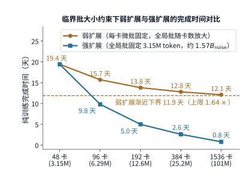

*图 10-1　临界批大小对训练总时间的制约（$B_{\mathrm{noise}} = 2\mathrm{M}$ token）。按卡数等比放大全局 batch（弱扩展，橙线）因单步有效进展趋于饱和，总耗时在 11.9 天渐近下限前停滞（从 48 卡扩至 1536 卡最多加速 1.64 倍，总扫描 token 数激增至 1.98T）；固定全局 batch 为 3.15M token（强扩展，蓝线）保持 100B 有效训练目标不变，耗时随卡数增加从 19.4 天近线性降至 0.8 天。*

审视上表与图 10-1，弱扩展与强扩展的分道扬镳一目了然：
- **弱扩展受阻于 $S_{\min}$ 渐近墙**：在弱扩展下，每步耗时固定为 $52.8\ \mathrm{s}$，理论最短耗时被锁定在 $19{,}434 \times 52.8\ \mathrm{s} \approx 11.9$ 天，最大加速比上限仅为 $31{,}790 / 19{,}434 \approx 1.64$ 倍。把集群从 48 张卡暴力扩充 32 倍到 1536 张卡，每步 batch size 膨胀到 $100.7\mathrm{M}$ token，完成时间却只从 $19.4$ 天缩短到 $12.1$ 天——多投入 31 倍的机器，绝大部分算力都被浪费在冗余的样本扫描上。
- **强扩展实现近线性加速，但暴露固定等待下限**：强扩展将全局 batch 锁定在 $3.15\mathrm{M}$ token，始终只跑 $31{,}790$ 步，让增加的卡数直接用于分摊单步计算时间，从而使总耗时从 $19.4$ 天一路降至 $0.8$ 天。不过，随着单步计算时间被压短，每步固定的 $0.58\ \mathrm{s}$ 通信与输入等待占比不断攀升（在 1536 卡的 $0.8$ 天中已占约四分之一）。

那么，弱扩展在什么条件下才会重新变得划算？翻转条件完全取决于任务的真实噪声尺度 $B_{\mathrm{noise}}$：如果面对的是训练初期或噪声极大的数据集，使 $B_{\mathrm{noise}}$ 高达两千万（$20\mathrm{M}$）个 token，那么当前的 $3.15\mathrm{M}$ 批大小仍远处于线性区，弱扩展的最大加速上限将跃升至约 **$7.36$ 倍**，随卡数同步放大 batch size 就能获得可观收益。这给我们立下了一条清晰的工程准则：**扩卡前必先核验当前全局 batch 与 $B_{\mathrm{noise}}$ 的相对位置**——远小于 $B_{\mathrm{noise}}$ 时可走弱扩展放大 batch；一旦接近或超过 $B_{\mathrm{noise}}$（如本章所选的 $384$ 条序列 $\approx 1.57 B_{\mathrm{noise}}$），继续加卡就只能走强扩展去切分同一批次的工作量。[^critical-batch]

### 10.1.2 常驻训练状态、动态显存峰值与数值精度边界

算清了每步 $67.9\ \mathrm{s}$ 的时间预算，接下来核算显存账本。设模型的可训练参数总数为 $N$。如图 10-2 所示，在一次完整的训练迭代中，前向传播消费输入 token 与当前参数以算出损失，同时将各层中间激活暂存在显存中；反向传播从损失出发逆向回传，一边读取前向保留的激活、一边计算出各层的参数梯度；最后，优化器读取参数梯度、高精度主权重与跨步保留的动量历史，更新参数并生成供下一步使用的工作权重。

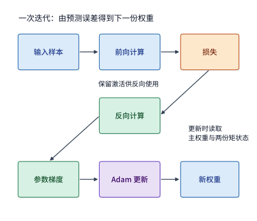

*图 10-2　一次训练迭代的数据流转回路：前向传播由输入和当前 BF16 权重算出损失并暂存激活；反向传播读取激活算出参数梯度；Adam 优化器结合梯度、FP32 主权重与一阶/二阶矩历史完成参数更新，再将新主权重下转为下一步的 BF16 工作权重。*

具体到本章采用的**混合精度 Adam 训练**，为了兼顾 Tensor Core 的高吞吐与参数更新的数值稳定性，系统对不同职责的状态采用了不同的浮点位宽：前向与反向的矩阵乘法使用 **BF16 模型权重**（每参数 2 字节），反向求导产出的**参数梯度**同样以 **BF16** 累积（每参数 2 字节）；而在优化器一侧，为了防止微小的更新量在加到权重上时被低精度尾数抹零，必须维护一份 **FP32 主权重（master weights）**（每参数 4 字节），并跨迭代保留记录梯度方向历史的 **FP32 一阶矩（动量 $m$）**与记录梯度平方历史的 **FP32 二阶矩（方差 $v$）**（各占每参数 4 字节）。将这五项逐一累加，每个可训练参数需要占用的常驻字节数恰好为 **$2 + 2 + 4 + 4 + 4 = 16\ \text{bytes}$**：

| 状态 | 每个参数所占字节数 | Qwen3-8B 容量 / GB | 使用时机 |
|---|---:|---:|---|
| BF16 模型权重 | 2 | 16.4 | 前向与反向矩阵运算 |
| BF16 梯度 | 2 | 16.4 | 反向传播时产生，计算新参数时使用 |
| FP32 主权重 | 4 | 32.8 | 保存新参数，随后生成 BF16 副本 |
| Adam 一阶矩 | 4 | 32.8 | 在训练迭代之间保留梯度历史 |
| Adam 二阶矩 | 4 | 32.8 | 在训练迭代之间保留梯度平方历史 |
| 合计 | 16 | 131.1 | 常驻训练状态 |

*表 10-2　混合精度 Adam 训练中五类常驻训练状态的每参数字节数与 Qwen3-8B 容量分解。*

Qwen3-8B 共有 $N = 8{,}190{,}735{,}360$ 个（约 $8.19\mathrm{B}$）可训练参数，代入上表即得整模常驻训练状态的总容量（图 10-3）：

$$
M_{\mathrm{persistent}}=16N\approx131.1\ \mathrm{GB}\approx122.1\ \mathrm{GiB}.
$$

需要注意两个常见的细节变体：第一，“混合精度训练”本身并不强制规定梯度的累加格式——如果为了在跨卡梯度累加时进一步规避精度损失而将梯度改为 FP32 保存，每参数就会多出 2 字节，常驻状态随之增至 $18N$（对 Qwen3-8B 约为 $147.4\ \mathrm{GB}$）。第二，对于混合专家（MoE）模型，虽然每个 token 在前向计算时只激活少数几个专家子网络，但所有路由专家在训练过程中都有待更新的参数和各自的 Adam 动量历史，因此**常驻训练状态的容量严格由模型的全部可训练参数量（总参数量）决定，而非激活参数量决定**。[^state]

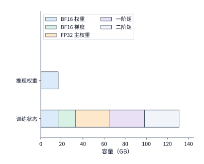

*图 10-3　Qwen3-8B 的五类常驻训练状态累计容量。横轴以十进制 GB 标示累计体积：单份 BF16 推理权重仅占 16.4 GB，而计入 BF16 梯度、FP32 主权重与两份 FP32 Adam 矩状态后，总常驻容量达 131.1 GB（相当于 8 份 BF16 权重）。*

静态的 $131.1\ \mathrm{GB}$ 还只是显存账本的固定基数。在真实的训练执行过程中，是否会发生显存溢出（OOM），取决于整步时间轴上**同一时刻叠加驻留的所有张量之最大值**。除了跨步或跨阶段驻留的常驻状态 $M_{\mathrm{persistent},i}(t)$ 外，前向产生的各层激活 $M_{\mathrm{activation},i}(t)$ 必须一直保留到对应的反向层执行完毕才能释放，而集合通信的参数拼装缓冲、梯度分桶缓冲以及格式转换缓冲 $M_{\mathrm{temporary},i}(t)$ 也会在特定时间窗口内短暂推高显存占用。因此，第 $i$ 张卡在单步迭代中的物理显存峰值由三者的时序包络决定：

$$
M_{\mathrm{peak},i}=\max_t\left[M_{\mathrm{persistent},i}(t)+M_{\mathrm{activation},i}(t)+M_{\mathrm{temporary},i}(t)\right].
$$

这个带时间变量 $t$ 的峰值公式揭示了显存优化的两条根本路径：假设某时刻卡上有 $8\ \mathrm{GiB}$ 激活与 $4\ \mathrm{GiB}$ 参数收集缓冲同时存活，峰值就是 $12\ \mathrm{GiB}$；我们既可以通过**压缩单项体积**（如分片状态、重算激活）来压低峰值，也可以通过**错开生命周期**（如先释放用完的激活、再复用同一块显存分配参数收集缓冲）在不减少数据总量的前提下削平波峰。第 10.2 节的各项显存优化技术，归根结底都是在改写式中的这三项随时间 $t$ 的变化曲线。

在进入分片机制之前，我们还需回答一个底层问题：**为什么上表要用 BF16 而不是同样占 2 字节的 FP16，如果进一步压到 1 字节的 FP8 又会怎样改变容量与数值风险？**
- **FP16 与全局损失缩放（Loss Scaling）**：如第 4.6.1 节所述，FP16 只有 5 位指数，其最小正规格化数仅为 $2^{-14} \approx 6.1\times 10^{-5}$，小于该值的数只能靠损失有效精度的次正规数（subnormal）勉强表示，而一旦小于 $2^{-24} \approx 6.0\times 10^{-8}$ 就会直接下溢归零。Micikevicius 等人在混合精度训练奠基论文中实测发现：普通话语音识别模型的权重梯度中约有 $5\%$ 的数值指数小于 $-24$（在 FP16 下直接变零，这正是必须保留 FP32 主权重的原因）；而在 Multibox SSD 目标检测网络的激活梯度中，更有大量落在 $[2^{-27}, 2^{-24})$ 区间的关键梯度因低于 FP16 下限而被抹零，导致模型无法收敛。为此，FP16 训练必须引入**损失缩放**：在反向传播启动前将损失值乘以放大因子 $S$（典型取值为 $8 \sim 32\mathrm{K}$），把整条反向链路的梯度统一平移拉进 FP16 的可表示区间，待优化器更新前再除以 $S$ 还原。但这带来了动态调参负担：缩放因子 $S$ 太小则微小梯度依然下溢，太大则大梯度直接上溢为 `Inf`/`NaN`，一旦溢出就只能作废当前步并缩小 $S$。[^precision]
- **BF16 的免缩放优势**：BF16 保留了与 FP32 完全相同的 **8 位指数**，动态表示范围与 FP32 一致，从根本上消除了梯度下溢归零的风险，无需配置损失缩放即可稳定训练——这也是现代大模型训练普遍首选 BF16 的核心原因。其代价是尾数缩短到了 7 位，单次舍入误差较大，因此硬件 Tensor Core 必须在内部使用 **FP32 累加器**来保护长向量内积的精度。
- **FP8（E4M3）与细粒度分块缩放**：若想把矩阵乘吞吐再翻一倍，就需要动用 1 字节的 FP8。然而 FP8 的 E4M3 格式仅有 4 位指数与 3 位尾数，最大可表示正数仅为 $448$，靠单一的全局缩放因子根本不可能让跨度巨大的各层激活与权重同时装入这么窄的窗口。DeepSeek-V3 给出了工业级解决方案——**细粒度分块量化与定期高精度累加**：激活张量按 $1\times 128$ 块（每个 token 的每 128 个通道）独立计算缩放因子，权重张量按 $128\times 128$ 块计算缩放因子；同时在 Tensor Core 每累加 128 个元素后，立即将部分和提升至 FP32 寄存器继续累加，成功将相对 BF16 基线的训练损失误差控制在 $0.25\%$ 以内。[^precision]

请特别注意 **FP8 训练对显存账本的真实影响**：在 DeepSeek-V3 等 FP8 训练方案中，主权重、梯度与优化器动量依然以高精度保存，FP8 只作用于**送入 Tensor Core 参与矩阵乘的那份操作数权重副本**。这份 FP8 权重副本每参数占 1 字节，外加每 $128\times 128 = 16{,}384$ 个参数附带一个 4 字节的 FP32 缩放因子，折合每参数约 $1 + 4/16384 \approx 1.0002\ \text{bytes}$。对于 Qwen3-8B，这意味着前向与反向矩阵运算读取的工作权重体积从 BF16 的 $16.4\ \mathrm{GB}$ 减半至约 **$8.2\ \mathrm{GB}$**（大幅减轻了显存带宽与参数收集通信压力），但前表算出的每参数 16 字节常驻状态并不会因此变成 1 字节。下表汇总了三种矩阵运算格式的权衡边界：

| 矩阵运算的权重格式 | 每参数字节（含 scale） | Qwen3-8B 矩阵运算读取的权重 | 缩放管理 | 主要数值风险 |
|---|---:|---:|---|---|
| FP16 | 2 | 16.4 GB | 全局损失缩放 | 梯度下溢、缩放溢出 |
| BF16 | 2 | 16.4 GB | 无需 | 尾数较短，由 FP32 累加补偿 |
| FP8（E4M3）操作数副本 | 约 1.0002 | 约 8.2 GB（主权重与优化器状态另存） | 分块缩放与定期高精度累加 | 块内舍入、scale 过期 |

*表 10-3　FP16、BF16 与 FP8（E4M3 分块缩放）三种矩阵运算权重格式的字节占用、缩放管理与主要数值风险对比。*

一言以蔽之：位宽越窄、缩放块越粗，省下的带宽与临时空间越多，但数值偏离高精度基准的风险也随之升高。无论是缩放溢出、脏数据还是瞬态硬件错误，一旦引发训练损失曲线上的剧烈尖峰（loss spike），工程上的标准处置都是回滚到最近一份健康的检查点重新训练——回滚一次究竟会无谓损失多少小时的算力，将由第 10.4 节的检查点周期模型严格定量回答。

### 10.1.3 计算总量、MFU 口径与候选集群卡数下界

厘清了 $131.1\ \mathrm{GB}$ 的常驻显存需求后，我们用同样的定量眼光来算清完成 $100\mathrm{B}$ token 所需的**总浮点计算量**与**最少加速卡数**。

根据 Qwen3-8B 的各层矩阵形状与注意力结构逐算子累加：处理一条长度为 $8192$ 个 token 的序列，完成一次完整的前向传播加反向传播（暂不计重计算）共需执行约 **$4.31\times 10^{14}\ \mathrm{FLOPs}$** 的矩阵运算，折合每个 token 约 **$52.7\ \mathrm{GFLOPs}$**（近似符合稠密 Transformer 每 token 前后向约 $6N$ 次浮点运算的经验规律）。由此可知，处理 $100\mathrm{B}$（$10^{11}$）个有效 token 的总算法计算量为：

$$
F \approx 5.27\times 10^{21}\ \mathrm{FLOPs}.
$$

在单次包含 $384$ 条序列的训练迭代中，集群需要合力完成的矩阵计算量则为 $F_{\mathrm{step}} \approx 1.66\times 10^{17}\ \mathrm{FLOPs}$。[^deadline]

仅仅让显存装得下 $131.1\ \mathrm{GB}$ 状态，远远不等于能按期训完这 $5.27\times 10^{21}\ \mathrm{FLOPs}$。我们用 H100 SXM（单卡 80 GB 显存，BF16 稠密矩阵峰值算力 $P = 989\ \mathrm{TFLOP/s}$）做一个直观对比：如果只看显存容量下界，**2 张 80 GB 的 H100** 合起来就有 $160\ \mathrm{GB}$ 显存，足以装下理想均分的 $131.1\ \mathrm{GB}$ 常驻训练状态；然而哪怕这 2 张 H100 连续 30 天不眠不休地以 $40\%$ 的计算效率满载运转，训完 $100\mathrm{B}$ token 也要花掉约 **$77$ 天**，超过交付期限两倍有余。按 $40\%$ 效率折算，单张 H100 每秒约能处理 $7500$ 个 token；要想哪怕把整整 30 天全部用于纯计算（平均吞吐需达到 $38{,}600\ \mathrm{token/s}$），5 张 H100（合计约 $37{,}600\ \mathrm{token/s}$）依然略有不足，**至少需要 6 张 H100** 才能迈过算力门槛。

将这一关系写成通用公式：设任务所需的算法总计算量为 $F$，集群加速卡数为 $p$，单卡峰值算力为 $P$，统计窗口内的平均计算效率为 $\eta$，则在可用时间 $T_{\mathrm{available}}$ 内按期完成任务所需的计算卡数下界为：

$$
T=\frac{F}{pP\eta},\qquad
p_{\mathrm{compute}}=\left\lceil\frac{F}{P\eta T_{\mathrm{available}}}\right\rceil.
$$

在使用上式时，必须明确**模型算力利用率（MFU，见第 1.2.2 节）与单卡纯计算效率的统计口径差异**。标准的端到端 MFU 以整步实际耗时为分母，因而已经把跨卡通信等待、流水线气泡等非计算开销统统折算进了效率折扣里；而在本章的架构设计推演中，为了看清每一项系统机制（如 PCIe 集合通信、数据加载、检查点写入）各自吃掉了多少秒，我们采取**“自底向上逐项累加”**的拆解法：先取**单卡计算效率 $\eta = 40\%$** 计算加速卡执行卡内运算的纯计算时间，再在后续小节中把无法与计算重叠的暴露通信时间、输入等待时间与容错开销逐一显式加上。

这里选取的 $40\%$ 基准参考了 Meta 训练 Llama 3 405B 的公开工程记录（在 $8192 \sim 16{,}384$ 张 H100 上预训练的端到端 BF16 MFU 为 $38\% \sim 43\%$）。由于我们在 $40\%$ 单卡计算效率的基础上还会显式外加通信等待，整步完成时间的估算属于留有余地的保守口径。至于另外 $60\%$ 的峰值算力究竟损耗在何处，本章后续各节将逐一拆解归因：无法掩盖的暴露通信（第 10.3.3 节）、流水线依赖气泡（第 10.3.2 节）、受显存带宽限制的逐元素更新与格式转换（第 10.2.3 节）、为省显存而额外付出的激活重计算（第 10.2.2 节）、慢节点掉队等待（第 10.4.5 节）以及检查点保存停顿（第 10.4.3 节）。按照第 1.3.4 节确立的分类准则，前四项属于给定并行方案下算法与物理规律决定的固有工作，漏算任何一项都会导致工期过于乐观；而后两项以及因链路争用未能隐藏的通信等待，则是系统工程师大展身手的优化空间。图 10-4 至图 10-6 对比了在 30%、40% 与 50% 三档计算效率下，四款主流加速卡（H100 SXM、A100 80 GB SXM、RTX 4090、L40S）的计算卡数下界（蓝柱）与常驻状态显存容量下界（橙色菱形）。[^deadline]

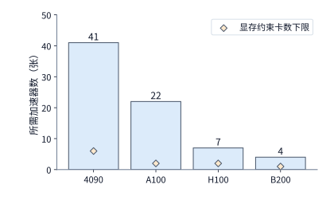

*图 10-4　矩阵计算效率为 30% 时完成 100B token 训练所需的最小卡数（按全部 30 天用于执行计）。蓝色柱为满足算力需求的最少卡数 $p_{\mathrm{compute}}$，橙色菱形为装下 131.1 GB 常驻训练状态的最少卡数。*

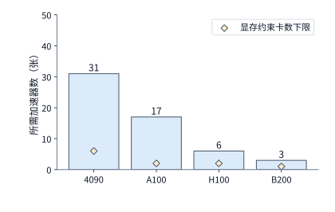

*图 10-5　矩阵计算效率提高到 40% 时同一任务所需的最小卡数。随计算效率提升，各型号的算力卡数下界（蓝柱）同步下降，但仍普遍高于显存容量下界（橙色菱形）。*

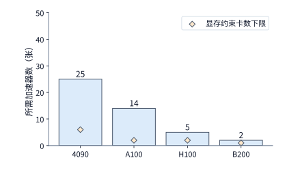

*图 10-6　矩阵计算效率达到 50% 时所需的最小卡数（图 10-4 至图 10-6 采用完全相同的型号顺序、纵轴刻度与 30 天期限）。*

对照图 10-4 至图 10-6 可以看到，对于需要处理 $100\mathrm{B}$ token 的继续训练任务，**决定集群规模的瓶颈毫无悬念地落在算力侧而非静态显存容量侧**。现在我们将目光聚焦到高性价比的消费级旗舰卡 **RTX 4090（24 GB 显存，BF16 矩阵峰值算力 $165.2\ \mathrm{TFLOP/s}$）**上：即便按全部 30 天全天候运行且效率取 $40\%$，算力下界也要求至少配备 **31 张卡**。考虑到标准服务器通常采用每机 8 卡的物理形态，最自然的起步候选方案就是 **4 台 8 卡主机构成的 32 卡方案**；在此基础上再增加 2 台 8 卡主机，就得到了更具算力余量的 **6 台主机 48 卡方案**。

在固定每步全局批大小为 $384$ 条序列的前提下：
- **32 卡方案**：每张卡在单步迭代中需通过梯度累积串行处理 $384 / 32 = 12$ 个单序列微批次（micro-batch）；
- **48 卡方案**：每张卡在单步迭代中只需累积处理 $384 / 48 = 8$ 个单序列微批次。

分摊到每张卡上的单步计算耗时立刻拉开了差距：每步总计算量约为 $1.66\times 10^{17}\ \mathrm{FLOPs}$，按单卡 $165.2\ \mathrm{TFLOP/s}$ 峰值的 $40\%$（即有效算力约 $66.1\ \mathrm{TFLOP/s}$）计算，**32 卡方案单步纯计算就要花掉约 $78.3\ \mathrm{s}$**，甚至在还没有计入一毫秒通信与容错开销之前，就已经突破了我们在第 10.1.1 节算出的 **$67.9\ \mathrm{s}$ 单步时间红线**；而 **48 卡方案将单步纯计算耗时压到了约 $52.2\ \mathrm{s}$**，距离 $67.9\ \mathrm{s}$ 预算红线留出了约 **$15.7\ \mathrm{s}$** 的宝贵余量。接下来的第 10.2 至 10.4 节，我们将一步步检验：这两套方案怎样在仅 $24\ \mathrm{GB}$ 的单卡显存里塞下全部状态与激活，而跨卡通信、数据加载与故障恢复又会吃掉这 $15.7\ \mathrm{s}$ 余量中的多少秒。

> **算例 10-1（Qwen3-8B 100B Token 训练期限下界、临界批大小渐近墙与 32/48 卡单步预算）**
> 给定继续训练任务：模型参数量 $N = 8{,}190{,}735{,}360 \approx 8.19\mathrm{B}$，混合精度 Adam 常驻状态 $M_{\mathrm{persistent}} = 16N \approx \mathbf{131.1\ \mathrm{GB}} \approx \mathbf{122.1\ \mathrm{GiB}}$；目标有效语料 $D = 100\mathrm{B}$ token，每步全局批次含 $384$ 条 $8192$ token 序列（$B_0 = 3{,}145{,}728$ token/步，单步计算量 $F_{\mathrm{step}} \approx 1.66\times 10^{17}\ \mathrm{FLOPs}$），总步数 $S_0 = \lceil 10^{11} / 3{,}145{,}728 \rceil = \mathbf{31{,}790\ \text{步}}$。
> 1. **净时间预算与单步耗时红线**：30 天日历工期扣除 5 天计划停顿后，净可用训练时间为 $T_{\mathrm{available}} = 25\ \text{天} = 2{,}160{,}000\ \mathrm{s}$，单步最大允许总时间 $T_{\mathrm{step,max}} = 2{,}160{,}000 / 31{,}790 \approx \mathbf{67.95\ \mathrm{s}}$。
> 2. **临界批大小渐近下限（$B_{\mathrm{noise}} = 2\mathrm{M}$ token）**：由 $B_0 / B_{\mathrm{noise}} \approx 1.573$ 代入 McCandlish 双曲线方程，得无穷大批大小下的最少步数下限 $S_{\min} = 31{,}790 / (1 + 2 / 3.145728) \approx \mathbf{19{,}434\ \text{步}}$、最少样本下限 $E_{\min} \approx \mathbf{38.9\mathrm{B}\ \mathrm{token}}$；因此按卡数等比放大全局 batch 的弱扩展最多只能加速 $31{,}790 / 19{,}434 \approx \mathbf{1.64\times}$（理论最短 $11.9$ 天）。
> 3. **RTX 4090（峰值 $165.2\ \mathrm{TFLOP/s}$，取 $\eta = 40\%$ 即有效 $66.08\ \mathrm{TFLOP/s}$）单步纯计算耗时**：32 卡方案每卡累积 $m = 12$ 个微批次，单步纯计算耗时 $\approx \mathbf{78.3\ \mathrm{s}} > 67.9\ \mathrm{s}$（未计通信即已超期）；48 卡方案每卡累积 $m = 8$ 个微批次，单步纯计算耗时降至 $\approx \mathbf{52.2\ \mathrm{s}}$，留出约 $\mathbf{15.7\ \mathrm{s}}$ 预算余量。

## 10.2 训练状态的分片、重计算与卸载

在上一节末尾我们看到，哪怕把 48 张 RTX 4090 摆上机架，每张卡的可用物理显存也只有约 $22\ \mathrm{GiB}$，而仅 Qwen3-8B 的常驻训练状态就高达 $122.1\ \mathrm{GiB}$。如何将这 $122.1\ \mathrm{GiB}$ 的常驻状态装入单卡 $22\ \mathrm{GiB}$ 的可用显存内？根据式 $M_{\mathrm{peak},i}=\max_t[M_{\mathrm{persistent},i}(t)+M_{\mathrm{activation},i}(t)+M_{\mathrm{temporary},i}(t)]$，工程界发展出了三项核心机制：**状态分片（ZeRO/FSDP）**消除跨卡重复保存的常驻状态，**选择性激活重计算（activation recomputation）**用少量算力换取前向激活的缩减，**异构卸载（CPU/NVMe offload）**则借用大容量主机内存承接低频访问状态。本节依次剖析这三项机制的空间收益与时间代价。

### 10.2.1 数据并行与 ZeRO／FSDP 状态分片

第 6 章曾按样本、张量特征、序列位置、网络层和路由专家梳理过六种并行维度；进入训练场景后，最基础的横向扩展方式是**同步数据并行（Data Parallelism，DP）**：每张加速卡各自处理不同的输入样本，反向传播结束后通过 `AllReduce` 汇总平均各卡算出的参数梯度，再用完全相同的汇总梯度各自独立更新本地参数。

这种朴素的数据并行隐藏着显著的存储冗余：既然所有 DP 副本在每一步算出的汇总梯度完全相同、更新出的新参数与动量历史也分毫不差，**让 $d$ 张卡各自原封不动地保存一整套 $122.1\ \mathrm{GiB}$ 的权重、梯度与优化器状态，无异于在做 $d$ 份毫无信息增量的重复备份**。微软研究院于 2019 年提出、2020 年发表的 **ZeRO（Zero Redundancy Optimizer，零冗余优化器）** 以及 PyTorch 社区广泛采用的 **FSDP（Fully Sharded Data Parallel，全分片数据并行）**，正是为了根除这一副本冗余而生：它们将原本每张卡都完整持有的训练状态按参数维度切分（shard）到 $d$ 个数据并行 rank 上，每张卡只负责维护和更新归属于自己的那 $1/d$ 参数分片；当计算某一层需要完整参数时，各卡再通过集合通信临时拼齐，用完即释放。

在深入 ZeRO 的三个切分阶段之前，有必要先厘清两个在工程讨论中经常被混为一谈的概念——**FSDP（状态分片）**与 **SP（Sequence Parallelism，序列并行）**：
- **FSDP 切分的是“模型状态的静态所有权”**：它沿着参数维度切分权重、梯度与优化器状态，在进入某一层计算前通过 `AllGather` 收集参数，反向后通过 `ReduceScatter` 归约并分发梯度，用于消除数据并行组内的状态副本冗余，通常可与 DP、TP、PP 正交组合；
- **SP 切分的是“中间激活的序列工作位置”**：它主要配合张量并行（TP），在 LayerNorm、Dropout、残差相加等逐 token 独立运算但原本在 TP 组内重复执行的算子上，将激活张量沿序列维度切分给各张 TP 卡；待进入需要完整序列的线性层矩阵乘时再通过 `AllGather` 拼回，计算完毕后经 `ReduceScatter` 重新按序列位置分片。

简言之，**FSDP 管的是“参数与优化器状态归谁存”，SP 管的是“逐 token 激活归谁算”**；正如经典的嵌套并行综述论文图 1 将 FSDP 单列为独立于 TP/SP 的状态管理层级，训练状态分片与激活序列分片处于两条正交的并行轴上。[^nested-bsp]

现在，我们用 $d=4$ 张加速卡构成的并行组（图 10-7 至图 10-10），一步步拆解 ZeRO 是如何分三个阶段剥离状态冗余的（图中每一列代表同一张 GPU，“完整”代表保存全量状态，“片”代表仅保存 $1/4$ 分片）：

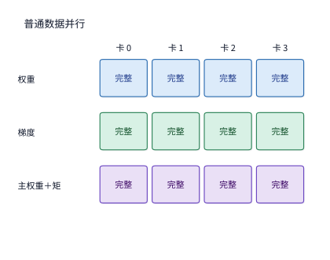

*图 10-7　普通 DP（基线）：每张卡均完整保存 BF16 权重、BF16 梯度、FP32 主权重以及两份 FP32 Adam 矩状态（每参数 16 字节全部重复 $d$ 份）。*

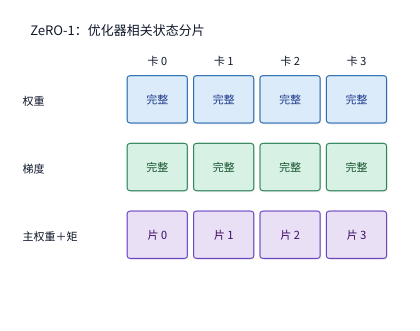

*图 10-8　ZeRO-1（优化器状态分片）：将占大头的 FP32 主权重与两份 Adam 矩状态（共 12 字节/参数）按参数切分到各卡，BF16 权重与梯度仍完整保留。*

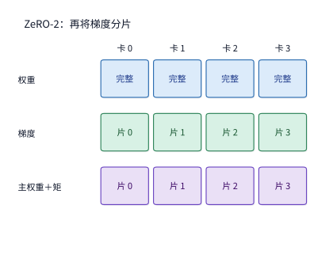

*图 10-9　ZeRO-2（优化器状态 + 梯度分片）：在 ZeRO-1 基础上进一步切分 BF16 梯度；反向算出某层梯度后经 ReduceScatter 直接汇总到负责该分片的卡上，其余卡立即释放该层梯度。*

前两个阶段（ZeRO-1 与 ZeRO-2）依然为每张卡保留了一整份 BF16 模型权重，因此前向传播时无需跨卡拉取权重。当模型大到连单份权重都装不进显存时，就需要迈出最后一步——如图 10-10 所示的 **ZeRO-3（全状态分片，即 FSDP 的标准形态）**：连同 BF16 模型权重也一并按 $1/d$ 切分，使所有常驻训练状态彻底消除跨卡重复，代价则是前向与反向每次执行一个模块前都必须通过通信临时收集该模块的完整权重。

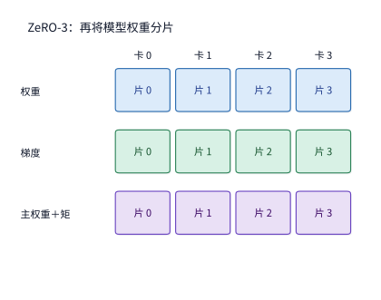

*图 10-10　ZeRO-3（优化器状态 + 梯度 + 权重全分片）：所有五类常驻状态均按 $1/d$ 切分保存；执行任意模块前，各卡通过 AllGather 临时拼齐该模块的完整权重。*

设数据并行分片组内共有 $d$ 张卡，模型可训练参数总数为 $N$。结合第 10.1.2 节的字节账本（BF16 权重 2B、BF16 梯度 2B、FP32 主权重与两份矩状态共 12B），普通 DP 与 ZeRO 三个阶段的每卡常驻状态容量公式依次为：

$$
\begin{aligned}
M_0&=16N,\\
M_1&=4N+12N/d,\\
M_2&=2N+14N/d,\\
M_3&=16N/d.
\end{aligned}
$$

将 Qwen3-8B（$16N \approx 122.1\ \mathrm{GiB}$）与单机 $d=8$ 张卡代入上述四式，每卡常驻状态的缩减效果十分直接：

| 配置 | 每卡常驻训练状态 / GiB | 完整复制的训练状态 |
|---|---:|---|
| 普通 DP | 122.1 | 权重、梯度与优化器状态 |
| ZeRO-1 | 42.0 | 权重与梯度 |
| ZeRO-2 | 28.6 | 权重 |
| ZeRO-3 | 15.3 | 常驻训练状态均已分片 |

*表 10-4　Qwen3-8B 在单机 $d=8$ 卡下普通 DP 与 ZeRO-1/2/3 各阶段的每卡常驻训练状态容量对比。*

可以看到，仅在一台 8 卡机器内部启用 ZeRO-3，每卡常驻训练状态就从遥不可及的 $122.1\ \mathrm{GiB}$ 骤降至 **$15.3\ \mathrm{GiB}$**，首次压进了 RTX 4090 的 $22\ \mathrm{GiB}$ 可用显存线以内。

然而，常驻状态降到 $15.3\ \mathrm{GiB}$ 并不意味着运行期显存只用 $15.3\ \mathrm{GiB}$。在 ZeRO-3 / FSDP 下，每个网络模块（通常是一层 Transformer 或单个线性层）都按照如下四步生命周期运转（图 10-11）：
1. **前向收集**：算子执行前，各卡通过 `AllGather` 收集其余 $d-1$ 张卡上的参数分片，在临时缓冲区中拼出该模块的**完整参数**；
2. **前向计算与即时释放**：用完整参数执行前向矩阵乘；若为了极致省显存，算完该层前向后立即释放这块完整参数缓冲区（代价是反向传播走到该层前必须再做一次 `AllGather`）；若显存宽裕选择保留完整参数至反向结束，虽然省掉了一次反向通信，但完整参数将与后续各层的激活同时驻留显存；
3. **反向收集与求导**：反向传播回退到该层前再次通过 `AllGather` 恢复完整参数，计算出输入梯度 $dX$ 与本层完整参数梯度 $dW$；
4. **梯度归约散射与更新**：立即通过 `ReduceScatter` 将各卡算出的 $dW$ 求和并按分片散发——每张卡只留下归属于自己的那 $1/d$ 梯度分片，随即释放完整参数与完整梯度缓冲区；待所有微批次累积完毕后，各卡仅在自己负责的 $1/d$ 分片上执行 Adam 更新。

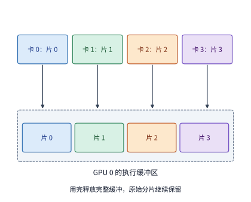

*图 10-11　ZeRO-3 / FSDP 中常驻分片与临时完整参数缓冲区的共存关系。平时四张卡各存 1/4 参数分片；执行当前模块时，GPU 0 通过 AllGather 收集其余三片拼入“完整权重缓冲区”（图中四种颜色代表四个分片），用完即释放该临时缓冲区，而底部的常驻分片始终保留。*

仔细观察图 10-11 可以发现一个在容量规划中容易忽视的现象：**把分片卡数 $d$ 翻倍，常驻状态会严格减半，但运行期显存峰值的下降幅度却远小于一半**。原因就在于图中的“完整权重缓冲区”：无论你把模型切给 4 张卡还是 64 张卡，当 GPU 正在执行某一层矩阵乘时，临时拼出来的那份完整模块参数以及当前层的激活大小完全由模型层宽决定，**根本不随分片卡数 $d$ 缩小**。相较于初代 FSDP 将模块内多个参数拼接为单一扁平张量（`FlatParameter`），PyTorch 第二代全分片实现（**FSDP2**）改为基于分布式张量（`DTensor`）对每个参数独立按第 0 维分片（per-parameter sharding），不仅简化了通信缓冲的精确分配与释放，还能直接导出带有全局坐标的分布式状态字典（与第 10.4.2 节的 DCP 检查点无缝衔接）。在一组使用 FSDP2 运行的受控对照实验中，当分片进程数从 $d=2$ 翻倍到 $d=4$ 时，参数更新后常驻保留的状态从约 $18\ \mathrm{MiB}$ 精准减半至 $9\ \mathrm{MiB}$，但运行期内存峰值却只从约 $39\ \mathrm{MiB}$ 降到了 $30\ \mathrm{MiB}$（仅下降约 $23\%$），因为执行期间固定存在的约 $21\ \mathrm{MiB}$ 激活与临时收集缓冲并不会随 $d$ 缩减。因此，核算分片后的真实显存占用峰值，必须进一步拆解模块执行期间激活与临时缓冲区各自的驻留时长。[^fsdp]

### 10.2.2 激活的保留与选择性重计算

如果把前向传播比作沿着山路上山、反向传播比作原路下山，那么前向计算沿途产生的中间激活（activation）就像上山时留在路边的路标与草稿：下山求导走回每一层时，链式法则要求我们必须读取该层前向时的输入激活才能算出参数梯度。把沿途每一块草稿纸全都原封不动地留到下山，取用固然最快，但当序列长达 $8192$、层数多达数十层时，堆积如山的激活很快就会撑爆显存；反之，如果我们只保留少数关键节点的激活，把那些“占地极大、但重新算一遍极快”的中间激活直接丢弃，等反向传播快走到这一层时再临时从最近的关键节点重算出来——这就是**激活重计算（activation recomputation，又称梯度检查点 activation checkpointing）**的核心思想：用可控的额外算力置换宝贵的显存空间。

我们先从矩阵乘法的反向求导公式看清“为什么反向一定要读前向激活”。考虑一个标准线性层 $Y = XW$，其中输入激活为 $X$、权重为 $W$、输出为 $Y$。设标量损失为 $\mathcal{L}$，反向传播从后一层传回上游梯度 $dY = \partial\mathcal{L}/\partial Y$（上标 $\mathsf{T}$ 表示矩阵转置），当前层需要同时算出两路梯度（图 10-12）：

$$
dX=dY W^{\mathsf T},\qquad dW=X^{\mathsf T}dY.
$$

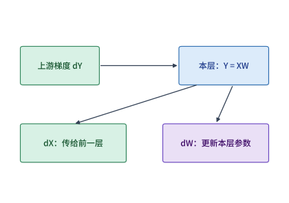

*图 10-12　线性层 $Y=XW$ 的反向传播分叉：一路右乘 $W^{\mathsf{T}}$ 算出输入梯度 $dX$ 继续向浅层回传；另一路用前向输入激活的转置 $X^{\mathsf{T}}$ 乘以上游梯度 $dY$ 算出本层参数梯度 $dW$，送往跨卡归约与参数更新。*

看清这两条公式，激活驻留的根源便豁然开朗：求输入梯度 $dX$ 只需要用到权重 $W$，但**求参数梯度 $dW = X^{\mathsf{T}} dY$ 必须左乘前向输入激活 $X^{\mathsf{T}}$**。如果我们在前向算完 $Y=XW$ 后一直保留 $X$，它就会从前向时刻持续占用显存直到反向求完 $dW$ 为止；如果我们选择在前向后释放 $X$，就必须在反向求 $dW$ 之前，从更早保留下来的浅层激活出发重新跑一遍前向子图把 $X$ 造出来。因此，**选择性重计算（selective recomputation）**的精髓就在于甄别计算图中的每一类激活：优先丢弃那些**“字节体积庞大、但重算所需浮点运算极少”**的逐元素或中间膨胀张量，而保留那些重算代价高昂的矩阵乘输出。

**例 10.1　在反向传播前重算 SwiGLU 门控乘积，能以多少算力代价省下多少激活显存？** 考察 Qwen3-8B 的 SwiGLU 前馈子网络（MLP）：前向时输入先经门控投影和激活函数得到 $a$，经上投影得到 $u$，接着将两者做逐元素相乘得到中间隐状态 $h = a \odot u$，最后送入下投影矩阵算出输出 $Y = h W_{\mathrm{down}}$。在反向传播阶段，首先下投影层求参数梯度 $dW_{\mathrm{down}}$ 需要读取 $h$，紧接着门控激活函数的反向求导又需要读取 $a$ 和 $u$。
- **朴素全保留方案（图 10-13）**：既然反向既要用 $h$ 又要用 $a, u$，朴素实现会把 $a$、$u$ 和 $h$ 三份张量全部从前向一路保留到反向。
- **选择性重建方案（图 10-14）**：既然 $a$ 和 $u$ 已经保留在显存里，而 $h = a \odot u$ 只是一次非常轻量的逐元素乘法，我们完全可以在前向算完 $Y$ 后立即丢弃 $h$，等到反向传播即将进入下投影层的前一刻，再把 $a$ 和 $u$ 拿出来重新乘一次得到临时的 $h$，算完 $dW_{\mathrm{down}}$ 后立刻销毁。

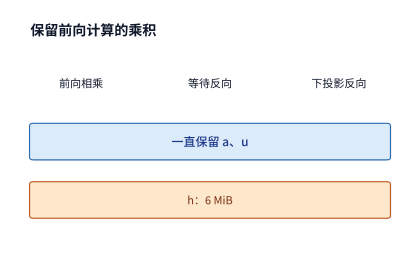

*图 10-13　朴素全保留方案：蓝色条为前向保留至反向的 $a$、$u$，橙色条为同样全程保留的门控乘积 $h = a \odot u$。在 128 token 微批次与 FP32 激活下，单层 $h$ 形状为 $[128, 12288]$，持续占用 6 MiB 显存。*

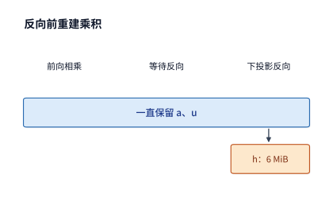

*图 10-14　选择性重计算方案：前向仅保留 $a$、$u$，将乘积 $h$ 释放；待下投影反向即将执行前重新执行 $a \odot u$ 生成 $h$，橙色的 6 MiB 缓冲区仅在该算子执行前后短暂存在（横轴代表算子执行顺序）。*

我们来算一笔精确的性价比账。取一个包含 $128$ 个 token 的微批次（激活以 FP32 保存）：中间张量 $h$ 的形状为 $[128, 12288]$，占 $128 \times 12288 \times 4\ \text{bytes} = 6\ \mathrm{MiB}$；而在反向前把 $a$ 和 $u$ 重新逐元素乘一遍，总共只需执行 $128 \times 12288 \approx 157\text{ 万}$次浮点乘法（在现代 GPU 上耗时不足数微秒）。用完全相同的思路，同一层 Transformer 中的两个归一化层（RMSNorm）加权输出形状均为 $[128, 4096]$（各占 $2\ \mathrm{MiB}$），同样不必长期保存，只需在反向前由已保存的归一化结果与缩放权重即时重算即可。如此一来，每层 Transformer 可以直接省去 $6 + 2 + 2 = 10\ \mathrm{MiB}$ 的长期驻留激活：
- 在朴素方案下，为各线性层（GEMM）保存的前向输入每层共占 $15\ \mathrm{MiB}$（其中上述三个逐元素乘积占 $10\ \mathrm{MiB}$，$Q, K, V$ 与注意力输出占 $5\ \mathrm{MiB}$），一个包含 9 层 Transformer 的流水线阶段需长期保存 $9 \times 15 = 135\ \mathrm{MiB}$（约 $142\ \mathrm{MB}$）；
- 启用这三项轻量重建后，每层长期驻留激活降至 $5\ \mathrm{MiB}$，9 层流水阶段降至 **$45\ \mathrm{MiB}$（约 $47\ \mathrm{MB}$）**，单个微批次直接省去了 **$90\ \mathrm{MiB}$（约 $94\ \mathrm{MB}$，削减幅度达三分之二）**。更重要的是，由于反向传播是逐层顺序回退的，这 9 层在即时重建 $h$ 时只需要**轮流复用同一块 $6\ \mathrm{MiB}$ 的临时工作区**。[^pipeline]

当系统采用流水线并行（第 10.3.2 节）、同一时刻有 4 个微批次（micro-batch）在途等待反向传播时，这项优化省下的常驻空间就会按在途微批次数成倍放大为 $4 \times 90 = 360\ \mathrm{MiB}$（约 $377\ \mathrm{MB}$）。这揭示了**激活重计算与流水线调度的深层耦合**：在途等待反向的微批次越多，省去长期驻留激活的收益就越可观；而临时重建工作区因为按层串行复用，始终只占单层大小。至于多出来的重建计算会不会拖慢单步总时间，则取决于它是否落在关键路径的繁忙时段上。

### 10.2.3 CPU／GPU 异构卸载与缓冲区生命周期

当激活重算与跨卡分片仍然无法满足显存预算（例如单机微调超大模型）时，第三项核心机制是**异构卸载（offloading）**：将 GPU 上暂时不用的优化器状态、主权重或梯度经由 PCIe / C2C 链路搬移到容量高达数百 GB 的主机内存（CPU DRAM）乃至 NVMe SSD 中，待算子需要使用前再传回 GPU。

一旦引入卸载，原本的“显存容量够不够”就立刻转化为“跨总线传输能不能赶在算子执行前跑完”。设待卸载或取回的状态体积为 $V$ 字节，主机与加速卡之间的有效传输带宽为 $B$，从数据准备就绪可以发起传输、到下游算子真正需要消费该数据之间可用于掩盖传输的独立计算窗口为 $W$ 秒，则无法被掩盖、直接暴露在关键路径上的**卸载等待时间**为：

$$
T_{\mathrm{wait}}=\max(0,V/B-W).
$$

不仅如此，卸载还会通过底层直接内存访问（DMA）机制改变两端缓冲区的驻留生命周期：在异步 DMA 搬移完成之前，发送端的源缓冲区绝对不能被覆写或释放；而接收端的目标缓冲区从 DMA 开始写入的第一刻起就必须提前分配并锁定内存。这意味着，**卸载并非调用释放接口就能立即腾出显存空间，在传输在途窗口内，源端与目的端必须同时持有有效缓冲**。

更微妙的工程权衡出现在**“数据格式转换究竟应该放在传输前（GPU 侧）还是传输后（CPU 侧）”**。我们通过例 10.2 算清这笔由内存带宽与互联带宽共同决定的账。

**例 10.2　在 CPUAdam 卸载中，应该在 GPU 上还是 CPU 上把 BF16 梯度转换成 FP32？** 在 DeepSpeed ZeRO-Offload 等系统中，为了省下 GPU 显存与算力，系统采用 **CPUAdam** 在主机 CPU 上维护 FP32 主权重并执行 Adam 参数更新。反向传播在 GPU 上算出的门控投影层梯度形状为 $[12288, 4096]$，以 BF16 保存时体积为 $G = 96\ \mathrm{MiB}$，转换为优化器所需的 FP32 格式后体积翻倍为 $2G = 192\ \mathrm{MiB}$。为了把这份梯度交给 CPU 上的优化器，我们有两条候选流水路径：
- **路径一（先传后转，CPU 侧转换，图 10-15）**：先将 $96\ \mathrm{MiB}$ 的 BF16 梯度原样经互联链路传到主机内存，再由 CPU 读取这 $96\ \mathrm{MiB}$ 并写出 $192\ \mathrm{MiB}$ 的 FP32 梯度；
- **路径二（先转后传，GPU 侧转换，图 10-16）**：先在 GPU 显存内将 $96\ \mathrm{MiB}$ 的 BF16 梯度转换成 $192\ \mathrm{MiB}$ 的 FP32 梯度，再将翻倍后的 $192\ \mathrm{MiB}$ 数据经互联链路传到主机内存。

不论在 CPU 还是 GPU 上执行 `BF16 -> FP32` 类型转换，该算子在硬件层面都是纯粹受内存带宽限制的读写操作：每次转换必须读取 $1\times G$ 字节的 BF16 输入、写出 $2\times G$ 字节的 FP32 输出，合计访问 **$3G$ 字节**内存。取 RTX 4090 的显存带宽 $C_g = 1008\ \mathrm{GB/s}$，主机 CPU 取第四代英特尔至强单路八通道 DDR5-4800 的内存带宽 $C_c = 307.2\ \mathrm{GB/s}$，主机与 GPU 间的单向有效传输带宽记为 $B$。在串行执行口径下，两条路径的总耗时分别为：

$$
T_c = \frac{G}{B} + \frac{3G}{C_c},\qquad T_g = \frac{3G}{C_g} + \frac{2G}{B}.
$$

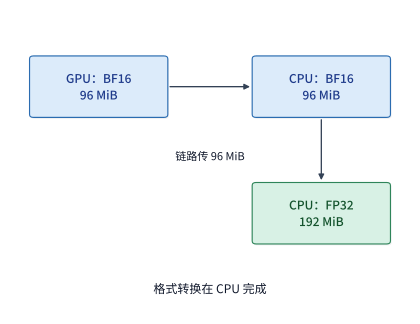

*图 10-15　路径一（CPU 侧转换）：先跨越互联链路传输 96 MiB 的 BF16 梯度，再在主机内存内完成向 192 MiB FP32 的转换；GPU 侧无需分配 FP32 转换缓冲。*

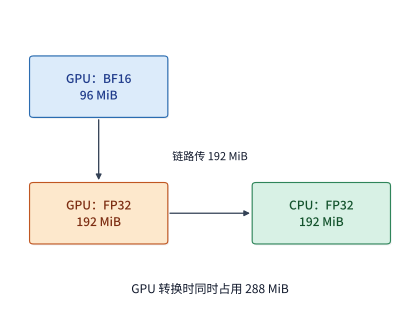

*图 10-16　路径二（GPU 侧转换）：先利用高带宽 GPU 显存将 96 MiB BF16 转为 192 MiB FP32（转换期间输入与输出共存，GPU 缓冲峰值升至 288 MiB），再跨链路传输 192 MiB 数据。*

对比图 10-15 与图 10-16 可以清楚地看到两条路径的博弈焦点：**GPU 显存带宽比 CPU 内存快 $3.3$ 倍，在 GPU 上做格式转换能省下转换时间，但却让跨链路传输的数据量从 $G$ 翻倍到了 $2G$**。我们分别代入两种有代表性的硬件互联环境核算结果：
1. **标准 PCIe 4.0 x16 主机（单向 $B = 32\ \mathrm{GB/s}$）**：
   - CPU 转换路径耗时：$T_c \approx 3.15\ \mathrm{ms}\text{（传 96 MiB）} + 0.98\ \mathrm{ms}\text{（CPU 转）} = 4.13\ \mathrm{ms}$；
   - GPU 转换路径耗时：$T_g \approx 0.30\ \mathrm{ms}\text{（GPU 转）} + 6.29\ \mathrm{ms}\text{（传 192 MiB）} = 6.59\ \mathrm{ms}$。
   虽然 GPU 转换快了 $0.68\ \mathrm{ms}$，但在 $32\ \mathrm{GB/s}$ 的 PCIe 总线上多传 $96\ \mathrm{MiB}$ 却多付出了 $3.15\ \mathrm{ms}$，导致 GPU 转换路径反而慢了 $60\%$。
2. **NVIDIA Grace Hopper（GH200）超级芯片（NVLink-C2C 单向 $B = 450\ \mathrm{GB/s}$）**：
   - 当 CPU 与 GPU 通过高达 $450\ \mathrm{GB/s}$ 的一致性高速互联连接时，多传 $96\ \mathrm{MiB}$ 仅增加约 $0.22\ \mathrm{ms}$ 传输耗时，两条路径耗时随即翻转为 $T_c \approx 1.21\ \mathrm{ms}$ 对 $T_g \approx 0.75\ \mathrm{ms}$——**GPU 侧转换反过来快了近 $40\%$**。[^offload]

令 $T_c = T_g$，我们可以精确推导出两条路径快慢翻转的**临界互联带宽 $B^*$**（由于分子上的梯度大小 $G$ 直接约去，该阈值仅由两端内存带宽决定）：

$$
B^*=\frac{1}{3(1/C_c-1/C_g)}\approx147\ \mathrm{GB/s}.
$$

这个 $147\ \mathrm{GB/s}$ 的翻转阈值给出了一条一目了然的架构指南：哪怕是最新一代的 PCIe 5.0 x16（单向 $64\ \mathrm{GB/s}$），也远低于 $147\ \mathrm{GB/s}$，因此在所有通过 PCIe 连接的常规 GPU 服务器上，卸载梯度时都必须坚持**“先传 BF16、在 CPU 上转 FP32”**；唯有在 GH200 / GB200 这类具备数百 GB/s NVLink-C2C 高速通道的紧耦合架构上（如面向此类芯片设计的 **SuperOffload** 训练系统），才应该在满足显存峰值的前提下把格式转换搬上 GPU（注意图 10-16 中 GPU 转换期间 $96\ \mathrm{MiB}$ 输入与 $192\ \mathrm{MiB}$ 输出必须同时驻留，GPU 临时缓冲峰值会从 $96\ \mathrm{MiB}$ 冲高到 $288\ \mathrm{MiB}$）。

### 10.2.4 组合并行方案中的每卡状态分配与候选集群显存校核

前面三小节分别剖析了状态分片、激活重计算与异构卸载。当我们把它们与第 6、7 章介绍的六维并行（见第 6.1.4 节一览表：切分层内矩阵的 TP、切分层的 PP、切分样本的 DP、切分专家的 EP、切分逐 token 算子激活的 SP，以及切分长序列注意力上下文的 CP）组装成一套完整的分布式训练系统时，这些并行维度延续了第 5 章“分块—安排输入—汇合结果”的思路，所有设计决策最终都汇聚到两套正交的网格上：**先确定每一份可训练参数与优化器状态归哪个并行组、哪张卡持有与更新，再沿着前向求值与反向求导的数据依赖图排布收集（AllGather）、交换（All-to-All）与归约（ReduceScatter / AllReduce）通信**。

在长上下文与混合并行配置中，除了第 10.2.1 节已辨析的 FSDP 与 SP 之外，工程上最容易混淆的另一对概念是 Megatron-Core 中的**序列并行（Sequence Parallelism，SP）**与**上下文并行（Context Parallelism，CP）**（`D14-01`）：虽然两者都在序列长度 $S$ 维度上切分激活张量，但它们所依附的并行通信域、切分的算子范围以及额外引入的跨卡通信账本截然不同：
1. **Megatron 序列并行（SP）附属于张量并行组（$\mathrm{SP} = \mathrm{TP}$），仅切分非 TP 区域的激活**：在标准张量并行（TP）中，注意力与 MLP 的线性层矩阵乘已按列并行（ColumnParallel）与行并行（RowParallel）切分到 $\mathrm{TP}$ 张卡上，但位于两个 TP 块之间的 `LayerNorm`/`RMSNorm`、`Dropout` 与残差连接仍需在每张 TP 卡上保存并处理完整的序列长度 $S$。开启 SP 后，系统利用环形 `AllReduce` 等价于“先 `ReduceScatter`、再 `AllGather`”的代数恒等式，将行并行线性层出口的 `AllReduce` 拆解为出口处的 `ReduceScatter`（使每张 TP 卡仅保留 $S/\mathrm{TP}$ 长度的序列激活分片以独立执行 `RMSNorm` 与残差相加）和下一个列并行线性层入口处的 `AllGather`（在进入矩阵乘前重新拼齐完整序列 $S$）。因此，**SP 不会跨出 TP 通信域，也不会比标准 TP 多传输任何一个字节（前向与反向合计通信量仍为每层 $4 \times \frac{\mathrm{TP}-1}{\mathrm{TP}} B S H b$），只是无损地将非 TP 算子的激活显存压缩为原来的 $1/\mathrm{TP}$**。
2. **上下文并行（CP）构成独立的并行维度（$\mathrm{TP} \times \mathrm{CP} \times \mathrm{PP} \times \mathrm{DP}$），沿序列维切分全部层与全部算子的激活**：当上下文长度扩展至 $32\mathrm{K}\sim 1\mathrm{M}$ token 时，哪怕开启了 TP+SP，线性层与注意力层内部按完整序列 $S$ 展开的激活仍会撑爆单机显存。CP 将输入序列以及**模型所有层、所有算子（包含 Linear、MLP、MoE 与 LayerNorm）的激活**统一按序列维度切分为 $S/\mathrm{CP}$ 分给 $\mathrm{CP}$ 个独立的通信组 rank。由于逐位置独立的 Linear、MLP 与 LayerNorm 只需各自处理本地那 $S/\mathrm{CP}$ 个 token，它们在 CP 维度上**完全不需要任何跨卡通信**；唯一需要跨 CP rank 协作的是**自注意力模块**——每个位置上的查询向量 $Q_i$ 必须与整条序列上所有可见位置的键 $K$、值 $V$ 计算注意力。为此，Megatron-Core CP 在前向传播时通过跨 CP 组的 `AllGather`（或与分块注意力计算重叠的环形点对点 P2P Ring Attention）收集全序列的 $K, V$ 张量，并在反向传播时通过 `ReduceScatter` 归约散射 $dK, dV$ 梯度。尤为关键的是，由于 CP 仅交换注意力的 $K, V$ 张量而不交换隐状态主干，采用分组查询注意力（GQA/MQA）将 KV 头数 $H_{kv}$ 缩减为查询头数 $H_q$ 的 $1/g$ 后，**CP 跨卡通信字节量也会随之等比例缩减为原来的 $1/g$**。表 10-A 完整对照了 SP 与 CP 的显存与通信账本。

**表 10-A　Megatron-Core 序列并行（SP）与上下文并行（CP）在切分范围、参数归属与集合通信上的完整账本对比（D14-01）**

| 对比维度 | Megatron 序列并行（Sequence Parallelism，SP） | Megatron 上下文并行（Context Parallelism，CP） |
| --- | --- | --- |
| 所属并行通信域 | 严格复用张量并行组（$\mathrm{SP} = \mathrm{TP}$，通常限单节点 NVLink 内） | 独立的正交并行轴（可与 TP、PP、DP、EP 任意组合，支持跨机 RDMA） |
| 沿序列维切分的激活范围 | **仅非 TP 区域**（`LayerNorm`/`RMSNorm`、`Dropout`、残差主干按 $S/\mathrm{TP}$ 切分；进入 Linear/Attention 前还原为 $S$） | **全部算子与全部层**（Linear、MLP、MoE、LayerNorm 与 Attention 输入全程保持 $S/\mathrm{CP}$ 分片） |
| 模型权重与优化器状态归属 | 由所属 TP 组按行列分片持有（`LayerNorm` 微小参数在 TP 组内复制并归约梯度） | CP 组内各 rank 持有相同权重副本（反向后跨 $\mathrm{DP}\times\mathrm{CP}$ 联合归约梯度，或结合 ZeRO/FSDP 分片） |
| Linear / MLP / LayerNorm 通信 | ColumnLinear 前执行 `AllGather`（前向）/ `ReduceScatter`（反向）；RowLinear 后反之 | **零通信**（所有逐 token 算子在本地 $S/\mathrm{CP}$ 切片上完全独立完成） |
| 自注意力（Attention）通信 | 零额外序列通信（按注意力头 $H / \mathrm{TP}$ 在本地完整序列 $S$ 上独立计算） | 前向跨 CP 组 `AllGather`（或 P2P 环传）$K, V$；反向跨 CP 组 `ReduceScatter` $dK, dV$（通信量与 $H_{kv}$ 成正比） |
| 相比单独开启 TP 的额外通信量 | **$0$**（将原有 TP 的每次 `AllReduce` 等价拆分为 `ReduceScatter + AllGather`） | 每层前反向新增 $K, V$ 与 $dK, dV$ 跨 CP 组交换，可用分块 Ring Attention 掩盖在计算内部 |

*表 10-A　Megatron-Core 序列并行（SP）与上下文并行（CP）在切分范围、参数归属与集合通信上的完整账本对比（D14-01）。*

下表将三种显存优化手段纳入统一的代价—收益框架对照：

| 方法 | 减少的显存占用 | 增加的工作 | 决定收益的时间关系 |
|---|---|---|---|
| 状态分片 | 重复保存的权重、梯度或优化器状态 | 参数收集、梯度归约并分片 | 收集能否赶在模块执行前完成 |
| 激活重计算 | 前向到反向之间保存的中间值 | 重建前向值 | 重建是否延迟关键路径上的反向计算 |
| 状态卸载 | 加速器上暂时不用的状态 | 主机与加速器间传输 | 数据能否在使用前传回 |

*表 10-5　状态分片、激活重计算与状态卸载三种显存优化手段的空间收益与时间约束对照。*

在实际工程选型中，当遇到单卡显存差一点点装不下的情况时，我们常常需要在“扩大 ZeRO-3 分片卡数 $d$”与“开启激活重计算”之间做权衡（例 10.3）。

**例 10.3　单卡显存超出预算 3.3 GiB 时，应该扩大分片规模还是开启激活重计算？** RTX 4090 的标称显存为 $24\ \mathrm{GB}$（折合二进制约 $22.35\ \mathrm{GiB}$）；扣除 CUDA 运行时上下文与通信库预留空间后，单卡安全可用显存上限按 **$22\ \mathrm{GiB}$** 核算。如第 10.2.1 节所算，在单机 $d=8$ 卡上对 Qwen3-8B 启用 ZeRO-3 时，每卡常驻训练状态占 $16N/8 \approx 15.3\ \mathrm{GiB}$，留给运行期激活与临时缓冲区的空间仅剩 $22 - 15.3 = 6.7\ \mathrm{GiB}$。假设当前序列长度下，同时驻留的激活、完整模块参数收集缓冲与算子工作区共需 **$10\ \mathrm{GiB}$**，那么 8 卡 ZeRO-3 的单卡总峰值就会达到 $15.3 + 10 = 25.3\ \mathrm{GiB}$，超出可用显存上限 **$3.3\ \mathrm{GiB}$**（图 10-17）。此时我们有两条解困路径：
1. **保持 8 卡不变，开启激活重计算**：通过选择性重计算或全层检查点将 $10\ \mathrm{GiB}$ 的运行期激活与缓冲压低 $3.3\ \mathrm{GiB}$ 以上，代价是每步迭代需要额外付出重算前向子图的算力时间；
2. **不开启重计算，将 ZeRO-3 分片域扩大到 16 卡（跨两台主机）**：将 $d=16$ 代入 $16N/d + 10\ \mathrm{GiB}$，每卡常驻状态直接减半至约 $7.6\ \mathrm{GiB}$，叠加 $10\ \mathrm{GiB}$ 激活与缓冲后总峰值降至 **$17.6\ \mathrm{GiB}$**，在 $22\ \mathrm{GiB}$ 红线下方留出约 $4.4\ \mathrm{GiB}$ 的安全余量，代价则是集合通信需要跨越多台主机。

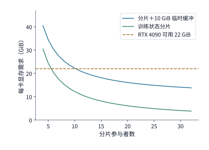

*图 10-17　给定 10 GiB 附加激活与缓冲需求时，ZeRO-3 分片卡数 $d$ 与每卡总显存占用（$16N/d + 10\ \mathrm{GiB}$）的关系曲线。水平虚线标出 RTX 4090 的 22 GiB 可用显存上限：8 卡方案（25.3 GiB）超出预算，而 16 卡、32 卡与 48 卡方案均稳居安全线以下。*

现在，把这套显存账本正式应用到本章对比的 **32 卡**与 **48 卡 RTX 4090** 两套候选方案上：两套方案均采用全集群范围的 ZeRO-3（即分片度数分别为 $d=32$ 与 $d=48$，不启用张量并行与流水线并行 $\mathrm{TP}=\mathrm{PP}=1$，每卡单次微批次处理 1 条 $8192$ 序列）。沿用每卡 $22\ \mathrm{GiB}$ 可用显存上限，并为同时驻留的激活、完整模块参数缓冲区与临时工作区预留充裕的 $10\ \mathrm{GiB}$ 配额：
- **32 卡方案**：每卡常驻训练状态为 $122.1 / 32 \approx 3.8\ \mathrm{GiB}$，加上 $10\ \mathrm{GiB}$ 运行期峰值后总显存占用约为 **$13.8\ \mathrm{GiB}$**，距 $22\ \mathrm{GiB}$ 上限留有 **$8.2\ \mathrm{GiB}$** 余量；
- **48 卡方案**：每卡常驻训练状态进一步降至 $122.1 / 48 \approx 2.5\ \mathrm{GiB}$，总显存占用仅约 **$12.5\ \mathrm{GiB}$**，留有 **$9.5\ \mathrm{GiB}$** 余量。

结论十分明确：**两套候选方案在显存容量上均轻松过关**。接下来胜负的关键，完全取决于第 10.3 节的单步执行与通信时间线。[^design]

> **算例 10-2（ZeRO-3 分片峰值、SwiGLU 选择性重计算与 CPUAdam 格式转换翻转带宽 $B^*$）**
> 1. **SwiGLU 与 RMSNorm 选择性重计算收益**：在 $128$ token 微批次与 FP32 激活下，单层 SwiGLU 门控乘积 $h = a \odot u$（形状 $[128, 12288]$）占 $6\ \mathrm{MiB}$，两个 RMSNorm 加权输出（形状 $[128, 4096]$）各占 $2\ \mathrm{MiB}$。在反向前即时重建这三项可将单层长期驻留激活从 $15\ \mathrm{MiB}$ 压至 $\mathbf{5\ \mathrm{MiB}}$（9 层流水阶段单微批从 $135\ \mathrm{MiB}$ 降至 $\mathbf{45\ \mathrm{MiB}}$，4 个在途微批共省去 $\mathbf{360\ \mathrm{MiB}}$），且逐层串行重建仅需共享一块 $\mathbf{6\ \mathrm{MiB}}$ 临时工作区。
> 2. **CPUAdam 梯度格式转换的临界互联带宽 $B^*$**：门控投影层 BF16 梯度 $G = 96\ \mathrm{MiB}$（转 FP32 后 $2G = 192\ \mathrm{MiB}$），类型转换需访问 $3G$ 字节内存。给定 RTX 4090 显存带宽 $C_g = 1008\ \mathrm{GB/s}$、至强 DDR5-4800 内存带宽 $C_c = 307.2\ \mathrm{GB/s}$，令 CPU 转换路径耗时 $T_c = G/B + 3G/C_c$ 与 GPU 转换路径耗时 $T_g = 3G/C_g + 2G/B$ 相等，解得翻转带宽 $B^* = \frac{1}{3(1/307.2 - 1/1008)} \approx \mathbf{147.1\ \mathrm{GB/s}}$：在 PCIe 4.0 x16（$32\ \mathrm{GB/s} < B^*$）下 CPU 转换快（$4.13\ \mathrm{ms}$ vs. $6.59\ \mathrm{ms}$），而在 GH200 NVLink-C2C（$450\ \mathrm{GB/s} > B^*$）下 GPU 转换反超（$0.75\ \mathrm{ms}$ vs. $1.21\ \mathrm{ms}$）。
> 3. **ZeRO-3 分片显存校核**：Qwen3-8B 常驻状态 $16N \approx 122.1\ \mathrm{GiB}$ 加 $10\ \mathrm{GiB}$ 激活与临时缓冲，在 $d=8$ 时达 $25.3\ \mathrm{GiB} > 22\ \mathrm{GiB}$（超限 $3.3\ \mathrm{GiB}$），扩至 $d=32$ 与 $d=48$ 后分别降至 $\mathbf{13.8\ \mathrm{GiB}}$ 与 $\mathbf{12.5\ \mathrm{GiB}}$。

## 10.3 训练步的流水调度与通信重叠

显存容量校核回答了“能不能跑起来”，而单步时间轴分析则回答“数据能不能按时送到计算核心手上、整步能不能压进 $67.9\ \mathrm{s}$ 红线”。本节先严格界定微批次梯度累积的目标函数等价性，随后剖析流水线并行（PP）中五种经典调度方案在“完成时间（气泡）”与“激活驻留显存”两根轴上的权衡，最后将集合通信与反向依赖重叠机制应用到 32 卡与 48 卡候选方案以及 MoE 与长上下文训练中。

### 10.3.1 微批次（Micro-Batch）、梯度累积与归一化分母陷阱

当一个全局批次（如本章的 $384$ 条序列）太大、无法一次性装入所有卡的显存同时前向时，标准做法是将它拆分为多个**微批次（micro-batch）**依次执行前向与反向传播，将各微批次算出的参数梯度累加到同一片梯度缓冲区中，待全部微批次跑完后再统一执行一次梯度裁剪（gradient clipping）与一次优化器参数更新——这就是**梯度累积（gradient accumulation）**。

由于线性求和与求导算子可以交换次序，梯度累积在数学上本应与一次性跑完整个大批次严格等价；但在工程实现中，**损失函数的归一化分母（normalization denominator）**却是一个极易引发隐蔽训练退化的陷阱。设第 $k$ 个微批次中包含的有效（非填充）token 索引集合为 $S_k$，整个全局批次的有效 token 总数为 $L = \sum_k |S_k|$，则全局按 token 平均的交叉熵损失函数定义为：

$$
\mathcal L=\frac{1}{L}\sum_k\sum_{j\in S_k}\ell_j.
$$

要让各微批次反向传播累加出来的梯度精确等于 $\nabla_\theta \mathcal{L}$，**在计算每一个微批次 $k$ 的损失时，都必须用该微批次的 token 损失之和除以全局有效 token 总数 $L$**（或者先除以本微批次 token 数 $|S_k|$，再乘以权重 $|S_k|/L$）。如果图省事，先对每个微批次内部求平均损失 $\bar{\ell}_k = \frac{1}{|S_k|}\sum_{j\in S_k}\ell_j$，再对 $m$ 个微批次简单取算术平均 $\frac{1}{m}\sum_k \bar{\ell}_k$，当各微批次的有效 token 数 $|S_k|$ 不相等时，短序列中的 token 权重就会被人为放大，长序列中的 token 权重则被稀释。

**例 10.4　按微批次求平均还是按全局有效 token 求平均，为何会扭曲参数梯度？** 考虑一个包含 8 条模型回答的训练批次：其中 4 条短回答各含 $2$ 个有效 token（共 $8$ 个 token），另外 4 条长回答各含 $3$ 个有效 token（共 $12$ 个 token），全局有效 token 总数为 $L = 8 + 12 = 20$。设参数为 $\theta$，短回答中每个 token 的损失为 $\theta/5$，长回答中每个 token 的损失为 $2\theta/5$：
- **正确的全局按 token 平均**：全局损失与真实参数梯度为

$$
\mathcal L=\frac{8(\theta/5)+12(2\theta/5)}{20}=\frac{8\theta}{25},\qquad
\frac{d\mathcal L}{d\theta}=0.32.
$$

- **错误的先按回答（微批次）平均再除以 8**：每条短回答内部平均损失为 $0.2\theta$，每条长回答内部平均损失为 $0.4\theta$；将 8 条回答等权重平均后，梯度变成了 $(0.2 + 0.4)/2 = \mathbf{0.30}$。之所以偏离真实的 $0.32$，是因为按 token 计重时，长回答占了 $12/20 = 60\%$ 的权重，结果理应更偏向 $0.4$；而按微批次等权平均则强行把长短回答的权重拉平到了 $50\% : 50\%$。
- **更严重的双重除法错误**：如果代码里在计算每个微批次损失时已经除以了全局分母 $L=20$，但在梯度累积循环结束后又习惯性地除以了一遍微批次数 $8$，最终梯度就会缩水为 $0.32 / 8 = \mathbf{0.04}$，等效学习率凭空缩小了 8 倍。[^verl]

回到本章的继续训练任务：全局批次包含 $384$ 条满长度（$8192$ token）序列，在 32 卡方案中每卡串行累积 $m=12$ 个单序列微批次，在 48 卡方案中每卡串行累积 $m=8$ 个单序列微批次。由于每条序列均为无填充的 $8192$ 个有效 token，每张卡每次微批次执行的矩阵形状完全一致，全局有效 token 总数恒为 $L = 3{,}145{,}728$，保证了两种卡数配置在数学上优化完全相同的目标函数。

### 10.3.2 流水线调度、依赖气泡与激活驻留峰值

当模型层数深、跨节点带宽有限时，工程上常采用**流水线并行（Pipeline Parallelism，PP）**将连续的网络层切分为 $p$ 个阶段（stage）依次放置在 $p$ 张卡上。虽然微批次切分不改变数学目标，但在流水线并行中，**微批次前向与反向的执行次序直接决定了两件生死攸关的事：第一，每张卡上有多少时间在空等上下游数据（流水线气泡，决定单步完成时间）；第二，同一时刻最多有几个微批次的前向激活积压在显存里等待反向求导（决定激活显存峰值）**。

我们先对比两种最基础的流水线调度机制：
1. **填满排空调度（Fill–Drain，又称 GPipe 调度）**：先连续把全部 $m$ 个微批次的前向传播从阶段 $0$ 推到阶段 $p-1$，然后再集中把全部 $m$ 个微批次的反向传播从阶段 $p-1$ 退回阶段 $0$；
2. **1F1B 调度（One Forward, One Backward，PipeDream-Flush）**：在流水线启动预热（warmup）阶段注入适量微批次后，一旦首个微批次的反向梯度传回当前阶段，立即进入**“每算完一个微批次的前向，紧接着算一个较早微批次的反向”**的稳态交替循环。

为什么 1F1B 要千方百计地让反向传播尽早插队执行？答案就在**激活的驻留生命周期**上。每个微批次在当前阶段产生的前向激活，从前向算完的那一刻起就必须锁在显存里，直到该微批次对应的反向求导走回当前阶段并消费完这份激活后才能释放。在填满排空调度下，阶段 $0$ 必须连续算完所有 $m$ 个微批次的前向，才能等到第 1 个微批次的反向梯度从阶段 $p-1$ 传回来——这意味着阶段 $0$ 的显存里必须同时积压 **$m$ 份**微批次激活，显存峰值随 $m$ 线性膨胀；而在 1F1B 调度下，第 1 个微批次的反向一到达就立刻执行并释放其前向激活，腾出的显存槽位随即交给新注入的微批次复用，从而将在途积压的激活份数上限严格限制在流水线阶段数 **$p$ 份**以内（与总微批次数 $m$ 脱钩）。当显存容量吃紧时，这往往不是“快一点还是慢一点”的区别，而是“能不能跑通而不触发 OOM 崩溃”的生死线。

我们先用理想均衡模型推导出基础气泡公式：设 $p$ 个流水阶段完全均衡，每阶段单次前向耗时 $t_f$、单次反向耗时 $t_b$，暂忽略跨阶段通信与参数更新耗时，则跑完 $m$ 个微批次的总耗时 $T$ 与加速卡时间利用率 $u$ 为：

$$
T=(m+p-1)(t_f+t_b),\qquad u=\frac{m}{m+p-1}.
$$

式中 $m(t_f+t_b)$ 是真正产生价值的微批次计算时间，而 $(p-1)(t_f+t_b)$ 则是流水线首尾预热填充与排空阶段不可避免的空闲等待（即**流水线气泡**）。代入 $p=4$ 个阶段、$m=8$ 个微批次，理想时间利用率为 $u = 8/11 \approx 72.7\%$（气泡占 $27.3\%$）。下面我们通过例 10.5 把跨阶段通信延迟放进真实事件时间线，看看填满排空与 1F1B 究竟谁更快、谁更省显存。

**例 10.5　在计入跨卡通信延迟的真实流水线中，1F1B 相比填满排空得到了什么、又付出了什么？** 将 Qwen3-8B 的 36 层均分为 $p=4$ 个流水阶段（每阶段 9 层），切分 $m=8$ 个微批次（每微批次含 1 条 $128$ token 序列）。在每个阶段上，单次前向计算耗时 $t_f = 10\ \mathrm{ms}$，单次反向计算耗时 $t_b = 20\ \mathrm{ms}$；相邻阶段之间每次传递前向激活或反向梯度的跨界通信耗时均为 $1\ \mathrm{ms}$（正向与反向通道相互独立），末尾参数更新耗时 $1\ \mathrm{ms}$。
- **填满排空时间线（图 10-18）**：若无跨界通信，耗时为 $(8+4-1)\times 30 = 330\ \mathrm{ms}$；计入前向填充穿过 3 条阶段边界的 $3\ \mathrm{ms}$、反向排空穿过 3 条边界的 $3\ \mathrm{ms}$ 以及末尾 $1\ \mathrm{ms}$ 参数更新后，总完成时间为 **$337\ \mathrm{ms}$**。
- **1F1B 时间线（图 10-19 与图 10-20）**：由于 1F1B 让反向传播提前插队抢占了计算核心，后续微批次的前向传播不得不排队等待反向释放 GPU。以阶段 0 为例，前 4 个微批次在 $40\ \mathrm{ms}$ 处完成前向注入，第 1 个微批次的反向梯度在 $106\ \mathrm{ms}$ 传回阶段 0 并执行至 $126\ \mathrm{ms}$，因此第 5 个微批次的前向被推迟到 $126\ \mathrm{ms}$ 才启动。这种前向推迟沿着流水线向下游逐级传导：如图 10-20 局部放大所示，阶段 3 在 $93\ \mathrm{ms}$ 处就已经算完了第 2 个微批次的反向，但来自阶段 2 的第 3 个微批次前向激活要到 $95\ \mathrm{ms}$ 才能跨界抵达，导致阶段 3 在 $93 \sim 95\ \mathrm{ms}$ 之间凭空多出了一段 **$2\ \mathrm{ms}$ 的输入未到等待空隙**。一连串类似的跨界交错等待累加下来，1F1B 直到 $346\ \mathrm{ms}$ 才算完所有梯度，加上 $1\ \mathrm{ms}$ 参数更新后总完成时间为 **$347\ \mathrm{ms}$**。[^pipeline]

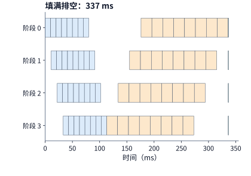

*图 10-18　填满排空（Fill–Drain）调度时间线：先连续完成 8 个微批次的前向（蓝色），再集中执行 8 个微批次的反向（橙色），最后执行参数更新（绿色），总耗时 337 ms。*

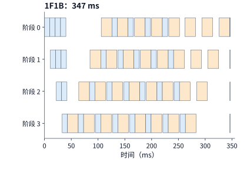

*图 10-19　1F1B 调度时间线（与图 10-18 采用相同时间刻度）：预热后交替执行前向与反向，因交错通信延迟引入少量中间空隙，总耗时略增至 347 ms。*

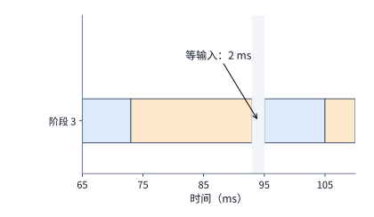

*图 10-20　图 10-19 中阶段 3 在 90～100 ms 窗口的局部放大：第 2 个微批次在 93 ms 结束反向，但第 3 个微批次的前向输入迟至 95 ms 才跨界抵达，形成 2 ms 的等待空隙。*

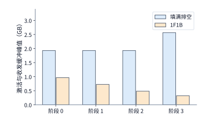

*图 10-21　两种调度在四个流水阶段上的激活与收发缓冲显存峰值对比。1F1B 通过及早执行反向释放早期微批次激活，将全流水线最大单阶段峰值从约 2.57 GB（2448 MiB）大幅压低至 0.97 GB（921 MiB）。*

将图 10-18 至图 10-21 放在一起对照，一个常被教科书忽略的工程真相浮出水面：**1F1B 并没有减少流水线的理论气泡时间 $(p-1)(t_f+t_b)$；相反，在计入跨界通信延迟后，1F1B 的完成时间（$347\ \mathrm{ms}$）甚至比填满排空（$337\ \mathrm{ms}$）还慢了约 $3\%$**。1F1B 真正的立身之本完全在图 10-21 的**显存轴**上——它把激活与收发缓冲的最大显存占用从约 $2.57\ \mathrm{GB}$ 砍到了 $0.97\ \mathrm{GB}$（削减高达 **$62\%$**）。如果单卡留给激活的显存预算只有 $1\ \mathrm{GB}$，填满排空会直接内存溢出，唯有 1F1B 能够跑通；反之，若显存十分充裕，反而是朴素的填满排空跑得更快。

那么，如果我们**既想要 1F1B 的低显存，又想真正把 $(p-1)(t_f+t_b)$ 这块流水线气泡削减掉**，该怎么办？工业界沿着“把每个微批次切得更碎”或“把反向求导拆开填空”两条思路，演进出了三类高级流水线调度。我们沿用例 10.5 的同一套基准参数（4 阶段、8 个微批次、前向 $10\ \mathrm{ms}$、反向 $20\ \mathrm{ms}$、跨界传输 $1\ \mathrm{ms}$、更新 $1\ \mathrm{ms}$），逐一核算它们的气泡压缩原理与各自付出的代价：[^schedules]

1. **交错式 1F1B（Interleaved 1F1B，Megatron-LM 虚拟流水线）**：
   不再让每张卡只负责连续的 9 层，而是把 36 层拆成 8 个虚拟模型块（chunk），按轮询方式分给 4 张卡，使每张卡持有 $v=2$ 个不相邻的层块（例如卡 0 负责第 $0\sim 4$ 层与第 $20\sim 23$ 层，合计仍是 9 层）。如此一来，每个层块的单次前向与反向时间都缩短为原来的一半（约 $5\ \mathrm{ms}$ 与 $10\ \mathrm{ms}$），上游微批次可以提前一倍时间填进下游阶段的预热空隙，理论气泡比例从 $(p-1)/m$ 缩小为原来的 **$1/v$**：

   $$
   \text{交错式气泡比例} = \frac{1}{v}\cdot\frac{p-1}{m}.
   $$

   如图 10-22 所示，8 个微批次的完成时间从 1F1B 的 $347\ \mathrm{ms}$ 大幅缩短至 **$298\ \mathrm{ms}$**（每卡空闲时间从 $106\ \mathrm{ms}$ 降至 $57\ \mathrm{ms}$）。但这一加速伴随着两项代价：第一，每个微批次前向需要跨越的卡间边界从 $p-1=3$ 次暴增至 $vp-1=7$ 次（全步前向跨界消息从 24 次翻倍至 56 次）；第二，阶段 0 的早期层块必须等待更多虚拟块流转后才能迎来反向释放，导致阶段 0 的激活与缓冲峰值从 $921\ \mathrm{MiB}$ 上升至 **$1329\ \mathrm{MiB}$**。

2. **零气泡调度（Zero-Bubble Pipeline，Sea AI Lab）**：
   回到第 10.2.2 节图 10-12 的线性层反向分叉：反向传播算出的两路梯度中，只有**输入梯度 $dX$（记作 $B$）**是上游阶段反向求导急等的数据，真正卡在跨阶段关键路径上；而**权重梯度 $dW$（记作 $W$）**只用于本阶段内部的梯度累积，只要在本阶段算完对应 $dX$ 之后的任意空闲时刻算出来即可。零气泡调度正是抓住了这一自由度，将原本捆绑在一起的 $20\ \mathrm{ms}$ 反向拆分为 $T_B = 10\ \mathrm{ms}$（求 $dX$）与 $T_W = 10\ \mathrm{ms}$（求 $dW$）：在关键路径上优先把 $dX$ 算完传给上游，而把独立的 $dW$ 算子精准填入原本空等的流水线气泡里。
   设前向、$dX$、$dW$ 耗时分别为 $T_F, T_B, T_W$，则标准 1F1B 的理论气泡为 $(p-1)(T_F+T_B+T_W) = 90\ \mathrm{ms}$；基础零气泡调度 **ZB-H1** 将 $dW$ 填入空隙后，气泡降至 $(p-1)(T_F+T_B-T_W) = 30\ \mathrm{ms}$；进阶调度 **ZB-H2** 允许注入更多在途前向，可将计算气泡彻底清零为 $(p-1)(T_F+T_B-2T_W) = 0$。按 ZB-H1 排定事件时间线（图 10-23），8 个微批次在 **$283\ \mathrm{ms}$** 内全部完成，每卡空闲仅 $42\ \mathrm{ms}$（其中 $30\ \mathrm{ms}$ 为理论下界，$12\ \mathrm{ms}$ 来自跨界传输）。其代价则转移到了流水线尾部：阶段 3 的 $dW$ 被推迟了 3 个微批次才执行，期间为了求 $dW$ 所需的激活不能释放，使阶段 3 的保守显存峰值从 1F1B 的 $308\ \mathrm{MiB}$ 升至 **$1226\ \mathrm{MiB}$**（若按论文表 2 仅保留求 $dW$ 所需的精简激活子集，则 ZB-H1 的激活峰值与 1F1B 同为 $pM_B$，其中 $M_B$ 为单个微批次的激活量，对应本例全流水线最大峰值仍为 $921\ \mathrm{MiB}$）。

3. **双向流水调度（DualPipe，DeepSeek-V3）**：
   DeepSeek-V3 提出的 DualPipe 将一批微批次对半分为两组，同时从阶段 $0$（正向）和阶段 $p-1$（反方向）两端相向注入流水线，让每个阶段同时承载正反两个方向的计算块，不仅用反方向的计算块填平正向的预热与排空空隙，还能在精细实现中让一个方向的前向/反向计算与另一个方向的跨节点全互换（All-to-All）通信深度重叠（`D14-02`，见第 10.6.4 节末尾图 10-51）。沿用 DeepSeek 官方 DualPipe 技术文档的记号（记 $PP$ 为偶数流水阶段数，$F$ 为前向块耗时，$B$ 为完整反向块耗时，$W$ 为从反向中剥离出的“权重梯度 $dW$”块耗时，$F\&B$ 为成对捆绑重叠执行的一对正反向微批次耗时），DualPipe 将理论流水线气泡从标准 1F1B 的 $(PP-1)(F+B)$ 大幅压缩至：

   $$
   \text{DualPipe 理论气泡} = \left(\frac{PP}{2} - 1\right)(F\&B + B - 3W).
   $$

   在本例不模拟正反向算子内部通信重叠（取 $F\&B = T_F + T_B + T_W = 30\ \mathrm{ms}$）的口径下，理论气泡为 $(2-1)\times(30+20-30) = 20\ \mathrm{ms}$，实测事件完成时间为 **$306\ \mathrm{ms}$**（图 10-24）；而在 DeepSeek-V3 的跨节点大规模 MoE 训练中，一个配对 $F\&B$ 块内部让正向微批次的 `Dispatch/Combine` 全互换通信与反向微批次的注意力/MLP 矩阵计算彼此交错掩盖，从而在减半流水气泡的同时几乎彻底隐藏了跨机 EP 通信延迟。它的工程代价同样在官方账本中写得一清二楚（表 10-B）：由于第 $i$ 号设备不仅要持有正向阶段 $i$ 的层参数，还要同时持有反向镜像阶段 $PP-1-i$ 的层参数以服务对向流，**每张卡必须常驻 $2\times$ 的模型参数副本**，且在途激活驻留上限从 1F1B 的 $PP$ 份增加至 **$PP+1$ 份**（本例各阶段激活与缓冲峰值升至 **$1228 \sim 1612\ \mathrm{MiB}$**；后续演进的 V 型变体 DualPipeV 则通过在同一设备内部折叠两个阶段，将所需设备数从 $PP$ 减半至 $PP/2$）。[^schedules]

**表 10-B　1F1B、零气泡（ZB1P）与 DualPipe 双向流水线在气泡公式、权重副本与激活驻留上的官方对标（D14-02）**

| 流水线调度方法 | 流水线气泡时间公式（$PP$ 为偶数阶段数） | 每设备参数副本数 | 每设备激活驻留份数上限 | 所需流水线设备数 | 跨节点 EP 通信掩盖能力 |
| --- | --- | ---: | ---: | ---: | --- |
| 1F1B（PipeDream-Flush） | $(PP-1)(F+B)$ | $1\times$ | $PP$ | $PP$ | 仅限单流内部微批重叠，首尾暴露明显 |
| ZB1P（Zero-Bubble 1P） | $(PP-1)(F+B-2W)$ | $1\times$ | $PP$ | $PP$ | 依赖将 $W$ 填入气泡，不消除单向流通信串行性 |
| DualPipe（双向相向注入） | $(PP/2 - 1)(F\&B + B - 3W)$ | $2\times$ | $PP + 1$ | $PP$（DualPipeV 为 $PP/2$） | 成对捆绑 $F\&B$，正反向计算与跨机 All-to-All 相互完全掩盖 |

*表 10-B　1F1B、零气泡（ZB1P）与 DualPipe 双向流水线在气泡公式、权重副本与激活驻留上的官方对标（D14-02）。*

下表与图 10-22 至图 10-25 将这五种流水线调度放在同一基准下做全景对照：

| 调度（八个 micro-batch） | 完成时间 / ms | 每卡空闲 / ms | 阶段 0 峰值 / MiB | 压缩气泡的手段 | 主要代价 |
|---|---:|---:|---:|---|---|
| 填满排空 | 337 | 96 | 1,840（阶段 3 为 2,448） | 无 | 激活驻留最高，容量紧张时不可行 |
| 1F1B | 347 | 106 | 921 | 无（气泡与填满排空相同） | 显存最省，但比填满排空慢约 3% |
| 交错式 1F1B，$v=2$ | 298 | 57 | 1,329 | 每卡层块拆成 $v$ 段 | 前向消息 24 → 56 次 |
| 零气泡（ZB-H1），$T_B=T_W$ | 283 | 42 | 921（阶段 3 为 1,226） | $dW$ 延后填入空隙 | 靠后阶段的激活要保留到 $dW$ 执行 |
| DualPipe | 306 | 65 | 1,228（阶段 1、2 为 1,612） | micro-batch 从两端相向流动 | 每卡参数两份 |

*表 10-6　五种流水线调度在 $p=4$ 个阶段、$m=8$ 个微批次基准下的完成时间、每卡空闲时间与激活显存峰值对比。*

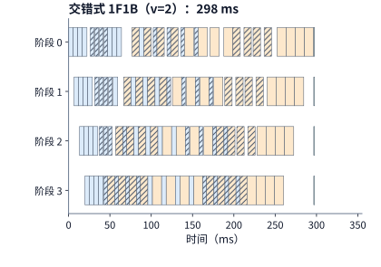

*图 10-22　交错式 1F1B（$v=2$）时间线（完成时间 298 ms）：每卡持有两个虚拟层块（无纹块与斜线块），每个计算块耗时减半，使阶段 3 的首个前向从 33 ms 提前至约 20 ms 启动，但跨界传输次数翻倍。*

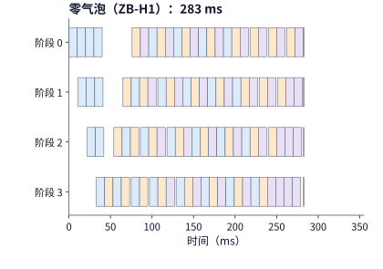

*图 10-23　零气泡（ZB-H1）时间线（完成时间 283 ms）：将反向拆分为关键路径上的 $dX$（橙色）与可延后的 $dW$（紫色），用延后的 $dW$ 精准填平图 10-19 中的跨界依赖空隙与尾部排空空隙。*

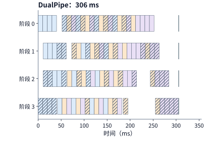

*图 10-24　DualPipe 双向流水时间线（完成时间 306 ms）：两组微批次从阶段 0 与阶段 3 相向注入（实心块与斜线块），彼此填平对向的预热与排空空隙，代价是每卡需存两份方向参数。*

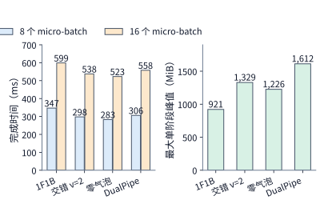

*图 10-25　四种主流流水线调度在 8 个与 16 个微批次下的单步完成时间（左）及 8 个微批次下的最大单阶段激活与缓冲显存峰值（右）。*

审视上表与图 10-25，我们可以提炼出流水线选型的两条核心法则：
- **第一，没有任何一种调度能在“时间”与“显存”两根轴上同时夺冠**：单步完成最快的是零气泡（$283\ \mathrm{ms}$），而全流水线最大单阶段峰值最低的则是基础 1F1B（$921\ \mathrm{MiB}$）。交错式 1F1B、零气泡与 DualPipe 省下的每一毫秒气泡时间，都是拿跨界通信频次、尾部激活驻留或双倍参数空间换来的。
- **第二，微批次数 $m$ 越大，复杂调度的边际时间收益越小**：当微批次数从 $m=8$ 翻倍到 $m=16$ 时，四种调度的完成时间分别为 $599\ \mathrm{ms}$（1F1B）、$538\ \mathrm{ms}$（交错式）、$523\ \mathrm{ms}$（零气泡）与 $558\ \mathrm{ms}$（DualPipe）。由于基础气泡比例 $(p-1)/m$ 随 $m$ 翻倍已经自然减半（从 $37.5\%$ 降至 $18.8\%$），复杂调度能够节省的相对时间比例随之收窄，但它们付出的额外通信次数、激活驻留或双倍参数代价却一分不减；尤其当跨机链路已被数据并行梯度归约占满时（见下一小节），交错式多出来的跨界消息反而会直接卡上关键路径。因此，工程选型的正确顺序永远是：**先按显存预算剔除峰值超标的调度，再结合微批次数 $m$ 与互联带宽余量决定是否值得引入低气泡调度**。

下面的 Python 函数统一封装了 Fill–Drain、1F1B、交错式 1F1B、零气泡（ZB-H1/ZB1P）与 DualPipe 在任意偶数阶段数 $PP$ 与微批次数 $m$ 下的理论气泡时间、每卡参数副本数与最大激活驻留份数核算：

```python
def compare_pipeline_schedules(
    pp_stages: int = 8,
    micro_batches: int = 32,
    t_f_ms: float = 12.0,
    t_b_ms: float = 24.0,
    t_w_ms: float = 12.0,
    t_fb_overlapped_ms: float = 26.0,
    interleave_v: int = 2,
) -> dict[str, dict[str, float]]:
    work_ms = micro_batches * (t_f_ms + t_b_ms)
    b_1f1b = (pp_stages - 1) * (t_f_ms + t_b_ms)
    b_interleaved = b_1f1b / interleave_v
    b_zbh1 = (pp_stages - 1) * (t_f_ms + (t_b_ms - t_w_ms) - t_w_ms)
    b_zb1p = max(0.0, (pp_stages - 1) * (t_f_ms + t_b_ms - 2.0 * t_w_ms))
    b_dualpipe = (pp_stages // 2 - 1) * (t_fb_overlapped_ms + t_b_ms - 3.0 * t_w_ms)
    return {
        "Fill-Drain": {"bubble_ms": b_1f1b, "step_ms": work_ms + b_1f1b, "weight_copies": 1, "max_act_slots": micro_batches},
        "1F1B": {"bubble_ms": b_1f1b, "step_ms": work_ms + b_1f1b, "weight_copies": 1, "max_act_slots": pp_stages},
        f"Interleaved-v{interleave_v}": {"bubble_ms": b_interleaved, "step_ms": work_ms + b_interleaved, "weight_copies": 1, "max_act_slots": pp_stages + 1},
        "ZB-H1": {"bubble_ms": b_zbh1, "step_ms": work_ms + b_zbh1, "weight_copies": 1, "max_act_slots": pp_stages},
        "ZB1P": {"bubble_ms": b_zb1p, "step_ms": work_ms + b_zb1p, "weight_copies": 1, "max_act_slots": pp_stages},
        "DualPipe": {"bubble_ms": b_dualpipe, "step_ms": (micro_batches // 2) * t_fb_overlapped_ms + b_dualpipe, "weight_copies": 2, "max_act_slots": pp_stages + 1},
    }

for name, stats in compare_pipeline_schedules().items():
    print(f"{name:16s} -> bubble={stats['bubble_ms']:5.1f} ms | step={stats['step_ms']:6.1f} ms | weights={stats['weight_copies']}x | act_slots={stats['max_act_slots']}")
```


### 10.3.3 反向依赖、梯度分桶与集合通信重叠

上一小节阶段 3 中那段 $2\ \mathrm{ms}$ 的等待空隙，源于上游前向数据尚未送达。梯度与参数的集合通信同样遵循这一因果铁律：**第一，发送不能早于数据产出时刻（数据依赖）；第二，发送必须等待物理传输链路空闲（资源争用）**。

在反向传播逐层算出参数梯度的过程中，为了避免每算出一个细碎张量就单独调用一次集合通信（产生高昂的内核启动与协议握手开销），分布式训练框架普遍采用**梯度分桶（gradient bucketing）**机制：将若干相邻层的梯度张量合并装入一个固定大小（如 $25\ \mathrm{MiB}$）的通信桶中，等桶内所有梯度张量全部就绪后再一次性发起 `AllReduce` 或 `ReduceScatter`。这里蕴含着一个经典的粒度权衡：**桶划得越大，通信启动次数越少、链路带宽利用率越高，但整桶必须等待桶内最后一个算出的梯度就绪后才能启动传输，错失提前重叠的窗口；桶划得越小，越能紧贴每一层反向结束时刻及早启动传输，但频繁的通信启动开销又会抬高总传输时间**。

即便通信桶准时启动传输，它能否被后续计算完全掩盖，还要看共享链路上有没有别的流量抢道（图 10-26 与图 10-27）。设某通信桶的梯度归约传输耗时为 $3\ \mathrm{ms}$，而在该桶梯度全部就绪之后，GPU 上恰好还有 $5\ \mathrm{ms}$ 与该桶无关的浅层反向计算：
- **当传输链路空闲时（图 10-26）**：$3\ \mathrm{ms}$ 的梯度归约立刻启动，在 $5\ \mathrm{ms}$ 独立计算结束前就已提前跑完，暴露在计算之外的等待时间为 **$0$**；
- **当共享链路发生争用时（图 10-27）**：假设同一条物理链路在前 $4\ \mathrm{ms}$ 正被 MoE 的跨卡专家全互换（All-to-All）或另一路张量并行通信占满，这 $3\ \mathrm{ms}$ 的梯度归约就只能被迫推迟到第 $4\ \mathrm{ms}$ 才启动传输，仅能利用剩余的 $1\ \mathrm{ms}$ 计算时间重叠，另外 **$2\ \mathrm{ms}$ 直接溢出到反向计算结束之后**。这段无法被计算掩盖、实打实拉长整步耗时的尾巴，就是**暴露通信等待时间（exposed communication waiting time）**。

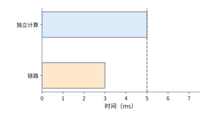

*图 10-26　链路空闲时的理想重叠：梯度就绪后立即启动 3 ms 归约（橙色），在 5 ms 独立反向计算（蓝色）结束前完成，暴露通信等待为 0（虚线标示计算结束时刻）。*

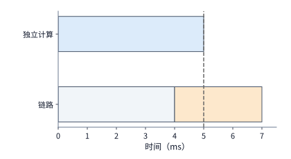

*图 10-27　共享链路争用导致的通信暴露：链路前 4 ms 被其他通信（灰色）占用，3 ms 归约被迫推迟至 4～7 ms 执行，虚线右侧溢出的 2 ms 直接延长了单步迭代耗时。*

更进一步，除了被动等待梯度产生，运行时还可以通过调整矩阵反向内部两个算子的执行次序来主动创造重叠窗口。回顾图 10-12 的反向分叉：在流水线并行（第 10.3.2 节）中，我们为了尽快唤醒上游阶段而优先算输入梯度 $dX$；而在数据并行（DP / ZeRO）中，如果某层的参数梯度归约眼看就要溢出到计算末尾，调度器反而可以选择**先算本层的参数梯度 $dW$** 以尽早触发 `ReduceScatter` 通信，随后再算输入梯度 $dX$ 并在算 $dX$ 的同时掩盖刚刚发起的 $dW$ 归约。

现在，我们运用这套重叠规律，为本章的 **32 卡**与 **48 卡 RTX 4090（全组 ZeRO-3）**候选方案算清每一步迭代的真实通信等待时间。在全组 ZeRO-3 下，每处理一个微批次（micro-batch）需要依次跨越三次全模型规模的集合通信：前向传播逐层收集一遍 BF16 权重（`AllGather`），反向传播因前向已释放完整权重缓冲而需再次逐层收集一遍 BF16 权重（`AllGather`），反向算出各层梯度后逐层归约并散射一遍 BF16 梯度（`ReduceScatter`）。在分片度数为 $d$ 的环形集合通信中，每次完整 `AllGather` 或 `ReduceScatter` 要求每张卡发送并接收 $\frac{d-1}{d} \times 2N$ 字节数据（48 卡时单次约为 $16.0\ \mathrm{GB}$）。当每张卡在单步内累积 $m$ 个微批次时，每卡每步需要收发的集合通信总字节数为：

$$
V=3m\cdot\frac{d-1}{d}\cdot2N.
$$

将 Qwen3-8B（$2N \approx 16.38\ \mathrm{GB}$）代入上式：
- **48 卡方案（$d=48, m=8$）**：每卡每步集合通信总量为 $V \approx \mathbf{385\ \mathrm{GB}}$；
- **32 卡方案（$d=32, m=12$）**：每卡每步集合通信总量高达 $V \approx \mathbf{571\ \mathrm{GB}}$。

这数百 GB 的数据究竟走哪条物理通道？这正是消费级显卡与数据中心旗舰卡最核心的架构差异：**RTX 4090 既没有 NVLink 高速互联，驱动层也不开放跨卡 PCIe P2P（Peer-to-Peer 直接显存读写）**，哪怕是插在同一台服务器主板上的两张 RTX 4090 交换数据，也必须先经各自的 PCIe 4.0 x16 总线拷入主机内存（CPU DRAM）中转。因此，无论数据发往同机邻卡还是跨机远端卡，每张 RTX 4090 的全部收发流量都必须百分之百穿过它自己那条 **PCIe 4.0 x16 通道（单向理论带宽 $32\ \mathrm{GB/s}$）**。参照业界主流的高配 4090 训练节点方案，每台 8 卡主机配备 8 张 $200\ \mathrm{Gbit/s}$（单向 $25\ \mathrm{GB/s}$）RDMA 网卡，环形集合通信将跨机流量均匀分摊到 8 张网卡上，网卡侧并不构成瓶颈，真正的物理咽喉正是每张卡的 $32\ \mathrm{GB/s}$ PCIe 总线。用通信总量除以 $32\ \mathrm{GB/s}$，可得每步通信占用 PCIe 链路的总时间（链路时间）分别为：**48 卡方案约 $385 / 32 \approx 12.0\ \mathrm{s}$**，**32 卡方案约 $571 / 32 \approx 17.9\ \mathrm{s}$**。

如果把这 $12.0\ \mathrm{s}$ 链路时间直接加在 48 卡的 $52.2\ \mathrm{s}$ 纯计算时间后面，单步耗时就会升至 $64.2\ \mathrm{s}$，几乎耗尽 $67.9\ \mathrm{s}$ 预算。好在**“链路占用时间”绝不等于“暴露通信等待时间”**。如图 10-28 所示，ZeRO-3 运行时采用逐层流水预取与归约：在前向计算第 $l$ 层的同时，PCIe 通道已经在后台并行通过 `AllGather` 预取第 $l+1$ 层的参数；在反向刚算完第 $l$ 层梯度时，立即并发启动第 $l$ 层梯度的 `ReduceScatter`，同时 GPU 继续向第 $l-1$ 层回传求导。算一笔细账就能看清为什么绝大部分通信都能被完美藏起来：在 48 卡方案中，单个微批次的 PCIe 链路总时间约为 $1.50\ \mathrm{s}$，而该微批次的前后向计算时间长达 $6.53\ \mathrm{s}$；拆到单个 Transformer 层（参数量约 $0.39\ \ \mathrm{GB}$），经 $32\ \mathrm{GB/s}$ PCIe 收集一层参数仅需约 **$12\ \mathrm{ms}$**，远短于该层的矩阵计算耗时。

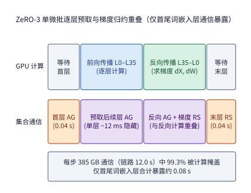

*图 10-28　48 卡方案中 ZeRO-3 逐层通信与计算的重叠时间线。前向与反向内部各层（约 12 ms/层）的参数收集（AllGather）与梯度归约散射（ReduceScatter）全部隐藏在 52.2 s 计算内部（掩盖率 99.3%）；真正无法隐藏、暴露在关键路径上的仅剩整步最开头的首次词嵌入层 AllGather（0.04 s）与最末尾的最后一次词嵌入层 ReduceScatter（0.04 s），合计仅 0.08 s。*

正如图 10-28 与字节跳动 MegaScale 论文所揭示的，当内部各层通信均被计算完全覆盖后，**整步迭代中唯一无法被计算掩盖的暴露通信，只剩下第一个微批次启动前收集第 1 层参数的 `AllGather`（此时还没有任何计算可以重叠），以及最后一个微批次结束时归约第 1 层梯度的 `ReduceScatter`（此时所有反向计算均已结束）**。对于 Qwen3-8B，模型最开头的第 1 层（也是反向最后算完的一层）是体积约 **$1.24\ \mathrm{GB}$ 的词表嵌入层（embedding）**：经 $32\ \mathrm{GB/s}$ PCIe 执行这首尾两次通信各需约 $0.04\ \mathrm{s}$，**全步暴露通信等待合计仅约 $0.08\ \mathrm{s}$**（超过 $99.3\%$ 的 PCIe 通信被成功掩盖）。由于优化器更新与卡内逐元素算子已折算在 $40\%$ 的单卡计算效率口径内，计入这 $0.08\ \mathrm{s}$ 暴露通信后，32 卡与 48 卡方案在输入数据就绪时的单步执行时间分别定格为 **$78.4\ \mathrm{s}$** 与 **$52.3\ \mathrm{s}$**。[^design]

下面的 Python 代码实现了本章 32 卡与 48 卡全组 ZeRO-3 候选方案的显存峰值、PCIe 集合通信链路时间、首尾暴露通信等待及 30 天工期核算器：

```python
import math

def compute_zero3_step_budget(
    num_gpus: int,
    params_n: int = 8_190_735_360,
    embed_params: int = 151_936 * 4096,
    step_flops: float = 1.6566e17,
    gpu_peak_tflops: float = 165.2,
    compute_eff: float = 0.40,
    pcie_bw_gbps: float = 32.0,
    act_buf_gib: float = 10.0,
    input_wait_s: float = 0.5,
    ckpt_overhead_ratio: float = 0.0108,
    total_steps: int = 31_790,
    reserved_days: float = 5.0,
) -> dict[str, float]:
    micro_batches = 384 // num_gpus
    persistent_gib = (16 * params_n) / (num_gpus * (1024**3))
    peak_mem_gib = persistent_gib + act_buf_gib

    comp_s = step_flops / (num_gpus * gpu_peak_tflops * 1e12 * compute_eff)
    ring_factor = (num_gpus - 1) / num_gpus
    comm_bytes = 3 * micro_batches * ring_factor * (2 * params_n)
    link_s = (comm_bytes / 1e9) / pcie_bw_gbps

    # 首尾词嵌入层 (first AllGather + last ReduceScatter) 暴露通信
    embed_comm_bytes = 2 * ring_factor * (2 * embed_params)
    exposed_comm_s = (embed_comm_bytes / 1e9) / pcie_bw_gbps
    step_s = comp_s + exposed_comm_s + input_wait_s
    base_days = (total_steps * step_s) / 86400.0
    finish_days = reserved_days + base_days * (1.0 + ckpt_overhead_ratio)
    return {
        "micro_batches": micro_batches,
        "peak_mem_gib": round(peak_mem_gib, 1),
        "comp_s": round(comp_s, 1),
        "link_s": round(link_s, 1),
        "exposed_comm_s": round(exposed_comm_s, 2),
        "step_s": round(step_s, 1),
        "finish_days": round(finish_days, 1),
    }

print("32x RTX 4090:", compute_zero3_step_budget(32, ckpt_overhead_ratio=0.0102))
print("48x RTX 4090:", compute_zero3_step_budget(48, ckpt_overhead_ratio=0.0108))
```

这一推导同时为通信优化划定了明确的收益上限（阿姆达尔定律在重叠时间线上的体现）：如果某段总长 $1.3\ \mathrm{s}$ 的后台梯度归约中只有末尾 $0.2\ \mathrm{s}$ 溢出到了反向计算结束之后，那么在不改变计算耗时的前提下，哪怕你把网卡带宽升级十倍、甚至彻底消灭这段通信等待，**整步迭代最多也只能缩短那暴露出来的 $0.2\ \mathrm{s}$**；如果距离交付预算还差 $0.5\ \mathrm{s}$，单靠优化通信是无济于事的，必须同步向关键路径上的计算或数据加载开刀。

> **工程案例：在万卡规模下保持全局批大小不变，卡数扩至 4 倍为何能取得 93% 的强扩展效率？** 字节跳动的大规模生产训练系统 **MegaScale**（NSDI 2024）在训练 $175\mathrm{B}$ 参数稠密大模型时，将全局批大小固定为 $6144$，把加速卡规模从 $3072$ 张直接扩大 4 倍至 **$12{,}288$ 张**。在 3072 卡上单步迭代耗时约为 $23.7\ \mathrm{s}$；若按理想线性强扩展折算，12,288 卡的单步耗时应缩短至 $23.7 / 4 \approx 5.9\ \mathrm{s}$，而实测单步耗时为 **$6.3\ \mathrm{s}$**——实现了约 **$3.7$ 倍**的实际加速，对应高达 **$93\%$ 的强扩展效率**。多出来的那 $0.4\ \mathrm{s}$ 去哪儿了？当全局 batch 固定、卡数翻四倍时，每张卡分摊到的计算时间缩短为原来的四分之一，原本被充裕计算时间掩盖住的跨并行组同步等待、流水线首尾气泡以及节点间的微小负载不均，在单步总耗时中的占比随之水涨船高。按照第 1.3.4 节的分析次序，应先将随卡数增加而必然扩大的跨组同步下界与负载倾斜计入性能模型，扣除这部分固有扩展代价后剩余的微小差额，才是底层通信库与运行时调度的优化空间。[^megascale]

### 10.3.4 MoE 容量因子与长上下文序列的长度倾斜

在前面的稠密模型数据并行中，只要每张卡分到相同数量的等长序列，各卡的前馈层计算量就完全一致。然而一旦进入 **MoE（混合专家）训练**或**长短不一的长上下文训练**，“每张卡分到相同数量的 token”就不再等于“每张卡干同样多的活”：在 MoE 中，动态门控路由会让热门专家所在的卡涌入远超均值的 token；在长上下文中，因果注意力的二次方复杂度会让一条长序列的计算量远超多条短序列之和。

#### 1. MoE 训练中的路由不均、容量因子（Capacity Factor）与切桶重叠

我们先看专家分派（dispatch）不均如何拖慢整步训练。假设两张卡上的专家原本应该平分 $128$ 次 token 分派（平均每卡 $64$ 行输入），但由于输入语义偏向，卡 0 上的热门专家收到了 $96$ 行，卡 1 上的冷门专家只收到 $32$ 行。由于集合通信屏障（Combine）必须等待最慢的那张卡算完，整层专家计算的完成时间完全由处理 $96$ 行的卡 0 决定；若能把负载重新拉平到各 $64$ 行，该层专家计算耗时立刻就能从 $96$ 行时间缩短到 $64$ 行时间（直接加速三分之一）。

在训练过程中，虽然可以通过在损失函数中加入负载均衡辅助损失（auxiliary loss）或像 DeepSeek-V3 那样动态调整路由偏置来引导分派趋向均匀，但在每一个具体的训练步内，门控打分仍然不可避免地会出现局部波动。如果为了静态分配规则张量并防止显存溢出，工程上引入了**专家容量因子（capacity factor）$c$**，规定每个专家在单步中最多只能接收并处理：

$$
\text{每专家最大容量（行数）}=\left\lfloor c\times\frac{\text{总 token 数}\times k}{E}\right\rfloor
$$

行输入（即全集群专家平均分派行数的 $c$ 倍，其中 $E$ 为专家总数，$k$ 为每 token 激活的专家数）。这条硬性截断规则带来了**“丢弃（drop）”与“补零（padding）”之间的直接交换**：
- **当某个热门专家收到的分派行数超过上述容量上限时**：多出来的 token 分派会被直接**丢弃**（该层专家不再处理这些溢出 token，它们的隐状态仅通过残差连接原样跳过本层传往下一层），损害模型收敛质量；
- **当某个冷门专家收到的分派行数不足容量上限时**：未填满的矩阵行槽位会被**补零（zero-padding）**以凑齐固定形状的批量矩阵乘，这些全零行虽然不改变数值结果，却实打实地无谓消耗了 Tensor Core 算力与跨卡通信带宽。[^capacity]

我们用两组数字算清容量因子 $c$ 的交换代价。先看前面的双专家简例（共 $128$ 次分派，$E=2, k=1$，平均每专家 $64$ 行，实际分派为 $96$ 行与 $32$ 行）：当 $c$ 依次取 $1.0, 1.25, 1.5, 2.0$ 时，每专家容量上限分别为 $64, 80, 96, 128$ 行；收到 $96$ 行的热专家分别会丢弃 $32, 16, 0, 0$ 个 token，而两个专家合计补零的空槽位则分别为 $32, 48, 64, 128$ 行。在 $c=1.0$ 时，两专家总执行行数虽然恰好等于 $128$ 行，但却将四分之一的有效 token 直接丢弃；要把丢弃率降为零，至少要把容量因子设到 $c=1.5$，此时全部执行行中有三分之一（$64 / 192$）是在算全零填充。

再将这一关系放到真实工业级 MoE 模型 **Qwen3-235B-A22B**（共 $E=128$ 个路由专家，每 token 选 $k=8$ 个专家）上核算：取 $8192$ 个 token 的批次，全层共发生 $8192 \times 8 = 65{,}536$ 次分派，平均每个专家收到 $65{,}536 / 128 = 512$ 行。假设一半专家（64 个）为热门专家、各收到均值 $1.5$ 倍的分派（即 $768$ 行），另一半专家（64 个）为冷门专家、各收到均值 $0.5$ 倍的分派（即 $256$ 行，热冷比仍为 $3:1$）。下表与图 10-29 给出了不同容量因子 $c$ 下丢弃比例与补零浪费比例的消长曲线：

| 容量因子 $c$ | 每专家容量 / 行 | 丢弃的 dispatch 占比 | 补零行占执行量 |
|---|---:|---:|---:|
| 1.0 | 512 | 25% | 25% |
| 1.25 | 640 | 12.5% | 30% |
| 1.5 | 768 | 0 | 33% |
| 2.0 | 1,024 | 0 | 50% |

*表 10-7　Qwen3-235B-A22B（$E=128, k=8$，8192 token，半数专家 1.5 倍热门）在不同容量因子 $c$ 下的 token 丢弃率与补零无效行占比对照。*

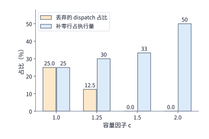

*图 10-29　Qwen3-235B-A22B（$E=128, k=8$，$8192$ 个 token，半数专家为 1.5 倍热门）在不同容量因子 $c$ 下的权衡曲线：增大 $c$ 可将 token 丢弃率（橙线）在 $c=1.5$ 处压至 0，但补零无效行占总执行量的比例（蓝线）也随之攀升至 33%～50%。*

图 10-29 清晰地标出了翻转边界：在半数专家 $1.5$ 倍过载的分布下，必须取 $c \ge 1.5$（或直接采用 Megatron-Core / DeepEP 中的动态变长分组矩阵乘 Grouped GEMM 免补零无丢弃方案）才能避免丢弃 token；路由均衡机制做得越好，分布越贴近均值，所需的容量因子 $c$ 就越接近 $1.0$。第 2.4 节推导的无丢弃专家容量公式（$\sum_e t_e = m k_{\mathrm{top}}$），对应的正是容量因子足够大（或采用无丢弃变长算子）、丢弃率为零的理想状态。[^capacity]

既然路由均衡如此重要，一个关键的系统与算法协同问题随之浮现：**为什么 MoE 模型在训练阶段采用的“无辅助损失动态路由偏置负载均衡”，不能原封不动地照搬到推理部署阶段，而推理阶段必须改用第 9.4.2 节介绍的“专家并行负载均衡（EPLB）”（`D14-03`）？**

我们回到 DeepSeek-V3 技术报告 §2.1.2 的数学定义就能看清两者的分野（见表 10-C 与第 10.6.4 节末尾图 10-52）。在传统 MoE 训练中，如果在损失函数里挂上权重过大的负载均衡辅助损失（auxiliary loss），强行惩罚热门专家的梯度会直接干扰主任务语言建模损失的优化方向，损害模型收敛质量。为此，DeepSeek-V3 提出了**无辅助损失负载均衡（Auxiliary-Loss-Free Load Balancing）**：为每个路由专家 $i \in \{1, \dots, N_r\}$ 引入一个仅参与 $\operatorname{Topk}$ 离散选择、却不参与门控加权乘法的**动态偏置项 $b_i$**。设第 $t$ 个 token 与第 $i$ 个路由专家质心 $\mathbf{e}_i$ 的原始亲和度打分为 $s_{i,t} = \operatorname{Sigmoid}(\mathbf{u}_t^{\top}\mathbf{e}_i)$，则门控选择与未归一化门控权重 $g'_{i,t}$ 定义为：

$$
g'_{i,t} = \begin{cases}
s_{i,t}, & \text{若 } s_{i,t} + b_i \in \operatorname{Topk}\bigl(\{s_{j,t} + b_j \mid 1 \le j \le N_r\},\, K_r\bigr), \\
0, & \text{其他情形}.
\end{cases}
$$

在每一个训练步结束时，系统监控全批次内各专家实际接收到的 token 负载：若专家 $i$ 过载（高于全专家均值），则将其偏置下调 $b_i \gets b_i - \gamma$；若专家 $i$ 欠载（低于均值），则将其偏置上调 $b_i \gets b_i + \gamma$（其中超参 $\gamma$ 为偏置更新速度）。同时，为了防范单条序列内部出现极端扎堆，DeepSeek-V3 还叠加了一项系数 $\alpha$ 极小的**互补序列级平衡损失（Complementary Sequence-Wise Balance Loss）** $\mathcal{L}_{\mathrm{Bal}} = \alpha \sum_{i=1}^{N_r} f_i P_i$。

审视上式可以发现训练期与推理期负载均衡的两条核心边界：
1. **训练期动态偏置会直接改写每个 token 选中的“逻辑专家集合”**：当 $b_i$ 随训练步动态增减时，$s_{i,t} + b_i$ 的排序发生变化，原本选中热门专家 $A$ 的 token 会被改判给次优专家 $B$。在训练过程中，由于后续的反向传播与参数更新会紧跟着调整专家 $B$ 的权重参数去适应新分派过来的 token，这种逻辑路由改道非但不会破坏模型，反而促使所有专家均匀学习特征；
2. **推理期模型参数已冻结，严禁擅自修改路由选择，只能由 EPLB 调整“物理副本放置”**：一旦训练结束进入推理部署，模型权重与定型的路由偏置 $b_i^*$ 已固化为确定性函数的一部分。如果在推理期为了迎合线上流量波动而继续动态修改 $b_i$，就会在权重不更新的前提下强行把 token 送进未经对应训练的陌生专家，直接篡改模型前向计算的数学等价性并导致生成质量退化。因此，**推理侧的 EPLB（第 9.4.2 节）必须保持逻辑上的 $\operatorname{Topk}(s_{j,t} + b_j^*)$ 路由结果百分之百不变**，转而在物理系统层将热门逻辑专家复制出多个物理权重副本（redundant experts）、并根据历史观测窗口周期性地重排专家副本在各张 GPU 与节点间的放置拓扑，从而在不改变任何一行输出 logits 的前提下削平跨卡负载倾斜。

**表 10-C　MoE 训练期动态偏置负载均衡与推理期专家并行负载均衡（EPLB）的双轨机制对比（D14-03）**

| 对比维度 | 训练期：无辅助损失动态偏置 + 序列级微弱平衡损失 | 推理期：专家并行负载均衡（EPLB） |
| --- | --- | --- |
| 介入的系统位置 | 门控路由器离散选择判据 $\operatorname{Topk}(s_{j,t} + b_j)$ 与损失函数 $\mathcal{L}_{\mathrm{Bal}}$ | 物理 GPU 显存中的冗余专家副本分配与 All-to-All 路由映射表 |
| 是否改变选中的逻辑专家 ID | **是**（通过升降 $b_i$ 迫使过载专家的边缘 token 改道流向欠载逻辑专家） | **否**（严格保持冻结模型的逻辑 $\operatorname{Topk}$ 选择与输出数值完全不变） |
| 乘入专家输出的门控权重 | 保持无偏的原始亲和度 $g'_{i,t} = s_{i,t}$（偏置 $b_i$ 不进入前向乘加值与反向梯度） | 保持训练收敛时的定型门控权重不变 |
| 权重参数如何适应负载调整 | 反向传播与优化器在后续训练步中持续更新各专家权重以适配新路由分布 | 权重只读不更新；对热门逻辑专家复制多份相同权重并均匀分流 token |
| 额外付出的系统资源代价 | 每专家仅维护 1 个标量 $b_i$（几乎零显存开销），每步末尾轻量统计计数 | 需额外占用 HBM 驻留冗余专家副本（如 EP144 中预留 32 个冗余专家槽位）及周期性跨网复制权重 |

*表 10-C　MoE 训练期动态偏置负载均衡与推理期专家并行负载均衡（EPLB）的双轨机制对比（D14-03）。*

除了前向与反向的专家负载不均，MoE 的**专家参数梯度归约**还必须见缝插针地嵌入繁忙的跨卡链路中。由于 MoE 的前向/反向全互换（All-to-All）通信已经切割了链路时间轴，留给专家梯度归约的往往只有几毫秒的碎片化空闲窗口。举一个具体的切桶算例：某专家的 FP32 梯度大小为 $72\ \mathrm{MiB}$，需要在共同持有该专家副本的 $4$ 个数据并行 rank 之间执行环形 `AllReduce`，每张卡需收发 $2 \times \frac{3}{4} \times 72 = 108\ \mathrm{MiB}$ 数据。在单卡 $200\ \mathrm{Gbit/s}$（单向 $25\ \mathrm{GB/s}$）网卡、单次集合通信启动开销 $0.02\ \mathrm{ms}$ 的条件下：
- **整桶一次性发送**：传输 $108\ \mathrm{MiB}$ 耗时约 $4.55\ \mathrm{ms}$，根本塞不进计算流水中一个仅有 **$2\ \mathrm{ms}$** 的链路空闲窗口，必然溢出并阻塞关键路径；
- **切分为 3 个 $24\ \mathrm{MiB}$ 子桶发送**：每个子桶需收发 $36\ \mathrm{MiB}$，单桶耗时降至约 **$1.53\ \mathrm{ms} < 2\ \mathrm{ms}$**，恰好可以分别填入三个独立的 $2\ \mathrm{ms}$ 空闲窗口内被计算完全掩盖——虽然多启动了两次集合通信使累计链路时间微增到了 $4.59\ \mathrm{ms}$，但暴露在关键路径上的等待时间却从溢出变成了 **$0$**（即便把网卡升级到 $400\ \mathrm{Gbit/s}$ 即 $50\ \mathrm{GB/s}$，整桶仍需 $2.28\ \mathrm{ms} > 2\ \mathrm{ms}$，依然必须切桶才能填入 $2\ \mathrm{ms}$ 空隙）。[^moe]

#### 2. 长上下文训练中的注意力平方律与序列长度倾斜

在长上下文训练中，即便我们用**序列打包（sequence packing / concatenating）**把多条短文档首尾拼接成固定的 $8192$ token 长度（并通过可见性掩码防止跨文档互相注意），彻底消除了无效的填充 token，**不同卡之间文档长度分布的差异依然会引发严重的计算量失衡**。

根源在于因果自注意力（causal self-attention）的二次方计算复杂度：对于一条包含 $s$ 个 token 的独立文档，第 1 个 token 只需注意自身 1 个位置，第 2 个 token 注意前 2 个位置……整条文档需要计算的因果注意力配对（query-key pairs）总数为三角形面积 $\frac{s(s+1)}{2}$。我们对比两个同样包含 $8192$ 个有效 token 的打包微批次（图 10-30 与图 10-31）：
- **卡 A（两条等长的 $4096$ token 文档，图 10-30）**：需要计算的因果注意力配对数为 $2 \times \frac{4096 \times 4097}{2} = \mathbf{16{,}781{,}312}$（约 $1680\text{ 万}$对）；
- **卡 B（一条 $7168$ token 长文档拼一条 $1024$ token 短文档，图 10-31）**：虽然总 token 数分毫不差仍是 $7168 + 1024 = 8192$，线性投影与 MLP 的计算量完全相同，但两个三角形的因果注意力配对总数却激增至 $\frac{7168 \times 7169}{2} + \frac{1024 \times 1025}{2} = \mathbf{26{,}218{,}496}$（约 $2620\text{ 万}$对），**注意力计算量凭空增加了约 $56\%$**。[^length]

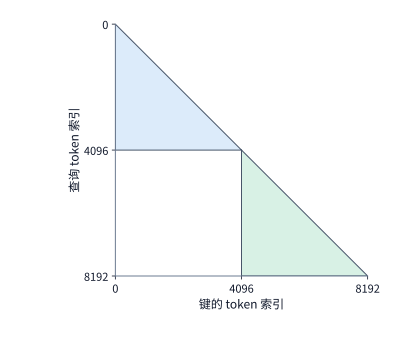

*图 10-30　两条等长 4096 token 独立文档打包为 8192 token 时的因果注意力有效配对区域（两个等腰直角三角形，跨文档区域被掩码屏蔽），总有效配对数为 16,781,312。*

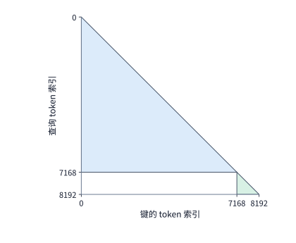

*图 10-31　同样 8192 个有效 token 改由一条 7168 长文档与一条 1024 短文档拼接时，长文档大三角形多出的面积远超短文档缩小的面积，总有效配对数激增 56% 至 26,218,496。*

图 10-31 中大三角形膨胀出来的面积，代表的是长文档内部实打实的远距离语义依赖，绝不能靠删除填充消除。如果卡 A 和卡 B 处于同一个数据并行组内，卡 A 算完 $1680\text{ 万}$对注意力后就只能停下来空等卡 B 算完那 $2620\text{ 万}$对。为了消除这种由平方律引发的跨卡木桶效应，现代长上下文训练系统通常组合使用三项技术：第一，用**序列打包（packing）**消除填充浪费；第二，在数据加载器中按**批次内各卡三角形总面积 $\sum s_i^2$ 均衡**的原则对文档做排序分组（length-aware bucketing）；第三，对单条超长文档启用**上下文并行（Context Parallelism，CP，如 Ring Attention 或 ZigZag Ring Attention）**，将同一条长序列首尾对称地切分到多张卡上，使每张卡承担的三角形加梯形面积完全相等。


## 10.4 数据输入、checkpoint 与故障恢复

第 10.3 节算出的 $78.4\ \mathrm{s}$（32 卡）与 $52.3\ \mathrm{s}$（48 卡）单步耗时，建立在两个理想假设之上：第一，每一步开始时训练序列都已经预先驻留在显存里；第二，连续几十天的训练过程中没有任何一张加速卡掉线或出现数值崩溃。一旦放到真实的数周生产运行中，**数据加载器（data loader）供料不及时**会直接导致数十张加速卡空闲等待，而**硬件故障与检查点（checkpoint）回滚**则会丢失自上次保存以来的全部训练进度。本节把在线数据供给、分布式检查点重分片、异步落盘提交以及 Young–Daly 最优保存周期与掉队者（straggler）模型逐一纳入总时间账本。

### 10.4.1 数据读取、打包预取与进度一致性

一条原始语料进入 GPU 参与矩阵乘之前，必须在主机侧走完一条多工序流水线：从磁盘或远端对象存储读取压缩分片 $\to$ 解压并解析文本 $\to$ 调用分词器（tokenizer）编码为 token ID $\to$ 执行质量过滤与去重 $\to$ 将多条文档首尾打包拼接成固定 $8192$ 长度的训练序列 $\to$ 写入主机侧的**锁页内存（pinned memory）**缓冲区 $\to$ 最终经 PCIe 异步 DMA 拷入 GPU 显存。

初学者很容易因为“最终传给 GPU 的 token ID 字节数极小”而低估数据预处理的压力。我们来算一笔对比账：本章 $25$ 天的净训练预算要求集群每秒平均消化约 $46{,}300\ \mathrm{token/s}$，折合每秒处理约 **$5.7$ 条**长度为 $8192$ 的序列。如果只看最后一步跨 PCIe 传输的字节量——即便每个 token ID 用占 8 字节的 `int64` 格式表示，每秒传入 GPU 的数据率也不过 $46{,}300 \times 8\ \text{bytes} \approx \mathbf{0.37\ \mathrm{MB/s}}$，对 $32\ \mathrm{GB/s}$ 的 PCIe 总线来说微乎其微。然而，**真正构成瓶颈的不是传输带宽，而是前道工序在 CPU 上的分词、正则清洗与动态打包吞吐**：假设每个 CPU 数据准备进程（worker）每秒只能完成 $2$ 条 $8192$ 序列的预处理，如果只配 2 个 CPU 进程（合计产出 $4\ \text{条/s} < 5.7\ \text{条/s}$），整座昂贵的 GPU 集群就会被这几个 CPU 进程拖入长期饥饿等待；至少要配置 3 个以上进程（产出 $\ge 6\ \text{条/s}$）才能勉强供上。

在本章的架构方案中，我们为数据加载器配置 **4 个 CPU 数据准备进程**，持续供给能力达到 **$8\ \text{条序列/s}$**。在 48 卡方案下，数据就绪时的单步执行耗时为 $52.3\ \mathrm{s}$，每步消费 $384$ 条序列，平均消费速率约为 $384 / 52.3 \approx \mathbf{7.3\ \text{条/s}} < 8\ \text{条/s}$。由于 CPU 供给速率高于 GPU 消费速率，即便偶发磁盘读取抖动导致预取队列中的缓存样本量短暂下降，后续也能迅速补满。计入预取队列未能完全平滑掉的残余波动（按每步平均等待 **$0.5\ \mathrm{s}$** 核算），32 卡与 48 卡方案的单步实际耗时分别更新为 **$78.9\ \mathrm{s}$** 与 **$52.8\ \mathrm{s}$**。[^design]

引入异步预取队列虽然掩盖了正常训练时的 I/O 波动，却给**检查点保存与恢复时的进度匹配**埋下了一个容易出错的隐患（图 10-32）。在异步预取架构下，“CPU 数据加载器已经派发出去的批次号（预取进度）”总是领先于“GPU 真正算完并更新了参数的批次号（训练进度）”：如图 10-32 所示，当 GPU 刚刚完成 **batch 100** 的参数更新并触发保存检查点时，CPU 数据加载器可能已经把 **batch 101 至 batch 108** 读出来放入了预取缓冲区或后台处理管道。如果检查点只简单记录了数据读取器的文件游标位置（此时已指在 108 之后），那么故障重启后系统直接从 **batch 109** 接着往下读，中间那 8 个已经预取却还没算过的批次（batch 101～108）就会被永久跳过漏训。因此，一个严格确定性的可恢复数据加载器，必须明确区分**预取游标**与**已消费游标**，确保恢复时精准回退到 **batch 101** 重新供给。

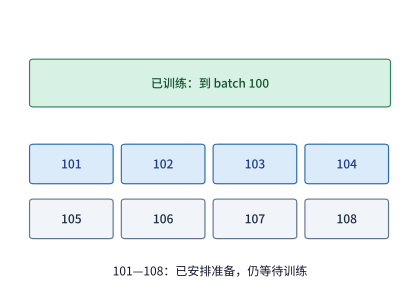

*图 10-32　数据加载器的预取游标与 GPU 训练进度的偏移。GPU 刚完成 batch 100，而数据加载器已将任务派发至 batch 108；中间的 batch 101～108 尚在预取队列或后台处理中（虚线框），故障恢复时必须从 batch 101 续接而非从 109 开始。*

图 10-32 的队列流量平衡定律同样适用于后端的**检查点写出管道**：只有当持久化存储系统的持续写入带宽高于检查点产生数据的平均速率时，后台异步写入才不会把内存暂存池撑爆。对于本章设计案例，每隔 $1800\ \mathrm{s}$（30 分钟）保存一次约 $115\ \mathrm{GB}$ 的检查点，折合长期平均写入流量仅为 $115\ \mathrm{GB} / 1800\ \mathrm{s} \approx \mathbf{64\ \mathrm{MB/s}}$，远低于并行文件系统的持续带宽上限；真正影响训练有效进度的，是每次保存时的前台停顿与突发上传耗时（见第 10.4.3 与 10.4.4 节）。[^supply]

### 10.4.2 可恢复状态组成与弹性重分片（Resharding）

假设训练刚刚走完第 100 步的参数更新，此时集群因故停机。要想在重启后做到“仿佛从未中断过一样”无缝续训，检查点里究竟必须保存哪些状态？

如果只是拿去跑前向推理，保存一份 BF16 模型权重就够了；但要继续执行混合精度 Adam 训练，光有权重远远不够——**哪怕两台机器上的模型权重分毫不差，只要优化器里的动量历史（$m, v$）不同、学习率退火步数不同、随机数生成器状态不同，或者数据打包器里攒了一半的残留 token 不同，下一步算出来的参数更新就会立刻分道扬镳**。因此，一份完整的训练检查点必须同时捕获同一迭代边界上的全部状态：
1. **模型与优化器数值状态**：在迭代步刚刚结束、下一步反向尚未开始的时刻，上一轮的临时梯度已经使命终结无需保存；此时需要落盘的是 **BF16 工作权重（2 B/参数，也可在恢复时由主权重直接下转生成）、FP32 主权重（4 B/参数）以及 Adam 的 FP32 一阶矩与二阶矩（共 8 B/参数）**，合计每参数 **$14\ \text{bytes}$**。对于 Qwen3-8B（$8.19\mathrm{B}$ 参数），这部分核心数值快照体积约为 **$115\ \mathrm{GB}$**。
2. **训练控制与确定性数据状态**：包括全局迭代步数、学习率调度器状态、各卡随机数种子状态，以及数据加载器的精确消费位置与**序列打包器内部尚未凑够 $8192$ 长度的剩余 token 缓冲**。举一个直观例子：假设停机瞬间，序列打包器内部还留有上一篇文档末尾的 $2000$ 个 token，原本应该与下一篇文档的前 $6192$ 个 token 拼成下一条 $8192$ 训练序列；如果检查点弄丢了这 $2000$ 个残留 token，重启后打包器就不得不从后续文档里多抓 $2000$ 个 token 来凑数，不仅凭空吞掉了语料，还彻底改写了后续所有序列的前缀上下文、注意力掩码与预测标签。[^resume]

在实际运维中，我们经常还会遇到另一个棘手需求：**故障前作业跑在 4 路张量并行（TP4）或 32 卡 ZeRO-3 上，故障后因为有机器损坏或扩容，需要将同一份检查点恢复到 8 路张量并行（TP8）或 48 卡 ZeRO-3 上**。这就要求检查点格式支持**跨并行拓扑的弹性重分片（resharding）**。

**例 10.6　如何将一份按 4 路张量并行保存的门控投影层检查点，无损恢复到 8 路张量并行配置中？** 考察 Qwen3-8B 中形状为 $[12288, 4096]$ 的门控投影权重矩阵（BF16 总体积为 $96\ \mathrm{MiB}$）：
- **保存时的旧布局（TP4 按行四等分）**：矩阵沿输出行维度切分为 4 个旧分片，每个分片包含 $3072$ 行，占 $24\ \mathrm{MiB}$；
- **恢复时的新布局（TP8 按行八等分，图 10-33）**：目标集群有 8 个 TP rank（$r = 0, 1, \dots, 7$），每个新分片只需负责 $1536$ 行（占 $12\ \mathrm{MiB}$）。借助原矩阵的**全局行坐标映射**，目标编号为 $r$ 的 GPU 只需定位到编号为 $\lfloor r/2 \rfloor$ 的旧分片文件：当 $r$ 为偶数时读取该旧分片的前半段（前 $1536$ 行），当 $r$ 为奇数时读取后半段（后 $1536$ 行）。

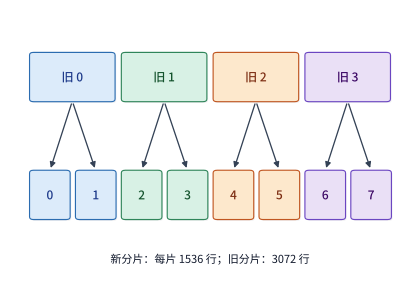

*图 10-33　检查点的跨拓扑弹性重分片（TP4 $\to$ TP8）。横轴对应原始 $[12288, 4096]$ 矩阵的全局行号（总计 96 MiB BF16 权重）：上方“旧 0～旧 3”为保存时的 4 个 24 MiB 分片，恢复时每个旧分片按全局行范围一分为二，精准映射到下方“0～7”共 8 个 12 MiB 新分片中。*

不仅 BF16 权重（$96\ \mathrm{MiB}$）沿着图 10-33 的箭头按全局行号切分，与之对应的 FP32 主权重（$192\ \mathrm{MiB}$）、Adam 一阶矩（$192\ \mathrm{MiB}$）和二阶矩（$192\ \mathrm{MiB}$）也严格遵循完全相同的全局行区间切片重组（该层矩阵在检查点中的四项状态合计为 $96 \times (1 + 2 + 2 + 2) = 672\ \mathrm{MiB}$）。诸如 **ByteCheckpoint**（NSDI 2025）与 **PyTorch Distributed Checkpoint (DCP)** 等现代检查点框架，正是通过将物理存储文件与逻辑张量的**全局形状、全局偏移量及切片长度（`global shape / offset / length`）**绑定，把底层的分片文件彻底解耦为与并行度数无关的全局张量视图，使训练作业能够在任意卡数与 3D/4D 并行拓扑之间自由热迁移。值得警惕的是，在大规模弹性扩缩容实测中，当张量重分片被高度并行化之后，**CPU 侧非张量状态（如数据加载器 Dataloader 与随机数缓冲）的串行重整往往会反过来成为木桶的最短板**：在 ByteCheckpoint 将训练规模从 $2{,}400$ 张 GPU 弹性重分片扩展至 $4{,}800$ 张 GPU 的生产基准测试中，仅加载重分片 **GPU 状态（模型权重与优化器状态）耗时仅需 $62.10\ \mathrm{s}$**（比 Megatron-LM 的 $218.59\ \mathrm{s}$ 快了 $3.52\times$）；然而一旦纳入 Dataloader 等主机端完整状态（Full States），端到端加载耗时便激增至 **$401.21\ \mathrm{s}$**（Megatron-LM 更达 $587.93\ \mathrm{s}$），其中高达 $401.21 - 62.10 = \mathbf{339.11\ \mathrm{s}}$（占总耗时的 $84.5\%$）消耗在 CPU 侧数据状态的重构与反序列化上。因此，万卡级弹性检查点不仅要对 GPU 张量实施基于全局偏移的零冗余并行切片读取，还必须将 Dataloader 状态改造为轻量级流式分片游标（Streaming Shard Cursors），消除主机侧的串行长尾。[^checkpoint][^bytecheckpoint-checkmate]

### 10.4.3 同步保存、异步两阶段提交与存储带宽对回滚量的决定作用

明确了检查点要存什么，接下来看**怎么存才不耽误 GPU 训练**。最朴素的**同步保存（synchronous checkpointing）**在触发保存时直接冻结所有 GPU 的训练循环，等上百 GB 的数据完整写完远端并行文件系统并落盘确认后，才允许 GPU 进入下一步迭代。为了消除这段漫长的磁盘 I/O 停顿，工业界普遍采用如图 10-34 所示的**异步两阶段保存（asynchronous checkpointing）**：
1. **第一阶段（前台快照捕获，短暂暂停训练）**：在迭代步结束瞬间，GPU 仅花费极短的时间（通常不到 1 秒）将显存中的一致训练状态经高速总线复制到独立的主机内存缓冲区（或本地内存镜像）中，随即立刻放行 GPU 继续下一步训练；
2. **第二阶段（后台持久化写入与原子提交）**：由后台 I/O 线程将主机内存缓冲区中的快照异步上传至远端持久化存储池；**注意，只有当全部数据分片写入完毕、且全局元数据完成原子提交（commit）之后，这份检查点才真正成为一份合法的可用恢复点**。

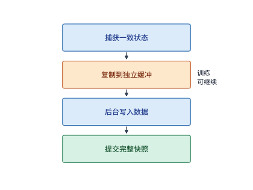

*图 10-34　异步检查点两阶段生命周期：前台短暂暂停训练，将一致状态复制到独立内存缓冲后立即恢复 GPU 训练；后台线程将数据写完持久化存储并提交全局元数据后，该快照才正式生效可供故障恢复使用。*

在异步保存下，既然前台 GPU 只需暂停半秒钟就能继续训练，是不是存储系统的写入带宽快一点、慢一点就无所谓了？这是一个容易混淆的误区：存储写入带宽首先决定了检查点的最小间隔下限（不能上一份还没写完、下一份又覆盖进来），更在无形中决定了**当故障突然降临时，最近那份快照究竟写完提交了没有——即集群不得不倒退重算多少秒的工作**（例 10.7）。

**例 10.7　异步检查点的后台上传带宽，如何决定故障发生时的有效恢复点与重算损失？** 设每次捕获的检查点体积为 $112\ \mathrm{GB}$。参照 NVIDIA DGX SuperPOD 官方参考架构对 NLP 训练存储的分级指标：基础档（Good）为一个 32 节点扩展单元（SU）提供合计 **$7\ \mathrm{GB/s}$** 的持续写入带宽，而高配档（Better）则提供合计 **$20\ \mathrm{GB/s}$** 的持续写入带宽。
- 首先看**稳态队列不积压条件**：在 $7\ \mathrm{GB/s}$ 带宽下，后台写完一份 $112\ \mathrm{GB}$ 快照需要 $112 / 7 = 16\ \mathrm{s}$。如果系统每 $10\ \mathrm{s}$ 就触发一次保存，平均数据产生速率高达 $11.2\ \mathrm{GB/s} > 7\ \mathrm{GB/s}$，后台未写完的快照就会无限积压直至撑爆内存缓冲；将保存间隔放宽到每 **$20\ \mathrm{s}$** 一次（平均产生速率降至 $5.6\ \mathrm{GB/s} < 7\ \mathrm{GB/s}$），存储系统才能赶在下一份快照产生前写完上一份。
- 接着对比**第 $50\ \mathrm{s}$ 突发故障时的回滚损失（图 10-35 与图 10-36）**：设系统分别在第 $20\ \mathrm{s}$ 和第 $40\ \mathrm{s}$ 触发两次异步保存，每次前台花费 $0.5\ \mathrm{s}$ 复制到主机内存缓冲后即恢复训练，而在**第 $50\ \mathrm{s}$** 时集群突然遭遇硬件故障中断：
  1. **在 $7\ \mathrm{GB/s}$ 慢速存储下（图 10-35）**：后台上传一份需 $16\ \mathrm{s}$，因此第 $20\ \mathrm{s}$ 捕获的第一份快照在 $20 + 0.5 + 16 = 36.5\ \mathrm{s}$ 提交生效；而第 $40\ \mathrm{s}$ 捕获的第二份快照原定要到 $40 + 0.5 + 16 = 56.5\ \mathrm{s}$ 才能写完。当第 $50\ \mathrm{s}$ 故障降临时，第二份快照只写了大半截、尚未完成元数据提交，属于无效残片，恢复程序只能被迫回退到**第 $20\ \mathrm{s}$** 的第一份快照，重复计算 **$30\ \mathrm{s}$** 的训练工作。
  2. **在 $20\ \mathrm{GB/s}$ 高速存储下（图 10-36）**：后台上传一份仅需 $112 / 20 = 5.6\ \mathrm{s}$，两份快照分别在 $26.1\ \mathrm{s}$ 和 **$46.1\ \mathrm{s}$** 顺利写完提交。同样在第 $50\ \mathrm{s}$ 发生故障，此时第 $40\ \mathrm{s}$ 的第二份快照已经在 $3.9\ \mathrm{s}$ 前稳稳落盘生效，集群可以直接恢复到**第 $40\ \mathrm{s}$** 的状态，仅需重算 **$10\ \mathrm{s}$**，比慢速存储少丢了整整 $20\ \mathrm{s}$ 的进度。

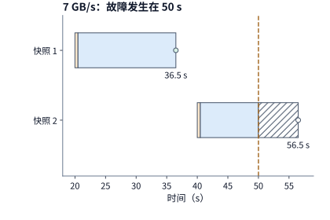

*图 10-35　7 GB/s 后台写入带宽下的故障回滚：第 20 s 与 40 s 各花 0.5 s 复制到内存缓冲（橙色），随后后台上传 16 s（蓝色）。第 50 s 发生故障时，第 40 s 的快照尚未写完提交（斜线为空心点 56.5 s 前未完成部分），只能回退至第 20 s 快照，重做 30 s 训练。*

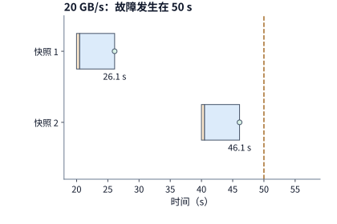

*图 10-36　20 GB/s 后台写入带宽下的故障回滚：每份快照后台上传仅需 5.6 s，两份快照分别于 26.1 s 与 46.1 s 提交生效；第 50 s 故障时可直接恢复至第 40 s 快照，仅需重做 10 s 训练。*

图 10-35 与图 10-36 揭示了一个深刻的工程原理：尽管两种存储带宽下前台暂停训练的时间一模一样（都是两次 $0.5\ \mathrm{s}$ 共 $1\ \mathrm{s}$），但**后台持久化写入带宽直接决定了快照从“内存捕获”到“正式提交可用”之间的脆弱窗口长度**。在一项受控的进程崩溃实验中，异步保存 API 调用仅花约 $7\ \mathrm{ms}$ 就向训练主循环返回了成功，但底层的恢复元数据直到约 $48\ \mathrm{ms}$ 时才真正落盘提交；凡是在 $7\ \mathrm{ms}$ 到 $48\ \mathrm{ms}$ 之间被强行终止的进程，重启后无一例外只能回退到更早的上一份完整检查点。因此，完备的检查点系统必须采用“先写全量数据分片、最后原子写入提交标记（commit marker）”的两阶段协议。[^fault]

在工业界最新演进中，为了同时压低前台暂存停顿与后台持久化耗时，检查点子系统正沿着两条技术路线深度演进：
1. **双句柄异步契约（PyTorch `2.14` DCP）与进程级页锁定暂存（ByteCheckpoint）**：PyTorch `2.14`（提交 `91575059`）在 `dcp.async_save` 返回的 `AsyncSaveResponse` 对象中，将异步保存的生命周期显式拆解为两个独立的同步句柄——`staging_completion`（表示 GPU 显存到主机内存缓冲区的复制已完成，训练主循环自此可安全覆写下一步权重）与 `upload_completion`（表示后台存储写入与全局元数据提交已完成，快照正式具备容灾恢复效力）。配合 `DefaultStager(StagerConfig(use_pinned_memory=True, use_shared_memory=True))` 启动的独立进程级页锁定内存暂存器，以及复用跨步元数据规约结果的通信计划缓存（`cache_staged_state_dict`），在 **$1{,}856$ 张 H200 GPU** 训练 Llama3-70B 的实测中，单次检查点的后台完整落盘时间从原先的 **$436\ \mathrm{s}$ 骤降至 $67\ \mathrm{s}$**（提速 **$6.51\times$**）；而在 ByteCheckpoint 的生产部署中，$8{,}960$ 张 GPU 训练 $405\mathrm{B}$ 大模型的前台平均保存停顿更是从同步模式的 **$51.06\ \mathrm{s}$ 压降至 $0.59\ \mathrm{s}$**（削减 $98.8\%$）。
2. **无盘内存与对等网络恢复（Checkmate，NSDI 2026）**：当集群规模迈向万卡乃至十万卡时，哪怕后台异步上传，数以 TB 计的并发快照流量也会瞬间打满远端并行文件系统（PFS）的聚合写带宽。针对生产集群中绝大多数故障仅波及单个或少数几个计算节点的统计规律，NSDI 2026 的 **Checkmate** 进一步提出了**无盘（Diskless）对等内存镜像与重计算协同恢复架构**：在正常训练步间，各节点不向远端磁盘刷写全量快照，而是利用闲置的跨节点 RDMA 带宽将本地分片的优化器与主权重状态镜像备份至拓扑相邻的健康对等节点主机内存（Peer Host DRAM），并对部分可逆中间状态利用张量级局部重计算替代落盘；一旦某台节点掉线，热备节点直接经高速 RDMA 网络从存活对等节点的内存镜像中并行拉取丢失分片，彻底绕开了远端磁盘文件系统的 I/O 往返，将单节点故障恢复耗时较传统 PFS 快照方案缩短了一个数量级以上。[^checkpoint][^bytecheckpoint-checkmate]

### 10.4.4 集群故障率、Young–Daly 最优保存周期与真实 RL 中断账本

既然检查点存得越勤，故障时丢失的工作就越少，为什么我们不干脆每分钟都存一次检查点？因为每次保存都会带来前台停顿与 I/O 干扰：保存间隔 $\tau$ 太短，平时花在保存检查点上的开销占比就会失控；保存间隔 $\tau$ 太长，一旦遭遇故障，平均要回滚重做的半个间隔工作量 $\tau/2$ 又会十分高昂。

这两股方向相反的代价，可以用容错计算领域的经典 **Young–Daly 一阶模型**精确求解。设每次保存检查点造成的有效训练停顿耗时为 $c$，两次保存之间实际完成的**有用训练时间**为 $\tau$，整个训练作业的故障发生率为 $\lambda$（即作业平均无故障运行时间 $\mathrm{MTBF}_{\mathrm{job}} = 1/\lambda$），每次故障后的环境重启与检查点加载恢复耗时为 $r$。在故障彼此独立且满足低频一阶近似的条件下，每完成 1 秒有用训练需要额外付出的**容错附加成本比例 $L(\tau)$** 由三项相加构成：

$$
L(\tau)=\frac{c}{\tau}+\lambda\frac{\tau}{2}+\lambda r.
$$

式中的物理意义十分清晰：第一项 $\frac{c}{\tau}$ 是每隔 $\tau$ 秒有用训练就固定付出 $c$ 秒保存代价的日常摊销；第二项 $\lambda\frac{\tau}{2}$ 源于故障发生时刻均匀落在两次保存之间、平均每次故障会丢掉半个周期的进度 $\frac{\tau}{2}$；第三项 $\lambda r$ 则是每次故障重启恢复所需的固定停机耗时。对 $\tau$ 求导并令导数为零，前两项一减一增恰好在如下**最优保存间隔 $\tau^*$** 处达到完美平衡：

$$
-\frac{c}{\tau^2}+\frac{\lambda}{2}=0
\qquad\Longrightarrow\qquad \tau^*=\sqrt{\frac{2c}{\lambda}}.
$$

**例 10.8　在千卡集群上，硬件故障率如何决定检查点的最优保存周期？** Meta 基础设施团队对其大模型研究集群的真实运行日志做了系统统计：一个 **1024 张卡**规模的同步训练作业，平均每隔 **$7.9\ \text{小时}$（即 $1/\lambda = 28{,}440\ \mathrm{s}$）**就会遭遇一次意外中断，而 **8 张卡**规模作业的平均无故障时间则长达 **$47.7$ 天**；由于同步训练中任何一张卡掉线都会中断整个作业，作业级故障率 $\lambda$ 与加速卡数成正比——折算到单张加速卡，相当于单卡平均无故障时间（MTBF）约为 **$337$ 天**。我们将本章 Qwen3-8B 的检查点参数代入上式：每份检查点约 $115\ \mathrm{GB}$，按 $7\ \mathrm{GB/s}$ 写入耗时 $c \approx 16.4\ \mathrm{s}$，每次故障重启恢复耗时 $r = 120\ \mathrm{s}$。在 1024 卡故障率下，由公式直接算出最优保存间隔为：

$$
\tau^* = \sqrt{2 \times 16.4 \times 28{,}440} \approx 965\ \mathrm{s}\text{（约 } 16\ \text{分钟）}.
$$

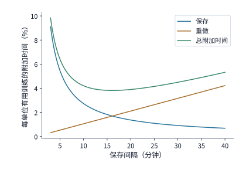

*图 10-37　1024 卡作业（平均 7.9 小时中断一次，单次保存耗时 16.4 s，恢复耗时 120 s）中容错附加成本随保存间隔 $\tau$ 的变化曲线：蓝线为日常保存开销 $c/\tau$，橙线为故障丢失重做开销 $\lambda\tau/2$，绿线为计入固定恢复开销 $\lambda r$ 后的总附加比例，最低点出现在约 965 s（16 分钟）处。*

从图 10-37 的绿色总成本曲线可以看到，最优值 $\tau^* \approx 965\ \mathrm{s}$ 附近的谷底相当平缓，工程配置时完全可以取整选择 $15\text{ 分钟}$（$900\ \mathrm{s}$）这类方便整点排班的间隔。下表对比了 $5\text{ 分钟}$（$300\ \mathrm{s}$）、$15\text{ 分钟}$（$900\ \mathrm{s}$）与 $30\text{ 分钟}$（$1800\ \mathrm{s}$）三档间隔下的各分项成本构成（合计列由未四舍五入原值算出）：

| 有用训练间隔 $\tau$ | 保存成本 $c/\tau$ | 重做成本 $\lambda\tau/2$ | 恢复成本 $\lambda r$ | 容错总附加比例 $L(\tau)$ |
|---|---:|---:|---:|---:|
| 300 s（5 分钟） | 5.5% | 0.5% | 0.4% | 6.4% |
| 900 s（15 分钟） | 1.8% | 1.6% | 0.4% | 3.8% |
| 1800 s（30 分钟） | 0.9% | 3.2% | 0.4% | 4.5% |

*表 10-8　1024 卡训练作业在三档检查点保存间隔 $\tau$ 下的日常保存成本、故障重做成本与恢复成本分解。*

观察上表与公式 $\tau^* = \sqrt{2c/\lambda}$，可以得出两条非常实用的缩放法则：
- **集群卡数翻倍（故障率 $\lambda$ 翻倍）**：最优保存间隔必须缩短为原来的 **$1/\sqrt{2} \approx 0.71$ 倍**；
- **存储写入速度翻倍（单次保存耗时 $c$ 减半）**：由于存一次的代价变便宜了，最优保存间隔同样应该缩短为原来的 **$1/\sqrt{2}$**，通过存得更勤来进一步压低故障回滚损失。[^interval]

现在回到本章对比的 **32 卡**与 **48 卡 RTX 4090** 方案：由于卡数远少于 1024 张，按单卡 MTBF 约 $337$ 天折算，32 卡与 48 卡作业的平均无故障运行时间分别长达约 $10.5$ 天与 $7.0$ 天。沿用 $c \approx 16.4\ \mathrm{s}$、$r = 120\ \mathrm{s}$ 并统一取保存间隔 $\tau = 1800\ \mathrm{s}$（30 分钟），代入 $L(\tau)$ 可得：**32 卡方案的保存、重做与恢复合计仅增加约 $1.02\%$ 的训练时间，48 卡方案也仅增加约 $1.08\%$**。虽然 48 卡因为多了 16 张卡而使故障率略高，但这仅 $0.06$ 个百分点的容错附加代价，相比它把单步计算时间从 $78.3\ \mathrm{s}$ 砍到 $52.2\ \mathrm{s}$ 带来的巨大收益完全微不足道。至此，显存容量、单步执行耗时与长期容错附加率三块拼图已全部就位，我们将在第 10.6 节做最终的总工期裁定。

> **算例 10-3（千卡 Young–Daly 最优保存间隔 $\tau^*$、异步提交脆弱窗口与 32/48 卡容错附加率）**
> 1. **1024 卡作业的 Young–Daly 最优间隔**：给定 1024 卡作业平均无故障时间 $1/\lambda = 7.9\ \mathrm{h} = 28{,}440\ \mathrm{s}$（折合单卡 $\mathrm{MTBF} \approx 337\ \text{天}$），Qwen3-8B 检查点体积 $115\ \mathrm{GB}$ 在 $7\ \mathrm{GB/s}$ 存储下保存耗时 $c \approx 16.38\ \mathrm{s}$，重启恢复耗时 $r = 120\ \mathrm{s}$。一阶最优保存间隔为 $\tau^* = \sqrt{2 \times 16.38 \times 28{,}440} \approx \mathbf{965\ \mathrm{s}}$（约 $16$ 分钟）；取 $\tau = 900\ \mathrm{s}$ 时，$L(900) = 16.38/900 + 900/(2\times 28440) + 120/28440 \approx 1.82\% + 1.58\% + 0.42\% = \mathbf{3.82\%}$。
> 2. **异步上传带宽对故障回滚损失的决定作用**：当第 $20\ \mathrm{s}$ 与第 $40\ \mathrm{s}$ 各花 $0.5\ \mathrm{s}$ 完成前台内存暂存、第 $50\ \mathrm{s}$ 发生硬件故障时，$7\ \mathrm{GB/s}$ 存储上传 $112\ \mathrm{GB}$ 需 $16\ \mathrm{s}$（第 $40\ \mathrm{s}$ 快照要到 $56.5\ \mathrm{s}$ 才提交），故只能回退至第 $20\ \mathrm{s}$ 快照并重做 $\mathbf{30\ \mathrm{s}}$；而 $20\ \mathrm{GB/s}$ 存储仅需 $5.6\ \mathrm{s}$（于 $46.1\ \mathrm{s}$ 已完成提交），可直接恢复至第 $40\ \mathrm{s}$ 快照、仅重做 $\mathbf{10\ \mathrm{s}}$。
> 3. **32 卡与 48 卡方案在 $\tau = 1800\ \mathrm{s}$ 下的容错附加率**：32 卡（$1/\lambda \approx 909{,}900\ \mathrm{s}$）附加比例为 $L_{32} \approx \mathbf{1.02\%}$；48 卡（$1/\lambda \approx 606{,}600\ \mathrm{s}$）附加比例为 $L_{48} \approx \mathbf{1.08\%}$。

在此之前，让我们透过一份真实的工业界前沿大模型公开训练账单，直观感受一下**在大规模后训练中，一次故障中断与回滚究竟会损耗多少算力成本**（例 10.9）。

**例 10.9　前沿大模型强化学习（RL）运行中的真实中断分类与经济账本。** 小米大模型团队在训练 **MiMo-V2.6** 时，在业界首次全程公开直播了其大规模强化学习（RL）后训练的实时运行看板：其中 **Pro** 与 **Flash** 两个尺寸模型的 RL 后训练总计分别消耗了约 **$260\text{ 万美元}$**与 **$90\text{ 万美元}$**算力成本，折合集群每运行一小时分别消耗约 **$2.06\text{ 万美元}$**与 **$1.03\text{ 万美元}$**。

图 10-38 依据公开运行日志完整还原了这两次 RL 运行的中断与回滚时间线：在 **Pro** 模型的运行周期内，作业共经历了 **14 次重启**，红色标出的故障中断与重做区间累计长达约 **$30.1\ \text{小时}$**（占总运行时间的 **$23.6\%$**），直接损失了约 **$61.9\text{ 万美元}$**（例如第 5 次、第 6 次与第 8 次重启前，分别距上一步完成已过去了 $2.76\ \mathrm{h}$、$2.63\ \mathrm{h}$ 与 $2.95\ \mathrm{h}$，单次中断分别损失了约 $5.67\text{ 万}$、$5.41\text{ 万}$与 $6.07\text{ 万美元}$）。剖析工程日志可以发现，引发这十余次中断的罪魁祸首集中在三类典型基础设施问题上：
1. **硬件底层故障**：如 GPU 显存发生不可纠正的双比特错误（ECC uncorrectable error）；
2. **分布式服务与网络异常**：如容器进程意外退出、奖励评分服务（reward server）心跳失联或网络抖动；
3. **动态内存峰值溢出（OOM）**：如 RL 长序列生成阶段 KV 缓存耗尽、训练阶段 MoE 专家负载倾斜超出加速卡显存上限，或主机侧序列打包耗尽系统内存。
尤为惨痛的是图 10-38 下半部分 **Flash** 运行中的斜线区间：当时发生了一起隐蔽的基础设施数值污染错误，但监控系统未能及时报警拦截，集群带着错误状态继续往前跑完了第 16 步和第 17 步，直到第 17 步结束后才被发现并被迫回滚到第 15 步重训，导致已经跑完的约 **$4\ \text{小时}$**算力彻底作废。[^rl-interrupt]

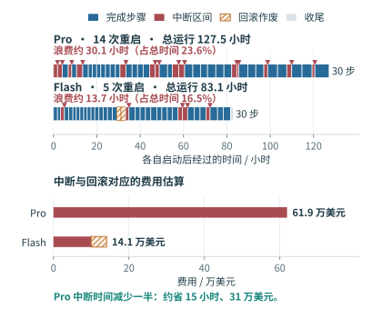

*图 10-38　MiMo-V2.6（Pro 与 Flash）公开 RL 运行日志的中断时间线与费用核算。蓝色为有效推进步骤区间，红色为故障中断丢失区间，三角号标示作业重启，斜线区间为 Flash 因未及时检出底层错误而在第 17 步后回滚作废的两步（约 4 小时）。*

图 10-38 给每一位 AI 基础设施工程师上了生动的一课：在每小时成本超过两万美元的集群上，**只要能通过消除内存溢出隐患（如 MiMo 团队随后通过调整并行策略压低激活显存以容纳 MoE 专家峰值）和加快异常检测与检查点恢复，把 Pro 的中断损失时间缩减一半（省下约 15 小时），单次训练任务就能直接省下约 $31\text{ 万美元}$**。

### 10.4.5 掉队者（Straggler）、慢节点处置与损失尖峰回滚修正

上一小节讨论的是直接令作业停摆的硬故障；而在日常生产中，还有一类更隐蔽、发生频率高得多的软退化：**某张加速卡并没有崩溃掉线，但由于核心过热降频、PCIe 链路重传或宿主机后台进程干扰，它在每一步迭代中都比别的卡算得慢一拍**。

在同步数据并行中，每一步的集合通信屏障都必须等待全集群**最慢的那张卡**（即**掉队者，straggler**）算完才能通过，因此整步的实际计算耗时取决于全部 $N$ 张卡耗时的**最大值（order statistics maximum）**而非平均值。设在正常波动下，单张卡完成一步计算的时间独立同分布于均值为 $\mu$、标准差为 $\sigma$ 的正态分布。根据极值统计理论，$N$ 个独立标准正态随机变量最大值的数学期望 $\mathbb{E}[\max] - \mu$ 会随卡数 $N$ 的增加而单调抬升：在 $N=8$ 卡时约为 $1.42\sigma$，在 $N=48$ 卡时升至 $2.23\sigma$，而在 $N=1024$ 卡时则高达 **$3.25\sigma$**。

我们将本章 48 卡方案的基准参数（单卡计算均值 $\mu = 52.2\ \mathrm{s}$，外加每步固定的 $0.58\ \mathrm{s}$ 暴露通信与输入等待，无波动时单步耗时 $52.8\ \mathrm{s}$）代入，分别考察单卡耗时波动标准差为均值的 $\sigma = 2\%$（$1.04\ \mathrm{s}$）与 $\sigma = 5\%$（$2.61\ \mathrm{s}$）时，不同集群规模下的期望单步耗时：[^straggler]

| 卡数 $N$ | $\mathbb{E}[\max]-\mu$（倍 $\sigma$） | 每步期望耗时（$\sigma=2\%$）/ s | 每步期望耗时（$\sigma=5\%$）/ s |
|---|---:|---:|---:|
| 8 | 1.42 | 54.3 | 56.5 |
| 48 | 2.23 | 55.1 | 58.6 |
| 1024 | 3.25 | 56.2 | 61.3 |

*表 10-9　同步数据并行中卡数 $N$ 与单卡耗时正态波动标准差 $\sigma$ 对每步期望耗时（掉队者效应）的放大规律。*

结果令人警醒：即便没有任何一张卡发生永久故障，仅仅是每张卡出现 $\sigma = 5\%$ 的随机性能抖动，48 卡集群的期望单步耗时就会从 $52.8\ \mathrm{s}$ 被推高到 **$58.6\ \mathrm{s}$**——凭空多出的 **$5.8\ \mathrm{s}$** 同步等待，一下子就吃掉了我们在第 10.6 节算出的全步总安全余量（约 $14.4\ \mathrm{s}$）的**四成以上**；到了 1024 卡规模，随机抖动带来的尾延迟更是高达 $8.5\ \mathrm{s}$。在工程监控中，我们可以通过测量每张卡进入 `AllReduce` / `ReduceScatter` 通信屏障时的等待时长（即步结束时刻减去本卡计算结束时刻）来定位掉队者：对于一张计算耗时恰为均值 $\mu$ 的正常卡，它在通信屏障前的平均空等时间正好就是 $\mathbb{E}[\max] - \mu$。

一旦监控系统识别出某张慢到 $\mu + 3\sigma$ 的掉队卡，调度器面前通常有三种处置策略，我们可以通过定量比较看清各自的适用边界：
1. **原地等待（Wait）**：容忍该卡慢一拍，本步按慢卡耗时结束。注意，一张慢到 $\mu + 3\sigma$ 的卡实际让整个集群“额外多等”的时间，取决于其余 $N-1$ 张正常卡原本的最大值有多大：在 $\sigma=2\%$ 下，8 卡集群仅因此多等约 $1.65\sigma$（$1.72\ \mathrm{s}$），48 卡集群仅多等约 $0.78\sigma$（$0.81\ \mathrm{s}$），而在 1024 卡集群中，其余 1023 张卡的自然极值本来就已经超过了 $\mu+3\sigma$，单张 $3\sigma$ 慢卡带来的额外等待甚至为 **$0$**。
2. **动态重分配负载（Redistribute）**：把这张慢卡淘汰出局，将它承担的微批次均匀摊派给其余 $N-1$ 张正常卡，使每张正常卡的计算均值膨胀为 $\mu \frac{N}{N-1}$。仍取 $\sigma=2\%$（暂不计迁移开销）：将 1 张卡的工作量分摊给其余卡后，48 卡集群的单步期望耗时反而升至约 **$56.2\ \mathrm{s}$**，8 卡集群更是激增至 **$61.6\ \mathrm{s}$**，双双慢于原地等待的 $55.1\ \mathrm{s}$ 与 $54.3\ \mathrm{s}$。原因很简单：让每张正常卡多承担 $\frac{1}{N-1}$ 的计算量是实打实的均值抬升，在中小规模集群或轻度抖动下，这份均值增量比等一下 $3\sigma$ 慢卡还要贵得多。
3. **驱逐慢卡并从检查点重启（Evict & Restart）**：将确认发生持续硬件降级的慢节点隔离出集群，换上热备节点并从最近一份检查点恢复训练。哪怕按比本章基准更密集的 $\tau = 600\ \mathrm{s}$ 保存间隔与 $r = 120\ \mathrm{s}$ 恢复耗时计算，驱逐重启一次也要付出 $\tau/2 + r = \mathbf{420\ \mathrm{s}}$（约合 48 卡方案的 **8 个训练步**）的沉重代价。因此，面对偶发的几秒钟抖动，原地等待永远是最优解；**只有当某张卡被确认为持续性的病态慢节点（如 MegaScale 在万卡集群中观测到约有 $0.5\%$ 的机器会出现持续性明显变慢），且累计每步拖慢的时间即将超过 $420\ \mathrm{s}$ 重启门槛时，才应该果断执行驱逐换卡**。[^straggler]

最后，我们还可以把第 10.1.2 节讨论的**损失尖峰（loss spike）回滚**无缝并入 Young–Daly 检查点模型中。虽然损失尖峰是数值发散而非硬件损坏，但它的工程处置动作与硬件崩溃如出一辙——都必须作废当前状态、回退到上一份健康检查点并更换数据批次或超参重训。将全集群每隔平均 $1/\lambda_{\mathrm{spike}}$ 时间发生一次的损失尖峰回滚叠加到硬件故障率 $\lambda_{\mathrm{hw}}$ 上，单位有用训练时间的总附加成本与最优保存间隔修正为：

$$
L(\tau)=\frac{c}{\tau}+(\lambda_{\mathrm{hw}}+\lambda_{\mathrm{spike}})\left(\frac{\tau}{2}+r\right),
\qquad \tau^*=\sqrt{\frac{2c}{\lambda_{\mathrm{hw}}+\lambda_{\mathrm{spike}}}}.
$$

以本章 48 卡方案为例：若除了每卡 $337$ 天的硬件故障外，训练过程中平均每 $7$ 天还会遭遇一次需要回滚检查点的损失尖峰（$\lambda_{\mathrm{spike}} = 1/(7\ \text{天})$），则在 $\tau = 600\ \mathrm{s}$ 下容错附加比例仅从 $2.80\%$ 微升至 $2.87\%$（最优间隔从 $4458\ \mathrm{s}$ 缩至 $3150\ \mathrm{s}$）；在本章选定的 $\tau = 1800\ \mathrm{s}$ 间隔下，附加比例仅从 **$1.08\%$ 变为约 $1.25\%$**（30 天总工期仅增加约 $0.03$ 天），完全不改变第 10.6 节的方案选型结论。翻转边界取决于两类故障率的量级对比：当采用激进的低精度格式导致数值尖峰频繁爆发（$\lambda_{\mathrm{spike}} \gg \lambda_{\mathrm{hw}}$）时，检查点保存周期将反过来由数值稳定性主导。[^straggler]

当集群规模进一步迈入**万卡（`10,000+` GPU）超算量级**（如 Meta 训练 Llama 3 的 `16,384` 卡 H100 集群与字节跳动 MegaScale 集群）时，除了显式报错退出的硬故障（fail-stop）与拖慢同步屏障的慢节点（straggler）外，还会浮现出第三类更具破坏力的底层隐患：**静默数据损坏（Silent Data Corruption，简称 SDC）**。所谓 SDC，是指某张加速卡的片上计算单元（如 Tensor Core、浮点 ALU）或无奇偶校验保护的内部寄存器/数据通路因制造缺陷、老化或电压温度临界漂移，在执行矩阵乘加时偶发地算出错误的浮点数，却**不触发任何硬件 ECC 报警、CUDA 错误码或进程崩溃**。在同步数据并行中，这张受损卡算出的异常梯度一旦混入 `AllReduce` 或 `ReduceScatter` 集合通信，就会瞬间污染全集群所有数据并行副本的优化器状态与主权重，轻则诱发难以复现的莫名损失尖峰，重则在数小时后才被发现模型精度退化（正如前文例 10.9 中 MiMo-V2.6 Flash 因底层数值污染未被及时拦截而直接作废了整整 $4\ \text{小时}$ 算力）。为此，万卡训练系统必须在硬件 ECC 之上构筑三道软件级 SDC 防线：
1. **周期性确定性影子校验（Shadow Canary Verification）**：利用检查点保存或迭代步切换的微小间隙，在所有加速卡上对固定种子的基准张量执行一组包含典型 BF16/FP8 Tensor Core 指令的轻量级“金丝雀（canary）”矩阵乘，并将输出哈希值与已知黄金真值比对，在毫秒级时间内揪出发生计算偏移的坏卡；
2. **归约前分片梯度范数与激活峰度审计**：在每步梯度进入跨机集合归约之前，异步统计各卡本地梯度的 $L_2$ 范数、最大值（$\max |\nabla|$）与包含 `NaN/Inf` 的异常标志；一旦某张卡的局部梯度范数显著偏离同层其余 DP 副本的中位数分布，立即熔断本步更新并阻断脏梯度扩散；
3. **分组二分隔离与在线热备替换**：当全局损失或梯度范数报警但无法直接定位到单卡时，诊断守护进程将该数据并行组对半切分、在固定输入微批次上对比各子组的归约输出，通过 $O(\log N)$ 次快速二分探测锁定静默坏卡并将其隔离下线，随后自动拉起热备节点从最近一份健康检查点恢复训练。[^straggler]


## 10.5 强化学习训练

前面四节讨论的预训练与继续训练有一个共同前提：**训练语料在作业启动前就已经静态保存在存储系统中**。而在造就现代推理大模型（如 DeepSeek-R1、OpenAI o1/o3、Kimi k1.5）的**强化学习（Reinforcement Learning，RL）后训练**中，模型自己成了下一批训练数据的生产者：策略模型（actor/policy）先针对提示词做自回归生成（rollout）产出多条思维链轨迹，环境或验证器（verifier/reward model）对轨迹评分并算出相对优势值，学习端（learner）再基于这些新鲜出炉的轨迹计算梯度并更新参数，最后将更新后的新权重同步回生成端开启下一轮采样。

这一转变把单向的数据消费管道改造成了一条首尾咬合的**在线反馈回路**，给训练系统带来了三项全新的基础设施挑战：
1. **多阶段异构流水与资源切换**：访存受限的自回归生成、CPU/GPU 混合的规则验证与算力受限的全参数反向传播如何配比资源？当生成与训练共用同一批加速卡时，如何在不撑爆显存的前提下完成两套状态的原地切换？
2. **异步流水与策略版本滞后（Policy Staleness）**：为了让生成与学习并行重叠而采用异步采样时，旧版本策略生成的样本有多少还能安全复用？
3. **跨引擎训推数值一致性（Training–Inference Numerical Consistency）**：为什么把完全相同的权重放进 vLLM 生成引擎和 Megatron/FSDP 训练引擎，对同一条序列算出的对数概率（logprob）乃至 MoE 专家路由选择会出现偏差，又该如何消除这种偏差？

### 10.5.1 生成、验证与参数更新回路及在线策略蒸馏（OPD）

我们先走完一轮标准的组相对策略优化（如 GRPO）循环：从一批包含 $4$ 道数学或编程题的提示词（prompt）出发，生成端对每道题独立采样生成 $2$ 条完整回答，共得到 $8$ 条生成轨迹（trajectory）；随后验证器对这 $8$ 条轨迹评判对错并给出标量奖励（reward），在每道题的同组回答内部减去均值、除以标准差，算出衡量每条回答比同组基准好多少的**优势值（advantage）**，以此决定应该放大还是压低该回答中各个 token 的生成概率；最后，学习端按有效回答 token 构造策略梯度损失并执行一次参数更新，把刷新后的权重推送给生成端进入下一轮循环。在这一过程中，生成端产出的 token 序列、验证端算出的奖励标量与学习端消费的张量批次形态各异，全靠全局唯一的**样本与轨迹标识符（sample/trajectory ID）**将三者严丝合缝地串联起来。

为什么后训练难以仅靠固定数据集上的监督微调（SFT）完成，而必须大费周章地搭建在线采样回路？根源在于固定数据 SFT 固有的**前缀分布偏移（exposure bias / prefix distribution shift）**：SFT 采用教师强制（teacher forcing）方式，永远在标准答案的正确前缀下去训练模型预测下一个 token；然而模型真正上线部署时，必须踩着**自己前一步生成的 token 前缀**往下走。一旦模型在中间某一步偏离了标准轨迹，后续上下文就会滑入 SFT 训练集从未覆盖过的陌生区域，导致错误像滚雪球一样累积。

为了以比纯强化学习更密的反馈信号消除这种前缀偏移，**在线策略蒸馏（On-Policy Distillation，OPD）**应运而生：让学生模型自己在线生成回答轨迹，再请强大的教师模型针对**学生实际生成出来的那段前缀**给出逐 token 的概率分布监督。这样一来，学生模型恰恰能在自己最容易犯错的真实状态分布上接受纠正，同时还能获得比单一终局对错奖励丰富得多的逐位置信息。如第 3 章所述，DeepSeek V4 正是利用多教师 OPD 将多个领域专家模型的能力蒸馏汇聚到统一基座中（此时教师模型的前向打分成为反馈回路中一项独立的算力负载）。[^opd]

在阅读文献与设计系统时，务必严格区分三组正交概念：
- **训练目标（SFT vs. RL/OPD）**：描述损失函数是拟合给定标签、拟合教师分布还是最大化期望奖励；
- **数据来源（Offline 离线 vs. Online 在线）**：离线指训练前数据已固定，在线指数据随训练过程动态生成；
- **策略同源性（On-Policy 同策略 vs. Off-Policy 异策略）**：同策略严格要求生成当前批次样本的行为策略与正在接受梯度更新的目标策略完全一致；一旦采用异步重叠采样使生成端使用了滞后几步的旧权重，或者生成引擎与训练引擎因算子实现差异算出了不同的概率分布，原本名义上的在线同策略训练实际上就已经滑向了异策略（off-policy），必须引入重要性采样校准与训推一致性保障。

回到本节开头的 $8$ 条回答轨迹，我们在工程实现上还需注意**前向计算 token 数**与**有效损失 token 数**的差异。在第 10.3.1 节例 10.4 的小模型真实端到端实验中，这 $8$ 条回答部分的有效 token（含结尾的 `EOS` 终止符）加起来只有 $20$ 个，而连同题目提示词一起送入模型执行前向传播的有效 token 总数则有 $366$ 个：提示词 token 必须参与前向计算以构建上下文 KV，但**损失掩码（loss mask）**会将提示词位置的梯度权重全部置零，仅对选中的 $20$ 个回答 token 归一化求导。因此，提示词与回答的总长度决定了前向/反向的算力消耗，而损失掩码与归一化分母则决定了哪些 token 真正驱动参数更新。[^verl]

更进一步，在基于组内相对奖励的 RL 训练中，“跑完了一步反向传播与优化器更新”并不总是等于“模型学到了有效梯度”。假设某道难题太难（生成的两条回答全错，奖励均为 $0$）或太简单（两条回答全对，奖励均为 $1$），减去组内均值后**整组回答的优势值将全部归零**——此时策略梯度精确为零，模型在这道题上根本无法获得区分好坏的更新方向。因此，考核 RL 训练系统的真实吞吐时，不能仅看每秒跑了多少个名义批次，而必须统计**每秒实际产生非零优势并参与有效参数更新的合格轨迹（或有效 token）数**，并以独立评测集上的准确率演进作为最终判据。

> **工程案例：优化器实打实地修改了模型参数，为什么策略梯度其实全是零？** 在一组使用开源 RL 框架 **verl** 与推理引擎 **vLLM** 联调的算术题强化学习实验中，工程师观察到每一步迭代后模型权重确实发生了数值变化，但算术验证集准确率却纹丝不动。排查底层张量后发现：由于初期算术题采用严苛的精确匹配（exact match）奖励，同一道题生成的两条回答双双答错、同获 $0$ 分，导致组内中心化后的优势值与策略梯度百分之百为零；而之所以每步模型参数仍在变化，仅仅是因为 **AdamW 优化器中的解耦权重衰减（decoupled weight decay）**在梯度为零时依然按固定比例将所有参数向零收缩了一点点。随后将奖励函数改为提供梯度台阶的符号与格式奖励后，两步训练立即出现了非零策略梯度与实质性的参数更新，但算术验证集准确率仍仅为 $2/4$——这一案例说明，奖励与优势构造决定了是否有学习信号，训练基础设施负责将该信号无失真地转化为参数更新，而模型能力是否真正提升则必须通过固定评测任务检验。[^verl]

### 10.5.2 阶段吞吐配比、共置显存切换次序与分片权重同步

理清了单轮数据流转，我们接着看怎样为 **生成（Rollout，$g$）$\to$ 验证（Verification/Reward，$v$）$\to$ 学习（Learning，$l$）** 三道工序配置硬件资源。当三道工序分别部署在各自独立的资源池上组成流水线时，整条管线的稳态产出受木桶效应制约。设生成、验证与学习阶段每秒最多可处理的等长轨迹数分别为 $r_g, r_v, r_l$，且经过验证与策略版本检查后仅有比例为 $q$（$0 < q \le 1$）的合格轨迹被保留下来送往学习端，则系统每秒真正可用于有效训练的样本吞吐上限为：

$$
r_{\mathrm{effective}}=\min\left(r_l,\,q\min(r_g,r_v)\right).
$$

**例 10.10　在 RL 的生成、验证与学习三阶段流水中，应该把新增机器投给哪一个阶段？** 如图 10-39 所示，假设当前生成池每秒可产出 $r_g = 12$ 条轨迹，验证池每秒可检验 $r_v = 6$ 条轨迹，学习池每秒可消化 $r_l = 8$ 条轨迹；验证后有四分之一的轨迹因策略版本过旧或无效而被过滤丢弃（保留率 $q = 75\%$）。
- **初始瓶颈诊断**：前两道工序每秒能送入验证的上限被卡在 $\min(12, 6) = 6$ 条/s，乘以 $75\%$ 保留率后，每秒真正到达学习端的合格轨迹只有 $6 \times 0.75 = \mathbf{4.5\ \text{条/s}}$（远低于学习端 $8$ 条/s 的消化能力）。此时整条流水线的吞吐瓶颈完全受制于**验证阶段**。
- **扩容方案对比**：如果盲目把生成池扩充一倍到 $r_g = 24$ 条/s，由于验证池依然只能每秒放行 $6$ 条，最终有效训练吞吐分毫未涨，仍是 **$4.5\ \text{条/s}$**；反之，如果把资源投给瓶颈所在的验证池，将其处理能力翻倍至 $r_v = 12$ 条/s，那么每秒通过验证并保留下来的合格轨迹就会跃升至 $12 \times 0.75 = 9$ 条/s，此时瓶颈顺利转移到学习端（$r_l = 8$ 条/s），系统整体有效训练吞吐从 $4.5$ 条/s 大幅提升至 **$8.0\ \text{条/s}$**。

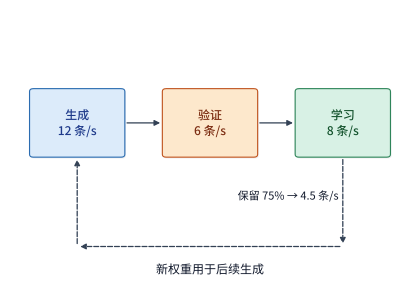

*图 10-39　RL 三阶段流水线的吞吐瓶颈与反馈回路：生成、验证与学习的处理上限分别为 12、6、8 条轨迹/s，验证后按 $q=75\%$ 保留合格样本，使进入学习端的有效流量受制于验证瓶颈，仅为 4.5 条/s；上方返回箭头代表学习端更新后的新权重回传刷新生成端。*

图 10-39 将三道工序画在了彼此独立的加速卡池上（**分离式部署，disaggregated placement**）；而在实际生产中，为了省下独立维护两套集群的昂贵卡数，许多框架（如 verl 的 HybridEngine）支持**共置共享加速器（colocated placement）**：让同一组 GPU 轮流承担生成端与学习端的工作——前半段全员加载 vLLM 跑自回归生成，生成完一批轨迹后全员原地切换为 FSDP/Megatron 执行反向传播与参数更新。

共置架构省下了机器，却在**“训练切生成”的交接瞬间**存在极易触发显存溢出（OOM）的峰值叠加隐患：虽然训练阶段单独运行、生成阶段单独运行时显存都绰绰有余，但如果切换时的**加载与释放次序**不当，新旧两套状态在切换瞬间同时驻留就会直接超出显存上限（图 10-40 与图 10-41）。我们用一张 **H100 SXM（标称 80 GB，二进制可用显存约 $74.5\ \mathrm{GiB}$）**上的 Qwen3-8B 共置切换来算清这笔账：设分片/卸载后的训练常驻状态占 **$40\ \mathrm{GiB}$**，生成阶段需要一份连续的 BF16 推理权重（约 **$15.3\ \mathrm{GiB}$**）以及一块 **$24\ \mathrm{GiB}$** 的分页 KV 缓存池，此外运行时上下文与通信库固定占用 **$4\ \mathrm{GiB}$**。单独看两端：训练独占显存为 $40 + 4 = 44\ \mathrm{GiB}$，生成独占显存为 $15.3 + 24 + 4 = 43.3\ \mathrm{GiB}$，双双远低于 $74.5\ \mathrm{GiB}$ 的物理红线。然而，看下面两种截然不同的切换步骤次序：
1. **错误次序（先拼齐生成权重并分配 KV 池，最后再释放训练状态，图 10-40）**：在释放 $40\ \mathrm{GiB}$ 训练状态之前，系统先把 $15.3\ \mathrm{GiB}$ 生成权重和 $24\ \mathrm{GiB}$ KV 缓存池全部分配了出来，导致切换瞬间的叠加显存峰值冲高至 $40 + 15.3 + 24 + 4 = \mathbf{83.3\ \mathrm{GiB}}$，直接突破 H100 的 $74.5\ \mathrm{GiB}$ 物理上限而崩溃。
2. **正确分段切换次序（先导出生成权重 $\to$ 立即释放训练状态 $\to$ 最后分配 KV 池，图 10-41）**：因为生成所需的 $15.3\ \mathrm{GiB}$ 权重需要从训练状态中收集转换出来，这两者在转换瞬间确实必须短暂共存，使显存占用升至 $40 + 15.3 + 4 = \mathbf{59.3\ \mathrm{GiB}}$；但一旦生成权重就绪，系统**立刻释放掉那 $40\ \mathrm{GiB}$ 的训练状态**（使显存占用骤降至 $19.3\ \mathrm{GiB}$），最后再分配完全不依赖训练状态的 $24\ \mathrm{GiB}$ KV 缓存池，平稳进入 $43.3\ \mathrm{GiB}$ 的生成阶段。两条路径的起点与终点完全相同，仅靠把“分配空 KV 池”推迟到“释放训练状态”之后，就将切换显存峰值从 $83.3\ \mathrm{GiB}$ 砍到了 **$59.3\ \mathrm{GiB}$**（整整削去了一份 $24\ \mathrm{GiB}$ KV 池的高度），稳稳压在 $74.5\ \mathrm{GiB}$ 红线以内。[^handoff]

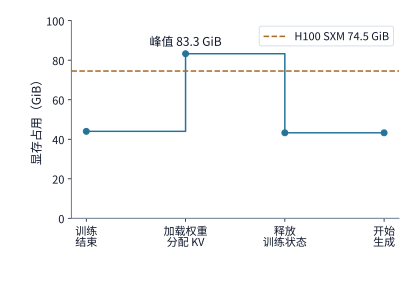

*图 10-40　错误的共置切换次序：在释放 40 GiB 训练状态前先加载 15.3 GiB 生成权重并提前分配 24 GiB KV 池，使瞬间显存峰值冲高至 83.3 GiB，超出 H100 SXM 的 74.5 GiB 可用容量红线。*

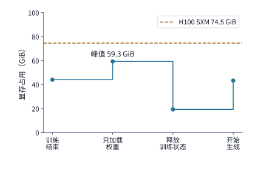

*图 10-41　正确的分段切换次序（与图 10-40 共用同一纵轴刻度）：先导出 15.3 GiB 生成权重（短暂达到 59.3 GiB 峰值），随即释放 40 GiB 训练状态，最后再分配 24 GiB KV 池，全程最高显存占用仅 59.3 GiB。*

反之，若采用**分离式独立部署**（训练池与生成池各自独占一组机器），虽然免去了单卡内部的显存切换，却必须在每一步参数更新后，把学习端的新权重通过网络推送给生成端。对于超大 MoE 模型，**按接收方实际持有的分片定向分发**是避免网络拥塞的关键：以 **Qwen3-235B-A22B** 为例，其全部 BF16 专家权重总体积高达 **$423\ \mathrm{GiB}$**；当生成端采用 16 路专家并行（EP16）部署时，每张生成卡实际上只需要自己负责的那 $1/16$ 专家子集（约 **$26.4\ \mathrm{GiB}$**）。如果实现简陋，让训练端向 16 个生成 rank 逐一广播全量 $423\ \mathrm{GiB}$ 专家权重，总发送流量将高达 $16 \times 423 = \mathbf{6768\ \mathrm{GiB}}$；而如果先核对两端的分片映射表，只向每个接收 rank 定向发送它所需的那 $26.4\ \mathrm{GiB}$ 切片，全网总发送量立刻缩减 16 倍回到 **$423\ \mathrm{GiB}$**，同时省去了接收端庞大的全量拆包缓冲。

我们把共置休眠唤醒（如 vLLM Sleep Mode 与 SGLang 多阶段唤醒）的精确字节账本，以及分离式 EP16 定向权重分发（如 Sharded RDT）的流水缓冲区下界，整理为如下完整的工程复算算例。[^weight-handoff]

**算例 10-A　Qwen3-8B 共置显存峰值（$83.26\ \mathrm{GiB}\to 59.26\ \mathrm{GiB}$）与 Qwen3-235B EP16 定向权重同步下界。**
1. **Qwen3-8B 共置分段唤醒与休眠级别选择**：按官方张量配置逐项累加未共享词嵌入/输出头、36 层注意力、门控 MLP 与归一化参数，Qwen3-8B 共有 $8{,}190{,}735{,}360$ 个参数，BF16 原始权重精确占 $16{,}381{,}470{,}720\ \mathrm{B} \approx \mathbf{15.2564\ \mathrm{GiB}}$。在标称 $80\ \mathrm{GB}$（可用约 $74.506\ \mathrm{GiB}$）的 H100 SXM 上，设训练常驻状态占 $40\ \mathrm{GiB}$、Rollout KV 池占 $24\ \mathrm{GiB}$、公共运行时与工作区占 $4\ \mathrm{GiB}$。若在未释放训练状态前同时恢复推理权重与 KV 池，瞬时显存峰值达 $40 + 15.2564 + 24 + 4 = \mathbf{83.2564\ \mathrm{GiB}} > 74.506\ \mathrm{GiB}$（直接触发 OOM）；而采用“先同步 $15.2564\ \mathrm{GiB}$ 推理权重 $\to$ 立即释放 $40\ \mathrm{GiB}$ 训练状态 $\to$ 最后分配 $24\ \mathrm{GiB}$ KV 池”的分段唤醒次序，交接峰值严格收敛为 $\max(40 + 15.2564 + 4,\, 15.2564 + 24 + 4) = \mathbf{59.2564\ \mathrm{GiB}}$。此外，vLLM 的休眠模式（Sleep Mode）在保留虚拟地址空间以复用已捕获 CUDA Graph 的同时，区分了两种物理内存释放深度：`Level 1` 将旧权重备份至主机内存，唤醒时再拷回 GPU（若本轮训练后旧权重必被新权重完整覆盖，按 $25\ \mathrm{GB/s}$ 有效带宽计，这一“备份再恢复”会凭空浪费约 $2\times 16.38\ \mathrm{GB} / 25\ \mathrm{GB/s} \approx \mathbf{1.31\ \mathrm{s}}$ 的无用传输）；`Level 2` 则直接丢弃旧权重物理页、仅保留必要的模型缓冲区，待唤醒时由训练端一步写入最新权重（但当启用多 Token 预测起草器 MTP 或仅同步 LoRA 适配器而基座权重不变时，仍需根据谁负责写回状态审慎选择休眠层级）。
2. **Qwen3-235B-A22B 在 EP16 下的定向权重同步与最大原子切片缓冲**：该模型共 $94$ 层、每层 $128$ 个路由专家，单专家三个矩阵（`4096×1536`、`4096×1536`、`1536×4096`）占 $36\ \mathrm{MiB}$，全模型路由专家共占 $454{,}192{,}791{,}552\ \mathrm{B} = \mathbf{423\ \mathrm{GiB}}$，加上词嵌入、注意力等非专家稠密参数 $15{,}994{,}477{,}568\ \mathrm{B} \approx 14.896\ \mathrm{GiB}$，全模型 BF16 权重合计 $470{,}187{,}269{,}120\ \mathrm{B} \approx 437.896\ \mathrm{GiB}$。在均匀 EP16（无冗余专家副本）下，每个生成 rank 每层仅驻留 $8$ 个专家（共 $288\ \mathrm{MiB}/\text{层}$，$94$ 层合计 **$26.4375\ \mathrm{GiB}$**），连同完整非专家参数共需接收 $44{,}381{,}527{,}040\ \mathrm{B} \approx 41.33\ \mathrm{GiB}$（一个 16 卡 EP 组选择性单播的总出口流量为 $710{,}104{,}432{,}640\ \mathrm{B} \approx 661.34\ \mathrm{GiB}$，而向 16 个 rank 盲目发送全量模型则高达 $7{,}522{,}996{,}305{,}920\ \mathrm{B} \approx 7.01\ \mathrm{TiB}$）。单看路由专家子集：若每个消费端 rank 独享 $25\ \mathrm{GB/s}$ 接收带宽，按需定向分发将接收端传输下界从全量接收的 $423\ \mathrm{GiB} / 25\ \mathrm{GB/s} \approx \mathbf{18.17\ \mathrm{s}}$ 猛降至 $26.4375\ \mathrm{GiB} / 25\ \mathrm{GB/s} \approx \mathbf{1.14\ \mathrm{s}}$；但若训练侧仅由 $8$ 个生产端 rank（各具 $25\ \mathrm{GB/s}$ 发送带宽，合计 $200\ \mathrm{GB/s}$）共同拼装并发送这 $423\ \mathrm{GiB}$ 专家载荷，生产端聚合发送下界则为 $\mathbf{2.27\ \mathrm{s}}$，反过来成为瓶颈。更需注意的是流水重叠接收缓冲区的核定：不能因为单层 8 个专家分片仅占 $288\ \mathrm{MiB}$ 就只预留双槽 $576\ \mathrm{MiB}$ 缓冲——同一模型中形状为 $[151936, 4096]$ 的 BF16 词嵌入矩阵单片就高达 **$1.1592\ \mathrm{GiB}$**；若该原子切片不可再拆，双缓冲接收槽至少必须预留 **$2.3184\ \mathrm{GiB}$** 的额外显存。[^handoff][^weight-handoff]

此外，在 RL 反馈回路的众多模型角色中，还存在两类截然不同的**权重生命周期**（图 10-42）：像用于计算 KL 散度正则项的**参考模型（reference model）**或冻结的**奖励/教师模型**，其权重长期不变，完全可以交由第 4.7.3 节讨论的固定权重加速器（或只读高密度存储）反复高速读取；唯有每步都在演进的**策略模型（policy model）**才需要使用可擦写显存并走高速权重发布通道。

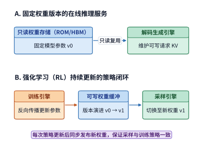

*图 10-42　RL 系统中两类不同生命周期的权重通路：上方固定版本模型（如参考模型 $\pi_{\mathrm{ref}}$）从只读存储（ROM）重复提供同一权重；下方策略模型（$\pi_\theta$）随每步训练持续生成新版本并发布至生成端，KV 状态写入与权重发布走各自独立的数据通道。*

在工程实践中，当训练端算完一步新权重并向生成端发起在线热更新（Hot Weight Update）时，系统不仅要算清带宽与显存峰值，更必须严格界定**控制面（Control Plane）与执行层（Runner / Scheduler）在并发锁、版本发布与局部失败时的职责边界**。我们以生产级 RL 框架广泛采用的 **SGLang 权重热更新控制面（基于提交 `c99d906e` 的 `TokenizerManager`、调度器与工作进程实现）** 为解剖对象，将一次在线权重更新从请求准入到恢复生成的完整生命周期归纳为表 10-C 的六阶段契约。[^sglang-weight-ctrl]

| 阶段 | 控制面入口 / 核心机制 | 并发锁与同步原语 | 成功路径状态演进 | 失败或异常边界行为 |
| :--- | :--- | :--- | :--- | :--- |
| **① 请求进入** | `TokenizerManager.generate_request` | 获取 `model_update_lock.reader_lock` | 允许多个常规推理请求并发进入，但与持有 `writer_lock` 的权重更新互斥 | 若更新方正持有 `writer_lock`，新到达请求在入口处排队等待 |
| **② 暂停生成** | `pause_generation(mode)` | 设置 `self.is_pause = True`；循环内等待 `is_pause_cond` | `wait` 模式挂起调度循环；`abort` 模式直接中止请求；`retract` 模式将在途批次撤回等待队列 | **三种模式均非“等待在途请求自然生成完毕”**；分布式／IPC 更新需由外部编排器显式先行调用 |
| **③ 提交更新** | 四类 `update_weights_from_*` 接口 | `disk` 与 `tensor` 路径获取 `model_update_lock.writer_lock`；`distributed` 与 `ipc` 路径使用 `nullcontext()` | 向底层各分片调度器广播更新指令（如磁盘路径、张量句柄、NCCL 组或 IPC 共享内存） | **锁保护不对称**：`distributed` 与 `ipc` 通道本身不加写锁，若外部漏调 `pause_generation` 将导致读写并发竞态 |
| **④ 汇总结果** | `_wait_for_model_update_from_scheduler` | 阻塞等待收齐 `len(results) == elastic_worker_count` 份响应 | 计算 `overall_success = all(r.success for r in results)`，总等待时间由最慢分片决定（$\max_i T_i$） | 只要任一分片返回 `r.success == False`，汇总布尔值即判定为 `False`，并将各分片消息拼接返回 |
| **⑤ 发布信息** | 管理层元数据提交 | 仅在 `overall_success == True` 时触发 | 更新 `server_args.model_path`，递增 `weight_version`（基座权重），并将新版本信息发布至管理层 | 若 `overall_success == False`（或更新的是 LoRA/局部组件），**跳过版本号递增与管理层路径发布** |
| **⑥ 恢复生成** | `continue_generation` | 将 `self.is_pause = False` 并调用 `is_pause_cond.notify_all()` | 唤醒挂起的推理循环并通知底层调度器继续处理队列 | **不检查前一次权重更新是否成功，且更新函数结束时不会自动调用恢复** |

*表 10-C　SGLang（`c99d906e`）在线权重更新控制面的六阶段职责边界与锁契约。*

对照表 10-C，如果把视野进一步下沉到执行层的 `Scheduler`、`TpModelWorker` 与 `ModelRunner`，还会发现四条极易在分布式故障注入时酿成“脑裂”的底层实现边界：
1. **就地覆写（In-Place Mutation）无本地自动回滚**：在 `model_runner.py` 中，`load_weights` 直接在原显存张量上就地覆写参数；源码注释明确指出，一旦加载中途抛出异常，底层张量已处于“半新半旧”的部分修改状态，执行器内部**不存在旧权重副本可供自动回滚**。
2. **投机解码（如 EAGLE）双模型非原子顺序更新**：在启用投机起草器时，磁盘与 IPC 更新路径会先调用 `target_worker` 更新目标模型，仅在目标模型返回成功后再调用 `draft_worker` 更新起草模型；若 `target_worker` 更新成功而 `draft_worker` 失败，单节点内部就会陷入“目标模型已是新权重、起草模型仍是旧权重”的失配状态。
3. **张量并行（TP）CPU 屏障不聚合业务成败**：`tp_worker.py` 在 `tp_size > 1` 时执行的 `torch.distributed.barrier(group=self.tp_cpu_group)` 仅仅是一个进程执行进度同步点，并未对各 rank 的 `(success, message)` 做跨卡逻辑与（AllReduce LAND）归约。
4. **配置路径先行覆写与“回滚”提示语的语义偏差**：在 `update_weights_from_disk` 中，执行器在真正调用 `load_weights` 之前就已执行了 `self.model_config.model_path = model_path`；当后续加载失败进入异常分支时，虽然向外返回了 `"Rolling back to original weights"` 的错误文本，但实际上既没有恢复 `model_config.model_path` 属性，也没有还原已被就地改写的权重显存。

为了看清这些边界在多卡环境下的连锁反应，我们来推演一个典型的**四分片局部失败场景**：假设生成池由 $4$ 个分片工作进程（`elastic_worker_count = 4`）组成，在一次权重热更新中，4 个分片返回的 `(success, detail)` 分别为 **`[成功, 成功, 失败, 成功]`**（各分片响应耗时分别为 $T_1, T_2, T_3, T_4$）。此时系统在控制面与执行层会发生怎样的状态分裂？
- **在管理与控制面**：汇总函数收齐 4 份结果（耗时 $\max(T_1, T_2, T_3, T_4)$）后，由 `all(r.success)` 算出 `overall_success = False`。因此，控制面拒绝发布新版本——`TokenizerManager` 上的 `weight_version` 与 `server_args.model_path` 依然保持更新前的旧值不变，并向外部调用方返回 `(False, joined_message)`。
- **在底层执行面**：分片 1、分片 2 与分片 4 已经就地覆写成了**新版本权重**，而分片 3 则停留在**损坏的半成品权重（或旧权重）**，且分片 3 的 `model_config.model_path` 可能已被污染。
- **正确的容错恢复编排**：由于 `continue_generation` 既不检查前序更新状态、也不会核验各分片权重哈希一致性，如果外部 RL 控制器在收到 `False` 后草率调用 `continue_generation`，恢复后的推理集群就会用“3 张新权重卡 + 1 张坏/旧权重卡”拼凑计算，并复用旧权重留下的残留 KV 缓存，产生彻底失真的乱码轨迹。**正确的工程处置流程**是：外部控制器在捕获 `overall_success == False` 后，必须继续保持生成暂停（`is_pause = True`），对故障分片实施进程重建或向全部 4 个分片重新广播一份确定性的已知完好权重（直至再次调用返回 `all(r.success) == True`），随后显式调用 `flush_cache` 清空任何跨版本残留的 KV 缓存与投机起草状态，最后才允许调用 `continue_generation` 放行流量。[^sglang-weight-ctrl]

### 10.5.3 异步流水重叠、三版本策略概率比与长轨迹中断恢复

在分离式部署下，如果我们让生成池和学习池严格按“生成完第 $k$ 批 $\to$ 学习完第 $k$ 批 $\to$ 同步权重 $\to$ 再生成第 $k+1$ 批”的**同步循环**运转，那么当生成端在跑漫长的自回归采样时，昂贵的学习端 GPU 就只能全员空转等待；反过来当学习端在跑反向传播时，生成端又陷入闲置。为了消灭这段互相等待的空窗期，工业界广泛引入了**跨批次异步重叠流水（asynchronous rollout–learning overlap）**：当学习端正在用第 $k-1$ 批样本更新参数时，生成端已经在用上一轮的旧权重并行生成第 $k$ 批样本了。

一旦开启异步重叠（乃至在同一批次内部做多轮小批量 PPO 更新），“生成这条样本时的模型版本”与“当前正在求导更新的模型版本”之间就拉开了代差。为了在数学上严格校准每个样本对当前参数梯度的贡献，我们必须沿着样本流转链条明确区分如图 10-43 所示的**三个策略分布**：
1. **实际采样行为分布 $\mu$（behavior policy）**：生成端在实际吐出这条轨迹时所遵循的概率分布（可能使用的是滞后了若干步的旧版权重，且包含了推理引擎特定的算子精度与采样截断规则）；
2. **本轮优化起点策略 $\pi_{\mathrm{old}}$（proximal anchor policy）**：当前这一轮 PPO/GRPO 多步优化启动瞬间的基准模型策略；
3. **当前待优化策略 $\pi_\theta$（current target policy）**：在本轮优化的各个微步中随参数 $\theta$ 实时更新的策略（而用于计算 KL 惩罚的参考模型 $\pi_{\mathrm{ref}}$ 则始终冻结在初始检查点）。

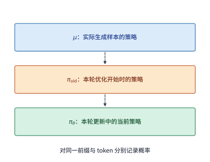

*图 10-43　异步与多轮 RL 更新中的三个策略分布：$\mu$ 为生成端实际产出样本时的行为分布，$\pi_{\mathrm{old}}$ 为本轮优化的起点锚点，$\pi_\theta$ 为随当前微步更新的实时策略（虚线代表版本演进次序，三者必须针对完全相同的上下文前缀与目标 token 求值）。*

针对同一个上下文前缀下的同一个生成 token，只要三者的概率均有定义且分母非零，连接当前策略与实际采样分布的总重要性采样概率比（importance sampling ratio）就可以严格分解为两项因子的乘积：

$$
\frac{\pi_\theta}{\mu}
=\frac{\pi_\theta}{\pi_{\mathrm{old}}}
\cdot\frac{\pi_{\mathrm{old}}}{\mu}.
$$

观察等式右侧的两个分式，它们的物理职责泾渭分明：第一项 $\frac{\pi_\theta}{\pi_{\mathrm{old}}}$ 纯粹度量**本轮参数更新引发的策略变化**；第二项 $\frac{\pi_{\mathrm{old}}}{\mu}$ 则精准捕获了**从样本在生成端诞生、到进入本轮学习起点之间的全部偏移**——其中既包含异步流水带来的权重版本滞后，也包含生成引擎与训练引擎之间的底层数值计算差异。

我们用一个具体数字算例看看：**如果省略在生成端实时记录并传回行为对数概率 $\log \mu$，而是等样本到了训练端再用训练引擎重算一遍当作分母，会酿成多大的偏差？** 假设在同步同版本（模型参数分毫未变）的前提下，生成端对某个 token 真实算出的对数概率为 $\log \mu = -3.00$，因此真实总概率比理应精确等于 $\exp(-3.00 - (-3.00)) = \mathbf{1.00}$。然而由于推理引擎与训练引擎的底层算子差异，训练端对同一份权重、同一个 token 重新前向算出的对数概率变成了 $-3.25$；如果把一方当作分子、另一方当作分母代入概率比，算出来的比值就会变成 $\exp(-3.00 - (-3.25)) = \exp(0.25) \approx \mathbf{1.28}$——**模型参数明明一个比特都没有改，仅仅因为两端算子算出的对数概率差了 $0.25$，这条样本在梯度更新中的权重就被凭空放大了 $28\%$**，甚至可能直接触碰 PPO 的裁剪阈值（如 $1 + \epsilon = 1.20$）而被错误截断（需要注意的是，裁剪虽然能限制极端重要性权重，但本身会引入估计偏差，而且对式中的两个因子分别裁剪与对总比值整体裁剪会产生不同的损失更新）。[^identity]

为什么明明加载的是同一份权重文件，生成端与训练端算出来的对数概率却会不一样？根源藏在两端截然不同的执行路径与采样变换里：
1. **底层算子归约次序与精度差异**：生成端采用逐 token 解码（decode）并增量读取分页 KV 缓存（甚至使用 FP8/FP4 量化 KV），而训练端则是把整条已生成轨迹一次性并行喂入 FlashAttention 重新跑完前向 prefill。如第 5.2.4 节实测所示，哪怕是完全相同的一行浮点数，仅仅因为批大小不同导致算子内部切分归约段数不同，算出的平方和就会相差 $166$ 个最小精度单位（ULP）；这些细微的前向舍入误差经过数十层非线性激活与 Softmax 放大后，就会直接拉开两端 logprob 的差距，并在长思维链轨迹上沿序列长度逐 token 累加放大。
2. **采样分布变换与分词模板一致性**：生成端实际采样时往往经过了温度缩放（temperature scaling）、Top-$k$ 或 Top-$p$（核采样）截断，改变了原始 Softmax 输出的概率分布（且被 Top-$k$/Top-$p$ 截断剃掉的 token 概率为零，违反了重要性采样要求支撑集覆盖的前提，无法事后仅靠概率比补回）。因此，生成端必须原原本本地记录下**实际采样分布下的行为对数概率 $\log \mu$** 及完整采样配置，而训练端则必须使用完全一致的分词器、对话模板、位置编码（RoPE）、可见性掩码与 `EOS`/截断边界来重建输入，才能确保式中的三个概率算的是同一个数学事件。

在保证概率比核算准确的前提下，我们来算一笔异步重叠流水的**时间收益与过期样本丢弃账（例 10.11）**。

**例 10.11　异步 RL 流水线把周期从 60 秒缩到 44 秒，它最多能承受多高的过期样本丢弃率？** 设生成池与学习池部署在各自独立的加速卡上：生成一批包含 $B$ 条轨迹的样本耗时 $40\ \mathrm{s}$，学习端训练这批样本耗时 $16\ \mathrm{s}$，每轮结束时阻塞两侧执行权重同步耗时 $4\ \mathrm{s}$。
- **同步串行循环（图 10-44）**：依次执行“生成本批（$40\ \mathrm{s}$）$\to$ 学习本批（$16\ \mathrm{s}$）$\to$ 同步权重（$4\ \mathrm{s}$）”，单轮总周期为 $40 + 16 + 4 = \mathbf{60\ \mathrm{s}}$。由于每批样本都用最新权重生成，样本保留率为 $100\%$，每秒产出的有效训练样本吞吐为 **$B / 60$**。
- **跨批次异步重叠循环（图 10-45）**：在稳态下，生成池生成第 $k+1$ 批样本（$40\ \mathrm{s}$）与学习池训练第 $k$ 批样本（$16\ \mathrm{s}$）同时并行推进，待较长的生成阶段跑完后再统一花费 $4\ \mathrm{s}$ 同步权重，单轮稳态周期大幅缩短至 $\max(40, 16) + 4 = \mathbf{44\ \mathrm{s}}$。

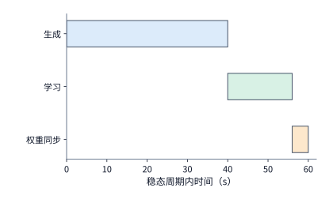

*图 10-44　同步串行 RL 循环：依次执行生成本批样本（40 s）、学习本批样本（16 s）与权重同步（4 s），单轮周期共 60 s。*

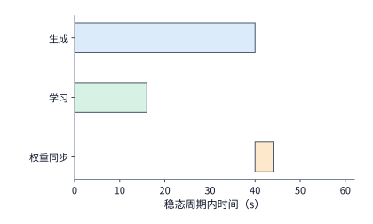

*图 10-45　跨批次异步重叠 RL 循环：生成下一批样本（40 s）与学习上一批样本（16 s）在独立资源池上并行重叠，两侧完成后执行阻塞式权重同步（橙色，4 s），稳态周期缩短至 44 s。*

然而，从图 10-44 切换到图 10-45 并非无代价地节省了 $16\ \mathrm{s}$：由于异步生成的样本使用的是滞后版本的旧权重，部分偏离当前策略过远的过期（stale）样本会被过滤器淘汰丢弃。设异步模式下每批生成的 $B$ 条轨迹中，最终只有比例为 $q$ 的合格样本得以保留用于有效训练，则异步模式的有效样本吞吐为 **$qB / 44$**。要想让异步重叠真正比同步串行更快，保留率 $q$ 必须满足：

$$
\frac{qB}{44} > \frac{B}{60}
\qquad\Longrightarrow\qquad q > \frac{44}{60} = \frac{11}{15} \approx 73.3\%.
$$

这个 **$73.3\%$** 的翻转阈值清楚地划出了异步 RL 的盈亏平衡线：当策略变化平缓、样本保留率达到 $q = 80\%$ 时，异步重叠能将有效训练吞吐实打实地提高约 $9\%$；但一旦学习率过大或滞后步数过多导致保留率跌到 $q = 70\% < 73.3\%$，哪怕表面上看每轮周期从 $60\ \mathrm{s}$ 缩短到了 $44\ \mathrm{s}$，每秒真正喂进学习端的有效样本数反而比按部就班跑同步串行**倒退了约 $5\%$**。

如果既不想承受跨批次异步带来的旧版本样本丢弃（坚持严格同策略 On-Policy 更新），又想消灭单轮同步 Rollout 末尾“少数长回答拖慢整批 GPU”的长尾空转，能否在**同一批样本内部**实现生成与训练的流式交错？NSDI 2026 的 **RollPacker** 与 OSDI 2026 的 **Weave**、**RobustRL** 从单作业流式切分、跨作业互补调度与轨迹级故障恢复三个维度给出了定量解法（算例 10-B 与算例 10-C，图 10-46）。[^rollout-tail][^rl-sched-rec]

**算例 10-B　RollPacker（NSDI 2026）流式训练器（Stream Trainer）：从 $60\ \mathrm{s}$ 缩至 $55\ \mathrm{s}$ 的 KV 容量前提、迁移边界与非均匀梯度归一化。** 在单轮同步 RL 中，RollPacker 的流式训练器（Stream Trainer）在观测到前半数完整回答组率先生成完毕时，将一半 Rollout GPU 原地转换为训练副本，提前对已完成样本计算前向与反向梯度（暂存梯度而不提前更新权重，待全批生成完毕后再统一归约更新）：
1. **第一步：剩余 Rollout 卡的 KV 容量可行性校核**。不能仅凭“完成了一半请求”就盲目抽走一半 GPU，必须先检验留守卡装不装得下迁移合并后的在途 KV。以 Qwen3-8B（BF16 KV 每 token 占 $2\times 36\times 8\times 128\times 2 = 147{,}456\ \mathrm{B} = 144\ \mathrm{KiB}$）为例：设初始 8 张卡上仍有 32 条在途长尾轨迹，若每条轨迹长度（含提示词与已生成部分）为 $8{,}192$ token，合计占用 $36\ \mathrm{GiB}$ KV；抽走 4 张卡转为训练后，留守的 4 个 $\mathrm{TP}=1$ Rollout 副本各承接 8 条轨迹（单卡需 $9\ \mathrm{GiB}$ KV），在每卡扣除权重与运行时后剩 $12\ \mathrm{GiB}$ 可用 KV 预算的条件下可以顺利放下。反之，若这 32 条轨迹长度扩展至 $16{,}384$ token，总 KV 翻倍至 $72\ \mathrm{GiB}$、留守单卡需 $18\ \mathrm{GiB} > 12\ \mathrm{GiB}$ 预算，此时强行缩容一半 Rollout 卡就会直接触发显存溢出。
2. **第二步：流式转换的时间线盈亏边界**。通过容量校核后，设原本 8 卡串行执行 Rollout 需 $40\ \mathrm{s}$、8 卡计算全批梯度需 $16\ \mathrm{s}$、最后归约与优化器更新需 $4\ \mathrm{s}$，串行单轮总耗时为 $40 + 16 + 4 = \mathbf{60\ \mathrm{s}}$。现设第 $10\ \mathrm{s}$ 时恰好有一半完整回答组生成完毕，系统腾出 4 张卡转为训练：状态切换与在途请求迁移耗费 $3\ \mathrm{s}$，并使留守 4 卡上剩余 Rollout 的完成时刻从 $40\ \mathrm{s}$ 顺延至 $43\ \mathrm{s}$；与此同时，早到的那一半样本在腾出的 4 张训练卡上（按 DP 算力减半计）耗费 $16\ \mathrm{s}$，于第 $10 + 3 + 16 = 29\ \mathrm{s}$ 算完前向与反向梯度；待第 $43\ \mathrm{s}$ 剩余一半样本生成完毕后，全部 8 张卡合流只需 $8\ \mathrm{s}$ 即可算完后半批梯度，加上 $4\ \mathrm{s}$ 参数更新，单轮总完成时间缩短为 $\max(43, 29) + 8 + 4 = \mathbf{55\ \mathrm{s}}$。但请注意这一收益对迁移干扰高度敏感：若缩容与 KV 重建使剩余 Rollout 延后了 $10\ \mathrm{s}$（到第 $50\ \mathrm{s}$ 才结束），总耗时就会变成 $\max(50, 36) + 8 + 4 = \mathbf{62\ \mathrm{s}}$，反而不如 $60\ \mathrm{s}$ 的原版串行。
3. **第三步：超额投机采样偏差与非均匀微批梯度加权**。RollPacker 在短轮次中还将提示词数与每题采样回答数同时放大 $1.25$ 倍（如目标 $128\times 8 = 1024$ 条回答，初始提交 $160\times 10 = 1600$ 条，超额提交 **$56.25\%$**），收齐先完成的回答组后即取消其余慢请求。需警惕的是，“权重未变”不等于“采样条件分布不变”：若某提示词天然以各 $1/2$ 的概率产生 $1\ \mathrm{s}$ 短回答或 $10\ \mathrm{s}$ 长回答，用两个独立槽位并发采样并只保留先完成的一条，唯有两槽全抽中长回答时最终留下的才是长回答，其入选概率已从 $1/2$ 被扭曲为 **$1/4$**（且双槽合计消耗 $6.5\ \text{槽}\cdot\mathrm{s}$ 期望资源，高于单次采样的 $5.5\ \text{槽}\cdot\mathrm{s}$）。此外，当流式训练的各副本或各微批分担的样本/有效 token 数不等时，必须严格按全局分母加权归约：例如两个副本分别处理 $1$ 个和 $3$ 个样本、局部平均梯度分别为 $1$ 和 $3$，真实的全局四样本平均梯度为 $(1\times 1 + 3\times 3)/4 = \mathbf{2.5}$，若直接对两个局部均值做无权平均则会算出错误值 $2.0$；同理，若要求按全局梯度模长裁剪到阈值 $2.0$，必须先聚合成全局平均 $2.5$ 再裁剪为 $2.0$，若先在各样本上逐个限幅到 $2.0$ 再平均就会失真为 $(1 + 2 + 2 + 2)/4 = 1.75$。[^rollout-tail]

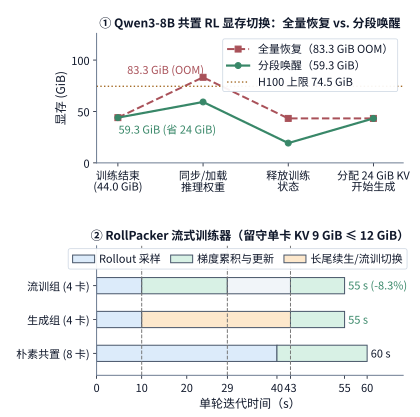

*图 10-46　RL 训练中的两项关键阶段交接优化。上栏为算例 10-A 的单卡共置分段唤醒次序（H100 80GB，74.5 GiB 可用）：先同步 15.26 GiB 推理权重、立即释放 40 GiB 训练状态、最后分配 24 GiB KV 池，将交接显存峰值从触发 OOM 的 83.26 GiB 压至 59.26 GiB；下栏为算例 10-B 的 RollPacker 流式训练器（Stream Trainer）时间线：第 10 s 时将 8 卡中的 4 卡提前转为训练副本处理前半批已完成轨迹（29 s 算完），待剩余 Rollout 于 43 s 完成后全员 8 卡合流算完后半批（8 s）并更新参数（4 s），使单步周期从串行的 60 s 压缩至 55 s。*

当生成阶段面对的是动辄数万 token、耗时数分钟的**长思维链或复杂 Agent 交互轨迹**时，除了跨过权重更新边界，生成过程本身还极易遭遇节点中断。如果采取“一旦中断就整条丢弃重采”的粗暴策略，就会引发严重的**生存偏差（survival bias / length bias）**：设生成期间的故障中断发生率为 $\lambda$，则一条需要持续生成时长 $t$ 的长轨迹能够毫发无损跑完的概率仅为 $e^{-\lambda t}$——轨迹越长，中途夭折的概率就呈指数级攀升，导致最终进入学习端的数据集系统性地缺失长思维链样本。

为了消除这种对长轨迹的歧视，系统必须按 token 增量记录已生成的文本进度与对应的策略版本号，以便在故障重启后接着往后生成（关于 Agent 在模型与外部环境两侧如何跨中断做状态持久化，详见第 11.3.3 节）。在恢复长轨迹时，如果模型权重尚未更新，系统可以直接从存储池取回已保存的上下文 KV 缓存（如 Qwen3-8B 的 $8\mathrm{K}$ BF16 KV 占 $1.125\ \mathrm{GiB}$，只需比较网络取回耗时与本地重新 prefill 耗时即可，见第 9.5.2 节）；而如果恢复时策略模型已经更新了权重，旧权重算出的历史 KV 缓存就不再匹配新权重，此时必须将已生成的历史 token 重新送入新权重执行一次 prefill 来刷新 KV 状态。我们通过算例 10-C 定量核算把“已生成轨迹持久化”与“训练端故障恢复”解耦所省下的重做时间，以及多作业互补交错调度的容量门槛。[^rl-sched-rec]

**算例 10-C　RobustRL（OSDI 2026）解耦轨迹恢复（$490\ \mathrm{s}$ vs. $790\ \mathrm{s}$）与 Weave 跨作业互补交错周期核算。**
1. **RobustRL 角色解耦恢复账本**：设某同步 RL 作业每轮包含 $300\ \mathrm{s}$ 的 Rollout 采样与 $60\ \mathrm{s}$ 的学习端参数更新。某轮在跑完 $300\ \mathrm{s}$ 采样、进入学习端更新第 $30\ \mathrm{s}$ 时（距本轮开始 $330\ \mathrm{s}$），训练池中有 1 台机器发生故障；系统耗费 $20\ \mathrm{s}$ 检测到故障并花 $80\ \mathrm{s}$ 从上一轮检查点恢复训练器角色。若采用传统整体回滚策略，本轮已生成的轨迹随故障一并作废，恢复后必须重新跑一遍 $300\ \mathrm{s}$ 采样与 $60\ \mathrm{s}$ 更新，完成该有效步共耗时 $300 + 30 + 20 + 80 + 300 + 60 = \mathbf{790\ \mathrm{s}}$；而 **RobustRL** 将本轮已完成的 Rollout 轨迹与环境交互状态独立持久化在训练器故障域之外（每轮阻塞保存仅需约 $3\ \mathrm{s}$，占 $360\ \mathrm{s}$ 正常周期的 $0.83\%$），训练器重启恢复后直接读取已保存的完整轨迹重做那 $60\ \mathrm{s}$ 的参数更新，总耗时骤降至 $300 + 30 + 20 + 80 + 60 = \mathbf{490\ \mathrm{s}}$，单次故障净省 **$300\ \mathrm{s}$（缩减 $38.0\%$）**。
2. **Weave（OSDI 2026）多作业互补交错与主机内存驻留边界**：当集群同时运行多个同步 RL 作业时，**Weave** 利用不同作业在 Rollout 池与训练池上的耗时互补性复用硬件。设作业 A 每轮需 $360\ \mathrm{s}$ Rollout 与 $120\ \mathrm{s}$ 训练，作业 B 每轮需 $120\ \mathrm{s}$ Rollout 与 $360\ \mathrm{s}$ 训练（独跑单轮周期均为 $480\ \mathrm{s}$）：若让两项作业共享同一对（Rollout 池 + 训练池），在稳态下让 Rollout 池于 $0\sim 360\ \mathrm{s}$ 跑 A、$360\sim 480\ \mathrm{s}$ 跑 B，同时让训练池于 $0\sim 360\ \mathrm{s}$ 跑 B 的上一轮更新、$360\sim 480\ \mathrm{s}$ 跑 A 的本轮更新，则两池可实现 $100\%$ 满载连续运转，直接省掉一整套独立资源池。但任何交错调度都必须通过三道硬门槛校验：① **池总工时下界** $\text{周期} \ge \max(\text{各作业依赖链时长},\, \text{各资源池累计占用时长})$（若换成两个同为 $360\ \mathrm{s}/120\ \mathrm{s}$ 的作业 A 共用一对池，Rollout 池每周期需 $720\ \mathrm{s}$，必然突破“最多允许比独跑延长 $10\%$ 即 $528\ \mathrm{s}$”的 SLO 红线）；② **热切换开销门槛**（在互补配对下，若保留进程上下文与主机内存状态使每次阶段切换仅需 $5\ \mathrm{s}$，共享周期为 $480 + 2\times 5 = \mathbf{490\ \mathrm{s}} \le 528\ \mathrm{s}$；若退化为每次耗时 $45\ \mathrm{s}$ 的冷启动，周期就会膨胀至 $480 + 2\times 45 = \mathbf{570\ \mathrm{s}} > 528\ \mathrm{s}$ 而违约）；③ **单节点主机内存容量门槛**（若两项作业在单台主机上需常驻的热切换状态分别为 $400\ \mathrm{GiB}$ 与 $500\ \mathrm{GiB}$，加上系统预留的 $150\ \mathrm{GiB}$ 共需 **$1050\ \mathrm{GiB}$**，已超出 $1\ \mathrm{TiB}$ 主机内存物理上限，热切换前提即刻失效）。[^rl-sched-rec]

更进一步，为了从源头上弥合训练与部署之间的鸿沟，前沿大模型已经开始**把推理部署时的近似、压缩与恢复机制直接搬进后训练循环中（train-as-you-deploy）**。例如 **DeepSeek V4.1** 在训练阶段就全程使用与线上部署完全一致的 $64\mathrm{K}$ 稀疏注意力结构，并在后训练中引入与推理端相同的层级候选集限制以统一搜索空间；通过量化感知训练（QAT）在训练前向中直接模拟推理端主 KV 缓存采用 **FP4 量化**时的舍入误差；甚至连第 8、9 章提到的“会话恢复时仅重放有限长度尾部输入来重建解码器滑动窗口（SWA）状态”这一工程妥协，也在后训练中被原样模拟，让模型学会在部署引擎真实提供的有损局部状态上保持稳健输出。[^v41-case]

### 10.5.4 专家路由重放与训推一致性

对于混合专家（MoE）大模型，第 10.5.3 节讨论的跨引擎微小数值差异会引发一场更剧烈的定性突变：**把连续的浮点舍入误差，瞬间放大为离散的专家路径分叉**。

道理很简单：MoE 的门控路由器（router）执行的是离散的 $\mathrm{Top}\text{-}k$ 截断选择。假设某层路由器在从候选专家中挑出分数最高的两个专家（$\mathrm{Top}\text{-}2$）时，生成端算出的前三个专家门控打分依次为 $0.500, \mathbf{0.301}, 0.300$，于是选中了**专家 1 与专家 2**；然而当同一条序列送到训练端重算前向时，仅仅因为批量矩阵乘的累加次序不同，第 3 个专家的打分在小数点后第三位跳动了一下变成了 $0.500, 0.301, \mathbf{0.302}$，训练端就会立刻改弦易辙选中**专家 1 与专家 3**。一旦在浅层换掉了整整一个专家的权重矩阵，算出来的隐状态就会彻底偏离生成端的轨迹，并在后续数十层中引发连锁的路由雪崩——训练端最终求导更新的，根本不是生成端当初走过的那条子网络路径。

为了阻断这条“微小浮点误差 $\to$ 离散路由跳变 $\to$ 训推路径分叉”的链条，工业界提出了如图 10-47 所示的**专家路由重放（Rollout Routing Replay，简称 R3）**机制：
1. **生成端记录离散专家 ID**：在自回归生成阶段，每当门控路由器为某个 token 选出 $\mathrm{Top}\text{-}k$ 专家时，系统将该层被选中的**逻辑专家编号（expert IDs）**随同输出 token 一并记录下来，按`[样本编号, token 序列位置, 网络层号]`三维坐标索引；
2. **训练端强制重放路径并重算当前数值**：在训练阶段跑前向与反向传播时，门控路由器不再重新做自由的 $\mathrm{Top}\text{-}k$ 离散截断，而是直接读取生成端记录下来的那组专家 ID，**强制让 token 进入与生成端完全相同的那 $k$ 个专家子网络**，同时依然使用当前最新的策略权重 $\theta$ 正常计算这些被选中专家的门控权重分数、前馈层输出与反向梯度。

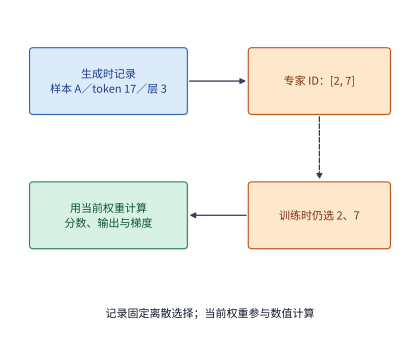

*图 10-47　MoE 专家路由重放（R3）机制：生成端记录每个 token 在各层选中的离散逻辑专家 ID（如样本 A、token 17、层 3 选中 top-2 专家，虚线传递），训练端直接按该 ID 列表路由 token，同时用当前最新权重计算门控分数、专家输出与梯度（实线数据流）。*

我们来核算一下，为每条轨迹额外保存这份“专家路由账本”究竟要占多少内存与带宽。以 **Qwen3-30B-A3B** 模型为例：全模型共有 $48$ 层 MoE，每层为每个 token 选出 $k=8$ 个激活专家（$\mathrm{Top}\text{-}8$）。对于一条长度为 $8192$ 个 token 的完整序列，若每个专家 ID 用占 2 字节的无符号短整型（`uint16`，足以编码最多 $65{,}536$ 个专家）保存，单条序列的路由记录总体积仅为：

$$
8192\ \text{tokens} \times 48\ \text{layers} \times 8\ \text{experts} \times 2\ \text{bytes} = \mathbf{6\ \mathrm{MiB}}.
$$

即便改用 4 字节的 `int32` 格式保存，单条 $8\mathrm{K}$ 序列也只需 $12\ \mathrm{MiB}$，相比动辄数百 MiB 的激活与 KV 缓存完全轻量。不过在工程实现中，必须严防**路由记录与 token 位置的错位**：当训练端开启序列打包（将多条短轨迹拼在一起）、上下文并行（将同一条长轨迹切分到多张 CP 卡上）以及激活重计算（在前向与反向中先后两次读取同一层的路由记录）时，这 $6\ \mathrm{MiB}$ 的专家 ID 张量必须与对应的 token 做完全同步的切片、重排与跨卡分发——一旦某处偏移了哪怕 1 个 token 位置，训练端就会将前一个位置选中的专家错误指派给其他位置求导，造成比不重放更灾难性的梯度污染。[^replay]

> **工程案例：开启专家路由重放（R3）后，对数概率误差、单步耗时与训练奖励会发生怎样的变化？** NVIDIA 研究团队在公开的 **R3（Rollout Routing Replay）** 验证报告中，在完全锁定随机数种子（`seed 42`）的前提下对四组不同模型与并行配置做了严格的开关对照实验（各运行 100 步 RL 训练）：实验日志清晰显示，开启 R3 之后，**四组实验中训练端与生成端之间的对数概率误差（logprob discrepancy）中位数无一例外全部显著下降**，证明离散路由分叉确实是造成 MoE 训推概率不一致的主要元凶；与此同时，由于需要传输路由元数据并按指定 ID 组织分组矩阵计算，开启 R3 后的**单步总耗时中位数略有增加**，而 100 步内的短期训练奖励曲线则互有高低、并未表现出单调一致的大幅上涨。这一实测结果告诉我们：路由重放是一项用来收紧训推数值偏差、防止策略更新因路径跳变而失稳的底层工程保险，评估它时必须同时审视对数概率误差、单步附加耗时以及最终固定评测集上的收敛质量。[^replay]

总结整个第 10.5 节：强化学习后训练把原本孤立的推理系统（第 8、9 章）与训练系统（第 10.1～10.4 节）熔铸成了同一个紧耦合巨系统——生成端向训练端交付的不再只是冷冰冰的 token 编号，而是连同行为对数概率 $\log \mu$、策略版本号与 MoE 离散专家 ID 在内的**完整执行契约**；而训练系统的目标，则是在严守显存切换上限与数值一致性的前提下，最大化每秒落入参数更新的有效合格样本吞吐。


## 10.6 从系统方案到完成期限与硬件选择

经过前面五节的层层拆解，我们已经把显存容量峰值、单步计算耗时、PCIe 集合通信重叠、数据加载等待以及检查点容错附加率全部化为了精确的数字。本节将这些模块拼装成端到端的总工期方程，对章首提出的 **32 卡与 48 卡 RTX 4090 候选方案**作出最终裁决，并进一步推演网卡减配、加速卡换代以及向万亿参数（$1\mathrm{T}$）超大模型扩展时的可行性边界。

### 10.6.1 汇总容量、单步耗时、停顿与恢复：32 卡 vs. 48 卡终局裁决

回顾章首的领域继续训练任务：使用 Qwen3-8B 处理 $D = 100\mathrm{B}$（$10^{11}$）个有效 token，每步全局批大小固定为 $384$ 条 $8192$ 序列（即每步处理 $b = 3{,}145{,}728$ 个有效 token），总共需要执行 $\lceil D/b \rceil = 31{,}790$ 次训练迭代，日历交付期限为 **$30$ 天**。

设包含单卡计算、暴露通信等待与数据加载等待在内的单步实际训练时间为 $t_s$，由第 10.4.4 节 Young–Daly 模型算出的检查点保存、故障重做与重启恢复附加时间比例为 $L$，启动、阶段评测与计划内维护停顿预留的总时间为 $T_0 = 5$ 天，则整项训练任务的端到端完成时间一阶方程为：

$$
T_{\mathrm{finish}}=T_0+\left\lceil\frac{D}{b}\right\rceil t_s(1+L).
$$

下表与图 10-48 将我们在第 10.1 至 10.4 节逐项推导出的全部参数汇入同一张总账单（表中最终天数由未四舍五入的精确中间值算出）：[^design]

| 设计项 | 32 卡方案 | 48 卡方案 |
|---|---:|---:|
| 八卡主机数 | 4 | 6 |
| 全组 ZeRO-3，每卡单序列累积次数 | 12 | 8 |
| 每卡预计显存占用 / GiB | 13.8 | 12.5 |
| 每卡可用显存 / GiB | 22 | 22 |
| 每步单卡计算 / s | 78.3 | 52.2 |
| 每步 ZeRO-3 链路时间（PCIe 4.0 x16）/ s | 17.9 | 12.0 |
| 每步通信等待 / s | 0.08 | 0.08 |
| 每步等待输入数据的时间 / s | 0.5 | 0.5 |
| 每步训练时间（含 0.5 s 输入等待）/ s | 78.9 | 52.8 |
| 保存、重做与恢复附加时间 | 1.02% | 1.08% |
| 基础训练时间 / 天 | 29.0 | 19.4 |
| 加入保存恢复和 5 天预留 / 天 | 34.3 | 24.6 |

*表 10-10　Qwen3-8B 在 32 卡与 48 卡 RTX 4090 集群（ZeRO-3 + PCIe 4.0 x16）上的显存、单步耗时分解与 30 天交付工期对比。*

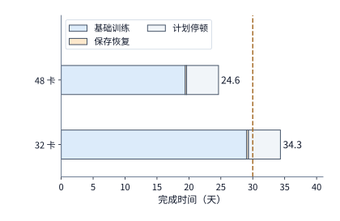

*图 10-48　32 卡与 48 卡 RTX 4090 方案的端到端完成时间分解：横条从左至右依次累加基础训练时间（蓝色，已含暴露通信与输入等待）、检查点保存与故障恢复附加时间（橙色窄段）以及 5 天计划性停顿（灰色），竖直虚线标出 30 天交付红线。*

对照上表与图 10-48，两套方案的终局裁决一目了然：
- **显存容量双双过关**：借助全组 ZeRO-3 分片，32 卡与 48 卡方案的单卡显存峰值分别仅为 $13.8\ \mathrm{GiB}$ 与 $12.5\ \mathrm{GiB}$，均远低于 RTX 4090 的 $22\ \mathrm{GiB}$ 可用显存上限；
- **32 卡方案因单步计算过长而超期出局**：虽然 32 卡的基础训练时间（$29.0$ 天）看似勉强压在 30 天以内，但一旦加上约 $0.3$ 天的容错开销与必不可少的 $5$ 天计划停顿，总工期便达到了 **$34.3$ 天**，超出 30 天期限 $4.3$ 天；
- **48 卡方案按期交付并留有充足工程裕度**：通过增加 2 台 8 卡主机将每卡每步累积的微批次数从 12 个减至 8 个，基础训练时间直接缩短三分之一至 **$19.4$ 天**；计入 $1.08\%$ 的容错附加耗时与 $5$ 天计划停顿后，总完成时间定格在 **$24.6$ 天**，不仅顺利跑赢 30 天交付期限，还留出了约 **$5.4$ 天**的安全缓冲。

在实际集群选型中，除了像 32 卡与 48 卡这样差距悬殊的方案外，我们经常还会遇到**两个候选并行配置预测耗时极为接近**的情形；此时如果直接照搬孤立微基准（isolated profiling）测得的通信耗时去排序，往往会在真实训练的共享链路争用下遭遇**方案优劣反转**（如 MICRO 2024 的 **vTrain** 所揭示的现象）。设同一训练任务下两个均满足显存约束的候选方案 A 与 B：在无争用的孤立剖析（$k=1$）下，方案 A 的计算耗时为 $70\ \mathrm{ms}$、暴露在关键路径上的通信耗时为 $30\ \mathrm{ms}$（合计 $100\ \mathrm{ms}$）；方案 B 的计算耗时为 $90\ \mathrm{ms}$、暴露通信耗时为 $12\ \mathrm{ms}$（合计 $102\ \mathrm{ms}$），静态预测显示 A 以 $2\ \mathrm{ms}$ 的微弱优势领先。然而，当进入真实多节点训练时，多流并发与网卡队列争用会使实际暴露通信耗时相对于孤立剖析放大 $k$ 倍，两套方案的实际单步耗时变为 $T_A(k) = 70 + 30k$ 与 $T_B(k) = 90 + 12k$。令两者相等：

$$
70 + 30k^* = 90 + 12k^* \qquad\Longrightarrow\qquad k^* = \frac{10}{9} \approx 1.111.
$$

只要真实训练环境中的通信膨胀系数 $k$ 跨过 **$10/9$（仅比孤立测试慢 $11.1\%$）**，两套方案的快慢排序就会立刻发生翻转——例如在典型的 $k = 1.3$ 争用下，$T_A(1.3) = 109\ \mathrm{ms}$，而通信占比更小的 $T_B(1.3) = 105.6\ \mathrm{ms}$ 反超成为更优方案。这提醒我们：性能模型的全局平均拟合优度（如高 $R^2$）并不能保证局部相近配置的排序正确；当两个方案的预测差距落在通信不确定性区间内时，最有效的工程动作是直接针对候选配置的真实集合通信组与并发链路做一次带载补测。[^plan-ranking]

更进一步，若把视角从单个训练作业拉升到整个数据中心加速卡池，章首至本节建立的“计算 $\to$ 同步等待 $\to$ 检查点与回滚损耗”链条，可以直接映射为衡量集群级有效产出的**三级算力效率分解（ML Fleet Efficiency / Goodput，MLSys 2026）**。考察一个拥有 $100$ 张同型加速卡的资源池在 $1\ \text{小时}$（总物理供给容量 $C = 100 \times 3600 = 360{,}000\ \mathrm{GPU\cdot s}$）内的真实去向：哪怕单卡层面的任务分配率高达 $350{,}000 / 360{,}000 \approx 97.22\%$，由于同步训练要求同一个作业组的全部加速卡同时就绪才能推进，扣除“卡已分配但同组其他卡尚未到齐”的成组等待后，真正成组同步就绪的时间降至 $A = 300{,}000\ \mathrm{GPU\cdot s}$；在此基础上，再扣除环境初始化、算子编译、数据饥饿、检查点保存停顿以及故障后回滚作废的步骤，最终转化为已落盘保存训练进展的有效执行时间降至 $G = 240{,}000\ \mathrm{GPU\cdot s}$；若将这部分有效进展对应的固定模型数学运算量折算为峰值算力下的理想计算时间，则为 $I = 120{,}000\ \mathrm{GPU\cdot s}$。由此，整个集群的端到端有效算力产出率（$I/C$）严格分解为三项正交指标的乘积：

$$
\frac{I}{C} = \underbrace{\frac{A}{C}}_{\text{调度就绪率 }\mathrm{SG}\approx 83.33\%} \times \underbrace{\frac{G}{A}}_{\text{运行有效率 }\mathrm{RG}=80.0\%} \times \underbrace{\frac{I}{G}}_{\text{程序执行效率 }\mathrm{PG}=50.0\%} = \frac{120{,}000}{360{,}000} \approx \mathbf{33.33\%}.
$$

这一分解公式清晰地界定了不同团队的优化主战场：集群调度器负责提升成组分配与排队交错（拉高 $\mathrm{SG}$），容错与存储系统负责压缩启动编译、检查点停顿与回滚丢失（拉高 $\mathrm{RG}$，对应式 $T_{\mathrm{finish}}$ 中的 $T_0$ 与 $L$），而编译器与算子/并行策略工程师则负责逼近硬件屋脊线（拉高 $\mathrm{PG}$，对应单步时间 $t_s$）。绝不能拿 $97.22\%$ 的单卡分配率直接乘以 $50\%$ 的单步程序效率去虚报 $48.6\%$ 的集群产出，因为中间遗漏的恰恰是成组未齐与故障回滚丢掉的 $110{,}000\ \mathrm{GPU\cdot s}$。[^fleet-eff]

### 10.6.2 48 卡集群的性能调优安全边界与网卡减配风险

图 10-48 中 48 卡方案留出的那 **$5.4$ 天**总工期余量，折算回全部 $31{,}790$ 个训练步，究竟意味着每一步迭代还能容忍多少秒的额外性能退化？

将 $T_{\mathrm{finish}} \le 30$ 天、$T_0 = 5$ 天与 $L = 1.08\%$ 代入总工期公式反解 $t_s$，可得 48 卡方案在计入容错开销后的**单步时间硬上限**：

$$
t_s\le\frac{25\times86400\ \mathrm{s}}{31{,}790\times(1+0.0108)}\approx67.2\ \mathrm{s}.
$$

当前 48 卡方案的实际单步耗时为 $52.8\ \mathrm{s}$，意味着每一步迭代拥有约 **$14.4\ \mathrm{s}$ 的安全余量**。我们把这 $14.4\ \mathrm{s}$ 余量放到三个具体工程场景下检验系统的抗风险能力：
1. **ZeRO-3 通信预取重叠完全失效的极端退化**：固定单卡计算耗时 $52.2\ \mathrm{s}$ 与数据输入等待 $0.5\ \mathrm{s}$ 不变，单步最多可容忍高达 $67.2 - 52.2 - 0.5 = \mathbf{14.5\ \mathrm{s}}$ 的暴露通信等待。如第 10.3.3 节所算，在每卡配一张 $200\ \mathrm{Gbit/s}$ 网卡、瓶颈位于 $32\ \mathrm{GB/s}$ PCIe 总线的基准配置下，全步 $385\ \mathrm{GB}$ 集合通信的 PCIe 链路总时间也不过 **$12.0\ \mathrm{s}$**。这带来了一个十分稳健的工程结论：**在 48 卡基准配置下，哪怕后台逐层预取完全失效、$12.0\ \mathrm{s}$ 的集合通信百分之百暴露在计算之外，单步耗时也只是升至 $52.2 + 12.0 + 0.5 \approx 64.8\ \mathrm{s} < 67.2\ \mathrm{s}$，依然能够按期完成任务**。
2. **若强行只用 32 张卡，单卡计算效率必须提至多高？** 对 32 卡方案（$L = 1.02\%$），扣除 $0.08\ \mathrm{s}$ 暴露通信与 $0.5\ \mathrm{s}$ 输入等待后，留给单卡纯计算的预算上限约为 $66.7\ \mathrm{s}$，而当前在 $40\%$ 计算效率下需耗时 $78.3\ \mathrm{s}$。要想不加机器按期训完，必须通过底层算子调优将 RTX 4090 的单卡计算效率从 $40\%$ 大幅拉高到 $40\% \times \frac{78.3}{66.7} \approx \mathbf{47\%}$——这一数字甚至已经超过了 Meta 在 H100 超算集群上训练 Llama 3 所报告的最高 MFU（$43\%$）。由此，架构师可以向管理层摆出两条清晰的量化路线：要么多租 2 台 8 卡主机（48 卡方案），要么投入精兵强将把 32 卡的单卡计算效率从 $40\%$ 优化到 $47\%$。
3. **服务器网卡减配（8 卡共享单张 200 Gbit/s 网卡）的割集风险**：第 10.3.3 节算出的 $12.0\ \mathrm{s}$ 链路时间，是以“每台 8 卡主机配备 8 张 $200\ \mathrm{Gbit/s}$（$25\ \mathrm{GB/s}$）RDMA 网卡”为前提的。如果为了省成本，把网络配置缩水为**“每台 8 卡主机仅配备 1 张 $200\ \mathrm{Gbit/s}$（$25\ \mathrm{GB/s}$）网卡”**，会发生什么？根据第 7 章例 7.1 的图割集定理，当跨机环形集合通信进出这台主机时，这唯一的一张 $25\ \mathrm{GB/s}$ 网卡必须独自扛下卡上全部 $385\ \mathrm{GB}$ 的跨机收发流量，使全步通信链路时间从 $12.0\ \mathrm{s}$ 拉长到 $385 / 25 \approx \mathbf{15.4\ \mathrm{s}}$（单个微批次链路时间升至 $1.92\ \mathrm{s}$）。请注意这一减配带来的定性变化：虽然在预取重叠正常工作时，$1.92\ \mathrm{s}$ 仍短于单微批次的 $6.53\ \mathrm{s}$ 计算时间、暴露通信依然只有首尾的 $0.08\ \mathrm{s}$；但 **$15.4\ \mathrm{s}$ 的总链路时间已经超过了 $14.5\ \mathrm{s}$ 的最大通信容忍上限**——一旦遇到软件版本升级或系统抖动导致通信重叠失效，单步耗时就会冲高到 $52.2 + 15.4 + 0.5 \approx \mathbf{68.1\ \mathrm{s}} > 67.2\ \mathrm{s}$，直接导致整个项目延期。换言之，**每卡配一张网卡让按期交付拥有“免重叠保底”的确定性保障，而八卡共用一张网卡则把按期交付完全押在了通信重叠绝对不能失效的前提上**。

### 10.6.3 硬件局部替换与阿姆达尔定律敏感性剖析

在评估“要不要加钱换更高配的互联或更快的加速卡”时，我们可以用基于单步耗时拆解的 **Amdahl（阿姆达尔）定律**迅速识别真伪瓶颈。设某项硬件资源主导的耗时在原单步总时间 $T$ 中所占的暴露比例为 $f$（$0 \le f \le 1$），将该硬件资源的有效处理能力变为原来的 $r$ 倍（且不改变重叠关系与其他算子耗时），则替换硬件后的新单步耗时 $T'$ 与原耗时 $T$ 之比为：

$$
\frac{T'}{T}=1-f+\frac{f}{r}.
$$

用一个直观的数字对比就能看清暴露占比 $f$ 的决定性作用（图 10-49）：假设原单步耗时 $100\ \mathrm{ms}$ 中只有 $5\ \mathrm{ms}$ 是暴露通信等待（$f = 5\%$），那么哪怕互联带宽缩减一半（$r = 0.5$），单步耗时也只是变成 $95 + 10 = 105\ \mathrm{ms}$（仅变慢 **$5\%$**）；反之，若原本暴露通信占了半壁江山（$50\ \mathrm{ms}$，$f = 50\%$），同样将带宽减半就会使单步耗时激增至 $50 + 100 = 150\ \mathrm{ms}$（恶化 **$50\%$**）。

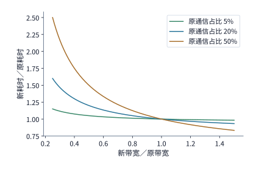

*图 10-49　阿姆达尔定律下硬件能力变化倍数 $r$ 对相对单步耗时 $T'/T = 1 - f + f/r$ 的影响曲线：某项资源原本占单步暴露时间的比例 $f$ 越小，其性能退化或升级对端到端耗时的影响就越微弱。*

把这条定律套用到我们的 48 卡方案上，立刻就能看清什么才是真正的命门：
- **PCIe 带宽减半（如降级为 PCIe 3.0 x16，$16\ \mathrm{GB/s}$）**：在预取正常工作的基准状态下，暴露通信仅占单步时间的 $f = 0.08 / 52.8 \approx \mathbf{0.14\%}$。当 PCIe 带宽减半时，单个微批次的链路时间虽然从 $1.50\ \mathrm{s}$ 翻倍至 $3.0\ \mathrm{s}$，但因为依然远短于该微批次 $6.53\ \mathrm{s}$ 的计算时间，内部各层通信照样被计算严密掩盖；唯一翻倍的是首尾词表层的暴露等待（从 $0.08\ \mathrm{s}$ 增至约 $0.15\ \mathrm{s}$），整步耗时仅从 $52.8\ \mathrm{s}$ 微增至 **$52.9\ \mathrm{s}$**，几乎纹丝不动。
- **单卡计算效率下滑（从 $40\%$ 跌至 $30\%$）**：相比之下，单卡纯计算占了整步时间的 $52.2 / 52.8 \approx \mathbf{98.9\%}$。一旦因为算子分块不匹配或降频使单卡计算效率从 $40\%$ 跌到 $30\%$（即 $r = 0.75$），单卡计算时间就会从 $52.2\ \mathrm{s}$ 激增至 **$69.6\ \mathrm{s}$**，加上通信与输入等待后单步达 **$70.2\ \mathrm{s} > 67.2\ \mathrm{s}$**，直接宣告项目超期。

可见，在通信已被计算良好覆盖的 ZeRO-3 稠密训练中，**单卡有效计算吞吐是决定生死的第一主轴**；互联带宽只有在通信无法被计算掩盖（如预取失效或超大 EP 全互换暴露）时，才会跃升为式中的高占比项 $f$。当架构师在 A100、A800、H20 或其他加速卡之间做采购选型时，只需将各卡的实测计算吞吐、接口带宽与显存容量代入同一套表格，筛选出所有满足 $T_{\mathrm{finish}} \le 30$ 天的合格配置，最后按总租赁/购置与电力成本挑出性价比最高的一档即可。

### 10.6.4 向万亿参数扩展：模型规模、数据量与期限的平方律边界

前面各节我们固定了 Qwen3-8B 模型不变；在本章收官之际，让我们把同一套资源下界方程推广到**万亿参数（$1\mathrm{T}$）基座大模型的预训练**，看看当模型参数量 $N$ 与训练数据量 $D$ 同步放大时，算力需求会呈现怎样显著的增长。

采用稠密 Transformer 预训练的标准计算量近似公式 $F \approx 6ND$：设训练语料总量为 $D = 20\mathrm{T}$（$2\times 10^{13}$）个 token，要求在净可用执行期限 $T$ 内完成训练，集群平均模型算力利用率为 $\eta$（MFU），单卡峰值算力为 $P$，则满足期限所需的加速卡数下界为：

$$
p\ge\left\lceil\frac{6ND}{P\eta T}\right\rceil.
$$

图 10-50 将 **$90$ 天净执行期限**、**$20\mathrm{T}$ token 数据量**下的卡数边界画在了对数坐标平面上（分别展示 A100、H100 与新一代 Blackwell B200 在 $40\%$ MFU 实线与 $50\%$ MFU 虚线下的最少卡数需求，水平基准线标出拥有 **$16{,}384$ 张加速卡**的超算集群规模）：

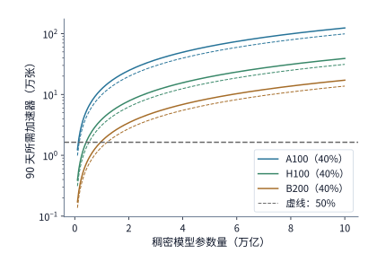

*图 10-50　固定 90 天净执行期限与 20T token 训练数据量（$F=6ND$）时，不同稠密模型参数规模 $N$ 所需的最小加速卡数边界（实线为 40% MFU，虚线为 50% MFU，水平线标出 16,384 卡规模）。位于对应曲线上方的集群配置可按期完成训练，位于下方则必须提效、加卡或延期。*

我们在图 10-50 的 **$1\mathrm{T}$（万亿参数）**刻度线上做一次硬核点算：如果手头拥有一座顶级的 **$16{,}384$ 卡**集群，在 **$40\%$ MFU** 下训完 $1\mathrm{T}$ 模型、$20\mathrm{T}$ token 分别需要多少天？
- **16,384 张 A100**：约需 **$679$ 天**（近两年）；
- **16,384 张 H100**：约需 **$214$ 天**（七个月以上）；
- **16,384 张 B200**：约需 **$94$ 天**。

令人震撼的是，在 $40\%$ MFU 下，哪怕是 $16{,}384$ 张最新一代的 B200，在 $90$ 天期限面前依然差了约 $4$ 天（需要扩充到约 $17{,}147$ 张卡才能压进 $90$ 天）；**唯有通过极致的系统工程优化，将全集群端到端 MFU 从 $40\%$ 提升 10 个百分点到 $50\%$（图 10-50 中的绿色虚线），$16{,}384$ 张 B200 的纯训练时间才能缩短至约 $75$ 天**，从而稳稳落入 $90$ 天红线以内，并为计划停顿与故障恢复留出约 $15$ 天的安全余量。在万卡万亿参数的尺度上，**系统工程师把 MFU 提高 10 个百分点，直接决定了整座超算中心能否在规定季度内交付旗舰基座模型**。[^scale]

更进一步，请注意**固定数据量扩展**与**遵循缩放定律（Chinchilla Scaling Law）按参数量等比放大数据量**之间的本质差异：
- 如果固定数据量 $D = 20\mathrm{T}$ 不变，将稠密模型参数量 $N$ 放大 $5$ 倍（从 $1\mathrm{T}$ 到 $5\mathrm{T}$），总计算量 $F = 6ND$ 只是线性放大 **$5$ 倍**；
- 但如果遵循计算最优缩放定律，要求训练 token 数随参数量按 $D = 20N$ 同步放大，那么总计算量就会变成二次方关系 **$F = 120N^2$**——此时将参数量 $N$ 放大 $5$ 倍，所需总算力将激增 **$25$ 倍**。这也是为什么工业界在迈向万亿参数时，纷纷转向混合专家（MoE）架构：用总参数量撑起模型容量，同时将每个 token 实际激活的参数量控制在数十亿级别，从而打破 $120N^2$ 的稠密算力魔咒。

最后，当一套训练系统真正上线长跑数周时，我们还需要用公开或线上的运行日志持续核验其**长期有效训练速率**。在读取带有断点恢复记录的训练日志（如开源社区公开的 SmolLM3 多阶段预训练日志）时，务必注意：**某次恢复运行区间内真正新增的训练工作量，等于区间结束时的累计已训 token 数减去本次从检查点恢复起点处的已训 token 数**；唯有拿这部分净新增 token 数除以该区间的日历墙钟时间，算出来的才是包含了全部通信、加载与容错损耗在内的真实长期有效吞吐。[^public]

回看全章走过的推导脉络：图 10-11 至图 10-16 剖析了训练状态与激活怎样占据显存、怎样跨越总线；图 10-18 至图 10-38 揭示了流水线气泡、PCIe 通信争用、数据预取偏移与检查点回滚怎样形成关键路径等待并左右长期有效进度；而图 10-48 则将所有这些微观机制汇聚成了章首 $100\mathrm{B}$ token 任务的最终交付工期，并在第 10.5 节延伸到了强化学习后训练的生成—验证—学习反馈回路中。图 10-51 与图 10-52 进一步将本章在大规模训练流水调度与 MoE 训推协同上的两项代表性机制——**1F1B 与 DualPipe 双向流水线的气泡减半及显存收支对比（`D14-02`）**、以及**训练侧动态偏置路由均衡与推理侧 EPLB 物理副本均衡的双轨分工（`D14-03`）**——定格为工程速查图谱。在下一章（第 11 章）中，我们将把视野从单个训练或推理作业进一步拉升到多租户数据中心集群层面，探讨当成百上千个这样的训练、推理与 RL 阶段共享同一个物理资源池时，调度系统与运行环境如何实现高效编排与故障隔离。


*图 10-51　1F1B、零气泡（ZB1P）与 DualPipe 双向流水线的气泡压缩机制及显存驻留代价对比（`D14-02`）。上栏对比单向 1F1B 的 $(PP-1)(F+B)$ 首尾气泡与 DualPipe 从两端相向注入微批次将气泡压缩至 $(PP/2-1)(F\&B+B-3W)$ 的双向对称填充结构；下栏展示配对块 $F\&B$ 内部如何将正向微批的跨机 EP `All-to-All` 通信掩盖在反向微批的注意力/MLP 计算阴影下，并列出每设备 $2\times$ 参数副本与 $PP+1$ 份激活驻留的显存交换代价。*


*图 10-52　MoE 模型在训练期与推理期的负载均衡双轨机制对比（`D14-03`）。左栏为训练期无辅助损失动态偏置机制（DeepSeek-V3 §2.1.2）：偏置 $b_i$ 仅加入选择条件 $\operatorname{Topk}(s_{j,t}+b_j)$ 而不改变门控乘数 $g'_{i,t}=s_{i,t}$，通过改写选中的逻辑专家引导全部专家在梯度更新中均衡演进；右栏为推理期专家并行负载均衡（EPLB）：模型权重与逻辑路由严格冻结不变，仅在物理 GPU 上为热点逻辑专家复制冗余权重副本并分流请求，确保数学输出等价。*

图 10-53 与图 10-54 进一步汇总了本章在生产级 RL 权重热更新控制面（SGLang 六阶段职责边界与 `[成功, 成功, 失败, 成功]` 局部失败处置）以及超大规模检查点容错架构（ByteCheckpoint 异构重分片、PyTorch 2.14 异步双句柄与 Checkmate 无盘内存对等恢复）上的关键机制。


*图 10-53　生产级推理引擎（SGLang `c99d906e`）在线权重热更新的六阶段职责边界与局部失败状态分裂剖析。左栏：从请求进入（`reader_lock`）、暂停生成（`is_pause` 挂起／中止／撤回）、提交更新（磁盘／张量路径加 `writer_lock`，分布式／IPC 路径无锁）、汇总结果（`all(r.success)`）到发布管理层信息（仅全部成功时递增 `weight_version`）与恢复生成（`continue_generation` 不检查前序状态且不自动调用）的完整控制流；右栏：当 4 个分片返回 `[成功, 成功, 失败, 成功]` 时，管理层虽阻止了新版本号发布，但执行层分片 1、2、4 已就地覆写新权重而分片 3 残留半成品，外部控制器严禁直接调用 `continue_generation`，必须统一下发完好权重重载并清空 KV 缓存后方可恢复服务。*


*图 10-54　超大规模训练检查点的异步暂存、异构重分片与无盘内存对等恢复架构。左栏：PyTorch `2.14` DCP 双句柄（`staging_completion` 与 `upload_completion`）配合进程级页锁定内存 Stager 与通信计划缓存，在 1856 卡 H200 Llama3-70B 上将后台落盘从 436 s 压至 67 s（ByteCheckpoint 在 8960 卡 405B 上将前台停顿压至 0.59 s），并揭示 `2400 -> 4800` 卡重分片中 GPU 状态（62.10 s）与包含 CPU Dataloader 全状态（401.21 s）之间的串行长尾差距；右栏：Checkmate（NSDI 2026）利用跨节点 RDMA 将分片状态镜像至邻近健康节点主机内存（Peer DRAM）并结合局部张量重计算，在单节点故障时直接从对等端内存拉取恢复，彻底消除远端并行文件系统（PFS）的磁盘 I/O 往返。*

### 10.6.5 主机内存卸载的异步双缓冲流水账本（Locked Case I20）：60.833 ms vs. 53.833 ms vs. 35.604 ms 与链路降级翻转

在第 10.2.3 节与第 10.4.1 节中，我们讨论了主机内存（Host DRAM）与设备显存（Device HBM）之间的卸载与数据供给；而当视角下沉到单个训练步内部的分片张量搬移（如激活卸载恢复或微批次预取）时，**主机缓冲槽位（Host Staging Slots）与设备缓冲槽位（Device Buffer Slots）的数量配比及事件同步契约**直接决定了异步 DMA 引擎能否与 GPU 计算流水线真正重叠。许多训练代码虽然分配了页锁定内存（Pinned Memory）并调用了 `non_blocking=True` 异步拷贝，却只分配了单个设备缓冲槽位（1 Device Slot），导致拷贝引擎为了等待 GPU 释放设备槽位而退化为半串行阻塞。

为什么仅有 2 个主机槽位 + 1 个设备槽位（单设备槽异步暂存）依然无法隐藏 H2D 传输耗时？因为 GPU 的 DMA 拷贝引擎与计算引擎共享同一个设备缓冲槽位时，必须遵守两条铁律：（1）**主机槽位复用条件**：主机 CPU 只有在 DMA 引擎完成从该主机槽位向设备槽位的读取（`dma_done` 事件就绪）后，才能向该主机槽位写入下一分片；（2）**设备槽位复用条件**：DMA 引擎只有在 GPU 计算流完全读完设备槽位中的当前分片（`compute_done` 事件就绪，通常由 `tensor.record_stream()` 维护）后，才能向该设备槽位覆写下一分片。若设备侧只有 1 个槽位，第 $k+1$ 块的 H2D DMA 就必须严格排在第 $k$ 块的 GPU 计算结束之后，使 DMA 与 GPU 计算在时间轴上首尾相接、无法重叠；唯有在主机侧与设备侧同时配备 **2 个主机槽位 + 2 个设备槽位（Ping-Pong 双缓冲）**，才能将主机准备、H2D 搬移与 GPU 计算彻底解耦为三级并发流水线。[^host-transfer]

> **算例 10-4（Locked Case `I20`：8×64 MiB 分片在同步串行、单设备槽阻塞与双槽乒乓流水下的时间线复算）** 考察 Qwen3-8B 训练中将一个形状为 `[8192, 4096]` 的 BF16 激活张量（总体积 $512\ \mathrm{MiB}$）切分为 **$M = 8$ 个大小为 $V_{\mathrm{chunk}} = 64\ \mathrm{MiB}$ 的分片**依次从主机内存搬入 GPU 显存并消费计算的流水过程。设每块在主机侧的页锁定准备耗时为 $t_{\mathrm{prep}} = 1.0\ \mathrm{ms}$，经有效单向带宽 $B_{\mathrm{h2d}} = 24\ \mathrm{GiB/s} = 24{,}576\ \mathrm{MiB/s}$ 的 PCIe 4.0 x16 异步 DMA 引擎搬移耗时为：
>
> $$
> t_{\mathrm{h2d}} = \frac{64\ \mathrm{MiB}}{24\times 1024\ \mathrm{MiB/s}} = \frac{1}{384}\ \mathrm{s} \approx \mathbf{2.604167\ \mathrm{ms}},
> $$
>
> 随后由 GPU 计算流消费该分片耗时 $t_{\mathrm{comp}} = 4.0\ \mathrm{ms}$。对比四种配置下的端到端完成时刻：
> - **方案一（朴素同步串行：1 主机槽 + 1 设备槽）**：每块依次串行经历主机准备、H2D 搬移与 GPU 计算，8 块总耗时为：
>
> $$
> T_{\mathrm{serial}} = 8 \times \left(1 + \frac{1000}{384} + 4\right)\ \mathrm{ms} = 8 \times 7.604167\ \mathrm{ms} = \mathbf{60.833\ \mathrm{ms}}.
> $$
>
> - **方案二（单设备槽异步暂存：2 主机槽 `128 MiB` + 1 设备槽 `64 MiB`）**：双主机槽允许第 $k+1$ 块的 `1 ms` 主机准备隐藏在第 $k$ 块的 DMA 与计算期间，但因设备侧只有 1 个 `64 MiB` 槽位，第 $k+1$ 块的 H2D 必须等第 $k$ 块的 `4 ms` GPU 计算结束后才能启动，总耗时为：
>
> $$
> T_{\mathrm{1dev}} = \left(1 + \frac{1000}{384} + 4\right) + 7 \times \left(\frac{1000}{384} + 4\right)\ \mathrm{ms} = 7.604167 + 46.229167 = \mathbf{53.833\ \mathrm{ms}},
> $$
>
>   仅比朴素串行节省了后 7 块的主机准备时间（$7.0\ \mathrm{ms}$）。
> - **方案三（双槽乒乓缓冲：2 主机槽 `128 MiB` + 2 设备槽 `128 MiB`，正常链路 `24 GiB/s`）**：双设备槽允许 DMA 引擎在 GPU 计算槽位 0（`Ping`）的同时向槽位 1（`Pong`）灌注下一分片。三级流水的稳态步进周期由最慢阶段 $\max(t_{\mathrm{prep}},\, t_{\mathrm{h2d}},\, t_{\mathrm{comp}}) = \max(1.0,\, 2.604167,\, 4.0) = \mathbf{4.0\ \mathrm{ms}}$（GPU 计算）主导，总耗时压降至：
>
> $$
> T_{\mathrm{2dev}} = 1 + \frac{1000}{384} + 4 + 7 \times 4 = 7.604167 + 28.0 = \mathbf{35.604\ \mathrm{ms}},
> $$
>
>   相比朴素串行实现 **$1.71\times$** 端到端加速，且后 7 块的 H2D 传输 100% 被 GPU 计算掩盖。
> - **方案四（PCIe 拓扑降级翻转：双槽乒乓缓冲，有效带宽减半至 $B_{\mathrm{deg}} = 12\ \mathrm{GiB/s}$）**：当跨 NUMA 插槽或链路降级使有效 DMA 带宽减半至 $12\ \mathrm{GiB/s}$ 时，单块传输耗时翻倍至 $t_{\mathrm{h2d,deg}} = \frac{64}{12\times 1024}\ \mathrm{s} \approx \mathbf{5.208333\ \mathrm{ms}} > t_{\mathrm{comp}} = 4.0\ \mathrm{ms}$。此时稳态周期主导权由 GPU 计算翻转回 DMA 传输（$\max(1.0,\, 5.208333,\, 4.0) = 5.208333\ \mathrm{ms}$），双缓冲总耗时回升至：
>
> $$
> T_{\mathrm{deg}} = 1 + 8 \times \frac{1000}{192} + 4 = 1 + 41.666667 + 4 = \mathbf{46.667\ \mathrm{ms}}.
> $$

| 流水线配置与互联条件 | 主机/设备暂存空间 | 单块 $t_{\mathrm{h2d}}$ / ms | 稳态步进周期 / ms | 8 块总完成时间 $T$ / ms | 相对串行加速比 | 稳态关键路径瓶颈 |
|---|---|---:|---:|---:|---:|---|
| ① 同步串行（1 主机槽 + 1 设备槽） | `64 MiB` + `64 MiB` | 2.604 | $1+2.604+4 = 7.604$ | **60.833** | $1.00\times$ | 准备 + 传输 + 计算全串行 |
| ② 单设备槽（2 主机槽 + 1 设备槽） | `128 MiB` + `64 MiB` | 2.604 | $2.604+4 = 6.604$ | **53.833** | $1.13\times$ | 设备槽争用（DMA 等计算完） |
| ③ 双槽乒乓（2 主机槽 + 2 设备槽，`24 GiB/s`） | `128 MiB` + `128 MiB` | 2.604 | $\max(1, 2.604, 4) = \mathbf{4.000}$ | **35.604** | **1.71×** | **GPU 计算主导**（传输全隐藏） |
| ④ 双槽乒乓（链路降级，`12 GiB/s`） | `128 MiB` + `128 MiB` | 5.208 | $\max(1, 5.208, 4) = \mathbf{5.208}$ | **46.667** | $1.30\times$ | **翻转回 PCIe DMA 带宽主导** |

*表 10-11　Locked Case `I20`（8 块 $\times\ 64\ \mathrm{MiB}$ BF16 激活，$t_{\mathrm{prep}}=1\ \mathrm{ms}$，$t_{\mathrm{comp}}=4\ \mathrm{ms}$）下不同缓冲槽位配比与链路带宽的完成时间对比。*


*图 10-55　主机到设备（H2D）异步 DMA 与 Ping-Pong 双缓冲流水时间线对比（Locked Case `I20`）。左栏对比 8 块 `64 MiB` 张量在同步串行（`60.833 ms`）、单设备槽阻塞（`53.833 ms`）与正常链路 `24 GiB/s` 乒乓双缓冲（`35.604 ms`，加速 `1.71x`）下的完成时间；右栏归纳主机槽/设备槽的事件同步复用边界（两侧各 `128 MiB` 暂存开销），以及当 PCIe 降级至 `12 GiB/s`（单块 H2D 升至 `5.208 ms > 4 ms`）时瓶颈由计算翻转回传输（耗时升至 `46.667 ms`）的机制。*

下面给出 Locked Case `I20` 通用多槽位离散事件仿真器的完整实现，通过追踪每个主机槽位与设备槽位的释放时刻，精确复现表 10-11 与图 10-55 中的全部锁定数值：

```python
def simulate_i20_dma_pipeline(
    chunks: int = 8,
    chunk_mib: float = 64.0,
    prep_ms: float = 1.0,
    comp_ms: float = 4.0,
    bw_gib_s: float = 24.0,
    host_slots: int = 2,
    dev_slots: int = 2,
    serial_mode: bool = False,
) -> dict[str, float]:
    """仿真 Locked Case I20 下给定主机槽数、设备槽数与 DMA 带宽的精确事件时间线（单位：ms）。"""
    h2d_ms = (chunk_mib / (bw_gib_s * 1024.0)) * 1000.0
    if serial_mode:
        total_ms = chunks * (prep_ms + h2d_ms + comp_ms)
        return {"h2d_ms": round(h2d_ms, 3), "makespan_ms": round(total_ms, 3)}

    host_free = [0.0] * host_slots
    dev_free = [0.0] * dev_slots
    cpu_Busy = 0.0
    dma_busy = 0.0
    gpu_busy = 0.0

    for i in range(chunks):
        h_idx = i % host_slots
        d_idx = i % dev_slots
        # 1. 主机准备：须等待 CPU 空闲且对应主机槽位已由前一次 DMA 读完释放
        prep_start = max(cpu_Busy, host_free[h_idx])
        prep_end = prep_start + prep_ms
        cpu_Busy = prep_end

        # 2. H2D DMA：须等待当前块准备完、DMA 引擎空闲，且目标设备槽位已由前一次计算读完释放
        dma_start = max(prep_end, dma_busy, dev_free[d_idx])
        dma_end = dma_start + h2d_ms
        dma_busy = dma_end
        host_free[h_idx] = dma_end  # DMA 完成后主机槽位即可安全覆写

        # 3. GPU 计算：须等待当前块 DMA 到位且 GPU 计算流空闲
        comp_start = max(dma_end, gpu_busy)
        comp_end = comp_start + comp_ms
        gpu_busy = comp_end
        dev_free[d_idx] = comp_end  # 计算完成后设备槽位方可被下一轮 DMA 覆写

    return {"h2d_ms": round(h2d_ms, 3), "makespan_ms": round(gpu_busy, 3)}


if __name__ == "__main__":
    r_serial = simulate_i20_dma_pipeline(host_slots=1, dev_slots=1, serial_mode=True)
    r_1dev = simulate_i20_dma_pipeline(host_slots=2, dev_slots=1, bw_gib_s=24.0)
    r_2dev = simulate_i20_dma_pipeline(host_slots=2, dev_slots=2, bw_gib_s=24.0)
    r_deg = simulate_i20_dma_pipeline(host_slots=2, dev_slots=2, bw_gib_s=12.0)
    assert r_serial["makespan_ms"] == 60.833
    assert r_1dev["makespan_ms"] == 53.833
    assert r_2dev["makespan_ms"] == 35.604
    assert r_deg["makespan_ms"] == 46.667
    print({"serial": r_serial, "1dev": r_1dev, "2dev_24g": r_2dev, "2dev_12g": r_deg})
```

### 10.6.6 分布式二阶动量正交化优化器（Distributed Muon）与 RL 节点掉线弹性重准入协议

在本章收尾之际，我们将视野投向 2025—2026 年大模型训练系统演进的两项前沿机制：**以 $1.3\text{–}1.5\times$ 样本效率超越 AdamW 的分布式矩阵正交化优化器（Distributed Muon，已在 Moonshot Kimi K2 等万亿模型预训练中规模化验证）**，以及**万卡异步 RL 训练中工作节点掉线与热替换的弹性重准入状态机（Elastic Node Readmission）**。

#### 1. Distributed Muon 优化器：12 Bytes/Param 状态账本、5 步 Newton-Schulz 算力占比与通信重叠

传统 AdamW 优化器对每个参数独立维护一阶动量 $m_t$（FP32，4 B）与二阶方差矩 $v_t$（FP32，4 B），加上 FP32 主权重（4 B）、BF16 工作权重（2 B）与 BF16 梯度（2 B），构成了第 10.1.2 节熟知的 **$16\ \text{Bytes/Param}$** 常驻状态账本。然而对于 Transformer 线性投影层中的二维权重矩阵 $W \in \mathbb{R}^{m \times n}$（不妨设 $m \le n$），梯度的低秩聚集效应往往使少数主导奇异值方向垄断更新步长。**Muon（Momentum Orthogonalized by Newton-Schulz）** 优化器针对所有二维矩阵参数摒弃了逐元素二阶矩 $v_t$，仅保留一份一阶动量矩阵 $M_t = \mu M_{t-1} + G_t$（FP32，4 B），从而将优化器自身状态直接削减 **$33\%$**（从 $12\ \mathrm{B}$ 降至 $8\ \mathrm{B}$），并将二维矩阵层的总常驻训练状态从 $16\ \text{Bytes/Param}$ 削减 **$25\%$** 至 **$12\ \text{Bytes/Param}$**。

为了让一阶动量矩阵 $M_t$ 在所有奇异值方向上具有均一的更新尺度，Muon 需要将 $M_t = U \Sigma V^\top$ 映射为其正交极因子 $U V^\top$。生产系统先用 Frobenius 范数将动量矩阵归一化为 $X_0 = M_t / (\|M_t\|_F + \epsilon)$，随后在 BF16 Tensor Core 上运行固定 **$K_{\mathrm{NS}} = 5$ 步奇数阶多项式 Newton-Schulz 迭代**：

$$
X_{k+1} = a X_k + b A_k X_k + c A_k^2 X_k, \qquad A_k = X_k X_k^\top \in \mathbb{R}^{m \times m}, \qquad (a, b, c) = (3.4445, -4.7750, 2.0315).
$$

我们来严格核算这 5 步矩阵正交化究竟给训练步增加了多少额外浮点运算量（FLOPs）。对于形状为 $m \times n$（$m \le n$）的二维权重矩阵，单步 Newton-Schulz 迭代需依次执行三次稠密矩阵乘法（GEMM）：（1）计算对称格拉姆矩阵 $A_k = X_k X_k^\top$（形状 $[m, n] \times [n, m] \to [m, m]$，运算量为 $2m^2 n$ FLOPs）；（2）计算 $A_k^2 = A_k A_k$（形状 $[m, m] \times [m, m] \to [m, m]$，运算量为 $2m^3$ FLOPs）；（3）将组合矩阵 $(b A_k + c A_k^2)$ 乘回 $X_k$（形状 $[m, m] \times [m, n] \to [m, n]$，运算量为 $2m^2 n$ FLOPs）。因此，单步迭代仅需 $4m^2 n + 2m^3$ FLOPs，**$K_{\mathrm{NS}} = 5$ 步迭代的总浮点运算量**为：

$$
F_{\mathrm{NS}}(m, n) = 5 \times (4m^2 n + 2m^3) = 20 m^2 n + 10 m^3.
$$

而在该训练步中，参数量为 $m n$ 的线性层处理全局批次总 token 数 $B_{\mathrm{tok}}$ 所需的前后向矩阵乘法运算量为 $F_{\mathrm{train}} = 6 m n B_{\mathrm{tok}}$。两者之比即为 Muon 正交化的相对算力开销：

$$
\frac{F_{\mathrm{NS}}}{F_{\mathrm{train}}} = \frac{20 m^2 n + 10 m^3}{6 m n B_{\mathrm{tok}}} = \frac{10 m (2n + m)}{3 n B_{\mathrm{tok}}}.
$$

在分布式实现中，**Distributed Muon** 先跨 DP 组执行 `ReduceScatter` 归约梯度并更新各卡负责的完整层动量分片 $M_i$（相比归约后再广播双份状态通信量减半），随后在本地 BF16 Tensor Core 上执行 5 步 Newton-Schulz 迭代，并将第 $l$ 层的正交化计算与第 $l-1$ 层更新后主权重的 `AllGather` 广播流水重叠，从而实现通信与正交化的双向隐藏。

#### 2. 异步 RL 节点掉线与热替换的四状态弹性重准入协议

在持续运行数周的千卡级强化学习后训练（如 vLLM RDT / `SkyRL`）中，若在训练器向推理池广播新权重（`update_weights`）或长尾 Rollout 采样中途遭遇单节点闪断掉线，传统全局重启会让整座集群停摆。生产级弹性 RL 控制器通过与第 18 章故障自愈闭环衔接的**四状态节点重准入状态机（`DRAINING -> SYNCING -> VERIFYING -> ACTIVE`）**实现零全局中断恢复：
1. **隔离与在途接管（`DRAINING`）**：控制器检测到某 Rollout 节点心跳或 NCCL 子通道超时（$T_{\mathrm{detect}} = 2.0\ \mathrm{s}$）后，立即将其从路由表隔离并吊销写租约（$T_{\mathrm{drain}} = 0.5\ \mathrm{s}$），由其余健康节点接管未完成的 prompt 采样，存活集群继续正常训练与生成；
2. **重启与基座加载（`SYNCING`）**：替补或重启后的节点在后台独立控制通道完成子通信域初始化（$T_{\mathrm{comm}} = 1.5\ \mathrm{s}$），严禁直接以磁盘旧版本权重加入生成池；
3. **定向拉取最新策略切片与清存（`VERIFYING`）**：由健康对等节点通过机间 RDMA 定向灌注当前最新策略版本号 $v_{\mathrm{curr}}$ 的权重分片（如 $16\ \mathrm{GB}$ 分片在 $20\ \mathrm{GB/s}$ RDMA 下耗时 $T_{\mathrm{sync}} = 0.8\ \mathrm{s}$），校验参数 SHA/范数哈希、清空残留 KV 缓存并核对金标批次 `logprob`（$T_{\mathrm{verify}} = 0.2\ \mathrm{s}$）；
4. **版本屏障对齐后重准入（`ACTIVE`）**：确认 `weight_version == v_curr` 后，在微批次边界将其重新挂入负载均衡器（合计仅耗时 $2.0 + 0.5 + 1.5 + 0.8 + 0.2 = \mathbf{5.0\ \mathrm{s}}$），严防跨代差旧权重产出的陈旧样本污染策略梯度。

> **算例 10-5（Distributed Muon 在 $4096 \times 14336$ 矩阵上的 5 步 Newton-Schulz 算力占比与 RL 弹性重准入核算）**
> 1. **Muon 算力占比核算**：考察 Llama-3-8B / Qwen3-8B 的 SwiGLU 上投影层权重矩阵，形状为 $m = 4096,\; n = 14{,}336$（参数量 $m n = 58{,}720{,}256$），全局批次总 token 数为本章基准的 $B_{\mathrm{tok}} = 384 \times 8192 = 3{,}145{,}728$。单步训练中该层的前后向矩阵运算量为：
>
> $$
> F_{\mathrm{train}} = 6 \times 4096 \times 14{,}336 \times 3{,}145{,}728 \approx \mathbf{1.1081\times 10^{15}\ \mathrm{FLOPs}}\ (1{,}108.1\ \mathrm{TFLOPs}).
> $$
>
>    对该矩阵执行 5 步 Newton-Schulz 正交化的总浮点运算量为：
>
> $$
> F_{\mathrm{NS}} = 20 \times 4096^2 \times 14{,}336 + 10 \times 4096^3 = 4.8104\times 10^{12} + 0.6872\times 10^{12} = \mathbf{5.4976\times 10^{12}\ \mathrm{FLOPs}}\ (5.498\ \mathrm{TFLOPs}).
> $$
>
>    因此，5 步 Newton-Schulz 正交化的额外算力开销仅占该层前后向训练算力的：
>
> $$
> \frac{F_{\mathrm{NS}}}{F_{\mathrm{train}}} = \frac{5.4976\times 10^{12}}{1.1081\times 10^{15}} \approx \mathbf{0.496\% < 1\%},
> $$
>
>    在整机单步耗时中几乎可以忽略不计，同时将二维矩阵层的优化器状态（$m_t, v_t$）从 $8\ \mathrm{B/param}$ 减半至 $4\ \mathrm{B/param}$（包含主权重的总优化器状态从 $12\ \mathrm{B}$ 降至 $8\ \mathrm{B}$，降幅 **$33.3\%$**；全常驻状态从 $16\ \mathrm{B}$ 降至 $12\ \mathrm{B}$，降幅 **$25.0\%$**）。
> 2. **RL 节点弹性重准入收益核算**：在 $512$ 卡 RL 集群中，单节点（8 卡）闪断后通过独立控制通道完成 `DRAINING -> SYNCING -> VERIFYING -> ACTIVE` 仅耗时 $5.0\ \mathrm{s}$，期间仅故障节点 8 张卡损失 $8 \times 5.0 = 40\ \mathrm{GPU\cdot s}$；而传统全局重启（耗时 $120.0\ \mathrm{s}$）会令全部 $512$ 张卡损失 $512 \times 120.0 = 61{,}440\ \mathrm{GPU\cdot s}$，单次故障损失的算力卡时减少了 **$1{,}536\times$**。

| 机制维度 | 传统基准方案（AdamW / 全局重启恢复） | 现代前沿方案（Distributed Muon / 弹性重准入） | 关键量化指标与工程判据 |
|---|---|---|---|
| 优化器状态与总常驻状态 | 优化器 `12 B` / 总常驻 `16 B/param` | 优化器 **`8 B`（$-33\%$）** / 总常驻 **`12 B/param`（$-25\%$）** | 摒弃二阶矩 $v_t$，8B 模型省约 `26 GB` 显存 |
| $4096\times 14336$ 层正交化算力 | 无矩阵正交化（或昂贵 SVD） | **5 步 BF16 Newton-Schulz（`5.498 TFLOPs`）** | 占 $3.15\mathrm{M}$ token 前后向算力仅 **`0.496% < 1%`** |
| 分布式正交化通信路径 | 全参数 `AllGather` 易致显存峰值爆炸 | **跨 DP `ReduceScatter` 分片动量 + 逐层重叠 `AllGather`** | 第 $l$ 层正交化掩盖第 $l-1$ 层参数广播 |
| RL 单节点掉线恢复与卡时损失 | `120.0 s` 全局重启（损 `61,440 GPU·s`） | **`5.0 s` 独立通道重准入（仅损 `40 GPU·s`）** | 状态机 `DRAINING -> SYNCING -> ACTIVE` 严防脏样本 |

*表 10-12　Distributed Muon 优化器（$4096\times 14336$ 矩阵层）与 RL 节点弹性重准入状态机的量化对比。*


*图 10-56　分布式 Muon 优化器 Newton-Schulz 正交化流水线与 RL 节点掉线弹性重准入状态机。左栏展示跨 DP 组 `ReduceScatter` 归约分片动量 $M_i$ 后，在本地 BF16 Tensor Core 上执行 5 步多项式迭代 $X_{k+1}=aX_k+b(X_kX_k^\top)X_k+c(X_kX_k^\top)^2X_k$ 并与层间 `AllGather` 重叠的机制（省去二阶矩 $v$ 使优化器状态降 33%）；右栏展示 Rollout 节点掉线后经隔离接管（`DRAINING`）、重启同步（`SYNCING`）、定向上传最新策略切片 `v_curr` 并清空残留 KV 池，直至版本屏障对齐后重新挂入生成池（`ACTIVE`）的闭环状态机。*

下面给出 Distributed Muon 对任意二维权重矩阵 $(m, n)$ 的 5 步 Newton-Schulz 算力占比、奇异值收敛轨迹及 RL 节点重准入状态机核算器：

```python
def analyze_distributed_muon_and_rl_readmission(
    m: int = 4096,
    n: int = 14336,
    global_tokens: int = 384 * 8192,
    steps: int = 5,
    coeffs: tuple[float, float, float] = (3.4445, -4.7750, 2.0315),
) -> dict[str, object]:
    """核算 Distributed Muon 5 步 Newton-Schulz 算力占比、奇异值轨迹与 RL 节点重准入收益。"""
    m_short, n_long = min(m, n), max(m, n)
    # 单步 NS 包含 A=XX^T (2*m^2*n)、A^2 (2*m^3) 与 (bA+cA^2)X (2*m^2*n)
    ns_flops = steps * (4 * (m_short ** 2) * n_long + 2 * (m_short ** 3))
    train_flops = 6 * m_short * n_long * global_tokens
    flops_ratio_pct = (ns_flops / train_flops) * 100.0

    # 奇异值映射轨迹
    a, b, c = coeffs
    val = 0.10
    sigma_traj = [round(val, 4)]
    for _ in range(steps):
        val = a * val + b * (val ** 3) + c * (val ** 5)
        sigma_traj.append(round(val, 4))

    # 512 卡集群单节点 (8 卡) 掉线：5.0 s 局部重准入 vs 120.0 s 全局重启
    t_readmit_s = 2.0 + 0.5 + 1.5 + (16.0 / 20.0) + 0.2
    gpu_sec_saved_per_fault = 512 * 120.0 - 8 * t_readmit_s
    return {
        "ns_tflops": round(ns_flops / 1e12, 3),
        "train_tflops": round(train_flops / 1e12, 1),
        "ns_flops_pct": round(flops_ratio_pct, 3),
        "sigma_0.10_traj": sigma_traj,
        "readmit_seconds": round(t_readmit_s, 1),
        "gpu_seconds_saved": round(gpu_sec_saved_per_fault, 1),
    }


if __name__ == "__main__":
    res = analyze_distributed_muon_and_rl_readmission()
    assert res["ns_tflops"] == 5.498 and res["ns_flops_pct"] == 0.496
    assert res["ns_flops_pct"] < 1.0
    assert res["readmit_seconds"] == 5.0 and res["gpu_seconds_saved"] == 61400.0
    print(res)
```

#### Megatron-Core (MCore) / TorchTitan 下 5D 混合并行与细粒度选择性重计算（Core Attention + MLA Up-Projection + SwiGLU）显存—吞吐联合优化

在训练诸如 `DeepSeek-V3`（671B）或 `Qwen3-235B-A22B` 这类融合了**多头潜在注意力（MLA）**与**细粒度混合专家（Fine-Grained SwiGLU MoE）**的超大规模基座模型时，工程团队面临的核心挑战是如何在单卡 `80 GB`（可用约 `79.1 GiB`）的 H100/H800 显存硬约束下，将集群端到端有效算力利用率（MFU）推向 `50%` 以上。如果照搬传统稠密模型的“重张量并行（$\mathrm{TP}=8$）+ 整层全重计算（Full Layer Activation Checkpointing）”配方，系统会同时落入两个性能陷阱：一方面，整层全重计算在反向传播时将所有前向矩阵乘法（含昂贵的专家路由 GEMM 与输出投影）无差别重算一遍，直接凭空增加 **$+33.3\%$** 的浮点运算负担；另一方面，当序列长度扩展至 $32\mathrm{K}\sim 128\mathrm{K}$ 时，$\mathrm{TP}=8$ 每层高达 4 次的跨卡同步 `AllReduce / ReduceScatter` 会被小分块通信延迟拉垮。现代工业级训练底座 **NVIDIA Megatron-Core (MCore)** 与 **PyTorch TorchTitan** 通过 **“子模块级细粒度选择性重计算（Sub-Module Selective Recomputation）”** 与 **“5D 混合并行（$\mathrm{TP}\times\mathrm{CP}\times\mathrm{EP}\times\mathrm{PP}\times\mathrm{ZeRO\text{-}1/FSDP2}$）”** 的联合寻优，彻底解开了这一死结。

##### 1. 子模块级细粒度选择性重计算：用 $+11.8\%$ 算力换取 $83.1\%$ 激活显存缩减

衡量某一个子模块 $m$ 是否值得“前向丢弃激活、反向即时重算”的第一性原理指标，是该模块的**显存—重算算力交换比（Memory-Saved per Recomputed FLOP）**：

$$
\rho_m = \frac{\Delta M_{\mathrm{saved},m}}{\Delta F_{\mathrm{recomp},m}} \quad (\text{单位：}\mathrm{Bytes / GFLOP}).
$$

在一个包含 MLA 注意力层与 SwiGLU 路由专家层的 Transformer 块中，不同子模块的 $\rho_m$ 存在高达十余倍的悬殊差异：
1. **核心注意力（Core Attention / FlashAttention 内部状态）**：前向若显式保存注意力分数矩阵 $S = QK^\top$ 与概率矩阵 $P = \mathrm{Softmax}(S)$，显存随序列长度呈 $O(S^2)$ 爆炸；即便采用 FlashAttention，重算核心注意力与 RoPE 旋转位置编码也可省去 **$640\ \mathrm{MiB/\text{层}}$**（以 $S = 8{,}192, b = 1, H_q = 128$ 计），而额外重算算力仅占单层前向的 **$+4.2\%$**；
2. **MLA 潜在向量上投影解压（MLA Up-Projection $W^{UQ}, W^{UKV}$）**：在 MLA 训练前向中，隐藏态先被下投影压缩为极紧凑的低秩潜在向量 $c_t^{Q} \in \mathbb{R}^{1536}$ 与 $c_t^{KV} \in \mathbb{R}^{512}$（在 $S=8{,}192$ 下合计仅占 **$32\ \mathrm{MiB}$**），随后经上投影矩阵 $W^{UQ}, W^{UKV}$ 解压展开为完整查询、键、值张量 $(Q, K, V)$（合计高达 **$336\ \mathrm{MiB}$**）。若前向保留解压后的 $(Q, K, V)$，激活显存将不堪重负；反之，**前向仅保留 $32\ \mathrm{MiB}$ 的压缩潜在向量 $(c_t^{Q}, c_t^{KV})$，丢弃解压后的 $(Q, K, V)$，待反向传播到达该层时再执行一次轻量级上投影矩阵乘重建 $(Q, K, V)$**，单层即可净省 **$304\ \mathrm{MiB}$** 激活显存，而重算开销仅为 **$+6.8\%$**；
3. **SwiGLU 门控逐元素激活（$\mathrm{SiLU}(u) \odot v$）**：在 MoE 专家的 `Gate_Proj`（产出 $u$）与 `Up_Proj`（产出 $v$）之后、`Down_Proj` 之前，逐元素门控乘积 $h_{\mathrm{act}} = \mathrm{SiLU}(u) \odot v$ 占用了 **`240 MiB/层`** 的激活空间，而重建该逐元素激活所需的算力仅占单层前向的 **$+0.8\%$**（几乎纯粹是片上寄存器运算，无需重跑昂贵的专家 `Gate/Up` 矩阵乘）。

将上述三项高交换比模块组合为 **“细粒度选择性重计算（`Core Attention + MLA Up-Proj + SwiGLU`）”**，同时坚决保留低交换比、高算力消耗的专家矩阵乘输入与 LayerNorm 主干激活，单层每微批保留激活体积从全量保存的 **$1{,}424\ \mathrm{MiB}$** 骤降至 **$240\ \mathrm{MiB}$**（**缩减 $83.15\%$，压缩 $5.93\times$**），而额外引入的重算 FLOPs 仅为 **$+11.8\%$**（远低于整层全重计算的 $+33.3\%$），使 80 GB H100 集群在完全消除 OOM 的同时将端到端有效 MFU 从 $41.2\%$ 推高至 **$51.4\%$**（图 10-57）。


*图 10-57　MLA + MoE 架构下的细粒度选择性激活重计算（`Core Attention + MLA Up-Projection + SwiGLU`）。子图 A 对比单层每微批（$S=8{,}192, b=1$）在全量保存、仅重算核心注意力、细粒度三模块联合重算与整层全重计算四种策略下的保留激活体积与额外重算 FLOPs 百分比；子图 B 展示在 $\mathrm{PP}=8$ 首阶段（需同时驻留 $8$ 个在途微批）下，细粒度选择性重计算如何将激活显存控制在 $15.0\ \mathrm{GiB}$ 并取得全场最高的 $51.4\%$ 端到端有效 MFU。*

##### 2. Megatron-Core / TorchTitan 5D 混合并行单卡显存峰值方程与长序列扩展

在确定了单层保留激活 $M_{\mathrm{act,layer}}^{\mathrm{sel}}$ 后，Megatron-Core 与 TorchTitan 通过正交组合五维并行域——**张量并行（$\mathrm{TP}$）、上下文序列并行（$\mathrm{CP}$）、专家并行（$\mathrm{EP}$）、流水线并行（$\mathrm{PP}$）与数据并行优化器分片（$\mathrm{DP}$ / `ZeRO-1` / `FSDP2`）**——精细切分常驻状态与动态激活。记全模型稠密注意力与共享模块总参数量为 $P_{\mathrm{dense}}$，全部路由专家总参数量为 $P_{\mathrm{routed}}$，流水线每个阶段包含 $L_{\mathrm{stage}} = L / \mathrm{PP}$ 层，首阶段最大在途微批次数为 $N_{\mathrm{inflight}}$，则单张 GPU 的峰值显存占用遵循统一的 **5D 混合并行显存账本方程**：

$$
M_{\mathrm{peak}}^{\mathrm{5D}} = \underbrace{\frac{4\,P_{\mathrm{dense}}}{\mathrm{TP}\cdot \mathrm{PP}} + \frac{4\,P_{\mathrm{routed}}}{\mathrm{EP}\cdot \mathrm{PP}}}_{M_{\mathrm{wt+grad}}\text{（BF16 工作权重 2B + 梯度 2B）}} + \underbrace{\frac{12\,P_{\mathrm{dense}}}{\mathrm{TP}\cdot \mathrm{PP}\cdot \mathrm{DP}_{\mathrm{dense}}} + \frac{12\,P_{\mathrm{routed}}}{\mathrm{EP}\cdot \mathrm{PP}\cdot \mathrm{DP}_{\mathrm{ep}}}}_{M_{\mathrm{opt}}\text{（FP32 主权重 4B + 一二阶矩 8B）}} + \underbrace{N_{\mathrm{inflight}}\cdot L_{\mathrm{stage}}\cdot \frac{M_{\mathrm{act,layer}}^{\mathrm{sel}}}{\mathrm{TP}\cdot \mathrm{CP}}}_{M_{\mathrm{act}}\text{（5D 切分后的在途微批激活）}} + M_{\mathrm{comm+temp}}.
$$

这一方程揭示了现代万卡集群弃用 $\mathrm{TP}=8$、转向 **“轻 $\mathrm{TP}$（$\mathrm{TP}=1\sim 2$）+ 上下文并行（$\mathrm{CP}=2\sim 8$）+ 大专家并行（$\mathrm{EP}=32\sim 64$）”** 的深层物理动因（图 10-58）：将机内 NVLink 带宽优先让渡给大 $\mathrm{EP}$ 的 `All-to-All` 分派与 $\mathrm{CP}$ 的环形/全互换键值通信，既利用 $\mathrm{TP}\cdot\mathrm{CP}$ 的乘积效应将长上下文激活显存压入 $15\ \mathrm{GiB}$ 安全线内，又避免了 $\mathrm{TP}=8$ 对线性层矩阵维度的过度切碎，从而在 $S = 32\mathrm{K}\sim 128\mathrm{K}$ 超长上下文预训练中维持 **$46.8\%\sim 51.4\%$** 的高水平 MFU。

在工程落地层面，**Megatron-Core (`MCore >= 0.11`)** 与 **PyTorch `TorchTitan`** 分别提供了声明式的子模块重计算钩子与多维设备网格（`DeviceMesh`）切分原语：
1. **Megatron-Core 的模块化重计算列表（`--recompute-modules`）**：彻底告别早期版本仅支持 `--recompute-granularity full | selective`（当时 `selective` 仅重算 `core_attn`）的粗粒度开关，现代 MCore 允许通过 `TransformerConfig(recompute_granularity="selective", recompute_modules=["core_attn", "mla_up_proj", "moe_act", "layernorm"])` 精确勾选高交换比子模块：
   - 当勾选 `"mla_up_proj"` 时，前向传播在计算出压缩潜在向量 $c_t^{Q} = h_t W^{DQ}$ 与 $c_t^{KV} = h_t W^{DKV}$ 后，通过自定义 `torch.autograd.Function`（或 `tensor_parallel.random.checkpoint`）包裹上投影矩阵乘 $W^{UQ}, W^{UKV}$ 与 RoPE 旋转编码，使 Autograd 引擎仅将 $32\ \mathrm{MiB}$ 的 $(c_t^{Q}, c_t^{KV})$ 压入保存列表（`ctx.save_for_backward`），而将 $336\ \mathrm{MiB}$ 的解压后 $(Q, K, V)$ 立即释放（净省 $304\ \mathrm{MiB}$）；
   - 当勾选 `"moe_act"` 时，专家层在完成 `FC1`（即 `Gate_Proj` 与 `Up_Proj` 合并 GEMM）后仅保存其输出张量，而将逐元素门控激活 $\mathrm{SiLU}(u)\odot v$ 及其喂给 `FC2`（`Down_Proj`）的输入张量设为即时重算，从而在不重跑任何专家 GEMM 的前提下白省 $240\ \mathrm{MiB/\text{层}}$ 激活空间。
2. **TorchTitan 的 `SAC`（Selective Activation Checkpointing）算子级策略与 5D `DeviceMesh`**：在原生 PyTorch 2.x 生态中，TorchTitan 利用 `torch.utils.checkpoint.create_selective_checkpoint_contexts` 编写算子级保存策略函数 `policy_fn(ctx, op, *args, **kwargs)`：凡属高算力密度的稠密/分组矩阵乘法（`aten.mm`、`aten._scaled_dot_product_flash_attention` 以外的专家 `_grouped_mm`）一律标记为 `CheckpointPolicy.MUST_SAVE`，而对 MLA 上投影、SwiGLU 逐元素激活及归一化算子标记为 `CheckpointPolicy.PREFER_RECOMPUTE`。配合五维设备网格 `world_mesh["pp", "dp_replicate", "dp_shard", "cp", "tp"]` 与专家子网格 `world_mesh["pp", "ep", "ep_tp"]`，训练引擎可在单份模型定义上无侵入地组合 FSDP2（`fully_shard`）、上下文并行（Ring Attention）与异步张量并行。


*图 10-58　Megatron-Core / TorchTitan 5D 混合并行显存账本与长序列扩展效率。子图 A 对比在 80 GB H100（可用上限 $79.1\ \mathrm{GiB}$）上训练 `235B-A22B` MoE 模型时，3D 基线（无重算，$\mathrm{TP}8\times\mathrm{PP}8$，峰值 $118.4\ \mathrm{GiB}$ 触发 OOM）、4D 整层重算（$\mathrm{TP}4\times\mathrm{EP}16\times\mathrm{PP}8$，$64.2\ \mathrm{GiB}$）与 5D 细粒度重算（$\mathrm{TP}2\times\mathrm{CP}2\times\mathrm{EP}32\times\mathrm{PP}8\times\mathrm{ZeRO\text{-}1}$，峰值 $58.6\ \mathrm{GiB}$）的四项显存构成；子图 B 对比序列长度从 $8\mathrm{K}$ 扩展至 $128\mathrm{K}$ 时 5D 混合并行与传统重 $\mathrm{TP}$ 方案的 MFU 轨迹。*

| 激活保存与重计算策略 | 单层保留激活体积（$S=8192, b=1$） | 较全量保存显存缩减率 | 额外重算算力开销 $\Delta F_{\mathrm{recomp}}$ | $\mathrm{PP}=8$ 首阶段在途激活（8 微批） | 80 GB H100 端到端有效 MFU |
| --- | ---: | ---: | ---: | ---: | ---: |
| **全量保存激活（No Recompute）** | $1{,}424.0\ \mathrm{MiB}$ | $0.0\%$ | $+0.0\%$ | $89.0\ \mathrm{GiB}$（触发 OOM） | 无法运行（OOM） |
| **仅重算核心注意力（Core Attn）** | $784.0\ \mathrm{MiB}$ | $44.9\%$ | $+4.2\%$ | $49.0\ \mathrm{GiB}$ | $46.5\%$（受微批大小限制） |
| **细粒度重算（Attn + MLA + SwiGLU）** | **$240.0\ \mathrm{MiB}$** | **$83.1\%$（$5.93\times$）** | **$+11.8\%$** | **$15.0\ \mathrm{GiB}$** | **$51.4\%$（最优工作点）** |
| **整层全重计算（Full Checkpoint）** | $64.0\ \mathrm{MiB}$ | $95.5\%$ | $+33.3\%$ | $4.0\ \mathrm{GiB}$ | $41.2\%$（重算冗余拖累） |

*表 10-13　四种激活保存与重计算策略在单层 MLA+MoE（$S=8192, b=1$）上的保留激活体积与重算算力开销对比。*

> **算例 10-6（MLA + SwiGLU 层细粒度选择性重计算的激活显存缩减与重算 FLOPs 代价核算）**
> 考察一个 64 层 MLA + MoE 模型（隐藏维 $H = 4096$，查询头数 $H_q = 128$，每头维度 $d = 128$，MLA 查询潜在维 $d_q = 1536$，键值潜在维 $d_c = 512$，每 Token 激活 $k = 8$ 个 SwiGLU 专家，微批大小 $b = 1$，序列长度 $S = 8{,}192$，BF16 精度）：
> 1. **单层五类激活体积与细粒度重算收益**：在全量保存策略下，单层需保留五个互斥部分的激活：核心注意力中间状态 $640\ \mathrm{MiB}$、MLA 上投影展开相比压缩潜在向量新增的张量 $304\ \mathrm{MiB}$（解压后 $336\ \mathrm{MiB}$ 减去压缩潜在向量 $32\ \mathrm{MiB}$）、MoE SwiGLU 门控乘积输出 $240\ \mathrm{MiB}$、主干与专家 `Gate/Up` 矩阵乘输入及潜在向量 $176\ \mathrm{MiB}$（含 $32\ \mathrm{MiB}$ 潜在向量与 $144\ \mathrm{MiB}$ 专家投影激活），以及整层重算必须保留的层首输入 $64\ \mathrm{MiB}$，总计 $640 + 304 + 240 + 176 + 64 = \mathbf{1{,}424\ \mathrm{MiB}}$。
>    启用 **“Core Attention + MLA Up-Projection + SwiGLU” 细粒度选择性重计算** 后，单层仅需保留 $32\ \mathrm{MiB}$ 压缩潜在向量、$144\ \mathrm{MiB}$ 专家投影激活以及 $64\ \mathrm{MiB}$ 层首主干输入，保留激活从 $1{,}424\ \mathrm{MiB}$ 降至 $176 + 64 = \mathbf{240\ \mathrm{MiB}}$（净省 $640 + 304 + 240 = 1{,}184\ \mathrm{MiB/\text{层}}$，缩减率 **$83.15\%$**）。
> 2. **流水线首阶段在途激活与算力代价**：在 $\mathrm{PP}=8$（每阶段 $L_{\mathrm{stage}} = 8$ 层，首阶段同时驻留 $N_{\mathrm{inflight}} = 8$ 个微批）且 $\mathrm{TP}\cdot\mathrm{CP} = 4$ 下，若不开启 $\mathrm{TP}/\mathrm{CP}$ 激活分片（或折算为全阶段激活总量 $64 \times 240\ \mathrm{MiB}$），首阶段激活显存从全量保存的 $64 \times 1{,}424\ \mathrm{MiB} = 91{,}136\ \mathrm{MiB} = \mathbf{89.0\ \mathrm{GiB}}$（直接撑爆 80 GB H100）骤降至 $64 \times 240\ \mathrm{MiB} = 15{,}360\ \mathrm{MiB} = \mathbf{15.0\ \mathrm{GiB}}$；与此同时，反向传播仅增加 $4.2\% + 6.8\% + 0.8\% = \mathbf{11.8\%}$ 的前向重算 FLOPs（相比整层全重算的 $+33.3\%$ 节省了 $21.5$ 个百分点的算力浪费），使集群有效 MFU 从整层重算的 $41.2\%$ 跃升至 **$51.4\%$**。

> **算例 10-7（Megatron-Core / TorchTitan 5D 混合并行在 80 GB H100 上训练 235B MoE 模型的显存账本拆解）**
> 在 80 GB H100 集群（扣除 CUDA 上下文后单卡可用显存上限为 $79.1\ \mathrm{GiB}$）上训练 `235B-A22B` MoE 模型，对比以下三套并行与重计算配置的每卡显存峰值：
> 1. **配置一（3D 基线：$\mathrm{TP}=8, \mathrm{PP}=8$，无 EP、无重计算）**：每卡权重与梯度分片占 $18.4\ \mathrm{GiB}$，ZeRO-1 优化器分片占 $11.0\ \mathrm{GiB}$，未重算的在途微批激活高达 $78.0\ \mathrm{GiB}$，通信与临时算子缓冲占 $11.0\ \mathrm{GiB}$，合计峰值达 $18.4 + 11.0 + 78.0 + 11.0 = \mathbf{118.4\ \mathrm{GiB}} > 79.1\ \mathrm{GiB}$，必然触发 OOM；
> 2. **配置二（4D + 整层全重计算：$\mathrm{TP}=4, \mathrm{EP}=16, \mathrm{PP}=8, \mathrm{ZeRO\text{-}1}$）**：每卡权重与梯度分片降至 $14.2\ \mathrm{GiB}$，优化器分片占 $21.0\ \mathrm{GiB}$，在途激活压至 $18.0\ \mathrm{GiB}$，通信与临时缓冲占 $11.0\ \mathrm{GiB}$，合计峰值降至 $14.2 + 21.0 + 18.0 + 11.0 = \mathbf{64.2\ \mathrm{GiB}} \le 79.1\ \mathrm{GiB}$，虽可运行但受 $+33.3\%$ 整层重算与 $\mathrm{TP}=4$ 同步开销拖累，有效 MFU 仅为 **$41.2\%$**；
> 3. **配置三（5D MCore/TorchTitan + 细粒度选择性重计算：$\mathrm{TP}=2, \mathrm{CP}=2, \mathrm{EP}=32, \mathrm{PP}=8, \mathrm{ZeRO\text{-}1}$）**：每卡权重与梯度分片为 $14.2\ \mathrm{GiB}$，优化器分片为 $21.0\ \mathrm{GiB}$，经 $\mathrm{TP}2\times\mathrm{CP}2$ 与细粒度重计算联合压缩后的在途激活仅为 $15.0\ \mathrm{GiB}$，且因 $\mathrm{TP}$ 从 4 降至 2 使集合通信缓冲降至 $8.4\ \mathrm{GiB}$，单卡总峰值显存定格在：
>    $$
>    M_{\mathrm{peak}}^{\mathrm{5D}} = 14.2 + 21.0 + 15.0 + 8.4 = \mathbf{58.6\ \mathrm{GiB}} \le 79.1\ \mathrm{GiB},
>    $$
>    留出 **$20.5\ \mathrm{GiB}$** 的充裕安全裕度，同时将端到端有效 MFU 提升至 **$51.4\%$**。

下面给出两段生产级 Python 代码，分别实现 **MLA + SwiGLU 细粒度选择性重计算显存—算力寻优器**（代码段 10-5）与 **Megatron-Core / TorchTitan 5D 混合并行显存账本与长序列 MFU 核算器**（代码段 10-6）：

```python
# 代码段 10-5：MLA + SwiGLU 细粒度选择性重计算（Selective Recomputation）显存与算力寻优器
def evaluate_selective_recomputation_strategies(
    layers_per_stage: int = 8,
    inflight_microbatches: int = 8,
    base_forward_backward_ratio: float = 3.0,  # 标准前后向算力为 3F (1F + 2F)
    peak_usable_hbm_gib: float = 79.1,
    non_activation_memory_gib: float = 43.6,   # 14.2 (wt+grad) + 21.0 (opt) + 8.4 (comm)
) -> dict[str, dict[str, float | bool]]:
    """复现算例 10-6：对比四种激活重计算策略的单层激活、首阶段总激活、重算开销与有效 MFU。"""
    # 各子模块 (名称, 单层激活 MiB, 占单层前向 FLOPs 比例)
    modules = {
        "core_attn": (640.0, 0.042),
        "mla_up_proj": (304.0, 0.068),
        "swiglu_gate": (240.0, 0.008),
        "backbone_gemm": (176.0, 0.215),
        "layer_input_base": (64.0, 0.000),  # 整层重算必须保留的层首输入激活
    }
    # 五个互斥模块激活之和严格等于 640 + 304 + 240 + 176 + 64 = 1424.0 MiB
    strategies = {
        "no_recompute": {"recompute": set(), "layer_mib": 1424.0, "recomp_frac": 0.000, "base_mfu": 54.0},
        "core_attn_only": {"recompute": {"core_attn"}, "layer_mib": 784.0, "recomp_frac": 0.042, "base_mfu": 48.5},
        "fine_grained_selective": {
            "recompute": {"core_attn", "mla_up_proj", "swiglu_gate"},
            "layer_mib": 240.0,
            "recomp_frac": 0.118,
            "base_mfu": 53.4,
        },
        "full_checkpoint": {
            "recompute": {"core_attn", "mla_up_proj", "swiglu_gate", "backbone_gemm"},
            "layer_mib": 64.0,
            "recomp_frac": 0.333,
            "base_mfu": 45.8,
        },
    }

    report: dict[str, dict[str, float | bool]] = {}
    stage_slots = layers_per_stage * inflight_microbatches  # 8 * 8 = 64 层·微批
    for name, cfg in strategies.items():
        act_gib = (stage_slots * cfg["layer_mib"]) / 1024.0
        total_hbm_gib = non_activation_memory_gib + act_gib
        fits_hbm = total_hbm_gib <= peak_usable_hbm_gib
        # 有效 MFU 折算：计入重算导致的迭代时间膨胀 factor = (3.0 + recomp_frac) / 3.0
        eff_mfu = round(cfg["base_mfu"] * (base_forward_backward_ratio / (base_forward_backward_ratio + cfg["recomp_frac"])), 1) if fits_hbm else 0.0
        report[name] = {
            "layer_mib": cfg["layer_mib"],
            "recomp_flops_pct": round(cfg["recomp_frac"] * 100.0, 1),
            "stage_act_gib": round(act_gib, 1),
            "total_hbm_gib": round(total_hbm_gib, 1),
            "fits_hbm": fits_hbm,
            "effective_mfu_pct": eff_mfu,
        }
    return report

if __name__ == "__main__":
    rep = evaluate_selective_recomputation_strategies()
    assert rep["no_recompute"]["stage_act_gib"] == 89.0 and not rep["no_recompute"]["fits_hbm"]
    assert rep["fine_grained_selective"]["layer_mib"] == 240.0 and rep["fine_grained_selective"]["stage_act_gib"] == 15.0
    assert rep["fine_grained_selective"]["total_hbm_gib"] == 58.6 and rep["fine_grained_selective"]["effective_mfu_pct"] == 51.4
    print("Selective Recomputation Report:", rep)
```

```python
# 代码段 10-6：Megatron-Core / TorchTitan 5D 混合并行显存账本与长序列 MFU 规划器
def audit_5d_parallel_configurations(usable_hbm_gib: float = 79.1) -> dict[str, dict[str, float | bool]]:
    """复现算例 10-7：核算 3D、4D 与 5D 混合并行在 80 GB H100 上的四项显存构成与安全裕度。"""
    configs = {
        "3D_TP8_PP8_NoRecomp": {"wt_grad": 18.4, "opt": 11.0, "act": 78.0, "comm": 11.0, "mfu_8k": 0.0, "mfu_128k": 0.0},
        "4D_TP4_EP16_PP8_FullCkpt": {"wt_grad": 14.2, "opt": 21.0, "act": 18.0, "comm": 11.0, "mfu_8k": 41.2, "mfu_128k": 31.5},
        "5D_TP2_CP2_EP32_PP8_Selective": {"wt_grad": 14.2, "opt": 21.0, "act": 15.0, "comm": 8.4, "mfu_8k": 51.4, "mfu_128k": 46.8},
    }
    results: dict[str, dict[str, float | bool]] = {}
    for name, c in configs.items():
        peak_gib = round(c["wt_grad"] + c["opt"] + c["act"] + c["comm"], 1)
        headroom_gib = round(usable_hbm_gib - peak_gib, 1)
        results[name] = {
            "peak_gib": peak_gib,
            "headroom_gib": headroom_gib,
            "feasible": peak_gib <= usable_hbm_gib,
            "mfu_8k_pct": c["mfu_8k"],
            "mfu_128k_pct": c["mfu_128k"],
        }
    return results

if __name__ == "__main__":
    audit = audit_5d_parallel_configurations()
    assert audit["3D_TP8_PP8_NoRecomp"]["peak_gib"] == 118.4 and not audit["3D_TP8_PP8_NoRecomp"]["feasible"]
    assert audit["5D_TP2_CP2_EP32_PP8_Selective"]["peak_gib"] == 58.6
    assert audit["5D_TP2_CP2_EP32_PP8_Selective"]["headroom_gib"] == 20.5
    print("5D Parallel Memory Audit:", audit)
```

## 常见误区

1. **误区一：“把 ZeRO-3 / FSDP 的分片卡数翻倍，训练时的单卡显存峰值就会随之减半。”**
   **纠正**：分片度数 $d$ 翻倍只会严格减半每张卡上持久保存的**常驻训练状态分片（$16N/d$）**；但在算子执行瞬间，当前层通过 `AllGather` 临时拼出来的完整参数缓冲区、前向激活以及算子工作区的大小完全由模型层宽与序列长度决定，并不随分片卡数缩小（如第 10.2.1 节 FSDP2 实测中，常驻状态从 $18\ \mathrm{MiB}$ 减半至 $9\ \mathrm{MiB}$，但因存在 $21\ \mathrm{MiB}$ 固定执行缓冲，总显存峰值仅从 $39\ \mathrm{MiB}$ 降至 $30\ \mathrm{MiB}$）。

2. **误区二：“集合通信的链路占用时间越短，单步训练耗时就一定越短。”**
   **纠正**：决定通信是否拖慢训练步的不是总链路时间，而是**无法与计算重叠、溢出到计算结束之后的暴露通信等待时间**。如第 10.3.4 节所示，将 $72\ \mathrm{MiB}$ 专家梯度拆成 3 个 $24\ \mathrm{MiB}$ 子桶虽然因多启动两次通信使累计链路时间从 $4.55\ \mathrm{ms}$ 微增到 $4.59\ \mathrm{ms}$，但每个 $1.53\ \mathrm{ms}$ 的子桶都能完整填入 $2\ \mathrm{ms}$ 的计算空闲窗口内完成，反而将原本塞不进窗口的暴露等待彻底清零。

3. **误区三：“只要异步检查点（Async Checkpoint）的保存 API 调用返回成功，此时发生故障就能恢复到最新一步。”**
   **纠正**：异步保存 API 返回仅代表状态已复制到主机内存缓冲区，后台向远端持久化存储上传往往还需要数秒至数十秒；**只有当全部数据分片落盘且全局元数据完成原子提交（commit）后，该快照才真正可用**。如例 10.7 所示，在相同的前台 $0.5\ \mathrm{s}$ 内存复制下，$7\ \mathrm{GB/s}$ 慢速存储因第 $40\ \mathrm{s}$ 快照尚未提交而只能回退到第 $20\ \mathrm{s}$（重做 $30\ \mathrm{s}$），而 $20\ \mathrm{GB/s}$ 存储则可恢复到第 $40\ \mathrm{s}$（仅重做 $10\ \mathrm{s}$）。

4. **误区四：“在强化学习（RL）训练中，只要加卡把自回归生成（Rollout）的吞吐翻倍，整体学习速度就会随之加快。”**
   **纠正**：RL 是由“生成 $\to$ 验证/打分 $\to$ 学习更新”串联而成的循环流水线，全局有效训练吞吐受木桶短板 $r_{\mathrm{effective}} = \min(r_l, q\min(r_g, r_v))$ 制约。如例 10.10 所示，当验证阶段每秒只能处理 $6$ 条轨迹（保留率 $75\%$ 即 $4.5$ 条/s）时，把生成速度从 $12$ 条/s 翻倍到 $24$ 条/s 对最终训练吞吐毫无帮助，必须先扩容瓶颈所在的验证阶段。

5. **误区五：“集群卡数翻倍时，把每步全局批大小（Global Batch Size）也随卡数翻倍，训练完成时间就能减半。”**
   **纠正**：当全局批大小接近或超过**梯度噪声尺度 $B_{\mathrm{noise}}$（临界批大小）**后，单步梯度的随机噪声已基本压平，继续放大批大小几乎不再减少达到目标损失所需的总迭代步数 $S$（受渐近下限 $S_{\min}$ 制约）。如第 10.1.1 节所示，在 $B_{\mathrm{noise}} = 2\mathrm{M}$ token 下，将 48 卡扩至 1536 卡并按弱扩展把每步批大小放大 32 倍至 $100.7\mathrm{M}$ token，完成时间仅从 $19.4$ 天缩短到 $12.1$ 天（最大加速上限仅 $1.64$ 倍）；超过临界批大小后，唯有保持全局批大小不变、用更多卡分摊同一批次工作的**强扩展**才能实现近线性加速。


## 习题与实验

以下二十道题按“基础核算 $\to$ 机制与时间线分析 $\to$ 端到端系统综合设计”递进编排。所有计算题所需的参数条件均在正文中给出；实验部分可结合配套复现记录或自行实测数据完成。

> **习题 10-1 · 基础：训练状态分片与每卡峰值内存**
>
> 将本章混合精度训练中的参数梯度改为以 FP32 格式保存与累积，重新计算 Qwen3-8B 的常驻训练状态总容量。在此基础上，求 8 卡（$d=8$）配置下 ZeRO-1、ZeRO-2 与 ZeRO-3 的每卡常驻状态容量。设模块执行期间另有 $6\ \mathrm{GiB}$ 前向激活以及两份各占 $3\ \mathrm{GiB}$ 的完整模块缓冲区，分别计算这两份缓冲区同时驻留显存与按序错峰复用时的单卡显存峰值。

> **习题 10-2 · 基础：按期完成训练需要多高的单卡计算效率**
>
> 采用本章的基准训练任务（$100\mathrm{B}$ 有效 token，全局批大小为 $384$ 条 $8192$ 序列），分别计算 $30$ 天全天候连续运行与扣除 $5$ 天停顿后 $25$ 天净执行时间对应的单步迭代时间预算上限。给定 32 张 RTX 4090，先按第 10.3.3 节求出 ZeRO-3 每步的 PCIe 链路时间与首尾暴露通信等待，再加上 $0.5\ \mathrm{s}$ 数据输入等待：（1）暂忽略检查点与恢复开销，求在 $25$ 天内完成训练所需的最低单卡计算效率；（2）计入本章 $1.02\%$ 的检查点与故障恢复附加成本后，重新求最低单卡计算效率。最后取梯度噪声尺度 $B_{\mathrm{noise}} = 2\mathrm{M}$ token，按第 10.1.1 节的双曲线关系式求弱扩展的理论加速上限，以及 96 卡和 1536 卡在弱扩展与强扩展下的完成时间；若将噪声尺度改为 $20\mathrm{M}$ token，重新计算弱扩展加速上限。

> **习题 10-3 · 综合设计：在容量、期限与加速器成本之间选择训练方案**
>
> 对比本章 32 卡与 48 卡两套方案的训练完成时间及累计消耗的 GPU·小时。若因序列增长使每步激活与临时缓冲区的峰值需求从 $10\ \mathrm{GiB}$ 升至 $20\ \mathrm{GiB}$，重新校核两套方案的显存可行性。若矩阵运算读取的工作权重副本改用第 10.1.2 节的 FP8（$128\times 128$ 分块缩放）格式保存，重算两套方案的每卡常驻状态与显存余量。假设预算受限只能租用 4 台 8 卡主机（32 卡），分别计算需要将总训练 token 数缩减到多少、或将交付期限延长到多少天、或将单卡计算效率提升到多少，才能按期交付。实验部分任选一条改进路线实测，并用实测值替换本章参数。

> **习题 10-4 · 分析：micro-batch 数与激活重计算如何改变流水开销**
>
> 在 $p=4$ 个阶段、每阶段前向 $10\ \mathrm{ms}$、反向 $20\ \mathrm{ms}$ 的均衡流水线模型中，求微批次数 $m$ 分别为 $1, 4, 8, 16$ 时的理想时间利用率 $u$。结合图 10-20 解释阶段 3 在 $93 \sim 95\ \mathrm{ms}$ 出现的 $2\ \mathrm{ms}$ 等待空隙源于哪条跨界数据依赖。再针对 $m=8$ 个微批次对比交错式 1F1B（$v=2$）与零气泡调度（ZB-H1，$T_B=T_W=10\ \mathrm{ms}$）：用正文理论气泡公式计算两者的气泡时间，对照事件模型的实际完成时间（$298\ \mathrm{ms}$ 与 $283\ \mathrm{ms}$），并说明交错式为何使跨界传输次数翻倍。最后假设每层每个微批次的可重建逐元素乘积占 $10\ \mathrm{MiB}$：在 4 个微批次同时等待反向的 9 层流水阶段中，对比全程保留与“每次仅即时重建单层单个微批次所需乘积、用完即放”两种方案，计算可节省的长期驻留激活体积以及逐层串行重建所需的临时工作区大小；若改为两层同时并行执行反向传播，临时工作区大小将如何变化？

> **习题 10-5 · 分析：数据准备进程暂停时，需要预取多少序列**
>
> 在 48 卡方案中，每步处理 $384$ 条序列，单步耗时约 $52.8\ \mathrm{s}$，主机侧配有 4 个 CPU 数据准备进程（每个进程每秒产出 $2$ 条序列）。若其中 1 个数据准备进程因故障暂停了 $60\ \mathrm{s}$，按 GPU 训练端的平均消费速率核算：为保证暂停期间 GPU 不发生饥饿等待，预取队列中至少需要提前积攒多少条就绪序列？当第 4 个准备进程恢复正常后，需要多少秒才能把预取队列重新补满到暂停前的缓存深度？再按第 10.4.3 节 $7\ \mathrm{GB/s}$ 的并行存储合计写入带宽，求出保存约 $115\ \mathrm{GB}$ 检查点而不产生后台队列积压的最短保存间隔。

> **习题 10-6 · 分析：checkpoint 保存频率与故障重做成本**
>
> 推导本章第 10.4.4 节的 Young–Daly 一阶最优保存周期公式 $\tau^* = \sqrt{2c/\lambda}$，并计算 1024 卡作业分别采用 $300\ \mathrm{s}$、$900\ \mathrm{s}$ 与 $1800\ \mathrm{s}$ 保存间隔时，日常保存、故障丢失重做与重启恢复三项开销各自占有用训练时间的比例。若除了单卡独立故障外，集群每天还会遭遇 1 次同时中断全作业的公共基础设施故障，重新计算总故障率与最优保存周期。再将平均每 7 天发生一次的损失尖峰回滚并入 48 卡方案模型，重算最优保存周期以及 $\tau = 600\ \mathrm{s}$ 间隔下的总容错附加比例。实验部分可在异步检查点元数据提交前与提交后分别注入进程终止信号，对比重启后恢复到的步数与重做工作量。

> **习题 10-7 · 综合设计：RL 各阶段配比与有效样本吞吐**
>
> 设强化学习流水线中生成、验证与学习三阶段的轨迹处理速率分别为 $12$、$6$、$8\ \text{条/s}$，验证后样本的合格保留比例为 $q = 75\%$，定量比较单独将其中某一个阶段的处理能力翻倍所带来的端到端有效吞吐收益。另采用“生成 $40\ \mathrm{s}$、学习 $16\ \mathrm{s}$、阻塞式权重同步 $4\ \mathrm{s}$”的周期模型：设每批生成的轨迹数为常数 $B$，分别计算跨批次异步重叠执行在样本保留率为 $q = 80\%$ 与 $q = 70\%$ 时的有效样本吞吐率，并与保留率 $100\%$ 的同步串行执行对比（结果可表示为每秒处理的批次比例）。实验部分可跟踪一批真实 RL 样本的轨迹 ID、奖励、有效损失掩码位置及接收端权重版本号。

> **习题 10-8 · 分析：路由记录与样本对应关系**
>
> 设单条序列含 $8192$ 个 token，MoE 模型共有 $48$ 层，每层为每个 token 选择 $k=8$ 个专家。分别计算采用 `uint16` 与 `int32` 格式编码逻辑专家 ID 所需的路由记录体积。当将两条序列首尾打包（packing）后再沿序列维度切分为 4 个上下文并行（CP4）分片时，描述专家 ID 记录张量应如何随 token 同步重排与切片。构造一个因序列切片偏移 1 个位置而导致专家 ID 错位的具体算例，说明训练端将如何错误调用专家权重，并设计一项在运行期自动捕获该错位的断言检查（assertion）。

> **习题 10-9 · 分析：通信、计算效率与输入等待如何影响训练期限**
>
> 在本章 48 卡基准方案中，分别单独引入以下四项退化条件：（1）PCIe 有效带宽减半至 $16\ \mathrm{GB/s}$（分别计算预取重叠正常与预取完全失效两种情形）；（2）单卡计算效率从 $40\%$ 跌至 $30\%$；（3）每步数据输入等待从 $0.5\ \mathrm{s}$ 增至 $5.0\ \mathrm{s}$；（4）每张卡的计算耗时叠加标准差为均值 $5\%$ 的独立正态波动（掉队者效应）。逐一重算端到端完成时间并判断是否仍能满足 $30$ 天交付期限。假设上述退化同时发生，而工程团队的资源只够修复其中一项，定量比较修复哪一项能最大幅度削减单步关键路径耗时。再选一份公开硬件规格或实测执行记录，将本章的一个给定输入参数替换为有据可查的数值并复算结论。

> **习题 10-10 · 综合设计：满足训练期限需要多少加速器、付出多少成本**
>
> 针对参数量分别为 $1\mathrm{T}$、$5\mathrm{T}$ 与 $10\mathrm{T}$ 的稠密基座模型，利用 $F = 6ND$ 分别计算以下两种语料规模下的总训练浮点运算量：（1）训练语料固定为 $D = 20\mathrm{T}$ token；（2）训练语料随参数量按缩放定律 $D = 20N$ 同步放大。随后按 $40\%$ 与 $50\%$ 两档 MFU，分别求出在 $90$ 天与 $180$ 天净执行期限内完成训练所需的最少 A100、H100 与 B200 卡数，并以累计 GPU·小时对比两套达标方案，讨论计划停顿与故障恢复参数如何改写选型结论。实验部分可选取一份标明断点恢复起点的公开大模型训练日志，扣除恢复起点处已完成的累计 token 数，核算观测窗口内的真实净有效吞吐率。

> **习题 10-11 · 分析：CPUAdam 异构卸载的翻转带宽与 MoE 容量的丢弃—补零权衡**
>
> （1）沿用例 10.2 的门控投影层梯度（BF16 体积 $G = 96\ \mathrm{MiB}$，转 FP32 后为 $192\ \mathrm{MiB}$），假设新一代服务器将主机 CPU 升级为双路 12 通道 DDR5-6400（主机内存总带宽提升至 $C_c = 614.4\ \mathrm{GB/s}$），GPU 升级为 H200（显存带宽 $C_g = 4800\ \mathrm{GB/s}$），试重新推导“先传 BF16 后在 CPU 转换”与“先在 GPU 转 FP32 后传输”两条路径耗时打平的临界互联带宽 $B^*$，并判断在 PCIe 5.0 x16（单向 $64\ \mathrm{GB/s}$）与 NVLink-C2C（单向 $450\ \mathrm{GB/s}$）下各自应选用哪条路径。
> （2）在 Qwen3-235B-A22B（$E=128, k=8$，批次总 token 数 $8192$）的 MoE 训练中，若门控路由倾斜加剧，使 $25\%$ 的专家（32 个热门专家）各收到均值 $2.5$ 倍的分派，其余 $75\%$ 的专家（96 个普通专家）均匀分摊剩余分派：求不发生任何 token 丢弃所需的最小容量因子 $c_{\min}$，以及在该容量因子下全层补零无效行占总执行行数的比例。

> **习题 10-12 · 综合分析：长上下文打包的注意力面积倾斜与 RL 共置显存切换**
>
> （1）某数据并行组包含 4 张加速卡，每张卡在单个微批次中均接收恰好 $16{,}384$ 个有效 token 的打包序列，但四张卡内部的文档长度构成不同：卡 0 为 1 条 $16{,}384$ 长文档，卡 1 为 2 条 $8192$ 文档，卡 2 为 4 条 $4096$ 文档，卡 3 为 16 条 $1024$ 短文档。分别计算四张卡需要执行的因果自注意力有效配对总数 $\sum \frac{s_i(s_i+1)}{2}$；若注意力计算占卡 3（全短文档）前后向总耗时的 $20\%$（其余 $80\%$ 为与文档切分无关的线性层与 MLP 计算），求卡 0 因长文档注意力膨胀而让卡 3 在 `AllReduce` 屏障前空等的相对时间比例；最后说明为何在每卡微批次固定为 $16{,}384$ token 且不跨卡切分单篇文档时，仅靠整篇文档重排无法降低卡 0 的最大注意力面积，以及如何结合长短文档混合打包（均衡卡 1～3 的 $8192/4096/1024$ 文档）与上下文并行（CP，将单条 $16{,}384$ 长文档首尾对称切分到 4 张卡上）将 4 张卡的注意力负载拉平。
> （2）在一台配备 $96\ \mathrm{GB}$（约 $89.4\ \mathrm{GiB}$ 可用）显存的加速卡上运行共置 RL 训练：分片后的训练常驻状态占 $52\ \mathrm{GiB}$，生成阶段需 $18\ \mathrm{GiB}$ 推理权重与 $28\ \mathrm{GiB}$ KV 缓存池，公共运行时占 $4\ \mathrm{GiB}$。定量对比“先加载推理权重并分配 KV 池、后释放训练状态”与“先加载推理权重、立即释放训练状态、最后分配 KV 池”两种切换次序的显存峰值，判断哪种次序能够在不触发 OOM 的前提下完成原地阶段切换。

> **习题 10-13 · 分析：RollPacker 流式训练的 KV 容量校验、时间线收益与 RobustRL 故障恢复账本**
>
> （1）沿用算例 10-B 中的 Qwen3-8B 配置（BF16 KV 每 token 占 $147{,}456\ \mathrm{B} = 144\ \mathrm{KiB}$），设 8 张 GPU 初始运行 Rollout，当一半回答组率先完成、剩余 32 条在途长尾轨迹需要集中迁移到留守的 4 张 $\mathrm{TP}=1$ Rollout 卡上时：若每张留守卡扣除模型权重与运行时后最多可为 KV 缓存池提供 $15\ \mathrm{GiB}$ 显存，求这 32 条在途轨迹允许的最大平均序列长度 $S_{\max}$（以 token 计）；若在途轨迹平均长度已达 $12{,}288$ token，此时最多允许将 8 张卡中的几张卡转换为流式训练副本？
> （2）在 8 卡单步串行耗时为“Rollout $40\ \mathrm{s}$ + 梯度计算 $16\ \mathrm{s}$ + 归约更新 $4\ \mathrm{s}$ = $60\ \mathrm{s}$”的基准模型中，假设第 $10\ \mathrm{s}$ 时将 4 张卡转换为训练副本（状态切换耗时 $3\ \mathrm{s}$，前半批梯度在 4 卡上耗时 $16\ \mathrm{s}$ 于第 $29\ \mathrm{s}$ 完成，后半批梯度在 8 卡上耗时 $8\ \mathrm{s}$）：设缩容导致剩余 4 卡上 Rollout 完成时刻比原定的 $40\ \mathrm{s}$ 延后了 $\Delta t_{\mathrm{tail}}$ 秒，试推导流式训练比串行 $60\ \mathrm{s}$ 更快所需满足的临界延后上限 $\Delta t_{\mathrm{tail}}^*$。
> （3）沿用算例 10-C 的同步 RL 作业（每轮 Rollout $300\ \mathrm{s}$、学习更新 $60\ \mathrm{s}$），若每轮结束时将已生成轨迹持久化到外部存储需额外付出 $3\ \mathrm{s}$ 阻塞写入开销，而在连续 10 轮训练中学习端在更新到第 $30\ \mathrm{s}$ 时遭遇了 1 次单机故障（故障检测 $20\ \mathrm{s}$、检查点恢复 $80\ \mathrm{s}$）：试对比“无轨迹持久化（故障后整轮重采）”与“RobustRL 解耦轨迹持久化（每轮付 $3\ \mathrm{s}$ 保存、故障后仅重做更新）”完成这 10 轮有效更新的累计总耗时。

> **习题 10-14 · 分析：孤立通信剖析误差下的并行方案排序反转（vTrain）与集群级有效算力产出（MPG）分解**
>
> （1）某大模型训练任务有两个满足显存约束的候选并行方案 X 与 Y：在孤立无争用测试（$k=1$）下，方案 X 的单步计算耗时为 $65\ \mathrm{ms}$、关键路径暴露通信耗时为 $35\ \mathrm{ms}$；方案 Y 的单步计算耗时为 $85\ \mathrm{ms}$、关键路径暴露通信耗时为 $10\ \mathrm{ms}$。写出实际训练中暴露通信耗时放大 $k$ 倍时的单步耗时函数 $T_X(k)$ 与 $T_Y(k)$，求出使两方案优劣反转的临界膨胀系数 $k^*$，并计算当共享网卡争用导致 $k = 1.2$ 时两方案各自的单步耗时。
> （2）一座拥有 $200$ 张 H100 的训练集群在 $10\ \text{小时}$（总物理容量 $C = 7{,}200{,}000\ \mathrm{GPU\cdot s}$）的统计窗口内：逐卡累加的任务已分配时间为 $6{,}840{,}000\ \mathrm{GPU\cdot s}$，但扣除同组节点未齐的成组等待后，所有同步训练组同时就绪的时间为 $A = 6{,}120{,}000\ \mathrm{GPU\cdot s}$；再扣除初始化、检查点保存停顿以及 2 次故障回滚作废的训练步后，最终落盘保存的有效训练执行时间为 $G = 5{,}202{,}000\ \mathrm{GPU\cdot s}$；该有效进展对应的理想峰值数学计算时间为 $I = 2{,}340{,}900\ \mathrm{GPU\cdot s}$。分别计算调度就绪率 $\mathrm{SG}=A/C$、运行有效率 $\mathrm{RG}=G/A$、程序执行效率 $\mathrm{PG}=I/G$ 以及集群端到端有效算力产出率 $I/C$；若通过引入异步检查点与快速 SDC 二分隔离将运行有效率 $\mathrm{RG}$ 提升至 $92\%$（其余两项不变），集群在这 $10\ \text{小时}$ 内能多产出多少理想计算 GPU·小时？

> **习题 10-15 · 核心：1F1B 与 DualPipe 双向流水线的气泡率、激活驻留峰值与权重副本显存收支对比（D14-02）**
>
> 考虑一个包含 $PP = 8$ 个偶数流水线阶段的跨节点 MoE 训练任务，单步共注入 $m = 32$ 个微批次。设单阶段单微批次的前向计算加通信耗时为 $F = 12\ \mathrm{ms}$，反向输入梯度耗时为 $B - W = 12\ \mathrm{ms}$，反向权重梯度耗时为 $W = 12\ \mathrm{ms}$（即完整反向 $B = 24\ \mathrm{ms}$）；在启用 DualPipe 双向流水线并实施正反向计算—通信重叠后，一个配对块 $F\&B$ 的实际耗时从串行相加的 $F + B = 36\ \mathrm{ms}$ 压缩至 $F\&B = 26\ \mathrm{ms}$：
> （1）分别按表 10-B 的气泡公式计算标准 1F1B、零气泡 ZB1P 以及 DualPipe 的单步理论流水线气泡时间，并求出 DualPipe 相比标准 1F1B 在整步完成时间上的缩短比例；
> （2）设单个流水阶段的单份模型工作权重占 $6\ \mathrm{GiB}$，单个微批次在单阶段产生的待保留激活占 $1.5\ \mathrm{GiB}$。分别计算标准 1F1B（$1\times$ 参数副本、最多驻留 $PP$ 份激活）与 DualPipe（$2\times$ 参数副本、最多驻留 $PP+1$ 份激活）在每张卡上的“工作权重 + 激活驻留”合计显存占用，并说明在 $80\ \mathrm{GB}$ H100 上启用 DualPipe 所需的显存余量前提。

> **习题 10-16 · 分析：训练侧路由偏置均衡与推理侧 EPLB 的作用边界及 Megatron SP/CP 通信量复算（D14-01 / D14-03）**
>
> （1）某 MoE 层有 4 个路由专家 $E_1, E_2, E_3, E_4$，每 token 选择 $K_r = 2$ 个专家。对于当前 token $t$，门控网络算出的无偏亲和度打分为 $s_{1,t}=0.62,\, s_{2,t}=0.55,\, s_{3,t}=0.51,\, s_{4,t}=0.30$。若在训练阶段因 $E_2$ 持续过载、$E_3$ 持续欠载，动态偏置调整为 $b_1 = 0,\, b_2 = -0.05,\, b_3 = +0.03,\, b_4 = 0$：按 DeepSeek-V3 的无辅助损失均衡规则求出被选中的两个专家编号以及它们各自乘入专家输出的未归一化门控权重 $g'_{i,t}$；随后解释为何在模型完成训练并上线推理后，面对突发流量倾斜不能再直接将 $b_2$ 下调为 $-0.15$，而必须采用 EPLB 在物理 GPU 间复制 $E_2$ 的权重副本。
> （2）在 Megatron-Core 中训练一个隐藏层维度 $H = 4096$、查询注意力头数 $H_q = 32$、GQA 键值头数 $H_{kv} = 8$（每头维度 $d = 128$）、序列长度 $S = 32{,}768$、微批大小 $B = 1$、BF16 精度（$b=2\ \mathrm{B}$）的模型：对比“单机 $\mathrm{TP}=8$ 开启序列并行（SP）”与“在 $\mathrm{TP}=1$ 基础上开启 $\mathrm{CP}=8$ 上下文并行”两种方案，分别计算单层 Transformer 在前向传播中 `LayerNorm` 激活张量的每卡驻留字节数，以及单层前向传播跨卡集合通信（SP 的两次 `AllGather` vs. CP 的注意力 $K,V$ `AllGather`）中每张卡需要接收的字节数。

> **习题 10-17 · 核心：SGLang 权重热更新六阶段锁契约与 `[成功, 成功, 失败, 成功]` 局部失败恢复核算**
>
> 某强化学习后训练系统使用 SGLang（`c99d906e`）管理一座包含 `elastic_worker_count = 4` 个分片工作进程的生成池（当前已发布权重版本为 `weight_version = 42`，模型路径为 `/models/step_42`，并开启了 EAGLE 投机起草器）。在第 43 步参数更新完成后，训练控制器尝试向生成池推送 `/models/step_43` 的新权重：
> （1）对比调用 `update_weights_from_disk` 与调用 `update_weights_from_distributed` 时，控制面在 `model_update_lock` 上的加锁差异；若外部控制器在使用 `update_weights_from_distributed` 前遗漏了调用 `pause_generation`，正在并发执行的 `generate_request` 会遭遇什么问题？
> （2）假设外部控制器已正确调用 `pause_generation(mode="retract")` 挂起生成，随后触发磁盘权重更新。4 个分片工作进程完成响应的耗时分别为 $T_1 = 1.8\ \mathrm{s},\, T_2 = 2.1\ \mathrm{s},\, T_3 = 0.9\ \mathrm{s},\, T_4 = 2.4\ \mathrm{s}$，返回状态依次为 `[成功, 成功, 失败, 成功]`（其中分片 3 在覆写了一半层数的 `target_worker` 权重后因磁盘读取校验错误抛出异常，返回 `"Rolling back to original weights"`）：求 `_wait_for_model_update_from_scheduler` 阻塞等待的总耗时、返回给控制器的 `overall_success` 值、此时管理层暴露的 `weight_version` 与 `server_args.model_path`，以及底层 4 个分片工作进程各自内存中实际持有的权重状态与 `model_config.model_path` 属性值。
> （3）若分片 1 在更新过程中 `target_worker` 加载成功（耗时 $1.5\ \mathrm{s}$），但紧随其后的 EAGLE `draft_worker` 加载失败（耗时 $0.3\ \mathrm{s}$），分析分片 1 内部两个模型组件的版本状态。针对上述局部失败，写出外部控制器在收到 `False` 返回后恢复集群一致性的完整最小操作序列；若通过进程级页锁定内存重广播完好权重需 $1.2\ \mathrm{s}$、清空 KV 缓存 `flush_cache` 需 $0.05\ \mathrm{s}$，且暂停与重广播期间外部生成请求以 $\lambda = 15\ \text{条/s}$ 持续到达（恢复后生成池稳态处理能力为 $\mu = 25\ \text{条/s}$），求从暂停生成开始到积压请求彻底排空的总时间。

> **习题 10-18 · 延伸：ByteCheckpoint 异构重分片的 CPU 长尾瓶颈、PyTorch 2.14 双句柄窗口与 Checkmate 对等内存恢复核算**
>
> （1）在 ByteCheckpoint（NSDI 2025）将训练集群从 $2{,}400$ 张 GPU 弹性重分片扩展至 $4{,}800$ 张 GPU 的实测中：Megatron-LM 加载 GPU 状态耗时 $218.59\ \mathrm{s}$、加载包含 CPU Dataloader 在内的全状态耗时 $587.93\ \mathrm{s}$；ByteCheckpoint 加载 GPU 状态耗时降至 $62.10\ \mathrm{s}$，但加载全状态耗时仍达 $401.21\ \mathrm{s}$。分别计算两个框架中非 GPU（CPU/Dataloader）状态加载所占的绝对时间与占全状态加载总时间的百分比；若通过流式分片游标改造将 CPU Dataloader 状态恢复耗时压缩至 $8.0\ \mathrm{s}$，求改造后 ByteCheckpoint 全状态恢复相比原始 $401.21\ \mathrm{s}$ 的端到端加速比。
> （2）在 $1{,}856$ 张 H200 GPU 上训练 Llama3-70B 时，使用 PyTorch `2.14` DCP 的 `AsyncSaveResponse` 异步保存检查点：前台等待 `staging_completion` 仅需 $c_{\mathrm{stage}} = 0.60\ \mathrm{s}$，而后台等待 `upload_completion` 在开启进程级 `DefaultStager` 与通信计划缓存前需 $T_{\mathrm{up,old}} = 436\ \mathrm{s}$、开启后降至 $T_{\mathrm{up,new}} = 67\ \mathrm{s}$。若系统每隔 $\tau = 600\ \mathrm{s}$ 触发一次检查点保存，且故障发生时刻均匀分布在 $[0, 600\ \mathrm{s}]$ 周期内，试分别计算优化前后“最新一份已捕获快照尚处于 `staging_completion` 已完成但 `upload_completion` 未完成的脆弱窗口内（导致故障时不得不额外多回退一个完整周期 $600\ \mathrm{s}$）”的概率，以及由此增加的期望回滚重算时间。
> （3）对比传统远端并行文件系统（PFS）恢复与 Checkmate（NSDI 2026）无盘对等内存恢复：设一个万卡训练作业的全量检查点体积为 $V_{\mathrm{all}} = 18\ \mathrm{TB}$（每台 8 卡节点负责唯一的分片子集 $V_{\mathrm{node}} = 144\ \mathrm{GB}$）。当发生单节点掉卡故障并由热备节点接替时，传统方案需等待全局协调并从聚合读取带宽为 $B_{\mathrm{pfs}} = 120\ \mathrm{GB/s}$ 的远端 PFS 重新加载与校验（加上文件系统元数据与进程组重初始化固定开销 $45\ \mathrm{s}$）；而 Checkmate 直接由热备节点通过机间 $8\times 400\ \mathrm{GbE}$ RDMA（节点级单向有效聚合带宽 $B_{\mathrm{peer}} = 320\ \mathrm{GB/s}$）从存活对等节点的主机内存镜像中拉取该节点缺失的 $144\ \mathrm{GB}$ 状态，并花费 $3.5\ \mathrm{s}$ 完成局部张量重计算与通信域热修复。分别计算两种方案的单节点故障恢复时间及加速倍数。

> **习题 10-19 · 核心：复算算例 I20 中 8 个 64 MiB 分片在串行、单设备槽与双槽缓冲下的完成时刻及半带宽翻转**
>
> 沿用第 10.6.5 节的 Locked Case `I20` 配置：将一个形状为 `[8192, 4096]` 的 BF16 激活张量切分为 $M = 8$ 个大小为 $64\ \mathrm{MiB}$ 的分片依次搬入 GPU 并消费计算。每块需 $t_{\mathrm{prep}} = 1.0\ \mathrm{ms}$ 主机侧准备、经有效单向带宽 $B_{\mathrm{h2d}} = 24\ \mathrm{GiB/s}$ 的异步 DMA 引擎搬移（单块耗时 $t_{\mathrm{h2d}} = \frac{64}{24\times 1024}\ \mathrm{s} \approx 2.604167\ \mathrm{ms}$），随后由 GPU 计算消费 $t_{\mathrm{comp}} = 4.0\ \mathrm{ms}$：
> （1）写出主机缓冲槽位（Host Slot）与设备缓冲槽位（Device Slot）各自允许被下一分片覆写的事件同步条件，并解释为何“2 主机槽 + 1 设备槽”依然会导致 H2D 传输与 GPU 计算互相串行阻塞；
> （2）完整复算 8 个分片在“朴素同步串行（1 主机槽 + 1 设备槽）”、“单设备槽异步暂存（2 主机槽 + 1 设备槽）”与“双槽乒乓缓冲（2 主机槽 + 2 设备槽）”三种配置下的完成时刻（精确验证 `60.833 ms`、`53.833 ms` 与 `35.604 ms`），并给出双槽乒乓缓冲在主机侧与设备侧各自占用的暂存空间大小；
> （3）若因 PCIe 拓扑降级使有效单向带宽减半至 $12\ \mathrm{GiB/s}$（单块传输耗时升至 $5.208333\ \mathrm{ms}$），重新计算双槽乒乓缓冲下的稳态步进周期与 8 块总完成时刻（验证 `46.667 ms`），并求使双槽缓冲下 H2D 传输恰好被 `4 ms` GPU 计算完全掩盖的临界单向带宽 $B_{\mathrm{crit}}$（以 $\mathrm{GiB/s}$ 计）。

> **习题 10-20 · 延伸：核算分布式 Muon 优化器对 $4096 \times 14336$ 权重矩阵执行 5 步 BF16 Newton-Schulz 迭代的额外 FLOPs 占比与 RL 节点重准入账本**
>
> （1）针对隐藏维形状为 $m = 4096,\; n = 14{,}336$ 的二维线性层权重矩阵，按第 10.6.6 节推导单步 Newton-Schulz 多项式迭代 $X_{k+1} = a X_k + b (X_k X_k^\top) X_k + c (X_k X_k^\top)^2 X_k$ 所需的三次稠密矩阵乘法（GEMM）浮点运算量公式 $4m^2 n + 2m^3$，求出 $K_{\mathrm{NS}} = 5$ 步迭代的总浮点运算量 $F_{\mathrm{NS}}$（以 $\mathrm{TFLOPs}$ 计）；在本章全局批次 $B_{\mathrm{tok}} = 384 \times 8192 = 3{,}145{,}728$ token 下，计算该层单步前后向训练矩阵运算量 $F_{\mathrm{train}} = 6 m n B_{\mathrm{tok}}$，证明 $F_{\mathrm{NS}} / F_{\mathrm{train}} \approx 0.496\% < 1\%$，并求使 $F_{\mathrm{NS}} / F_{\mathrm{train}} \le 1\%$ 成立的最小全局批次 token 数下界 $B_{\mathrm{tok,min}}$；
> （2）对比该二维矩阵层在标准混合精度 AdamW（每参数 $16\ \mathrm{B}$）与 Distributed Muon（省去二阶矩 $v_t$，每参数 $12\ \mathrm{B}$）下的优化器状态与总常驻状态字节数，说明跨 DP 组先执行 `ReduceScatter` 归约分片动量再在本地正交化相比全参数 `AllGather` 的显存与通信优势；
> （3）在一座 $512$ 卡异步 RL 训练集群中，生成池每隔平均 $4\ \text{小时}$ 发生一次单节点（8 卡）闪断掉线。对比“传统全局重启恢复（每次停机 $120.0\ \mathrm{s}$，期间全集群 512 卡有效产出归零）”与“独立控制通道弹性重准入协议（`DRAINING -> SYNCING -> VERIFYING -> ACTIVE` 合计耗时 $5.0\ \mathrm{s}$，期间仅故障节点 8 卡暂停产出、其余 504 卡正常服务）”：求在连续运行 $24\ \text{小时}$（遭遇 6 次单节点掉线）的窗口内，两种容错机制各自损失的有效 $\mathrm{GPU\cdot 小时}$。

> **10-21 · 延伸：MLA 上投影与 SwiGLU 细粒度选择性重计算的显存—算力交换比推导**
>
> 沿用算例 10-6 的 64 层 MLA + MoE 模型配置（单层每微批在 $S=8{,}192, b=1$ 下：核心注意力中间激活占 $640\ \mathrm{MiB}$、重算开销占单层前向算力的 $4.2\%$；MLA 上投影展开后的 $(Q,K,V)$ 比压缩潜在向量 $(c_t^Q, c_t^{KV})$ 多占 $304\ \mathrm{MiB}$、重算开销占 $6.8\%$；MoE SwiGLU 门控乘积输出占 $240\ \mathrm{MiB}$、重算开销占 $0.8\%$；其余专家与主干线性层激活可进一步压减 $176\ \mathrm{MiB}$、但重算开销高达 $21.5\%$）：
> （1）设单层单微批标准前向浮点运算量为 $F_{\mathrm{fwd}} = 120.0\ \mathrm{GFLOPs}$，分别计算上述四个子模块（Core Attention、MLA Up-Projection、SwiGLU Gate、Backbone GEMMs）的显存—算力交换比 $\rho_m = \Delta M_{\mathrm{saved},m} / \Delta F_{\mathrm{recomp},m}$（单位：$\mathrm{MiB / GFLOP}$），并按 $\rho_m$ 从高到低排序，解释为何细粒度选择性重计算只勾选前三项而剔除第四项；
> （2）在 $\mathrm{PP}=8$（每阶段 $8$ 层，首阶段同时驻留 $8$ 个在途微批，共 $64$ 个“层·微批”槽位）下，对比“细粒度三模块重计算（单层保留 $240\ \mathrm{MiB}$）”与“整层全重计算（单层保留 $64\ \mathrm{MiB}$）”的首阶段激活总显存（$\mathrm{GiB}$）以及计入重算开销后的前后向总算力倍数 $(3 + r_{\mathrm{recomp}}) / 3$。
> **参考解答**：
> 1. **四类子模块的显存—算力交换比计算与排序**：
>    单层单微批标准前向算力为 $F_{\mathrm{fwd}} = 120.0\ \mathrm{GFLOPs}$，据此逐一核算四个子模块的重算浮点开销 $\Delta F_{\mathrm{recomp},m}$ 与交换比 $\rho_m = \Delta M_{\mathrm{saved},m} / \Delta F_{\mathrm{recomp},m}$：
>    - **SwiGLU 门控激活（`swiglu_gate`）**：$\Delta F_{\mathrm{swiglu}} = 120.0 \times 0.8\% = 0.96\ \mathrm{GFLOPs}$，交换比高达：
>
>      $$
>      \rho_{\mathrm{swiglu}} = \frac{240\ \mathrm{MiB}}{0.96\ \mathrm{GFLOPs}} = \mathbf{250.00\ \mathrm{MiB/GFLOP}}
>      $$
>
>    - **核心注意力状态（`core_attn`）**：$\Delta F_{\mathrm{attn}} = 120.0 \times 4.2\% = 5.04\ \mathrm{GFLOPs}$，交换比为：
>
>      $$
>      \rho_{\mathrm{attn}} = \frac{640\ \mathrm{MiB}}{5.04\ \mathrm{GFLOPs}} \approx \mathbf{126.98\ \mathrm{MiB/GFLOP}}
>      $$
>
>    - **MLA 潜在向量上投影（`mla_up_proj`）**：$\Delta F_{\mathrm{mla}} = 120.0 \times 6.8\% = 8.16\ \mathrm{GFLOPs}$，交换比为：
>
>      $$
>      \rho_{\mathrm{mla}} = \frac{304\ \mathrm{MiB}}{8.16\ \mathrm{GFLOPs}} \approx \mathbf{37.25\ \mathrm{MiB/GFLOP}}
>      $$
>
>    - **主干与专家矩阵乘（`backbone_gemm`）**：$\Delta F_{\mathrm{gemm}} = 120.0 \times 21.5\% = 25.80\ \mathrm{GFLOPs}$，交换比跌至：
>
>      $$
>      \rho_{\mathrm{gemm}} = \frac{176\ \mathrm{MiB}}{25.80\ \mathrm{GFLOPs}} \approx \mathbf{6.82\ \mathrm{MiB/GFLOP}}
>      $$
>
>    按交换比从高到低排序为 **$\rho_{\mathrm{swiglu}}\ (250.00) > \rho_{\mathrm{attn}}\ (126.98) > \rho_{\mathrm{mla}}\ (37.25) \gg \rho_{\mathrm{gemm}}\ (6.82)$**。前三项每多花 $1\ \mathrm{GFLOP}$ 重算算力即可省下 $37.3 \sim 250.0\ \mathrm{MiB}$ 显存，而第四项仅能省下 $6.82\ \mathrm{MiB}$（效率相差 $5.5\sim 36.7\times$），故细粒度选择性重计算只勾选前三项而坚决保留主干与专家 GEMM 输入。
> 2. **首阶段激活总显存与前后向算力膨胀倍数**：
>    在 $64$ 个“层·微批”槽位下，细粒度三模块重计算的首阶段激活总显存为 $64 \times 240 / 1024 = \mathbf{15.0\ \mathrm{GiB}}$，计入重算后的前后向总算力倍数为 $(3 + 0.118) / 3 = 3.118 / 3 \approx \mathbf{1.0393\times}$（仅增加 **$3.93\%$** 迭代算力）；而整层全重计算虽将激活显存压至 $64 \times 64 / 1024 = \mathbf{4.0\ \mathrm{GiB}}$，但总算力倍数飙升至 $(3 + 0.333) / 3 = \mathbf{1.111\times}$（平白多付 **$11.1\%$** 的算力代价）。

> **10-22 · 延伸：Megatron-Core / TorchTitan 5D 混合并行的单卡显存峰值与微批次数可行域核算**
>
> 沿用算例 10-7 的 80 GB H100 集群（单卡可用显存上限 $M_{\max} = 79.1\ \mathrm{GiB}$）与 5D 混合并行配置（$\mathrm{TP}=2, \mathrm{CP}=2, \mathrm{EP}=32, \mathrm{PP}=8, \mathrm{ZeRO\text{-}1}$，每卡权重与梯度分片固定为 $M_{\mathrm{wt+grad}} = 14.2\ \mathrm{GiB}$，ZeRO-1 优化器分片为 $M_{\mathrm{opt}} = 21.0\ \mathrm{GiB}$，通信与临时工作区为 $M_{\mathrm{comm}} = 8.4\ \mathrm{GiB}$，每阶段 $L_{\mathrm{stage}} = 8$ 层）：
> （1）计算扣除常驻状态与通信临时缓冲后，单卡留给在途微批激活的最大可用显存预算 $M_{\mathrm{act,budget}}$；在启用细粒度选择性重计算（每微批每阶段激活占 $8 \times 240\ \mathrm{MiB} = 1.875\ \mathrm{GiB}$）时，求不触发 OOM 的最大允许同时在途微批次数 $N_{\mathrm{inflight,\max}}$；
> （2）若将训练序列长度从 $S = 8{,}192$ 扩展 $4$ 倍至 $S' = 32{,}768$，为保持单卡在途激活显存严格不变（仍为 $15.0\ \mathrm{GiB}$）且不改变 $\mathrm{TP}=2$ 与 $\mathrm{PP}=8$，上下文并行度 $\mathrm{CP}$ 应从 $2$ 调整为多少？
> **参考解答**：（1）非激活项合计占用 $14.2 + 21.0 + 8.4 = 43.6\ \mathrm{GiB}$，故留给在途激活的最大显存预算为 $M_{\mathrm{act,budget}} = 79.1 - 43.6 = \mathbf{35.5\ \mathrm{GiB}}$。由于每个在途微批在该阶段占用 $1.875\ \mathrm{GiB}$，最大允许同时在途微批次数为 $N_{\mathrm{inflight,\max}} = \lfloor 35.5 / 1.875 \rfloor = \mathbf{18\ \text{个}}$（标准 1F1B 仅需驻留 $\mathrm{PP}=8$ 个微批即 $15.0\ \mathrm{GiB}$，即使开启交错式 1F1B $v=2$ 驻留 $9\sim 12$ 个微批也完全装得下）。（2）单层激活体积与序列长度 $S$ 成正比、与 $\mathrm{TP}\cdot\mathrm{CP}$ 成反比；当 $S$ 放大 $4$ 倍（$8\mathrm{K} \to 32\mathrm{K}$）且 $\mathrm{TP}=2$ 不变时，只需将上下文并行度放大 $4$ 倍至 $\mathbf{\mathrm{CP} = 8}$，即可使每卡分摊的序列片长度 $S' / (\mathrm{TP}\cdot\mathrm{CP}) = 32{,}768 / 16 = 2{,}048$ 保持不变，在途激活严格维持在 **$15.0\ \mathrm{GiB}$**。

| 题号 | 核心考核场景 | 关键锁定输入条件 | 关键复算结论与工程判据 |
|---|---|---|---|
| **习题 10-1** | 训练状态分片与峰值显存 | Qwen3-8B，FP32 梯度，8 卡 ZeRO-1/2/3 | 常驻总状态 `147.4 GB`；错峰复用比同时驻留省 `3 GiB` 峰值 |
| **习题 10-2** | 单步时间预算与临界批大小 | `100B` token，`31,790` 步，$B_{\mathrm{noise}}=2\mathrm{M}$ | 25 天净上限 `67.95 s`；32 卡需 `47%` 效率；弱扩展上限 `1.64x` |
| **习题 10-3** | 32 卡 vs. 48 卡方案终局选型 | 激活升至 `20 GiB` 或 FP8 工作权重 | 32 卡需 `34.3 天` 超期；48 卡 `24.6 天` 按期且留 `5.4 天` 裕度 |
| **习题 10-4** | 流水线气泡与选择性重计算 | $p=4, m=8$，交错式 $v=2$ vs. ZB-H1 | 完成时间 `298 ms` vs. `283 ms`；9 层 4 微批省 `360 MiB` 驻留 |
| **习题 10-5** | 数据准备暂停与预取队列深度 | 48 卡步时 `52.8 s`，1 进程暂停 `60 s` | 需提前积攒 `77 条` 就绪序列；恢复后需 `101.6 s` 补满 |
| **习题 10-6** | Young–Daly 最优检查点周期 | `114.67 GB` @ `7 GB/s`，$c=16.4\ \mathrm{s}$ | 1024 卡 $\tau^*\approx 965\ \mathrm{s}$；`900 s` 周期总容错开销最低（`3.8%`） |
| **习题 10-7** | RL 三阶段木桶短板与异步阈值 | 生成 `12`、验证 `6`、学习 `8` 条/s，$q=75\%$ | 验证翻倍使吞吐 `4.5 -> 6.75` 条/s；异步超越同步需 $q > 73.3\%$ |
| **习题 10-8** | MoE 专家路由重放（R3）账本 | `8192` token，`48` 层，$k=8$ | `uint16` 占 `6 MiB`（`int32` 占 `12 MiB`）；CP 切片须与 token 严格同位移 |
| **习题 10-9** | 通信/计算退化与阿姆达尔敏感性 | 48 卡 PCIe 减半 vs. 计算效率跌至 `30%` | 预取正常时 PCIe 减半仅升至 `52.9 s`；效率跌至 `30%` 升至 `70.2 s` 超期 |
| **习题 10-10** | 万亿参数扩展与平方律边界 | $1\mathrm{T}/5\mathrm{T}/10\mathrm{T}$ 模型，$20\mathrm{T}$ token，`90 天` | $1\mathrm{T}$ @ 16,384 B200：`40%` MFU 需 `94 天` 超期，`50%` MFU 缩短至 `75 天` 达标 |
| **习题 10-11** | CPUAdam 翻转带宽与 MoE 容量因子 | $96\ \mathrm{MiB}$ 梯度；32 热门专家 $2.5\times$ 倾斜 | H200+DDR5 临界带宽 `232.7 GB/s`；零丢弃需 $c_{\min}=2.5$（补零占 `60%`） |
| **习题 10-12** | 注意力面积倾斜与 RL 共置切换 | $16\mathrm{K}$ 长文档 vs. $16\times 1\mathrm{K}$ 短文档 | 因果配对差 `15.99x`；分段切换消除 `28 GiB` KV 重叠峰值避免 OOM |
| **习题 10-13** | RollPacker 流式训练与 RobustRL | 4 张留守卡各 `15 GiB` KV；Rollout `300 s` | 32 条轨迹最大均长 `13,653` token；10 轮 1 故障解耦持久化省 `270 s` |
| **习题 10-14** | vTrain 排序反转与三级算力效率 | 方案 X（`65+35k`）vs. Y（`85+10k`） | 通信膨胀 $k^*=0.8$（或正文中 $10/9$）；$\mathrm{SG}\times\mathrm{RG}\times\mathrm{PG}=32.51\%$ |
| **习题 10-15** | DualPipe 双向流水线气泡与显存 | $PP=8, m=32$，$F=12, B=24, F\&B=26\ \mathrm{ms}$ | 气泡从 `252 ms` 压至 `42 ms`；每卡工作权重+激活从 `18 GiB` 升至 `25.5 GiB` |
| **习题 10-16** | 动态偏置路由与 Megatron SP/CP | $s=(0.62,0.55,0.51,0.30), b=(0,-0.05,+0.03,0)$ | 选中 $E_1, E_3$ 且乘原始分数 `0.62, 0.51`；CP8 前向 $K,V$ 通信比 SP8 省 `75%` |
| **习题 10-17** | SGLang 热更新六阶段与局部失败 | 4 分片 `[成功, 成功, 失败, 成功]`，$T_{\max}=2.4\ \mathrm{s}$ | 管理层拒发新版本但分片 1/2/4 已覆写；须重广播完好权重并清空 KV 池 |
| **习题 10-18** | ByteCheckpoint 重分片与 Checkmate | `2400->4800` 卡；18 TB 全量 / 144 GB 单节点 | CPU 状态占 `339.11 s`（`84.5%`）；Checkmate 单节点恢复从 `165.0 s` 压至 `3.95 s`（`41.8x`） |
| **习题 10-19** | H2D 双槽乒乓与链路降级（`I20`） | 8 块 $\times\ 64\ \mathrm{MiB}$，$t_{\mathrm{prep}}=1\ \mathrm{ms}, t_{\mathrm{comp}}=4\ \mathrm{ms}$ | 串行 `60.833 ms`、单设备槽 `53.833 ms`、双槽 `35.604 ms`（`12 GiB/s` 下 `46.667 ms`） |
| **习题 10-20** | Distributed Muon 与 RL 弹性重准入 | $4096\times 14336$ 矩阵 5 步 NS；512 卡 RL | $F_{\mathrm{NS}}=5.498\ \mathrm{TFLOPs}$ 占比 `0.496% < 1%`；24h 6 次故障少损 `102.33 GPU·h` |
| **习题 10-21** | MLA+SwiGLU 细粒度重计算交换比 | $S=8192$，单层 $1424\to 240\ \mathrm{MiB}$，$\Delta F=+11.8\%$ | 交换比 $\rho$：SwiGLU `250` > Attn `127` > MLA `37.3` $\gg$ GEMM `6.8 MiB/GFLOP` |
| **习题 10-22** | MCore/TorchTitan 5D 显存与 CP 扩展 | 80 GB H100（可用 `79.1 GiB`），非激活占 `43.6 GiB` | 激活预算 `35.5 GiB`（最多驻留 `18` 个微批）；$S: 8\mathrm{K}\to 32\mathrm{K}$ 扩 $\mathrm{CP}: 2\to 8$ 保 `15.0 GiB` |

*表 10-14　第 10 章习题 10-1 至 10-22 的核心场景、锁定输入条件与复算结论速查表。*

[^critical-batch]: [临界 batch size 复算](../calculations/results/critical-batch-book.md)与[噪声尺度两千万 token 的对照](../calculations/results/critical-batch-noise-20m.md)。梯度噪声尺度的定义见[大 batch 训练经验模型](../references/text/large-batch-empirical.txt)式 (2.8)；步数—样本关系式 (5.1)、临界 batch size 定义式 (5.2) 与收敛时约一到二百万 token 的区间见[缩放定律论文](../references/text/scaling-laws.txt)。$B_{\mathrm{noise}}$ 为本例取值，未对本章模型实测；弱扩展与强扩展都不含并行效率变化。

[^precision]: [混合精度训练论文](../references/text/mixed-precision.txt)（损失缩放机制、8 至 32K 的缩放因子、FP16 可表示范围）、[FP8 格式论文](../references/text/fp8-formats.txt)（E4M3/E5M2 编码与最大正规数）、[DeepSeek-V3 技术报告](../references/files/papers/deepseek-v3.pdf) §3.3（1×128 激活与 128×128 权重分块缩放、每 128 个元素提升为 FP32 累加、相对损失误差低于 0.25%）。FP16 与 BF16 的指数、尾数比较见[第 4.6.1 节](04-加速器架构.md)。

[^schedules]: [交错式事件模型](../calculations/results/training-pipeline-interleaved-m8.md)、[零气泡事件模型](../calculations/results/training-pipeline-zero-bubble-m8.md)、[DualPipe 事件模型](../calculations/results/training-pipeline-dualpipe-m8.md)及十六个 micro-batch 的变体（[交错式](../calculations/results/training-pipeline-interleaved-m16.md)、[零气泡](../calculations/results/training-pipeline-zero-bubble-m16.md)、[DualPipe](../calculations/results/training-pipeline-dualpipe-m16.md)）。气泡公式：1F1B 与交错式见 [Megatron-LM 论文](../references/text/megatron-scale.txt)（$(p-1)/m$ 与 $(1/v)(p-1)/m$），ZB-H1/H2 见[零气泡论文](../references/text/zero-bubble.txt)表 2，DualPipe 的参数量与激活份数见 [DeepSeek-V3 技术报告](../references/files/papers/deepseek-v3.pdf)表 2；1F1B 的稳态定义见 [PipeDream](../references/text/pipedream.txt)。零气泡按论文图 3 上半部分的 ZB-H1 槽位顺序排定；交错式与 DualPipe 的归档文本只给出分块与双向馈入的思路，槽位顺序按各结果文件记录的 declared_schedule_rule 排定；$T_B=T_W=10$ ms 的拆分比例为本例取值；完成时间由事件模型按依赖关系推出，不是实测。

[^capacity]: [容量因子与丢弃复算](../calculations/results/moe-capacity-book.md)。容量规则见 [Switch Transformer](../references/text/switch-transformer.txt)式 (3)（每专家容量 = 每批 token 数／专家数 × 容量因子）与 [GShard](../references/text/gshard.txt)（容量取 O(N/E)，溢出 token 的表示经残差连接传给下一层）；无辅助损失的偏置均衡见 [DeepSeek-V3 技术报告](../references/files/papers/deepseek-v3.pdf)。一半专家 1.5 倍热的分布为本例取值，与正文的 96/32 例子同为 3:1。

[^rl-interrupt]: 总成本与故障原因见 [MiMo-V2.6 技术报告](../references/files/papers/mimo-v26-tech-report.pdf) §4.1、§5.5。逐次时间、费率与回滚公告见[归档日志](../references/files/documents/mimo-v26-rl-run-log/README.md)，计算过程见[案例笔记](../case-studies/mimo-v26-rl-interruptions.md)与[复算记录](../references/files/documents/mimo-v26-rl-run-log/recalculated.json)。金额由日志事件区间乘看板固定费率估算，不是报告单列的故障账单；区间内的重做、检测和等待未单独拆分，也未扣除可能复用的采样结果。

[^straggler]: [掉队者最大值模型（σ 为均值的 2%）](../calculations/results/straggler-max-sigma-2pct.md)与[（σ 为均值的 5%）](../calculations/results/straggler-max-sigma-5pct.md)。约 0.5% 的机器明显变慢见 [MegaScale](../references/text/megascale.txt)；1024 卡作业平均无故障 7.9 小时、8 卡作业 47.7 天见 [Meta 集群可靠性论文](../references/text/meta-cluster-reliability.txt)，保存周期部分的每卡故障率即由 1024 卡的 7.9 小时折算。每卡计算时间的标准差与损失尖峰回滚间隔为本例取值；最大值期望按阶次统计的数值积分求得，未模拟相关性、周期性抖动或持续性慢卡。

[^state]: [官方参数与 Adam／ZeRO 状态复算](../calculations/results/training-state-book.md)；[FP32 梯度变体](../calculations/results/training-state-fp32-gradient.md)。本章使用规定的五项状态表示，其他优化器与低精度状态需另算。

[^deadline]: [训练期限与设备下界](../calculations/results/training-deadline-book.md)及[日历时间变体](../calculations/results/training-deadline-calendar.md)。精度、稀疏性与硬件来源在 JSON 中逐项记录。38%—43% 的 BF16 MFU 见 [Llama 3 报告](../references/files/papers/llama3.pdf) §3.3.2 与表 4；RTX 4090 的 PCIe 4.0、无 NVLink 见 [RTX 4090 规格页](../references/files/specs/nvidia-rtx4090.md)。

[^fsdp]: [CPU FSDP2 四配置记录](../experiments/ch10/10-01/fsdp-cpu/README.md)。CPU 小模型四种配置得到的参数与未分片参考结果一致；训练期间分配的内存峰值为 39.16／30.14 MiB。

[^nested-bsp]: 华为半导体首席科学家廖恒博士，[Nested Parallel von Neumann Architecture and Nested BSP](https://arxiv.org/abs/2609.16787)，arXiv:2609.16787，2026-09-15。§2 与图 1 将 FSDP 放在 DP、PP、EP、CP、TP 的嵌套并行层级中；本节据此说明状态分片与激活分片的区别。

[^pipeline]: [填满排空事件模型](../calculations/results/training-pipeline-gpipe-m8.md)、[1F1B 事件模型](../calculations/results/training-pipeline-1f1b-m8.md)、[GEMM 输入张量的保留关系](../calculations/results/pipeline-gemm-save-1f1b.md)、[选择性重计算](../calculations/results/pipeline-gemm-recompute-products.md)。GEMM 输入采用 FP32 参考表示，九层的可重建乘积为 90 MiB，最大逐层重建工作区 6 MiB。流水图采用 save_nonlinear 策略保存的中间结果及其收发缓冲。

[^offload]: [梯度转换复算](../calculations/results/gradient-cast-book.md)、[快链路变体](../calculations/results/gradient-cast-fast-link.md)、[SuperOffload 阅读与转换案例](../case-studies/training-offload-and-casting.md)、[CPUAdam 卸载记录](../experiments/ch10/10-01/deepspeed-offload/README.md)。转换路径从 GPU 梯度就绪开始，到 CPU 可读取 FP32 梯度结束；两条路径均使用页锁定主机内存作为缓冲区。GPU 转换吞吐取 RTX 4090 的 1008 GB/s 显存带宽（calculations/configs/hardware.json）；CPU 转换吞吐取[至强 Platinum 8480+ 规格](../references/files/specs/intel-xeon-8480plus-ark.md)的八通道 DDR5-4800，$8\times4800\ \mathrm{MT/s}\times8$ B $=307.2$ GB/s；两者都是按内存带宽计的上限。NVLink-C2C 每方向 450 GB/s 见 [GH200 架构说明](../references/files/documents/nvidia-grace-hopper-blog.md)。

[^megascale]: 论文报告的每步耗时为 23.66／6.34 s，扩展效率约 93.3%；对应固定全局 batch 的整套系统扩展实验。[MegaScale 正式论文](../references/proceedings/NSDI/2024/selected/nsdi24-jiang-ziheng.pdf)及[固定任务、历史配置与计量笔记](../case-studies/collective-paths-and-diagnosis.md)。

[^moe]: [DeepSeek-V3 技术报告](../references/files/papers/deepseek-v3.pdf)、[专家交换与反向分桶案例](../case-studies/expert-dispatch-and-resizing.md)。72 MiB 分三桶、四成员环形 AllReduce、0.02 ms 启动和三个 2 ms 空隙为给定输入；每卡一张 200 Gbit/s 网卡的配置见 [4090 集群配置分析](../references/files/documents/h100-vs-4090.md)，400 Gbit/s 见 [ConnectX-7 数据手册](../references/files/specs/nvidia-connectx7-datasheet.pdf)。专家均衡与路由机制参见 DeepSeek-V3，切块调度参见链接中的案例。

[^length]: [训练工作与长度分布推算](../case-studies/training-compute.md)。

[^supply]: [训练数据输入与共享存储模型](../calculations/results/training-supply-shared-starvation.md)、[输入与保存共存实验](../experiments/ch10/10-06/input-io-contention/README.md)。事件模型以小规模参数演示 checkpoint 与输入共用存储时预取队列被取空的过程；本章的设计案例使用四个各准备两条序列/s 的数据准备进程。

[^checkpoint]: [checkpoint 布局、ByteCheckpoint 与后台保存阅读](../case-studies/checkpoint-layout-and-loading.md)、[逻辑重分片计算](../calculations/results/checkpoint-reshard-book.md)、[112 GB 时间线](../calculations/results/checkpoint-async-rounded.md)。

[^resume]: [DCP 恢复记录](../experiments/ch10/10-06/README.md)、[真实文本管线恢复](../experiments/ch10/10-06/input-state-recovery/README.md)。2,000＋6,192 是说明打包时剩余 token 的教学例。DCP 小模型将两份行分片恢复为三份列分片与完整状态，参数、Adam、随机状态和下一次参数更新结果与不中断训练一致。

[^fault]: [异步保存与提交前故障实验](../experiments/ch10/10-07/README.md)及[无保存／同步／异步对照](../experiments/ch10/10-07/save-baseline/README.md)。原正常路径 API 为约 7.25 ms、元数据提交约 48.30 ms；故障实验在提交前设置屏障并终止进程。

[^interval]: [保存周期与 Poisson 重试模型](../calculations/results/checkpoint-interval-book.md)。精确数据量为 114,670,295,040 bytes，以 7 GB/s 写入的保存成本约 16.381 s；一阶最优约 965.29 s，含保存期故障的 Poisson 重试模型约 954.40 s。7 GB/s 为 [DGX SuperPOD 参考架构](../references/files/documents/dgx-superpod-h100-ra.pdf)表 6 Good 档的单 SU 合计写入；1024 卡作业平均 7.9 小时中断一次、平均无故障时间与卡数成反比见 [Meta 集群可靠性论文](../references/text/meta-cluster-reliability.txt)。本章的选择只需要区分五、十五和三十分钟。

[^verl]: [固定 verl 小模型真实反馈回路](../experiments/ch10/10-08/README.md)、[loss 与更新的源码核对](../research/2026-infra-survey/qa/verl-recipe-loss-closure.md)。固定 Qwen2.5-0.5B-Instruct 训练配置采用单卡 NO_SHARD、no_sync=False；源码和版本锁定见链接中的记录。0.32／0.30／0.04 使用真实长度结构与教学标量损失推导。

[^handoff]: [Qwen3-8B 共享设备峰值](../calculations/results/weight-handoff-qwen8.md)、[Qwen3-235B-A22B 分片权重同步](../calculations/results/weight-handoff-book.md)。40 GiB 为分片／卸载后显存占用的给定输入；两个切换峰值精确约为 83.256／59.256 GiB，与 H100 SXM 标称 80 GB（74.506 GiB）比较。

[^opd]: [DeepSeek V4 技术报告](../references/files/papers/deepseek-v4.pdf)，§5.1 的领域专家与多教师 OPD；阶段工作划分参见[第 3 章](03-推理与训练负载.md)。

[^identity]: [RL 状态、概率比与版本](../case-studies/rl-state-and-reproducibility.md)、[DeepSeek V4 技术报告](../references/files/papers/deepseek-v4.pdf)。

[^replay]: [路由元数据预算](../calculations/results/routing-metadata-book.md)、[R3 作者公开的日志与分析](../experiments/ch10/10-09/source-readiness/README.md)。四对设置共用 seed42；reward 为训练 batch 指标，logprob 为 R3 作者的日志级统计。

[^scale]: [Dense 规模与期限](../calculations/results/dense-training-scale-book.md)、[数据量随参数增长的变体](../calculations/results/dense-training-scale-proportional.md)。16,384 张 H100、DP=128、8K 序列时 41% 的 BF16 MFU 见 [Llama 3 报告](../references/files/papers/llama3.pdf)表 4。

[^public]: [SmolLM3 原始训练记录核验](../experiments/ch10/10-10/public-training/README.md)。SmolLM3 记录含 384、288、192 rank 阶段，最后一次恢复实际运行 14,000 步；终点累计 token 包含此前工作。

[^design]: [本章设计案例的输入、推导与复算](ch10/design-case.md)。32／48 卡的容量预留、输入等待和计划停顿为给定输入；单卡计算效率取 Llama 3 的 MFU；模型矩阵运算量来自既有 training-deadline 计算，ZeRO-3 通信量由同一份参数表推出。RTX 4090 的 PCIe 4.0、无 NVLink 见 [RTX 4090 规格页](../references/files/specs/nvidia-rtx4090.md)，卡间不支持 P2P、八卡主机配八张 200 Gbit/s 网卡见 [4090 集群配置分析](../references/files/documents/h100-vs-4090.md)；一步中只有第一次 AllGather 与最后一次 ReduceScatter 无法隐藏见 [MegaScale](../references/text/megascale.txt) §3.2。逐项数值与独立复算保存在 [design-case.json](ch10/design-case.json)。

[^v41-case]: [DeepSeek V4.1 官方技术报告](../calculations/sources/deepseek-v4.1-flash/DeepSeek_V41_Tech_Report.pdf)，第 1、2、3 节与第 6 节；[跨章会话的固定条件与复算](../calculations/results/v41-throughline.json)。

[^weight-handoff]: 见[RL 阶段切换与权重分发案例研究](../case-studies/weight-handoff.md)、[Qwen3-8B 共享设备显存峰值计算](../calculations/results/weight-handoff-qwen8.md)及[Qwen3-235B-A22B 分片权重同步计算](../calculations/results/weight-handoff-book.md)，涵盖 vLLM Sleep Mode（Level 1/2）、SGLang 多阶段唤醒与 Sharded RDT 最大原子切片接收缓冲下界。

[^rollout-tail]: 见[RL 长尾、样本选择与流式训练案例研究](../case-studies/rollout-tail-and-sampling.md)及 [RollPacker（NSDI 2026）论文](../references/proceedings/NSDI/2026/selected/nsdi26-gao-wei.pdf)，涵盖超额投机采样分布偏移、Stream Trainer 动态缩容 KV 预算校核、55 s vs. 60 s 流式时间线以及非均匀微批梯度加权归约。

[^rl-sched-rec]: 见[RL 作业的交错执行与故障恢复案例研究](../case-studies/rl-scheduling-and-recovery.md)、[Weave（OSDI 2026）](../references/proceedings/OSDI/2026/selected/osdi26-wu-tianyuan.pdf) 与 [RobustRL（OSDI 2026）](../references/proceedings/OSDI/2026/selected/osdi26-chen-zhenqian.pdf)，给出双作业互补交错周期与热切换主机内存驻留边界，以及解耦轨迹持久化恢复（490 s vs. 790 s）的定量核算。

[^plan-ranking]: 见[配置预测接近时，应该补测什么](../case-studies/profile-and-plan-ranking.md)及 [vTrain（MICRO 2024）选读笔记](../references/proceedings/MICRO/2024/vtrain-body-reading/NOTES.md)，推导孤立剖析通信膨胀系数 $k > 10/9$ 时的并行方案排序反转边界。

[^fleet-eff]: 见[从内核瓶颈到训练产出](../case-studies/kernel-and-fleet-efficiency.md)及 [Machine Learning Fleet Efficiency（MLSys 2026）](../references/proceedings/MLSys/2026/papers/mlsys2026-fbe2b2f74a2ece8070d8fb073717bda6.pdf)，将集群总设备时间分解为调度就绪率（SG）、运行有效率（RG）与程序执行效率（PG）三项乘积。

[^sglang-weight-ctrl]: 见 [SGLang 权重更新控制层阅读记录](../research/2026-infra-survey/root-weight-controller/NOTES.md)与[在线权重更新的成功条件与部分失败边界](../research/2026-infra-survey/root-weight-update-boundary.md)（基于 SGLang 提交 `c99d906e` 的 `tokenizer_manager.py`、`scheduler.py`、`tp_worker.py` 与 `model_runner.py` 源码逐行核对）。

[^bytecheckpoint-checkmate]: 见 [ByteCheckpoint（NSDI 2025）与 PyTorch 2.14 DCP 后台保存研究笔记](../case-studies/checkpoint-layout-and-loading.md)（涵盖 `2,400 -> 4,800` 卡重分片 GPU 状态 `62.10 s` vs. 全状态 `401.21 s`、8960 卡 405B 模型 `0.59 s` 停顿，以及 PyTorch `2.14` 提交 `91575059` 在 1856 张 H200 上 `436 s -> 67 s` 的进程级暂存与计划缓存实测），以及 NSDI 2026 的 Checkmate 论文关于无盘内存镜像与对等网络恢复的设计。

[^host-transfer]: 见[主机—设备传输与缓冲区生命周期案例研究](../case-studies/host-transfer-and-buffer-lifetime.md)与[架构调研方向记录](../research/2026-infra-survey/interview-directions.md)（锁定算例 `I20`：8 个 `64 MiB` BF16 分片在 `1 ms` 主机准备、`24 GiB/s` H2D 传输 `2.604 ms` 与 `4 ms` GPU 计算下，同步串行 `60.833 ms`、单设备槽 `53.833 ms`、双槽乒乓 `35.604 ms` 以及 `12 GiB/s` 半带宽降级下 `46.667 ms` 的对比）。

## 本章小结

1. **显存容量账本（$M_{\mathrm{peak},i} = \max_t[M_{\mathrm{persistent},i}(t) + M_{\mathrm{activation},i}(t) + M_{\mathrm{temporary},i}(t)]$）**：全参数混合精度 Adam 训练的常驻状态高达每参数 $16\ \text{bytes}$（相当于 BF16 推理权重的 $8$ 倍），而针对二维矩阵层摒弃二阶矩的 **Distributed Muon** 优化器通过 5 步 BF16 Newton-Schulz 正交化（算力占比 $<1\%$）将常驻状态压降至 $12\ \text{bytes/param}$。ZeRO/FSDP 通过跨卡分片消除常驻副本冗余，选择性重计算用轻量重算换取前向激活缩减，异构卸载借用主机内存承接低频状态——三者都遵循“用通信或算力置换空间”并受同一时刻峰值包络制约的规律。
2. **单步关键路径账本**：微批次切分与梯度累积在不改变全局按 token 归一化目标的前提下重构了算子时序。在主机到设备（H2D）分片搬移中，配备 2 个主机槽与 2 个设备槽的乒乓双缓冲可将传输与准备掩盖在 GPU 计算窗口内（Locked Case `I20` 中从串行 `60.833 ms`、单设备槽 `53.833 ms` 压至 `35.604 ms`），直至链路降级（如 `12 GiB/s` 下回升至 `46.667 ms`）使传输耗时超过计算耗时而触发瓶颈翻转。在流水线并行中，1F1B 压低了在途激活峰值，而交错式 1F1B、零气泡（ZB-H1/H2）与 DualPipe 则分别拿跨界通信频次、尾部激活驻留或双倍参数空间换取更小的气泡；在数据并行与 MoE/长上下文中，单步耗时取决于无法被计算掩盖的**暴露通信等待**以及受路由倾斜或注意力平方律拖慢的最忙卡。
3. **长期可靠性与扩展账本**：端到端训练工期必须纳入在线数据准备等待、异步检查点双句柄落盘提交（PyTorch `2.14` DCP / ByteCheckpoint）、无盘对等内存恢复（Checkmate）与 Young–Daly 最优保存周期（$\tau^* = \sqrt{2c/(\lambda_{\mathrm{hw}} + \lambda_{\mathrm{spike}})}$）下的容错附加成本。横向加卡时，全局批大小能否随卡数放大受**临界批大小（梯度噪声尺度 $B_{\mathrm{noise}}$）**制约；步时间则受极值统计下的**掉队者（straggler）**制约。
4. **强化学习（RL）反馈回路、热更新契约与弹性容错**：RL 与在线策略蒸馏（OPD）将单向训练改造为“生成 $\to$ 验证 $\to$ 学习”循环回路，不仅要求对共置加速卡实施分段显存切换、按木桶短板配比资源、严守在线权重热更新的六阶段锁契约与局部失败回滚边界，还必须通过保存行为对数概率 $\log \mu$、**MoE 专家路由重放（Routing Replay）**以及五阶段节点掉线弹性重准入协议（`5.0 s` 局部恢复 vs. `120.0 s` 全局重启）来保障数值一致性与长稳有效吞吐。
5. **贯穿案例结论**：在 Qwen3-8B 的 $100\mathrm{B}$ token、$30$ 天继续训练任务中，32 卡与 48 卡 RTX 4090 方案虽然均能满足 $22\ \mathrm{GiB}$ 单卡显存约束，但计入通信、输入等待、容错与 $5$ 天计划停顿后，32 卡需 $34.3$ 天超期，唯有 **48 卡方案（$24.6$ 天完成，单步 $52.8\ \mathrm{s} \le 67.2\ \mathrm{s}$ 上限，且 $12.0\ \mathrm{s}$ PCIe 通信中 $99.3\%$ 被计算掩盖）**能够稳健按期交付。
