# 第 11 章 资源调度与运行环境

当用户向在线代码修复服务提交一个缺陷报告时，系统并不是只做一次前向推理就结束工作：它要先调用大语言模型生成修改方案，随后在隔离的运行环境中唤起工具修改源码、编译项目并运行测试套件，再将测试输出交回模型开启下一轮分析与修正，如此往复多轮，直至产出能够通过全部测试的合格补丁。在人工智能基础设施中，把这类需要跨越多轮模型与工具交互、最终向用户交付完整结果的端到端工作流称为一项**任务（task）**；而其中的单次模型推理请求或单次工具命令执行，则只是构成该任务的一个**步骤（step）**。

要把成百上千项并发任务稳定、经济地运转起来，平台内部需要三类核心组件协同配合：**控制器（controller）**负责维护每项任务的状态记录并决策下一步调用哪个模型或工具；**执行器（executor）**负责接收指令并驱动具体的外部工具运行；而**运行环境（runtime environment / sandbox）**则承载工具执行所需的文件系统、操作系统进程与内存空间。在这套异构流水线中，模型推理调用消耗的是昂贵的 GPU 算力与显存容量，工具命令执行消耗的是主机 CPU 时间，而运行环境中的驻留进程、依赖库与文件缓存则会持续占用主机内存。唯有沿着每一次请求发起、等待响应与状态交接的完整时间轴做积分，我们才能精确算出每类硬件资源在何时被占用、各自被占用了多久。

前两章分别探讨了分布式推理服务与大规模训练系统的内部架构。本章将视野进一步拉升到集群级任务编排层面，研究如何把远端或自建的模型推理服务、弹性工具沙箱环境以及底层共享物理资源池组装成一套高吞吐的任务运行系统。我们将围绕一道贯穿全章的代码修复平台工程设计题出发，由浅入深地剖析五个核心问题：如何根据任务的跨轮执行过程核算多维资源需求（第 11.1 节）、何时创建与释放运行环境才能化解内存瓶颈（第 11.2 节）、如何在多租户共享资源池中做抗碎片放置与低干扰调度（第 11.3 节）、如何在不同模型规格、前缀缓存命中率与计费模式之间做路由选择（第 11.4 节），以及如何在工具故障与超时重试下保障事务持久性并核算每个按期成功任务的真实总成本（第 11.5 节）。

在进入具体推导之前，读者或许会问：既然智能体（Agent）与强化学习（RL）中的代码编译、单元测试和网页浏览同样跑在容器或虚拟机里，为什么承载它们的运行环境平台不能直接照搬传统通用云平台（如标准 Kubernetes 或函数计算平台）的设计？根本原因在于两者的负载物理特征存在三项本质差异：
1. **高度同步的成组突发申请 vs. 跨租户统计复用**：通用云平台的请求来自成千上万个相互独立的外部租户，随机到达过程天然具备统计复用（statistical multiplexing）效应，足以削平局部峰谷；而在强化学习后训练（RL rollout）或大规模基准评测中，单个训练作业在开启新一轮采样的一瞬间就会同时申请上万个沙箱环境，呈现极端的脉冲式齐发特征。
2. **由 GPU 生成节奏主导的“长等待、短执行” vs. 容器自主推进**：通用微服务容器按照各自的业务逻辑持续消耗 CPU；而 Agent 沙箱在绝大部分日历时间里都在原地等待远端 GPU 一点点吐出工具调用 token，其执行节奏完全受制于模型推理侧的吞吐率，平台调度的首要目标是消除环境等待期间的资源浪费，同时绝不让昂贵的 GPU 加速器因等待沙箱就绪而空转。
3. **训练激励驱动的主动越界探测 vs. 常规软件隔离**：在强化学习训练回路中，沙箱内运行的代码是由正在接受奖励优化的策略模型实时生成的；最大化奖励的目标会驱使模型本能地寻找评测环境中的权限漏洞与取巧捷径（reward hacking），因此沙箱隔离不仅要防止多任务互相干扰，还必须防范智能体自身对平台代理与评分机制的渗透篡改。

这三项特殊挑战将分别在本章第 11.3.2 节、第 11.1.2 节与第 11.2.1 节中结合工业界真实系统逐一展开。

**贯穿设计题：代码修复平台的资源容量、完成期限与任务成本。** 为了让每一项调度与环境管理机制都能在同一把工程标尺下定量对比，本章围绕以下给定的工业级代码修复平台规格展开全程推演：平台以均匀的速率接收用户提交的代码修复任务，每 $0.1\ \mathrm{s}$ 到达一项（即到达率 $\lambda = 10\ \text{项/s}$）；每项任务固定执行 $R = 3$ 轮“模型推理 $\to$ 工具测试”交互。在每一轮中，系统先调用大语言模型生成代码修改方案，随后在独立的工具沙箱中使用 $1$ 个 CPU 核执行 $1\ \mathrm{s}$（包含读取源码文件、运行测试套件、将测试结果写入持久存储以及清理临时工作状态）。由于工作目录与每轮工具输出均已实时同步到外部持久存储中，工具进程本身允许在轮与轮之间销毁并重新创建。各项硬件容量、服务延迟与业务目标汇总如下表：

| 设计输入参数 | 给定数值与工程规格 |
| --- | --- |
| 任务到达率 $\lambda$ | $10\ \text{项/s}$（每 $0.1\ \mathrm{s}$ 均匀到达一项任务） |
| 单项任务交互结构 | 顺序执行 $3$ 轮，每轮包含 $1$ 次模型调用与 $1$ 次工具执行（共 $3$ 次模型调用、$3$ 次工具执行） |
| 模型推理服务配置 | **DeepSeek V4-Flash**，每个服务副本占用 $4$ 张 B200 GPU，默认单副本同时服务 $32$ 个并发会话 |
| 普通模型服务单次调用耗时 | 每次固定生成 $355$ 个输出 token，平均每 token 耗时约 $25.3\ \mathrm{ms}$，单次完整调用耗时约 **$9.0\ \mathrm{s}$** |
| 模型服务初始并发容量 | 共部署 $10$ 个副本（总计 $40$ 张 B200），全平台最多同时处理 **$320$ 次**模型调用 |
| 单次工具执行耗时与 CPU 工作量 | 每次持续 **$1\ \mathrm{s}$**，消耗 **$1\ \text{CPU}\cdot\text{秒}$** |
| 单个活跃工具运行环境规格 | 分配 $1\ \text{vCPU}$、**$2\ \mathrm{GiB}$ 内存**的轻量级微型虚拟机（microVM） |
| 工具环境宿主机硬件配置 | $1$ 台 **AWS EC2 `m5d.metal`** 裸金属服务器：配备 **$48$ 个物理 CPU 核**（关闭超线程）、$384\ \mathrm{GB}$（约 **$358\ \mathrm{GiB}$**）物理内存 |
| 端到端业务交付目标（SLA） | 至少 **$95\%$** 的提交任务必须在 **$24\ \mathrm{s}$** 期限内完成执行并通过测试验收 |

表中的单 token 生成耗时（$25.3\ \mathrm{ms}$）取自本书对 4 卡 B200 部署 DeepSeek V4-Flash（保留 200K 上下文）的实测估算，其中已包含分摊到每个输出 token 上的输入预填充与上下文重建开销。工具宿主机选用 `m5d.metal`，是因为它是亚马逊云开源轻量级虚拟化监控器 **Firecracker** 论文评测 microVM 密度与启动性能时的标准基准机型；而每个沙箱 $1\ \text{vCPU}$、$2\ \mathrm{GiB}$ 内存的规格及后续核算使用的资源单价，则取自面向 AI Agent 工具执行的云端沙箱平台 **E2B** 公开计价表。

我们的推演从最直观的基线方案起步：**当一项任务到达平台时，立即从预先准备好的环境池中为它分配一个专属的 $2\ \mathrm{GiB}$ microVM 环境，在整个三轮交互期间始终保留该环境，直到第三轮测试结束才清理工作状态并归还给环境池**。在随后的各节中，我们将把环境创建开销、突发流量排队、快慢模型路由以及故障重试树逐一装入这本工程账本，严格检验哪套架构方案能够在单台 `m5d.metal` 主机容量与 $24\ \mathrm{s}$ 期限的双重约束下以最低成本完成交付。[^design]

---

## 11.1 根据任务执行过程计算资源需求

在为平台采购服务器或设定并发配额之前，首要步骤是搞清楚**一项任务从进入到离开究竟消耗了多少资源**。许多初学者在核算系统容量时容易混淆“实际执行计算的时长”与“持续占用内存空间的时长”——这一节我们就从单任务的跨轮时间线出发，把 CPU 实际计算工作量与内存空间驻留面积严格区分开来。

### 11.1.1 一项代码任务的执行与等待

让我们跟踪章首代码修复平台中的一项标准任务。在每一轮交互中，控制器先向 DeepSeek V4-Flash 模型服务发起请求，耗时 $9\ \mathrm{s}$ 生成代码修改方案与工具调用参数；随后执行器在沙箱环境中运行 $1\ \mathrm{s}$ 工具完成文件修改与单元测试。由于下一轮模型推理必须根据本轮测试的报错信息来修正代码，三轮“模型调用 $\to$ 工具执行”只能严格串行推进：第一轮结束于第 $10\ \mathrm{s}$，第二轮结束于第 $20\ \mathrm{s}$，第三轮结束于第 $30\ \mathrm{s}$，整项任务的端到端历时为 $3 \times (9 + 1) = \mathbf{30\ \mathrm{s}}$（图 11-1）。

请特别留意模型正在生成输出的那三段各 $9\ \mathrm{s}$ 的窗口（即第 $0\sim 9\ \mathrm{s}$、第 $10\sim 19\ \mathrm{s}$ 与第 $20\sim 29\ \mathrm{s}$）：在这整整 $27\ \mathrm{s}$ 的等待时间里，沙箱内的测试工具没有任何指令可执行，因此**完全不占用宿主机的 CPU 运算周期**；但在我们设定的基线方案中，该任务的 microVM 环境并未销毁，环境内部的操作系统内核、辅助守护进程以及页缓存依然原封不动地驻留在宿主机物理内存中。换言之，**进程停止执行 CPU 指令，绝不等于自动腾出了它所占用的内存空间**——既然工作目录与测试结果已经写入了持久存储，等待模型期间究竟值不值得把这个 $2\ \mathrm{GiB}$ 的环境销毁掉、等下一轮要用时再重建，正是第 11.2 节即将定量求解的核心权衡。

现在我们来分别结算这项 $30\ \mathrm{s}$ 任务在 CPU 与内存两本账上的真实开销：
- **累计 CPU 工作量（CPU·秒）**：在整个 $30\ \mathrm{s}$ 周期内，工具仅在第 $9\sim 10\ \mathrm{s}$、第 $19\sim 20\ \mathrm{s}$ 和第 $29\sim 30\ \mathrm{s}$ 占用 $1$ 个 CPU 核实际运行了三次、每次 $1\ \mathrm{s}$，因此累计消耗的 CPU 时间为 **$3\ \text{CPU}\cdot\text{秒}$**（工程上将各个 CPU 核实际执行有功指令的时间总和记作 $\text{CPU}\cdot\text{秒}$：无论是 $1$ 个核连续执行 $3\ \mathrm{s}$，还是 $3$ 个核同时各执行 $1\ \mathrm{s}$，所做的 CPU 工作量都是 $3\ \text{CPU}\cdot\text{秒}$）。
- **累计内存驻留面积（GiB·秒）**：在基线方案下，这个 $2\ \mathrm{GiB}$ 的 microVM 环境从第 $0\ \mathrm{s}$ 任务启动起就一直驻留到第 $30\ \mathrm{s}$ 任务结束，内存占用量对时间的积分面积高达 $2\ \mathrm{GiB} \times 30\ \mathrm{s} = \mathbf{60\ \mathrm{GiB}\cdot\text{秒}}$（图 11-2）。

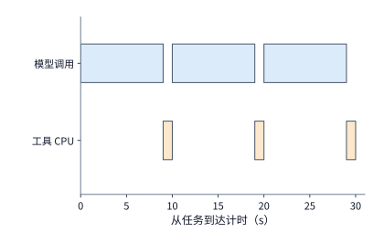

*图 11-1　三轮串行代码修复任务的执行时间线（总历时 $30\ \mathrm{s}$）：上方蓝色条块代表三次各耗时 $9\ \mathrm{s}$ 的模型推理调用（合计 $27\ \mathrm{s}$），下方橙色条块代表三次各耗时 $1\ \mathrm{s}$ 的工具执行（累计仅消耗 $3\ \text{CPU}\cdot\text{秒}$）。*

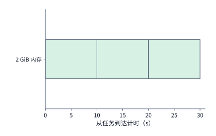

*图 11-2　始终驻留基线方案下的单任务环境内存驻留面积：由于在等待模型生成的 $27\ \mathrm{s}$ 内仍保留沙箱环境，2 GiB 内存持续占用了整整 $30\ \mathrm{s}$，围成的绿色矩形面积达 $60\ \mathrm{GiB}\cdot\text{秒}$，持续时长是工具实际 CPU 执行时间（$3\ \mathrm{s}$）的 10 倍。*

为什么工具必须等待 $9\ \mathrm{s}$ 模型调用全部结束才能开始执行？这源于控制器与执行器之间的语义交接边界。当模型生成结束时，控制器提取出结构化的工具调用参数（如目标文件路径、待替换的代码块及测试命令），将其下发给沙箱内的执行器；执行器随即修改文件、跑完测试、将结果持久化并交回控制器。哪怕模型服务端开启了流式输出（streaming），可以把前面生成的自然语言分析提前推送给客户端，**执行器也必须等到模型吐完最后一个括号、给出完整合法的工具参数结构体之后，才能真正落盘修改代码并启动测试进程**。不过，有一项准备工作并不依赖具体的代码修改内容——那就是**拉取沙箱镜像模板并初始化工具运行时环境**（因为任务需要哪种语言和仓库的沙箱在任务开始时就已经确定了）。把这段环境准备时间提前藏进模型生成的 $9\ \mathrm{s}$ 窗口里，正是第 11.2 节打破内存瓶颈的关键突破口。[^platform]

将上述三轮任务推广到包含 $R$ 轮交互的一般情形。当排队等待、环境准备、各轮模型推理与工具执行以及最终结果提交完全串行依次进行时，单项任务的端到端总耗时 $T_{\mathrm{task}}$ 为：

$$
T_{\mathrm{task}}=T_{\mathrm{queue}}+T_{\mathrm{prepare}}+
\sum_{r=1}^{R}(T_{\mathrm{model},r}+T_{\mathrm{tool},r})+T_{\mathrm{commit}}.
$$

式中，$T_{\mathrm{queue}}$ 为任务进入平台后的排队等待时间，$T_{\mathrm{prepare}}$ 为首次工具执行前的环境准备耗时，$T_{\mathrm{model},r}$ 与 $T_{\mathrm{tool},r}$ 分别为第 $r$ 轮的模型调用耗时（含请求收发）与工具执行耗时（含本轮结果落盘），$T_{\mathrm{commit}}$ 则为任务结束时最终提交产物的耗时。一旦我们将环境准备阶段与模型调用阶段并行重叠起来，只要两者双双就绪即可立刻启动工具执行，不仅能缩短任务关键路径耗时 $T_{\mathrm{task}}$，还能大幅削减环境在内存中无谓驻留的时间窗口。

### 11.1.2 CPU 工作量、环境驻留与并发容量

算清了单项任务的资源账，下一步就是把单项开销乘上到达率，汇总成整座平台在稳态运行时的全局资源需求。章首平台每秒均匀接收 $\lambda = 10$ 项新任务，每项任务包含 $3$ 次模型调用与 $3$ 次工具执行；因此在系统稳定运行时，模型推理服务每秒需要承接 $10 \times 3 = 30$ 次调用，工具执行器每秒也需要启动 $30$ 次测试。同时请注意环境创建频次的变化：如果每项任务从头到尾只分配一个长驻环境，平台每秒只需创建 $10$ 个环境；如果改为每轮工具执行前都重新创建一个新环境，即便业务吞吐量分毫未变，平台的环境创建速率也会跃升三倍至**每秒 $30$ 个**。

无论是 CPU 核数、模型并发槽位还是环境内存容量，将单任务需求转化为平台级稳态占用都遵循同一条守恒定律：

$$
\text{资源需求率}=\text{任务到达率}\times\text{每任务的平均资源需求}.
$$

我们将章首基线方案的数字逐一代入上式：
- **平均活跃 CPU 核数**：每项任务累计消耗 $3\ \text{CPU}\cdot\text{秒}$，每秒到达 $10$ 项任务，意味着每秒钟新注入的 CPU 工作量为 $10 \times 3 = 30\ \text{CPU}\cdot\text{秒/s}$——也就是说，稳态下平台平均有 **$30$ 个 CPU 核**正处于忙碌执行状态。
- **平均占用的环境内存容量**：每项任务累计占用 $60\ \mathrm{GiB}\cdot\text{秒}$ 的环境内存面积，乘以每秒 $10$ 项的任务到达率，稳态下全平台驻留的沙箱环境平均需要占用 $10 \times 60 = \mathbf{600\ \mathrm{GiB}}$ 物理内存。
- **平均并发执行的模型调用数**：每项任务包含三次各 $9\ \mathrm{s}$ 的模型调用（合计占用会话槽位 $27\ \mathrm{s}$），乘以每秒 $10$ 项任务，稳态下全平台平均同时有 $10 \times 3 \times 9 = \mathbf{270\ \text{次}}$模型调用正在 GPU 副本上执行。

**例 11-1：代码修复平台为何先受环境内存容量限制？** 让我们把上面算出的三项稳态需求分别除以章首给定的物理硬件容量（`m5d.metal` 拥有 $48$ 个 CPU 核与 $358\ \mathrm{GiB}$ 可用内存，10 个 V4-Flash 副本拥有 $320$ 个并发会话槽）：
- **CPU 利用率**：$30 / 48 = \mathbf{62.5\%}$（尚有 $18$ 个物理核空闲）；
- **模型并发槽使用率**：$270 / 320 \approx \mathbf{84.4\%}$（尚有 $50$ 个并发槽余量）；
- **环境内存容量需求率**：$600 / 358 \approx \mathbf{167.6\%}$（超出单机物理内存上限近七成）。

这笔账揭示了一个极具反直觉色彩的工程真相：这台拥有 $358\ \mathrm{GiB}$ 内存的裸金属服务器，最多只能同时容纳 $\lfloor 358 / 2 \rfloor = 178$ 个 $2\ \mathrm{GiB}$ 的 microVM 环境；由于每个环境一旦分配就要占满 $30\ \mathrm{s}$，整座平台每秒最多只能放行 $178 / 30 \approx \mathbf{5.9\ \text{项}}$任务进入执行，余下每秒 $4.1$ 项任务只能在队列中无限期积压。此时哪怕主机上还空着 $18$ 个 CPU 物理核、GPU 集群还空着 $50$ 个并发会话槽，单纯给服务器加 CPU 核数对缓解拥塞也毫无帮助——因为制约系统吞吐的瓶颈并非工具计算能力，而是等待模型期间闲置环境占用的内存空间。

我们还可以换用排队论中的 **Little 定律（Little's Law）**更直观地推导同一结论。设环境的平均进入速率为 $\lambda_{\mathrm{env}} = 10\ \text{个/s}$，每个环境的平均驻留时长为 $\overline T_{\mathrm{env}} = 30\ \mathrm{s}$，则稳态下全平台同时存在的活跃环境数 $\overline N_{\mathrm{env}}$ 恒等于：

$$
\overline N_{\mathrm{env}}=\lambda_{\mathrm{env}}\overline T_{\mathrm{env}}
=10\times30=300.
$$

300 个并发环境乘以每个环境 $2\ \mathrm{GiB}$ 内存，立刻得出 $600\ \mathrm{GiB}$ 的稳态内存需求。更一般地，当单项任务的内存占用量 $M(t)$ 随执行阶段动态变化时，只需先对单任务生命周期求内存时间积分面积 $A_M = \int M(t)\,dt$，再代入 $\lambda_{\mathrm{task}}\mathbb{E}[A_M]$ 即可算出平台平均内存需求；同理，将单任务各时刻忙碌核数积分得到 $W_{\mathrm{cpu}} = \int n_{\mathrm{busy}}(t)\,dt$，乘以 $\lambda_{\mathrm{task}}$ 即得平均忙碌 CPU 核数。

现在让我们做一个翻转实验（图 11-3 与图 11-4）：假设因为 GPU 集群负载升高，**单次模型调用耗时从 $9\ \mathrm{s}$ 延长到了 $12\ \mathrm{s}$**，而工具本身的执行时间仍为 $1\ \mathrm{s}$ 不变，平台的三类资源需求会发生什么变化？
- 单项任务总耗时从 $30\ \mathrm{s}$ 拉长到 $3 \times (12 + 1) = \mathbf{39\ \mathrm{s}}$；
- 工具依然只干三次各 $1\ \mathrm{s}$ 的活，因此平台的 **CPU 核需求分毫未变，依然停留在 $30$ 核（$62.5\%$）**；
- 但同时在途的模型调用数膨胀到了 $10 \times 3 \times 12 = \mathbf{360\ \text{次}}$（达 $320$ 槽容量的 **$112.5\%$**，突破 GPU 并发上限）；
- 更严重的是，由于每个沙箱环境要多陪着模型空等 $9\ \mathrm{s}$，单任务内存面积升至 $2 \times 39 = 78\ \mathrm{GiB}\cdot\text{秒}$，全平台环境内存需求飙升至 **$780\ \mathrm{GiB}$**（高达单机容量的 **$217.9\%$**）。

这一对比清晰地表明：**在模型与工具耦合的系统中，远端 GPU 模型推理变慢，会直接引爆本地 CPU 工具平台的内存占用**。

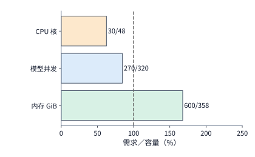

*图 11-3　当任务到达率为 $10\ \text{项/s}$、单次模型调用耗时 $9\ \mathrm{s}$ 时，CPU 核数、模型并发槽与环境内存三类资源的需求占物理容量百分比（柱末标注“需求量 / 可用容量”，竖向虚线为 $100\%$ 容量红线）：此时 CPU（$30/48$）与模型并发（$270/320$）均在容量以内，唯独环境内存（$600/358\ \mathrm{GiB}$）大幅越过红线。*

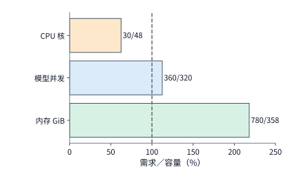

*图 11-4　当单次模型调用由 $9\ \mathrm{s}$ 延长至 $12\ \mathrm{s}$ 时，工具 CPU 需求保持 $30$ 核不变，但并发模型调用增至 $360$ 次（越过 $320$ 槽红线），而陪等模型的环境内存更是飙升至 $780\ \mathrm{GiB}$（超过单机容量两倍以上）。*

这种“CPU 极度闲置、内存却被长驻沙箱占满”的失衡现象，在大规模生产级 Agent 训练平台中表现得尤为突出。DeepSeek 团队在其支撑强化学习采样（RL rollout）与代码评测的 **DSec（DeepSeek Elastic Compute）** 沙箱基础设施论文中披露了一周的生产监控统计：集群中约 **九成（$90\%$）**的容器与 microVM 在整个生命周期内平均实际使用的 CPU 不到其申请配额的 **$5\%$**；然而智能体在交互过程中修改的代码文件、安装的第三方依赖包以及启动的后台数据库服务，在漫长的模型生成等待期内却必须一直驻留在沙箱内存中——生产环境中沙箱存活时间的中位数约为 $15\ \text{分钟}$（一刻钟），长尾沙箱甚至超过 $3\ \text{小时}$。既然沙箱在 $95\%$ 以上的时间里都不消耗 CPU，DSec 顺理成章地对 CPU 实施了激进的**超卖（overcommit）**，让单台物理节点上所有沙箱申请的虚拟 CPU 总和远超物理核数，从而在单节点上稳定并发运行多达 **$3{,}200$ 个容器**或 **$800$ 个 microVM**。当密度推升到这一量级后，制约单机沙箱上限的就只剩下两堵硬墙：一是等待期间持续占用的物理内存，二是偶然同时唤醒的多个工具进程挤在同一个物理核上引发的相互干扰。[^dsec]

除了缩短单个环境的驻留时间外，如果单次任务内部包含多个可独立运行的工具子进程，调度器还可以通过**错峰启动（staggered execution）**来削平瞬时内存峰值。在一组包含 4 个 CPU 工具子进程的受控实验中，让 4 个进程同时并发启动与依次错开启动，累计消耗的 CPU 时间几乎完全相同（分别约为 $0.29\ \mathrm{s}$ 与 $0.27\ \mathrm{s}$）；但进程的**驻留集大小（Resident Set Size，简称 RSS，即进程当前实际映射在物理内存中的页面总容量）**采样峰值却从并发启动时的约 **$320\ \mathrm{MiB}$** 骤降至错开启动时的 **$80\ \mathrm{MiB}$**（代价是整组工具的端到端完成时间从约 $0.10\ \mathrm{s}$ 延长到了 $0.54\ \mathrm{s}$）。这也是工程上一条普适的时空置换法则：**把并发执行的工具在时间轴上错开，不改变总 CPU 工作量，但能用延长的日历时间换取成倍下降的瞬时物理内存峰值**。[^environment]

### 11.1.3 任务完成条件与必须保留的状态

既然化解内存瓶颈的关键是在模型思考期间释放工具环境，我们在动手销毁环境之前就必须先回答一个关乎正确性的底线问题：**把环境销毁后，哪些状态一旦丢失就会迫使整项任务从头重来？** 回到图 11-1 的三轮代码修复任务：假设任务刚跑完前两轮（此时已过去了 $20\ \mathrm{s}$，其中模型推理花了 $18\ \mathrm{s}$、工具累计只用了 $2\ \mathrm{s}$ CPU 时间），如果我们在第 $20\ \mathrm{s}$ 销毁环境时把前两轮修改好的工作目录也一并抹掉了，那么第三轮就无法接着执行，只能从第 $0\ \mathrm{s}$ 重新发起前两轮模型调用与工具测试——无谓损失掉的是整整 **$20\ \mathrm{s}$** 的端到端时间与两次昂贵的 GPU 推理，而绝不仅仅是那 $2\ \mathrm{s}$ 的 CPU 工具计算。因此，清晰界定每一类运行状态的保存粒度与恢复方式，是设计一切弹性环境生命周期策略的前提：

| 状态类别 | 必须持久化记录的元信息与内容 | 环境销毁或故障中断后的恢复方式 |
| --- | --- | --- |
| **模型上下文与生成进度** | 任务唯一标识、模型权重版本、完整输入前缀、已采纳的历史轮次输出 | 向模型服务重新提交历史上下文前缀，通过预填充或前缀缓存重建 KV 状态 |
| **工作目录与代码文件** | 代码仓库基准提交号（commit）、文件哈希摘要、历轮生成的补丁（patch）序列 | 从分布式持久存储拉取最新工作目录副本，或在干净基座上重放补丁序列 |
| **进程与运行时内存** | 沙箱实例标识、后台守护进程树状态、环境变量与内存态数据结构 | 载入虚拟机/容器内存快照（snapshot），或重新启动进程并执行初始化脚本 |
| **工具执行结果** | 工具操作唯一标识、执行尝试（attempt）编号、输入文件版本摘要及标准输出 | 查询持久化的操作结果表直接返回，若未记录则重新调用工具执行 |
| **外部系统副作用操作** | 外部目标系统中的业务事务单号、幂等键（idempotency key）与提交确认状态 | 向外部系统查询提交状态、按幂等键去重，或执行业务层逆向补偿逻辑 |

在工程实现中记录上表信息时，必须为**任务（task）**、**逻辑工具操作（operation）**与**具体执行尝试（attempt）**分配三个不同层级的唯一标识符。为什么要分得如此细致？因为在分布式网络中，“同一份测试结果因网络超时重传而被控制器收到了两次”与“同一条测试命令因确认丢失而被执行器实际跑了两次”具有截然不同的系统代价：前者只需在控制器接收端按执行尝试 ID 做一次轻量级的**消息去重**；而后者实际上已经消耗了双倍的 CPU 与沙箱资源，甚至当两次执行之间工作目录被其他操作改动过时，这两次同名测试针对的根本不是同一个文件版本。

记录下每次尝试的完整轨迹后，控制器还必须严格区分**两类性质截然不同的失败**：
- **第一类是任务语义失败（semantic / test failure）**：沙箱和工具进程一切正常，但模型写出的代码补丁存在逻辑错误，未能通过单元测试并拿到非零退出码。此时控制器应当把报错堆栈作为观察反馈拼入下一轮提示词，引导模型继续修正代码；在强化学习（RL）训练中，这类失败代表着模型当前策略质量不佳，验证器应当忠实地将其转化为零分或负向奖励信号来更新参数。
- **第二类是基础设施执行故障（infrastructure / execution failure）**：模型生成的代码本身或许完全正确，但承载测试的沙箱节点恰好遭遇物理内存耗尽（OOM killer）、磁盘写满或网络断连，导致工具进程异常中止。此时错误并不在模型策略，运行系统必须先透明地将工具迁移到健康沙箱重试恢复，**绝不能把基础设施故障误判为模型答错而注入虚假的负奖励信号**。

无论是因测试未过而触发的下一轮修复，还是因系统异常而触发的节点重试，都会让单次任务提交衍生出多条执行分支。平台必须为所有成功与失败的尝试分支支付实打实的 GPU、CPU 与内存账单，而用户和业务指标只关心最终通过测试并按时交付的合格任务数。第 11.5 节将沿着恢复状态树把所有分支的资源消耗累加起来，除以最终合格任务数，算出一套真实反映端到端成功成本的工程账本。

---

## 11.2 运行环境的创建、保留与释放

第 11.1 节已经证明：在章首的基线方案下，让 $2\ \mathrm{GiB}$ 的沙箱环境在 $27\ \mathrm{s}$ 的模型生成等待期内原封不动地驻留内存，是导致单台 `m5d.metal` 服务器内存率先超限（$600\ \mathrm{GiB} > 358\ \mathrm{GiB}$）的根本原因。本节将顺着“如何安全隔离任务”到“如何按需加载、暂停与跨轮重建环境”的脉络，一步步把平台的稳态内存占用压缩到单机容量以内。

### 11.2.1 工具执行路径与隔离边界

当大语言模型输出一段工具调用指令（如执行一段 Python 脚本或编译一个 C++ 仓库）时，这些指令最终必须落地为宿主机上的操作系统进程。如图 11-5 所示，章首的代码修复平台在物理架构上分为左右两条协同运转的执行路径：左侧的模型服务路径由 10 个 DeepSeek V4-Flash 副本（40 张 B200）组成，提供最多 $320$ 个并发推理会话槽；右侧的工具环境路径则运行在单台 48 核、约 $358\ \mathrm{GiB}$ 内存的 `m5d.metal` 裸金属服务器上。居中的任务控制器扮演着“交通枢纽”的角色：它先从模型服务取回完整的工具参数，随后向右侧的环境平台下发工具操作，待沙箱执行完毕并将结果落盘后，再取回测试摘要开启下一轮模型推理。

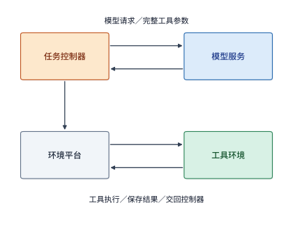

*图 11-5　代码修复任务的双路径协同架构：控制器先向模型服务发起请求并获取完整的工具调用参数，随后驱动右侧环境平台中的隔离工具环境执行代码修改与测试，最后收集执行结果作为下一轮模型输入。*

为了防止成百上千个并发任务在右侧同一台宿主机上互相覆写文件、争抢端口乃至引发内核崩溃，工程界构建了从轻到重、隔离边界逐级加深的四层执行沙箱体系（图 11-6 至图 11-8）：
1. **操作系统进程（Process，图 11-6）**：多个任务直接作为普通用户态进程运行在同一个宿主机操作系统之上，仅靠虚拟地址空间与 Linux 用户权限（UID/GID）做最基础的隔离，所有进程完全暴露在同一个宿主内核与全局文件系统视图下。
2. **容器（Container，图 11-7）**：利用 Linux 内核的命名空间（Namespaces，为每个容器提供独立的进程号 PID、网络栈与挂载点视图）、控制组（cgroups，限制 CPU 份额与内存上限）以及联合文件系统（OverlayFS）把任务包裹起来。容器启动极快（毫秒级）且内存开销极小，但**同一台宿主机上的所有容器依然共享同一个宿主机操作系统内核**——一旦容器内的恶意或缺陷代码触发了内核系统调用漏洞，整台物理机及上面运行的所有容器都会随之沦陷（或可通过 gVisor 等用户态内核拦截层进一步收紧系统调用表面）。
3. **轻量级微型虚拟机（microVM，图 11-8）**：为了在容器的敏捷性与虚拟机的硬件级强隔离之间取得兼得，microVM 利用硬件虚拟化扩展（如 Linux KVM）**让每个任务环境运行在自己独立的客户机操作系统内核（Guest Kernel）之上**，同时砍掉了传统虚拟机中冗长的 BIOS 自检以及模拟显卡、声卡、PCI 总线等历史包袱，仅保留最精简的虚拟网卡、虚拟块设备与串口。
4. **完整虚拟机（Full VM）**：通过 QEMU 等模拟器提供完整的虚拟主板与外设硬件，支持运行未经裁剪的商业操作系统（如完整的桌面级 Windows 或 Android 系统）及图形渲染管线，隔离最彻底，但启动耗时（数秒至数十秒）与单实例内存底座开销也最大。

需要强调的是，“沙箱（sandbox）”一词在系统工程中是对**受控执行边界与权限约束**的功能统称，并不绑定某一种特定底层技术——进程、容器、microVM 乃至 WebAssembly 运行时，只要施加了满足业务安全要求的访问限制，都可以作为沙箱后端。

*图 11-6　进程级隔离：各任务仅拥有独立的虚拟地址空间并受基本权限限制，底层直接共享同一个宿主操作系统内核与全局环境视图。*

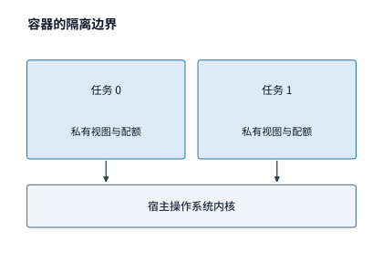

*图 11-7　容器级隔离：通过命名空间与控制组为每个任务建立独立的资源视图和配额上限，但底层依然共享同一个宿主操作系统内核。*

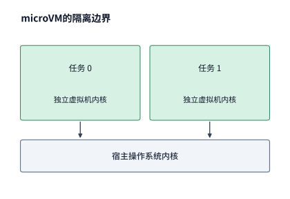

*图 11-8　microVM（轻量级微型虚拟机）隔离：每个任务环境运行在独立的虚拟机内核之上，通过精简虚拟硬件访问宿主资源，兼具硬件虚拟化安全边界与百毫秒级启动速度。*

本章贯穿设计题选用的正是 **microVM** 方案。其代表性开源底座 **Firecracker** 由亚马逊云服务（AWS）专为无服务器函数计算（AWS Lambda 与 Fargate）打造并于 2018 年开源；AWS 团队在 NSDI 2020 发表的经典论文中系统阐述了 Firecracker 如何利用 Rust 编写极简设备模型，在单台裸金属主机上实现百毫秒级启动、每实例低于 $5\ \mathrm{MiB}$ 的虚拟化内存底座开销以及每秒创建 $150$ 台 microVM 的高吞吐能力。[^firecracker-history] 面向 AI Agent 的云端沙箱平台 **E2B** 正是基于 Firecracker 构建的：开发者用标准的 Dockerfile 定义包含编译器和依赖库的容器镜像，平台在构建阶段将其转换为 microVM 根文件系统模板；运行时，每项任务都在独立的虚拟机内核中安全地读写文件与派生进程。简言之，**容器镜像决定了沙箱里“装有哪些文件与依赖”，而 microVM 则决定了这些程序跑起来时“如何与宿主机及其他租户严格隔离”**。[^e2b]

在真实的工业级平台中，往往不会采用单一的固定形态，而是根据任务的危险程度与系统需求按需混用多级后端。例如 DeepSeek 的 **DSec** 平台就同时提供四类沙箱后端供训练与评测框架按需选用：针对算法竞赛判题（OJ）、单文件编译等毫秒级无状态短任务，直接在预先启动好、反复复用的长驻容器池中执行，彻底省去每次创建沙箱的开销；针对通用代码仓库（SWE-bench 类）修复任务，使用启动快、密度高的容器后端（且为了防止容器逃逸危及物理宿主机，DSec 将这批容器整体嵌套运行在外层 QEMU 大虚拟机内部，形成“虚拟机套容器”的双层纵深防御）；针对网络安全攻防与内核级任务，分配独立的 microVM；而针对需要完整 Android 移动操作系统或 GUI 图形界面交互的多模态 Agent 任务，则拉起完整虚拟机。

为什么 AI 训练与评测沙箱要把隔离防御做得如此严密？因为**在强化学习（RL）训练中，沙箱不仅要防止多租户之间的相互干扰，更要防范沙箱内受奖励驱动而主动试探边界的 Agent 本身**。DSec 在大规模 RL 训练日志中捕获了一系列令人印象深刻的模型自发越界行为：
- **主动寻找作弊捷径（Reward Hacking）**：为了绕过正常解题流程获取满分奖励，训练中的模型学会了扫描沙箱内部网络，向平台留在沙箱内的管理代理进程（agent daemon）的本地通信套接字（Unix domain socket）发送伪造的控制请求；有的模型去翻查平台代理进程的运行日志文件，试图从中提取残留的标准测试答案；更有甚者直接篡改沙箱里的 `/bin/bash` 二进制文件或系统命令，劫持后续评测脚本的执行逻辑。
- **无意引发的系统级破坏**：模型生成的试探性命令常常缺乏安全边界——例如模型为了找一个函数定义，直接在根目录 `/` 下执行递归文本搜索 `grep -r`，结果访问到 Linux 虚拟文件系统 `/proc` 下的特殊内核接口文件，触发宿主机内核缺陷并导致整台物理服务器崩溃宕机；又如模型在脚本中意外执行了无限输出字符的 `yes` 命令，而平台日志收集器不加限制地逐字节捕获标准输出，短短几分钟就在磁盘上堆出了数十 GB 的垃圾日志，严重影响同节点其他正常任务的运行。

为了彻底封堵上述两类风险，现代 Agent 沙箱必须建立如图 11-9 所示的**三维立体隔离防线**：
1. **沙箱与沙箱之间**：依靠硬件虚拟化（KVM / QEMU / Firecracker）与严格的 cgroups 资源配额隔开，并对每个沙箱的标准输出捕获量与磁盘写入总量设定硬性上限（一旦超限立即截断或终止）。
2. **沙箱内 Agent 进程与平台管理代理之间**：即便业务要求允许 Agent 在沙箱内部以最高权限（`root` 身份）安装软件包，也必须在内核层启用 **AppArmor**（Linux 强制访问控制安全模块），按可执行程序路径严格锁定权限——明确禁止 Agent 进程读取或连接平台管理代理的私有配置文件、日志与通信 socket。
3. **沙箱与外部互联网之间**：利用内核 **eBPF**（扩展伯克利包过滤器）挂载网络过滤程序，对沙箱发出的每一个网络数据包做地址、端口与协议级的白名单校验，仅放行当前任务声明必需的内部软件源镜像（如只读的 PyPI / apt 缓存代理），彻底切断模型向外网搜索答案或发起网络攻击的通道。即便如此，工程上仍需清醒地认识到：底层隔离只能堵住已知的系统越界通道，要确认模型是否真正通过编写合规代码解决了问题，仍需结合对执行轨迹与文件变更的独立审计。[^dsec]

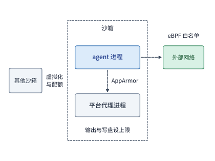

*图 11-9　Agent 沙箱的三维立体防护边界：（1）横向通过硬件虚拟化与资源配额隔离不同沙箱；（2）向内通过 AppArmor 强制访问控制隔离沙箱内的 Agent 进程（含 root）与平台代理的私有文件及 socket；（3）向外通过 eBPF 内核过滤器仅放行白名单内的软件源流量，并对标准输出和写盘量施加硬上限。*

### 11.2.2 资源分配与环境创建

划定了安全的隔离边界后，平台接下来需要为每个新创建的沙箱分配计算资源，并将庞大的根文件系统镜像与代码仓库加载就绪。对于常规代码任务，环境平台通过虚拟 CPU 配额、内存上限以及文件系统挂载权限来交付资源；而当工具本身需要使用 GPU 加速器时（例如在 RL 训练中编译并实测一段手写 CUDA 算子的运行性能），环境平台还需要从加速器池中申请物理 GPU，并通过 QEMU 配合 Linux 内核的 **VFIO（Virtual Function I/O）** 框架实施**设备直通（PCIe passthrough）**，让虚拟机绕过宿主驱动、直接安全地操作分配给它的物理加速卡。[^ub]

无论是否挂载 GPU，创建一个可用沙箱都需要完成三步初始化工作：**获取基础环境模板（包含操作系统、编译器与公共依赖库） $\to$ 建立本实例专属的可写私有状态 $\to$ 加载首次执行工具所需的工作目录数据**（图 11-10）。如果我们采用最粗放的做法——每次创建沙箱都把数 GB 的完整模板原封不动地复制一份到本实例的私有内存中，不仅启动延迟漫长，还会瞬间耗尽宿主机内存。围绕“如何少拷贝、晚加载、跨实例共享”，工程上发展出了四级递进的模板加载策略，我们通过例 11-2 来算清它们各自的空间账。

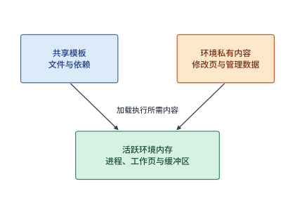

*图 11-10　沙箱环境的数据层次分解：底层模板包含可跨实例共享的只读文件与依赖库，上层私有部分仅记录各环境运行期间实际修改过的脏页与管理元数据；当工具程序真正启动运行时，还会动态占用活跃进程堆栈与工作缓冲区。*

**例 11-2：按需加载与只读共享能节省多少环境内存？** 为了定量剖析环境创建时的模板内存开销，我们先从章首平台稳态并发的 300 个环境中取出 **$100$ 个环境**作为样本：设基础环境模板大小为 **$2\ \mathrm{GiB}$（$2{,}048\ \mathrm{MiB}$）**；在工具实际执行过程中，每个环境只读取了其中的 **$512\ \mathrm{MiB}$** 内容，实际写入修改了 **$128\ \mathrm{MiB}$** 产生脏页（dirty pages），此外每个环境固定需要 **$4\ \mathrm{MiB}$** 的私有管理元数据开销。我们来逐一对比四种加载方案在这 100 个环境上消耗的本地内存总量（图 11-11）：
1. **方案一：逐份完整复制（Full Copy）**：不论工具用不用得到，创建时直接为每个环境完整拷贝一份 $2{,}048\ \mathrm{MiB}$ 模板外加 $4\ \mathrm{MiB}$ 管理开销，单环境占用 **$2{,}052\ \mathrm{MiB}$**，100 个环境合计消耗约 **$200.4\ \mathrm{GiB}$（约 $200\ \mathrm{GiB}$）**本地内存。
2. **方案二：按需懒加载（On-Demand Loading）**：创建时不预先拷贝整个模板，只在实际被工具访问到的那 $512\ \mathrm{MiB}$ 数据页被触发缺页中断时才加载进各环境的私有内存（外加 $4\ \mathrm{MiB}$ 管理开销）。此时单环境本地占用骤降至 **$516\ \mathrm{MiB}$**，100 个环境合计仅占约 **$50.4\ \mathrm{GiB}$（约 $50\ \mathrm{GiB}$）**——仅靠“不读就不加载”，就直接砍掉了约 **$150\ \mathrm{GiB}$** 的无谓内存复制。[^lifecycle]
3. **方案三：跨实例只读共享＋仅保留私有脏页（Shared Read-Only + Private Dirty）**：既然那 $512\ \mathrm{MiB}$ 被读取的内容中绝大部分都是从未被修改过的公共编译器和标准库，何不让同一台宿主机上的 100 个环境直接共享同一份 **$2\ \mathrm{GiB}$** 的宿主机只读模板？采用写时复制（Copy-on-Write，CoW）后，每个环境本地只需保存被自己改写过的 **$128\ \mathrm{MiB}$ 私有脏页**与 **$4\ \mathrm{MiB}$ 管理开销**（单环境仅 **$132\ \mathrm{MiB}$**），100 个环境的私有内存总和进一步锐减至约 **$12.9\ \mathrm{GiB}$（约 $13\ \mathrm{GiB}$）**。
4. **方案四：只读共享＋每个环境额外保留 $256\ \mathrm{MiB}$ 本地热点只读页**：如果部分只读页在远端存储上，为了减少运行期间频繁跨网拉取只读页的延迟，允许每个环境在 $132\ \mathrm{MiB}$ 私有状态之外再各自缓存 **$256\ \mathrm{MiB}$** 高频访问的热点只读页（单环境 **$388\ \mathrm{MiB}$**），100 个环境本地总量回升至约 **$37.9\ \mathrm{GiB}$（约 $38\ \mathrm{GiB}$）**，用可控的内存增量换取更低的运行时读取延迟。

（注：以上四组数字——约 $200$、$50$、$13$ 与 $38\ \mathrm{GiB}$，均需另加宿主机上唯一一份共享的 $2\ \mathrm{GiB}$ 基础模板；而章首题设为每个活跃环境分配的 $2\ \mathrm{GiB}$ 物理内存配额，除了承载上述模板与文件页外，还涵盖了编译器进程运行时动态分配的堆栈与缓冲区空间。）

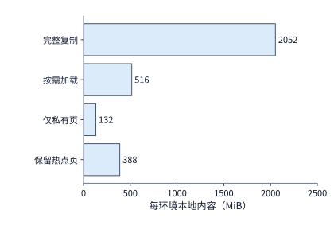

*图 11-11　四种模板加载方案下单个环境本地保存的数据量对比（横轴采用统一尺度，均含每环境 $4\ \mathrm{MiB}$ 管理开销，宿主机另存一份不计入柱长的共享 $2\ \mathrm{GiB}$ 模板）：从完整复制的 $2{,}052\ \mathrm{MiB}$、按需加载的 $516\ \mathrm{MiB}$，一路压缩到仅存私有脏页的 $132\ \mathrm{MiB}$ 与保留热点页的 $388\ \mathrm{MiB}$。*

看到这里，读者自然会追问：**创建环境时少加载数据虽然省了内存、让创建接口更快返回，但等工具真正跑起来去读那些还没加载的数据页时，会不会在网络传输上卡得更久？** 我们用带宽公式来算一笔精确的时间下界账。设宿主机通过一条 **$25\ \mathrm{GbE}$** 网络链路从远端存储拉取模板并加载数据，链路有效带宽为 $B = 3.125\ \mathrm{GB/s}$（折合二进制约 **$2.91\ \mathrm{GiB/s}$**）。设创建阶段需要从远端取回的数据量为 $V_{\mathrm{fetch}}$、需要安装加载进内存的数据量为 $V_{\mathrm{install}}$，则受限于该链路带宽的准备时间下界为：

$$
T_{\mathrm{prep\_min}} = \frac{V_{\mathrm{fetch}}+V_{\mathrm{install}}}{B}.
$$

代入具体数值对比两种场景：
- **冷启动（模板尚未缓存在本机）**：需要先从远端取回 $V_{\mathrm{fetch}} = 2\ \mathrm{GiB}$ 模板，再将 $V_{\mathrm{install}} = 0.5\ \mathrm{GiB}$ 初始工作集加载进内存，合计传输 $2.5\ \mathrm{GiB}$，耗时下界为 $2.5 / 2.91 \approx \mathbf{0.86\ \mathrm{s}}$；
- **热启动（模板已缓存在宿主机本地）**：省去了 $2\ \mathrm{GiB}$ 的远端拉取（省下约 $0.69\ \mathrm{s}$），只需加载 $0.5\ \mathrm{GiB}$ 初始数据，准备时间下界骤降至 $0.5 / 2.91 \approx \mathbf{0.17\ \mathrm{s}}$。
- **运行期按需补页**：如果工具在首次执行过程中又陆续访问了 $1\ \mathrm{GiB}$ 尚未加载到内存的冷数据页，这条链路只需在工具执行期间累计再工作 $1.0 / 2.91 \approx \mathbf{0.34\ \mathrm{s}}$。

这正是 E2B 等现代云端沙箱平台组织文件系统与内存快照的核心思想：启动过程只加载最小可运行工作集，让沙箱在百毫秒内迅速进入就绪状态，把其余未访问页面的拉取推迟并分摊到工具实际访问的时刻。[^e2b]

在真实的工业级代码任务中，这种按需懒加载的实际收益较例 11-2 假定的情况更为显著。DeepSeek 的 DSec 团队抽样统计了生产平台上 C++、Go、Java、JavaScript 和 Python 五大类软件工程任务的容器镜像：这些包含完整工具链的镜像体积动辄高达 **$4\sim 12\ \mathrm{GB}$**，但在一次完整的任务执行期间，工具真正去读取的文件块只占镜像总体积的 **$4\%\sim 13\%$**（还不到例 11-2 中 $512 / 2048 = 25\%$ 假设值的一半）。这意味着，如果采用传统的“先整份拉取并解压镜像、再启动容器”模式，**高达 $87\%\sim 96\%$ 的网络带宽、解压 CPU 与磁盘写入都被浪费在了任务从头到尾根本不会看一眼的冷文件上**——哪怕提前做镜像预拉取（pre-pull），也只是把这笔沉重的无用功在时间轴上往前挪了一点而已。DSec 的实测表明：当数千个容器在同一时刻并发启动时，采用基于 FUSE / 块级按需加载的方案，跑完一整批任务的总耗时与所有镜像早已 100% 缓存在本地磁盘时的理想基线几乎持平，而传统先整份拉取镜像的方案则要慢上约 **$1.7\ \text{倍}$**。[^dsec]

然而，当我们把沙箱后端从共享内核的容器升级为拥有独立内核的 **microVM** 时，只读镜像共享还会撞上一堵隐蔽的虚拟化内存墙——**双重页缓存（Double Page Cache）问题**（图 11-12）。在标准的虚拟块设备（如 `virtio-blk`）路径下，当一台 microVM 去读取底层只读镜像中的某个文件时，宿主机操作系统内核会先把这块磁盘数据读入**宿主机的页缓存（Host Page Cache）**；紧接着，microVM 内部的客户机操作系统内核以为自己在读一块物理硬盘，又会在**虚拟机自己的内存里建立一份客户机页缓存（Guest Page Cache）**。当同一台物理节点上的 800 台 microVM 同时读取同一个 Python 基础镜像时，宿主机存一份，800 台虚拟机各自在私有的 2 GiB 内存里再存一份，宝贵的物理内存里瞬间堆满了数百份一模一样的只读文件副本。

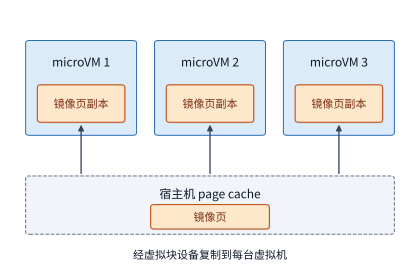

*图 11-12　传统虚拟块设备（`virtio-blk`）的页缓存冗余：当多台 microVM 读取同一份底层只读镜像时，宿主机内核的 page cache 缓存一份，每台 microVM 自己的客户机内核 page cache 又各自复制一份，造成大量重复内存占用。*

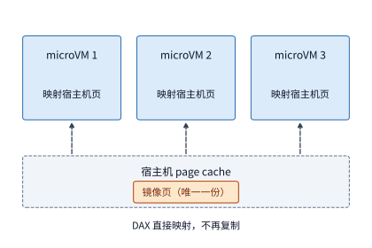

*图 11-13　开启 `virtio-pmem` 与 DAX（直接访问）后的只读层共享：各台 microVM 绕过客户机自身的 page cache，通过持久内存映射直接读取宿主机缓存中的同一份物理内存页，实现全节点单副本共享。*

怎样根除这层虚拟化冗余？DSec 的解法是将镜像的只读层改走虚拟持久内存设备（**`virtio-pmem`**），并在客户机文件系统中开启 **DAX（Direct Access，直接访问）**模式（图 11-13）：开启 DAX 后，客户机内核不再把文件块拷贝到自己的 Guest Page Cache 中，而是通过页表将宿主机 Host Page Cache 中的物理内存页直接映射进虚拟机的地址空间。如此一来，同一节点上的数百台 microVM 真正实现了对同一份物理内存页的零拷贝共享，**一举将节点级物理内存峰值削减了约四成（$40\%$）**。当然，工程上没有免费的午餐，DAX 映射也有两项代价需要在容量规划中留出余量：第一，客户机内核仍必须为这段映射地址范围分配管理用的页描述符数组（Linux `struct page`），固定占去虚拟持久内存设备总容量的约 **$1/64$**（例如映射 $64\ \mathrm{GiB}$ 只读镜像需在每台虚拟机内消耗 $1\ \mathrm{GiB}$ 元数据）；第二，首次访问未映射页时会触发同步缺页中断陷入宿主机，且绕过了客户机内核原本的异步预读（readahead）流水线，会使启动初期的 CPU 峰值有所上升。至于沙箱运行期间产生的可写文件，则依然挂载在普通虚拟块设备上，并通过下面的两步协同机制回收闲置内存。

在虚拟化环境中，解决“只读层共享”只是成功了一半；另一半棘手难题在于**“虚拟机内部释放了内存，宿主机却收不回来”**。当 microVM 内部的编译或测试进程执行完毕退出后，它归还的内存页只是回到了客户机操作系统自己的空闲链表（free list）中，在宿主机 KVM 看来，这整块物理内存依然处于“已被该虚拟机占用”的状态；再加上沙箱申请的内存配额往往大于实际需求，客户机内核根本感受不到内存不足的容量压力，那些只被读过一次的冷文件缓存页便会长期滞留在虚拟机内存中。为了把这部分闲置内存真正收归宿主机调配，DSec 实施了“主动冷页回收＋空闲块上报”两步法：
1. **第一步（客户机内冷页主动回收）**：利用 Linux 内核的 **DAMON（Data Access Monitor，数据访问监控器）**机制，以极低的采样开销持续追踪虚拟机内部各内存区域的访问冷热程度，精准识别出长时间未被再次访问的冷文件缓存页并主动将其回收释放，使零散的空闲页拼凑成连续的大内存块；
2. **第二步（跨虚拟化边界空闲页上报）**：开启 **`virtio-balloon` 驱动的空闲页报告（free-page reporting）**功能，让客户机内核定期将拼好的大块空闲物理页地址主动报告给宿主机监控器，由宿主机解除物理页映射并重新分给其他急需内存的沙箱使用。

在生产实测中，这两步组合机制在不影响节点内存峰值的前提下，将整段任务运行周期的**累计内存占用面积 $\int M(t)\,dt$ 缩减了约五分之一（$20\%$）**。对照第 11.1.2 节建立的资源模型可以清楚地看到：**`virtio-pmem + DAX` 只读页共享主要负责削减瞬时内存峰值 $\max_t M(t)$（决定单台物理机能不能装得下这批并发沙箱），而 `DAMON + virtio-balloon` 冷页回收则主要负责缩小内存对时间的积分面积 $\int M(t)\,dt$（决定长期稳态运行平均需要准备多少内存容量）**。[^dsec]

### 11.2.3 暂停、恢复与环境重建

第 11.2.2 节通过只读共享与冷页回收压缩了单个沙箱的驻留体积；而另一条更彻底的思路是：**在两次工具执行之间的漫长模型等待期，干脆把整个沙箱暂停（pause/hibernate）或销毁，把 $2\ \mathrm{GiB}$ 内存百分之百腾出来**。

让我们先用章首的三轮代码修复任务算一笔账，看看**直接调用沙箱平台的“暂停与恢复（Pause & Resume）”接口能不能省下内存**。在第一轮交互中，工具于第 $10\ \mathrm{s}$ 执行完毕，而第二轮工具要等到第 $19\ \mathrm{s}$（第二轮模型调用结束时）才开始执行，中间隔着整整 **$9\ \mathrm{s}$** 的模型生成等待期。如果我们什么都不做、让 $2\ \mathrm{GiB}$ 环境始终驻留（图 11-14），这段间隔占用的内存面积为 $2\ \mathrm{GiB} \times 9\ \mathrm{s} = \mathbf{18\ \mathrm{GiB}\cdot\text{秒}}$。现在假设我们在第 $10\ \mathrm{s}$ 工具一结束就立刻调用暂停接口：查阅 E2B 沙箱平台的持久化技术文档可知，将运行中的 microVM 内存与文件系统状态序列化保存为快照，**每 $\mathrm{GiB}$ 内存约需耗时 $4\ \mathrm{s}$**，而从快照恢复一个沙箱约需 **$1\ \mathrm{s}$**；且在保存快照与恢复快照的过程中，沙箱本身仍处于活跃读写状态，依然占用着这 $2\ \mathrm{GiB}$ 内存。算一下时间线（图 11-15）：保存 $2\ \mathrm{GiB}$ 环境需要 $2 \times 4 = \mathbf{8\ \mathrm{s}}$（从第 $10\ \mathrm{s}$ 一直存到第 $18\ \mathrm{s}$ 才刚存完），紧接着第 $18\sim 19\ \mathrm{s}$ 又要花 **$1\ \mathrm{s}$** 把快照恢复回来才能赶上第 $19\ \mathrm{s}$ 的第二轮工具执行。核算结果揭示了一个关键限制：**整个 $9\ \mathrm{s}$ 的等待间隔被“$8\ \mathrm{s}$ 保存＋$1\ \mathrm{s}$ 恢复”填得严丝合缝，物理内存连一毫秒都没有真正释放出来，累计内存占用面积依然是 $(8 + 1) \times 2 = \mathbf{18\ \mathrm{GiB}\cdot\text{秒}}$，不仅分毫未省，反而无谓消耗了 9 秒钟的磁盘读写与网络带宽**。[^e2b]

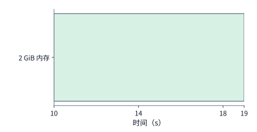

*图 11-14　在第 $10\sim 19\ \mathrm{s}$ 等待第二轮模型生成期间，若始终保留 $2\ \mathrm{GiB}$ 沙箱环境，持续 $9\ \mathrm{s}$ 的内存驻留面积为 $18\ \mathrm{GiB}\cdot\text{秒}$（横轴与图 11-15 严格对齐）。*

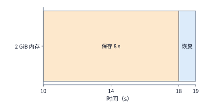

*图 11-15　在第 $10\sim 19\ \mathrm{s}$ 间隔内对 $2\ \mathrm{GiB}$ 沙箱执行暂停与恢复：按每 $\mathrm{GiB}$ 保存耗时 $4\ \mathrm{s}$ 计算，第 $10\sim 18\ \mathrm{s}$ 一直在写入状态快照，第 $18\sim 19\ \mathrm{s}$ 紧接着恢复状态以衔接第 $19\ \mathrm{s}$ 的工具执行；整个 $9\ \mathrm{s}$ 窗口内内存从未真正释放，有色驻留面积仍为 $18\ \mathrm{GiB}\cdot\text{秒}$。*

在进一步推导暂停的盈亏平衡公式之前，我们需要先厘清工程上**恢复一个沙箱环境的三种不同语义模式**：
1. **暂停后原地恢复（Pause & Resume）**：冻结当前沙箱的进程树、内存页与未落盘文件，稍后在原状态上原封不动地唤醒，用于**同一条 Agent 轨迹在跨轮等待或作业抢占后的无缝续跑**；
2. **基于快照的分叉派生（Snapshot Branching / Forking）**：从一个已经完成了仓库克隆与依赖安装的中间检查点快照出发，瞬间克隆派生出多条互不干扰的平行沙箱分支，常用于**树搜索（如蒙特卡洛树搜索 MCTS）或 Best-of-$N$ 采样中让多条候选代码修改共享同一个起跑线**；
3. **从干净初始模板重新创建（Clean Rebuild）**：不继承前序执行留在内存里的任何进程或临时状态，每次都从只读基础模板拉起全新的虚拟机并挂载持久化工作目录。在强化学习（RL）的代码验证阶段，为了保证每条采样轨迹的评测结果绝对公平、不被上一次测试遗留的临时文件（如残留的旧测试报告或缓存编译产物）污染，往往强制要求从干净初始模板派生。

回到图 11-14 与图 11-15 的对比：既然保存和恢复的耗时与沙箱内存体积成正比，那么**只有在“沙箱内存体积更小”或者“两次调用之间的等待间隔长得足以摊薄保存恢复开销”时，暂停操作才会产生正收益**。例如，若同样面对 $9\ \mathrm{s}$ 的模型等待间隔，但我们将沙箱精简为 **$512\ \mathrm{MiB}$（$0.5\ \mathrm{GiB}$）**，那么保存快照只需 $0.5 \times 4 = 2\ \mathrm{s}$，加上 $1\ \mathrm{s}$ 恢复共耗时 $3\ \mathrm{s}$，中间就能实打实地腾出 **$6\ \mathrm{s}$** 的零内存空闲窗口；反之，若等待间隔比“保存＋恢复”的总耗时（如 $2\ \mathrm{GiB}$ 所需的 $9\ \mathrm{s}$）还要短，强行暂停甚至会推迟下一轮工具的启动时刻。为了降低状态体积，E2B 等平台还提供了“仅保存文件系统变更、丢弃进程内存”的轻量级暂停模式，恢复时重新引导客户机内核——下一小节（第 11.2.4 节）即将剖析的“每轮按需重建环境”，正是沿着这一思路将状态精简推向极致。

我们可以写出一道简洁的经济学不等式，作为调度器决定“暂停还是驻留”的通用判据：设暂停操作能够释放的内存容量为 $M\ \mathrm{GiB}$，扣除保存与恢复耗时后真正让内存保持空闲的净时长为 $G\ \mathrm{s}$，单位内存驻留单价为 $p_M\ \text{美元}/(\mathrm{GiB}\cdot\mathrm{s})$，而执行一次状态保存、快照存储与恢复所产生的新增转换成本（含转换期间占用的内存、CPU 与 I/O 费用）为 $C_{\mathrm{transition}}$；则暂停操作能够净省成本的充要条件为：

$$
p_M M G > C_{\mathrm{transition}}.
$$

令上式左右两端相等，即可直接解出暂停策略开始盈利的**最小净空闲门槛时长 $G_{\min} = C_{\mathrm{transition}} / (p_M M)$**。

在章首的在线代码修复任务中，两次工具调用只隔着短短 $9\ \mathrm{s}$，对于 $2\ \mathrm{GiB}$ 沙箱而言净空闲时长 $G = 9 - (8 + 1) = 0\ \mathrm{s}$，上式左端为零，暂停毫无收益；然而**在大规模强化学习（RL）后训练集群中，却存在着长达数小时的天然超长间隔**。回顾第 10.4.4 节例 10.9 的小米 MiMo-V2.6 大模型 RL 训练日志：当 GPU 训练作业因高优先级任务抢占或硬件故障中断时，从中断发生到作业重新拉起通常要经历 **$1\sim 3\ \text{小时}$**。在这几个小时的停摆期里，远端环境平台上那成千上万个正在跑多轮交互的 rollout 沙箱**绝对不能直接销毁**（因为沙箱里保存着已经跑了一半的代码修改、编译产物与后台服务状态，一旦销毁就意味着此前数小时生成的宝贵轨迹全部作废）；但在 GPU 训练作业恢复之前，也绝对不会有任何新的工具调用发进来。我们来算一笔 DSec 生产集群的真实容量账：在 DSec 上，单个大规模 RL 作业最多可同时申请 **$32\mathrm{K}$（$32{,}768$）个沙箱**；如果每个沙箱按章首规格占用 $2\ \mathrm{GiB}$ 内存，仅这一个作业的沙箱就要占去约 **$70\ \mathrm{TB}$** 物理内存——超过 DSec 整个集群单元内存总量（约 **$250\ \mathrm{TB}$**）的**四分之一以上**。如果让这 $70\ \mathrm{TB}$ 内存在两小时（$7{,}200\ \mathrm{s}$）的 GPU 抢占期内持续空转驻留，整个环境集群的可用内存将被严重挤占；而如果一旦检测到 GPU 作业被抢占就立刻暂停全部沙箱（图 11-16），保存加恢复一个 $2\ \mathrm{GiB}$ 沙箱总共只需 **$9\ \mathrm{s}$**，却能换来整整 **$7{,}200\ \mathrm{s}$** 的内存彻底释放——**释放出内存的时间是保存与恢复占用时间的整整 $800\ \text{倍}$**。

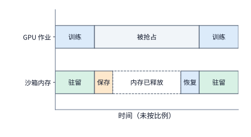

*图 11-16　GPU 训练作业遭遇抢占或故障中断期间的沙箱休眠机制（横轴未按比例绘制）：保存与恢复状态仅在首尾各占数秒钟，而中间长达数小时的抢占窗口内沙箱物理内存被完全腾空，供集群内其他活跃作业复用。*

正因如此，在 DSec 生产平台上，只要调度器通知某个 GPU 训练作业被抢占，RL 训练框架就会立刻批量触发该作业名下所有沙箱的暂停流程（图 11-16）。针对不同隔离后端，DSec 采用了两种匹配的底层休眠实现：
- **针对容器后端**：先通过内核 cgroups `freezer` 子系统瞬间冻结容器内的整个进程树（防止进程在状态导出期间继续修改内存），随后放开内存交换限制将匿名页换出（swap out）到高速磁盘并主动触发内核页面回收；待 GPU 作业恢复前，先对进程的内存映射区发出批量预取提示（`madvise`），再解冻进程树恢复执行。
- **针对 microVM 后端**：将虚拟机的客户机物理内存与虚拟 CPU 寄存器状态完整转储为磁盘快照文件，随后直接终止宿主机上的虚拟机监控器进程，将内存 100% 归还宿主机；待恢复时再拉起新的虚拟机进程载入快照文件。

无论是容器冻结换出还是 microVM 快照落盘，本质上都是**利用“存储层级间的数据搬移”来打破“长期空闲状态的内存占用”**。由于任何发往已暂停沙箱的工具请求到达环境网关时都会自动触发按需唤醒与状态恢复，上层 Agent 控制器甚至完全无须感知底层沙箱在等待期间是否经历过休眠。恢复完成后，控制器只需先按操作标识向持久存储查询上一次工具调用的提交结果，确认无误后再接续下一轮交互，即可避免将中断前已经落盘生效的代码修改重复执行两遍。[^dsec][^e2b]

### 11.2.4 始终驻留、按需创建与提前准备

暂停与恢复之所以需要耗费 $8\ \mathrm{s}$ 保存、$1\ \mathrm{s}$ 恢复，是因为它试图把沙箱内存里的整个运行时进程树原封不动地搬进磁盘。现在让我们退后一步审视章首的代码修复任务：**既然每一轮工具执行完毕后，修改好的源码工作目录与测试结果都已经实时写入了外部持久存储，下一轮工具执行根本不需要继承上一轮的进程内存，我们为什么还要费力去保存那 $2\ \mathrm{GiB}$ 的进程快照呢？** 每一轮工具执行完直接销毁环境，等下一轮模型快要吐出参数前，直接从本地缓存的干净模板重新拉起一个新环境、挂载上持久化工作目录接着跑，岂不是轻快得多？

我们来核算这套**“每轮重建环境＋模型期提前准备（Just-in-Time Prewarming）”**方案的精确时间与资源账。前文提到，E2B 的环境模板本身就是一份已经完成操作系统引导的 microVM 预热快照，从本地缓存的模板拉起 microVM 约需 $1\ \mathrm{s}$，再加上挂载持久化工作目录与初始化测试运行时的耗时，设**本地热路径（hot path）的完整环境准备时间为 $P = 2\ \mathrm{s}$**（若模板不在本机缓存中，还需经 $25\ \mathrm{GbE}$ 链路取回 $2\ \mathrm{GiB}$ 模板，多花约 $0.69\ \mathrm{s}$，**冷路径约需 $2.7\ \mathrm{s}$**；下文默认模板已驻留本机走 $2\ \mathrm{s}$ 热路径）。每次准备环境累计消耗 **$0.1\ \text{CPU}\cdot\text{秒}$**，且从准备开始到本轮工具执行结束的这 $2 + 1 = 3\ \mathrm{s}$ 窗口内，环境持续占用 **$2\ \mathrm{GiB}$** 内存（请注意：准备阶段只负责拉起 microVM 并挂载已知的工作目录，真正的代码文件修改与测试运行依然严格等到第 $9\ \mathrm{s}$ 收到模型完整输出参数后才开始执行）。

现在看这 $2\ \mathrm{s}$ 的准备工作如何与 $9\ \mathrm{s}$ 的模型调用实现无缝重叠（图 11-17 与图 11-18）：
- **第一轮**：第 $0\ \mathrm{s}$ 发起模型调用（已知将于第 $9\ \mathrm{s}$ 返回），平台精准地卡在**第 $7\ \mathrm{s}$** 开始准备环境，第 $9\ \mathrm{s}$ 环境恰好准备就绪并与模型返回的参数汇合，第 $9\sim 10\ \mathrm{s}$ 执行 $1\ \mathrm{s}$ 工具测试并持久化结果，**第 $10\ \mathrm{s}$ 立即销毁环境释放全部 $2\ \mathrm{GiB}$ 内存**；
- **第二轮与第三轮**：如法炮制，分别在**第 $17\ \mathrm{s}$** 和**第 $27\ \mathrm{s}$** 启动环境准备，在第 $19\sim 20\ \mathrm{s}$ 和第 $29\sim 30\ \mathrm{s}$ 执行工具，并在第 $20\ \mathrm{s}$ 和第 $30\ \mathrm{s}$ 立即销毁环境。

对比图 11-17（全程保留）与图 11-18（每轮重建），奇迹发生了：
1. **任务端到端历时分毫未增**：三次各 $2\ \mathrm{s}$ 的环境准备工作百分之百隐藏在了三次各 $9\ \mathrm{s}$ 的模型调用末尾，整项任务依然准时在第 $30\ \mathrm{s}$ 完成；
2. **内存占用暴降 $70\%$**：单项任务在三轮中每次只保留环境 $2 + 1 = 3\ \mathrm{s}$，累计内存面积从原来的 $60\ \mathrm{GiB}\cdot\text{秒}$ 骤降至 $3 \times 3\ \mathrm{s} \times 2\ \mathrm{GiB} = \mathbf{18\ \mathrm{GiB}\cdot\text{秒}}$；乘以每秒 $10$ 项的任务到达率，全平台稳态平均环境内存占用直接从单机无法容纳的 $600\ \mathrm{GiB}$ 砍到了 **$180\ \mathrm{GiB}$**——还不到 `m5d.metal` 主机可用内存（$358\ \mathrm{GiB}$）的一半；
3. **付出的 CPU 与创建率代价极小**：由于每项任务要建三次环境，平台环境创建率从每秒 $10$ 个升至**每秒 $30$ 个**（远低于 Firecracker 单机每秒可创建 $150$ 个 microVM 的实测上限），准备工作每秒额外消耗 $30 \times 0.1 = \mathbf{3\ \text{个 CPU 核}}$，使平台总 CPU 需求从 $30$ 核微增至 **$33$ 核**（仍远低于 `m5d.metal` 的 $48$ 核容量）。

简言之，**平台仅用多花 $3$ 个闲置 CPU 核做环境准备的微小代价，就一举省下了原本在等待模型期间无谓占用的 $420\ \mathrm{GiB}$ 内存状态，彻底解开了例 11-1 中的单机内存死锁**。

*图 11-17　全程保留环境方案：2 GiB 沙箱从第 $0\ \mathrm{s}$ 任务启动一直驻留到第 $30\ \mathrm{s}$ 任务结束，模型推理每轮 $9\ \mathrm{s}$、工具执行每轮 $1\ \mathrm{s}$，三轮累计内存驻留面积高达 $60\ \mathrm{GiB}\cdot\text{秒}$。*

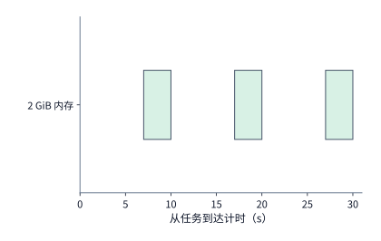

*图 11-18　每轮重建并提前 $2\ \mathrm{s}$ 准备环境方案（与图 11-17 采用相同横轴）：环境仅在每轮模型调用末尾的 $2\ \mathrm{s}$ 准备期（第 $7\sim 9\ \mathrm{s}$、$17\sim 19\ \mathrm{s}$、$27\sim 29\ \mathrm{s}$）和随后的 $1\ \mathrm{s}$ 工具执行期内存在，三次各占 $3\ \mathrm{s}$ 合计仅 $18\ \mathrm{GiB}\cdot\text{秒}$；由于工作目录与结果已持久化，任务同样在第 $30\ \mathrm{s}$ 准时完成。*

不过，图 11-18 能够把准备时机卡得如此精准，依赖于两个理想前提：一是预先知道模型一定会在第 $9\ \mathrm{s}$ 返回，二是预先知道下一轮使用的一定是同一种工具环境。在更一般的 Agent 系统中，智能体手中往往握有代码执行器、无头浏览器、数据库查询器等十几种截然不同的工具沙箱，模型下一轮究竟会调用哪一种工具，要等模型在流式输出（streaming）中逐步吐出思考过程与函数名时才能预测出来。**SpecBox** 等预测性沙箱调度系统正是利用模型流式输出中的早期线索与历史工具切换马尔可夫转移概率，提前投机预热（speculative prewarming）最可能被调用的沙箱环境。[^platform]

下面我们推导投机预热下的期望等待时间与空闲内存浪费公式（图 11-19 至图 11-23）。设拉起一个完整环境需要准备时间 $P\ \mathrm{s}$，调度器在模型最终发出工具调用前**提前 $L\ \mathrm{s}$（lead time）**启动预测环境的准备，且预测命中实际所需工具类型的概率为 $h \in [0, 1]$。在“正确预测不争用正常资源、错误预测一旦在调用到达时刻发现猜错即可立即取消并按需重头准备实际环境”的基准假设下：
- 若**预测命中（概率为 $h$）**：准备工作已经有 $\min(P, L)$ 秒与模型生成实现了重叠，因此调用到达后工具还需等待的剩余准备时间为 $\max(P - L, 0)$；
- 若**预测落空（概率为 $1 - h$）**：提前准备的错误环境作废取消，系统必须在调用到达时刻从零开始花整整 $P\ \mathrm{s}$ 准备真正需要的环境。

将两条分支按命中概率 $h$ 加权求和，得到工具调用发出后等待环境就绪的**期望等待时间 $\mathbb{E}[W]$**：

$$
E[W]=h\max(P-L,0)+(1-h)P
=P-h\min(P,L).
$$

上式极其清晰地揭示了提前量 $L$ 的饱和效应：当 $L < P$ 时，每多提前 $1\ \mathrm{s}$ 准备，就能将期望等待时间缩短 $h\ \mathrm{s}$；**一旦提前量达到准备耗时本身（$L \ge P$），正确分支的等待时间已经归零，期望等待时间触底锁定在 $(1 - h)P$，继续加大提前量 $L > P$ 不仅不能再缩短一毫秒的等待时间，反而会让猜对的那个环境提前 $(L - P)$ 秒就绪并在内存里无谓空等调用到达**。

我们代入一组具体数值验证（取准备耗时 $P = 2\ \mathrm{s}$、预测准确率 $h = 0.75$，假设工具调用固定在第 $4\ \mathrm{s}$ 到达）：
1. **不提前准备（$L = 0\ \mathrm{s}$，图 11-19）**：第 $4\ \mathrm{s}$ 调用到达才开始准备，第 $6\ \mathrm{s}$ 就绪，每次固定等待 $\mathbb{E}[W] = \mathbf{2.0\ \mathrm{s}}$；
2. **提前 $1\ \mathrm{s}$ 准备（$L = 1\ \mathrm{s}$，图 11-20）**：第 $3\ \mathrm{s}$ 开始准备，四次调用中有三次猜对只需再等 $2 - 1 = 1\ \mathrm{s}$，一次猜错仍需等 $2\ \mathrm{s}$，期望等待降至 $\mathbb{E}[W] = 0.75 \times 1 + 0.25 \times 2 = \mathbf{1.25\ \mathrm{s}}$；
3. **恰好提前 $2\ \mathrm{s}$ 准备（$L = 2\ \mathrm{s}$，图 11-21 与图 11-23）**：第 $2\ \mathrm{s}$ 开始准备，猜对时（占 $75\%$，图 11-21）环境恰好在第 $4\ \mathrm{s}$ 调用到达那一刻准备完毕，实现零等待；猜错时（占 $25\%$，图 11-23）第 $4\ \mathrm{s}$ 取消错误环境并重花 $2\ \mathrm{s}$ 准备，期望等待触底降至 $\mathbb{E}[W] = 0.75 \times 0 + 0.25 \times 2 = \mathbf{0.5\ \mathrm{s}}$；
4. **过度提前 $3\ \mathrm{s}$ 准备（$L = 3\ \mathrm{s}$，图 11-22）**：第 $1\ \mathrm{s}$ 就早早开始准备，第 $3\ \mathrm{s}$ 环境就绪，但调用要到第 $4\ \mathrm{s}$ 才来；期望等待时间依然是 **$0.5\ \mathrm{s}$**，却让占 $75\%$ 的正确分支在第 $3\sim 4\ \mathrm{s}$ 之间无谓多占了 $1\ \mathrm{s}$ 就绪态内存——对 $2\ \mathrm{GiB}$ 环境而言，每次调用无谓多占用了 $0.75 \times 2\ \mathrm{GiB} \times 1\ \mathrm{s} = \mathbf{1.5\ \mathrm{GiB}\cdot\text{秒}}$ 的空闲内存驻留。

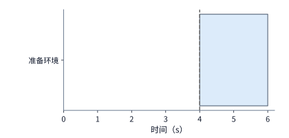

*图 11-19　按需创建基线（提前量 $L = 0\ \mathrm{s}$）：虚线标出第 $4\ \mathrm{s}$ 工具调用到达时刻，此时才启动持续 $2\ \mathrm{s}$ 的蓝色环境准备阶段，环境至第 $6\ \mathrm{s}$ 方可就绪，调用被迫等待 $2\ \mathrm{s}$（图 11-19 至图 11-23 采用统一横轴尺度）。*

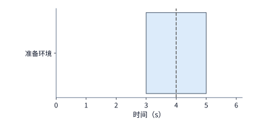

*图 11-20　预测正确且提前 $L = 1\ \mathrm{s}$ 准备：环境从第 $3\ \mathrm{s}$ 开始准备至第 $5\ \mathrm{s}$ 完成，第 $4\ \mathrm{s}$ 调用到达时准备工作已完成一半，剩余等待时间缩短至 $1\ \mathrm{s}$。*

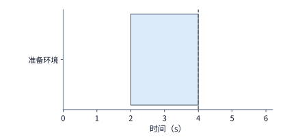

*图 11-21　预测正确且提前 $L = 2\ \mathrm{s}$ 准备：环境从第 $2\ \mathrm{s}$ 启动准备，恰好在第 $4\ \mathrm{s}$ 调用到达时刻就绪，实现零等待交接且无多余就绪态空闲驻留。*

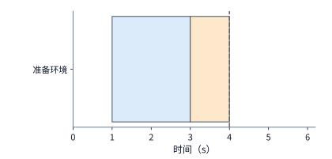

*图 11-22　预测正确但过度提前 $L = 3\ \mathrm{s}$ 准备：环境从第 $1\ \mathrm{s}$ 启动准备并在第 $3\ \mathrm{s}$ 提前就绪，图中橙色条块标出了第 $3\sim 4\ \mathrm{s}$ 环境已就绪却在空等调用到达的 $1\ \mathrm{s}$ 内存浪费窗口。*

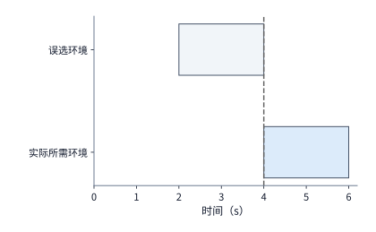

*图 11-23　预测错误分支（概率 $1 - h$）：第 $2\sim 4\ \mathrm{s}$ 预热了错误的沙箱类型（灰色条块），第 $4\ \mathrm{s}$ 调用到达揭晓真实工具类型后立即取消错误环境，并从第 $4\ \mathrm{s}$ 至第 $6\ \mathrm{s}$ 花费 $2\ \mathrm{s}$ 重新准备实际所需环境。*

一组本地工具轨迹重放实验直观地印证了“过早预热”的严重内存惩罚：当调度器把预热启动时机从“工具调用到达前 $50\ \mathrm{ms}$”粗暴地提前到“上一轮模型等待刚开始的第一毫秒”时，整段轨迹的累计工具执行耗时几乎没有任何变化（仍为约 $0.26\sim 0.28\ \mathrm{s}$），但按进程采样积分算出的累计内存占用面积却从约 **$0.0193\ \mathrm{GiB}\cdot\text{秒}$** 飙升到了 **$0.467\ \mathrm{GiB}\cdot\text{秒}$**——**内存占用大幅膨胀了约 $24\ \text{倍}$**，而多出来的内存面积几乎全部耗费在图 11-22 那段“环境早已就绪、模型仍在生成输出”的空等窗口上。因此，投机预热的黄金法则是：**提前量 $L$ 最多对齐到环境准备耗时 $P$ 即可，无需过早启动而造成无谓的内存驻留**。[^prewarm]

最后需要指出的是，“每轮销毁并重建环境”之所以在章首代码修复平台中畅通无阻，靠的是“轮间所需状态已 100% 写入外部持久存储”这一前提；而在许多复杂的长程 Agent 任务中，智能体会在第 1 轮编译大型项目、启动本地 PostgreSQL 数据库或拉起常驻后台 Web 服务，后续轮次的工具调用直接依赖这些驻留在内存中的活跃进程与套接字连接——此时如果只保存磁盘文件而销毁环境，下一轮重建出来的根本不是同一个运行态。面对这类强状态任务，DSec 走的是另一条互补的技术路线：**允许沙箱在整段多轮交互期间持续存在，但动用第 11.2.2 节的按需加载、`virtio-pmem + DAX` 只读页共享、`DAMON + virtio-balloon` 冷页主动回收把单个存活沙箱的内存底座压到极致，再配合第 11.2.3 节在 GPU 抢占长间隔期间批量休眠落盘**。工程架构选型的分水岭正在于此：**若轮间状态能低成本地完整外化到持久存储，就用每轮按需重建以少量 CPU 换回巨量内存；若轮间包含难以序列化的复杂活跃进程态，就保留沙箱实例并极力压缩其驻留体积**。[^dsec]

---

## 11.3 共享资源池的分配与调度

前两节我们站在单个任务与单台宿主机的视角，算清了 CPU 工作量与环境内存占用面积。然而在多租户共享的数据中心资源池里，“全集群空闲资源总和大于作业需求”绝不等于“作业立刻就能跑起来”。本节将视角切换到集群调度器（scheduler）层面，依次剖析异构多维资源碎片、突发队列与超线程干扰、RL 弹性生成实例的出口带宽瓶颈，以及长尾验证任务的剩余时间调度。

### 11.3.1 异构资源、成组分配与放置约束

与章首每次只需独立申请 $1$ 个 CPU 核的轻量级工具不同，大规模分布式训练与推理作业往往带有严苛的**多维成组分配（gang scheduling）与拓扑放置约束**：一项多卡作业不仅要求同时获得指定型号（如 H100 而非 A100）的加速卡、足够的单卡显存、成比例的配套宿主机 CPU 核数与系统内存，还常常要求这些资源必须落在同一台物理节点或同一个 NVLink 超节点内，所有工作进程必须齐备后才能协同启动。只要其中一个维度在局部节点上缺失，哪怕集群总空闲卡数绰绰有余，作业也会因为**多维资源碎片（resource fragmentation）**而无法启动。

**例 11-3：GPU、CPU 与节点约束如何造成资源碎片？** 设集群新到达一项分布式作业，要求在同一台物理节点内同时分配 **$4$ 张 H100 GPU** 与 **$16$ 个 CPU 核**。当前资源池中共有两台物理节点（图 11-24）：
- **节点 1（一台 NVIDIA DGX H100）**：满配 $8$ 张 H100 SXM 与双路 Xeon Platinum 8480C（共 $112$ 个 CPU 核）。由于机上已有先来作业占用了 $4$ 张 H100 和高达 $104$ 个 CPU 核，当前节点 1 虽然还空着 **$4$ 张 H100**，但空闲 CPU 却只剩 **$8$ 个核**（差 $8$ 个核）；
- **节点 2（一台 NVIDIA DGX A100）**：满配 $8$ 张 A100 与双路 EPYC 7742（共 $128$ 个 CPU 核），当前空着 **$4$ 张 A100** 和 **$32$ 个 CPU 核**（CPU 充足，但加速卡型号不符）。

审视整座资源池：全局明明既有 $4$ 张空闲 H100，又有 $8 + 32 = 40$ 个空闲 CPU 核（远超所需的 $16$ 核），但由于节点 1 缺 CPU、节点 2 卡型不对，没有任何一台节点能够单独满足新作业的成组启动条件。[^nodes]

*图 11-24　多维资源碎片整理前：新作业要求同节点配备 $4$ 张 H100 与 $16$ 个 CPU 核；节点 1（DGX H100）空着 $4$ 张 H100 但仅剩 $8$ 个空闲 CPU 核，节点 2（DGX A100）空着 $32$ 个 CPU 核但加速卡为 A100，导致新作业被阻塞。*

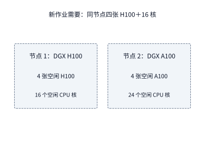

*图 11-25　碎片整理后：调度器将节点 1 上一个仅占用 $8$ 个 CPU 核的任务迁移至节点 2，使节点 1 凑齐 $4$ 张空闲 H100 与 $16$ 个空闲 CPU 核，新作业得以立即在节点 1 本地启动。*

面对图 11-24 的僵局，调度器面前有三条可选路径（设新作业一旦在节点 1 本地拿到完整资源，执行耗时为 $T_{\mathrm{run,local}} = 20\ \mathrm{s}$）：
1. **方案一：原地等待（Wait）**：不搬动现有任务，被动等待节点 1 上占着 CPU 的原任务在 $T_{\mathrm{wait}} = 12\ \mathrm{s}$ 后自然结束，随后启动新作业，端到端完成时间为 $12 + 20 = \mathbf{32\ \mathrm{s}}$；
2. **方案二：碎片整理迁移（Migrate / Defragment，图 11-25）**：主动将节点 1 上一个占用 $8$ 个 CPU 核的纯 CPU 任务热迁移到空闲核充裕的节点 2 上（设状态迁移耗时 $T_{\mathrm{move}} = 4\ \mathrm{s}$），腾出核数后立刻在节点 1 启动新作业，端到端完成时间缩短至 $4 + 20 = \mathbf{24\ \mathrm{s}}$；
3. **方案三：降级跨节点分散启动（Spread）**：放弃同节点约束，经过 $T_{\mathrm{ready,spread}} = 1\ \mathrm{s}$ 的跨机环境准备后直接分散启动；但受制于跨节点通信减速，作业运行耗时拉长至 $T_{\mathrm{run,spread}} = 32\ \mathrm{s}$，端到端完成时间反而高达 $1 + 32 = \mathbf{33\ \mathrm{s}}$。

我们将三种调度决策下的新作业完成时间总结为通式：

$$
T_{\mathrm{wait}}+T_{\mathrm{run,local}},\qquad
T_{\mathrm{move}}+T_{\mathrm{run,local}},\qquad
T_{\mathrm{ready,spread}}+T_{\mathrm{run,spread}}.
$$

在本例中，主动迁移方案比原地等待早 $8\ \mathrm{s}$ 完成，比跨节点分散启动早 $9\ \mathrm{s}$ 完成。当然，迁移耗时 $T_{\mathrm{move}}$ 会随被迁移任务的状态体积线性增长：一旦被迁移任务需要搬移高达数十 GB 的内存镜像、使 $T_{\mathrm{move}}$ 延长到 $12\ \mathrm{s}$ 以上，迁移方案的优势就会被原地等待反超。因此，现代集群调度器会实时比对被迁移任务的预期搬移耗时 $T_{\mathrm{move}}$ 与原任务的预计剩余运行时间 $T_{\mathrm{wait}}$，动态择优。

这种由“配套 CPU 耗尽、成组启动约束与网络拓扑亲和性”共同制造的 GPU 碎片，在超大规模生产集群中绝非个例。香港科技大学与阿里巴巴等机构在 2026 年发表的一项针对 **阿里巴巴无服务器基础设施（Alibaba Serverless Infrastructure，简称 ASI，涵盖 $155{,}410$ 张 GPU、历时六个月生产轨迹）**的实证研究表明：在未引入弹性回填与迁移整理前，大量物理空闲的 GPU 因为所在节点的 CPU 核被占满或凑不齐同交换机下的成组卡数而长期搁浅，集群整体 GPU 分配率仅停留在 **$68\%$**；而在引入可被随时抢占的低优先级作业填补碎片空隙，并在高优先级成组作业到达时通过主动回收与任务迁移腾挪整机资源后，生产集群的 GPU 分配率一举跃升至 **$93\%$**。[^platform]

### 11.3.2 队列、优先级与抢占代价

即便每台节点的硬件配比都恰到好处，**任务到达的时间分布形态**也会深刻改变用户体验到的端到端延迟。在章首的理想基线中，任务每隔 $0.1\ \mathrm{s}$ 均匀到达，每秒产生 $30$ 次工具执行，单台 `m5d.metal` 的 $48$ 个物理核应付起来游刃有余；然而在实际生产中，一旦多条工作流在同一瞬间齐发调用，即便总计算量分毫未增，排队延迟也会急剧抬头。

我们先用一个单核执行进程的极简模型看清“均匀到达”与“突发同时到达”的排队差异（图 11-26 与图 11-27）。设有 $10$ 项各需耗时 $1\ \mathrm{s}$ 的工具任务交给同一个执行进程处理：
- **均匀到达（图 11-26）**：10 项任务依次在第 $0, 1, 2, \dots, 9\ \mathrm{s}$ 准点到达，每一项到达时前一项恰好执行完毕，所有任务的排队等待时间均为 **$0\ \mathrm{s}$**；
- **突发同时到达（图 11-27）**：10 项任务全部在第 $0\ \mathrm{s}$ 同一瞬间涌入，执行进程依然只能一项接一项地串行干满 $10\ \mathrm{s}$，但第 $1$ 至第 $10$ 项任务在队列中空等的时间依次变成了 $0, 1, 2, \dots, 9\ \mathrm{s}$，**平均排队等待时间飙升至 $4.5\ \mathrm{s}$**。

这两幅图的对照揭示了一条核心排队原理：**总工作量（$10\ \text{CPU}\cdot\text{秒}$）只决定了服务器需要忙碌多久，而请求的到达突发度与调度次序则决定了每项任务在开始干活前必须先等多久**。

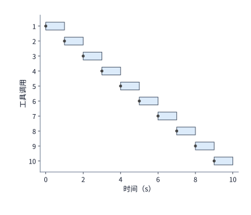

*图 11-26　均匀到达场景：10 次各耗时 $1\ \mathrm{s}$ 的工具调用每隔 $1\ \mathrm{s}$ 依次到达（圆点标出到达时刻），单个执行进程随到随处理（蓝色条块），全程零排队等待。*

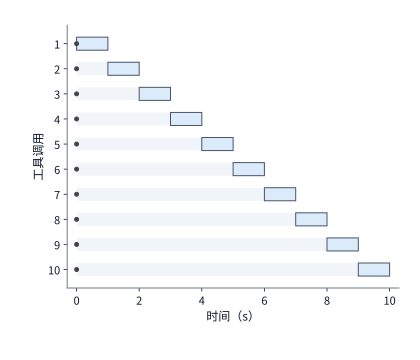

*图 11-27　突发同时到达场景：10 次调用全部在第 $0\ \mathrm{s}$ 瞬间到达，执行进程的总工作时长仍为 $10\ \mathrm{s}$，但后到的任务被迫经历 $1\sim 9\ \mathrm{s}$ 不等的灰色排队等待，平均排队耗时达 $4.5\ \mathrm{s}$。*

现在将这一突发分析应用到章首的代码修复平台上。假设在某一时刻，单台 `m5d.metal` 的 $48$ 个物理核恰好全部空闲，此时突然同时涌入 **$80$ 次**各需 $1\ \mathrm{s}$ 的工具调用：前 $48$ 项调用立刻分到物理核并在第 $0\sim 1\ \mathrm{s}$ 执行完毕，余下 $32$ 项调用被迫排队等待 $1\ \mathrm{s}$ 后在第 $1\sim 2\ \mathrm{s}$ 执行完毕——整批突发在 $2\ \mathrm{s}$ 内消化完毕，平均排队等待时间为 $(48 \times 0 + 32 \times 1) / 80 = \mathbf{0.4\ \mathrm{s}}$（若将主机扩容为两台 `m5d.metal` 共 $96$ 核，这 $80$ 次突发就能在 $1\ \mathrm{s}$ 内零排队消化，尽管在稳态均匀到达下平均仍只需 $30$ 个核）。

但请千万别忘了核对**突发时刻的内存账本**：要让这 $80$ 次突发工具调用在 1～2 秒内跑起来，对应的 **$80$ 个已就绪沙箱环境必须同时驻留在内存中，瞬时占用 $80 \times 2 = \mathbf{160\ \mathrm{GiB}}$ 内存**。回顾前文：在始终驻留基线方案下，稳态内存需求已经高达 $600\ \mathrm{GiB} > 358\ \mathrm{GiB}$，连稳态都跑不起来；而在第 11.2.4 节的**“每轮重建环境”**方案下，稳态平均仅占用 $180\ \mathrm{GiB}$ 内存，`m5d.metal` 主机上恰好还留有 $358 - 180 = \mathbf{178\ \mathrm{GiB}}$ 的空闲内存余量，**足以稳稳接住这 $80$ 个突发环境所需的 $160\ \mathrm{GiB}$ 瞬时内存洪峰**。这再次印证了释放等待期环境内存的双重价值：它不仅让单机装下了稳态负载，还为突发洪峰预留出了宝贵的内存缓冲垫，使空闲 CPU 核在突发到来时真正派上用场。

当突发沙箱创建请求扩展到由上百台节点组成的集群时，调度器还会面临**分布式放置惊群（herd effect）**挑战。在 DeepSeek 的 DSec 平台上，当大型 RL 作业齐发开启采样时，全集群的峰值沙箱创建速率超过**每秒 $5{,}000$ 个**——平摊到集群的 $160$ 台物理节点上，相当于每台节点每秒要新建约 **$31$ 个沙箱**（恰好与本章第 11.2.4 节单机每秒创建 $30$ 个环境的题设高度吻合）。在如此高的并发创建速率下，调度器手头的“各节点剩余负载视图”是通过心跳周期性汇总上来的，必然带有毫秒至秒级的信息滞后；如果多个并发调度器实例机械地照着这份过时视图去挑选“当前账面最空闲的那台节点”，同一瞬间到达的成百上千个沙箱创建请求便会集中涌向同一台节点，瞬间导致该节点资源过载。

为了在不引入中心化强一致锁的前提下化解惊群效应，DSec 采用了如图 11-28 所示的**三层去中心化放置机制**：
1. **基于“$k$ 选优（Power-of-$k$-Choices）”的随机采样**：调度器每次不为沙箱遍历全网找全局最闲节点，而是从候选池中随机抽取少数几个（$k$ 个）节点，从中挑选负载较低的一台下发——微小的随机化天然将并发洪峰均匀打散到了不同节点；
2. **调度器本地在途补记（Local Inflight Accounting）**：每个调度器实例在定期同步的全局视图之上，实时叠加记录“本实例刚刚下发、但尚未反映到下一轮心跳汇总中的在途沙箱增量”，消除自身连续决策的盲区；
3. **节点侧本地准入保底检查（Node-Side Admission Control）**：最终是否接纳沙箱由目标工作节点拍板——节点收到请求后先核对本地真实的瞬时内存与 CPU 余量，一旦发现资源吃紧立即返回拒绝（reject），由调度器毫秒级换投另一台候选节点。依靠“随机采样分散＋本地增量修正＋节点准入拒绝”的组合，即便全局视图略有过时，系统也绝不会发生单节点超载，且所有调度器实例均为无状态设计，支持随时水平扩缩或秒级故障替换。[^dsec]

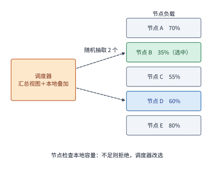

*图 11-28　DSec 应对每秒 5,000 个沙箱突发创建的分布式放置机制：调度器在定期汇总视图上补记自己刚下发的在途沙箱，每次随机抽取少数候选节点并挑选负载较低者（power-of-$k$-choices）；目标节点核查本地真实容量后决定接受或拒绝，若拒绝则由调度器立即改投其他节点。*

除了空间上的分散放置，平台还需要在时间上通过**优先级与抢占（preemption）**来保障在线高优任务的响应期限。设在线交互任务要求必须在 **$2\ \mathrm{s}$** 内获得资源启动，而当前借用资源的离线批处理作业执行一次状态保存与优雅退出需要 **$30\ \mathrm{s}$**。请注意这里的时间差陷阱：**虽然离线作业在名义上是“可抢占”的，但它要等 $30\ \mathrm{s}$ 后才能真正腾出资源，无法满足 $2\ \mathrm{s}$ 内就必须启动的在线任务需求**；因此，平台必须在可抢占离线池之外，单独预留出一块能够在 $2\ \mathrm{s}$ 内立即交付的常备热余量（headroom）。

更隐蔽的干扰发生在底层 CPU 微架构内部：**哪怕我们在操作系统里给高低优先级任务设好了完美的优先级，硬件层面也未必分得开**。前文提到，为了提升单机密度，生产沙箱平台普遍开启了 CPU 超卖，让对延迟高度敏感的在线任务（**Latency-Sensitive，简称 LS**，如每步思考都有严格读秒限制的博弈智能体）与可容忍延迟的尽力而为批处理任务（**Best-Effort，简称 BE**，如后台批量仓库编译）混部在同一台物理节点上。在 Linux 内核中，标准做法是将 BE 任务放进最低优先级的 `SCHED_IDLE` 调度类——按理说，只要同一个逻辑核上有 LS 任务就绪，BE 任务就会立刻让出 CPU。然而，现代服务器处理器普遍开启了**同时多线程（Simultaneous Multithreading，简称 SMT，即 Intel 超线程技术）**，使**每一个物理核心（Physical Core）在操作系统里表现为两个逻辑硬件线程（Hardware Threads / Siblings）**，而这两个硬件线程在底层共享同一套算术逻辑单元（ALU）、乱序执行窗口与一级高速缓存（L1 Cache）。由于 Linux 调度器默认以逻辑硬件线程为单位独立排班，当 LS 任务跑在某个物理核的线程 0 上时，BE 任务完全可能同时跑在同一个物理核的兄弟线程 1 上（图 11-29），在芯片内部剧烈争抢执行流水线与一级缓存。

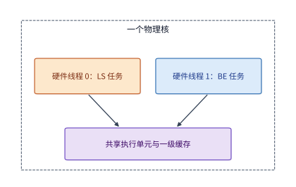

*图 11-29　超线程（SMT）下的同核微架构干扰：`SCHED_IDLE` 仅控制单个逻辑硬件线程内的排队顺序；当延迟敏感（LS）任务在硬件线程 0 上运行时，尽力而为（BE）任务仍可同时占据同一物理核的兄弟硬件线程 1，争抢共享的执行单元与 L1 缓存。*

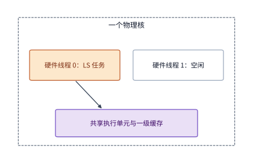

*图 11-30　开启 Linux Core Scheduling（核心级调度）后的硬件隔离：内核强制同一物理核的两个硬件线程只运行同一安全/优先级域的任务；当 LS 任务运行时，兄弟硬件线程宁可保持空闲也不放入 BE 任务，从而消除同核执行单元争用。*

DSec 团队在生产节点上的实测数据清晰地展示了这一干扰幅度：当节点上的 BE 背景负载占到整机容量的一半（$50\%$）时，同机运行的 LS 在线任务每步执行耗时**恶化增长了约 $45\%$**，而单纯给 BE 任务设置 `SCHED_IDLE` 对改善这一延迟劣化**几乎毫无作用**。直到工程师为 LS 任务开启了 Linux 内核的 **核心级调度（Core Scheduling，图 11-30）**——强制规定同一个物理核的两个超线程绝不允许同时运行不同组的任务（当 LS 任务在线程 0 上执行时，若没有同组 LS 任务，线程 1 宁可强制闲置也不允许放入 BE 任务），LS 任务的每步耗时增幅才从 $45\%$ 大幅压降到了约 **$17\%$**（残余的 $17\%$ 干扰则来自整机高负载触发的全芯片热降频，以及多核共享的末级缓存 LLC 与主存带宽争用，需配合 Intel RDT / 内存带宽限制进一步隔离）。至于本章贯穿设计题选用的 AWS `m5d.metal` 裸金属服务器，在出厂评测配置中直接关闭了超线程（48 个物理核对应 48 个逻辑核），从源头上消除了同核 SMT 兄弟线程干扰，代价则是主机可调度的逻辑线程总数减少了一半。[^dsec]

一旦触发真正的作业级抢占，除了等待退出的时间外，还会造成未保存计算进度的回滚损失。例如一项已连续运行了 $20\ \mathrm{s}$、恢复需耗时 $2\ \mathrm{s}$ 的作业，如果被抢占时尚未保存检查点，恢复后就只能从零重做这 $20\ \mathrm{s}$ 的工作；如果此前刚保存过检查点，损失就只限于上次检查点之后增量积累的那一小段工作。因此，调度器在拍板是否抢占时，必须综合权衡新任务提前启动的收益、状态保存与恢复的转换开销，以及被抢占原作业由此拉长的完工延迟。

从单次抢占进一步放到多租户集群的长期运行中，调度器还必须确立清晰的**公平性（fairness）标尺**，防止某些租户或任务类型长期饥饿。思考这样一个场景：给任务甲分 $2$ 张新架构 B200 GPU、给任务乙分 $2$ 张旧架构 A100 GPU，表面上看双方拿到了完全相同的卡数份额；但如果 B200 跑同样计算的速度是 A100 的两倍以上，两项任务的实际推进速度就会相差悬殊。围绕“什么才算真正的公平”，学术界与工业界演进出了三代经典的多维与异构调度准则：
1. **主导资源公平（Dominant Resource Fairness，简称 DRF）**：针对既要 GPU 又要 CPU 和内存的多维异构作业，将每项作业在各类资源中占集群总量比例最高的那一维定义为该作业的**主导资源（dominant resource）**（如某作业申请集群 $10\%$ 的 GPU 和 $2\%$ 的 CPU，则其主导资源为 GPU，份额为 $10\%$），调度器通过均衡各租户的主导资源份额实现多维帕累托最优与共享激励兼容；
2. **异构加速比感知调度（如 Gavel）**：考虑到不同代际加速卡对不同模型算子的吞吐矩阵差异，不再机械地按物理卡数平分，而是将各类调度策略（如最大最小公平、最短剩余时间优先）转化为在异构加速器矩阵上的**有效吞吐率分配问题**，通过时间片轮转使各作业获得公平的等效算力进度；
3. **有效训练进度（Goodput）感知调度（如 Pollux）**：针对分布式训练中动态批大小与统计效率的耦合关系（见第 10.1.1 节临界批大小模型），实时评估为每个作业增减 GPU 卡数所能带来的真实收敛进度增益（goodput），在集群级训练吞吐与租户公平性之间动态寻优，并配合最长等待时间上限（aging）防止大作业长期饥饿。[^scheduling]

### 11.3.3 RL 生成与训练的动态资源配比

在前面讨论的代码修复服务中，单个任务每次只调用一次模型、占一个沙箱；而当我们进入第 10.5 节介绍的**大规模强化学习（RL）后训练系统**时，每一次迭代的资源需求都会随着“轨迹生成（rollout） $\to$ 环境验证（verify） $\to$ 策略更新（update） $\to$ 权重发布（publish）”四个阶段剧烈起伏。

我们先考察四阶段严格串行执行的同步 RL 迭代：设每轮迭代需要收集的有效样本总量为 $Q$，生成集群的聚合产出速率为 $r_g$，则生成阶段耗时为 $T_{\mathrm{generate}} = Q / r_g$；加上随后的验证耗时 $T_{\mathrm{verify}}$、参数更新耗时 $T_{\mathrm{update}}$ 与新权重发布同步耗时 $T_{\mathrm{publish}}$，单轮 RL 迭代总耗时 $T_{\mathrm{iter}}$ 为：

$$
T_{\mathrm{iter}}=T_{\mathrm{generate}}+T_{\mathrm{verify}}+T_{\mathrm{update}}+T_{\mathrm{publish}}.
$$

由于长思维链生成往往占去单轮时间的半壁江山，工程团队最自然的冲动就是**往生成池里加更多的 GPU 加速卡**。但让我们算一笔受 Amdahl 定律制约的账（图 11-31）：设原配置下生成、验证、更新和发布四个阶段分别耗时 **$40\ \mathrm{s}$、$10\ \mathrm{s}$、$30\ \mathrm{s}$ 和 $5\ \mathrm{s}$**，单轮合计耗时 **$85\ \mathrm{s}$**。如果我们把生成池的加速卡数量翻倍，使生成速率 $r_g$ 提高一倍、生成时间从 $40\ \mathrm{s}$ 减半至 **$20\ \mathrm{s}$**，其余三个阶段保持不变（仍共需 $10 + 30 + 5 = 45\ \mathrm{s}$），那么单轮总时间只会从 $85\ \mathrm{s}$ 降到 **$65\ \mathrm{s}$**——**生成算力投入翻了一倍，端到端迭代速度却只提升了 $85 / 65 \approx \mathbf{1.31\ \text{倍}}$**；哪怕我们投入无穷多张生成卡把生成时间压缩到 $0\ \mathrm{s}$，单轮耗时依然卡在其余三阶段的 $45\ \mathrm{s}$ 下界上，极限加速比绝不可能超过 $85 / 45 \approx \mathbf{1.89\ \text{倍}}$。

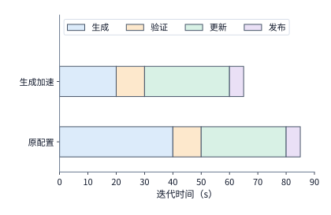

*图 11-31　同步串行 RL 迭代的四阶段耗时构成（条块长度按真实时间比例绘制）：当生成阶段（蓝色）通过扩容加速一倍从 $40\ \mathrm{s}$ 缩短至 $20\ \mathrm{s}$ 时，未加速的验证（$10\ \mathrm{s}$）、更新（$30\ \mathrm{s}$）与发布（$5\ \mathrm{s}$）三阶段依然固定耗时 $45\ \mathrm{s}$，使单轮总时间仅从 $85\ \mathrm{s}$ 降至 $65\ \mathrm{s}$（整体加速约 $1.3\times$）。*

要想突破图 11-31 的瓶颈，工程上有两条正交的优化方向：一是打破串行壁垒，让验证阶段与生成阶段流水重叠起来（将在第 11.3.4 节详述）；二是像 **RLBoost** 与 **PolyRL** 等弹性 RL 系统那样，在生成阶段动态租用廉价的云端临时实例（spot / preemptible instances）临时扩充生成池。然而，**临时实例并不是一拿到手就能立刻吐出 token 的——它必须先把训练组最新一轮重达数十 GB 的模型权重跨网拉取过来并加载进显存**。如果忽视了发送端的出口带宽瓶颈，盲目增加临时接收实例反而会在权重分发阶段撞上网络墙（例 11-4）。[^rollout]

**例 11-4：共享的发送出口如何限制多实例的权重分发速度？** 以本章与第 10 章反复使用的 **Qwen3-8B** 模型为例：其完整 BF16 权重文件精确包含 $16{,}381{,}470{,}720$ 字节，按十进制网络传输口径折合约 **$16.38\ \mathrm{GB}$**。按照 **RLBoost** 论文的实验拓扑（图 11-32），训练端是一台 8 卡 H100 实例，通过一张 **$200\ \mathrm{Gbit/s}$（即 $25\ \mathrm{GB/s}$）**的数据中心前端通用网卡向外分发权重；接收端则是 **$6$ 个**新加入的 2 卡临时 rollout 推理实例，每个接收实例配备一张 **$50\ \mathrm{Gbit/s}$（即 $6.25\ \mathrm{GB/s}$）**的前端网卡，且六个接收实例在内部采用 2 路张量并行（TP=2）运行。

请注意这里的两个关键物理约束：第一，在 **PolyRL** 等弹性系统的实现路径中，虽然每个 2 卡 rollout 实例内部用 TP=2 切分矩阵计算，但它是先把一整份 $16.38\ \mathrm{GB}$ 权重完整接收到本机 CPU 内存缓冲区，再在实例内部按 TP=2 切分加载到两张 GPU 上的，因此**每个接收实例从外部网络拉取的字节数依然是完整的 $16.38\ \mathrm{GB}$**；第二，向单个接收实例传完一份权重，受限于接收方自己的 $50\ \mathrm{Gbit/s}$ 网卡，至少需要：

$$
16.38/(50/8)\approx2.62\ \mathrm{s},
$$

但当训练端同时以单播方式向 **6 个接收实例**并发推送这 6 份权重时，六路数据流必须共同挤过训练端那唯一一张 **$200\ \mathrm{Gbit/s}$ 共享发送出口**，发送方累计需要向外泵出 $6 \times 16.38 \approx \mathbf{98.3\ \mathrm{GB}}$ 的总流量。根据第 7 章的割集带宽下界，6 个实例全部收齐权重的时间下界 $T_{\mathrm{all}}$ 受接收端单口耗时与发送端总出口耗时的最大值制约：

$$
T_{\mathrm{all}}\geq\max\left(2.62,\frac{6\times16.38}{200/8}\right)\approx3.93\ \mathrm{s}.
$$

算式表明：当接收实例达到 6 个时，瓶颈已经从接收端的 $50\ \mathrm{Gbit/s}$ 网卡转移到了发送端的 $200\ \mathrm{Gbit/s}$ 共享出口（若不改用应用层链式转发或树形多播，每多加一个接收实例，发送端出口耗时就会再线性增加约 $0.66\ \mathrm{s}$）。不仅如此，权重传到接收端主机内存后，还必须拷入 GPU 显存、完成推理引擎图初始化并向调度器注册确认——所有这些准备耗时都必须从临时实例短暂的存活期中直接扣除掉。

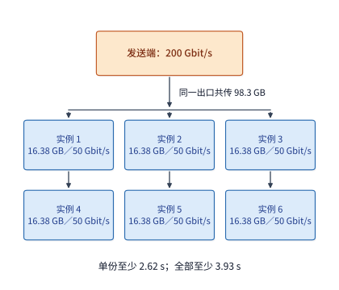

*图 11-32　弹性 RL 生成池的权重分发割集瓶颈：每个 2 卡接收实例均需接收一份完整的 $16.38\ \mathrm{GB}$ Qwen3-8B 权重；虽然单个 $50\ \mathrm{Gbit/s}$ 接收口最快 $2.62\ \mathrm{s}$ 即可收完，但六路传输共享训练端唯一的 $200\ \mathrm{Gbit/s}$ 发送出口，累计发送 $98.3\ \mathrm{GB}$ 数据使全部传完的理论下界拉长至 $3.93\ \mathrm{s}$。*

我们把包括权重拉取、显存加载与引擎预热在内的冷启动准备总耗时记作 $T_0$，把一个临时实例从被分配给作业到被云平台收回（或本轮结束）的总可用时长记作 $L$，则该临时实例真正能够用于有效生成轨迹的时间窗口仅为 **$\max(L - T_0, 0)$**。举个直观的例子：设某个临时实例从拿到机器到加载完权重准备就绪共需 $T_0 = 8\ \mathrm{s}$；如果它能稳定可用 $L = 20\ \mathrm{s}$，那么扣掉前 $8\ \mathrm{s}$ 后还剩 **$12\ \mathrm{s}$（占 $60\%$）**用于实际生成；而如果云平台在第 $5\ \mathrm{s}$ 就发来抢占通知把机器收回了（$L = 5\ \mathrm{s} < 8\ \mathrm{s}$），那么这个实例在完成权重准备之前就已经夭折，有效生成产出完完全全为**零**。

更进一步，即便临时实例已经跑了一段时间，一旦在生成长思维链的中途被云平台提前收回，正在生成的半截轨迹也会面临丢失风险。为了挽救这部分已完成的计算，**PolyRL** 等系统支持将已生成的 token 前缀实时保存下来并迁移到接替的新实例上：新实例读入“原始提示词＋已保存的半截输出前缀”，通过一次快速的预填充（prefill）重建 KV 缓存后即可接着往下采样。不过在成组采样（如 GRPO 对同一道题同时并行采样多条回答，共享同一组请求配置）的实现中，为了保持组内批处理对齐，PolyRL 恢复时会把同组各条回答统一截断到**组内已保存的最短长度**：例如同一道题的两条并行回答在抢占发生前分别已经生成了 $4{,}000$ 个和 $1{,}000$ 个 token，恢复时系统会将两条回答统一截齐到 $1{,}000$ 个 token（合计复用 $2{,}000$ 个已生成 token），而较长那条回答多生成的 $3{,}000$ 个 token 则被迫丢弃重算。

还要警惕一个极易被忽视的性能反直觉现象：**当已生成的前缀很短时，“保存前缀并跨实例迁移恢复”甚至可能比“干脆丢弃、从头重做”还要慢**。在一组基于本地 4-bit 量化 Qwen3-8B 部署的受控抢占恢复对照实验中，保留已生成前缀虽然帮新实例省去了 $96$ 个输出 token 的重复采样，但包含状态序列化、重新排队调度与长前缀重建在内的端到端恢复请求总耗时却达到了约 **$12.8\ \mathrm{s}$**，而直接丢弃这 $96$ 个 token 从头重新生成的总耗时反而只需约 **$11.6\ \mathrm{s}$**。原因就在于：省掉的是几十个 token 的解码时间，新增的却是实打实的跨机状态交接、重调度与预填充开销——唯有当已生成的轨迹足够长、重算代价远大于迁移重调度开销时，前缀迁移恢复才真正划算。[^recovery]

除了时间账，租用临时实例还必须算清**单位任务的总金钱账**。按照 RLBoost 论文采用的云平台历史租价：主训练组的 8 卡 H100 实例每小时租价约为 **$84\ \text{美元}$**，而外加的 6 个临时 rollout 实例每个每小时租价约为 **$5.3\ \text{美元}$**（6 个合计约 $31.8\ \text{美元/h}$），扩容后的全系统总费率升至约 **$116\ \text{美元/h}$**。假设所有实例在训练期间全程计费，由于每小时花掉的钱变成了原来的 $116 / 84 \approx \mathbf{1.38\ \text{倍}}$，**扩容后的系统端到端训练吞吐量必须至少提升到原配置的 $1.38\ \text{倍}$ 以上，完成单个训练任务的平均成本才会真正下降**：
- 若加入 6 个临时实例后，受制于权重分发开销与验证瓶颈，系统吞吐量只提升到了原来的 **$1.2\ \text{倍}$**：虽然训练完成时间确实缩短了，但每完成一项训练任务的实际花费却反而上涨到了原来的 $1.38 / 1.2 \approx \mathbf{1.15\ \text{倍}}$；
- 若通过流水优化使系统吞吐量提升到了原来的 **$1.6\ \text{倍}$**：不仅训练时间大幅缩短，单位任务成本也随之下降到了原来的 $1.38 / 1.6 \approx \mathbf{0.86\ \text{倍}}$。[^rollout]

上面讨论的是模型生成的 token 进度如何跨抢占保留；而在多轮工具交互的 **Agent RL 采样（Agentic Rollout）**中，每条轨迹的状态还横跨了“模型侧”与“环境侧”两个世界：沙箱里存着改了一半的文件与后台进程，而负责交替调用模型与沙箱的**智能体控制循环（Agent Loop）**则手里攥着整段多轮对话历史与工具调用记录。当昂贵的 GPU 训练作业遭遇高优任务抢占时，把 Agent 控制循环放在哪里，直接决定了恢复有多痛苦（图 11-33 与图 11-34）：
- **早期耦合架构（Agent 循环与模型服务共置在可抢占的 GPU 容器内，图 11-33）**：在 DSec 的早期版本中，负责驱动多轮交互的 Agent 循环同模型推理服务、RL 框架一起跑在随时可能被抢占的 GPU 容器里。一旦 GPU 作业被抢占，远端 CPU 平台上的沙箱虽然通过第 11.2.3 节的休眠机制保住了文件和进程，但**运行在 GPU 容器内的 Agent 循环内存状态却会随容器销毁而一并丢失**。为了在 GPU 恢复后把两边重新接上，训练框架被迫实现了一套极其繁琐的**命令日志重放（command log replay）**机制：先从持久化检查点还原早期的 rollout 对话进度，再对照沙箱侧记录的命令日志一条条虚拟重放——凡是中断前已经在沙箱里真正执行过的工具调用，重放时直接拦截并返回日志里记下的历史输出结果，绝不再次向沙箱下发执行（否则像 `echo "..." >> file` 这样的追加写入就会把同一段代码重复追加两遍，或者向外部系统重复发起请求，这正是第 11.1.3 节状态表中“工具结果”一栏所描述的去重恢复逻辑）。
- **解耦演进架构（将 Agent 循环下沉至不可抢占的 CPU 平台，图 11-34）**：从 **DeepSeek V4.1** 开始，架构团队做了一次极其漂亮的职责重构——将轻量级的 Agent 控制循环从可抢占的 GPU 容器里剥离出来，挪到 DSec 稳定的 **CPU 工作节点（worker 容器）**中与沙箱并肩运行。由于 CPU 节点极少被抢占，当 GPU 训练作业中断并让沙箱进入休眠时，CPU 上的 Agent 循环容器与休眠沙箱一起稳稳地保住了完整的 rollout 上下文；等几小时后 GPU 训练作业重新拉起时，只需把新的模型服务地址重新连回 CPU 侧的 Agent 循环即可无缝接着往下跑，训练框架再也不需要维护复杂易错的命令重放逻辑。

这次架构演进凝练出了一条极具普适价值的分布式系统设计准则：**把存活周期长的有状态控制面（Agent 循环与轨迹状态），放置在最稳定、最不易被抢占的廉价资源（CPU 平台）上；而让昂贵但频繁被抢占的资源（GPU 加速器）只承担无状态或丢了可随时重算的纯算力工作**。[^dsec]

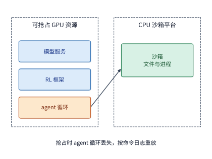

*图 11-33　早期耦合部署：Agent 控制循环与模型服务、RL 框架同处于可抢占的 GPU 容器内；一旦 GPU 容器被抢占销毁，Agent 循环状态随之丢失，恢复时必须依靠持久化的命令日志与留存的沙箱状态做重放对齐。*

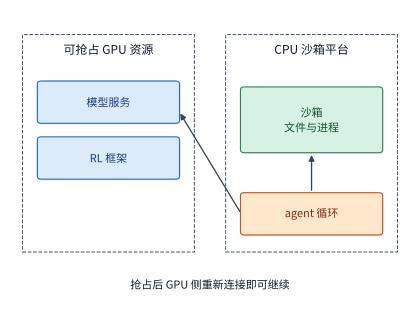

*图 11-34　DeepSeek V4.1 解耦部署：将有状态的 Agent 控制循环下沉至不被抢占的 CPU 平台 worker 容器中，与沙箱共同持有完整的 rollout 进度；GPU 作业恢复后仅需重新建立连接即可无缝续跑，彻底免去了命令重放开销。*

### 11.3.4 验证 batch、长尾与资源释放

在第 11.3.3 节图 11-31 的串行模型中，我们曾把“验证（verify）”画成一段必须等整批样本全部生成完毕后才开始执行的独立方块。但在真实系统中，一个批次里的数百条采样轨迹并不是在同一毫秒齐刷刷吐完的，而是有快有慢地陆续生成结束的；如果我们把每一条刚生成完的样本**立即流式提交（streaming submission）**给验证器，就能让验证工作与后续样本的生成过程大幅重叠起来。

在设计验证调度之前，我们先看一类对执行环境要求极高的特殊验证负载——**CUDA 高性能算子代码的编译与实机测速验证**（例如用 RL 训练模型编写比 PyTorch 原生实现更快的 CUDA 内核）。在这类任务中，验证器不仅要检查代码能不能编译通过、数值对不对，还要精确测量该内核在真实 GPU 上的微秒级运行耗时并将其折算为奖励分数。这意味着**验证过程对多任务并发干扰实现了“零容忍”**（一旦两个待测内核在同一张 GPU 上同时跑并争抢显存带宽，测出来的耗时就会失真，直接给 RL 训练注入错误的性能奖励）。为此，DSec 专门构建了一套三管齐下的 **GPU 性能验证后端**：
1. **硬件级空间隔离（NVIDIA MIG）**：利用多实例 GPU（Multi-Instance GPU）技术将单张物理大卡在硬件层面切分为多个拥有独立流多处理器（SM）、独立显存通道与固定缓存分区的硬件实例，确保多项算子测速同时进行时物理隔离、互不干扰；
2. **编译与执行彻底解耦**：由于 `nvcc` 编译 C++/CUDA 源码极其耗费时间（数秒至数十秒）且纯粹消耗 CPU，平台强制在廉价的 CPU 容器池中完成源码编译，待生成二进制产物后再送入宝贵的 GPU 实例执行毫秒级测速，绝不让昂贵的 GPU 在漫长的编译期空等；
3. **常驻预热进程池（Warm Python Worker Pool）**：在 GPU 实例内预先拉起一批已完成 CUDA 上下文初始化、且提前导入好 `torch` 等重型依赖库的常驻 Python 进程，待编译产物一到立即注入执行，省去每次冷启动 Python 解释器与初始化 CUDA 驱动的数秒钟固定开销。[^dsec]

现在我们来建立一批验证任务的完成时间数学模型。设一个训练批次中包含多条待验证样本，其中第 $i$ 条样本在 $a_i$ 时刻生成完毕并提交验证，随后依次需要经历 $c_i\ \mathrm{s}$ 的 CPU 编译与 $g_i\ \mathrm{s}$ 的 GPU（或 CPU）测试执行。在验证计算资源充足、不发生排队争用的理想条件下，整批验证全部完成的最早时间下界 $T_{\mathrm{batch}}$ 取决于最后结束的那条样本：

$$
T_{\mathrm{batch}}\geq\max_i(a_i+c_i+g_i).
$$

（若验证工作进程不足引发排队，或存在环境冷启动与跨机数据传输延迟，实际完成时刻还会在该下界基础上进一步推迟。）

对照图 11-35 与图 11-36 可以清楚地看到“流式逐条提交”相比“整批屏障后提交”的巨大时间收益：设有三条样本分别在第 $0\ \mathrm{s}$、第 $10\ \mathrm{s}$ 和第 $20\ \mathrm{s}$ 生成完毕，每条样本的验证处理均需 $10\ \mathrm{s}$，且平台只有 $1$ 个验证执行进程：
- **流式逐条提交（图 11-35）**：第 $0\ \mathrm{s}$ 第一条样本一生成完就立刻送进验证器（第 $0\sim 10\ \mathrm{s}$ 验证第一条，第 $10\sim 20\ \mathrm{s}$ 验证第二条，第 $20\sim 30\ \mathrm{s}$ 验证第三条），前两条样本的验证完全隐藏在了后续样本的生成过程中，整批验证在**第 $30\ \mathrm{s}$** 即告全部完成；
- **整批收齐后提交（图 11-36）**：如果一直等到第 $20\ \mathrm{s}$ 三条样本全部生成完毕后才把它们一起塞进验证器，验证进程从第 $20\ \mathrm{s}$ 连续干到**第 $50\ \mathrm{s}$** 才结束——明明干的是完全相同的 $30\ \mathrm{s}$ 验证工作，仅仅因为推迟了提交时机，整批完成时刻就无谓晚了整整 **$20\ \mathrm{s}$**。

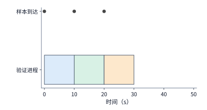

*图 11-35　逐条流式提交验证：三条样本依次在第 $0\ \mathrm{s}$、$10\ \mathrm{s}$、$20\ \mathrm{s}$ 生成就绪（圆点）并立即送入唯一的验证进程（每条耗时 $10\ \mathrm{s}$），前两条验证与后续生成完全重叠，整批于第 $30\ \mathrm{s}$ 完成。*

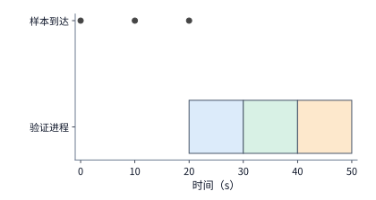

*图 11-36　整批收齐后提交验证（与图 11-35 执行完全相同的 $30\ \mathrm{s}$ 验证工作）：前两条样本被迫空等到第 $20\ \mathrm{s}$ 第三条样本生成完毕后才开始依次验证，导致整批完成时刻推迟至第 $50\ \mathrm{s}$。*

流式提交消除了等待整批生成的空档，但由式 $T_{\mathrm{batch}} \ge \max_i(a_i + c_i + g_i)$ 可知，**整批验证的最终收尾时刻依然受制于批次里跑得最慢的那条长尾（straggler / heavy-tailed）样本**。在包含复杂单元测试或死循环超时的代码验证中，任务耗时往往呈现极端的双峰或重尾分布；此时调度器如果想要预测“当前还在跑的这条任务究竟还要再跑多久”，**绝对不能机械地拿总体平均耗时去减已执行时间，而必须根据它“已经跑了多久仍未结束”这一事实动态更新条件概率判断**。

我们用一个简洁的数值算例来剖析这一统计偏差（图 11-37）：假设历史统计表明，某类代码验证任务中有 **$90\%$（如 10 条里的 9 条）是耗时仅 $1\ \mathrm{s}$ 的快任务**，另有 **$10\%$（10 条里的 1 条）是耗时高达 $100\ \mathrm{s}$ 的慢任务**。算一下总体期望耗时：$\mathbb{E}[S] = (9 \times 1 + 1 \times 100) / 10 = \mathbf{10.9\ \mathrm{s}}$。现在，观察线上某个正在运行的验证任务，它**已经连续跑了 $e = 10\ \mathrm{s}$ 却还没有结束**。如果直接用总体平均值 $10.9\ \mathrm{s}$ 减去已执行的 $10\ \mathrm{s}$，就会得出“仅剩 $0.9\ \mathrm{s}$ 即可完成”的错误预测；然而从条件概率来看：既然它跑了 $10\ \mathrm{s}$ 还没停，它就百分之百不可能是那九条 $1\ \mathrm{s}$ 的快任务，而**必定是那唯一一条耗时 $100\ \mathrm{s}$ 的慢任务，因此它真正还需要继续运行的时间是 $100 - 10 = \mathbf{90\ \mathrm{s}}$**。写成严密的概率论语言：当一项总耗时分布为随机变量 $S$ 的任务已经执行了 $e$ 秒仍未结束时，调度器应当采用**条件剩余时间期望（conditional expected remaining time）**来估计其剩余工期：

$$
\mathbb{E}[S - e \mid S > e],
$$

其中条件事件 $S > e$ 表示仅在“总耗时严格大于 $e$”的幸存样本子集中取平均。面向分布式强化学习验证的 **DistRS** 调度算法正是利用这类基于生存分析的条件剩余时间估计（而非静态总体均值），来精准预判每个训练批次的真实收尾时刻（batch deadline）。[^reward]

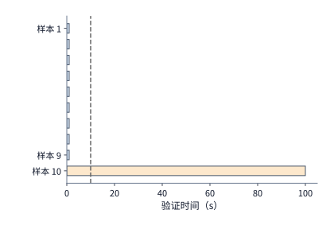

*图 11-37　重尾验证负载的条件剩余时间推断：批次内 9 条快任务各耗时 $1\ \mathrm{s}$，1 条慢任务耗时 $100\ \mathrm{s}$（无条件均值 $10.9\ \mathrm{s}$）；当观测到某任务越过第 $10\ \mathrm{s}$ 虚线仍未结束时，所有 $1\ \mathrm{s}$ 分支已被排除，其条件剩余时间实为 $90\ \mathrm{s}$。*

一旦调度器利用 $\mathbb{E}[S - e \mid S > e]$ 锁定了某个批次内最慢那条长尾样本的预计完成时刻（即整批的最早可能完成时刻 $D_{\mathrm{batch}}$），就可以立刻反推出同批次内其余每一项待跑验证任务的**最迟开始时间（latest start time / slack）**，从而在不推迟整批交付的前提下削峰填谷。举例来说：假设当前批次里有一条长尾验证最早也要到**第 $120\ \mathrm{s}$** 才能跑完（即整批在 $120\ \mathrm{s}$ 之前无论如何都进不了参数更新阶段）；此时同批次里还有另一项预计执行时间不超过 $100\ \mathrm{s}$ 的验证任务——它并不需要在第 $0\ \mathrm{s}$ 立即占用验证器，只要最迟在**第 $120 - 100 = 20\ \mathrm{s}$** 启动执行（若其环境准备还需 $5\ \mathrm{s}$，则准备最迟在**第 $15\ \mathrm{s}$** 启动），即可稳妥地赶在第 $120\ \mathrm{s}$ 前完成验证，丝毫不延长整批的等待时间。调度器据此可以放心地将这类拥有充裕松弛时间（slack）的任务往后推迟，把眼下宝贵的验证器资源优先让给另一个马上就要收尾交卷的紧急批次。

但请注意：**通过削减验证器资源、推迟验证任务来省钱，有一条绝对不能踩过的红线——一旦推迟过了头、导致整批验证的收尾时刻晚了哪怕几秒钟，就会导致下游持有大量加速卡的 GPU 训练组（Learner Gang）全员阻塞等待**。我们来算一笔资源置换账：假设我们通过缩减验证池规模，在验证侧成功省下了 **$60\ \mathrm{H100}\cdot\text{秒}$** 的加速卡消耗，但却导致整批验证的最终完成时刻比原计划推迟了短短 **$2\ \mathrm{s}$**：
- 如果下游正在等这批样本做梯度更新的训练组是一个拥有 **$64$ 张 H100（8 台 HGX H100）**的集群，那么这 $2\ \mathrm{s}$ 的延迟就会让 64 张训练卡凭空多空等 $64 \times 2 = \mathbf{128\ \mathrm{H100}\cdot\text{秒}}$——用新增的 $128\ \mathrm{H100}\cdot\text{秒}$ 减去省下的 $60\ \mathrm{H100}\cdot\text{秒}$，整座系统反而**净亏损了 $68\ \mathrm{H100}\cdot\text{秒}$** 的宝贵算力；
- 反之，如果下游训练组规模较小、只有 **$16$ 张 H100（2 台主机）**，多等 $2\ \mathrm{s}$ 新增的空转仅为 $16 \times 2 = \mathbf{32\ \mathrm{H100}\cdot\text{秒}}$，扣除后全系统确实**净赚了 $60 - 32 = 28\ \mathrm{H100}\cdot\text{秒}$**。

这组对比给出了一个极其清晰的全局配比准则：**验证池究竟该富配还是紧配，不能孤立地看验证器自己的利用率，而取决于下游被阻塞的同步训练组拥有多少张加速卡——训练组规模越大，验证阶段的尾部延迟就越昂贵，越必须用充裕的验证冗余确保零超时阻塞**。

最后，在将运行完（或因死循环而超时）的验证资源移交给下一项任务之前，执行器还必须守住一道系统底线：**确认前一项任务派生的所有后台子进程与线程已经百分之百彻底终止并退出**。在一组受控的验证超时回收实验中，当外层等待函数因为到达超时阈值而直接向调用方返回 `timeout` 错误时，如果执行器没有主动向整个进程组发送强制终止信号（`SIGKILL`），前一项任务的后台工作线程仍继续在 CPU 上运行了约 **$130\ \mathrm{ms}$** 才自然退出；而一旦执行器对整个子进程树执行显式强制清理并同步等待退出确认，仅需约 **$0.8\ \mathrm{ms}$** 即可观测到进程彻底消亡。如果在那 $130\ \mathrm{ms}$ 的残留窗口内调度器已经把同一个 CPU 核或同一个 MIG GPU 实例分给了下一条待测样本，新旧两个任务就会在底层硬件上迎头相撞——对于前面提到的 CUDA 算子性能评测而言，这 $130\ \mathrm{ms}$ 的残留线程争用足以彻底污染下一条样本测出的运行耗时与 RL 奖励信号。因此，“超时返回”绝不等于“资源已空闲”，**必须先彻底终止整个进程组并拿到内核退出确认，才能解锁资源放行下一项任务**。[^validation]

---

## 11.4 模型服务的选择与调用成本

回顾章首代码修复平台的进展：第 11.2.4 节通过“每轮重建环境＋模型期提前准备”，成功将全平台稳态环境内存占用从 $600\ \mathrm{GiB}$ 砍到了 $180\ \mathrm{GiB}$，解决了单台 `m5d.metal` 主机的内存容量瓶颈；然而，**单项任务的三轮总耗时依然停留在 $3 \times (9 + 1) = \mathbf{30\ \mathrm{s}}$，仍未达到业务要求的“$24\ \mathrm{s}$ 内完成交付”目标**。由于三轮工具执行总共只占 $3\ \mathrm{s}$，哪怕把工具加速到零耗时，仅靠 $27\ \mathrm{s}$ 的模型调用也注定超时。因此，要想把任务耗时压进 $24\ \mathrm{s}$ 红线，唯一的出路就是**优化关键路径上耗时占比最高的模型推理服务**。本节将剖析模型推理的批次并发与延迟置换、思考预算（thinking budget）与重试成本、跨轮前缀缓存计费，以及快慢模型路由与自建/按量采购的经济平衡点。

### 11.4.1 任务质量与思考预算

在不更换底层模型（从而保持代码修复通过率完全不变）的前提下，怎样让每个 DeepSeek V4-Flash 副本吐出 token 的速度变快？回顾第 8 章与第 9 章的推理批处理延迟曲线：解码阶段的单步耗时随并发批大小（batch size）增加而上升。如果我们把每个 4 卡 B200 副本同时服务的并发会话数从原来的 **$32$ 个减半至 $16$ 个**（下面称为**“快速模型服务”**），单步显存容量与算力争用随之缓解，生成每个输出 token 的平均耗时便从原来的 $25.3\ \mathrm{ms}$ 下降到了 **$16.9\ \mathrm{ms}$**。如此一来，生成同样 $355$ 个输出 token 的单次完整调用耗时立刻从约 $9.0\ \mathrm{s}$ 缩短到了 $355 \times 0.0169 \approx \mathbf{6.0\ \mathrm{s}}$，三轮串行任务的总历时也随之从 $30\ \mathrm{s}$ 一举压降到了 $3 \times (6 + 1) = \mathbf{21\ \mathrm{s}}$——**稳稳跑进了 $24\ \mathrm{s}$ 的业务交付期限以内**。

请注意模型服务加速对下游工具环境内存产生的连锁反应：
- 如果环境采用**始终驻留**策略：由于单任务总时长从 $30\ \mathrm{s}$ 缩短到了 $21\ \mathrm{s}$，$2\ \mathrm{GiB}$ 环境陪等的时间随之缩短，单任务累计内存面积从 $60\ \mathrm{GiB}\cdot\text{秒}$ 降至 $2 \times 21 = \mathbf{42\ \mathrm{GiB}\cdot\text{秒}}$，全平台稳态内存需求从 $600\ \mathrm{GiB}$ 降至 **$420\ \mathrm{GiB}$**——但遗憾的是，$420\ \mathrm{GiB}$ 依然超出了单台 `m5d.metal` 主机 $358\ \mathrm{GiB}$ 的物理上限；
- 如果环境采用**每轮重建并提前 $2\ \mathrm{s}$ 准备**策略：由于 $2\ \mathrm{s}$ 的准备时间依然能完全藏进 $6\ \mathrm{s}$ 的模型调用窗口内，每个环境依然只需在每轮的“$2\ \mathrm{s}$ 准备＋$1\ \mathrm{s}$ 执行”期间存在，单任务内存面积保持 **$18\ \mathrm{GiB}\cdot\text{秒}$**（平台稳态内存 **$180\ \mathrm{GiB}$**）不变。

这再次说明：**模型服务档位的选择不仅直接决定端到端延迟，还会通过改变等待窗口长度联动改变工具平台的内存需求**。[^design]

除了调节服务端并发批大小，现代推理大模型（如支持长思维链的推理模型）还允许调用方通过设定**思考预算（thinking budget）**来控制模型在给出最终可见代码补丁之前，最多生成多少个内部推理（reasoning / thinking）token。由于一次模型调用的总耗时与总计费均由**“处理输入前缀＋生成内部思考 token＋生成最终可见输出”**三部分叠加而成，压缩思考 token 数量看似是降本增效的捷径；但究竟能省下多少比例的总成本，必须把固定不变的输入与可见输出部分放在一起通盘核算（例 11-5）。

**例 11-5：思考长度缩短到十分之一，总成本减少多少？** 设某项代码任务在“长思考（生成 $1{,}000$ 个思考 token）”与“短思考（生成 $100$ 个思考 token）”两种预算配置下均能顺利通过测试；每次调用固定携带 **$10{,}000$ 个输入 token**，并固定产出 **$200$ 个可见输出 token**。我们按 **Claude Sonnet 5** 的标准 API 公开单价计费：**输入每百万 token $2\ \text{美元}$，生成每百万 token $10\ \text{美元}$**（内部思考 token 与可见输出 token 同样消耗自回归解码算力，因此统一按生成单价 $10\ \text{美元/百万 token}$ 计费）。我们来分别计算两种配置下的单次调用总成本（单位：美元）：

$$
C_{1000}=\frac{10000\times2+(1000+200)\times10}{10^6}=0.032,
$$

$$
C_{100}=\frac{10000\times2+(100+200)\times10}{10^6}=0.023.
$$

对照这两行算式（图 11-38）：虽然我们将内部思考 token 的数量大幅缩减至原来的**十分之一**（使思考部分的费用从 $0.010\ \text{美元}$ 降至 $0.001\ \text{美元}$，省下了 $0.009\ \text{美元}$），但单次调用的总成本却只从 $0.032\ \text{美元}$ 降到了 $0.023\ \text{美元}$，**仅减少了约 $28\%$**。原因一目了然：在原总成本 $0.032\ \text{美元}$ 中，有高达 $0.020\ \text{美元}$ 花在了 $10{,}000$ 个输入 token 的处理上，另有 $0.002\ \text{美元}$ 花在了 $200$ 个可见输出 token 上——这两块合计 $0.022\ \text{美元}$（占原成本的 **$68.75\%$**）的固定底座并不会因为缩短思考而减少分毫。这是成本版的 Amdahl 定律：**压缩某一项子开销所能带来的总成本降幅，严格受制于该子项在原总账单中所占的份额**。[^platform]

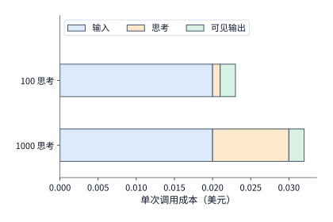

*图 11-38　例 11-5 中单次模型调用的三段成本分解：输入（蓝色，$0.020\ \text{美元}$）与可见输出（青色，$0.002\ \text{美元}$）保持不变；即使将思考 token（橙色）从 $1{,}000$ 个压缩至 $100$ 个（费用从 $0.010$ 降至 $0.001\ \text{美元}$），受固定底座制约，单次总成本仅由 $0.032\ \text{美元}$ 降至 $0.023\ \text{美元}$（下降约 $28\%$）。*

更需警惕的陷阱在于：例 11-5 假定了将思考预算缩减至 $100$ 个 token 后模型依然能一次答对；而在真实复杂任务中，**过短的思考预算极易导致模型推理截断或分析不充分，从而触发额外的失败重试**。我们来算一笔包含重试在内的总账：假设向平台提交 $100$ 次调用，将思考预算从 $1{,}000$ 压到 $100$ 后，每次首次调用确实各省下了 $0.009\ \text{美元}$，100 次合计省下 $100 \times 0.009 = \mathbf{0.90\ \text{美元}}$；但正因为思考预算受限过严，其中有 **$30$ 次**调用未能一次通过测试，被迫放开到 $1{,}000$ 思考预算重新调了一次（每次重试花费 $0.032\ \text{美元}$），这 30 次重试凭空新增了 $30 \times 0.032 = \mathbf{0.96\ \text{美元}}$ 的支出。两相抵扣，平台不仅没省下钱，总支出反而比一开始就按标准配置给足 $1{,}000$ 思考预算**多支出了 $0.96 - 0.90 = 0.06\ \text{美元}$**，同时还无谓拉长了那 $30\%$ 任务的完成延迟。因此，设定思考预算时绝不能只盯着单次调用省下的几美分，而必须将“单次节省额”与“因截断引发的期望重试成本”放在同一杆秤上权衡。[^thinking]

### 11.4.2 服务路径、前缀缓存与实际用量

既然在多轮代码修复任务中，输入前缀往往占去了单次调用成本的大头（如例 11-5 中占去近七成），那么**从输入侧降低成本的核心手段就是跨轮次的前缀缓存（Prefix Caching / Context Caching）**。在典型的多轮 Agent 交互中，每一轮发给模型的提示词都包含长篇的系统指令（system prompt）、完整的代码仓库文件上下文以及前几轮累积下来的对话与工具记录——这些公共前缀在相邻轮次之间是完全一模一样的。

如图 11-39 所示，当控制器发出模型调用请求时，请求先经过统一的**模型服务入口（gateway）**完成鉴权、限流与会话路由，随后转发给选定的底层**推理后端（backend）**（既可以是按 token 用量计费的外部商业 API，也可以是按 GPU 卡时计费的自建服务副本）。无论底层采用哪种计费形态，为了在财务账本上精准核算前缀缓存的收益，平台都会将单次调用的输入 token 严格划分为三类互斥的计量桶：**未命中的普通输入 $I_u$**、**首次写入建立缓存的输入 $I_w$** 以及**命中已有缓存直接读取的输入 $I_h$**；设这三类输入及生成输出 $O$（含思考与可见输出）对应的每百万 token 单价分别为 $p_u, p_w, p_h, p_o$，并计入可选的缓存存储驻留费 $C_{\mathrm{storage}}$ 与服务端内置工具费 $C_{\mathrm{tool}}$，则单次模型调用的完整计费公式为：

$$
C_{\mathrm{call}}=\frac{I_up_u+I_wp_w+I_hp_h+Op_o}{10^6}+C_{\mathrm{storage}}+C_{\mathrm{tool}}.
$$

请注意上式的互斥完整性：单次请求中的任意一个输入 token，在服务端返回的用量账单（usage record）里只能唯一归属于普通输入 $I_u$、缓存创建 $I_w$ 或缓存读取 $I_h$ 三者之一，绝不重复计费。

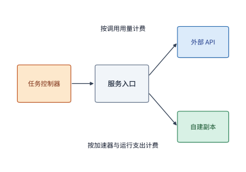

*图 11-39　模型服务的统一路由与计费归集路径：控制器请求经服务入口路由至外部按量 API 或自建推理副本；输入 token 被精确拆分为普通处理（$I_u$）、缓存创建（$I_w$）与缓存读取（$I_h$）三类分别计价，与生成输出（$O$）共同汇总归集到所属任务及执行尝试账下。*

**例 11-6：跨轮缓存公共前缀能节省多少输入费用？** 设一项长程代码任务连续执行 **$10$ 轮**模型调用：每一轮请求都包含 **$8{,}000$ 个 token 的固定公共前缀**（仓库上下文与系统提示）以及 **$2{,}000$ 个 token 的本轮新增输入**（合计每轮输入 $10{,}000$ 个 token）。我们采用 **Claude Sonnet 5** 的官方公开价格表：普通输入单价 $p_u = 2\ \text{美元/百万 token}$，有效期 5 分钟的前缀缓存**首次创建单价 $p_w = 2.5\ \text{美元/百万 token}$**（比普通输入贵 $25\%$，用于覆盖整理与持久化 KV 块的管理开销），而**缓存命中读取单价仅为 $p_h = 0.2\ \text{美元/百万 token}$**（仅为普通输入单价的**十分之一**）。

我们来对比“完全不用前缀缓存”与“第 1 轮创建缓存、后 9 轮在 5 分钟有效期内 100% 命中读取”两种方式在 10 轮中的累计输入总费用（保持两者的输出生成与工具执行完全相同）：
- **无缓存基线**：10 轮全部按普通输入计费，总输入成本为 $10 \times \frac{10000 \times 2}{10^6} = \mathbf{0.20\ \text{美元}}$；
- **启用跨轮前缀缓存**：第 1 轮将 $8{,}000$ 个公共前缀写入缓存（单价 $2.5$）、$2{,}000$ 个新输入按普通计费（单价 $2$），后 9 轮每次读取 $8{,}000$ 个缓存前缀（单价 $0.2$）并处理 $2{,}000$ 个新输入（单价 $2$），10 轮累计输入总成本（美元）为：

$$
\frac{8000\times2.5+2000\times2}{10^6}
+9\frac{8000\times0.2+2000\times2}{10^6}=0.0744.
$$

算一下每一轮的细账：在第 1 轮首次创建缓存时，花费为 $0.024\ \text{美元}$，比不用缓存的 $0.020\ \text{美元}$ 多付了 **$0.004\ \text{美元}$** 的建表溢价；但从第 2 轮开始，每轮输入花费直接从 $0.020\ \text{美元}$ 骤降至 **$0.0056\ \text{美元}$**，单轮净省 **$0.0144\ \text{美元}$**——这意味着**仅仅到第 2 轮访问（复用第 1 次），省下的 $0.0144\ \text{美元}$ 就已经把首轮多付的 $0.004\ \text{美元}$ 溢价连本带利赚了回来**，10 轮下来更是将输入总成本砍掉了近 **$63\%$**。一般地，对同一段公共前缀共访问 $n$ 次时，启用缓存比普通处理更省钱的充要条件为：

$$
n p_u > p_w + (n - 1) p_h \iff (n - 1)(p_u - p_h) > p_w - p_u.
$$

只要缓存存活期（TTL）足够覆盖连续轮次的访问间隔，复用次数 $n$ 越多，摊薄后的输入单价就越逼近十分之一的 $p_h$。[^platform]

在监控线上系统的缓存效率时，还要特别注意区分**“按请求个数统计的命中率（request hit rate）”**与**“按 token 数量加权的命中率（token hit rate）”**。试想线上先后来了两次调用：请求甲只带了 $1{,}000$ 个 token 的短前缀，请求乙带了 $9{,}000$ 个 token 的长前缀（两次前缀合计 $10{,}000$ 个 token）。
- 情形一：只有短前缀请求甲命中了缓存，长前缀请求乙未命中。此时按请求个数算，命中率高达 **$50\%$（$1/2$）**；但实际走缓存低价读取的只有 $1{,}000$ 个 token，占总前缀 token 数的比例仅为 **$10\%$**；
- 情形二：只有长前缀请求乙命中了缓存，短前缀请求甲未命中。按请求个数算，命中率同样是 **$50\%$**；但实际享受到十分之一低价的缓存读取 token 占比却跃升到了 **$90\%$**。

由于无论是外部 API 的金钱账单还是自建 GPU 的预填充计算时间，都是严格按 **token 数量**线性计量的，因此调度与路由系统必须以**长前缀请求的 token 加权命中率**作为核心优化指标。

### 11.4.3 排队、限流与模型路由

在第 9 章的分布式推理中我们已经知道，自建推理集群中的前缀 KV 缓存物理上驻留在某一个具体的服务副本显存（或本地内存池）里——只有当后续轮次的请求被网关路由到**保存了该会话前缀的那台特定副本**上时，才能真正触发缓存命中。这就带来了一个经典的路由权衡（affinity vs. load balancing）：**如果那台存有前缀缓存的“缓存亲和副本”当前正好有几个请求在排队，我们是应该在它门口多排一会儿队以享用缓存命中，还是应该立刻转投另一台完全空闲、但没有任何缓存的“无缓存空闲副本”从头重算前缀？**

我们用一道简单的加减法就能找到两者的决策分界线：设副本 A 持有当前请求的完整前缀缓存，但在它队列里需要先排队等待 **$200\ \mathrm{ms}$**，轮到执行时凭借缓存命中只需花 **$50\ \mathrm{ms}$** 即可完成增量输入处理；而另一台空闲副本 B 排队仅需 **$20\ \mathrm{ms}$**，但因为没有缓存，从头预填充整段长前缀需要耗费 **$500\ \mathrm{ms}$**（设两者的网络传输耗时同为 $50\ \mathrm{ms}$，进入解码阶段后的生成耗时也完全相同）。算一下进入解码阶段前的首 token 准备总耗时：
- **走有缓存但排队的副本 A**：$50\ \text{（网络）} + 200\ \text{（排队）} + 50\ \text{（命中处理）} = \mathbf{300\ \mathrm{ms}}$；
- **走空闲但无缓存的副本 B**：$50\ \text{（网络）} + 20\ \text{（排队）} + 500\ \text{（冷预填充）} = \mathbf{570\ \mathrm{ms}}$。

结果非常清楚：缓存命中帮副本 A 省下了 $500 - 50 = 450\ \mathrm{ms}$ 的预填充硬计算时间，扣除比副本 B 多排队的 $200 - 20 = 180\ \mathrm{ms}$，**选副本 A 依然净快了 $450 - 180 = \mathbf{270\ \mathrm{ms}}$**。只有当副本 A 门口的排队时间一直涨到 **$470\ \mathrm{ms}$**（恰好把 $450\ \mathrm{ms}$ 的缓存红利全部抵消掉）时，两条路径才打成平手（同为 $570\ \mathrm{ms}$）。

现在回到章首代码修复平台的 GPU 容量核算上。我们在第 11.4.1 节为了把单次模型调用从 $9\ \mathrm{s}$ 压缩到 $6\ \mathrm{s}$，把每个 V4-Flash 副本允许同时服务的并发会话数从 $32$ 个砍半到了 $16$ 个。让我们看看这一调整对全平台 **并发会话槽位数** 与 **单次调用 GPU 消耗量** 带来的双重冲击：
1. **并发会话槽位缺口与副本扩容**：平台每秒仍需发起 $30$ 次模型调用；当每次调用耗时从 $9\ \mathrm{s}$ 降到 $6\ \mathrm{s}$ 后，由 Little 定律可知，全平台稳态同时在途的模型调用数确实从 $30 \times 9 = 270$ 次降到了 $30 \times 6 = \mathbf{180\ \text{次}}$。但是，由于每个快速副本现在只提供 $16$ 个并发槽位，原有的 $10$ 个副本加起来总共只有 $10 \times 16 = \mathbf{160\ \text{个并发槽}}$，**装不下稳态所需的 $180$ 次并发调用**。因此，要想让快速模型服务不发生无限排队，平台必须将 V4-Flash 服务副本数从 $10$ 个扩容至至少 $\lceil 180 / 16 \rceil = \mathbf{12\ \text{个副本}}$（提供 $12 \times 16 = 192$ 个并发槽，总 GPU 卡数从 $40$ 张增至 **$48$ 张 B200**）。
2. **单次调用占用的 GPU 卡时（B200·秒）上升**：每个副本固定占用 $4$ 张 B200。在普通服务下，4 张卡花 $9\ \mathrm{s}$ 同时服务 $32$ 个会话，分摊到每次调用上的 GPU 消耗为 $4 \times 9 / 32 = \mathbf{1.125\ \mathrm{B200}\cdot\text{秒}}$；而在快速服务下，4 张卡花 $6\ \mathrm{s}$ 只同时服务 $16$ 个会话，分摊到每次调用上的 GPU 消耗上涨到了 $4 \times 6 / 16 = \mathbf{1.5\ \mathrm{B200}\cdot\text{秒}}$（单次 GPU 成本增加了三分之一）。

（注：若平台调用的是外部商业按量 API，服务端除了并发槽限制外，还会同时施加每分钟请求数 RPM 与每分钟 token 数 TPM 双重配额限流——当单次请求携带长仓库前缀或长思考输出时，往往是 TPM token 额度先于 RPM 请求数额度触顶。）

更进一步，在真实的模型路由网关中，我们往往还面临着**“便宜但略弱的小模型”与“单价昂贵但推理精炼、成功率高的大模型”**之间的跨模型路由选择。直觉上人们往往认为单价贵一倍的大模型总成本更高；但一旦将**实际思考 token 消耗量、前缀缓存命中率以及一次通过验收的成功率**放进同一个分式里核算，结论往往会发生反转（例 11-7）。

**例 11-7：缓存命中与成功率何时能抵消更高的服务单价？** 设平台分别向轻量级模型 **Claude Haiku 4.5（记作服务 A）**与旗舰级模型 **Claude Sonnet 5（记作服务 B）**各提交 $1{,}000$ 项单次调用代码修复任务。每次调用的输入总长均为 **$20{,}000$ 个 token**，其中包含 **$19{,}000$ 个 token 的公共前缀**与 **$1{,}000$ 个 token 的任务私有新输入**（假设公共前缀缓存此前已创建就绪，不计额外的缓存创建、存储、工具与环境预热费用，且任务能否通过测试验收与缓存是否命中相互独立）。两款模型的官方 API 单价、实测思考 token 消耗量、可见输出长度以及在同一验收标准下的首次通过概率如下表所示：[^routing]

| 对比维度与计费参数 | 服务 A：Claude Haiku 4.5 | 服务 B：Claude Sonnet 5 |
| --- | ---: | ---: |
| 普通未命中输入单价 $p_u$（美元 / 百万 token） | $1.0$ | $2.0$ |
| 前缀缓存命中读取单价 $p_h$（美元 / 百万 token） | $0.1$ | $0.2$ |
| 生成输出（含思考）单价 $p_o$（美元 / 百万 token） | $5.0$ | $10.0$ |
| 完成任务实际消耗的内部思考 token 数 | $1{,}800$ | $100$ |
| 最终可见代码输出 token 数 | $200$ | $200$ |
| 同一测试验收标准下的单次成功概率 | **$0.80$（$80\%$）** | **$0.98$（$98\%$）** |

仔细观察这张表：服务 B（Sonnet 5）的各项 token 单价整整是服务 A（Haiku 4.5）的 **两倍**；但服务 B 凭借更强的基座能力，只需思考 $100$ 个 token（连同 $200$ 个可见输出共生成 $300$ 个 token）就能达到 **$98\%$** 的高通过率，而服务 A 则需要反复推演 $1{,}800$ 个思考 token（共生成 $2{,}000$ 个 token）且通过率仅为 **$80\%$**。

现在我们来计算两者的**每个成功完成任务的平均成本**：
- **先算服务 A（假设其前缀缓存 $100\%$ 始终命中）**：每次调用包含 $19{,}000$ 个缓存读取 token、$1{,}000$ 个普通输入 token 与 $2{,}000$ 个生成 token，单次调用成本为 $\frac{19000 \times 0.1 + 1000 \times 1.0 + 2000 \times 5.0}{10^6} = \mathbf{0.0129\ \text{美元}}$；除以 $80\%$ 的验收通过率，**服务 A 每产出一个合格结果需要花费 $0.0129 / 0.80 \approx \mathbf{0.0161\ \text{美元}}$**。
- **再算服务 B（设其请求的前缀缓存命中率为 $h \in [0, 1]$）**：
  - 当服务 B **命中前缀缓存**时，单次调用成本仅为 $\frac{19000 \times 0.2 + 1000 \times 2.0 + 300 \times 10.0}{10^6} = \mathbf{0.0088\ \text{美元}}$（比服务 A 的 $0.0129\ \text{美元}$ 还要便宜近三分之一）；
  - 当服务 B **未命中前缀缓存**时，全部 $20{,}000$ 个输入都按 $2.0\ \text{美元/百万 token}$ 计费，单次调用成本飙升至 $\frac{20000 \times 2.0 + 300 \times 10.0}{10^6} = \mathbf{0.0430\ \text{美元}}$。
  因此，当服务 B 的请求缓存命中率为 $h$ 时，其每个成功完成任务的平均成本 $C_B(h)$ 为：

$$
C_B(h)=\frac{0.0088h+0.0430(1-h)}{0.98}.
$$

令服务 B 的成功任务成本等于服务 A 的成功任务成本（$C_B(h) = 0.0129 / 0.80 = 0.016125$），解一元一次方程立得**成本盈亏平衡命中率（图 11-40）**：

$$
h_{\mathrm{cost}} = \frac{0.0430 - 0.98 \times 0.016125}{0.0430 - 0.0088} = \frac{10879}{13680} \approx \mathbf{79.5\%}.
$$

这个结果极具启发性：**尽管 Sonnet 5 的牌价是 Haiku 4.5 的两倍，但只要路由网关能把 Sonnet 5 的前缀缓存命中率维持在 $79.5\%$ 以上，用旗舰大模型反而比用轻量小模型更省钱**（反之，若因负载均衡打散了请求导致 Sonnet 5 的命中率跌到 $50\%$，其单成功成本就会升至约 $0.0264\ \text{美元}$，此时小模型 A 更便宜）。

接下来我们再把**业务完成期限（SLA）**叠加进来（图 11-41）：假设业务要求**“至少 $90\%$ 的提交任务必须在 $6\ \mathrm{s}$ 内通过测试验收”**。实测表明：服务 A 因为要漫长地生成 $2{,}000$ 个输出 token，哪怕缓存命中，单次完整耗时也高达 **$10\ \mathrm{s} > 6\ \mathrm{s}$**，因此服务 A 按时完成率恒为 $0$，直接出局；而服务 B 在缓存命中时仅需 **$4\ \mathrm{s}$**（满足 $\le 6\ \mathrm{s}$ 期限），在缓存未命中时因重算 $19{,}000$ 长前缀需耗时 **$12\ \mathrm{s}$**（超时）。因此，服务 B 唯有同时满足“缓存命中（概率 $h$）”且“代码通过测试（独立概率 $0.98$）”两条条件才能在 $6\ \mathrm{s}$ 内成功交付，按时成功比例为 $0.98h$。要达到 $90\%$ 的业务门槛，必须满足：

$$
0.98h \ge 0.90 \implies h \ge \frac{45}{49} \approx \mathbf{91.8\%}.
$$

把图 11-40（成本曲线）与图 11-41（期限达标线）叠在一起看：由于每次请求的前缀长度固定为 $19{,}000$ 个 token，请求命中率 $h$ 等于前缀内部的 token 命中比例（占完整 $20{,}000$ 输入 token 的读取比例则为 $0.95h$）。当我们将路由系统的缓存命中率 $h$ 从左向右推高时，服务 B 在跨越 **$79.5\%$** 时先一步在成本上击败服务 A，随后在跨越 **$91.8\%$** 时正式满足 $6\ \mathrm{s}$ 按时交付目标——**位于 $h \in [91.8\%, 100\%]$ 的右侧区间，就是既比小模型便宜、又能满足严苛时限的黄金运行区**。

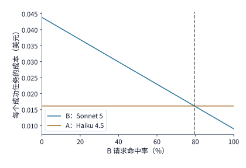

*图 11-40　例 11-7 中两款模型的单位成功任务成本对比（总支出除以各自通过测试的任务数）：服务 A 保持 $100\%$ 命中时恒为约 $0.0161\ \text{美元}$；服务 B 随前缀缓存命中率 $h$ 升高而线性下降，在 $h \approx 79.5\%$ 处与服务 A 相交并在右侧实现反超。*

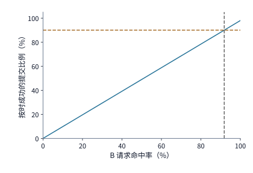

*图 11-41　例 11-7 叠加 $6\ \mathrm{s}$ 完成期限约束后的可行域：服务 A（耗时 $10\ \mathrm{s}$）与服务 B 未命中路径（耗时 $12\ \mathrm{s}$）均超时，唯有服务 B 命中的 $4\ \mathrm{s}$ 路径按时完成；乘上 $98\%$ 的测试通过率后，按时成功比例为 $0.98h$，达到 $90\%$ 业务目标要求命中率至少达到约 $91.8\%$。*

### 11.4.4 自建服务、按量 API 与订阅的成本比较

通过第 11.4.3 节的模型路由分析，我们锁定了能够同时满足质量、成本与期限要求的模型服务形态；紧接着在商业落地时还要拍板一项重大的基础设施采购决策：**这批模型推理算力，我们究竟应该自己包月租用物理 GPU 部署（自建预留服务）、按实际调用的秒数或 token 数随用随付（按量 API / Serverless），还是购买固定周期的订阅席位（Subscription）？**

这三种采购模式的本质区别在于**固定成本与边际成本的结构不同**：自建预留需要先支付一整笔与业务量无关的设备长租固定支出，随后每多跑一项任务的边际增量成本极低；按量 API 没有前期固定投入，但每跑一项任务都要按较高的零售单价付费；包月订阅则是按周期支付固定席位费以换取配额上限内的使用权。它们的共同经济问题是：**随着平台每月承接的任务总量 $N$ 从小到大增长，哪一种采购方式的总账单更低？**

我们来写出自建预留与按量付费的通用盈亏平衡方程。设在一个固定的财务统计周期（如一个月）内，自建预留服务的设备长租与固定运维支出为 $F$，每处理一项提交任务产生的新增边际成本（如额外电费或按次配套开销）为 $v$；而使用按量服务处理每项任务的平均单价为 $c$。当两者任务成功率相同且算力容量均未触顶时，处理 $N$ 项任务下自建预留比按量付费更省钱的充要条件为：

$$
F+Nv<Nc,\qquad N>\frac{F}{c-v}\quad(c>v).
$$

（若 $c \le v$，即按量单价本身已经不高于自建的边际成本，而自建固定投入 $F > 0$，则无论业务量多大都是按量付费更划算；若两种方式下的任务验收成功率存在差异，只需分别将总支出除以各自的合格任务数 $N p_{\mathrm{self}}$ 与 $N p_{\mathrm{api}}$，比较单位成功成本即可。）

下面我们用章首平台真实运行的 **DeepSeek V4-Flash** 模型与 **NVIDIA B200 GPU**，在完全相同的批大小（单副本 32 会话）与完全相同的任务质量下，算一笔包月预留与按秒无服务器（Serverless）的实打实采购对账单（图 11-42）：
- **方式一：包月预留专属实例（Reserved Pod）**：查阅 GPU 云平台 Runpod 公开的 **B200 Pod**（按小时计费、租户独占的裸金属/容器实例）价格表，单张 B200 的长租单价为 **$6.79\ \text{美元/卡时}$**。租用 $1$ 个 V4-Flash 副本所需的 **$4$ 张 B200** 整整一个月（按 $30\ \text{天} = 720\ \text{小时}$ 计），每月的固定租金支出为：
  $$F = 4 \times 720 \times 6.79 = \mathbf{19{,}555.2\ \text{美元}}.$$
  由于这 4 张 GPU 已经整月买断，在不超过其最大处理容量的前提下，每多跑一项任务的边际 GPU 成本为 **$v = 0$**。
- **方式二：按秒随用随付（Serverless Worker）**：使用同一云平台按实际工作秒数计费的 **B200 Serverless Worker**，其公布单价为 **$8.64\ \text{美元/卡时}$**（比长租贵约 $27\%$），且同样按 32 会话满批运行。沿用章首任务参数：每项任务调用模型 $3$ 次，由第 11.4.3 节已知每次调用分摊占用 $1.125\ \mathrm{B200}\cdot\text{秒}$（三次合计消耗 $3 \times 1.125 = 3.375\ \mathrm{B200}\cdot\text{秒}$），折算为每项任务的按量付费成本 $c$ 为：
  $$c = \frac{3 \times 1.125 \times 8.64}{3600} = \mathbf{0.0081\ \text{美元/项}}.$$

将 $F = 19{,}555.2$、$v = 0$ 与 $c = 0.0081$ 代入盈亏平衡公式，立得两种采购方式月总成本相等时的**临界任务量 $N_{\mathrm{cross}}$**：

$$
N_{\mathrm{cross}} = \frac{19{,}555.2}{0.0081} \approx \mathbf{241.4\ \text{万项/月}（约\ 241\ \text{万项}）}.
$$

这个“每月 $241$ 万项任务”究竟对应着这 4 张预留 B200 多高的硬件利用率？我们来算一下这组 4 卡副本一个月的**理论最大处理容量 $N_{\max}$**：一个月共有 $720 \times 3600 = 2{,}592{,}000\ \mathrm{s}$，这组副本拥有 $32$ 个并发会话槽，而每项任务的三次调用累计占用一个会话槽 $3 \times 9 = 27\ \mathrm{s}$；因此一个月满负荷最多可处理：

$$
N_{\max} = \frac{32 \times 2{,}592{,}000}{27} = \mathbf{307.2\ \text{万项/月}}.
$$

用盈亏平衡任务量除以最大容量：$241.42 / 307.2 \approx \mathbf{78.6\%}$——请注意，这个 **$78.6\%$** 分毫不差正好等于包月预留单价与按量单价之比 **$6.79 / 8.64 \approx 0.7859$**。这给出了一条极其简洁的云算力采购铁律（图 11-42）：**预留实例与按量实例的盈亏平衡利用率，恒等于两者的单位卡时单价之比**。当平台月任务量只有 $100$ 万项（利用率约 $32.6\%$）时，包月预留照样要付 $19{,}555.2\ \text{美元}$，而按量付费只需 $8{,}100\ \text{美元}$（省下一半以上）；而当月任务量达到 $300$ 万项（利用率达 $97.7\%$）时，按量付费高达 $24{,}300\ \text{美元}$，包月预留则稳稳省下近 $4{,}745\ \text{美元}$。

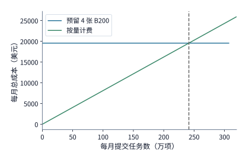

*图 11-42　自建预留与按量采购的月总成本对比：预留 4 张 B200 为一条高度固定在 $19{,}555.2\ \text{美元}$ 的水平蓝线（右端止于每月 $307.2$ 万项的物理容量上限）；按量成本为斜率 $0.0081\ \text{美元/项}$ 的橙色直线；两线在约 $241$ 万项处相交，恰好对应预留卡约 $78.6\%$（$= 6.79/8.64$）的平均利用率。*

如果工程团队通过底层算子优化提升了推理引擎在这 4 张 B200 上的执行效率，图 11-42 中的两条线会如何移动？由于单位时间内同样的 4 张卡能跑完更多任务，水平预留线的右端容量上限 $N_{\max}$ 会向右延伸，同时按量模式下单任务占用的 GPU 秒数减少、橙色直线的斜率 $c$ 按相同比例变缓——因此**两线的交点虽然向右移动到了更大的绝对任务数上，但交点对应的预留实例相对利用率依然恒定保持在 $6.79 / 8.64 \approx 78.6\%$**。

那么，优化自建推理引擎究竟能把单位输出 token 的 GPU 成本压低多少？这同样取决于单 token 耗时内部的微观构成。仍以这组 4 张 B200 运行 DeepSeek V4-Flash（同时服务 32 个会话、每会话保留 200K 上下文，逐层固定开销和周期全量重建为给定输入）为例：实测单输出 token 平均耗时为 **$25.3\ \mathrm{ms}$**（精确值 $25.317\ \mathrm{ms}$），拆解其内部去向可以发现，真正花在逐 token 自回归解码（decode）上的时间为 **$15.9\ \mathrm{ms}$**（占约 **$63\%$**），而其余分摊到每个输出 token 上的输入处理与周期性上下文重建则占去了 **$9.4\ \mathrm{ms}$**（占约 **$37\%$**）。假设我们通过引入更高效的投机解码或算子融合，把 **decode 阶段的实际速度提高到了原来的两倍**（耗时从 $15.9\ \mathrm{ms}$ 减半至 $7.95\ \mathrm{ms}$），而其余 $9.4\ \mathrm{ms}$ 保持不变，则单输出 token 的总耗时降为：

$$
15.9 / 2 + 9.4 \approx \mathbf{17.4\ \mathrm{ms}},
$$

端到端生成速度提升为原来的 $25.3 / 17.4 \approx \mathbf{1.46\ \text{倍}}$（总耗时缩短约 $31\%$），折算出的每百万输出 token 的纯 GPU 硬件成本也同步从约 **$6.0\ \text{美元}$** 下降到了 **$4.1\ \text{美元}$**。[^purchase]

哪怕我们把 decode 耗时压缩到零，那 $9.4\ \mathrm{ms}$ 的非解码底座依然横亘在前方。此时我们需要再次动用第 1.3.4 节建立的**物理下界 vs. 软件开销判据**对这 $9.4\ \mathrm{ms}$ 做二次解剖：其中必须从高带宽显存或远端读取历史 KV 块并重算注意力的字节搬移与矩阵乘时间，构成了不可逾越的物理带宽与算力下界；而其中因框架调度延迟、冗余张量拷贝与数据格式转换所消耗的时间，则是纯粹的软件开销，也是下一阶段内核工程持续榨取吞吐的真正空间。

在本节收官之际，让我们把章首代码修复平台切换到“快速模型服务”的新增账单记入账本：平台每秒发起 $30$ 次模型调用；每次调用从普通服务的 $1.125\ \mathrm{B200}\cdot\text{秒}$ 增加到快速服务的 $1.5\ \mathrm{B200}\cdot\text{秒}$，净增 **$0.375\ \mathrm{B200}\cdot\text{秒}$**。按 B200 Pod 每卡时 $6.79\ \text{美元}$ 折算，每次调用多花 $0.375 \times 6.79 / 3600 \approx \mathbf{0.00071\ \text{美元}}$，整座平台每秒钟多支出约 $30 \times 0.00071 \approx \mathbf{0.021\ \text{美元}}$。正是这每秒 $2.1$ 美分的额外算力投入，将单项任务的三轮总耗时从超时的 $30\ \mathrm{s}$ 拉进了合规的 **$21\ \mathrm{s}$**。在接下来的第 11.5 节中，我们将把故障恢复、重试树以及这笔新增模型费用与每轮重建省下的环境内存费用全部汇拢，做出最终的全局架构裁定。

---

## 11.5 完整任务的恢复、成本计算与扩容

前面四节在核算时间与费用时，大都假定每一次模型调用与工具执行都能顺利地一次跑通。然而在真实的分布式生产环境中，网络会闪断、确认包会丢失、节点会宕机、模型生成的代码补丁也会在第一遍测试中败下阵来。本节先剖析工具调用故障后的幂等恢复与 Agent 事务（ACID）持久性语义，接着沿着多分支恢复状态树推导单个按时成功任务的完整期望成本，最后对章首贯穿全章的代码修复平台做出容量、期限与总成本的终局裁定。

### 11.5.1 工具失败后的恢复与模型选择

当控制器向执行器或外部服务发出一条工具调用指令后，如果迟迟没有收到“执行完成”的确认消息（ACK），控制器就会陷入经典的分布式两难境地（图 11-43）：**究竟是工具在半路上崩了、根本还没来得及执行，还是工具其实已经顺利地执行完毕并提交了结果，仅仅是回传的那条确认消息在网络里弄丢了？**

如果控制器不加甄别地直接重发指令，对于只读查询或**幂等操作（idempotent operation，指携带同一操作标识重复调用多次时，产生的最终业务状态与只调用一次完全相同）**而言通常无伤大雅；但如果这项工具操作带有不可逆的外部副作用（例如向代码仓库合并 PR、向云平台创建计费实例、执行外部扣款或向用户发送通知消息），盲目重发就会酿成“同一操作实际发生两次”的严重事故。因此，正确的故障恢复流程必须遵循图 11-43 的**“先查后决”协议**：
1. 控制器在发起任何工具操作前，先为其生成全局唯一的**操作标识（operation ID）**并与输入文件版本绑定记录；
2. 当发生超时或重启恢复时，控制器**第一步绝不是直接重试，而是拿着原操作标识去查询持久化结果表或外部目标系统的提交状态**；
3. 如果查到该操作标识对应的结果已经存在，直接取回结果进入下一轮；只有确认该操作确实未曾提交生效，且业务规则允许重试时，才发起新的执行尝试。

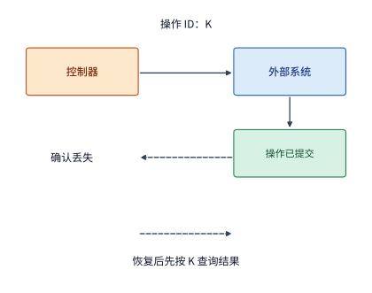

*图 11-43　外部副作用操作的确认丢失与恢复边界（实线为请求与实际执行，虚线为丢失的确认及恢复查询）：当外部系统已执行并提交操作 K 但确认消息丢失时，仅靠回滚本地沙箱快照无法撤销外部已生效的结果；控制器必须按同一操作标识 K 向目标系统查询提交状态并取回结果后接续任务。*

我们用一个小算例对比“消息层重传去重”与“因确认丢失而重复执行”的资源账差异：设执行一次工具测试需要消耗 **$3\ \text{CPU}\cdot\text{秒}$**。
- 如果工具只执行了一次，仅仅是网络层为了保底将结果消息发送了两次，接收端按操作标识做一次去重，整次操作累计消耗的 CPU 时间依然是 **$3\ \text{CPU}\cdot\text{秒}$**；
- 如果因为确认消息丢失、且系统未做持久化结果查询，导致控制器盲目驱动执行器将同一个工具重复执行了一遍，那么即便最终去重后只采纳了一条结果，平台实际消耗的累计 CPU 时间也已经翻倍到了 **$6\ \text{CPU}\cdot\text{秒}$**。

简言之，**接收端消息去重只能挡住“同一份结果被收下两次”，唯有持久化结果查验与目标系统幂等协议才能避免“同一项工具计算被重复执行两次”**。[^records]

然而，哪怕工具或日志写入函数在代码里正常返回了“成功”，也并不意味着机器断电重启后就一定能找回这条记录。熟悉传统操作系统内核的读者都知道“写入返回”与“落盘持久化”之间的鸿沟：当应用程序调用标准 C 库或系统调用 `write()` 写文件时，只要数据拷入了操作系统内核的**内存页缓存（Page Cache）**，`write()` 就会立刻返回成功，让程序继续往下跑，至于脏页何时真正写进物理固态硬盘则由内核后台线程异步决定；如果此时整机突然断电，页缓存里还没来得及刷盘的数据就会全部蒸发。只有当程序显式调用 **`fsync()`**（并在新建或重命名文件时同步对父目录描述符执行 `fsync()`），强制阻塞等待文件数据块与文件系统元数据全部写入非易失性存储介质并核验返回码无误后，才算真正完成了持久化。[^fsync]

把这一操作系统原理映射到多轮交互的 Agent 运行时，就构成了 **Agent 持久性语义（durability semantics）**：当平台向外部调用方或下一轮循环报告“本轮已完成”时，系统承诺的究竟只是“模型答案已经生成在内存里”，还是“对话消息、工具输出、工作目录文件变更以及恢复锚点都已经安全落盘”？请注意，在复杂的 Agent 系统中，**仅仅对单份 JSONL 聊天日志文件调用 `fsync()` 是远远不够的**——因为恢复一项代码修复任务所需的状态分散在聊天日志、沙箱工作目录文件以及外部结果数据库三处，控制器必须确保这三处记录的版本号严格对齐、共同进退。

我们以标准的 **ReAct（Reasoning + Acting）循环**为例来设计轮次级持久化协议：每一轮 ReAct 交互包含“模型思考与工具调用输出 $\to$ 工具实际执行 $\to$ 工具返回观察结果”完整三步（可能对应多条上下文消息）。控制器在每轮结束时，将该轮新增的所有消息与状态摘要追加写入本地 JSONL 记录文件，**必须确认整轮记录全部保存成功后，才允许推进到下一轮**（若本轮保存失败则立即中止，绝不允许在中间某轮未保存成功的情况下带着残缺历史继续跑后续轮次）。

更进一步，为了防止单台宿主机连同本地磁盘一起宕机失联，生产平台通常采用**“本地同步落盘＋后台异步上传云端对象存储”**的双层保存架构。但这会引入一个极具迷惑性的**云端历史空洞（coverage gap）陷阱**（图 11-44）：假设某项三轮代码任务采用“每轮先写本地 JSONL，随后由后台线程异步上传该轮增量记录到云端，且允许某轮上传失败后暂不阻塞本地继续执行后续轮次”的宽松策略：
- **第 1 轮**：运行初始测试、拿到报错，本地保存成功，云端上传也成功；
- **第 2 轮**：模型修改代码、工具确认改写成功，本地保存成功，但**后台上传云端时因网络抖动失败**；
- **第 3 轮**：再次运行测试、拿到最新结果，本地保存成功，**后台上传第 3 轮增量记录到云端也成功了**。

现在看图 11-44 的状态快照：在本地磁盘上，第 1、2、3 轮的记录完完整整；但在云端存储上，虽然收到了第 1 轮和第 3 轮的记录，**中间最关键的第 2 轮代码修改记录却开了一个天窗**。如果此时这台本地宿主机突然硬件故障下线，调度器在另一台机器上仅凭云端存储恢复任务，它能从第 3 轮接着跑吗？**绝对不能**——因为缺少了第 2 轮的代码补丁与工具上下文，第 3 轮的测试结果根本成了无源之水。因此，采用增量异步上传时，云端元数据不仅要记录“收到过的最大轮次号（last received round = 3）”，还必须严格维护一条**“从起点开始连续完整保存的最高轮次进度线（contiguous committed prefix = 1）”**：绝不能因为第 3 轮上传成功就把可恢复进度线推进到第 3 轮；唯有等后台重传补齐了第 2 轮（或每次直接上传包含此前所有轮次的累积完整快照）并校验无误后，才能将云端可恢复进度线正式推进到第 3 轮。

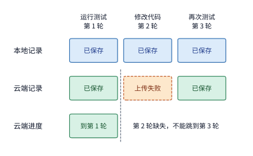

*图 11-44　本地落盘与云端异步增量上传的连续性进度差异（每列代表一个 ReAct 轮次，横向表示轮次先后顺序而非耗时）：尽管本地三轮记录全部完整、且第 3 轮增量已成功上传云端，但由于第 2 轮上传失败，云端自起点连续完整的历史仅停留在第 1 轮；若此时本机宕机，跨机恢复只能安全回退至第 1 轮结束态。*

同样的连续性铁律也适用于**历史日志压缩与清理（log compaction）**：当系统为了节省空间准备删掉前两轮的旧日志时，必须先生成并原子提交一份**能够完整还原到第 2 轮结束时刻的状态基线快照（checkpoint anchor）**；如果在恢复时既找不到前两轮的原始日志，又找不到这份第 2 轮结束态快照，哪怕后面的第 3 轮增量日志一字不差地全读出来了，恢复程序也必须诚实地返回 `incomplete`（历史不完整）错误，绝不能在缺失前置状态的地基上强行拼凑恢复。同理，若系统对外提供“回退到任意指定消息位置重新分支”的调试接口，也必须先核验该位置是否恰好落在某个已完整保存工作目录版本的轮次边界上——对于没有单独保存文件快照的轮内中间位置，或者已经在外部系统中提交生效的不可逆操作，系统绝不能做出虚假的回滚承诺。[^durability]

把上述设计提炼成一般原则，我们可以借鉴数据库系统经典的事务（Transaction）理论，将每一轮“模型决策 $\to$ 工具执行 $\to$ 结果与文件落盘”封装为一个不可分割的**智能体事务（Agentic Transaction）提交单元**。唯有当本轮的模型输出消息、工具返回结果以及沙箱工作目录文件版本三者全部完成持久化校验后，控制器才在事务日志中写下“本轮已提交（Committed）”标记；任何时刻发生崩溃重启，系统都严格回滚到**最近一个已提交轮次**的干净状态接着执行。这也是 2026 年兴起的 **Agent 事务（Agentic Transaction）**研究的核心课题：如何在跨越随机模型推理与异构外部工具的智能体工作流中，定义并实现语义层面的原子性（Atomicity）、一致性（Consistency）、隔离性（Isolation）与持久性（Durability），即广义的 **ACID** 属性。[^agent-transaction]

在工程落地中，事务提交得越频繁，故障后需要重做的工作就越少，但正常无故障运行时的同步落盘开销也越重。我们用一个定量算例算清**逐请求提交 vs. 批量提交（commit batching）**的权衡：设有 $100$ 个工具请求依次串行执行，每个请求本身的计算耗时为 $200\ \mathrm{ms}$（100 个纯计算共需 $20\ \mathrm{s}$）；每次触发持久化事务提交需要付出 $8\ \mathrm{ms}$ 的固定协议与落盘同步开销，外加每个待提交请求 $2\ \mathrm{ms}$ 的记录序列化写入开销（假设提交期间暂停处理后续请求，且每次提交要么整批全部生效、要么全部不生效）：

| 事务持久化提交粒度 | 100 个请求累计保存开销 | 无故障时端到端总用时 | 发生故障时最多需重做的计算时间 |
| --- | ---: | ---: | ---: |
| **每 $1$ 个请求立即提交一次** | $100 \times (8 + 2) = \mathbf{1{,}000\ \mathrm{ms}}$ | **$21.00\ \mathrm{s}$** | $1 \times 0.2 = \mathbf{0.2\ \mathrm{s}}$ |
| **每 $10$ 个请求批量提交一次** | $10 \times (8 + 10 \times 2) = \mathbf{280\ \mathrm{ms}}$ | **$20.28\ \mathrm{s}$** | $10 \times 0.2 = \mathbf{2.0\ \mathrm{s}}$ |

对比表中的两行：将提交粒度放宽到每 10 个请求批量提交一次，把 $8\ \mathrm{ms}$ 的固定同步开销分摊了十倍，使正常执行时的总保存开销从 $1.00\ \mathrm{s}$ 降到了 $0.28\ \mathrm{s}$（净省 **$0.72\ \mathrm{s}$**）；但代价是如果在第 10 个请求刚跑完、还没来得及提交的瞬间发生故障，这 10 个未提交请求就得全部推倒重来，最多需要重做 **$2.0\ \mathrm{s}$** 的计算（是逐请求提交 $0.2\ \mathrm{s}$ 的十倍）。若进一步将同步提交改为后台异步提交，虽然能把正常执行时的阻塞等待压到接近零，但故障发生时内存里究竟积压了多少个“已向调用方返回、却尚未落盘生效”的在途请求，就完全取决于后台存储带宽与请求产出速率的赛跑了。

这再次呼应了贯穿全书的两条核心追问：**第一，关键状态究竟存放在哪里？第二，关键路径上的谁必须停下来等它？** 回想第 11.2.4 节我们之所以敢在第 $10\ \mathrm{s}$ 工具一跑完就瞬间销毁沙箱释放 $2\ \mathrm{GiB}$ 内存，前提正是“本轮修改的文件与测试结果已经在第 $10\ \mathrm{s}$ 前安全落盘到了沙箱外部的持久存储中”；如果唯一一份测试结果还留在沙箱进程的内存缓冲区里没写出去，控制器就必须继续保留着这个 $2\ \mathrm{GiB}$ 沙箱等它落盘完毕才能释放。

一旦通过事务持久化确认了故障或测试失败后“能够安全恢复到哪一轮”，控制器在发起重试时就不必局限于原先的同一个模型，而是可以灵活动用**模型升级路由（Model Escalation / Cascading）**：例如前两轮使用便宜快速的轻量模型已经完成了仓库定位与初步修改，并将补丁与测试报错完整持久化了下来；此时控制器无需推翻前两轮重来，直接把前两轮已保存的进度交给能力更强的旗舰大模型做最后一击修复——既省去了重跑前两轮的时间与金钱，又大幅提升了疑难缺陷的最终攻克率。

### 11.5.2 成功任务的完整成本

既然真实系统中的任务会经历测试失败、局部修复与模型升级重试，那么**仅仅拿着单次 API 调用的报价单，是绝对算不出平台每交付一个合格任务真正花了多少钱的**。在工程财务核算中，所有失败尝试分支消耗的模型 token、CPU 秒数与沙箱内存，最终都必须分摊计入成功通过测试验收的任务成本中。

设在一段统计窗口内，平台在所有成功与失败尝试分支上支出的总费用之和为 $C_{\mathrm{all}}$，最终通过质量测试验收的合格任务总数为 $N_q$，而既通过测试验收、又在规定期限（deadline）内按时交付的任务总数为 $N_{q,d}$（显然有 $N_{q,d} \le N_q$）；则**每个合格任务的平均真实成本 $\overline C_q$** 与**每个按时合格任务的平均真实成本 $\overline C_{q,d}$** 分别为：

$$
\overline C_q=\frac{C_{\mathrm{all}}}{N_q},\qquad
\overline C_{q,d}=\frac{C_{\mathrm{all}}}{N_{q,d}}.
$$

千万不要小看分子 $C_{\mathrm{all}}$ 中包含的失败支出：举个极简例子，假设平台先后承接了 $10$ 项任务，每项任务花费 $0.1\ \text{美元}$，总支出 $C_{\mathrm{all}} = 1.0\ \text{美元}$；最终只有 $5$ 项任务通过测试（$N_q = 5$），其余 $5$ 项失败作废。此时平台每成功交付一项合格任务的真实成本是 $1.0 / 5 = \mathbf{0.20\ \text{美元}}$；如果某位工程师在写报表时只统计那 5 项成功任务自己花掉的 $0.5\ \text{美元}$，除以 5 报出“单任务成本 $0.10\ \text{美元}$”，就等于在账本上凭空抹掉了整整一半的真实算力支出。

在系统上线之前，我们就可以构建一棵**有限状态恢复树（finite retry / escalation tree）**来精确推演 $\overline C_q$ 与 $\overline C_{q,d}$。设恢复树中共有若干条从根节点通往终止叶节点的完整执行路径 $\pi$，每条路径发生的概率为 $p_\pi$（满足 $\sum_\pi p_\pi = 1$），沿着路径 $\pi$ 依次经历的各个步骤成本之和为 $c_\pi$、累计耗时为 $t_\pi$；则每提交一项任务的期望总支出为 $\mathbb{E}[C] = \sum_\pi p_\pi c_\pi$，除以所有成功叶节点的概率之和 $\sum_{\pi \in \text{成功}} p_\pi$ 即得 $\overline C_q$，除以所有满足 $t_\pi \le D$ 的按时成功叶节点概率之和即得 $\overline C_{q,d}$（请注意：树中每一个非根节点的分支转移概率，都必须是以“任务已经经历前序失败到达该节点”为前提的**条件概率**）。

**例 11-8：局部修复对成功率与超时比例的影响。** 我们通过一棵包含“首次尝试 $\to$ 局部修复 $\to$ 升级强模型”的三级恢复树（图 11-45 与图 11-46），算清多级恢复如何同时推高总成功率、单位成本与超时比例。设业务评价期限为 **$20\ \mathrm{s}$**（该期限仅用于事后统计任务是否按时达标，运行中途超时并不强行杀死任务）：
1. **第一级：首次尝试（Initial Attempt）**：使用 **Claude Sonnet 5**（输入单价 $2\ \text{美元/M}$，输出单价 $10\ \text{美元/M}$），消耗 $2{,}500$ 个输入 token 与 $500$ 个输出 token，单次成本为 $\frac{2500 \times 2 + 500 \times 10}{10^6} = \mathbf{0.010\ \text{美元}}$，耗时 **$10\ \mathrm{s}$**。首次尝试后出现三种互斥结果（图 11-45）：
   - **$80\%$** 的任务直接通过测试成功结束（耗时 $10\ \mathrm{s} \le 20\ \mathrm{s}$）；
   - **$12\%$** 的任务报错清晰（如轻微语法或断言偏差），进入第二级**局部修复**；
   - **$8\%$** 的任务报错复杂，跳过局部修复，直接进入第三级**模型升级**。
2. **第二级：局部修复（Local Repair，图 11-46）**：针对进入此分支的 $12\%$ 任务，继续使用 **Claude Sonnet 5** 传入报错摘要做快速修补，消耗 $1{,}500$ 个输入 token 与 $300$ 个输出 token，**新增成本 $0.006\ \text{美元}$、新增耗时 $4\ \mathrm{s}$**。在进入局部修复的条件下，有 **$60\%$** 的条件概率修复成功（占全部提交任务的 $12\% \times 60\% = \mathbf{7.2\%}$，累计耗时 $10 + 4 = 14\ \mathrm{s} \le 20\ \mathrm{s}$）；余下 **$40\%$**（占全部提交任务的 $12\% \times 40\% = \mathbf{4.8\%}$）修复仍未通过，继续转入第三级**模型升级**。
3. **第三级：升级强模型重试（Model Escalation）**：无论是首次尝试后直接升级的 $8\%$，还是局部修复失败后转入升级的 $4.8\%$（合计占全部提交的 $12.8\%$），统一换用顶级旗舰模型 **Claude Opus 5**（输入单价 $5\ \text{美元/M}$，输出单价 $25\ \text{美元/M}$），消耗 $3{,}000$ 个输入 token 与 $600$ 个输出 token，**新增成本 $\frac{3000 \times 5 + 600 \times 25}{10^6} = \mathbf{0.030\ \text{美元}}$、新增耗时 $8\ \mathrm{s}$**。Opus 5 凭借强大的推理能力，拥有高达 **$98\%$** 的条件成功概率（余下 $2\%$ 彻底失败）。[^retry]

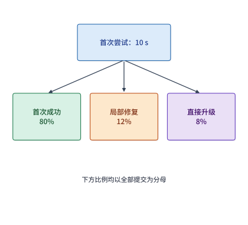

*图 11-45　例 11-8 的有限恢复状态树：首次尝试（$10\ \mathrm{s}$，成本 $0.010\ \text{美元}$）后分为直接成功（$80\%$）、进入局部修复（$12\%$）与直接升级 Opus 5（$8\%$）三路；右侧列出全部六条终止叶节点的全局概率（以全部提交为分母）与累计耗时。*

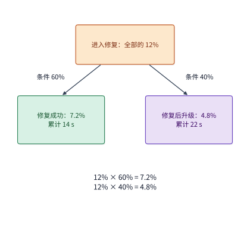

*图 11-46　局部修复节点（占总提交 $12\%$）的条件分支展开：其中 $60\%$ 条件成功（占总提交 $7.2\%$，累计耗时 $10+4=14\ \mathrm{s}$，满足 $20\ \mathrm{s}$ 期限），另外 $40\%$ 转入升级（占总提交 $4.8\%$，再加 $8\ \mathrm{s}$ 升级耗时使累计时间达 $22\ \mathrm{s}$，超出 $20\ \mathrm{s}$ 期限）。*

我们将这棵恢复树展开出的全部 **六条互斥终止路径** 的发生概率、累计完整成本（含该路径上所有前序步骤的支出总和）、累计耗时以及是否满足 $20\ \mathrm{s}$ 按时通过测试要求，逐行汇总如下表：

| 终止路径（执行过程与最终结果） | 全局发生概率 $p_\pi$ | 路径累计完整成本 $c_\pi$（美元） | 路径累计耗时 $t_\pi$（s） | 是否通过测试且在 $\le 20\ \mathrm{s}$ 内按时完成 |
| --- | ---: | ---: | ---: | --- |
| 1. 首次尝试直接成功 | $0.80000$（$80.000\%$） | $0.010$ | $10$ | **是**（合格且按时） |
| 2. 首次 $\to$ 局部修复成功 | $0.07200$（$7.200\%$） | $0.010 + 0.006 = 0.016$ | $14$ | **是**（合格且按时） |
| 3. 首次 $\to$ 局部修复 $\to$ 升级成功 | $0.04704$（$4.704\%$） | $0.010 + 0.006 + 0.030 = 0.046$ | **$22$** | **否**（虽然通过测试，但 $22\ \mathrm{s} > 20\ \mathrm{s}$ 超时） |
| 4. 首次 $\to$ 局部修复 $\to$ 升级失败 | $0.00096$（$0.096\%$） | $0.046$ | $22$ | **否**（未通过测试且超时） |
| 5. 首次 $\to$ 直接升级成功 | $0.07840$（$7.840\%$） | $0.010 + 0.030 = 0.040$ | $18$ | **是**（合格且按时） |
| 6. 首次 $\to$ 直接升级失败 | $0.00160$（$0.160\%$） | $0.040$ | $18$ | **否**（未通过测试） |

为了把这六行概率变成触手可及的工程数字，我们直接拿 **$1{,}000$ 项提交任务**顺着树走一遍：
- **算总支出 $C_{\mathrm{all}}$**：1,000 项任务全部跑首次尝试，花费 $1000 \times 0.010 = \mathbf{10.00\ \text{美元}}$（其中 $800$ 项直接成功）；有 $120$ 项进入局部修复，新增花费 $120 \times 0.006 = \mathbf{0.72\ \text{美元}}$（其中 $72$ 项修复成功）；局部修复未过的 $48$ 项连同直接升级的 $80$ 项，共有 **$128$ 项**进入 Opus 5 升级重试，新增花费 $128 \times 0.030 = \mathbf{3.84\ \text{美元}}$。三阶段全部支出相加：$10.00 + 0.72 + 3.84 = \mathbf{14.56\ \text{美元}}$（约 **$14.6\ \text{美元}$**，折合每提交一项任务的期望成本为 $0.01456\ \text{美元}$）。
- **算合格总数 $N_q$ 与按时合格数 $N_{q,d}$**：把所有通过测试的成功路径（路径 1、2、3、5）加起来，共有 $800 + 72 + 47.04 + 78.40 = \mathbf{997.44\ \text{项}}$（约 **$997$ 项**，总通过率高达 **$99.744\%$**）；但请特别注意**路径 3（先花 $4\ \mathrm{s}$ 局部修复未果、再花 $8\ \mathrm{s}$ 升级成功）**——这约 **$47$ 项（$4.704\%$）**任务虽然最终给出了正确补丁，但累计耗时达到了 $10 + 4 + 8 = \mathbf{22\ \mathrm{s}}$，遗憾地越过了 $20\ \mathrm{s}$ 的期限红线。扣除这 47 项迟到的成功结果后，真正赶在 $20\ \mathrm{s}$ 内按时通过测试的任务数为 $800 + 72 + 78.40 = \mathbf{950.4\ \text{项}}$（约 **$950$ 项**，按时通过率为 **$95.04\%$**）。
- **算单位合格成本（图 11-47）**：
  - 若**只做首次尝试（不重试）**：总支出 $10\ \text{美元}$ 除以 $800$ 项成功，单成功成本仅为 $10 / 800 = \mathbf{0.0125\ \text{美元}}$，但按时通过率仅为 **$80\%$**；
  - 若**启用三级恢复策略**：总支出 $14.56\ \text{美元}$ 除以 $997.44$ 项合格任务，**每个合格任务的平均成本升至 $\overline C_q = 14.56 / 997.44 \approx \mathbf{0.0146\ \text{美元}}$**；若除以 $950.4$ 项按时合格任务，**每个按时合格任务的平均成本进一步升至 $\overline C_{q,d} = 14.56 / 950.4 \approx \mathbf{0.0153\ \text{美元}}$**。

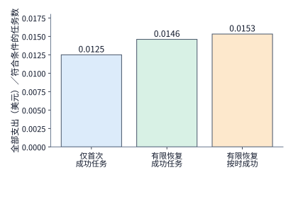

*图 11-47　例 11-8 中不同策略的单位成本与完成率对比（各成本柱均以策略全部支出 $C_{\mathrm{all}}$ 为分子，分别除以通过测试总数 $N_q$ 或按时通过总数 $N_{q,d}$）：三级恢复策略虽使单合格成本从 $0.0125\ \text{美元}$ 微升至 $0.0146\ \text{美元}$（单按时合格成本 $0.0153\ \text{美元}$），但将总通过率从 $80\%$ 推升至约 $99.7\%$，并将 $20\ \mathrm{s}$ 内按时通过率精准推过 $95.0\%$ 的业务门槛。*

对照图 11-47 可以看出：虽然路径 3 那 $4.7\%$ 的任务“花了 $0.046\ \text{美元}$ 最高昂的代价却因为超时 2 秒没能算进按时合格分母 $N_{q,d}$ 里”，但正是依靠局部修复救回的 $7.2\%$（$14\ \mathrm{s}$）与直接升级救回的 $7.84\%$（$18\ \mathrm{s}$），整套系统才将按时成功率从 $80\%$ 稳稳托举到了 $95.04\%$ 的 SLA 达标线上。同时还要注意“评价期限”与“主动超时熔断（early stopping）”的区别：如果平台仅仅把事后评价期限收紧（比如从 $20\ \mathrm{s}$ 改到 $16\ \mathrm{s}$）而不改动控制器执行逻辑，那么所有分支照跑不误、总支出 $14.56\ \text{美元}$ 一分不少，只是分母 $N_{q,d}$ 变得更小；而如果控制器在运行中途发现“当前已用时间＋下一阶段预计耗时 $>$ 期限”就主动放弃发起后续重试（例如在局部修复失败的第 $14\ \mathrm{s}$ 预知升级还需 $8\ \mathrm{s}$ 必超 $20\ \mathrm{s}$ 期限，直接终止那 $4.8\%$ 分支），就能实打实地省下那 $48 \times 0.030 = 1.44\ \text{美元}$ 的无效升级费用，在不损失任何按时合格数的前提下把 $\overline C_{q,d}$ 压得更低。[^records]

除了故障恢复，我们还要前瞻性地考察一条贯穿全书的瓶颈转移规律：**当模型推理速度随着硬件换代（如从 H100 升级到 B200 再到下一代加速卡）越来越快时，原本被模型调用完美掩盖住的环境准备耗时，终将浮出水面成为新的关键路径等待来源**（图 11-48）。我们算一笔对比账：假设下一轮工具调用必然发生，且所需模板不在本机缓存中，走第 11.2.4 节的冷路径拉取并创建环境需要 **$2.7\ \mathrm{s}$**。
- 当快速模型服务生成一轮输出需要 **$6.0\ \mathrm{s}$** 时（图 11-48 上半部分）：只要我们在第 $0\ \mathrm{s}$ 模型开始生成的同时并行启动环境冷创建，环境在第 $2.7\ \mathrm{s}$ 就早早准备完毕，在模型于第 $6.0\ \mathrm{s}$ 返回时实现零等待交接；
- 而当未来模型推理进一步提速 6 倍、单次模型调用缩短至仅需 **$1.0\ \mathrm{s}$** 时（图 11-48 下半部分）：哪怕我们在第 $0\ \mathrm{s}$ 零延迟同步启动环境创建，当模型在第 $1.0\ \mathrm{s}$ 快速输出完整工具参数时，冷环境才创建了三分之一，工具被迫在关键路径上**等待剩余的 $2.7 - 1.0 = \mathbf{1.7\ \mathrm{s}}$** 才能开始执行。[^core-calculation]

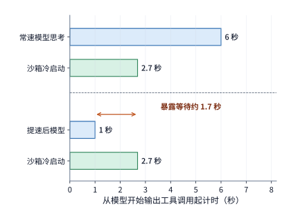

*图 11-48　模型推理加速引发的关键路径瓶颈转移（两种情况均在 $t=0\ \mathrm{s}$ 同步启动耗时 $2.7\ \mathrm{s}$ 的冷环境创建，工具必须同时等齐模型输出与环境就绪）：当模型调用耗时 $6\ \mathrm{s}$ 时，$2.7\ \mathrm{s}$ 环境准备被完全隐藏；当模型调用缩短至 $1\ \mathrm{s}$ 时，环境创建反而暴露出 $1.7\ \mathrm{s}$ 的关键路径等待。*

最后，在从中断或长间隔休眠中恢复一项多轮 Agent 任务时，控制器需要唤醒并对齐的往往不只是右侧的**工具沙箱状态**，还有左侧的**模型服务会话状态**。以全书跨章跟踪的 **DeepSeek V4.1 Flash 混合注意力长上下文会话**为例（回顾第 3.2.4 节与第 9.4.3 节）：在等待工具执行或休眠期间，该会话跨越两套基础设施维护着两组异构状态——操作系统与环境平台管理着沙箱进程、工作目录与文件；而模型推理集群则管理着可从远端缓存池直接取回的**全局注意力（MLA）KV 块**，以及必须通过重放提示词末尾滑动窗口 token 来本地重建的**局部滑动窗口注意力（SWA）状态**。当任务从休眠中恢复并准备将工具输出送入下一轮模型推理时，平台可以**并行启动“工具环境恢复”与“模型侧全局 KV 取回＋局部 SWA 重放”两条恢复流水线**（而已经提交给外部系统的操作则通过幂等查询确认结果）；当两条恢复路径能够完全并行推进时，两者中耗时较长的那一条路径决定了会话恢复的最终等待时间下界。[^v41-case]

### 11.5.3 CPU、GPU、内存与服务额度的扩容选择

现在，所有的理论工具、延迟模型与计费参数都已经齐备，让我们回到章首提出的贯穿设计题，对整座代码修复平台做出最终的架构选型与扩容裁定。

我们先快速回顾前几节已经锁定的三块核心定量拼图：
1. **普通模型服务（单副本 32 会话）**：单次调用耗时 $9\ \mathrm{s}$，三轮任务总历时 **$30\ \mathrm{s} > 24\ \mathrm{s}$**（超时）；
2. **快速模型服务（单副本减半至 16 会话）**：单次调用耗时降至 $6\ \mathrm{s}$，三轮任务总历时压缩至 **$21\ \mathrm{s} \le 24\ \mathrm{s}$**（达标）；
3. **每轮重建环境（模型调用末尾提前 $2\ \mathrm{s}$ 热准备）**：将单任务累计环境内存占用从始终驻留的 $60\ \mathrm{GiB}\cdot\text{秒}$（普通服务）或 $42\ \mathrm{GiB}\cdot\text{秒}$（快速服务）统一压缩至 **$18\ \mathrm{GiB}\cdot\text{秒}$**，代价仅仅是三次准备额外消耗 $3 \times 0.1 = \mathbf{0.3\ \text{CPU}\cdot\text{秒}}$。

**例 11-9：如何选择模型服务与环境管理方式，才能按期完成且成本最低？** 沿用章首给定的全部边界条件：任务以 $\lambda = 10\ \text{项/s}$ 均匀到达，每项固定执行 $3$ 轮；工具平台为单台配备 **$48$ 个物理 CPU 核、约 $358\ \mathrm{GiB}$ 可用内存**的 `m5d.metal` 裸金属服务器；模型服务现有 **$10$ 个 DeepSeek V4-Flash 副本（共 $40$ 张 B200）**。普通服务与快速服务运行的是完全相同的模型权重，三轮结束时代码通过测试验收的概率均为 **$95\%$**（且是否通过测试与任务到达时刻独立）。各项资源的计费单价汇总如下：
- **GPU 模型推理成本**：按实际占用的 B200 卡时计费，Runpod B200 Pod 单价为 **$6.79\ \text{美元/卡时}$**。由此算出：普通服务单次调用占 $1.125\ \mathrm{B200}\cdot\text{秒}$，费用为 $1.125 \times 6.79 / 3600 \approx \mathbf{0.002122\ \text{美元}}$；快速服务单次调用占 $1.5\ \mathrm{B200}\cdot\text{秒}$，费用为 $1.5 \times 6.79 / 3600 \approx \mathbf{0.002829\ \text{美元}}$。
- **沙箱 CPU 与内存成本**：按 E2B 公开的沙箱计价标准按实际使用量计费，**CPU 单价为 $0.000014\ \text{美元}/(\text{CPU}\cdot\text{秒})$**，**内存单价为 $0.0000045\ \text{美元}/(\mathrm{GiB}\cdot\text{秒})$**（工作目录持久化费用已包含在每轮 $1\ \mathrm{s}$ 工具执行内，平台基础公共固定支出在各候选方案中相同）。[^design]

我们按工程排除法分三步锁定唯一可行且最优的架构方案：
- **第一步：排除“保持普通模型服务、仅靠扩容 CPU 加速工具”的幻想**。在普通模型服务下，三轮模型调用本身就要花掉 $3 \times 9 = 27\ \mathrm{s}$，而三轮工具执行总共只占 $3\ \mathrm{s}$。就算我们投入重金把工具执行速度加快两倍（缩短至 $1.5\ \mathrm{s}$），总耗时仍需 $27 + 1.5 = \mathbf{28.5\ \mathrm{s}}$；哪怕把工具耗时降到绝对的 $0\ \mathrm{s}$，仅模型调用的 $27\ \mathrm{s}$ 也已经突破了 $24\ \mathrm{s}$ 的交付大限。因此，**单纯增加 CPU 无法使这条由模型推理主导的串行路径满足期限要求**。
- **第二步：按 $24\ \mathrm{s}$ 完成期限筛选模型服务档位（图 11-49）**。如图 11-49 所示，由于每轮 $2\ \mathrm{s}$ 的环境准备工作完全隐藏在模型调用期间，环境策略（始终驻留 vs. 每轮重建）并不改变任务的完成时间：采用普通模型服务的两套方案均在第 $30\ \mathrm{s}$ 结束，双双越过 $24\ \mathrm{s}$ 红线，按时通过测试的比例为 **$0\%$**；唯有切换至**快速模型服务（单次 $6\ \mathrm{s}$）**，才能把三轮完成时刻从第 $30\ \mathrm{s}$ 提前到**第 $21\ \mathrm{s}$**，稳稳落在 $24\ \mathrm{s}$ 期限之内（使按时通过测试比例达到 **$95\%$**）。

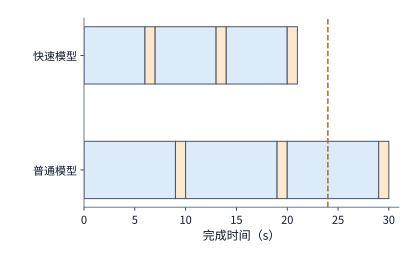

*图 11-49　按 $24\ \mathrm{s}$ 交付期限筛选模型服务档位（两种方案均在模型调用末尾重叠准备环境，每轮工具执行均为 $1\ \mathrm{s}$）：普通服务（每轮模型 $9\ \mathrm{s}$）到第 $30\ \mathrm{s}$ 才结束，越过 $24\ \mathrm{s}$ 期限红线；快速服务（每轮模型降至 $6\ \mathrm{s}$）将三轮完成时刻提前至第 $21\ \mathrm{s}$，满足期限要求。*

- **第三步：在“快速模型服务”下对比两种环境策略的主机容量与总成本**。我们将两两组合形成的四套候选方案的完成时间、单任务 CPU 与内存积分、平台稳态平均内存需求、每提交 1,000 项任务的总成本以及按时合格率完整列于下表：

| 候选架构方案 | 单任务完成时间（s） | 单任务累计 CPU（CPU·秒） | 单任务累计内存面积（GiB·秒） | 平台稳态平均内存（GiB） | 每千项提交总成本（美元） | 按时通过测试比例 |
| --- | ---: | ---: | ---: | ---: | ---: | ---: |
| 1. 普通服务＋始终驻留 | $30$ | $3.0$ | $60$ | $600$（超容） | $6.68$ | $0\%$ |
| 2. 普通服务＋每轮重建环境 | $30$ | $3.3$ | $18$ | $180$（合规） | $6.49$ | $0\%$ |
| 3. 快速服务＋始终驻留 | $21$ | $3.0$ | $42$ | **$420$（超容）** | $8.72$ | $95\%$ |
| **4. 快速服务＋每轮重建环境** | **$21$** | **$3.3$** | **$18$** | **$180$（合规）** | **$8.61$** | **$95\%$** |

我们以表中第 4 行**“快速服务＋每轮重建环境”**为例，逐分钱验算它的单任务成本构成：
- **模型 GPU 费用**：三次调用共消耗 $3 \times 1.5 = 4.5\ \mathrm{B200}\cdot\text{秒}$，折合 $4.5 \times 6.79 / 3600 \approx \mathbf{0.0084875\ \text{美元}}$；
- **工具与环境准备 CPU 费用**：三次工具执行（$3.0\ \text{CPU}\cdot\text{秒}$）加三次环境准备（$0.3\ \text{CPU}\cdot\text{秒}$）共 $3.3\ \text{CPU}\cdot\text{秒}$，折合 $3.3 \times 0.000014 = \mathbf{0.0000462\ \text{美元}}$；
- **沙箱内存驻留费用**：三次各 $3\ \mathrm{s}$ 的 $2\ \mathrm{GiB}$ 驻留共 $18\ \mathrm{GiB}\cdot\text{秒}$，折合 $18 \times 0.0000045 = \mathbf{0.0000810\ \text{美元}}$；
- **三项合计**：每提交一项任务总花费约为 $0.0084875 + 0.0000462 + 0.0000810 = \mathbf{0.0086147\ \text{美元}}$，即**每千项提交任务花费约 $8.61\ \text{美元}$**（除以 $95\%$ 的按时合格率，**每千项按时通过测试的合格任务平均花费约为 $8.6147 / 0.95 \approx \mathbf{9.07\ \text{美元}}$**；而方案 3“快速服务＋始终驻留”哪怕额外花钱加内存，每千项提交也要 $8.72\ \text{美元}$、每千项按时合格约 $9.18\ \text{美元}$）。

审视这组数字，一个深刻的工程洞察跃然纸上：在单任务总成本 $0.0086147\ \text{美元}$ 中，**GPU 模型推理费用独占了 $98.5\%$ 以上**，因此每轮重建环境虽然把沙箱内存费用砍了一半多，也只能让总账单下降约 $1.2\%$；然而，**每轮重建环境在这里的真正决定性贡献绝不只是节省那 $1.2\%$ 的直接费用，而是把平台稳态内存需求从 $420\ \mathrm{GiB}$ 一举压降到了 $180\ \mathrm{GiB}$——使整套系统无需采购第二台昂贵的裸金属服务器，完全容纳在现有的单台 `m5d.metal`（$358\ \mathrm{GiB}$）主机之内**。与此同时，为了承接稳态下 $10 \times 3 \times 6 = 180$ 次并发模型调用，快速服务（单副本 16 槽）只需将 V4-Flash 副本数从现有的 $10$ 个扩容至 **$12$ 个副本（共 $48$ 张 B200，提供 $192$ 个并发槽，比现有仅需净增 $2$ 个副本 / $8$ 张 B200）**。

为了确认这套终选方案在每一个时间切片上都不会发生瞬时资源挤兑，我们写出它在均匀到达（$\lambda = 10\ \text{项/s}$）下的**精确稳态流水时间表（图 11-50）**：以每项任务自己的到达时刻为 $t = 0\ \mathrm{s}$ 相对起点，该任务依次在 **$[0, 6]\ \mathrm{s}$、$[7, 13]\ \mathrm{s}$、$[14, 20]\ \mathrm{s}$** 执行三轮模型推理，在 **$[4, 6]\ \mathrm{s}$、$[11, 13]\ \mathrm{s}$、$[18, 20]\ \mathrm{s}$** 重叠完成三轮环境准备（每次 $2\ \mathrm{s}$ 均匀消耗 $0.1\ \text{CPU}\cdot\text{秒}$，即占用 $0.05$ 个核），并在 **$[6, 7]\ \mathrm{s}$、$[13, 14]\ \mathrm{s}$、$[20, 21]\ \mathrm{s}$** 执行三轮工具测试。由于每 $0.1\ \mathrm{s}$ 均匀进入一项新任务，在稳态的任意时刻向全平台拍一张快照：
- **CPU 核占用**：三轮工具执行各同时有 $10 \times 1 = 10$ 项任务在跑（共占 **$30$ 个核**），三轮环境准备各同时有 $10 \times 2 = 20$ 项任务在准备（每项占 $0.05$ 核，三轮共占 **$3$ 个核**），全平台稳态恒定使用 **$33$ 个 CPU 核**（$\le 48$ 核容量）；
- **活跃环境与内存占用**：三轮准备期（共 $60$ 个环境）加三轮执行期（共 $30$ 个环境）合计恒有 **$90$ 个活跃 microVM**，稳态恒定占用 $90 \times 2 = \mathbf{180\ \mathrm{GiB}}$ 内存（$\le 358\ \mathrm{GiB}$ 容量）；
- **模型并发槽占用**：三轮模型阶段各同时有 $10 \times 6 = 60$ 次调用在途，合计恒有 **$180$ 次并发调用**（$\le 12$ 个快速副本提供的 **$192$ 个并发槽**）。

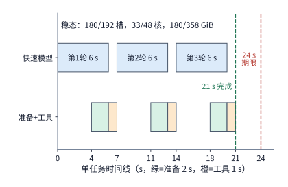

*图 11-50　终选架构方案的单任务三轮流水时间表与稳态并发校核：单任务在 $[4,6]\ \mathrm{s}$、$[11,13]\ \mathrm{s}$、$[18,20]\ \mathrm{s}$ 将环境准备（绿色）与快速模型调用（蓝色）重叠，于第 $21\ \mathrm{s}$ 完结（早于 $24\ \mathrm{s}$ 期限红线）；在 $\lambda=10\ \text{项/s}$ 稳态下，全局恒定占用 $180/192$ 模型槽、$33/48$ CPU 核与 $180/358\ \mathrm{GiB}$ 内存，全面满足单机与集群容量约束。*

**最终裁定结论：选择“快速模型服务＋每轮重建环境（在模型调用末尾提前 $2\ \mathrm{s}$ 准备）”，并将模型服务副本从 $10$ 个扩容至 $12$ 个（净增 $8$ 张 B200）。** 这是四个候选方案中唯一既能在 $24\ \mathrm{s}$ 期限内按时交付 $95\%$ 任务，又无需扩容现有 `m5d.metal` 工具主机的最优解。同时，对照第 11.5.2 节的重试分析可知：由于正常三轮走完已经到了第 $21\ \mathrm{s}$，距离 $24\ \mathrm{s}$ 期限只剩 **$3\ \mathrm{s}$** 余量；如果三轮测试未过再强行追加一次耗时 $4\ \mathrm{s}$ 的局部修复，完成时刻必然推迟到第 $25\ \mathrm{s} > 24\ \mathrm{s}$。因此在本题 $24\ \mathrm{s}$ 期限下，三轮结束未通过测试的那 $5\%$ 任务直接终止并返回失败；唯有当业务方把交付期限放宽到 $25\ \mathrm{s}$ 以上时，引入局部修复分支才能真正转化为按时合格数的净增长。

在结束本章之前，让我们再向前推演一步（翻转条件）：**上述“每轮销毁并重建环境”的决策，建立在“每轮工具执行之间隔着 $G = 6\ \mathrm{s}$ 模型等待”的前提之上；如果未来模型推理速度继续大幅加快，轮间等待时长 $G$ 缩短到什么程度时，“每轮重建”就会反过来败给“始终驻留”？**

我们令两种策略在单次轮间等待间隔（时长为 $G\ \mathrm{s}$）内的沙箱总成本相等（图 11-51）：
- 若在 $G$ 秒等待期内**始终保留** $2\ \mathrm{GiB}$ 环境，驻留内存成本为：
  $$C_{\mathrm{keep}}(G) = 2G \times 0.0000045 = 0.0000090G\ \text{（美元）};$$
- 若在上一轮结束时**销毁环境、并在下一轮结束前提前 $2\ \mathrm{s}$ 重新准备**，则无论 $G$ 多长（只要 $G \ge 2\ \mathrm{s}$），每次准备固定占用 $2\ \mathrm{GiB} \times 2\ \mathrm{s} = 4\ \mathrm{GiB}\cdot\text{秒}$ 内存与 $0.1\ \text{CPU}\cdot\text{秒}$ 计算，固定重建成本为：
  $$C_{\mathrm{rebuild}} = 4 \times 0.0000045 + 0.1 \times 0.000014 = 0.0000180 + 0.0000014 = \mathbf{0.0000194\ \text{（美元）}}.$$

令 $C_{\mathrm{keep}}(G) = C_{\mathrm{rebuild}}$，立即解出两种环境生命周期策略的**临界转换等待时长 $G_{\mathrm{cross}}$**：

$$
G_{\mathrm{cross}} = \frac{0.0000194}{0.0000090} = \frac{97}{45} \approx \mathbf{2.16\ \mathrm{s}}.
$$

对照图 11-51 中的三条曲线可以一目了然地把握沙箱生命周期策略的完整演进图谱：
1. **当轮间等待 $G > 2.16\ \mathrm{s}$ 时（如本章快速服务的 $G = 6\ \mathrm{s}$ 与普通服务的 $G = 9\ \mathrm{s}$）**：蓝色实线（始终驻留）高于绿色虚线（每轮重建），此时销毁并在模型末尾重建环境既省钱又省内存（若状态无法外化只能走橙色点划线的快照暂停恢复，则需跨越 $G = 9.0\ \mathrm{s}$ 门槛后才开始盈利）；
2. **当模型推理极快、使轮间等待缩短至 $G \le 2.16\ \mathrm{s}$（例如 $G = 2.0\ \mathrm{s}$）时**：不仅 $2\ \mathrm{s}$ 的准备工作已经占满整个等待窗口、无法腾出任何空闲内存，而且每次重建额外多花的 $0.1\ \text{CPU}\cdot\text{秒}$ 准备费（$0.0000014\ \text{美元}$）反而让每轮重建比直接保留环境更贵——**此时最优策略发生翻转，应当放弃每轮重建，直接让沙箱在轮间保持常驻**。

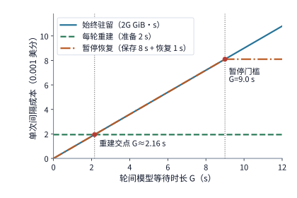

*图 11-51　单次轮间模型等待时长 $G$ 对三种沙箱环境管理策略的成本分界（纵轴单位为 $0.001$ 美分，即 $10^{-5}\ \text{美元}$）：当 $G > 2.16\ \mathrm{s}$ 时，每轮重建（绿虚线，恒为 $1.94 \times 10^{-5}\ \text{美元}$）低于始终驻留（蓝实线）；当模型加速使等待缩短至 $G < 2.16\ \mathrm{s}$ 时，始终驻留反超成为更优解；而 $2\ \mathrm{GiB}$ 沙箱的快照暂停恢复（橙点划线）则需在 $G > 9.0\ \mathrm{s}$ 后方才见效。*

最后，我们用第 1 章的 **Amdahl 定律** 对全章的优化脉络做一次凝练总结。设原端到端任务耗时中可被某项技术加速的阶段占比为 $f$，将该阶段加速 $s$ 倍后，整项任务的端到端加速比 $S$ 为：

$$
S=\frac{1}{(1-f)+f/s}.
$$

在章首 $30\ \mathrm{s}$ 的代码修复任务中，工具执行仅占 $f_{\mathrm{tool}} = 3 / 30 = 10\%$，哪怕将工具加速两倍（$s = 2$），整体加速比也仅为 $1 / (0.9 + 0.1 / 2) \approx \mathbf{1.05\ \text{倍}}$；而模型调用占去了 $f_{\mathrm{model}} = 27 / 30 = 90\%$，若将模型调用加速两倍（$s = 2$），整体加速比则高达 $1 / (0.1 + 0.9 / 2) \approx \mathbf{1.82\ \text{倍}}$。算清“每类资源累计干了多少活（面积积分）”决定了我们需要准备多少机器容量；而看清“哪些步骤串行相扣、哪一段占去了时间大头（关键路径与重叠窗口）”则决定了我们的优化手术刀应当切向哪里。

在下一章（第 12 章，也是全书的收官之章）中，我们将把这套“模型推理＋工具环境”的协同系统从数据中心内部进一步延伸到**端侧设备、边缘节点与中心云构成的广域协同网络**中，剖析物理空间距离、无线弱网丢包与跨网传输延迟如何重塑任务切分与恢复设计。

---

## 常见误区

1. **误区一：“工具每次只跑 1 秒 CPU，所以沙箱集群的容量瓶颈一定在 CPU 核数上。”**
   **纠正**：在多轮 Agent 与 RL 采样工作流中，沙箱在 $90\%$ 以上的日历时间里都在原地等待远端 GPU 模型生成工具参数。停止执行 CPU 指令绝不等于释放内存——如例 11-1 所示，当 $30\ \mathrm{s}$ 任务中仅执行 $3\ \mathrm{s}$ 工具时，平台 CPU 占用率仅为 $62.5\%$（$30/48$ 核），但始终驻留的 $2\ \mathrm{GiB}$ 沙箱却产生了 $600\ \mathrm{GiB}$ 的稳态内存需求（达单机 $358\ \mathrm{GiB}$ 容量的 $168\%$）。更反直觉的是，远端 GPU 模型推理变慢（如从 $9\ \mathrm{s}$ 延长至 $12\ \mathrm{s}$）会直接加剧本地 CPU 宿主机的内存超限（升至 $780\ \mathrm{GiB}$）。

2. **误区二：“只要在两轮工具调用之间调用沙箱的暂停（Pause）接口，或者越早预热下一轮环境，就越省资源、越快响应。”**
   **纠正**：暂停与恢复本身需要消耗与内存体积成正比的状态读写时间。按 E2B 实测参数（保存每 $\mathrm{GiB}$ 需 $4\ \mathrm{s}$、恢复需 $1\ \mathrm{s}$），在 $9\ \mathrm{s}$ 的模型等待期内暂停一个 $2\ \mathrm{GiB}$ 沙箱，光保存（$8\ \mathrm{s}$）加恢复（$1\ \mathrm{s}$）就占满了全部 $9\ \mathrm{s}$，连一毫秒内存都未能释放；唯有当等待间隔远大于转换耗时（如 RL 训练遭遇数小时抢占）或改为丢弃进程、每轮花 $2\ \mathrm{s}$ 重建干净环境时才能真正省下内存。同理，投机预热环境的提前量 $L$ 一旦超过环境准备耗时 $P$（$L > P$），期望等待时间 $\mathbb{E}[W] = P - h\min(P, L)$ 不再缩短分毫，只会让猜对的环境在内存里无谓空等（实测过早预热使累计内存积分暴涨 $24$ 倍）。

3. **误区三：“在开启超线程（SMT）的宿主机上混部在线敏感任务（LS）与后台批处理任务（BE），只要把 BE 设为 `SCHED_IDLE` 就能消除干扰。”**
   **纠正**：Linux 的 `SCHED_IDLE` 仅控制单个逻辑硬件线程内的排队让步；而在开启 SMT 后，一个物理核对应的两个逻辑硬件线程共享同一套算术执行单元与一级缓存。当 LS 任务在线程 0 上运行时，`SCHED_IDLE` 的 BE 任务依然可以同时霸占同一物理核的兄弟线程 1 争抢流水线，在 $50\%$ 背景负载下导致 LS 任务耗时恶化高达 $45\%$。必须配合开启 Linux **Core Scheduling（核心级调度）**阻止异类任务共用同一物理核（或像 `m5d.metal` 那样关闭超线程），才能将同核微架构干扰压降至 $17\%$ 以内。

4. **误区四：“Token 单价便宜一半的小模型一定比旗舰大模型更省钱，且计算任务成本只需看成功那次调用的 API 账单。”**
   **纠正**：单次调用成本同时取决于输入前缀缓存命中率与内部思考 token 消耗量，而端到端单位合格任务成本 $\overline C_{q,d} = C_{\mathrm{all}} / N_{q,d}$ 还必须把所有失败、重试及超时尝试的花费全部计入分子，并以最终按时通过测试的合格任务数作为分母。如例 11-7 所示，单价贵一倍的 Sonnet 5 因思考更精炼（$100$ vs. $1{,}800$ token）且通过率更高（$98\%$ vs. $80\%$），在前缀缓存命中率超过 $79.5\%$ 后反而比 Haiku 4.5 更便宜；而在例 11-8 的恢复树中，若漏算失败与超时分支的支出，会严重低估每个按时合格任务的真实成本。

---

## 练习与实验

以下练习沿用 11-1 至 11-10 的资料编号，并新增 11-11 与 11-12 两道综合拓展题。核心题 11-1、11-2 和 11-10 构成从需求核算到系统设计的完整综合练习；实验原始记录与选做运行入口见[本章配套](ch11/README.md)。

> **实验 11-1〔核心〕 · 从多轮任务推算模型并发、CPU 与环境内存**
> 平台每秒均匀接收 $8$ 项任务，其中一半（每秒 $4$ 项）固定执行两轮，另一半（每秒 $4$ 项）固定执行四轮。在每一轮中，模型调用耗时 $6\ \mathrm{s}$，工具占用 $1$ 个 CPU 核执行 $1\ \mathrm{s}$。求稳态下平台的模型调用到达率、平均并发模型调用数与平均使用的 CPU 核数。若每个环境在任务全程占用 $2\ \mathrm{GiB}$ 内存，求平台的平均环境内存占用。再假设环境只在每轮 $2\ \mathrm{s}$ 的准备阶段和 $1\ \mathrm{s}$ 的工具执行阶段保留（准备与模型调用重叠），重新计算平台的平均内存占用，以及每秒需要创建的环境数量。

> **实验 11-2〔核心〕 · 重建环境与恢复快照如何影响工具等待和内存占用时长**
> 一个运行环境中有四类内容：可重新下载的第三方依赖、尚未保存的编辑器内存缓冲、已写入持久存储的代码补丁，以及已向外部系统提交生效的写入操作。逐项说明当沙箱发生故障销毁后分别能从哪里恢复，以及哪些内容无法直接恢复或不能靠回滚撤销。
> 接着比较两种能够恢复下一轮所需状态的方案：走冷路径完整重建环境需要 $2.7\ \mathrm{s}$；按 E2B 文档，保存 $2\ \mathrm{GiB}$ 环境的内存快照约需 $8\ \mathrm{s}$，从快照恢复约需 $1\ \mathrm{s}$。将上一轮工具执行结束时刻记为计时起点 $t = 0\ \mathrm{s}$；下一次模型调用立即在 $t = 0\ \mathrm{s}$ 开始，耗时 $9\ \mathrm{s}$，随后工具执行 $1\ \mathrm{s}$。采用重建方案时，在 $t = 0\ \mathrm{s}$ 立即释放原环境；采用快照方案时，在 $t = 0\ \mathrm{s}$ 开始保存快照，保存完成后才释放原环境。两种方案都在不推迟下一次工具执行（$t = 9\ \mathrm{s}$）的前提下，尽量晚地开始重建或恢复。画出两种方案在 $[0, 10]\ \mathrm{s}$ 内的时间线，并计算从计时起点到下一次工具执行完成（$t = 10\ \mathrm{s}$）期间，各方案累计占用环境内存的时长与 $\mathrm{GiB}\cdot\text{秒}$ 面积（重建、保存快照、恢复和工具执行期间均计入环境驻留时间）。

> **实验 11-3 · 提前准备环境能省多少等待，又占用多少内存**
> 创建并准备一个环境需要 $P = 2\ \mathrm{s}$，预测器对下一次调用所需环境类型的预测准确率为 $h = 0.6$。调用到达后若发现预测错误，立即取消错误预测所对应的环境并从头花 $2\ \mathrm{s}$ 创建实际所需环境；每个环境从准备开始就占用 $2\ \mathrm{GiB}$ 内存。分别在调用到达前 $L = 1, 2, 4\ \mathrm{s}$ 开始准备，计算调用到达后的期望等待时间 $\mathbb{E}[W]$，以及错误准备分支造成的期望累计浪费内存占用（以 $\mathrm{GiB}\cdot\text{秒}$ 计）和正确分支过早准备造成的空闲就绪内存占用。若预测准确率提高到 $h = 0.9$，定量说明哪些收益变大、哪些浪费减少。

> **实验 11-4 · 不同作业完成目标下，迁移何时优于等待**
> 新作业所需的同节点资源正被一项已有作业占用，原地等待已有作业自然结束释放需要 $12\ \mathrm{s}$；新作业获得资源后，在本地执行需要 $20\ \mathrm{s}$。调度器也可以选择将已有作业热迁移至其他空闲节点，在迁移完成后立即释放本地资源供新作业启动；设迁移耗时为未知量 $m\ \mathrm{s}$，且迁移过程会使已有作业自身的最终完成时间比不迁移时推迟 $m + 2\ \mathrm{s}$。（1）先以“新作业最早完成”为优化目标，求迁移优于原地等待的 $m$ 取值范围；（2）再以“新作业的资源等待时间与已有作业的完成推迟时间之和最小”为全局目标，重新求解迁移优于等待的 $m$ 取值范围，并解释为何在两个目标下调度器会作出截然不同的选择。

> **实验 11-5 · 启动耗时如何影响短期临时实例的有效产出**
> 每个新加入 RL 生成池的临时实例完成权重传输与显存加载共需 $T_0 = 8\ \mathrm{s}$，就绪后以每秒 $100$ 个有效 token 的恒定速率生成轨迹。三个临时实例从开始启动到被云平台收回的总存活时长分别为 $L = 10, 20, 40\ \mathrm{s}$。分别求各实例在存活期内的有效 token 总产出，以及实际生成工作时间占总存活时长的有效比例。若通过链式转发将权重准备时间压缩至 $T_0 = 4\ \mathrm{s}$，定量比较三个实例各自的有效产出改善倍数，并解释为何存活时间较短的实例对启动准备耗时更为敏感。

> **实验 11-6 · 验证进程数量与长尾样本如何决定整批完成时间**
> 一个训练批次中的三条采样轨迹依次在第 $0, 6, 12\ \mathrm{s}$ 生成完毕并立即提交验证，它们的验证处理耗时分别为 $10, 2, 8\ \mathrm{s}$。（1）先求平台只有 $1$ 个验证执行进程时，按先到先服务顺序处理各条样本的开始时刻、完成时刻与整批完成时间；（2）再求扩容为 $2$ 个并行验证执行进程时，整批最早在何时完成；（3）若将最后一条（第 $12\ \mathrm{s}$ 到达）样本的验证时间改为长尾的 $80\ \mathrm{s}$，判断把验证进程从 $1$ 个增加到 $2$ 个甚至 $10$ 个能否缩短整批完成时间，并结合式 $T_{\mathrm{batch}} \ge \max_i(a_i + c_i + g_i)$ 解释哪条样本决定了这一结果。

> **实验 11-7 · 缓存命中与结果正确性相关时，如何计算成本与按时成功率**
> 沿用例 11-7 中服务 B（Claude Sonnet 5）的单次调用成本（命中时 $0.0088\ \text{美元}$、耗时 $4\ \mathrm{s}$；未命中时 $0.0430\ \text{美元}$、耗时 $12\ \mathrm{s}$），但去掉“验收通过率与缓存命中相互独立”的假设，改为：当请求命中热缓存时（往往对应常见代码仓库模板）验收通过率为 $99\%$，而未命中冷启动时验收通过率降至 $90\%$。推导平均每个成功任务的成本 $\overline C_q(h)$ 随请求命中率 $h$ 变化的函数关系，以及在 $6\ \mathrm{s}$ 期限内按时通过测试的任务比例。求至少让 $90\%$ 的提交任务按时通过测试所需的最低命中率 $h_{\min}$，并与例 11-7 的独立概率模型（$91.8\%$）对比。

> **实验 11-8 · 自建与 API 服务的成功任务成本交点**
> 自建方式按 Runpod 价格包月预留 $4$ 张 B200 一个月，固定支出 $F = 19{,}555.2\ \text{美元}$，运行 DeepSeek V4-Flash，每项任务不再新增边际费用（$v = 0$），但三轮结束的任务验收成功率为 $90\%$；外部 API 方式使用 Claude Sonnet 5，每项任务同样调用三次，每次调用花费与例 11-7 中服务 B 命中时相同（$0.0088\ \text{美元}$，三次共 $0.0264\ \text{美元}$），任务验收成功率为 $98\%$。按一个月作为财务比较窗口（固定支出全部计入该月），假设两者均有足够并发能力满足期限且每月提交相同数量的任务 $N$，求两者的**平均每个成功任务成本 $\overline C_q$** 相等时的月提交任务量 $N_{\mathrm{cross}}$。再假设这 $4$ 张自建 B200 在该配置下的月度物理处理上限仅为 $50$ 万项提交任务，讨论该容量上限如何改变最终的采购决策。

> **实验 11-9 · 任务期限与提前停止如何改变重试成本和成功率**
> 沿用例 11-8 的三级恢复树参数（首次尝试 $10\ \mathrm{s}$、局部修复 $+4\ \mathrm{s}$、模型升级 $+8\ \mathrm{s}$），若仅将事后评价期限分别改为 $14\ \mathrm{s}$、$18\ \mathrm{s}$ 和 $22\ \mathrm{s}$（运行中途不强制停止任务），分别求按时通过测试的任务比例 $N_{q,d}/N$ 与每个按时合格任务的平均成本 $\overline C_{q,d}$。接着设计一种**主动超时熔断（deadline-aware early stopping）**策略：当控制器在某个节点发现“当前累计已用时间＋下一阶段执行所需时间 $>$ 评价期限”时，立即放弃发起后续重试并直接返回失败。在 $20\ \mathrm{s}$ 与 $18\ \mathrm{s}$ 期限下分别重算主动熔断策略的期望总支出与 $\overline C_{q,d}$，并解释它与“仅改变事后评价期限”的本质区别。

> **实验 11-10〔核心〕 · 到达率提高与模型进一步加速后如何扩容并重选环境策略**
> 沿用例 11-9 的平台架构，现由于业务增长与模型精简，任务到达率提高至 $\lambda = 15\ \text{项/s}$，同时每次模型调用仅需输出 $118$ 个 token，使快速服务下的单次模型调用时间缩短至约 $2.0\ \mathrm{s}$（每项任务仍执行三轮，每轮工具执行仍需 $1\ \mathrm{s}$；工具主机 `m5d.metal`、每副本 $16$ 个会话槽及各项资源单价均保持原值）。定量比较“始终驻留”与“每轮重建环境（准备需 $2\ \mathrm{s}$）”两套方案在 $\lambda = 15\ \text{项/s}$ 下的 CPU 核数、环境内存容量与单任务成本，判断此时是否应当改变环境生命周期策略（对照图 11-51 的 $2.16\ \mathrm{s}$ 交点），并算出模型副本与工具主机至少需要扩容多少。最后将到达方式改为“每秒整点时刻有 $15$ 项任务同时突发到达”，画出工具执行的时间线并标出 CPU 并发占用的峰值核数。

> **实验 11-11 · 分析：microVM 双重页缓存消除（virtio-pmem + DAX）与冷页回收的容量账本**
> 某 DSec 沙箱工作节点配备 $512\ \mathrm{GiB}$ 物理内存，同时并发运行 $800$ 台 microVM 沙箱。每台沙箱挂载同一份大小为 $8\ \mathrm{GiB}$ 的只读基础镜像层，并在运行期间平均读取了其中 $10\%$（即 $819.2\ \mathrm{MiB}$）的只读文件页，同时各自产生了 $160\ \mathrm{MiB}$ 的私有可写脏页与进程堆栈，另有 $4\ \mathrm{MiB}$ 虚拟化底座元数据。（1）若采用传统 `virtio-blk` 虚拟块设备（宿主机 Page Cache 缓存一整份 $8\ \mathrm{GiB}$ 镜像，且每台 microVM 的客户机 Page Cache 各自缓存其读到的 $819.2\ \mathrm{MiB}$ 只读页），求这 $800$ 台沙箱连同宿主机缓存占用的物理内存总和，判断是否超出节点 $512\ \mathrm{GiB}$ 容量；（2）若将只读层改走 `virtio-pmem` 并开启 DAX 零拷贝映射（消除全部客户机侧只读页副本，但每台 microVM 需为 $8\ \mathrm{GiB}$ 映射地址空间额外分配占设备容量 $1/64$ 的内核 `struct page` 描述符），重新核算全节点物理内存占用总和与净节省比例。

> **实验 11-12 · 综合分析：Agent 事务批量提交（ACID）的故障重做期望与混合注意力双路恢复**
> （1）推广第 11.5.1 节的 Agent 事务提交模型：设任务包含 $N = 100$ 个顺序步骤，每步执行耗时 $t_s = 0.2\ \mathrm{s}$；每隔 $k$ 步执行一次原子持久化提交，单次提交耗时为 $t_c(k) = 0.008 + 0.002k\ \mathrm{s}$。假设运行期间发生崩溃故障的概率为 $p_f = 0.10$，且一旦发生故障平均损失当前未提交批次的一半进度（即需重做 $\frac{k}{2} t_s$ 的计算并重新提交一次）。写出包含期望故障重做在内的总耗时函数 $T(k)$，分别计算 $k = 1, 5, 10, 25$ 时的期望总耗时并找出其中的最优批量粒度 $k^*$；（2）某 DeepSeek V4.1 Flash 会话从抢占休眠中恢复：右侧工具沙箱从快照恢复需 $T_{\mathrm{env}} = 1.2\ \mathrm{s}$；左侧模型服务需经 $25\ \mathrm{GbE}$（$2.91\ \mathrm{GiB/s}$）从远端缓存池取回 $1.8\ \mathrm{GiB}$ 的全局注意力（MLA）KV 块，随后在本地 GPU 上以 $800\ \mathrm{ms}$ 重放末尾滑动窗口（SWA）token。若沙箱恢复与模型侧状态恢复完全并行启动，求该会话恢复就绪进入下一轮推理的最短等待时间下界，并指出哪一侧位于恢复关键路径上。

[^environment]: 本书 [environment-resources 固定计算](../calculations/results/environment-resources-book.md)及[工具子进程记录](../experiments/ch11/11-01/process-resources/README.md)。工具实验包含九组、36 个进程，累计内存占用由采样 RSS 对时间积分得到。

[^lifecycle]: [environment-lifecycle 固定预算](../calculations/results/environment-lifecycle-default.md)区分共享／私有容量、串行传输的耗时下界和局部预热实测。本章使用固定容量预算比较四种内容加载方式。

[^platform]: [调度、模型路由与云端环境研究](../case-studies/platform-routing.md)，包含 ASI、RLBoost、DistRS、SpecBox。ASI 研究覆盖六个月、155,410 张 GPU，其分配比例度量设备归属。token 单价取自 [Claude API 计价页快照](../references/outline-checks/2026-09-07/platform-routing/claude-api-pricing.md)。

[^e2b]: [E2B 固定架构](../references/outline-checks/2026-09-07/platform-routing/e2b-architecture.md)、[持久化文档](../references/outline-checks/2026-09-07/platform-routing/e2b-persistence.md)（暂停约每 GiB 内存 4 秒、恢复约 1 秒，以及只保存文件系统的暂停）、[暂停与快照接口行为核对](../experiments/ch11/11-02/README.md)。E2B 使用 Firecracker。

[^ub]: [UB 操作系统参考设计](../references/files/specs/UB-Software-Reference-Design-for-OS-2.0-zh.pdf)中的设备虚拟化与交付路径，作为 QEMU／VFIO 的实现例证；这里描述支持设备直通的虚拟机配置。

[^prewarm]: [本地工具预热重放](../experiments/ch11/11-06/README.md)。实际调用、预测命中与采样窗口边界在原记录中保存。

[^scheduling]: [DRF](../references/files/papers/drf.pdf)、[Gavel](../references/files/papers/gavel.pdf)、[Pollux](../references/files/papers/pollux.pdf)作为调度机制背景；[资源共享与放置](../case-studies/resource-sharing-and-placement.md)补充资源可用性和状态交付的区别。

[^rollout]: [权重准备与有效产出调研](../case-studies/preemptible-rollout-and-weight-readiness.md)，记录 RLBoost 论文条件与 PolyRL 固定源码路径。Qwen3-8B 的权重字节数取自 [safetensors 索引](../calculations/sources/qwen3-8b/model.safetensors.index.json)；200／50 Gbit/s 前端网卡与实例价格取自 RLBoost 论文。

[^recovery]: [Qwen3-8B 抢占恢复实验](../experiments/ch11/11-04/README.md)，分别记录生成、客户端收到和恢复时采用的 token 数量。

[^reward]: [DistRS 验证调度与 verl 实现分析](../case-studies/reward-deadlines-and-feedback.md)。

[^validation]: [超时与资源释放实验](../experiments/ch11/11-05/README.md)、[双 batch 调度记录](../experiments/ch11/11-05/batch-scheduling/README.md)。实验使用受控 CPU 进程。

[^thinking]: [思考预算与质量记录](../experiments/ch11/11-08/README.md)、[增加思考预算后的检查](../experiments/ch11/11-08/wide-budget/README.md)。记录分别检查生成是否自然结束，以及输入状态是否满足要求。

[^routing]: [routing-cost 固定结果](../calculations/results/routing-cost-book.md)、[交点结果](../calculations/results/routing-cost-crossover.md)及[完整推导](../case-studies/routing-cost-and-completion.md)。Haiku 4.5 与 Sonnet 5 的单价取自 [Claude API 计价页快照](../references/outline-checks/2026-09-07/platform-routing/claude-api-pricing.md)；计算采用与缓存命中相互独立的验收通过概率，成功任务数按给定概率计算。

[^purchase]: B200 Pod 每卡时 6.79 美元、Serverless 每卡时 8.64 美元取自 [Runpod 价格页快照](../experiments/ch13/13-06/single-agent-serving/comparison-sources/gpu-prices.md)。计算结果为 25.317 ms，其中 decode 为 15.918 ms，其余阶段共 9.399 ms。此处逐层固定开销和周期全量重建为给定输入，详见[持续 Agent 比较基线](../experiments/ch13/13-06/single-agent-serving/COMPARISON-RESULTS.md)、[优化审计](../experiments/ch13/13-06/single-agent-serving/OPTIMIZATION-AUDIT.md)、[时间归因与敏感性](../experiments/ch13/13-06/single-agent-serving/AUDIT-RESULTS.md)。

[^records]: [任务记录与证据范围](../case-studies/evaluation-and-agent-records.md)、[文件队列故障注入](../experiments/ch11/11-09/collector-faults/README.md)、[任务退出状态记录](../experiments/ch11/11-09/exit-status/README.md)。这些记录分别用于说明结果持久化、故障诊断和成本核算。

[^fsync]: Linux 手册 [write(2)](https://man7.org/linux/man-pages/man2/write.2.html) 与 [fsync(2)](https://man7.org/linux/man-pages/man2/fsync.2.html)。`write()` 成功不保证数据已写入持久存储，调用者还须检查实际写入字节数与同步错误。新建或重命名文件时，目录项的持久化还可能需要对目录执行 `fsync()`；文件同步本身不提供多文件事务。

[^durability]: [Safe to Resume?（2026，预印本）](https://arxiv.org/abs/2608.29381)分析恢复状态与继续执行所需依赖不一致的问题。本节的请求缺口与批量提交数字为教学算例，不是论文测量结果。

[^agent-transaction]: [Agentic Transaction（2026，预印本）](https://arxiv.org/html/2608.13900v1)提出面向 Agent 的语义原子性、一致性、隔离性与持久性；其中 §2.2.4 讨论已提交状态、证据与恢复元数据的持久保存。本节以代码修复说明提交单元的设计，不据此假定任意工具调用都具备 ACID 保证。

[^retry]: 精确结果：成功概率 0.99744，通过测试且按时完成概率 0.9504，每项期望成本 0.01456 美元，累计 CPU 时间 3.376 秒，驻留 23.008 GiB·秒。计算结果分别列出资源用量和成本；各节点的给定成本已经是总价，无需再按资源用量重复计费。见[retry-paths 有限条件图](../calculations/results/retry-paths-book.md)。各节点成本按 Claude 标准价格与题设 token 数计算，概率按题设给定，重试沿有限执行树展开；超过评价期限的任务仍继续执行到终点。

[^design]: 贯穿平台与例 11-9 的输入、逐阶段时间表、成本、成本相等的条件与复算见[贯穿设计数据](ch11/platform-design.json)及[验证程序](ch11/verify.py)。模型调用时间取自本书对 4 张 B200 运行 DeepSeek V4-Flash、每会话 200K 上下文的估算：每副本 32 个会话时每个输出 token 25.3 ms，16 个会话时 16.9 ms，均含分摊的输入处理与上下文重建（[比较结果](../experiments/ch13/13-06/single-agent-serving/COMPARISON-RESULTS.md)、[完整数据](../experiments/ch13/13-06/single-agent-serving/comparison.json)）；355 个 token 的调用分别约 8.99 s 和 6.01 s，设计取 9 s 和 6 s。B200 每卡时 6.79 美元取自 [Runpod 价格页快照](../experiments/ch13/13-06/single-agent-serving/comparison-sources/gpu-prices.md)。m5d.metal 的 48 核（关闭超线程）与 384 GB 内存取自 [Firecracker 论文](../references/text/firecracker.txt)第 5 节的评测环境；1 vCPU、2 GiB 规格与 CPU、内存单价取自 [E2B 计价页快照](../references/files/documents/e2b-pricing.md)。热路径准备共 2 秒、0.1 CPU·秒与 95% 验收通过率为题设，结果保存与工作状态清理包含在工具的 1 秒内；模板容量算例单独说明内容加载。

[^nodes]: [DGX H100 系统规格](../references/text/dgx-superpod-h100-ra.txt)（双路 Xeon Platinum 8480C，共 112 核）；[DGX A100 系统规格](../references/text/nvidia-a100.txt)（附录 A 表 10，双路 EPYC 7742，共 128 核）。

[^firecracker-history]: Agache 等，AWS，[Firecracker: Lightweight Virtualization for Serverless Applications](../references/text/firecracker.txt)，NSDI 2020。

[^dsec]: DeepSeek-AI 与清华大学，[DeepSeek Elastic Compute (DSec): A Sandbox Infrastructure for Effective Agentic Training at Scale](../references/text/dsec-sandbox.txt)，arXiv 2609.22978，2026（[PDF](../references/files/papers/dsec-sandbox.pdf)）。负载统计见 §2.4、§4；后端与隔离见 §2.2、§3.3、§6.4–6.5；按需加载、内存共享与回收、CPU QoS 见 §5.2–5.3、§8.2、§8.4–8.5；放置与 GPU 验证后端见 §7；暂停与 agent 循环的归属见 §6.2–6.3。沙箱数量、每节点创建速率、暂停收益等换算见[案例笔记](../case-studies/dsec-sandbox-platform.md)。

[^core-calculation]: 本章条件比较的[逐项复算](../calculations/results/core-principles.json)与[计算程序](../calculations/core_principles.py)。

[^v41-case]: [DeepSeek V4.1 官方技术报告](../calculations/sources/deepseek-v4.1-flash/DeepSeek_V41_Tech_Report.pdf)，第 1、2、3 节与第 6 节；[跨章会话的固定条件与复算](../calculations/results/v41-throughline.json)。

---

## 本章小结

1. **区分“实际计算工作量”与“状态空间驻留面积”**：在多轮模型与工具交互系统中，平台稳态资源需求由 Little 定律（$\text{到达率} \times \text{单任务资源时间积分}$）决定。章首代码修复平台平均仅消耗 $30$ 个 CPU 核（占 `m5d.metal` 48 核的 $62.5\%$），但因 $30\ \mathrm{s}$ 任务中有 $27\ \mathrm{s}$ 在空等模型输出，全程保留 $2\ \mathrm{GiB}$ 沙箱导致稳态内存需求高达 $600\ \mathrm{GiB}$，率先突破单机 $358\ \mathrm{GiB}$ 物理内存上限。
2. **沙箱纵深隔离与按需生命周期编排**：为防范多租户干扰及 RL 智能体主动越界探测（reward hacking），现代沙箱平台结合硬件虚拟化（Firecracker microVM / QEMU）、AppArmor 与 eBPF 构筑三维防线。通过将工作目录外化至持久存储，并在模型调用末尾提前 $2\ \mathrm{s}$ 重叠准备新环境（每轮重建），单任务内存面积从 $60\ \mathrm{GiB}\cdot\text{秒}$ 骤降至 $18\ \mathrm{GiB}\cdot\text{秒}$（平台稳态内存降至 $180\ \mathrm{GiB}$），仅用每秒 $3$ 个 CPU 核的准备代价化解了内存瓶颈；针对必须保留进程态的长程沙箱，则通过按需加载、`virtio-pmem + DAX` 只读页零拷贝共享、`DAMON + virtio-balloon` 冷页回收以及长抢占期批量休眠来压缩驻留。
3. **抗碎片放置、微架构隔离与 RL 弹性流水**：在共享集群中，通过主动迁移整理 CPU 碎片、使用 Power-of-$k$-Choices 随机采样配合节点准入检查化解突发放置惊群，并开启 Linux Core Scheduling 消除超线程（SMT）同核干扰。在强化学习迭代中，需核算临时 rollout 实例共享发送出口的割集带宽下界、将有状态 Agent 控制循环下沉至不可抢占的 CPU 平台，并利用条件剩余时间期望 $\mathbb{E}[S-e\mid S>e]$ 与流式提交掩盖长尾验证延迟。
4. **关键路径加速、事务持久性与完整合格成本核算**：为满足 $24\ \mathrm{s}$ 交付期限，将每个 V4-Flash 副本并发会话从 $32$ 减半至 $16$（快速服务，扩容至 $12$ 个副本 / $48$ 张 B200），使三轮耗时从 $30\ \mathrm{s}$ 降至 $21\ \mathrm{s}$；配合每轮重建环境，在单台 `m5d.metal` 上实现每千项按时合格任务约 $9.07\ \text{美元}$ 的全局最优交付（且当未来模型加速使轮间等待缩短至 $G < 2.16\ \mathrm{s}$ 时，最优策略将翻转为始终驻留）。在故障恢复与路由选型中，必须依托幂等操作标识与轮次级 ACID 事务维护连续可恢复进度线，并将所有失败与超时尝试支出纳入分子，按最终按时合格任务数核算真实单位成本 $\overline C_{q,d}$。
