# 第 12 章 端边云协同

前十一章围绕数据中心内部的加速器、互联网络、推理服务、分布式训练与容器沙箱环境展开分析。然而在真实应用中，输入数据往往产生于用户的手机、桌面终端或现场传感器，生成的文本、语音、图像与界面控制指令最终也要回到终端设备呈现或执行。本章将物理位置与广域网链路纳入系统模型：先为图片精修、实时语音与界面操作智能体建立端到端交互时间预算，再考察跨设备模型分工、广域网连接与传输控制、无线空口争用及多路径容错，最后结合跨地域语音传输案例 Queqiao 与多档设备能耗数据，给出端、边、云三层协同的定量部署决策方法。

## 12.1 从模型运行时间到完整交互时间

评估模型部署方案时，如果只统计服务器端的前向计算时间，很容易高估局部算力优化的端到端收益。用户感知的响应速度取决于从输入采集、编码上传、远端排队与推理、结果回传到本地解码呈现的完整路径。本节依次考察三类典型负载：单次大体积数据上传与回传的图片精修、按固定时钟连续消费的实时流式语音，以及多轮状态相互依赖的界面操作智能体（Computer Use），并在此基础上核算端侧设备自身的内存带宽、容量与电池续航边界。

### 12.1.1 图片精修

专业摄影与移动影像精修需要保留传感器采集的高动态范围原始信息，以便在后期调整曝光、白平衡与局部色调。这类任务通常以数十兆字节的 RAW 原始图像作为输入，在远端完成去噪、超分辨率或生成式修复后，再将数兆字节的精修成片传回终端（图 12-1）。

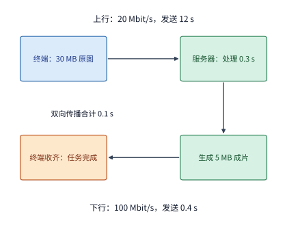

*图 12-1：原图经上行到服务器，服务器收齐后处理，再经下行返回完整成片。实线箭头表示数据与处理顺序；连接已建立，双向传播合计 0.1 s。*

**例：慢上行链路下，加速远端模型与压缩上传体积哪一项收益更大？** 设连接已经建立，原图体积为 $30\ \mathrm{MB}$（按十进制计为 $240\ \mathrm{Mbit}$），精修成片体积为 $5\ \mathrm{MB}$（$40\ \mathrm{Mbit}$）；终端上行有效发送速率为 $20\ \mathrm{Mbit/s}$，下行有效接收速率为 $100\ \mathrm{Mbit/s}$，双向网络传播往返时间（RTT）合计为 $0.1\ \mathrm{s}$，云端模型推理与后处理耗时为 $0.3\ \mathrm{s}$。服务器端需要收齐整张原图后才能启动精修计算。在各阶段串行执行、无额外排队等待的条件下，单次请求的完整完成时间为：[^raw]

$$
T_{\mathrm{raw}}=\frac{240}{20}+0.1+0.3+\frac{40}{100}=12+0.1+0.3+0.4=12.8\ \mathrm{s}.
$$

在这 $12.8\ \mathrm{s}$ 的总耗时中，原图上传独占了 $12.0\ \mathrm{s}$（占比达 $93.75\%$）。此时若在云端换用更高规格的加速器，把模型处理耗时缩短至原来的十分之一（从 $0.3\ \mathrm{s}$ 降至 $0.03\ \mathrm{s}$），端到端完成时间仅能从 $12.8\ \mathrm{s}$ 降至 $12.53\ \mathrm{s}$，整体加速比不足 $2.2\%$。反之，若在终端侧采用保留编辑精度的无损或视觉无损压缩，将上传体积减半至 $15\ \mathrm{MB}$（$120\ \mathrm{Mbit}$），仅付出 $0.15\ \mathrm{s}$ 的终端编码与云端解码开销，上传耗时便从 $12.0\ \mathrm{s}$ 降至 $6.0\ \mathrm{s}$，端到端总时间缩短为：

$$
T_{\mathrm{comp}}=\frac{120}{20}+0.1+0.3+0.4+0.15=6.95\ \mathrm{s}.
$$

这一对比与第 1.1.3 节的 Amdahl 定律完全一致：当上行传输构成关键路径的主导项时，优化方向应当是削减跨网络传输的字节数，而非继续堆叠云端算力。

当然，输入压缩并非在任何网络条件下都能带来正收益。设上行速率为 $B_{\mathrm{up}}$（单位 $\mathrm{Mbit/s}$），原图方案与减半压缩方案的完成时间分别为：

$$
T_{\mathrm{raw}}(B_{\mathrm{up}})=\frac{240}{B_{\mathrm{up}}}+0.8,\qquad T_{\mathrm{comp}}(B_{\mathrm{up}})=\frac{120}{B_{\mathrm{up}}}+0.95.
$$

图 12-2 绘制了三种方案随上行速率变化的完成时间曲线。在低速上行区间，压缩曲线显著低于原图曲线与算力加速曲线；但当上行速率提高到令节省的传输时间 $\Delta T_{\mathrm{tx}}=120/B_{\mathrm{up}}$ 小于新增编解码耗时 $0.15\ \mathrm{s}$（即 $B_{\mathrm{up}}>800\ \mathrm{Mbit/s}$）时，压缩反而会拉长总响应时间。

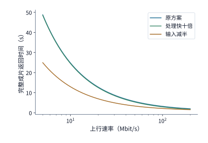

*图 12-2：压缩和计算加速对任务完成时间的影响随上行速率而变化。本例采用原图 30 MB、成片 5 MB、下行 100 Mbit/s、RTT 0.1 秒，原处理时间 0.3 秒；压缩方案将输入减半并增加 0.15 秒编解码。三种方案的成片质量相同，连接已建立且各阶段串行。*

除削减传输体积外，改写阶段间的串行依赖也能缩短端到端耗时。在整图串行模式（图 12-3）中，云端必须等 $30\ \mathrm{MB}$ 原图在 $12.05\ \mathrm{s}$（$12.0\ \mathrm{s}$ 发送加 $0.05\ \mathrm{s}$ 单向传播）全部到达后才开始工作。若图像算法支持将原图切分为三个 $10\ \mathrm{MB}$ 的独立分块（如局部块去噪或分片色调映射），每块上传需 $4.0\ \mathrm{s}$，到达后各自独立处理 $0.1\ \mathrm{s}$，并依次回传 $1\ \mathrm{MB}$、$2\ \mathrm{MB}$ 与 $2\ \mathrm{MB}$ 成片分块（图 12-4）。此时，前两块的云端处理与下行回传完全掩盖在后续分块的上行发送过程中；整项任务的完成时间仅取决于最后一块在 $12.0\ \mathrm{s}$ 发完后，经历单向传播 $0.05\ \mathrm{s}$、第三块处理 $0.1\ \mathrm{s}$、下行发送 $2\times 8/100=0.16\ \mathrm{s}$ 与下行传播 $0.05\ \mathrm{s}$，于 $12.36\ \mathrm{s}$ 全部收齐，较整图串行节省 $0.44\ \mathrm{s}$。[^stream]

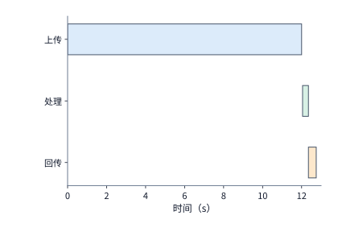

*图 12-3：整图串行：30 MB 全部上传并传播到服务器后才处理，随后回传 5 MB。上行 20 Mbit/s、下行 100 Mbit/s、单向传播 0.05 s，任务于 12.8 s 完成。*

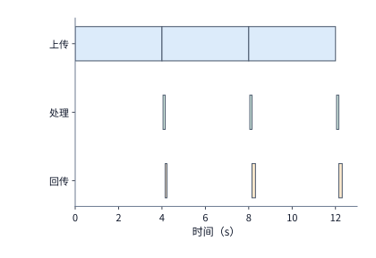

*图 12-4：三块各上传 4 s，每块到达后独立处理 0.1 s，随后回传 1、2、2 MB。前两块的处理和回传与后续上传重叠，完整成片于 12.36 s 返回。*

在交互界面设计中，系统还常在首块处理完毕后先行下发一张低分辨率预览图，让用户在第 $4.2\ \mathrm{s}$ 左右即可看到初步效果。但需要注意，预览图改善的是首次视觉反馈时间，完整高分辨率成片依然要等到 $12.36\ \mathrm{s}$ 才能交付，且额外生成和下发预览图还会增加编码与传输开销。评估系统指标时，必须将“首次预览可用时间”与“完整成片交付时间”分开统计。

### 12.1.2 实时语音

与整图收齐后再交付结果的精修任务不同，流式语音识别（ASR）与流式语音合成（TTS）属于按固定物理时钟持续生成和消费的流水线负载。用户在说话或收听时，音频数据被切分为时长固定的音频块（chunk），沿着“采集或生成 $\rightarrow$ 模型推理 $\rightarrow$ 网络发送与传播 $\rightarrow$ 播放缓冲 $\rightarrow$ 声卡播放”的链路逐块推进。

**例：单块网络抖动如何通过按序播放约束推迟后续所有音频块？** 设每块音频的采样与播放时长均为 $\Delta=20\ \mathrm{ms}$，以第一块音频开始采集的时刻为时间原点 $t=0$。第 $k$ 块音频（$k=1,2,\dots$）在 $t=20k\ \mathrm{ms}$ 采集就绪，随后经历模型处理 $12\ \mathrm{ms}$ 与网络发送 $1\ \mathrm{ms}$；正常情况下单向网络传播耗时为 $5\ \mathrm{ms}$。因此，第一块音频在 $20\ \mathrm{ms}$ 就绪、$32\ \mathrm{ms}$ 处理完毕、$33\ \mathrm{ms}$ 发送完毕，并于 $a_1=38\ \mathrm{ms}$ 到达接收端。为抵御网络波动，播放器在第一块到达后并不立即播出，而是先等待 $B_0=40\ \mathrm{ms}$ 的初始缓冲（jitter buffer），于 $s_1=a_1+B_0=78\ \mathrm{ms}$ 启动第一块播放（图 12-5）。[^audio]

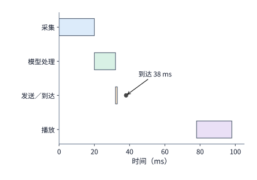

*图 12-5：第一块音频从采集开始计时：20 ms 就绪，32 ms 处理完，33 ms 发完，38 ms 到达；初始缓冲 40 ms 后于 78 ms 播放。圆点标出到达，最后一行是播放设备的时钟。*

一旦启动播放，后续第 $k$ 块音频何时能够开始播放， 同时受两个先后条件制约：一是第 $k$ 块自身必须已经到达接收端（时刻 $a_k$），二是前一块音频必须已经播放完毕（时刻 $s_{k-1}+\Delta$）。若播放器采用“等待缺块、不丢弃内容”的保真策略，则第 $k$ 块的实际开播时刻 $s_k$ 满足递推关系：

$$
s_k=\max(a_k,\ s_{k-1}+\Delta)\qquad (k\ge 2).
$$

在传播耗时恒为 $5\ \mathrm{ms}$ 的平稳状态下，第二块于 $a_2=58\ \mathrm{ms}$ 到达，早于第一块播完时刻 $s_1+\Delta=98\ \mathrm{ms}$，故于 $98\ \mathrm{ms}$ 无缝衔接播放；第三块预定于 $118\ \mathrm{ms}$ 接续播放。现在假设网络发生一次短暂抖动，使第三块的单向传播时间从 $5\ \mathrm{ms}$ 激增至 $50\ \mathrm{ms}$：第三块在 $73\ \mathrm{ms}$ 发送完毕后，直到 $a_3=123\ \mathrm{ms}$ 才到达接收端，比预定接续时刻 $s_2+\Delta=118\ \mathrm{ms}$ 晚了 $5\ \mathrm{ms}$。这 $5\ \mathrm{ms}$ 的缺口不仅造成播放设备在 $118\sim 123\ \mathrm{ms}$ 之间发生 $5\ \mathrm{ms}$ 的静音停顿（underrun），而且由于递推式中 $s_k\ge s_{k-1}+\Delta$ 的刚性耦合，第三块的播放区间被推迟到 $123\sim 143\ \mathrm{ms}$，进而使本来按时到达的第四块（$a_4=98\ \mathrm{ms}$）、第五块（$a_5=118\ \mathrm{ms}$）的开播时刻也依次顺延至 $143\ \mathrm{ms}$ 和 $163\ \mathrm{ms}$（图 12-6）。递推式中的最大值算子清晰揭示了流式系统的传递效应：任何超出初始缓冲余量的单次晚到，都会把后续所有块的播放时间线整体向后平移。

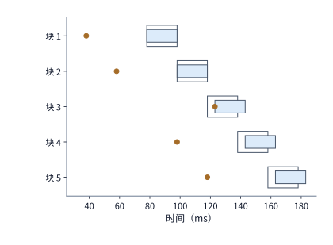

*图 12-6：第三块晚到使后续各块的播放时间都推迟 5 ms。每块长 20 ms，模型处理 12 ms、发送 1 ms；通常传播耗时为 5 ms，第三块传播 50 ms，初始缓冲 40 ms。实线段表示实际播放，浅色轮廓表示原定播放区间，圆点表示到达；所有时间均从开始采集第一块起算。图为上述流水线的计算结果，播放器等待缺块而不丢弃。*

初始缓冲虽然能吸收偶发的单包抖动，却无法挽救持续的带宽不足。设接收端以恒定速率 $R_{\mathrm{rx}}$ 接收音频流，而声卡以恒定码率 $R_{\mathrm{play}}$ 消费音频数据；启动播放前，缓冲区内已预先攒下时长为 $T_{\mathrm{buf}}$ 的音频样本，对应初始缓冲数据量 $Q_0=R_{\mathrm{play}}T_{\mathrm{buf}}$。启动播放后经过时间 $t$，缓冲区剩余数据量为：

$$
Q(t)=Q_0+(R_{\mathrm{rx}}-R_{\mathrm{play}})t.
$$

只要平均接收速率低于播放消费速率（$R_{\mathrm{rx}}<R_{\mathrm{play}}$），缓冲区就会以 $R_{\mathrm{play}}-R_{\mathrm{rx}}$ 的净消耗速率持续萎缩，并在时刻

$$
t_{\mathrm{empty}}=\frac{Q_0}{R_{\mathrm{play}}-R_{\mathrm{rx}}}=\frac{R_{\mathrm{play}}T_{\mathrm{buf}}}{R_{\mathrm{play}}-R_{\mathrm{rx}}}
$$

耗尽，触发播放停顿。例如，播放 $16\ \mathrm{kHz}$ 采样率、单声道、$16\ \mathrm{bit}$ 精度的未压缩 PCM 语音流，所需播放码率为 $R_{\mathrm{play}}=16000\times 1\times 16=256\ \mathrm{kbit/s}$。若受限于弱网环境，实际接收速率仅为 $R_{\mathrm{rx}}=130\ \mathrm{kbit/s}$，则净消耗速率为 $126\ \mathrm{kbit/s}$。当初始缓冲为 $T_{\mathrm{buf}}=60\ \mathrm{ms}$（即 $Q_0=15.36\ \mathrm{kbit}$）时，播放仅能维持 $t_{\mathrm{empty}}=15.36/126\approx 0.122\ \mathrm{s}$ 便告断流；即便将初始缓冲翻倍至 $120\ \mathrm{ms}$（$Q_0=30.72\ \mathrm{kbit}$），断流时刻也只是等比例延后至约 $0.244\ \mathrm{s}$（图 12-7）。因此，面对持续的带宽赤字，加大缓冲只能推迟首次卡顿的发生时刻，同时增加首字发声延迟；唯有通过音频编码降码率或切换传输路径，使 $R_{\mathrm{rx}}\ge R_{\mathrm{play}}$，才能从根本上维持连续播放。

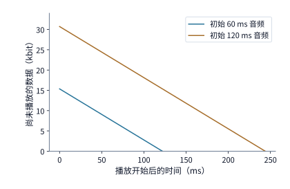

*图 12-7：缓冲量等于初始数据量加累计接收量，再减累计播放量。PCM 播放需要 256 kbit/s，接收只有 130 kbit/s，两条直线的下降速率均为 126 kbit/s。初始缓冲分别包含 60 ms 和 120 ms 音频，约在 0.12 秒和 0.24 秒耗尽；图画到各自第一次耗尽为止。*

### 12.1.3 Computer Use：通过界面操作完成任务

第三类典型交互是界面操作智能体（Computer Use Agent）：终端截取当前屏幕画面并上传给远端多模态模型，模型识别界面元素并输出点击、滚动或输入文本等动作指令，终端执行动作并等待界面刷新后，再采集下一轮截图（图 12-8）。

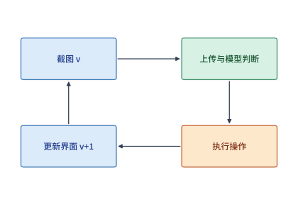

*图 12-8：截图 Agent 的一轮执行。箭头表示先后依赖，方框宽度不表示耗时。底部返回箭头要经过操作执行与界面更新，才能取得下一轮截图。*

与流式语音不同，界面操作智能体相邻两轮之间存在严格的因果依赖：第 $r+1$ 轮的截图必须反映第 $r$ 轮动作在真实应用界面上引起的状态变化（如弹窗展开、表单校验或页面跳转），因而无法脱离界面反馈提前批量上传后续截图。设终端本地截图、动作执行与界面稳定等待合计耗时 $0.3\ \mathrm{s}$，网络往返传播耗时 $0.2\ \mathrm{s}$，云端多模态模型推理耗时 $2.0\ \mathrm{s}$（以上非上传环节合计 $2.5\ \mathrm{s}$）；每轮原始截图体积为 $0.8\ \mathrm{MB}$（$6.4\ \mathrm{Mbit}$），上行有效速率为 $6.4\ \mathrm{Mbit/s}$，则每轮上传耗时为 $1.0\ \mathrm{s}$，单轮总耗时为 $3.5\ \mathrm{s}$。完成一项包含 $30$ 轮交互的任务，累计耗时高达 $30\times 3.5=105.0\ \mathrm{s}$，其中仅上传截图就占用了 $30.0\ \mathrm{s}$。

若在终端侧围绕鼠标焦点或关注区域（area of interest，AOI）做针对性裁剪与有损压缩，将每轮截图从 $0.8\ \mathrm{MB}$ 压缩至 $0.2\ \mathrm{MB}$（$1.6\ \mathrm{Mbit}$），每轮新增 $0.03\ \mathrm{s}$ 图像编码开销，则单轮上传时间从 $1.0\ \mathrm{s}$ 降至 $0.25\ \mathrm{s}$，单轮总耗时从 $3.5\ \mathrm{s}$ 缩短为 $2.5+0.25+0.03=2.78\ \mathrm{s}$。[^author] 若任务仍以 $30$ 轮完成，总时间便从 $105.0\ \mathrm{s}$ 降至 $83.4\ \mathrm{s}$，净节省 $21.6\ \mathrm{s}$。

然而，有损压缩或分辨率下采样可能模糊界面上的小字号按钮或图标，导致模型偶发定位偏差，需要增加额外的纠错交互轮次。设原图方案稳定以 $N_0=30$ 轮完成任务，而压缩方案需要 $N$ 轮才能完成同一任务，则只有当

$$
2.78\,N < 105.0 \implies N \le 37
$$

时，压缩方案在端到端总时间上才真正占优；一旦压缩引发的额外重试超过 $7$ 轮（即总轮数达到 $38$ 轮，耗时 $38\times 2.78=105.64\ \mathrm{s}$），单轮节省的传输时间就会被多出的交互轮次完全抵消。

此外，在动态界面与异步网络中，系统还必须防范“基于过期界面状态执行动作”的风险。若页面因动画加载或外部通知已经更新，或者前一轮请求因网络超时重发而与新界面交错，远端模型根据旧截图生成的点击坐标就可能误触新界面上的危险按钮。为此，工程实现需要在每张截图与每个动作指令中携带递增的界面版本号（`observation_version`）和幂等操作编号（`action_id`）：终端在执行动作前先核对当前屏幕版本号是否与模型推理所依据的截图版本一致，若版本已过期则直接丢弃该动作并采集新截图，从而在系统层面阻断陈旧状态的错误执行。

### 12.1.4 本地、附近设备与云端的初步比较

建立单次传输、连续流式与多轮交互三类时间模型后，我们可以对“终端本地执行”“附近边缘工作站执行”与“远端云数据中心执行”三档位置作初步筛选。对需要收齐输入后处理的请求，远端或边缘执行比本地执行更快的基本条件是：

$$
T_{\mathrm{up}}+T_{\mathrm{prop}}+T_{\mathrm{queue}}+T_{\mathrm{remote}}+T_{\mathrm{down}} < T_{\mathrm{local}}.
$$

在启动详细算力与能耗核算之前，光信号在光纤中的物理传播速度先给出了不可逾越的延迟下界。光纤中的折射率约为 $1.47$，光信号传播速度约为 $200\ \mathrm{km/ms}$；计入骨干网路由迂回与光电转发设备开销后，跨大洲或跨洋链路（如中国西南至美国西海岸）的往返传播延迟（RTT）通常在 $180\sim 220\ \mathrm{ms}$ 之间，同城或局域网内附近工作站的 RTT 则可控制在 $1\sim 20\ \mathrm{ms}$ 以内。如果某项实时控制或高频交互业务要求单次往返响应不超过 $50\ \mathrm{ms}$，那么无论远端云数据中心配备多么庞大的加速器集群，仅物理传播延迟一项就已超出期限，必须将推理服务下沉到附近边缘节点或终端本地。

### 12.1.5 端侧执行资源与本地部署

要判断何时应当把模型留在终端本地或附近工作站执行，必须用第 1 章与第 4 章的硬件资源账本，定量核算端侧设备的内存带宽、内存容量与电池功耗边界。

**1. 内存带宽决定端侧 Decode 吞吐上限。** 自回归解码（decode）每生成一个词元，都需要从内存完整读取一遍模型参数与当前上下文的 KV 缓存。以旗舰智能手机搭载的 LPDDR5X 内存子系统为例：单条JEDEC 标准 x16 通道包含 $16$ 个数据引脚，按骁龙 8 Elite 等移动 SoC 支持的 $10.6\ \mathrm{Gbit/s/pin}$ 速率计算，单通道带宽为 $16\times 10.6/8=21.2\ \mathrm{GB/s}$；四条 x16 通道合计提供峰值内存带宽 $B_{\mathrm{phone}}=4\times 21.2=84.8\ \mathrm{GB/s}$。[^phone]

在此手机上运行 Qwen3-8B 模型，处理单条上下文长度为 $8\mathrm{K}$（$8192$ 个词元）的解码请求。根据模型几何参数，BF16 精度下每步解码需读取权重字节数 $W_{\mathrm{BF16}}=15,136,819,200\ \mathrm{B}\approx 15.14\ \mathrm{GB}$，读取 $8\mathrm{K}$ 上下文 KV 缓存字节数 $K_{8\mathrm{K}}=1,207,959,552\ \mathrm{B}\approx 1.21\ \mathrm{GB}$（平均每个词元占 $147,456\ \mathrm{B}$），合计每步访存量为 $16,344,778,752\ \mathrm{B}\approx 16.345\ \mathrm{GB}$。[^phone-ledger] 仅读取一遍权重就需要 $15.14/84.8\approx 0.1785\ \mathrm{s}$（对应 $5.60\ \mathrm{token/s}$）；计入 $8\mathrm{K}$ KV 缓存后，每步解码的访存时间下界为：

$$
T_{\mathrm{step,BF16}}=\frac{16.345\ \mathrm{GB}}{84.8\ \mathrm{GB/s}}\approx 192.75\ \mathrm{ms},
$$

对应理论吞吐上限仅为 $5.19\ \mathrm{token/s}$。若将模型权重量化为 `q4_0` 格式（每 $32$ 个参数共享 $1$ 个 FP16 缩放因子，存储体积从 $64\ \mathrm{B}$ 压缩至 $18\ \mathrm{B}$，即原来的 $18/64=28.125\%$），则每步读取的权重降至 $4,257,230,400\ \mathrm{B}\approx 4.26\ \mathrm{GB}$；保持 KV 缓存仍为 BF16（$1.21\ \mathrm{GB}$），每步总访存量降至 $5.465\ \mathrm{GB}$，手机端每步解码时间下界缩短至：

$$
T_{\mathrm{step,q4}}=\frac{5.465\ \mathrm{GB}}{84.8\ \mathrm{GB/s}}\approx 64.45\ \mathrm{ms},
$$

对应理论吞吐上限提升至 $15.52\ \mathrm{token/s}$。若第 12.1.3 节的界面操作智能体每轮需要生成 $45$ 个动作词元，在手机端按 `q4_0` 读取下界计算，每轮仅模型解码就需耗时 $45\times 0.06445\approx 2.90\ \mathrm{s}$——这正是第 12.5 节端边云方案比较中“端侧每轮模型耗时 $2.90\ \mathrm{s}$”的物理来源。

作为对比，图 12-9 汇总了手机（$84.8\ \mathrm{GB/s}$）、配备统一内存的桌面工作站 Apple M3 Ultra（$819\ \mathrm{GB/s}$）与搭载 GDDR7 显存的服务器／工作站级显卡 RTX PRO 6000 Blackwell（$1,792\ \mathrm{GB/s}$）执行同一 Qwen3-8B 单请求 $8\mathrm{K}$ 解码的访存时间下界。在 BF16 精度下，M3 Ultra 与 RTX PRO 6000 每步分别仅需 $19.96\ \mathrm{ms}$（$50.1\ \mathrm{token/s}$）与 $9.12\ \mathrm{ms}$（$109.6\ \mathrm{token/s}$）。三档本地与边缘设备的解码速度完全由各自的内存总线带宽成比例拉开。

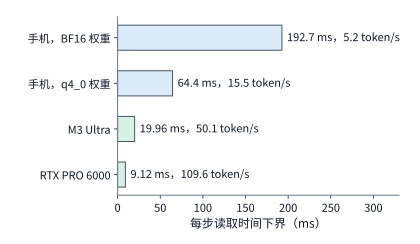

*图 12-9：三档本地设备读一遍 Qwen3-8B 单请求 8K decode 主要载荷（16.345 GB）的时间下界。手机按四条 x16 LPDDR5X 通道计，合计 84.8 GB/s，BF16 与 q4_0 权重分别成行；M3 Ultra 与 RTX PRO 6000 取自第 4.8.2 节的设备表。柱端标注对应的 token/s 上限。*

**2. 内存容量决定端侧能驻留的模型规格与最大上下文长度。** 手机操作系统、图形界面与前台应用通常需要常驻占用约 $4\ \mathrm{GB}$ 物理内存。包含词表嵌入与输出头在内，Qwen3-8B 的完整 BF16 权重占 $16,381,470,720\ \mathrm{B}\approx 16.38\ \mathrm{GB}$；按 `q4_0`（$18/64$）折算，常驻权重占 $4,607,288,640\ \mathrm{B}\approx 4.61\ \mathrm{GB}$；按 `q8_0`（每 $32$ 个参数占 $34\ \mathrm{B}$，即 $34/64$）折算，常驻权重占 $8,702,656,320\ \mathrm{B}\approx 8.70\ \mathrm{GB}$。我们在不同内存容量的手机上逐档核算可用空间（表 12-1）：

| 手机总内存 | 扣除 4 GB 系统预留后可用 | 驻留 Qwen3-8B `q4_0`（4.61 GB）后剩余 | 可容纳完整 8K KV（1.21 GB/条）条数 | 单请求最大上下文词元数（147,456 B/token） | 其他精度可行性 |
|---:|---:|---:|---:|---:|---|
| 6 GB | 2.00 GB | 无法装入（缺口 2.61 GB） | 0 | 0 | 均不可行 |
| 12 GB | 8.00 GB | 3.39 GB（3,392,711,360 B） | 2 条 | 约 23,008 个词元 | 装不下 `q8_0`（8.70 GB） |
| 16 GB | 12.00 GB | 7.39 GB（7,392,711,360 B） | 6 条 | 约 50,135 个词元 | 可装入 `q8_0`，余 3.30 GB（容 2 条 8K KV） |
| 24 GB | 20.00 GB | 15.39 GB（15,392,711,360 B） | 12 条 | 约 104,389 个词元 | 可装入 BF16（16.38 GB），余 3.62 GB（容 2 条 8K KV） |

*表 12-1：不同 LPDDR5X 容量档位的手机在预留 4 GB 系统内存后，运行 Qwen3-8B 的权重驻留与上下文容量上限。*

可以看到，$6\ \mathrm{GB}$ 机型连 `q4_0` 权重都无法装入；主流 $12\ \mathrm{GB}$ 机型必须依赖 4 比特量化才能运行 $8\mathrm{B}$ 模型，且上下文被限制在约 $2.3$ 万词元以内；直到 $16\ \mathrm{GB}$ 机型才具备运行 `q8_0` 的空间，而完整 BF16 权重则要求 $24\ \mathrm{GB}$ 顶配内存。

**3. 散热功率墙与电池容量制约持续运行能力。** 移动终端没有主动风扇散热，且依靠有限的锂电池供电。根据移动端大模型评测基准 MELTing Point 的实测数据，在智能手机上运行量化语言模型，每生成一个词元消耗电能 $0.16\sim 0.21\ \mathrm{mWh}$，折合焦耳（$1\ \mathrm{mWh}=3.6\ \mathrm{J}$）为：[^melt]

$$
E_{\mathrm{token}}\in [0.576,\ 0.756]\ \mathrm{J/token}.
$$

在 iPhone 14 Pro 上运行 Zephyr-3B `q4_k` 模型时，实测生成速率约为 $14.8\ \mathrm{token/s}$（取精确值 $14.8165\ \mathrm{token/s}$ 按每词元 $0.576\ \mathrm{J}$ 核算，对应平均功率约为 $8.53\ \mathrm{W}$），运行 Llama-2-7B `q3_k` 时约为 $6.0\ \mathrm{token/s}$。该机型的瞬时峰值功率可超过 $18\ \mathrm{W}$，但受机身表面温度限制，持续稳态功耗上限约为 $P_{\max}=13.8\ \mathrm{W}$（三星 Galaxy S23 的持续功率上限则低于 $8.5\ \mathrm{W}$）。仅按 $13.8\ \mathrm{W}$ 持续功率墙与每词元 $0.576\sim 0.756\ \mathrm{J}$ 的能耗折算，手机在不触发过热降频的前提下，可持续维持的生成速率上限为 $13.8/0.756\approx 18.25\ \mathrm{token/s}$ 至 $13.8/0.576\approx 23.96\ \mathrm{token/s}$；对比前文算出的 `q4_0` 内存带宽上限（$15.52\ \mathrm{token/s}$），说明在 $8\mathrm{B}$ 规模下，内存带宽比散热功率墙更早成为速率瓶颈。从整机续航看，满电状态下手机仅能完成约 $490\sim 590$ 次提示词对话。

实际工程中，llama.cpp、Ollama、Apple MLX 与 Unsloth 等本地推理引擎分别解决了算子跨平台编译、量化格式封装、统一内存零拷贝映射与显存占用裁剪等软件工程问题，使端侧推理得以逼近硬件物理上限，但没有任何软件运行时能够突破由内存总线宽度、物理内存字节数和电池化学容量划定的三条刚性边界。

## 12.2 跨设备分工

第 12.1 节把整个模型看作单一黑盒，只在“全部放在端侧”与“全部放在远端”之间作二元选择。然而，多模态理解与长上下文交互天然包含多个串行阶段（如图像预处理、视觉编码器、语言模型预填充与自回归解码），且模型自身也由数十层 Transformer 堆叠而成。这引出了跨设备协同的核心设计问题：我们能否把一部分计算留在终端或边缘设备，把另一部分交给云端？或者在网络条件变化时，将正在进行的会话状态迁移到另一台设备？本节从跨阶段传输的字节膨胀、会话迁移的盈亏平衡，以及模型层内／层间切分的通信开销三个维度，给出跨设备分工的定量判据。

### 12.2.1 完整模型调用与分阶段执行

在多模态助手或界面操作智能体中，一条完整的处理流水线通常包含四个阶段：端侧传感器采集（截图或录音）、多模态特征编码（如视觉编码器 ViT）、语言模型上下文预填充与解码，以及终端动作执行或语音播放。若采用整项远程调用（图 12-10），终端直接上传经过压缩的原始输入字节（如 $0.8\ \mathrm{MB}$ 的 PNG／JPEG 截图），由远端服务器依次完成图像解码、视觉编码与语言模型推理；若采用分阶段执行（图 12-11），终端先利用本地 NPU 或 GPU 运行视觉编码器，再将生成的视觉特征张量跨网络发送给远端语言模型。

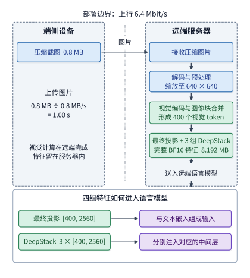

*图 12-10：远端编码的执行路径。端侧上传 0.8 MB 压缩截图，远端依次完成解码与预处理、视觉编码和特征接入；最终投影与三组 DeepStack 特征均留在服务器内。6.4 Mbit/s 上行的图片发送时间为 1 秒，编码和排队时间另计。*

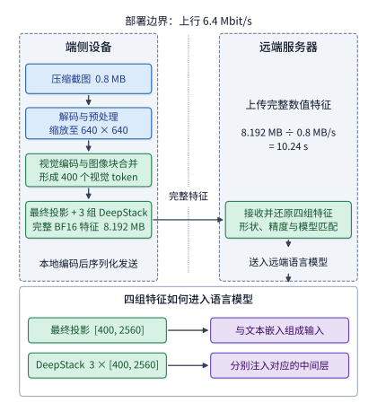

*图 12-11：端侧编码的执行路径。预处理和视觉编码移到终端，跨网络的对象变为最终投影与三组 DeepStack 的完整 BF16 特征，共 8.192 MB；远端接收后仍按相同方式接入语言模型。相同上行的特征发送时间为 10.24 秒，本地编码、序列化和转换时间另计。图中数值采用下文的 Qwen3-VL-4B 固定配置。*

决定分阶段执行是否划算的第一步，是检验跨设备交接点上的数据体积究竟变小了还是变大了，同时检查中间表示是否满足下游任务的精度要求。例如，在 RAW 摄影精修场景中，如果终端先运行轻量级预览算法并将图像压成 8 比特 sRGB 位图再上传，虽然传输体积大幅缩小，但高光与暗部的原始传感器线性动态范围已经永久丢失，云端精修模型无法再恢复细节；同样，专为视觉问答训练的语义编码器特征，也不能直接当作像素级图像修复模型的等价输入。只有在任务质量与接口语义严格等价的前提下，比较两种切分方案的执行时间才有意义。

### 12.2.2 端侧编码的传输量与计算开销

许多系统设计者直觉地认为：“图像经过视觉编码器提取特征后，数据量一定会变小，因此在端侧先做视觉编码可以节省上行带宽。”我们用 Qwen3-VL-4B 模型的真实张量几何参数来检验这一直觉。

**例：端侧运行视觉编码器为什么反而使上行传输时间膨胀十倍？** 设原始压缩截图体积为 $0.8\ \mathrm{MB}$（$800,000\ \mathrm{B}$）。按照 Qwen3-VL-4B 的固定分辨率视觉处理流程，图像经预处理缩放为 $640\times 640$ 像素后，按 $16\times 16$ 补丁（patch）切分为 $40\times 40=1600$ 个基础视觉补丁，再经 $2\times 2$ 空间合并（spatial merge）生成 $400$ 个视觉词元位置。为了保留多尺度空间细节，该模型的视觉编码器除了输出最终投影特征（维度为 $2560$）外，还会从中间层额外提取三组 DeepStack 特征（每组维度均为 $2560$）一并送入语言模型主干。因此，每个视觉词元位置携带的完整特征总维度为 $4\times 2560=10240$，对应张量形状为 $[400,\ 10240]$。以 BF16（每元素 $2\ \mathrm{B}$）存储和传输这份完整编码输出（Encoder Cache，简称 EC），其字节数为：[^ec]

$$
S_{\mathrm{EC}}=400\times 10240\times 2=8,192,000\ \mathrm{B}=8.192\ \mathrm{MB}\ (7.8125\ \mathrm{MiB}).
$$

与 $0.8\ \mathrm{MB}$ 的压缩截图相比，视觉特征张量的体积非但没有缩小，反而膨胀了 **$10.24$ 倍**。在 $6.4\ \mathrm{Mbit/s}$ 的广域网上行链路上，直接上传压缩截图仅需 $0.8\times 8/6.4=1.00\ \mathrm{s}$，而上传完整 BF16 视觉特征则需要 $8.192\times 8/6.4=10.24\ \mathrm{s}$（图 12-12）。

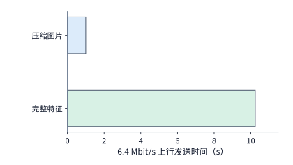

*图 12-12：同一图片的完整视觉特征比压缩图片需要更多传输时间。压缩图片为 0.8 MB；Qwen3-VL-4B 在预处理后 640×640 输入上产生 400 个视觉 token，最终投影及三组 DeepStack 合计 [400,10240] BF16，共 8,192,000 bytes。上行速率为 6.4 Mbit/s，柱长表示发送时间；编码、排队和转换时间另计。两种方案处理同一张图片，完成相同的视觉理解任务。*

再把两侧的编码计算耗时计入账本：单张图片的视觉编码共需约 $1.3103\ \mathrm{TFLOPs}$（精确值 $1,310,300,569,600\ \mathrm{FLOPs}$）矩阵乘加运算量。若本地使用一张桌面级显卡 RTX 4090（BF16 稠密峰值 $165.2\ \mathrm{TFLOP/s}$）编码，计算时间下界为 $1.3103/165.2\approx 7.93\ \mathrm{ms}$；若上传原图后在云端 H100 SXM（BF16 稠密峰值 $989.4\ \mathrm{TFLOP/s}$）上编码，计算时间下界仅为 $1.3103/989.4\approx 1.32\ \mathrm{ms}$。[^encode-place] 综合传输与计算：
- **远端编码路径**：$1.00\ \mathrm{s}$（传原图）$+0.00132\ \mathrm{s}$（H100 编码）$\approx 1.001\ \mathrm{s}$；
- **本地编码路径**：$0.00793\ \mathrm{s}$（RTX 4090 编码）$+10.24\ \mathrm{s}$（传特征）$\approx 10.248\ \mathrm{s}$。

在广域网慢上行条件下，端侧编码无论在计算速度还是传输体积上都全面落后。同样的字节膨胀规律在配套实测中也得到了印证：在 Qwen3-VL-8B 的本机回环传输实验中，一张经 PNG 无损压缩仅占 $3.4\ \mathrm{KiB}$（$3,443\ \mathrm{B}$）的 $256\times 256$ 测试图像，编码生成的完整 BF16 特征文件（形状 $[64,\ 4096]\times 4$ 组）高达 $2,097,584\ \mathrm{B}$（约 $2\ \mathrm{MiB}$），体积相差约 $600$ 倍。[^ec-test]

为什么第 9 章讨论数据中心内部多模态推理（EPD 分离架构）时，把视觉编码器独立成池再向预填充节点发送特征是合理的，而搬到端云广域网上却得不偿失？答案就在于链路带宽跨越了四个数量级：在配备 $400\ \mathrm{Gbit/s}$ ConnectX-7 网卡（单向带宽 $50\ \mathrm{GB/s}$）的数据中心内部，多传 $8,192,000-800,000=7,392,000\ \mathrm{B}$ 的特征数据仅增加 $7.392\ \mathrm{MB}/(50\ \mathrm{GB/s})\approx 0.148\ \mathrm{ms}$ 的传输耗时，远小于独立扩缩容视觉编码池带来的批处理与硬件解耦收益；而在 $6.4\ \mathrm{Mbit/s}$ 的终端上行链路上，同样的字节增量却会造成 $9.24\ \mathrm{s}$ 的阻塞。

如果在语言模型预填充之后再做跨设备切分或状态搬移，数据膨胀会更加剧烈。上述 $400$ 个视觉词元进入 Qwen3-VL-4B 的语言模型主干后，按每词元 $147,456\ \mathrm{B}$ 的 KV 缓存几何尺寸计算，生成的视觉部分逻辑 KV 缓存高达：

$$
S_{\mathrm{KV,vis}}=400\times 147,456\ \mathrm{B}=58,982,400\ \mathrm{B}\approx 58.98\ \mathrm{MB}\ (56.25\ \mathrm{MiB}),
$$

是完整视觉特征 EC（$8.192\ \mathrm{MB}$）的 $7.2$ 倍，更是原始压缩图片（$0.8\ \mathrm{MB}$）的 **$73.7$ 倍**。

这三种数据形态（原始图片、视觉特征 EC、语言模型 KV 缓存）不仅决定了跨网络传输的代价，也对应着会话恢复与缓存复用时的三个不同重算起点（图 12-13）：
1. **保存原始压缩图片（$0.8\ \mathrm{MB}$）**：占用空间最小，且与具体模型版本解耦；但恢复会话或切换后端时，必须重新执行视觉编码与语言模型预填充。
2. **保存视觉特征缓存 EC（$8.192\ \mathrm{MB}$）**：当同一张图片在多轮对话中被反复引用，或语言模型 KV 因显存不足被换出时，命中 EC 可直接跳过视觉编码器，直接从语言模型预填充阶段恢复；但要求图像内容、预处理裁剪参数及视觉编码器权重完全一致。
3. **保存语言模型 KV 缓存（视觉部分 $58.98\ \mathrm{MB}$）**：命中后可同时省去视觉编码与语言模型已处理前缀的预填充计算，直接进入解码阶段；但占用空间最大，且严格绑定特定的语言模型权重、精确的前缀词元序列以及位置编码索引（如多模态旋转位置编码 M-RoPE 的三维坐标）。

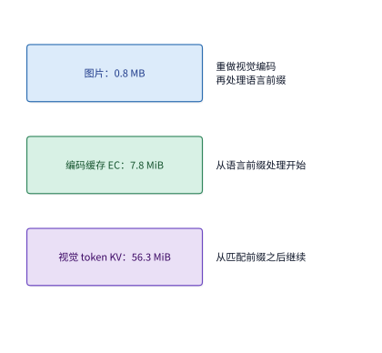

*图 12-13：三类缓存内容对应三个恢复计算的起点。EC 省去视觉编码；匹配模型权重、前缀与 token 位置索引的 KV 进一步省去已处理前缀的语言模型计算。容量对应正文固定视觉配置。*

### 12.2.3 会话迁移的准备、复用与恢复

当用户在移动过程中从蜂窝网络进入室内高速 Wi-Fi，或者从远端云服务切换到附近边缘工作站时，系统需要决定：是继续在原服务上完成剩余交互，还是将当前已积累的会话状态迁移到新设备上继续执行？

**例：迁移会话状态后，至少需要继续执行多少轮交互才能收回迁移成本？** 设当前会话已积累了 $64\ \mathrm{MiB}$（按二进制计为 $64\times 2^{20}\times 8\approx 536.87\ \mathrm{Mbit}$）的中间状态。通过速率为 $80\ \mathrm{Mbit/s}$ 的链路将该状态传输至目标设备需耗时：

$$
T_{\mathrm{xfer}}=\frac{64\times 2^{20}\times 8}{80\times 10^6}\approx 6.71\ \mathrm{s}.
$$

状态到达目标设备后，加载上下文并重建执行环境还需恢复耗时 $T_{\mathrm{restore}}=1.0\ \mathrm{s}$，因此一次迁移的固定准备成本合计为 $T_{\mathrm{prep}}=6.71+1.0=7.71\ \mathrm{s}$。迁移完成后，得益于更近的网络距离或更快的算力，每轮交互耗时较原路径缩短 $\Delta t=0.4\ \mathrm{s}$。若剩余还需执行 $N$ 轮交互，则迁移方案相对于留在原路径的净节省时间为：

$$
G(N)=N\cdot \Delta t-(T_{\mathrm{xfer}}+T_{\mathrm{restore}})=0.4N-7.71\ \mathrm{s}.
$$

令 $G(N)>0$，解得 $N>7.71/0.4=19.277$：由于交互轮数取整数，当剩余交互不超过 $19$ 轮时，节省的单轮时间尚不足以抵消迁移本身的传输与恢复开销；**至少需要继续执行 $N=20$ 轮**（净节省 $20\times 0.4-7.71=0.29\ \mathrm{s}$），迁移才开始产生正收益。若目标设备因需要额外预热编译缓存或拉取依赖，使恢复时间增加 $1\ \mathrm{s}$ 至 $T_{\mathrm{restore}}=2.0\ \mathrm{s}$（总准备成本升至 $8.71\ \mathrm{s}$），则盈亏平衡点后移至 $N>8.71/0.4=21.777$，即**至少需要执行 $22$ 轮**才能收回迁移代价（图 12-14）。

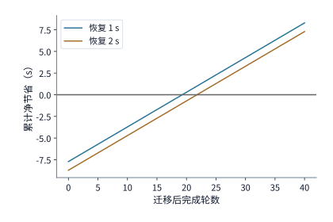

*图 12-14：迁移 64 MiB 状态，链路 80 Mbit/s，迁移后每轮节省 0.4 秒。两条曲线分别取恢复时间 1 秒和 2 秒，净节省为 N×0.4 减去传输和恢复时间。圆点标出首次获益的整数轮数；零线以上表示迁移更快，首次获益分别在第 20、22 轮。*

在工程实践中，判断状态能否直接迁移还必须核查软硬件兼容性：不同架构的推理引擎（例如云端 TensorRT-LLM 与边缘端 Apple MLX）内部张量排布、分页块大小乃至算子量化格式往往并不通用。当二进制 KV 快照无法跨异构后端直接加载时，系统只能退而迁移体积小得多的历史文本与压缩图片日志（数千字节至数兆字节），由目标设备重新执行一次预填充来重建状态。此外，正如第 11 章所强调的，若智能体在迁移前已经向外部系统发出了具有副作用的操作（如提交订单或修改文件），恢复会话时必须同步迁移已持久化的事务记录表，防止新设备在恢复后重复下发已生效的外部动作。

### 12.2.4 模型内部切分的通信边界

既然跨阶段切分会遇到视觉特征膨胀，那么能否不按阶段切分，而是照搬第 6 章的张量并行（TP）或流水线并行（PP），把同一个语言模型切分到两台通过局域网或无线网连接的设备上协同推理？

我们用 Qwen3-8B 的层内通信结构算一笔账。该模型共包含 $36$ 个 Transformer 层；在两卡张量并行（$\mathrm{TP}=2$）下，每一层的注意力块输出（图 12-15）与前馈网络（FFN）输出（图 12-16）都必须各执行一次跨设备全归约（AllReduce），以便将两台设备算出的局部激活求和后再送入下一层归一化。因此，每生成 $1$ 个词元，整座模型在 $36$ 层中必须串行跨越 $36\times 2=72$ 次同步屏障。在基于环形或双向交换的实现中，每次两节点全归约至少包含 $2$ 个顺序通信步（先交换分片规约，再广播完整结果），故每生成 $1$ 个词元需要串行经历 $72\times 2=144$ 次网络往返或消息启动。[^dense]

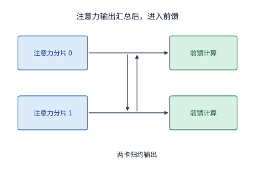

*图 12-15：张量并行的一次注意力输出归约：两卡先分别计算，再交换并求和，取得完整输出后进入前馈。横向箭头表示执行顺序，中间纵向箭头表示两卡通信。*

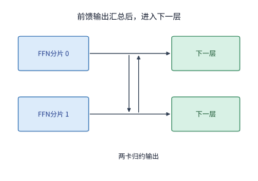

*图 12-16：前馈网络也分别计算局部输出，再做两卡归约。完整前馈结果就绪后才能进入下一层，这一结构在 36 层中重复。*

单步解码中，单个词元的隐藏状态激活（维度 $4096$，BF16）仅有 $8,192\ \mathrm{B}$，数据体积本身微乎其微；真正制约跨设备张量并行的是 $144$ 次串行通信的启动延迟：
- 在服务器内部 NVLink 域（单次通信启动延迟约 $1\sim 2\ \mathrm{\mu s}$）中，$144$ 次同步仅增加约 $0.15\sim 0.3\ \mathrm{ms}$，完全可被算力翻倍的收益覆盖；
- 若把两台设备放在共享无线局域网（Wi-Fi）上，按第 12.4.1 节将详细核算的单次短帧无线交换固定开销 $134\ \mathrm{\mu s}$ 计算，仅这 $144$ 次同步的空口固定耗时就高达 $144\times 134\ \mathrm{\mu s}\approx 19.30\ \mathrm{ms}$——这一通信空转时间甚至超过了单张 RTX PRO 6000 独立跑完整个单步解码下界（$9.12\ \mathrm{ms}$）的两倍；
- 若跨同城边缘或广域网（设单向延迟 $5\ \mathrm{ms}$），每生成 $1$ 个词元的同步等待将高达 $144\times 5\ \mathrm{ms}=720\ \mathrm{ms}$，解码吞吐直接跌至不足 $1.4\ \mathrm{token/s}$。

如果改用流水线并行（如 $\mathrm{PP}=4$，将 $36$ 层按层号切分到 $4$ 台设备上），单步解码期间每层不再需要 AllReduce，跨设备传输次数从 $72$ 次大幅减少为 $3$ 次阶段间点对点激活传递（加上首尾词元收发共 $4$ 次通信）。然而在单请求（batch size $=1$）交互场景下，同一时刻只有一台设备处于激活计算状态，其余三台设备全部处于空闲等待，无法通过微批次流水线填满气泡。因此，在端边云协同的慢速、高延迟网络上，模型层内张量并行基本不可行；即便在端侧异构协同（如手机 CPU、GPU 与 NPU 共享片上统一内存，参考 FlexSP 与 llm.npu 等片上异构调度研究）中，也必须依靠共享物理内存消除网络收发开销，才值得在算子或序列维度做细粒度切分。[^survey]

在系统架构层面，更契合端云慢链路的跨模型协同范式是**快慢双系统解耦**（如作者在相关研究中探讨的异步规划与本地执行架构）：端侧常驻一个体积紧凑、毫秒级响应的小模型（快系统），负责高频界面跟踪、光标微调与即时语音反馈；云端运行高参数量的大模型（慢系统），以数秒一轮的低频节奏对高层任务目标进行规划，并通过紧凑的语义隐状态或结构化子目标（Latent Bridge）异步指导端侧小模型。这种按控制频率解耦的分工，从源头上避开了在慢速广域网上逐层同步激活张量的通信瓶颈。[^author]

## 12.3 广域网传输中的额外开销与等待

第 12.1 节的理想预算假定：网络连接早已就绪，且一旦有数据需要发送，就能立即按链路的标称带宽全速注入网络。然而在真实的广域网（WAN）中，客户端与服务器之间隔着传输控制协议的握手建链、滑动窗口与确认反馈、丢包重传以及多流并发调度。本节逐层剥开这些协议机制，解释为什么一条标称速率数百兆比特每秒的跨地域链路，在实际承载几十至几百千字节的 AI 交互请求时，耗时往往比理想带宽下界高出数倍乃至上千倍。

### 12.3.1 连接建立与复用

客户端在向远端推理服务发送第一字节请求之前，必须先完成传输层与加密层的连接握手。在传统的 HTTP/1.1 或 HTTP/2 协议栈中，底层传输采用 TCP，加密采用 TLS：TCP 三次握手需要先消耗 $1$ 个往返时间（RTT），随后 TLS 握手再消耗 $1\sim 2$ 个 RTT（TLS 1.3 为 $1$ 个 RTT，早期版本或含证书状态校验时为 $2$ 个 RTT），合计需要等待 $2\sim 3$ 个 RTT 后才能真正发出应用层请求字节。基于 UDP 构建的 QUIC 协议（HTTP/3 的底层传输协议）将传输层握手与 TLS 1.3 密钥协商融合在同一次往返中，首次连接只需 $1$ 个 RTT 即可建立安全通道；若客户端此前已连接过同一服务器并缓存了会话票据（session ticket），还可发起 0-RTT 握手，在第一个握手中直接附带幂等请求数据。[^quic]

对于持续数十秒的大文件下载，几百毫秒的建链握手只占总耗时的一小部分；但对于多轮短交互的智能体或实时语音请求，每次新建连接的握手开销会成倍放大。

**例：30 轮界面操作智能体中，每次新建连接与全程复用连接相差多少时间？** 设客户端与云端推理服务的往返时间 $\mathrm{RTT}=200\ \mathrm{ms}$，每次新建连接需经历 $2$ 个 RTT（$400\ \mathrm{ms}$）的握手等待。若客户端代码未配置连接池，导致 $30$ 轮交互每轮都重新建立连接，则仅握手等待就累计消耗 $30\times 0.4=12.0\ \mathrm{s}$；反之，若在第一轮建链（耗时 $0.4\ \mathrm{s}$）后通过长连接（Keep-Alive）或连接池全程复用该连接，后续 $29$ 轮便不再支付握手代价，仅此一项即可为整项任务直接节省 $(30-1)\times 0.4=11.6\ \mathrm{s}$。

### 12.3.2 窗口、反馈与有效吞吐

连接建立之后，发送方依然不能无限制地向网络倾倒数据。为了防止发送速率超出接收方缓存或中间路由器队列的承受能力，传输协议规定了**在途数据量上限**（即尚未收到接收方确认 ACK 的最大字节数），称为发送窗口 $W$（取流量控制窗口与拥塞控制窗口的较小值）。

**例：固定小窗口如何将高速链路限制在低有效吞吐？** 设上行链路物理发送速率为 $B=20\ \mathrm{Mbit/s}$，往返传播时间为 $\mathrm{RTT}=100\ \mathrm{ms}$，则填满整条往返管道所需的**带宽时延积（Bandwidth-Delay Product，简称 BDP）**为：

$$
\mathrm{BDP}=B\times \mathrm{RTT}=20\ \mathrm{Mbit/s}\times 0.1\ \mathrm{s}=2\ \mathrm{Mbit}=250\ \mathrm{KB}.
$$

如果操作系统的发送窗口被固定限制在 $W=64\ \mathrm{KB}$（按十进制 $64,000\ \mathrm{B}=512\ \mathrm{kbit}$ 计），远小于 $250\ \mathrm{KB}$ 的带宽时延积，发送过程就会陷入周期性的“发送—停等确认”循环（图 12-17）：发送方以 $20\ \mathrm{Mbit/s}$ 的速率发出 $64\ \mathrm{KB}$ 数据仅需 $512\ \mathrm{kbit}/(20\ \mathrm{Mbit/s})=25.6\ \mathrm{ms}$；此时在途未确认字节达到窗口上限 $W$，发送方被迫停机空等。在接收方收齐整批数据后再统一发回确认的简化停等模型下，从整批数据发完到确认报文历经 $100\ \mathrm{ms}$ RTT 返回发送方，整轮发送周期长达 $T_{\mathrm{cycle}}=25.6+100=125.6\ \mathrm{ms}$，其中链路有 $100\ \mathrm{ms}$ 处于闲置状态。此时连接的实际有效吞吐率被锁定在：

$$
B_{\mathrm{eff}}=\frac{512\ \mathrm{kbit}}{0.1256\ \mathrm{s}}\approx 4.08\ \mathrm{Mbit/s},
$$

还不到链路标称速率（$20\ \mathrm{Mbit/s}$）的五分之一。即便按连续滑动窗口上限 $W/\mathrm{RTT}$ 估算，最大吞吐也仅为 $512\ \mathrm{kbit}/0.1\ \mathrm{s}=5.12\ \mathrm{Mbit/s}$。要让发送方在等待确认期间持续发包而不中断，拥塞窗口与接收窗口都必须至少扩展到带宽时延积 $\mathrm{BDP}=250\ \mathrm{KB}$ 以上。

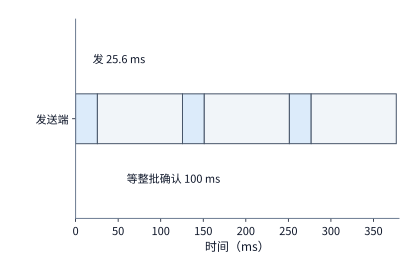

*图 12-17：固定窗口 64 KB，链路 20 Mbit/s，一批数据发送需 25.6 ms。为单独显示停等，图设接收方收齐一批后统一确认，从这批数据全部发出到收到整批确认再需 100 ms；每批完整周期为 125.6 ms。*

即便解除了固定窗口限制，真实协议的分包头部开销、慢启动（slow start）窗口爬升以及确认报文（ACK）的反馈频率，也会使实际完成时间高于第 12.1.1 节的理想预算（$12.8\ \mathrm{s}$）。以第 12.1.1 节的 $30\ \mathrm{MB}$ 原图上传与 $5\ \mathrm{MB}$ 成片回传（应用层有效载荷共 $35,000,000\ \mathrm{B}$）为例：按单包最大有效载荷分割，上传需发送 $25,685$ 个数据包，下载需发送 $4,281$ 个数据包，合计 $29,966$ 个数据包。若每个数据包附带 $60\ \mathrm{B}$ 协议头部，且接收方对每个数据包立即回送一个 $92\ \mathrm{B}$ 的确认包（共 $29,966$ 个 ACK），则网络线上实际传输的总字节数为：[^closed]

$$
35,000,000+29,966\times(60+92)=39,554,832\ \mathrm{B}\approx 39.55\ \mathrm{MB}.
$$

计入协议头部、慢启动窗口增长与参考丢包恢复后，该次图片精修请求的完整响应时间从理想预算的 $12.8\ \mathrm{s}$ 增加到 $14.36339008\ \mathrm{s}$（约 $14.36\ \mathrm{s}$）。

既然确认包（ACK）本身也占用线上字节，减少 ACK 发送频率能否加快请求完成？这恰恰引出了吞吐量与反馈延迟之间的权衡。在另一组采用统一包填充的 TCP NewReno 对照计算中，若接收方改为“每收到 $2$ 个数据包或等待 $10\ \mathrm{ms}$ 超时才回送一次聚合 ACK”，线上总传输字节数从立即确认时的 $39,555,120\ \mathrm{B}$ 降至 $38,177,328\ \mathrm{B}$，确实减少了 $1,377,792\ \mathrm{B}$（约 $1.38\ \mathrm{MB}$）的确认流量；然而，由于发送方在慢启动与尾包阶段必须多等聚合确认返回才能推进窗口，完整请求耗时反而从 $14.52103724\ \mathrm{s}$ 延长至 $14.564459796\ \mathrm{s}$，慢了约 $43.4\ \mathrm{ms}$。此外，在同一路径的大图传输对照中，TCP NewReno 与 CUBIC 的完整响应时间均约为 $14.5\ \mathrm{s}$；检查窗口轨迹可以发现，整次请求在退出慢启动进入拥塞避免阶段之前就已经传输完毕，因此决定短至中等规模请求耗时的往往是启动与反馈行为，而非稳态拥塞避免算法的差异。[^ack]

### 12.3.3 丢包是不是拥塞

第 12.3.2 节讨论了窗口随确认增长的过程；而在传统 TCP（如 Reno 与 CUBIC）中，窗口的收缩则完全由**丢包**触发。传统拥塞控制算法并不直接测量链路物理容量，而是基于一个隐含假设——“网络发生丢包，说明路由器缓冲区已经排满溢出，即链路发生了拥塞”——因而一旦检测到丢包就主动削减拥塞窗口。Mathis 等人推导的经典公式给出了这种“以丢包反推拥塞”机制所能达到的稳态吞吐率上界：[^mathis]

$$
B_{\mathrm{TCP}}\le\frac{\mathrm{MSS}}{R}\cdot\frac{C}{\sqrt{p}},
$$

其中 $\mathrm{MSS}$ 为单个报文段的最大有效载荷，$R$ 为往返时间（RTT），$p$ 为报文丢包率；在周期性丢包且每包立即确认时常数 $C=\sqrt{3/2}\approx 1.22$，随机丢包时 $C\approx 1.31$，开启延迟确认时 $C<1$，因此论文式 (4) 常取忽略常数的简化上界 $\mathrm{MSS}/(R\sqrt{p})$。按照该公式，TCP 稳态吞吐与丢包率的平方根成反比：只要丢包率扩大到原来的 $4$ 倍，吞吐上限就会减半。这一机制成立的前提是“丢包等同于拥塞”；然而在跨国海缆边界、运营商互联互通节点以及无线接入网中，大量随机丢包并非源于队列拥塞，而是由链路策略限速器、物理层误码或跨域流量整形引起。

笔者在研发广域网传输系统 Queqiao（鹊桥，第 12.3.5 节详述）时实测归档的一条跨太平洋路径（中国贵阳数据中心至美国加州 Irvine 数据中心），正是“丢包不含拥塞信息”的典型实例。在 Irvine 发往贵阳的下载方向上，当测试发送速率从 $1\ \mathrm{Mbit/s}$ 逐步提升至 $300\ \mathrm{Mbit/s}$ 时，路径丢包率始终稳定在约 $p=14\%$，且各包丢失事件相互独立；与此同时，整条路径的最小 RTT 与最大 RTT 仅相差几毫秒，说明中间路由器根本没有发生排队积压（反方向从贵阳发往 Irvine 的 $41,663$ 个测试报文更是零丢包，同一条物理往返路径的两个方向呈现出截然不同的损耗特征）。直到将发送速率推高至 $600\ \mathrm{Mbit/s}$，越过约 $333\ \mathrm{Mbit/s}$ 的物理容量膝点（capacity knee，即继续提速会导致丢包率与排队延迟陡增的真实瓶颈容量）后，丢包率才跃升至 $44\%$。[^queqiao]

将这条路径的实测参数（$\mathrm{MSS}=1,448\ \mathrm{B}=11,584\ \mathrm{bit}$，$R=0.2\ \mathrm{s}$，随机丢包率 $p=0.14$）代入 Mathis 简化上界（$C=1$），传统 TCP 能获得的吞吐上限仅为：

$$
B_{\mathrm{Mathis}}=\frac{1448\times 8}{0.2\times\sqrt{0.14}}\approx 0.155\ \mathrm{Mbit/s}\quad (\text{取 }C=1.22\text{ 时为 }0.189\ \mathrm{Mbit/s}).
$$

这一理论计算值与同一路径上未调优标准 TCP 实测测得的 $0.13\sim 0.47\ \mathrm{Mbit/s}$ 完全吻合。如果用这条吞吐仅 $0.155\ \mathrm{Mbit/s}$ 的 TCP 连接去传输一份 $354,640\ \mathrm{B}$（约 $355\ \mathrm{KB}$）的语音识别请求，仅把音频字节发完就需要：

$$
T_{\mathrm{send,Mathis}}=\frac{354,640\times 8}{0.1548\times 10^6}\approx 18.33\ \mathrm{s}.
$$

请注意：TCP 代码本身没有任何程序缺陷，它只是严格执行了“见丢包即降窗”的控制律；但由于这条路径上的 $14\%$ 丢包并不代表拥塞，模型前提的失效使算出的速率上界（$0.155\ \mathrm{Mbit/s}$）比路径真实可用容量（约 $333\ \mathrm{Mbit/s}$）低了三个数量级。[^wan-loss] 这正是第 1.3.4 节所述的第一类系统差距：当控制模型的假设与物理现实背离时，必须修正算法假设本身。

**1. BBR：直接测量瓶颈带宽与传播时间，而非从丢包反推。** 针对传统丢包反馈模型的缺陷，Google 提出的 BBR（Bottleneck Bandwidth and Round-trip propagation time）拥塞控制算法不再将单次丢包视为拥塞信号，而是持续维护两个独立测量值：一是由近期滑动时间窗口内观测到的最大交付速率给出的瓶颈带宽估计 $\mathrm{BBR.max\_bw}$，二是由近期滑动窗口内观测到的最小往返时间给出的传播延迟估计 $\mathrm{BBR.min\_rtt}$。BBR 按测得的 $\mathrm{max\_bw}$ 设定报文发送节奏（pacing rate），并按带宽时延积 $\mathrm{BDP}=\mathrm{max\_bw}\times\mathrm{min\_rtt}$ 控制在途数据量：其稳态拥塞窗口增益取 $\mathrm{cwnd\_gain}=2$（即允许在途保持 $2\times\mathrm{BDP}$ 的数据，以吸收确认聚合与抖动），启动阶段（Startup）以 $4\ln 2\approx 2.77$ 的发送增益快速探明带宽上限，随后在稳态探测阶段（ProbeBW_UP）以 $1.25$ 的增益周期性探高。[^bbr]

将贵阳—Irvine 路径参数代入 BBR 模型：路径带宽时延积为 $\mathrm{BDP}=333\ \mathrm{Mbit/s}\times 0.2\ \mathrm{s}=66.6\ \mathrm{Mbit}=8.325\ \mathrm{MB}$，两倍 BDP 对应的目标拥塞窗口为 $16.65\ \mathrm{MB}$；扣除 $14\%$ 的随机丢包损耗后，BBR 能够维持的理想有效吞吐率（goodput）为：

$$
B_{\mathrm{BBR}}=(1-0.14)\times 333\ \mathrm{Mbit/s}\approx 286.38\ \mathrm{Mbit/s},
$$

是 Mathis 丢包反推上界（$0.1548\ \mathrm{Mbit/s}$）的约 **$1,850$ 倍**。

**2. 测准带宽之后，重传轮次引起的长尾延迟依然存在。** BBR 解决了“应该以多快速度发包”的问题，却没有解决“数据包丢失后接收方必须等待重传”的延迟问题。一份 $354,640\ \mathrm{B}$ 的语音请求按 $\mathrm{MSS}=1,448\ \mathrm{B}$ 切分为 $k=\lceil 354,640/1448\rceil=245$ 个数据包。在零丢包理想条件下，单次请求的串行时间预算由一次往返传播（$200\ \mathrm{ms}$）、远端模型处理（$30\ \mathrm{ms}$）与按 $333\ \mathrm{Mbit/s}$ 膝点速率发送数据（$354,640\times 8/333\times 10^6\approx 8.52\ \mathrm{ms}$）三部分相加组成，合计约为 $T_{\mathrm{serial}}\approx 238.5\ \mathrm{ms}$。

当每个数据包以 $p=0.14$ 的概率独立丢失时，首轮发送期望丢失 $245\times 0.14=34.3$ 个包。即便我们假设协议具备最理想的选择性确认重传机制（不发生窗口收缩，不触发超时重传，每轮恰好耗费 $1$ 个 $\mathrm{RTT}=0.2\ \mathrm{s}$ 重传上一轮丢失的包，且重传包仍以概率 $p$ 独立丢失），单个数据包在 $n$ 轮以内（含首轮发送，$n\ge 1$）成功送达的概率为 $1-p^n$，全部 $245$ 个数据包在 $n$ 轮以内全部收齐的累积分布函数（CDF）为：

$$
F(n)=P(N_{\mathrm{rounds}}\le n)=(1-p^n)^{245}.
$$

由此可算出，收齐全部数据包所需的期望总完成时间高达 $0.756\ \mathrm{s}$，约为零丢包串行预算（$238.5\ \mathrm{ms}$）的 $3.17$ 倍；而要想达到 $99\%$ 的分位把握（令 $(1-0.14^n)^{245}\ge 0.99$，解得 $n=6$ 轮，即首轮之外还需经历 $5$ 轮重传），对应的 p99 完成时间更是拉长至 $0.2385+5\times 0.2\approx 1.239\ \mathrm{s}$（约 $1.24\ \mathrm{s}$）。[^wan-loss] 可见，对于只有几百千字节的实时交互请求，高随机丢包率下的多轮重传等待会直接破坏用户体验。

**3. 前向纠错（FEC）：以受控的带宽冗余消除重传等待。** 要在不增加往返轮次的前提下应对随机丢包，可以在发送端引入前向纠错（Forward Error Correction，简称 FEC）编码：在发送 $k=245$ 个原始数据符号（每个符号为 $1$ 个 MSS 大小的报文）的同时，额外编码并发送 $r$ 个修复符号（repair symbols）；只要接收端在总共 $n_{\mathrm{total}}=k+r$ 个符号中收齐任意至少 $k$ 个符号（即丢失符号数不超过 $r$），就能当场解码还原出完整请求，无需等待任何跨洋重传。按独立二项分布 $\mathrm{Binomial}(k+r,\ p)$ 精确求解单次发送即达到 $99.9\%$ 恢复成功率（$\sum_{i=0}^{r}\binom{k+r}{i}p^i(1-p)^{k+r-i}\ge 0.999$）所需的最小修复符号数：
- 在 $p=14\%$ 高丢包时段，$k=245$ 个数据包需要搭配 $r=63$ 个修复包，编码冗余比例为 $r/k=63/245\approx 25.7\%$；总发送量增至 $308$ 个符号，在 $333\ \mathrm{Mbit/s}$ 链路上仅耗时 $308\times 1448\times 8/333\times 10^6\approx 10.71\ \mathrm{ms}$，完整请求在 $99.9\%$ 的概率下于 $230+10.71\approx 240.7\ \mathrm{ms}$（约 $241\ \mathrm{ms}$）内一次完成，几乎完全贴合 $238.5\ \mathrm{ms}$ 的零丢包串行预算（图 12-18）。
- 在同一路径的另一时段，实测随机丢包率降至 $p=3.6\%$：此时理想逐轮重传的 p99 仍需 $4$ 轮发送（耗时约 $0.839\ \mathrm{s}\approx 0.84\ \mathrm{s}$），而 FEC 达到 $99.9\%$ 恢复率仅需 $r=20$ 个修复包，冗余比例降至 $20/245\approx 8.2\%$。[^wan-loss]

对比两档丢包率可以看出：如果把 FEC 冗余率僵化地固定在过低水平，高丢包时段将无法达到 $99.9\%$ 的免重传目标；反之，若在 $3.6\%$ 低丢包时段仍盲目按 $25.7\%$ 冗余发包，则会无谓浪费宝贵的广域网带宽。因此，传输系统应当持续测量路径的实时丢包率与排队状态，动态设定编码冗余比。

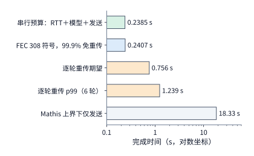

*图 12-18：同一路径（RTT 0.2 s、容量膝点 333 Mbit/s、丢包率 14%）传送 354,640 bytes 的完成时间，横轴为对数坐标。串行预算是 RTT、模型 30 ms 与发送 8.5 ms 之和，约 238.5 ms；FEC 多发 63 个修复符号（冗余 25.7%）后 99.9% 不需重传；逐轮重传两行是不计窗口收缩与超时的下界；Mathis 上界对应把丢包当作拥塞的 TCP，仅发送就需约 18.3 s。*

### 12.3.4 多流传输与优先级

前几节分析的是单条数据流独占连接的情形；而在多模态应用中，大体积图片上传、实时语音流与轻量级控制信令往往需要共用同一个网络出口。多条业务流并发传输时，系统需要在两个层面上消除相互干扰：一是**发送端的链路调度顺序**（决定物理网卡先发送哪条流的报文），二是**接收端的应用层交付顺序**（决定已到达接收缓冲区的数据何时能上交应用层处理）。

首先看发送端的**资源竞争**与优先级调度。在一组共享链路对照计算中，若发送端采用先进先出（FIFO）队列按入队先后交错发送，大图片在第 $5\ \mathrm{s}$ 传完，而实时音频要被拖延到第 $6\ \mathrm{s}$ 才传完；若改为音频高优先级调度（让音频报文优先占用网卡发送时隙），则音频提前到第 $3\ \mathrm{s}$ 传完，而图片因让出发送时段延后到第 $6\ \mathrm{s}$ 完成。音频流提前的 $3\ \mathrm{s}$ 与图片流推迟的 $1\ \mathrm{s}$，直接反映了有限上行带宽在不同业务流之间的重分配。[^media]

其次看接收端的交付依赖与**队头阻塞（Head-of-Line Blocking，简称 HoL Blocking）**。保持链路上所有数据包的发送、到达与丢包重传时刻完全不变：音频流的全部数据包在第 $3\ \mathrm{s}$ 就已完整到达接收端网卡，而图片流由于中间某一个数据包丢失重传，直到第 $7\ \mathrm{s}$ 才补齐缺口。
- 如果底层采用单一有序字节流（如运行在单条 TCP 连接上的 HTTP/2 多路复用），整个连接共用同一套字节序号：只要图片流前方还有一个字节缺口尚未补齐，操作系统内核就无法越过该缺口向应用层交付后续已到达的任何字节。结果，明明在第 $3\ \mathrm{s}$ 就已收齐的音频数据，被迫在内核接收缓冲区中空等 $4\ \mathrm{s}$，直到第 $7\ \mathrm{s}$ 图片重传完毕后才与图片一同交付给应用（图 12-19）。
- 如果底层采用按流独立有序的传输协议（如基于 QUIC 的 HTTP/3），每条逻辑流各自维护独立的字节序号与接收窗口：图片流的丢包重传只阻塞图片流自身，已收齐的音频流在第 $3\ \mathrm{s}$ 即可立即交付给播放器播出，整整节省了 $4\ \mathrm{s}$ 的无谓等待（图 12-20）。[^quic]

从数学结构上看，从连接级整体有序演进到逐流独立有序，与第 12.1.1 节将整图屏障拆分为独立分块、第 11 章将全局同步拆分为局部依赖完全同源：都是通过缩小同步屏障的作用域，消除跨业务的虚假等待依赖。[^http]

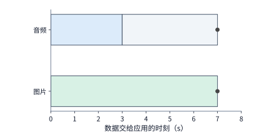

*图 12-19：整体有序交付：音频第 3 s 已收齐，却因图片缺口继续等到第 7 s。灰色段表示数据已齐后的等待，圆点表示数据交给应用的时刻。*

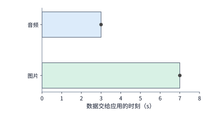

*图 12-20：逐流有序交付：音频在第 3 s 收齐后立即交付，图片仍于第 7 s 交付。两图中的发送、到达与恢复时刻相同；区别在于不同流之间是否需要相互等待。*

### 12.3.5 案例：Queqiao 如何加速跨地域语音服务

第 8 章与第 9 章证明了将大模型推理服务集中部署在少数大型智算中心，能够显著提升批处理效率（batching efficiency）、前缀缓存命中率与加速器利用率。但集中部署的天然代价是：分布在世界各地的终端用户或边缘接入节点必须跨越漫长的广域网调用推理服务。例如，把语音大模型集中部署在美国东岸或西岸的数据中心，其他地域的客户端每次发起语音识别（ASR）或语音合成（TTS）请求，都要穿越跨州乃至跨洋链路。本节结合笔者开源的广域网传输系统 Queqiao（鹊桥），通过真实的跨地域语音实测记录，展示如何综合运用前几节的传输机制加速短交互请求，以及如何用严谨的单因素对照实验分辨性能收益的真实来源。[^queqiao-readme]

**1. Queqiao 的系统架构与问题背景。** Queqiao 是一个部署在可控客户端与远端可信网关之间的广域网传输加速代理，同时承载 TCP 与 UDP 流量。业务应用程序无需修改原有的 ASR／TTS 接口代码，只需通过本地标准 SOCKS5 代理协议接入客户端守护进程；客户端与部署在远端推理集群入口的可信网关之间维持一条或多条长寿命隧道，把连接握手、基于 BBR 思想的带宽与 RTT 持续测量、自适应前向纠错（FEC）以及多流优先级调度全部收敛在客户端—网关这一段跨洋链路上。

在测试所用的贵阳至美国加州 Irvine 跨洋链路上（往返时间 $\mathrm{RTT}\approx 200\ \mathrm{ms}$，容量膝点约 $333\ \mathrm{Mbit/s}$），客户端每次上传一份约 $355\ \mathrm{KB}$ 的语音音频，远端 ASR 模型处理耗时约 $30\ \mathrm{ms}$ 并返回识别文本，端到端计时从客户端发起请求开始，到完整收齐识别文本为止。按第 12.3.3 节算出的零丢包串行下界，发送 $354,640\ \mathrm{B}$ 音频耗时约 $8.5\ \mathrm{ms}$，加上 $200\ \mathrm{ms}$ 往返传播与 $30\ \mathrm{ms}$ 模型推理，理想完成时间约为 $238.5\ \mathrm{ms}$。然而在最初的测试中，直接调用（Direct）路径的请求耗时超过 $1\ \mathrm{s}$，而经由 Queqiao 传输仅需约 $300\ \mathrm{ms}$。

面对这近 $4$ 倍的悬殊差距，存在两种截然不同的归因假设：
- **假设一（协议传输优势说）**：差距主要源于 Queqiao 的底层自定义隧道与丢包修复机制显著优于标准 TCP／TLS；
- **假设二（连接与基线配置说）**：最初直接调用路径上的绝大部分额外耗时，其实耗费在每次请求重新建立连接、初始拥塞窗口过小导致的慢启动等待以及未调优的套接字发送缓冲上。

这两种假设给出了可证伪的不同预测：**若连接准备与发送等待是主要原因**，那么只要让直接路径也保持长连接复用，并调优套接字缓冲与传输参数，直接路径的完成时间就应当大幅回落并逼近约 $240\ \mathrm{ms}$ 的物理串行下界；反之，若调优后两条路径依然存在巨大鸿沟，才能将优势归因于隧道协议本身。

**2. 固定输入载荷与调优基线对照。** 在开展对照实验前，首先必须修正早期测试中的一个基准偏差：早期脚本轮换发送八个大小介于 $146\sim 405\ \mathrm{KB}$ 之间的不同音频文件，却在汇总表里统一标注了最后一个文件的体积（$355\ \mathrm{KB}$），导致统计出的中位数混杂了文件体积变化的影响。修正后的实验严格锁定同一份 $354,640\ \mathrm{B}$ 的固定音频文件，并让直接路径与 Queqiao 路径按交错顺序（ABBA）交替运行，以消除跨洋网络背景波动对比较的干扰。[^queqiao] 表 12-2 与图 12-21、图 12-22 展示了在“每次新建连接”与“保持连接并调优”两组条件下的实测中位数：

| 连接条件 | 直接路径的请求中位数 | Queqiao 的请求中位数 | 观察到的差距 |
|---|---:|---:|---|
| 新建连接 | 约 1.19 s | 约 0.30 s | 直接路径约为 3.9 倍 |
| 保持连接并调优 | 约 0.24 s | 约 0.24 s | 两者接近 |

*表 12-2：固定 354,640 bytes 语音请求在新建连接与保持连接调优两组条件下的端到端完成时间中位数对比。*

在新建连接条件下，直接路径与 Queqiao 的请求中位数分别为 $1185.3\ \mathrm{ms}$ 与 $301.6\ \mathrm{ms}$，相差 $883.7\ \mathrm{ms}$（比值约 $3.93$ 倍）；然而，一旦将直接路径也改为保持长连接并调优传输配置，直接路径与 Queqiao 的中位数便分别降至 $240.9\ \mathrm{ms}$ 与 $236.5\ \mathrm{ms}$（均约为 $0.24\ \mathrm{s}$，比值缩小至约 $1.019$ 倍）。[^queqiao-calc] 同期路径的实时 RTT 在 $197\sim 205\ \mathrm{ms}$ 之间波动（跨度约 $8\ \mathrm{ms}$），两条路径调优后的中位数之差（$4.4\ \mathrm{ms}$）甚至小于同期物理 RTT 的自然起伏，且双双逼近 $238.5\ \mathrm{ms}$ 的串行理论下界。

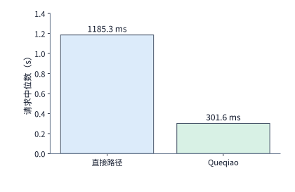

*图 12-21：新建连接时，354,640 bytes 固定音频的直接路径与 Queqiao 请求中位数分别为 1185.3、301.6 ms。计时从发起请求到收齐结果，输入文件相同，两条路径交替运行。*

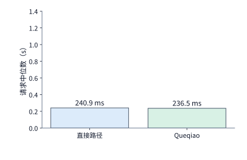

*图 12-22：保持连接并调优后，同一固定音频的直接路径与 Queqiao 中位数分别为 240.9、236.5 ms。与前图采用相同纵轴，两条路径均接近数据发送、必要往返和处理所需的总时间。*

这一实验结果有力地证实了第二种假设：最初从 $1.19\ \mathrm{s}$ 到 $0.30\ \mathrm{s}$ 的巨大落差，绝大部分来自消除重复握手与慢启动等待；不能用未调优的简陋客户端基线去夸大自定义传输协议在常规低丢包时段的中位数优势（Queqiao 的 FEC 与测量机制的真正用武之地，是在第 12.3.3 节所述 $14\%$ 随机丢包时段压制重传长尾并保住吞吐）。这一排查过程也是第 1.3.4 节系统分析方法的标准范本：先由物理传播、发送与计算算出约 $240\ \mathrm{ms}$ 的理论下界，再通过受控实验区分实测耗时高出下界的部分究竟源于模型漏项还是实现开销。

**3. 用单因素实验定位每一段等待。** 为了把连接建立、窗口限制与发送节奏三项因素各自的影响剥离清楚，实验设计必须遵循控制变量原则（图 12-23）：锁定相同的输入文件、物理路径与其余配置，每次仅改变单一因素，并同时**记录受其影响的事件发生时刻与请求总时间**。具体而言：
- **连接复用对照**：除总时间外，重点比对传输层握手完成时刻与首字节应用载荷发出时刻；
- **窗口大小对照**：重点比对发送过程中在途字节数是否触顶停等、网卡出口是否出现周期性空白，以及确认包（ACK）返回后是否立即触发下一批发送；
- **发送节奏（pacing）对照**：重点比对相邻两批数据包发出时刻之间的空闲间隔。

只有当中间机制事件的时间差与端到端总耗时的缩短量彼此吻合时，因果归因才算真正完整严密。

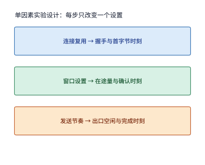

*图 12-23：单因素实验方法：保持相同文件、路径和其他设置，每次只改变一个因素，对照中间事件与总完成时间。*

**4. 调优见顶后的下一步方向与播放连续性检验。** 当传输层调优已经使跨洋语音请求耗时（约 $240\ \mathrm{ms}$）贴近物理下界后，继续在传输协议或模型算力上深挖的边际收益便十分有限：即便把远端 ASR 模型从 $30\ \mathrm{ms}$ 加速十倍至 $3\ \mathrm{ms}$，最多也只能再省 $27\ \mathrm{ms}$；而如果将推理服务从跨洋节点（$\mathrm{RTT}=200\ \mathrm{ms}$）迁移到同大洲或附近的边缘地域（$\mathrm{RTT}=20\ \mathrm{ms}$），仅物理往返传播一项就能直接削减 $180\ \mathrm{ms}$。

此外，对于流式语音合成（TTS）任务，除了检查整条音频的请求完成时间外，还必须按第 12.1.2 节的递推模型核查声卡播放回调是否发生饥饿停顿。在另一组绑定物理网卡并接入静音输出设备回调的端到端测试中，尽管全部 PCM 音频字节最终都逐位无误地收齐，但在播放过程中，声卡回调函数累计有 $0.36\sim 1.44\ \mathrm{s}$（$360\sim 1440\ \mathrm{ms}$）的时段未能从播放缓冲区取到足够的音频样本。[^physical] 这说明“最后一批字节何时收齐”与“中间每一块音频是否在播放期限前按时入队”是两个完全独立的质量指标：当播放回调发生欠载时，必须沿着“模型分块生成时刻 $\rightarrow$ 网络到达时刻 $\rightarrow$ 写入播放缓冲时刻 $\rightarrow$ 声卡回调读取时刻”的四级时间戳逐段比对，才能准确判定卡顿究竟源于模型生成不均匀、广域网抖动，还是客户端本地线程调度延迟。

## 12.4 无线变化下的交互与恢复

前几节将网络视为上下行彼此独立的有线管道。然而移动终端与智能穿戴设备的最后一跳几乎总是无线网络（Wi-Fi 或蜂窝网络）。无线接入在三个方面改变了端边云协同的边界条件：第一，上下行共享同一段无线射频频谱（空口），每发一个短小的确认帧也要支付完整的物理层争用与握手机制开销；第二，无线信道质量随用户移动剧烈波动，使部分实时媒体数据在送达时已错过播放期限，或需要中途主动取消；第三，现代终端普遍同时具备 Wi-Fi 与蜂窝两套无线接口，允许通过多路径分流或冗余复制提升吞吐与可靠性。本节依次建立这三个方面的定量模型。

### 12.4.1 共享空口与上下行争用

**空口（air interface）**是移动终端与无线接入点（AP）或基站之间通过电磁波传递信号的共享无线媒介。在半双工（TDD／CSMA/CA）无线局域网中，上行数据发送与下行确认反馈不能像全双工光纤那样互不干扰地同时进行，而是必须轮流争用并独占同一段空口时间。每次成功的无线帧交换除了传输应用层载荷本身外，还必须经历监听信道空闲、物理层前导码同步、短帧间间隔等待以及本跳无线确认。因此，评估无线链路的负载不能只统计总字节数，还必须统计**无线交换次数**。

这里需要明确区分两个不同层次的确认报文：
- **端到端确认（TCP／QUIC ACK）**：由远端服务器发往终端发送方（或反之），在无线最后一跳上它本身被封装为一个普通的数据帧传输；
- **介质访问控制层确认（MAC ACK）**：由无线接入点与终端在单跳无线链路上当场交互，用于确认刚才那一个无线物理帧（PPDU）是否无误收到。

这意味着，即便是一个只携带几十字节的端到端 TCP ACK 报文，当它穿过无线空口时，也必须作为一次独立的无线数据帧交换，完整支付一遍无线接入等待与本跳 MAC ACK 的固定代价。

**例：短小的端到端 ACK 帧在无线空口上需要消耗多少固定交换开销？** 在正交频分复用（OFDM）无线局域网（IEEE 802.11a/g/n 基础模式，不开启帧聚合）参考模型中，设数据帧物理层发送速率为 $54\ \mathrm{Mbit/s}$，控制帧（MAC ACK）物理层发送速率为更稳健的 $6\ \mathrm{Mbit/s}$。一次成功的无线单包交换由四个串行时段组成（图 12-24）：[^air]
1. **分布式协调功能帧间间隔（DIFS）接入等待**：包含 $16\ \mathrm{\mu s}$ 短帧间间隔（SIFS）加两个 $9\ \mathrm{\mu s}$ 时隙，固定为 $34\ \mathrm{\mu s}$（暂不计随机退避冲突）；
2. **物理层协议数据单元（PPDU）发送**：包含物理层前导码、帧头与载荷，发送一个满载数据包耗时 $208\ \mathrm{\mu s}$，发送一个仅承载端到端 ACK 的短数据包耗时 $40\ \mathrm{\mu s}$；
3. **短帧间间隔（SIFS）**：收发转换等待固定为 $16\ \mathrm{\mu s}$；
4. **本跳 MAC ACK 帧发送**：以 $6\ \mathrm{Mbit/s}$ 基础速率回送本跳确认，固定耗时 $44\ \mathrm{\mu s}$。

将四项相加：一次完整数据包无线交换耗时 $34+208+16+44=302\ \mathrm{\mu s}$；而一次端到端 ACK 短包无线交换耗时 $34+40+16+44=134\ \mathrm{\mu s}$。

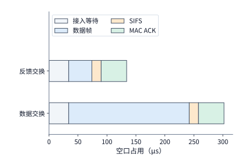

*图 12-24：报文变短后，固定交换开销仍然存在，因此空口占用时间不会按相同比例缩短。两种成功交换采用相同的 34 μs 接入等待、16 μs SIFS、44 μs MAC ACK，区别只在数据 PPDU：208 μs 或 40 μs。条件为 OFDM54／6、无聚合、无重传的参考模型。*

对比图 12-24 的两行可以发现：无论载荷长短，每次无线交换都包含 $34+16+44=94\ \mathrm{\mu s}$ 的固定协议开销。端到端 ACK 的载荷发送时间虽然比数据包缩短了 $(208-40)/208\approx 80.8\%$，但整次无线交换占用的空口时间仅从 $302\ \mathrm{\mu s}$ 缩短至 $134\ \mathrm{\mu s}$（仅减少约 $55.6\%$），其中固定开销占比高达 $94/134\approx 70.1\%$。

回到第 12.1.1 节传输 $30\ \mathrm{MB}$ 原图与 $5\ \mathrm{MB}$ 成片的算例：在该无线配置下，全程共需发生 $30,800$ 次数据包无线交换与 $30,800$ 次端到端 ACK 无线交换，累计占用的总空口时间为：

$$
T_{\mathrm{air}}=30,800\times(302+134)\ \mathrm{\mu s}=30,800\times 436\ \mathrm{\mu s}=13.4288\ \mathrm{s}\approx 13.4\ \mathrm{s}.
$$

如果保持数据包发送轨迹不变，通过延迟确认策略将端到端 ACK 的发送次数减半（减少 $15,400$ 次 ACK 交换），就能直接在无线信道上腾出：

$$
\Delta T_{\mathrm{air}}=15,400\times 134\ \mathrm{\mu s}=2.0636\ \mathrm{s}\approx 2.1\ \mathrm{s}
$$

的宝贵空口时间，供数据帧或其他并发流使用。不过，正如第 12.3.2 节所指出的，过度稀疏的 ACK 又会推迟发送方窗口推进与丢包发现。针对无线空口这一矛盾，学术界与工业界提出了 TACK（Tamed ACK）等面向无线信道的确认控制机制：将不紧急的常规累积确认按固定周期或包数合并发送，以大幅削减无线空口争用次数；而一旦检测到乱序缺包或窗口停等边界等需要发送方立即响应的事件，则即时发出反馈报文。这种“常规确认降频节流、异常事件即时触发”的双轨设计，兼顾了高空口利用率与低恢复延迟。[^wireless-survey]

### 12.4.2 业务时限、过期数据与取消

无线信道速率波动或共享链路排队不仅会拉长平均耗时，还会使原本平滑生成的媒体流在到达终端时**错过业务有效期限（deadline）**。

第 12.1.2 节分析的保真型播放器在遇到缺块时选择暂停等待，代价是后续所有音频块的播放时间线整体顺延；而另一类实时交互系统（如实时视频会议、自动驾驶感知或严格对齐口型的数字人播报）则按绝对墙钟时间消费数据：一旦某块数据晚于其预定播放时刻到达，该数据块即告作废。

**例：相同的总接收字节数，为何在 FIFO 与媒体优先调度下产生截然不同的有效播放时长？** 设语音合成服务生成了 $8$ 块音频，每块时长 $20\ \mathrm{ms}$，计划从 $t=0.40\ \mathrm{s}$ 起至 $t=0.56\ \mathrm{s}$ 连续播出共计 $0.16\ \mathrm{s}$ 的声音。当这 $8$ 块音频与大体积图片共用受限无线链路时：
- 若采用先进先出（FIFO）调度，排在图片后面的 $8$ 块音频虽然最终全部完好送达终端，但每一块的到达时刻都晚于各自的预定播出窗口，导致按时可用的有效语音时长为 **$0\ \mathrm{s}$**；
- 若采用媒体高优先级调度，$8$ 块音频全部在各自预定播放时刻之前到达，按时可用的有效语音时长为完整的 **$0.16\ \mathrm{s}$**。[^mixed]

两种调度方案在网络层统计到的“成功交付总字节数”完全相等，但用户体验到的有效语音却是零与百分之百的差别。这提醒我们：在带有时限约束的实时 AI 系统中，评估传输调度的核心指标必须是**有效期内按时交付率（goodput within deadline）**，而非不区分时效的总吞吐量。

除了自然过期，语音助手与多模态智能体中还频繁发生由用户打断触发的**主动取消（barge-in / cancellation）**。当用户正在收听模型回答时突然开口插话，系统必须立即终止当前回答并转入新一轮听写。这一取消过程在物理上分裂为两条具有不同时间尺度的并行路径（图 12-25）：
1. **本地播放停止路径**：终端检测到用户插话后，立即清空本地待播缓冲区（例如丢弃缓冲区内剩余的 $3$ 块各 $20\ \mathrm{ms}$、合计 $60\ \mathrm{ms}$ 的待播音频），并在数毫秒内静音声卡输出；这一路径决定了用户何时感知到“助手已停嘴”。
2. **远端生成取消路径**：终端同时向云端服务器发送一条取消控制信令。设该控制信令跨越无线与广域网到达服务器需耗时 $100\ \mathrm{ms}$，则在这 $100\ \mathrm{ms}$ 的在途窗口期内，毫不知情的远端 GPU 仍会继续自回归生成新的音频块并注入下行网络；直到控制信令抵达服务器后，推理引擎才真正释放算力槽位、停止后续生成。这一路径决定了云端何时停止无谓消耗 GPU 算力与下行带宽。

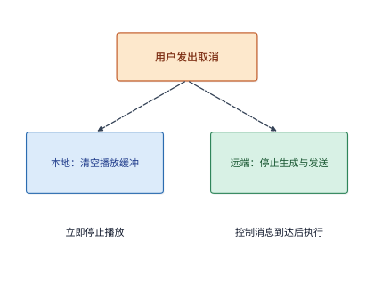

*图 12-25：一次取消同时触发两条路径：本地清空待播音频，远端在控制消息到达后停止生成和发送。虚线表示控制流；本地停止播放与远端资源释放有各自的完成时刻。*

需要特别区分的是：取消一段正在播报的 TTS 语音，丢弃的只是尚未播放的只读媒体字节，不会破坏外部世界的状态一致性；但在第 12.1.3 节的界面操作智能体（Computer Use）中，如果终端发出的“点击确认支付”或“删除文件”动作请求已经抵达目标应用并执行完毕，仅仅因为应答报文在无线重连中丢失，终端在超时重发时就绝不能盲目发起第二次点击，而必须携带原操作编号（`action_id`）先查询该动作是否已经生效。

### 12.4.3 双路径选择、分流与故障切换

智能手机、车载终端与边缘网关通常同时连接两条物理接入网（如室内 Wi-Fi 与 5G 蜂窝移动网）。利用双路径改善传输表现主要有两种基本模式：一是**分流（striping / splitting）**，即将一份大数据的不同字节切片分配到两条路径上并行发送，以叠加带宽缩短传输时间；二是**复制（replication / duplication）**，即将同一份关键数据同时向两条路径各发一份副本，由接收端取先到达的一份，以掩盖单条路径的断连或长尾抖动。

**例：双路径按什么比例切分数据才能使传输时间最短？当两条路径汇入共同瓶颈出口时会发生什么？** 设终端需要上传第 12.1.1 节的 $S=30\ \mathrm{MB}$（$240\ \mathrm{Mbit}$）原图，同时拥有两条独立的恒速无线接入路径：路径 1（如 Wi-Fi）速率为 $B_1=20\ \mathrm{Mbit/s}$，路径 2（如蜂窝网）速率为 $B_2=10\ \mathrm{Mbit/s}$。若将比例为 $x\in[0,1]$ 的数据（即 $xS$）分配给快路径 1，将其余 $(1-x)S$ 的数据分配给慢路径 2，由于服务器必须收齐两部分数据才算完成上传，总传输时间为两条分支耗时的最大值：

$$
T_{\mathrm{split}}(x)=\max\left(\frac{xS}{B_1},\ \frac{(1-x)S}{B_2}\right).
$$

若其中一条路径先传完而另一条仍在传输，总可以把慢路径上的一部分字节挪给快路径，从而缩短慢路径的结束时刻。因此，使 $T_{\mathrm{split}}(x)$ 达到最小值的最优切分比例必然令两条路径同时完成：

$$
\frac{x^*S}{B_1}=\frac{(1-x^*)S}{B_2} \implies x^*=\frac{B_1}{B_1+B_2}=\frac{20}{20+10}=\frac{2}{3}.
$$

即由路径 1 传输 $20\ \mathrm{MB}$、路径 2 传输 $10\ \mathrm{MB}$，两路各自恰好耗时 $20\times 8/20=10\times 8/10=8.0\ \mathrm{s}$ 同时收齐，较单用快路径 1 的 $12.0\ \mathrm{s}$ 节省了 $4.0\ \mathrm{s}$（图 12-26）。

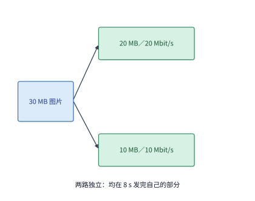

*图 12-26：两条独立路径按带宽比例分配输入，分别发送 20 MB 和 10 MB，均需 8 s。任务等两部分都齐备后完成。*

然而，两条无线接入路径在离开终端后，往往会在远端汇聚到同一个企业网关或同一个服务器网卡出口（图 12-27）。假设这个共同出口的可用带宽为 $B_{\mathrm{shared}}=24\ \mathrm{Mbit/s}$（低于两路接入带宽之和 $20+10=30\ \mathrm{Mbit/s}$），那么即便两路无线接入能在 $8.0\ \mathrm{s}$ 内把数据送到汇聚网口，全部 $30\ \mathrm{MB}$（$240\ \mathrm{Mbit}$）数据穿过该共同出口至少也需要：

$$
T_{\mathrm{shared}}\ge \frac{S}{B_{\mathrm{shared}}}=\frac{240\ \mathrm{Mbit}}{24\ \mathrm{Mbit/s}}=10.0\ \mathrm{s}.
$$

此时系统瓶颈已从无线最后一跳转移到了后端的共同汇聚出口；若不扩容该共同出口，继续提升终端侧的 Wi-Fi 或 5G 速率，只会让更多数据包堆积在汇聚节点的队列中等待。

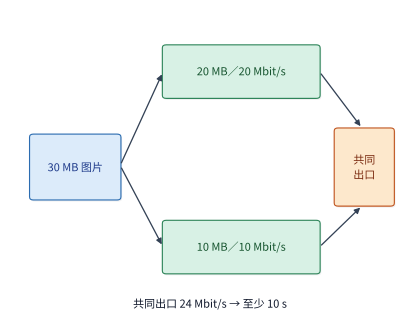

*图 12-27：30 MB 图片按 20／10 MB 分到 20／10 Mbit/s 两条独立接入，各需 8 秒。两路再经过同一 24 Mbit/s 出口，全部数据通过该出口至少需 10 秒。箭头表示数据路径，不表示传播距离；容量取恒定值。*

图 12-27 中的共同汇聚节点不仅限制了合流带宽上限，还在容错备份时构成了**共同故障域（shared failure domain / single point of failure）**。当对延迟和可靠性要求极高的短语音流或控制指令采用双路径复制发送时，我们来核算任务整体失败的概率。

设远端共同汇聚端点（网关或单点服务器）自身发生故障的概率为 $q$；在共同端点正常工作的前提下，无线接入路径 1 与路径 2 发生断连失败的概率分别为 $p_1$ 与 $p_2$，且两条接入路径的故障相互独立。采用双路径全量复制时，只有当“共同端点正常，且两条接入路径至少有一条正常”时任务才能成功；换言之，任务整体失败包含两类互斥事件——一是共同端点直接故障（概率 $q$），二是共同端点正常（概率 $1-q$）但两条独立接入路径同时故障（概率 $p_1p_2$）：

$$
p_{\mathrm{fail}}=q+(1-q)p_1p_2.
$$

代入典型数值 $p_1=0.10$（Wi-Fi 断连率 $10\%$）、$p_2=0.05$（蜂窝网断连率 $5\%$）以及共同端点故障率 $q=0.02$（$2\%$）：
- 若仅使用单路径 1，整体失败率为 $q+(1-q)p_1=0.02+0.98\times 0.10=11.80\%$；
- 若仅使用单路径 2，整体失败率为 $q+(1-q)p_2=0.02+0.98\times 0.05=6.90\%$；
- 若开启双路径复制且共用同一远端端点，两条接入同时断连的概率虽降至 $p_1p_2=0.10\times 0.05=0.50\%$（折合 $(1-q)p_1p_2=0.49\%$），但计入共同端点故障 $q=2.00\%$ 后，整体失败率仍为 $p_{\mathrm{fail}}=2.00\%+0.49\%=2.49\%$（约 $2.5\%$）。

图 12-28 直观地拆解了上述五种配置下的失败率构成：在双路复制（共享端点）的 $2.49\%$ 失败率中，高达 $80.3\%$（即 $2.00$ 个百分点）直接来自共同端点 $q$。即便投入无限成本把两条无线接入路径改造成绝对可靠（$p_1=p_2=0$），任务整体失败率依然被锁定在共同端点下界 $q=2.00\%$ 无法下降；唯有将远端网关与推理服务副本跨独立故障域部署（使两端点同时故障概率降至 $q^2=0.04\%$），双路径复制才能将整体失败率真正压低至 $0.04\%+0.9996\times 0.50\%\approx 0.54\%$。这一结论在配套的双进程双 TCP 连接故障注入实验中也得到了完整验证：在主连接断开时，复制与故障切换均实现 $5/5$ 成功恢复；而当模拟共同服务端点关闭时，双路径全部 $0/5$ 失败。[^dual]

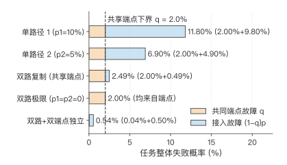

*图 12-28：单路径与双路径复制的失败率分解（$p_1=10\%, p_2=5\%, q=2\%$）。双路径复制将接入网同时故障的贡献压低至 0.49%（蓝段），但共享端点自身的故障率 $q=2.00\%$（橙段）构成了仅靠终端双网无法突破的下界；只有同时将远端端点跨独立故障域冗余部署，总失败率才能进一步降至 0.54%。*

当然，双路径复制在降低丢包与断连风险的同时，需要支付翻倍的流量成本，并要求接收端具备幂等去重机制：例如将 $8$ 块各 $640\ \mathrm{B}$ 的音频块（单份合计 $5,120\ \mathrm{B}$）在两条路径上全量复制发送，总传输字节数翻倍至 $10,240\ \mathrm{B}$；接收端按音频块递增序号（sequence ID）维护去重表，将先到达的完整分块送入播放缓冲区，直接丢弃后到达的重复副本。在实际移动操作系统与云接入网中，多路径 TCP（MPTCP，在单一逻辑连接下管理多条子流）与华为 Link Turbo（根据 Wi-Fi 与蜂窝实时时延和丢包状态动态切换智能分流或关键包复制）正是按上述原理工作的生产级实现。[^wireless-survey]

## 12.5 从端边云分工到完整部署

前四节分别建立了单步与多轮时间预算、跨设备特征与状态迁移账本、广域网传输控制模型以及无线多路径容错机制。作为全书的收官综合，本节回到第 12.1.3 节那项 $30$ 轮界面操作智能体（Computer Use Agent）任务，把完成时限、数据驻留合规、设备能耗、动态带宽波动与断连恢复放进同一张工程决策表中，完成从资源下界估算到完整生产部署的系统化推导。

### 12.5.1 地域、数据与服务位置

继续分析第 12.1 节的 30 轮截图任务。前十轮已完成，剩余二十轮待执行；从当前时刻起算，业务要求整项任务的剩余部分必须在 **$D=45\ \mathrm{s}$** 期限内完成。无论接下来选择哪种部署方案，前十轮已经消耗的历史时间完全相同，因此决策只需比较完成剩余 $20$ 轮工作所需的时间、能耗与可靠性。若继续沿用第 12.1.3 节的原远端服务，每轮 3.5 秒，继续执行需要 70 秒，超出 $45\ \mathrm{s}$ 期限，因此必须立即更换执行方案。

我们保持任务负载与生成质量严格不变：每轮终端本地截图与界面动作执行耗时 $0.3\ \mathrm{s}$，每轮上传压缩截图体积为 $0.8\ \mathrm{MB}$（$6.4\ \mathrm{Mbit}$）；三档候选位置运行同一份 Qwen3-8B `q4_0` 量化权重，承接前十轮留下的 $8\mathrm{K}$ 历史上下文，且每轮均解码生成 $45$ 个动作词元（$20$ 轮共计生成 $900$ 个词元）。每轮模型解码耗时沿用第 12.1.5 节的访存下界口径：每步读取权重与 $8\mathrm{K}$ KV 合计约 $5.465\ \mathrm{GB}$（精确值 $5,465,189,952\ \mathrm{B}$），$45$ 步共读取约 $245.93\ \mathrm{GB}$，除以各设备的内存带宽即得每轮模型计算时间。

当任务切换到新接手的边缘或云端服务时，新服务器必须先对前十轮积累的 $8\mathrm{K}$ 上下文执行一次预填充（即表中的“一次准备”），其矩阵乘加运算量为 $133.6\ \mathrm{TFLOPs}$（精确值 $133,594,323,353,600\ \mathrm{FLOPs}$），除以目标 GPU 的 BF16 稠密算力峰值即得准备耗时下界；端侧手机由于已在本地或缺乏公开可引用的稠密矩阵峰值，将其一次准备记为 $0\ \mathrm{s}$（这一偏乐观取值只会让端侧方案显得更快，不影响后续排除端侧的结论）。表 12-3 汇总了端侧手机、附近边缘工作站（搭载 RTX PRO 6000 Blackwell 工作站版）与远端云地域（搭载 H100 SXM）三档候选位置的参数：[^edge-tiers]

| 执行位置 | 设备与内存带宽／功率 | 一次准备 | 每轮模型 | 上行速率 | 每轮往返传播 | 截图去向 | 20 轮能耗 |
|---|---|---:|---:|---:|---:|---|---:|
| 端侧 | 手机，84.8 GB/s | 0 s | 2.90 s | 无需上传 | 0 s | 留在设备 | 518–680 J |
| 附近工作站 | RTX PRO 6000，1,792 GB/s，600 W | 0.27 s | 0.137 s | 80 Mbit/s | 0.02 s | 传到附近工作站 | 约 1.81 kJ |
| 云地域 | H100 SXM，3,350 GB/s，700 W | 0.14 s | 0.073 s | 6.4 Mbit/s | 0.20 s | 传到云地域 | 约 1.12 kJ |

*表 12-3：剩余 20 轮截图 Agent 任务在端侧、附近工作站与云地域三档候选位置下的单轮耗时分量、数据流向与总能耗预算。*

表中的 20 轮能耗按以下口径核算：两张数据中心／工作站级 GPU 按板卡额定热设计功耗（TDP，分别为 $600\ \mathrm{W}$ 与 $700\ \mathrm{W}$）乘以各自的活跃计算总时长（一次准备加 $20$ 轮模型推理）给出能耗上限；端侧手机按第 12.1.5 节 MELTing Point 实测的每词元 $0.576\sim 0.756\ \mathrm{J}$ 乘以 $900$ 个总生成词元，得 $518.4\sim 680.4\ \mathrm{J}$（无线网卡上传耗电暂不计入）。[^melt]

在启动时间与能耗比选之前，**数据驻留与隐私合规（data residency）**构成第一道前置筛选门槛：表中只有“端侧”方案将包含用户屏幕隐私的 $0.8\ \mathrm{MB}$ 原始截图始终留在手机内部；附近工作站与云地域方案每轮都必须将截图传出终端。如果当前任务涉及严禁离开本机或严禁跨境传输的敏感界面（如个人银行密码输入或机密内网终端），那么无论外部算力多快，远端方案在合规初筛阶段即被一票否决。下文的时间与成本比较，均以合规策略允许截图上传至受控边缘或云地域为前提。

在多云与跨地域架构中，平台还可以采用 **Regionless（无固定地域绑定）** 服务抽象：应用层只需向平台声明任务输入、质量等级、完成期限 $D$ 与合规边界，由底层调度平台根据各云地域当前的排队负载、网络 RTT、前缀缓存命中状态以及算力电价，动态为每次会话指派最优执行地域。[^region]

### 12.5.2 时限、成本与恢复的联合比较

**1. 固定带宽下的完成时间与能耗比选。** 在无排队、无故障的基准条件下，将一次准备耗时与 $20$ 轮循环（每轮含终端工作 $0.3\ \mathrm{s}$、模型解码、往返传播及 $6.4\ \mathrm{Mbit}$ 截图上传）逐项相加，得到三种方案完成剩余 $20$ 轮任务的总耗时（图 12-29 至图 12-31）：

$$
\begin{aligned}
T_{\mathrm{local}}&=20\times(0.3+2.90)=64.0\ \mathrm{s},\\
T_{\mathrm{near}}&=0.27+20\times\left(0.3+0.137+0.02+\frac{6.4}{80}\right)=0.27+20\times 0.537\approx 11.0\ \mathrm{s},\\
T_{\mathrm{cloud}}&=0.14+20\times\left(0.3+0.073+0.20+\frac{6.4}{6.4}\right)=0.14+20\times 1.573\approx 31.6\ \mathrm{s}.
\end{aligned}
$$

对比 $T_{\mathrm{near}}$（$11.0\ \mathrm{s}$）与 $T_{\mathrm{cloud}}$（$31.6\ \mathrm{s}$）的内部组成可以清楚看到算力优势是如何被通信开销逆转的：云端 H100 SXM 的显存带宽（$3,350\ \mathrm{GB/s}$）是附近工作站 RTX PRO 6000（$1,792\ \mathrm{GB/s}$）的 $1.87$ 倍，每轮模型解码比附近工作站快约 $0.137-0.073=0.064\ \mathrm{s}$，$20$ 轮累计节省计算时间约 $1.28\ \mathrm{s}$，加上一次预填充准备还多省约 $0.13\ \mathrm{s}$（算力端合计领先约 $1.4\ \mathrm{s}$）；然而，云端路径每轮上传截图需 $1.00\ \mathrm{s}$（比附近工作站的 $0.08\ \mathrm{s}$ 慢 $0.92\ \mathrm{s}$），每轮往返传播需 $0.20\ \mathrm{s}$（比附近工作站的 $0.02\ \mathrm{s}$ 慢 $0.18\ \mathrm{s}$），每轮通信净多花 $1.10\ \mathrm{s}$，$20$ 轮累计多等 $22.0\ \mathrm{s}$。一正一反相抵，拥有顶级加速器的云端反而比附近工作站慢了约 $20.6\ \mathrm{s}$。

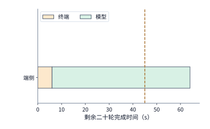

*图 12-29：端侧：终端工作 6 s，模型计算 58.0 s，共 64.0 s。三图共用 45 s 期限线和同一横轴，颜色分别汇总二十轮同类工作的耗时。*

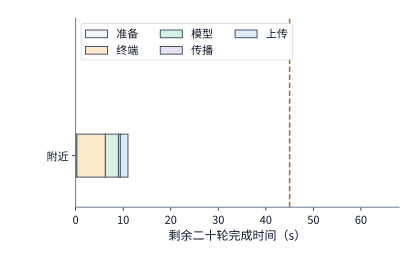

*图 12-30：附近工作站（RTX PRO 6000）：准备 0.27 s，二十轮终端 6 s、模型 2.7 s、传播 0.4 s、上传 1.6 s，共 11.0 s，满足 45 s 期限。虚线表示 45 s 完成期限。*

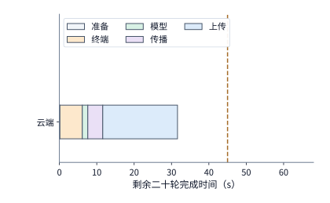

*图 12-31：云端（H100 SXM）：准备 0.14 s，二十轮终端 6 s、模型 1.5 s、传播 4 s、上传 20 s，共 31.6 s。计算更快而传输更久，比附近工作站慢约 20.6 s，仍在期限之内。虚线表示 45 s 完成期限。*

现在按照“先满足业务期限，再最小化能耗成本”的工程准则进行筛选：
- **第一步（期限筛选）**：端侧手机虽然能耗最低（$518\sim 680\ \mathrm{J}$，折合满电续航的 $20/590\approx 3.4\%$ 至 $20/490\approx 4.1\%$，电池电量本身完全充裕），但总耗时 $64.0\ \mathrm{s}$ 超出了 $45\ \mathrm{s}$ 的硬性期限，因此首先被淘汰；附近工作站（$11.0\ \mathrm{s}$）与云端（$31.6\ \mathrm{s}$）均在 $45\ \mathrm{s}$ 期限以内，进入第二轮成本比较。
- **第二步（能耗比选）**：在两个按时完成的候选中，附近工作站的 GPU 活跃时间为 $0.27+20\times 0.137=3.01\ \mathrm{s}$，按 $600\ \mathrm{W}$ 计消耗电能约 $600\times 3.01\approx 1.81\ \mathrm{kJ}$；云端 H100 的额定功率（$700\ \mathrm{W}$）虽然高于 RTX PRO 6000，但由于其极高的显存带宽与算力峰值将总活跃时间压缩至 $0.14+20\times 0.073=1.60\ \mathrm{s}$，总消耗电能反而降至 $700\times 1.60=1.12\ \mathrm{kJ}$。因此，在满足 $45\ \mathrm{s}$ 期限的前提下，**能耗最低的优胜方案是云端方案（$31.6\ \mathrm{s}$，约 $1.12\ \mathrm{kJ}$）**。

**2. 上行带宽变化的翻转边界与固定耗时渐近线。** 云端方案能否按时完成，高度依赖广域网上行速率 $b$（单位 $\mathrm{Mbit/s}$）。保持其余参数不变，将云端完成时间写成上行速率 $b$ 的函数：

$$
T_{\mathrm{cloud}}(b)=0.14+20\times(0.3+0.073+0.20)+\frac{20\times 6.4}{b}=11.6+\frac{128}{b}\ \mathrm{s},
$$

其中 $11.6\ \mathrm{s}$ 是与上传带宽无关的固定非上传耗时，$128\ \mathrm{Mbit}$ 是 $20$ 张截图的总上传比特数。令 $T_{\mathrm{cloud}}(b)\le 45\ \mathrm{s}$，解得云端方案满足期限的最低上行带宽门槛为：

$$
b_{\min}=\frac{128}{45-11.6}=\frac{128}{33.4}\approx 3.83\ \mathrm{Mbit/s}\ (\text{约 }3.8\ \mathrm{Mbit/s}).
$$

如图 12-32 所示，当广域网上行速率跌破约 $3.8\ \mathrm{Mbit/s}$（例如降至 $3.5\ \mathrm{Mbit/s}$，此时 $T_{\mathrm{cloud}}=11.6+128/3.5\approx 48.2\ \mathrm{s}>45\ \mathrm{s}$）时，云端方案因超期失效，系统必须切换至附近工作站。

反过来，如果把云端路径的上行带宽无限提高（$b\to\infty$），云端方案能否反超附近工作站的 $11.0\ \mathrm{s}$？由公式可见，即便 $128/b\to 0$，云端耗时仍受限于水平渐近线 $T_{\mathrm{cloud}}(\infty)=11.6\ \mathrm{s}>11.0\ \mathrm{s}$，永远追不上附近工作站。原因在于：云端每轮 $0.20\ \mathrm{s}$ 的跨地域往返传播延迟，比附近工作站每轮“传播（$0.02\ \mathrm{s}$）加局域网上传（$0.08\ \mathrm{s}$）”之和（$0.10\ \mathrm{s}$）还要多出 $0.10\ \mathrm{s}$，超过了 H100 每轮在模型计算上节省的 $0.064\ \mathrm{s}$。在用反解公式 $b_{\min}=128/(D-11.6)$ 求带宽门槛时，必须先检验期限 $D$ 是否大于固定耗时 $11.6\ \mathrm{s}$；若业务将期限收紧至 $D\le 11.6\ \mathrm{s}$，代数式算出的负数或无穷大意味着无论怎样扩容带宽，云端方案在物理上均不可行。

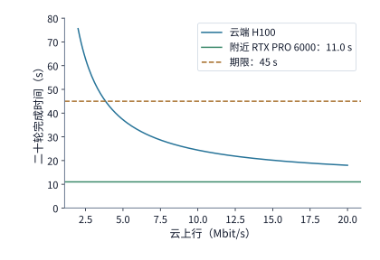

*图 12-32：云路径上行改变完整任务的部署选择。剩余 20 轮每轮上传 0.8 MB，云端准备 0.14 秒，每轮其余工作合计约 0.57 秒，因此总时间为 11.6+128/b 秒；附近工作站为 11.0 秒，期限为 45 秒。本例保持模型、处理时间和其他网络参数不变，忽略排队与故障。约 3.8 Mbit/s 起云方案可满足期限；上行再高，云端也不低于 11.6 秒，始终慢于附近工作站。*

当然，“云端永远追不上附近工作站”这一结论取决于模型计算时间在每轮中的占比。表 12-3 采用的是纯访存下界（RTX PRO 6000 每步 $9.12\ \mathrm{ms}$）；而在第 8 章实验 8-1 的真实推理引擎实测中，RTX PRO 6000 在 batch 1、$8\mathrm{K}$ 上下文下的实测单步解码耗时为 $25.83\ \mathrm{ms}$，是纯访存下界的 $25.83/9.12\approx 2.83$ 倍（差额来自算子启动与框架调度开销）。如果将两张 GPU 的模型计算耗时都按 $2.83$ 倍实测比例放大，则附近工作站完成 $20$ 轮总耗时升至约 $16.04\ \mathrm{s}$，而云端不含上传的固定耗时为约 $14.29\ \mathrm{s}$，云端在非上传环节反超附近工作站约 $1.75\ \mathrm{s}$；此时只要云端上行速率超过 $128/1.75\approx 73\ \mathrm{Mbit/s}$，云端总耗时就能快于附近工作站。[^edge-tiers]

**3. 动态带宽波动的凸性惩罚（Jensen 不等式效应）。** 在真实广域网中，上行速率 $b_i$ 随轮次 $i$ 动态起伏，整项任务的总完成时间为各轮传输时间的求和：

$$
T=11.6+\sum_{i=1}^{20}\frac{6.4}{b_i}.
$$

由于倒数函数 $f(b)=6.4/b$ 在 $b>0$ 上是严格凸函数（$f''(b)>0$），根据 Jensen 不等式，速率波动时的平均传输时间必然严格大于按平均速率计算的时间。例如，若 $20$ 轮中有 $10$ 轮速率为 $6\ \mathrm{Mbit/s}$、另 $10$ 轮速率为 $10\ \mathrm{Mbit/s}$，其算术平均速率虽然恰好等于 $8\ \mathrm{Mbit/s}$，但实际总耗时为：

$$
T_{\mathrm{var}}=11.6+10\times\frac{6.4}{6}+10\times\frac{6.4}{10}\approx 28.67\ \mathrm{s}\ (\text{约 }28.7\ \mathrm{s}),
$$

比全程恒定保持 $8\ \mathrm{Mbit/s}$ 时的 $T_{\mathrm{const}}=11.6+20\times(6.4/8)=27.6\ \mathrm{s}$ 慢了约 $1.1\ \mathrm{s}$。原因在于慢速轮次多出的等待时间大于快速轮次省下的时间。因此，当平均耗时接近期限边界（例如上行降至 $4\ \mathrm{Mbit/s}$ 时耗时 $43.6\ \mathrm{s}$，距 $45\ \mathrm{s}$ 期限仅剩 $1.4\ \mathrm{s}$ 余量）时，平台不能仅凭平均带宽判断达标，而必须基于多轮累计上传时间的概率分布核验 $P(T\le 45\ \mathrm{s})\ge 0.99$，并计入相邻轮次在弱网时段的时间自相关性。

**4. 文本智能体会话的状态驻留与重算盈亏平衡。** 截图智能体的跨地域瓶颈在于每轮 $0.8\ \mathrm{MB}$ 的图像上传；若换成纯文本多轮代码或对话智能体，传输体积大幅缩小，优化重心便转向**远端前缀状态保留（stateful KV retention）与无状态重算（stateless re-prefill）的权衡**。

在一组真实录制的文本智能体多轮会话轨迹中：若服务端不保留状态，客户端每轮重传完整历史前缀，累计上传数据量为 $66,207\ \mathrm{B}$（约 $66\ \mathrm{KB}$）；若服务端保留会话状态，客户端每轮仅上传增量提问，累计上传仅 $10,193\ \mathrm{B}$（约 $10\ \mathrm{KB}$），服务端下行回复均为 $2,527\ \mathrm{B}$（约 $2.5\ \mathrm{KB}$）。在 $333\ \mathrm{Mbit/s}$ 链路上，少传约 $56\ \mathrm{KB}$ 仅节省约 $1.3\ \mathrm{ms}$ 网络发送时间；真正的差异体现在云端计算量与显存驻留代价上：[^region-trace]
- **节省的预填充算力**：无状态重传历史前缀时，整条会话的矩阵乘加运算量高达 $296,505,803,538,432\ \mathrm{FLOPs}$（约 $2.97\times 10^{14}\ \mathrm{FLOPs}\approx 3.0\times 10^{14}\ \mathrm{FLOPs}$），在 H100 SXM（BF16 峰值 $989.4\ \mathrm{TFLOP/s}$）上折合计算时间下界约 $0.300\ \mathrm{GPU\cdot s}$；保留状态后仅需对增量词元做预填充，运算量降至 $60,380,764,176,384\ \mathrm{FLOPs}$（约 $6.04\times 10^{13}\ \mathrm{FLOPs}\approx 6.0\times 10^{13}\ \mathrm{FLOPs}$），折合计算时间下界约 $0.061\ \mathrm{GPU\cdot s}$。保留状态净节省了 $\Delta C=0.300-0.061=0.239\ \mathrm{GPU\cdot s}$ 的算力消耗。
- **驻留显存的机会成本**：保留该会话的 KV 缓存需持续占用 $465,371,136\ \mathrm{B}$（约 $465.4\ \mathrm{MB}$）显存空间。按该状态占单张 H100 显存总容量（$80\ \mathrm{GB}$）的比例折算，每在显存中驻留 $1\ \mathrm{s}$，相当于占用 $\dot{M}=0.46537/80\approx 0.005817\ \mathrm{GPU\cdot s/s}$（约 $0.0058\ \mathrm{GPU\cdot s/s}$）的等效设备配额。

将节省的计算量与驻留成本相除，即可求出状态保留的最大盈亏平衡时间（图 12-33）：

$$
t_{\mathrm{hold}}^*=\frac{\Delta C}{\dot{M}}=\frac{0.2387\ \mathrm{GPU\cdot s}}{0.005817\ \mathrm{GPU\cdot s/s}}\approx 41.0\ \mathrm{s}.
$$

当相邻两轮交互的间隔时间 $t<41.0\ \mathrm{s}$ 时，保留显存状态比释放后重算更划算；一旦用户思考或工具执行停顿超过 $41.0\ \mathrm{s}$，显存长期驻留累积的机会成本就会反超重算一遍前缀的代价，此时调度器应当将该会话 KV 换出至主机内存或直接释放。这一盈亏平衡方程与第 9 章的前缀缓存驱逐、第 11 章的沙箱暂停／重建交点遵循完全相同的经济学法则。

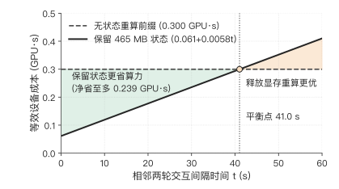

*图 12-33：文本智能体会话在 H100 SXM 上保留 465 MB 状态与无状态重算前缀的等效设备成本对比。保留状态将预填充算力从 0.300 GPU·s 降至 0.061 GPU·s（净省 0.239 GPU·s），但每秒驻留消耗 0.465/80 ≈ 0.0058 GPU·s 显存配额；两线在相邻交互间隔 $t \approx 41.0\ \mathrm{s}$ 处相交。*

**5. 断连恢复与进度持久化对期限达标的决定性作用。** 最后，我们将网络中断与故障恢复纳入剩余 $20$ 轮截图任务的选型核算。在选定的云端方案中，完成单轮交互耗时约为 $r_{\mathrm{cloud}}=0.3+0.073+0.20+1.00=1.573\ \mathrm{s}$（约 $1.57\ \mathrm{s}$）。现在假设当第 $10$ 轮刚刚在云端执行完毕、但确认消息尚未传回终端时，网络连接发生中断，终端检测到断连并重新建立连接耗时 $T_{\mathrm{recon}}=1.0\ \mathrm{s}$。我们对比两种不同的状态与进度持久化机制：
- **机制 A（保留已提交进度，仅重做未确认的第 10 轮）**：前 $9$ 轮的执行结果与上下文状态已在每轮结束时可靠提交（checkpointed）；重连成功后，系统直接从第 $9$ 轮末尾恢复，仅需重做第 $10$ 轮（耗时 $1.57\ \mathrm{s}$），故障带来的额外耗时仅为 $\Delta T_{\mathrm{A}}=1.0+1.57=2.57\ \mathrm{s}$。整项剩余任务的总完成时间从无故障时的 $31.6\ \mathrm{s}$ 增至 $31.6+2.57\approx 34.2\ \mathrm{s}$，依然稳妥地控制在 $45\ \mathrm{s}$ 期限之内（图 12-34）。
- **机制 B（无增量持久化，前 10 轮进度全部丢失）**：若系统未做逐轮进度提交，断连导致此前已跑完的 $10$ 轮上下文与操作状态全部作废；重连后必须从第 $1$ 轮起重新执行全部 $10$ 轮，额外耗时高达 $\Delta T_{\mathrm{B}}=1.0+10\times 1.57=16.7\ \mathrm{s}$。整项任务的总完成时间飙升至 $31.6+16.7=48.3\ \mathrm{s}$，直接突破 $45\ \mathrm{s}$ 期限导致任务失败（图 12-35）。

可以看到，在完全相同的云端服务器与相同的断连事件下，**是否实现逐轮增量持久化，直接决定了任务是按时成功（$34.2\ \mathrm{s}$）还是超时违约（$48.3\ \mathrm{s}$）**。作为对照，附近工作站每轮仅耗时约 $r_{\mathrm{near}}\approx 0.537\ \mathrm{s}$（约 $0.54\ \mathrm{s}$），平时充足的期限余量（$11.0\ \mathrm{s}$ 对比 $45\ \mathrm{s}$）使其即便遭遇丢失 $10$ 轮进度的极端故障，重做后的总时间也仅为 $11.0+1.0+10\times 0.537\approx 17.4\ \mathrm{s}$，对状态丢失具有强得多的容忍度。

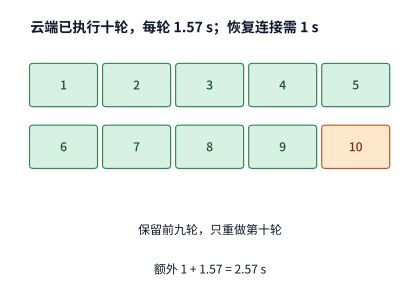

*图 12-34：保留前九轮提交记录（绿色），只重做未确认的第十轮（橙色）。云端每轮 1.57 s，恢复连接 1 s，增加 2.57 s，总时间为 34.2 s。此例采用可安全重放的操作；已提交的外部操作则先查询其结果。*

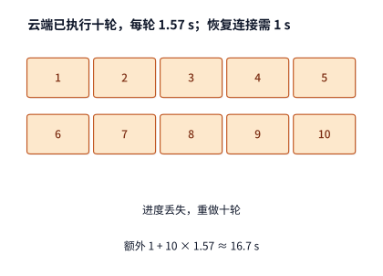

*图 12-35：丢失十轮进度时，恢复连接后重做十轮，额外 1＋10×1.57≈16.7 s，总任务从 31.6 s 延至 48.3 s，超过 45 s 期限。*

在大规模生产服务中，若每次尝试独立成功的概率为 $p$，失败后整项任务从头重试且每次尝试消耗成本 $C$，则完成一项成功任务的期望总成本 $E$ 满足递推式 $E=C+(1-p)E$，即：

$$
E=\frac{C}{p}.
$$

当成功率 $p=99\%$ 时，期望成本约为 $1.01C$；若弱网与状态丢失使单次成功率跌至 $p=80\%$，期望成本将膨胀至 $1.25C$。引入细粒度检查点与幂等恢复，不仅将每次故障的时间增量从 $10r$ 压缩为 $1r$，也同样将每次故障重做的算力与电量损耗削减了九成。

### 12.5.3 何时需要更换部署方案

综合第 12.5.1 与 12.5.2 节的全部定量推导，表 12-4 给出了该项截图智能体任务在不同运行条件下的部署决策矩阵与翻转边界：

| 条件变化 | 定量结果 | 系统部署决策 |
|---|---|---|
| 基准条件：云路径上行速率为 6.4 Mbit/s，无故障 | 端侧 64.0 s（超期）；云端 31.6 s、约 1.12 kJ；附近工作站 11.0 s、约 1.81 kJ | 云端与附近工作站均满足 45 s 期限，优先选用能耗更低的云端方案 |
| 云路径上行速率降至 3.8 Mbit/s 以下（如 3.5 Mbit/s） | 云端耗时升至约 48.2 s（超出 45 s 期限） | 云端超期失效，切换至附近工作站执行 |
| 业务期限收紧至 11.6 s 以内（无论云上行速率多高） | 云端受固定非上传时间限制，耗时不少于 11.6 s | 云端物理不可行，只能由附近工作站（11.0 s）满足 |
| 云端在第 10 轮后发生 1 s 断连，但保留前 9 轮已提交进度 | 仅重做第 10 轮，云端总耗时增至 34.2 s | 仍在 45 s 期限内，继续维持云端方案 |
| 同次断连下未做增量持久化，丢失前 10 轮全部进度 | 需重做 10 轮，云端总耗时延至 48.3 s（超期） | 必须升级逐轮检查点机制，或切换至容错余量更大的附近工作站（17.4 s） |

*表 12-4：界面操作智能体在剩余 20 轮、期限 45 s 下的端边云部署决策表与翻转条件汇总。*

当系统监测到网络带宽跨过上述翻转阈值、准备在任务中途将正在运行的会话从云端动态迁移到附近工作站时，还必须按照第 12.2.3 节的方法核查**动态迁移的盈亏平衡条件**与**防抖滞回（hysteresis）**。例如，若迁移 $64\ \mathrm{MiB}$ 会话状态需要 $7.7\ \mathrm{s}$ 的传输与恢复准备，而迁移后每轮仅比原路径快 $0.4\ \mathrm{s}$，那么完成剩余 $20$ 轮仅能净省 $20\times 0.4-7.7=0.3\ \mathrm{s}$；如果这次带宽改善只是持续 $10$ 轮的短暂波动（随后网络又恢复原状），盲目触发迁移反而会净亏损 $7.7-10\times 0.4=3.7\ \mathrm{s}$。因此，在线路由控制器应当仅在“预计剩余可获益轮数乘以单轮收益，显著大于迁移固定成本加安全余量”时才执行跨节点状态迁移，并通过设定切换冷却期避免在临界带宽附近发生反复震荡（ping-pong effect）。

### 12.5.4 资源条件变化后的系统调整

前面各节比较的是“固定模型结构，改变物理执行位置与网络协议”；反过来，如果保持系统部署架构与任务交互流程不变，单纯提升模型推理速度，端到端收益同样受制于非模型串行阶段。

设某项智能体任务的一条固定执行轨迹总耗时为 $10.0\ \mathrm{s}$，其中模型推理累计占 $8.0\ \mathrm{s}$，而外部工具执行、界面刷新与网络往返等无法与模型重叠的串行阶段合计占 $2.0\ \mathrm{s}$。此时即便我们将模型推理速度整体提升 $10$ 倍（使模型耗时从 $8.0\ \mathrm{s}$ 压缩至 $0.8\ \mathrm{s}$），整项任务的完成时间也只能从 $10.0\ \mathrm{s}$ 降至 $2.8\ \mathrm{s}$，端到端加速比约为 $10.0/2.8\approx 3.57$ 倍；哪怕模型推理耗时趋近于零，任务完成时间依然无法突破 $2.0\ \mathrm{s}$ 的非模型串行下界（图 12-36）。[^core-calculation]

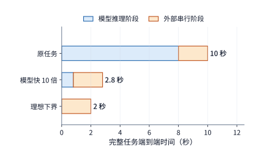

*图 12-36：固定任务轨迹中的加速上限。模型从 8 秒缩短至 0.8 秒，其他串行阶段保持 2 秒；第三行表示模型时间趋近于零的理想下界。*

当模型加速逼近这一渐近线后，要想继续压缩剩余的 $2.0\ \mathrm{s}$，就必须跳出单纯的算子优化，从系统组织与模型—系统协同设计入手：例如将执行环境与模型同机部署以省去广域网往返、通过第 11 章的投机预热隐藏沙箱启动时间，或者像 DeepSeek V4 到 V4.1 那样在模型架构侧引入跨层 KV 共享（减少全局状态驻留体积）、上下文编码器蒸馏 CED（减少输入阶段重复穿过深层解码器的计算量）以及高效的缓存恢复通道。[^v41-case]

纵观全书十二章，从第 1 章确立的算力、访存与容量三条物理下界，到片上算子融合、量化编译、张量与流水线并行、PagedAttention 与前缀缓存、集群训练容错、沙箱环境生命周期调度，再到本章的端边云跨网协同，所有看似分散的技术机制背后都贯穿着同一套工程思维方式：
1. **先立物理下界**：根据字节数、矩阵乘加运算量与光速传播距离，算出任何软件实现都无法逾越的硬边界，排除物理上不可行的方案；
2. **再查依赖与重叠**：沿着真实执行轨迹梳理串行依赖、同步屏障、批量聚合与流水线气泡，定位究竟是哪一个环节主导了关键路径；
3. **核算准备、驻留与恢复的全周期成本**：无论是算子图编译、前缀 KV 驻留、沙箱快照暂停，还是跨地域状态迁移与前向纠错冗余，都用“单次准备或冗余代价 vs. 后续复用或免重传收益”建立明确的盈亏平衡方程；
4. **用受控单因素实验严格验证**：面对理论下界与实测表现之间的差距，区分模型假设失效（如把随机丢包误判为拥塞）与基线配置开销（如未复用连接或未调优窗口），让每一项架构演进都建立在可复算、可证伪的定量证据之上。

## 常见误区

1. **误区一：“只要把云端 GPU 换成最新旗舰卡、把模型推理加速十倍，用户的端到端响应时间就能同比例缩短。”**
   - **原因剖析**：忽略了广域网上下行传输与物理往返传播在关键路径中的占比。如第 12.1.1 节所示，当 $30\ \mathrm{MB}$ 原图在 $20\ \mathrm{Mbit/s}$ 上行链路上需要 $12.0\ \mathrm{s}$ 发送时，将云端处理从 $0.3\ \mathrm{s}$ 加速十倍至 $0.03\ \mathrm{s}$，总时间仅从 $12.8\ \mathrm{s}$ 降至 $12.53\ \mathrm{s}$（改善不足 $2.2\%$）；而在第 12.5.2 节的 $20$ 轮截图任务中，拥有 $1.87$ 倍显存带宽优势的云端 H100 反而因为每轮 $1.0\ \mathrm{s}$ 的图片上传与 $0.2\ \mathrm{s}$ 的传播等待，比附近工作站慢了 $20.6\ \mathrm{s}$。
   - **正确做法**：先拆分完整交互路径的各阶段耗时占比；当传输或传播主导关键路径时，应优先通过端侧压缩、分块流水重叠或就近边缘部署削减通信耗时。

2. **误区二：“流式语音合成（TTS）出现播放卡顿，说明初始播放缓冲区（Jitter Buffer）设得太小，只要调大缓冲就能彻底消除卡顿。”**
   - **原因剖析**：混淆了“均值为零的短期网络抖动”与“平均接收速率低于播放消费速率（$R_{\mathrm{rx}}<R_{\mathrm{play}}$）的持续带宽赤字”。如第 12.1.2 节推导，当接收速率（$130\ \mathrm{kbit/s}$）低于声卡消费码率（$256\ \mathrm{kbit/s}$）时，缓冲区以 $126\ \mathrm{kbit/s}$ 的净速率线性排空；把初始缓冲从 $60\ \mathrm{ms}$ 翻倍到 $120\ \mathrm{ms}$，只能把首次断流时刻从 $0.122\ \mathrm{s}$ 推迟到 $0.244\ \mathrm{s}$，却无法阻止随后的持续欠载，反而额外增加了首字发声延迟。
   - **正确做法**：用 $R_{\mathrm{rx}}$ 与 $R_{\mathrm{play}}$ 的大小关系区分抖动与带宽不足；当 $R_{\mathrm{rx}}<R_{\mathrm{play}}$ 时，必须切换为更高压缩比的音频编码格式（如 Opus 低码率档）或更换传输路径，使平均接收速率高于消费码率。

3. **误区三：“把多模态大模型的视觉编码器拆到手机或边缘端运行，只上传提取后的视觉特征，一定比直接上传图片更省流量、更快。”**
   - **原因剖析**：忽视了现代视觉语言模型（VLM）深层特征与多尺度特征拼接（如 DeepStack）带来的张量字节膨胀。如第 12.2.2 节 Qwen3-VL-4B 算例所示，一张 $0.8\ \mathrm{MB}$ 的压缩截图经过视觉编码器后，生成的 $[400, 10240]$ BF16 完整特征（EC）高达 $8.192\ \mathrm{MB}$，体积膨胀了 $10.24$ 倍；若转换成语言模型逻辑 KV 缓存更是膨胀至 $58.98\ \mathrm{MB}$（$73.7$ 倍）。在 $6.4\ \mathrm{Mbit/s}$ 上行链路上，传特征比传压缩原图慢了 $9.24\ \mathrm{s}$。
   - **正确做法**：在窄带广域网上优先传输高压缩比的原始媒体（PNG／JPEG／WebP 或压缩音频），将产生体积膨胀的特征提取与预填充留在高带宽的数据中心内部完成；仅在需要跨轮复用本地缓存或采用极低维度的压缩潜表示（Latent Bridge）时才在端侧切分。

4. **误区四：“跨国或无线链路吞吐率极低，说明物理链路带宽已经被占满拥塞，除了扩容专线别无他法。”**
   - **原因剖析**：将传统 TCP 拥塞控制（Reno／CUBIC）在随机丢包下的“被动降窗限速”误认为物理链路饱和。如第 12.3.3 节贵阳—Irvine 路径实测所示，链路真实容量膝点高达 $333\ \mathrm{Mbit/s}$ 且无排队，但因存在 $14\%$ 的非拥塞随机丢包，Mathis 模型将传统 TCP 吞吐限制在约 $0.155\ \mathrm{Mbit/s}$（低估超过三个数量级）。
   - **正确做法**：通过主动速率阶跃探测与 RTT 最小值／最大值对比，分辨丢包究竟源于队列溢出还是随机损耗；在非拥塞随机丢包链路上改用基于带宽与 RTT 测量的拥塞控制（如 BBR），并结合自适应前向纠错（FEC）消除多轮重传长尾。

5. **误区五：“只要在终端侧同时开启 Wi-Fi 与 5G 双网并发复制，就能把端到端通信失败率降到接近于零。”**
   - **原因剖析**：忽略了两条接入路径在后端汇合时的共同端点（单点网关或单地域服务器）故障率 $q$。由第 12.4.3 节公式 $p_{\mathrm{fail}}=q+(1-q)p_1p_2$ 可知，当共同端点故障率 $q=2\%$ 时，即便双网复制将接入段同时失败率压低至 $0.5\%$，整体失败率仍达 $2.49\%$，其中八成以上来自共同端点。
   - **正确做法**：在开启终端多路径传输的同时，必须将远端接入代理与推理服务副本跨独立可用区或独立故障域部署，并配合会话状态的逐轮持久化检查点与幂等操作编号（`action_id`），才能实现真正的高可用端边云协同。

## 练习

练习按计算、改变条件和解释机制递进。12-2、12-3、12-7 为核心练习。未另说明的数值沿用正文教学条件。

**12-1　图片精修的传输与计算预算〔延伸，★〕。**

(a) 上行速率分别取 $10$、$20$、$100\ \mathrm{Mbit/s}$，计算三种方案的完成时间：保持原方案、将图像处理速度提高到原来的十倍，以及将输入大小减半。输入压缩所增加的编解码耗时仍为 $0.15\ \mathrm{s}$。

(b) 求压缩节省的传输时间恰好等于新增编解码时间时的上行速率。再以原图大小和 $20\ \mathrm{Mbit/s}$ 上行速率为条件：若原有的 $0.3\ \mathrm{s}$ 处理时间中只有 $0.2\ \mathrm{s}$ 可以加速，将这部分的执行速度提高到原来的十倍后，任务总耗时是多少？

(c) 把图像分为三个可独立处理的块，画出上传、处理与回传的重叠。标出限制任务耗时进一步缩短的步骤。

**12-2　截图压缩节省的传输时间能否抵消额外交互〔核心，★〕。**

(a) 将每轮截图从 $0.8\ \mathrm{MB}$ 压缩到 $0.2\ \mathrm{MB}$，每轮新增 $30\ \mathrm{ms}$ 编码时间。复算完成 $30$ 轮截图任务总共能节省多少时间。

(b) 压缩后需要 $38$ 轮时，任务是否更快？求压缩方案仍比原图 $30$ 轮方案更快时，最多允许执行多少轮。

(c) 将每轮 RTT 增加 $100\ \mathrm{ms}$，分别计算原图 $30$ 轮和压缩图 $38$ 轮的总时间。解释为什么同一个 RTT 变化会产生不同的任务耗时增量。

(d) 为截图版本与操作编号设计记录字段，说明怎样识别压缩导致的纠错轮次与旧状态导致的无效轮次。

**12-3　视觉编码位置与状态迁移如何影响交互耗时〔核心，★〕。**

(a) 一张图片占 $0.8\ \mathrm{MB}$，编码后得到形状为 $[400,10240]$ 的 BF16 特征张量，上行带宽为 $6.4\ \mathrm{Mbit/s}$。视觉编码需要 $1.31\ \mathrm{TFLOPs}$ 矩阵运算；本地在 RTX 4090 上编码，远端在 H100 SXM 上编码，均按 BF16 稠密峰值（$165.2$、$989.4\ \mathrm{TFLOP/s}$）求编码时间下界。比较本地编码后上传特征与上传原图后在远端编码的总耗时。

(b) 将链路改为一个 $400\ \mathrm{Gbit/s}$ 的 ConnectX-7 端口（每方向 $50\ \mathrm{GB/s}$），以直接上传原图为基准，求上传视觉特征多花多少传输时间；与 (a) 中两张卡的编码时间之差比较，判断此时哪一项决定编码器的位置。

(c) 迁移需要以 $80\ \mathrm{Mbit/s}$ 传输 $64\ \mathrm{MiB}$ 状态，再用 $1\ \mathrm{s}$ 恢复；迁移后每轮执行时间缩短 $0.4\ \mathrm{s}$。分别求剩余 $10$、$20$、$40$ 轮时净节省的时间。若恢复时间再增加 $1\ \mathrm{s}$，至少还需执行多少轮，才能收回迁移耗时？

(d) 分别说明保存图片、视觉特征和语言 KV 后，从何处开始重算；说明已提交的操作结果怎样进入恢复过程。

**12-4　连接复用与多流传输〔延伸，★〕。**

(a) RTT 为 $200\ \mathrm{ms}$，任务共 $30$ 轮，每次建链需额外两次往返。计算每轮新建连接与全程复用连接的时间差。

(b) 分别计算立即确认与聚合 ACK 两种方案中，图片、包头和 ACK 合计传输的字节数，解释为什么实际传输的字节更少，请求完成时间反而可能更长。

(c) 比较发送优先级与图 12-20 的逐流交付：分别指出资源使用时段和等待依赖发生了什么变化。

(d) 设计一组只改变连接复用方式、其他条件相同的对照实验，列出起止事件及用于解释时间变化的中间事件。

**12-5　ACK 频率与空口效率〔延伸，★〕。**

(a) 一次数据帧交换耗时 $302\ \mathrm{\mu s}$，一次确认帧交换耗时 $134\ \mathrm{\mu s}$。共发生 $30,800$ 次数据帧交换，原先每次都单独确认。将 ACK 数量减半后，能释放多少空口时间？

(b) 画出发送方因等待聚合 ACK 而暂停发送的时间线，解释释放空口与提前交付之间的关系。

(c) PCM 播放所需速率为 $256\ \mathrm{kbit/s}$、实际接收速率为 $130\ \mathrm{kbit/s}$、初始缓冲 $60\ \mathrm{ms}$，求耗尽时刻。保持接收速率和 $60\ \mathrm{ms}$ 初始音频时长不变，将采样率从 $16\ \mathrm{kHz}$ 改为 $24\ \mathrm{kHz}$，求新的耗尽时刻。

**12-6　双路径的分流与备份〔延伸，★〕。**

(a) $30\ \mathrm{MB}$ 经 $20$ 与 $10\ \mathrm{Mbit/s}$ 两路分流，推导使两路同时完成的比例与时间。

(b) 加入 $24\ \mathrm{Mbit/s}$ 共同出口，求新的传输时间下界，并指出提高哪一段链路的带宽能够降低这一下界。

(c) 两条接入路径的失败概率分别为 $0.1$、$0.05$，共同端点的失败概率为 $0.02$。按正文的独立故障假设，求向两路各发送一份完整副本后，任务仍然失败的概率；两条接入路径完全可靠后，该概率是多少？

(d) 将八块音频各复制一份，每块为 $640\ \mathrm{bytes}$，求新增的传输字节数，并说明接收方怎样避免重复播放。

**12-7　用单因素实验区分连接准备、窗口与传输延迟〔核心，★★〕。**

(a) 分别计算每次新建连接和调优后保持连接这两组实验中，直接路径与 Queqiao 路径耗时中位数的比值，说明“主要差距来自连接准备与发送等待”这一解释给出了什么预测。

(b) 设数据量约为 $355\ \mathrm{KB}$，传输速率为 $333\ \mathrm{Mbit/s}$，RTT 为 $200\ \mathrm{ms}$，处理耗时为 $30\ \mathrm{ms}$，求理想完成时间。与最初约一秒的实测耗时比较，估算还有多少等待时间需要解释。

(c) 设计窗口大小的单因素实验，说明如何交替运行不同窗口配置，以及应观察到怎样的在途数据量、ACK 与发送时序，才能支持“窗口限制了传输速度”的解释。

(d) 使用配套音频记录，画出一个块从生成到播放的各个时刻，说明如何区分生成不及时、传输延迟与本地调度等待。

**12-8　上行带宽与故障恢复如何改变跨地域部署的时间和能耗〔延伸，★★〕。**

(a) 复算剩余二十轮任务在三种部署方案下的时间与能耗，再求云端按期完成所需的上行带宽，并说明为什么上行再高，云端也追不上附近工作站。

(b) 改为剩余十轮、期限 $23\ \mathrm{s}$，选择按时且能耗最低的方案；再把期限收紧到 $15\ \mathrm{s}$，重新选择。

(c) 二十轮交互中，十轮的上行速率为 $6\ \mathrm{Mbit/s}$，另外十轮为 $10\ \mathrm{Mbit/s}$，求云端的总时间，与恒定 $8\ \mathrm{Mbit/s}$ 比较并解释差额。

(d) 对十轮任务、期限 $23\ \mathrm{s}$，设第八轮刚执行完就发生连接中断，恢复连接需要 $2\ \mathrm{s}$。分别考虑两种恢复情况：已保留前七轮的进度，只需重做第八轮；前八轮的进度全部丢失，需要全部重做。计算两种情况下完成剩余工作所需的时间，以及整项任务的总耗时。

本小题仅假设远程服务发生断连，端侧方案仍正常执行。远程服务在断连期间保留运行状态，连接恢复后继续使用，因此不必重新准备；任务进度则按上述两种情况分别恢复。重做的轮次要再计一次模型能耗。重新选择满足期限且能耗最低的方案。

**12-9　端侧设备的带宽、容量与能耗预算〔延伸，★〕。**

(a) 四条 x16 LPDDR5X 通道、每引脚 $10.6\ \mathrm{Gbit/s}$，求合计带宽；再求 Qwen3-8B BF16 单请求 $8\mathrm{K}$ decode（每步读取权重 $15.14\ \mathrm{GB}$、KV $1.21\ \mathrm{GB}$）的每步时间下界与 $\mathrm{token/s}$ 上限。

(b) 权重按 `q4_0` 量化（每 $32$ 个值从 $64\ \mathrm{bytes}$ 变为 $18\ \mathrm{bytes}$）后，重算每步下界与 $\mathrm{token/s}$ 上限；在 $12\ \mathrm{GB}$ 内存、预留 $4\ \mathrm{GB}$ 的手机上，求扣除权重后剩余的空间、可容纳的 $8\mathrm{K}$ 请求条数，以及单条请求上下文的最大 token 数。

(c) 每 token 能耗取 $0.576\sim 0.756\ \mathrm{J}$、持续功率上限 $13.8\ \mathrm{W}$，求仅由功率约束给出的 $\mathrm{token/s}$ 上限范围；分别与 BF16 和 `q4_0` 的带宽上限比较，指出哪个约束先起作用。

**12-10　丢包、重传与编码冗余〔延伸，★★〕。**

(a) $\mathrm{MSS}=1,448\ \mathrm{bytes}$、$\mathrm{RTT}=0.2\ \mathrm{s}$，分别求丢包率 $14\%$ 与 $3.6\%$ 下的 Mathis 上界，以及 $354,640\ \mathrm{bytes}$ 在两个上界下仅发送所需的时间。

(b) $245$ 个报文各以 $14\%$ 独立丢失，求期望丢失数。每轮用一个 RTT 做理想的选择性重传，重传的报文仍以概率 $p$ 再丢，于是每个报文需要的发送轮数服从成功率 $1-p$ 的几何分布，全部 $245$ 个报文在 $n$ 轮内送达的概率为 $(1-p^n)^{245}$。串行预算为 $238.5\ \mathrm{ms}$，每多一轮加一个 RTT；求完成时间的期望值，再取轮数分布的第 $99$ 百分位得到 p99。

(c) $99.9\%$ 成功率下，两种丢包率各需多少修复包、冗余比例是多少？求加上冗余后的完成时间，并与对应的重传 p99 比较。

(d) 说明冗余比例为什么应随测得的丢包率调整，而不是固定取 $25.7\%$：从达不到成功率目标与浪费发送带宽两个方向说明理由。

**拓展练习 12-11　文本智能体状态驻留、显存机会成本与跨层 KV 共享的盈亏平衡〔延伸，★★〕。**

(a) 沿用第 12.5.2 节（图 12-33）的文本 Agent 会话参数：在 H100 SXM（$80\ \mathrm{GB}$ 显存，BF16 稠密峰值 $989.4\ \mathrm{TFLOP/s}$）上，无状态重传历史前缀需执行 $296.5\ \mathrm{TFLOPs}$ 矩阵运算，保留状态后增量预填充仅需 $60.4\ \mathrm{TFLOPs}$，驻留的会话 KV 状态体积为 $465.4\ \mathrm{MB}$。验证相邻两轮交互间隔的盈亏平衡时长 $t_{\mathrm{hold}}^*\approx 41.0\ \mathrm{s}$。

(b) 若模型采用类似 DeepSeek V4.1 的跨层 KV 共享与 FP8 KV 量化，将该会话驻留的 KV 状态体积压缩至原来的四分之一（即约 $116.35\ \mathrm{MB}$），而预填充计算量保持不变，求新的最大经济驻留时长 $t_{\mathrm{hold}}^*$。

(c) 若在用户阅读输出与外部工具执行的停顿期间，系统将该 $465.4\ \mathrm{MB}$ 的 KV 状态通过 PCIe 5.0 x16（单向有效带宽 $50\ \mathrm{GB/s}$）卸载（offload）到主机 DDR5 内存，并在下一轮请求到达前换回 HBM，忽略主机内存成本，仅计入往返两次 PCIe 传输期间占用的 GPU 时间，求卸载再换回相比无状态重算所能节省的净 GPU 秒数。

**拓展练习 12-12　双路径多故障域容错与动态上行速率的凸性惩罚分析〔延伸，★★〕。**

(a) 推广第 12.4.3 节（图 12-28）的双路径复制故障模型：设终端同时通过 Wi-Fi（接入故障率 $p_1=0.10$）与 5G（接入故障率 $p_2=0.05$）发送关键控制指令。若远端不再使用单一网关，而是将两条路径分别接入位于两个独立可用区的网关副本（每个网关副本自身独立故障的概率均为 $q=0.02$），推导此时端到端任务整体失败概率 $p_{\mathrm{fail,dual}}$ 的精确表达式并计算其数值，求其相对于共享单端点方案（$p_{\mathrm{fail}}=2.49\%$）降低的倍数。

(b) 在第 12.5.2 节的剩余 $20$ 轮云端截图任务中（总耗时 $T=11.6+\sum_{i=1}^{20} 6.4/b_i$），设无线信道处于双态马尔可夫波动：$10$ 轮处于高速态 $b_{\mathrm{high}}=8+\Delta b\ \mathrm{Mbit/s}$，另 $10$ 轮处于低速态 $b_{\mathrm{low}}=8-\Delta b\ \mathrm{Mbit/s}$（算术平均带宽恒为 $8\ \mathrm{Mbit/s}$，$0\le \Delta b<8$）。写出总完成时间 $T(\Delta b)$ 关于波动幅度 $\Delta b$ 的解析式，求当波动幅度 $\Delta b$ 达到多少时，即使平均带宽仍为 $8\ \mathrm{Mbit/s}$，整项任务也会超出 $45\ \mathrm{s}$ 期限。

[^phone]: [Snapdragon 8 Elite 产品简介](../references/files/specs/qualcomm-8elite-brief.pdf)与[第五代简介](../references/files/specs/qualcomm-8elite-gen5-brief.pdf)：支持 LPDDR5X 最高 5,300 MHz、容量最大 24 GB，未给总线宽度。[Micron LPDDR5X 产品页](../references/files/specs/micron-lpddr5x-page.md)：最高速率档 10.7 Gbit/s，JEDEC 标准为 x16 单通道器件，1γ 工艺新增 6／12／24 GB 容量选项，另有面向旗舰手机的 16 GB 器件；[Samsung LPDDR5X 产品页](../references/files/specs/samsung-lpddr5x-page.md)同为最高 10.7 Gbit/s。[Apple iPhone 16 Pro 规格页](../references/files/specs/apple-iphone16-pro-specs.md)不公布内存容量与速率。

[^phone-ledger]: [端侧总线与能耗分账](../calculations/results/energy-ledger-book.md)：通道数按四条 x16 计（`declared_phone_channels_x16=4`；SoC 简介未给总线宽度），每引脚取 SoC 支持的 10.6 Gbit/s，合计 84.8 GB/s；15,136,819,200 bytes 权重与 1,207,959,552 bytes KV 直接读取[单请求 8K decode 结果](../calculations/results/qwen3-8b-decode-b1-s8192.json)。

[^melt]: [MELTing Point: Mobile Evaluation of Language Transformers](../references/files/papers/melting-point.pdf)，arXiv 2403.12844，§5.2.2 与附录表 5：每 token 0.16／0.20／0.21 mWh；iPhone 14 Pro 持续功率最高 13.8 W、瞬时超过 18 W，Galaxy S23 持续低于 8.5 W；iPhone 14 Pro 上 Zephyr-3B q4_k 为 14.8 token/s、Llama-2 7B q3_k 为 6.0 token/s；一次充电可运行 490.05–590.93 个提示（S23 为 542.78）。提取值逐行核对见[数值提取表](../research/gap-plan-2026-09-11/sources-extract.json)。

[^mathis]: [Mathis 等，The Macroscopic Behavior of the TCP Congestion Avoidance Algorithm](../references/files/papers/mathis-tcp-model.pdf)，ACM CCR 1997。式 (3)：$BW=(MSS/RTT)\cdot C/\sqrt{p}$；周期性丢包、每包确认时 $C=\sqrt{3/2}\approx1.22$，随机丢包时 1.31；式 (4) 给出更简的上界。

[^bbr]: [BBR Congestion Control，IETF 草案 draft-cardwell-iccrg-bbr-congestion-control-02](../references/files/standards/bbr-ietf-draft.txt)：BBR.max_bw 为近期带宽样本的窗口最大值，BBR.min_rtt 为窗口最小 RTT 样本，BBR.bdp 为两者之积；Startup 的 pacing 增益为 $4\ln2\approx2.77$、cwnd_gain 为 2，ProbeBW_UP 的 pacing 增益为 1.25。

[^wan-loss]: [14% 丢包](../calculations/results/wan-loss-model-book.md)与[3.6% 丢包](../calculations/results/wan-loss-model-p036.md)两档计算。路径参数取自[鹊桥路径记录](../references/author-context/queqiao-168ff4b/PATH-CHARACTER-DC-20260826.md)：往返 199–207 ms、容量膝点约 333 Mbit/s、Irvine 发往贵阳的下载方向丢包约 14%（另一时段 3.6%），贵阳发往 Irvine 的 41,663 个报文零丢包、MSS 1,448 bytes、固定文件 354,640 bytes；模型时间取固定文件复测一节的约 30 ms，与实测相符：调优后的中位数 236.5 ms 减去同期最短往返 197 ms 和发送 8.5 ms，模型时间不超过约 31 ms，记录前文的 38 ms 来自轮换八个文件的早期测试；FEC 符号大小取 MSS，块恢复成功率目标取 99.9%。重传模型每轮一次理想选择性重传，不计窗口收缩与超时重传，是有利于 TCP 的下界。

[^raw]: [RAW 图片精修案例与条件预算](../case-studies/raw-retouching.md)。算例设原图 30 MB、成片 5 MB、图像处理耗时 0.3 秒。

[^stream]: 分三块的两种计算分别为 12.8 s 与 12.36 s，正文以约 0.4 s 差额解释重叠收益；额外预览另增编码与传输。来源：[整图屏障](../calculations/results/image-stream-whole-image-without-preview.md)、[独立分块](../calculations/results/image-stream-independent-blocks-without-preview.md)及[额外预览](../calculations/results/image-stream-independent-blocks-with-preview.md)。

[^audio]: [音频块时序计算](../calculations/results/audio-timing-base.md)，输入帧与输出音频块一一对应是该模型的简化，用于说明逐块处理与按序播放的依赖。

[^author]: [笔者的材料与技术判断](../case-studies/author-context-and-design.md)。AOI 与 Latent Bridge 用于说明应观察哪些界面信息，以及设备之间应传递什么数据。

[^ec]: [固定视觉形状与完整 EC／KV 计算](../calculations/results/multimodal-cache-single.md)、[多模态阶段放置案例](../case-studies/multimodal-stage-placement.md)。固定视觉变体、DeepStack 及语言状态分别计量。

[^encode-place]: [编码位置与端边云三档的设备计算](../calculations/results/edge-tiers-agent-book.md)：视觉编码的矩阵运算量取自[单图视觉编码结果](../calculations/results/vision-encoding-single.md)，峰值取自硬件参数表；[ConnectX-7 数据手册](../references/files/specs/nvidia-connectx7-datasheet.pdf)：单端口速率至 400 Gbit/s。

[^ec-test]: [Qwen3-VL-8B CPU 编码与本机 TCP 传输实验](../experiments/ch12/12-03/README.md)。输入为 256×256 的合成测试图像，完整 EC 约 2 MiB，PNG 约 3.4 KiB；8 次传输前后的数据逐位一致。编码在传输计时开始前完成，所列时间对应特征传输阶段。

[^dense]: [Qwen3-8B TP=2、PP=4 的逐操作通信量计算](../calculations/results/dense-comm-qwen8-tp2-pp4-t1.md)。36 层各有两次输出归约，共产生 72 次通信启动；嵌入、阶段激活、logits 与 token 返回还会增加通信。

[^survey]: [FlexSP／llm.npu 论文与实现资料](../references/framework-history/2026-09-09/sequence-and-npu/NOTES.md)。

[^quic]: [RFC 9000：QUIC 传输](../references/files/standards/rfc9000.txt)，§2、§7、§9、§13；[RFC 9001：TLS](../references/outline-checks/2026-09-07/rfc9001.txt)；[RFC 9114：HTTP/3](../references/outline-checks/2026-09-07/edge-media/rfc9114.txt)；[RFC 9221：不可靠 Datagram](../references/outline-checks/2026-09-07/rfc9221.txt)。HTTP/3 规定了如何在 QUIC 上传输 HTTP 请求和响应。

[^closed]: 精确分包为上传 25,685 包、下载 4,281 包；共 29,966 个数据包和同数 ACK，网络实际传输 39,554,832 bytes，完整响应 14.36339008 s。来源：[完整图片参考计算](../calculations/results/closed-loop-book-30mb-5mb.md)。

[^ack]: 同一填充条件下，立即 ACK 为 39,555,120 bytes／14.52103724 s，聚合 ACK 为 38,177,328 bytes／14.564459796 s，差约 1.38 MB 和 43.4 ms。来源：[立即 ACK 的 NewReno 对照](../calculations/results/controller-loop-book-newreno.md)、[聚合 ACK 对照](../calculations/results/ack-policy-book-newreno.md)及[CUBIC 控制阶段记录](../calculations/results/controller-loop-book-cubic_hystart.md)。

[^media]: [FIFO](../calculations/results/shared-media-schedule-fifo.md)与[音频优先](../calculations/results/shared-media-schedule-priority.md)；固定发送记录的[整体有序](../calculations/results/shared-media-hol-connection.md)与[逐流交付](../calculations/results/shared-media-hol-per_stream.md)。分别考察发送调度和接收方交付依赖的影响。

[^http]: [本地 TCP／HTTP3 传输](../experiments/ch12/12-04/loopback/README.md)与[HTTP3 单连接多流](../experiments/ch12/12-04/h3-multistream/README.md)。

[^air]: [共享空口图片计算](../calculations/results/shared-airtime-image-baseline.md)。数据与 MAC ACK 分别采用 OFDM 54／6 Mbit/s，不使用帧聚合；接入等待取 SIFS 16 μs 加两个 9 μs 时隙，即 802.11a OFDM 的 DIFS 34 μs，不计随机退避；MAC 层与端到端确认分别计量。

[^wireless-survey]: [计算机网络的新黄金时代（三）](../references/files/documents/network-golden-3.md)，介绍 TACK、Link Turbo 与代理部署的历史背景。

[^mixed]: [媒体优先与聚合 ACK 的混合反馈计算](../calculations/results/media-feedback-mixed-priority-aggregate.md)及同目录 FIFO／立即 ACK 对照。模型处理时间和预定播放时刻由算例设定。

[^dual]: [双进程双 TCP 连接实验](../experiments/ch12/12-06/README.md)：实验通过双进程、双 TCP 连接模拟两条传输路径，30 次正式尝试包含共同端点失败的情况。

[^queqiao-readme]: 系统定位与跨数据中心动机见 [Queqiao README 固定归档](../references/author-context/queqiao-496ca627/README.md)，对应 [GitHub 提交 `496ca627`](https://github.com/bojieli/queqiao/blob/496ca6278e359c02b5107dfab77c6a3db585f80d/README.md)，读取于 2026-09-10。系统介绍依据此版本，性能对照数据来自提交 `168ff4b`。

[^queqiao]: [固定归档的路径记录](../references/author-context/queqiao-168ff4b/PATH-CHARACTER-DC-20260826.md)与[设计记录](../references/author-context/queqiao-168ff4b/DESIGN-DC-PROFILE.md)，来自提交 `168ff4b`。文件、调优设置和计时起止点均采用原记录中的定义。

[^queqiao-calc]: 新建连接的直接／Queqiao p50 为 1185.3／301.6 ms，调优保持连接为 240.9／236.5 ms；两个中位数之比分别约 3.93／1.019。逐轮计算耗时比再取中位数，结果分别为 3.96／1.03。来源：[Queqiao 同条件统计](../calculations/results/queqiao-records-conditions.md)。

[^physical]: 8 次完整接收测试中，收到的 PCM 与播放回调读取的 PCM 均逐位一致，播放回调累计有 360–1440 ms 无法取得足够音频样本；实验使用静音输出设备，记录包含接收与播放回调事件。另有 3 次请求在首个播放回调之前取消，接收字节、连接关闭事件和远端 EOF 记录了取消过程。完整四轮数据见[配套证据说明](ch12/evidence-notes.md)。来源：[显式物理接口绑定的音频实验](../experiments/ch12/12-07/audio-physical/README.md)，固定提交 `496ca627`，基线含 socket 绑定适配。

[^region]: [计算机网络的新黄金时代（二）](../references/files/documents/network-golden-2.md)的云际网络与 Regionless 讨论。本章的地域方案用设备能耗和 GPU 时间衡量成本。

[^region-trace]: 同一模型、token 序列与轮次的重放，传入服务端的数据量分别为 66,207／10,193 bytes，返回客户端的数据量均为 2,527 bytes。矩阵运算量分别为 296,505,803,538,432 与 60,380,764,176,384 FLOPs，除以 H100 SXM 的 BF16 稠密峰值得到 GPU 时间下界；状态 465,371,136 bytes，按其占 80 GB 显存的比例折算驻留时间，约 41.0 s 后抵消省下的 0.239 GPU 秒。来源：[固定 Agent 轨迹的地域放置](../calculations/results/region-placement-agent-session.md)，字节与 token 来自原轨迹。

[^edge-tiers]: [端边云三档的设备计算](../calculations/results/edge-tiers-agent-book.md)。每步读取量取[单请求 8K decode 结果](../calculations/results/qwen3-8b-decode-b1-s8192.md)的权重与 KV，权重按 q4_0 每 32 个值 18 bytes 重排；手机总线取[端侧总线与能耗分账](../calculations/results/energy-ledger-book.md)；带宽、BF16 稠密峰值与额定功率取自[硬件参数表](../calculations/results/hardware.md)；实测倍数取自[实验 8-1 的效率表](../experiments/ch08/08-01/efficiency.json)中 batch 1、8K 一行。结果文件同时列出十轮、收紧期限与断连恢复的全部情形。

[^core-calculation]: 本章条件比较的[逐项复算](../calculations/results/core-principles.json)与[计算程序](../calculations/core_principles.py)。

[^v41-case]: [DeepSeek V4.1 官方技术报告](../calculations/sources/deepseek-v4.1-flash/DeepSeek_V41_Tech_Report.pdf)，第 1、2、3 节与第 6 节；[跨章会话的固定条件与复算](../calculations/results/v41-throughline.json)。

## 本章小结

完整交互系统的性能分析应当沿着三个递进层次展开：首先根据传输字节数、模型计算量与物理传播距离求出各阶段的时间下界；其次根据串行依赖、分块流水与按序播放递推式，确定哪些阶段的耗时需要直接相加、哪些可以相互掩盖；最后将连接握手、滑动窗口反馈、无线空口争用与断连重做纳入预算，定位真实系统中的额外等待。图片精修的 $12.8\ \mathrm{s}$ 串行预算与分块重叠、实时语音的逐块递推与缓冲耗尽模型，以及界面操作智能体的多轮累积与版本校验，分别展示了这三类交互负载的定量建模方法。端侧设备自身的能力边界也遵循同一套硬件账本：LPDDR5X 内存总线带宽决定了每秒生成词元的上限，物理内存容量决定了可驻留的模型量化档位与上下文长度，散热功率墙与锂电池容量则限定了持续运行速度与总对话轮数。

跨设备模型分工改变了网络上传输的数据形态与同步频次。将视觉编码移至端侧，会把 $0.8\ \mathrm{MB}$ 的紧凑压缩图像膨胀为 $8.192\ \mathrm{MB}$ 的完整 BF16 视觉特征（EC），在慢速上行链路上反而将传输时间拉长十倍；将单请求解码按张量并行切分到多台联网设备，则会把单次调用变成每词元 $144$ 次跨网同步。评估分工方案时，必须先扣除两种方案共有的耗时，再直接对比“远端节省的计算时间”与“跨网新增的传输和同步时间”。

无论是跨节点迁移 $64\ \mathrm{MiB}$ 会话状态、复用长连接、在显存中保留 $465\ \mathrm{MB}$ 文本会话 KV，还是为跨洋语音请求附加前向纠错（FEC）修复包，本质上都是用一次性的准备或带宽冗余成本去换取后续多轮交互或免重传的时间收益。通过建立盈亏平衡方程（如状态迁移至少需继续执行 $20\sim 22$ 轮、文本会话显存驻留上限约 $41.0\ \mathrm{s}$），并结合受控的单因素对照实验（如 Queqiao 案例中分离连接复用与协议传输贡献、识别非拥塞随机丢包并用 BBR 与自适应 FEC 替代被动降窗），工程团队才能准确判断每一项系统优化的适用边界。

最终的生产部署决策必须在满足数据驻留合规与业务期限的前提下，综合比较设备能耗、带宽波动凸性惩罚与故障恢复代价。即便平均算力与平均带宽达标，慢速轮次或丢失未提交进度仍可能导致任务超期；将会话检查点持久化与跨独立故障域的多路径容错纳入架构设计，是从单机算子优化走向端边云全栈 AI 基础设施工程的必由之路。
