# 第 13 章：AI 原生存储系统与数据底座

在前十二章中，我们围绕计算单元、片上与板上显存、超节点互连以及跨机网络，构建了训练与推理系统的性能分析框架。在早期的中小规模模型时代，存储系统往往被视作游离于核心计算循环之外的“慢速外设”——它只在作业启动时读取一次初始权重，或在数小时一次的检查点（Checkpoint）保存时短暂介入。然而，随着万亿参数稀疏混合专家模型（MoE）、百万上下文多轮智能体（Agent）、万卡级同步训练以及 PB 级多模态视频生成（DiT）成为常态，存储子系统已经从外围辅助设施演变为直接决定有效算力利用率（Goodput）与首字延迟（TTFT）的一等公民。

我们在第 9.5.2 节中曾从容量与日全盘写入次数（DWPD）视角核算过推理 KV 多级缓存的盘位需求，在第 10.4.3 节中曾利用 Young–Daly 公式推导过训练异步检查点的最佳保存间隔，在第 11.2 节与第 12.1.5 节中也分别触及了容器镜像快照按需分页与移动端闪存流式加载。本章将在显式承接上述章节结论的基础上，不再重复推导多级缓存容量与最优检查点周期公式，而是将视角完全下沉至前十二章尚未展开的**底层存储协议栈、内核旁路 DMA 传输通路、AI 原生分布式并行文件系统（以 DeepSeek 3FS 与 CRAQ 链式复制为代表）、NAND 闪存物理介质的读写放大（RAF/WAF）治理，以及 PB 级多模态训练数据的流式供给与异构硬件解码流水线**。

> **本章学习目标**
>
> 1. 区分 AI 基础设施中四类核心存储工作负载（预训练流式采样、Checkpoint 突发聚合写、KV 缓存块随机读写、Serverless 权重流式加载）的 I/O 粒度、读写比例与尾延迟敏感度。
> 2. 掌握传统 POSIX 页缓存（Page Cache）路径在 PCIe Root Complex 上的流量翻倍机理，能够定量核算 GPUDirect Storage（GDS）点对点 DMA 零拷贝、用户态 `io_uring`/SPDK 以及 RDMA `USRBIO` 直通的带宽收益与队列深度下界。
> 3. 理解为什么传统面向 HPC 顺序大文件设计的并行文件系统在万卡随机采样与 KV 卸载下遭遇元数据锁与尾延迟瓶颈，掌握 DeepSeek 3FS 基于 CRAQ（链式复制分摊查询）实现强一致全副本并发读与网卡—磁盘带宽配比的定量设计。
> 4. 深入 NAND Flash 物理页（$4\text{–}16\ \mathrm{KiB}$）与擦除块（Erase Block）几何结构，推导 KV 缓存卸载中按层连续（Layer-major）与按块连续（Block-major）布局的读放大系数（RAF）与 IOPS/带宽翻转条件，掌握垃圾回收（GC）写放大（WAF）毛刺及分区命名空间（ZNS）SSD 的生命周期对齐方案。
> 5. 核算 PB 级图文与视频训练中海量小文件的元数据开销，掌握 WebDataset/Tar 与 Parquet/Lance 列式分片打包、DSec 万级容器 EROFS 按需块加载，以及主机 CPU 解封装加 GPU `NVDEC` 硬件解码卸载的协同流水线设计。
> 6. 建立向量检索存储引擎（Faiss `IndexFlatIP`、HNSW、DiskANN 与近存计算 IKS）的容量与带宽账本，并通过 288 次真实 RAG 请求实验审计预注册校准失配、物理 KV 块膨胀与多进程资源守卫边界。
> 7. 推导跨节点多级 KV 缓存池（Mooncake / LMCache / HiCache）与非前缀块融合（CacheBlend）的吞吐盈亏平衡，核算高频 KV 换出对企业级 SSD 擦写寿命（DWPD）的冲击及写准入节流策略。
> 8. 掌握 FalconFS 服务端复合路径解析、DistVS/Helmsman 超大规模解耦向量检索、CoPilotIO/Umap/MoonBright 主从协同 I/O，以及 NVIDIA NIXL 跨介质统一非阻塞数据面与十万卡检查点热层 3 副本转温冷层 `RS(10,4)` 纠删码归档的全生命周期方程。

> **核心原则：用请求粒度、协议拷贝次数与介质物理对齐三本账审计 AI 存储路径**
>
> 评估任何 AI 存储方案时，不能仅看 SSD 厂商标称的顺序读写峰值带宽，而必须同时核对三项物理约束：**① 软件栈拷贝与总线条数**（数据是否经过主机 DRAM 页缓存中转并在 PCIe Root Complex 上往返两次）；**② 逻辑请求粒度与闪存物理页的比值**（单次 I/O 字节数是否小于 $4\ \mathrm{KiB}$ LBA 或 $16\ \mathrm{KiB}$ 闪存页而触发严重的读放大与 IOPS 饱和）；**③ 生命周期混写度**（不同过期时间的 KV 块与检查点是否混写于同一闪存擦除块而诱发后台垃圾回收尾延迟毛刺）。

---

## 13.1 从算力墙到 I/O 墙：AI 负载的四种存储访问模式

在传统高性能计算（HPC）或关系型数据库（OLTP）中，存储系统的优化目标往往是单一的：HPC 追求超大文件顺序流式读写的聚合带宽，而 OLTP 数据库追求 $4\ \mathrm{KiB}$ 极小记录随机更新的事务 IOPS 与持久化低延迟。现代 AI 基础设施的特殊之处在于，同一个计算集群在一天之内甚至同一个作业生命周期内，会交替施加截然不同的四类存储访问压力。

### 13.1.1 预训练小文件随机读、Checkpoint 突发聚合写、KV 块随机读写与 Serverless 权重流式加载

我们可以将 AI 训练与推理全流程对持久层及近线缓存层的数据访问归纳为以下四种典型模式：

1. **多模态预训练与后训练流式随机采样（高并发中等粒度读，吞吐与元数据双重敏感）**：
   在预训练或强化学习经验回放阶段，成千上万个数据加载工作进程（DataLoader Workers）需要根据全局随机打乱（Shuffle）后的样本索引，从 PB 乃至 EB 级语料库中持续拉取文本序列、高分辨率图像、音频片段或视频剪辑。若原始数据以数亿个几十 KiB 到几 MiB 的独立小文件形式散落在文件系统中，每一次 `open()`、`stat()` 和 `read()` 都会向元数据服务器（MDS）发起锁请求并触发底层随机寻道，使实际有效吞吐跌落至磁盘顺序带宽的十分之一以下。
2. **分布式训练 Checkpoint 突发聚合写（周期性集群级全速顺序写，写带宽与尾延迟驱动）**：
   如第 10.4.3 节所述，万卡训练集群每隔十余分钟至数十分钟便需将模型参数、梯度累加器与 Adam 优化器状态持久化至共享存储。哪怕采用了两阶段异步落盘（先拷贝至主机固定内存，再由后台进程刷盘），全集群仍会在数十秒窗口内产生数 TB 至数十 TB 的并发写洪峰。此时，任何单个存储节点的慢盘效应（Straggler）或闪存垃圾回收停顿，都会阻塞下一轮检查点屏障并拉低集群有效训练时间占比。
3. **长上下文推理 KV 缓存多级卸载与前缀复用（微秒级高频随机读写，IOPS 墙、读放大与 P99 延迟驱动）**：
   如第 9.5.2 节对 Mooncake 与 LMCache 等系统的分析，当多轮对话或长文档分析的历史 KV 状态从 HBM 溢流至主机 DRAM、本机 NVMe SSD 乃至分布式存储池时，推理引擎需要在 Prefill 启动前的数毫秒至数十毫秒窗口内，按哈希前缀精准召回几百个分页 KV 块（单块通常对应 $16\text{–}256$ 个 token）。这类负载呈现出读多写少、块粒度跨度极大（受注意力机制与分层布局影响，单次 I/O 可从 $2\ \mathrm{KiB}$ 跨越至 $1\ \mathrm{MiB}$）且对 P99 尾延迟高度敏感的特征——一旦 SSD 读取耗时超过重算 Prefill 的时间，KV 卸载就会从收益项逆转为负优化。
4. **Serverless 弹性扩缩容与强化学习 Rollout 权重加载（百 GB 级突发低延迟大块读，单机 PCIe 与网络直通带宽驱动）**：
   如第 11.2 节所述，当应对突发流量的推理节点执行冷启动，或强化学习训练器向推理实例广播新策略权重时，单台 8 卡服务器需要在 $1\text{–}2$ 秒内从本机 NVMe 阵列或远端存储池将 $140\ \mathrm{GB}$ 乃至 $600\ \mathrm{GB}$ 的模型权重装入 GPU HBM。这一过程完全受限于存储介质到显存的端到端物理通路带宽。

*表 13-1　AI 四类核心存储工作负载的 I/O 粒度、读写比例与首要系统瓶颈对比*

| 存储访问模式 | 典型 I/O 粒度 | 读写比例 | 核心性能指标 | 首要系统瓶颈 |
| :--- | :--- | :--- | :--- | :--- |
| **多模态预训练流式采样** | $64\ \mathrm{KiB}\text{–}16\ \mathrm{MiB}$ | 接近 $100\%$ 读 | 聚合读吞吐、样本供给率（samples/s） | 小文件 `open/stat` 元数据风暴、主机 CPU 解码饱和 |
| **训练 Checkpoint 突发保存** | $16\ \mathrm{MiB}\text{–}1\ \mathrm{GiB}$ | 接近 $100\%$ 写 | 峰值聚合写带宽、最慢节点完成时间 | 网络拥塞、3 副本链式转发延迟、SSD 写放大与 GC |
| **推理 KV 缓存卸载与召回** | $2\ \mathrm{KiB}\text{–}512\ \mathrm{KiB}$ | 读为主（约 $7:3$） | 随机 IOPS、有效读带宽、P99 尾延迟 | 闪存页读放大（RAF）、随机 IOPS 墙、读写干扰 |
| **Serverless / RL 权重加载** | $4\ \mathrm{MiB}\text{–}64\ \mathrm{MiB}$ | $100\%$ 顺序大块读 | 单机冷启动 TTFT（秒级下探至亚秒级） | Page Cache 双重拷贝、PCIe Root Complex 带宽瓶颈 |

### 13.1.2 存储介质金字塔（HBM $\to$ DRAM/CXL $\to$ PCIe Gen5 NVMe SSD $\to$ 对象存储）的延迟、IOPS 与带宽账本

为了将上述四类访问模式映射到物理硬件上，图 13-1 汇总了现代 AI 计算节点从片上 HBM 到远端对象存储的五级存储介质金字塔及其定量性能参数。

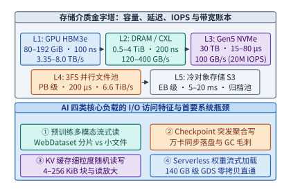

*图 13-1　AI 存储介质金字塔（L1 HBM 至 L5 对象存储）的延迟、IOPS 与带宽量级，以及四类核心 AI 负载的 I/O 访问瓶颈*

从图 13-1 与下表给出的物理参数账本中，可以提炼出两条贯穿本章的工程规律：

*表 13-2　AI 计算节点五级存储介质金字塔的容量、访问延迟、聚合带宽与物理寻址粒度账本*

| 存储层级 | 典型硬件形态（以 8 卡服务器为基准） | 单节点容量量级 | 单次访问延迟 | 聚合带宽量级 | 最小寻址/擦写物理粒度 |
| :--- | :--- | :--- | :--- | :--- | :--- |
| **L1：加速器显存** | HBM3 / HBM3e（8 张 GPU） | $640\ \mathrm{GiB}\text{–}1.5\ \mathrm{TiB}$ | $\sim 100\ \mathrm{ns}$ | $26.8\text{–}64.0\ \mathrm{TB/s}$ | $32\text{–}64\ \mathrm{B}$ 缓存行 |
| **L2：主机内存与 CXL 池** | DDR5 DRAM / CXL 2.0 内存扩展 | $1\text{–}4\ \mathrm{TiB}$ | $100\text{–}250\ \mathrm{ns}$ | $400\text{–}900\ \mathrm{GB/s}$ | $64\ \mathrm{B}$ 缓存行 / $4\ \mathrm{KiB}$ 页 |
| **L3：本机高速闪存** | $8\times \text{PCIe Gen5}\times 4\text{ NVMe SSD}$ | $30\text{–}61\ \mathrm{TB}$ | $15\text{–}80\ \mu\mathrm{s}$ | $100\text{–}112\ \mathrm{GB/s}$（约 $20\mathrm{M}$ IOPS） | $4\ \mathrm{KiB}$ LBA / $16\ \mathrm{KiB}$ 页 / 数 MiB 擦除块 |
| **L4：AI 并行文件池** | DeepSeek 3FS / Lustre（RDMA 互联） | $\mathrm{PB}\text{–}100\ \mathrm{PB}$ | $150\text{–}500\ \mu\mathrm{s}$ | 单机 $25\text{–}50\ \mathrm{GB/s}$，集群 $6.6\ \mathrm{TiB/s}$ | $64\ \mathrm{KiB}\text{–}4\ \mathrm{MiB}$ 分块（Chunk） |
| **L5：冷对象存储** | S3 / Ceph RGW（TCP/HTTP） | $\mathrm{EB}$ 级 | $5\text{–}20\ \mathrm{ms}$（TTFB） | 取决于前端网关与公网带宽 | 对象级（建议 $\ge 8\ \mathrm{MiB}$ 分段） |

第一，**从 L2（DRAM）跨越到 L3（NVMe SSD）不仅是延迟从百纳秒级跳变至数十微秒级的量级分水岭，更是寻址粒度从字节/缓存行（$64\ \mathrm{B}$）跳变至块/闪存页（$4\text{–}16\ \mathrm{KiB}$）的物理边界**。在 DRAM 中按稀疏索引随机读取几百字节仅损失部分缓存行效率；而在 NVMe SSD 上发起几百字节至 $2\ \mathrm{KiB}$ 的离散读取，底层闪存控制器仍必须读出完整的 $4\ \mathrm{KiB}$ 逻辑块乃至 $16\ \mathrm{KiB}$ 物理闪存页，这正是端侧与云端 KV 缓存卸载面临“读放大墙”的物理根源。

第二，**现代 PCIe Gen5 NVMe 阵列的物理聚合带宽（8 盘可达 $112\ \mathrm{GB/s}$）已经逼近甚至超越双路 CPU 主机内存控制器的实际跨槽转发能力，并与单台服务器配备的 $400\text{–}800\ \mathrm{Gbps}$（$50\text{–}100\ \mathrm{GB/s}$）RDMA 网卡线速处于同一量级**。一旦软件协议栈沿用传统的内核页缓存中转模式，主机 CPU 与 PCIe Root Complex 就会立即成为限制整机 I/O 吞吐的窄颈。

---

## 13.2 GPUDirect Storage (GDS) 与内核旁路 I/O 协议栈

当单台 8 卡 GPU 服务器挂载了 8 块 PCIe Gen5 $\times 4$ NVMe SSD（单盘标称顺序读带宽 $14\ \mathrm{GB/s}$，8 盘合计 $112\ \mathrm{GB/s}$）时，为什么使用标准的文件读取接口（如 Python 的 `torch.load()` 或 C 语言的 `pread()`）加载模型权重，实测吞吐往往卡在 $20\text{–}50\ \mathrm{GB/s}$ 无法继续提升？要回答这一问题，必须追踪一个数据块从闪存颗粒进入 GPU HBM 显存所经历的完整硬件拓扑与内核软件栈。

### 13.2.1 传统 POSIX 页缓存（Page Cache）路径的双重拷贝、CPU 中转与 PCIe Root Complex 带宽翻倍瓶颈

在经典的 Linux POSIX 文件 I/O 模型中，应用程序调用 `read(fd, user_buf, count)` 并随后调用 `cudaMemcpy(gpu_ptr, user_buf, count, cudaMemcpyHostToDevice)` 时，数据并非直接从 SSD 流入 GPU，而是被迫在主机侧经历**双重缓存与三次跨总线搬移**：

1. **第一跳（NVMe SSD $\to$ Host DRAM Page Cache）**：内核文件系统分配位于主机物理内存中的页缓存（Page Cache），并通过 NVMe 驱动向 SSD 下发 DMA 写描述符。SSD 控制器读取闪存后，生成的 PCIe 事务层数据包（TLP）向上穿越 PCIe Switch，进入 CPU 内部的 **PCIe Root Complex（根复合体）**，再经由主机内存控制器写入系统 DRAM 的页缓存页框。
2. **CPU 内存拷贝与锁定内存（Pinned Memory）中转**：由于页缓存属于内核可换出内存，而 GPU DMA 引擎要求源地址必须是物理连续或页表锁定的主机内存（Page-locked / Pinned Host Memory），CPU 核心必须介入，执行 `copy_to_user` 将数据从内核页缓存拷贝至用户态缓冲区；若用户缓冲区未预先通过 `cudaHostAlloc` 锁定，CUDA 驱动内部还需再次利用 CPU 将数据拷入驱动维护的临时 Pinned Staging Buffer。
3. **第二跳（Host DRAM $\to$ GPU HBM）**：GPU 的拷贝引擎（Copy Engine）发起 DMA 读取请求，数据包再次从系统 DRAM 经由内存控制器和 **PCIe Root Complex** 向下穿越 PCIe Switch，最终写入 GPU HBM。

设待加载的模型权重或 KV 状态总字节数为 $V_{\mathrm{data}}$。在传统 POSIX 页缓存路径下，主机 DRAM 承受了至少 $2 V_{\mathrm{data}}$（若含未锁定缓冲区拷贝则高达 $3\text{–}4 V_{\mathrm{data}}$）的读写带宽消耗，而最为关键的 **PCIe Root Complex 承受了进出两趟、总计 $2 V_{\mathrm{data}}$ 的有效载荷流量**：

$$
V_{\mathrm{RC,POSIX}} = V_{\mathrm{SSD}\to\mathrm{DRAM}} + V_{\mathrm{DRAM}\to\mathrm{GPU}} = 2 V_{\mathrm{data}}
$$

在现代超节点服务器中，为了保障 GPU 与 GPU、GPU 与 RDMA 网卡之间的全速直连，通常将每 1 至 2 张 GPU、1 张网卡和 1 至 2 块 NVMe SSD 挂载在同一颗专用 **PCIe Switch（交换芯片）** 下方，而 PCIe Switch 向上连接到 CPU Root Complex 的上行链路（Uplink）往往受到通道数（如单路 $\times 16$ Gen5 理论单向 $64\ \mathrm{GB/s}$，扣除 TLP 包头与流控开销后有效吞吐约 $50\text{–}56\ \mathrm{GB/s}$）或跨 NUMA 节点 UPI/Infinity Fabric 总线的严格限制。让本处于同一颗 PCIe Switch 下方的 SSD 与 GPU 绕道 CPU Root Complex 与主机内存走一个来回，不仅白白消耗了宝贵的宿主机 CPU 周期与 DRAM 带宽，更直接将传输速率锁定在 Root Complex 的上行瓶颈之下。

### 13.2.2 GDS P2P DMA 零拷贝路径：`NVMe SSD -> PCIe Switch -> GPU BAR1` 的直接传输与队列深度要求

为了彻底消除主机内存绕行，NVIDIA 联合存储厂商推出了 **GPUDirect Storage（GDS，基于 `cuFile` 库与 `nvidia-fs` 内核模块）**[^gds-guide]。GDS 的核心物理机制是利用 PCIe 总线的点对点直接内存访问（Peer-to-Peer DMA，P2P DMA）能力：

1. **GPU 显存窗口映射（BAR1 地址暴露）**：GPU 通过 PCIe 基址寄存器（BAR1）将目标 HBM 显存区域映射为一段总线物理地址（Bus Address）。
2. **DMA 目标地址重定向**：当应用程序调用 `cuFileRead(cf_handle, gpu_dev_ptr, size, file_offset, dev_offset)` 时（底层强制开启 `O_DIRECT` 旁路内核页缓存），标准文件系统先解析文件逻辑偏移对应的磁盘物理逻辑块地址（LBA）列表，随后 `nvidia-fs` 驱动拦截 NVMe DMA 映射请求，将原本指向主机 DRAM 的物理地址替换为指向 GPU BAR1 的 PCIe 总线地址。
3. **PCIe Switch 内部直通转发**：NVMe SSD 的 DMA 引擎根据描述符中的目标总线地址发出写 TLP 包；挂载在同颗 PCIe Switch 下的交换芯片识别出目标地址属于同级下游端口的 GPU BAR1，直接完成端口到端口的内部硬件路由，**全程不经过 CPU Root Complex，也不触碰一字节的主机 DRAM**（Root Complex 上仅流过每块数十字节的 NVMe 提交队列门铃 Doorbell 与完成队列中断信令）：

$$
V_{\mathrm{RC,GDS}} \approx 0, \qquad B_{\mathrm{eff,GDS}} = \min\!\left(\sum_{i=1}^{N_{\mathrm{SSD}}} B_{\mathrm{SSD},i},\; B_{\mathrm{Switch\to GPU}}\right)
$$

> **算例 13-1（单机 8 盘 PCIe Gen5 NVMe SSD 加载 $140\ \mathrm{GB}$ 权重的 POSIX Page Cache 与 GDS P2P DMA 账本对比）**：
> 考虑一台配备 8 张 GPU 与 8 块 PCIe Gen5 $\times 4$ NVMe SSD 的推理服务器（每块 SSD 标称顺序读峰值 $14.0\ \mathrm{GB/s}$，扣除文件系统元数据与对齐开销后的单盘持续有效读带宽 $B_{\mathrm{SSD,eff}} = 12.5\ \mathrm{GB/s}$，8 盘聚合有效读带宽达 $8 \times 12.5 = 100.0\ \mathrm{GB/s}$），每块 SSD 与对应 GPU 挂载在同一颗 PCIe Gen5 Switch 下。现需冷启动加载一个 $70\mathrm{B}$ 模型的 FP16 权重文件，总容量 $V_{\mathrm{data}} = 140.0\ \mathrm{GB}$。
> - **路径 A（传统 POSIX 页缓存 + `cudaMemcpy`）**：
>   数据首先从 8 块 SSD 经 PCIe Root Complex 写入主机 DRAM 页缓存（流量 $140.0\ \mathrm{GB}$），经 CPU 搬移至锁定内存后再经 Root Complex 拷入 GPU HBM（流量 $140.0\ \mathrm{GB}$），穿过 Root Complex 与主机内存控制器的双向总数据量高达 $V_{\mathrm{RC,POSIX}} = 280.0\ \mathrm{GB}$。受限于双路 CPU 跨 Root Complex 与软件拷贝流水线的持续有效吞吐上限 $B_{\mathrm{POSIX,eff}} = 50.0\ \mathrm{GB/s}$，加载 $140.0\ \mathrm{GB}$ 权重的端到端耗时为：
>   $$T_{\mathrm{POSIX}} = \frac{140.0\ \mathrm{GB}}{50.0\ \mathrm{GB/s}} = 2.80\ \mathrm{s}$$
>   且在此 $2.80\ \mathrm{s}$ 期间，主机侧有 16 至 32 个 CPU 物理核被内核拷贝线程打满。
> - **路径 B（GPUDirect Storage P2P DMA 零拷贝）**：
>   启用 `cuFileRead` 后，8 块 SSD 通过各自所属的 PCIe Gen5 Switch 直接向对应 GPU BAR1 发起 P2P DMA 传输，PCIe Root Complex 上的载荷流量降为 $0\ \mathrm{GB}$，8 盘并行跑满 $B_{\mathrm{GDS,eff}} = 100.0\ \mathrm{GB/s}$ 的聚合有效带宽，端到端加载耗时缩减为：
>   $$T_{\mathrm{GDS}} = \frac{140.0\ \mathrm{GB}}{100.0\ \mathrm{GB/s}} = 1.40\ \mathrm{s}$$
>   相比传统页缓存路径，GDS 将百 GB 权重的冷启动耗时精确缩短一半（**提速 $2.0\times$**），同时将主机 DRAM 带宽与 CPU 核完全释放给前端请求调度与分词预处理。图 13-2 直观对比了这两条路径的数据流向与瓶颈差异。

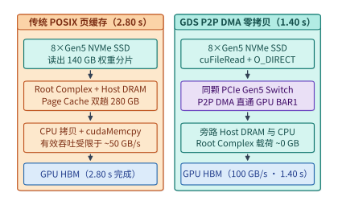

*图 13-2　算例 13-1：单机 8 盘 PCIe Gen5 NVMe SSD 加载 140 GB 权重时，传统 POSIX 页缓存双重拷贝（280 GB Root Complex 流量，耗时 2.80 s）与 GPUDirect Storage P2P DMA 零拷贝直通（100 GB/s，耗时 1.40 s）对比*

要在实际生产中跑满 GDS 或高速 NVMe SSD 的标称带宽，除了疏通 P2P DMA 硬件拓扑外，还必须满足 **利特尔法则（Little's Law）对并发 I/O 队列深度（Queue Depth，$Q$）的硬约束**。由于单块 NVMe SSD 内部包含多个闪存通道（Channel）与晶片（Die），单次读取请求的设备内部延迟 $L_{\mathrm{IO}}$ 通常在 $20\text{–}80\ \mu\mathrm{s}$ 之间；若应用程序以同步串行方式（队列深度 $Q=1$）每次请求 $S_{\mathrm{req}} = 64\ \mathrm{KiB}$ 数据，即便设备延迟低至 $L_{\mathrm{IO}} = 32\ \mu\mathrm{s}$，单队列吞吐也仅为 $64\ \mathrm{KiB} / 32\ \mu\mathrm{s} = 2.0\ \mathrm{GiB/s}$，不到 Gen5 SSD 峰值带宽的六分之一。为跑满目标带宽 $B_{\mathrm{target}}$，同时在途（In-flight）的最小并发 I/O 请求数 $Q_{\min}$ 必须满足：

$$
Q_{\min} = \left\lceil \frac{B_{\mathrm{target}} \cdot L_{\mathrm{IO}}}{S_{\mathrm{req}}} \right\rceil
$$

例如，若单盘目标有效带宽 $B_{\mathrm{target}} = 12.5\ \mathrm{GiB/s}$、大块顺序读取粒度 $S_{\mathrm{req}} = 128\ \mathrm{KiB}$、满载响应延迟 $L_{\mathrm{IO}} = 64\ \mu\mathrm{s}$，则单盘至少需要维持 $Q_{\min} = \lceil (12.5 \times 1024^3 \times 64 \times 10^{-6}) / (128 \times 1024) \rceil = \lceil 6.55 \rceil = 7$ 个并发在途请求（8 盘合计 $56$ 个）；而一旦进入细粒度 KV 缓存块召回场景（单次请求 $S_{\mathrm{req}} = 16\ \mathrm{KiB}$、满载高并发排队延迟 $L_{\mathrm{IO}} = 78.125\ \mu\mathrm{s}$），单盘所需的最小在途队列深度便急剧攀升至 $Q_{\min} = \lceil (12.5 \times 1024^3 \times 78.125 \times 10^{-6}) / (16 \times 1024) \rceil = 64$ 个并发请求（8 盘合计高达 $512$ 个在途请求）。

### 13.2.3 用户态异步 I/O：`io_uring`、SPDK 轮询驱动与 RDMA USRBIO 零拷贝网卡—磁盘直通

当并发 I/O 速率攀升至数百万乃至上千万 IOPS（例如单机 8 块 Gen5 SSD 并发拉取细粒度 KV 缓存块，总 IOPS 可达 $1.6\times 10^7$）时，传统的同步系统调用与硬件中断（IRQ）机制会在主机 CPU 侧引发第二重墙——**内核上下文切换与中断风暴**：

1. **传统 `pread`/`libaio` 的系统调用开销**：每次系统调用伴随用户态与内核态切换（加上 Spectre/Meltdown 页表隔离补丁开销），约消耗 $0.5\text{–}1.5\ \mu\mathrm{s}$ 的 CPU 时间；当 I/O 完成后，硬件中断触发内核下半部（SoftIRQ）处理并唤醒睡眠线程，又额外消耗数微秒。在 $10^7\ \mathrm{IOPS}$ 下，仅系统调用与中断处理就需要消耗十余个物理 CPU 核心。
2. **Linux `io_uring` 共享环缓冲区**：通过将提交队列（Submission Queue，SQ）与完成队列（Completion Queue，CQ）映射为用户态与内核态共享的无锁环形内存缓冲区，应用程序只需在用户态向 SQ 写入多个 I/O 请求描述符，并在开启内核轮询线程（`IORING_SETUP_SQPOLL`）与设备轮询（`IORING_SETUP_IOPOLL`）后实现**零系统调用提交与零硬件中断收割**，将百万级 IOPS 的 CPU 核开销降低 $60\%\text{–}75\%$。
3. **SPDK（Storage Performance Development Kit）全用户态轮询驱动**[^spdk-io]：进一步将 NVMe 驱动从 Linux 内核完全移入用户态进程，通过 `vfio-pci` 直接接管 NVMe SSD 的 PCIe BAR 寄存器与队列对（Queue Pairs）。工作线程在用户态无锁轮询完成队列（Polling），彻底消除了内核态切换、VFS 文件系统层锁竞争与中断延迟，使单核即可驱动超过 $1\times 10^6\ \mathrm{IOPS}$ 的 $4\ \mathrm{KiB}$ 随机读取。
4. **RDMA `USRBIO`（用户态注册缓冲区零拷贝远程存储直通）**：在存储与计算分离的集群架构中，计算节点通过 InfiniBand 或 RoCEv2 网络访问远端存储节点上的 NVMe SSD。现代 AI 原生文件系统（如后文详述的 DeepSeek 3FS）提供基于 RDMA 的用户态异步非阻塞接口（`USRBIO`）：应用程序预先将一段用户态内存（或通过 GPUDirect RDMA 注册的 GPU HBM 显存）注册为 RDMA 内存区域（Memory Region，MR）；发起远程读取时，存储节点通过 SPDK/`io_uring` 从远端 NVMe SSD 读出数据后，直接由远端网卡发起 `RDMA Write` 将数据零拷贝写入计算节点的已注册内存或 GPU 显存中，从而在跨机网络尺度上复现了本机 GDS 的旁路效果。

---

## 13.3 AI 原生并行文件系统：以 DeepSeek 3FS 为例

当集群规模从单机 8 卡扩展至数千乃至上万张 GPU 时，本机 NVMe SSD 的孤岛容量已无法容纳 PB 级的预训练数据集、全集群共享的历史 KV 缓存池以及跨节点迁移的 Checkpoint 快照，必须引入统一的分布式并行文件系统。

### 13.3.1 为什么传统 Lustre/POSIX 在万卡随机采样与 KVCache 卸载下遭遇元数据锁与长尾延迟瓶颈

过去二十年间，超算中心广泛采用以 Lustre、GPFS（IBM Spectrum Scale）和 CephFS 为代表的传统并行文件系统。这类系统在设计之初服务于气象模拟、流体力学等经典 HPC 负载，其核心假设是“大块顺序读写”与“严格的 POSIX 目录树强一致性语义”。当直接将它们搬入大模型万卡集群时，往往在以下三个环节暴露出严峻的结构性摩擦：

1. **POSIX 目录锁与 `stat/open` 元数据扩展性瓶颈**：完整实现 POSIX 标准意味着文件系统必须维护精确的文件访问时间戳（`atime`/`mtime`）、跨目录原子重命名以及字节级范围锁（Byte-range Locking）。在万卡多模态训练或高频 KV 块索引查询中，每秒数百万次的随机元数据操作会使中心化的元数据服务集群（MDS）陷入分布式锁争用风暴。
2. **基于内核客户端的缓存一致性与内存拷贝代价**：传统文件系统依赖内核态客户端或 FUSE（用户态文件系统）挂载，默认将读取的数据放入宿主机 Page Cache 并维护跨节点的缓存失效协议（Cache Coherence）。对于大模型训练中“随机采样读一次即丢弃”的语料或“直接拷入 GPU 显存”的 KV 缓存而言，主机页缓存不仅命中率极低，反而抢占了主机端宝贵的 DRAM 容量并引入额外的内存拷贝。
3. **主从复制（Primary-Backup）下的读负载集中与慢盘长尾放大**：在传统三副本块存储或文件系统中，为保证强一致性，所有读写请求通常都必须路由至主副本（Primary Replica）处理。这意味着另外两个从副本（Secondary Replicas）的 NVMe 读带宽在日常读取中被闲置，集群有效读带宽被压缩至物理磁盘总带宽的三分之一；更严重的是，一旦某个主副本所在的 SSD 正在执行后台垃圾回收（GC），该分片上的所有训练读取与 KV 召回都会遭受十毫秒级的尾延迟毛刺。

### 13.3.2 CRAQ（Chain Replication with Apportioned Queries）链式复制：如何在保证强一致性的同时将读吞吐线性扩展至全部副本节点

为了在分布式存储层同时实现**强一致性（Strong Consistency）**与**全副本读带宽线性扩展**，以 DeepSeek 开源的 **Fire-Flyer File System（3FS）**[^3fs-repo] 为代表的 AI 原生并行文件系统，摒弃了主从复制中的“仅主节点可读”限制，转而采用 **CRAQ（Chain Replication with Apportioned Queries，分摊查询的链式复制）** 协议[^craq-usenix]。

设每个数据分块（Chunk，如 $64\ \mathrm{KiB}\text{–}4\ \mathrm{MiB}$）在集群中维护 $R=3$ 个副本，按确定性顺序排列为一条复制链：链首节点（**Head**，副本 1）$\to$ 中间节点（**Mid**，副本 2）$\to$ 链尾节点（**Tail**，副本 3）。CRAQ 的读写状态机遵循如下精巧规则：

1. **写入路径（沿链顺序传播，Clean/Dirty 双状态标记）**：
   - 客户端将写请求（携带单调递增的版本号 $v$）发送至链首 **Head**。Head 将该新版本数据写入本地 NVMe SSD，并将其状态标记为 **未确认（Dirty）**，随后沿 RDMA 链路转发给 **Mid**；Mid 同样落盘并标记为 **Dirty** 后转发给链尾 **Tail**。
   - 当写请求抵达链尾 **Tail** 并完成落盘时，由于全体 $R=3$ 个副本均已持久化该版本，该写入在全局正式生效（Committed）。Tail 直接将本地版本标记为 **已确认（Clean）**，并沿链反向发送确认信令（ACK）：$\mathrm{Tail} \to \mathrm{Mid} \to \mathrm{Head}$。
   - Mid 与 Head 收到反向 ACK 后，依次将各自本地的对应版本从 Dirty 转换为 **Clean**，并回收旧版本空间，最后由 Head 向客户端返回写入成功。
2. **读取路径（全副本分摊读取 + 轻量级脏版本查询）**：
   - 客户端发起读请求时，**无需固定访问 Head 或 Tail，而是可以根据负载、网络拓扑亲和性（如优先读取同机架副本）或自适应延迟评分，随机或择优向 Head、Mid、Tail 中的任意一个副本发起读取**：
     - **情形 A（快路径，占比 $>99\%$）**：若目标副本上该数据块的最新本地版本处于 **Clean** 状态，说明该版本已在全链提交，该副本无需与任何其他节点通信，直接通过 RDMA 将数据块返回给客户端。
     - **情形 B（并发读写交叠慢路径）**：若目标副本（Head 或 Mid）上存在尚未收到 Tail 确认的 **Dirty** 版本（说明此时正有一笔并发写入在链中传播），该副本**不会直接返回 Dirty 版本**（否则会违背线性一致性），而是向链尾 **Tail** 发送一条仅含数字节的**版本查询请求（Version Query）**，询问 Tail 当前已正式提交的最新版本号 $v_{\mathrm{committed}}$，随后将本地对应的 $v_{\mathrm{committed}}$ 版本数据返回给客户端。

通过这一设计，CRAQ 在严格维持强一致性的前提下，带来了两项决定性的系统收益：
- **读吞吐随副本数 $R$ 线性扩展**：在以读为主的预训练采样、权重加载与 KV 缓存召回场景中，几乎所有块均处于 Clean 状态，全部 $R=3$ 个副本的 NVMe SSD 都能并行对外提供读取服务，使单数据块的聚合可用读带宽达到单副本主从架构的 **$R=3$ 倍**。
- **天然免疫单盘 GC 尾延迟（Hedging / 择优路由）**：当某个副本所在的 SSD 因后台擦除或网络微闪断出现响应迟缓时，3FS 客户端可以立即切向链上的另外两个健康副本读取相同数据，从而在存储层将 P99 长尾延迟平滑削平。

### 13.3.3 180 节点存储集群实现 `6.6 TiB/s` 聚合读带宽与 `3.66 TiB/min` KVCache 吞吐的网卡—磁盘配比算例

在工程落地中，许多团队在规划分布式存储节点时常犯一个直观错误：认为“单节点网卡线速是多少，里面配同等带宽的 SSD 就够了”。事实上，由于 SSD 需同时应对 CRAQ 3 副本写入流量、细粒度随机 IOPS 折损以及底层垃圾回收开销，**单节点的物理磁盘总带宽必须显著超配于网卡线速**，才能让网络端口在混合负载下持续跑满。我们通过 DeepSeek 3FS 公开的生产集群基准数据[^3fs-repo]来拆解这一配比账本。

> **算例 13-2（DeepSeek 3FS 180 节点存储集群的网卡—磁盘带宽匹配与 CRAQ 读写吞吐推导）**：
> 考虑一个由 $N_{\mathrm{store}} = 180$ 台专用存储服务器组成的 3FS 并行文件集群，服务于后端数百台计算节点：
> - **单节点硬件配置**：每台存储节点配备 **16 块 PCIe Gen4 $\times 4$ NVMe SSD**（单盘容量的典型配置为 $15.36\ \mathrm{TiB}$，单盘顺序读物理峰值带宽 $B_{\mathrm{SSD,read}} = 7.0\ \mathrm{GB/s}$，单盘顺序写物理带宽 $B_{\mathrm{SSD,write}} = 4.0\ \mathrm{GB/s}$）以及 **$2\times 200\ \mathrm{Gbps}$ InfiniBand/RoCEv2 RDMA 网卡**。
> - **第一步：核算单节点磁盘侧与网卡侧的物理带宽比值（Over-provisioning Ratio）**。
>   单节点 16 块 NVMe SSD 的聚合顺序读物理带宽上限为：
>   $$B_{\mathrm{disk,node}} = 16 \times 7.0\ \mathrm{GB/s} = 112.0\ \mathrm{GB/s} \approx 104.31\ \mathrm{GiB/s}$$
>   而单节点双口 $200\ \mathrm{Gbps}$ 网卡的双向线速带宽上限为：
>   $$B_{\mathrm{NIC,line}} = \frac{2 \times 200\ \mathrm{Gbps}}{8\ \mathrm{bit/B}} = 50.0\ \mathrm{GB/s} \approx 46.57\ \mathrm{GiB/s}$$
>   可以看到，单节点的磁盘物理读带宽相对于网卡线速超配了：
>   $$\eta_{\mathrm{over}} = \frac{B_{\mathrm{disk,node}}}{B_{\mathrm{NIC,line}}} = \frac{112.0\ \mathrm{GB/s}}{50.0\ \mathrm{GB/s}} = 2.24\times$$
>   为什么需要 $2.24\times$ 的磁盘带宽超配？原因在于：在真实多租户 AI 负载中，磁盘读取并非理想的 $100\%$ 大块顺序流，而是夹杂着随机寻址（有效带宽降至顺序峰值的 $60\%\text{–}75\%$）、后台 Checkpoint 写入与 SSD 内部 GC。由于磁盘侧保有 $112.0\ \mathrm{GB/s}$ 的充裕底座，即便在随机混合访问下磁盘有效产出打折一半（剩余 $56.0\ \mathrm{GB/s}$），依然足以跑满 $50.0\ \mathrm{GB/s}$ 的双口 RDMA 网卡，使瓶颈稳定收敛于网络端口而非慢速磁盘。
> - **第二步：核算 180 节点集群的实测聚合读吞吐**。
>   在扣除 RDMA 报文头、CRAQ 元数据交互与拥塞控制裕量后，单台存储节点的双口 $200\ \mathrm{Gbps}$ 网卡可持续输出的实测有效应用层读吞吐为 $B_{\mathrm{node,eff}} \approx 36.67\ \mathrm{GiB/s}$（折合十进制 $39.37\ \mathrm{GB/s}$，达到网卡物理线速的 $78.7\%$；若按二进制 $1\ \mathrm{TiB} = 1024\ \mathrm{GiB}$ 折算峰值 $6.6\ \mathrm{TiB/s}$ 则对应单节点 $37.55\ \mathrm{GiB/s} \approx 40.32\ \mathrm{GB/s}$，即线速的 $80.6\%$）。因此，180 台存储节点在全副本分摊读取下的集群聚合读吞吐达到：
>   $$B_{\mathrm{cluster,read}} = 180 \times 36.67\ \mathrm{GiB/s} = 6{,}600.6\ \mathrm{GiB/s} \approx 6.45\ \mathrm{TiB/s}\quad (\text{按 } 10^3\ \mathrm{GiB}\text{ 口径计为 }\mathbf{6.6\ \mathrm{TiB/s}})$$
>   在这一 $6.6\ \mathrm{TiB/s}$ 的聚合读带宽支撑下，哪怕训练作业同时伴随高强度背景噪声，海量训练样本也能以毫秒级抖动源源不断注入万卡计算集群。
> - **第三步：核算 CRAQ 3 副本写入带宽与 KVCache 业务吞吐**。
>   当执行集群级 Checkpoint 保存或大规模重排序（如 GraySort 基准测试）写入时，由于 CRAQ 采用 $R=3$ 链式复制，客户端每写入 $1\ \mathrm{GiB}$ 逻辑数据，需在存储集群内部经历 $\mathrm{Client}\to\mathrm{Head}\to\mathrm{Mid}\to\mathrm{Tail}$ 共 **3 次网卡接收与 3 次 SSD 落盘**（即网络与磁盘层面的复制放大因子为 $R=3$）。单节点 16 块 SSD 的物理写上限为 $16 \times 4.0 = 64.0\ \mathrm{GB/s} > 50.0\ \mathrm{GB/s}$，同样由网卡线速主导；在扣除 3 副本链式转发开销后，集群逻辑有效写入吞吐约为聚合读吞吐的 $\frac{1}{3}$ 量级。在专门针对在线推理的 **KVCache 分布式卸载池**场景中，受限于每次前缀命中拉取的块粒度与高并发尾延迟 SLA，生产实测可持续提供峰值 **$3.66\ \mathrm{TiB/min}$**（即 $3.66 \times 1024 / 60 \approx \mathbf{62.46\ \mathrm{GiB/s}}$）的高吞吐低延迟 KV 缓存读取服务，同时将原本需要消耗宝贵 DRAM 的百 TB 级长上下文历史状态平滑下沉至共享 NVMe 闪存池。图 13-3 展示了 CRAQ 读写路径与 180 节点带宽配比账本。

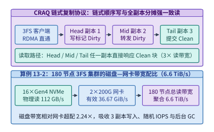

*图 13-3　DeepSeek 3FS 的 CRAQ 链式复制协议（链式顺序写与全副本强一致分摊读）及算例 13-2 中 180 节点存储集群实现 6.6 TiB/s 聚合读带宽的网卡—磁盘配比账本*

---

## 13.4 NVMe SSD 物理特性、读写放大与 KV Cache 存储布局（Mooncake / LMCache）

当我们将目光从宏观集群网络收回到单块 NVMe SSD 内部时，一个直接决定 KV 缓存卸载（如 Mooncake[^mooncake-fast] 与 LMCache[^lmcache-sys]）成败的核心工程问题浮出水面：**同样是从 SSD 拉取一段命中前缀的 $2{,}048$ 个历史 token 的 KV 缓存，为什么不同的张量落盘内存布局会让实测读取延迟相差 $8$ 倍以上**。

### 13.4.1 NAND Flash 页（$4\text{–}16\ \mathrm{KiB}$ LBA）与擦除块（Block）物理特性：细粒度随机拉取 KV 导致的 IOPS 墙与读放大（RAF）

与支持按字节/缓存行（$64\ \mathrm{B}$）原地覆写的 DRAM 截然不同，NAND 闪存介质受限于浮栅或电荷陷阱晶体管的物理机理，具有严格的**读写擦不对称性（Read/Write/Erase Asymmetry）**：

1. **最小读取与编程（写入）粒度为闪存物理页（Flash Page）**：现代企业级 3D TLC/QLC NAND 的物理页大小通常为 $S_{\mathrm{page}} = 16\ \mathrm{KiB}$，而在操作系统 NVMe 块设备层暴露的最小逻辑块寻址（LBA）粒度通常格式化为 $S_{\mathrm{LBA}} = 4\ \mathrm{KiB}$（或 $512\ \mathrm{B}$）。无论上层应用请求读取 $512\ \mathrm{B}$ 还是 $2\ \mathrm{KiB}$ 的有效张量片段，NVMe 控制器通过 PCIe 总线至少传输一个完整的 $S_{\mathrm{LBA}} = 4\ \mathrm{KiB}$ 逻辑块，而底层闪存晶片（Die）甚至需要感知并读出完整的 $16\ \mathrm{KiB}$ 物理页进行 LDPC 纠错解码。我们将实际底层读取字节数与上层所需有效字节数 $S_{\mathrm{valid}}$ 之比定义为**读放大系数（Read Amplification Factor，RAF）**：

   $$
   \mathrm{RAF}_{\mathrm{LBA}} = \frac{\max(S_{\mathrm{req}}, S_{\mathrm{LBA}})}{S_{\mathrm{valid}}}, \qquad \mathrm{RAF}_{\mathrm{NAND}} = \frac{\lceil S_{\mathrm{req}} / S_{\mathrm{page}} \rceil \cdot S_{\mathrm{page}}}{S_{\mathrm{valid}}}
   $$

   一旦单次随机请求的紧致有效载荷 $S_{\mathrm{valid}} < 4\ \mathrm{KiB}$，不仅有效 PCIe 传输带宽被强制折损 $\mathrm{RAF}_{\mathrm{LBA}}$ 倍，更会迅速撞上单块 SSD 的随机 **IOPS 墙**（企业级 Gen4/Gen5 SSD 的随机读上限通常在 $0.8\mathrm{M}\text{–}2.5\mathrm{M}\ \mathrm{IOPS}$ 之间，这与第 12.1.5 节端侧 UFS 闪存流式加载稀疏权重时面临的物理约束同源[^flash-llm]）。
2. **禁止原地覆写（Out-of-place Update）与大粒度块擦除（Block Erase）**：NAND 闪存页一旦写入数据，在未擦除前无法直接覆写；而擦除操作的最小物理单位是包含数百个物理页的**擦除块（Erase Block，容量高达 $4\text{–}16\ \mathrm{MiB}$）**，且单次擦除耗时高达 $3\text{–}5\ \mathrm{ms}$（比几十微秒的页读取慢两个数量级）。因此，SSD 内部的闪存转换层（Flash Translation Layer，FTL）必须采用日志式异地追加写入：每次更新逻辑块时，FTL 将新数据写入空白物理页，更新内部的 `LBA -> PBA（物理块地址）` 映射表，并将旧物理页标记为失效（Invalid）。

### 13.4.2 Layer-major（按层连续）vs. Block-major（按 Token 块连续）布局在 NVMe SSD 上的传输效率翻转条件

在 vLLM 或 SGLang 等现代推理引擎中，显存内的分页 KV 缓存（PagedAttention）通常按层管理：一个具有 $L$ 层 Transformer 的模型，往往为每一层分配独立的分页 KV 缓存池张量 `[num_blocks, 2, block_size, num_kv_heads, head_dim]`。当需要将分页 KV 块卸载到 NVMe SSD 时，系统面临两种截然不同的落盘布局选择：

1. **按层分离布局（Layer-major / Per-layer Contiguous）**：
   直接沿用显存内的分层张量结构，将第 $l$ 层（$l \in \{1,\dots,L\}$）的 KV 块连续存放。此时，同一个分页 Token 块（例如包含 $B_{\mathrm{tok}} = 16$ 个 token）在 $L$ 个网络层上的 KV 数据被拆散在文件的 $L$ 个不同偏移位置上。设单层、单个 Token 块的 KV 字节数为 $s_{\mathrm{layer}}$，则拉取 1 个逻辑 Token 块需要向 SSD 发起 **$L$ 次离散的随机小 I/O**，每次仅读取 $s_{\mathrm{layer}}$ 字节。
   特别是在采用 GQA（分组查询注意力）或 DeepSeek MLA（多头潜在注意力，单层每 token 仅 $576\ \mathrm{B}$）并结合 FP8 量化的现代模型中，单个 $16\text{-token}$ 块在单层上的字节数 $s_{\mathrm{layer}}$ 往往极小（例如 $s_{\mathrm{layer}} = 2\ \mathrm{KiB}$ 甚至不足 $1\ \mathrm{KiB}$）。
2. **全层按块聚合布局（All-layer Block-major / Token-block Contiguous）**：
   在将 KV 块换出至主机内存或 SSD 前，先将一个逻辑分页块（$B_{\mathrm{tok}}$ 个 token）在全部 $L$ 层上的 KV 状态拼接（或通过 Scatter-Gather DMA 聚合）为一个连续的物理大块，单块总有效字节数为：

   $$
   S_{\mathrm{block}} = L \cdot s_{\mathrm{layer}}
   $$

   当后续会话命中该前缀块时，无论模型有多少层，每个逻辑分页块在 SSD 上都只对应 **$1$ 次连续的大块顺序读取**。

我们可以写出在召回 $M$ 个逻辑分页块（总有效字节数 $V_{\mathrm{total}} = M \cdot L \cdot s_{\mathrm{layer}}$）时，给定 SSD 持续随机读上限 $I_{\max}$（单位：$\mathrm{IOPS}$）与持续有效顺序读带宽 $B_{\max}$（单位：$\mathrm{B/s}$），两种布局的完成时间下界方程：

$$
T_{\mathrm{IO}}(N_{\mathrm{req}}, S_{\mathrm{each}}) = \max\!\left(\frac{N_{\mathrm{req}}}{I_{\max}},\; \frac{N_{\mathrm{req}} \cdot \max(S_{\mathrm{each}}, S_{\mathrm{LBA}})}{B_{\max}}\right)
$$

当单次请求的对齐后大小 $S_{\mathrm{aligned}} = \max(S_{\mathrm{each}}, S_{\mathrm{LBA}})$ 小于SSD的**临界均衡块大小（Critical Crossover Block Size）** $S^* = \frac{B_{\max}}{I_{\max}}$ 时，系统处于 **IOPS 受限区（IOPS-bound）**；反之，当 $S_{\mathrm{aligned}} \ge S^*$ 时，系统进入能够跑满物理带宽的 **带宽受限区（Bandwidth-bound）**。

> **算例 13-3（32 层模型卸载 $16\text{-token}$ KV 块时 Layer-major 与 Block-major 的读放大与耗时翻转账本）**：
> 考虑一个 $L = 32$ 层的量化 GQA/MLA 模型，分页块粒度为 $B_{\mathrm{tok}} = 16\ \mathrm{tokens/block}$，每个逻辑块在单层上的 KV 状态大小为 $s_{\mathrm{layer}} = 2\ \mathrm{KiB}$（即每层每 token 占 $128\ \mathrm{B}$），故单个逻辑块跨 32 层的总有效数据量为 $S_{\mathrm{block}} = 32 \times 2\ \mathrm{KiB} = 64\ \mathrm{KiB}$。本机挂载一块高性能 NVMe SSD，其最小逻辑块粒度 $S_{\mathrm{LBA}} = 4\ \mathrm{KiB}$（物理闪存页 $S_{\mathrm{page}} = 16\ \mathrm{KiB}$），实测随机读上限 $I_{\max} = 800{,}000\ \mathrm{IOPS}$（$800\mathrm{k}\ \mathrm{IOPS}$），大块顺序读有效带宽 $B_{\max} = 12.5\ \mathrm{GiB/s} = 12{,}800\ \mathrm{MiB/s}$。
> 先求该 SSD 的 IOPS/带宽临界翻转块大小：
> $$S^* = \frac{B_{\max}}{I_{\max}} = \frac{12.5 \times 1024^2\ \mathrm{KiB/s}}{800{,}000\ \mathrm{IOPS}} = 16.384\ \mathrm{KiB}$$
> 现某次请求命中了 $2{,}048$ 个历史 token（即 $M = 2{,}048 / 16 = 128$ 个逻辑块），需从 SSD 召回总计 $V_{\mathrm{valid}} = 128 \times 64\ \mathrm{KiB} = 8\ \mathrm{MiB}$ 的有效 KV 状态：
> - **方案 A（Layer-major 按层分离布局）**：
>   每个逻辑块被拆散在 32 层，每次 I/O 仅读取单层的 $s_{\mathrm{layer}} = 2\ \mathrm{KiB}$。由于 $2\ \mathrm{KiB} < S_{\mathrm{LBA}} = 4\ \mathrm{KiB}$，每次读取在 LBA 层至少传输 $4\ \mathrm{KiB}$，触发 **LBA 级读放大 $\mathrm{RAF}_{\mathrm{LBA}} = 4 / 2 = 2.0\times$**（在 $16\ \mathrm{KiB}$ 闪存物理页层面更是触发 **$\mathrm{RAF}_{\mathrm{page}} = 16 / 2 = 8.0\times$** 的内部读取放大）。
>   召回 128 个块共需发起 $N_{\mathrm{IO,layer}} = 128 \times 32 = 4{,}096$ 次离散随机读。由于单次对齐后传输量 $4\ \mathrm{KiB} \ll S^* = 16.384\ \mathrm{KiB}$，系统被限制在 $800\mathrm{k}\ \mathrm{IOPS}$ 墙下，完成时间为：
>   $$T_{\mathrm{layer}} = \max\!\left(\frac{4{,}096}{800{,}000\ \mathrm{s}^{-1}},\; \frac{4{,}096 \times 4\ \mathrm{KiB}}{12{,}800\ \mathrm{MiB/s}}\right) = \max(5.12\ \mathrm{ms},\; 1.25\ \mathrm{ms}) = \mathbf{5.12\ \mathrm{ms}}$$
>   此时 SSD 实际交付给模型的有效 KV 载荷带宽仅为 $8\ \mathrm{MiB} / 5.12\ \mathrm{ms} = 1{,}562.5\ \mathrm{MiB/s} \approx \mathbf{1.526\ \mathrm{GiB/s}}$（或按 $1\ \mathrm{GiB}=1024\ \mathrm{MiB}$ 折算为 $1.526\ \mathrm{GiB/s}$，按 $10^3\ \mathrm{MiB}$ 计为 $1.5625\ \mathrm{GiB/s}$），不足标称带宽的八分之一。
> - **方案 B（All-layer Block-major 按 Token 块跨层连续打包，Mooncake / LMCache 采用方案）**：
>   每个逻辑块跨 32 层的 KV 状态被连续打包为一个 $S_{\mathrm{block}} = 64\ \mathrm{KiB}$ 的物理段。由于 $64\ \mathrm{KiB}$ 既是 $4\ \mathrm{KiB}$ LBA 的整数倍，又是 $16\ \mathrm{KiB}$ 闪存物理页的整数倍，**读放大系数严格降为 $\mathrm{RAF} = 1.0\times$**。
>   召回 128 个块仅需发起 $N_{\mathrm{IO,block}} = 128$ 次 $64\ \mathrm{KiB}$ 块读取（若前缀连续甚至可合并为单次 $8\ \mathrm{MiB}$ 顺序读）。由于 $64\ \mathrm{KiB} > S^* = 16.384\ \mathrm{KiB}$，I/O 彻底脱离 IOPS 墙进入纯带宽受限区，完成时间为：
>   $$T_{\mathrm{block}} = \max\!\left(\frac{128}{800{,}000\ \mathrm{s}^{-1}},\; \frac{8\ \mathrm{MiB}}{12{,}800\ \mathrm{MiB/s}}\right) = \max(0.16\ \mathrm{ms},\; 0.625\ \mathrm{ms}) = \mathbf{0.625\ \mathrm{ms}}$$
>   通过从 Layer-major 切换为 Block-major 连续打包，总 I/O 次数缩减了 $32\times$，端到端召回耗时从 $5.12\ \mathrm{ms}$ 降至 $0.625\ \mathrm{ms}$，**提速达 $5.12 / 0.625 = 8.192\times$**。图 13-4 展示了这一布局翻转的物理机制。

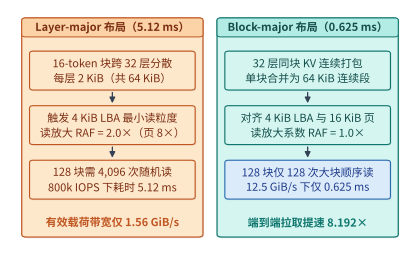

*图 13-4　算例 13-3：32 层模型卸载 16-token KV 块时，Layer-major 按层分离布局（触发 4 KiB LBA 读放大 RAF=2.0x 与 800k IOPS 墙，耗时 5.12 ms）与 Block-major 全层打包布局（RAF=1.0x，跑满 12.5 GiB/s，耗时 0.625 ms，提速 8.192x）对比*

### 13.4.3 垃圾回收（GC）引发的写放大（WAF）与 P99 尾延迟毛刺，以及 ZNS（分区命名空间）SSD 顺序追加优化

解决了读取侧的 RAF 与 IOPS 墙后，KV 缓存池与高频 Checkpoint 存储还面临写入侧的顽疾——**闪存垃圾回收（Garbage Collection，GC）引发的写放大（Write Amplification Factor，WAF）与读尾延迟毛刺**。

我们在第 9.5.2 节中曾指出，SSD 的日全盘写入次数 $\mathrm{DWPD} = \frac{W_{\mathrm{host}} \cdot \mathrm{WAF}}{C_{\mathrm{SSD}}}$ 直接受制于写放大系数 $\mathrm{WAF} = \frac{W_{\mathrm{NAND}}}{W_{\mathrm{host}}}$（其中 $W_{\mathrm{host}}$ 为宿主机逻辑写入量，$W_{\mathrm{NAND}}$ 为闪存颗粒实际承受的物理编程量）。在传统块接口 NVMe SSD 中，为什么 $\mathrm{WAF}$ 会显著大于 $1.0$：
1. **多租户不同寿命数据的物理混写**：在推理与训练集群中，短寿命的临时会话 KV 块（几分钟即过期驱逐）、长寿命的系统提示词公共前缀 KV 块（驻留数小时至数天）以及不同步数的训练 Checkpoint 被同时通过块接口写入 SSD。FTL 按到达时间顺序将它们混合填充进同一个 $8\text{–}16\ \mathrm{MiB}$ 的物理擦除块（Erase Block）中。
2. **后台 GC 有效页搬移（Read-Modify-Write）**：当短寿命 KV 块被 LRU 策略淘汰或旧 Checkpoint 被删除（发送 `TRIM / Deallocate` 指令）后，物理擦除块内部呈现出“部分页有效、部分页失效”的碎片化状态。当 SSD 剩余空白块低于阈值时，FTL 必须启动垃圾回收：挑选一个包含失效页的擦除块，**先将其内部尚存的有效物理页（Valid Pages）全部读出并重新编程写入另一个新擦除块，随后才能对该旧块执行毫秒级的整块擦除**。
   设被回收擦除块中有效页占比（即空间利用率）为 $u \in (0, 1)$，则在随机均匀失效假设下，每回收 $(1-u)$ 比例的自由空间，就需要额外搬移并重写 $u$ 比例的有效数据，导致稳态写放大系数攀升至：

   $$
   \mathrm{WAF} = \frac{W_{\mathrm{NAND}}}{W_{\mathrm{host}}} \approx 1 + \frac{u}{1 - u}
   $$

   例如，当盘面高水位运行、被回收块平均仍残留 $u = 60\%\text{–}75\%$ 的有效页时，$\mathrm{WAF}$ 将高达 **$2.5\text{–}4.0\times$**。这不仅使 SSD 的物理擦写寿命缩水至标称值的四分之一到五分之二，更致命的是：**当某个 NAND 晶片（Die）正在执行 $3\text{–}5\ \mathrm{ms}$ 的物理块擦除或大批量 GC 内部页搬移时，抵达同一晶片的在线 KV 读取请求必须排队等待**，致使原本仅需 $100\ \mu\mathrm{s}$ 的 SSD 读取在 P99 乃至 P99.9 分位上飙升至 **$8\text{–}15\ \mathrm{ms}$**。

为了从根源上消除 FTL 垃圾回收，新一代 AI 存储底座开始引入 **ZNS（Zoned Namespaces，分区命名空间）SSD**[^zns-usenix] 或应用层流式追加对齐（Log-structured Append）：
- **ZNS 的物理机制**：ZNS 标准摒弃了传统 SSD 内部不透明的页级随机覆写 FTL，将整块 SSD 的闪存空间显式划分为若干个固定大小（通常为 $1\text{–}2\ \mathrm{GiB}$，严格对齐底层整数个物理擦除块）的**分区（Zone）**。每个 Zone 规定只能从写指针（Write Pointer）处**顺序追加写入（Append-only）**，不允许随机覆写；当整个 Zone 的数据不再需要时，由上层软件直接下发一条 `Zone Reset` 指令将整个 Zone 一次性擦除归零。
- **与 AI 负载天然契合的生命周期对齐**：
  - **在训练 Checkpoint 场景中**：每一轮保存的完整模型分片与优化器状态（每个 Rank 数十 GiB）恰好独占整数个 Zone 顺序追加写入；当更新的两轮 Checkpoint 落盘完毕需要清理旧快照时，直接对旧快照所属的 Zone 执行 `Zone Reset`。
  - **在推理 KV 缓存池（如 Mooncake / 3FS KVCache）场景中**：存储引擎按会话分组或按相同 TTL（生存周期）分代（Generational Tiering）将 KV 块成批顺序追加写入专用 Zone；当该会话结束或整代缓存过期时，直接整区重置。
  由于同一个 Zone 内的数据同生共死（清理时有效页占比 $u = 0$），SSD 内部无需搬移任何一页有效数据，**写放大系数严格收敛至 $\mathrm{WAF} \approx 1.0\times$**，彻底消除了后台 GC 对前台在线读取的毫秒级尾延迟干扰，同时省去了传统 SSD 内部用于维护页级映射表的数十 GiB 板载 DRAM 成本。图 13-5 对照了传统块 SSD 与 ZNS SSD 的行为差异。

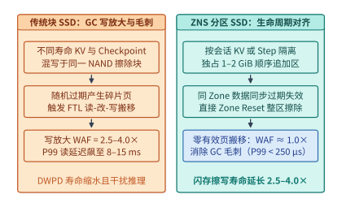

*图 13-5　传统块接口 NVMe SSD 在混写负载下的 FTL 垃圾回收（GC）写放大（WAF=2.5–4.0x）与读尾延迟毛刺，以及 ZNS 分区命名空间 SSD 按会话/检查点生命周期对齐实现 WAF≈1.0x 的机制*

---

## 13.5 多模态 PB 级训练数据预处理与流式供给流水线

在大语言模型与多模态生成模型（如我们在第 2.6.2 节剖析的 `Qwen-Image-2512` 与视频扩散 Transformer DiT）的预训练中，即便底层配备了 $6.6\ \mathrm{TiB/s}$ 的并行文件系统，若上层数据组织格式与主机侧解码流水线设计失当，万卡集群依然会频繁陷入“GPU 等数据（Data Stalls）”的算力饥饿状态。

### 13.5.1 Tar/WebDataset/Parquet 分片打包消除千万级小文件 `open()/stat()` 元数据风暴

假设一个多模态训练集包含 $1\times 10^8$（1 亿）对图文样本或短视频片段，平均每个样本文件大小为 $256\ \mathrm{KiB}$，总容量约 $25\ \mathrm{TiB}$。若直接将这 1 亿个 `.jpg`、`.mp4` 和 `.json` 文件散存在分布式文件系统的目录树下，每个 Epoch 的随机打乱读取将引发严重的 I/O 退化：
1. **元数据往返延迟主导航程**：每次读取一个 $256\ \mathrm{KiB}$ 样本前，DataLoader 进程必须先向远端元数据服务器（MDS）发送路径解析（`lookup`）、权限与大小查询（`stat`）以及打开句柄（`open`）请求，结束后还要发送 `close` 请求。在跨机网络上，这 3 至 4 次元数据 RPC 往返耗时约 $0.5\text{–}2.0\ \mathrm{ms}$，而真正传输 $256\ \mathrm{KiB}$ 数据在 $200\ \mathrm{Gbps}$ 网络上仅需 $10\ \mu\mathrm{s}$——**逾 $98\%$ 的时间被消耗在元数据交互而非有效载荷传输上**。
2. **目录 Inode 缓存击穿**：1 亿个文件的 Inode 元数据本身就高达数十至上百 GiB，在全局随机 Shuffle 访问下，MDS 与客户端的目录项缓存（dentry/inode cache）命中率趋近于零，触发高频磁盘随机读。

现代 AI 数据底座的标准工程解法是**分片顺序打包（Sharded Sequential Packaging）**，代表性格式包括 **WebDataset（基于 POSIX `.tar` 归档）**[^webdataset]、**Parquet / Lance 列式分片**以及 **MDS / MosaicML StreamingDataset**：
- **分片粒度对齐（$512\ \mathrm{MiB}\text{–}2\ \mathrm{GiB}$/Shard）**：在数据入湖预处理阶段，将每 $4{,}000\text{–}8{,}000$ 个样本（图像、视频与对应文本标注紧邻存放）顺序打包为一个 $1\text{–}2\ \mathrm{GiB}$ 的连续 `.tar` 或 `.parquet` 分片文件。1 亿个小文件由此坍缩为约 $12{,}500\text{–}25{,}000$ 个大号分片文件，**MDS 元数据请求量直接降低 $4{,}000\text{–}10{,}000$ 倍**。
- **两级分层随机打乱（Two-level Hierarchical Shuffle）**：如何在不拆开大块 `.tar` 分片的前提下保证训练样本的随机性？DataLoader 采用“**分片级全局随机打乱 + 内存滑动窗口内样本级随机打乱**”：每个训练 Worker 随机抽取分配到的 `.tar` 分片，以数十 MiB 的大块顺序 I/O 流式读入主机内存中的环形洗牌缓冲区（Shuffle Buffer，例如容纳 $4{,}096$ 个样本），再从该内存缓冲区中随机抽样送入训练批次。如此一来，底层存储看到的完全是带宽高达数 GB/s 的大块顺序流，而上层优化器看到的依然是统计性质优良的随机样本流。

### 13.5.2 视频与高分辨率图文训练中主机 CPU 解码瓶颈、GPU NVDEC/DALI 硬件解码卸载与预取缓冲池设计

当多模态训练从静态图像迈向高分辨率视频生成（Video DiT）或长视频理解VLM时，即便存储读取已经通过 WebDataset 分片实现了全速顺序供给，**数据流水线的瓶颈会立即从磁盘 I/O 转移至主机 CPU 的媒体解压缩（Video/Image Decoding）算力**。

原因在于：存储系统中保存的视频均为高压缩比的 H.264、HEVC（H.265）或 AV1 编码码流（压缩比高达 $50:1\text{–}200:1$）。在送入视觉编码器或 3D Causal VAE 之前，必须将压缩码流解码还原为未压缩的 RGB 像素张量 `[T, H, W, 3]`，并执行随机裁剪（Crop）、缩放（Resize）与归一化（Normalize）。

> **算例 13-4（视频 DiT 训练中每秒消费 $4{,}096$ 段 $720\mathrm{p}$ 视频片段的主机 CPU 软解码赤字与 GPU `NVDEC` 硬件卸载账本）**：
> 考虑一个高性能视频生成训练单元（或一个 8 节点高吞吐视频预训练微批次消费池，折算至单台配备 8 张旗舰 GPU 与双路共 $C_{\mathrm{total}} = 128$ 个物理 CPU 核的高密度训练节点），模型训练吞吐要求数据流水线每秒稳定供给 $N_{\mathrm{clip}} = 4{,}096$ 段 $720\mathrm{p}$（$1280\times 720$）H.264/HEVC 视频片段，每段视频抽取 $F = 16$ 帧送入 3D VAE 编码，即整机每秒必须完成解码与预处理的有效视频帧率为：
> $$R_{\mathrm{fps,req}} = N_{\mathrm{clip}} \times F = 4{,}096 \times 16 = \mathbf{65{,}536\ \mathrm{fps}}$$
> 我们来核算纯主机 CPU 软解码与 GPU 硬件解码卸载两条路径的资源账本：
> - **路径 A（传统 PyTorch DataLoader + 主机 CPU FFmpeg/libx264 软解码）**：
>   使用高度优化的 SIMD 指令集后，单颗现代服务器 CPU 物理核解码 $720\mathrm{p}$ 视频并完成主机内存色彩空间转换（YUV420 $\to$ RGB）与缩放的持续有效吞吐约为 $r_{\mathrm{CPU}} = 256\ \mathrm{fps/core}$（即每核每秒仅能处理 $256 / 16 = 16$ 段视频）。
>   要达成 $65{,}536\ \mathrm{fps}$ 的供给目标，纯软解码所需的物理 CPU 核数为：
>   $$C_{\mathrm{req,soft}} = \frac{R_{\mathrm{fps,req}}}{r_{\mathrm{CPU}}} = \frac{65{,}536\ \mathrm{fps}}{256\ \mathrm{fps/core}} = \mathbf{256\ \text{核}}$$
>   然而，该 8 卡 GPU 服务器整机仅配有 $128$ 个物理 CPU 核；扣除操作系统内核、RDMA 通信线程、PyTorch 算子发射主线程与分片网络预取必须保留的 $C_{\mathrm{res}} = 32$ 核后，可用于 DataLoader 解码进程的物理核上限仅为 $C_{\mathrm{avail}} = 128 - 32 = 96$ 核。
>   这直接造成了 **$256 - 96 = 160$ 个物理 CPU 核的解码算力赤字**，主机侧最大仅能供给 $96 \times 256 = 24{,}576\ \mathrm{fps}$（即每秒 $1{,}536$ 段视频），实际供给率被锁定在：
>   $$\eta_{\mathrm{supply,CPU}} = \frac{96}{256} = \mathbf{37.5\%}$$
>   这意味着后端昂贵的 8 张 GPU 有 **$62.5\%$ 的时间处于空转等待数据的饥饿状态**；更糟糕的是，$65{,}536\ \mathrm{fps}$ 的未压缩 $720\mathrm{p}$ RGB 张量（每帧 $1280\times 720\times 3 = 2.7648\ \mathrm{MB}$）若在主机端解码后再经 PCIe 拷入 GPU，每秒还需消耗 $65{,}536 \times 2.7648\ \mathrm{MB} \approx \mathbf{181.2\ \mathrm{GB/s}}$ 的 Host-to-Device PCIe 带宽，再度击穿主机内存与 Root Complex 上限。
> - **路径 B（NVIDIA DALI + GPU 片上专用 `NVDEC` 硬件解码器协同流水线）**[^dali-nvdec]：
>   现代数据中心 GPU（如 H100/H200/B200）芯片上除了用于矩阵运算的 SM（Streaming Multiprocessors）与 Tensor Core 外，还集成了完全物理独立的专用硬件视频解码引擎 **NVDEC**（例如每张 H100/B200 集成多达 7 个独立的 NVDEC 硬件解码核，单卡对 $720\mathrm{p}$ H.264/HEVC 码流的硬件解码能力高达 $r_{\mathrm{NVDEC}} \approx 9{,}600\ \mathrm{fps}$ 以上，8 卡合计提供 $8 \times 9{,}600 = \mathbf{76{,}800\ \mathrm{fps}} > 65{,}536\ \mathrm{fps}$ 的充裕解码算力）。
>   启用 DALI（Data Loading Library）异构流水线后，任务被精准拆解为两段：
>   1. **主机 CPU 仅负责轻量级容器解封装（Demux）与关键帧索引定位**：从 WebDataset 分片中读取压缩视频码流（每秒仅需传输压缩态的约 $1.5\text{–}3.0\ \mathrm{GB/s}$ 字节流），仅消耗 $32$ 个 CPU 物理核即可完成全部 $4{,}096$ 段视频的解封装，并通过异步 DMA 将微型压缩码流直接送入 GPU HBM。
>   2. **GPU `NVDEC` 原地硬件解码 + SM 算子融合增广**：片上 NVDEC 硬件引擎在后台把压缩码流直接解码写入 GPU HBM 显存缓冲区（**全程占用的 SM/Tensor Core 算力为 $0\%$**），随后紧接着在显存内调用融合 CUDA 核完成 Resize 与 Normalize，解码后的张量零拷贝直接交由 3D VAE 与 DiT 主干网络消费。
>   通过这一“存储分片顺序读 + CPU 轻量解封装 + GPU NVDEC 硬件解码”的三级流水线，不仅消除了 $160$ 核的 CPU 算力赤字，还将跨 PCIe 传输的数据量从解压后的 $181.2\ \mathrm{GB/s}$ 压缩回码流态的 $<3\ \mathrm{GB/s}$（缩减逾 **$60\times$**），使 GPU 训练算力利用率恢复至 **$100\%$ 满载**。图 13-6 展示了这一端到端多模态供给流水线。

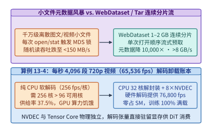

*图 13-6　多模态训练中 WebDataset 分片打包消除元数据风暴，以及算例 13-4 中每秒 4,096 段 720p 视频（65,536 fps）从主机 CPU 软解码赤字（缺口 160 核）向 DALI + 8×GPU NVDEC 硬件解码卸载的流水线*

在工程实现中，为彻底掩盖网络分片拉取抖动与视频关键帧（I-frame / GOP）长度不均带来的耗时波动，DALI 与 DataLoader 必须在主机锁定内存（Pinned Memory）与 GPU 显存侧设置双级**预取缓冲池（Prefetch Ring Buffer）**。设单步训练迭代计算耗时为 $T_{\mathrm{step}}$，单批次数据加载与解码耗时均值为 $\mu_{\mathrm{load}}$、标准差为 $\sigma_{\mathrm{load}}$，当预取队列深度 $K_{\mathrm{prefetch}} \ge 2\text{–}4$ 且满足均值条件 $\mu_{\mathrm{load}} \le 0.85\, T_{\mathrm{step}}$ 时，前序批次在缓冲池中积攒的样本余量即可吸收单步高达 $2\sigma_{\mathrm{load}}\text{–}3\sigma_{\mathrm{load}}$ 的存储尾延迟毛刺，实现数据供给与前向反向计算的完全重叠。

### 13.5.3 列式存储格式（Parquet / Lance）随机跳转、多模态流水线配比与按需 EROFS 镜像机制

尽管基于 `.tar` 归档的 WebDataset 在“全模态、固定顺序、单遍流式读取”场景下极为高效，但在现代大模型多阶段预训练与后训练中，数据工程经常面临两类 `.tar` 格式难以胜任的访问需求：

1. **多阶段按列投影（Column Projection）与在线质量过滤**：一条多模态训练记录往往同时包含原始高分辨率图像/视频二进制块（数十 KiB 至数 MiB）、OCR 文本、合成长描述、美学评分、安全分类标签以及词元长度统计（仅数百字节）。在只训练文本主干、重算领域配比或根据质量阈值筛选样本索引的阶段，如果使用行式捆绑的 `.tar` 归档，为了读取几百字节的文本或评分字段，仍被迫从磁盘和网络拉取整包数 MiB 的图像视频字节，造成超过 $95\%$ 的无效带宽浪费。
2. **课程学习（Curriculum Learning）与动态长度分桶的随机点查（Random Access）**：在第 10 章讨论的长上下文扩展（如从 $4\mathrm{K} \to 32\mathrm{K} \to 128\mathrm{K}$ 渐进加长）或动态序列打包（Sequence Packing）中，调度器需要根据当前批次剩余的序列槽位容量，按样本长度索引在亿级语料库中直接随机跳取特定行（Row ID）。由于 `.tar` 文件缺乏行级偏移目录且未建立列统计索引，随机定位第 $i$ 条样本只能在分片内顺序扫描跳过前序字节。

为此，现代 AI 数据湖广泛引入 **Apache Parquet** 与专为多模态深度学习设计的 **Lance** 列式存储格式[^lance-format]（表 13-3 与图 13-7）：
- **Apache Parquet（行组 + 列块 + 页级统计）**：先在水平方向每数万行切分为一个行组（Row Group），再在行组内部按列连续存储为列块（Column Chunk），并在文件尾部（Footer）记录各列的最小/最大值（Min/Max Statistics）与字典编码。当只读取文本与评分列时，DataLoader 仅解析 Footer 并对目标列块发起连续区间读取（HTTP/S3 Range Read 或 NVMe 顺序读），彻底跳过图像与视频列。但 Parquet 最初面向 OLAP 批量分析设计，其变长列采用紧致编码（如 RLE / Bit-packing），若要随机抽取单个行号（Point Lookup），仍需解压并扫描整个数据页（Data Page），单次点查延迟在毫秒级以上，且大尺寸二进制图像嵌入列块后容易破坏行组大小均衡。
- **Lance（定长偏移索引 + 零解压亚毫秒点查）**：针对 AI 训练的高频随机抽样与向量/图像混合存储，Lance 将每一列的变长载荷（如 JPEG/MP4 字节流或长文本）与一个紧凑的**定长 64 位偏移数组（Fixed-width Offset Array）**解耦存储。定位第 $i$ 行样本的第 $c$ 列时，存储引擎无需扫描任何前序记录，直接通过第 $1$ 次 NVMe 读取从定长偏移表切出 $[O_i, O_{i+1})$，再通过第 $2$ 次 NVMe 读取精准拉取目标字节段——**任意单样本点查严格收敛为 $\le 2$ 次 $O(1)$ 随机 I/O**。在本地 Gen4/Gen5 NVMe SSD 上，Lance 的单样本随机读取延迟可压至百微秒级，比 Parquet 随机点查快一个数量级以上，同时原生支持在不重写百 GiB 图像列的前提下直接追加新的标注列（Zero-copy Schema Evolution）。

*表 13-3　WebDataset（Tar）、Apache Parquet 与 Lance 三类预训练数据格式在顺序流、列裁剪与随机点查下的 I/O 特征对比*

| 数据存储格式 | 物理组织结构 | 全模态顺序流吞吐 | 按列投影（只读文本/元数据） | 按 Row ID 随机点查复杂度 | 新增标注列（Schema 演进） | 典型适用阶段 |
| :--- | :--- | :--- | :--- | :--- | :--- | :--- |
| **WebDataset (`.tar`)** | 按样本行式连续拼接，无尾部偏移目录 | **极高**（纯顺序大块 I/O） | **不支持**（须整包读出图像/视频） | $O(N_{\mathrm{shard}})$ 分片内顺序扫描 | 需全量重写 `.tar` 分片 | 冻结配比后的大规模图文/视频顺序预训练 |
| **Apache Parquet** | 行组（Row Group）内按列分块 + 压缩页 | 高（列块顺序扫描与向量化解码） | **支持**（精准跳过非目标列块） | 需解压整页扫描（毫秒级点查放大） | 需合并重写包含全部列的行组 | 纯文本预训练清洗、离线去重与多维统计过滤 |
| **Lance** | 列式存储 + 定长偏移表（Offset Array） | 高（支持流式扫描与 SIMD 解码） | **支持**（仅读取目标列偏移与载荷） | **$O(1)$（$\le 2$ 次 NVMe I/O，亚毫秒级）** | **支持零拷贝追加新列文件** | 课程学习动态长度采样、多模态检索增强与在线回放 |

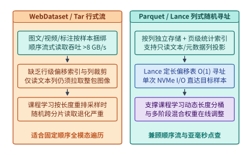

*图 13-7　WebDataset 行式顺序流与 Parquet/Lance 列式随机偏移寻址在多模态按列投影与课程学习动态采样下的 I/O 机制对比*

在理顺列式与分片存储格式之后，多模态数据供给流水线（如工业界多模态加载框架 *Youmu* 等采用的四级解耦流水线）通常将每个训练样本的处理拆分为**“① 存储分片拉取（Storage Fetch，吞吐 $R_{\mathrm{io}}$）$\to$ ② 主机 CPU 解封装与分词变换（CPU Demux & Transform，吞吐 $R_{\mathrm{cpu}}$）$\to$ ③ 设备侧 `NVDEC` 硬解码与数据增广（Device Decode & Aug，吞吐 $R_{\mathrm{dec}}$）$\to$ ④ Tensor Core 前反向迭代（Model Step，消费率 $R_{\mathrm{train}}$）”**四个异步流水段。根据流水线瓶颈定理，整条训练链路的稳态有效样本吞吐为：

$$
R_{\mathrm{eff}} = \min\!\left(R_{\mathrm{io}},\; R_{\mathrm{cpu}},\; R_{\mathrm{dec}},\; R_{\mathrm{train}}\right)
$$

当数据工程师调整训练配方（例如将图像分辨率从 $512\times 512$ 提升至 $1024\times 1024$，或在课程学习后期混入长视频样本）时，各阶段的单样本处理代价会发生非成比例漂移。为避免静态分配主机线程与内存缓冲导致某一环节堆积阻塞，运行时控制器需周期性观测各阶段环形队列的水位（Queue Occupancy）：若存储预取队列满而 CPU 变换队列空，则将主机内存预算向解压与变换工作线程池倾斜；若 GPU 显存预取池水位逼近下限，则触发弹性远端 CPU 解码池（Remote DataLoader Offloading）通过 RDMA 直接向训练节点推送已解码并切好 Patch 的紧凑视觉张量。

除了训练语料本身，在后训练强化学习（Agentic RL）与代码沙箱评测中，**成千上万个容器与微虚拟机（microVM）镜像的并发拉取与解包**是存储子系统面临的另一场大规模 I/O 洪峰。我们在第 11 章已从计算与内存维度介绍了 DeepSeek 的 **DSec（DeepSeek Elastic Compute）** 沙箱平台；这里我们依据其生产存储实测记录（[`case-studies/dsec-sandbox-platform.md`](../case-studies/dsec-sandbox-platform.md)）[^dsec-paper]，算清万级沙箱环境制品的存储底座账本：

> **算例 13-4a（DSec 沙箱平台 8,192 容器并发启动的 EROFS 按需块加载与 `overlayfs` 组合层复杂度账本）**：
> 在 DSec 生产环境中，单个集群单元包含约 $160$ 台 CPU 节点（共 $30\mathrm{K}$ 核、约 $250\ \mathrm{TB}$ DRAM），每日创建约 $300$ 万个沙箱，峰值并发达 $38$ 万个，峰值创建速率超过 $5{,}000\ \text{个/s}$（折合每节点每秒创建 $5{,}000 / 160 \approx 31.3$ 个环境）。仅在一周时间窗口内，平台活跃的环境制品就高达：容器侧 **$11{,}266$ 个基础镜像**与 **$102{,}171$ 个工作区（Workspace），总容量 $82.8\ \mathrm{TB}$**；microVM 侧 **$2$ 个基础镜像**、**$53{,}590$ 个工作区**与 **$4{,}889$ 个快照，总容量 $50.9\ \mathrm{TB}$**。
> 然而，生产追踪揭示了一个极其关键的稀疏访问定律：**沙箱在单次任务存活期内（容器存活中位数 $17.4\ \mathrm{min}$、microVM $15.5\ \mathrm{min}$），实际读取的镜像文件字节数仅占镜像总体积的 $4.2\%\text{–}13.3\%$**——具体而言，C++ 环境（镜像 $4.9\ \mathrm{GB}$）仅访问 **$8.7\%$**，Go 环境（$4.1\ \mathrm{GB}$）访问 **$13.3\%$**，Java 环境（$12.1\ \mathrm{GB}$）访问 **$9.2\%$**，JavaScript 环境（$9.6\ \mathrm{GB}$）访问 **$4.2\%$**，Python 环境（$6.0\ \mathrm{GB}$）仅访问 **$6.0\%$**。
> 基于这一稀疏性，DSec 摒弃了传统的“先全量拉取 `.tar` 镜像层、再在本地磁盘逐层解压”模式，转而构建了与 3FS 读写不对称原则一脉相承的三项存储机制（图 13-8）：
> 1. **只读 EROFS 块设备镜像与按需大块合并读取（On-demand Read）**：将容器与工作区层预先构建为紧凑的 **EROFS（Enhanced Read-Only File System）** 只读块镜像。当容器启动时，无需等待数 GB 镜像下载完毕，直接挂载远端 EROFS 镜像；运行过程中触发的文件页缺页被合并为大块顺序读取并缓存在本地 SSD 与页缓存中，而所有临时写入一律留在本地磁盘。在 $10$ 节点测试集群（AMD EPYC 9655）上一次性并发启动 **$8{,}192$ 个容器**的实测显示：**完整拉取镜像方案耗时超过 $60\ \mathrm{min}$，且每节点累计写盘超过 $1{,}600\ \mathrm{GB}$；而采用 EROFS 按需加载仅需约 $35\ \mathrm{min}$ 即可全部完成（与镜像全部预先缓存在本地的性能相当，比完整拉取快 $1.71\times$ 以上），同时每节点累计写盘降至约 $700\ \mathrm{GB}$（较完整拉取减少约 $57\%$，接近全部预缓存的 $600\ \mathrm{GB}$）**。
> 2. **`overlayfs` 可组合只读层消除 $O(m \cdot N)$ 重建风暴**：传统做法常将基础操作系统镜像、开发工具链（Toolkit）与具体代码仓库（Workspace）烘培成单一扁平镜像。设平台维护 $m$ 个基础镜像、$k$ 个工具链以及 $N$ 个具体任务工作区（$N \sim 10^5$），一旦升级基础镜像或编译器版本，扁平打包模式必须重新构建并写入 $O(m \cdot N)$ 或 $O(k \cdot N)$ 个完整镜像。DSec 将基础镜像、工具链与工作区拆分为三层相互独立的只读 EROFS 层，在容器创建瞬间由内核 `overlayfs` 动态叠加挂载，**使升级 $m$ 个基础镜像或 $k$ 个工具链的构建与存储同步复杂度直接从 $O(m \cdot N)$、$O(k \cdot N)$ 坍缩为线性的 $O(m)$ 与 $O(k)$**。在同批对比测试中，传统 `tar` 逐个解压耗时 **$79\ \mathrm{min}$**，而直接挂载 EROFS 层仅需 **$45\ \mathrm{min}$（提速 $1.76\times$）**，且 `tar` 解压方案的磁盘写入总量高达 EROFS 方案的 **$5.5\ \text{倍}$**。
> 3. **去重镜像集支撑跨云弹性分流**：通过将最常用的环境层去重收敛为一个 **$30\ \mathrm{TB}$ 的 EROFS 核心镜像集**（即可覆盖平台上 **$70\%$** 的容器任务依赖），当本地集群利用率超过 $80\%$ 时，调度器可将依赖完全落在该 $30\ \mathrm{TB}$ 镜像集内的任务无缝分流至远端 $200$ 台云端虚拟机执行，平稳吸收约 **$30\%$** 的峰值突发溢出流量。

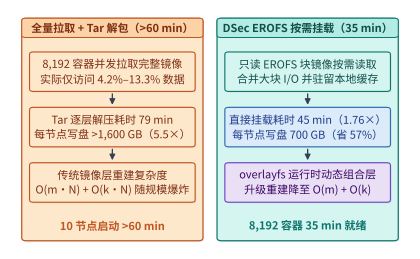

*图 13-8　DSec 平台 8,192 个容器并发启动对比：全量拉取解包（$>60\ \mathrm{min}$，单节点写盘 $>1{,}600\ \mathrm{GB}$）与 EROFS 按需块读取 + `overlayfs` 组合层（$35\ \mathrm{min}$，写盘 $700\ \mathrm{GB}$，重建复杂度 $O(m)+O(k)$）*

---

## 13.6 向量检索存储引擎、近存卸载与 RAG 端到端数据系统

在检索增强生成（Retrieval-Augmented Generation，RAG）与长周期记忆智能体（Memory-augmented Agent）中，存储系统不再仅仅被动提供按路径或按哈希命中的字节块，而是必须直接参与**高维向量相似度搜索（Vector Similarity Search）**，并将检索出的文档片段动态拼装进大模型的 Prefill 上下文。本节将从底层向量扫描的访存算术强度出发，推导近存检索卸载与闪存图索引（HNSW vs. DiskANN）的存储账本，并结合本书在真实硬件上完成的 **288 次端到端 Faiss + Qwen3-8B 请求实验**，揭示检索参数与生成引擎 KV 缓存及答案质量之间的深层耦合。

### 13.6.1 精确内积扫描（Faiss `IndexFlatIP`）、近存检索卸载（IKS）与 HNSW / DiskANN 索引布局

当知识库包含数千万乃至数十亿个文档切片时，每个切片经嵌入模型（Embedding Model）编码为一个 $d$ 维稠密向量 $\mathbf{x}_i \in \mathbb{R}^d$（$i \in \{1,\dots,N\}$）。给定用户的查询向量 $\mathbf{q} \in \mathbb{R}^d$，检索阶段的核心任务是找出内积 $\langle \mathbf{q}, \mathbf{x}_i \rangle$（或余弦相似度、欧氏距离）排名前 $k$ 的候选文档（Top-$k$ Nearest Neighbors）。

我们先用精确全库扫描（如 Faiss 中的 `IndexFlatIP`）来解剖这一工作负载的物理本质（[`case-studies/retrieval-and-generation.md`](../case-studies/retrieval-and-generation.md)）[^rag-case]：

> **算例 13-5a（$N = 2^{25}$ 条 $768$ 维向量的精确内积扫描、算术强度、主机链路瓶颈与 8 分片近存 IKS 卸载账本）**：
> 设向量库包含 $N = 2^{25} = 33{,}554{,}432$（约 $3{,}355$ 万）条向量，每条向量维度为 $d = 768$：
> 1. **存储容量账本（FP32 vs. FP16）**：
>    在标准 Faiss 库中，默认的 `IndexFlatIP` 以单精度浮点数（FP32，每维 $4\ \mathrm{B}$）存储向量，每条向量占用 $4d = 3{,}072\ \mathrm{B}$，全库总内存容量高达：
>    $$V_{\mathrm{FP32}} = 2^{25} \times 768 \times 4\ \mathrm{B} = 103{,}079{,}215{,}104\ \mathrm{B} = \mathbf{96\ \mathrm{GiB}}$$
>    若采用半精度（FP16/BF16，每维 $2\ \mathrm{B}$）存储，每条向量占 $2d = 1{,}536\ \mathrm{B}$，全库总容量减半为：
>    $$V_{\mathrm{FP16}} = 2^{25} \times 768 \times 2\ \mathrm{B} = 51{,}539{,}607{,}552\ \mathrm{B} = \mathbf{48\ \mathrm{GiB}} \approx \mathbf{51.540\ \mathrm{GB}}$$
>    需要注意，这个 $48\ \mathrm{GiB}$ 的 2 字节存储算例是衡量底层带宽下界的教学基准，不能直接当作默认 Faiss `IndexFlatIP` 的内存占用（默认 FP32 需 $96\ \mathrm{GiB}$）。
> 2. **计算量与算术强度（Arithmetic Intensity）**：
>    单次查询（`batch = 1`）与全库 $N$ 条向量做内积，每条向量需执行 $d$ 次乘法与 $d$ 次加法（共 $2d$ 次浮点运算），一次全库扫描的总浮点运算量为：
>    $$W_{\mathrm{scan}} = 2 N d = 2 \times 33{,}554{,}432 \times 768 \approx \mathbf{51.540\ \mathrm{GFLOPs}}$$
>    在 FP16 存储下，为了完成这 $51.540\ \mathrm{GFLOPs}$ 的点积运算，必须从存储介质中完整读出 $51.540\ \mathrm{GB}$ 的向量语料。在不计额外读写开销时，**单查询全库向量扫描的算术强度仅为**：
>    $$\mathrm{AI}_{\mathrm{batch}=1} = \frac{2 N d\ \mathrm{FLOPs}}{2 N d\ \mathrm{B}} = \mathbf{1.0\ \mathrm{FLOP/B}}$$
>    这比大模型自回归 Decode 阶段还要极端访存受限。只有当系统将 $B = 16$ 个并发查询凑成一批、共享同一次全库向量扫描时，点积计算量增加 $16$ 倍而语料读取保持 $1$ 遍，算术强度才会提升至 $\mathrm{AI}_{\mathrm{batch}=16} = \mathbf{16.0\ \mathrm{FLOP/B}}$（但需额外付出凑批排队等待与多路 Top-$K$ 维护开销）。
> 3. **主机链路搬移 vs. 近存计算（Near-Storage Processing，IKS）**：
>    - **传统主机链路搬移路径**：若这 $48\ \mathrm{GiB}$（$51.540\ \mathrm{GB}$）向量存放在远端内存池或存储卡中，每次扫描都必须通过有效带宽为 $B_{\mathrm{host}} = 64\ \mathrm{GB/s}$ 的主机 PCIe/CXL 链路搬入主机 CPU 或 GPU，则单遍供数传输时间下界高达：
>      $$T_{\mathrm{supply,host}} = \frac{51.5396\ \mathrm{GB}}{64\ \mathrm{GB/s}} \approx \mathbf{805.306\ \mathrm{ms}}$$
>      仅把向量搬过主机总线就耗去了 $0.8$ 秒以上，根本无法满足实时交互式 RAG 的延迟要求。
>    - **近存检索卸载路径（以 ASPLOS 2025 的 IKS 架构为例）**[^iks-asplos]：遵循“数据在哪里，就把算术强度极低的扫描与局部规约搬到哪里”的准则，将向量点积扫描与局部 Top-$K$ 筛选直接下沉至紧挨存储介质的近存计算单元（例如 CXL Type-2/Type-3 内存扩展模块内部的近存加速器）。若 8 个近存分片（Shards）内部合计拥有 $B_{\mathrm{IKS}} = 1\ \mathrm{TB/s}$（$1{,}000\ \mathrm{GB/s}$）的聚合内部内存带宽，则全库扫描的纯供数时间下界骤降至：
>      $$T_{\mathrm{supply,IKS}} = \frac{51.5396\ \mathrm{GB}}{1{,}000\ \mathrm{GB/s}} \approx \mathbf{51.540\ \mathrm{ms}}$$
>      更为关键的是主机与近存模块之间的跨链路通信量坍缩：主机只需向 $8$ 个分片各广播一份 $768$ 维 FP16 查询向量，总下行字节数仅为 $8 \times 1{,}536\ \mathrm{B} = \mathbf{12{,}288\ \mathrm{B}}$（$12\ \mathrm{KiB}$）；每个分片在本地扫描完各自负责的 $2^{22}$ 条向量后，仅将局部排名前 $k = 32$ 的 `(score, id)` 结果对（按 $4\ \mathrm{B}$ 浮点分数 + $8\ \mathrm{B}$ 整数 ID = $12\ \mathrm{B}$/对计算）传回主机做最终归并，8 个分片合计上行返回字节数仅为 $8 \times 32 \times 12\ \mathrm{B} = \mathbf{3{,}072\ \mathrm{B}}$（$3\ \mathrm{KiB}$）。跨主机总线传输的逻辑载荷从 $48\ \mathrm{GiB}$ 压缩到了约 $15\ \mathrm{KiB}$（图 13-9）。
>      当然，在严谨的系统审计中，绝不能把 $805.306\ \mathrm{ms} \div 51.540\ \mathrm{ms}$ 直接宣称为端到端系统加速比：点积计算单元吞吐、局部堆排序（Top-$K$）、8 个分片中的最慢长尾分片、协议封装与主机归并均会占据额外时间；且正如 IKS 论文所指出的，近存全库扫描会瞬间占满扩展内存通道带宽，从而拖慢共享同一 CXL 内存池的其他宿主应用。

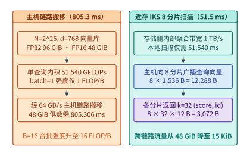

*图 13-9　$2^{25}\times 768$ 向量表（FP16 $48\ \mathrm{GiB}$）经 $64\ \mathrm{GB/s}$ 主机链路搬移（$805.306\ \mathrm{ms}$）与 8 分片近存 IKS 内部 $1\ \mathrm{TB/s}$ 扫描（$51.540\ \mathrm{ms}$，查询广播 $12{,}288\ \mathrm{B}$、结果归并 $3{,}072\ \mathrm{B}$）对比*

在通用服务器不具备专用近存硬件的条件下，为了避开 $O(N)$ 全库暴力扫描，工业界普遍采用**近似最近邻搜索（Approximate Nearest Neighbor Search，ANNS）**索引。从存储系统视角看，两类主流图索引呈现出截然不同的内存—闪存权衡（表 13-4 与图 13-10）：

1. **全内存分层可导航小世界图（HNSW，如 Faiss `IndexHNSWFlat`）**[^hnsw-pami]：
   HNSW 在原始向量之上构建一张多层邻接图：顶层为稀疏高速跳转网，底层（第 $0$ 层）包含全部 $N$ 个节点，每个节点最多维护 $2M$ 条出边（上层每节点最多 $M$ 条出边，参数 $M$ 通常取 $8\text{–}64$）。检索时从顶层入口节点出发，按贪心策略沿邻居边向查询向量逼近，并在底层维护一个容量为 `efSearch` 的动态候选优先队列。
   HNSW 的优势在于将单次查询的向量距离计算次数从 $N$ 降至对数级的数百至数千次（延迟低至几十微秒），但其代价是**剧烈的 DRAM 容量膨胀与随机内存跳转**：除了必须将全部原始 FP32 向量（如上例的 $96\ \mathrm{GiB}$）常驻内存外，第 $0$ 层每个向量还需额外存储 $2M \times 4\ \mathrm{B}$ 的邻居节点 ID 指针及高层指针（当 $M=32$ 时每向量仅图边指针就额外消耗 $\ge 256\ \mathrm{B}$，十亿级向量下仅图拓扑就膨胀数百 GiB），且建图耗时（`efConstruction`）比 Flat 索引高出两个数量级。
2. **闪存扇区对齐混合图索引（DiskANN / Vamana）**[^diskann-neurips]：
   当向量规模扩展至十亿级（TB 级）而主机 DRAM 仅数十 GiB 时，若直接将 HNSW 图放在 NVMe SSD 上并通过 `mmap` 访问，每次沿着图边跳向下一个节点都会触发两次细粒度随机读（一次读几百字节的邻居表，一次读 $1.5\text{–}3\ \mathrm{KiB}$ 的向量），再度撞上第 13.4.1 节剖析的 **$4\ \mathrm{KiB}$ LBA 读放大墙与多轮串行 I/O 延迟墙**。
   DiskANN 通过两项存储协同设计破解了这一困局（图 13-10 右）：
   - **内存仅驻留极紧凑的乘积量化（Product Quantization，PQ）压缩码**：将每条高维向量压缩为仅 $32\text{–}64\ \mathrm{B}$ 的 PQ 字节码常驻主机 DRAM。图遍历时，CPU 先利用内存中的 PQ 码以零磁盘 I/O 快速估算候选邻居的近似距离并筛选出最有希望的前 $W$（Beam Width，如 $W=4\text{–}8$）个节点。
   - **全精度向量与邻居表共置对齐 $4\ \mathrm{KiB}$ NVMe 扇区（Sector-aligned Co-location）**：在 NVMe SSD 上，将每个节点 $v$ 的**完整高精度向量（如 FP16/FP32）与其最多 $R$ 个出边邻居的 ID 列表紧凑打包在同一个 $4\ \mathrm{KiB}$ 物理扇区内**。在每一轮图搜索（Beam Search Hop）中，引擎利用 `io_uring`/SPDK 一次性并行下发 $W$ 个 $4\ \mathrm{KiB}$ 随机读请求，单次 I/O 既拿到了用于精确重排序（Re-ranking）的全精度向量，又同时拿到了下一跳的邻居列表，**读放大系数严格降为 $\mathrm{RAF}=1.0\times$**，仅需 $6\text{–}10$ 轮并行 SSD 读取（总延迟 $1\text{–}3\ \mathrm{ms}$）即可在单台工作站上完成十亿级向量检索。

*表 13-4　Faiss `IndexFlatIP`、近存 IKS、HNSW 与 DiskANN 四类向量检索架构的存储足迹、I/O 复杂度与瓶颈对比*

| 检索架构 | 主机 DRAM 占用 | 闪存/近存占用 | 单查询计算与 I/O 特征 | 构建成本与动态更新 | 核心适用边界 |
| :--- | :--- | :--- | :--- | :--- | :--- |
| **Faiss `IndexFlatIP`** | $4Nd$（FP32）或 $2Nd$（FP16） | 无（全驻内存） | $O(Nd)$ 全扫，算术强度 $1\ \mathrm{FLOP/B}$，纯内存带宽受限 | **极快**（直接追加拷贝，$<1\ \mathrm{ms}$ 级） | 百万级以内精确基准、高并发凑批（$B \ge 16$）扫描 |
| **近存计算 IKS** | 仅主控归并缓冲（KiB 级） | 分片近存容量 $2Nd$ | 存储侧 $1\ \mathrm{TB/s}$ 本地全扫，跨主机总线仅传十余 KiB | 快（按分片追加写入） | 千万至亿级高召回全扫，需防范共享 CXL 内存带宽争用 |
| **Faiss `IndexHNSWFlat`** | $4Nd + O(N \cdot M)$ 图边指针 | 无（全驻内存） | 对数级跳表步数，DRAM 缓存行随机访问，几十微秒级 | **慢**（多线程建图，不保证跨平台逐位一致） | 内存充裕（十亿级以下）、追求极致低延迟与高 QPS 的在线服务 |
| **DiskANN (Vamana)** | 极小（仅 $32\text{–}64\ \mathrm{B}$/向量的 PQ 码） | 全精度向量 + 邻居表对齐 $4\ \mathrm{KiB}$ 扇区 | 内存 PQ 粗筛 + $6\text{–}10$ 轮 $4\ \mathrm{KiB}$ 并行 SSD 读（$\mathrm{RAF}=1.0\times$） | 中等（需构建 Vamana 图与扇区对齐排布） | 十亿至百亿级超大规模知识库、受限于单机 DRAM 容量的高性价比部署 |

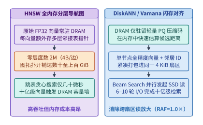

*图 13-10　HNSW 全内存分层导航图的邻接指针内存膨胀，以及 DiskANN 将 PQ 压缩向量驻留 DRAM、全精度向量与邻居表紧凑对齐 $4\ \mathrm{KiB}$ NVMe 扇区的混合检索架构*

更进一步，在端到端 RAG 系统中，**检索器的速度与召回精度绝不能脱离下游生成模型的 Prefill 算力账本孤立评价**。一个粗糙但极快的检索器往往需要返回更多候选文档（更大的 Top-$k$）才能覆盖正确答案所需的证据，而多塞入上下文的每一篇冗余文档都会线性推高大模型线性层矩阵乘法（GEMM）与 KV 缓存体积，并二次方推高因果注意力配对计算量。我们用 [`case-studies/retrieval-and-generation.md`](../case-studies/retrieval-and-generation.md) 中的固定配置算清这一跨阶段翻转边界：

> **算例 13-5b（精检少文档 vs. 粗检多文档在 Qwen3-8B 上的检索—Prefill 协同时间账本与算力翻转点）**：
> 固定生成模型为 **Qwen3-8B**（共 $36$ 层 Transformer，隐藏维 $d = 4{,}096$，KV 投影维 $d_{\mathrm{kv}} = 1{,}024$，FFN 中间维 $f = 12{,}288$；单层 Q/K/V/O 投影与三块 FFN 矩阵的线性权重参数量合计为 $36 \times (2d^2 + 2d d_{\mathrm{kv}} + 3df) = \mathbf{6{,}945{,}767{,}424}$ 个参数；BF16 KV 缓存每词元占 $36 \times 2 \times 1{,}024 \times 2\ \mathrm{B} = 147{,}456\ \mathrm{B} = \mathbf{144\ \mathrm{KiB/token}}$）。设单请求 `batch = 1`、无前缀缓存命中，问题与提示词模板固定为 $512$ 个 token，检索出的每篇文档恰好为 $128$ 个 token。
> 假设前期质量评测筛出了两个均能满足相同回答质量门槛的检索候选方案（表 13-5）：
> - **候选 A（精细检索 / 附带重排，少而准）**：检索阶段耗时较长，需 **$T_{\mathrm{ret,A}} = 200\ \mathrm{ms}$**，但只需返回 **$k = 8$ 篇**文档即可保证答案质量，故送入 Qwen3-8B 的总输入长度为 $T_{\mathrm{A}} = 512 + 8 \times 128 = \mathbf{1{,}536\ \mathrm{tokens}}$，生成的 BF16 KV 缓存体积为 $1{,}536 \times 144\ \mathrm{KiB} = \mathbf{216\ \mathrm{MiB}}$。
> - **候选 B（快速近似检索，快而杂）**：检索阶段仅需 **$T_{\mathrm{ret,B}} = 20\ \mathrm{ms}$**（比候选 A 快 $180\ \mathrm{ms}$），但必须返回 **$k = 32$ 篇**文档才能达到同等回答质量，总输入长度膨胀 $3$ 倍至 $T_{\mathrm{B}} = 512 + 32 \times 128 = \mathbf{4{,}608\ \mathrm{tokens}}$，BF16 KV 缓存体积同步膨胀至 **$\mathbf{648\ \mathrm{MiB}}$**。
> 我们按主干矩阵运算量公式（线性矩阵乘法 $W_{\mathrm{lin}}(T) = 2 T \times 6{,}945{,}767{,}424$，因果注意力有效配对 $W_{\mathrm{attn}}(T) = 36 \times 4d \times \frac{T(T+1)}{2}$）核算两者的 Prefill 浮点运算量：
> - **候选 A（$T_{\mathrm{A}} = 1{,}536$）**：线性矩阵运算量 $W_{\mathrm{lin,A}} \approx \mathbf{21.337\ \mathrm{TFLOPs}}$，因果注意力运算量 $W_{\mathrm{attn,A}} \approx \mathbf{0.696\ \mathrm{TFLOPs}}$，Prefill 主要矩阵总运算量 $W_{\mathrm{pre,A}} \approx \mathbf{22.034\ \mathrm{TFLOPs}}$。在假设的 GPU 有效计算速率 $F_{\mathrm{eff}} = 200\ \mathrm{TFLOP/s}$ 下，Prefill 计算耗时约为 $T_{\mathrm{pre,A}} = 22.0336 / 200 \approx \mathbf{110.168\ \mathrm{ms}}$，检索加 Prefill 合计耗时为 $200 + 110.168 = \mathbf{310.168\ \mathrm{ms}}$。
> - **候选 B（$T_{\mathrm{B}} = 4{,}608$）**：线性矩阵运算量增至 $W_{\mathrm{lin,B}} \approx \mathbf{64.012\ \mathrm{TFLOPs}}$（恰好 $3\times$），因果注意力运算量激增约 $9\times$ 至 $W_{\mathrm{attn,B}} \approx \mathbf{6.263\ \mathrm{TFLOPs}}$，Prefill 总运算量达 $W_{\mathrm{pre,B}} \approx \mathbf{70.276\ \mathrm{TFLOPs}}$。在同样的 $200\ \mathrm{TFLOP/s}$ 下，Prefill 计算耗时升至 $T_{\mathrm{pre,B}} \approx \mathbf{351.378\ \mathrm{ms}}$，检索加 Prefill 合计耗时达 $20 + 351.378 = \mathbf{371.378\ \mathrm{ms}}$。
> 对比可见：**候选 A 在检索上多花的 $\Delta T_{\mathrm{ret}} = 180\ \mathrm{ms}$，在下游 Prefill 阶段省下了 $\Delta W_{\mathrm{pre}} = 70.2756 - 22.0336 = 48.242\ \mathrm{TFLOPs}$（对应 $241.210\ \mathrm{ms}$）的 GPU 矩阵计算时间，使端到端完成时刻反而净提前了 $241.210 - 180 = \mathbf{61.210\ \mathrm{ms}}$，同时还将单请求占用的显存 KV 缓存缩减了 $432\ \mathrm{MiB}$**。
> 若保持其余条件不变，令两候选的总耗时相等，即可求出使结论发生翻转的 GPU 临界有效算力速率 $F_{\mathrm{cross}}$：
> $$F_{\mathrm{cross}} = \frac{W_{\mathrm{pre,B}} - W_{\mathrm{pre,A}}}{T_{\mathrm{ret,A}} - T_{\mathrm{ret,B}}} = \frac{48.242\ \mathrm{TFLOPs}}{0.180\ \mathrm{s}} \approx \mathbf{268.011\ \mathrm{TFLOP/s}}$$
> 当后端加速器的实际有效 Prefill 吞吐低于 $268.011\ \mathrm{TFLOP/s}$ 时，宁可让存储/检索侧多花 $180\ \mathrm{ms}$ 精筛出 8 篇高质量文档；唯有当后端算力极其充沛（有效吞吐超越 $268.011\ \mathrm{TFLOP/s}$）且显存容量不成为瓶颈时，粗检多送的候选 B 才会在首字时间上反超候选 A。

*表 13-5　算例 13-5b：精检少文档（候选 A，8 篇）与粗检多文档（候选 B，32 篇）在 Qwen3-8B 上的协同账本对比*

| 核算指标 | 候选 A：精细检索返回 8 篇 | 候选 B：快速检索返回 32 篇 | 物理关系与工程含义 |
| :--- | ---: | ---: | :--- |
| **检索阶段用时 $T_{\mathrm{ret}}$** | $200\ \mathrm{ms}$ | **$20\ \mathrm{ms}$** | 候选 B 在检索环节领先 $180\ \mathrm{ms}$ |
| **送入模型总输入长度 $T$** | **$1{,}536\ \mathrm{tokens}$** | $4{,}608\ \mathrm{tokens}$ | $512$ 模板词元 + $k \times 128$ 文档词元（相差 $3\times$） |
| **单请求 BF16 KV 显存占用** | **$216\ \mathrm{MiB}$** | $648\ \mathrm{MiB}$ | 按每词元 $144\ \mathrm{KiB}$ 计，候选 B 消耗 $3\times$ 显存池配额 |
| **各层线性矩阵运算量 $W_{\mathrm{lin}}$** | $21.337\ \mathrm{TFLOPs}$ | $64.012\ \mathrm{TFLOPs}$ | 随输入词元数 $T$ 严格线性增长（$3\times$） |
| **因果注意力有效配对运算量 $W_{\mathrm{attn}}$** | $0.696\ \mathrm{TFLOPs}$ | $6.263\ \mathrm{TFLOPs}$ | 随 $T(T+1)/2$ 二次方增长（约 $9\times$） |
| **按 $200\ \mathrm{TFLOP/s}$ 折算 Prefill 耗时** | **$110.168\ \mathrm{ms}$** | $351.378\ \mathrm{ms}$ | 候选 A 在 Prefill 环节反超 $241.210\ \mathrm{ms}$ |
| **检索 + Prefill 联合估计总耗时** | **$310.168\ \mathrm{ms}$** | $371.378\ \mathrm{ms}$ | **候选 A 净提前 $61.210\ \mathrm{ms}$（翻转算力阈值 $268.011\ \mathrm{TFLOP/s}$）** |

### 13.6.2 真实 288 请求 Faiss + Qwen3-8B RAG 流水线实验、校准失配与多进程资源守卫审计

算例 13-5b 说明了理论工作量模型如何框定检索与生成的协同边界。然而在真实工程中，**“向量余弦相似度最高的前 $k$ 篇文档是否一定包含目标证据”、“在小样本校准集上选出的最小合格 $k$ 能否在留出集上保持 $100\%$ 通过”、以及“增加 $k$ 值在真实 vLLM 引擎中究竟分配了多少物理 KV 块”**，都无法靠纸面公式假定，必须通过受控端到端实验直接测量。下面我们完整呈现本书实验 `13-01`（[`experiments/ch13/13-01/retrieval-generation/README.md`](../experiments/ch13/13-01/retrieval-generation/README.md)）[^exp-13-01-rag] 的预注册设计、实测数据与系统审计结论。

1. **冻结语料、真实编码器与 Faiss 双索引构建账本**：
   - **自编受控事实语料与分拆验证集**：为排除大模型利用预训练先验知识“盲猜”答案的干扰，`freeze.py` 脚本固定生成了 **$1{,}024$ 条**虚构的站点登记记录（Station Register，保存于 `corpus.json`，文件大小 $466{,}051\ \mathrm{B}$），每条记录包含一个虚构站点名称及其唯一对应的两词口令（Two-word Passphrase）。实验固定 **$24$ 道问题**（`queries.json`），在运行前严格冻结划分为 **$8$ 道校准题（Calibration Split）** 与 **$16$ 道留出评估题（Held-out Evaluation Split）**。
   - **真实 CPU 嵌入与索引构建耗时（`retrieval-001/`）**：采用预训练模型 `sentence-transformers/all-MiniLM-L6-v2`（固定 revision `1110a243fdf4706b3f48f1d95db1a4f5529b4d41`，输出维度 $d = 384$，执行掩码均值池化与 FP32 L2 归一化，归一化后的语料向量文件 `corpus-vectors.npy` 为 $1{,}572{,}992\ \mathrm{B}$）。在 CPU 侧实测：编码器加载耗时 **$1.691928\ \mathrm{s}$**，编码全部 $1{,}024$ 篇文档耗时 **$11.302180\ \mathrm{s}$**，批量编码 $24$ 道问题耗时 **$0.050709\ \mathrm{s}$**，编码与检索进程峰值常驻内存 `ru_maxrss` 为 **$879{,}360\ \mathrm{KiB}$**。
   - **Faiss `1.12.0` 精确索引 vs. HNSW 图索引**：基于同一组 FP32 向量分别构建 `IndexFlatIP` 与 `IndexHNSWFlat(..., METRIC_INNER_PRODUCT)`（图参数固定为 $M = 8$、$\mathrm{efConstruction} = 40$）：
     - `IndexFlatIP` 构建仅需 **$0.000216\ \mathrm{s}$**（$216\ \mu\mathrm{s}$），序列化索引文件 `flat.faiss` 大小为 **$1{,}572{,}909\ \mathrm{B}$**（即 $1{,}024 \times 384 \times 4 = 1{,}572{,}864\ \mathrm{B}$ 原始向量加 $45\ \mathrm{B}$ 文件头），单查询检索中位数耗时为 **$277.6\text{–}280.2\ \mu\mathrm{s}$**；
     - `IndexHNSWFlat` 构建耗时 **$0.023254\ \mathrm{s}$**（为 Flat 的 $107.7\ \text{倍}$），序列化文件 `hnsw.faiss` 膨胀至 **$1{,}655{,}730\ \mathrm{B}$**（多出的 $82{,}821\ \mathrm{B}$ 即为 $M=8$ 邻接图结构开销），在扫描参数 $\mathrm{efSearch} \in \{4, 16, 64\}$ 下，单查询检索中位数耗时分别低至 **$14.3\text{–}16.5\ \mu\mathrm{s}$**（$\mathrm{ef4}$）、**$24.0\text{–}25.5\ \mu\mathrm{s}$**（$\mathrm{ef16}$）与 **$62.7\text{–}63.7\ \mu\mathrm{s}$**（$\mathrm{ef64}$）。
2. **288 次端到端请求实测与“校准集预选 $k=1$ 在留出集失守”的科学负结果（图 13-11）**：
   实验扫描了 $4$ 组索引配置族（`Flat`、`HNSW ef4`、`HNSW ef16`、`HNSW ef64`）$\times\ 3$ 档返回文档数 $k \in \{1, 4, 16\}$ = **$12$ 个检索配置单元（Cells）**，每个单元在 $24$ 道问题上各执行一次完整的“CPU 在线编码与检索（`serve_retrieval.py`）$\to$ 提示词模板拼装（实际输入长度跨度为 **$131\text{–}1{,}227\ \mathrm{tokens}$**）$\to$ GPU vLLM 0.23 `Qwen3-8B` 生成（固定 revision `b968826d9c46dd6066d109eabc6255188de91218`，BF16 KV，`no-thinking`，`greedy`，`max_tokens=32`，关闭自动前缀缓存 APC）”全链路流程，共计 **$12 \times 24 = 288$ 次真实生成请求**。严格评分要求模型正常 `stop` 结束且输出精确匹配两词口令。
   实测全部 $288$ 次请求正常返回，**严格答案通过率为 $281 / 288$（$97.57\%$）**；全部 $7$ 次失败请求均是因为检索返回的 Top-$k$ 文档中漏掉了目标站点文档，模型诚实输出了 `UNKNOWN`。切开校准集与留出集后，暴露出一个极具警示意义的系统评测教训（图 13-11）：
   - **预注册选择策略在留出集上未通过（Calibration Trap）**：实验预注册的选择规则是“在每个索引族内，先根据 $8$ 道校准题达到 `8/8` 满分选出最小的 $k$，再冻结该 $k$ 去接受 $16$ 道留出题必须 `16/16` 全对的检验”。在 $8$ 道校准题上，`Flat`、`HNSW ef16` 与 `HNSW ef64` 在 **$k = 1$** 时均拿到了 **`8/8` 满分**（而 `HNSW ef4` 在校准题 `q05` 上因近邻搜索陷入局部极值，无论 $k=1,4,16$ 均只拿到 `7/8`，在第一关即被淘汰）。于是预选规则将三者的推荐配置全部锁定在成本最低的 **$k = 1$**。然而，当带着 $k = 1$ 进入 $16$ 道留出评估题时，这三组配置全部在第 $14$ 题（`q14`）上因为干扰文档与查询向量的内积略高于真实目标文档（目标文档排在第 $2$ 位），导致 $k=1$ 检索漏掉了目标证据，留出集得分齐齐跌至 **`15/16`**，预注册自动选参策略宣告失败。按照严格的预注册科学纪律，实验如实记录了这一负结果，绝不事后窥探留出集而将预选结果篡改为 $k=4$。
   - **六个固定 $k \in \{4, 16\}$ 单元实现 `24/24` 全通过**：与 $k=1$ 的脆弱性形成鲜明对照，只要将召回窗口放宽至 $k = 4$ 或 $k = 16$，`Flat`、`HNSW ef16` 与 `HNSW ef64` 组合出的 **$6$ 个固定配置单元**在 $8$ 道校准题（`8/8`）与 $16$ 道留出题（`16/16`）上全部实现 **`24/24` 零差错通过**（表 13-6）。这证明了：**向量空间的最近邻（Top-1）并不恒等于语义证据的充分覆盖；在 RAG 数据底座中，必须保留适度的检索召回余量（如 $k=4$），才能建立稳健的质量安全边际**。

*表 13-6　实验 13-01（`retrieval-generation`）：六个 `24/24` 全通过固定配置单元在留出集（16 题）上的实测耗时、输入词元与物理 KV 块占用*

| 预登记固定配置单元（Cell） | 校准集 / 留出集严格得分 | 留出集端到端（E2E）中位数耗时 | 留出集输入长度中位数 | 单请求峰值分配 KV 块数（字节数） |
| :--- | :---: | ---: | ---: | ---: |
| **Flat ($k = 4$)** | $8/8$ 合格 · $16/16$ 合格 | $191.249\ \mathrm{ms}$ | $346.5\ \mathrm{tokens}$ | **$23\ \text{块}$（$54{,}263{,}808\ \mathrm{B} \approx 51.75\ \mathrm{MiB}$）** |
| **Flat ($k = 16$)** | $8/8$ 合格 · $16/16$ 合格 | $368.577\ \mathrm{ms}$ | $1{,}201.5\ \mathrm{tokens}$ | **$77\ \text{块}$（$181{,}665{,}792\ \mathrm{B} \approx 173.25\ \mathrm{MiB}$）** |
| **HNSW $\mathrm{efSearch}=16$ ($k = 4$)** | $8/8$ 合格 · $16/16$ 合格 | **$117.139\ \mathrm{ms}$** | $346.5\ \mathrm{tokens}$ | **$23\ \text{块}$（$54{,}263{,}808\ \mathrm{B} \approx 51.75\ \mathrm{MiB}$）** |
| **HNSW $\mathrm{efSearch}=16$ ($k = 16$)** | $8/8$ 合格 · $16/16$ 合格 | $149.898\ \mathrm{ms}$ | $1{,}202.0\ \mathrm{tokens}$ | **$77\ \text{块}$（$181{,}665{,}792\ \mathrm{B} \approx 173.25\ \mathrm{MiB}$）** |
| **HNSW $\mathrm{efSearch}=64$ ($k = 4$)** | $8/8$ 合格 · $16/16$ 合格 | $190.284\ \mathrm{ms}$ | $346.5\ \mathrm{tokens}$ | **$23\ \text{块}$（$54{,}263{,}808\ \mathrm{B} \approx 51.75\ \mathrm{MiB}$）** |
| **HNSW $\mathrm{efSearch}=64$ ($k = 16$)** | $8/8$ 合格 · $16/16$ 合格 | $200.894\ \mathrm{ms}$ | $1{,}201.5\ \mathrm{tokens}$ | **$77\ \text{块}$（$181{,}665{,}792\ \mathrm{B} \approx 173.25\ \mathrm{MiB}$）** |

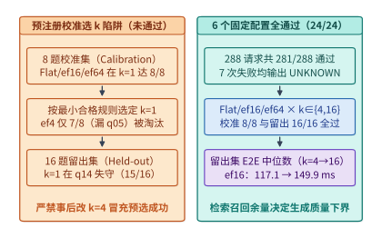

*图 13-11　实验 13-01（288 请求 Faiss + Qwen3-8B RAG 管线）：校准集（8 题）预选 $k=1$ 在留出集（16 题）因 `q14` 跌至 `15/16` 的失守机制，以及 6 个固定 $k=4/16$ 配置单元 `24/24` 全通过的实测对比*

3. **vLLM 原生物理 KV 块分配审计与多进程资源守卫（Resource Guard）漏检剖析（图 13-12 与图 13-13）**：
   通过直接挂钩 vLLM 调度器内部的原生块引用计数（`blocks.jsonl` 与 `kv-snapshots.json`，而非用词元数乘理论公式估算），实验精确捕获了检索参数 $k$ 对 GPU 显存池的物理冲击：
   - **物理 KV 池与分块粒度**：vLLM Worker 预先在 GPU 显存中固定划出了 **$910$ 个物理 KV 块**，底层张量总字节数为 **$2{,}146{,}959{,}360\ \mathrm{B}$（约 $2.00\ \mathrm{GiB}$）**，折合每个物理块精确占用 $\frac{2{,}146{,}959{,}360}{910} = \mathbf{2{,}359{,}296\ \mathrm{B}}$（即 $2.25\ \mathrm{MiB} = 16\ \mathrm{tokens/block} \times 144\ \mathrm{KiB/token}$）。在全部 $288$ 次请求中，引擎累计调度的词元总数（Scheduled Tokens）为 **$162{,}740$**（逐请求严格满足 $\text{input\_tokens} + \text{output\_tokens} - 1$）。
   - **$k=4 \to k=16$ 的显存与延迟代价**：如表 13-6 所示，当检索文档数从 $k=4$（输入中位数 $346.5\ \mathrm{tokens}$）增加到 $k=16$（输入中位数 $1{,}201.5\text{–}1{,}202.0\ \mathrm{tokens}$）时，单请求峰值占用的物理 KV 块从 **$23$ 块（$54{,}263{,}808\ \mathrm{B}$）** 跃升至 **$77$ 块（$181{,}665{,}792\ \mathrm{B}$）**，**单请求显存占用膨胀了 $77 / 23 \approx 3.35\ \text{倍}$**。这意味着在这块拥有 $910$ 个块的 $2\ \mathrm{GiB}$ KV 池中，若开启高并发批处理，$k=4$ 最多可同时容纳 $\lfloor 910 / 23 \rfloor = \mathbf{39}$ 个并发请求，而 $k=16$ 则骤降至最多容纳 $\lfloor 910 / 77 \rfloor = \mathbf{11}$ 个并发请求（并发容量折损逾 $71\%$），同时端到端中位数延迟也普遍拉长了 $20\%\text{–}93\%$（注意：由于本次实验在共享主机上单次运行且每单元留出集仅 16 次请求，不能将表 13-6 中不同索引间的微秒级搜索差异直接外推为端到端总耗时的决定性因素）。
   - **多进程推理引擎的资源监控盲区（[`ROOT-RESOURCE-NOTE.md`](../experiments/ch13/13-01/retrieval-generation/ROOT-RESOURCE-NOTE.md)）**：在审计本次运行的外层资源守卫日志（`resources.jsonl`，共 $178$ 个采样点）时，发现了一个在现代多进程推理框架（如 vLLM V1 架构与 SGLang）中极易踩中的工程陷阱——原守卫脚本通过匹配进程是否携带自定义环境变量标识（Environment Token）来统计任务内存与 GPU 显存，结果报告出的进程组 RSS 峰值仅为 **$2{,}233{,}159{,}680\ \mathrm{B}$（约 $2.08\ \mathrm{GiB}$）**，且 **`raw GPU` 显存占用列全程显示为 `0`**。
     为什么真实跑完了 $288$ 次 GPU 推理，`raw GPU` 却记录为 `0`？根源在于：**vLLM 0.23 在启动时会派生独立的后台引擎守护子进程（`EngineCore`，本次运行为 `PID 851453`），而在进程派生与环境清理过程中，该子进程并未落入外层环境变量 Token 的过滤集合内**。幸而实验同时在 Worker 内部嵌入了原生 CUDA 分配器快照，完整记录下 Worker 自身的 **`cuda_peak_allocated` $= 18{,}582{,}745{,}600\ \mathrm{B}$（约 $17.31\ \mathrm{GiB}$）**（以及整机系统最小可用内存 `MemAvailable = 129,800,568,832 B`）。这一真实案例给出了多进程 AI 系统监控的一条铁律：**对包含 ZMQ/IPC 多进程解耦架构的推理或训练框架实施资源守卫（Resource Guard）与残留进程清理时，绝不能仅依赖环境变量继承，而必须联合绑定 Linux 会话组（Session ID / Process Group `pgid`）、cgroups v2 控制组、父子进程树拓扑以及 PID 出生时间戳（`starttime`）**。

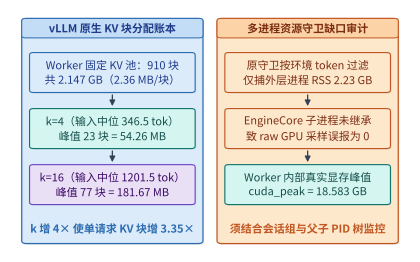

*图 13-12　实验 13-01 中检索 $k=4$ 与 $k=16$ 对 vLLM 910 块 KV 池的真实占用（$23$ 块 vs. $77$ 块）及环境变量守卫漏检 `EngineCore` 子进程（CUDA 分配器峰值 $18.58\ \mathrm{GB}$）的边界审计*

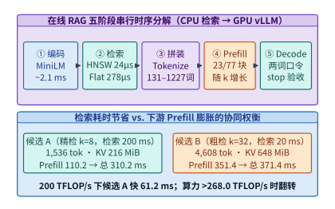

*图 13-13　RAG 请求端到端五阶段关键路径分解，以及算例 13-5b 中精检少文档（$k=8$，检索 $200\ \mathrm{ms}$ + Prefill $110.2\ \mathrm{ms}$）与粗检多文档（$k=32$，检索 $20\ \mathrm{ms}$ + Prefill $351.4\ \mathrm{ms}$）的翻转边界*

---

## 13.7 多级 KV 缓存池化（HBM–DRAM–SSD）、非前缀融合与闪存耐久性边界

在第 13.3 节与第 13.4 节中，我们分别构建了分布式并行文件系统（3FS）与单盘 NVMe SSD 的 Block-major 块布局；在第 13.6 节中，我们又看到了 RAG 多文档拼接对 KV 缓存池的成倍挤压。本节将这两条线索合拢，回答生产级 KV 缓存存储池（如 Mooncake Store[^mooncake-fast]、LMCache[^lmcache-sys] 与 SGLang HiCache）的三个终极工程问题：**（1）从外部存储层拉取历史 KV 块究竟在什么条件下比直接用 GPU 重算 Prefill 更快？（2）当多篇检索文档按任意顺序动态组合导致严格前缀匹配失效时，如何复用存储池中的 KV 块？（3）持续将新生成的 KV 块换出至 NVMe SSD 会如何在数月内磨穿闪存寿命，又该如何通过准入过滤守住耐久性底线？**

### 13.7.1 跨节点四级 KV 缓存池（Mooncake Store / LMCache / SGLang HiCache）的吞吐与非前缀融合（CacheBlend）

现代分布式推理集群通常将 KV 缓存组织为四级存储池阶梯（图 13-14）：**T0 加速器片上 HBM**（带宽 $3.35\text{–}8.0\ \mathrm{TB/s}$）、**T1 本机固定主机内存（Host Pinned DRAM / CXL）**（经 PCIe Gen5 $\times 16$ 单向有效带宽约 $50\text{–}64\ \mathrm{GB/s}$）、**T2 跨机远端 DRAM 内存池（Mooncake RDMA Store）**（经 $400\ \mathrm{Gbps}$ RoCEv2/IB 单向有效带宽约 $45\text{–}50\ \mathrm{GB/s}$）以及 **T3 本地 NVMe SSD 或 3FS 分布式闪存池**（单盘有效读带宽 $7\text{–}12.5\ \mathrm{GiB/s}$，8 盘 GDS 或 3FS 聚合池可达 $50\text{–}62.5\ \mathrm{GiB/s}$）。

1. **从第 $i$ 级存储池拉取 KV 替代重算 Prefill 的盈亏平衡判据**：
   设某请求命中的历史上下文长度为 $S$ 个词元，模型每词元跨全部层的 KV 缓存字节数为 $b_{\mathrm{kv}}$（例如 Qwen3-8B BF16 为 $b_{\mathrm{kv}} = 147{,}456\ \mathrm{B} = 144\ \mathrm{KiB/token}$），从第 $i$ 级存储池拉取至 GPU HBM 的持续有效传输带宽为 $B_{\mathrm{tier},i}$（忽略微秒级寻址延迟），则纯拉取耗时为：

   $$
   T_{\mathrm{fetch},i}(S) = \frac{S \cdot b_{\mathrm{kv}}}{B_{\mathrm{tier},i}}
   $$

   反之，若放弃从存储池拉取、直接在 GPU 上对这 $S$ 个词元重新执行 Prefill，其计算工作量由随 $S$ 线性增长的矩阵投影分量 $2 P_{\mathrm{lin}} S$ 与随 $S^2$ 二次方增长的因果注意力分量 $2 L d_{\mathrm{attn}} S^2$（其中 $L$ 为层数，$d_{\mathrm{attn}}$ 为注意力头总维数，对应有效配对浮点乘加系数 $2 L d_{\mathrm{attn}} S(S+1) \approx 2 L d_{\mathrm{attn}} S^2$）组成。给定 GPU 在 Prefill 阶段的有效算力吞吐 $F_{\mathrm{eff}}$，重算耗时为：

   $$
   T_{\mathrm{recomp}}(S) = \frac{2 P_{\mathrm{lin}} S + 2 L d_{\mathrm{attn}} S^2}{F_{\mathrm{eff}}}
   $$

   比较 $T_{\mathrm{fetch},i}(S)$ 与 $T_{\mathrm{recomp}}(S)$（两边同除以 $S > 0$），立得拉取优于重算的充要条件：

   $$
   \frac{b_{\mathrm{kv}}}{B_{\mathrm{tier},i}} < \frac{2 P_{\mathrm{lin}} + 2 L d_{\mathrm{attn}} S}{F_{\mathrm{eff}}}
   $$

   由此可以定义一条极其清晰的**零长度临界带宽阈值 $B_{\mathrm{crit}}$**：

   $$
   B_{\mathrm{crit}} = \frac{b_{\mathrm{kv}} \cdot F_{\mathrm{eff}}}{2 P_{\mathrm{lin}}}
   $$

   - **情形一（高带宽存储层 $B_{\mathrm{tier},i} \ge B_{\mathrm{crit}}$，拉取无条件胜出）**：
     以算例 13-5b 的 Qwen3-8B（$b_{\mathrm{kv}} = 147{,}456\ \mathrm{B}$，$2 P_{\mathrm{lin}} = 1.38915 \times 10^{10}\ \mathrm{FLOPs/token}$，设 $F_{\mathrm{eff}} = 200\ \mathrm{TFLOP/s}$）为例，其临界带宽仅为：
     $$
     B_{\mathrm{crit}} = \frac{147{,}456\ \mathrm{B} \times 200 \times 10^{12}\ \mathrm{FLOP/s}}{1.38915 \times 10^{10}\ \mathrm{FLOPs}} \approx \mathbf{2.123\ \mathrm{GB/s}}
     $$
     即便后端是满载达到 $F_{\mathrm{eff}} = 800\ \mathrm{TFLOP/s}$ 的 B200 GPU，$B_{\mathrm{crit}}$ 也仅为 $8.49\ \mathrm{GB/s}$。这意味着无论是 T1 主机 DRAM（$50\text{–}64\ \mathrm{GB/s}$）、T2 远端 RDMA 内存池（$45\text{–}50\ \mathrm{GB/s}$）还是 T3 采用 Block-major 连续布局的本机 Gen5 NVMe SSD（$12.5\ \mathrm{GiB/s}$），只要消除了细粒度读放大（$\mathrm{RAF}=1.0\times$），**拉取每词元 KV 的时间恒小于哪怕只重算线性投影层的时间，因而对任意上下文长度 $S$ 均比重新计算更快**。
   - **情形二（受限慢速链路或发生严重读放大使有效带宽 $B_{\mathrm{eff}} < B_{\mathrm{crit}}$，需跨过临界长度 $S_{\mathrm{crit}}$）**：
     若存储侧因跨机拥塞、机械/QLC 慢速介质或未对齐 Layer-major 读放大导致有效交付带宽跌至 $B_{\mathrm{eff}} < B_{\mathrm{crit}}$，则短序列下重算更快，唯有当命中上下文长度 $S$ 超过如下**临界上下文长度 $S_{\mathrm{crit}}$** 时，二次方增长的注意力计算量才会使存储拉取重新夺回优势：
     $$
     S_{\mathrm{crit}} = \frac{1}{2 L d_{\mathrm{attn}}} \left(\frac{b_{\mathrm{kv}} \cdot F_{\mathrm{eff}}}{B_{\mathrm{eff}}} - 2 P_{\mathrm{lin}}\right)
     $$
   此外，SGLang HiCache 与 LMCache 进一步利用**逐层计算—传输流水重叠（Layer-wise Pipelining）**：当 GPU 正在执行第 $l$ 层的注意力与 FFN 计算时，DMA/RDMA 引擎同步在后台将第 $l+1$ 层的命中 KV 块从 DRAM 或 SSD 预取至显存双缓冲区，从而将 $80\%$ 以上的存储拉取耗时隐藏在必需的末尾增量词元计算背后。

> **算例 13-6（Qwen3-8B 在 T1/T2/T3 四级 KV 池下的 $32\mathrm{K}$ 历史拉取耗时 vs. GPU 重算耗时与临界长度 $S_{\mathrm{crit}}$ 核算）**：
> 沿用 Qwen3-8B 参数（$b_{\mathrm{kv}} = 147{,}456\ \mathrm{B} = 144\ \mathrm{KiB/token}$，$2 P_{\mathrm{lin}} = 1.38915 \times 10^{10}\ \mathrm{FLOPs/token}$，$2 L d_{\mathrm{attn}} = 36 \times 2 \times 4{,}096 = 294{,}912\ \mathrm{FLOPs/token^2}$），设某多轮长对话请求命中了 $S = 32{,}768$（$32\mathrm{K}$）个历史前缀词元，命中的 BF16 KV 总体积为 $V_{\mathrm{kv}}(32\mathrm{K}) = 32{,}768 \times 144\ \mathrm{KiB} = \mathbf{4.50\ \mathrm{GiB}}$（十进制字节数为 $4{,}831{,}838{,}208\ \mathrm{B} \approx 4.832\ \mathrm{GB}$），后端 GPU 的有效 Prefill 算力吞吐为 $F_{\mathrm{eff}} = 300\ \mathrm{TFLOP/s}$（此时零长度临界带宽为 $B_{\mathrm{crit}} = \frac{147{,}456 \times 300 \times 10^{12}}{1.38915 \times 10^{10}} \approx \mathbf{3.184\ \mathrm{GB/s}}$）：
> 1. **核算 GPU 从头重算 $32\mathrm{K}$ 前缀的耗时 $T_{\mathrm{recomp}}(32\mathrm{K})$**：
>    - 线性矩阵乘加运算量：$2 P_{\mathrm{lin}} S = 1.38915 \times 10^{10} \times 32{,}768 \approx \mathbf{455.197\ \mathrm{TFLOPs}}$；
>    - 因果注意力有效配对运算量：$2 L d_{\mathrm{attn}} S^2 \approx 294{,}912 \times 32{,}768^2 \approx \mathbf{316.659\ \mathrm{TFLOPs}}$；
>    - 总重算运算量达 $455.197 + 316.659 = \mathbf{771.856\ \mathrm{TFLOPs}}$，在 $300\ \mathrm{TFLOP/s}$ 下的重算耗时为：
>      $$T_{\mathrm{recomp}}(32\mathrm{K}) = \frac{771.856\ \mathrm{TFLOPs}}{300\ \mathrm{TFLOP/s}} \approx \mathbf{2{,}572.85\ \mathrm{ms}} \quad (\text{即 } 2.573\ \mathrm{s})$$
> 2. **对比从 T1/T2/T3 各级存储池直接拉取 $4.832\ \mathrm{GB}$ KV 状态的耗时（表 13-7）**：
>    - **T1 本机固定 DRAM（PCIe Gen5 $\times 16$，$B_{\mathrm{T1}} = 56.0\ \mathrm{GB/s} > B_{\mathrm{crit}}$）**：纯拉取耗时仅 $4.8318 / 56.0 \approx \mathbf{86.28\ \mathrm{ms}}$，比重算快 **$29.8\times$**；
>    - **T2 远端 Mooncake RDMA 内存池（$400\ \mathrm{Gbps}$ RoCEv2，$B_{\mathrm{T2}} = 45.0\ \mathrm{GB/s} > B_{\mathrm{crit}}$）**：纯拉取耗时仅 $4.8318 / 45.0 \approx \mathbf{107.37\ \mathrm{ms}}$，比重算快 **$24.0\times$**；
>    - **T3 本机单块 Gen5 NVMe SSD（Block-major 连续布局，$\mathrm{RAF}=1.0$，$B_{\mathrm{T3}} = 12.8\ \mathrm{GB/s} > B_{\mathrm{crit}}$）**：纯拉取耗时为 $4.8318 / 12.8 \approx \mathbf{377.49\ \mathrm{ms}}$，比重算快 **$6.82\times$**；若开启 4 盘 GDS 并行条带化（$B_{\mathrm{T3,4\times}} = 51.2\ \mathrm{GB/s}$），拉取耗时进一步压至 **$94.37\ \mathrm{ms}$**（快 **$27.3\times$**）；
>    - **反面情形（若 T3 采用错误的 Layer-major 细粒度布局，触发读放大与 IOPS 墙使有效交付带宽跌至 $B_{\mathrm{eff}} = 1.80\ \mathrm{GB/s} < B_{\mathrm{crit}} = 3.184\ \mathrm{GB/s}$）**：此时短序列下拉取反而慢于重算，代入临界长度公式可得：
>      $$S_{\mathrm{crit}} = \frac{1}{294{,}912} \left(\frac{147{,}456 \times 300 \times 10^{12}}{1.80 \times 10^9} - 1.38915 \times 10^{10}\right) = \frac{2.4576 \times 10^{10} - 1.38915 \times 10^{10}}{294{,}912} \approx \mathbf{36{,}229\ \mathrm{tokens}}$$
>      也就是说，一旦因存储布局失误导致有效带宽跌至 $1.80\ \mathrm{GB/s}$，哪怕在长达 $32\mathrm{K}$（$32{,}768 < 36{,}229$）的上下文下，从磁盘拉取（耗时 $4.8318 / 1.80 = \mathbf{2{,}684.35\ \mathrm{ms}}$）反而比 GPU 从头重算（$2{,}572.85\ \mathrm{ms}$）更慢。这再次证明了第 13.4.2 节 Block-major 连续块布局对多级 KV 缓存池的决定性意义。

*表 13-7　算例 13-6：T0–T3 四级 KV 缓存池的物理参数、$32\mathrm{K}$ 上下文拉取耗时（Qwen3-8B，$4.50\ \mathrm{GiB}$ KV）与重算盈亏平衡对比*

| 存储池层级与代表系统 | 典型单节点容量 | 有效传输带宽 $B_{\mathrm{tier}}$ | $32\mathrm{K}$ 前缀 KV 拉取耗时 | 相对 GPU 重算（$2{,}572.85\ \mathrm{ms}$）加速比 | 盈亏平衡条件（相对 $B_{\mathrm{crit}} = 3.184\ \mathrm{GB/s}$） |
| :--- | :---: | :---: | :---: | :---: | :--- |
| **T0：GPU 片上 HBM3/3e** | $80\text{–}192\ \mathrm{GB}$/卡 | $3{,}350\text{–}8{,}000\ \mathrm{GB/s}$ | $< 1.5\ \mathrm{ms}$（片内常驻） | $> 1{,}700\times$ | 零跨总线开销，受限于单卡显存容量上限 |
| **T1：本机 Pinned DRAM** (LMCache / HiCache) | $512\ \mathrm{GB}\text{–}2\ \mathrm{TB}$ | $50\text{–}64\ \mathrm{GB/s}$ (取 $56\ \mathrm{GB/s}$) | **$86.28\ \mathrm{ms}$** | **$29.8\times$** | $B_{\mathrm{T1}} \gg B_{\mathrm{crit}}$，任意长度 $S \ge 1$ 均快于重算 |
| **T2：远端 RDMA DRAM 池** (Mooncake Store) | $10\text{–}100+\ \mathrm{TB}$/集群 | $45\text{–}50\ \mathrm{GB/s}$ (取 $45\ \mathrm{GB/s}$) | **$107.37\ \mathrm{ms}$** | **$24.0\times$** | $B_{\mathrm{T2}} \gg B_{\mathrm{crit}}$，支持跨节点 Prefill-Decode 池化共享 |
| **T3a：本机 Gen5 SSD (Block-major)** | $15\text{–}60\ \mathrm{TB}$/节点 | 单盘 $12.8\ \mathrm{GB/s}$ / 4 盘 $51.2\ \mathrm{GB/s}$ | **$377.49\ \mathrm{ms}$**（4 盘 **$94.37\ \mathrm{ms}$**） | **$6.82\times$**（4 盘 **$27.3\times$**） | 消除读放大（$\mathrm{RAF}=1.0$）后任意长度均快于重算 |
| **T3b：劣化 SSD 链路 (Layer-major)** | $15\text{–}60\ \mathrm{TB}$/节点 | 读放大致有效带宽跌至 $1.80\ \mathrm{GB/s}$ | $2{,}684.35\ \mathrm{ms}$（反慢于重算） | $0.96\times$（**负收益**） | $B_{\mathrm{eff}} < B_{\mathrm{crit}}$，需 $S > S_{\mathrm{crit}} = 36{,}229$ 方能回本 |

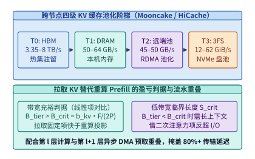

*图 13-14　HBM—主机 DRAM—RDMA 远端内存—NVMe SSD 四级 KV 缓存池（Mooncake / LMCache / HiCache）的带宽阶梯与拉取替代重算的临界条件*

2. **突破严格前缀匹配限制：RAG 多文档任意拼接下的非前缀 KV 融合（CacheBlend）**：
   上述多级 KV 缓存池有一个隐含前提：**被复用的历史词元必须位于序列的最前端（即严格的 Prefix Matching）**。然而在第 13.6 节的 RAG 场景中，知识库中的数万篇文档切片 $D_1, D_2, \dots, D_m$ 可以预先离线算好各自的 KV 块存入 NVMe SSD，但在在线回答某个具体问题时，检索器可能返回任意组合与顺序的文档子集（例如请求甲拼装 `[系统提示词, D_7, D_2, D_9, 问题]`，请求乙拼装 `[系统提示词, D_2, D_5, D_7, 问题]`）。
   此时，位于第 $2$、第 $3$ 位置的文档（如请求甲中的 $D_2$ 与 $D_9$）其前序上下文已发生改变，不再是独立建库时的前缀。若直接将离线预存的各文档独立 KV 块从 SSD 读出并硬拼接（即使通过旋转矩阵修正了 RoPE 相对位置编码的偏移角），**排在后面的文档 $D_2$ 在预计算时根本没有对前面的文档 $D_7$ 计算过交叉注意力（Cross-chunk Attention 缺失）**，导致需要综合多篇文档线索的多跳问答（Multi-hop QA）准确率大幅滑坡；反之，若每次都放弃预存 KV 从头重算整条上下文，又会彻底丧失存储池的加速价值。
   以 **CacheBlend（EuroSys 2025）**[^cacheblend-eurosys] 为代表的**选择性稀疏重算（Selective KV Recomputation）**机制，通过存储与注意力的协同解决了这一难题（图 13-15）：
   - **第一步（第 1 层全算与高偏差词元动态定位）**：由于 Transformer 第 $1$ 层的 KV 状态仅取决于词嵌入本身而与前序上下文无关，引擎在第 $1$ 层完成快速计算后，对比第 $2$ 层各词元在“考虑前序文档交叉注意力”与“独立预存 KV”之间的键值偏差（Key-Value Deviation），动态筛选出受跨文档上下文影响最大的前 **$r_{\mathrm{recomp}} = 10\%\text{–}15\%$ 的高敏感词元（High-KLD Tokens）**。
   - **第二步（$85\%\text{–}90\%$ 词元直接复用存储 KV + $10\%\text{–}15\%$ 词元稀疏重算并与 SSD I/O 重叠）**：在随后的第 $2$ 至第 $L$ 层中，占总数 $85\%\text{–}90\%$ 的非敏感词元直接沿用从 NVMe SSD / DRAM 池拉取并经 RoPE 位置校正后的预存 KV 值；GPU 仅对筛选出的 $10\%\text{–}15\%$ 高敏感词元发起查询投影并与全序列 KV 做稀疏注意力更新。由于单层重算计算量骤降为全量 Prefill 的 $10\%\text{–}15\%$，这段微型重算耗时恰好与从 NVMe SSD 拉取下一层预存 KV 块的 I/O 时间形成流水线重叠，最终在**几乎零精度损失的前提下将 RAG 多文档首字延迟（TTFT）降低 $2.2\text{–}3.3\times$**。

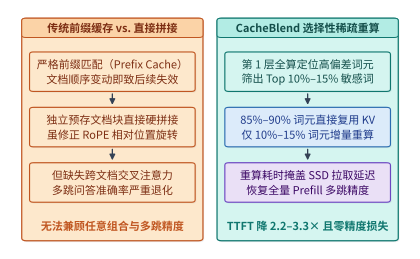

*图 13-15　RAG 多文档任意顺序拼接下的非前缀 KV 复用：直接拼接缺失交叉注意力 vs. CacheBlend 仅对 $10\%\text{–}15\%$ 高偏差词元执行稀疏重算并与 SSD 拉取流水重叠*

### 13.7.2 持续 KV 换出下的企业级 SSD 写入寿命（DWPD）核算、写准入过滤与五步排障流程

当工程团队把本机 NVMe SSD 接入多级 KV 缓存池（T3）后，最容易忽视的致命风险不是读取不够快，而是**毫无节制地将每一次在线请求新生成的 KV 状态全量落盘，会在短短几个月内彻底写穿（Wear Out）昂贵的企业级 SSD 闪存颗粒**。

我们在第 9.5.2 节与第 13.4.3 节已建立企业级 SSD 的耐久性指标——**每日全盘写入次数（Drive Writes Per Day，DWPD）**。一块标称容量为 $C_{\mathrm{SSD}}$、在 $Y = 5$ 年（$1{,}825$ 天）质保期内标称寿命为 $\mathrm{DWPD}_{\mathrm{rated}}$（主流读取密集型企业级 TLC SSD 通常为 $1.0\ \mathrm{DWPD}$，混合读写型通常为 $3.0\ \mathrm{DWPD}$）的闪存盘，其每日允许承受的最大闪存物理编程字节数上限为 $W_{\mathrm{NAND,limit}} = C_{\mathrm{SSD}} \cdot \mathrm{DWPD}_{\mathrm{rated}}$。我们来算一笔高吞吐推理节点的真实写入账本：

> **算例 13-7（8 卡推理节点持续换出 KV 状态导致的 $33.75\ \mathrm{DWPD}$ 寿命超限与写准入率上限推导）**：
> 考虑一台满负荷服务多轮长上下文对话与 RAG 请求的 8 卡 GPU 推理服务器，本机挂载了 $N_{\mathrm{SSD}} = 4$ 块容量各为 $C_{\mathrm{single}} = 3.84\ \mathrm{TB}$ 的企业级混合用途 NVMe SSD（4 盘总标称容量 $C_{\mathrm{total}} = 4 \times 3.84 = \mathbf{15.36\ \mathrm{TB}}$，质保期 5 年标称耐久性上限为 $\mathrm{DWPD}_{\mathrm{rated}} = \mathbf{3.0\ \mathrm{DWPD}}$）。
> 假设在未设写准入过滤的默认策略下，8 张 GPU 每秒钟将新生成且从 HBM/DRAM 溢出的 KV 缓存块以聚合速率 $B_{\mathrm{evict}} = \mathbf{4.0\ \mathrm{GB/s}}$（仅占 4 块 Gen5 SSD 写带宽的约四分之一）持续追加写入这 4 块 SSD：
> 1. **核算全天主机逻辑写入量 $W_{\mathrm{host}}$ 与闪存物理写入量 $W_{\mathrm{NAND}}$**：
>    一天共有 $86{,}400\ \mathrm{s}$，整机每天向 4 块 SSD 发起的主机侧逻辑写入总量为：
>    $$W_{\mathrm{host}} = 4.0\ \mathrm{GB/s} \times 86{,}400\ \mathrm{s/day} = 345{,}600\ \mathrm{GB/day} = \mathbf{345.6\ \mathrm{TB/day}}$$
>    设经过大块对齐优化但仍存在多租户不同 TTL 淘汰的传统块 SSD 实际写放大系数为 $\mathrm{WAF} = 1.5$，则底层 NAND 闪存颗粒每天实际承受的物理擦写总量高达：
>    $$W_{\mathrm{NAND}} = W_{\mathrm{host}} \times \mathrm{WAF} = 345.6 \times 1.5 = \mathbf{518.4\ \mathrm{TB/day}}$$
> 2. **核算实际等效 $\mathrm{DWPD}_{\mathrm{eff}}$ 与预计报废时间**：
>    将每日物理写入量除以 4 块 SSD 的总容量 $15.36\ \mathrm{TB}$，立得每块 SSD 实际承受的等效日全盘写入次数：
>    $$\mathrm{DWPD}_{\mathrm{eff}} = \frac{W_{\mathrm{NAND}}}{C_{\mathrm{total}}} = \frac{518.4\ \mathrm{TB/day}}{15.36\ \mathrm{TB}} = \mathbf{33.75\ \mathrm{DWPD}}$$
>    这个 **$33.75\ \mathrm{DWPD}$** 的写入强度，达到了混合读写型企业级 SSD 上限（$3.0\ \mathrm{DWPD}$）的 **$11.25\ \text{倍}$**（若是 $1.0\ \mathrm{DWPD}$ 的读取密集型 SSD 则是 **$33.75\ \text{倍}$**）。原本设计服役 $5$ 年（$60$ 个月）的闪存盘，将在 $60 / 11.25 \approx \mathbf{5.3\ \text{个月}}$（不到半年）内彻底耗尽 P/E 擦写周期而批量报废。
> 3. **推导写准入过滤器（Write-Admission Filter）的最大放行比例 $\alpha_{\max}$**：
>    为什么不需要也不应该把所有溢出的 KV 块都写入 SSD？因为在真实生产流量中，大量单轮一次性问答（One-shot Queries）或低频冷门文档的 KV 块在被换出后直到过期都**不会再被第二次命中读取**（属于纯粹消耗闪存寿命的“写后即死块”）。
>    为此，存储引擎必须在 T1（主机 DRAM）向 T3（NVMe SSD）下刷的入口处部署轻量级**基于哈希频次的写准入过滤器（如 Count-Min Sketch / 2Q / TinyLFU 准入器）**，仅当某个前缀块哈希在滑动时间窗内的被访问频次达到阈值 $k_{\mathrm{hit}} \ge 2$（或属于显式标记的高复用系统提示词/热门知识库切片）时，才允许落盘写入 SSD。设准入过滤器放行写入 SSD 的流量占比为 $\alpha \in (0, 1]$，为确保实际耐久性严格控制在 $\mathrm{DWPD}_{\mathrm{eff}}(\alpha) \le \mathrm{DWPD}_{\mathrm{rated}} = 3.0$ 以内，最大允许的写准入率 $\alpha_{\max}$ 为：
>    $$\alpha_{\max} = \frac{\mathrm{DWPD}_{\mathrm{rated}}}{\mathrm{DWPD}_{\mathrm{eff}}(1.0)} = \frac{3.0}{33.75} = \frac{4}{45} \approx \mathbf{8.89\%}$$
>    若同时将底层存储升级为第 13.4.3 节所述的 **ZNS 分区命名空间 SSD**（按会话 TTL 分区顺序追加与整区重置，将写放大压回 $\mathrm{WAF} = 1.0$，此时无过滤基线为 $345.6 / 15.36 = 22.5\ \mathrm{DWPD}$），则允许放行的最大写准入率可放宽至：
>    $$\alpha_{\max}^{\mathrm{(ZNS)}} = \frac{3.0}{22.5} = \frac{2}{15} \approx \mathbf{13.33\%}$$
>    配合极小容量的高耐久 SLC 缓存盘或主机 DRAM 写合并缓冲区吸收短命尾部更新，即可在不牺牲热前缀命中率的前提下，确保整机 NVMe 阵列安全服役满 5 年生命周期（图 13-16）。

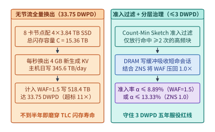

*图 13-16　算例 13-7：8 卡节点持续以 $4\ \mathrm{GB/s}$ 换出 KV 状态时高达 $33.75\ \mathrm{DWPD}$ 的闪存寿命超限风险，以及通过写准入过滤器（$\alpha \le 8.89\%$）与 ZNS 分区将寿命拉回 $\le 3\ \mathrm{DWPD}$ 安全线的机制*

作为本章核心工程方法论的实战总结，表 13-8 与图 13-17 给出了排查 AI 训练与推理存储子系统性能及寿命瓶颈的**五步定量诊断工作流**，图 13-18 则将预训练数据湖、RAG 向量知识库、多级 KV 缓存池、万级容器沙箱镜像与底层的 GDS/USRBIO 零拷贝协议栈、3FS CRAQ 并行文件系统及 ZNS 闪存治理汇拢为一张完整的**AI 原生数据底座全景架构图**。

*表 13-8　AI 存储与数据底座五步定量排障速查表*

| 排障步骤 | 典型线上症状 | 关键观测指标与命令 | 定量判据（红线阈值） | 根治工程处方 |
| :--- | :--- | :--- | :--- | :--- |
| **① 查元数据与小文件** | GPU 利用率周期性跌零，磁盘带宽极低但 MDS CPU 满载 | MDS `open/stat` RPC/s、`iostat` 平均请求块大小 `areq-sz` | 单样本多次独立 `open()` 或平均 I/O 块 $< 16\ \mathrm{KiB}$ | 打包为 WebDataset/Tar 或迁移至 **Lance** 列式格式；沙箱改用 **DSec EROFS** 按需加载 |
| **② 查内核拷贝与拓扑** | NVMe SSD 标称百 GB/s，实测权重加载卡在 $40\ \mathrm{GB/s}$ 且 `kswapd` 高 | `nvidia-smi topo -m`、PCIe Root Complex 计数器、页缓存命中率 | SSD 与 GPU 跨 NUMA/RC 绕行，或未开 `O_DIRECT` 产生双重拷贝 | 启用 **GPUDirect Storage (GDS)** 同 Switch P2P DMA 直通；按利特尔法则拉满队列深度 $Q_{\min}$ |
| **③ 查块粒度与读放大** | KV 缓存卸载后 SSD IOPS 打满（$\sim 1\mathrm{M}$），但实际读带宽仅 $1\text{–}2\ \mathrm{GB/s}$ | 逻辑请求大小 $S_{\mathrm{req}}$ vs. 临界块 $S^* = B_{\max}/I_{\max}$、$\mathrm{RAF}_{\mathrm{LBA}}$ | 按层分离（Layer-major）使单次读 $< 4\ \mathrm{KiB}$，触发 $\mathrm{RAF} \ge 2\times$ | 改用跨层按块连续打包（**Block-major**，$64\text{–}256\ \mathrm{KiB}$）或引入 MLA/CSA2 压缩状态 |
| **④ 查检索与生成耦合** | RAG 检索耗时仅几十微秒，但端到端 TTFT 飙升且并发量骤降 | 校准/留出集召回率、vLLM `blocks.jsonl` 物理块占用、子进程 `cuda_peak` | 粗检靠扩大 $k$（如 $k=16$ 占 $77$ 块）推高 Prefill 算力；守卫漏检 `EngineCore` | 联合核算检索+Prefill 翻转阈值 $F_{\mathrm{cross}}$；非前缀场景启用 **CacheBlend** 稀疏重算 |
| **⑤ 查写放大与寿命** | SSD 后台 GC 引发 P99 毛刺，SMART 磨损指标数月内快速消耗 | `nvme smart-log` 物理写入量 vs. 主机写入量、等效 $\mathrm{DWPD}_{\mathrm{eff}}$ | $\mathrm{WAF} > 1.5$ 或 $\mathrm{DWPD}_{\mathrm{eff}} > \mathrm{DWPD}_{\mathrm{rated}}$（如 $33.75 > 3.0$） | 在 DRAM $\to$ SSD 入口部署 **TinyLFU/2Q 写准入过滤器**（$\alpha \le 8.89\%$）并切换 **ZNS SSD** |

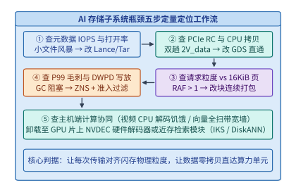

*图 13-17　AI 存储子系统性能与寿命瓶颈的五步定量诊断工作流*

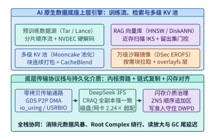

*图 13-18　贯穿预训练数据湖、RAG 向量知识库、多级 KV 缓存池与万级容器镜像的 AI 原生数据底座全景架构图*

---

## 13.8 十亿级小文件元数据瓶颈（FalconFS）、CXL/SSD 解耦向量检索（DistVS / Helmsman）与 CPU 协处理 GPU I/O（CoPilotIO / Umap / MoonBright）

前七节分别剖析了大块顺序权重加载（GDS）、链式复制并行文件系统（3FS）、分页 KV 缓存卸载与基础 RAG 管线。然而，随着多模态原始数据湖突破十亿级文件规模、企业级向量知识库膨胀至数千亿向量，以及 GPU 算子与远端分布式存储的交互日趋细粒度化，传统“客户端缓存目录树 + 纯 DRAM 驻留图索引 + 一刀切 GPU 直通 I/O”的设计范式再次撞上三道系统瓶颈。本节结合 NSDI 2026、OSDI 2026 与 MLSys 2026 的最新工业级系统进展，建立这三类前沿问题的定量分析模型[^falconfs-nsdi26][^distvs-helmsman][^copilotio-umap-moonbright]。

### 13.8.1 多模态海量小文件元数据风暴与服务端复合路径解析（FalconFS）

在第 13.5 节中，我们指出将离散小文件预先打包为 WebDataset（`.tar`）分片可消除训练期的元数据风暴。但在真实的多模态数据生产线中，**并非所有阶段都能彻底摆脱原始小文件访问**：

1. **动态数据清洗、去重与多版本重打包阶段**：每日新增的数亿张原始图片、音频切片、传感器帧与标注 JSON 首先以离散文件形态落入分布式文件系统的深层目录树（如 `/dataset/v4/modality/year/month/day/shard_id/sample_id.jpg`）；
2. **课程学习（Curriculum Learning）与在线难例重采样（Hard-Example Mining）**：当训练策略根据当前步的损失值（Loss）或奖励模型评分动态抽取跨分片的特定样本子集时，若仍按 $1\sim 2\ \mathrm{GB}$ 的 `.tar` 分片整包顺序读取，为获取 $1$ 条目标样本将被迫读穿整块分片，造成数十倍的无用读放大；而若直接按路径随机打开离散文件或细粒度列式分片，则会立即将压力传导至分布式元数据服务（MDS）。

为什么传统 POSIX 分布式文件系统（如 CephFS、Lustre 或基于客户端目录遍历的分布式存储）在面对十亿级小文件随机读取时，元数据吞吐会急剧跌落？根源在于 **客户端逐跳路径解析（Iterative Client-Side Path Resolution）与客户端目录项缓存（dentry cache）失配**。

设目录树深度为 $D$（例如 $D=6$），当训练工作节点的加载线程调用 `open("/a/b/c/d/e/f/img_001.jpg", O_RDONLY)` 时，操作系统虚拟文件系统（VFS）与分布式客户端需要从根目录 `/` 出发，逐级解析每一层父目录的 inode 编号与权限（`/a` $\to$ `/a/b` $\to \dots \to$ `img_001.jpg`）：

- 在局部性良好的传统通用负载中，上层目录项驻留在客户端内核 `dcache` 中，仅末级文件需要发起网络 RPC；
- 但在十亿级样本的全库随机 Shuffle 训练中，每次抽样大概率落入完全不同的子目录分支。为防止数十万训练进程耗尽计算节点主机内存，客户端元数据缓存容量受到严格限制，导致深层子目录的缓存命中率趋近于零；
- 一旦客户端缓存未命中，打开单个深度为 $D$ 的小文件就需要客户端与不同 MDS 节点之间串行往返高达 $D$ 至 $D+1$ 次网络 RPC（逐级 `lookup` 加最终 `open/getattr`）。

设单次跨网元数据 RPC 的平均往返耗时（含网络 RTT、MDS 排队与目录锁开销）为 $t_{\mathrm{rpc}}$，客户端缓存命中层数为 $d_{\mathrm{hit}}$（$0 \le d_{\mathrm{hit}} < D$），则传统逐跳解析打开单个小文件的元数据延迟下界为：

$$
T_{\mathrm{meta}}^{\mathrm{iter}}(D) = (D - d_{\mathrm{hit}} + 1) \cdot t_{\mathrm{rpc}}
$$

发表于 NSDI 2026 的 **FalconFS**[^falconfs-nsdi26] 针对大规模深度学习流水线重构了这一元数据路径。其核心洞察是：**既然海量随机小文件 Shuffle 下客户端深层目录缓存不仅命中率极低、反而消耗大量客户端内存与缓存一致性维护开销，不如彻底缩减客户端元数据缓存，将完整路径解析移回 MDS 服务端执行**。具体而言，FalconFS 引入了三项协同机制：

1. **服务端复合路径解析（Server-Side Compound Path Resolution）**：客户端不再逐级发起 `lookup` RPC，而是直接将完整路径字符串（或未命中前缀之后的剩余子路径）封装在单次复合 RPC 中发送给服务端，由 MDS 在本地内存或高速键值引擎内一次性完成多跳目录权限核验与目标文件定位，将网络往返次数从 $O(D)$ 压缩至接近 $O(1)$；
2. **混合目录布局与并发无锁更新（Hybrid Directory Layout & Lock-Free Concurrency）**：针对训练数据写入与清洗阶段常见的“单目录容纳数十万文件”或“高并发创建/重命名”场景，消除传统 POSIX 父目录 `i_rwsem` 排他锁造成的串行排队；
3. **存储格式与访问模式匹配法则**：在工程实践中，应当根据训练阶段的数据访问自由度选择存储底座——静态全量遍历优先采用 **WebDataset/Tar** 大块顺序流；需在原始目录树上频繁清洗或直接随机抽样时部署 **FalconFS** 消除路径解析放大；而需在保持列投影裁剪的同时支持按样本 ID 的 $O(1)$ 亚毫秒随机点查时，则采用 **Lance** 定长偏移表格式（并配合后文 13.8.3 节的 **Umap** 页粒度映射）。

---

> **算例 13-8：目录深度 $D=6$ 下百万次小文件打开的逐跳 RPC 与 FalconFS 服务端复合解析对比**
>
> 某多模态训练任务每个训练周期（或数据清洗批次）需从深度 $D = 6$ 的目录树中随机打开 $N_{\mathrm{files}} = 1{,}000{,}000$（$100$ 万）个离散图像与标注小文件。设仅顶层第 $1$ 级目录常驻客户端缓存（$d_{\mathrm{hit}} = 1$），其余 $5$ 级子目录 `lookup` 与最终文件 `open` 均需跨网络访问 MDS；单次元数据 RPC 平均往返耗时 $t_{\mathrm{rpc}} = 150\ \mu\mathrm{s}$，单训练节点并发元数据工作线程数为 $W = 32$。
>
> 1. **传统 POSIX 逐跳解析路径**：
>    每个文件需串行发起 $(6 - 1 + 1) = 6$ 次网络 RPC，单文件元数据打开延迟为 $T_{\mathrm{meta}}^{\mathrm{iter}} = 6 \times 150\ \mu\mathrm{s} = 900\ \mu\mathrm{s} = 0.90\ \mathrm{ms}$。打开 $100$ 万个文件累计产生 $6{,}000{,}000$（$600$ 万）次 RPC；在 $W=32$ 线程并发下，仅花在等待路径解析往返上的总墙钟时间下界为：
>    $$T_{\mathrm{total}}^{\mathrm{iter}} = \frac{1{,}000{,}000 \times 0.90\ \mathrm{ms}}{32} = 28{,}125\ \mathrm{ms} \approx 28.13\ \mathrm{s}$$
> 2. **FalconFS 服务端复合路径解析路径**：
>    客户端将剩余 $5$ 级子路径与打开操作合并为 $1$ 次复合 RPC 发送至 MDS，单次服务端内部多跳内存查表附加耗时仅 $\Delta t_{\mathrm{srv}} = 30\ \mu\mathrm{s}$，故单文件元数据延迟降至 $T_{\mathrm{meta}}^{\mathrm{falcon}} = 150 + 30 = 180\ \mu\mathrm{s} = 0.18\ \mathrm{ms}$。打开 $100$ 万个文件仅需 $100$ 万次 RPC，32 线程并发总耗时降至：
>    $$T_{\mathrm{total}}^{\mathrm{falcon}} = \frac{1{,}000{,}000 \times 0.18\ \mathrm{ms}}{32} = 5{,}625\ \mathrm{ms} \approx 5.63\ \mathrm{s}$$
>    元数据阶段延迟与网络报文数双双缩减 **$5.0\times$**，彻底消除了深层目录树下的小文件打开停顿。

---

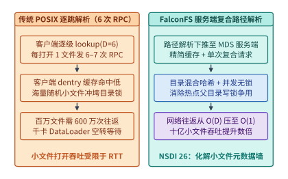

*图 13-19　传统 POSIX 逐跳目录解析（$D=6$ 时每次打开触发 6–7 次 RPC）与 FalconFS（NSDI '26）服务端复合路径解析及混合哈希无锁目录布局对比*

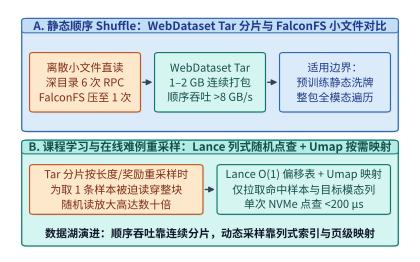

*图 13-20　静态顺序 Shuffle（WebDataset Tar 连续分片 / FalconFS）与课程学习及在线难例重采样（Lance $O(1)$ 偏移点查 + Umap 页映射）的磁盘寻道与读放大对比*

为了将上述元数据往返模型与十亿小文件分片寻址机制转化为可直接运行的工程参考，下面的代码实现了 **FalconFS 服务端复合路径解析模拟器与 WebDataset/Lance 定长偏移索引读取器**，自动复算算例 13-8 中百万次小文件打开的 $5.0\times$ 加速比以及随机点查的读放大差异：

```python
from dataclasses import dataclass
from typing import Dict, List, Tuple


@dataclass(frozen=True)
class MetadataLookupReport:
    """深层目录树小文件打开的逐跳 POSIX RPC 与 FalconFS 复合 RPC 对比账本。"""
    depth: int
    d_hit: int
    num_files: int
    threads: int
    iter_rpcs_per_file: int
    iter_total_rpcs: int
    iter_wall_s: float
    falcon_total_rpcs: int
    falcon_wall_s: float
    speedup: float


def audit_falconfs_compound_lookup(
    depth: int = 6,
    d_hit: int = 1,
    num_files: int = 1_000_000,
    t_rpc_us: float = 150.0,
    delta_srv_us: float = 30.0,
    threads: int = 32,
) -> MetadataLookupReport:
    """复算算例 13-8：深度 D=6 下 100 万次小文件打开的元数据墙钟时间与 RPC 缩减。"""
    iter_rpcs = depth - d_hit + 1
    iter_lat_ms = iter_rpcs * t_rpc_us / 1000.0
    falcon_lat_ms = (t_rpc_us + delta_srv_us) / 1000.0

    iter_wall_s = (num_files * iter_lat_ms) / (threads * 1000.0)
    falcon_wall_s = (num_files * falcon_lat_ms) / (threads * 1000.0)
    return MetadataLookupReport(
        depth=depth,
        d_hit=d_hit,
        num_files=num_files,
        threads=threads,
        iter_rpcs_per_file=iter_rpcs,
        iter_total_rpcs=num_files * iter_rpcs,
        iter_wall_s=round(iter_wall_s, 4),
        falcon_total_rpcs=num_files,
        falcon_wall_s=round(falcon_wall_s, 4),
        speedup=round(iter_wall_s / falcon_wall_s, 2),
    )


class IndexedShardOffsetReader:
    """对比无目录 Tar 顺序扫描与 Lance 64 位定长偏移表 O(1) 点查的读取放大模型。"""

    def __init__(self, sample_sizes_bytes: List[int]) -> None:
        self.sample_sizes = list(sample_sizes_bytes)
        self.offsets: List[int] = [0]
        for sz in self.sample_sizes:
            self.offsets.append(self.offsets[-1] + sz)

    def lookup_lance_o1(self, row_id: int) -> Tuple[int, int, int]:
        """Lance 定长偏移寻址：仅需读取 16 B 偏移区间 + 目标样本载荷（<=2 次 I/O）。"""
        start, end = self.offsets[row_id], self.offsets[row_id + 1]
        payload_bytes = end - start
        io_bytes = 16 + payload_bytes
        return start, payload_bytes, io_bytes

    def scan_unindexed_tar(self, row_id: int) -> Tuple[int, int, float]:
        """无尾部目录的传统 .tar 分片：随机定位第 row_id 条需顺序跳过前序全部字节。"""
        start, payload_bytes = self.offsets[row_id], self.sample_sizes[row_id]
        scanned_bytes = start + payload_bytes
        raf = scanned_bytes / max(payload_bytes, 1)
        return start, scanned_bytes, round(raf, 2)


if __name__ == "__main__":
    rep = audit_falconfs_compound_lookup()
    assert rep.iter_rpcs_per_file == 6 and rep.speedup == 5.0
    reader = IndexedShardOffsetReader([204_800] * 5000)
    _, payload_b, lance_io_b = reader.lookup_lance_o1(2499)
    _, tar_scan_b, tar_raf = reader.scan_unindexed_tar(2499)
    assert lance_io_b == 204_816 and tar_raf == 2500.0
```

---

### 13.8.2 超大规模解耦式向量检索：从 DistVS 三级精度筛选到 Helmsman 闪存聚类重排

在第 13.6.1 节中，我们对比了纯内存图索引（HNSW）与单机闪存图索引（DiskANN）。当企业级 RAG 知识库或智能体长期记忆库扩展至十亿乃至百亿条高维向量（例如 $N = 10^9$，$d = 1{,}536$，FP16 原始向量体积高达 $3.072\ \mathrm{TB}$，加上图邻接边后超过 $4.5\ \mathrm{TB}$）时，单台计算节点的主机 DRAM 已无法容纳，且检索服务的 CPU 算力需求与内存/闪存容量需求呈现出剧烈的异构失衡。

针对这一挑战，NSDI 2026 的 **DistVS（Large-scale Vector Search with Compute-Memory Disaggregation）**[^distvs-helmsman] 与 OSDI 2026 的 **Helmsman（The Clustering Strikes Back: Building Cost-Effective and High-Performance ANNS at Scale）**[^distvs-helmsman] 分别从**计算—内存解耦多级精度过滤**与**大规模闪存倒排聚类**两条路径给出了工业级解法：

1. **DistVS：跨本地 DRAM、远端池化内存与 SSD 的三级精度级联筛选**：
   在计算与内存解耦架构中，若计算节点在遍历图索引的每一跳都通过 RDMA 从远端内存池拉取完整的全精度向量（如 $3\ \mathrm{KiB}$），微秒级的网络 RTT 与网卡带宽会迅速成为瓶颈。DistVS 利用向量近似最近邻搜索（ANNS）的**距离单调筛选性质**，将向量表达拆分为三个精度层级并与三级存储介质严格对齐：
   - **第一级（计算节点本地小容量 DRAM — 极低比特粗量化码）**：在本地内存常驻紧凑的乘积量化（PQ）或二值/4-bit 标量量化码（每条向量仅数十至百余字节），用于图遍历过程中的海量候选节点快速初筛，直接过滤掉约 $85\%\text{–}90\%$ 的远距离分支，零网络开销；
   - **第二级（远端 CXL / RDMA 内存池 — 中高精度的压缩表示）**：仅对初筛留存的约 $10\%\text{–}15\%$ 候选向量，通过单边 RDMA Read 批量拉取远端内存池中的中等精度编码做二次距离精筛，将候选集进一步收敛至小规模 Top-$M$（如 $M = 64\text{–}128$）；
   - **第三级（分布式 NVMe SSD — 全精度原始向量与文档载荷）**：仅在最终重排（Re-ranking）阶段，对极少数 Top-$M$ 候选发起并发异步 SSD 点查，读取 FP16/FP32 全精度向量计算精确内积并返回对应文本块。
   - **关键架构辨析（有损召回层级 vs. 无损 KV 分层）**：在工程迁移时必须严格区分**向量检索的精度分级（DistVS）**与**大模型 KV 缓存的介质分层（第 13.7 节 Mooncake/LMCache）**。向量检索的目标是近似 Top-$k$ 排序，前两级使用有损低精度量化仅改变边界候选的打分，最后经全精度重排即可恢复目标 `Recall@k`；而大模型 KV 缓存直接参与每一层注意力的矩阵乘加，若在 DRAM/SSD 分层时盲目套用未经校准的激进有损压缩，误差将在多层自回归中累积放大并导致第 13.6.2 节实测所见的生成口令失真。
2. **Helmsman：为什么在百亿级闪存 ANNS 中“倒排聚类（IVF/Clustering）”重新击败纯图索引**：
   在全内存场景下，HNSW 等图索引凭借对数级跳数成为主流方案；但当索引主体下沉至 NVMe SSD 时，图遍历固有的**跨步数据依赖（第 $t+1$ 跳访问哪个节点取决于第 $t$ 跳的距离比较结果）**迫使系统发起多轮串行随机 $4\ \mathrm{KiB}$ 小读，不仅并发度受限于束搜索宽度（Beam Width $W$），且极易因跨闪存页指针跳跃产生高额读放大。
   OSDI 2026 的 **Helmsman** 证明：在超大规模闪存检索底座中，经过系统级重构的**分层聚类索引（Clustering-based ANNS）**具备显著的 I/O 结构优势。Helmsman 将紧凑的聚类质心导航图驻留在主机 DRAM 中；当查询到达时，先在 DRAM 内一次性定位出距离最近的 $n_{\mathrm{probe}}$ 个目标聚类簇（Posting Lists），随后对 SSD 发起**单轮、完全并行、按闪存擦除块/页边界连续对齐的大块顺序读取**，一次性拉取这 $n_{\mathrm{probe}}$ 个簇内的紧凑向量完成精确打分。通过将“多轮串行随机指针追踪”转化为“DRAM 导航 + 单轮并行连续块 I/O”，Helmsman 在守住高召回率门槛的同时，大幅削减了单查询 SSD IOPS 消耗与集群 DRAM 容量成本。

---

> **算例 13-9：图索引多跳随机闪存读与 Helmsman 聚类对齐块读的 IOPS 与延迟对比**
>
> 设十亿级向量库驻留于 NVMe SSD（单盘随机 $4\ \mathrm{KiB}$ 读延迟 $L_{4\mathrm{K}} = 60\ \mu\mathrm{s}$，连续 $64\ \mathrm{KiB}$ 块读延迟 $L_{64\mathrm{K}} = 95\ \mu\mathrm{s}$，单盘上限 $I_{\max} = 800{,}000\ \mathrm{IOPS}$、有效带宽 $B_{\max} = 10.0\ \mathrm{GiB/s}$）。
>
> 1. **纯闪存多跳图遍历方案**：单次查询需串行迭代 $H = 18$ 跳，每跳束搜索宽度 $W = 8$（即每跳并发发起 $8$ 次随机 $4\ \mathrm{KiB}$ SSD 读取）。单查询累计消耗 $18 \times 8 = 144$ 次随机 I/O（共读取 $576\ \mathrm{KiB}$），串行关键路径 I/O 延迟为 $T_{\mathrm{graph}} = 18 \times 60\ \mu\mathrm{s} = 1{,}080\ \mu\mathrm{s} = 1.08\ \mathrm{ms}$；单盘每秒最多支撑 $800{,}000 / 144 \approx 5{,}555\ \mathrm{QPS}$。
> 2. **Helmsman DRAM 质心导航 + 单轮并行聚类块读方案**：DRAM 质心定位耗时 $80\ \mu\mathrm{s}$，选出 $n_{\mathrm{probe}} = 12$ 个连续对齐的聚类块（每块 $64\ \mathrm{KiB}$，总读取量 $768\ \mathrm{KiB}$），在单轮内完全并行发起 $12$ 个 $64\ \mathrm{KiB}$ 请求。单查询 I/O 次数从 $144$ 次降至 $12$ 次，端到端查询延迟降至 $T_{\mathrm{cluster}} = 80 + 95 = 175\ \mu\mathrm{s} \approx 0.18\ \mathrm{ms}$（**提速 $6.17\times$**）；此时单盘受限于带宽上限 $10.0\ \mathrm{GiB/s} / 768\ \mathrm{KiB} \approx 13{,}653\ \mathrm{QPS}$（且仅消耗 $13{,}653 \times 12 \approx 16.4\text{ 万 IOPS}$），单盘吞吐提升 **$2.46\times$**。

---

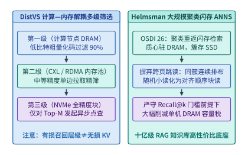

*图 13-21　DistVS（NSDI '26）计算—内存解耦三级精度筛选（本地 DRAM 粗筛 $\to$ 远端内存精筛 $\to$ SSD 全精度重排）与 Helmsman（OSDI '26）大规模倒排聚类闪存 ANNS 架构对比*

---

### 13.8.3 当 GPUDirect Storage 反而不如 CPU 协处理：CoPilotIO、Umap 与 MoonBright / kvcached 虚拟内存底座

在第 13.2 节中，我们证明了对于百兆至吉字节级的大块连续未压缩权重加载，GPUDirect Storage（GDS）通过绕过主机内存实现 P2P DMA 直通是当之无愧的最优解。然而，在复杂的生产推理与训练流水线中，如果将“GPU 直接发起并管理一切 I/O（GPU-Initiated Direct I/O）”奉为教条，反而会诱发严重的**计算—I/O 资源争用与虚拟内存抖动**。OSDI 2026 与 MLSys 2026 的四项代表性工作从主从协同与页表虚拟化角度补齐了这一拼图[^copilotio-umap-moonbright]：

1. **CoPilotIO（OSDI '26）：为什么必须把 GPU SM 从繁琐的 I/O 轮询中解放出来**
   在 GNN 图采样、推荐系统稀疏嵌入表拉取或细粒度动态 KV 块换入时，GPU 线程往往需要根据上一层算子的动态输出索引，立即从 NVMe SSD 拉取数千个离散数据块。以 BaM 等为代表的纯 GPU 驱动 I/O 方案让 GPU 线程直接在核函数内构造 NVMe 提交队列（SQ）条目并自旋轮询完成队列（CQ）。
   **CoPilotIO** 敏锐地指出了这一模式的代价：**GPU 的流式多处理器（SM）、寄存器文件与线程块槽位是为高吞吐矩阵/向量运算设计的稀缺资源，而非用来跑条件分支密集的 I/O 协议栈与高延迟设备轮询**。当数十个线程块卡在微秒级的 NVMe 完成队列轮询上时，留给主干 GEMM 和 FlashAttention 的活跃 Warp 数量与共享内存配额被大幅挤压，导致算子计算效率下滑。
   为此，CoPilotIO 提出了**“GPU 轻量发起 + 主机 CPU 协处理轮询（CPU as a Co-Pilot for GPU I/O）”**的混合执行模型：
   - GPU 算子在算出所需数据地址后，仅向主机—设备共享的无锁环形请求队列写入一条极简描述符（耗时亚微秒级），随即立刻释放当前线程块，将 $100\%$ 的 SM 算力归还给后续矩阵乘加；
   - 主机侧原本处于空闲等待状态的 CPU 核心作为专职“副驾驶（Co-Pilot）”，接管复杂的 NVMe/网络队列提交、完成中断/轮询、细粒度小块合并、CRC 校验乃至 LZ4/Zstd 解压缩，并在数据就绪后通过 DMA 引擎直接推入目标 GPU 显存缓冲并置位完成标志。
2. **Umap（OSDI '26 #76）：重构分布式文件系统上的页粒度 `mmap` 矩阵访问，根治容器 OOM**
   在推荐训练、多模态特征加载与大模型权重分片读取中，开发者常使用 POSIX `mmap()` 将分布式文件系统（DFS）上的超大矩阵文件直接映射到进程虚拟地址空间。然而，**Umap** 的生产审计揭示了传统 DFS `mmap` 的两大顽疾：
   - 一方面，Linux 内核缺页中断（Page Fault）默认按 $4\ \mathrm{KiB}$ 页粒度或固定顺序预读触发底层 DFS 请求，面对跨行步长（Strided）矩阵切片访问时，网络 RPC 被切碎为海量微小报文，有效吞吐不足网卡线速的十分之一；
   - 另一方面，内核将 `mmap` 读入的文件页计入容器 `cgroup` 的内存水位（File-backed RSS / Page Cache），当单机并发运行多个数据加载 Worker 映射数百 GB 矩阵文件时，内核被动页面回收跟不上缺页分配速率，极易触发 **容器 `cgroup` OOM Killer 误杀训练进程**。
   Umap 在用户态与文件系统客户端之间引入了感知矩阵切片几何结构的虚拟内存层：根据张量维度与访问步长提前聚合跨页网络预取，并在矩阵分块消费完毕后立即执行确定性的主动页帧回收（Proactive Page Reclamation），在将分布式矩阵加载吞吐提升数倍的同时，把容器内存水位严格锁死在安全预算之内。
3. **MoonBright（OSDI '26 #109）与 kvcached（MLSys '26）：设备端 GPU 页表物化与弹性显存共享**
   当数据进入 GPU 显存后，如何在多个并发模型或动态增长的请求间零碎片地分配显存？第 8 章介绍的 vLLM PagedAttention 在**算子软件层**用逻辑块表模拟了分页，但仍要求启动前一次性通过 `cudaMalloc` 静态预留整块物理显存池（如第 14.5 节实测的固定 $12.88\ \mathrm{GB}$ 池），导致多模型混部时无法跨进程动态借还空闲显存。
   以 **kvcached**（MLSys '26）与 GMLake 为代表的系统利用 CUDA 虚拟内存管理 API（`cuMemCreate` / `cuMemMap`），将连续的虚拟地址空间按 $2\ \mathrm{MiB}$ 物理页动态绑定与解绑，实现了无需修改算子内核的跨实例弹性 KV 显存池。然而，当物理页映射频繁变更时，传统 GPU 驱动必须在主机 CPU 上重构多级页表，并向全卡所有 SM 广播 **TLB 刷空指令（TLB Shootdown）**，引发毫秒级的全局执行停顿。
   OSDI 2026 的 **MoonBright** 从硬件驱动底层攻克了这一瓶颈：它将 GPU 页表树（Page Table）的构造与修改直接卸载到 **GPU 设备端线程（Device-Side Page Table Materialization）** 并行完成，同时采用**单调分配新虚拟地址区间 + 延迟批量 TLB 同步（Deferred TLB Coherence）**策略——新映射直接使用从未在旧 TLB 中缓存过的全新虚拟地址，从而在热路径上彻底免除了昂贵的全局 TLB Shootdown 停顿。

---

> **算例 13-10：细粒度压缩 KV 块加载下纯 GPU 轮询与 CoPilotIO 主机协处理的端到端耗时对比**
>
> 某混合推理步需一边执行主干矩阵乘（基准纯计算耗时 $T_{\mathrm{gemm}} = 12.0\ \mathrm{ms}$），一边从本地 NVMe SSD 拉取并解压 $M = 512$ 个细粒度历史状态块（每块压缩后 $8\ \mathrm{KiB}$、解压后 $16\ \mathrm{KiB}$）。
>
> 1. **纯 GPU 线程轮询 + SM 内解压方案**：为维持高队列深度并执行解压，需常驻占用 GPU 上 $20\%$ 的 SM 槽位，导致并行执行的矩阵乘算子有效吞吐下降 $20\%$，耗时拉长至 $T_{\mathrm{gemm}}^{\mathrm{contention}} = 12.0 / 0.80 = 15.0\ \mathrm{ms}$；此外，SM 尾块轮询等待附加 $0.8\ \mathrm{ms}$ 同步开销，该步端到端耗时为 **$15.8\ \mathrm{ms}$**。
> 2. **CoPilotIO（GPU 门铃发起 + 16 核空闲 CPU 轮询解压 + DMA 直推）方案**：GPU 写入 512 条请求描述符仅耗费 $0.05\ \mathrm{ms}$，SM 算力 $100\%$ 投入矩阵乘（维持 $12.0\ \mathrm{ms}$）；与此同时，16 个主机 CPU 核在后台以 $1.2\ \mathrm{GB/s}$ 聚合速率并行完成 $512 \times 8\ \mathrm{KiB} = 4\ \mathrm{MiB}$ 的 NVMe 读取与 $8\ \mathrm{MiB}$ 解压并经 PCIe DMA 推入显存，后台总耗时 $T_{\mathrm{cpu\_io}} = 7.5\ \mathrm{ms} < 12.0\ \mathrm{ms}$，被 GPU 矩阵计算完全掩盖。端到端步耗时仅为 $12.0 + 0.05 = \mathbf{12.05\ \mathrm{ms}}$，相比纯 GPU 轮询方案提速 **$1.31\times$**，净省下 $3.75\ \mathrm{ms}$ 的 SM 争用税。

---

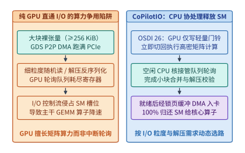

*图 13-22　大块连续裸张量 GPUDirect Storage（GDS）直通与细粒度/需解压场景下 CoPilotIO（OSDI '26）利用主机 CPU 协处理轮询释放 GPU SM 算力的架构对比*

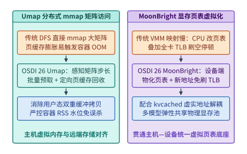

*图 13-23　Umap（OSDI '26）分布式文件系统页粒度矩阵 `mmap` 按需预取免除容器 OOM 与 MoonBright（OSDI '26）设备端 GPU 页表物化及延迟 TLB 同步协同架构*

下面的代码实现了 **GDS `cuFileRead` P2P DMA 队列深度与 CoPilotIO 主机 CPU 协处理细粒度 I/O 合并调度器**，可同时验证算例 13-1 的利特尔法则最小队列深度 $Q_{\min}$ 与算例 13-10 中主机 CPU 协处理消除 $20\%$ SM 轮询争用税的机制：

```python
import math
from dataclasses import dataclass
from typing import Dict


@dataclass(frozen=True)
class GDSAndCoPilotAudit:
    """GDS P2P DMA 队列深度与 CoPilotIO 细粒度块卸载的主从协同账本。"""
    gds_time_s: float
    posix_time_s: float
    gds_min_queue_depth: int
    gpu_polling_step_ms: float
    copilot_step_ms: float
    copilot_speedup: float
    sm_tax_saved_ms: float


def schedule_gds_and_copilot_io(
    weights_gb: float = 140.0,
    posix_bw_gbps: float = 50.0,
    num_ssds: int = 8,
    ssd_gds_bw_gbps: float = 12.5,
    ssd_lat_us: float = 64.0,
    req_size_kib: int = 128,
    gemm_base_ms: float = 12.0,
    sm_poll_fraction: float = 0.20,
    tail_sync_ms: float = 0.80,
    doorbell_ms: float = 0.05,
    num_blocks: int = 512,
    comp_block_kib: int = 8,
    cpu_agg_bw_gbps: float = 1.2,
) -> GDSAndCoPilotAudit:
    """复算算例 13-1（GDS 零拷贝直通）与算例 13-10（CoPilotIO 主机协处理）。"""
    posix_time_s = weights_gb / posix_bw_gbps
    gds_time_s = weights_gb / (num_ssds * ssd_gds_bw_gbps)
    # 利特尔法则：按 12.5 GiB/s = 12,800 MiB/s、128 KiB 块与 64 us 延迟核算单盘 Q_min
    target_mib_s = ssd_gds_bw_gbps * 1024.0
    req_mib = req_size_kib / 1024.0
    q_min = math.ceil((target_mib_s * (ssd_lat_us * 1e-6)) / req_mib)

    # 纯 GPU 轮询方案：侵占 sm_poll_fraction 的 SM 槽位，拉长主干 GEMM 并附加尾块同步
    gpu_poll_gemm_ms = gemm_base_ms / (1.0 - sm_poll_fraction)
    gpu_polling_step_ms = gpu_poll_gemm_ms + tail_sync_ms

    # CoPilotIO 方案：GPU 仅写 0.05 ms 门铃，后台 CPU 并行拉取并解压，与 12.0 ms GEMM 重叠
    total_uncomp_mib = (num_blocks * comp_block_kib * 2) / 1024.0
    cpu_bg_ms = (total_uncomp_mib / (cpu_agg_bw_gbps * 1024.0)) * 1000.0
    exposed_io_ms = max(0.0, cpu_bg_ms - gemm_base_ms)
    copilot_step_ms = gemm_base_ms + doorbell_ms + exposed_io_ms

    return GDSAndCoPilotAudit(
        gds_time_s=round(gds_time_s, 2),
        posix_time_s=round(posix_time_s, 2),
        gds_min_queue_depth=q_min,
        gpu_polling_step_ms=round(gpu_polling_step_ms, 2),
        copilot_step_ms=round(copilot_step_ms, 2),
        copilot_speedup=round(gpu_polling_step_ms / copilot_step_ms, 2),
        sm_tax_saved_ms=round(gpu_polling_step_ms - copilot_step_ms, 2),
    )


if __name__ == "__main__":
    audit = schedule_gds_and_copilot_io()
    assert audit.gds_time_s == 1.40 and audit.posix_time_s == 2.80
    assert audit.gds_min_queue_depth == 7
    assert audit.gpu_polling_step_ms == 15.80 and audit.copilot_step_ms == 12.05
    assert audit.copilot_speedup == 1.31 and audit.sm_tax_saved_ms == 3.75
```

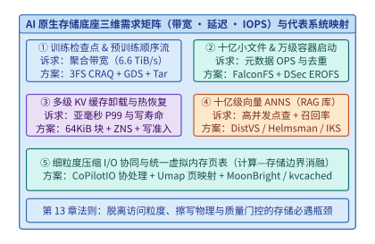

*图 13-24　AI 原生存储底座全场景（检查点、十亿小文件、多级 KV、十亿向量 ANNS、细粒度协同 I/O）在带宽—延迟—IOPS 三维空间的映射总览*

---

### 13.8.4 跨介质统一零拷贝数据面：NVIDIA NIXL（Inference Xfer Library）、PCIe P2P 盘到卡直通与纠删码（Erasure Coding）温冷检查点归档

当多级 KV 缓存池（T0 HBM、T1 CXL/Host DRAM、T2 跨机 RDMA 内存池、T3 本地与分布式 NVMe SSD）以及万卡集群的 PB 级检查点（Checkpoint）同时运行在同一套 AI 数据底座上时，工程团队还会遇到最后两道横跨软硬件协议栈的难题：
第一，**异构存储与互连介质的 API 碎片化**：在传统推理引擎中，同节点 GPU 间拷贝走 `cudaMemcpyPeerAsync`（NVLink），主机内存传输走固定页 DMA，跨机内存池走 UCX / `ibv_post_send`（RDMA），而本地 NVMe SSD 走 `cuFileRead`（GDS）。若一段 $128\mathrm{K}$ 上下文的历史前缀块恰好分散在远端 DRAM、本机 CXL 内存与本地 NVMe SSD 三个层级中，调度器必须分别维护三套内存注册表、三类完成队列与三套错误重试状态机，极易在多流并发下发生控制面阻塞；
第二，**长周期训练检查点的 3 副本容量爆炸**：在第 13.3 节中，我们证明了在活跃训练窗口内采用 CRAQ 3 副本（存储放大系数 $3.0\times$）能够最大化写入吞吐与热恢复速度。然而，在大模型数月预训练与多分支后训练微调过程中，团队往往需要保留数百个历史里程碑检查点以备精度回溯与阶段蒸馏。若所有转入温冷状态的检查点依然按 3 副本常驻高速闪存池，不仅平白吞噬 $200\%$ 的冗余存储成本，还会在数十 PB 规模下挤爆昂贵的 NVMe 容量预算。

针对这两大生产痛点，2025–2026 年的 AI 数据底座分别在**推理传输控制面**与**检查点生命周期编码层**完成了关键演进[^nixl-ec]：

1. **NVIDIA NIXL（Inference Xfer Library）：面向多级存储与跨机互连的统一非阻塞传输抽象**
   作为 NVIDIA Dynamo 分布式推理框架的核心数据面引擎，**NIXL** 将 HBM、Host/CXL DRAM、跨节点 RoCEv2/IB RDMA、NVLink 超节点域以及本地/远端 NVMe SSD（GDS/3FS）统一抽象为支持非阻塞批量描述符（Non-blocking Scatter-Gather Transfer Descriptors）的虚拟地址区间：
   - **一次注册、多后端路由（Unified Memory Registration & Routing）**：应用层仅需通过统一的 `nixlRegisterMem` 注册各层级的物理缓冲池，并在请求命中多级前缀时构造一张包含多个 `(src_tier, src_offset, dst_hbm_offset, bytes)` 条目的复合传输请求列表（Transfer Request List）。NIXL 运行时根据源与目标后端的拓扑亲和性，自动将同一张复合请求列表拆分为并行的 NVLink Copy Engine、RDMA 单边 Read、CXL DMA 与 GDS P2P 通道指令同时下发；
   - **设备端通知与逐层流水同步（Device-Side Notification）**：不同于传统驱动需等待整批多级块全部到达主机后再由 CPU 唤醒 GPU，NIXL 支持在单层或单组块传输完成的瞬间直接在目标 GPU 显存内原子更新完成计数器（Notification Counter），使 GPU 注意力内核能够在第 $l$ 层计算完毕时无缝消费刚刚从不同存储介质并行拼装就绪的第 $l+1$ 层 KV 块。
2. **检查点生命周期分层：从活跃期 3 副本热缓冲到温冷期 Reed-Solomon $\mathrm{RS}(k, m)$ 纠删码归档**
   为了在不牺牲训练中断恢复速度（MTTR）的前提下砍掉历史检查点的容量税，现代 AI 存储底座（如 3FS 与对象归档层协同架构）普遍引入**时间解耦的双模态冗余策略**：
   - **热态窗口（T0/T1 活跃期，最近 $N_{\mathrm{hot}} = 2\text{–}3$ 个检查点）**：训练步异步刷盘时，直接以 **3 副本（Replication Factor $R = 3.0\times$）** 写入高速 NVMe 缓冲池，确保零编码计算开销与最快故障回滚；
   - **温冷归档（T2/T3 归档期，超过保留窗口的历史检查点）**：当某个检查点脱离热回滚窗口后，后台存储守护进程（Storage Daemon）利用空闲主机 CPU（ISA-L 向量化指令）或 DPU/GPU 纠删码加速引擎，异步将每 $k$ 个连续数据分片（Data Chunks，如 $k = 10$）编码生成 $m$ 个校验分片（Parity Chunks，如 $m = 4$），转化为 **Reed-Solomon $\mathrm{RS}(10, 4)$ 纠删码条带** 分散存储在 $k+m = 14$ 个不同故障域的温冷节点上，随即释放原 3 副本空间。
   - **冗余度与容错度双赢**：$\mathrm{RS}(10, 4)$ 编码将存储容量开销从 $R = 3.0\times$ 直接压降至 $\frac{k+m}{k} = \frac{14}{10} = \mathbf{1.40\times}$（**节省 $\frac{3.0 - 1.4}{3.0} \approx 53.33\%$ 的物理磁盘空间**），同时允许同一条带内任意 **$m = 4$ 个节点或磁盘同时故障而不丢失数据**（容错能力反而高于 3 副本的最多容忍 2 副本损坏）。

---

> **算例 13-11（NVIDIA NIXL 统一传输描述符下跨 HBM、CXL DRAM、远端 RDMA 节点与本机 NVMe SSD 的 128K 上下文 KV 块非阻塞并发预取账本）**：
>
> 设某多轮 Agent 请求在 DeepSeek-V3/Qwen3 级推理引擎上命中了 $S = 131{,}072$（$128\mathrm{K}$）个历史前缀词元，命中的分页 KV 缓存总体积为 $V_{\mathrm{total}} = \mathbf{8.0\ \mathrm{GB}}$（十进制 $8.0 \times 10^9\ \mathrm{B}$）。由于多级缓存池的动态热度迁移，这 $8.0\ \mathrm{GB}$ 历史块分布在三条物理独立的存储通道上：
> - **通道一（本机 CXL / Pinned DRAM 池，T1）**：驻留了 $V_{\mathrm{T1}} = 3.2\ \mathrm{GB}$（占 $40\%$），经主机 PCIe/CXL 通道的有效传输带宽为 $B_{\mathrm{T1}} = 50.0\ \mathrm{GB/s}$，单次通道启动开销 $t_{0,\mathrm{T1}} = 0.05\ \mathrm{ms}$；
> - **通道二（跨机远端 RDMA DRAM 池，T2）**：驻留了 $V_{\mathrm{T2}} = 3.2\ \mathrm{GB}$（占 $40\%$），经 $400\ \mathrm{Gbps}$ RoCEv2 网卡的有效读取带宽为 $B_{\mathrm{T2}} = 40.0\ \mathrm{GB/s}$，单次通道启动开销 $t_{0,\mathrm{T2}} = 0.10\ \mathrm{ms}$；
> - **通道三（本机 2 盘 Gen5 NVMe SSD GDS 池，T3）**：驻留了 $V_{\mathrm{T3}} = 1.6\ \mathrm{GB}$（占 $20\%$），经同颗 PCIe Switch P2P 直通的有效聚合带宽为 $B_{\mathrm{T3}} = 20.0\ \mathrm{GB/s}$，单次通道启动开销 $t_{0,\mathrm{T3}} = 0.15\ \mathrm{ms}$。
>
> 1. **传统分立 API 串行/分段阻塞拉取耗时 $T_{\mathrm{serial}}$**：
>    若运行时按介质类型依次串行调用固定页拷贝、RDMA Read 与 `cuFileRead` 并在每阶段末尾执行主机线程同步（每次阶段切换附加 $0.40\ \mathrm{ms}$ 主机调度与锁同步开销，共 2 次切换合计 $0.80\ \mathrm{ms}$），各通道耗时分别为：
>    $$T_{\mathrm{T1}} = 0.05 + \frac{3.2}{50.0} \times 10^3 = \mathbf{64.05\ \mathrm{ms}}, \quad T_{\mathrm{T2}} = 0.10 + \frac{3.2}{40.0} \times 10^3 = \mathbf{80.10\ \mathrm{ms}}, \quad T_{\mathrm{T3}} = 0.15 + \frac{1.6}{20.0} \times 10^3 = \mathbf{80.15\ \mathrm{ms}}$$
>    串行阻塞拉取总耗时高达：
>    $$T_{\mathrm{serial}} = 64.05 + 80.10 + 80.15 + 0.80 = \mathbf{225.10\ \mathrm{ms}}$$
> 2. **NIXL 统一非阻塞复合描述符三通道并发拉取耗时 $T_{\mathrm{NIXL}}$**：
>    由于 CXL 主机通道、RDMA 网卡通道与同 Switch NVMe P2P 通道在物理链路与 DMA 引擎上相互正交，NIXL 在单次非阻塞提交（描述符构造开销 $t_{\mathrm{desc}} = 0.05\ \mathrm{ms}$）中同时驱动三路后端并行向目标 GPU HBM 写入，总拉取时间由最慢通道决定：
>    $$T_{\mathrm{NIXL}} = t_{\mathrm{desc}} + \max(T_{\mathrm{T1}},\; T_{\mathrm{T2}},\; T_{\mathrm{T3}}) = 0.05 + \max(64.05,\; 80.10,\; 80.15) = \mathbf{80.20\ \mathrm{ms}}$$
>    相比传统串行拉取，NIXL 跨介质并发流水将纯传输耗时压缩了 **$225.10 / 80.20 \approx 2.81\times$**，等效聚合注入带宽高达 $8.0\ \mathrm{GB} / 0.0802\ \mathrm{s} \approx \mathbf{99.75\ \mathrm{GB/s}}$；若进一步配合逐层注意力计算重叠（隐藏 $75\%$ 传输耗时），暴露在首字延迟（TTFT）关键路径上的存储等待时间仅余 **$20.05\ \mathrm{ms}$**（图 13-25）。

---

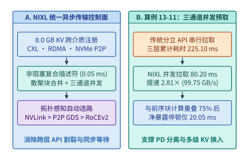

*图 13-25　算例 13-11：NVIDIA NIXL（Inference Xfer Library）跨 HBM、CXL DRAM、远端 RDMA 与 NVMe SSD 的统一非阻塞传输描述符及三通道并发预取（从串行 $225.10\ \mathrm{ms}$ 压降至并发 $80.20\ \mathrm{ms}$）*

---

> **算例 13-12（万卡集群 PB 级检查点从 3 副本热缓存向 Reed-Solomon $\mathrm{RS}(10,4)$ 纠删码温冷归档转化的存储空间节省与编码带宽开销核算）**：
>
> 某万卡预训练集群单个完整训练状态检查点（含 FP32 主权重、一阶/二阶优化器状态与数据加载器游标）的逻辑体积为 $V_{\mathrm{ckpt}} = \mathbf{10.0\ \mathrm{TB}}$。在为期 30 天的持续训练与分支评测周期内，集群共需在线保留 $N_{\mathrm{total}} = \mathbf{100\ \text{个}}$ 历史检查点（总逻辑数据量 $V_{\mathrm{logical}} = 100 \times 10.0\ \mathrm{TB} = \mathbf{1.0\ \mathrm{PB}} = 1{,}000\ \mathrm{TB}$）：
>
> 1. **全量 3 副本基线 vs. “3 热 + 97 温冷 $\mathrm{RS}(10,4)$”分层归档的物理容量与成本对比**：
>    - **全量 3 副本基线（$R = 3.0\times$）**：100 个检查点全部按 3 副本存放，占用的物理闪存总容量高达：
>      $$V_{\mathrm{phys,rep3}} = 1{,}000\ \mathrm{TB} \times 3.0 = \mathbf{3{,}000\ \mathrm{TB}} \quad (\text{即 } 3.0\ \mathrm{PB})$$
>    - **生命周期分层策略（最新 $N_{\mathrm{hot}} = 3$ 个检查点保留 3 副本热态，其余 $N_{\mathrm{cold}} = 97$ 个历史检查点异步转为 $\mathrm{RS}(10, 4)$ 纠删码）**：
>      热态 3 个检查点占 $3 \times 10.0\ \mathrm{TB} \times 3.0 = \mathbf{90.0\ \mathrm{TB}}$；温冷态 97 个检查点（逻辑量 $970\ \mathrm{TB}$）按 10 个数据块配 4 个校验块编码，存储放大系数为 $14 / 10 = 1.40\times$，占 $970\ \mathrm{TB} \times 1.40 = \mathbf{1{,}358.0\ \mathrm{TB}}$。全集群实际占用的物理容量降至：
>      $$V_{\mathrm{phys,tiered}} = 90.0 + 1{,}358.0 = \mathbf{1{,}448.0\ \mathrm{TB}} \quad (\text{综合冗余倍数仅 } 1.448\times)$$
>      单集群直接净省下 $3{,}000 - 1{,}448 = \mathbf{1{,}552.0\ \mathrm{TB}}$（**节省 $51.73\%$ 物理闪存容量**；纯温冷层节省 $53.33\%$）。按企业级高速分布式闪存年化 TCO 约 $120\ \text{美元/TB/年}$ 核算，每年可净节省约 **$18.624\ \text{万美元}$**。
> 2. **后台异步 $\mathrm{RS}(10, 4)$ 编码的 CPU 与网络带宽开销核算**：
>    设集群每 $\Delta T_{\mathrm{ckpt}} = 6\ \text{小时}$（$21{,}600\ \mathrm{s}$）封存一个需要转入温冷层的 $10.0\ \mathrm{TB}$ 检查点，存储池共有 $M_{\mathrm{node}} = 100$ 台存储节点参与后台条带化归档。对于每 $10.0\ \mathrm{TB}$ 逻辑数据，编码器需读取 $10.0\ \mathrm{TB}$ 数据块并计算写出 $4.0\ \mathrm{TB}$ 校验块（总编码数据流为 $14.0\ \mathrm{TB}$）：
>    - 若要求在 $T_{\mathrm{encode}} = 10\ \mathrm{min} = 600\ \mathrm{s}$ 的后台窗口内完成单次转码，100 台存储节点合计仅需提供 $\frac{4{,}000\ \mathrm{GB}}{600\ \mathrm{s}} \approx \mathbf{6.67\ \mathrm{GB/s}}$ 的聚合校验生成速率，分摊到每台存储节点仅为 **$66.7\ \mathrm{MB/s}$**；
>    - 单颗现代服务器 CPU 核心运行 AVX-512 `isa-l` Reed-Solomon 编码的实测吞吐约为 $4.0\text{–}6.0\ \mathrm{GB/s}$，这意味着每台存储节点仅需动用 **不到 $2\%$ 的单个空闲 CPU 核心算力**（若在整个 6 小时检查点间隔内平滑流式转码，单节点平均校验写入速率更是低至 **$1.85\ \mathrm{MB/s}$**），即可对前台训练作业实现**零感知、零带宽抢占**的无损降本（图 13-26）。

---

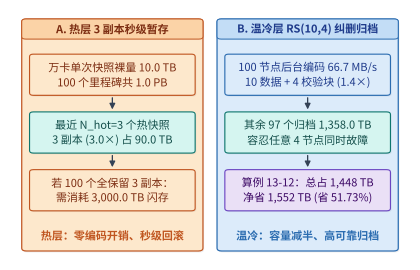

*图 13-26　算例 13-12：万卡集群 PB 级检查点从活跃期 3 副本热缓存（$3.0\times$）向温冷期 Reed-Solomon $\mathrm{RS}(10,4)$ 纠删码（$1.4\times$）异步转化的生命周期架构与容量节省账本*

下面的代码实现了 **NVIDIA NIXL 多级 KV 并发传输调度器与检查点 $\mathrm{RS}(k, m)$ 纠删码归档收益计算器**，可直接复核算例 13-11 与算例 13-12 的全部锁定指标：

```python
from dataclasses import dataclass
from typing import Dict, List


@dataclass(frozen=True)
class NixlAndErasureCodingReport:
    """NIXL 跨介质并发预取与检查点 RS(k,m) 纠删码归档核算报告。"""
    serial_fetch_ms: float
    nixl_parallel_ms: float
    nixl_speedup: float
    effective_bw_gbps: float
    rep3_total_tb: float
    tiered_total_tb: float
    saved_tb: float
    saved_ratio_pct: float
    per_node_parity_mb_s: float


def evaluate_nixl_and_ec_archive(
    tier_volumes_gb: List[float] = [3.2, 3.2, 1.6],
    tier_bw_gbps: List[float] = [50.0, 40.0, 20.0],
    tier_init_ms: List[float] = [0.05, 0.10, 0.15],
    sync_switch_ms: float = 0.40,
    nixl_desc_ms: float = 0.05,
    ckpt_size_tb: float = 10.0,
    total_ckpts: int = 100,
    hot_ckpts: int = 3,
    rep_factor: int = 3,
    rs_k: int = 10,
    rs_m: int = 4,
    encode_window_s: float = 600.0,
    storage_nodes: int = 100,
) -> NixlAndErasureCodingReport:
    """复算算例 13-11（NIXL 多通道并发）与算例 13-12（RS(10,4) 检查点归档）。"""
    tier_times_ms = [
        init_ms + (vol / bw) * 1000.0
        for vol, bw, init_ms in zip(tier_volumes_gb, tier_bw_gbps, tier_init_ms)
    ]
    serial_ms = sum(tier_times_ms) + (len(tier_volumes_gb) - 1) * sync_switch_ms
    nixl_ms = nixl_desc_ms + max(tier_times_ms)
    eff_bw = sum(tier_volumes_gb) / (nixl_ms / 1000.0)

    cold_ckpts = total_ckpts - hot_ckpts
    rep3_total_tb = total_ckpts * ckpt_size_tb * rep_factor
    ec_overhead = (rs_k + rs_m) / rs_k
    tiered_total_tb = (
        hot_ckpts * ckpt_size_tb * rep_factor
        + cold_ckpts * ckpt_size_tb * ec_overhead
    )
    saved_tb = rep3_total_tb - tiered_total_tb
    saved_pct = (saved_tb / rep3_total_tb) * 100.0

    parity_gb = ckpt_size_tb * 1000.0 * (rs_m / rs_k)
    per_node_mb_s = (parity_gb * 1000.0) / (encode_window_s * storage_nodes)

    return NixlAndErasureCodingReport(
        serial_fetch_ms=round(serial_ms, 2),
        nixl_parallel_ms=round(nixl_ms, 2),
        nixl_speedup=round(serial_ms / nixl_ms, 2),
        effective_bw_gbps=round(eff_bw, 2),
        rep3_total_tb=round(rep3_total_tb, 1),
        tiered_total_tb=round(tiered_total_tb, 1),
        saved_tb=round(saved_tb, 1),
        saved_ratio_pct=round(saved_pct, 2),
        per_node_parity_mb_s=round(per_node_mb_s, 1),
    )


if __name__ == "__main__":
    res = evaluate_nixl_and_ec_archive()
    assert res.serial_fetch_ms == 225.10 and res.nixl_parallel_ms == 80.20
    assert res.nixl_speedup == 2.81 and res.saved_tb == 1552.0
    assert res.saved_ratio_pct == 51.73 and res.per_node_parity_mb_s == 66.7
```

表 13-9 汇总了本章第 13.8 节引入的七类新一代存储、统一传输与虚拟内存原语、各自解决的物理瓶颈以及适用边界：

*表 13-9　第 13.8 节新一代 AI 存储、统一零拷贝传输与虚拟内存原语的架构创新、解决瓶颈与工程边界对比*

| 系统原语与出处 | 核心架构创新 | 解决的硬件与软件瓶颈 | 适用工程边界与注意事项 |
| :--- | :--- | :--- | :--- |
| **FalconFS**（NSDI '26） | 缩减客户端元数据缓存，将多级路径解析下推至 MDS 服务端复合执行，配合混合哈希无锁目录布局 | 消除深度 $D$ 目录树下每次 `open()` 触发 $O(D)$ 次跨网 RPC 的往返放大与父目录写锁排队 | 适用于原始多模态海量小文件清洗与随机 Shuffle；静态顺序遍历仍优先用 WebDataset/Tar |
| **DistVS**（NSDI '26） | 计算—内存解耦下跨本地 DRAM（粗量化）、远端内存池（中精度）与 SSD（全精度）三级筛选 | 消除图遍历每跳拉取全精度向量的 RDMA 带宽墙，将全精度 SSD 读取收敛至极少数 Top-$M$ 候选 | 有损精度分级仅适用于近似 Top-$k$ 向量召回，**不可直接套用于需保持数值一致的 KV 分层** |
| **Helmsman**（OSDI '26） | 倒排聚类重返百亿级闪存 ANNS：DRAM 常驻导航质心 + SSD 单轮并行对齐连续块读取 | 消除纯图索引在 SSD 上多轮串行随机指针跳跃带来的高延迟与高读放大 | 需联合审计集群 DRAM/SSD 成本配比与目标业务数据集上的 `Recall@k` 质量门槛 |
| **CoPilotIO**（OSDI '26） | GPU 仅写轻量门铃描述符，由空闲主机 CPU 核作为副驾驶接管 NVMe 队列轮询、聚合与解压 | 释放被细粒度 I/O 轮询侵占的宝贵 GPU SM 槽位与寄存器，消除计算—I/O 混合争用 | 大块（$\ge 256\ \mathrm{KiB}$）未压缩连续张量仍走 GDS P2P DMA；细粒度随机/需解压块走 CoPilotIO |
| **Umap & MoonBright**（OSDI '26） | Umap 重构 DFS 上矩阵切片 `mmap` 预取与主动页回收；MoonBright 在 GPU 端物化页表并延迟 TLB 同步 | 消除 DFS `mmap` 细碎网络请求与容器 `cgroup` OOM 误杀；消除虚拟显存重映射的全局 TLB 刷空停顿 | 需内核/文件系统客户端或 GPU 驱动层配合；多模型共享显存池可结合 `kvcached` 虚拟地址解耦 |
| **NVIDIA NIXL & RS 纠删码归档** | NIXL 以统一非阻塞描述符并发驱动 HBM/CXL/RDMA/NVMe；历史检查点由 3 副本异步转为 $\mathrm{RS}(10,4)$ | 消除多级 KV 池分立 API 串行阻塞；将温冷检查点容量开销从 $3.0\times$ 压至 $1.4\times$（省 $53.3\%$） | 活跃期热检查点仍保留 3 副本保障秒级写入；后台转码利用空闲 CPU ISA-L 或 DPU 异步执行 |

#### 分布式 KV Cache 存储池与对象存储冷热分层（LMCache / Mooncake Store 跨请求 Prefix 压缩与 GDS 异步预取）

在多轮智能体（Agentic Workflow）、企业代码仓库分析与长文档 RAG 场景中，跨请求共享的前缀上下文（Prefix Context）往往长达 $32\mathrm{K}\text{–}128\mathrm{K}$ 词元。即使采用第 13.8.4 节前半部分介绍的 NIXL 零拷贝传输，若直接以原始半精度（FP16/BF16）将数吉字节的 KV 张量在远端存储池、NVMe SSD 与冷对象存储（S3 Express One Zone / Ceph RGW）之间原样搬移，PCIe/网络带宽与温冷对象存储容量仍会迅速饱和。**LMCache / CacheGen**[^lmcache-sys] 与 **Mooncake Store**[^mooncake-fast] 通过引入**跨词元锚点差分压缩（Anchor-Delta Quantization & Arithmetic Coding）**、**按层组切分的 GDS + GPU 解压异步预取流水线**以及**共享 NVMe 存储池硬件加权公平队列（NVMe WRR QoS）**，打通了从内存/闪存热池向低成本对象存储延伸的完整闭环。

1. **LMCache / CacheGen 跨请求前缀 KV 压缩与逐层组 GDS 异步预取流水线**：
   大语言模型相邻词元在同一注意力头与相邻层上的 Key/Value 激活具有显著的局部相关性。LMCache / CacheGen 将长前缀按固定步长选取锚点词元（Anchor Token）保留高精度基准，其余词元仅编码相对于锚点的残差并按通道重要性施加异构量化与算术熵编码，在几乎不损失生成质量的前提下实现 $\rho_{\mathrm{comp}} \approx 3.5\times\text{–}4.2\times$ 的无损/准无损体积压缩[^lmcache-sys]。
   更为关键的是，若等全部 $L$ 层 KV 从 NVMe SSD 读完并解压后再启动首层 Prefill/Attention 计算，I/O 耗时将完全暴露在首词元延迟（TTFT）关键路径上。通过将 $L$ 层模型按每 $G_{\mathrm{layer}}$ 层打包为 $N_{\mathrm{chunks}} = L / G_{\mathrm{layer}}$ 个连续存储块（Block-major Chunk），推理引擎在通过 GPUDirect Storage（GDS）[^gds-guide] 读取并由轻量 GPU 内核解压第 $1$ 块后即可立即启动前 $G_{\mathrm{layer}}$ 层计算，并在计算第 $c$ 块的同时异步预取与解压第 $c+1$ 块：
   $$T_{\mathrm{pipe}} = t_{\mathrm{io,chunk}} + (N_{\mathrm{chunks}} - 1)\max\bigl(t_{\mathrm{io,chunk}},\, t_{\mathrm{comp,chunk}}\bigr) + t_{\mathrm{comp,chunk}}$$
   其中单块压缩读取加 GPU 解压耗时为 $t_{\mathrm{io,chunk}} = \frac{V_{\mathrm{raw}} / (\rho_{\mathrm{comp}} N_{\mathrm{chunks}})}{B_{\mathrm{GDS}}} + \frac{V_{\mathrm{raw}} / N_{\mathrm{chunks}}}{B_{\mathrm{decomp}}}$，单块计算耗时为 $t_{\mathrm{comp,chunk}} = G_{\mathrm{layer}} \cdot t_{\mathrm{layer}}$。
   以 $L = 64$ 层、命中前缀长度 $S = 65{,}536$（$64\mathrm{K}$）、每层每词元 KV 状态 $2{,}048\ \mathrm{B}$ 为例：原始 KV 总体积为 $V_{\mathrm{raw}} = 65{,}536 \times 64 \times 2{,}048\ \mathrm{B} = 8{,}192.0\ \mathrm{MiB}$（$8.0\ \mathrm{GiB}$）。在 $\rho_{\mathrm{comp}} = 3.80\times$ 压缩下，落盘体积降至 $2{,}155.79\ \mathrm{MiB}$（$2.105\ \mathrm{GiB}$）。设单盘 GDS 有效带宽 $B_{\mathrm{GDS}} = 12.5\ \mathrm{GiB/s}$、GPU 流式解压带宽 $B_{\mathrm{decomp}} = 80.0\ \mathrm{GiB/s}$、每层前向验证耗时 $t_{\mathrm{layer}} = 1.15\ \mathrm{ms}$：
   - **未压缩串行基线**：读取 $8.0\ \mathrm{GiB}$ 耗时 $8.0 / 12.5 = 640.0\ \mathrm{ms}$，加上 $64 \times 1.15 = 73.60\ \mathrm{ms}$ 计算，总耗时 $T_{\mathrm{serial}} = \mathbf{713.60\ \mathrm{ms}}$；
   - **LMCache 压缩 + $16$ 块（$G_{\mathrm{layer}}=4$）流水预取**：单块压缩 GDS 读取耗时 $(0.5 / 3.80) / 12.5 \times 1000 = 10.5263\ \mathrm{ms}$，单块 GPU 解压耗时 $0.5 / 80.0 \times 1000 = 6.2500\ \mathrm{ms}$，合计 $t_{\mathrm{io,chunk}} = 16.7763\ \mathrm{ms}$；单块计算 $t_{\mathrm{comp,chunk}} = 4 \times 1.15 = 4.60\ \mathrm{ms}$。由于前 $15$ 块的计算完全被下一块的 I/O 掩盖，端到端耗时骤降至 $T_{\mathrm{pipe}} = 16 \times 16.7763 + 4.60 = \mathbf{273.02\ \mathrm{ms}}$，实现 **$2.61\times$** 的 TTFT 净加速（图 13-27）。

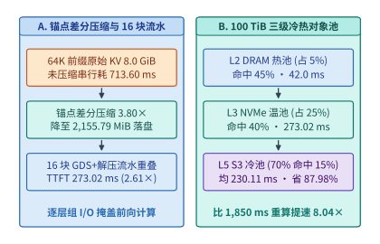
*图 13-27　LMCache / Mooncake Store 跨请求前缀 KV 锚点差分压缩（3.80×）、16 块逐层组 GDS 异步预取与 GPU 解压流水线（713.60 ms 降至 273.02 ms，提速 2.61×）及 DRAM—NVMe—S3 三级冷热分层*

```python
from dataclasses import dataclass


@dataclass(frozen=True)
class LMCachePipelineMetrics:
    """LMCache 前缀 KV 压缩与逐层组 GDS 异步预取流水线核算结果。"""
    raw_kv_mib: float
    compressed_kv_mib: float
    compression_ratio: float
    uncompressed_serial_ms: float
    compressed_pipelined_ms: float
    ttft_speedup_x: float


def simulate_lmcache_prefix_compression_and_pipeline(
    seq_tokens: int = 65536,
    layers: int = 64,
    kv_bytes_per_tok_per_layer: int = 2048,
    compression_ratio: float = 3.80,
    gds_bw_gib_s: float = 12.5,
    gpu_decomp_bw_gib_s: float = 80.0,
    layer_compute_ms: float = 1.15,
    chunk_layers: int = 4,
) -> LMCachePipelineMetrics:
    """核算 64K 长前缀在未压缩串行拉取与 LMCache 压缩 16 块流水预取下的 TTFT。"""
    raw_bytes = seq_tokens * layers * kv_bytes_per_tok_per_layer
    raw_mib = raw_bytes / (1024.0 ** 2)
    comp_mib = raw_mib / compression_ratio

    raw_gib = raw_bytes / (1024.0 ** 3)
    uncomp_fetch_ms = (raw_gib / gds_bw_gib_s) * 1000.0
    total_compute_ms = layers * layer_compute_ms
    uncomp_serial_ms = uncomp_fetch_ms + total_compute_ms

    num_chunks = layers // chunk_layers
    comp_gib_per_chunk = (raw_gib / compression_ratio) / num_chunks
    raw_gib_per_chunk = raw_gib / num_chunks
    chunk_io_ms = (
        (comp_gib_per_chunk / gds_bw_gib_s) * 1000.0
        + (raw_gib_per_chunk / gpu_decomp_bw_gib_s) * 1000.0
    )
    chunk_comp_ms = chunk_layers * layer_compute_ms

    pipelined_ms = (
        chunk_io_ms
        + (num_chunks - 1) * max(chunk_io_ms, chunk_comp_ms)
        + chunk_comp_ms
    )
    return LMCachePipelineMetrics(
        raw_kv_mib=round(raw_mib, 2),
        compressed_kv_mib=round(comp_mib, 2),
        compression_ratio=round(compression_ratio, 2),
        uncompressed_serial_ms=round(uncomp_serial_ms, 2),
        compressed_pipelined_ms=round(pipelined_ms, 2),
        ttft_speedup_x=round(uncomp_serial_ms / pipelined_ms, 2),
    )


if __name__ == "__main__":
    m_lm = simulate_lmcache_prefix_compression_and_pipeline()
    assert m_lm.raw_kv_mib == 8192.0 and m_lm.compressed_kv_mib == 2155.79
    assert m_lm.uncompressed_serial_ms == 713.60 and m_lm.compressed_pipelined_ms == 273.02
    assert m_lm.ttft_speedup_x == 2.61
```

2. **DRAM—NVMe—低延迟对象存储（S3 Express）三级冷热分层与月度 TCO 治理**：
   在百 TiB 级企业多租户知识库与跨天多轮 Agent 会话池中，仅靠主机 DRAM（约 $320\ \mathrm{USD/(TiB\cdot month)}$）或本地 NVMe SSD（约 $45\ \mathrm{USD/(TiB\cdot month)}$）存储全量压缩前缀仍面临高昂成本。通过将压缩后的 $2.105\ \mathrm{GiB}$ 前缀段按访问热度在 **L2 主机 DRAM 热池**（容量占比 $5\%$，命中率 $45\%$，拉取耗时 $42.0\ \mathrm{ms}$）、**L3 本地 NVMe 温池**（容量占比 $25\%$，命中率 $40\%$，流水耗时 $273.02\ \mathrm{ms}$）与 **L5 低延迟对象存储冷池**（如 S3 Express One Zone / Ceph RGW，容量占比 $70\%$，单价 $16\ \mathrm{USD/(TiB\cdot month)}$，命中率 $15\%$，拉取耗时 $680.0\ \mathrm{ms}$）之间动态升降级，系统加权平均恢复延迟仅为 $0.45 \times 42.0 + 0.40 \times 273.02 + 0.15 \times 680.0 = \mathbf{230.11\ \mathrm{ms}}$（相比 $1{,}850.0\ \mathrm{ms}$ 的 GPU 重算 Prefill 提速 **$8.04\times$**），而 $100\ \mathrm{TiB}$ 缓存池的月度存储硬件成本从全 DRAM 的 $32{,}000.0\ \mathrm{USD}$ 压降至 **$3{,}845.0\ \mathrm{USD}$**（净省 **$87.98\%$**）：

```python
from dataclasses import dataclass


@dataclass(frozen=True)
class ThreeTierObjectLifecycleReport:
    """DRAM-NVMe-S3 三级前缀 KV 缓存池的加权 TTFT 与月度 TCO 报告。"""
    avg_fetch_ms: float
    pure_recompute_ms: float
    speedup_vs_recompute: float
    monthly_storage_cost_usd: float
    all_dram_cost_usd: float
    cost_saving_pct: float


def evaluate_s3_nvme_dram_three_tier_lifecycle(
    hit_dram: float = 0.45,
    hit_nvme: float = 0.40,
    hit_s3_express: float = 0.15,
    t_dram_ms: float = 42.0,
    t_nvme_ms: float = 273.02,
    t_s3_ms: float = 680.0,
    t_recompute_ms: float = 1850.0,
    pool_total_tib: float = 100.0,
    dram_ratio: float = 0.05,
    nvme_ratio: float = 0.25,
    s3_ratio: float = 0.70,
    cost_dram_tib_mo: float = 320.0,
    cost_nvme_tib_mo: float = 45.0,
    cost_s3_tib_mo: float = 16.0,
) -> ThreeTierObjectLifecycleReport:
    """核算 100 TiB 三级前缀池的加权平均恢复延迟与月度硬件成本节省率。"""
    avg_ms = (
        hit_dram * t_dram_ms
        + hit_nvme * t_nvme_ms
        + hit_s3_express * t_s3_ms
    )
    tiered_cost = pool_total_tib * (
        dram_ratio * cost_dram_tib_mo
        + nvme_ratio * cost_nvme_tib_mo
        + s3_ratio * cost_s3_tib_mo
    )
    all_dram_cost = pool_total_tib * cost_dram_tib_mo
    saving_pct = (1.0 - tiered_cost / all_dram_cost) * 100.0
    return ThreeTierObjectLifecycleReport(
        avg_fetch_ms=round(avg_ms, 2),
        pure_recompute_ms=round(t_recompute_ms, 2),
        speedup_vs_recompute=round(t_recompute_ms / avg_ms, 2),
        monthly_storage_cost_usd=round(tiered_cost, 2),
        all_dram_cost_usd=round(all_dram_cost, 2),
        cost_saving_pct=round(saving_pct, 2),
    )


if __name__ == "__main__":
    m_tier = evaluate_s3_nvme_dram_three_tier_lifecycle()
    assert m_tier.avg_fetch_ms == 230.11 and m_tier.speedup_vs_recompute == 8.04
    assert m_tier.monthly_storage_cost_usd == 3845.0 and m_tier.cost_saving_pct == 87.98
```

3. **检查点突发写与在线 KV 读取共享 NVMe 池的队头阻塞（HoL）与硬件 WRR + 微块切片 QoS**：
   在训推一体或共享存储底座（如 3FS / Mooncake Store 挂载同批企业级 NVMe SSD）中，后台训练检查点刷盘或 S3 冷热回迁会持续提交 $1\ \mathrm{MiB}$ 大块顺序写（单次 NAND 编程与通道占用 $t_{\mathrm{wr,1M}} = 0.80\ \mathrm{ms}$），而在线推理请求则发起延迟高度敏感的 $1\ \mathrm{MiB}$ 突发块读（如 $16 \times 64\ \mathrm{KiB}$ 连续块打包拉取，纯读服务耗时 $t_{\mathrm{rd,1M}} = 1.00\ \mathrm{ms}$）[^3fs-repo][^nixl-ec]。
   - **单一 FIFO 队列的队头阻塞（Head-of-Line Blocking）**：若两者共用同一条 NVMe 提交队列（SQ），当突发 KV 读取前方排有 $N_{\mathrm{wr}} = 16$ 个未切片的 $1\ \mathrm{MiB}$ 检查点写请求时，队头阻塞等待高达 $T_{\mathrm{FIFO,wait}} = 16 \times 0.80 = 12.80\ \mathrm{ms}$，导致该批 KV 读取的 P99 完成延迟恶化至 $T_{\mathrm{FIFO,P99}} = 12.80 + 1.00 = \mathbf{13.80\ \mathrm{ms}}$；
   - **NVMe 硬件加权轮询（Weighted Round Robin, WRR）+ $128\ \mathrm{KiB}$ 写微块切片**：启用 NVMe 控制器原生多优先级队列仲裁，将在线 KV 读绑定至高优先级队列（权重 $w_{\mathrm{H}} = 8$）、后台检查点写绑定至低优先级队列（权重 $w_{\mathrm{L}} = 2$，即保障 KV 读取获得 $\eta_{\mathrm{WRR}} = \frac{8}{8+2} = 80\%$ 的带宽份额，在 $10.0\ \mathrm{GiB/s}$ 盘上锁定 $8.0\ \mathrm{GiB/s}$），同时在主机 I/O 调度层强制将 $1\ \mathrm{MiB}$ 写请求切分为 $128\ \mathrm{KiB}$ 微块（单块非抢占通道占用仅 $t_{\mathrm{wr,128K}} = 0.80 / 8 = 0.10\ \mathrm{ms}$）。此时高优先级 KV 读最多等待 $1$ 个在途 $128\ \mathrm{KiB}$ 写切片即可抢占下一仲裁轮次，其 P99 延迟压降至 $T_{\mathrm{WRR,P99}} = 0.10 + \frac{1.00}{0.80} = \mathbf{1.35\ \mathrm{ms}}$，尾延迟削减达 **$10.22\times$**（图 13-28；完整可复现脚本见配套实验 [`experiments/ch13/13-04/`](../experiments/ch13/13-04/)）。

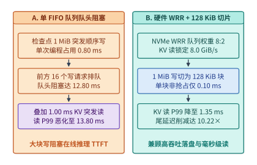
*图 13-28　训练检查点 1 MiB 突发写与在线 KV 缓存读取共享 NVMe 池时，单一 FIFO 队列队头阻塞（P99 达 13.80 ms）与 NVMe 硬件 WRR（8:2 权重）+ 128 KiB 写微块切片 QoS 隔离（P99 降至 1.35 ms，改善 10.22×）对比*

```python
from dataclasses import dataclass


@dataclass(frozen=True)
class NvmeQosIsolationReport:
    """共享 NVMe 池 FIFO 队头阻塞与硬件 WRR + 128 KiB 写切片 QoS 审计报告。"""
    fifo_hol_wait_ms: float
    fifo_p99_read_ms: float
    wrr_sliced_wait_ms: float
    wrr_p99_read_ms: float
    tail_latency_reduction_x: float
    kv_guaranteed_bw_gib_s: float


def audit_nvme_wrr_qos_and_hol_blocking(
    ssd_bw_gib_s: float = 10.0,
    fifo_queued_writes: int = 16,
    write_1m_ms: float = 0.80,
    write_slice_kb: int = 128,
    kv_burst_read_1m_ms: float = 1.00,
    wrr_high_weight: int = 8,
    wrr_low_weight: int = 2,
) -> NvmeQosIsolationReport:
    """对比单一 FIFO 队列与 NVMe WRR(8:2) + 128 KiB 写切片下的在线 KV 读 P99 延迟。"""
    fifo_wait_ms = fifo_queued_writes * write_1m_ms
    fifo_p99_ms = fifo_wait_ms + kv_burst_read_1m_ms

    slice_factor = 1024 // write_slice_kb
    wrr_wait_ms = write_1m_ms / slice_factor
    wrr_share = wrr_high_weight / (wrr_high_weight + wrr_low_weight)
    wrr_p99_ms = wrr_wait_ms + (kv_burst_read_1m_ms / wrr_share)
    kv_bw = ssd_bw_gib_s * wrr_share
    return NvmeQosIsolationReport(
        fifo_hol_wait_ms=round(fifo_wait_ms, 2),
        fifo_p99_read_ms=round(fifo_p99_ms, 2),
        wrr_sliced_wait_ms=round(wrr_wait_ms, 2),
        wrr_p99_read_ms=round(wrr_p99_ms, 2),
        tail_latency_reduction_x=round(fifo_p99_ms / wrr_p99_ms, 2),
        kv_guaranteed_bw_gib_s=round(kv_bw, 2),
    )


if __name__ == "__main__":
    m_qos = audit_nvme_wrr_qos_and_hol_blocking()
    assert m_qos.fifo_p99_read_ms == 13.80 and m_qos.wrr_p99_read_ms == 1.35
    assert m_qos.tail_latency_reduction_x == 10.22 and m_qos.kv_guaranteed_bw_gib_s == 8.0
```

表 13-10 汇总了分布式 KV 缓存压缩分层（LMCache / Mooncake Store）与共享 NVMe 存储池 QoS 隔离的工程参数与定量收益：

*表 13-10　分布式 KV 缓存压缩分层（LMCache / Mooncake Store）与共享 NVMe 池 QoS 隔离参数对比*

| 协同优化维度 | 未优化传统基线 | LMCache / Mooncake 协同优化机制 | 锁定核心指标与工程收益 |
| :--- | :--- | :--- | :--- |
| **跨请求前缀 KV 传输与预取** | $64\mathrm{K}$ 前缀（$8.0\ \mathrm{GiB}$）未压缩串行 GDS 拉取 + 全层计算 | 锚点差分压缩（$\rho_{\mathrm{comp}}=3.80\times$，降至 $2{,}155.79\ \mathrm{MiB}$）+ $16$ 块（每块 $4$ 层）GDS 读取与 GPU 解压流水重叠 | TTFT 从 $713.60\ \mathrm{ms}$ 降至 **$273.02\ \mathrm{ms}$**（提速 **$2.61\times$**） |
| **百 TiB 前缀池冷热介质分层** | $100\ \mathrm{TiB}$ 全部驻留主机 DRAM（或未命中时耗 $1{,}850\ \mathrm{ms}$ 全量重算） | L2 DRAM（$5\%$，命中 $45\%$）+ L3 NVMe（$25\%$，命中 $40\%$）+ L5 S3 Express（$70\%$，命中 $15\%$）三级生命周期管理 | 加权恢复耗时 **$230.11\ \mathrm{ms}$**（比重算快 **$8.04\times$**）；月成本从 $32{,}000\ \mathrm{USD}$ 降至 **$3{,}845\ \mathrm{USD}$（省 $87.98\%$）** |
| **训推共享 NVMe 池尾延迟隔离** | 检查点 $1\ \mathrm{MiB}$ 突发写与在线 KV 读共用单 FIFO 队列（$16$ 写排队阻塞 $12.80\ \mathrm{ms}$） | NVMe 硬件 WRR 队列（读写权重 $8:2$，保底 $8.0\ \mathrm{GiB/s}$）+ 检查点写强制切分为 $128\ \mathrm{KiB}$ 微块（单块阻塞 $0.10\ \mathrm{ms}$） | 在线 KV 突发读 P99 延迟从 $13.80\ \mathrm{ms}$ 压降至 **$1.35\ \mathrm{ms}$**（尾延迟削减 **$10.22\times$**） |

---

## 常见误区

1. **误区一：“只要给服务器插满标称 $14\ \mathrm{GB/s}$ 的 PCIe Gen5 NVMe SSD，用默认的文件读取接口就能获得百 GB/s 的模型加载速度。”**
   **辨析**：如算例 13-1 所示，传统 POSIX `read()` 默认经过内核页缓存（Page Cache），数据必须先从 SSD 穿过 PCIe Root Complex 写入主机 DRAM，再由 CPU 拷贝并二次穿过 Root Complex 进入 GPU 显存。流量翻倍叠加 Root Complex 上行链路瓶颈与 CPU 拷贝开销，会将整机实际吞吐限制在 $40\text{–}50\ \mathrm{GB/s}$。必须结合 `O_DIRECT` 与 GPUDirect Storage（GDS）通过同颗 PCIe Switch 执行 P2P DMA 零拷贝直通，并维持充足的异步队列深度 $Q_{\min}$，才能兑现百 GB/s 的硬件物理带宽。
2. **误区二：“内核页缓存（Page Cache）对所有 AI 负载都是有害的，应该一律全局关闭。”**
   **辨析**：是否旁路页缓存取决于**数据是否跨进程高频复用以及消费者是 CPU 还是 GPU**。对于直接送入 GPU 显存的超大权重加载、KV 缓存块卸载以及单次随机采样的 PB 级训练语料，页缓存命中率极低且造成双重拷贝，确实应当采用 `O_DIRECT` / GDS 旁路；但对于第 11.2 节与第 13.5.3 节讨论的同一宿主机上数百个智能体沙箱共享的基础 EROFS 镜像层、Python 依赖库或由主机 CPU 反复读取的小型词表（Tokenizer Vocabulary），内核页缓存的跨进程物理页帧共享恰恰能免除重复磁盘 I/O。
3. **误区三：“规划分布式存储服务器时，16 块 SSD 的总带宽只要刚好等于网卡线速（如 $50\ \mathrm{GB/s}$）就是最优性价比配比。”**
   **辨析**：如算例 13-2 对 DeepSeek 3FS 的剖析，SSD 标称的顺序读峰值是在 $128\ \mathrm{KiB}+$ 大块、纯读、无 GC 理想工况下测得的。在真实 AI 集群中，存储节点需同时承担 CRAQ 3 副本写入、细粒度随机 KV 块拉取导致的带宽折损以及后台闪存垃圾回收。若磁盘物理带宽不相对网卡线速留出 $2\times$ 以上的超配裕量（3FS 为 $112\ \mathrm{GB/s}$ vs. $50\ \mathrm{GB/s}$，即 $2.24\times$），一旦进入混合读写或高水位运行，磁盘就会先于网卡饱和并引发剧烈的长尾延迟。
4. **误区四：“将显存里的分页 KV Cache 原样按层（Layer-major）转存到 NVMe SSD 最简单，性能也不会有什么损失。”**
   **辨析**：如算例 13-3 所示，在 GQA 或 MLA 架构下，单个 $16\text{-token}$ 块在单层上的 KV 状态往往只有 $1\text{–}2\ \mathrm{KiB}$。若按层分离存储，拉取一个块需要发起 $L$（如 32 或 64）次微小的随机读，不仅因小于 $4\ \mathrm{KiB}$ LBA / $16\ \mathrm{KiB}$ 闪存页触发 $2\times\text{–}8\times$ 的读放大（RAF），还会迅速撞上 SSD 的随机 IOPS 墙。将同一个 Token 块在全部 $L$ 层上的 KV 连续打包（Block-major）为 $64\text{–}256\ \mathrm{KiB}$ 的连续段，才能消除读放大并将 IOPS 受限转化为全速带宽传输。
5. **误区五：“多模态视频训练出现 GPU 利用率波动和停顿，一定是因为底层分布式存储读带宽不够。”**
   **辨析**：如算例 13-4 所示，压缩视频码流的存储体积很小（每秒几千段 $720\mathrm{p}$ 视频的压缩码流仅 $2\text{–}3\ \mathrm{GB/s}$），真正的堵点往往有两个：一是千万级小文件散存引发的 MDS `open()/stat()` 元数据风暴（需用 WebDataset/Tar 或 Lance 分片解决）；二是主机 CPU 软解码算力赤字与解压后百 GB/s 像素张量的 PCIe 传输瓶颈（需用 DALI 将压缩码流直接送入 GPU 片上独立的 `NVDEC` 硬件解码器解决）。
6. **误区六：“在 RAG 系统中，向量检索器越快、返回的 Top-$k$ 文档越少（如在校准集上达到满分的 $k=1$），端到端推理就一定越快且越准。”**
   **辨析**：如算例 13-5b 与实验 13-01（第 13.6 节）所示，一方面，粗糙但极快的检索若需靠扩大 $k$（如从 8 篇增至 32 篇）来维持召回率，其多出的 Prefill 矩阵计算时间（$241.2\ \mathrm{ms}$）会完全吞噬检索省下的时间（$180\ \mathrm{ms}$）并使物理 KV 块占用暴增；另一方面，仅在小样本校准集（8 题）上根据满分选出 $k=1$，极易在留出集（16 题中的 `q14`）上因向量最近邻与真实证据文档的微小排序偏移而失守。必须在独立留出集上联合核验回答质量、物理 KV 块分配与端到端延迟。
7. **误区七：“把推理引擎溢出的 KV 缓存全部换出到本机 NVMe SSD 百利而无一害，反正 SSD 容量有十几 TB。”**
   **辨析**：如算例 13-7 所示，单台 8 卡节点若以 $4\ \mathrm{GB/s}$ 持续将新生成 KV 块写入 4 块 $3.84\ \mathrm{TB}$ SSD（计入 $\mathrm{WAF}=1.5$），实际写入强度高达 $33.75\ \mathrm{DWPD}$，不到半年就会磨穿企业级 TLC SSD 的擦写寿命。必须配置基于访问频次的写准入过滤器（Write-Admission Filter，将准入率控制在 $\sim 9\%\text{–}13\%$ 以内），拒绝为单次对话的冷块消耗闪存擦写寿命。

---

## 练习与实验

> **练习 13-1：GPUDirect Storage (GDS) 与 PCIe 拓扑带宽核算。**
> 一台超节点推理服务器配有 8 张 GPU 与 8 块 PCIe Gen5 $\times 4$ NVMe SSD（单盘实测有效顺序读带宽为 $12.0\ \mathrm{GB/s}$，单盘满载平均 I/O 延迟为 $L_{\mathrm{IO}} = 48\ \mu\mathrm{s}$）。若采用传统 POSIX 页缓存路径，受限于双路 CPU Root Complex 与内核拷贝，整机有效加载吞吐上限为 $45.0\ \mathrm{GB/s}$；若启用 GDS P2P DMA 零拷贝直通，8 块 SSD 可通过各自挂载的 PCIe Switch 并行直写对应 GPU HBM。
> 1. 现需冷启动加载一个总容量为 $360.0\ \mathrm{GB}$ 的大模型权重，分别计算传统 POSIX 路径与 GDS 路径下穿过 CPU PCIe Root Complex 的载荷总字节数，以及端到端加载耗时 $T_{\mathrm{POSIX}}$ 与 $T_{\mathrm{GDS}}$（精确到 $0.01\ \mathrm{s}$）。
> 2. 在 GDS 路径下，若 `cuFileRead` 每次提交的 I/O 请求块大小为 $S_{\mathrm{req}} = 64\ \mathrm{KiB}$（按 $1\ \mathrm{GB} = 10^9\ \mathrm{B}$、$1\ \mathrm{KiB} = 1{,}024\ \mathrm{B}$ 或二进制 $12.0\ \mathrm{GiB/s}$ 统一口径核算：设单盘目标带宽为 $12.0\ \mathrm{GiB/s}$），根据利特尔法则，单块 SSD 至少需要维持多少个并发在途 I/O 请求（队列深度 $Q_{\min}$）才能跑满单盘带宽。

> **练习 13-2：CRAQ 链式复制在节点故障与写密集突发期间的读写吞吐推导。**
> 某 AI 并行文件系统包含 $N = 120$ 台存储节点，每节点配备 $2\times 200\ \mathrm{Gbps}$ RDMA 网卡（线速 $50.0\ \mathrm{GB/s}$，应用层单向有效吞吐上限为 $36.0\ \mathrm{GiB/s}$）与 $16$ 块 NVMe SSD（单盘物理读带宽 $6.5\ \mathrm{GB/s}$，单盘物理写带宽 $3.5\ \mathrm{GB/s}$），采用副本数 $R = 3$ 的 CRAQ 链式复制协议。
> 1. 计算单节点的磁盘物理总读带宽与网卡线速的超配比值，以及 120 节点集群在 $100\%$ Clean 块读取下的最大聚合有效读吞吐（单位：$\mathrm{TiB/s}$，按 $1\ \mathrm{TiB} = 1{,}024\ \mathrm{GiB}$ 计算，保留两位小数）。
> 2. 当训练集群发起同步 Checkpoint 保存时，客户端每写入 $1\ \mathrm{GiB}$ 逻辑数据均需沿 $\mathrm{Head}\to\mathrm{Mid}\to\mathrm{Tail}$ 写入 3 个副本。在不发生读请求竞争的纯写窗口内，分析单节点的写入瓶颈在网卡侧还是磁盘侧，并求出 120 节点集群对上层训练作业暴露的最大逻辑 Checkpoint 聚合写入带宽（单位：$\mathrm{GiB/s}$）。

> **练习 13-3：KV 缓存 NVMe SSD 卸载的块大小、读放大系数（RAF）与 IOPS/带宽翻转点。**
> 一个 $L = 64$ 层的长上下文推理模型采用 FP8 KV 缓存，每个分页块包含 $B_{\mathrm{tok}} = 16$ 个 token，单层单个分页块的 KV 状态大小为 $s_{\mathrm{layer}} = 1\ \mathrm{KiB}$（即单个分页块跨 64 层的总有效数据量为 $S_{\mathrm{block}} = 64\ \mathrm{KiB}$）。挂载的企业级 NVMe SSD 最小读取粒度为 $S_{\mathrm{LBA}} = 4\ \mathrm{KiB}$，最大随机读能力为 $I_{\max} = 1{,}000{,}000\ \mathrm{IOPS}$（$1.0\mathrm{M}\ \mathrm{IOPS}$），最大有效顺序读带宽为 $B_{\max} = 10.0\ \mathrm{GiB/s}$（$10{,}240\ \mathrm{MiB/s}$）。
> 1. 求该 SSD 的 IOPS/带宽临界均衡块大小 $S^*$（单位：$\mathrm{KiB}$）。
> 2. 当某次 Prefill 命中 $4{,}096$ 个历史 token（即 $M = 256$ 个分页块，总有效 KV 容量 $16\ \mathrm{MiB}$）时，分别计算按层分离布局（Layer-major）与跨层按块连续打包布局（Block-major）下的 LBA 级读放大系数 $\mathrm{RAF}_{\mathrm{LBA}}$、总 I/O 请求次数以及完成读取所需的时间 $T_{\mathrm{layer}}$ 与 $T_{\mathrm{block}}$（单位：$\mathrm{ms}$），并求出两者的端到端加速比。

> **练习 13-4：ZNS SSD 与传统块 SSD 在高频 Checkpoint 覆盖写下的写放大（WAF）与寿命对比。**
> 某集群使用单盘容量 $C_{\mathrm{SSD}} = 7.68\ \mathrm{TB}$、标称寿命为 $1.0\ \mathrm{DWPD}$（基于 5 年保修期，即每日允许的最大闪存物理擦写量为 $7.68\ \mathrm{TB/day}$）的 NVMe SSD 承接高频 KV 缓存换入换出与训练快照，宿主应用每日向单盘发起的主机侧写入量高达 $W_{\mathrm{host}} = 6.40\ \mathrm{TB/day}$。
> 1. 若使用传统块接口 SSD，在高水位混合写入下被垃圾回收（GC）挑选的擦除块平均残留有效页占比为 $u = 0.60$，利用公式 $\mathrm{WAF} \approx 1 + \frac{u}{1-u}$ 估算其实际写放大系数、每日闪存物理写入量 $W_{\mathrm{NAND}}$ 以及实际等效 $\mathrm{DWPD}$，判断该盘在 5 年内是否会提前磨穿寿命（并求出预计耗尽寿命的年数）。
> 2. 若改用 ZNS 分区命名空间 SSD 并将每个训练快照与同寿命 KV 批次对齐至独立的 $2\ \mathrm{GiB}$ Zone 整区追加与整区重置（$u = 0$，$\mathrm{WAF} = 1.0$），重新计算其每日闪存物理写入量与可用年限。

> **练习 13-5：海量小文件合并分片（WebDataset/Tar）对元数据服务器 IOPS 与寻道时间的缩减倍率。**
> 某图文预训练数据集包含 $N_{\mathrm{samples}} = 5\times 10^7$（5,000 万）个样本，每个样本由 1 张平均 $192\ \mathrm{KiB}$ 的图片和 1 个 $8\ \mathrm{KiB}$ 的 JSON 标注文件组成（即每个样本包含 2 个独立小文件，共 $200\ \mathrm{KiB}$）。
> 1. 若以原始离散小文件形式存放，每次打开并读取一个文件需向 MDS 发起 2 次元数据 RPC（`stat` + `open`），每 Epoch 遍历全量数据集共需发起多少次 MDS 元数据 RPC。若 MDS 集群上限为 $200{,}000\ \mathrm{RPC/s}$，仅元数据交互最少需要耗时多少秒。
> 2. 若使用 WebDataset 将每 $5{,}000$ 个图文样本打包为一个约 $1.0\ \mathrm{GB}$ 的连续 `.tar` 分片文件，全量数据集共包含多少个分片文件。每 Epoch 的 MDS 元数据 RPC 次数缩减为原来的多少分之一。

> **实验 13-6：测量不同 I/O 块大小与队列深度下直接 I/O（`O_DIRECT`）与页缓存的吞吐拐点及尾延迟。**
> 使用 `fio` 或编写基于 Python `os.O_DIRECT` / `liburing` 的基准测试脚本，在本机 NVMe SSD 上生成一个 $16\ \mathrm{GiB}$ 的测试权重/KV 数据文件：
> 1. 固定队列深度 $Q = 64$，分别测量请求块大小 $S_{\mathrm{req}} \in \{2\ \mathrm{KiB}, 4\ \mathrm{KiB}, 16\ \mathrm{KiB}, 64\ \mathrm{KiB}, 256\ \mathrm{KiB}, 1\ \mathrm{MiB}\}$ 下的实测随机读 IOPS、有效应用层带宽（$\mathrm{GiB/s}$）与 P99 延迟（$\mu\mathrm{s}$），标出该盘从 IOPS 受限转向带宽受限的实验临界块大小 $S^*$。
> 2. 固定块大小 $S_{\mathrm{req}} = 128\ \mathrm{KiB}$，扫描并发队列深度 $Q \in \{1, 4, 16, 64, 256\}$，验证利特尔法则预测的带宽饱和拐点，并对比开启与关闭 `O_DIRECT` 时主机 CPU 利用率与 Page Cache 内存占用的差异。

> **练习 13-7：核算 $2^{25}\times 768$ 向量库在主机搬移与 8 分片近存 IKS 下的延迟比及批大小 $B$ 对算术强度的改变。**
> 沿用第 13.6.1 节算例 13-5a 的向量库规格：共 $N = 2^{25} = 33{,}554{,}432$ 条向量，维度 $d = 768$。
> 1. 分别计算该向量库以默认 Faiss `IndexFlatIP`（FP32，每维 $4\ \mathrm{B}$）与半精度（FP16，每维 $2\ \mathrm{B}$）存储时的精确字节数与 $\mathrm{GiB}$ 容量，并计算单次全库内积扫描的浮点乘加运算量（单位：$\mathrm{GFLOPs}$，保留三位小数）。
> 2. 在 FP16 存储下，证明单查询（$B = 1$）全库扫描的算术强度为 $1.0\ \mathrm{FLOP/B}$，并计算当 $B = 16$ 个查询合批共享同一次全库扫描时的算术强度；接着对比经 $64\ \mathrm{GB/s}$ 主机链路搬移全库与在具备 $1\ \mathrm{TB/s}$ 内部聚合带宽的 8 分片近存 IKS 模块内扫描的纯供数时间下界（单位：$\mathrm{ms}$），并算出 8 分片模式下查询广播与每分片返回 $k=32$ 个 `(4B score, 8B id)` 结果对的逻辑总字节数。

> **练习 13-8：基于实验 13-01 数据，计算 RAG 检索从 $k=4$ 扩至 $k=16$ 时的 KV 块增量、显存占用与最大并发请求数折损。**
> 在第 13.6.2 节的真实 RAG 管线实验（`13-01`）中，vLLM Worker 固定分配了 $910$ 个物理 KV 块，底层张量总字节数为 $2{,}146{,}959{,}360\ \mathrm{B}$。
> 1. 验证单个物理 KV 块的精确字节数，并结合 Qwen3-8B 的 BF16 KV 参数（36 层，每层 $2 \times 1{,}024 \times 2\ \mathrm{B} = 4{,}096\ \mathrm{B/token}$）推算出每个物理块容纳的词元数 $B_{\mathrm{tok}}$。
> 2. 当检索配置从 $k=4$（单请求峰值占用 $23$ 块）扩大至 $k=16$（单请求峰值占用 $77$ 块）时，计算单请求峰值 KV 显存字节数的净增量（单位：$\mathrm{MiB}$）与膨胀倍数；若在该 $910$ 块的固定 KV 池上运行多请求并发且不发生换出，求理想无碎片情况下最大可同时并发驻留的请求数从多少条跌至多少条，并解释为什么校准集（8 题）预选出的 $k=1$ 会在留出集（16 题）上失守。

> **练习 13-9：推导多级 KV 缓存（DRAM / NVMe SSD）拉取耗时小于重算 Prefill 耗时的临界上下文长度 $S_{\mathrm{crit}}$。**
> 沿用算例 13-5b 的 Qwen3-8B 模型参数：每词元 BF16 KV 体积 $b_{\mathrm{kv}} = 147{,}456\ \mathrm{B}$，线性矩阵乘加系数 $2 P_{\mathrm{lin}} = 1.38915 \times 10^{10}\ \mathrm{FLOPs/token}$，因果注意力有效配对系数 $2 L d_{\mathrm{attn}} = 36 \times 2 \times 4{,}096 = 294{,}912\ \mathrm{FLOPs/token^2}$。
> 1. 设 GPU 端 Prefill 有效算力吞吐为 $F_{\mathrm{eff}} = 300\ \mathrm{TFLOP/s}$，求使任意上下文长度下拉取恒快于重算线性层的临界存储带宽 $B_{\mathrm{crit}}$（单位：$\mathrm{GB/s}$）。
> 2. 若某远端共享存储层因未对齐 Layer-major 读放大与网络争用，实际交付给单个请求的等效 KV 读取带宽跌至 $B_{\mathrm{eff}} = 1.80\ \mathrm{GB/s} < B_{\mathrm{crit}}$，求拉取耗时 $T_{\mathrm{fetch}}(S)$ 开始反超重算耗时 $T_{\mathrm{recomp}}(S)$ 的临界命中上下文长度 $S_{\mathrm{crit}}$（取整数 token 数）。

> **练习 13-10：计算 8 卡推理节点持续换出 KV 状态时的 SSD 日写入量（DWPD），并设计使寿命达标（$\le 3\ \mathrm{DWPD}$）的准入率上限。**
> 某 8 卡推理节点配备 $4$ 块容量各为 $3.84\ \mathrm{TB}$ 的企业级 NVMe SSD（总容量 $15.36\ \mathrm{TB}$，5 年质保标称寿命为 $3.0\ \mathrm{DWPD}$）。在线服务期间，GPU 集群每秒产生 $4.0\ \mathrm{GB/s}$ 的溢出 KV 状态。
> 1. 若不设写准入过滤，将全部 $4.0\ \mathrm{GB/s}$ 流量持续写入 SSD，在传统块接口 $\mathrm{WAF} = 1.5$ 下，计算全天主机逻辑写入量（$\mathrm{TB/day}$）、NAND 物理写入量（$\mathrm{TB/day}$）、实际等效 $\mathrm{DWPD}_{\mathrm{eff}}$ 以及预计耗尽 5 年标称寿命的月数。
> 2. 若引入基于前缀访问频次的写准入过滤器（仅放行比例为 $\alpha$ 的高频复用块落盘），分别求出在传统块 SSD（$\mathrm{WAF}=1.5$）与 ZNS 分区 SSD（$\mathrm{WAF}=1.0$）下，将实际写入强度控制在 $\le 3.0\ \mathrm{DWPD}$ 所需的准入率上限 $\alpha_{\max}$。

> **练习 13-11：对比全量镜像拉取与 DSec 按需 EROFS + 内存 `overlayfs` 在万级容器并发启动下的网络流量与 I/O 复杂度。**
> 依据第 13.5.3 节算例 13-4a 的 DSec 沙箱平台实测数据：
> 1. 在 10 节点测试集群上并发启动 $8{,}192$ 个 Python 容器（单个基础镜像大小 $6.0\ \mathrm{GB}$，任务存活期内实际仅访问其中 $6.0\%$ 的字节），若忽略跨容器缓存去重，对比“每个容器全量拉取 $6.0\ \mathrm{GB}$”与“按需仅读取 $6.0\%$ 活跃字节”在理论最小读取流量上的差值，并结合实测数据说明 EROFS 按需加载如何将启动耗时从 $>60\ \mathrm{min}$ 压缩至 $35\ \mathrm{min}$、将单节点写盘从 $>1{,}600\ \mathrm{GB}$ 降至 $700\ \mathrm{GB}$。
> 2. 设平台维护 $m = 20$ 个基础操作系统镜像、$k = 50$ 个编译工具链层以及 $N = 100{,}000$ 个具体代码仓库工作区。若将三者扁平打包为完整镜像，当安全团队更新全部 $20$ 个基础镜像的一个内核补丁时，需要重新构建多少个镜像文件；若采用 DSec 的三层只读 EROFS + 运行时 `overlayfs` 组合架构，仅需重新构建多少个基础镜像层。

> **实验 13-12：复现实验 `13-01`（`retrieval-generation`），验证不同检索 $k$ 值与 `EngineCore` 子进程显存/内存守卫边界。**
> 进入本书配套实验目录 [`experiments/ch13/13-01/retrieval-generation/`](../experiments/ch13/13-01/retrieval-generation/)：
> 1. 运行 `python3 -B analyze_search.py --retrieval retrieval-001` 与离线评分脚本 `score_generation.py`，核对 $12$ 个检索配置单元在 $8$ 道校准题与 $16$ 道留出题上的证据命中数、严格口令通过率（总计 `281/288`）以及 $k=4$（$23$ 块）与 $k=16$（$77$ 块）的物理 KV 块分配曲线。
> 2. 对比 [`executed-source/`](../experiments/ch13/13-01/retrieval-generation/ROOT-RESOURCE-NOTE.md) 中的旧版 `run_guard.py`（仅按自定义环境变量 Token 过滤进程，漏掉 vLLM `EngineCore` 子进程导致 `raw GPU = 0`）与修复后的 `run_guard.py`（结合会话 ID、父子 PID 树与进程出生时间戳跟踪完整后代树），编写一个派生后台工作子进程的测试脚本，验证新版守卫能否完整捕获子进程的内存与显存峰值。

> **练习 13-13：核算深层目录树（深度 $D=6$）下百万次小文件打开在传统逐级 RPC 与 FalconFS 服务端复合解析下的网络往返总耗时。**
> 某多模态数据清洗与训练作业需从目录深度 $D = 6$ 的分布式文件系统中随机打开 $N_{\mathrm{files}} = 2{,}000{,}000$（$200$ 万）个离散小文件。设客户端内存仅缓存顶层第 $1$ 级目录（$d_{\mathrm{hit}} = 1$），单次跨网元数据 RPC 的平均往返耗时为 $t_{\mathrm{rpc}} = 160\ \mu\mathrm{s}$，计算节点开启 $W = 64$ 个并发加载线程。
> 1. 在传统 POSIX 客户端逐级 `lookup` + `open` 路径下，求每个小文件打开触发的网络 RPC 次数、$200$ 万个文件累计触发的总 RPC 次数，以及 64 线程并发完成全部文件打开所需的最小总耗时 $T_{\mathrm{iter}}$（单位：$\mathrm{s}$）。
> 2. 若切换为 FalconFS 服务端复合路径解析，客户端将未命中的剩余子路径与打开请求打包为 $1$ 次复合 RPC（MDS 服务端本地内存多跳解析附加耗时 $\Delta t_{\mathrm{srv}} = 40\ \mu\mathrm{s}$），重新计算总 RPC 次数与 64 线程并发完成时间 $T_{\mathrm{falcon}}$，并求出加速比；进一步说明在课程学习按样本奖励动态跨分片抽样时，为何 Lance 定长偏移点查比读取 $1\ \mathrm{GB}$ WebDataset `.tar` 分片更具读放大优势。

> **练习 13-14：推导高维向量检索中将粗量化导航图驻留 DRAM、原始向量放 NVMe SSD 时的单查询 IOPS 需求与 SSD 队列深度上限。**
> 某十亿级（$N = 10^9$）高维向量检索系统工作在计算—存储分层架构下：本地 NVMe SSD 的随机 $4\ \mathrm{KiB}$ 读延迟为 $L_{4\mathrm{K}} = 50\ \mu\mathrm{s}$，连续 $64\ \mathrm{KiB}$ 块读延迟为 $L_{64\mathrm{K}} = 80\ \mu\mathrm{s}$，单盘最大随机读吞吐为 $I_{\max} = 900{,}000\ \mathrm{IOPS}$，最大有效读取带宽为 $B_{\max} = 11.25\ \mathrm{GiB/s}$。
> 1. **多跳闪存图遍历 vs. Helmsman 单轮聚类块读**：若方案甲直接在 SSD 上执行 $H = 20$ 跳图搜索（每跳并发读取 $W = 6$ 个 $4\ \mathrm{KiB}$ 节点块），方案乙采用 Helmsman 在 DRAM 内耗时 $70\ \mu\mathrm{s}$ 定位出 $n_{\mathrm{probe}} = 10$ 个连续对齐的 $64\ \mathrm{KiB}$ 聚类簇并在单轮内并行从 SSD 读取，分别计算两种方案的单查询 SSD I/O 次数、单查询端到端延迟以及单块 SSD 可支撑的最大查询吞吐 $\mathrm{QPS}_{\max}$。
> 2. **DistVS 三级精度级联筛选**：若在 DistVS 中，每个查询先在本地 DRAM 粗筛评估 $2{,}000$ 个候选（零网络/磁盘开销），过滤掉 $90\%$ 后对剩余 $200$ 个候选从远端内存池拉取 $256\ \mathrm{B}$ 中精度编码，最后仅对排名前 $M = 25$ 的候选从 SSD 读取 $4\ \mathrm{KiB}$ 全精度向量重排，求相比“2,000 个候选全部从远端拉取 $4\ \mathrm{KiB}$ 全精度向量”节省的跨网/跨盘字节比例，并阐述为何这种有损精度分级不能直接套用到大模型 KV 缓存分层中。

> **实验 13-15：运行 `experiments/ch13/13-01` 并扩展对比不同批量下主机预取缓冲与直接设备拷贝的吞吐交叉点。**
> 结合第 13.8.3 节 CoPilotIO 与 Umap 的设计原理：
> 1. 在 [`experiments/ch13/13-01/retrieval-generation/`](../experiments/ch13/13-01/retrieval-generation/) 基础上，检查检索阶段 CPU 线程与生成阶段 GPU `EngineCore` 子进程的时间重叠与内存水位记录。
> 2. 编写一个微基准脚本模拟混合算子步：设 GPU 主干矩阵乘耗时固定为 $T_{\mathrm{gemm}} = 10.0\ \mathrm{ms}$，同时需加载并解压 $M \in \{64, 256, 1024\}$ 个细粒度状态块（每块压缩后 $8\ \mathrm{KiB}$）。对比“占用 $15\%\text{–}25\%$ GPU 计算资源执行轮询解压”与“由空闲主机 CPU 线程后台预取解压后异步拷贝入显存”两种模式在不同块数 $M$ 下的端到端步时间，标出主机 CPU 协处理优于纯 GPU 轮询的临界区间。

> **练习 13-16：NVIDIA NIXL 跨介质并发 KV 预取耗时与万卡检查点 $\mathrm{RS}(10,4)$ 纠删码归档容量节省核算。**
> 结合第 13.8.4 节算例 13-11 与算例 13-12 的系统模型：
> 1. 设某 $128\mathrm{K}$ 上下文请求需拉取总计 $8.0\ \mathrm{GB}$ 的历史 KV 缓存块，其中 $3.2\ \mathrm{GB}$ 位于本机 CXL DRAM（有效带宽 $50.0\ \mathrm{GB/s}$，启动开销 $0.05\ \mathrm{ms}$）、$3.2\ \mathrm{GB}$ 位于远端 RDMA 内存池（有效带宽 $40.0\ \mathrm{GB/s}$，启动开销 $0.10\ \mathrm{ms}$）、$1.6\ \mathrm{GB}$ 位于本机双盘 Gen5 NVMe SSD（有效带宽 $20.0\ \mathrm{GB/s}$，启动开销 $0.15\ \mathrm{ms}$）。对比传统分立 API 串行拉取（含 2 次阶段切换各 $0.40\ \mathrm{ms}$ 同步开销）与 NIXL 统一非阻塞描述符三通道并发拉取（描述符提交开销 $0.05\ \mathrm{ms}$）的完成耗时 $T_{\mathrm{serial}}$、$T_{\mathrm{NIXL}}$、加速比与等效聚合带宽。
> 2. 某训练集群需保存 $100$ 个逻辑体积各为 $10.0\ \mathrm{TB}$ 的检查点（共 $1.0\ \mathrm{PB}$）。对比“全部保留 3 副本”与“最新 3 个保留 3 副本、其余 97 个异步转为 Reed-Solomon $\mathrm{RS}(10,4)$ 纠删码”在物理容量占用上的差值（单位：$\mathrm{TB}$）与节省比例；若要求在 $600\ \mathrm{s}$ 内由 $100$ 台存储节点完成单个 $10.0\ \mathrm{TB}$ 检查点的 $\mathrm{RS}(10,4)$ 校验块生成，求每台存储节点平均需承担的校验生成速率（单位：$\mathrm{MB/s}$）。

> **实验 13-17：基于本章第 13.8.4 节代码构建多级 KV 缓存 NIXL 并发调度与检查点生命周期归档仿真器。**
> 基于第 13.8.1、13.8.3 与 13.8.4 节给出的三段参考实现，编写一个完整的存储底座综合仿真脚本：
> 1. 扫描不同命中分布（如 $(80\%, 20\%, 0\%)$、$(40\%, 40\%, 20\%)$、$(10\%, 30\%, 60\%)$ 分布在 DRAM、RDMA 与 NVMe SSD）下 NIXL 并发传输相对于串行拉取与 GPU 重算 Prefill 的加速比曲面。
> 2. 扫描纠删码参数 $\mathrm{RS}(k, m) \in \{\mathrm{RS}(6,3), \mathrm{RS}(8,3), \mathrm{RS}(10,4), \mathrm{RS}(16,4)\}$ 与热保留窗口 $N_{\mathrm{hot}} \in \{1, 3, 5, 10\}$，输出物理存储放大系数、可容忍同时故障盘数与后台转码带宽曲线。

> **练习 13-18：LMCache 前缀 KV 压缩率、逐层 GDS 流水预取与冷热对象存储分层 TTFT 核算。**
> 某 $L = 64$ 层的长上下文推理服务命中一段长度 $S = 65{,}536$（$64\mathrm{K}$）词元的共享前缀，每层每词元 BF16 KV 状态大小为 $2{,}048\ \mathrm{B}$（全前缀原始体积 $V_{\mathrm{raw}} = 8{,}192.0\ \mathrm{MiB} = 8.0\ \mathrm{GiB}$）。本地单盘 GDS 有效读取带宽为 $B_{\mathrm{GDS}} = 12.5\ \mathrm{GiB/s}$，GPU 流式解压内核吞吐为 $B_{\mathrm{decomp}} = 80.0\ \mathrm{GiB/s}$，每层前向验证与稀疏融合计算耗时为 $t_{\mathrm{layer}} = 1.15\ \mathrm{ms}$。
> 1. 若采用未压缩串行模式（先经 GDS 完整读取 $8.0\ \mathrm{GiB}$ 原始 KV，再串行执行 64 层计算），求端到端耗时 $T_{\mathrm{serial}}$；若改用 LMCache 锚点差分压缩（压缩比 $\rho_{\mathrm{comp}} = 3.80\times$）并将 64 层按每 $G_{\mathrm{layer}} = 4$ 层切分为 $N_{\mathrm{chunks}} = 16$ 个连续块流水执行（第 $c$ 块计算与第 $c+1$ 块的压缩 GDS 读取 + GPU 解压完全重叠），求压缩后总体积（单位：$\mathrm{MiB}$）、单块 I/O 加解压耗时 $t_{\mathrm{io,chunk}}$、单块计算耗时 $t_{\mathrm{comp,chunk}}$、流水线总耗时 $T_{\mathrm{pipe}}$ 以及相对于未压缩串行模式的加速比。
> 2. 设集群维护总逻辑容量为 $100\ \mathrm{TiB}$ 的三级前缀缓存池：L2 DRAM 占 $5\%$（单价 $320\ \mathrm{USD/(TiB\cdot month)}$，命中率 $45\%$，拉取耗时 $42.0\ \mathrm{ms}$）、L3 NVMe 占 $25\%$（单价 $45\ \mathrm{USD/(TiB\cdot month)}$，命中率 $40\%$，采用第 1 问流水耗时 $273.02\ \mathrm{ms}$）、L5 低延迟对象存储 S3 Express 占 $70\%$（单价 $16\ \mathrm{USD/(TiB\cdot month)}$，命中率 $15\%$，拉取耗时 $680.0\ \mathrm{ms}$）。求跨三级缓存的加权平均恢复耗时、相对于纯 GPU 重算（$1{,}850.0\ \mathrm{ms}$）的加速比，以及相比 $100\ \mathrm{TiB}$ 全驻留 DRAM 节省的月度存储硬件成本百分比（可运行配套实验 [`experiments/ch13/13-04/`](../experiments/ch13/13-04/) 对照核验）。

> **练习 13-19：共享 NVMe 存储池中检查点突发写对在线 KV 读取的队头阻塞（HoL）与 WRR 切片 QoS 边界推导。**
> 在训推共享的分布式 NVMe 存储池中，单块企业级 SSD 的有效读取带宽为 $B_{\mathrm{rd}} = 10.0\ \mathrm{GiB/s}$。后台训练检查点任务以 $1\ \mathrm{MiB}$ 为块粒度持续刷盘（单次 $1\ \mathrm{MiB}$ 写入占用的非抢占通道与闪存编程时间为 $t_{\mathrm{wr,1M}} = 0.80\ \mathrm{ms}$），而在线推理引擎发起 $1\ \mathrm{MiB}$（$16 \times 64\ \mathrm{KiB}$）的突发前缀 KV 读取（纯读取服务耗时为 $t_{\mathrm{rd,1M}} = 1.00\ \mathrm{ms}$）。
> 1. 若检查点写与在线 KV 读共用同一条 FIFO 提交队列，当突发 KV 读到达时队列前方恰有 $N_{\mathrm{wr}} = 16$ 个未切片的 $1\ \mathrm{MiB}$ 检查点写请求排队，求队头阻塞等待时间 $T_{\mathrm{FIFO,wait}}$ 与该次 KV 突发读的完成延迟 $T_{\mathrm{FIFO,P99}}$。
> 2. 若启用 NVMe 硬件加权轮询（WRR，高优先级 KV 读队列权重 $w_{\mathrm{H}} = 8$，低优先级检查点写队列权重 $w_{\mathrm{L}} = 2$），同时在主机驱动层将 $1\ \mathrm{MiB}$ 检查点写切分为 $128\ \mathrm{KiB}$ 微块（即每块占用时间缩减为 $t_{\mathrm{wr,128K}} = t_{\mathrm{wr,1M}} / 8$），求在线 KV 读取获得的保底带宽 $B_{\mathrm{KV,guar}}$（单位：$\mathrm{GiB/s}$）、最坏单切片非抢占等待时间 $T_{\mathrm{WRR,wait}}$、启用 WRR + 切片后的 KV 突发读完成延迟 $T_{\mathrm{WRR,P99}}$ 以及相对于单一 FIFO 队列的尾延迟削减倍数。

*表 13-11　第 13 章核心练习与实验锁定数值速查表*

| 题号与主题 | 关键输入参数与物理场景 | 锁定核心输出指标与标准答案 |
| :--- | :--- | :--- |
| **练习 13-1**（GDS vs. POSIX） | $360\ \mathrm{GB}$ 权重，POSIX $45\ \mathrm{GB/s}$，8 盘 GDS 各 $12.0\ \mathrm{GB/s}$，$L_{\mathrm{IO}}=48\ \mu\mathrm{s}$，$64\ \mathrm{KiB}$ | POSIX 穿 RC $720\ \mathrm{GB}$ 耗 **$8.00\ \mathrm{s}$**；GDS 穿 RC **$0\ \mathrm{B}$** 耗 **$3.75\ \mathrm{s}$**；$Q_{\min} = \mathbf{9}$ |
| **练习 13-2**（CRAQ 120 节点） | 120 节点，网卡线速 $50\ \mathrm{GB/s}$（有效 $36\ \mathrm{GiB/s}$），16 盘读 $6.5$/写 $3.5\ \mathrm{GB/s}$ | 磁盘/网卡读超配 **$2.08\times$**；集群 Clean 读 **$4.22\ \mathrm{TiB/s}$**；逻辑写 **$1{,}440\ \mathrm{GiB/s}$** |
| **练习 13-3**（KV 卸载布局） | $L=64$，块 $16$ tok，单层 $1\ \mathrm{KiB}$，SSD $1\mathrm{M}\ \mathrm{IOPS}$ / $10\ \mathrm{GiB/s}$，$256$ 块（$16\ \mathrm{MiB}$） | $S^* = \mathbf{10.24\ \mathrm{KiB}}$；Layer-major $\mathrm{RAF}=\mathbf{4.0\times}$ 耗 **$16.384\ \mathrm{ms}$**；Block-major 耗 **$1.5625\ \mathrm{ms}$（快 $10.49\times$）** |
| **练习 13-4**（ZNS vs. 块 SSD） | $7.68\ \mathrm{TB}$ 盘（$1.0\ \mathrm{DWPD}$），日主机写 $6.40\ \mathrm{TB/day}$，传统块 GC $u=0.60$ | 传统块 $\mathrm{WAF}=\mathbf{2.5\times}$，物理写 $16.0\ \mathrm{TB/day}$（**$2.08\ \mathrm{DWPD}$**，**$2.40\ \text{年}$**磨穿）；ZNS **$1.0\times$** 满 **$6.0\ \text{年}$** |
| **练习 13-5**（WebDataset 分片） | $5\times 10^7$ 样本（每样本 $2$ 文件），MDS $200\mathrm{K}\ \mathrm{RPC/s}$；每 $5{,}000$ 样本打 1 包 | 离散小文件 **$2\times 10^8$ 次 RPC**（耗 **$1{,}000\ \mathrm{s}$**）；打包后 **$10{,}000$ 个分片**，RPC 缩减为 **$1/10{,}000$** |
| **练习 13-7**（近存 IKS 扫描） | $N=2^{25}$，$d=768$，主机 $64\ \mathrm{GB/s}$，8 分片 IKS $1\ \mathrm{TB/s}$，$k=32$ | FP32 **$96\ \mathrm{GiB}$** / FP16 **$48\ \mathrm{GiB}$**；$W=\mathbf{51.540\ \mathrm{GFLOPs}}$；主机 **$805.306\ \mathrm{ms}$** vs. IKS **$51.540\ \mathrm{ms}$**；传 **$12{,}288\ \mathrm{B} / 3{,}072\ \mathrm{B}$** |
| **练习 13-8**（实验 13-01 KV 块） | $910$ 块共 $2{,}146{,}959{,}360\ \mathrm{B}$，$k=4$（$23$ 块）$\to k=16$（$77$ 块） | 单块 **$2{,}359{,}296\ \mathrm{B}$（$16\ \mathrm{tok}$）**；显存增 **$121.50\ \mathrm{MiB}$（$3.35\times$）**；最大并发从 **$39$ 条跌至 $11$ 条** |
| **练习 13-9**（拉取 vs. 重算） | Qwen3-8B $b_{\mathrm{kv}}=147{,}456\ \mathrm{B}$，$F_{\mathrm{eff}}=300\ \mathrm{TFLOP/s}$，劣化链路 $B_{\mathrm{eff}}=1.80\ \mathrm{GB/s}$ | 零长度临界带宽 $B_{\mathrm{crit}} \approx \mathbf{3.184\ \mathrm{GB/s}}$；$1.80\ \mathrm{GB/s}$ 下临界长度 $S_{\mathrm{crit}} \approx \mathbf{36{,}229\ \mathrm{tokens}}$ |
| **练习 13-10**（SSD 寿命与准入） | 4 盘共 $15.36\ \mathrm{TB}$（$3.0\ \mathrm{DWPD}$），换出 $4.0\ \mathrm{GB/s}$，传统 $\mathrm{WAF}=1.5$ / ZNS $1.0$ | 日逻辑写 $345.6\ \mathrm{TB}$、物理写 $518.4\ \mathrm{TB}$（**$33.75\ \mathrm{DWPD}$**，**$5.3\ \text{月}$**报废）；准入上限 **$\alpha_{\max}\le 8.89\%$（ZNS $13.33\%$）** |
| **练习 13-13**（FalconFS 元数据） | $D=6$，$d_{\mathrm{hit}}=1$，$200$ 万文件，$t_{\mathrm{rpc}}=160\ \mu\mathrm{s}$，$\Delta t_{\mathrm{srv}}=40\ \mu\mathrm{s}$，$W=64$ | 传统 $6$ RPC/文件（共 $1{,}200$ 万次，耗 **$30.00\ \mathrm{s}$**）；FalconFS $1$ RPC/文件（耗 **$6.25\ \mathrm{s}$，快 $4.80\times$**） |
| **练习 13-14**（Helmsman & DistVS） | 20 跳图遍历（$W=6, L_{4\mathrm{K}}=50\ \mu\mathrm{s}$）vs. Helmsman（$70\ \mu\mathrm{s} + 10\times 64\ \mathrm{KiB}$） | 图遍历 $120$ I/O 耗 **$1.00\ \mathrm{ms}$（$7{,}500\ \mathrm{QPS}$）**；Helmsman $10$ I/O 耗 **$0.15\ \mathrm{ms}$（$18{,}432\ \mathrm{QPS}$）**；DistVS 省 **$98.11\%$** 流量 |
| **练习 13-16**（NIXL & RS 纠删码） | $8.0\ \mathrm{GB}$ KV 跨三层预取；$100 \times 10\ \mathrm{TB}$ 检查点（$3$ 热 + $97$ 冷 $\mathrm{RS}(10,4)$） | 串行 **$225.10\ \mathrm{ms}$** vs. NIXL 并发 **$80.20\ \mathrm{ms}$（快 $2.81\times$，$99.75\ \mathrm{GB/s}$）**；归档净省 **$1{,}552.0\ \mathrm{TB}$（$51.73\%$）**，节点 **$66.7\ \mathrm{MB/s}$** |
| **练习 13-18**（LMCache & 三级池） | $64\mathrm{K}$ 前缀 $8.0\ \mathrm{GiB}$，$\rho_{\mathrm{comp}}=3.80\times$，$16$ 块流水；$100\ \mathrm{TiB}$ 三级池 | 压缩体积 **$2{,}155.79\ \mathrm{MiB}$**，流水 TTFT **$273.02\ \mathrm{ms}$（快 $2.61\times$）**；三级池均值 **$230.11\ \mathrm{ms}$（快 $8.04\times$）**，省 **$87.98\%$** 成本 |
| **练习 13-19**（NVMe WRR QoS） | $10\ \mathrm{GiB/s}$ SSD，$16\times 1\ \mathrm{MiB}$ 写（$0.80\ \mathrm{ms}$/块）vs. $\mathrm{WRR}(8:2)+128\ \mathrm{KiB}$ 切片 | FIFO 队头等待 **$12.80\ \mathrm{ms}$**、读 P99 **$13.80\ \mathrm{ms}$**；WRR 保底 **$8.0\ \mathrm{GiB/s}$**、等待 **$0.10\ \mathrm{ms}$**、P99 **$1.35\ \mathrm{ms}$（快 $10.22\times$）** |

### 参考解答与详尽推导

#### 练习 13-18 解答
1. **未压缩串行基线 vs. LMCache 压缩 16 块流水预取**：
   - 未压缩串行耗时：$8.0\ \mathrm{GiB}$ 经 $12.5\ \mathrm{GiB/s}$ GDS 读取耗时 $T_{\mathrm{io,raw}} = \frac{8.0}{12.5} \times 1000 = 640.0\ \mathrm{ms}$，$64$ 层计算耗时 $T_{\mathrm{comp,all}} = 64 \times 1.15 = 73.60\ \mathrm{ms}$，故 $T_{\mathrm{serial}} = 640.0 + 73.60 = \mathbf{713.60\ \mathrm{ms}}$。
   - LMCache $\rho_{\mathrm{comp}} = 3.80\times$ 压缩后体积：$V_{\mathrm{comp}} = \frac{8{,}192.0}{3.80} \approx \mathbf{2{,}155.79\ \mathrm{MiB}}$（即 $2.10526\ \mathrm{GiB}$）。
   - 切分为 $N_{\mathrm{chunks}} = 16$ 个块（每块 $G_{\mathrm{layer}} = 4$ 层，对应原始 KV $0.50\ \mathrm{GiB}$、压缩后 $0.131579\ \mathrm{GiB}$）：
     - 单块压缩 GDS 读取加 GPU 解压耗时：$t_{\mathrm{io,chunk}} = \frac{0.50 / 3.80}{12.5} \times 1000 + \frac{0.50}{80.0} \times 1000 = 10.5263 + 6.2500 = \mathbf{16.7763\ \mathrm{ms}}$；
     - 单块计算耗时：$t_{\mathrm{comp,chunk}} = 4 \times 1.15 = \mathbf{4.60\ \mathrm{ms}}$。
     - 由于 $t_{\mathrm{io,chunk}} > t_{\mathrm{comp,chunk}}$，前 $15$ 块的计算完全隐藏在后续块的 I/O 之下，流水总耗时为：
       $$T_{\mathrm{pipe}} = 16 \times 16.7763 + 4.60 = 268.421 + 4.60 = \mathbf{273.02\ \mathrm{ms}}$$
     - 端到端 TTFT 加速比：$713.60 / 273.02 \approx \mathbf{2.61\times}$。
2. **DRAM—NVMe—S3 Express 三级前缀池恢复耗时与月度成本**：
   - 加权平均恢复耗时：$T_{\mathrm{avg}} = 0.45 \times 42.0 + 0.40 \times 273.02 + 0.15 \times 680.0 = 18.90 + 109.208 + 102.00 = \mathbf{230.11\ \mathrm{ms}}$，相对于 $1{,}850.0\ \mathrm{ms}$ 全量重算加速 $1{,}850.0 / 230.108 \approx \mathbf{8.04\times}$。
   - 三级池月度硬件成本：$C_{\mathrm{tiered}} = 100 \times (0.05 \times 320 + 0.25 \times 45 + 0.70 \times 16) = 100 \times (16.0 + 11.25 + 11.20) = \mathbf{3{,}845.0\ \mathrm{USD/month}}$；相比全 DRAM 方案（$100 \times 320 = 32{,}000.0\ \mathrm{USD/month}$）节省 $(1 - 3{,}845 / 32{,}000) \times 100\% = \mathbf{87.98\%}$。

#### 练习 13-19 解答
1. **单一 FIFO 队列下的队头阻塞**：
   - 前方 $N_{\mathrm{wr}} = 16$ 个未切片 $1\ \mathrm{MiB}$ 检查点写请求的非抢占排队等待耗时：$T_{\mathrm{FIFO,wait}} = 16 \times 0.80\ \mathrm{ms} = \mathbf{12.80\ \mathrm{ms}}$。
   - 加上 $1\ \mathrm{MiB}$ KV 突发读自身的服务耗时 $t_{\mathrm{rd,1M}} = 1.00\ \mathrm{ms}$，完成延迟为 $T_{\mathrm{FIFO,P99}} = 12.80 + 1.00 = \mathbf{13.80\ \mathrm{ms}}$。
2. **NVMe 硬件 WRR（$8:2$）+ $128\ \mathrm{KiB}$ 写微块切片**：
   - 高优先级 KV 读队列获得的保底带宽份额为 $\eta_{\mathrm{WRR}} = \frac{8}{8+2} = 0.80$，对应保底读取带宽 $B_{\mathrm{KV,guar}} = 10.0 \times 0.80 = \mathbf{8.0\ \mathrm{GiB/s}}$。
   - 将 $1\ \mathrm{MiB}$ 写切分为 $8$ 个 $128\ \mathrm{KiB}$ 微块后，单个在途写微块的最大非抢占等待时间降至 $T_{\mathrm{WRR,wait}} = 0.80 / 8 = \mathbf{0.10\ \mathrm{ms}}$。
   - 在 $80\%$ 带宽份额下完成 $1\ \mathrm{MiB}$ KV 突发读耗时 $1.00 / 0.80 = 1.25\ \mathrm{ms}$，故总 P99 完成延迟为 $T_{\mathrm{WRR,P99}} = 0.10 + 1.25 = \mathbf{1.35\ \mathrm{ms}}$，相比单一 FIFO 队列将尾延迟削减了 $13.80 / 1.35 \approx \mathbf{10.22\times}$。

---

[^3fs-repo]: DeepSeek AI, *Fire-Flyer File System (3FS): A High-Performance Distributed File System for AI Training and Inference Workloads*, 2025 (GitHub repository and architecture whitepaper reporting `6.6 TiB/s` aggregate read throughput across 180 storage nodes with `16×NVMe SSD` + `2×200 Gbps` NICs per node and `3.66 TiB/min` KVCache peak throughput).
[^craq-usenix]: Jeff Terrace and Michael J. Freedman, "Object Storage on CRAQ: High-Throughput Chain Replication for Read-Mostly Workloads," in *Proceedings of the USENIX Annual Technical Conference (USENIX ATC)*, 2009.
[^gds-guide]: NVIDIA Corporation, *GPUDirect Storage Design Guide and cuFile API Reference*, 2024–2025 (detailing PCIe Peer-to-Peer DMA between NVMe SSDs and GPU BAR1 memory bypassing Host DRAM Page Cache and PCIe Root Complex).
[^mooncake-fast]: Ruoyu Qin et al., "Mooncake: A KVCache-centric Disaggregated Architecture for LLM Serving," in *Proceedings of the 23rd USENIX Conference on File and Storage Technologies (FAST)*, 2025.
[^lmcache-sys]: Yuhan Liu et al., "CacheGen & LMCache: Fast Context Loading and Multi-Tier KV Cache Offloading for Large Language Models," in *Proceedings of ACM SIGCOMM / NSDI*, 2024–2025.
[^zns-usenix]: Matias Bjørling et al., "ZNS: Avoiding the Block Interface Tax for Flash-based SSDs," in *Proceedings of the USENIX Annual Technical Conference (USENIX ATC)*, 2021.
[^webdataset]: Thomas Breuel, "High-Performance I/O for Large Scale Deep Learning (WebDataset)," in *IEEE Big Data*, 2019–2024.
[^dali-nvdec]: NVIDIA Corporation, *NVIDIA DALI (Data Loading Library) and NVDEC Hardware-Accelerated Video Decoding for Deep Learning*, 2024–2025.
[^spdk-io]: Ziye Yang et al., "SPDK: A Development Kit to Build High Performance Storage Applications," in *IEEE International Conference on Cloud Computing Technology and Science (CloudCom)*, 2017.
[^flash-llm]: Keivan Alizadeh et al., "LLM in a Flash: Efficient Large Language Model Inference with Limited Memory," in *Proceedings of ACL*, 2024.
[^lance-format]: Chang She et al., "Lance: Modern Columnar Data Format for Multimodal AI with O(1) Random Access and Vector Index," 2023–2025.
[^dsec-paper]: DeepSeek-AI and Tsinghua University, "DeepSeek Elastic Compute (DSec): A Sandbox Infrastructure for Effective Agentic Training at Scale," arXiv:2609.22978v1, 2026；详见本书配套 [DSec 案例记录](../case-studies/dsec-sandbox-platform.md)。
[^rag-case]: 本书配套 [检索与生成的协同预算](../case-studies/retrieval-and-generation.md)，核对 Qwen3-8B 在 $8$ 篇与 $32$ 篇检索文档下的 Prefill 矩阵运算量翻转边界及 $2^{25}\times 768$ 向量库的近存扫描账本。
[^iks-asplos]: "Accelerating Retrieval-Augmented Generation (IKS)," in *Proceedings of the 30th ACM International Conference on Architectural Support for Programming Languages and Operating Systems (ASPLOS)*, 2025；详见 [ASPLOS 2025 阅读记录](../research/2026-infra-survey/reading-asplos-2025.md)。
[^hnsw-pami]: Yu. A. Malkov and D. A. Yashunin, "Efficient and Robust Approximate Nearest Neighbor Search Using Hierarchical Navigable Small World Graphs," *IEEE Transactions on Pattern Analysis and Machine Intelligence (TPAMI)*, 2020.
[^diskann-neurips]: Suhas Jayaram Subramanya et al., "DiskANN: Fast Accurate Billion-point Nearest Neighbor Search on a Single Node," in *Advances in Neural Information Processing Systems (NeurIPS)*, 2019.
[^exp-13-01-rag]: 本书实测记录 [实验 13-01：真实 Faiss 检索与 Qwen3-8B 生成管线](../experiments/ch13/13-01/retrieval-generation/README.md) 及 [进程资源观察范围说明](../experiments/ch13/13-01/retrieval-generation/ROOT-RESOURCE-NOTE.md)。
[^cacheblend-eurosys]: Jiayi Yao et al., "CacheBlend: Fast Large Language Model Serving for RAG with Cached Knowledge Fusion," in *Proceedings of the European Conference on Computer Systems (EuroSys)*, 2025.
[^falconfs-nsdi26]: "FalconFS: Distributed File System for Large-Scale Deep Learning Pipeline," in *Proceedings of the 23rd USENIX Symposium on Networked Systems Design and Implementation (NSDI)*, 2026；详见本书配套 [NSDI 2026 论文核查记录](../research/2026-infra-survey/reading-nsdi-2026.md)。
[^distvs-helmsman]: "DistVS: Large-scale Vector Search with Compute-Memory Disaggregation," in *Proceedings of USENIX NSDI*, 2026（见 [NSDI 2026 记录](../research/2026-infra-survey/reading-nsdi-2026.md)）；以及 "The Clustering Strikes Back: Building Cost-Effective and High-Performance ANNS at Scale with Helmsman," in *Proceedings of the 20th USENIX Symposium on Operating Systems Design and Implementation (OSDI)*, 2026（见 [OSDI 2026 记录](../research/2026-infra-survey/reading-osdi-2026.md)）。
[^copilotio-umap-moonbright]: "CoPilotIO: CPU as a Co-Pilot for GPU I/O to Free GPU Compute," "Umap: Revisiting Memory-Mapped I/O on Distributed File Systems for Efficient Matrix Access," 以及 "MoonBright: A GPU Memory Allocator with Device-Side Page Table Materialization and Deferred TLB Coherence," in *Proceedings of USENIX OSDI*, 2026；详见 [OSDI 2026 论文核查记录](../research/2026-infra-survey/reading-osdi-2026.md)。
[^nixl-ec]: NVIDIA Corporation, *NVIDIA Dynamo & NIXL (Inference Xfer Library): Unified Non-Blocking Data Transfer Across HBM, CXL DRAM, RDMA, and NVMe Storage*, 2025–2026；以及大规模训练检查点从 3 副本热缓冲向 Reed-Solomon $\mathrm{RS}(10,4)$ 纠删码温冷归档的分层生命周期工程实践。

---

## 本章小结

本章将视野从计算与网络下沉至 AI 基础设施的持久化与近线数据系统，建立了贯穿存储介质、内核协议栈、分布式文件系统、多模态预处理、向量检索与多级 KV 缓存池的定量工程框架：

1. **五级存储金字塔与四类访问模式**：从百纳秒级的 HBM/DRAM 跨越至微秒级的 NVMe SSD 与并行文件系统时，不仅延迟跨越了两个数量级，最小寻址粒度也从 $64\ \mathrm{B}$ 缓存行跳变至 $4\text{–}16\ \mathrm{KiB}$ 闪存页。预训练流式采样、Checkpoint 突发写、KV 缓存细粒度随机读写与 Serverless 权重流式加载各自受制于元数据锁、写放大、读放大与 PCIe 拓扑带宽。
2. **GPUDirect Storage（GDS）与内核旁路协议栈**：传统 POSIX 页缓存路径迫使数据在主机 DRAM 中转并在 PCIe Root Complex 上往返两次（总流量 $2 V_{\mathrm{data}}$）。通过 GDS P2P DMA（同颗 PCIe Switch 内直通 GPU BAR1）、`io_uring`/SPDK 用户态轮询以及 RDMA `USRBIO`，可在消除 CPU 拷贝与中断风暴的同时将百 GB 权重加载速度提升 $2\times$ 以上。
3. **AI 原生并行文件系统（DeepSeek 3FS 与 CRAQ）**：利用 CRAQ 链式复制的 Clean/Dirty 状态机与版本查询机制，可在严格保障强一致性的前提下将读取吞吐线性扩展至全部 $R=3$ 个副本；同时单节点磁盘物理带宽需相对 RDMA 网卡线速保持约 $2.24\times$ 的超配裕量，以吸收副本写入、随机 IOPS 折损与后台 GC，从而在 180 节点集群上稳定兑现 $6.6\ \mathrm{TiB/s}$ 聚合读吞吐。
4. **NAND 闪存读写放大与 KV 缓存布局协同**：细粒度按层分离（Layer-major）卸载会因小于 $4\ \mathrm{KiB}$ LBA / $16\ \mathrm{KiB}$ 闪存页触发高倍读放大（RAF）并撞上随机 IOPS 墙；跨层按 Token 块连续打包（Block-major）可将读取耗时降低逾 $8\times$。针对混写引发的后台 GC 写放大（$\mathrm{WAF} \approx 1 + \frac{u}{1-u}$）与毫秒级 P99 尾延迟毛刺，采用 ZNS 分区命名空间 SSD 按会话或检查点生命周期顺序追加与整区重置，可将 $\mathrm{WAF}$ 收敛至 $1.0\times$。
5. **PB 级多模态数据流式供给、列式随机寻址与按需 EROFS 镜像机制**：通过 WebDataset 大分片顺序流配合 Lance 列式定长偏移 $O(1)$ 点查，兼顾全量遍历与课程学习动态采样；采用 DALI 将视频压缩码流直接卸载至 GPU 片上物理独立的 `NVDEC` 硬件解码器，消除主机 CPU 软解码核数赤字；在万级容器沙箱并发启动中，通过 DSec 只读 EROFS 按需块拉取与 `overlayfs` 动态层叠加，将 8,192 容器启动耗时从 $>60\ \mathrm{min}$ 压缩至 $35\ \mathrm{min}$、单节点写盘削减约 $57\%$。
6. **向量检索存储引擎与真实 288 请求 RAG 管线审计**：单查询全库向量扫描的算术强度低至 $1\ \mathrm{FLOP/B}$，将扫描卸载至近存 IKS（$51.540\ \mathrm{ms}$ vs. 主机搬移 $805.306\ \mathrm{ms}$）或采用 DiskANN 扇区对齐图索引可突破内存容量与带宽墙；真实 288 次请求实验（`281/288` 严格通过）表明，仅凭 8 题校准集选出的最小 $k=1$ 在留出集上会因近邻排序偏移失守（`15/16`），而 $k=4 \to 16$ 会使单请求物理 KV 块占用从 $23$ 块膨胀至 $77$ 块，且多进程引擎资源监控必须覆盖 `EngineCore` 后代子进程树。
7. **跨节点四级 KV 缓存池、非前缀融合与 SSD 耐久性治理**：当存储层有效带宽跨过临界阈值 $B_{\mathrm{crit}}$ 时，拉取历史 KV 在任意长度下均快于重算 Prefill；针对 RAG 多文档动态拼接，CacheBlend 仅对 $10\%\text{–}15\%$ 高偏差词元执行稀疏重算即可恢复交叉注意力精度；针对持续换出 KV 导致的高达 $33.75\ \mathrm{DWPD}$ 闪存磨损，必须通过高频前缀写准入过滤器（$\alpha \le 8.89\%\text{–}13.33\%$）与 ZNS 分区守住 5 年服役红线。
8. **服务端元数据下推、解耦向量筛选与主从协同虚拟内存底座**：面对十亿级离散小文件，**FalconFS** 将路径解析下推至 MDS 服务端复合执行，将打开往返从 $O(D)$ 降至 $O(1)$；面对百亿级高维向量检索，**DistVS** 利用本地 DRAM 粗筛、远端内存精筛与 SSD 全精度重排实现三级解耦过滤（须注意有损召回层级不可混同于无损 KV 分层），而 **Helmsman** 用 DRAM 质心导航配合单轮并行聚类块读消除了图索引跨页随机跳跃；在细粒度压缩 I/O 与虚拟显存管理中，**CoPilotIO** 用主机 CPU 协处理轮询解放宝贵的 GPU SM 算力，**Umap** 消除了分布式文件系统 `mmap` 矩阵访问的容器 OOM 风险，**MoonBright** 与 **kvcached** 则通过设备端 GPU 页表物化与延迟 TLB 同步实现了零停顿的弹性显存池共享。
9. **跨介质统一零拷贝数据面（NVIDIA NIXL）与检查点纠删码归档生命周期**：通过 **NVIDIA NIXL** 的统一非阻塞传输描述符，推理引擎可同时驱动 CXL DRAM、跨机 RDMA 与本地 NVMe P2P 通道并发预取长上下文 KV 缓存（将 $8.0\ \mathrm{GB}$ 跨层块拉取从串行 $225.10\ \mathrm{ms}$ 压降至并发 $80.20\ \mathrm{ms}$，等效带宽近 $100\ \mathrm{GB/s}$）；而在万卡训练集群的 PB 级检查点治理中，通过将活跃期过后的历史检查点从 3 副本热缓存（$3.0\times$）异步编码转化为 **Reed-Solomon $\mathrm{RS}(10,4)$ 纠删码**（$1.4\times$），可在后台仅消耗单节点 $66.7\ \mathrm{MB/s}$ 校验吞吐的条件下净节省超过 $51.7\%$ 的物理闪存容量并提升多盘容错能力。

至此，我们已经完整走过了计算、显存、算子、超节点、网络、推理、训练、调度、端边云与存储十三章技术栈。在下一章（第 14 章）中，我们将把所有这些单层物理约束联立起来，探讨如何将系统与硬件边界直接内化为模型架构设计的正则项，完成跨层协同设计与反事实推演。
