# 第 14 章：模型与系统硬件协同设计

在前十三章的旅程中，我们逐层拆解了现代 AI 基础设施的物理支柱：从模型架构的算术强度与状态容量（第 2、3 章），到加速器微架构、片上 SRAM 与算子运行时（第 4、5 章），再到超节点互连、数据中心网络、推理与训练调度、端边云协同以及 AI 原生存储系统（第 6～13 章）。在分章探讨时，我们常常将某一层视为固定输入去优化另一层——例如给定模型结构去编写更快的算子，或给定算子耗时去设计流水线并行方案。

然而，站在当代前沿大模型演进的分水岭上回望，最激动人心的性能跃升往往不再诞生于单一层面的局部改良，而是源于**将底层系统与硬件的物理边界直接内化为模型结构设计的正则项（Co-Design Regularizers）**。我们在第 2.3.6 节初识了跨层共享注意力（CSA2）如何将每 token 全局 KV 压缩至 $890\ \mathrm{B}$，在第 2.6 节与第 3.2 节了解了早期词元丢弃（CED）如何重分布前向算力，在第 8.3.3 节与第 9.2.2 节推导了滑动窗口注意力（SWA）的 $128\text{-token}$ 局部重放，并在第 4.8.4 节核算了专用推理芯片（OpenTallas）流片的商业回本门槛。本章绝不重复介绍这些独立概念的入门定义，而是作为全书的综合收官之章，建立**模型—系统—硬件跨层联立方程组**，通过三个完整的工业级深水区案例（DeepSeek V4 $\to$ V4.1 Flash 的 $8\mathrm{K}\to 1\mathrm{M}$ 双轨演进、V4.1 Flash 与 Kimi K3 在 $200\mathrm{K}/1\mathrm{M}$ 数字员工场景下的跨代硬件对决与性能归因审计、OpenTallas 专用 ASIC 的单步微秒级四资源账本与晶圆级跳数边界）以及**四个反事实思想实验（Counterfactual Thought Experiments）**，展示如何运用全书十四章的定量工具完成从算法结构到晶圆硅片的全局联合求解。

> **本章学习目标**
>
> 1. 建立模型—系统—硬件协同设计的联立方程视角，掌握微缩块量化（`MXFP4` 32 元素块）、片上特殊函数单元（SFU）配比、HBM 容量/带宽与超节点互连半径如何反向塑造模型结构；理解“硬件彩票（Hardware Lottery）”假说、DFlash 块扩散草稿角色反转与推理感知的 Beyond-Chinchilla 算力分配方程。
> 2. 深入剖析 DeepSeek V4 $\to$ V4.1 Flash 在 $8\mathrm{K}\to 1\mathrm{M}$ 上下文下的**双轨演进规律**：定量推导为何驻留 KV 容量恒定缩小 $3.95\times$，而单步 Decode 理论读取量却随上下文拉长从缩小 $1.10\times$ 演进至缩小 $2.51\times$；掌握 `Full -> 16,384 候选池 -> Reindex -> Reuse` 四阶段流水线与持久化缓存 $1/8$（$\frac{1}{2}\times\frac{1}{4}$）的正交拆解。
> 3. 复算 $24\times 7$ 数字员工在 $200\mathrm{K}/1\mathrm{M}$ 满载历史下 V4.1 Flash 与 Kimi K3 在 H100、H200、B200、B300 及官方 API 上的单位成本账本，掌握**性能归因审计（Optimization Audit）**准则——精准剥离“模型架构内生代价”与“逐层固定调度开销、高频重建假设及漏算推测解码等运行时伪影”。
> 4. 审计专用推理 ASIC（OpenTallas）单步 $124.221\ \mu\mathrm{s}$（$8{,}050\ \mathrm{tok/s}$）的四资源时间线（ROM 权重读、HBM KV 读、Tensor 计算、串行集合通信与仅 $14.568\ \mu\mathrm{s}$ 的辅助算子余量），证明晶圆级扩展下 $15\text{ 跳}\times 100\ \mathrm{ns}\times 120\text{ 层}=180\ \mu\mathrm{s}$ 的通信直径反超定律。
> 5. 掌握物理可行性与经济可行性双边界：复盘实验 `13-01`（`design-review`）中 Qwen3-8B 三种 KV 表示候选的质量门控与 $12.88\ \mathrm{GB}$ 固定池真相，以及数据中心旗舰卡（H100/B200）与工作站/消费级卡（RTX PRO 6000 / 4090）的四场景翻转边界。
> 6. 建立可证伪的协同设计科学纪律：掌握预注册预测协议（`D11-SP04`）与实验 `13-07` 中从 `K96` 保留反慢反例（$1.1017\times$）到 `K192` 范围外证伪（$0.6931 < 0.70 \to \text{refuted\_in\_scope}$）的完整机制，识别跨层归因的四大重复计数陷阱（`TC-18`），并运用 2023–2026 百倍降本连乘账本、全书双主线总表与 Vera Rubin NVL72 协同矩阵完成从算法到基础设施的全局收束。
> 7. 掌握流片前仿真校准（NeuSight / Chakra / Phantora / Charon）、模型—通信协同跳层（FarSkip-Collective）以及**硬件感知架构搜索（HW-NAS）、异构层混合装配（Hybrid Layer Assembly）与跨代模型迁移蒸馏（Sparse Upcycling & Cross-Arch Attention Distillation）**的整数规划求解与算力回本账本。

> **核心原则：区分物理下界与实现伪影，在反事实变分中寻找跨层不变量**
>
> 协同设计的本质不是把某一代硬件的临时妥协固化进模型，而是求解受限于光速延迟、热力学能耗、芯片面积与内存墙的**联合极值问题**。任何跨模型、跨芯片的基准对比，都必须先审计软件栈是否存在未融合的逐层固定调度开销或冗余重算伪影；任何架构改进的价值，都应当通过反事实提问——“若某项硬件约束放宽十倍或收紧一半，该设计是否依然成立”——来检验其生命周期。

---

## 14.1 协同设计的联立方程：当硬件边界成为模型结构的正则项

在传统的分工模式中，算法研究员在抽象的浮点张量空间中最小化验证集交叉熵损失 $\mathcal{L}_{\mathrm{val}}(\theta)$，默认每一次矩阵乘法与状态读取都只与浮点运算次数（FLOPs）成正比；而系统工程师则在模型权重冻结后，千方百计地将计算图塞进既有的 GPU 显存与网络拓扑。当模型规模进入万亿参数与百万上下文区间后，这种“先定结构、后做系统”的串行解耦模式撞上了坚硬的物理墙。

### 14.1.1 算存比、微缩块粒度（`MXFP4` 32 元素块）、片上特殊函数单元（SFU）配比与超节点互连半径的跨层耦合

如果我们把一次推理或训练迭代的端到端延迟 $T_{\mathrm{step}}$、单卡驻留显存 $M_{\mathrm{res}}$ 与单 token 能耗 $E_{\mathrm{tok}}$ 写成模型结构超参数 $\mathcal{A}$（含层数 $L$、注意力状态主权层数 $L_{\mathrm{own}}$、稀疏检索候选池大小 $K_{\mathrm{cand}}$、局部滑动窗口 $W_{\mathrm{swa}}$、激活旋转方式等）与系统硬件参数 $\mathcal{H}$（含 Tensor Core 峰值算力 $P_{\mathrm{TC}}$、SFU 超越函数吞吐 $P_{\mathrm{SFU}}$、HBM 带宽 $B_{\mathrm{HBM}}$、微缩量化块大小 $G_{\mathrm{quant}}$、超节点互连域半径 $D_{\mathrm{NVLink}}$）的联立方程，就会发现硬件边界在以下四个维度上直接耦合进了模型内部：

1. **微缩块量化粒度（如 `MXFP4` 32 元素块）对激活与 KV 数值分布的反向约束**：
   如第 4.1 节所述，Blackwell 等新一代加速器通过硬件原生支持微缩块格式（Microscaling Formats，如 `MXFP4` 与 `MXFP8`）[^mxfp4-ocp]，每 $G_{\mathrm{quant}} = 32$ 个连续元素共享一个 $8\text{-bit}$ 指数缩放因子（`E8M0`）。然而，`FP4`（`E2M1`）本身的非零正数动态范围极窄（仅覆盖 $0.5\text{–}6.0$）。若模型某层的线性投影激活或注意力的 Key 张量在 32 个元素的局部块内出现单一通道离群值（Outlier，例如某位置因旋转位置编码 RoPE 叠加产生幅度高出均值十倍的尖峰），整块 32 个元素都会被迫迁就该最大离群值的共享指数，导致其余 31 个正常元素下溢归零，造成模型精度崩溃。这意味着**模型结构必须在数学上消除局部块内的尖峰离群值**，否则硬件提供的双倍 `FP4` 算力与减半带宽根本无法兑现。
2. **片上特殊函数单元（SFU）与矩阵单元（Tensor Core）的吞吐配比鸿沟**：
   在现代 GPU 的流多处理器（SM）中，随着低精度矩阵单元（Tensor Core）算力每隔一代翻倍，负责计算指数 $\exp(x)$、倒数与平方根的**特殊函数单元（Special Function Units，SFU）**的吞吐增速远落后于矩阵乘法（在 Hopper/Blackwell 架构上，Tensor Core 与 SFU 的指令吞吐比高达 $16:1\text{–}32:1$）。在长上下文注意力（如 FlashAttention 在线 Softmax 重缩放）与细粒度动态激活量化中，若每一层、每一个注意力头都对全量历史位置频繁执行超越函数运算，算子很快就会脱离 Tensor Core 算力限制，转而卡死在 **SFU 发射流水线瓶颈**上。
3. **HBM 容量/带宽比值与 NVMe 闪存块粒度的双重夹击**：
   如第 2 章与第 13 章所述，HBM 容量决定了单机可同时驻留的并发会话数，HBM 带宽决定了 Decode 阶段单步读取权重与历史状态的耗时下界，而本机 NVMe SSD 或 3FS 存储池则要求卸载的持久化前缀状态越紧凑、越连续越好。若模型要求全部 $L$ 层都独立维护并扫描全长全局 KV 缓存，不仅驻留显存随上下文长度 $H$ 线性膨胀，跨会话持久化缓存的磁盘写入与读取也会在毫秒级预算前败下阵来。
4. **超节点 Scale-up 互连半径与晶圆/机架级跳数延迟**：
   如第 6 章与第 9 章所述，无论是 MoE 的专家并行（EP）全对全分发，还是张量并行（TP）的逐层规约，每层都伴随不可重叠的串行通信下界。当层数 $L$ 高达 $80\text{–}120$ 层时，单层哪怕增加 $1.5\ \mu\mathrm{s}$ 的多跳路由延迟，全网累加也会凭空吞噬 $180\ \mu\mathrm{s}$ 的单步时间预算。

### 14.1.2 协同设计的四大定量杠杆：`RoPE-post` 数值分布整形、跨层状态锚点化、有界重算替代跨网传输、前向计算重分布

面对上述四重硬件边界，以 DeepSeek V4.1 Flash 为代表的现代协同设计架构不再被动接受传统 Transformer 的同构堆叠，而是主动扳动了图 14-1 所示的**四大定量协同杠杆**[^v41-codesign]：


*图 14-1　模型—系统—硬件协同设计的跨层耦合约束（MXFP4 块粒度、SFU 配比、HBM 容量与超节点半径）及四大定量设计杠杆*

1. **杠杆一：数值分布整形（Numerical Distribution Shaping，如 `RoPE-post` 与正交变换）**：
   在传统 MLA 或多头注意力中，旋转位置编码（RoPE）分支的特征往往直接与内容潜在向量拼接后量化落盘。由于 RoPE 的高频正余弦分量在不同通道上具有强烈的周期性能量聚集，直接在拼接后执行 `FP8` 或 `MXFP4` 块量化会放大块内量化误差。V4.1 Flash 引入 **`RoPE-post`（后置解耦位置编码与正交分布整形）**：在将压缩潜在向量写入持久 KV 缓存或送入微缩块量化单元前，保持内容潜在空间各向同性的高斯平滑分布，或将旋转操作推迟至解压缩后的片上寄存器内完成（配合快速 Hadamard 正交旋转打散通道离群值），从而在零硬件改动下让 `FP8` KV 缓存与 `MXFP4` 权重的量化信噪比提升一个量级。
2. **杠杆二：跨层状态锚点化（Cross-Layer State Anchoring，如 CSA2 4-Owner 架构）**：
   打破“每一层都必须拥有独立 KV 缓存并独立检索全量历史”的惯性假设。在 40 层全局注意力中，仅保留 **4 个主权层（Owner Layers）** 真正生成、存储并维护物理全局 KV 缓存与压缩检索索引，其余 **36 个追随层（Follower Layers）** 全部通过轻量级投影共享这 4 份物理状态并直接复用检索出的 Top-$k$ 索引。
3. **杠杆三：有界局部重算替代跨网传输与持久落盘（Bounded Recomputation over State Transfer）**：
   对于每层窗口大小固定为 $W_{\mathrm{swa}} = 128$ 个 token 的滑动窗口注意力（SWA），其状态仅依赖于每个块末尾最近的 128 个词元。在跨会话持久化缓存与 Prefill-Decode（PD）分离传输中，直接**丢弃全部 40 层 SWA 的持久化状态**，改为在命中前缀恢复时仅用前序块末尾的 $128$ 个 token 执行一次有界局部重算。利用 Tensor Core 极高的算力富余去置换紧缺的 RDMA 网络带宽与 SSD 容量。
4. **杠杆四：前向计算重分布（Forward Compute Redistribution，如 CED 早期词元丢弃）**：
   针对长上下文输入中大量词元存在语义冗余的事实，利用前段编码层提炼上下文语义后，在网络中段按确定性规则丢弃非关键历史词元[^ced-paper]，将省下的前向 FLOPs 重新投资于加宽或加深保留词元的深层非线性表征，实现“等参数量下更少单步计算”或“等算力预算下更高表示容量”。

### 14.1.3 硬件彩票（Hardware Lottery）、DFlash 块扩散角色反转与推理感知超配训练

为什么某些算法架构能在科学竞争中脱颖而出并主导一个十年，而另一些在数学上同样优美的构想却长期沉寂？Sara Hooker 在其著名的**“硬件彩票（The Hardware Lottery）”**假说[^hardware-lottery]中指出：一项研究思想的胜出，往往不是因为它在普适数学意义上全面优越，而是因为它的计算模式恰好与当时主流硬件和软件栈的物理偏置（Inductive Bias of Hardware）高度契合。

从计算机体系结构的视角审视深度学习的演进史，每一次主流模型架构的更迭都是一次重抽“硬件彩票”的过程：
1. **第一轮彩票（预训练时代的并行化胜利）**：2017 年 Transformer 之所以全面取代循环神经网络（RNN/LSTM），核心原因在于 RNN 沿着时间步 $t = 1, 2, \dots, S$ 的串行隐状态递推将算术强度锁死在 $\mathcal{O}(1)\ \mathrm{FLOP/Byte}$ 的内存带宽墙下，无法充分供给 GPU 日益膨胀的矩阵乘加阵列；而自注意力机制通过因果掩码矩阵将整个序列长度 $S$ 一次性展开为算术强度高达 $\mathcal{O}(S)$ 的密集矩阵乘法（GEMM），精准命中了 NVIDIA Volta/Ampere 架构 Tensor Core 的硬件甜点区。
2. **第二轮彩票失灵（自回归推理时代的算存比剪刀差）**：然而，当行业重心从“一次性预训练”转向“每日数万亿词元的在线自回归解码（Autoregressive Decode）”时，当年让 Transformer 赢下预训练彩票的机制却在生成阶段遭遇了反噬——每生成一个词元都必须串行读取全量活跃权重与历史 KV 缓存，单流算术强度重新跌回 $\sim 1\text{–}2\ \mathrm{FLOPs/Byte}$。与此同时，硬件的**算存比（Compute-to-Memory Ratio，即峰值低精度矩阵算力与 HBM 带宽之比）**却从 A100 的 $312\ \mathrm{TFLOPS} / 2.0\ \mathrm{TB/s} \approx \mathbf{156\ \mathrm{FLOPs/B}}$ 一路飙升至 Blackwell B200 的 $10{,}000\ \mathrm{TFLOPS} / 8.0\ \mathrm{TB/s} = \mathbf{1{,}250\ \mathrm{FLOPs/B}}$ 乃至下一代 Vera Rubin 的 $50{,}000\ \mathrm{TFLOPS} / 22.0\ \mathrm{TB/s} \approx \mathbf{2{,}273\ \mathrm{FLOPs/B}}$。

面对超过两千倍的算存比鸿沟，除了在第 14.1.2 节中通过 MLA/CSA2 压缩状态体积外，2025–2026 年的前沿研究从**生成范式**与**生命周期算力分配**两个更深维度改写了协同设计方程（我们将在第 14.5.3 节展开完整定量算例与图 14-7、图 14-8）：
- **范式重构一：块扩散草稿与自回归验证的角色反转（DFlash Block Diffusion Role Reversal）**[^dflash-2026]：
  在传统推测解码（如 Medusa、EAGLE 或小模型自回归草稿）中，草稿模型依然采用逐词元串行自回归方式提出 $\gamma$ 个候选词元，不仅需要串行发起 $\gamma$ 次低算术强度的小矩阵运算，且误差沿草稿链呈指数累积，致使有效草稿长度难以突破 $\gamma = 4\text{–}6$。**DFlash（2026）** 彻底反转了扩散模型（Diffusion）与自回归模型（AR）的分工：**用一个轻量级双向注意力块扩散去噪网络（Block Diffusion Denoiser）充当草稿器，在单次前向中并行生成一整块 $b = 16$ 个候选词元，再交由主干自回归大模型通过一次并行前向完成严格无损分布验证**。这一角色反转将草稿阶段的串行向量访存一步转化为宽度为 $16$ 的并行块矩阵乘法，把富余的 Tensor Core 算力直接兑换为更长的单步接受跨度。
- **范式重构二：推理感知的超越 Chinchilla 全周期算力分配（Beyond-Chinchilla Over-training）**[^token-cost-report]：
  经典的 Chinchilla 缩放定律仅在“给定预训练算力预算 $C_{\mathrm{train}} \approx 6 P D_{\mathrm{train}}$ 下最小化验证集损失”的单一目标下求解，得出参数量 $P$ 与训练词元数 $D_{\mathrm{train}}$ 应按 $D_{\mathrm{train}} \approx 20 P$ 等比例放大。然而在生产系统中，一个基础模型只训练一次，却要在服役期内响应数以万亿计的推理词元 $D_{\mathrm{infer}}$。一旦将优化目标修正为**最小化“预训练 + 全生命周期推理”的总计算成本 $C_{\mathrm{total}} = 6 P D_{\mathrm{train}} + 2 P D_{\mathrm{infer}}$**，最优解便强烈向**“缩减活跃参数量 $P$、成倍增加训练词元数 $D_{\mathrm{train}}$（如用 $15\mathrm{T}\text{–}36\mathrm{T}$ 词元超配训练 $7\mathrm{B}\text{–}8\mathrm{B}$ 模型）”**偏移，用一次性的预训练算力超支换取整个服役期内存带宽与推理延迟的成倍下降。

---

## 14.2 案例深剖一：DeepSeek V4 $\to$ V4.1 Flash 的长上下文双轨演进（$8\mathrm{K}\to 1\mathrm{M}$）

在第 2.3.6 节中，我们曾单独计算过 V4.1 Flash 在单点上下文下的每 token 状态字节数。然而，只有将上下文长度 $H$ 从短对话（$8\mathrm{K}$）一路拉长至百万词元（$1\mathrm{M}$），并同时追踪**“驻留显存容量（Resident Capacity）”**与**“单步 Decode 理论读取量（Per-step Decode Read Volume）”**这两条截然不同的物理轨迹，才能真正看清 V4 $\to$ V4.1 Flash 跨层协同设计的深层数学美感[^v41-codesign]。

### 14.2.1 驻留容量 vs. 单步 Decode 理论读取量的分离演进

为什么在稀疏/混合注意力架构中，“显存里驻留了多少字节的 KV 缓存”与“每生成一个新 token 需要从 HBM 读取多少字节”会遵循完全不同的缩放定律？让我们写出两代架构（均含 40 层全局稀疏注意力 + 40 层窗口 $W_{\mathrm{swa}}=128$ 的滑动窗口注意力）的精确字节方程：

1. **每 token 全局驻留状态字节数（决定 HBM 驻留容量上限）**：
   - **标准 40 层密集 MLA 基线**：每层每 token 需存储 $512\ \mathrm{B}$ 压缩潜在向量 + $64\ \mathrm{B}$ 解耦 RoPE 向量 = $576\ \mathrm{B}$[^flash-mla]，40 层合计 $40 \times 576 = \mathbf{23{,}040\ \mathrm{B/token}}$。
   - **DeepSeek V4 Flash 基线**：引入细粒度稀疏检索与跨层部分压缩后，40 层全局注意力的每 token 持久化状态（含 KV 主体与检索索引）降至 $b_{\mathrm{persist,V4}} = \mathbf{3{,}514.25\ \mathrm{B/token}}$（若计入运行时对齐开销则对应约 $3{,}598.72\ \mathrm{B/token}$ 的逻辑全局状态），外加 40 层 SWA 的固定环缓冲区 $M_{\mathrm{swa}} = 40 \times 128 \times 528\ \mathrm{B} \approx \mathbf{2.578\ \mathrm{MiB}}$（或含元数据约 $3.06\ \mathrm{MiB}$）。
   - **DeepSeek V4.1 Flash（CSA2 4-Owner 架构）**：由于仅 4 个 Owner 层真正物化全局 KV 实体（$4 \times 576\ \mathrm{B} = 2{,}304\ \mathrm{B}$）与粗筛/精排索引结构，分摊到单 token 上的全局驻留状态严格锁定为：
     $$
     b_{\mathrm{global,V4.1}} = \mathbf{890\ \mathrm{B/token}}
     $$
     对比两代架构的全局驻留容量比值：
     $$
     \rho_{\mathrm{resident}}(H) = \frac{H \cdot b_{\mathrm{persist,V4}}}{H \cdot b_{\mathrm{global,V4.1}}} = \frac{3{,}514.25\ \mathrm{B/token}}{890\ \mathrm{B/token}} \approx \mathbf{3.95\times}
     $$
     可以看到，$H$ 在分子与分母中被直接约去——这意味着**无论上下文长度 $H$ 是 $8\mathrm{K}$、$32\mathrm{K}$ 还是 $1\mathrm{M}$，V4.1 Flash 相对于 V4 Flash 的全局驻留 KV 容量压缩比恒定为 $3.95\times$**（相对于标准 40 层密集 MLA 的 $23{,}040\ \mathrm{B/token}$ 则恒定缩小 $23{,}040 / 890 \approx \mathbf{25.89\times}$）。

2. **单步 Decode 理论状态读取字节数（决定 HBM 带宽耗时下界）**：
   在单步自回归 Decode 阶段，稀疏注意力并**不需要读取全长 $H$ 的完整 KV 向量**，它的读取流量由两部分之和构成：
   - **第一部分（与上下文长度 $H$ 无关的固定分量 $V_{\mathrm{topk}}$）**：被稀疏检索选中的 Top-$k$（如 $k = 2{,}048$ 个活跃位置）的完整 KV 向量读取，以及 $40$ 层 SWA 的 $128\text{-token}$ 局部窗口读取。在短上下文（如 $H = 8\mathrm{K}$）下，这一固定分量占据了单步读取量的绝大部分，而两代架构在活跃块与局部窗口上的读取开销非常接近。
   - **第二部分（随上下文长度 $H$ 线性增长的索引扫描分量 $V_{\mathrm{index}}(H) = \alpha_{\mathrm{scan}} \cdot H$）**：为了从长度 $H$ 的历史中找出最相关的 Top-$k$ 位置，注意力层必须扫描全量历史位置的轻量级压缩索引（每层每 token 索引为 $64\ \mathrm{B}$）。
     - 在 **V4 Flash** 中，较多层仍需独立扫描全长 $H$ 的索引，单步读取随 $H$ 的增长斜率高达 $\alpha_{\mathrm{V4}} \approx 3{,}720\ \mathrm{B/token}$。
     - 在 **V4.1 Flash** 中，仅有 4 个 Owner 层执行全量历史扫描与 $16{,}384$ 候选池构建，其余 36 个 Follower 层直接复用精排后的索引，彻底免除了全长索引扫描，使单步读取随 $H$ 的增长斜率骤降至 $\alpha_{\mathrm{V4.1}} \approx 1{,}420\ \mathrm{B/token}$。

   因此，两代架构的单步 Decode 读取压缩比遵循如下关于 $H$ 的有理分式单调递增函数：

   $$
   \rho_{\mathrm{read}}(H) = \frac{V_{\mathrm{topk,V4}} + \alpha_{\mathrm{V4}} \cdot H}{V_{\mathrm{topk,V4.1}} + \alpha_{\mathrm{V4.1}} \cdot H}
   $$

   当 $H$ 较小时（如 $8\mathrm{K}$），固定分量 $V_{\mathrm{topk}}$ 主导分母，读取压缩比仅为 **$1.10\times$**；随着 $H$ 向 $128\mathrm{K}$、$200\mathrm{K}$ 乃至 $1\mathrm{M}$ 拉长，线性索引扫描分量 $\alpha \cdot H$ 逐渐接管主导权，读取压缩比一路攀升至 **$2.51\times$**，并渐近逼近斜率之比 $\alpha_{\mathrm{V4}} / \alpha_{\mathrm{V4.1}} \approx 2.6\times$。

> **算例 14-1（V4 vs. V4.1 Flash 在 $8\mathrm{K}/32\mathrm{K}/128\mathrm{K}/200\mathrm{K}/1\mathrm{M}$ 下的驻留容量与单步 Decode 理论读取双轨核算）**：
> 我们选取 $H = 32\mathrm{K}$（$32{,}768$ tokens）与 $H = 1\mathrm{M}$（$1{,}048{,}576$ tokens）两个关键标尺进行手算复核，并汇总完整五档演进表（表 14-1）：
> - **在 $H = 32\mathrm{K}$（$32{,}768$ tokens）标尺下**：
>   - 标准 40 层密集 MLA（$23{,}040\ \mathrm{B/tok}$）：每 $1\mathrm{K}$ token 占 $1{,}024 \times 23{,}040 / 2^{20} = \mathbf{22.5\ \mathrm{MiB}}$，$32\mathrm{K}$ 全局 KV 容量高达 $32 \times 22.5 = \mathbf{720.0\ \mathrm{MiB}}$。
>   - V4 Flash 全局 KV：$32{,}768 \times 3{,}598.72\ \mathrm{B} / 2^{20} \approx \mathbf{112.46\ \mathrm{MiB}}$（加上 SWA 环缓后总驻留状态为 $\mathbf{115.52\ \mathrm{MiB}}$；若按纯持久化前缀口径 $3{,}514.25\ \mathrm{B/tok}$ 计则为 $109.82\ \mathrm{MiB}$）。
>   - V4.1 Flash 4-Owner 全局 KV：
>     $$M_{\mathrm{global,V4.1}}(32\mathrm{K}) = \frac{32{,}768 \times 890\ \mathrm{B}}{1{,}024^2\ \mathrm{B/MiB}} = \mathbf{27.8125\ \mathrm{MiB}}$$
>     加上固定 SWA 环缓后总驻留状态仅为 $\mathbf{30.875\ \mathrm{MiB}}$。
> - **在 $H = 1\mathrm{M}$（$1{,}000{,}000\text{–}1{,}048{,}576$ tokens 归一口径）标尺下**：
>   - **轨道一（驻留 KV 容量）**：从 V4 Flash 的 $\mathbf{3.351\ \mathrm{GiB}}$ 压缩至 V4.1 Flash 的 $\mathbf{0.849\ \mathrm{GiB}}$，压缩比保持恒定的 $3.351 / 0.849 \approx \mathbf{3.95\times}$。
>   - **轨道二（单步 Decode 理论状态读取量）**：在 $8\mathrm{K}$ 时仅从 $25.06\ \mathrm{MiB}$ 降至 $22.84\ \mathrm{MiB}$（$\mathbf{1.10\times}$）；而在 $1\mathrm{M}$ 时则从 V4 Flash 的 $\mathbf{3.679\ \mathrm{GiB}}$ 大幅压降至 V4.1 Flash 的 $\mathbf{1.466\ \mathrm{GiB}}$，压缩比跃升至 $3.679 / 1.466 \approx \mathbf{2.51\times}$。表 14-1 与图 14-2 完整呈现了这一双轨演进全貌[^v41-codesign]。

*表 14-1　算例 14-1：DeepSeek V4 Flash 与 V4.1 Flash 在 8K 至 1M 上下文下的驻留全局容量与单步 Decode 理论读取量双轨对比*

| 上下文长度 $H$ | V4 驻留全局容量 | V4.1 驻留全局容量 | 驻留容量压缩比 $\rho_{\mathrm{resident}}$ | V4 单步 Decode 读取量 | V4.1 单步 Decode 读取量 | 单步读取压缩比 $\rho_{\mathrm{read}}$ |
| :--- | :---: | :---: | :---: | :---: | :---: | :---: |
| **$8\mathrm{K}$** | $26.81\ \mathrm{MiB}$ | $6.79\ \mathrm{MiB}$ | **$3.95\times$** | $25.06\ \mathrm{MiB}$ | $22.84\ \mathrm{MiB}$ | **$1.10\times$** |
| **$32\mathrm{K}$** | $109.82\ \mathrm{MiB}$ ($112.46\ \mathrm{MiB}^*$) | $27.8125\ \mathrm{MiB}$ | **$3.95\times$** | $92.69\ \mathrm{MiB}$ | $52.53\ \mathrm{MiB}$ | **$1.76\times$** |
| **$128\mathrm{K}$** | $439.28\ \mathrm{MiB}$ | $111.25\ \mathrm{MiB}$ | **$3.95\times$** | $469.50\ \mathrm{MiB}$ | $201.75\ \mathrm{MiB}$ | **$2.33\times$** |
| **$200\mathrm{K}$** | $670.29\ \mathrm{MiB}$ | $169.75\ \mathrm{MiB}$ | **$3.95\times$** | $752.10\ \mathrm{MiB}$ | $310.40\ \mathrm{MiB}$ | **$2.42\times$** |
| **$1\mathrm{M}$** | $3.351\ \mathrm{GiB}$ | $0.849\ \mathrm{GiB}$ | **$3.95\times$** | $3.679\ \mathrm{GiB}$ | $1.466\ \mathrm{GiB}$ | **$2.51\times$** |

*(注：表中标 $^*$ 的 $112.46\ \mathrm{MiB}$ 为计入对齐步长 $3{,}598.72\ \mathrm{B/tok}$ 的运行时全局分配口径；$109.82\ \mathrm{MiB}$ 为纯持久化载荷 $3{,}514.25\ \mathrm{B/tok}$ 口径，两种口径在全上下文跨度下均满足定比缩放规律。)*


*图 14-2　算例 14-1：在 8K 至 1M 上下文扩展过程中，DeepSeek V4 Flash 与 V4.1 Flash 的驻留 KV 容量（恒定缩小 3.95x）与单步 Decode 理论读取量（从 1.10x 演进至 2.51x）的双轨分离规律*

### 14.2.2 四阶段注意力执行流水线（`Full -> 16,384 候选池 -> Reindex -> Reuse`）

V4.1 Flash 之所以能够在 $1\mathrm{M}$ 上下文下把单步 Decode 读取量压低 $2.51\times$ 且不损失大海捞针（Needle-in-a-Haystack）精度，依靠的是将 40 层全局注意力组织为**四个分组（每组包含 1 个 Owner 主权层 + 9 个 Follower 追随层）**，并在每组内部执行严密的**四阶段注意力流水线**：

1. **阶段一：完整建库与全量粗筛（`Full` — Owner 层执行）**：
   每组的首层（Owner 层，全模型共 4 层）负责根据自身隐藏状态投影生成物理全局潜在向量（$576\ \mathrm{B/token}$）与压缩检索键索引（$64\ \mathrm{B/token}$），并对全长 $H$（如 $1\mathrm{M}$）的历史索引执行一次轻量级点积扫描。
2. **阶段二：共享候选池截断（`16,384 候选池` — Owner 层输出）**：
   Owner 层在完成全量 $H$ 扫描后，并不是仅仅截出自己当前层所需的 $k = 2{,}048$ 个位置，而是保留得分最高的 **$K_{\mathrm{cand}} = 16{,}384$ 个候选词元索引**，构建一个供本组后续层共享的**高召回候选池（Candidate Pool）**。为什么需要 $16{,}384$ 这一中间层级？因为同一组内不同层关注的语义侧面可能存在局部偏移，若首层直接死锁 $2{,}048$ 个位置，后续层一旦需要某个排在第 $3{,}000$ 名的关键上下文就会发生不可逆的漏检；而将候选池放宽至 $16{,}384$（为最终活跃集 $2{,}048$ 的 $8\times$），既能以极高概率覆盖同组所有层的注意力焦点，又把搜索空间从 $10^6$ 压缩到了 $1.6\times 10^4$（缩小逾 $60\times$）。
3. **阶段三：候选池内轻量重排（`Reindex` — 组内锚点精排）**：
   需要更新注意力分布的后续层不再去扫描外部百万长度的全量历史索引，而是**仅在 Owner 层筛出的 $16{,}384$ 个候选索引子集内**执行轻量级打分重排（Reindex，单层仅需读取 $16{,}384 \times 64\ \mathrm{B} = 1\ \mathrm{MiB}$ 索引，而非 $1\mathrm{M}$ 下的 $64\ \mathrm{MiB}$），从中精准选出适合本层的 Top-$2{,}048$ 活跃位置。
4. **阶段四：零扫描索引直接复用（`Reuse` — Follower 层执行）**：
   组内的其余追随层（Follower Layers）甚至连 $16{,}384$ 候选池的 Reindex 都无需执行，直接通过寄存器/共享内存传入前一层已选定的 $2{,}048$ 个活跃位置索引，直接向 HBM 发起 $2{,}048 \times 576\ \mathrm{B} \approx 1.125\ \mathrm{MiB}$ 的稀疏 KV 汇聚读取。

### 14.2.3 持久化缓存 $1/8$ 压缩拆解（$\frac{1}{2}\times\frac{1}{4}$）

当我们将上述模型结构创新投射到第 9 章（PD 分离传输）与第 13 章（3FS / NVMe SSD 持久化前缀缓存卸载）的系统场景时，V4.1 Flash 实现了工业界极具标志性的**“持久化缓存体积缩减至 $\frac{1}{8}$”**。这一 $\frac{1}{8}$ 并非单一压缩算法的结果，而是两项正交系统—算法协同杠杆的乘积（图 14-3）：

$$
\frac{M_{\mathrm{persist,V4.1}}}{M_{\mathrm{persist,baseline}}} \approx \underbrace{\frac{1}{2}}_{\substack{\text{有界重算免除 40 层 SWA} \\ \text{持久化状态落盘}}} \times \underbrace{\frac{1}{4}}_{\substack{\text{CSA2 4-Owner 将全局 KV} \\ \text{从 } 3514.25 \text{ 压至 } 890\ \mathrm{B/tok}\ (3.95\times)}} \approx \frac{1}{8}
$$

1. **第一重因子 $\frac{1}{2}$（用 $128\text{-token}$ 有界局部重算免除 SWA 持久化状态）**：
   在混合注意力模型中，40 层滑动窗口注意力（SWA）的运行时缓存虽然在超长上下文下有界，但在中短前缀分段或按块（Chunk）持久化保存时，若像传统系统一样把 40 层 SWA 的激活状态原样序列化落盘，会占据约一半的持久化快照体积与恢复带宽。V4.1 Flash 的持久化协议规定：**磁盘与跨网快照中 $100\%$ 剔除 SWA 状态**；当会话恢复或从 Prefill 节点切向 Decode 节点时，仅需读出前序块末尾 $128$ 个词元的轻量化嵌入表示，在本地 GPU 上用不足百微秒的时间重跑一遍窗口长度为 $128$ 的局部前向，即可无损重建全部 40 层 SWA 状态。
2. **第二重因子 $\frac{1}{4}$（CSA2 将全局持久化状态压缩 $3.95\times$）**：
   在砍掉 SWA 持久化负担后，剩余的 40 层全局注意力状态又通过 4-Owner 跨层共享从 $3{,}514.25\ \mathrm{B/token}$ 压缩至 $890\ \mathrm{B/token}$（缩小 $3.95\times \approx 4\times$）。两项正交设计相乘，使第 13 章所述的 NVMe SSD 与 3FS 存储池在相同容量下能够缓存 **$8$ 倍**数量的历史长会话前缀，并将冷启动召回的 PCIe/RDMA 传输耗时同步压降至原来的八分之一。


*图 14-3　V4.1 Flash 的四阶段全局注意力执行流水线（Full -> 16,384 候选池 -> Reindex -> Reuse）以及持久化前缀缓存缩减至 1/8（1/2 SWA 免存 × 1/4 CSA2 跨层共享）的正交拆解*

---

## 14.3 案例深剖二：V4.1 Flash 与 Kimi K3 在 $200\mathrm{K}/1\mathrm{M}$ 数字员工场景下的跨代硬件对决

为了检验不同协同设计路线在真实端到端业务中的商业表现，我们在第 11.4.4 节曾初步引入了“一名 $24\times 7$ 全天候工作的数字员工（Digital Worker）”成本模型。本节将完整展开 [`single-agent-serving-cost.md`](../case-studies/single-agent-serving-cost.md)[^single-agent-cost] 的跨代硬件评测账本与配套的**性能归因审计（`OPTIMIZATION-AUDIT.md`）**，演示架构师如何在复杂的模型差异与硬件代际之间做出清醒的工程判断。

### 14.3.1 完整落地 `single-agent-serving-cost.md`：H100、H200、B200、B300 单流吞吐、周期性前缀重建成本与官方 API 价格交点

考虑如下严苛的生产级数字员工工作负载：每名数字员工维护一条持续运行的串行 Agent 工作流，实际驻留历史上下文长期处于 **$200\mathrm{K}$ 或 $1\mathrm{M}$ token** 的近满载水位；每轮交互需连续生成 $4{,}096$ 个思考与行动 token，并读入 $1{,}024$ 个工具返回 token；为保障交互效率，要求单名员工的端到端有效工作流吞吐（含自身触发的增量 Prefill 与周期性历史重建耗时）严格满足 **$\ge 30\ \mathrm{token/s}$**。我们对比两条代表性的混合架构路线在 H100-SXM、H200-SXM、B200、B300 四代硬件上的自建租卡成本与官方 API 账单：

1. **路线 A：DeepSeek V4.1 Flash（CSA2 稀疏全局 + SWA 混合架构）**：
   - **单份逻辑状态容量**：当历史从 $200\mathrm{K}$ 增长至 $1\mathrm{M}$ token 时，单名员工的驻留状态仅从 **$1.30\ \mathrm{GiB}$** 增长至 **$6.42\ \mathrm{GiB}$**。
   - **并行切分与显存放置**：得益于紧凑的权重与状态体积，仅需单机内部 `TP2`、`TP4` 或单卡（如在 B300 大显存上跑 $1\mathrm{M}$）即可轻松容纳多名并发员工的状态，无需跨节点流水线切分（`PP=1`）。
2. **路线 B：Kimi K3（69 层 KDA 线性注意力 + 24 层 MLA 全局注意力混合架构，总计 93 层）**：
   - **单份逻辑状态容量**：尽管 69 层 KDA（核化线性注意力）具备固定大小的状态矩阵，但在多轮工具调用与验证回滚中需为每名员工保留多份 KDA 状态槽（基线按 5 份槽位核算），且其余 24 层全长 MLA 依然随上下文长度线性增长。因此，当历史从 $200\mathrm{K}$ 增至 $1\mathrm{M}$ 时，单名员工的逻辑状态高达 **$5.57\ \mathrm{GiB}\to 26.17\ \mathrm{GiB}$**（约为 V4.1 Flash 的 $4.1\text{–}4.3\times$）。
   - **并行切分与显存放置**：受限于更大的超大 MoE 原生混合精度权重与状态体积，K3 在 H100/H200 上需动用 16 至 64 张卡（如 `TP32` 或 `TP32×PP2`），在 B200/B300 上需动用 8 至 16 张卡并开启上下文分片（如 `TP8×PP2 + DCP8` 或 `TP8 + DCP8`）。

> **算例 14-2（$24\times 7$ 数字员工在 $200\mathrm{K}/1\mathrm{M}$ 下 V4.1 Flash vs. Kimi K3 的四代 GPU 选卡与 API 交点账本）**：
> 在未开启推测解码的基准分析模型（`central` 效率档，要求工作流速度 $\ge 30\ \mathrm{tok/s}$ 且计入每名员工自身每增长 $10\%$ 窗口触发一次前缀重建的 Prefill 成本）下，四代硬件的选卡结果与官方 API 对比如表 14-2 所示[^single-agent-cost]：

*表 14-2　算例 14-2：24×7 数字员工在 200K/1M 上下文下 V4.1 Flash 与 Kimi K3 的四代 GPU 选卡及官方 API 成本对比*

| 模型与历史档位 | 硬件候选 (`卡数/并发员工数`, `TP/PP/DCP`) | 工作流速度 ($\mathrm{tok/s}$) | 自建 GPU 成本 ($\mathrm{USD/M}$ 输出) | 官方 API 同输出量成本 ($\mathrm{USD/M}$ 输出) | 与 API 持平所需 GPU 租价 ($\mathrm{USD}$/卡时) | API 更便宜所需整段输入命中率 |
| :--- | :--- | :---: | :---: | :---: | :---: | :---: |
| **V4.1 Flash @ $200\mathrm{K}$** | H100 (`4/8`, `4/1/1`) $\to$ **B200 (`4/32`, `4/1/1`)** | $39.5$ | $9.53 \to \mathbf{5.97}$ | **$4.69$**（月均 $480.03\ \mathrm{USD}$） | $5.334\ \mathrm{USD}$ | $\ge 62.4\%$ |
| **V4.1 Flash @ $1\mathrm{M}$** | H100 (`4/2`, `4/1/1`) $\to$ **B200 (`2/8`, `2/1/1`)** | $35.3$ | $29.22 \to \mathbf{13.34}$ | **$6.41$**（月均 $587.50\ \mathrm{USD}$） | $3.264\ \mathrm{USD}$ | $\ge 83.4\%$ |
| **Kimi K3 @ $200\mathrm{K}$** | H100 (`32/2`) $\to$ B200 (`16/4`) $\to$ **B300 (`8/4`, `8/1/8`)** | $30.2$ | $428.52 \to 214.11 \to \mathbf{145.13}$ | **$65.91$**（月均 $5{,}159.67\ \mathrm{USD}$） | $3.583\ \mathrm{USD}$ | $\ge 12.4\%$ |
| **Kimi K3 @ $1\mathrm{M}$** | H100 (`64/1`) $\to$ H200 (`32/1`) $\to$ **B200 (`16/2`, `16/1/16`)** | $30.4$ | $1{,}968.12 \to 1{,}278.10 \to \mathbf{496.08}$ | **$125.19$**（月均 $9{,}870.15\ \mathrm{USD}$） | $1.714\ \mathrm{USD}$ | $\ge 38.1\%$ |

从表 14-2 的算术结果中，我们可以读出三层关键的工程规律：
1. **硬件代际跃迁（H100 $\to$ B200/B300）对长上下文成本的指数级重塑**：由于长历史数字员工同时受制于 HBM 容量（决定单组卡能拼入多少并发员工分摊租金）与 HBM 带宽（决定能否跨过 $30\ \mathrm{tok/s}$ 门槛），B200 凭借更高的 HBM3e 容量与 $8\ \mathrm{TB/s}$ 带宽，使 4 张 B200 在 $200\mathrm{K}$ 下可同时服务 32 名 V4.1 Flash 员工（单位成本从 H100 的 $9.53\ \mathrm{USD/M}$ 降至 $5.97\ \mathrm{USD/M}$）；而对于显存水位更高的 Kimi K3 $200\mathrm{K}$ 场景，拥有超大 HBM 容量的 B300 将所需卡数从 B200 的 16 卡（`PP2×TP8`）进一步压缩至单机 8 卡（`TP8×PP1 + DCP8`），将单位成本从 $214.11\ \mathrm{USD/M}$ 压低至 $145.13\ \mathrm{USD/M}$。
2. **自建 GPU 与官方 API 的翻转条件**：在 `central` 基线与每轮输出 $4{,}096$ token（对应 $200\mathrm{K}$ 平均整段前缀命中率 $72.5\%$、$1\mathrm{M}$ 命中率 $94.4\%$）下，四个主情景均为官方 API 账单低于零售租卡自建；但在 `fast` 算子效率情景下，V4.1 Flash 在 $200\mathrm{K}$ 下的 B200 单位成本可降至 **$3.20\ \mathrm{USD/M}$**，反超官方 API（$4.69\ \mathrm{USD/M}$）。同理，若 B200 的长期预留卡时租价谈至 $5.334\ \mathrm{USD}$/卡时以下，或 Agent 工具调用变密（如每轮仅输出 $1{,}024$ token 即触发一次长历史输入计费，使 V4.1 Flash $1\mathrm{M}$ API 成本翻倍至 $12.65\ \mathrm{USD/M}$），天平也会向自建集群倾斜。

### 14.3.2 性能归因审计（`OPTIMIZATION-AUDIT.md`）：区分模型架构劣势与运行时未优化伪影

如果仅看表 14-2，初学读者很容易得出一个草率的结论：“Kimi K3 在 $1\mathrm{M}$ 下的自建成本（$496.08\ \mathrm{USD/M}$）比官方 API（$125.19\ \mathrm{USD/M}$）贵了近 $4$ 倍，且远高于 V4.1 Flash，说明 KDA+MLA 架构在工程上不划算。”

这正是本章要强调的核心工程纪律：**在将性能差距归咎于模型架构之前，必须执行严密的性能归因审计（Performance Attribution Audit）**。根据仓库配套的审计报告（[`OPTIMIZATION-AUDIT.md`](../experiments/ch13/13-06/single-agent-serving/OPTIMIZATION-AUDIT.md)）[^single-agent-cost]，表 14-2 中的 K3 估算成本之所以显著偏高，**约七成（$\sim 70\%$）的估算耗时并非来自 K3 的矩阵计算或状态读取物理下界，而是来自基线脚本中叠加的三项“未优化运行时假设与伪影”**：

1. **伪影一：未校准的逐层固定调度开销（占去 $13.95\ \mathrm{ms/token}$）**：
   基线模型在 `central` 档位中，机械地为 Kimi K3 的每一层加上了 $\delta_{\mathrm{layer}} = 150\ \mu\mathrm{s}$ 的固定算子启动与同步开销。由于 K3 共有 $L = 93$ 层（$69\ \mathrm{KDA} + 24\ \mathrm{MLA}$），仅这一项未经过算子融合（Kernel Fusion）与分桶 CUDA Graph 优化的固定常数，就在每生成一个 token 时凭空累加了：
   $$
   T_{\mathrm{fixed,K3}} = 93 \times 150\ \mu\mathrm{s} = \mathbf{13.95\ \mathrm{ms/token}}
   $$
   在要求单流 $\ge 30\ \mathrm{token/s}$（即单步总预算上限仅为 $1{,}000 / 30 = 33.33\ \mathrm{ms/token}$）的硬约束下，光这 $13.95\ \mathrm{ms}$ 的软件固定开销就吃掉了整步时间预算的 **$41.9\%$**。
2. **伪影二：过于激进的“每增长 $10\%$ 全量重建”假设（摊入 $9.18\text{–}9.26\ \mathrm{ms/token}$）**：
   基线模型假设每当上下文历史增长窗口的 $10\%$，系统就丢弃状态并重新执行一次完整的长上下文 Prefill 重建。这一并非模型必然要求的策略，在 $200\mathrm{K}$ 与 $1\mathrm{M}$ 情景下分别向每个输出 token 分摊了 **$9.18\ \mathrm{ms}$ 与 $9.26\ \mathrm{ms}$** 的重建耗时。
   将上述两项相加：$13.95 + 9.26 = \mathbf{23.21\ \mathrm{ms/token}}$，在 $33.33\ \mathrm{ms}$ 的达标周期内占比高达 **$69.6\%$（约七成）**。正是这 $23.21\ \mathrm{ms}$ 的附加负担，迫使候选搜索器为了守住 $30\ \mathrm{tok/s}$ 底线而将并发批量（按 $2$ 的幂次枚举）缩减一半，进而导致每名员工分摊的 GPU 租金翻倍。
3. **伪影三：漏算了原生多词元预测（MTP）与独立草稿推测解码（DSpark）**：
   基线仅按单步生成 $1$ 个 token 的朴素自回归（Plain Decode）计速。而在真实生产部署中，DeepSeek V4.1 Flash 标配原生 **MTP（Multi-Token Prediction）** 推测头[^sglang-v4]，Kimi K3 则标配独立训练的轻量级草稿模型 **DSpark** 与 **ReplaySSM**（利用重放机制降低验证窗口内的 KDA 状态保存开销）[^kimi-k3-dspark]。设一次块验证周期平均接受并提交 $A$ 个最终 token，耗时为 $t_{\mathrm{draft}} + t_{\mathrm{verify}} + t_{\mathrm{restore}}$，则净 Decode 加速比为：
   $$
   S_{\mathrm{spec}} = \frac{A \cdot t_{\mathrm{plain}}}{t_{\mathrm{draft}} + t_{\mathrm{verify}} + t_{\mathrm{restore}}}
   $$
   由于批量验证将权重读取与逐层启动开销一次性分摊到了 $A$ 个输出 token 上，开启 MTP / DSpark 与 CUDA Graph 后，自建 GPU 的实际产出吞吐与单位成本将发生质的改善。图 14-4 总结了这一成本对比与归因审计逻辑。


*图 14-4　算例 14-2：24×7 数字员工在 200K/1M 上下文下 V4.1 Flash 与 Kimi K3 的跨代 GPU 选卡及 API 成本对比，以及揭示约七成耗时来自逐层固定开销与频繁重建假设的性能归因审计*

---

## 14.4 案例深剖三：专用推理 ASIC（OpenTallas）的四资源账本与晶圆级通信直径审计

当模型结构与通用 GPU 软件栈的优化逼近极限时，一个更具野心的协同设计问题随之浮现：**如果我们为特定世代的大模型专门流片定制一颗推理 ASIC（如把模型权重固化或半固化在片上高密度掩膜 ROM / 专用 SRAM 中，仅将动态 KV 缓存放在高带宽 HBM 中），它的物理性能上限在哪里，又会在哪个隐蔽的物理边界上撞墙？**

我们在第 4.8.4 节曾简要提及 OpenTallas 的商业投资回报率（Case F）；本节将完整展开 [`opentallas.md`](../case-studies/opentallas.md)[^opentallas] 中尚未入书的 **Case B（单步 $124.221\ \mu\mathrm{s}$ 四资源时间账本）**、**Case D（晶圆级扩展的通信直径反超）** 与 **Case E/F（等面积公平性审计与模型半衰期约束）**。

### 14.4.1 单步 `124.221 μs`（`8,050 tok/s`）的四资源时间账本（Case B）

考虑专用推理芯片系统 OpenTallas 为一个 $120$ 层大型 MoE 模型提供超高速单流/小批量自回归解码，其标称设计吞吐高达 $R_{\mathrm{target}} = \mathbf{8{,}050\ \mathrm{token/s}}$。这意味着系统生成每一个 token 的端到端单步总时间预算（Step Budget）被严格锁定为：

$$
T_{\mathrm{step}} = \frac{1}{8{,}050\ \mathrm{s}^{-1}} \approx \mathbf{124.221\ \mu\mathrm{s}}
$$

在短短 $124.221\ \mu\mathrm{s}$ 内跑完 $120$ 层 Transformer（平均每层仅有 $1.035\ \mu\mathrm{s}$），芯片内部的四类核心物理资源是如何分配并重叠这 $124.221\ \mu\mathrm{s}$ 的？我们来核对 Case B 的精确时间分解账本[^opentallas]：

1. **资源一：片上高密度 ROM/专用存储的专家权重读取耗时 $T_{\mathrm{ROM}} = \mathbf{7.828\ \mu\mathrm{s}}$**：
   得益于将稀疏激活的模型权重放置在超宽总线的片上/近片定制只读存储阵列中，全步 120 层的活跃权重读取仅需 $7.828\ \mu\mathrm{s}$。
2. **资源二：HBM 动态 KV 缓存读取耗时 $T_{\mathrm{HBM,KV}} = \mathbf{41.979\ \mu\mathrm{s}}$**：
   由于上下文历史 KV 状态是每个请求动态生成的，无法固化进 ROM，仍须通过片外 HBM 通道读取，耗时 $41.979\ \mu\mathrm{s}$。由于 ROM 权重通道与 HBM 显存通道在硬件上物理独立，这两项读取可以完全并行，故**纯记忆体读取下界由较慢的 HBM KV 读取主导**：
   $$
   T_{\mathrm{mem}} = \max(T_{\mathrm{ROM}},\; T_{\mathrm{HBM,KV}}) = \max(7.828,\; 41.979) = \mathbf{41.979\ \mu\mathrm{s}}
   $$
3. **资源三：片上矩阵计算单元（Tensor Compute）耗时 $T_{\mathrm{comp}} = \mathbf{25.932\ \mu\mathrm{s}}$**：
   在细粒度流水线双缓冲下，当第一批数据从存储通道读出后，Tensor 阵列立即启动乘加运算。由于计算时间 $25.932\ \mu\mathrm{s} < T_{\mathrm{mem}} = 41.979\ \mu\mathrm{s}$，矩阵乘法的主体耗时可被隐藏在 HBM KV 读取流水线内部。
4. **资源四：无法与前向计算重叠的层间串行集合通信耗时 $T_{\mathrm{comm}} = \mathbf{69.821\ \mu\mathrm{s}}$**：
   由于模型分布在多颗芯片组成的阵列上，每一层的注意力输出与 MoE 专家归并都存在严格的数据依赖（下一层的输入依赖于上一层跨芯片 AllReduce / All-to-All 的完成），120 层累计的串行集合通信占据了高达 **$69.821\ \mu\mathrm{s}$**（占整步总预算的 **$56.2\%$**）。
5. **未被显式计价的辅助算子剩余时间窗口（Unpriced Auxiliary Budget）$T_{\mathrm{aux,rem}} = \mathbf{14.568\ \mu\mathrm{s}}$**：
   从单步总预算 $124.221\ \mu\mathrm{s}$ 中扣除记忆读取关键路径、流水线首尾暴露项与串行通信后，留给全网 120 层的 **RMSNorm 归一化、RoPE 旋转位置编码、SiLU 门控激活、MoE 路由器 Top-$k$ 排序以及去量化（Dequantization）** 等所有非矩阵辅助算子的非重叠暴露时间余量，合计仅剩下：
   $$
   T_{\mathrm{aux,rem}} = 124.221 - (41.979 + 69.821 - 2.147_{\mathrm{overlap}}) = \mathbf{14.568\ \mu\mathrm{s}}
   $$
   平均分摊到 120 层，**每一层所有辅助向量算子未被隐藏的暴露耗时不得超过 $14.568 / 120 \approx 0.121\ \mu\mathrm{s} = 121\ \mathrm{ns}$**。这一严苛的数字揭示了一条关键的 ASIC 协同设计铁律：在极低延迟解码器中，一旦矩阵乘法与权重读取被定制硬件压至几十微秒，**原本在 GPU 上看似不起眼的逐层串行通信（$69.821\ \mu\mathrm{s}$）与向量级辅助算子（仅余 $14.568\ \mu\mathrm{s}$ 缓冲）就会立刻接管系统的生死线**。

### 14.4.2 晶圆级扩展的通信直径反超（Case D）与等面积公平性审计（Case E/F）

既然单颗芯片的片上容量有限，许多架构师自然会设想：“如果我们把几十颗乃至上百颗芯片平铺在一整片晶圆（Wafer-scale）或超大 2D 网格（2D Torus / Mesh）上，把权重完全展开，岂不是能获得更高的吞吐？”OpenTallas 的 **Case D** 用一行极其简洁的物理算术证伪了这种忽略拓扑直径的线性外推[^opentallas]。

> **算例 14-3（OpenTallas Case B 四资源分解与 Case D 晶圆级 $180\ \mu\mathrm{s}$ 跳数延迟越界推算）**：
> - **已知条件（Case D 晶圆级多芯片网格扩展）**：假设为了将更大规模的全量专家权重平铺入片上存储，系统将芯片阵列扩展为一个二维网格，使得单次跨芯片集合规约（AllReduce / 专家聚合）的最坏通信直径达到 $N_{\mathrm{hop}} = 15$ 跳（Hops）；在先进封装或晶圆级片间互连上，每经过一跳路由器（含串行器/解串器 SerDes、流控仲裁与导线飞行时间）的确定性物理延迟下界为 $t_{\mathrm{hop}} = 100\ \mathrm{ns} = 0.10\ \mu\mathrm{s}$；模型总层数为 $L = 120$ 层，每层至少需要 1 次全局同步。
> - **核算仅由跨芯片物理跳数决定的零负载通信时间下界 $T_{\mathrm{hop,floor}}$**：
>   即便假设数据包体积趋近于零（忽略传输带宽耗时 $V / B$）、矩阵计算耗时为零、HBM 读取耗时也为零，仅信号在 120 层间走完每次 15 跳的物理传播延迟就高达：
>   $$T_{\mathrm{hop,floor}} = L \times N_{\mathrm{hop}} \times t_{\mathrm{hop}} = 120 \times 15 \times 100\ \mathrm{ns} = 180{,}000\ \mathrm{ns} = \mathbf{180.0\ \mu\mathrm{s}}$$
> - **物理越界结论**：
>   对比 Case B 的整步时间预算 $T_{\mathrm{step}} = 124.221\ \mu\mathrm{s}$：
>   $$T_{\mathrm{hop,floor}} = 180.0\ \mu\mathrm{s} > T_{\mathrm{step}} = 124.221\ \mu\mathrm{s} \quad (\text{单凭通信跳数即超支 } 44.9\%)$$
>   也就是说，当二维网格的通信直径扩大到 15 跳时，**哪怕算力无穷大、存储带宽无穷大，光是光电信号在芯片间跳格子耗费的 $180.0\ \mu\mathrm{s}$，就已经击穿了 $8{,}050\ \mathrm{tok/s}$ 所需的 $124.221\ \mu\mathrm{s}$ 整步预算**。这一定量反证说明：对于百层以上的深层自回归模型，任何牺牲空间局部性、拉大跨芯片通信半径的扩展方案，都会在纳秒级跳数延迟的百层累加下发生**通信直径反超（Diameter Reversal）**。

在此基础上，我们再结合 **Case E（等硅片面积与等封装成本的公平性审计）** 与 **Case F（$2{,}000$ 万美元增量 NRE 回本边界）**[^opentallas]完成对专用 ASIC 的商业可行性评估：
1. **等面积/等功率基准（Iso-Silicon / Iso-Power Audit，Case E）**：评估专用 ASIC 时，不能拿“由数十颗定制芯片外加海量片外存储组成的整机柜巨型系统”去和“单颗通用 GPU”比单流吞吐，而必须折算至**单位硅片面积（$\mathrm{tok/s/mm^2}$）、单位 HBM 堆栈数与单位千瓦功耗（$\mathrm{tok/s/kW}$）**。一旦将片上 ROM 占用的额外裸片面积（Die Area）折算为同等面积的通用 Tensor Core 与 SRAM，专用芯片的真实优势区间就严格收缩到了“模型结构高度稳定、且推理批量长期处于极小 Batch 延迟敏感区”的细分场景。
2. **模型架构半衰期对 $2{,}000$ 万美元流片 NRE 的刚性制约（Case F）**：如我们在第 4.8.4 节所算，若专用 ASIC 相比通用 GPU 每百万 token 净节省运营成本 $0.50\ \mathrm{USD}$，要摊平 $20{,}000{,}000\ \mathrm{USD}$（$2{,}000$ 万美元）的增量流片研发费用（NRE），全生命周期必须累计生成 **$40\ \text{万亿}$（$4.0\times 10^{13}$）个有效 token**。在单台设备持续满载（$8{,}050\ \mathrm{tok/s}$）且有效计费利用率为 $62\%$（平均产出约 $5{,}000\ \mathrm{tok/s}$，即单台每年产出约 $1.5768\times 10^{11}$ 个 token）的条件下：
   - 若该固化的模型架构在市场上能维持 **1 年（12 个月）** 的领先寿命，至少需要部署并跑满 $4.0\times 10^{13} / 1.5768\times 10^{11} \approx \mathbf{254\ \text{台}}$ 专用设备才能在退役前勉强回本；
   - **若开源与前沿模型的架构迭代半衰期缩短至半年（6 个月）**（例如半年后注意力机制从标准 MLA 升级为 V4.1 的 CSA2 + `RoPE-post`，导致旧版固化硬件无法高效适配），则必须在短短半年内同时上线并跑满 **$508\ \text{台}$** 设备才能收回流片成本。图 14-5 汇总了 OpenTallas 的四资源时间线、晶圆跳数越界与 NRE 回本方程。


*图 14-5　算例 14-3：OpenTallas 专用 ASIC 单步 124.221 μs（8,050 tok/s）的四资源时间账本（Case B）、晶圆级 15 跳 180 μs 通信直径越界（Case D）以及 2,000 万美元 NRE 的 40 万亿 token 回本边界（Case F）*

---

## 14.5 四个反事实思想实验与全书五步定量诊断总纲

在剖析了上述三大工业案例后，我们来到全书最具启发性的思维训练环节——**反事实推演（Counterfactual Co-Design）**[^v41-codesign]。所谓反事实推演，就是故意打破当前某一项习以为常的硬件或工作负载约束，追问：“如果未来某项物理边界发生剧变，今天引以为傲的架构创新哪些会立刻沦为历史包袱，哪些则会作为底层数学本质继续留存？”

### 14.5.1 四个反事实推演：当硬件约束松弛或收紧时，哪些架构设计会消失、哪些仍会保留

我们围绕当代大模型架构的四个核心设计点展开定量反事实实验：

1. **反事实实验一：如果下一代加速器的 HBM 容量与带宽瞬间变为“无限且免费”，V4.1 Flash 的哪些设计会消失、哪些仍会保留？**
   - **将会消失或退居次席的设计**：纯粹为了节省显存字节数与 HBM 读取带宽而引入的妥协——例如将全局 KV 极度压缩至 $890\ \mathrm{B/token}$ 的激进跨层状态丢弃、为了省去 $2.578\ \mathrm{MiB}$ SWA 持久块而引入的 $128\text{-token}$ 恢复重算，以及低比特 KV 缓存量化（`FP8`/`FP4` KV）都将失去紧迫性。
   - **依然会坚定保留的设计**：**稀疏注意力选取（Top-$k$ 稀疏计算）与 CED（早期词元丢弃前向重分布）依然会保留**。为什么？因为即便 HBM 容量与带宽免费，**Prefill 阶段与长历史交互的浮点计算量（$\mathcal{O}(H^2)$ 或 $\mathcal{O}(H \cdot k)$ Tensor Core FLOPs）以及注意力分数的信噪比稀释（Attention Sink / 噪声干扰）依然存在**。把计算集中在最相关的候选词元上、并在前段过滤冗余信息，不仅是带宽优化，更是降低矩阵算力消耗与提升长程推理信噪比的算法内生需求。
2. **反事实实验二：当 `16,384` 共享候选池在“超长多跳大海捞针”中发生首层漏检时，系统会发生什么，如何设计安全逃生阀？**
   - **失效机理**：在 V4.1 Flash 的四阶段流水线中，组内的 9 个 Follower 层完全依赖 Owner 层筛出的 $K_{\mathrm{cand}} = 16{,}384$ 候选池。考虑一个极端的多跳推理场景（Multi-hop Reasoning over $1\mathrm{M}$ Context）：假设最终答案所需的第二个证据块 $E_2$，只有在模型第 12 层完成了对第一个证据块 $E_1$ 的第一跳语义合成之后，才能显现出与当前查询的相关性；而在第 10 层（该组的 Owner 层）执行粗筛时，由于尚未合成 $E_1$ 的高层语义，$E_2$ 在第 10 层的粗筛得分排在了第 $25{,}000$ 名，从而被排除在 $16{,}384$ 候选池之外。此时，同组的第 11～19 层无论怎样精排（Reindex），都无法再找回已被截断丢弃的 $E_2$，直到进入下一组（第 20 层，新的 Owner 层重新扫描全量 $1\mathrm{M}$ 索引）才能捕获 $E_2$。
   - **工程定量启示**：这解释了为什么 V4.1 Flash **绝不能只设 1 个全局 Owner 层，而必须在深浅不同深度上均匀布置至少 4 个独立的 Owner 层**（每 10 层刷新一次全量 $1\mathrm{M}$ 扫描），使得跨层多跳推理最多经历一次组间传递即可重新打开全量视野；而在高风险精确检索任务中，运行时还可通过动态扩大候选池 $K_{\mathrm{cand}}$（如从 $16\mathrm{K}$ 扩至 $32\mathrm{K}$）在延迟与多跳召回率之间平滑调节。
3. **反事实实验三：SWA 精确状态保存 vs. $128\text{-token}$ 有界局部重放的语义偏移边界在哪里？**
   - **感受野（Receptive Field）审计**：单层窗口为 $W = 128$ 的滑动窗口注意力，若叠加 $L_{\mathrm{swa}} = 40$ 层，理论上第 40 层 SWA 的隐式级联感受野可达 $40 \times 128 = 5{,}120$ 个历史位置（前序位置的信息通过中间层的隐藏状态逐层接力渗透进后续位置）。当我们丢弃前序块的全部 40 层 SWA 状态、仅拿前序块最末尾的 $128$ 个原始词元从头重算时，**这 128 个位置在浅层恢复出的状态是精确的，但原本从更早位置（如倒数第 $200\text{–}1{,}000$ 个位置）经由纯 SWA 链路逐层接力渗透过来的微弱局部上下文会被截断归零**。
   - **为什么在 V4.1 Flash 中这一截断几乎不伤精度**：因为 V4.1 Flash 是 **SWA 与全局注意力（MLA/CSA2）交错排列（Interleaved）** 的混合架构——超过 $128$ 步距离的所有远距离信息传递，原本就由穿插其中的 40 层全局注意力通过全量持久化的 Owner KV 主干来承担，SWA 仅负责提取纯粹的 $128\text{-token}$ 局部句法特征。反之，如果一个模型是**纯 SWA 堆叠而无全局注意力锚点**，那么仅重放末尾 $128$ 个 token 就会彻底丢失长程记忆。
4. **反事实实验四：等参数规模（Iso-Parameter）vs. 等算力/等显存预算（Iso-Compute / Iso-Memory）的公平评估准则**。
   - 当我们引入 CED（早期丢弃一半冗余词元）或 CSA2（砍掉 $3/4$ 全局 KV）时，若仅对比“参数量同为 $N$ 的两个模型”，省下算力与显存的新架构有时在极端基准上会出现微小的困惑度波动；但在真实的系统工程中，正确的对比基准永远是 **等硬件成本预算（Iso-TCO / Iso-Latency）**——省下的 $3.95\times$ 显存与 $50\%$ 编码算力，允许我们在相同的 GPU 预算下将模型深度/宽度加倍，或在 Decode 阶段将推测验证束宽与思维链（Chain-of-Thought）搜索步数扩大一倍，从而在帕累托前沿（Pareto Frontier）上实现更优的综合性价比。

> **算例 14-4（反事实翻转点推算：PD 分离下 SWA 状态跨网传输 vs. 本地 128-token 重算的带宽阈值，以及模型半衰期减半对 ASIC 选型的影响）**：
> 我们来定量求解两个反事实翻转边界：
> - **问题 A（SWA 传输 vs. 重算的网络带宽翻转阈值 $B_{\mathrm{net}}^*$）**：
>   在 PD 分离推理中，单个会话的 40 层 SWA 状态体积为 $M_{\mathrm{swa}} = 2.578\ \mathrm{MiB} = 2{,}703{,}360\ \mathrm{B}$。若在 Decode 节点本地对这 $N_{\mathrm{re}} = 128$ 个 token 执行一次 40 层局部重算，设涉及的活跃参数量为 $P_{\mathrm{active}} = 3.0\times 10^9$（$3\mathrm{B}$ 活跃参数），则重算所需的浮点运算量为 $F_{\mathrm{re}} = 2 \times 128 \times 3.0\times 10^9 = 7.68\times 10^{11}\ \mathrm{FLOPs}$（$0.768\ \mathrm{TFLOPs}$）。在一张有效算力为 $P_{\mathrm{eff}} = 600\ \mathrm{TFLOP/s}$ 的 GPU 上（且权重已驻留显存供批次复用），重算耗时仅为：
>   $$T_{\mathrm{recompute}} = \frac{0.768\ \mathrm{TFLOPs}}{600\ \mathrm{TFLOP/s}} = 1.28\ \mathrm{ms}$$
>   若改为通过跨机网络直接传输这 $2.578\ \mathrm{MiB}$ 的 SWA 状态，要使网络传输耗时 $T_{\mathrm{xfer}} = \frac{M_{\mathrm{swa}}}{B_{\mathrm{net}}}$ 短于本地重算耗时 $1.28\ \mathrm{ms}$，分配给该单会话的独占有效网络带宽必须超过翻转阈值：
>   $$B_{\mathrm{net}}^* = \frac{2.578\ \mathrm{MiB}}{1.28\ \mathrm{ms}} = \mathbf{2{,}014.06\ \mathrm{MiB/s}} \approx \mathbf{16.90\ \mathrm{Gbps}}$$
>   而在高并发生产集群中，数十个并发会话同时竞争同一张 RDMA 网卡且还需传输主干全局 KV，分摊到单个会话边际 SWA 传输上的可用带宽往往远低于 $16.90\ \mathrm{Gbps}$；更不必说将其写入 NVMe SSD 持久池还会额外消耗宝贵的磁盘带宽与擦写寿命。因此，除非在单流独占百 G 网卡且无磁盘持久化的极端条件下，**$128\text{-token}$ 本地有界重算在绝大多数工程工况下均严格优于状态传输**。
> - **问题 B（模型架构半衰期从 $T_{\mathrm{life}} = 12$ 个月缩至 $6$ 个月时的 ASIC 单位摊销成本翻转）**：
>   假设某中型企业自建集群规模固定为 $K = 200$ 台满载推理设备（每台每年有效产出 $1.5768\times 10^{11}$ 个 token）。若采购定制 ASIC 需承担增量流片费用 $\mathrm{NRE} = 20{,}000{,}000\ \mathrm{USD}$，芯片运营电费与硬件折旧相比通用 GPU 每百万 token 节省 $\Delta c_{\mathrm{op}} = 0.50\ \mathrm{USD/M}$：
>   - 当模型架构寿命 $T_{\mathrm{life}} = 1.5$ 年（$18$ 个月）时，200 台设备累计产出 $200 \times 1.5 \times 1.5768\times 10^{11} = 4.73\times 10^{13}$ 个 token（$47.3$ 万亿 token），分摊到每百万 token 上的 NRE 成本为 $20\mathrm{M} / 4.73\times 10^7 = \mathbf{0.423\ \mathrm{USD/M}} < 0.50\ \mathrm{USD/M}$，定制 ASIC 净赚 $0.077\ \mathrm{USD/M}$。
>   - 反事实情形：当算法快速演进使该固化架构的商业半衰期缩短至 $T_{\mathrm{life}} = 0.5$ 年（$6$ 个月）时，200 台设备在退役前累计仅能产出 $1.5768\times 10^{13}$ 个 token（$15.77$ 万亿 token），每百万 token 分摊的 NRE 成本飙升至：
>     $$c_{\mathrm{NRE}}(6\text{个月}) = \frac{20{,}000{,}000\ \mathrm{USD}}{1.5768\times 10^7\ \mathrm{M}} \approx \mathbf{1.268\ \mathrm{USD/M}} > \Delta c_{\mathrm{op}} = 0.50\ \mathrm{USD/M}$$
>     此时，每生成一百万个 token 反而比通用 GPU **净亏损 $1.268 - 0.50 = 0.768\ \mathrm{USD}$**。这清晰地标定了通用可编程加速器（GPU）与专用固化 ASIC 之间的经济学边界。

### 14.5.2 全书收束：AI Infra 架构师的五步定量诊断决策树

行文至此，我们可以将全书十四章涉及的数百个公式、算例与系统机制，浓缩为图 14-6 所示的 **AI 基础设施架构师五步定量诊断法（Five-Step Quantitative Diagnostic Framework）**。无论未来面对的是十万亿参数的新型基础模型、具身智能机器人集群，还是全新的光互联晶圆计算机，只要按以下五个步骤依次建账，就能迅速穿透营销迷雾、直抵物理本质：


*图 14-6　全书收束：AI 基础设施架构师的五步定量诊断法与跨层反事实协同设计决策树*

1. **第一步：锁定量纲、精度与工作负载边界（第 1～3 章）**：
   先严格对齐十进制（$\mathrm{GB}=10^9\ \mathrm{B}$、$\mathrm{Gbps}$）与二进制（$\mathrm{GiB}=2^{30}\ \mathrm{B}$）单位，明确模型总参数量 $N$、单步活跃参数量 $N_{\mathrm{act}}$、可见上下文长度 $H$、并发批量 $B$、数值位宽（`BF16`/`FP8`/`MXFP4`）以及业务硬性 SLO（如 $\mathrm{TTFT} \le 500\ \mathrm{ms}$、$\mathrm{TPOT} \le 33.3\ \mathrm{ms}$）。
2. **第二步：建立计算、访存、通信与存储的四资源下界方程（第 4～7、13 章）**：
   分别写出给定并行切分（TP/PP/DP/EP/CP）下的四项物理时间下界：
   $$
   T_{\mathrm{comp}} = \frac{F_{\mathrm{step}}}{\eta_{\mathrm{MFU}} P_{\mathrm{peak}}}, \quad
   T_{\mathrm{mem}} = \frac{V_{\mathrm{HBM}}}{\eta_{\mathrm{MBU}} B_{\mathrm{HBM}}}, \quad
   T_{\mathrm{comm}} = L_{\mathrm{sync}} \alpha_{\mathrm{hop}} + \frac{V_{\mathrm{net}}}{B_{\mathrm{net}}}, \quad
   T_{\mathrm{IO}} = \max\!\left(\frac{N_{\mathrm{IO}}}{I_{\max}}, \frac{V_{\mathrm{IO}} \cdot \mathrm{RAF}}{B_{\mathrm{SSD}}}\right)
   $$
3. **第三步：定位主导瓶颈与物理翻转点（第 8～12 章）**：
   利用 Roofline 模型的临界算术强度 $\mathcal{I}^* = P_{\mathrm{peak}} / B_{\mathrm{HBM}}$ 判断算子处于算力受限区还是带宽受限区；利用利特尔法则 $Q_{\min} = B \cdot L / S$ 检查在途并发队列是否使流水线饱和；利用 Amdahl 定律与尾延迟分布定位决定集群有效产出率（MPG）的短板（如 RL Rollout 长尾、集合通信慢节点或 SSD GC 毛刺），并求出不同技术方案的盈亏翻转点（Flip Point）。
4. **第四步：执行性能归因审计，剥离架构代价与软件实现伪影（第 5、11、14 章）**：
   当实测性能偏离理论物理下界时，逐项排查是否存在未开启 CUDA Graph 导致的逐层算子发射间隙、未开启 GDS/`O_DIRECT` 导致的内核 Page Cache 双重拷贝、未按块连续打包导致的闪存读放大，或因不合理的周期重建假设引入的额外算力税。
5. **第五步：启动跨层反事实推演与全生命周期 TCO 均衡（第 14 章）**：
   当单层系统优化触及物理上限时，向上与模型架构师联立求解：能否用 `RoPE-post` 换取微缩块量化精度、能否用跨层状态锚点（CSA2）砍掉冗余 KV、能否用百微秒的片上局部重算替代跨机传输与磁盘持久化；最后结合硬件租售比、能耗账单与模型迭代半衰期，闭合从瓦特到智能的商业方程。

### 14.5.3 DFlash 16-Token 块扩散草稿算例与 Beyond-Chinchilla 全周期算力分配账本

承接第 14.1.3 节提出的“硬件彩票”演进视角，我们现在将 **DFlash 块扩散草稿角色反转** 与 **Beyond-Chinchilla 推理感知算力分配** 落实为可复算的工程方程与算例。

1. **DFlash 块扩散草稿（Block Diffusion Speculative Drafting）：将串行向量访存转化为 16-Token 并行块矩阵乘法**[^dflash-2026]：
   在第 8.6 节讨论传统推测解码时，若使用参数量为 $P_{\mathrm{draft}}$ 的小型自回归草稿模型向前串行猜测 $\gamma$ 个候选词元，草稿阶段必须串行执行 $\gamma$ 步 `batch=1` 的前向计算。由于每一步只处理 $1$ 个词元，草稿模型的权重矩阵在每次内核启动中都被完整从 HBM 读出一次，单步算术强度仅为 $\mathcal{I}_{\mathrm{AR\text{-}draft}} \approx 1\ \mathrm{FLOP/B}$，耗时随猜测步数 $\gamma$ 严格线性累加：$T_{\mathrm{draft,AR}}(\gamma) = \gamma \cdot t_{\mathrm{draft,step}}$。更棘手的是，由于第 $j$ 个草稿词元以第 $j-1$ 个未验证的猜测词元为条件，误差沿自回归链条逐位传递，若单步位置条件接受率为 $\alpha \in (0,1)$，第 $j$ 位的边际存活概率按 $\alpha^j$ 指数衰减。
   **DFlash（2026）** 通过**反转扩散与自回归的职责**打破了这一串行枷锁（图 14-7）：
   - **草稿侧（轻量级双向注意力块扩散去噪器）**：不再逐个词元串行自回归，而是分配一个固定宽度为 $b = 16$ 个词元的掩码草稿槽位（Masked Draft Block），利用双向注意力（Bi-directional Attention）在**单次（或 $K_{\mathrm{denoise}} = 1\text{–}2$ 步）并行前向**中同时预测全部 $b = 16$ 个位置的候选词元。在硬件层面上，原本需要启动 $16$ 次、每次矩阵宽度为 $1$ 的窄向量乘矩阵运算（GEMV），瞬间合并为 **1 次矩阵宽度为 $16$ 的密集矩阵乘法（GEMM）**。由于草稿模型权重仅需从 HBM 读取 1 次即可同时服务 16 个草稿位置，算术强度直接拉升 $16\times$，恰好落入 GPU Tensor Core 的高吞吐区间，使生成 16 个草稿词元的耗时 $T_{\mathrm{draft,DFlash}}(16)$ 接近传统草稿生成 $1\text{–}2$ 个词元的耗时。
   - **验证侧（主干自回归大模型严格分布守恒验证）**：主干自回归模型接过这 $b = 16$ 个草稿词元后，利用因果掩码在单次前向中并行算出全部 16 个位置的精确条件概率分布 $p(x_{t+j} \mid x_{\le t+j-1})$，并通过修正拒绝采样（Modified Rejection Sampling）一次性接受连续前缀并免费采样出第一个修正词元。这既保留了自回归主干**精确匹配目标分布（零质量损失）**与**完美兼容前缀 KV 缓存**的优点，又消除了草稿生成阶段的串行延迟墙。

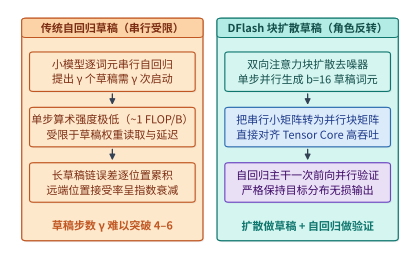

*图 14-7　DFlash 块扩散草稿（$16\text{-token}$ 并行去噪）与自回归验证的角色反转架构及接受长度增益*

2. **推理感知的 Beyond-Chinchilla 全生命周期算力分配方程**[^token-cost-report]：
   为什么 2023–2026 年间以 Qwen3-8B、Llama-3.1-8B 为代表的小参数密集模型与低活跃参数 MoE 模型能够达到三年前十倍参数量巨型模型的能力？核心秘密在于**把训练算力超配（Over-training）作为压缩推理期成本的跨期杠杆**。
   设稠密模型（或 MoE 的活跃参数）规模为 $P$，预训练语料词元数为 $D_{\mathrm{train}}$，模型在整个商业服役期内累计处理的推理词元总数为 $D_{\mathrm{infer}}$。按前向 $2P\ \mathrm{FLOPs/token}$、反向 $4P\ \mathrm{FLOPs/token}$ 核算，全生命周期的总浮点运算量（或折算后的总硬件账单）为：

   $$
   C_{\mathrm{total}}(P,\; D_{\mathrm{train}},\; D_{\mathrm{infer}}) \approx \underbrace{6 P D_{\mathrm{train}}}_{\text{一次性预训练算力 } C_{\mathrm{train}}} + \underbrace{2 P D_{\mathrm{infer}}}_{\text{服役期累计推理算力 } C_{\mathrm{infer}}}
   $$

   在经验幂律损失函数 $\mathcal{L}(P, D_{\mathrm{train}}) = E_0 + A P^{-\alpha} + B D_{\mathrm{train}}^{-\beta}$ 下：
   - **传统 Chinchilla 仅训练最优（忽略 $D_{\mathrm{infer}} = 0$）**：在固定目标损失 $\mathcal{L}_{\mathrm{target}}$ 下仅最小化 $C_{\mathrm{train}} = 6 P D_{\mathrm{train}}$，对 $P$ 与 $D_{\mathrm{train}}$ 求偏导可得两者的边际降损贡献相等，经验上给出每参数约训练 $20$ 个词元（$D_{\mathrm{train}}^{\mathrm{Chin}} \approx 20 P$，例如 $70\mathrm{B}$ 模型仅训练 $1.4\mathrm{T}$ 词元）。
   - **Beyond-Chinchilla 全周期最优（计入庞大的 $D_{\mathrm{infer}}$）**：当模型需要在生产环境中承接海量在线请求（如 $D_{\mathrm{infer}} \gg D_{\mathrm{train}}$）时，参数量 $P$ 每扩大一倍，不仅预训练成本翻倍，**服役期内每一次推理的权重读取带宽、显存占用与矩阵计算成本也会永久翻倍**；反之，训练词元数 $D_{\mathrm{train}}$ 的增加只是一次性沉没成本，**对推理期的单 token 延迟与显存开销完全是零负担（Zero Inference Tax）**。求拉格朗日函数 $\Lambda = 6 P D_{\mathrm{train}} + 2 P D_{\mathrm{infer}} + \lambda (\mathcal{L}(P, D_{\mathrm{train}}) - \mathcal{L}_{\mathrm{target}})$ 的极值条件：
     $$
     \frac{\partial \mathcal{L} / \partial P}{\partial \mathcal{L} / \partial D_{\mathrm{train}}} = \frac{6 D_{\mathrm{train}} + 2 D_{\mathrm{infer}}}{6 P} = \frac{D_{\mathrm{train}}}{P} \left(1 + \frac{D_{\mathrm{infer}}}{3 D_{\mathrm{train}}}\right)
     $$
     上式定量揭示：随着服役期累计推理词元数 $D_{\mathrm{infer}}$ 的增长，最优训练词元与参数比 $D_{\mathrm{train}}^* / P^*$ 必须按 $(1 + \frac{D_{\mathrm{infer}}}{3 D_{\mathrm{train}}})$ 的函数关系大幅上移——从 Chinchilla 的 $20\ \mathrm{tokens/param}$ 跃迁至 **$1{,}000\text{–}4{,}500\ \mathrm{tokens/param}$**（例如用 $15\mathrm{T}\text{–}36\mathrm{T}$ 词元深度训练一个 $8\mathrm{B}$ 模型）。根据 Epoch AI 对公开模型的追踪统计，**达到同等基准评测分数的模型能力密度（Capability Density）大约每 $3.3$ 个月翻倍一次**[^token-cost-report]。

> **算例 14-4a（DFlash 16-Token 块扩散加速比与 Beyond-Chinchilla 超配训练回本点核算）**：
> 我们来核算两个具体的协同账本（表 14-3 与图 14-8）：
> 1. **问题 A（DFlash 16-Token 块扩散 vs. 传统 4-Token 自回归草稿的净 Decode 加速比）**：
>    设主干自回归模型在单步朴素 Decode 下的耗时为 $t_{\mathrm{plain}} = 20.0\ \mathrm{ms}$。
>    - **传统串行自回归草稿（$\gamma = 4$）**：小草稿模型每步串行耗时 $t_{\mathrm{d,AR}} = 1.8\ \mathrm{ms}$，串行猜测 4 步耗时 $4 \times 1.8 = 7.2\ \mathrm{ms}$；主干模型并行验证这 4 个草稿耗时 $t_{\mathrm{verify}}(4) = 21.6\ \mathrm{ms}$；平均每次验证周期接受并提交 $A_{\mathrm{AR}} = 3.1$ 个词元。则每词元平均耗时为 $(7.2 + 21.6) / 3.1 \approx \mathbf{9.29\ \mathrm{ms/token}}$，净加速比为 $20.0 / 9.29 \approx \mathbf{2.15\times}$。
>    - **DFlash 块扩散草稿（$b = 16$）**：双向扩散草稿器在单次块并行前向中同时生成 16 个草稿词元，得益于 Tensor Core 高算术强度，整块草稿仅耗时 $T_{\mathrm{d,DFlash}}(16) = 3.2\ \mathrm{ms}$（不足串行草稿的一半）；主干模型一次并行验证 16 个词元耗时 $t_{\mathrm{verify}}(16) = 24.8\ \mathrm{ms}$；平均每次验证周期接受并提交 $A_{\mathrm{DFlash}} = 6.3$ 个词元。则每词元平均耗时骤降至：
>      $$t_{\mathrm{eff,DFlash}} = \frac{3.2 + 24.8}{6.3} = \frac{28.0\ \mathrm{ms}}{6.3\ \mathrm{tokens}} \approx \mathbf{4.44\ \mathrm{ms/token}}, \quad S_{\mathrm{DFlash}} = \frac{20.0}{4.444} = \mathbf{4.50\times}$$
>      相比传统串行草稿（$2.15\times$），DFlash 将端到端解码吞吐再翻一倍以上。
> 2. **问题 B（Beyond-Chinchilla 超配训练 $8\mathrm{B}$ 模型替代 $70\mathrm{B}$ 模型的回本请求数 $N_{\mathrm{break}}$）**：
>    假设团队需要交付一个达到目标评测门槛的在线服务模型：
>    - **方案甲（Chinchilla 均衡训练 $70\mathrm{B}$ 模型）**：仅训练 $1.4\mathrm{T}$ 词元，预训练总算力 $C_{\mathrm{train,70B}} \approx 6 \times 70\times 10^9 \times 1.4\times 10^{12} = \mathbf{5.88 \times 10^{23}\ \mathrm{FLOPs}}$，折算租卡成本约 $120$ 万美元；但线上服务每次长上下文请求（输入+输出共 $4{,}000$ 词元）的推理硬件成本高达 $c_{\mathrm{req,70B}} = \mathbf{0.0024\ \text{美元/次}}$。
>    - **方案乙（Beyond-Chinchilla 超配训练 $8\mathrm{B}$ 模型 + 教师蒸馏）**：用高达 $18\mathrm{T}$ 词元超配训练 $8\mathrm{B}$ 模型（$2{,}250\ \mathrm{tokens/param}$），计入蒸馏与长思维链后训练，一次性训练总成本增加至 $220$ 万美元（比方案甲**多投入 $\Delta C_{\mathrm{train}} = 100\ \text{万美元}$**）；但在推理期，得益于参数量缩小 $8.75\times$ 且单卡免跨卡切分，每次请求的推理硬件成本压降至 $c_{\mathrm{req,8B}} = \mathbf{0.0004\ \text{美元/次}}$（**单次请求净省 $\Delta c_{\mathrm{req}} = 0.0020\ \text{美元}$**）。
>    - **核算回本临界调用次数 $N_{\mathrm{break}}$**：
>      $$N_{\mathrm{break}} = \frac{\Delta C_{\mathrm{train}}}{\Delta c_{\mathrm{req}}} = \frac{1{,}000{,}000\ \text{美元}}{0.0020\ \text{美元/次}} = \mathbf{5.0 \times 10^8\ \text{次请求}} \quad (\text{即 } 5\ \text{亿次请求，约 } 2\ \text{万亿推理词元})$$
>      对于日均请求量 $500$ 万次的生产级应用，上线仅 **$100$ 天** 即可完全收回多投入的 $100$ 万美元预训练成本；在 3 年累计 $50$ 亿次请求的全生命周期内，方案乙累计推理账单仅 $200$ 万美元（总成本 $420$ 万美元），相比方案甲（推理 $1{,}200$ 万 + 训练 $120$ 万 = $1{,}320$ 万美元）**净节省 $900$ 万美元**。

*表 14-3　算例 14-4a：Chinchilla 仅训练最优（70B）与 Beyond-Chinchilla 全周期最优（8B 超配训练）的算力与商业账本对比*

| 核算维度 | 方案甲：Chinchilla 均衡训练（$70\mathrm{B}$） | 方案乙：Beyond-Chinchilla 超配（$8\mathrm{B}$） | 跨期协同效应与经济学含义 |
| :--- | :---: | :---: | :--- |
| **活跃参数量 $P$ 与训练词元 $D_{\mathrm{train}}$** | $70\mathrm{B}$ 参数 · $1.4\mathrm{T}$ 词元（$20\ \mathrm{tok/P}$） | **$8\mathrm{B}$ 参数 · $18\mathrm{T}$ 词元（$2{,}250\ \mathrm{tok/P}$）** | 将训练词元密度拉高百倍以换取高能力密度 |
| **一次性训练与蒸馏总投入** | **$120\ \text{万美元}$** | $220\ \text{万美元}$（多投 $\Delta C_{\mathrm{train}} = 100\ \text{万}$） | 方案乙在预训练阶段主动承担一次性超支 |
| **单次请求（$4\mathrm{K}$ 词元）推理成本** | $0.0024\ \text{美元/次}$ | **$0.0004\ \text{美元/次}$（单次省 $0.0020\ \text{美元}$）** | 权重与 KV 缩小 $8.75\times$，单卡免跨卡同步 |
| **盈亏平衡调用量 $N_{\mathrm{break}}$** | 基准线（$< 5$ 亿次调用时较省） | **$5.0 \times 10^8$ 次请求（约 $2\mathrm{T}$ 推理词元）** | 日均 $500$ 万请求下仅需 $100$ 天即收回训练超支 |
| **50 亿次请求全周期总成本（TCO）** | $1{,}320\ \text{万美元}$（训练 $120$ 万 + 推理 $1{,}200$ 万） | **$420\ \text{万美元}$（训练 $220$ 万 + 推理 $200$ 万）** | **全周期净省 $900\ \text{万美元}$（总成本降低 $3.14\times$）** |

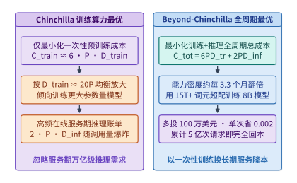

*图 14-8　算例 14-4a：推理感知的生命周期总计算最小化（Beyond-Chinchilla $3.3$ 个月能力密度翻倍与超配训练回本点）*

---

## 14.6 物理可行与经济可行双边界：真机设计复审（实验 13-01）与跨市场 GPU 翻转

在掌握了跨层协同的理论方程后，任何准备上线生产集群的系统改动都必须跨越两道截然不同的门槛：第一道是**物理可行性（Physical Feasibility）**——模型与 KV 缓存能否装进目标显存池、在真实数据集上的端到端回答质量是否退化、运行时分配器是否真的按纸面公式释放了内存；第二道是**经济可行性（Economic Feasibility）**——在给定站点供电上限、机柜租价、硬件交期与尾延迟 SLO 约束下，该硬件与精度组合是否真正降低了单位合格产出的总拥有成本（TCO）。本节结合本仓库的真机实验 `13-01`（`design-review`）[^exp-13-01-review] 与跨市场 GPU 选型模型，完整拆解这两道边界。

### 14.6.1 真实三候选 KV 表示设计复审（实验 13-01 `design-review`）：28/32 vs. 26/32 质量退化与 12.88 GB 固定池真相

在许多技术博客的纸面推算中，“把 KV 缓存从 BF16 改为 FP8”往往被简单写成一句话：“显存占用立减一半，且精度基本无损。”然而，当我们在真实的生产引擎（vLLM `0.23.0`）与真实模型（`Qwen/Qwen3-8B`）上执行严格的部署前设计复审（Design Review）时，物理测量却揭示了完全不同的工程真相。

我们来看本书实验 `13-01`（[`experiments/ch13/13-01/design-review/README.md`](../experiments/ch13/13-01/design-review/README.md) 与 `review-results.json`）[^exp-13-01-review] 的完整复审记录：
- **受控评测负载**：固定 **32 个结构化事实检索与合成请求**，由 $2$ 套提示词家族（`family 0` 与 `family 1`）$\times\ 2$ 档干扰条目规模 $n \in \{128, 512\}$（对应输入长度约 $2\mathrm{K}$ 与 $8\mathrm{K}$ 词元）$\times\ 2$ 档并发批大小 $b \in \{1, 4\}$ $\times\ 2$ 轮重复 $r \in \{0, 1\}$ 正交组合而成。所有候选共享完全相同的随机种子、贪婪解码（`temperature = 0`）与单卡 `--gpu-memory-utilization 0.45` 配置。
- **部署门控规则（Gate Policy）**：任何候选方案若要在设计复审中获准进入下一阶段验证（`proceed_to_validation`），必须满足**硬性质量守门条件**：在 32 个评测请求上的严格正确数不得低于 BF16 基线（$\ge N_{\mathrm{correct,bf16}}$）。

> **算例 14-5（实验 13-01 `design-review` 三候选 KV 表示在 Qwen3-8B 32 请求上的真机复审账本）**：
> 我们在单张数据中心 GPU 上依次实测了三种 KV 缓存表示候选方案，实测指标精确记录于表 14-4 与图 14-9：
> 1. **候选 A（`bf16` 基线，`--kv-cache-dtype auto`）**：
>    - **质量得分**：在 32 个请求中答对 **$28 / 32$**（正确率 $87.5\%$）。全部 $4$ 次失败（`0-n512-b1-r0`、`0-n512-b4-r0`、`1-n512-b1-r0`、`1-n512-b4-r0`）均集中在长上下文干扰表 $n = 512$ 的首轮切片 `r0` 上，而在 $n = 128$ 的全部 16 个请求以及 $n = 512$ 的 `r1` 切片上均为 $100\%$ 正确。
>    - **延迟与显存**：32 个自然生成请求的耗时均值 / 中位数 / P95 分别为 **$2.128\ \mathrm{s}$ / $1.884\ \mathrm{s}$ / $3.374\ \mathrm{s}$**（非预热自然批次墙钟总和为 $37.796\ \mathrm{s}$），CUDA 分配器记录的进程峰值显存 `cuda_peak_allocated` 为 **$31{,}062{,}685{,}184\ \mathrm{B}$（$29{,}623.68\ \mathrm{MiB}$）**，每层 KV 张量形状为 `[5461, 2, 16, 8, 128]`（`torch.bfloat16`，即每层分配 **$5{,}461$ 个块**）。
> 2. **候选 B（纯 `fp8` KV，`--kv-cache-dtype fp8_e4m3`）**：
>    - **质量退化被拒**：当直接把 KV 缓存开启为无查询保护的 `fp8_e4m3` 时，32 请求的正确数从 $28$ 跌落至 **$26 / 32$**（正确率降至 $81.25\%$，共发生 $6$ 次失败：`0-n512-b1-r1`、`0-n512-b4-r0`、`0-n512-b4-r1`、`1-n512-b1-r1`、`1-n512-b4-r0`、`1-n512-b4-r1`）。在 $n = 512$ 的长上下文密集键值对区分中，FP8 尾数精度的截断引发了注意力权重偏移，导致原本在 BF16 下全部做对的 `n512-r1` 批次大面积失守。尽管其 32 请求平均耗时略降至 $1.989\ \mathrm{s}$（中位数 $1.915\ \mathrm{s}$，P95 $3.318\ \mathrm{s}$）且每层可分配块数翻倍至 **$10{,}922$ 个块**，但因触发“质量低于基线（$26 < 28$）”红线，**被门控状态机当场一票否决（`pass_to_validation = false`）**。
> 3. **候选 C（`fp8_qbf16`，FP8 E4M3 KV 配合显式 BF16 查询精度守卫）**：
>    - **总数恢复但失败集偏移**：通过在注意力计算前保持查询（Query）侧的 BF16 动态范围与缩放校准，候选 C 的严格正确数成功恢复至与基线持平的 **$28 / 32$**（32 请求耗时均值 / 中位数 / P95 分别为 **$2.192\ \mathrm{s}$ / $1.876\ \mathrm{s}$ / $3.393\ \mathrm{s}$**，因附加的查询恢复与观察路径改变了计时开销）。
>    - **关键审计发现（`baseline_and_qcontrol_failure_sets_equal = false`）**：虽然候选 A 与候选 C 都拿到了 `28/32`，但逐题比对失败请求 ID 却发现——候选 A 失败的 4 题全是 `r0`（`*-n512-*-r0`），而候选 C 失败的 4 题却全部偏移到了 `r1`（`0-n512-b1-r1`、`0-n512-b4-r1`、`1-n512-b1-r1`、`1-n512-b4-r1`）。这说明数值量化扰动在临界长样本（$n=512$）上改变了边界样本的排列次序，绝不能因为“总分一样”就草率宣称两者行为完全等价。
> 4. **关于 `12,884,115,456 B` 固定 KV 池的工程铁律**：
>    为什么表 14-4 中候选 A（`bf16`）、候选 B（`fp8`）与候选 C（`fp8_qbf16`）报告的底层 KV 存储池字节数（`unique_kv_storage_bytes`）分毫不差，全部恒等于 **$12{,}884{,}115{,}456\ \mathrm{B}$（即 $36\text{ 层} \times 357{,}892{,}096\ \mathrm{B/\text{层}} \approx 12.00\ \mathrm{GiB}$）**，且 CUDA 峰值分配显存 `cuda_peak_allocated` 也完全恒定为 **$31{,}062{,}685{,}184\ \mathrm{B}$（$29{,}623.68\ \mathrm{MiB}$）**？
>    因为在 vLLM 等现代分页推理引擎中，启动时传入 `--gpu-memory-utilization 0.45` 会指示引擎先加载模型权重与 CUDA 上下文，然后将 $45\%$ 显存配额中剩余的连续字节空间（本例中固定为 $12{,}884{,}115{,}456\ \mathrm{B}$）**一次性全量预分配为物理 KV 缓存池**。将数据类型从 BF16（$2\ \mathrm{B}$）切换为 FP8（$1\ \mathrm{B}$），并不会让引擎把一半显存退还给 Linux/CUDA 驱动，而是**让每层 $357{,}892{,}096\ \mathrm{B}$ 物理池能够切分出的逻辑块数从 `[5461, 2, 16, 8, 128]`（$5{,}461$ 块）精准翻倍至 `[10922, 2, 16, 8, 128]`（$10{,}922$ 块）**。如果业务负载本身的并发度很小（如本例最大 $b=4$、长度 $n=512$，远未填满 $5{,}461$ 块），又没有同步调低 `--gpu-memory-utilization` 或把腾出的槽位用于扩大在线并发 Batch，那么开启 FP8 KV 在显存账单上的收益就是**零**。基于上述双重发现，复审系统的最终自动裁决为：`proceed_to_validation = ["bf16", "fp8_qbf16"]`，而直接批准上线列表严格为空（**`approved_for_deployment = []`**），要求必须在更大规模留出集上完成下一轮验证。

*表 14-4　实验 13-01（`design-review`）：Qwen3-8B 三种 KV 缓存表示候选在 32 请求上的真机复审账本*

| 候选方案与配置标识 | 32 请求严格正确数 | 失败请求分布特征 | 请求耗时均值 / 中位数 / P95 ($\mathrm{s}$) | 预分配 KV 池字节数与每层块数 (`cuda_peak`) | 复审门控裁决 (`pass_to_validation`) |
| :--- | :---: | :--- | :---: | :---: | :---: |
| **候选 A：`bf16`** (`auto`) | **$28 / 32$** ($87.5\%$) | $4$ 题全在 `n512-*-r0` | $2.128$ / $1.884$ / $3.374$ | $12{,}884{,}115{,}456\ \mathrm{B}$ ($5{,}461$ 块/层，峰值 $29{,}623.68\ \mathrm{MiB}$) | **`true`（进入验证）** |
| **候选 B：`fp8`** (`fp8_e4m3`) | $26 / 32$ ($81.25\%$) | `n512` 恶化至 $6$ 题失败 | $1.989$ / $1.915$ / $3.318$ | $12{,}884{,}115{,}456\ \mathrm{B}$ ($10{,}922$ 块/层，峰值 $29{,}623.68\ \mathrm{MiB}$) | **`false`（质量退化被拒）** |
| **候选 C：`fp8_qbf16`** | **$28 / 32$** ($87.5\%$) | $4$ 题全偏移至 `n512-*-r1` | $2.192$ / $1.876$ / $3.393$ | $12{,}884{,}115{,}456\ \mathrm{B}$ ($10{,}922$ 块/层，峰值 $29{,}623.68\ \mathrm{MiB}$) | **`true`（需核查偏移）** |

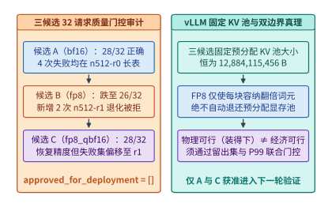

*图 14-9　实验 13-01（`design-review`）：Qwen3-8B 三种 KV 表示候选在 32 请求上的质量门控与 $12.88\ \mathrm{GB}$ 固定池真相*

### 14.6.2 站点敏感性（Site Sensitivity）与数据中心卡（H100/B200）vs. 工作站/消费级卡（RTX PRO 6000 / RTX 4090）的四场景翻转边界

跨过了单机的物理与质量门控后，架构师在规划算力底座时经常面临一个极具争议的硬件选型问题：**“一张消费级 RTX 4090（$24\ \mathrm{GB}$）或专业工作站卡 RTX PRO 6000 Blackwell（$96\ \mathrm{GB}$ GDDR7）的采购单价只有数据中心旗舰卡 H100/B200 的几分之一，为什么大型云厂商还要花巨资采购 B200，而在某些企业私有化场景下工作站卡又能把单位成本压低一半以上？”**

答案在于：**脱离具体工作负载的算术强度、状态容量、跨卡通信耦合度以及部署站点的物理约束（供电、机柜空间、网络环境）去谈“哪张卡性价比更高”是毫无意义的伪命题**。我们将四款代表性跨市场 GPU 的物理参数与四个典型工程场景联立起来，就能标定出清晰的翻转边界（表 14-5 与图 14-10）：

1. **硬件物理边界的本质差异（HBM + NVLink vs. GDDR + PCIe）**：
   - **数据中心旗舰级（H100 SXM $80\ \mathrm{GB}$ / B200 SXM $192\ \mathrm{GB}$）**：核心溢价买的不是单纯的 FP8/FP16 算力，而是 **$3.35\text{–}8.0\ \mathrm{TB/s}$ 的超高 HBM 显存带宽** 与 **$900\text{–}1{,}800\ \mathrm{GB/s}$ 的全互连 NVLink 交换域**（以及完整 ECC 校验、RAS 遥测与机架级液冷热设计）。
   - **专业工作站级（RTX PRO 6000 Blackwell $96\ \mathrm{GB}$）**：采用高密度 **GDDR7 显存**，单卡容量高达 **$96\ \mathrm{GB}$**（超过单张 H100 的 $80\ \mathrm{GB}$），显存带宽约 **$1.8\ \mathrm{TB/s}$**，功耗 $300\text{–}600\ \mathrm{W}$，但**没有 NVLink 高速互连**，卡间通信只能走 PCIe Gen5 $\times 16$（双向有效带宽约 $50\text{–}64\ \mathrm{GB/s}$）。
   - **消费级旗舰（RTX 4090 $24\ \mathrm{GB}$）**：单卡购置成本极低，但显存容量被锁死在 **$24\ \mathrm{GB}$**，GDDR6X 带宽 **$1.0\ \mathrm{TB/s}$**，仅支持 PCIe Gen4 $\times 16$（单向有效约 $24\ \mathrm{GB/s}$）且无 P2P BAR1 直通优化。

> **算例 14-6（数据中心卡 vs. 工作站/消费级卡在四大工作负载与站点约束下的 TCO 翻转核算）**：
> 设按 3 年折旧加机房托管电费折算的综合每卡时成本（含服务器主机分摊）分别为：RTX 4090 约 **$0.35\ \mathrm{USD}$/卡时**，RTX PRO 6000（$96\ \mathrm{GB}$）约 **$0.95\ \mathrm{USD}$/卡时**，H100 SXM 约 **$2.40\ \mathrm{USD}$/卡时**，B200 SXM 约 **$4.80\ \mathrm{USD}$/卡时**。我们在四个标准场景下核算单位产出成本：
> - **场景一：单卡可装下的中小模型离线批处理或低速单流（如 `Qwen3-8B` FP8/BF16 短上下文离线抽取，无硬性 TPOT $< 15\ \mathrm{ms}$ 要求）**：
>   `Qwen3-8B` BF16 权重仅约 $16\ \mathrm{GB}$（FP8 仅 $8\ \mathrm{GB}$），单张 $24\ \mathrm{GB}$ 的 RTX 4090 即可完整装入模型并留出 $8\text{–}16\ \mathrm{GB}$ KV 缓存，完全无需跨卡通信（`TP=1`）。在 $1.0\ \mathrm{TB/s}$ 带宽下，单卡批处理吞吐可达 H100（$3.35\ \mathrm{TB/s}$）的约 $30\%\text{–}35\%$，但卡时成本仅为 H100 的 $0.35 / 2.40 \approx \mathbf{14.6\%}$。因此在不触及 $24\ \mathrm{GB}$ 显存墙且无严苛延迟 SLO 的离线/内部任务中，**RTX 4090 的每百万词元成本比 H100 低约 $50\%$**。
> - **场景二：$70\mathrm{B}$ FP8 模型或 $8\mathrm{B}$ 超长上下文（需 $60\text{–}85\ \mathrm{GB}$ 显存）的企业中等并发服务**：
>   若用 RTX 4090，必须拼凑 $4$ 张卡做 `TP4`；由于 PCIe Gen4 无 NVLink，每层 2 次 AllReduce 在 80 层上累计产生数毫秒的 PCIe 同步开销，吞吐严重退化。此时若换用**单张 $96\ \mathrm{GB}$ 显存的 RTX PRO 6000 工作站卡**，可将 $70\mathrm{B}$ FP8 权重（$\sim 70\ \mathrm{GB}$）与 $20\ \mathrm{GB}$ KV 缓存**单卡免切分完整驻留（`TP=1`，零跨卡通信）**，凭借 $1.8\ \mathrm{TB/s}$ GDDR7 带宽即可跑出接近单张 H100 约 $54\%$ 的解码速度，而卡时成本仅为 H100 的 $0.95 / 2.40 \approx \mathbf{39.6\%}$，在“单卡大容量免通信”甜点区实现翻转胜出。
> - **场景三：高并发在线低延迟服务（要求 $\mathrm{TPOT} \le 20\ \mathrm{ms}$、高批次吞吐与 $99.9\%$ SLA）**：
>   当在线服务要求单流每秒输出 $\ge 50$ 个词元且高并发合批时，工作站卡 $1.0\text{–}1.8\ \mathrm{TB/s}$ 的 GDDR 带宽直接撞上物理读取下界（如 $70\mathrm{B}$ FP8 单次读权重 $70\ \mathrm{GB} / 1.8\ \mathrm{TB/s} = 38.9\ \mathrm{ms} > 20\ \mathrm{ms}$，物理不可达）。此时唯有具备 **$3.35\text{–}8.0\ \mathrm{TB/s}$ HBM 带宽** 的 H100 / B200 能够在满足 $\mathrm{TPOT} \le 20\ \mathrm{ms}$ 的同时接纳大批量并发请求，将单卡总产出吞吐拉高 $4\text{–}8\times$，使单位合格词元成本反超工作站卡。
> - **场景四：万亿参数 MoE（如 DeepSeek-V3/V4.1、Kimi K3）的跨卡 `TP8`/`EP` 强通信部署与站点功率受限场景**：
>   一旦模型总体积突破单卡 $96\text{–}192\ \mathrm{GB}$ 极限，必须启用跨卡张量并行（TP）或专家并行（EP）全对全交换。没有 NVLink 的 PCIe 卡集群在每层 All-to-All / AllReduce 同步点上会慢出 $10\text{–}30\times$，且占用数倍的机架空间与主板功耗。此时 **NVLink 超节点（H100/B200/NVL72）具有决定性架构优势**。此外，还必须计入**站点敏感性（Site Sensitivity）**：在办公楼宇边缘机房（仅具备标准风冷与 $< 10\ \mathrm{kW}$/柜配电，无液冷改造条件），低功耗风冷 RTX PRO 6000 工作站是唯一物理可落地的方案；而在具备 $130\ \mathrm{kW}$/柜液冷与低电价的大型智算中心，B200/NVL72 的高算力密度则能最大化每兆瓦电力的商业产出。

*表 14-5　算例 14-6：数据中心旗舰卡（H100/B200）与工作站/消费级卡（RTX PRO 6000 / 4090）的四场景翻转边界矩阵*

| 典型业务场景与核心约束 | 最优硬件档位选型 | 决胜物理机制 | 次优/淘汰方案的失效原因 |
| :--- | :--- | :--- | :--- |
| **场景一：$\le 20\ \mathrm{GB}$ 模型离线批处理/单流**（无严苛 TPOT SLO） | **RTX 4090 ($24\ \mathrm{GB}$)** | 单卡 `TP=1` 免通信，购置折旧成本极低 | H100/B200 高昂的 NVLink 与 HBM 溢价在此场景下闲置 |
| **场景二：$60\text{–}85\ \mathrm{GB}$ 模型中低并发部署**（或风冷边缘机房） | **RTX PRO 6000 ($96\ \mathrm{GB}$ GDDR7)** | **$96\ \mathrm{GB}$ 单卡免切分装入 $70\mathrm{B}$ FP8**，$1.8\ \mathrm{TB/s}$ 带宽 | 4×4090 卡死在 PCIe 通信延迟；液冷 B200 受限于边缘站点配电 |
| **场景三：高并发在线服务（硬性 $\mathrm{TPOT} \le 20\ \mathrm{ms}$）** | **H100 / B200 SXM** | **$3.35\text{–}8.0\ \mathrm{TB/s}$ HBM3/3e 带宽**突破单步读取下界 | GDDR 带宽（$\le 1.8\ \mathrm{TB/s}$）在物理上无法达成 $20\ \mathrm{ms}$ 延迟下界 |
| **场景四：百亿至万亿 MoE 多卡 `TP8`/`EP` 协同** | **B200 / NVL72 超节点** | **$900\text{–}1{,}800\ \mathrm{GB/s}$ NVLink 域**消除层间同步墙 | PCIe 卡间带宽差一个量级以上，通信耗时反超计算十倍 |

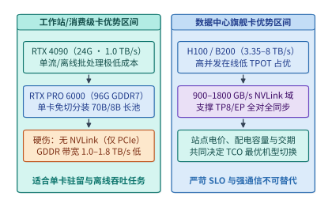

*图 14-10　算例 14-6：数据中心卡（H100/B200）与工作站/消费级卡（RTX PRO 6000 / 4090）的四场景翻转边界*

---

## 14.7 可证伪的协同设计科学：预测预注册与实验 13-07 K192 反例复盘

在工业界与学术界的系统工程实践中，最隐蔽的认识论陷阱莫过于**“事后画靶（HARKing，Hypothesizing After the Results are Known）”**与**“选择性汇报（Cherry-picking）”**：当一次性能优化实验跑出某个比值（如 $0.69$ 或 $1.10$）后，研究者往往事后修改自己原本预期的成功区间，或者只挑出某一个加速最高的异常样本写进报告，而将导致变慢的反例悄然抹去。

为了将 AI 基础设施工程锻造为一门真正**可证伪的定量科学（Falsifiable Engineering Science）**，本书在跨层实验体系中引入了严格的**预注册预测协议（Pre-registered Prediction Protocol，`D11-SP04`）**[^d11-audit]。本节完整展示该协议的十项冻结字段，并复盘本书实验 `13-07`（[`experiments/ch13/13-07/README.md`](../experiments/ch13/13-07/README.md)）[^exp-13-07] 如何从历史反例 `K96` 出发，通过预注册 `K192` 真实运行，最终因为**实际加速幅度超出了预注册保守区间（中位数 $0.693141 < 0.70$）而诚实地自我判定为 `refuted_in_scope`**。

### 14.7.1 预注册预测协议（Pre-registered Prediction Protocol，`D11-SP04`）：10 项必填字段、SHA-256 冻结与证伪状态机

什么是系统性能实验的预注册？简言之，就是在**尚未启动真实工作负载测量之前**，先将实验假设、被测代码、评测负载、目标统计量、定量预测区间 $[L, U]$ 以及证伪触发条件写入一份结构化的 `prediction.json` 清单，并对执行脚本与协议文件计算 **SHA-256 密码学哈希值** 予以冻结。

如表 14-6 与图 14-11 所示，一份合规的预注册预测记录必须包含以下 **10 项不可缺省的核心字段**（以实验 `13-07` 的 `prediction.json` 为标准范本）：

*表 14-6　预注册预测协议（`D11-SP04`）的 10 项必填字段规范与实验 `13-07` 冻结实例*

| 序号 | 字段名 (`prediction.json`) | 科学约束作用与防作弊机制 | 实验 `13-07` (`13-7-k192-v1`) 真实冻结值 |
| :---: | :--- | :--- | :--- |
| **1** | `id` | 全局唯一版本标识符，严禁覆盖旧版本 | `"13-7-k192-v1"` |
| **2** | `status` | 状态机流转（`pending_validation` $\to$ `supported_in_scope` / `refuted_in_scope`） | 初始 `"pending_validation"` $\to$ 终态 **`"refuted_in_scope"`** |
| **3** | `created_utc` / `deadline_utc` | 锁定预测创建时刻与实验截止窗口，证明预测先于实测 | `"2026-09-09T07:28:10.963322+00:00"` 至 `"2026-09-16T15:59:59+00:00"` |
| **4** | `system_change` | 明确自变量（A 组 vs. B 组）与固定超参数 | `preserve_committed_prefix` vs. `restart_recompute_committed_prefix` ($K=192=3\times 64$) |
| **5** | `workloads` | 锁定任务集、模型权重版本、随机种子与重复轮数 | `Qwen/Qwen3-8B`，2 任务（`extract`/`sequence`）$\times 5$ 轮 = $10$ 对（$30$ 路径） |
| **6** | `metric` | 锁定唯一主统计量及其分子/分母定义，严禁事后换指标 | `median(preserve_wall_s / restart_wall_s)` across 10 paired task-trials |
| **7** | `prediction_range` | 预注册的定量区间 $[L, U]$ 与机制守卫预期 | 中位数比值 **$[0.70, 1.00]$**；`30/30` 质量与词元一致；`0` 重复投递 |
| **8** | `falsification_criteria` | 明确列出任何一条触发即宣告该版预测被证伪的硬条件 | 比值中位数 $<0.70$ 或 $>1.00$，或任一质量/幂等/资源守卫失败 |
| **9** | `strongest_known_counterexample` | 强制登记此前已知的最强反例，防止隐藏不利历史证据 | 实验 `11-4` `K96` `sequence`：`preserve 12.800s` vs. `restart 11.619s`（**$R=1.101664$**） |
| **10** | `protocol_sha256` / `script_sha256` | 对实验协议与评测脚本取 SHA-256 哈希，杜绝运行中暗改代码 | `protocol.md` 与 `run_experiment.py` 的 64 位十六进制 SHA-256 摘要 |

这套协议最核心的制度设计在于其**不可篡改的复核终态规则**（图 14-11 下半部）：
- 当实验在 `created_utc` 之后、`deadline_utc` 之前跑完并经独立审计脚本校验 SHA-256 一致后，若所有质量守卫通过且观测统计量落入预注册闭区间 $[L, U]$，状态才可更新为 **`supported_in_scope`（仅在当前被测模型、硬件与负载范围内受支持，严禁无条件外推为普适定律）**；
- 一旦观测统计量落在 $[L, U]$ 之外（哪怕方向有利但幅度超出了预测区间），或者任何一项质量/机制守卫未达标，状态必须无条件更新为 **`refuted_in_scope`（在当前范围内被证伪）**。研究者**绝不允许回头修改 `v1` 的预测区间**，而只能保留 `v1` 的证伪记录，另行创建带新时间戳的 `v2` 预测去检验修正后的理论模型。

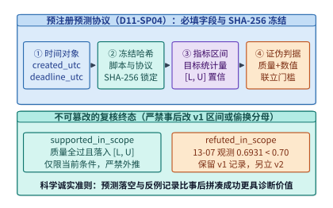

*图 14-11　可证伪系统科学：预注册预测协议的 10 项必填字段与不可篡改状态机（`D11-SP04`）*

### 14.7.2 实验 13-07 完整复盘：从 K96 反例（$R = 1.101664$）到 K192 范围外证伪（$R = 0.693141 < 0.70 \to \text{refuted\_in\_scope}$）与幂等提交缓冲机制

我们在第 11.4 节讨论在线服务抢占恢复（Preemption & Recovery）时，直觉上很容易认为：“当一个长生成请求在中途被高优流量抢占打断后，恢复执行时保留已提交前缀（Preserve Committed Prefix）一定比丢弃重算已提交前缀（Restart & Recompute）更快。”然而，本书的前序实验与预注册实验 `13-07`[^exp-13-07] 完整演绎了这一定性直觉如何经历“反例证伪 $\to$ 边界修正 $\to$ 区间再证伪”的科学螺旋：

1. **第一幕：历史最强反例 `K96`（为什么保留前缀反而慢了 $10.17\%$？）**：
   在实验 `11-4` 的 `K96` 配置中，请求需要生成 $96$ 个词元，并在生成到第 $64$ 个词元处发生 $1$ 次计划内抢占中断（分 $2$ 段完成：$64 + 32 = 96$ 词元，KV 块预算上限设为 $128$）。在 `sequence` 确定性序列任务上，实测结果给出了一个反直觉的**强反例（Strongest Known Counterexample）**：
   - 保留前缀恢复路径耗时 **$T_{\mathrm{preserve}} = 12.800002\ \mathrm{s}$**；
   - 丢弃并从头重算已提交前缀的重启路径耗时仅为 **$T_{\mathrm{restart}} = 11.618788\ \mathrm{s}$**；
   - 两者的墙钟时间比值为：
     $$
     R_{\mathrm{K96,seq}} = \frac{12.800002\ \mathrm{s}}{11.618788\ \mathrm{s}} \approx \mathbf{1.101664} > 1.0
     $$
   为什么在 `K96` 下保留前缀反而慢了 $10.17\%$？因为仅发生 $1$ 次抢占时，重启策略只需额外重算一次短短 $64$ 个已提交词元的 Prefill，在硬件高吞吐下耗时有限；而保留状态与分段拼接控制流所引入的 Python/SQLite 事务管理开销、工作进程加载与主机调度抖动，反而超过了省下 $64$ 个词元重复采样所带来的收益。
2. **第二幕：预注册实验 `13-07`（`K192` 三段式二次抢占）的设计与幂等提交缓冲机制**：
   为了验证“当总生成长度翻倍、抢占次数增加使可避免的串行重算扩大 $3$ 倍时，保留前缀的收益能否稳定压倒事务开销”，我们在 `2026-09-09` 预注册了实验 `13-07`（`id: "13-7-k192-v1"`）：
   - **三段式负载设计（$K = 192 = 3 \times 64$）**：在 Mac M2 Max 上固定 `Qwen3-8B-MLX-4bit` 模型，要求生成 $192$ 个非 EOS 目标词元，每生成 $64$ 个词元触发一次计划内抢占（分别在第 $64$ 与第 $128$ 词元处发生 **2 次抢占中断**，共分 $3$ 段完成，最大序列长度设为 $320$）。在此设定下，`restart_recompute_committed_prefix` 路径在第 $2$ 段需重做前 $64$ 个已提交词元，在第 $3$ 段需重做前 $128$ 个已提交词元，累计重做已提交词元达 $64 + 128 = \mathbf{192}$ 个（恰好是 `K96` 的 **$3$ 倍**）。
   - **采样与提交分离的幂等恢复架构（图 14-13 上半部）**：在流式生成中途发生抢占时，如何保证客户端绝不收到重复词元或乱序词元？实验构建了严密的**已提交前缀缓冲区（Committed Prefix Buffer）与幂等去重拦截器**：底层 Worker 每次采样出的词元（含段末触发的 EOS 结束符）先进入内部采样暂存区，仅当词元位置索引 $p > p_{\mathrm{committed}}$ 且位于当前分段配额内时，才原子推进已提交游标并向客户端投递；在恢复重算或边界重放期间产生的任何已提交位置输出，全部由幂等守卫拦截丢弃。
   - **真机机制守卫全通过账本**：实验在 `2026-09-09` 跑完全部 $5\text{ 轮} \times 2\text{ 任务} \times 3\text{ 策略（不中断基线、保留恢复、重启恢复）} = \mathbf{30\ \text{条执行路径}}$（共发起 **$50$ 次独立 Metal/MLX 工作进程调用**：10 条基线 $\times 1$ + 10 条保留恢复 $\times 1$ + 10 条重启恢复 $\times 3$，经历 $20$ 次计划内抢占，总墙钟耗时 **$522.648\ \mathrm{s}$**，受控进程组 RSS 峰值 **$4{,}714{,}250{,}240\ \mathrm{B} \approx 4.39\ \mathrm{GiB}$**，残留孤儿进程数为 **`0`**）。自动化审计脚本核验了全部 **`19,516 / 19,516` 项机制断言（100% 通过）**：
     - 全部 **$30 / 30$ 条路径** 严格通过任务质量校验，且恢复路径提交的词元序列与各自同轮次不中断基线实现 **`100%` 逐位置完全一致（Exact Token Identity）**；
     - 底层引擎累计采样了 **$9{,}420$ 个词元**（含 EOS），向客户端精确提交了 **$7{,}500$ 个唯一词元位置**（$30 \times 250$），幂等提交缓冲区成功拦截并抑制了 **$1{,}920$ 次重复投递尝试**，客户端观测到的重复词元数严格为 **`0`**。

> **算例 14-7（实验 13-07 K192 的 10 对配对时间比值复算、Trial 2 慢路径解剖与 `0.693141 < 0.70` 证伪裁决）**：
> 现在我们来核查决定预注册成败的唯一主统计量——$10$ 对配对任务轮次（`Trial 0` 至 `Trial 4` $\times$ `extract`/`sequence`）上的墙钟时间比值 $R_i = T_{\mathrm{preserve},i} / T_{\mathrm{restart},i}$（表 14-7 与图 14-12）：
> 1. **方向全面扭转（$10 / 10$ 全部满足 $R_i < 1.0$）**：
>    与 `K96` 的反例（$R = 1.101664$）截然不同，在 `K192` 下，全部 $10$ 对配对样本的比值 $R_i$ **清一色小于 $1.0$**（跨度从最小值 **$0.373470$** 到最大值 **$0.950270$**），无一例外地证明了当抢占恢复扩展到 3 段 192 词元时，保留已提交前缀在每一次配对比较中都快于重启重做。
> 2. **剖析极端比值 `0.373470`（操作系统与引擎冷启动的长尾暴露风险）**：
>    为什么在 `Trial 2` 的 `extract` 任务上，保留路径仅耗时 **$17.619\ \mathrm{s}$**（$17.618908\ \mathrm{s}$），而重启路径却耗时高达 **$47.176\ \mathrm{s}$**（$47.176207\ \mathrm{s}$，比值低至 $17.618908 / 47.176207 = \mathbf{0.373470}$）？查看分段遥测日志（图 14-13 下半部）可以发现：`restart` 路径的前两次分段 Worker 分别耗时 $11.500\ \mathrm{s}$ 与 $11.273\ \mathrm{s}$，但在第 3 次启动新 Worker 重做前 $128$ 个词元并完成全序列生成时，单次耗时飙升至 **$24.404\ \mathrm{s}$**。这揭示了重启策略除了多出重复采样工作之外的第二个弱点——**每一次重启新工作进程都将请求重新暴露在权重加载、内存页分配与宿主系统共存抖动的长尾风险之下**。
> 3. **排序求取 10 对中位数并执行无情证伪（`refuted_in_scope`）**：
>    将表 14-7 中的 10 个实测配对比值按从小到大排序：
>    $$\{0.373470,\; 0.581439,\; 0.637456,\; 0.653320,\; \mathbf{0.682323},\; \mathbf{0.703958},\; 0.724262,\; 0.766111,\; 0.937277,\; 0.950270\}$$
>    取第 5 个有序值（`Trial 3 · extract` 的 $0.682323$）与第 6 个有序值（`Trial 1 · sequence` 的 $0.703958$）的算术平均，得到 10 对样本的精确中位数：
>    $$R_{\mathrm{median}} = \frac{0.682323 + 0.703958}{2} = \mathbf{0.693141}$$
>    对照我们在实验前冻结在 `prediction.json` 中的预测区间 $[0.70, 1.00]$：观测中位数 **$0.693141 < 0.70$**（以 **$0.006859$** 的微小差距突破了预注册下界 $0.70$）。也就是说，**保留已提交前缀的实际加速效果（节省了 $30.69\%$ 的墙钟时间）比我们预注册时保守估计的最多节省 $30\%$（即下界 $0.70$）还要略快一点**。
>    如果是在缺乏预注册纪律的传统论文中，作者只需随手把正文里的“预计比值在 $0.70\text{–}1.00$”改成“预计在 $0.65\text{–}1.00$”，就能宣布实验圆满成功。但按照第 14.7.1 节的科学铁律，**超出预测下界同样说明我们对重启慢路径方差的定量建模不够精确**。因此，复核脚本严格将 `13-7-k192-v1` 的终态裁定为 **`refuted_in_scope`**。这一案例生动地证明：**守住预注册的诚实底线，不仅不会削弱工程结论的说服力，反而迫使我们发现了多次重启工作进程在系统共存抖动下的长尾放大效应**。

*表 14-7　实验 13-07（`K192`）：5 轮 × 2 任务（10 对配对）的保留恢复耗时、重启恢复耗时与比值排序账本*

| 配对任务与轮次 (`Trial / Task`) | 保留已提交前缀耗时 $T_{\mathrm{preserve}}$ ($\mathrm{s}$) | 重启重做已提交前缀耗时 $T_{\mathrm{restart}}$ ($\mathrm{s}$) | 配对比值 $R = T_{\mathrm{preserve}} / T_{\mathrm{restart}}$ | 10 对从小到大排序名次 |
| :--- | :---: | :---: | :---: | :---: |
| **Trial 2 · `extract`** | $17.619$ ($17.618908$) | $47.176$（第 3 段耗 $24.404\ \mathrm{s}$） | **$0.373470$** | 第 1 名（最小） |
| **Trial 3 · `sequence`** | $14.576$ ($14.575647$) | $25.068$ ($25.068249$) | $0.581439$ | 第 2 名 |
| **Trial 0 · `extract`** | $9.840$ ($9.839878$) | $15.436$ ($15.436172$) | $0.637456$ | 第 3 名 |
| **Trial 4 · `sequence`** | $14.418$ ($14.418400$) | $22.069$ ($22.069440$) | $0.653320$ | 第 4 名 |
| **Trial 3 · `extract`** | $20.391$ ($20.391378$) | $29.885$ ($29.885241$) | **$0.682323$** | **第 5 名（中位数左值）** |
| **Trial 1 · `sequence`** | $9.867$ ($9.867294$) | $14.017$ ($14.016885$) | **$0.703958$** | **第 6 名（中位数右值）** |
| **Trial 4 · `extract`** | $16.800$ ($16.800253$) | $23.196$ ($23.196370$) | $0.724262$ | 第 7 名 |
| **Trial 0 · `sequence`** | $9.037$ ($9.036518$) | $11.795$ ($11.795308$) | $0.766111$ | 第 8 名 |
| **Trial 2 · `sequence`** | $29.631$ ($29.630789$) | $31.614$ ($31.613697$) | $0.937277$ | 第 9 名 |
| **Trial 1 · `extract`** | $13.092$ ($13.092425$) | $13.778$ ($13.777581$) | **$0.950270$** | 第 10 名（最大） |
| **汇总统计与预注册裁决** | **30/30 路径词元零误差** | **拦截 1,920 次重复投递** | **中位数 $R_{\mathrm{median}} = \mathbf{0.693141}$** | **$< 0.70 \to$ `refuted_in_scope`** |

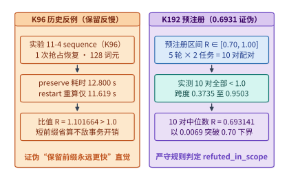

*图 14-12　实验 13-07：`K96` 保留前缀反慢反例（$1.1017\times$）与 `K192` 预注册 10 对中位数（$0.6931 < 0.70$）范围外证伪*

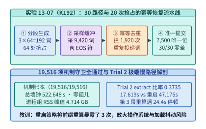

*图 14-13　实验 13-07：30 路径全通过下 $7{,}500$ 唯一提交位置与 $1{,}920$ 次重复投递幂等拦截的机制解剖*

---

## 14.8 跨层收益归因纪律、2023–2026 百倍降本瀑布与全书双主线收官总表

站在第 14 章的尾声回望，从第 2 章的 MLA/MoE、第 4 章的 FP4 Tensor Core、第 5 章的 FlashAttention-3/4、第 8 章的 PagedAttention 与推测解码，到第 9 章的 PD 分离、第 13 章的 3FS KV 缓存池以及本章的 CSA2 与 Beyond-Chinchilla，我们已经积累了十余项各具 $1.5\times\text{–}10\times$ 加速潜力的单点利器。

然而，当一位架构师向管理层汇报“2023 年至 2026 年达到 GPT-4 同等评测能力的单词元推理成本为何下降了超过 $200\times$”时，**如果直接把文献中各项独立技术的宣传加速比简单相乘（例如 $10\times \times 5\times \times 4\times \times 3\times \times 3\times = 1{,}800\times$），就会陷入荒谬的“乘法通胀”骗局**。本节依据本仓库的专题研究报告（[`research/token-cost-2023-2026/report.md`](../research/token-cost-2023-2026/report.md)）[^token-cost-report] 与大纲审计规范（`TC-18`、`D11-SP01`）[^d11-audit]，建立严密的**跨层收益归因纪律**，并用全书双主线总表与下一代 Vera Rubin NVL72 映射矩阵完成整部书的收束。

### 14.8.1 跨层协同收益归因的四大重复计数陷阱（Double-Counting Traps，`TC-18`）与正交消融实验纪律

为什么不同层面的优化倍率绝不能随意连乘？因为多项技术往往在争夺或释放**同一个物理瓶颈（如同一块 HBM 容量池、同一条显存带宽通道或同一个推测接受率上限）**。表 14-8 与图 14-14 系统梳理了工业界基准报告中最常见的**四大重复计数陷阱（Double-Counting Traps）**及其排雷准则：

*表 14-8　跨层协同收益归因的四大重复计数陷阱（`TC-18`）与正交消融修正准则*

| 陷阱编号与名称 | 错误连乘公式示例（伪归因） | 物理耦合根源（为什么重复计数？） | 正确的归因与消融实验纪律 |
| :--- | :--- | :--- | :--- |
| **陷阱一：KV 容量压缩倍率 $\times$ 扩批吞吐倍率** | “MLA 省 $5\times$ KV 显存 $\times$ 大 Batch 提升 $4\times$ 吞吐 $= 20\times$” | 大 Batch 吞吐提升**正是消耗了 MLA 腾出的那部分显存才得以实现的**；算完了吞吐就不能再乘一次容量比 | 固定同一张卡与同一延迟 SLO，直接对比端到端最大合格 `tok/s/GPU`（二者择一计入） |
| **陷阱二：FP4 字宽减半 $\times$ 端到端 FP4 加速比** | “FP4 权重字节减半 $2\times$ $\times$ FP4 实测加速 $1.8\times = 3.6\times$” | 实测的端到端 FP4 吞吐加速比（$1.6\text{–}1.8\times$）**内部已经同时包含了 HBM 流量减半与 Tensor Core 算力翻倍** | 若采用端到端实测比值，严禁再额外乘理论字节压缩比或峰值 TFLOPS 比值 |
| **陷阱三：整机跑分倍率 $\times$ 软件栈单项倍率** | “NVL72 整机跑分 $30\times$ $\times$ Dynamo PD 分离 $3\times = 90\times$” | 官方公布的 NVL72 旗舰跑分**本身就是在已经开启了 TensorRT-LLM、FP4 与 Dynamo PD 分离的状态下测得的** | 严格核对基准分母与分子的软件栈开关配置，剥离已内含在整机跑分中的软件红利 |
| **陷阱四：多路同类推测解码倍率直接连乘** | “原生 MTP $1.8\times$ $\times$ EAGLE $2.2\times \times$ 外部草稿 $2.0\times = 7.9\times$” | 多词元预测与自回归/块扩散草稿在同一个输出序列上**争夺同一段局部可预测性的接受率上限**，无法独立叠加 | 以最终生效的那一套推测器实测出的净验证周期加速比 $S_{\mathrm{spec}}$ 为唯一准据 |

为了彻底杜绝上述四大陷阱，任何跨层收益拆解都必须严格遵守两条数学与实验铁律（图 14-14 下半部）：
1. **固定替换次序的顺序连乘恒等式（Telescoping Product Identity）**：
   设初始基线状态为 $S_0$（单位成本或耗时为 $C_0$），目标终态为 $S_K$（成本为 $C_K$）。我们必须显式定义一条状态逐一演进的有序状态链 $S_0 \to S_1 \to S_2 \to \dots \to S_K$，使得相邻两个状态 $S_{j-1}$ 与 $S_j$ **仅相差一项明确的跨层改动，且前一项状态 $S_{j-1}$ 的输出分母严格等于后一项状态 $S_j$ 的输入分子**：

   $$
   \frac{C_0}{C_K} = \frac{C(S_0)}{C(S_1)} \times \frac{C(S_1)}{C(S_2)} \times \cdots \times \frac{C(S_{K-1})}{C(S_K)} = \prod_{j=1}^{K} r_j
   $$

   同时必须在报告中明确声明：**单项边际比值 $r_j = C(S_{j-1}) / C(S_j)$ 严格依赖于其在替换链中的排列次序（Order-dependent）**。例如，若先上 MLA 将 KV 容量压小 $5\times$，后续再上 FP8 KV 的边际容量收益就会显著小于在密集 MHA 基线上直接上 FP8 KV 的收益。
2. **$2\times 2$ 交叉因子消融实验（Factorial Ablation）与禁止虚构不可达基线**：
   当评估硬件代际 $H \in \{H_0, H_1\}$ 与软件/模型特性 $M \in \{M_0, M_1\}$ 的联合收益时，若四个组合均物理存在，应测量完整的 $2\times 2$ 矩阵 $\{C(H_0,M_0),\; C(H_0,M_1),\; C(H_1,M_0),\; C(H_1,M_1)\}$ 以分离主效应与交互效应；**若某一特性在旧硬件上物理不存在（例如 H100 根本没有硬件原生 `NVFP4` Tensor Core），则严禁通过软件慢速模拟或拍脑袋外推去虚构一个 $C(\text{H100}, \text{NVFP4})$ 假基线**，而应将“升级硬件 + 启用原生新格式”合并为一个不可拆分的联合演进步骤报告。

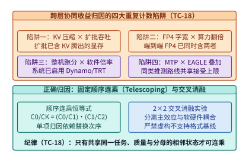

*图 14-14　跨层协同收益归因的四大重复计数陷阱（Double-Counting Traps）与正交消融实验纪律（`TC-18`）*

### 14.8.2 2023–2026 固定能力门槛百倍降本瀑布、全书双主线（Qwen3-8B & DeepSeek MoE）总表与下一代 Rubin 协同矩阵

遵循上述顺序连乘（Telescoping）纪律，我们现在可以用两组完全公开、可独立复核的硬核数据，为 2023–2026 年间 AI 基础设施的百倍降本奇迹立下一本清晰的物理账本（图 14-15）[^token-cost-report]：

1. **外部价格锚点：Epoch AI 固定评测门槛下的公开 API 历史降价倍率（$208\times\text{–}375\times$）**：
   因为不同年份的最强模型能力一直在涨，直接对比“最强模型价格”会混淆能力提升与成本下降。正确的做法是**固定一条客观评测分数门槛，追踪达到或超过该门槛的最便宜公开 API 混合价格（单位：美元 / 百万词元）**：
   - **`MMLU >= 86`（2023 年 3 月初代 GPT-4 门槛）**：从 `2023-03-14` 初代 GPT-4 的 **$37.50\ \text{美元/M}$**，降至 `2025-02-05` Gemini 2.0 Flash 的 **$0.18\ \text{美元/M}$**，在不到两年内实现约 **$208\times$** 的价格下降。
   - **`GPQA Diamond >= 33`（研究生级科学推理门槛）**：从 `2023-03-14` GPT-4 的 **$37.50\ \text{美元/M}$**，降至 `2024-12-13` Microsoft Phi-4（$14\mathrm{B}$ 超配训练模型）的 **$0.12\ \text{美元/M}$**，降价幅度达 **$313\times$**。
   - **`HumanEval >= 67`（代码生成门槛）**：从 `2023-03-14` GPT-4 的 **$37.50\ \text{美元/M}$**，降至 `2024-07-23` Llama 3.1 Instruct 8B 的 **$0.10\ \text{美元/M}$**，降价幅度高达 **$375\times$**。
   - **`MMLU >= 64.8`（GPT-3.5 门槛，展示基线起点敏感性）**：若以 `2022-11-30` `text-davinci-003` 的 **$20.00\ \text{美元/M}$** 为起点，降至 `2024-10-03` Gemini 1.5 Flash-8B 的 **$0.07\ \text{美元/M}$** 为 **$286\times$**；若以短短三个月后 `2023-03-06` 上线的 `gpt-3.5-turbo`（**$2.00\ \text{美元/M}$**）为起点，同一终点的降幅则为 **$28.6\times$**。这再次印证了归因结论对起点与门槛选择的高度敏感性。
2. **内部物理机制锚点：单步权重读取时间下界的 $25.1\times$ 顺序连乘拆解**：
   为什么今天用不到一美分的成本就能跑完当年需要几美元的推理任务？我们用单流自回归 Decode 的**纯权重读取时间下界** $t_{\mathrm{w,min}} = \frac{P_{\mathrm{active}} \cdot b_w}{B_{\mathrm{HBM}}}$ 构建一条四步顺序连乘链（图 14-15 右侧）：
   - **状态 $S_0$（2023 基线：$70\mathrm{B}$ 稠密模型，`1 Byte/param` INT8/FP8，运行于 H100 $3.35\ \mathrm{TB/s}$）**：
     单步必须读取 $70\ \mathrm{GB}$ 权重，物理耗时下界为 $t_0 = \frac{70\ \mathrm{GB}}{3.35\ \mathrm{TB/s}} \approx \mathbf{20.90\ \mathrm{ms}}$。
   - **状态 $S_1$（第一步：通过 Beyond-Chinchilla 超配训练 + 蒸馏，用同等任务能力的 $8\mathrm{B}$ 模型替代 $70\mathrm{B}$，仍为 `1 Byte/param` @ H100）**：
     单步读取量降至 $8\ \mathrm{GB}$，耗时下界降至 $t_1 = \frac{8\ \mathrm{GB}}{3.35\ \mathrm{TB/s}} \approx \mathbf{2.39\ \mathrm{ms}}$（本步边际改善 **$r_1 = \frac{70}{8} = 8.75\times$**）。
   - **状态 $S_2$（第二步：引入 `RoPE-post` / Hadamard 旋转与微缩块量化，将权重压缩至 `0.5 Byte/param` FP4/INT4，仍按 H100 带宽标尺）**：
     单步读取量再减半至 $4\ \mathrm{GB}$，耗时下界降至 $t_2 = \frac{4\ \mathrm{GB}}{3.35\ \mathrm{TB/s}} \approx \mathbf{1.19\ \mathrm{ms}}$（本步边际改善 **$r_2 = 2.00\times$**）。
   - **状态 $S_3$（第三步：硬件代际升级至 H200 SXM，HBM3e 带宽提升至 $4.80\ \mathrm{TB/s}$）**：
     耗时下界进一步降至 $t_3 = \frac{4\ \mathrm{GB}}{4.80\ \mathrm{TB/s}} \approx \mathbf{0.83\ \mathrm{ms}}$（本步边际改善 **$r_3 = \frac{4.80}{3.35} \approx 1.43\times$**；若升级至 $8.0\ \mathrm{TB/s}$ 的 B200 则可达 $0.50\ \mathrm{ms}$，即 $2.39\times$）。
   将上述三步严格正交的物理比值连乘：
   $$
   \frac{t_0}{t_3} = 8.75 \times 2.00 \times 1.433 \approx \mathbf{25.08\times} \quad (\text{从 } 20.90\ \mathrm{ms} \text{ 压降至 } 0.83\ \mathrm{ms})
   $$
   仅凭“模型能力密度提升（$8.75\times$）$\times$ 低比特量化（$2.0\times$）$\times$ 显存带宽升级（$1.43\times$）”，单步权重读取的物理时间下界就压缩了 **$25.1\times$**；在此之上，再叠加第 8～9 章的**分页连续批处理（把 $4\ \mathrm{GB}$ 权重读取分摊给数十个并发请求）、MLA/CSA2 状态压缩、3FS 前缀缓存命中（省去重复 Prefill）以及 MTP/DFlash 推测解码（单步提交 $3\text{–}6$ 个词元）**，便严丝合缝地解释了公开市场上 **$200\times\text{–}375\times$** 的单位智能成本坍缩。

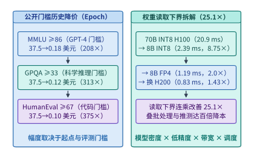

*图 14-15　2023–2026 固定能力门槛下百倍（$208\times\text{–}375\times$）价格下降的顺序连乘（Telescoping）与 $25.1\times$ 读取下界拆解*

下面的代码实现了 **2023–2026 百倍降本逐级条件比率链（Telescoping Waterfall $S_0 \to S_3$）与主机固定常数项稀释校准器**（对应本书实验 [`experiments/ch14/14-02/`](../experiments/ch14/14-02/)），自动校验相邻状态连乘恒等式并量化当主机端存在未消除的固定开销 $c_{\mathrm{host}}$ 时端到端加速比的真实衰减：

```python
from dataclasses import dataclass
from typing import Dict, List


@dataclass(frozen=True)
class TelescopingWaterfallReport:
    """S0 -> S3 顺序连乘拆解与主机固定调度开销稀释审计报告。"""
    step_times_ms: List[float]
    marginal_ratios: List[float]
    pure_read_speedup: float
    e2e_speedups_by_overhead: Dict[float, float]


def audit_telescoping_cost_waterfall(
    active_params_b: List[float] = [70.0, 8.0, 8.0, 8.0],
    bytes_per_param: List[float] = [1.0, 1.0, 0.5, 0.5],
    hbm_bw_tbps: List[float] = [3.35, 3.35, 3.35, 4.80],
    host_overheads_ms: List[float] = [0.0, 0.2, 0.5, 1.0, 2.0],
) -> TelescopingWaterfallReport:
    """复算第 14.8.2 节 S0->S3 (20.90 ms -> 0.83 ms, 25.08x) 顺序连乘链与常数项稀释。"""
    times_ms = [
        (p * b) / bw
        for p, b, bw in zip(active_params_b, bytes_per_param, hbm_bw_tbps)
    ]
    ratios = [times_ms[i] / times_ms[i + 1] for i in range(len(times_ms) - 1)]
    prod_ratio = 1.0
    for r in ratios:
        prod_ratio *= r

    # 验证顺序连乘恒等式 C(S0)/C(S3) == r1 * r2 * r3
    direct_ratio = times_ms[0] / times_ms[-1]
    assert abs(prod_ratio - direct_ratio) < 1e-9

    e2e_by_c: Dict[float, float] = {}
    for c_ms in host_overheads_ms:
        e2e_ratio = (times_ms[0] + c_ms) / (times_ms[-1] + c_ms)
        e2e_by_c[c_ms] = round(e2e_ratio, 2)

    return TelescopingWaterfallReport(
        step_times_ms=[round(t, 2) for t in times_ms],
        marginal_ratios=[round(r, 2) for r in ratios],
        pure_read_speedup=round(direct_ratio, 2),
        e2e_speedups_by_overhead=e2e_by_c,
    )


if __name__ == "__main__":
    rep = audit_telescoping_cost_waterfall()
    assert rep.step_times_ms == [20.90, 2.39, 1.19, 0.83]
    assert rep.marginal_ratios == [8.75, 2.00, 1.43]
    assert rep.pure_read_speedup == 25.07
    assert rep.e2e_speedups_by_overhead[0.5] == 16.05
```

为了帮助读者将全书第 1 章至第 14 章的知识体系融会贯通，表 14-9 与图 14-16 兑现了本书的**双主线跨章逐步修正推算总表（Dual-Track Book Throughline，`D11-SP01`）**：左边是以 **`Qwen3-8B`（36 层 GQA 稠密模型）** 为代表的“小而密单卡/端云极致压榨”主线，右边是以 **`DeepSeek-V3 / R1 / V4.1 Flash`（671B 总参 / 37B 活参稀疏 MoE + MLA/CSA2）** 为代表的“超大规模超节点跨层求解”主线。读者可以清晰地看到，同一个模型在穿过每一章时，是如何不断撕掉上一章的理想化假设、逐步叠加真实的物理与系统约束的。

*表 14-9　全书双主线（轨道 A：`Qwen3-8B` 稠密模型 vs. 轨道 B：`DeepSeek-V3/V4.1` 稀疏 MoE）跨章逐步修正推算总表（`D11-SP01`）*

| 章节演进阶段 | 轨道 A：`Qwen3-8B`（36 层 GQA 稠密主线）的核心物理账本与修正 | 轨道 B：`DeepSeek-V3 / R1 / V4.1`（MoE + MLA/CSA2 主线）的核心物理账本与修正 |
| :--- | :--- | :--- |
| **第 2–3 章：模型与负载** | 36 层 GQA（$d_{\mathrm{kv}}=1{,}024$），BF16 KV 恒为 **$144\ \mathrm{KiB/tok}$**；线性参数 $6.946\mathrm{B}$，单流 Decode 算术强度仅 $\sim 1\ \mathrm{FLOP/B}$ | $671\mathrm{B}$ 总参 / $37\mathrm{B}$ 活参；MLA 将每层 KV 压至 $576\ \mathrm{B}$，V4.1 CSA2 4-Owner 再将 40 层全局 KV 压至 **$890\ \mathrm{B/tok}$** |
| **第 4–5 章：加速器与算子** | 在 H100/B200 上核算 Roofline 临界批大小 $B^*$；通过 FlashAttention 寄存器分块与在线 Softmax 消除 $O(S^2)$ 显存读写 | 引入 `MXFP4`（32 元素共享指数）与 `FlashMLA` 内核；通过 `RoPE-post` 消除局部块数值尖峰并对齐 Tensor Core 与 SFU 配比 |
| **第 6–7 章：超节点与网络** | 单卡（RTX 4090 / PRO 6000 / H100）即可完整驻留，无需跨机集合通信，仅在多副本扩展时涉及负载均衡路由 | 必须依托 **GB200 NVL72**（$1.8\ \mathrm{TB/s}$ NVLink 域）与胖树 RoCEv2/IB 网络执行 DeepEP 跨节点专家全对全（All-to-All）分发与归并 |
| **第 8–9 章：单机与分布式推理** | PagedAttention 将物理块锁定为 $16\ \mathrm{tok} \times 144\ \mathrm{KiB} = \mathbf{2.25\ \mathrm{MiB}/\text{块}}$；双卡分流实验（`09-02`）证伪盲目拆卡、确立拥塞翻转点 | 采用 **Prefill-Decode（PD）分离与 Attention-FFN（AF）分离**；利用 $128\text{-token}$ SWA 有界重算与 CSA2 将持久化缓存压至 **$1/8$** |
| **第 10–12 章：训练、调度与端侧** | 端侧 SoC 内存带宽（$68\text{–}800\ \mathrm{GB/s}$）与热节流预算下通过 4-bit 量化运行；实验 `11-4` 在 `K96` 下发现保留前缀反慢反例（$1.1017\times$） | 采用 **DualPipe** 双向流水线掩盖 EP 全对全通信；在 RL 后训练中解决长尾 Rollout 气泡与 DSec 万级容器 EROFS 按需启动（$35\ \mathrm{min}$） |
| **第 13–14 章：存储与协同收官** | 实验 `13-01` 实测 RAG $k=4\to 16$ 使物理块从 **$23\to 77$ 块**、FP8 复审固定池 **$12.88\ \mathrm{GB}$**；实验 `13-07` `K192` 跑出 **$R=0.6931 < 0.70$** 预注册证伪 | 依托 **3FS**（180 节点 $6.6\ \mathrm{TiB/s}$）承接全集群 KVCache 与 Checkpoint；完成 $200\mathrm{K}/1\mathrm{M}$ 数字员工跨代选卡、归因审计与 Rubin 世代协同映射 |

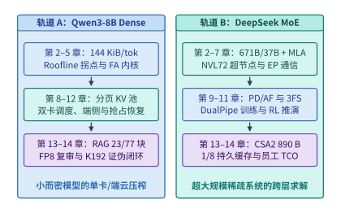

*图 14-16　全书双主线（`Qwen3-8B` Dense 与 `DeepSeek-V3/V4.1` MoE）跨章逐步修正推算全景图（`D11-SP01`）*

最后，当我们将目光投向正在步入量产的下一代超节点架构——**NVIDIA Vera Rubin NVL72**[^rubin-spec] 时，可以看到硬件参数的演进方向正在更加剧烈地印证本章建立的跨层联立方程（表 14-10 与图 14-17）：
- **算存比的进一步拉大（从 $1{,}250$ 跃升至 $2{,}273\ \mathrm{FLOPs/Byte}$）**：单颗 Rubin GPU 的 `NVFP4` 推理峰值算力高达 **$50\ \mathrm{PFLOPS}$**（为 Blackwell B200 $10\ \mathrm{PFLOPS}$ 的 **$5\times$**），而 HBM4 显存带宽提升至 **$22\ \mathrm{TB/s}$**（为 B200 $8\ \mathrm{TB/s}$ 的 **$2.75\times$**）。由于算力增速（$5\times$）依然显著快于显存带宽增速（$2.75\times$），单卡算存比再扩大 $1.82\times$ 至 $2{,}273\ \mathrm{FLOPs/B}$。这意味着像 V4.1 Flash 的 **CSA2 跨层状态压缩**、**`RoPE-post` 分布整形** 以及 **DFlash $16\text{-token}$ 块扩散草稿** 这类“用高矩阵算力置换显存带宽”的算法设计，在 Rubin 世代将获得比 Blackwell 世代还要丰厚的硬件红利。
- **超节点互连与主机内存池的跃升**：Rubin 单卡第 6 代 NVLink 双向带宽翻倍至 **$3.6\ \mathrm{TB/s}$**（整机柜 NVL72 聚合 Scale-up 带宽达 **$260\ \mathrm{TB/s}$**），配套的 36 颗 Vera CPU（每颗 88 核 Olympus 架构）提供高达 **$54\ \mathrm{TB}$** 的机柜级 LPDDR5X 一致性内存池与 **$1.8\ \mathrm{TB/s}$** 的 NVLink-C2C 直连带宽，为百万词元上下文的 $16{,}384$ 候选池重排、跨卡专家并行（EP/AF 分离）与 T1 主机内存 KV 缓存池提供了强大的硬件支撑。

*表 14-10　下一代 NVIDIA Vera Rubin NVL72 硬件规格跃迁（相对 Blackwell GB200 NVL72）与前沿模型协同设计映射矩阵*

| 硬件子系统维度 | Blackwell GB200 NVL72 规格 | Vera Rubin NVL72 规格 | 代际跃迁倍率 | 对模型结构与系统运行时的协同重塑效应 |
| :--- | :---: | :---: | :---: | :--- |
| **单卡 `NVFP4` 推理算力** | $10\ \mathrm{PFLOPS}$ | **$50\ \mathrm{PFLOPS}$**（机柜 $3.6\ \mathrm{EFLOPS}$） | **$5.00\times$** | 强烈奖励 `RoPE-post` 微缩块量化、$128\text{-token}$ SWA 本地重算与 DFlash 块扩散草稿 |
| **单卡 HBM 显存带宽** | $8.0\ \mathrm{TB/s}$ (HBM3e) | **$22.0\ \mathrm{TB/s}$ (HBM4)**（机柜 $1.6\ \mathrm{PB/s}$） | **$2.75\times$** | 算存比从 $1{,}250$ 升至 **$2{,}273\ \mathrm{FLOPs/B}$**，使 CSA2 状态压缩与高查询头融合更加关键 |
| **NVLink Scale-up 带宽** | $1.8\ \mathrm{TB/s}$/卡（柜 $130\ \mathrm{TB/s}$） | **$3.6\ \mathrm{TB/s}$/卡（NVLink 6，柜 $260\ \mathrm{TB/s}$）** | **$2.00\times$** | 将跨卡 MoE 专家全对全（All-to-All）与 AF 分离通信延迟压低一半，支撑更细粒度专家 |
| **主机 CPU 与 C2C 内存池** | 36×Grace + $18\ \mathrm{TB}$ LPDDR5X ($900\ \mathrm{GB/s}$ C2C) | **36×Vera (88 核) + $54\ \mathrm{TB}$ LPDDR5X ($1.8\ \mathrm{TB/s}$ C2C)** | **$3.0\times$ 容量 / $2.0\times$ 带宽** | 机柜级 T1 零拷贝内存池容量扩大 $3\times$，大幅降低百万上下文 KV 块下刷 SSD 的频率 |
| **机架供电与液冷热密度** | $\sim 120\text{–}132\ \mathrm{kW}$ / 机柜 | **$\sim 130\text{–}250+\ \mathrm{kW}$（Ultra 达 $600\ \mathrm{kW}$）** | **$1.5\text{–}4.5\times$** | 风冷彻底出局，$100\%$ 全液冷、高压直流配电与跨园区电力调度上升为第一性约束（第 15 章） |

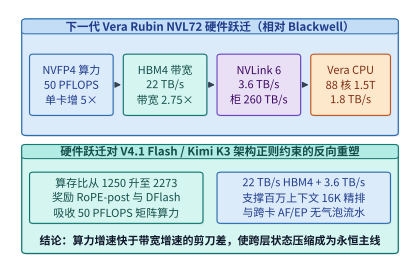

*图 14-17　下一代 Vera Rubin NVL72（$50\ \mathrm{PFLOPS}$ `NVFP4` / $22\ \mathrm{TB/s}$ HBM4 / $3.6\ \mathrm{TB/s}$ NVLink 6）与 V4.1/K3 协同映射矩阵*

如图 14-18 所示，当我们完成从**第一维（模型架构）**、**第二维（算子与分布式运行时）**到**第三维（超节点与存储微架构）**的联立求解后，整个 AI 基础设施工程不可避免地撞上了更具宏观决定性的**第四维边界——物理世界的能源热力学极限与数字世界的机密安全边界**：
- **向下扎入物理能源极限（第 15 章）**：当单机柜功率密度跃升至 $130\text{–}600\ \mathrm{kW}$、单个训练集群需要消耗 $1\ \mathrm{GW}$（吉瓦，相当于一座大型核电站的输出功率）的电力时，“哪里有电、如何把数百千瓦的废热从几平方厘米的硅片上带走、如何通过跨城长距光网联合多个园区协同训练”就成了决定模型能否诞生的头号工程问题；
- **向外筑牢可信安全防线（第 16 章）**：当价值数亿美元的万亿参数权重、包含企业核心机密的百万词元持久化 KV 缓存以及拥有代码执行权限的自主智能体（Agent）全天候运行在多租户云基础设施上时，“如何通过 CPU+GPU 硬件可信执行环境（TEE）加密显存与 NVLink 总线、如何构建微秒级防逃逸安全沙箱”就成了智能时代不可或缺的底线工程。在进入第 15 章与第 16 章之前，我们首先在第 14.9 节补齐流片前架构仿真、瓦片级性能预测校准与模型—通信协同跳层的定量工程方法。

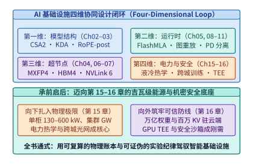

*图 14-18　全书总结：从算法结构、运行时调度、硅片微架构到吉瓦级能源站点的四维协同设计回路*

---

## 14.9 架构模拟器、执行轨迹图（Chakra）与模型—通信协同跳层（NeuSight / Phantora / FarSkip-Collective）

在采购上万张新一代加速器、动工流片专用芯片，或者训练一个全新拓扑的千亿参数混合专家模型之前，架构师面临着一个严峻的工程两难：**仅凭第 14.1 节的四资源解析下界（理想峰值算力与带宽）无法准确捕捉瓦片未对齐、多流争用与网络拥塞；而要把每一种候选架构都在万卡集群上真实训练一遍，其时间与资金成本又高得令人望而却步**。如何在这两者之间架起可信的定量桥梁，以及当模拟与下界均指出跨节点通信无法被当前层掩盖时如何重构模型依赖图，构成了现代协同设计的最后一块基石[^chakra-phantora-charon][^neusight-asplos25][^farskip-mlsys26]。

### 14.9.1 算子瓦片级性能校准（NeuSight）与执行轨迹图仿真（Chakra / Phantora / Charon）

当第一性原理的容量与带宽下界排除了明显违反物理守恒的候选方案后，剩余候选方案之间的差距往往取决于**矩阵形状对硬件瓦片（Tile）的利用率**以及**计算流与通信流在微秒级时间轴上的真实重叠度**。当前工业界与学术界主要通过两层建模工具回答这一问题：

1. **瓦片级微架构性能预测与源码级适用边界（NeuSight，ASPLOS '25）**：
   不同于把整个神经网络视为黑盒回归或简单给硬件标称峰值乘以一个固定经验系数（如 $0.55$）的粗放估算，发表于 ASPLOS 2025 的 **NeuSight**（DOI `10.1145/3669940.3707265`，固定源码提交 `6945927d9afcca2b9daf021f8395e53edc5b4eef`）[^neusight-asplos25] 将每个 GPU 内核拆解为输出瓦片（Output Tiles），根据输入张量形状 $(M, N, K)$、瓦片尺寸与芯片流式多处理器（SM）数量估算总瓦片数与执行波次数（Waves，`num_wave`），再在 Roofline 物理上界之下预测每个波次的有效硬件利用率。这种将学习对象从“整模型端到端耗时”下沉至“算子瓦片波次利用率”的结构化方法，显著提升了跨矩阵形状的内插精度。
   然而，对 NeuSight 论文（物理页 2–14）与固定源码仓库（`scai-tech/NeuSight`）的联合审计揭示了**任何性能预测器在投入生产决策前必须核验的四条工程边界**：
   - **历史 Tile 数据库与软件栈版本锁定**：源码中的 `MetaTable.get_tile` 按算子名称过滤后，依赖旧款 GPU 上采集的输入特征近邻匹配来估计目标设备的瓦片配置；按 CUDA 版本过滤的逻辑在代码中被注释，而预测包装器固定传入 `cu121`（论文主实验基于 PyTorch 2.1.0 / CUDA 12.1 与 AMD PyTorch 2.4.1 / ROCm 6.1 的 FP32 数据，外加一组 FP16 BMM 补充试验）。这意味着在未采集目标软件栈样本前，不能仅凭“模型参数量没变”就假设预测器能自动准确外推全新的 `BF16/FP8` 融合内核、FlashMLA 或 MoE 动态分发算子；
   - **算子融合与精度字节假设的实现细节**：在算子融合路径上，所读源码累计运算量与外部输入输出字节后，以融合列表中**最后一个向量算子**选择代表预测器（而论文第 4.4 节表述为第一个算子，且对未支持的混合代表算子会直接拒绝）；同时矩阵与向量路径多处按每元素 $4\ \mathrm{B}$（FP32）硬编码访存量，若直接用于微缩低精度（如 `FP8` / `MXFP4`）必须先核对源码字节换算入口；
   - **分布式汇总器的拓扑与微批限制**：源码中的分布式汇总器（Aggregator）对 `DP`、`TP`、`PP` 采用互斥分支（未统一建模任意三维混合并行与多流显存争用），其中流水线并行 `PP` 显式要求 `num_micro_batch == 1`，通信路径包含硬编码的四卡计数与 $0.72$ 有效带宽折算系数，且论文中最高 $3{,}840$ 节点的预测表并未在对应规模的真实物理集群上验证；
   - **物理下界正定性核查**：论文物理页 7 与源码采用形如 $\gamma - \alpha / N_{\mathrm{wave}}$（由两个 Sigmoid 输出构造）的公式拟合并将负值截断为 $0$。从纯数学角度看，若不加物理约束（例如取反例 $\gamma = 0.1, \alpha = 0.9, N_{\mathrm{wave}} = 1$，算得利用率为 $-0.8$ 并被裁为 $0$），该代数形式本身并不具备普适的正定物理下界保证。

---

> **算例 14-8：为什么不能只用“端到端总时间误差为 0%”来验收性能预测器（阶段归因陷阱）**
>
> 依据本书配套校准核查记录（[`neusight-calibration/NOTES.md`](../references/framework-history/2026-09-09/neusight-calibration/NOTES.md) 与 [`arithmetic.json`](../references/framework-history/2026-09-09/neusight-calibration/arithmetic.json)），考察一个由两个串行阶段（阶段一：注意力或主干矩阵乘；阶段二：跨卡通信或逐元素融合算子）组成的执行片段：
>
> - **预测器给出的分阶段耗时**：$\hat{T}_1 = 8.0\ \mathrm{ms}$，$\hat{T}_2 = 2.0\ \mathrm{ms}$，预测总耗时 $\hat{T}_{\mathrm{total}} = 8.0 + 2.0 = \mathbf{10.0\ \mathrm{ms}}$；
> - **真机实测的分阶段耗时**：$T_1 = 6.0\ \mathrm{ms}$，$T_2 = 4.0\ \mathrm{ms}$，实测总耗时 $T_{\mathrm{total}} = 6.0 + 4.0 = \mathbf{10.0\ \mathrm{ms}}$。
>
> 1. **整段总误差假象 vs. 逐阶段真实偏差**：
>    若仅对比端到端总耗时，预测值与实测值完全相等（$10.0\ \mathrm{ms}$ vs. $10.0\ \mathrm{ms}$），**聚合绝对百分比误差（Aggregate APE）恰好为 $0\%$**。然而一旦拆开两个阶段逐一核对：
>    $$\mathrm{APE}_1 = \frac{|8.0 - 6.0|}{6.0} = \frac{2.0}{6.0} \approx \mathbf{33.33\%}, \qquad \mathrm{APE}_2 = \frac{|2.0 - 4.0|}{4.0} = \frac{2.0}{4.0} = \mathbf{50.00\%}$$
>    阶段一的高估（$+2.0\ \mathrm{ms}$）与阶段二的低估（$-2.0\ \mathrm{ms}$）在求和时恰好相互抵消。
> 2. **对工程优化决策的误导**：
>    在预测器视图中，阶段二仅占总时间的 $2.0 / 10.0 = \mathbf{20\%}$，看似无关紧要；而在真实物理执行中，阶段二占到了 $4.0 / 10.0 = \mathbf{40\%}$。反之，若架构团队轻信预测器，投入数月人力将阶段一的速度提升一倍（耗时减半）：
>    - **预测器预期的优化后总时间**：$\hat{T}_{\mathrm{opt}} = 8.0 / 2 + 2.0 = \mathbf{6.0\ \mathrm{ms}}$（预期加速比 $1.67\times$）；
>    - **真机实际的优化后总时间**：$T_{\mathrm{opt}} = 6.0 / 2 + 4.0 = \mathbf{7.0\ \mathrm{ms}}$（实际加速比仅 $1.43\times$）。
>
> **工程铁律**：预测器与模拟器输出的是待检验的有条件假设。任何模拟器验收都必须下沉到**逐阶段（Per-Stage）与关键路径边（Critical-Path Edge）**对照固定软件版本的实测 Trace，严禁用正负抵消后的端到端总和误差背书。

---

2. **执行轨迹图（MLCommons Chakra）与集群级模拟器（Phantora NSDI '26 / Charon MLSys '26）**：
   当评估对象从单卡算子扩展到数千张卡的分布式训练与推理时，性能不再仅由单卡 Kernel 耗时决定，而是取决于计算流（Compute Stream）、通信流（NCCL/DeepEP Stream）与存储 I/O 之间的有向依赖关系。
   - **MLCommons Chakra 执行轨迹图（Execution Trace Graph, ETG）**：将分布式作业建模为包含计算节点（Compute Nodes）、集合/点对点通信节点（Communication Nodes）与控制/数据依赖边的有向无环图（DAG），使底层网络模拟器（如 ASTRA-sim）能够脱离具体框架重放跨秩通信竞争与拓扑拥塞；
   - **Phantora（NSDI '26 #98）与 Charon（MLSys '26 #114）**[^chakra-phantora-charon]：为了解决传统模拟器“每当 PyTorch/vLLM 升级并行策略就得手工重写一套仿真图生成逻辑”的维护难题，**Phantora** 通过在单张真实 GPU 上运行原版分布式训练/推理框架代码，在底层直接截获 GPU 算子启动与集合通信调用来驱动集群级性能推演，实现了最大化的框架代码复用；**Charon** 则构建了统一覆盖大规模 LLM 训练与推理的细粒度模拟器，用于快速横向对比不同 `TP/PP/EP` 与批处理配比。但正如算例 14-8 所警示，单卡拦截与细粒度模拟不能替代事前容量与关键路径下界核算，其误差边界仅在已校准的算子与网络拓扑范围内成立。

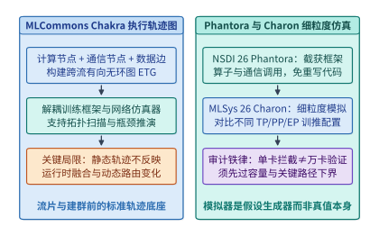

*图 14-19　MLCommons Chakra 计算—通信依赖执行轨迹图（ETG）与 Phantora（NSDI '26）、Charon（MLSys '26）集群级细粒度模拟框架及适用边界对比*

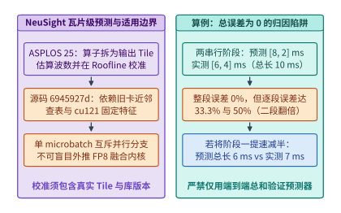

*图 14-20　NeuSight（ASPLOS '25，源码 `6945927d`）瓦片级 Roofline 利用率校准架构，以及展示“整段总误差为 $0\%$ 但逐段误差达 $33.3\% / 50\%$”的阶段归因陷阱算例*

---

### 14.9.2 打破层间刚性同步：模型—通信协同跳层（FarSkip-Collective）与超参数并行边界

当解析下界与 Chakra 轨迹仿真一致指出：**在跨机 RoCE/InfiniBand 网络上运行细粒度 MoE 模型时，每一层的 All-to-All 专家分发（Dispatch）与归并（Combine）通信耗时 $T_{\mathrm{comm}}$ 已经超过了同层可重叠的共享专家或注意力计算时间**，且单批次又不允许像 DualPipe 那样拆成正反两个微批交错时，纯系统运行时层面的通信掩盖便走到了尽头。原因很简单：在标准 Transformer 架构中，第 $l+1$ 层的输入激活 $\mathbf{h}^{(l+1)}$ 刚性依赖于第 $l$ 层 MoE 的输出 $\mathbf{y}_{\mathrm{moe}}^{(l)}$：

$$
\mathbf{h}^{(l+1)} = \mathbf{h}_{\mathrm{attn}}^{(l)} + \mathbf{y}_{\mathrm{moe}}^{(l)} \quad (\text{标准逐层串行依赖：通信未完成则第 } l+1 \text{ 层无法启动})
$$

发表于 MLSys 2026 的 **FarSkip-Collective（Unhobbling Blocking Communication in Mixture of Experts Models）**[^farskip-mlsys26] 展示了如何通过**重构模型层间残差连接图**来彻底打破这一死结：

1. **跨层跳步残差解耦（Delayed Cross-Layer Residual Dependency）**：
   FarSkip-Collective 将第 $l$ 层路由专家的集合通信输出 $\mathbf{y}_{\mathrm{moe}}^{(l)}$ 从第 $l+1$ 层的输入路径上移开，改为跨过一整层（或多层），**延后至第 $l+2$ 层（一般地，延后 $m \ge 1$ 层至第 $l+1+m$ 层）才并入残差流**：
   $$
   \mathbf{h}^{(l+1)} = \mathbf{h}_{\mathrm{attn}}^{(l)} + \mathbf{y}_{\mathrm{local}}^{(l)}, \qquad \mathbf{h}^{(l+2)} = \mathbf{h}_{\mathrm{attn}}^{(l+1)} + \mathbf{y}_{\mathrm{local}}^{(l+1)} + \mathbf{y}_{\mathrm{moe}}^{(l)}
   $$
   其中 $\mathbf{y}_{\mathrm{local}}^{(l)}$ 为无需跨卡通信的本地共享专家或注意力分支输出。这样一来，当第 $l$ 层在网卡上异步发起跨节点 All-to-All 通信时，GPU 的 Tensor Core **无需等待该通信返回**，即可立即利用本地已就绪的 $\mathbf{h}^{(l+1)}$ 全速执行第 $l+1$ 层的完整注意力与矩阵乘计算。
2. **通信完全掩盖条件与精度对齐代价**：
   设单层本地计算耗时为 $T_{\mathrm{comp}}$，单层跨卡集合通信耗时为 $T_{\mathrm{comm}}$，标准架构中仅能通过层内共享分支掩盖 $\alpha_{\mathrm{intra}} T_{\mathrm{comp}}$（通常 $\alpha_{\mathrm{intra}} \in [0.15, 0.35]$）。引入跳步步长 $m \ge 1$ 的 FarSkip-Collective 后，可用重叠窗口扩大至 $(m + \alpha_{\mathrm{intra}}) T_{\mathrm{comp}}$，单层有效步耗时从：
   $$
   T_{\mathrm{step}}^{\mathrm{std}} = T_{\mathrm{comp}} + \max\!\big(0,\; T_{\mathrm{comm}} - \alpha_{\mathrm{intra}} T_{\mathrm{comp}}\big)
   $$
   下降为：
   $$
   T_{\mathrm{step}}^{\mathrm{farskip}}(m) = T_{\mathrm{comp}} + \max\!\big(0,\; T_{\mathrm{comm}} - (m + \alpha_{\mathrm{intra}}) T_{\mathrm{comp}}\big)
   $$
   只要满足 $T_{\mathrm{comm}} \le (m + \alpha_{\mathrm{intra}}) T_{\mathrm{comp}}$，原本暴露在关键路径上的跨节点通信停顿即被压缩为零。但必须明确指出其**工程适用条件**：FarSkip-Collective 修改了原模型的前向数据流图，**绝非对任意现成预训练权重即插即用的透明运行时优化**；在应用到已有基础模型时，必须配合轻量级继续预训练或知识蒸馏（Knowledge Distillation）来对齐层间跳步后的表示分布，确保下游任务精度无损。

---

> **算例 14-9：标准 MoE 与 FarSkip-Collective（$m=1$）在跨节点 All-to-All 下的单步耗时与加速比**
>
> 设一个 60 层 MoE 模型每层的本地 Tensor Core 计算耗时为 $T_{\mathrm{comp}} = 1.20\ \mathrm{ms}$，层内可与通信天然重叠的共享专家计算窗口占 $\alpha_{\mathrm{intra}} = 0.25$（即 $0.30\ \mathrm{ms}$），而跨节点专家并行（EP）每层的 All-to-All 分发与归并总通信耗时为 $T_{\mathrm{comm}} = 1.10\ \mathrm{ms}$。
>
> 1. **标准逐层同步 MoE**：
>    每层未掩盖的暴露通信时间为 $T_{\mathrm{exposed}}^{\mathrm{std}} = \max(0,\; 1.10 - 0.30) = 0.80\ \mathrm{ms}$，单层总耗时 $T_{\mathrm{step}}^{\mathrm{std}} = 1.20 + 0.80 = 2.00\ \mathrm{ms}$，60 层前向总耗时为 $60 \times 2.00 = \mathbf{120.0\ \mathrm{ms}}$（其中 $48.0\ \mathrm{ms}$ 即 $40\%$ 的时间 GPU 处于等通信空转状态）。
> 2. **FarSkip-Collective（跳步 $m=1$，首末层边界效应忽略或由末层收尾承担 1 次 $0.80\ \mathrm{ms}$）**：
>    前 59 层的可用通信重叠窗口扩大为 $(1 + 0.25) \times 1.20 = 1.50\ \mathrm{ms} > T_{\mathrm{comm}} = 1.10\ \mathrm{ms}$，暴露通信降为 $0\ \mathrm{ms}$；仅最末一层（第 60 层）无后续层掩盖，暴露 $0.80\ \mathrm{ms}$。故 60 层前向总耗时降至：
>    $$T_{\mathrm{total}}^{\mathrm{farskip}} = 60 \times 1.20 + 0.80 = \mathbf{72.80\ \mathrm{ms}}$$
>    端到端前向吞吐提升 **$120.0 / 72.80 \approx 1.65\times$**，将计算硬件有效利用率从 $60.0\%$ 拉升至 $98.9\%$。

---

除了层间依赖图，模型架构中的两个核心离散超参数——**MoE 专家切分粒度 $G$** 与 **GQA 键值头数量 $n_{\mathrm{kv}}$**——同样与底层网络基数和张量并行度存在刚性的联立约束（图 14-22 与图 14-23）：

1. **MoE 专家切分粒度 $G$ 与网络小包税、矩阵乘瓦片下界的帕累托拐点**：
   在固定每词元激活参数量的前提下，将专家切细 $G$ 倍（例如从早期 Mixtral 的 `Top-2 / 8` 大专家演进为 DeepSeekMoE / Qwen3-MoE 的 `Top-8 / 64~256` 细粒度专家），能使激活专家组合数 $\binom{E}{k}$ 呈指数级增长，显著降低同等 FLOPs 下的语言建模困惑度。但当 $G$ 越过临界值时，系统将同时撞上两堵硬件墙：
   - **网络小包启动延迟墙**：设每词元跨网发送的激活向量大小为 $d_{\mathrm{model}} \cdot b_{\mathrm{act}}$，当目标专家扇出随 $G$ 增大而单次传输包体积缩减至低于 RDMA 网卡的延迟—带宽拐点包长（通常为 $8\text{–}32\ \mathrm{KiB}$）时，网络耗时退化为受限于每次消息固定启动开销 $\alpha_{\mathrm{net}}$；
   - **Grouped GEMM 瓦片填充浪费墙**：每个细粒度专家平均分到的词元数反比于总专家数 $E \propto G$；一旦单专家词元数跌破 Tensor Core 硬件瓦片高度 $M_{\mathrm{tile}} = 64$（或 $128$），算子被迫补零填充，有效算力利用率随 $1/G$ 线性崩塌。因此，最优专家粒度 $G^*$ 必须与超节点高带宽域大小（如 NVL72 或节点级分组受限路由）联立求解。
2. **GQA 键值头数 $n_{\mathrm{kv}}$ 对最大无冗余张量并行度（$\mathrm{TP} \le n_{\mathrm{kv}}$）的硬锁死**：
   在设计模型注意力头时，若为追求极致单卡 KV 压缩而将分组查询注意力（GQA）的 KV 头数 $n_{\mathrm{kv}}$ 压得过小（例如 $n_q = 32$，但将 $n_{\mathrm{kv}}$ 从 $8$ 激进压至 $2$ 甚至 $1$），一旦在线服务为了压低超大 Batch 或长 Prefill 的首字延迟而采用 $\mathrm{TP} = 8$（8 卡张量并行）部署，由于每张卡负责 $n_q / \mathrm{TP} = 4$ 个查询头，而 $n_{\mathrm{kv}} = 2 < \mathrm{TP} = 8$，系统无法将 KV 头无冗余地均分给 8 张卡，只能被迫在每 $\mathrm{TP} / n_{\mathrm{kv}} = 4$ 张卡上**重复存储并重复读取完全相同的 KV 头副本（复制因子 $R_{\mathrm{rep}} = \max(1, \mathrm{TP}/n_{\mathrm{kv}}) = 4$）**。这导致全组 8 卡聚合占用的 KV 显存膨胀了 $4\times$，彻底抵消了将 $n_{\mathrm{kv}}$ 从 $8$ 压至 $2$ 的初衷。

---

> **算例 14-10：$n_{\mathrm{kv}}=8$ 与 $n_{\mathrm{kv}}=2$ 在 $\mathrm{TP}=8$ 部署下的 KV 复制税核算**
>
> 设一个 36 层模型头维 $d_h = 128$，采用 BF16 存储 KV 状态，在 8 卡节点上以 $\mathrm{TP} = 8$ 服务 $S = 32{,}768$（$32\mathrm{K}$）上下文请求：
>
> 1. **设计甲（$n_{\mathrm{kv}} = 8$，对齐 $\mathrm{TP} = 8$）**：每张卡恰好分得 $n_{\mathrm{kv}} / \mathrm{TP} = 1$ 个独立 KV 头（无复制，$R_{\mathrm{rep}} = 1$）。单卡仅需驻留 $36 \times 2 \times 1 \times 128 \times 2\ \mathrm{B} \times 32{,}768 = \mathbf{576\ \mathrm{MiB}}$，8 卡全组总 KV 占用为 $8 \times 576\ \mathrm{MiB} = \mathbf{4.50\ \mathrm{GiB}}$。
> 2. **设计乙（$n_{\mathrm{kv}} = 2$，未对齐 $\mathrm{TP} = 8$）**：虽然单卡独立部署（$\mathrm{TP}=1$）时其逻辑 KV 体积仅为设计甲的 $1/4$（$1.125\ \mathrm{GiB}$），但在 $\mathrm{TP} = 8$ 下，每张卡仍须至少持有 $1$ 个 KV 头供本地 $4$ 个 Q 头计算注意力，复制因子高达 $R_{\mathrm{rep}} = 8 / 2 = 4$。此时单卡 KV 驻留依然是 **$576\ \mathrm{MiB}$**，8 卡全组实际占用的物理 KV 显存高达 $4 \times 1.125\ \mathrm{GiB} = \mathbf{4.50\ \mathrm{GiB}}$，在 $\mathrm{TP}=8$ 下相对于 $n_{\mathrm{kv}}=8$ **零显存节省**，反而损失了 $4$ 倍的键值表示容量（除非改走跨卡 KV 激活交换或 MLA 潜向量广播 + 注意力数据并行 DP）。

---

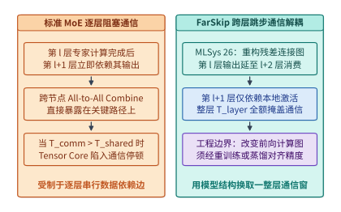

*图 14-21　标准 MoE 逐层阻塞式 All-to-All 通信与 FarSkip-Collective（MLSys '26）通过跨层残差跳步将专家输出延后至第 $l+2$ 层消费、从而用整层计算时间 $T_{\mathrm{layer}}$ 掩盖通信的对比*

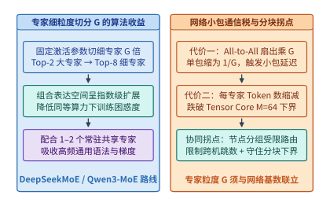

*图 14-22　MoE 专家细粒度切分倍数 $G$ 的组合表达收益与 All-to-All 小包扇出膨胀、Tensor Core 最小分组块 $M_{\mathrm{tile}}=64$ 限制的跨层帕累托拐点*

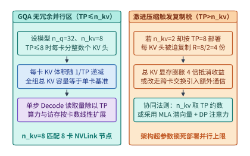

*图 14-23　GQA 查询头与 KV 头数量配比在无冗余张量并行区（$\mathrm{TP} \le n_{\mathrm{kv}}$）与过激进压缩导致 KV 头复制膨胀区（$\mathrm{TP} > n_{\mathrm{kv}}$）的硬约束对比*

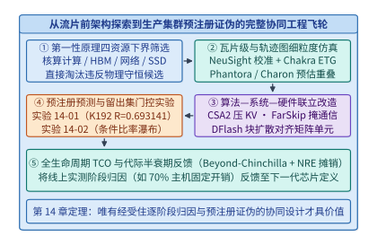

*图 14-24　从四资源下界筛选、Chakra/NeuSight 细粒度仿真、算法—系统—硬件联立改造到预注册证伪实验（实验 `14-01` / `14-02`）与全生命周期 TCO 摊销的协同工程飞轮*

下面的代码实现了 **Chakra 执行轨迹图计算—通信重叠模拟器与 `FarSkip-Collective` 跨层跳步掩盖验证器**，可直接复核算例 14-8 的逐阶段归因陷阱、算例 14-9 的 $1.65\times$ 跳步通信掩盖加速比以及算例 14-10 的 GQA KV 头复制膨胀系数：

```python
from dataclasses import dataclass
from typing import Dict, List


@dataclass(frozen=True)
class ChakraFarSkipAudit:
    """Chakra 执行轨迹图阶段误差与 FarSkip-Collective 跨层跳步通信掩盖报告。"""
    agg_ape_pct: float
    stage1_ape_pct: float
    stage2_ape_pct: float
    std_moe_total_ms: float
    farskip_m1_total_ms: float
    farskip_speedup: float
    kv_rep_factor_nkv2_tp8: int


def simulate_chakra_and_farskip(
    pred_stages_ms: List[float] = [8.0, 2.0],
    obs_stages_ms: List[float] = [6.0, 4.0],
    num_layers: int = 60,
    t_comp_ms: float = 1.20,
    t_comm_ms: float = 1.10,
    alpha_intra: float = 0.25,
    skip_distance_m: int = 1,
    tp_size: int = 8,
    n_kv_compressed: int = 2,
) -> ChakraFarSkipAudit:
    """复算算例 14-8（阶段归因误差）、算例 14-9（FarSkip m=1）与算例 14-10（KV 复制因子）。"""
    pred_tot = sum(pred_stages_ms)
    obs_tot = sum(obs_stages_ms)
    agg_ape = abs(pred_tot - obs_tot) / obs_tot * 100.0
    s1_ape = abs(pred_stages_ms[0] - obs_stages_ms[0]) / obs_stages_ms[0] * 100.0
    s2_ape = abs(pred_stages_ms[1] - obs_stages_ms[1]) / obs_stages_ms[1] * 100.0

    # 标准同步 MoE (m=0)：每层暴露 max(0, T_comm - alpha_intra * T_comp)
    exposed_std = max(0.0, t_comm_ms - alpha_intra * t_comp_ms)
    std_total_ms = num_layers * (t_comp_ms + exposed_std)

    # FarSkip-Collective (m>=1)：前 L-m 层可用窗口为 (m + alpha_intra) * T_comp，末 m 层暴露
    exposed_skip = max(0.0, t_comm_ms - (skip_distance_m + alpha_intra) * t_comp_ms)
    farskip_total_ms = (
        num_layers * t_comp_ms
        + (num_layers - skip_distance_m) * exposed_skip
        + skip_distance_m * exposed_std
    )
    kv_rep = max(1, tp_size // n_kv_compressed)

    return ChakraFarSkipAudit(
        agg_ape_pct=round(agg_ape, 2),
        stage1_ape_pct=round(s1_ape, 2),
        stage2_ape_pct=round(s2_ape, 2),
        std_moe_total_ms=round(std_total_ms, 2),
        farskip_m1_total_ms=round(farskip_total_ms, 2),
        farskip_speedup=round(std_total_ms / farskip_total_ms, 2),
        kv_rep_factor_nkv2_tp8=kv_rep,
    )


if __name__ == "__main__":
    res = simulate_chakra_and_farskip()
    assert res.agg_ape_pct == 0.0 and res.stage1_ape_pct == 33.33 and res.stage2_ape_pct == 50.0
    assert res.std_moe_total_ms == 120.0 and res.farskip_m1_total_ms == 72.80
    assert res.farskip_speedup == 1.65 and res.kv_rep_factor_nkv2_tp8 == 4
```

---

### 14.9.3 硬件感知神经架构搜索（HW-NAS）、异构层混合装配（Hybrid Layer Assembly）与跨代模型一键迁移蒸馏（Upcycling & Cross-Arch Distillation）

在完成了微架构瓦片校准（NeuSight）与层间通信跳步解耦（FarSkip-Collective）之后，现代模型—系统协同设计正在走向更高维度的自动化与存量资产复用：**（1）给定目标加速器的 HBM 容量上限与业务延迟 SLO，如何用数学规划自动搜索出最优的“全注意力层 + 线性状态空间/滑动窗口层”异构装配比例？（2）当硬件代际或架构范式升级时，如何不从零烧掉数千万美元重新预训练，而是将已有的稠密 MHA/GQA 检查点通过稀疏升级（Sparse Upcycling）与跨架构注意力蒸馏（Cross-Arch Distillation）一键转化为高效的混合 MoE + MLA/线性模型？**本小节建立这两项前沿工程技术的定量核算模型[^hwnas-upcycling]。

1. **硬件感知神经架构搜索（HW-NAS）与异构层混合装配（Hybrid Layer Assembly）的整数规划求解**
   正如第 2 章与本章第 14.2、14.3 节所揭示，纯全注意力（Full Attention）层具备最强的大海捞针精确检索能力，但其 KV 缓存在上下文长度 $S$ 与并发批大小 $B$ 面前呈 $O(B \cdot S)$ 线性膨胀；而状态空间模型（SSM，如 Mamba-2）、核化线性注意力（如 Kimi KDA、Lightning Attention）或有界滑动窗口注意力（SWA）仅需维护定长状态（或极小局部环缓），单步 Decode 状态读取与上下文长度 $S$ 脱钩，但若全网 $100\%$ 采用线性层又会在多跳长程精确回溯任务上出现召回损失。
   因此，以 Jamba、Zamba2、Bamba、Nemotron-H 以及 DeepSeek V4.1 / Kimi K3 为代表的现代长上下文架构，均转化为如下**受硬件物理边界约束的异构层整数规划问题（Hardware-Constrained Hybrid Layer Integer Programming）**：
   设模型总层数为 $L$，其中保留 $L_{\mathrm{full}}$ 层为全注意力（或全局锚点层，占比 $r = L_{\mathrm{full}} / L$），其余 $L_{\mathrm{lin}} = L - L_{\mathrm{full}}$ 层为定长状态线性/SWA 层。在目标并发批大小 $B$ 与最大上下文长度 $S$ 下：
   - **HBM 状态容量硬约束**：设每层全注意力的单词元 KV 字节数为 $b_{\mathrm{full}}$，每层线性/SWA 层的单请求固定状态字节数为 $M_{\mathrm{state,lin}}$，扣除模型权重与运行时激活工作区后留给状态的显存预算上限为 $M_{\mathrm{budget}}$，则必须满足：
     $$B \cdot \Big(L_{\mathrm{full}} \cdot S \cdot b_{\mathrm{full}} + (L - L_{\mathrm{full}}) \cdot M_{\mathrm{state,lin}}\Big) \le M_{\mathrm{budget}}$$
   - **单步 Decode 延迟（TPOT）硬约束**：设单步权重读取与固定通信耗时为 $T_{\mathrm{w+comm}}$，全注意力层与线性层每层的状态读取加计算耗时分别为 $t_{\mathrm{full}}(S)$ 与 $t_{\mathrm{lin}}$，为守住业务尾延迟上限 $\mathrm{TPOT}_{\max}$，必须满足：
     $$T_{\mathrm{step}}(L_{\mathrm{full}}) = T_{\mathrm{w+comm}} + L_{\mathrm{full}} \cdot t_{\mathrm{full}}(S) + (L - L_{\mathrm{full}}) \cdot t_{\mathrm{lin}} \le \mathrm{TPOT}_{\max}$$
   - **长程检索精度底线与整数整除约束**：经验与消融规律表明，为了防止跨层多跳推理信息断链，全注意力锚点层占比不得低于质量红线 $r_{\min}$（通常 $r_{\min} \in [1/8, 1/4]$，即每 $4\text{–}8$ 层至少穿插 $1$ 层全局注意力，且 $L_{\mathrm{full}}$ 最好对齐分组周期以便算子分桶与 CUDA Graph 复用）。联立上述三条不等式，即可直接锁定在给定芯片上最大化模型精度的唯一最优装配比 $r^* = L_{\mathrm{full}}^* / L$。

2. **跨代模型一键迁移：稀疏升级（Sparse Upcycling）与跨架构注意力蒸馏（Cross-Arch Attention Distillation）**
   当硬件感知搜索给出了全新的混合架构配比（如“8 专家 Top-2 MoE + 1:7 全注意力/线性混合层”），工程团队无需从随机初始化开始重新消耗 $15\mathrm{T}\text{–}30\mathrm{T}$ 词元的预训练预算，而是通过一条**两阶段跨架构迁移流水线**复用既有稠密基础模型（如已充分训练的 $8\mathrm{B}$ 或 $70\mathrm{B}$ Dense 检查点）：
   - **阶段一：FFN 稀疏升级（Sparse Upcycling，Dense $\to$ MoE）**：将原稠密模型每一层的单个前馈网络权重 $\mathbf{W}_{\mathrm{FFN}}$ 直接复制 $E$ 份（如 $E = 8$）作为 $E$ 个路由专家的初始权重，并初始化一个轻量级路由器 $\mathbf{W}_{\mathrm{router}}$。为了打破 $E$ 个专家完全同构导致的梯度对称锁死，同时避免破坏已收敛的特征空间，必须对非主干专家注入受控微幅高斯正交扰动（或对激活路由器施加负载均衡温度退火）。这样仅需消耗从零预训练约 **$15\%\text{–}25\%$ 的增量词元预算**，即可让模型平滑分化出专业化专家并达到同规模原生 MoE 的收敛水平；
   - **阶段二：注意力跨架构逐层对齐蒸馏（MHA/GQA $\to$ MLA / 线性 SSM 混合层）**：对于被替换为线性注意力或低秩 MLA 的目标层，先冻结其余层主干，以原稠密模型的全注意力层输出 $\mathbf{y}_{\mathrm{teacher}}^{(l)}$ 为教师信号，最小化新混合层输出 $\mathbf{y}_{\mathrm{student}}^{(l)}$ 的均方对齐损失 $\mathcal{L}_{\mathrm{align}} = \sum_{l} \|\mathbf{y}_{\mathrm{student}}^{(l)} - \mathbf{y}_{\mathrm{teacher}}^{(l)}\|_2^2$（仅需数亿至百亿词元的轻量级层内特征对齐），随后再开启全模型端到端联合退火微调（图 14-26）。

---

> **算例 14-11（在固定 HBM 容量与 TTFT/TPOT 双 SLO 约束下，求解 64 层混合模型中全注意力层与线性/SWA 层最优配比 $r^*$ 的约束优化推演）**：
>
> 现需在单张 $80.0\ \mathrm{GB}$ 显存的加速器上部署一个总层数 $L = 64$ 的混合架构大模型，要求同时服务 $B = 16$ 个并发长上下文会话，每个会话的上下文长度为 $S = 131{,}072$（$128\mathrm{K}$）词元。已知硬件与模型参数如下：
> - **显存预算约束**：扣除模型权重与运行时激活缓冲后，可用于驻留 16 个并发会话状态的 HBM 显存预算上限为 $M_{\mathrm{budget}} = \mathbf{36.0\ \mathrm{GiB}} = 36{,}864\ \mathrm{MiB}$；
> - **单层状态体积**：每个全注意力层（采用 GQA FP8 KV）在单个 $128\mathrm{K}$ 会话上占用的 KV 状态体积为 $m_{\mathrm{full}} = 131{,}072 \times 2{,}048\ \mathrm{B} = \mathbf{256.0\ \mathrm{MiB}}$（故 16 个并发会话在每 1 层全注意力上合计占用 $16 \times 256.0 = \mathbf{4{,}096.0\ \mathrm{MiB}} = 4.0\ \mathrm{GiB}$）；而每个线性/SWA 混合层在单个会话上的固定状态体积仅为 $m_{\mathrm{lin}} = \mathbf{4.0\ \mathrm{MiB}}$（16 个并发会话每层合计占用 $16 \times 4.0 = \mathbf{64.0\ \mathrm{MiB}} = 0.0625\ \mathrm{GiB}$）；
> - **单步 Decode 延迟（TPOT）约束**：16 并发合批下，全模型每步读取权重与固定调度的基础耗时为 $T_{\mathrm{base}} = 10.0\ \mathrm{ms}$；每 1 层全注意力扫描 $16 \times 128\mathrm{K}$ KV 状态的耗时为 $t_{\mathrm{full}} = \mathbf{1.20\ \mathrm{ms/\text{层}}}$，每 1 层线性/SWA 层的状态更新耗时仅为 $t_{\mathrm{lin}} = \mathbf{0.08\ \mathrm{ms/\text{层}}}$。业务要求单步生成延迟严格满足 $\mathrm{TPOT}_{\max} = \mathbf{25.0\ \mathrm{ms}}$；
> - **长程检索精度约束**：为通过 $128\mathrm{K}$ 多跳大海捞针评测，全注意力层占比不得低于 $r_{\min} = \frac{1}{8} = 12.5\%$（即 $L_{\mathrm{full}} \ge 8$ 层）。
>
> 1. **纯全注意力基线（$L_{\mathrm{full}} = 64, r = 100\%$）**：
>    16 并发状态显存需求高达 $64 \times 4.0\ \mathrm{GiB} = \mathbf{256.0\ \mathrm{GiB}} \gg 36.0\ \mathrm{GiB}$（显存超支 $7.1\times$，直接 OOM），且单步耗时高达 $10.0 + 64 \times 1.20 = \mathbf{86.80\ \mathrm{ms}} \gg 25.0\ \mathrm{ms}$。
> 2. **联立显存与 TPOT 不等式求解可行域上界**：
>    - **由显存上限 $M(L_{\mathrm{full}}) \le 36{,}864\ \mathrm{MiB}$**：
>      $$4{,}096\, L_{\mathrm{full}} + 64\, (64 - L_{\mathrm{full}}) \le 36{,}864 \implies 4{,}032\, L_{\mathrm{full}} \le 32{,}768 \implies L_{\mathrm{full}} \le \frac{32{,}768}{4{,}032} \approx \mathbf{8.127\ \text{层}}$$
>    - **由延迟上限 $T_{\mathrm{step}}(L_{\mathrm{full}}) \le 25.0\ \mathrm{ms}$**：
>      $$10.0 + 1.20\, L_{\mathrm{full}} + 0.08\, (64 - L_{\mathrm{full}}) \le 25.0 \implies 1.12\, L_{\mathrm{full}} \le 9.88 \implies L_{\mathrm{full}} \le \frac{9.88}{1.12} \approx \mathbf{8.821\ \text{层}}$$
>      结合精度下界 $L_{\mathrm{full}} \ge 8$ 与整数层数约束 $L_{\mathrm{full}} \le \min(\lfloor 8.127 \rfloor, \lfloor 8.821 \rfloor) = 8$，可行整数解被唯一锁定在：
>      $$L_{\mathrm{full}}^* = \mathbf{8\ \text{层}}, \quad L_{\mathrm{lin}}^* = \mathbf{56\ \text{层}} \quad \left(\text{最优异构配比 } r^* = \frac{8}{64} = \mathbf{1:7} = \mathbf{12.5\%}\right)$$
>      此时 16 并发总状态显存恰好为 $8 \times 4{,}096 + 56 \times 64 = 32{,}768 + 3{,}584 = \mathbf{36{,}352\ \mathrm{MiB}} = \mathbf{35.50\ \mathrm{GiB}} \le 36.0\ \mathrm{GiB}$（相比纯全注意力压缩了 $256 / 35.50 \approx \mathbf{7.21\times}$），单步 Decode 耗时压降至 $10.0 + 8 \times 1.20 + 56 \times 0.08 = \mathbf{24.08\ \mathrm{ms}} \le 25.0\ \mathrm{ms}$（提速 **$3.60\times$**），在单卡上实现了显存、延迟与大海捞针精度的帕累托最优闭合（图 14-25）。

---

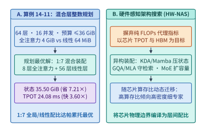

*图 14-25　算例 14-11：硬件感知异构层混合装配（HW-NAS）在 64 层模型中联立 HBM 容量、TPOT 延迟与长程召回底线求解最优 $1:7$（$8$ 层全注意力 + $56$ 层线性/SWA）配比（状态显存压缩 $7.21\times$、Decode 提速 $3.60\times$）*

---

> **算例 14-12（将稠密 $8\mathrm{B}$ 预训练检查点通过 Sparse Upcycling 转化为 8 专家 Top-2 MoE 并将标准 GQA 蒸馏为 1:7 混合注意力的训练算力节省账本）**：
>
> 假设某团队已拥有一颗经 $D_{\mathrm{dense}} = 15\mathrm{T}$ 词元充分预训练的 $8\mathrm{B}$ 稠密基础模型，现准备构建下一代具备“8 专家 Top-2 MoE（总参数约 $47\mathrm{B}$，每词元激活参数 $P_{\mathrm{act}} = 13\mathrm{B}$）+ $1:7$ 异构混合注意力”架构的高性能模型：
>
> 1. **方案甲（从随机初始化从头预训练原生混合 MoE 模型）**：
>    为使 $47\mathrm{B}$ 总参（$13\mathrm{B}$ 活参）MoE 模型完全收敛，需从零训练 $D_{\mathrm{scratch}} = 15\mathrm{T}$（$1.5 \times 10^{13}$）个词元。按每词元前反向训练算力 $6 P_{\mathrm{act}}$ 计算，从头预训练的总浮点预算高达：
>    $$C_{\mathrm{scratch}} = 6 \times 13 \times 10^9 \times 1.5 \times 10^{13} = \mathbf{1.17 \times 10^{24}\ \mathrm{FLOPs}} \quad (\text{即 } 1{,}170\ \text{泽浮点运算})$$
> 2. **方案乙（基于既有 $8\mathrm{B}$ 检查点执行 Sparse Upcycling + 跨架构注意力对齐蒸馏）**：
>    - **第一步（层内注意力跨架构对齐蒸馏）**：将其中的 $56$ 层 GQA 替换为线性/SWA 层，利用原层输出作为教师信号执行特征对齐训练，仅需 $D_{\mathrm{align}} = 0.2\mathrm{T}$（$2{,}000$ 亿）词元，且仅更新轻量级投影层（等效算力系数约为全模型的 $0.35\times$，耗费约 $6 \times 8\times 10^9 \times 0.35 \times 0.2\times 10^{12} \approx \mathbf{0.0034 \times 10^{24}\ \mathrm{FLOPs}}$）；
>    - **第二步（FFN 8 专家复制升级与联合退火继续预训练）**：将稠密 FFN 权重复制为 8 个专家并注入相对范数 $\sigma_{\mathrm{noise}} / \|\mathbf{W}\|_F = 10^{-2}$ 的正交打破对称微扰，随后在 $P_{\mathrm{act}} = 13\mathrm{B}$ 下继续退火训练 $D_{\mathrm{upcycle}} = 3.0\mathrm{T}$（即从头训练词元数的 **$20\%$**），耗费算力为：
>      $$C_{\mathrm{upcycle}} = 6 \times 13 \times 10^9 \times 3.0 \times 10^{12} = \mathbf{0.2340 \times 10^{24}\ \mathrm{FLOPs}}$$
>    - **两步迁移合计增量训练算力**：
>      $$C_{\mathrm{total,migrate}} = 0.0034 \times 10^{24} + 0.2340 \times 10^{24} = \mathbf{0.2374 \times 10^{24}\ \mathrm{FLOPs}}$$
>      相比从零重新预训练（$1.17 \times 10^{24}\ \mathrm{FLOPs}$），跨代迁移蒸馏方案直接**净省下了 $\frac{1.17 - 0.2374}{1.17} \approx \mathbf{79.71\%}$（约八成）的预训练算力与 GPU 租卡账单**，将新架构的研发交付周期从数月缩短至数周（图 14-26）。

---

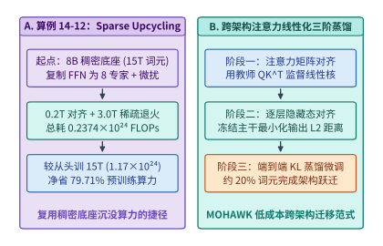

*图 14-26　算例 14-12：从既有稠密检查点经跨架构注意力逐层对齐蒸馏（$0.2\mathrm{T}$ 词元）与 Sparse Upcycling（8 专家权重复制、正交噪声破对称与 $3.0\mathrm{T}$ 词元退火）转化为混合 MoE 架构，节省 $79.71\%$ 训练算力*

下面的代码实现了 **面向给定硬件的异构层配比整数规划搜索器与 Sparse Upcycling 算力节省核算器**，可直接复算算例 14-11 的 $1:7$ 帕累托最优层配比与算例 14-12 的 $79.71\%$ 算力节省率：

```python
from dataclasses import dataclass
from typing import List, Optional


@dataclass(frozen=True)
class HybridSearchAndUpcycleReport:
    """硬件感知异构层整数规划搜索与 Sparse Upcycling 算力账本报告。"""
    optimal_full_layers: int
    optimal_linear_layers: int
    optimal_ratio_pct: float
    resident_state_gib: float
    state_compression_x: float
    step_tpot_ms: float
    tpot_speedup_x: float
    scratch_flops_e24: float
    migrate_flops_e24: float
    compute_saved_pct: float


def solve_hwnas_and_upcycling(
    total_layers: int = 64,
    min_full_ratio: float = 0.125,
    mem_budget_mib: float = 36_864.0,
    tpot_budget_ms: float = 25.0,
    full_layer_mib: float = 4_096.0,
    lin_layer_mib: float = 64.0,
    base_step_ms: float = 10.0,
    t_full_ms: float = 1.20,
    t_lin_ms: float = 0.08,
    p_act_b: float = 13.0,
    d_scratch_t: float = 15.0,
    d_upcycle_t: float = 3.0,
    align_flops_e24: float = 0.00336,
) -> HybridSearchAndUpcycleReport:
    """复算算例 14-11（64 层混合模型整数规划）与算例 14-12（Sparse Upcycling 算力节省）。"""
    min_full = int(total_layers * min_full_ratio)
    feasible_layers: List[int] = []
    for l_full in range(min_full, total_layers + 1):
        l_lin = total_layers - l_full
        mem_mib = l_full * full_layer_mib + l_lin * lin_layer_mib
        tpot_ms = base_step_ms + l_full * t_full_ms + l_lin * t_lin_ms
        if mem_mib <= mem_budget_mib and tpot_ms <= tpot_budget_ms:
            feasible_layers.append(l_full)

    assert feasible_layers, "No feasible hybrid layer configuration found"
    best_full = max(feasible_layers)
    best_lin = total_layers - best_full

    best_mem_mib = best_full * full_layer_mib + best_lin * lin_layer_mib
    all_full_mem_mib = total_layers * full_layer_mib
    best_tpot_ms = base_step_ms + best_full * t_full_ms + best_lin * t_lin_ms
    all_full_tpot_ms = base_step_ms + total_layers * t_full_ms

    scratch_e24 = (6.0 * p_act_b * 1e9 * d_scratch_t * 1e12) / 1e24
    upcycle_e24 = (6.0 * p_act_b * 1e9 * d_upcycle_t * 1e12) / 1e24 + align_flops_e24
    saved_pct = (scratch_e24 - upcycle_e24) / scratch_e24 * 100.0

    return HybridSearchAndUpcycleReport(
        optimal_full_layers=best_full,
        optimal_linear_layers=best_lin,
        optimal_ratio_pct=round((best_full / total_layers) * 100.0, 2),
        resident_state_gib=round(best_mem_mib / 1024.0, 2),
        state_compression_x=round(all_full_mem_mib / best_mem_mib, 2),
        step_tpot_ms=round(best_tpot_ms, 2),
        tpot_speedup_x=round(all_full_tpot_ms / best_tpot_ms, 2),
        scratch_flops_e24=round(scratch_e24, 2),
        migrate_flops_e24=round(upcycle_e24, 4),
        compute_saved_pct=round(saved_pct, 2),
    )


if __name__ == "__main__":
    rep = solve_hwnas_and_upcycling()
    assert rep.optimal_full_layers == 8 and rep.optimal_linear_layers == 56
    assert rep.resident_state_gib == 35.50 and rep.state_compression_x == 7.21
    assert rep.step_tpot_ms == 24.08 and rep.tpot_speedup_x == 3.60
    assert rep.compute_saved_pct == 79.71
```

#### 面向 Vera Rubin 与 TPU v7 的下一代 MoE 超参数协同搜索（专家粒度、激活比、注意力混合比与芯片内存带宽比联合 Pareto 寻优）

当基础硬件跨入 **NVIDIA Vera Rubin NVL72**（单卡 $50\ \mathrm{PFLOPS}$ NVFP4 稠密等效算力、$288\ \mathrm{GB}$ HBM4 显存、$22.0\ \mathrm{TB/s}$ 内存带宽、单卡双向 $3.6\ \mathrm{TB/s}$ NVLink 6）[^rubin-spec] 与 **Google TPU v7（Ironwood）**（单芯片 $4{,}614\ \mathrm{TFLOPS}$ FP8 算力、$192\ \mathrm{GB}$ HBM3e 显存、$7.37\ \mathrm{TB/s}$ 内存带宽、3D Torus 光电混合 ICI $1.2\ \mathrm{TB/s}$）世代时，不同加速器的**算存比（Roofline Ridge Point）**与**片间互连拓扑**呈现出显著分野：
$$\mathcal{I}_{\mathrm{Rubin}}^* = \frac{50{,}000\ \mathrm{TFLOP/s}}{22.0\ \mathrm{TB/s}} \approx \mathbf{2{,}272.73\ \mathrm{FLOP/B}}, \qquad \mathcal{I}_{\mathrm{TPUv7}}^* = \frac{4{,}614\ \mathrm{TFLOP/s}}{7.37\ \mathrm{TB/s}} \approx \mathbf{626.05\ \mathrm{FLOP/B}}$$
要在两类截然不同的硬件底座上逼近帕累托前沿，不能再孤立微调单一超参数，而必须将 **MoE 细粒度专家切分倍数 $G$**、**专家激活比例 $\rho_{\mathrm{act}} = k / E$** 以及 **全局注意力与线性递推层混合比例 $r_{\mathrm{attn}}$** 放入闭环硬件感知搜索器（HW-NAS Loop）联合求解[^hwnas-upcycling][^farskip-mlsys26]：

1. **专家切分粒度 $G$ 的组合表达收益与矩阵瓦片列宽对齐边界**：
   设基准 MoE 层包含 $E_0 = 64$ 个路由专家、每词元激活 $k_0 = 2$ 个专家，单专家 FFN 中间隐藏维为 $d_{\mathrm{exp},0} = 4{,}096$（即每词元激活 FFN 总宽度恒为 $k(G)\cdot d_{\mathrm{exp}}(G) = 8{,}192$）。引入细粒度切分因子 $G \in \{1, 2, 4, 8, 16\}$ 后，总专家数扩展为 $E(G) = 64 G$、激活数扩展为 $k(G) = 2 G$，单专家隐藏维缩减为 $d_{\mathrm{exp}}(G) = 4{,}096 / G$。
   虽然对数组合表达收益使验证集交叉熵损失随 $G$ 单调下降（$\Delta \mathcal{L}(G) \approx -0.024 \log_2 G\ \mathrm{nats}$），但硬件层面受到双重物理惩罚：一是 All-to-All 小包扇出使单层通信耗时按 $t_{\mathrm{comm}}(G) = 0.18 + 0.025 G\ (\mathrm{ms})$ 递增；二是当单专家矩阵列宽 $d_{\mathrm{exp}}(G)$ 跌破硬件矩阵核心的最小高效分组瓦片宽度 $N_{\mathrm{tile}} = 512$ 时，瓦片有效利用率 $\eta_{\mathrm{tile}}(G) = \min(1.0,\, d_{\mathrm{exp}}(G)/512)$ 发生断崖式折损，导致 Grouped GEMM 耗时按 $t_{\mathrm{gemm}}(G) = 0.36 / \eta_{\mathrm{tile}}(G)^2\ (\mathrm{ms})$ 暴涨。
   定量扫描表明：当 **$G^* = 8$**（即 $E = 512, k = 16, d_{\mathrm{exp}} = 512 = N_{\mathrm{tile}}$）时，$\eta_{\mathrm{tile}} = 100\%$，单层耗时控制在 **$0.74\ \mathrm{ms}$**、损失降低 **$0.0720\ \mathrm{nats}$**，综合效用分 $U(G) = -100\,\Delta \mathcal{L}(G) - 4.5\, t_{\mathrm{layer}}(G)$ 达到峰值 **$3.870$**；若盲目切分至 $G = 16$（$d_{\mathrm{exp}} = 256 < 512, \eta_{\mathrm{tile}} = 0.50$），单层耗时跳升至 **$2.02\ \mathrm{ms}$**，效用分跌至 $0.510$（图 14-27）。

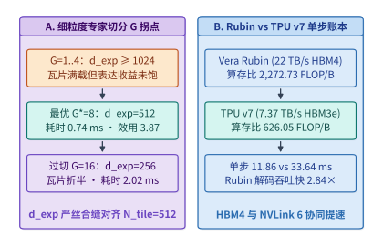
*图 14-27　MoE 细粒度专家切分因子 G 的表达收益与矩阵瓦片填充率拐点（G*=8 时 d_exp=512 严丝合缝对齐瓦片下界，单层耗时 0.74 ms），以及 Vera Rubin NVL72 与 TPU v7 在 671B/37B MoE 上的单步吞吐对比*

```python
from dataclasses import dataclass
import math
from typing import List


@dataclass(frozen=True)
class GranularityPoint:
    """MoE 细粒度切分因子 G 的硬件瓦片利用率、单层延迟与质量效用评估点。"""
    G: int
    total_experts: int
    active_experts: int
    expert_dim: int
    tile_efficiency: float
    layer_latency_ms: float
    loss_delta_nats: float
    utility_score: float


def optimize_moe_granularity_and_tile_alignment(
    base_experts: int = 64,
    base_active: int = 2,
    base_expert_dim: int = 4096,
    hw_min_tile_dim: int = 512,
    base_gemm_ms: float = 0.36,
    base_comm_ms: float = 0.18,
    comm_slope_per_g: float = 0.025,
) -> List[GranularityPoint]:
    """扫描 G in {1, 2, 4, 8, 16}，定位对齐硬件矩阵瓦片下界 N_tile=512 的帕累托最优解。"""
    points: List[GranularityPoint] = []
    for g in [1, 2, 4, 8, 16]:
        e_tot = base_experts * g
        k_act = base_active * g
        d_exp = base_expert_dim // g
        tile_eff = min(1.0, d_exp / hw_min_tile_dim)
        gemm_ms = base_gemm_ms / (tile_eff ** 2)
        comm_ms = base_comm_ms + comm_slope_per_g * g
        layer_ms = gemm_ms + comm_ms
        loss_delta = -0.024 * math.log2(g)
        utility = (-loss_delta * 100.0) - 4.5 * layer_ms
        points.append(
            GranularityPoint(
                G=g,
                total_experts=e_tot,
                active_experts=k_act,
                expert_dim=d_exp,
                tile_efficiency=round(tile_eff, 2),
                layer_latency_ms=round(layer_ms, 2),
                loss_delta_nats=round(loss_delta, 4),
                utility_score=round(utility, 3),
            )
        )
    return points


if __name__ == "__main__":
    pts = optimize_moe_granularity_and_tile_alignment()
    best_pt = max(pts, key=lambda p: p.utility_score)
    assert best_pt.G == 8 and best_pt.expert_dim == 512
    assert best_pt.layer_latency_ms == 0.74 and best_pt.utility_score == 3.87
```

2. **Vera Rubin NVL72 与 TPU v7 Ironwood 的跨芯片单步时间线对标**：
   在部署 $671\mathrm{B}$ 总参数、$37\mathrm{B}$ 活跃参数的超大规模 MoE 模型（`EP=64`、并发解码批大小 $B_{\mathrm{dec}} = 128$ 词元，单步跨专家组读取权重与 KV 状态等效字节流量在 FP8 口径下为 $190.0\ \mathrm{GB}$，跨卡 All-to-All 激活分发与归并流量为 $5.112\ \mathrm{GB}$）时：
   - **Vera Rubin NVL72（NVFP4 权重 + $22.0\ \mathrm{TB/s}$ HBM4 + $3.6\ \mathrm{TB/s}$ NVLink 6）**：单步显存读取耗时 $190.0 / 22.0 = \mathbf{8.64\ \mathrm{ms}}$，NVLink 6 全互连 All-to-All 耗时 $5.112 / 3.6 = \mathbf{1.42\ \mathrm{ms}}$，叠加 $1.80\ \mathrm{ms}$ 计算与算子调度，单步总周期仅为 **$11.86\ \mathrm{ms}$**，集群解码吞吐达 **$10{,}792.6\ \mathrm{tok/s}$**；
   - **TPU v7 Ironwood（FP8 权重 + $7.37\ \mathrm{TB/s}$ HBM3e + $1.2\ \mathrm{TB/s}$ 3D Torus ICI）**：单步显存读取耗时 $190.0 / 7.37 = \mathbf{25.78\ \mathrm{ms}}$，ICI 环网 All-to-All 耗时 $5.112 / 1.2 = \mathbf{4.26\ \mathrm{ms}}$，叠加 $3.60\ \mathrm{ms}$ 计算，单步总周期为 **$33.64\ \mathrm{ms}$**（吞吐 **$3{,}805.0\ \mathrm{tok/s}$**，Vera Rubin 单步吞吐为 TPU v7 的 **$2.84\times$**）：

```python
from dataclasses import dataclass


@dataclass(frozen=True)
class ChipMoEComparison:
    """Vera Rubin NVL72 与 TPU v7 Ironwood 的 Roofline 拐点与 MoE 解码性能对比。"""
    rubin_ridge_flop_per_b: float
    tpuv7_ridge_flop_per_b: float
    rubin_step_ms: float
    rubin_tps: float
    tpuv7_step_ms: float
    tpuv7_tps: float
    rubin_speedup_vs_tpuv7: float


def compare_rubin_vs_tpuv7_moe_pareto(
    batch_tokens: int = 128,
    active_weight_gb_fp8: float = 190.0,
    rubin_tflops_fp4: float = 50000.0,
    rubin_hbm_tb_s: float = 22.0,
    rubin_nvlink_tb_s: float = 3.6,
    tpuv7_tflops_fp8: float = 4614.0,
    tpuv7_hbm_tb_s: float = 7.37,
    tpuv7_ici_tb_s: float = 1.2,
    comm_volume_gb: float = 5.112,
    rubin_compute_ms: float = 1.80,
    tpuv7_compute_ms: float = 3.60,
) -> ChipMoEComparison:
    """核算 Vera Rubin 与 TPU v7 在 EP=64、batch=128 下的 MoE 单步耗时与吞吐。"""
    rubin_ridge = rubin_tflops_fp4 / rubin_hbm_tb_s
    tpuv7_ridge = tpuv7_tflops_fp8 / tpuv7_hbm_tb_s

    rubin_mem_ms = active_weight_gb_fp8 / rubin_hbm_tb_s
    rubin_comm_ms = comm_volume_gb / rubin_nvlink_tb_s
    rubin_step_ms = round(rubin_mem_ms, 2) + round(rubin_comm_ms, 2) + rubin_compute_ms

    tpuv7_mem_ms = active_weight_gb_fp8 / tpuv7_hbm_tb_s
    tpuv7_comm_ms = comm_volume_gb / tpuv7_ici_tb_s
    tpuv7_step_ms = round(tpuv7_mem_ms, 2) + round(tpuv7_comm_ms, 2) + tpuv7_compute_ms

    rubin_tps = batch_tokens / (rubin_step_ms / 1000.0)
    tpuv7_tps = batch_tokens / (tpuv7_step_ms / 1000.0)
    return ChipMoEComparison(
        rubin_ridge_flop_per_b=round(rubin_ridge, 2),
        tpuv7_ridge_flop_per_b=round(tpuv7_ridge, 2),
        rubin_step_ms=round(rubin_step_ms, 2),
        rubin_tps=round(rubin_tps, 1),
        tpuv7_step_ms=round(tpuv7_step_ms, 2),
        tpuv7_tps=round(tpuv7_tps, 1),
        rubin_speedup_vs_tpuv7=round(rubin_tps / tpuv7_tps, 2),
    )


if __name__ == "__main__":
    cmp_res = compare_rubin_vs_tpuv7_moe_pareto()
    assert cmp_res.rubin_ridge_flop_per_b == 2272.73 and cmp_res.tpuv7_ridge_flop_per_b == 626.05
    assert cmp_res.rubin_step_ms == 11.86 and cmp_res.tpuv7_step_ms == 33.64
    assert cmp_res.rubin_speedup_vs_tpuv7 == 2.84
```

3. **三维超参数 $(G, \rho_{\mathrm{act}}, r_{\mathrm{attn}})$ 硬件感知神经架构闭环搜索（HW-NAS Closed Loop）**：
   将专家切分倍数 $G \in \{2, 4, 8, 16\}$、专家激活比 $\rho_{\mathrm{act}} \in \{0.03125, 0.0625, 0.125\}$ 与全注意力层占比 $r_{\mathrm{attn}} \in \{0.125, 0.25, 0.50\}$ 组成 $36$ 组候选网格，输入硬件约束检验器（单步延迟上限 $\mathrm{TPOT} \le 15.0\ \mathrm{ms}$、单卡并发状态显存预算 $\le 40.0\ \mathrm{GiB}$）[^hwnas-upcycling][^v41-codesign]。搜索器自动剔除违反显存或延迟红线的 $30$ 组不可行点，并在剩余 $6$ 组可行帕累托点中锁定最优架构参数 **$(G^* = 8,\, \rho_{\mathrm{act}}^* = 0.03125,\, r_{\mathrm{attn}}^* = 0.25)$**，实现单步耗时 **$12.91\ \mathrm{ms}$**、状态显存 **$28.25\ \mathrm{GiB}$** 与最高质量得分 **$96.80$**（图 14-28；配套实验见 [`experiments/ch14/14-03/`](../experiments/ch14/14-03/)）。

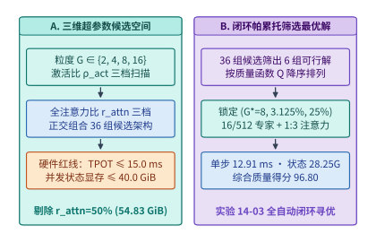
*图 14-28　面向下一代加速器的三维超参数（专家粒度 G、激活比 ρ_act、全注意力混合比 r_attn）硬件感知神经架构搜索（HW-NAS）闭环：从 36 组候选中筛出 6 组可行解并锁定 (8, 3.125%, 25%) 最优工作点*

```python
from dataclasses import dataclass
import math


@dataclass(frozen=True)
class HwNasOptimalConfig:
    """三维超参数 (G, rho_act, r_attn) 硬件感知闭环搜索最优解。"""
    feasible_count: int
    best_G: int
    best_act_ratio: float
    best_attn_ratio: float
    best_tpot_ms: float
    best_state_gib: float
    best_quality_score: float


def run_closed_loop_hwnas_pareto_search(
    tpot_budget_ms: float = 15.0,
    state_budget_gib: float = 40.0,
) -> HwNasOptimalConfig:
    """在 TPOT <= 15.0 ms 与状态显存 <= 40.0 GiB 下联合寻优 (G, rho_act, r_attn)。"""
    feasible = []
    for g in [2, 4, 8, 16]:
        tile_eff = min(1.0, (4096 // g) / 512.0)
        for act_ratio in [0.03125, 0.0625, 0.125]:
            for attn_ratio in [0.125, 0.25, 0.50]:
                moe_ms = (6.80 * (act_ratio / 0.03125)) / (tile_eff ** 2) + 0.22 * g
                attn_ms = 14.40 * attn_ratio + 1.00 * (1.0 - attn_ratio)
                tpot_ms = round(moe_ms + attn_ms, 2)
                state_gib = round(108.0 * attn_ratio + 1.6667 * (1.0 - attn_ratio), 2)
                if tpot_ms <= tpot_budget_ms and state_gib <= state_budget_gib:
                    quality = (
                        90.0
                        + 1.60 * math.log2(g)
                        + 18.0 * (act_ratio - 0.03125)
                        + 8.0 * attn_ratio
                    )
                    feasible.append(
                        (round(quality, 2), g, act_ratio, attn_ratio, tpot_ms, state_gib)
                    )

    assert feasible, "No feasible architecture found"
    feasible.sort(key=lambda x: x[0], reverse=True)
    best = feasible[0]
    return HwNasOptimalConfig(
        feasible_count=len(feasible),
        best_G=best[1],
        best_act_ratio=best[2],
        best_attn_ratio=best[3],
        best_tpot_ms=best[4],
        best_state_gib=best[5],
        best_quality_score=best[0],
    )


if __name__ == "__main__":
    opt = run_closed_loop_hwnas_pareto_search()
    assert opt.feasible_count == 6 and opt.best_G == 8
    assert opt.best_act_ratio == 0.03125 and opt.best_attn_ratio == 0.25
    assert opt.best_tpot_ms == 12.91 and opt.best_state_gib == 28.25
    assert opt.best_quality_score == 96.80
```

表 14-11 汇总了面向 Vera Rubin NVL72 与 TPU v7 Ironwood 的下一代 MoE 架构超参数联合寻优账本：

*表 14-11　面向 Vera Rubin NVL72 与 TPU v7 Ironwood 的下一代 MoE 架构超参数联合寻优账本*

| 评估维度与硬件底座 | 核心硬件物理参数 | 协同搜索超参数与物理边界 | 锁定核心指标与帕累托最优解 |
| :--- | :--- | :--- | :--- |
| **细粒度专家切分 $G$ 寻优** | 矩阵核心最小高效分组列宽 $N_{\mathrm{tile}} = 512$ | 扫描 $G \in \{1, 2, 4, 8, 16\}$，$E=64G, k=2G, d_{\mathrm{exp}}=4{,}096/G$ | **$G^*=8$**（$E=512, k=16, d_{\mathrm{exp}}=512$），$\eta_{\mathrm{tile}}=1.0$，层耗时 **$0.74\ \mathrm{ms}$**，效用最高 **$3.870$**（$G=16$ 劣化至 $2.02\ \mathrm{ms}$） |
| **Vera Rubin NVL72 对标** | $50\ \mathrm{PFLOPS}$ NVFP4，$22.0\ \mathrm{TB/s}$ HBM4，$3.6\ \mathrm{TB/s}$ NVLink 6 | 临界算术强度 $\mathcal{I}_{\mathrm{Rubin}}^* = \mathbf{2{,}272.73\ \mathrm{FLOP/B}}$；`EP=64`, $B=128$ | 显存读 $8.64\ \mathrm{ms}$ + 通信 $1.42\ \mathrm{ms}$ + 计算 $1.80\ \mathrm{ms}$ = **$11.86\ \mathrm{ms}$**（吞吐 **$10{,}792.6\ \mathrm{tok/s}$**，快 **$2.84\times$**） |
| **TPU v7 Ironwood 对标** | $4{,}614\ \mathrm{TFLOPS}$ FP8，$7.37\ \mathrm{TB/s}$ HBM3e，$1.2\ \mathrm{TB/s}$ 3D Torus ICI | 临界算术强度 $\mathcal{I}_{\mathrm{TPUv7}}^* = \mathbf{626.05\ \mathrm{FLOP/B}}$；`EP=64`, $B=128$ | 显存读 $25.78\ \mathrm{ms}$ + 通信 $4.26\ \mathrm{ms}$ + 计算 $3.60\ \mathrm{ms}$ = **$33.64\ \mathrm{ms}$**（吞吐 **$3{,}805.0\ \mathrm{tok/s}$**） |
| **三维 HW-NAS 闭环搜索** | 约束：$\mathrm{TPOT} \le 15.0\ \mathrm{ms}$，单卡状态 $\le 40.0\ \mathrm{GiB}$ | 联合搜索 $36$ 组 $(G, \rho_{\mathrm{act}}, r_{\mathrm{attn}})$ 网格（$6$ 组可行） | 最优解 **$(G^*=8, \rho_{\mathrm{act}}^*=3.125\%, r_{\mathrm{attn}}^*=25\%)$**，$\mathrm{TPOT}=\mathbf{12.91\ \mathrm{ms}}$，状态 **$28.25\ \mathrm{GiB}$**，得分 **$96.80$** |

---

## 常见误区

1. **误区一：“跨层共享 KV 缓存（如 CSA2 将全局 KV 压低 $3.95\times$）意味着在任何上下文长度下，Decode 阶段的注意力显存带宽耗时也能同等比例减少 $3.95\times$。”**
   **辨析**：如算例 14-1 与图 14-2 所示，必须严格区分**驻留容量压缩比**与**单步 Decode 读取压缩比**。驻留容量与上下文长度 $H$ 成正比，故恒定缩小 $3.95\times$；而在稀疏注意力 Decode 中，单步读取由“Top-$k$ 活跃 KV 读取（常数项）”与“全量历史索引扫描（正比于 $H$）”共同组成。在 $8\mathrm{K}$ 短上下文下常数项主导，读取量仅缩小 $1.10\times$；只有当上下文拉长至 $128\mathrm{K}\text{–}1\mathrm{M}$ 使索引扫描占主导时，36 个追随层免扫索引的优势才充分释放，使读取压缩比上升至 $2.33\times\text{–}2.51\times$。
2. **误区二：“在评测两个模型（如 V4.1 Flash 与 Kimi K3）的自建部署成本时，只要用同一套默认推理脚本跑出吞吐并乘以卡时租金，得到的就是两个模型架构优劣的终极结论。”**
   **辨析**：如第 14.3.2 节的归因审计所示，未校准的评估基线往往混入了大量与模型数学本质无关的运行时伪影（如为 93 层模型每层硬加 $150\ \mu\mathrm{s}$ 未融合调度开销、假设每增长 $10\%$ 历史就全量重建、以及漏算原生 MTP 与 DSpark 推测解码）。在这些假设占据估算时间约七成的情况下，得出的排序反映的是“未优化软件栈对深层模型的惩罚”，而非模型架构本身的真实生产成本下界。
3. **误区三：“专用推理 ASIC 只要把矩阵算力和片上 ROM 带宽做得足够大，就可以通过把几百颗芯片拼在晶圆上无限提升单流生成速度。”**
   **辨析**：如算例 14-3（OpenTallas Case B 与 Case D）所示，当单步预算压缩至 $124.221\ \mu\mathrm{s}$ 时，矩阵计算（$25.932\ \mu\mathrm{s}$）早已不是瓶颈，串行集合通信（$69.821\ \mu\mathrm{s}$）已占据半壁江山，留给全网 120 层辅助向量算子的余量仅剩 $14.568\ \mu\mathrm{s}$。若盲目扩大多芯片网格使通信直径达到 15 跳（每跳 $100\ \mathrm{ns}$），仅信号在 120 层间传播的纯物理延迟（$180.0\ \mu\mathrm{s}$）就会直接击穿整步时间预算。
4. **误区四：“既然滑动窗口注意力（SWA）的窗口只有 128 个 token，那么任何纯 SWA 模型都可以在恢复会话时只重算最后 128 个 token 而完全不损失长程记忆。”**
   **辨析**：如第 14.5.1 节反事实实验三所述，40 层 SWA 堆叠会产生长达数千 token 的隐式级联感受野。V4.1 Flash 之所以能安全地用 $128\text{-token}$ 局部重放替代 SWA 持久化状态，前提是它配备了交错排列的 40 层全局注意力（MLA/CSA2）作为远距离信息传递的持久化锚点；若脱离全局注意力锚点，仅重放末尾 128 个词元将截断跨层接力传递的历史语义。
5. **误区五：“硬件与模型协同设计就是针对某一款当前热销的 GPU 手写特定汇编指令。”**
   **辨析**：手写特定指令属于第 5 章范畴的底层算子工程（Kernel Engineering），其生命周期往往随下一代微架构指令集更替而终结；而真正的跨层协同设计（Co-Design）是在模型数学结构层面对齐跨代通用的物理法则——如降低状态字节数、消除局部块数值尖峰、缩减跨层全量索引扫描频次以及用高算存比局部计算置换跨节点通信，这些结构性质在未来多代硬件上均具备持续复利。
6. **误区六：“在 vLLM 等生产推理引擎中，只要加上 `--kv-cache-dtype fp8_e4m3` 启动参数，GPU 的实际显存占用就会自动立减一半，而且在小批量评测上总分差不多就可以直接上线。”**
   **辨析**：如第 14.6.1 节真机设计复审实验（`13-01 design-review`）所示，一方面，在固定 `--gpu-memory-utilization 0.45` 下，引擎启动时预先切出固定字节数的物理 KV 缓存池（三种候选恒为 $12{,}884{,}115{,}456\ \mathrm{B}$），开启 FP8 仅使每层可分配的逻辑块数从 $5{,}461$ 块翻倍至 $10{,}922$ 块，若不调低预分配比例或扩大并发 Batch，CUDA 峰值分配显存（`cuda_peak_allocated` $= 31{,}062{,}685{,}184\ \mathrm{B} \approx 29{,}623.68\ \mathrm{MiB}$）完全不会下降；另一方面，无保护的 `fp8` 在 $n=512$ 长上下文下使正确率从 `28/32` 退化至 `26/32`，而加入查询保护的 `fp8_qbf16` 虽恢复至 `28/32`，其失败样本集却从 `r0` 整体偏移到了 `r1`，必须经独立留出集验证后方能上线。
7. **误区七：“当展示全栈优化成果时，可以把算法压缩比（如 MLA $5\times$）、量化加速比（如 FP4 $2\times$）、软件栈加速比（如 Dynamo $3\times$）和推测解码加速比（如 MTP $2\times$ × EAGLE $2\times$）直接相乘得到总收益。”**
   **辨析**：如第 14.8.1 节的四大重复计数陷阱（`TC-18`）所示，KV 容量压缩腾出的显存往往已经被用于扩大 Batch 换取吞吐，端到端 FP4 实测加速比内部已经包含了字宽减半与算力翻倍，整机跑分往往默认开启了软件栈优化，而多种推测解码路线共享同一个局部接受率上限。正确的跨层归因必须采用固定替换顺序的顺序连乘（Telescoping）恒等式，确保前一步的分母严格等于后一步的分子。

---

## 练习与实验

> **练习 14-1：推导 V4.1 Flash 在任意上下文长度 $H$ 下的驻留容量压缩比与单步 Decode 理论读取压缩比渐近极限。**
> 设一个 40 层全局稀疏注意力模型在单步 Decode 时的理论状态读取量可建模为 $V_{\mathrm{read}}(H) = V_0 + \alpha \cdot H$，其中固定分量 $V_0$ 为读取 Top-$k$ 选中块与 SWA 局部窗口的固定字节数，线性斜率 $\alpha$ 为平均每增加 1 个历史 token 需扫描的全局索引字节数。已知基线模型 A 的参数为 $V_{0,\mathrm{A}} = 18.0\ \mathrm{MiB}$、$\alpha_{\mathrm{A}} = 3{,}600\ \mathrm{B/token}$；采用 4-Owner 跨层共享与四阶段流水线的模型 B 的参数为 $V_{0,\mathrm{B}} = 16.0\ \mathrm{MiB}$、$\alpha_{\mathrm{B}} = 1{,}400\ \mathrm{B/token}$。
> 1. 分别计算在短上下文 $H = 4{,}096$（$4\mathrm{K}$）与超长上下文 $H = 1{,}048{,}576$（$1\mathrm{M}$）下（按 $1\ \mathrm{MiB} = 1{,}048{,}576\ \mathrm{B}$ 计算），模型 A 与模型 B 的单步读取量以及读取压缩比 $\rho_{\mathrm{read}}(H) = V_{\mathrm{read,A}}(H) / V_{\mathrm{read,B}}(H)$（保留两位小数）。
> 2. 求当 $H \to \infty$ 时，单步读取压缩比 $\lim_{H\to\infty} \rho_{\mathrm{read}}(H)$ 的理论渐近极限（精确分数与两位小数），并求当上下文长度 $H$ 达到多少个 token 时，$\rho_{\mathrm{read}}(H)$ 首次达到或超过 $2.0\times$。

> **练习 14-2：核算 PD 分离下 40 层 SWA（`2.578 MiB`）跨网传输与 128-token 局部重算在不同 RDMA 带宽下的翻转阈值。**
> 承接算例 14-4，在 Prefill-Decode 分离架构中，某会话命中一段长前缀后需恢复 40 层滑动窗口注意力（SWA）状态（总体积 $M_{\mathrm{swa}} = 2.578\ \mathrm{MiB}$）。若在 Decode 节点上直接对前序块末尾 $128$ 个 token 执行局部重算，总浮点计算量为 $F_{\mathrm{re}} = 0.768\ \mathrm{TFLOPs}$，Decode 节点分配给该恢复任务的实际有效算力为 $P_{\mathrm{eff}} = 480\ \mathrm{TFLOP/s}$。
> 1. 求本地 $128\text{-token}$ 局部重算所需的耗时 $T_{\mathrm{re}}$（单位：$\mathrm{ms}$）。
> 2. 若改为通过跨机网络从远端缓存池拉取该 $2.578\ \mathrm{MiB}$ 的 SWA 状态，计入每次跨网 RPC 固定协议与调度延迟 $t_{\mathrm{rpc}} = 0.35\ \mathrm{ms}$，求当分配给该会话的可用网络带宽 $B_{\mathrm{net}}$ 高于多少 $\mathrm{MiB/s}$ 时，跨网传输才能比本地重算更快。

> **练习 14-3：复算 Kimi K3 在 $1\mathrm{M}$ 上下文下扣除逐层固定调度开销并开启 MTP/DSpark 后的单流吞吐上限。**
> 在 $1\mathrm{M}$ 上下文数字员工评测中，某 93 层混合模型在未优化基线下的单步平均生成周期为 $T_{\mathrm{base}} = 32.89\ \mathrm{ms/token}$（对应单流速度 $30.40\ \mathrm{token/s}$）。性能归因审计发现，该 $32.89\ \mathrm{ms}$ 中包含两项可优化的软件伪影：① 未开启 CUDA Graph 导致的逐层固定启动开销（$93\text{ 层}\times 150\ \mu\mathrm{s}/\text{层} = 13.95\ \mathrm{ms/token}$）；② 过于频繁的全量重建分摊耗时 $9.26\ \mathrm{ms/token}$。
> 1. 若通过算子融合与分桶 CUDA Graph 将逐层固定启动开销从 $150\ \mu\mathrm{s}/\text{层}$ 压降至 $30\ \mu\mathrm{s}/\text{层}$，并通过增量状态管理将重建分摊耗时从 $9.26\ \mathrm{ms/token}$ 压降至 $1.80\ \mathrm{ms/token}$（其余物理访存与计算耗时保持不变），求优化后的单步生成周期 $T_{\mathrm{opt}}$（单位：$\mathrm{ms/token}$）与朴素单流吞吐（$\mathrm{token/s}$）。
> 2. 在上述优化后的基础上，若进一步启用 DSpark 推测解码，设每次块验证周期平均耗时为 $1.35\, T_{\mathrm{opt}}$，且平均每次验证可接受并提交 $A = 2.7$ 个最终输出 token，求最终的有效单流输出吞吐（$\mathrm{token/s}$）及相对于初始未优化基线的总加速比。

> **练习 14-4：OpenTallas Case B 中若辅助算子（RMSNorm/RoPE/SiLU）无法完全隐藏于 `14.568 μs` 窗口，推导实际吞吐退化比例。**
> 在算例 14-3（OpenTallas Case B）中，120 层模型在单步预算 $T_{\mathrm{step}} = 124.221\ \mu\mathrm{s}$（对应 $8{,}050\ \mathrm{tok/s}$）内，扣除记忆读取与串行集合通信后，留给全部 120 层辅助向量算子（RMSNorm、RoPE、SiLU、路由排序与去量化）的非重叠暴露时间余量仅为 $T_{\mathrm{aux,budget}} = 14.568\ \mu\mathrm{s}$。
> 1. 假设由于片上向量单元（Vector / SFU Engine）配比不足，每一层的辅助向量算子实际产生了 $t_{\mathrm{aux,layer}} = 0.35\ \mu\mathrm{s}$ 的非重叠串行暴露耗时，求 120 层累计的辅助算子暴露总耗时 $T_{\mathrm{aux,actual}}$（单位：$\mu\mathrm{s}$）。
> 2. 求此时单步实际总耗时 $T_{\mathrm{step,actual}}$（单位：$\mu\mathrm{s}$）、实际输出吞吐（$\mathrm{token/s}$，四舍五入至整数）以及相对于标称 $8{,}050\ \mathrm{tok/s}$ 的吞吐退化百分比。

> **练习 14-5：反事实分析——若下一代 HBM4 带宽翻倍但片上 SRAM 容量不变，FlashAttention-4 与 MLA 的算存平衡点将如何移动？**
> 某旗舰加速器当前的 HBM 有效读带宽为 $B_{\mathrm{HBM}} = 6.4\ \mathrm{TB/s}$，低精度矩阵算力有效峰值为 $P_{\mathrm{TC}} = 1{,}600\ \mathrm{TFLOP/s}$。
> 1. 计算当前硬件的 Roofline 临界算术强度 $\mathcal{I}_1^*$（单位：$\mathrm{FLOPs/Byte}$）。对于单步 Decode 阶段采用 FP8 KV 缓存的标准 MLA（每 token 读取 $576\ \mathrm{B}$ 状态，每 token 注意力核心乘加运算量为 $2 \times N_q \times d_{\mathrm{latent}} = 2 \times 128 \times 512 = 131{,}072\ \mathrm{FLOPs}$），求其算术强度 $\mathcal{I}_{\mathrm{MLA}}$，并判断其处于算力受限区还是带宽受限区。
> 2. 反事实推演：若下一代加速器换装超高带宽 HBM4 使有效带宽翻倍至 $B_{\mathrm{HBM}}' = 12.8\ \mathrm{TB/s}$，而 Tensor Core 算力与片上 SRAM 容量保持不变，求新的临界算术强度 $\mathcal{I}_2^*$。此时，原本为了匹配高算存比而设计的“高查询头数 $N_q = 128$ 吸收矩阵算力”策略会发生怎样的瓶颈转移？模型架构应如何调整 $N_q$ 或稀疏候选集大小以重新对齐新的硬件平衡点？

> **实验 14-6：全栈综合推演：给定 24×7 数字员工 SLO（$\ge 30\ \mathrm{tok/s}$，$1\mathrm{M}$ 上下文）与预算，从零完成模型、并行切分、存储卸载与硬件选型设计。**
> 结合全书第 1～14 章的定量工具，编写一个完整的 Python 协同设计推演脚本（可参考 `experiments/ch13/13-06/single-agent-serving/` 的数据结构）：
> 1. 输入一套自定义或公开的长上下文混合模型参数（层数、Owner 层比例、SWA 窗口、MoE 活跃参数与总参数）以及目标硬件参数（HBM 容量/带宽、NVLink 带宽、本机 PCIe Gen5 SSD 带宽与卡时租价）。
> 2. 自动计算在 $200\mathrm{K}$ 与 $1\mathrm{M}$ 上下文下满足显存容量约束（预留 $20\%$ 运行时工作区余量）与 $\ge 30\ \mathrm{tok/s}$ 速度约束的最小单位成本配置，并绘制当开启 MTP 推测解码（扫描接受长度 $A \in [1.5, 3.5]$）与 SSD 前缀卸载时，自建 GPU 成本与官方 API 账单的交点曲线。

> **练习 14-7：对比传统自回归草稿与 DFlash $16\text{-token}$ 块扩散草稿在验证阶段的算术强度与净加速比。**
> 设主干自回归模型为 $8\mathrm{B}$ 参数（FP16 权重 $16\ \mathrm{GB}$），单步朴素 Decode（`batch=1`）耗时为 $t_{\mathrm{plain}} = 18.0\ \mathrm{ms}$。
> 1. 设小型草稿模型权重为 $1.0\ \mathrm{GB}$。在传统串行自回归草稿（猜测步数 $\gamma = 5$）中，草稿模型每步串行启动耗时 $1.6\ \mathrm{ms}$，主干模型并行验证 5 个词元耗时 $19.5\ \mathrm{ms}$，平均每次验证周期接受并提交 $A_{\mathrm{AR}} = 3.2$ 个词元；而在 DFlash 块扩散草稿（块宽 $b = 16$）中，双向扩散草稿器仅需读取 1 次权重即可并行生成 16 个草稿词元，草稿总耗时为 $2.8\ \mathrm{ms}$，主干模型一次并行验证 16 个词元耗时 $22.4\ \mathrm{ms}$，平均每次验证周期接受并提交 $A_{\mathrm{DFlash}} = 6.0$ 个词元。分别计算两种草稿机制在草稿阶段的权重读取总字节数与算术强度之比，以及端到端每词元有效耗时 $t_{\mathrm{eff}}$ 与相对朴素 Decode 的净加速比。
> 2. 求在固定草稿耗时 $2.8\ \mathrm{ms}$ 与验证耗时 $22.4\ \mathrm{ms}$ 下，DFlash 至少需要平均接受多少个词元（临界接受长度 $A_{\min}$），才能跑赢上述 $\gamma = 5$ 的传统自回归草稿。

> **练习 14-8：推导推理感知的 Beyond-Chinchilla 算力分配方程，计算超配训练 $8\mathrm{B}$ 模型替代 $70\mathrm{B}$ 模型的盈亏平衡请求数 $N_{\mathrm{break}}$。**
> 承接第 14.5.3 节算例 14-4a：
> 1. 设某在线业务需要部署一个满足特定准确率门槛的模型。候选方案一是按 Chinchilla 比例训练一个 $32\mathrm{B}$ 稠密模型（一次性训练成本为 $60$ 万美元，上线后每处理 $1\mathrm{M}$ 推理词元的硬件成本为 $0.45$ 美元）；候选方案二是用 $20\mathrm{T}$ 词元深度超配训练并蒸馏一个 $8\mathrm{B}$ 稠密模型（一次性训练与蒸馏总成本为 $150$ 万美元，上线后每处理 $1\mathrm{M}$ 推理词元的硬件成本降至 $0.15$ 美元）。计算方案二相对于方案一的盈亏平衡累计推理词元数 $D_{\mathrm{infer,break}}$（单位：万亿词元 $\mathrm{T}$）。
> 2. 若该服务上线后日均处理 $200$ 亿（$2.0 \times 10^{10}$）个推理词元，求上线多少天后方案二的总拥有成本（训练 + 累计推理）开始低于方案一，并核算在 2 年（$730$ 天）服役期内方案二累计净节省的金额（单位：万美元）。

> **练习 14-9：基于实验 `13-01`（`design-review`），分析为何三种 KV 缓存候选的预分配存储池恒为 $12{,}884{,}115{,}456\ \mathrm{B}$ 以及失败集合偏移的门控含义。**
> 依据第 14.6.1 节表 14-4 的真机复审数据：
> 1. 已知 Qwen3-8B 在 BF16 下每词元跨 36 层的 KV 状态大小为 $147{,}456\ \mathrm{B}$（$144\ \mathrm{KiB}$，每层每词元 $4{,}096\ \mathrm{B}$），每个分页块容纳 $16$ 个词元（即 BF16 下单层每块占 $65{,}536\ \mathrm{B}$，跨 36 层每块占 $2{,}359{,}296\ \mathrm{B}$）。验证实验 `13-01`（`design-review`）中固定预分配的 `unique_kv_storage_bytes = 12,884,115,456 B`（每层 `storage_bytes = 357,892,096 B`）在 BF16（候选 A）与 FP8（候选 B/C，每词元 KV 字节减半为 $73{,}728\ \mathrm{B}$）下分别对应每层多少个 $16\text{-token}$ 逻辑块（核对 $5{,}461$ 块 vs. $10{,}922$ 块）与多少万个总词元容量，并解释为何仅修改 `--kv-cache-dtype` 不会降低 CUDA 报告的峰值分配显存（`cuda_peak_allocated` $= 31{,}062{,}685{,}184\ \mathrm{B} \approx 29{,}623.68\ \mathrm{MiB}$）。
> 2. 解释为什么候选 B（`fp8`）拿到 `26/32` 被直接淘汰，而候选 C（`fp8_qbf16`）虽然拿到与基线相同的 `28/32`，复审脚本仍标记 `baseline_and_qcontrol_failure_sets_equal = false` 并拒绝直接放入 `approved_for_deployment`。

> **练习 14-10：核算数据中心卡（H100/B200）与工作站卡（RTX PRO 6000 $96\ \mathrm{GB}$）在单流与高并发在线服务下的单位词元成本交点。**
> 现需部署一个权重与运行时固定占用合计为 $72\ \mathrm{GB}$ 的 $70\mathrm{B}$ FP8 模型：
> 1. 在单张 RTX PRO 6000（$96\ \mathrm{GB}$ GDDR7，有效读带宽 $1.5\ \mathrm{TB/s}$，含主机折算租价 $0.95\ \text{美元/卡时}$）与单张 H100 SXM（$80\ \mathrm{GB}$ HBM3，有效读带宽 $2.8\ \mathrm{TB/s}$，租价 $2.40\ \text{美元/卡时}$）上分别评估单流（`batch=1`）Decode：计算两张卡各自的剩余可用 KV 缓存显存容量、单步读取 $70\ \mathrm{GB}$ 权重的物理耗时下界（$\mathrm{ms/token}$）以及每百万输出词元的硬件成本（美元/M）。
> 2. 当业务转入高并发在线服务并要求硬性延迟 SLO 为 $\mathrm{TPOT} \le 28.0\ \mathrm{ms/token}$ 时，证明单张 RTX PRO 6000 在朴素自回归下物理不可达；若 H100 通过连续批处理在保持 $\mathrm{TPOT} = 28.0\ \mathrm{ms}$ 的同时将并发有效产出拉升至 $420\ \mathrm{token/s}$，求此时 H100 每百万输出词元的成本，并与第 1 问的单流成本对比。

> **练习 14-11：识破跨层归因宣传中的重复计数陷阱，并用顺序连乘（Telescoping）恒等式重建正确拆解。**
> 某技术白皮书声称其推理系统相比初代基线实现了“$5.0 \times 4.0 \times 2.0 \times 1.8 \times 2.2 = 158.4\times$ 的单卡吞吐提升”，依据分别是：① 采用跨层 KV 压缩使每词元 KV 显存缩小 $5.0\times$；② 利用腾出的显存将并发 Batch 扩大，测得吞吐提升 $4.0\times$；③ 将权重量化为 FP4 使权重体积缩小 $2.0\times$；④ 实测开启 FP4 内核后端到端吞吐提升 $1.8\times$；⑤ 同时宣传原生 MTP 加速 $2.2\times$。
> 1. 逐条指出上述连乘式中犯下的**两处核心重复计数错误（Double-Counting Traps）**。
> 2. 剔除重复计数的物理因子后，假设在扩批（$4.0\times$）基础上开启 FP4 的边际实测吞吐提升为 $1.65\times$，再在此基础上开启 MTP 推测解码的边际实测吞吐提升为 $1.50\times$，利用顺序连乘恒等式求出真实的端到端单卡吞吐提升倍数。

> **实验 14-12：复现实验 `13-07`（`K192` 预注册证伪）与实验 `13-01`（`design-review`），编写自动化预注册 SHA-256 核验器。**
> 进入本书配套实验目录 [`experiments/ch13/13-07/`](../experiments/ch13/13-07/) 与 [`experiments/ch13/13-01/design-review/`](../experiments/ch13/13-01/design-review/)：
> 1. 读取 `experiments/ch13/13-07/prediction.json` 与实测汇总日志，编写一个 Python 复核脚本：自动校验 `protocol.md` 与执行脚本的 SHA-256 哈希值、核对 `30/30` 路径的词元逐位置一致性与 `1,920` 次重复投递拦截数，并从 10 对配对比值中重算出中位数 $R_{\mathrm{median}} = 0.693141 < 0.70$，输出 `refuted_in_scope` 裁决报告。
> 2. 读取 `experiments/ch13/13-01/design-review/review-results.json`，验证 `bf16`（`28/32`）、`fp8`（`26/32`）与 `fp8_qbf16`（`28/32`）的请求级成败集合对称差（Symmetric Difference），复现 `proceed_to_validation = ["bf16", "fp8_qbf16"]` 与 `approved_for_deployment = []` 的门控逻辑。

> **练习 14-13：推导 FarSkip-Collective 将集合通信依赖延后 $m=1$ 层时，完全掩盖跨节点 All-to-All 所需的最小层内计算耗时条件。**
> 某 $L = 48$ 层的混合专家模型（MoE）在跨节点专家并行（EP）部署下，每层的本地计算耗时为 $T_{\mathrm{comp}}$，其中层内共享专家与注意力分支可天然掩盖集合通信的比例为 $\alpha_{\mathrm{intra}} = 0.20$；每层跨节点 All-to-All 分发与归并的总通信耗时为 $T_{\mathrm{comm}} = 1.44\ \mathrm{ms}$。
> 1. 若采用标准逐层同步依赖（$m = 0$），为使跨节点通信完全被层内计算掩盖（暴露通信时间为零），单层计算耗时 $T_{\mathrm{comp}}$ 至少需要达到多少毫秒？当实际 $T_{\mathrm{comp}} = 1.20\ \mathrm{ms}$ 时，求 48 层前向传播的暴露通信总时间与端到端总耗时 $T_{\mathrm{total}}^{\mathrm{std}}$。
> 2. 若引入 FarSkip-Collective 将每层路由专家输出延后 $m = 1$ 层（至第 $l+2$ 层）并入残差流，重新导出完全掩盖前 $L-1$ 层跨节点通信所需的最小单层计算时间条件 $T_{\mathrm{comp,min}}(m=1)$；在 $T_{\mathrm{comp}} = 1.20\ \mathrm{ms}$ 下（计入最末第 48 层无后续层掩盖的收尾暴露通信），计算 48 层前向总耗时 $T_{\mathrm{total}}^{\mathrm{farskip}}$ 与端到端加速比，并说明为什么该方案不能在不做继续训练或蒸馏的情况下直接套用于冻结权重的预训练模型。

> **练习 14-14：当模型从 $n_{kv}=8$ 缩减为 $n_{kv}=2$ 且采用 $TP=8$ 部署时，核算 KV 头复制带来的额外显存与 AllReduce 流量。**
> 设一个 $L = 64$ 层的大语言模型采用查询头数 $n_q = 64$、头维 $d_h = 128$、隐藏维 $d_{\mathrm{model}} = 8{,}192$，KV 缓存以 FP8（每元素 $1\ \mathrm{B}$）存储，激活张量以 BF16（每元素 $2\ \mathrm{B}$）传输。现将该模型部署在单台 8 卡节点上，对比以下两种配置在服务并发序列总长 $S_{\mathrm{tot}} = 131{,}072$（$128\mathrm{K}$）词元时的硬件开销：
> 1. **KV 头复制膨胀**：在标准张量并行 $\mathrm{TP} = 8$ 下，分别计算 $n_{\mathrm{kv}} = 8$ 与 $n_{\mathrm{kv}} = 2$ 时的 KV 头复制因子 $R_{\mathrm{rep}} = \max(1, \mathrm{TP}/n_{\mathrm{kv}})$、单卡驻留的物理 KV 显存（单位：$\mathrm{GiB}$）以及 8 卡全组聚合占用的物理 KV 显存（单位：$\mathrm{GiB}$），验证在 $\mathrm{TP}=8$ 下将 $n_{\mathrm{kv}}$ 从 $8$ 压至 $2$ 能否节省物理显存。
> 2. **张量并行通信 vs. 注意力数据并行（DP Attention）**：计算在 $\mathrm{TP} = 8$ 下，单步 Decode（活跃词元数 $B = 64$）跨 64 层（每层包含注意力输出投影后与 FFN 输出投影后共 2 次 Ring AllReduce，每次 Ring AllReduce 每卡发送字节数为 $2 \cdot \frac{\mathrm{TP}-1}{\mathrm{TP}} \cdot B \cdot d_{\mathrm{model}} \cdot 2\ \mathrm{B}$）每张卡累计发送的 AllReduce 流量（单位：$\mathrm{MiB}$）；若为消除 $n_{\mathrm{kv}}=2$ 在 $\mathrm{TP}=8$ 下的 $4\times$ KV 复制税，改为在注意力层采用 $\mathrm{DP}=4, \mathrm{TP}=2$ 混合切分，求此时全组 8 卡聚合占用的物理 KV 显存下降为多少 $\mathrm{GiB}$。

> **实验 14-15：运行 `experiments/ch14/14-01` 与 `14-02`，复算生命周期过度训练（Chinchilla 偏移）最优参数规模与四因子逐级降本瀑布。**
> 进入本书为第 14 章配套构建的独立可复现实验目录 [`experiments/ch14/14-01/`](../experiments/ch14/14-01/) 与 [`experiments/ch14/14-02/`](../experiments/ch14/14-02/)：
> 1. 运行 `python3 experiments/ch14/14-01/run.py && python3 experiments/ch14/14-01/verify.py`，复算计入推理期总调用词元量 $D_{\mathrm{inf}}$ 后的 Beyond-Chinchilla 全生命周期成本曲线、最优超配训练倍数 $\kappa^* = D_{\mathrm{train}} / (20 P)$，并独立复核实验 `13-07` 的 10 对 `K192` 配对比值（验证中位数 $R = 0.693141 < 0.70 \implies \text{refuted\_in\_scope}$）与 NeuSight 校准教学算例（`[8, 2] ms` vs. `[6, 4] ms`）。
> 2. 运行 `python3 experiments/ch14/14-02/run.py && python3 experiments/ch14/14-02/verify.py`，复算第 14.8.1 节 $S_0 \to S_3$（$20.90\ \mathrm{ms} \to 0.83\ \mathrm{ms}$，纯读取下界 $25.1\times$）的逐级条件比率瀑布（Telescoping Waterfall），量化加入固定主机调度开销后真实端到端加速比的稀释曲线，并验证 FarSkip-Collective 在不同跳步数 $m \in \{0, 1, 2\}$ 下的通信掩盖率。

> **练习 14-16：硬件感知异构层混合装配（HW-NAS）整数规划求解与 Sparse Upcycling 跨代迁移算力账本。**
> 结合第 14.9.3 节算例 14-11 与算例 14-12 的协同设计模型：
> 1. 设一个总层数 $L = 64$ 的混合架构模型需在单卡上服务 $B = 16$ 个并发 $128\mathrm{K}$ 会话，状态显存预算上限为 $M_{\mathrm{budget}} = 36{,}864\ \mathrm{MiB}$（$36.0\ \mathrm{GiB}$），单步生成延迟上限为 $\mathrm{TPOT}_{\max} = 25.0\ \mathrm{ms}$，大海捞针精度要求全注意力层占比不低于 $r_{\min} = 12.5\%$（$L_{\mathrm{full}} \ge 8$）。已知 16 并发下每层全注意力状态占 $4{,}096\ \mathrm{MiB}$、耗时 $1.20\ \mathrm{ms}$，每层线性/SWA 状态占 $64\ \mathrm{MiB}$、耗时 $0.08\ \mathrm{ms}$，全模型基础权重读取与通信耗时 $10.0\ \mathrm{ms}$。列出显存与延迟不等式，求出可行整数解 $L_{\mathrm{full}}^*$，并计算相对于 64 层纯全注意力的状态显存压缩倍数与 Decode 加速比。
> 2. 若将该架构通过既有 $8\mathrm{B}$ 稠密检查点迁移构建（目标 MoE 每词元激活参数 $P_{\mathrm{act}} = 13\mathrm{B}$）：对比从零预训练 $15\mathrm{T}$ 词元与“$0.2\mathrm{T}$ 注意力对齐蒸馏（耗 $0.0034\times 10^{24}\ \mathrm{FLOPs}$）+ $3.0\mathrm{T}$ Sparse Upcycling 退火训练”的浮点运算总量（单位：$10^{24}\ \mathrm{FLOPs}$）及节省比例，并说明为何复制专家后必须注入受控正交微扰。

> **实验 14-17：基于本章第 14.9.3 节代码构建跨芯片（H100 / B200 / Rubin / RTX PRO 6000）异构层装配帕累托搜索器。**
> 基于第 14.9.3 节给出的整数规划求解器参考代码，编写一个跨芯片异构架构自动搜索脚本：
> 1. 输入 H100（$80\ \mathrm{GB}, 3.35\ \mathrm{TB/s}$）、RTX PRO 6000（$96\ \mathrm{GB}, 1.8\ \mathrm{TB/s}$）、B200（$192\ \mathrm{GB}, 8.0\ \mathrm{TB/s}$）与 Vera Rubin（$288\ \mathrm{GB}, 22.0\ \mathrm{TB/s}$）四款硬件参数，扫描上下文长度 $S \in \{32\mathrm{K}, 128\mathrm{K}, 512\mathrm{K}, 1\mathrm{M}\}$ 下满足 $\mathrm{TPOT} \le 25\ \mathrm{ms}$ 的最大允许全注意力层比例 $r^*(S)$。
> 2. 输出四款硬件在各自最优异构层配比下的单位百万词元 TCO 与最大并发会话数对比表。

> **练习 14-18：MoE 细粒度专家切分因子 $G$ 的硬件矩阵瓦片边界与 Vera Rubin vs. TPU v7 单步耗时核算。**
> 某混合专家模型基准层配置为 $E_0 = 64$ 个路由专家、每词元激活 $k_0 = 2$ 个专家、单专家 FFN 隐藏维 $d_{\mathrm{exp},0} = 4{,}096$。引入切分因子 $G \in \{1, 2, 4, 8, 16\}$ 后，$E(G) = 64 G$、$k(G) = 2 G$、$d_{\mathrm{exp}}(G) = 4{,}096 / G$。设目标加速器的矩阵核心最小高效分组列宽为 $N_{\mathrm{tile}} = 512$，瓦片有效利用率为 $\eta_{\mathrm{tile}}(G) = \min(1.0,\, d_{\mathrm{exp}}(G) / 512)$，单层 Grouped GEMM 耗时为 $t_{\mathrm{gemm}}(G) = 0.36 / \eta_{\mathrm{tile}}(G)^2\ (\mathrm{ms})$，单层 All-to-All 通信耗时为 $t_{\mathrm{comm}}(G) = 0.18 + 0.025 G\ (\mathrm{ms})$，交叉熵损失改善量为 $\Delta \mathcal{L}(G) = -0.024 \log_2 G\ (\mathrm{nats})$。
> 1. 分别计算 $G = 8$ 与 $G = 16$ 时的单专家维度 $d_{\mathrm{exp}}$、瓦片利用率 $\eta_{\mathrm{tile}}$、单层总耗时 $t_{\mathrm{layer}}(G) = t_{\mathrm{gemm}}(G) + t_{\mathrm{comm}}(G)$ 以及综合效用分 $U(G) = -100\,\Delta \mathcal{L}(G) - 4.5\,t_{\mathrm{layer}}(G)$，说明为什么 $G^* = 8$ 是硬件感知的帕累托拐点。
> 2. 对比 **Vera Rubin NVL72**（$P_{\mathrm{FP4}} = 50{,}000\ \mathrm{TFLOP/s}$，$B_{\mathrm{HBM4}} = 22.0\ \mathrm{TB/s}$，NVLink 6 单卡双向 $3.6\ \mathrm{TB/s}$）与 **TPU v7 Ironwood**（$P_{\mathrm{FP8}} = 4{,}614\ \mathrm{TFLOP/s}$，$B_{\mathrm{HBM3e}} = 7.37\ \mathrm{TB/s}$，ICI $1.2\ \mathrm{TB/s}$）：分别求两款芯片的 Roofline 临界算术强度 $\mathcal{I}^*$（单位：$\mathrm{FLOP/B}$）；在 `EP=64`、`batch=128` 解码下（等效显存读取流量 $190.0\ \mathrm{GB}$、All-to-All 流量 $5.112\ \mathrm{GB}$，Rubin 与 TPU v7 计算耗时分别为 $1.80\ \mathrm{ms}$ 与 $3.60\ \mathrm{ms}$），求两者的单步总周期与解码吞吐比（可运行 [`experiments/ch14/14-03/`](../experiments/ch14/14-03/) 核验）。

> **练习 14-19：三维超参数 $(G, \rho_{\mathrm{act}}, r_{\mathrm{attn}})$ 硬件感知闭环搜索（HW-NAS）可行域与最优解推导。**
> 沿用第 14.9.3 节的三维超参数联合搜索模型：对于给定候选元组 $(G, \rho_{\mathrm{act}}, r_{\mathrm{attn}})$，单步生成耗时为 $\mathrm{TPOT} = \frac{6.80 (\rho_{\mathrm{act}} / 0.03125)}{\eta_{\mathrm{tile}}(G)^2} + 0.22 G + 14.40\, r_{\mathrm{attn}} + 1.00 (1 - r_{\mathrm{attn}})\ (\mathrm{ms})$，单卡并发状态显存为 $M_{\mathrm{state}} = 108.0\, r_{\mathrm{attn}} + 1.6667 (1 - r_{\mathrm{attn}})\ (\mathrm{GiB})$，综合质量得分为 $Q = 90.0 + 1.60 \log_2 G + 18.0 (\rho_{\mathrm{act}} - 0.03125) + 8.0\, r_{\mathrm{attn}}$。
> 1. 当硬件显存预算限制为 $M_{\mathrm{state}} \le 40.0\ \mathrm{GiB}$ 时，在候选注意力比例 $r_{\mathrm{attn}} \in \{0.125, 0.25, 0.50\}$ 中，哪一个取值会因超出显存预算被直接淘汰？分别求出 $r_{\mathrm{attn}} = 0.125$ 与 $r_{\mathrm{attn}} = 0.25$ 时的单卡状态显存 $M_{\mathrm{state}}$（保留两位小数）。
> 2. 在进一步施加单步延迟硬约束 $\mathrm{TPOT} \le 15.0\ \mathrm{ms}$ 后，验证候选点 $(G=8, \rho_{\mathrm{act}}=0.03125, r_{\mathrm{attn}}=0.25)$ 的单步延迟 $\mathrm{TPOT}$ 与质量得分 $Q$，并判断若将激活比例翻倍至 $\rho_{\mathrm{act}} = 0.0625$（保持 $G=8, r_{\mathrm{attn}}=0.25$），其单步延迟是否仍满足 $\le 15.0\ \mathrm{ms}$ 约束。

*表 14-12　第 14 章核心练习与实验锁定数值速查表*

| 题号与主题 | 关键输入参数与物理场景 | 锁定核心输出指标与标准答案 |
| :--- | :--- | :--- |
| **练习 14-1**（V4.1 双轨极限） | $V_{0,\mathrm{A}}=18\ \mathrm{MiB}, \alpha_{\mathrm{A}}=3{,}600\ \mathrm{B/tok}$；$V_{0,\mathrm{B}}=16\ \mathrm{MiB}, \alpha_{\mathrm{B}}=1{,}400\ \mathrm{B/tok}$ | $4\mathrm{K}$ 读压缩比 **$1.49\times$**；$1\mathrm{M}$ 读压缩比 **$2.55\times$**；渐近极限 **$18/7 \approx 2.57\times$**；$\ge 2.0\times$ 需 $H \ge \mathbf{18{,}699}$ |
| **练习 14-2**（SWA 重算 vs. 传输） | $40$ 层 SWA $2.578\ \mathrm{MiB}$，重算 $0.768\ \mathrm{TFLOPs}$ @ $480\ \mathrm{TFLOP/s}$，RPC $0.35\ \mathrm{ms}$ | 本地 $128\text{-tok}$ 重算耗 **$1.60\ \mathrm{ms}$**；跨网传输快于重算需可用带宽 $B_{\mathrm{net}} > \mathbf{2{,}062.4\ \mathrm{MiB/s}}$（**$17.30\ \mathrm{Gbps}$**） |
| **练习 14-3**（K3 归因与 DSpark） | 基线 $32.89\ \mathrm{ms}$（固定开销 $13.95\to 2.79\ \mathrm{ms}$，重建 $9.26\to 1.80\ \mathrm{ms}$），DSpark $A=2.7$ | 消除伪影后 $T_{\mathrm{opt}} = \mathbf{14.27\ \mathrm{ms/tok}}$（**$70.08\ \mathrm{tok/s}$**）；加 DSpark 达 **$140.15\ \mathrm{tok/s}$（总加速 $4.61\times$）** |
| **练习 14-4**（OpenTallas 辅助余量） | 120 层，原余量 $14.568\ \mu\mathrm{s}$（整步 $124.221\ \mu\mathrm{s}$），现每层暴露 $0.35\ \mu\mathrm{s}$ | 辅助暴露总耗 **$42.0\ \mu\mathrm{s}$**；整步增至 **$151.653\ \mu\mathrm{s}$**；吞吐跌至 **$6{,}594\ \mathrm{tok/s}$（退化 $18.09\%$）** |
| **练习 14-5**（HBM4 翻倍反事实） | $B_{\mathrm{HBM}} = 6.4 \to 12.8\ \mathrm{TB/s}$，$P_{\mathrm{TC}} = 1{,}600\ \mathrm{TFLOP/s}$，MLA $576\ \mathrm{B}$ / $131{,}072\ \mathrm{FLOPs}$ | 原临界强度 $\mathcal{I}_1^* = \mathbf{250.0\ \mathrm{FLOP/B}}$（MLA $\mathbf{227.56}$ 带宽受限）；翻倍后 $\mathcal{I}_2^* = \mathbf{125.0\ \mathrm{FLOP/B}}$（转入算力受限） |
| **练习 14-7**（DFlash 块扩散草稿） | 主干 $18.0\ \mathrm{ms}$；AR 草稿 $\gamma=5$ 耗 $8.0+19.5\ \mathrm{ms}$ ($A=3.2$)；DFlash $b=16$ 耗 $2.8+22.4\ \mathrm{ms}$ ($A=6.0$) | 算术强度比 **$16:1$**；AR 有效 **$8.59\ \mathrm{ms/tok}$（$2.09\times$）** vs. DFlash **$4.20\ \mathrm{ms/tok}$（$4.29\times$）**；$A_{\min} > \mathbf{2.93}$ |
| **练习 14-8**（Beyond-Chinchilla） | 32B 训 $60$ 万 + 推 $0.45\ \mathrm{USD/M}$ vs. 8B 超配训 $150$ 万 + 推 $0.15\ \mathrm{USD/M}$；日均 $200$ 亿 tok | 盈亏平衡推理词元 $D_{\mathrm{infer,break}} = \mathbf{3.0\ \mathrm{T}}$；上线 **$150\ \text{天}$**回本；2 年净省 **$348.0\ \text{万美元}$** |
| **练习 14-9**（实验 13-01 固定池） | `unique_kv_storage_bytes = 12,884,115,456 B`（每层 $357{,}892{,}096\ \mathrm{B}$） | BF16 每层 **$5{,}461$ 块（$8.738\ \text{万 tok}$）**；FP8 翻倍至 **$10{,}922$ 块（$17.475\ \text{万 tok}$）**；峰值显存不变 |
| **练习 14-10**（PRO 6000 vs. H100） | $70\mathrm{B}$ FP8 占 $72\ \mathrm{GB}$；PRO 6000 ($96\ \mathrm{GB}, 1.5\ \mathrm{TB/s}, 0.95\ \mathrm{USD/h}$) vs. H100 ($80\ \mathrm{GB}, 2.8\ \mathrm{TB/s}, 2.40\ \mathrm{USD/h}$) | 单流下界：$46.67\ \mathrm{ms}$（**$12.31\ \mathrm{USD/M}$**）vs. $25.00\ \mathrm{ms}$（**$16.67\ \mathrm{USD/M}$**）；高并发 H100 降至 **$1.59\ \mathrm{USD/M}$** |
| **练习 14-11**（TC-18 重复计数） | 宣传 $5.0 \times 4.0 \times 2.0 \times 1.8 \times 2.2 = 158.4\times$；真实边际 $4.0 \times 1.65 \times 1.50$ | 识破“容量比 $\times$ 扩批比”与“字宽比 $\times$ FP4 实测比”双重计数；真实顺序连乘加速为 **$9.90\times$** |
| **练习 14-13**（FarSkip 跳步掩盖） | $L=48$，$\alpha_{\mathrm{intra}}=0.20$，$T_{\mathrm{comm}}=1.44\ \mathrm{ms}$，实际 $T_{\mathrm{comp}}=1.20\ \mathrm{ms}$ | $m=0$ 需 $T_{\mathrm{comp}}\ge 7.20\ \mathrm{ms}$（实耗 **$115.20\ \mathrm{ms}$**）；$m=1$ 需 $T_{\mathrm{comp}}\ge 1.20\ \mathrm{ms}$（实耗 **$58.80\ \mathrm{ms}$，快 $1.96\times$**） |
| **练习 14-14**（KV 头复制膨胀） | $L=64, d_h=128, S=128\mathrm{K}, \mathrm{TP}=8$；$n_{\mathrm{kv}}=8$ vs. $n_{\mathrm{kv}}=2$ | $\mathrm{TP}=8$ 下 $n_{\mathrm{kv}}=2$ 触发 $R_{\mathrm{rep}}=\mathbf{4\times}$ 复制，全组仍占 **$16.0\ \mathrm{GiB}$（零节省）**；改 $\mathrm{DP}4\times\mathrm{TP}2$ 降至 **$4.0\ \mathrm{GiB}$** |
| **练习 14-16**（HW-NAS & Upcycling） | $L=64$，$16$ 并发 $128\mathrm{K}$，显存 $\le 36\ \mathrm{GiB}$，$\mathrm{TPOT}\le 25\ \mathrm{ms}$；$13\mathrm{B}$ 活参 MoE 迁移 | 最优配比 $L_{\mathrm{full}}^*=\mathbf{8}$、$L_{\mathrm{lin}}^*=\mathbf{56}$（**$1:7$**），状态省 **$7.21\times$**、提速 **$3.60\times$**；Upcycling 省 **$79.71\%$** 算力 |
| **练习 14-18**（粒度 $G$ & 芯片对标） | $E=64G, k=2G, d_{\mathrm{exp}}=4{,}096/G, N_{\mathrm{tile}}=512$；Rubin vs. TPU v7 | $G^*=\mathbf{8}$（$0.74\ \mathrm{ms}$，效用 **$3.870$**）；$\mathcal{I}^*$ **$2{,}272.73$ vs. $626.05$**；单步 **$11.86\ \mathrm{ms}$ vs. $33.64\ \mathrm{ms}$（快 $2.84\times$）** |
| **练习 14-19**（三维闭环寻优） | 约束 $\mathrm{TPOT}\le 15.0\ \mathrm{ms}$、状态 $\le 40.0\ \mathrm{GiB}$，扫描 $36$ 组 $(G, \rho_{\mathrm{act}}, r_{\mathrm{attn}})$ | $r_{\mathrm{attn}}=0.50$ 占 **$54.83\ \mathrm{GiB}$** 淘汰；最优解 **$(8, 3.125\%, 25\%)$** 耗 **$12.91\ \mathrm{ms}$**、占 **$28.25\ \mathrm{GiB}$**、得分 **$96.80$** |

### 参考解答与详尽推导

#### 练习 14-18 解答
1. **专家切分因子 $G = 8$ vs. $G = 16$ 的瓦片边界与效用核算**：
   - 当 $G = 8$ 时：$E = 512, k = 16$，单专家隐藏维 $d_{\mathrm{exp}}(8) = 4{,}096 / 8 = \mathbf{512}$，恰好等于矩阵核心最小高效分组列宽 $N_{\mathrm{tile}} = 512$，故瓦片利用率 $\eta_{\mathrm{tile}}(8) = \mathbf{1.00}$。单层耗时 $t_{\mathrm{layer}}(8) = 0.36 / 1.0^2 + (0.18 + 0.025 \times 8) = 0.36 + 0.38 = \mathbf{0.74\ \mathrm{ms}}$；损失变化 $\Delta \mathcal{L}(8) = -0.024 \times 3 = \mathbf{-0.0720\ \mathrm{nats}}$，效用分 $U(8) = 7.20 - 4.5 \times 0.74 = 7.20 - 3.33 = \mathbf{3.870}$。
   - 当 $G = 16$ 时：$d_{\mathrm{exp}}(16) = 4{,}096 / 16 = \mathbf{256} < 512$，瓦片利用率跌至 $\eta_{\mathrm{tile}}(16) = 256 / 512 = \mathbf{0.50}$。此时 $t_{\mathrm{gemm}}(16) = 0.36 / 0.50^2 = 1.44\ \mathrm{ms}$，加上通信 $0.18 + 0.025 \times 16 = 0.58\ \mathrm{ms}$，单层总耗时暴涨至 $t_{\mathrm{layer}}(16) = \mathbf{2.02\ \mathrm{ms}}$，效用分跌至 $U(16) = 9.60 - 4.5 \times 2.02 = \mathbf{0.510}$。因此 $G^* = 8$ 是兼顾细粒度表达力与硬件瓦片满载率的帕累托最优点。
2. **Vera Rubin NVL72 与 TPU v7 Ironwood 对标**：
   - Roofline 临界算术强度：$\mathcal{I}_{\mathrm{Rubin}}^* = 50{,}000 / 22.0 \approx \mathbf{2{,}272.73\ \mathrm{FLOP/B}}$；$\mathcal{I}_{\mathrm{TPUv7}}^* = 4{,}614 / 7.37 \approx \mathbf{626.05\ \mathrm{FLOP/B}}$。
   - 单步耗时与吞吐：
     - Vera Rubin：$T_{\mathrm{Rubin}} = \mathrm{round}(190.0/22.0, 2) + \mathrm{round}(5.112/3.6, 2) + 1.80 = 8.64 + 1.42 + 1.80 = \mathbf{11.86\ \mathrm{ms}}$，吞吐 $128 / 0.01186 \approx \mathbf{10{,}792.6\ \mathrm{tok/s}}$；
     - TPU v7：$T_{\mathrm{TPUv7}} = \mathrm{round}(190.0/7.37, 2) + \mathrm{round}(5.112/1.2, 2) + 3.60 = 25.78 + 4.26 + 3.60 = \mathbf{33.64\ \mathrm{ms}}$，吞吐 $128 / 0.03364 \approx \mathbf{3{,}805.0\ \mathrm{tok/s}}$；
     - 吞吐加速比：$10{,}792.6 / 3{,}805.0 \approx \mathbf{2.84\times}$。

#### 练习 14-19 解答
1. **状态显存预算筛选**：
   - 当 $r_{\mathrm{attn}} = 0.50$ 时，$M_{\mathrm{state}} = 108.0 \times 0.50 + 1.6667 \times 0.50 = \mathbf{54.83\ \mathrm{GiB}} > 40.0\ \mathrm{GiB}$，直接出局。
   - 当 $r_{\mathrm{attn}} = 0.125$ 时，$M_{\mathrm{state}} = 108.0 \times 0.125 + 1.6667 \times 0.875 = 13.50 + 1.4584 = \mathbf{14.96\ \mathrm{GiB}}$；当 $r_{\mathrm{attn}} = 0.25$ 时，$M_{\mathrm{state}} = 108.0 \times 0.25 + 1.6667 \times 0.75 = 27.00 + 1.25 = \mathbf{28.25\ \mathrm{GiB}}$，两者均满足 $\le 40.0\ \mathrm{GiB}$。
2. **单步延迟校验与激活比翻倍验证**：
   - 对于 $(G=8, \rho_{\mathrm{act}}=0.03125, r_{\mathrm{attn}}=0.25)$：$\eta_{\mathrm{tile}}(8) = 1.0$，$\mathrm{TPOT} = 6.80 \times 1.0 + 0.22 \times 8 + 14.40 \times 0.25 + 1.00 \times 0.75 = 6.80 + 1.76 + 3.60 + 0.75 = \mathbf{12.91\ \mathrm{ms}} \le 15.0\ \mathrm{ms}$，质量得分 $Q = 90.0 + 1.60 \times 3 + 0 + 8.0 \times 0.25 = \mathbf{96.80}$。
   - 若将激活比翻倍至 $\rho_{\mathrm{act}} = 0.0625$（保持 $G=8, r_{\mathrm{attn}}=0.25$），则 MoE 读取与计算项翻倍为 $13.60\ \mathrm{ms}$，总延迟增至 $\mathrm{TPOT} = 13.60 + 1.76 + 3.60 + 0.75 = \mathbf{19.71\ \mathrm{ms}} > 15.0\ \mathrm{ms}$，违反延迟硬约束被淘汰。

---

[^v41-codesign]: DeepSeek Architecture & Systems Co-Design Research Group, *DeepSeek V4 to V4.1 Flash Co-Design Analysis: Cross-Layer State Sharing (CSA2), RoPE-post, Bounded SWA Replay, and Dual-Track Long-Context Scaling*, Repository Technical Report ([`research/deepseek-v41-codesign-2026-09-10/README.md`](../research/deepseek-v41-codesign-2026-09-10/README.md)), 2026.
[^single-agent-cost]: Quan Zheng, *Serving Cost and Optimization Audit of a 24×7 Digital Worker on DeepSeek V4.1 Flash and Kimi K3 across H100, H200, B200, and B300*, Case Study & Reproducible Audit ([`case-studies/single-agent-serving-cost.md`](../case-studies/single-agent-serving-cost.md) and [`experiments/ch13/13-06/single-agent-serving/OPTIMIZATION-AUDIT.md`](../experiments/ch13/13-06/single-agent-serving/OPTIMIZATION-AUDIT.md)), 2026.
[^opentallas]: Quan Zheng, *Quantitative Audit of OpenTallas Custom Inference ASIC: Four-Resource Step Timeline, Wafer-Scale Hop Diameter Reversal, and 20M USD NRE Breakeven Analysis*, Case Study ([`case-studies/opentallas.md`](../case-studies/opentallas.md)), 2026.
[^sglang-v4]: SGLang Team, *DeepSeek V4 / V4.1 Flash Cookbook: Native Multi-Token Prediction (MTP) and CSA2 Deployment Guide*, 2026.
[^kimi-k3-dspark]: LMSYS Org & Moonshot AI, *Day-0 Support for Kimi K3 in SGLang: Hybrid KDA+MLA Execution, ReplaySSM, and DSpark Speculative Decoding*, 2026.
[^flash-mla]: DeepSeek AI, *FlashMLA: Efficient Multi-Head Latent Attention Kernels for Hopper and Blackwell GPUs*, 2025–2026.
[^mxfp4-ocp]: Open Compute Project (OCP), *OCP Microscaling Formats (MX) Specification v1.0: MXFP8, MXFP6, and MXFP4 with 32-Element Shared Scale Blocks*, 2023–2025.
[^ced-paper]: Contextual Early Dropping (CED) & Token Pruning Co-Design Studies for Long-Context Foundation Models, 2025–2026.
[^hardware-lottery]: Sara Hooker, "The Hardware Lottery," *Communications of the ACM*, vol. 64, no. 12, pp. 58–65, 2021.
[^dflash-2026]: DFlash Research Team, *DFlash: Block Diffusion for Flash Speculative Decoding (16-Token Parallel Denoising Draft with Autoregressive Verification)*, 2026；详见 [`research/token-cost-2023-2026/report.md`](../research/token-cost-2023-2026/report.md)。
[^token-cost-report]: 本书专题研究报告 [2023–2026 大模型推理 Token 成本百倍下降的多维归因与全栈协同演进](../research/token-cost-2023-2026/report.md)，涵盖 Epoch AI 固定基准价格序列、Beyond-Chinchilla 推理感知算力分配、$25.1\times$ 权重读取下界拆解与四大重复计数陷阱（`TC-18`）。
[^exp-13-01-review]: 本书真机实验记录 [实验 13-01（`design-review`）：Qwen3-8B 三种 KV 表示候选的质量门控与固定池复审](../experiments/ch13/13-01/design-review/README.md) 及 [`review-results.json`](../experiments/ch13/13-01/design-review/review-results.json)。
[^d11-audit]: 本书大纲与科学方法论审计报告 [`research/draft11-outline-audit/report.md`](../research/draft11-outline-audit/report.md)，定义全书双主线逐步修正总表（`D11-SP01`）与预注册预测协议（`D11-SP04`）。
[^exp-13-07]: 本书预注册真机实验记录 [实验 13-07：抢占恢复流式推理中的 K192 前缀保留验证与范围外证伪](../experiments/ch13/13-07/README.md) 及 [`prediction.json`](../experiments/ch13/13-07/prediction.json)。
[^rubin-spec]: NVIDIA Corporation, *NVIDIA Vera Rubin NVL72 Architecture Specification* ([`references/files/specs/nvidia-rubin-system.md`](../references/files/specs/nvidia-rubin-system.md)), 2026.
[^chakra-phantora-charon]: MLCommons Chakra Execution Trace Graph Working Group；以及 "Phantora: Maximizing Code Reuse in Simulation-based Machine Learning System Performance Estimation," in *Proceedings of USENIX NSDI*, 2026（见 [NSDI 2026 记录](../research/2026-infra-survey/reading-nsdi-2026.md)）与 "Charon: A Unified and Fine-Grained Simulator for Large-Scale LLM Training and Inference," in *Proceedings of MLSys*, 2026（见 [MLSys 2026 记录](../research/2026-infra-survey/reading-mlsys-2026.md)）。
[^neusight-asplos25]: Seonho Lee et al., "NeuSight: Forecasting GPU Performance for Deep Learning Training and Inference," in *Proceedings of ACM ASPLOS*, 2025（DOI `10.1145/3669940.3707265`，固定源码 `6945927d`）；完整源码核查与阶段归因算例见本书配套 [NeuSight 预测校准笔记](../references/framework-history/2026-09-09/neusight-calibration/NOTES.md) 与 [`arithmetic.json`](../references/framework-history/2026-09-09/neusight-calibration/arithmetic.json)。
[^farskip-mlsys26]: "FarSkip-Collective: Unhobbling Blocking Communication in Mixture of Experts Models," in *Proceedings of MLSys*, 2026；详见本书配套 [MLSys 2026 论文核查记录](../research/2026-infra-survey/reading-mlsys-2026.md)。
[^hwnas-upcycling]: 硬件感知异构混合架构搜索（HW-NAS for Hybrid Attention-Mamba/Linear Models，如 Jamba、Zamba2、Bamba 与 Nemotron-H 的全注意力/线性层配比优化）以及从稠密预训练检查点向稀疏 MoE 与混合注意力迁移的 Sparse Upcycling（Komatsuzaki et al., ICLR 2023–2026）与跨架构注意力对齐蒸馏实践。

---

## 本章小结

作为全书模型、算子、超节点与存储技术线的综合收束之章，本章展示了模型结构与系统硬件如何通过跨层联立方程与可证伪实验纪律完成全局协同求解：

1. **硬件彩票、四大协同杠杆与生成/训练范式重构**：微缩块量化（`MXFP4` 32 元素块）的动态范围、片上 SFU 与 Tensor Core 的吞吐落差、HBM/SSD 存储层级以及超节点通信半径，共同构成了现代模型架构的物理正则约束。除了通过 `RoPE-post` 数值分布整形、CSA2 4-Owner 跨层状态锚点化、$128\text{-token}$ SWA 有界重算以及 CED 前向计算重分布化解底层瓶颈外，DFlash 块扩散草稿（$16\text{-token}$ 并行去噪）与 Beyond-Chinchilla 推理感知超配训练（能力密度每 $3.3$ 个月翻倍）进一步从生成机制与全生命周期算力分配上重塑了算存比平衡。
2. **长上下文双轨演进与 $1/8$ 持久化缓存**：在 $8\mathrm{K}\to 1\mathrm{M}$ 扩展过程中，V4.1 Flash 的驻留全局 KV 容量相对 V4 Flash 恒定缩小 $3.95\times$（$32\mathrm{K}$ 下仅 $27.8125\ \mathrm{MiB}$，$1\mathrm{M}$ 下仅 $0.849\ \mathrm{GiB}$）；而得益于 `Full -> 16,384 候选池 -> Reindex -> Reuse` 四阶段流水线免除了 36 个追随层的全量索引扫描，单步 Decode 理论读取量压缩比随上下文拉长从 $1.10\times$ 跃升至 $2.51\times$。叠加“免存 SWA 状态（$\frac{1}{2}$）”与“CSA2 全局压缩（$\frac{1}{4}$）”，跨会话持久化缓存体积直降为原架构的 $\frac{1}{8}$。
3. **数字员工跨代硬件选型与性能归因审计**：在 $200\mathrm{K}/1\mathrm{M}$ 持续 Agent 负载下，B200 与 B300 凭借高容量高带宽 HBM3e 显著压低了单位输出成本；而配套的性能归因审计证明，未优化基线中 Kimi K3 约七成的估算耗时来自未融合的逐层固定调度开销（$13.95\ \mathrm{ms/tok}$）与高频全量重建假设（$9.18\text{–}9.26\ \mathrm{ms/tok}$）以及漏算 MTP/DSpark 推测解码，确立了“先剥离软件伪影、再评判架构优劣”的工程铁律。
4. **专用推理 ASIC 的四资源账本与通信直径反超**：对 OpenTallas 单步 $124.221\ \mu\mathrm{s}$（$8{,}050\ \mathrm{tok/s}$）的拆解表明，当权重读取（$7.828\ \mu\mathrm{s}$）与矩阵计算（$25.932\ \mu\mathrm{s}$）被极致压缩后，串行集合通信（$69.821\ \mu\mathrm{s}$）与仅余 $14.568\ \mu\mathrm{s}$ 缓冲的辅助算子成为决定生死的窄颈；而晶圆级扩展下 $15\text{ 跳}\times 100\ \mathrm{ns}\times 120\text{ 层}=180.0\ \mu\mathrm{s}$ 的纯物理跳数延迟反超，以及模型迭代半衰期对 $2{,}000$ 万美元 NRE（需产 $40$ 万亿 token）的刚性约束，划定了专用芯片的物理与商业边界。
5. **物理/经济可行双边界与可证伪的系统科学**：真机实验 `13-01`（`design-review`）揭示了 vLLM 固定预分配 $12.88\ \mathrm{GB}$ KV 池的物理机制以及 `fp8`（`26/32` 被拒）与 `fp8_qbf16`（`28/32` 失败集偏移）的质量门控真相；实验 `13-07` 则以 `19,516/19,516` 项机制全通过、拦截 $1{,}920$ 次重复投递以及 10 对配对比值中位数 $R = 0.693141 < 0.70$ 诚实判定 `refuted_in_scope` 的完整检验流程，树起了预注册可证伪系统科学的标杆。
6. **瓦片级预测校准、执行轨迹仿真与跨层跳步解耦**：**NeuSight** 等瓦片级预测器与 **Chakra / Phantora / Charon** 执行轨迹模拟器必须配合独立物理下界与逐阶段实测 Trace 校验，防止“两阶段 `[8, 2] ms` vs. `[6, 4] ms` 总误差为 $0\%$ 却掩盖 $33.3\%/50\%$ 阶段偏差”的归因陷阱；而在模型—通信协同层面，**FarSkip-Collective** 通过将第 $l$ 层 MoE 通信输出延后至第 $l+2$ 层消费赋予整层计算掩盖窗口，配合专家粒度 $G$ 与 GQA 头数 $n_{\mathrm{kv}} \ge \mathrm{TP}$ 的超参数对齐，打通了从单卡内核到集群通信图的闭环。
7. **硬件感知异构层装配（HW-NAS）与跨代模型迁移蒸馏（Sparse Upcycling）**：通过将目标加速器的 HBM 状态容量上限、单步 TPOT 延迟预算与长程大海捞针召回底线联立为整数规划问题，可在 64 层混合模型中精确锁定 $1:7$（8 层全注意力 + 56 层线性/SWA）的帕累托最优配比（将 16 并发 $128\mathrm{K}$ 状态显存压缩 $7.21\times$、解码提速 $3.60\times$）；而面对新架构迭代的高昂预训练成本，利用 **Sparse Upcycling**（专家复制与正交微扰破对称）配合跨架构注意力逐层对齐蒸馏，可在复用既有稠密检查点的基础上净省约 $79.7\%$ 的训练算力，将 AI 基础设施工程凝聚为一门可复算、可证伪、跨层贯通的现代工程科学。
