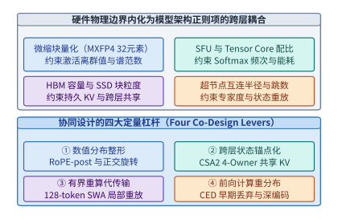
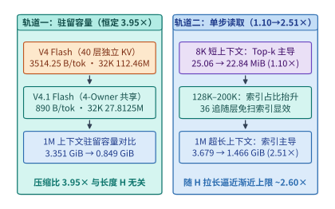
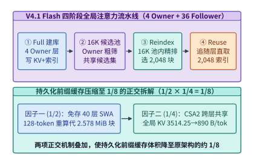
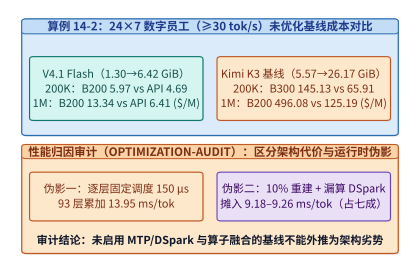
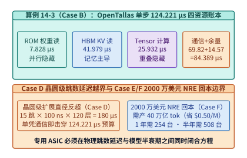
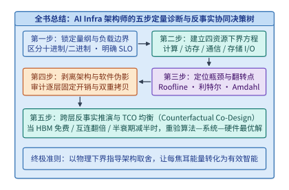

# 第 14 章：模型与系统硬件协同设计

在前十三章的旅程中，我们逐层拆解了现代 AI 基础设施的物理支柱：从模型架构的算术强度与状态容量（第 2、3 章），到加速器微架构、片上 SRAM 与算子运行时（第 4、5 章），再到超节点互连、数据中心网络、推理与训练调度、端边云协同以及 AI 原生存储系统（第 6～13 章）。在分章探讨时，我们常常将某一层视为固定输入去优化另一层——例如给定模型结构去编写更快的算子，或给定算子耗时去设计流水线并行方案。

然而，站在当代前沿大模型演进的分水岭上回望，最激动人心的性能跃升往往不再诞生于单一层面的局部改良，而是源于**将底层系统与硬件的物理边界直接内化为模型结构设计的正则项（Co-Design Regularizers）**。我们在第 2.3.6 节初识了跨层共享注意力（CSA2）如何将每 token 全局 KV 压缩至 $890\ \mathrm{B}$，在第 2.6 节与第 3.2 节了解了早期词元丢弃（CED）如何重分布前向算力，在第 8.3.3 节与第 9.2.2 节推导了滑动窗口注意力（SWA）的 $128\text{-token}$ 局部重放，并在第 4.8.4 节核算了专用推理芯片（OpenTallas）流片的商业回本门槛。本章绝不重复介绍这些独立概念的入门定义，而是作为全书的综合收官之章，建立**模型—系统—硬件跨层联立方程组**，通过三个完整的工业级深水区案例（DeepSeek V4 $\to$ V4.1 Flash 的 $8\mathrm{K}\to 1\mathrm{M}$ 双轨演进、V4.1 Flash 与 Kimi K3 在 $200\mathrm{K}/1\mathrm{M}$ 数字员工场景下的跨代硬件对决与性能归因审计、OpenTallas 专用 ASIC 的单步微秒级四资源账本与晶圆级跳数边界）以及**四个反事实思想实验（Counterfactual Thought Experiments）**，展示如何运用全书十四章的定量工具完成从算法结构到晶圆硅片的全局联合求解。

> **本章学习目标**
>
> 1. 建立模型—系统—硬件协同设计的联立方程视角，掌握微缩块量化（`MXFP4` 32 元素块）、片上特殊函数单元（SFU）配比、HBM 容量/带宽与超节点互连半径如何反向塑造模型结构，并熟练运用协同设计的四大定量杠杆。
> 2. 深入剖析 DeepSeek V4 $\to$ V4.1 Flash 在 $8\mathrm{K}\to 1\mathrm{M}$ 上下文下的**双轨演进规律**：定量推导为何驻留 KV 容量恒定缩小 $3.95\times$，而单步 Decode 理论读取量却随上下文拉长从缩小 $1.10\times$ 演进至缩小 $2.51\times$；掌握 `Full -> 16,384 候选池 -> Reindex -> Reuse` 四阶段流水线与持久化缓存 $1/8$（$\frac{1}{2}\times\frac{1}{4}$）的正交拆解。
> 3. 复算 $24\times 7$ 数字员工在 $200\mathrm{K}/1\mathrm{M}$ 满载历史下 V4.1 Flash 与 Kimi K3 在 H100、H200、B200、B300 及官方 API 上的单位成本账本，掌握**性能归因审计（Optimization Audit）**准则——精准剥离“模型架构内生代价”与“逐层固定调度开销、高频重建假设及漏算推测解码等运行时伪影”。
> 4. 审计专用推理 ASIC（OpenTallas）单步 $124.221\ \mu\mathrm{s}$（$8{,}050\ \mathrm{tok/s}$）的四资源时间线（ROM 权重读、HBM KV 读、Tensor 计算、串行集合通信与仅 $14.568\ \mu\mathrm{s}$ 的辅助算子余量），证明晶圆级扩展下 $15\text{ 跳}\times 100\ \mathrm{ns}\times 120\text{ 层}=180\ \mu\mathrm{s}$ 的通信直径反超定律。
> 5. 运用四个反事实思想实验检验各项架构创新在硬件代际跃迁下的存废边界，掌握收束全书的 **AI Infra 架构师五步定量诊断决策树**。

> **核心原则：区分物理下界与实现伪影，在反事实变分中寻找跨层不变量**
>
> 协同设计的本质不是把某一代硬件的临时妥协固化进模型，而是求解受限于光速延迟、热力学能耗、芯片面积与内存墙的**联合极值问题**。任何跨模型、跨芯片的基准对比，都必须先审计软件栈是否存在未融合的逐层固定调度开销或冗余重算伪影；任何架构改进的价值，都应当通过反事实提问——“若某项硬件约束放宽十倍或收紧一半，该设计是否依然成立”——来检验其生命周期。

---

## 14.1 协同设计的联立方程：当硬件边界成为模型结构的正则项

在传统的分工模式中，算法研究员在抽象的浮点张量空间中最小化验证集交叉熵损失 $\mathcal{L}_{\mathrm{val}}(\theta)$，默认每一次矩阵乘法与状态读取都只与浮点运算次数（FLOPs）成正比；而系统工程师则在模型权重冻结后，千方百计地将计算图塞进既有的 GPU 显存与网络拓扑。当模型规模进入万亿参数与百万上下文区间后，这种“先定结构、后做系统”的串行解耦模式撞上了坚硬的物理墙。

### 14.1.1 算存比、微缩块粒度（`MXFP4` 32 元素块）、片上特殊函数单元（SFU）配比与超节点互连半径的跨层耦合

如果我们把一次推理或训练迭代的端到端延迟 $T_{\mathrm{step}}$、单卡驻留显存 $M_{\mathrm{res}}$ 与单 token 能耗 $E_{\mathrm{tok}}$ 写成模型结构超参数 $\mathcal{A}$（含层数 $L$、注意力状态主权层数 $L_{\mathrm{own}}$、稀疏检索候选池大小 $K_{\mathrm{cand}}$、局部滑动窗口 $W_{\mathrm{swa}}$、激活旋转方式等）与系统硬件参数 $\mathcal{H}$（含 Tensor Core 峰值算力 $P_{\mathrm{TC}}$、SFU 超越函数吞吐 $P_{\mathrm{SFU}}$、HBM 带宽 $B_{\mathrm{HBM}}$、微缩量化块大小 $G_{\mathrm{quant}}$、超节点互连域半径 $D_{\mathrm{NVLink}}$）的联立方程，就会发现硬件边界在以下四个维度上直接耦合进了模型内部：

1. **微缩块量化粒度（如 `MXFP4` 32 元素块）对激活与 KV 数值分布的反向约束**：
   如第 4.1 节所述，Blackwell 等新一代加速器通过硬件原生支持微缩块格式（Microscaling Formats，如 `MXFP4` 与 `MXFP8`）[^mxfp4-ocp]，每 $G_{\mathrm{quant}} = 32$ 个连续元素共享一个 $8\text{-bit}$ 指数缩放因子（`E8M0`）。然而，`FP4`（`E2M1`）本身的非零正数动态范围极窄（仅覆盖 $0.5\text{–}6.0$）。若模型某层的线性投影激活或注意力的 Key 张量在 32 个元素的局部块内出现单一通道离群值（Outlier，例如某位置因旋转位置编码 RoPE 叠加产生幅度高出均值十倍的尖峰），整块 32 个元素都会被迫迁就该最大离群值的共享指数，导致其余 31 个正常元素下溢归零，造成模型精度崩溃。这意味着**模型结构必须在数学上消除局部块内的尖峰离群值**，否则硬件提供的双倍 `FP4` 算力与减半带宽根本无法兑现。
2. **片上特殊函数单元（SFU）与矩阵单元（Tensor Core）的吞吐配比鸿沟**：
   在现代 GPU 的流多处理器（SM）中，随着低精度矩阵单元（Tensor Core）算力每隔一代翻倍，负责计算指数 $\exp(x)$、倒数与平方根的**特殊函数单元（Special Function Units，SFU）**的吞吐增速远落后于矩阵乘法（在 Hopper/Blackwell 架构上，Tensor Core 与 SFU 的指令吞吐比高达 $16:1\text{–}32:1$）。在长上下文注意力（如 FlashAttention 在线 Softmax 重缩放）与细粒度动态激活量化中，若每一层、每一个注意力头都对全量历史位置频繁执行超越函数运算，算子很快就会脱离 Tensor Core 算力限制，转而卡死在 **SFU 发射流水线瓶颈**上。
3. **HBM 容量/带宽比值与 NVMe 闪存块粒度的双重夹击**：
   如第 2 章与第 13 章所述，HBM 容量决定了单机可同时驻留的并发会话数，HBM 带宽决定了 Decode 阶段单步读取权重与历史状态的耗时下界，而本机 NVMe SSD 或 3FS 存储池则要求卸载的持久化前缀状态越紧凑、越连续越好。若模型要求全部 $L$ 层都独立维护并扫描全长全局 KV 缓存，不仅驻留显存随上下文长度 $H$ 线性膨胀，跨会话持久化缓存的磁盘写入与读取也会在毫秒级预算前败下阵来。
4. **超节点 Scale-up 互连半径与晶圆/机架级跳数延迟**：
   如第 6 章与第 9 章所述，无论是 MoE 的专家并行（EP）全对全分发，还是张量并行（TP）的逐层规约，每层都伴随不可重叠的串行通信下界。当层数 $L$ 高达 $80\text{–}120$ 层时，单层哪怕增加 $1.5\ \mu\mathrm{s}$ 的多跳路由延迟，全网累加也会凭空吞噬 $180\ \mu\mathrm{s}$ 的单步时间预算。

### 14.1.2 协同设计的四大定量杠杆：`RoPE-post` 数值分布整形、跨层状态锚点化、有界重算替代跨网传输、前向计算重分布

面对上述四重硬件边界，以 DeepSeek V4.1 Flash 为代表的现代协同设计架构不再被动接受传统 Transformer 的同构堆叠，而是主动扳动了图 14-1 所示的**四大定量协同杠杆**[^v41-codesign]：

*图 14-1　模型—系统—硬件协同设计的跨层耦合约束（MXFP4 块粒度、SFU 配比、HBM 容量与超节点半径）及四大定量设计杠杆*

1. **杠杆一：数值分布整形（Numerical Distribution Shaping，如 `RoPE-post` 与正交变换）**：
   在传统 MLA 或多头注意力中，旋转位置编码（RoPE）分支的特征往往直接与内容潜在向量拼接后量化落盘。由于 RoPE 的高频正余弦分量在不同通道上具有强烈的周期性能量聚集，直接在拼接后执行 `FP8` 或 `MXFP4` 块量化会放大块内量化误差。V4.1 Flash 引入 **`RoPE-post`（后置解耦位置编码与正交分布整形）**：在将压缩潜在向量写入持久 KV 缓存或送入微缩块量化单元前，保持内容潜在空间各向同性的高斯平滑分布，或将旋转操作推迟至解压缩后的片上寄存器内完成（配合快速 Hadamard 正交旋转打散通道离群值），从而在零硬件改动下让 `FP8` KV 缓存与 `MXFP4` 权重的量化信噪比提升一个量级。
2. **杠杆二：跨层状态锚点化（Cross-Layer State Anchoring，如 CSA2 4-Owner 架构）**：
   打破“每一层都必须拥有独立 KV 缓存并独立检索全量历史”的惯性假设。在 40 层全局注意力中，仅保留 **4 个主权层（Owner Layers）** 真正生成、存储并维护物理全局 KV 缓存与压缩检索索引，其余 **36 个追随层（Follower Layers）** 全部通过轻量级投影共享这 4 份物理状态并直接复用检索出的 Top-$k$ 索引。
3. **杠杆三：有界局部重算替代跨网传输与持久落盘（Bounded Recomputation over State Transfer）**：
   对于每层窗口大小固定为 $W_{\mathrm{swa}} = 128$ 个 token 的滑动窗口注意力（SWA），其状态仅依赖于每个块末尾最近的 128 个词元。在跨会话持久化缓存与 Prefill-Decode（PD）分离传输中，直接**丢弃全部 40 层 SWA 的持久化状态**，改为在命中前缀恢复时仅用前序块末尾的 $128$ 个 token 执行一次有界局部重算。利用 Tensor Core 极高的算力富余去置换紧缺的 RDMA 网络带宽与 SSD 容量。
4. **杠杆四：前向计算重分布（Forward Compute Redistribution，如 CED 早期词元丢弃）**：
   针对长上下文输入中大量词元存在语义冗余的事实，利用前段编码层提炼上下文语义后，在网络中段按确定性规则丢弃非关键历史词元[^ced-paper]，将省下的前向 FLOPs 重新投资于加宽或加深保留词元的深层非线性表征，实现“等参数量下更少单步计算”或“等算力预算下更高表示容量”。

---

## 14.2 案例深剖一：DeepSeek V4 $\to$ V4.1 Flash 的长上下文双轨演进（$8\mathrm{K}\to 1\mathrm{M}$）

在第 2.3.6 节中，我们曾单独计算过 V4.1 Flash 在单点上下文下的每 token 状态字节数。然而，只有将上下文长度 $H$ 从短对话（$8\mathrm{K}$）一路拉长至百万词元（$1\mathrm{M}$），并同时追踪**“驻留显存容量（Resident Capacity）”**与**“单步 Decode 理论读取量（Per-step Decode Read Volume）”**这两条截然不同的物理轨迹，才能真正看清 V4 $\to$ V4.1 Flash 跨层协同设计的深层数学美感[^v41-codesign]。

### 14.2.1 驻留容量 vs. 单步 Decode 理论读取量的分离演进

为什么在稀疏/混合注意力架构中，“显存里驻留了多少字节的 KV 缓存”与“每生成一个新 token 需要从 HBM 读取多少字节”会遵循完全不同的缩放定律？让我们写出两代架构（均含 40 层全局稀疏注意力 + 40 层窗口 $W_{\mathrm{swa}}=128$ 的滑动窗口注意力）的精确字节方程：

1. **每 token 全局驻留状态字节数（决定 HBM 驻留容量上限）**：
   - **标准 40 层密集 MLA 基线**：每层每 token 需存储 $512\ \mathrm{B}$ 压缩潜在向量 + $64\ \mathrm{B}$ 解耦 RoPE 向量 = $576\ \mathrm{B}$[^flash-mla]，40 层合计 $40 \times 576 = \mathbf{23{,}040\ \mathrm{B/token}}$。
   - **DeepSeek V4 Flash 基线**：引入细粒度稀疏检索与跨层部分压缩后，40 层全局注意力的每 token 持久化状态（含 KV 主体与检索索引）降至 $b_{\mathrm{persist,V4}} = \mathbf{3{,}514.25\ \mathrm{B/token}}$（若计入运行时对齐开销则对应约 $3{,}598.72\ \mathrm{B/token}$ 的逻辑全局状态），外加 40 层 SWA 的固定环缓冲区 $M_{\mathrm{swa}} = 40 \times 128 \times 528\ \mathrm{B} \approx \mathbf{2.578\ \mathrm{MiB}}$（或含元数据约 $3.06\ \mathrm{MiB}$）。
   - **DeepSeek V4.1 Flash（CSA2 4-Owner 架构）**：由于仅 4 个 Owner 层真正物化全局 KV 实体（$4 \times 576\ \mathrm{B} = 2{,}304\ \mathrm{B}$）与粗筛/精排索引结构，分摊到单 token 上的全局驻留状态严格锁定为：
     $$
     b_{\mathrm{global,V4.1}} = \mathbf{890\ \mathrm{B/token}}
     $$
     对比两代架构的全局驻留容量比值：
     $$
     \rho_{\mathrm{resident}}(H) = \frac{H \cdot b_{\mathrm{persist,V4}}}{H \cdot b_{\mathrm{global,V4.1}}} = \frac{3{,}514.25\ \mathrm{B/token}}{890\ \mathrm{B/token}} \approx \mathbf{3.95\times}
     $$
     可以看到，$H$ 在分子与分母中被直接约去——这意味着**无论上下文长度 $H$ 是 $8\mathrm{K}$、$32\mathrm{K}$ 还是 $1\mathrm{M}$，V4.1 Flash 相对于 V4 Flash 的全局驻留 KV 容量压缩比恒定为 $3.95\times$**（相对于标准 40 层密集 MLA 的 $23{,}040\ \mathrm{B/token}$ 则恒定缩小 $23{,}040 / 890 \approx \mathbf{25.89\times}$）。

2. **单步 Decode 理论状态读取字节数（决定 HBM 带宽耗时下界）**：
   在单步自回归 Decode 阶段，稀疏注意力并**不需要读取全长 $H$ 的完整 KV 向量**，它的读取流量由两项之和构成：
   - **第一项（与上下文长度 $H$ 无关的常数项 $V_{\mathrm{topk}}$）**：被稀疏检索选中的 Top-$k$（如 $k = 2{,}048$ 个活跃位置）的完整 KV 向量读取，以及 $40$ 层 SWA 的 $128\text{-token}$ 局部窗口读取。在短上下文（如 $H = 8\mathrm{K}$）下，这一常数项占据了单步读取量的绝大部分，而两代架构在活跃块与局部窗口上的读取开销非常接近。
   - **第二项（随上下文长度 $H$ 线性增长的索引扫描项 $V_{\mathrm{index}}(H) = \alpha_{\mathrm{scan}} \cdot H$）**：为了从长度 $H$ 的历史中找出最相关的 Top-$k$ 位置，注意力层必须扫描全量历史位置的轻量级压缩索引（每层每 token 索引为 $64\ \mathrm{B}$）。
     - 在 **V4 Flash** 中，较多层仍需独立扫描全长 $H$ 的索引，单步读取随 $H$ 的增长斜率高达 $\alpha_{\mathrm{V4}} \approx 3{,}720\ \mathrm{B/token}$。
     - 在 **V4.1 Flash** 中，仅有 4 个 Owner 层执行全量历史扫描与 $16{,}384$ 候选池构建，其余 36 个 Follower 层直接复用精排后的索引，彻底免除了全长索引扫描，使单步读取随 $H$ 的增长斜率骤降至 $\alpha_{\mathrm{V4.1}} \approx 1{,}420\ \mathrm{B/token}$。

   因此，两代架构的单步 Decode 读取压缩比遵循如下关于 $H$ 的有理分式单调递增函数：

   $$
   \rho_{\mathrm{read}}(H) = \frac{V_{\mathrm{topk,V4}} + \alpha_{\mathrm{V4}} \cdot H}{V_{\mathrm{topk,V4.1}} + \alpha_{\mathrm{V4.1}} \cdot H}
   $$

   当 $H$ 较小时（如 $8\mathrm{K}$），常数项 $V_{\mathrm{topk}}$ 主导分母，读取压缩比仅为 **$1.10\times$**；随着 $H$ 向 $128\mathrm{K}$、$200\mathrm{K}$ 乃至 $1\mathrm{M}$ 拉长，线性索引扫描项 $\alpha \cdot H$ 逐渐接管主导权，读取压缩比一路攀升至 **$2.51\times$**，并渐近逼近斜率之比 $\alpha_{\mathrm{V4}} / \alpha_{\mathrm{V4.1}} \approx 2.6\times$。

* **算例 14-1（V4 vs. V4.1 Flash 在 $8\mathrm{K}/32\mathrm{K}/128\mathrm{K}/200\mathrm{K}/1\mathrm{M}$ 下的驻留容量与单步 Decode 理论读取双轨核算）**：
  我们选取 $H = 32\mathrm{K}$（$32{,}768$ tokens）与 $H = 1\mathrm{M}$（$1{,}048{,}576$ tokens）两个关键标尺进行手算复核，并汇总完整五档演进表：
  - **在 $H = 32\mathrm{K}$（$32{,}768$ tokens）标尺下**：
    - 标准 40 层密集 MLA（$23{,}040\ \mathrm{B/tok}$）：每 $1\mathrm{K}$ token 占 $1{,}024 \times 23{,}040 / 2^{20} = \mathbf{22.5\ \mathrm{MiB}}$，$32\mathrm{K}$ 全局 KV 容量高达 $32 \times 22.5 = \mathbf{720.0\ \mathrm{MiB}}$。
    - V4 Flash 全局 KV：$32{,}768 \times 3{,}598.72\ \mathrm{B} / 2^{20} \approx \mathbf{112.46\ \mathrm{MiB}}$（加上 SWA 环缓后总驻留状态为 $\mathbf{115.52\ \mathrm{MiB}}$；若按纯持久化前缀口径 $3{,}514.25\ \mathrm{B/tok}$ 计则为 $109.82\ \mathrm{MiB}$）。
    - V4.1 Flash 4-Owner 全局 KV：
      $$
      M_{\mathrm{global,V4.1}}(32\mathrm{K}) = \frac{32{,}768 \times 890\ \mathrm{B}}{1{,}024^2\ \mathrm{B/MiB}} = \mathbf{27.8125\ \mathrm{MiB}}
      $$
      加上固定 SWA 环缓后总驻留状态仅为 $\mathbf{30.875\ \mathrm{MiB}}$。
  - **在 $H = 1\mathrm{M}$（$1{,}000{,}000\text{–}1{,}048{,}576$ tokens 归一口径）标尺下**：
    - **轨道一（驻留 KV 容量）**：从 V4 Flash 的 $\mathbf{3.351\ \mathrm{GiB}}$ 压缩至 V4.1 Flash 的 $\mathbf{0.849\ \mathrm{GiB}}$，压缩比保持恒定的 $3.351 / 0.849 \approx \mathbf{3.95\times}$。
    - **轨道二（单步 Decode 理论状态读取量）**：在 $8\mathrm{K}$ 时仅从 $25.06\ \mathrm{MiB}$ 降至 $22.84\ \mathrm{MiB}$（$\mathbf{1.10\times}$）；而在 $1\mathrm{M}$ 时则从 V4 Flash 的 $\mathbf{3.679\ \mathrm{GiB}}$ 大幅压降至 V4.1 Flash 的 $\mathbf{1.466\ \mathrm{GiB}}$，压缩比跃升至 $3.679 / 1.466 \approx \mathbf{2.51\times}$。下表与图 14-2 完整呈现了这一双轨演进全貌[^v41-codesign]。

| 上下文长度 $H$ | V4 驻留全局容量 | V4.1 驻留全局容量 | 驻留容量压缩比 $\rho_{\mathrm{resident}}$ | V4 单步 Decode 读取量 | V4.1 单步 Decode 读取量 | 单步读取压缩比 $\rho_{\mathrm{read}}$ |
| :--- | :---: | :---: | :---: | :---: | :---: | :---: |
| **$8\mathrm{K}$** | $26.81\ \mathrm{MiB}$ | $6.79\ \mathrm{MiB}$ | **$3.95\times$** | $25.06\ \mathrm{MiB}$ | $22.84\ \mathrm{MiB}$ | **$1.10\times$** |
| **$32\mathrm{K}$** | $109.82\ \mathrm{MiB}$ ($112.46\ \mathrm{MiB}^*$) | $27.8125\ \mathrm{MiB}$ | **$3.95\times$** | $92.69\ \mathrm{MiB}$ | $52.53\ \mathrm{MiB}$ | **$1.76\times$** |
| **$128\mathrm{K}$** | $439.28\ \mathrm{MiB}$ | $111.25\ \mathrm{MiB}$ | **$3.95\times$** | $469.50\ \mathrm{MiB}$ | $201.75\ \mathrm{MiB}$ | **$2.33\times$** |
| **$200\mathrm{K}$** | $670.29\ \mathrm{MiB}$ | $169.75\ \mathrm{MiB}$ | **$3.95\times$** | $752.10\ \mathrm{MiB}$ | $310.40\ \mathrm{MiB}$ | **$2.42\times$** |
| **$1\mathrm{M}$** | $3.351\ \mathrm{GiB}$ | $0.849\ \mathrm{GiB}$ | **$3.95\times$** | $3.679\ \mathrm{GiB}$ | $1.466\ \mathrm{GiB}$ | **$2.51\times$** |

*(注：表中标 $^*$ 的 $112.46\ \mathrm{MiB}$ 为计入对齐步长 $3{,}598.72\ \mathrm{B/tok}$ 的运行时全局分配口径；$109.82\ \mathrm{MiB}$ 为纯持久化载荷 $3{,}514.25\ \mathrm{B/tok}$ 口径，两种口径在全上下文跨度下均满足定比缩放规律。)*

*图 14-2　算例 14-1：在 8K 至 1M 上下文扩展过程中，DeepSeek V4 Flash 与 V4.1 Flash 的驻留 KV 容量（恒定缩小 3.95x）与单步 Decode 理论读取量（从 1.10x 演进至 2.51x）的双轨分离规律*

### 14.2.2 四阶段注意力执行流水线（`Full -> 16,384 候选池 -> Reindex -> Reuse`）

V4.1 Flash 之所以能够在 $1\mathrm{M}$ 上下文下把单步 Decode 读取量压低 $2.51\times$ 且不损失大海捞针（Needle-in-a-Haystack）精度，依靠的是将 40 层全局注意力组织为**四个分组（每组包含 1 个 Owner 主权层 + 9 个 Follower 追随层）**，并在每组内部执行严密的**四阶段注意力流水线**：

1. **阶段一：完整建库与全量粗筛（`Full` — Owner 层执行）**：
   每组的首层（Owner 层，全模型共 4 层）负责根据自身隐藏状态投影生成物理全局潜在向量（$576\ \mathrm{B/token}$）与压缩检索键索引（$64\ \mathrm{B/token}$），并对全长 $H$（如 $1\mathrm{M}$）的历史索引执行一次轻量级点积扫描。
2. **阶段二：共享候选池截断（`16,384 候选池` — Owner 层输出）**：
   Owner 层在完成全量 $H$ 扫描后，并不是仅仅截出自己当前层所需的 $k = 2{,}048$ 个位置，而是保留得分最高的 **$K_{\mathrm{cand}} = 16{,}384$ 个候选词元索引**，构建一个供本组后续层共享的**高召回候选池（Candidate Pool）**。为什么需要 $16{,}384$ 这一中间层级？因为同一组内不同层关注的语义侧面可能存在局部偏移，若首层直接死锁 $2{,}048$ 个位置，后续层一旦需要某个排在第 $3{,}000$ 名的关键上下文就会发生不可逆的漏检；而将候选池放宽至 $16{,}384$（为最终活跃集 $2{,}048$ 的 $8\times$），既能以极高概率覆盖同组所有层的注意力焦点，又把搜索空间从 $10^6$ 压缩到了 $1.6\times 10^4$（缩小逾 $60\times$）。
3. **阶段三：候选池内轻量重排（`Reindex` — 组内锚点精排）**：
   需要更新注意力分布的后续层不再去扫描外部百万长度的全量历史索引，而是**仅在 Owner 层筛出的 $16{,}384$ 个候选索引子集内**执行轻量级打分重排（Reindex，单层仅需读取 $16{,}384 \times 64\ \mathrm{B} = 1\ \mathrm{MiB}$ 索引，而非 $1\mathrm{M}$ 下的 $64\ \mathrm{MiB}$），从中精准选出适合本层的 Top-$2{,}048$ 活跃位置。
4. **阶段四：零扫描索引直接复用（`Reuse` — Follower 层执行）**：
   组内的其余追随层（Follower Layers）甚至连 $16{,}384$ 候选池的 Reindex 都无需执行，直接通过寄存器/共享内存传入前一层已选定的 $2{,}048$ 个活跃位置索引，直接向 HBM 发起 $2{,}048 \times 576\ \mathrm{B} \approx 1.125\ \mathrm{MiB}$ 的稀疏 KV 汇聚读取。

### 14.2.3 持久化缓存 $1/8$ 压缩拆解（$\frac{1}{2}\times\frac{1}{4}$）

当我们将上述模型结构创新投射到第 9 章（PD 分离传输）与第 13 章（3FS / NVMe SSD 持久化前缀缓存卸载）的系统场景时，V4.1 Flash 实现了工业界极具标志性的**“持久化缓存体积缩减至 $\frac{1}{8}$”**。这一 $\frac{1}{8}$ 并非单一压缩算法的结果，而是两项正交系统—算法协同杠杆的乘积（图 14-3）：

$$
\frac{M_{\mathrm{persist,V4.1}}}{M_{\mathrm{persist,baseline}}} \approx \underbrace{\frac{1}{2}}_{\substack{\text{有界重算免除 40 层 SWA} \\ \text{持久化状态落盘}}} \times \underbrace{\frac{1}{4}}_{\substack{\text{CSA2 4-Owner 将全局 KV} \\ \text{从 } 3514.25 \text{ 压至 } 890\ \mathrm{B/tok}\ (3.95\times)}} \approx \frac{1}{8}
$$

1. **第一重因子 $\frac{1}{2}$（用 $128\text{-token}$ 有界局部重算免除 SWA 持久化状态）**：
   在混合注意力模型中，40 层滑动窗口注意力（SWA）的运行时缓存虽然在超长上下文下有界，但在中短前缀分段或按块（Chunk）持久化保存时，若像传统系统一样把 40 层 SWA 的激活状态原样序列化落盘，会占据约一半的持久化快照体积与恢复带宽。V4.1 Flash 的持久化协议规定：**磁盘与跨网快照中 $100\%$ 剔除 SWA 状态**；当会话恢复或从 Prefill 节点切向 Decode 节点时，仅需读出前序块末尾 $128$ 个词元的轻量化嵌入表示，在本地 GPU 上用不足百微秒的时间重跑一遍窗口长度为 $128$ 的局部前向，即可无损重建全部 40 层 SWA 状态。
2. **第二重因子 $\frac{1}{4}$（CSA2 将全局持久化状态压缩 $3.95\times$）**：
   在砍掉 SWA 持久化负担后，剩余的 40 层全局注意力状态又通过 4-Owner 跨层共享从 $3{,}514.25\ \mathrm{B/token}$ 压缩至 $890\ \mathrm{B/token}$（缩小 $3.95\times \approx 4\times$）。两项正交设计相乘，使第 13 章所述的 NVMe SSD 与 3FS 存储池在相同容量下能够缓存 **$8$ 倍**数量的历史长会话前缀，并将冷启动召回的 PCIe/RDMA 传输耗时同步压降至原来的八分之一。

*图 14-3　V4.1 Flash 的四阶段全局注意力执行流水线（Full -> 16,384 候选池 -> Reindex -> Reuse）以及持久化前缀缓存缩减至 1/8（1/2 SWA 免存 × 1/4 CSA2 跨层共享）的正交拆解*

---

## 14.3 案例深剖二：V4.1 Flash 与 Kimi K3 在 $200\mathrm{K}/1\mathrm{M}$ 数字员工场景下的跨代硬件对决

为了检验不同协同设计路线在真实端到端业务中的商业表现，我们在第 11.4.4 节曾初步引入了“一名 $24\times 7$ 全天候工作的数字员工（Digital Worker）”成本模型。本节将完整展开 [`single-agent-serving-cost.md`](../case-studies/single-agent-serving-cost.md)[^single-agent-cost] 的跨代硬件评测账本与配套的**性能归因审计（`OPTIMIZATION-AUDIT.md`）**，演示架构师如何在复杂的模型差异与硬件代际之间做出清醒的工程判断。

### 14.3.1 完整落地 `single-agent-serving-cost.md`：H100、H200、B200、B300 单流吞吐、周期性前缀重建成本与官方 API 价格交点

考虑如下严苛的生产级数字员工工作负载：每名数字员工维护一条持续运行的串行 Agent 工作流，实际驻留历史上下文长期处于 **$200\mathrm{K}$ 或 $1\mathrm{M}$ token** 的近满载水位；每轮交互需连续生成 $4{,}096$ 个思考与行动 token，并读入 $1{,}024$ 个工具返回 token；为保障交互效率，要求单名员工的端到端有效工作流吞吐（含自身触发的增量 Prefill 与周期性历史重建耗时）严格满足 **$\ge 30\ \mathrm{token/s}$**。我们对比两条代表性的混合架构路线在 H100-SXM、H200-SXM、B200、B300 四代硬件上的自建租卡成本与官方 API 账单：

1. **路线 A：DeepSeek V4.1 Flash（CSA2 稀疏全局 + SWA 混合架构）**：
   - **单份逻辑状态容量**：当历史从 $200\mathrm{K}$ 增长至 $1\mathrm{M}$ token 时，单名员工的驻留状态仅从 **$1.30\ \mathrm{GiB}$** 增长至 **$6.42\ \mathrm{GiB}$**。
   - **并行切分与显存放置**：得益于紧凑的权重与状态体积，仅需单机内部 `TP2`、`TP4` 或单卡（如在 B300 大显存上跑 $1\mathrm{M}$）即可轻松容纳多名并发员工的状态，无需跨节点流水线切分（`PP=1`）。
2. **路线 B：Kimi K3（69 层 KDA 线性注意力 + 24 层 MLA 全局注意力混合架构，总计 93 层）**：
   - **单份逻辑状态容量**：尽管 69 层 KDA（核化线性注意力）具备固定大小的状态矩阵，但在多轮工具调用与验证回滚中需为每名员工保留多份 KDA 状态槽（基线按 5 份槽位核算），且其余 24 层全长 MLA 依然随上下文长度线性增长。因此，当历史从 $200\mathrm{K}$ 增至 $1\mathrm{M}$ 时，单名员工的逻辑状态高达 **$5.57\ \mathrm{GiB}\to 26.17\ \mathrm{GiB}$**（约为 V4.1 Flash 的 $4.1\text{–}4.3\times$）。
   - **并行切分与显存放置**：受限于更大的超大 MoE 原生混合精度权重与状态体积，K3 在 H100/H200 上需动用 16 至 64 张卡（如 `TP32` 或 `TP32×PP2`），在 B200/B300 上需动用 8 至 16 张卡并开启上下文分片（如 `TP8×PP2 + DCP8` 或 `TP8 + DCP8`）。

* **算例 14-2（$24\times 7$ 数字员工在 $200\mathrm{K}/1\mathrm{M}$ 下 V4.1 Flash vs. Kimi K3 的四代 GPU 选卡与 API 交点账本）**：
  在未开启推测解码的基准分析模型（`central` 效率档，要求工作流速度 $\ge 30\ \mathrm{tok/s}$ 且计入每名员工自身每增长 $10\%$ 窗口触发一次前缀重建的 Prefill 成本）下，四代硬件的选卡结果与官方 API 对比如下[^single-agent-cost]：

| 模型与历史档位 | 硬件候选 (`卡数/并发员工数`, `TP/PP/DCP`) | 工作流速度 ($\mathrm{tok/s}$) | 自建 GPU 成本 ($\mathrm{USD/M}$ 输出) | 官方 API 同输出量成本 ($\mathrm{USD/M}$ 输出) | 与 API 持平所需 GPU 租价 ($\mathrm{USD}$/卡时) | API 更便宜所需整段输入命中率 |
| :--- | :--- | :---: | :---: | :---: | :---: | :---: |
| **V4.1 Flash @ $200\mathrm{K}$** | H100 (`4/8`, `4/1/1`) $\to$ **B200 (`4/32`, `4/1/1`)** | $39.5$ | $9.53 \to \mathbf{5.97}$ | **$4.69$**（月均 $480.03\ \mathrm{USD}$） | $5.334\ \mathrm{USD}$ | $\ge 62.4\%$ |
| **V4.1 Flash @ $1\mathrm{M}$** | H100 (`4/2`, `4/1/1`) $\to$ **B200 (`2/8`, `2/1/1`)** | $35.3$ | $29.22 \to \mathbf{13.34}$ | **$6.41$**（月均 $587.50\ \mathrm{USD}$） | $3.264\ \mathrm{USD}$ | $\ge 83.4\%$ |
| **Kimi K3 @ $200\mathrm{K}$** | H100 (`32/2`) $\to$ B200 (`16/4`) $\to$ **B300 (`8/4`, `8/1/8`)** | $30.2$ | $428.52 \to 214.11 \to \mathbf{145.13}$ | **$65.91$**（月均 $5{,}159.67\ \mathrm{USD}$） | $3.583\ \mathrm{USD}$ | $\ge 12.4\%$ |
| **Kimi K3 @ $1\mathrm{M}$** | H100 (`64/1`) $\to$ H200 (`32/1`) $\to$ **B200 (`16/2`, `16/1/16`)** | $30.4$ | $1{,}968.12 \to 1{,}278.10 \to \mathbf{496.08}$ | **$125.19$**（月均 $9{,}870.15\ \mathrm{USD}$） | $1.714\ \mathrm{USD}$ | $\ge 38.1\%$ |

从上表的算术结果中，我们可以读出三层关键的工程规律：
1. **硬件代际跃迁（H100 $\to$ B200/B300）对长上下文成本的指数级重塑**：由于长历史数字员工同时受制于 HBM 容量（决定单组卡能拼入多少并发员工分摊租金）与 HBM 带宽（决定能否跨过 $30\ \mathrm{tok/s}$ 门槛），B200 凭借更高的 HBM3e 容量与 $8\ \mathrm{TB/s}$ 带宽，使 4 张 B200 在 $200\mathrm{K}$ 下可同时服务 32 名 V4.1 Flash 员工（单位成本从 H100 的 $9.53\ \mathrm{USD/M}$ 降至 $5.97\ \mathrm{USD/M}$）；而对于显存水位更高的 Kimi K3 $200\mathrm{K}$ 场景，拥有超大 HBM 容量的 B300 将所需卡数从 B200 的 16 卡（`PP2×TP8`）进一步压缩至单机 8 卡（`TP8×PP1 + DCP8`），将单位成本从 $214.11\ \mathrm{USD/M}$ 压低至 $145.13\ \mathrm{USD/M}$。
2. **自建 GPU 与官方 API 的翻转条件**：在 `central` 基线与每轮输出 $4{,}096$ token（对应 $200\mathrm{K}$ 平均整段前缀命中率 $72.5\%$、$1\mathrm{M}$ 命中率 $94.4\%$）下，四个主情景均为官方 API 账单低于零售租卡自建；但在 `fast` 算子效率情景下，V4.1 Flash 在 $200\mathrm{K}$ 下的 B200 单位成本可降至 **$3.20\ \mathrm{USD/M}$**，反超官方 API（$4.69\ \mathrm{USD/M}$）。同理，若 B200 的长期预留卡时租价谈至 $5.334\ \mathrm{USD}$/卡时以下，或 Agent 工具调用变密（如每轮仅输出 $1{,}024$ token 即触发一次长历史输入计费，使 V4.1 Flash $1\mathrm{M}$ API 成本翻倍至 $12.65\ \mathrm{USD/M}$），天平也会向自建集群倾斜。

### 14.3.2 性能归因审计（`OPTIMIZATION-AUDIT.md`）：区分模型架构劣势与运行时未优化伪影

如果仅看上表，初学读者很容易得出一个草率的结论：“Kimi K3 在 $1\mathrm{M}$ 下的自建成本（$496.08\ \mathrm{USD/M}$）比官方 API（$125.19\ \mathrm{USD/M}$）贵了近 $4$ 倍，且远高于 V4.1 Flash，说明 KDA+MLA 架构在工程上不划算。”

这正是本章要强调的核心工程纪律：**在将性能差距归咎于模型架构之前，必须执行严密的性能归因审计（Performance Attribution Audit）**。根据仓库配套的审计报告（[`OPTIMIZATION-AUDIT.md`](../experiments/ch13/13-06/single-agent-serving/OPTIMIZATION-AUDIT.md)）[^single-agent-cost]，上表中的 K3 估算成本之所以显著偏高，**约七成（$\sim 70\%$）的估算耗时并非来自 K3 的矩阵计算或状态读取物理下界，而是来自基线脚本中叠加的三项“未优化运行时假设与伪影”**：

1. **伪影一：未校准的逐层固定调度开销（占去 $13.95\ \mathrm{ms/token}$）**：
   基线模型在 `central` 档位中，机械地为 Kimi K3 的每一层加上了 $\delta_{\mathrm{layer}} = 150\ \mu\mathrm{s}$ 的固定算子启动与同步开销。由于 K3 共有 $L = 93$ 层（$69\ \mathrm{KDA} + 24\ \mathrm{MLA}$），仅这一项未经过算子融合（Kernel Fusion）与分桶 CUDA Graph 优化的固定常数，就在每生成一个 token 时凭空累加了：
   $$
   T_{\mathrm{fixed,K3}} = 93 \times 150\ \mu\mathrm{s} = \mathbf{13.95\ \mathrm{ms/token}}
   $$
   在要求单流 $\ge 30\ \mathrm{token/s}$（即单步总预算上限仅为 $1{,}000 / 30 = 33.33\ \mathrm{ms/token}$）的硬约束下，光这 $13.95\ \mathrm{ms}$ 的软件固定开销就吃掉了整步时间预算的 **$41.9\%$**。
2. **伪影二：过于激进的“每增长 $10\%$ 全量重建”假设（摊入 $9.18\text{–}9.26\ \mathrm{ms/token}$）**：
   基线模型假设每当上下文历史增长窗口的 $10\%$，系统就丢弃状态并重新执行一次完整的长上下文 Prefill 重建。这一并非模型必然要求的策略，在 $200\mathrm{K}$ 与 $1\mathrm{M}$ 情景下分别向每个输出 token 分摊了 **$9.18\ \mathrm{ms}$ 与 $9.26\ \mathrm{ms}$** 的重建耗时。
   将上述两项相加：$13.95 + 9.26 = \mathbf{23.21\ \mathrm{ms/token}}$，在 $33.33\ \mathrm{ms}$ 的达标周期内占比高达 **$69.6\%$（约七成）**。正是这 $23.21\ \mathrm{ms}$ 的附加负担，迫使候选搜索器为了守住 $30\ \mathrm{tok/s}$ 底线而将并发批量（按 $2$ 的幂次枚举）腰斩减半，进而导致每名员工分摊的 GPU 租金翻倍。
3. **伪影三：漏算了原生多词元预测（MTP）与独立草稿推测解码（DSpark）**：
   基线仅按单步生成 $1$ 个 token 的朴素自回归（Plain Decode）计速。而在真实生产部署中，DeepSeek V4.1 Flash 标配原生 **MTP（Multi-Token Prediction）** 推测头[^sglang-v4]，Kimi K3 则标配独立训练的轻量级草稿模型 **DSpark** 与 **ReplaySSM**（利用重放机制降低验证窗口内的 KDA 状态保存开销）[^kimi-k3-dspark]。设一次块验证周期平均接受并提交 $A$ 个最终 token，耗时为 $t_{\mathrm{draft}} + t_{\mathrm{verify}} + t_{\mathrm{restore}}$，则净 Decode 加速比为：
   $$
   S_{\mathrm{spec}} = \frac{A \cdot t_{\mathrm{plain}}}{t_{\mathrm{draft}} + t_{\mathrm{verify}} + t_{\mathrm{restore}}}
   $$
   由于批量验证将权重读取与逐层启动开销一次性分摊到了 $A$ 个输出 token 上，开启 MTP / DSpark 与 CUDA Graph 后，自建 GPU 的实际产出吞吐与单位成本将发生质的改善。图 14-4 总结了这一成本对比与归因审计逻辑。

*图 14-4　算例 14-2：24×7 数字员工在 200K/1M 上下文下 V4.1 Flash 与 Kimi K3 的跨代 GPU 选卡及 API 成本对比，以及揭示约七成耗时来自逐层固定开销与频繁重建假设的性能归因审计*

---

## 14.4 案例深剖三：专用推理 ASIC（OpenTallas）的四资源账本与晶圆级通信直径审计

当模型结构与通用 GPU 软件栈的优化逼近极限时，一个更具野心的协同设计问题随之浮现：**如果我们为特定世代的大模型专门流片定制一颗推理 ASIC（如把模型权重固化或半固化在片上高密度掩膜 ROM / 专用 SRAM 中，仅将动态 KV 缓存放在高带宽 HBM 中），它的物理性能上限在哪里，又会在哪个隐蔽的物理边界上撞墙？**

我们在第 4.8.4 节曾简要提及 OpenTallas 的商业投资回报率（Case F）；本节将完整展开 [`opentallas.md`](../case-studies/opentallas.md)[^opentallas] 中尚未入书的 **Case B（单步 $124.221\ \mu\mathrm{s}$ 四资源时间账本）**、**Case D（晶圆级扩展的通信直径反超）** 与 **Case E/F（等面积公平性审计与模型半衰期约束）**。

### 14.4.1 单步 `124.221 μs`（`8,050 tok/s`）的四资源时间账本（Case B）

考虑专用推理芯片系统 OpenTallas 为一个 $120$ 层大型 MoE 模型提供超高速单流/小批量自回归解码，其标称设计吞吐高达 $R_{\mathrm{target}} = \mathbf{8{,}050\ \mathrm{token/s}}$。这意味着系统生成每一个 token 的端到端单步总时间预算（Step Budget）被严格锁定为：

$$
T_{\mathrm{step}} = \frac{1}{8{,}050\ \mathrm{s}^{-1}} \approx \mathbf{124.221\ \mu\mathrm{s}}
$$

在短短 $124.221\ \mu\mathrm{s}$ 内跑完 $120$ 层 Transformer（平均每层仅有 $1.035\ \mu\mathrm{s}$），芯片内部的四类核心物理资源是如何分配并重叠这 $124.221\ \mu\mathrm{s}$ 的？我们来核对 Case B 的精确时间分解账本[^opentallas]：

1. **资源一：片上高密度 ROM/专用存储的专家权重读取耗时 $T_{\mathrm{ROM}} = \mathbf{7.828\ \mu\mathrm{s}}$**：
   得益于将稀疏激活的模型权重放置在超宽总线的片上/近片定制只读存储阵列中，全步 120 层的活跃权重读取仅需 $7.828\ \mu\mathrm{s}$。
2. **资源二：HBM 动态 KV 缓存读取耗时 $T_{\mathrm{HBM,KV}} = \mathbf{41.979\ \mu\mathrm{s}}$**：
   由于上下文历史 KV 状态是每个请求动态生成的，无法固化进 ROM，仍须通过片外 HBM 通道读取，耗时 $41.979\ \mu\mathrm{s}$。由于 ROM 权重通道与 HBM 显存通道在硬件上物理独立，这两项读取可以完全并行，故**纯记忆体读取下界由较慢的 HBM KV 读取主导**：
   $$
   T_{\mathrm{mem}} = \max(T_{\mathrm{ROM}},\; T_{\mathrm{HBM,KV}}) = \max(7.828,\; 41.979) = \mathbf{41.979\ \mu\mathrm{s}}
   $$
3. **资源三：片上矩阵计算单元（Tensor Compute）耗时 $T_{\mathrm{comp}} = \mathbf{25.932\ \mu\mathrm{s}}$**：
   在细粒度流水线双缓冲下，当第一批数据从存储通道读出后，Tensor 阵列立即启动乘加运算。由于计算时间 $25.932\ \mu\mathrm{s} < T_{\mathrm{mem}} = 41.979\ \mu\mathrm{s}$，矩阵乘法的主体耗时可被隐藏在 HBM KV 读取流水线内部。
4. **资源四：无法与前向计算重叠的层间串行集合通信耗时 $T_{\mathrm{comm}} = \mathbf{69.821\ \mu\mathrm{s}}$**：
   由于模型分布在多颗芯片组成的阵列上，每一层的注意力输出与 MoE 专家归并都存在严格的数据依赖（下一层的输入依赖于上一层跨芯片 AllReduce / All-to-All 的完成），120 层累计的串行集合通信吃掉了惊人的 **$69.821\ \mu\mathrm{s}$**（占整步总预算的 **$56.2\%$**）。
5. **未被显式计价的辅助算子剩余时间窗口（Unpriced Auxiliary Budget）$T_{\mathrm{aux,rem}} = \mathbf{14.568\ \mu\mathrm{s}}$**：
   从单步总预算 $124.221\ \mu\mathrm{s}$ 中扣除记忆读取关键路径、流水线首尾暴露项与串行通信后，留给全网 120 层的 **RMSNorm 归一化、RoPE 旋转位置编码、SiLU 门控激活、MoE 路由器 Top-$k$ 排序以及去量化（Dequantization）** 等所有非矩阵辅助算子的非重叠暴露时间余量，合计仅剩下：
   $$
   T_{\mathrm{aux,rem}} = 124.221 - (41.979 + 69.821 - 2.147_{\mathrm{overlap}}) = \mathbf{14.568\ \mu\mathrm{s}}
   $$
   平均分摊到 120 层，**每一层所有辅助向量算子未被隐藏的暴露耗时不得超过 $14.568 / 120 \approx 0.121\ \mu\mathrm{s} = 121\ \mathrm{ns}$**。这一严苛的数字揭示了一条关键的 ASIC 协同设计铁律：在极低延迟解码器中，一旦矩阵乘法与权重读取被定制硬件压至几十微秒，**原本在 GPU 上看似不起眼的逐层串行通信（$69.821\ \mu\mathrm{s}$）与向量级辅助算子（仅余 $14.568\ \mu\mathrm{s}$ 缓冲）就会立刻接管系统的生死线**。

### 14.4.2 晶圆级扩展的通信直径反超（Case D）与等面积公平性审计（Case E/F）

既然单颗芯片的片上容量有限，许多架构师自然会设想：“如果我们把几十颗乃至上百颗芯片平铺在一整片晶圆（Wafer-scale）或超大 2D 网格（2D Torus / Mesh）上，把权重完全展开，岂不是能获得更高的吞吐？”OpenTallas 的 **Case D** 用一行极其简洁的物理算术证伪了这种忽略拓扑直径的线性外推[^opentallas]。

* **算例 14-3（OpenTallas Case B 四资源分解与 Case D 晶圆级 $180\ \mu\mathrm{s}$ 跳数延迟越界推算）**：
  - **已知条件（Case D 晶圆级多芯片网格扩展）**：假设为了将更大规模的全量专家权重平铺入片上存储，系统将芯片阵列扩展为一个二维网格，使得单次跨芯片集合规约（AllReduce / 专家聚合）的最坏通信直径达到 $N_{\mathrm{hop}} = 15$ 跳（Hops）；在先进封装或晶圆级片间互连上，每经过一跳路由器（含串行器/解串器 SerDes、流控仲裁与导线飞行时间）的确定性物理延迟下界为 $t_{\mathrm{hop}} = 100\ \mathrm{ns} = 0.10\ \mu\mathrm{s}$；模型总层数为 $L = 120$ 层，每层至少需要 1 次全局同步。
  - **核算仅由跨芯片物理跳数决定的零负载通信时间下界 $T_{\mathrm{hop,floor}}$**：
    即便假设数据包体积趋近于零（忽略传输带宽耗时 $V / B$）、矩阵计算耗时为零、HBM 读取耗时也为零，仅信号在 120 层间走完每次 15 跳的物理传播延迟就高达：
    $$
    T_{\mathrm{hop,floor}} = L \times N_{\mathrm{hop}} \times t_{\mathrm{hop}} = 120 \times 15 \times 100\ \mathrm{ns} = 180{,}000\ \mathrm{ns} = \mathbf{180.0\ \mu\mathrm{s}}
    $$
  - **物理越界结论**：
    对比 Case B 的整步时间预算 $T_{\mathrm{step}} = 124.221\ \mu\mathrm{s}$：
    $$
    T_{\mathrm{hop,floor}} = 180.0\ \mu\mathrm{s} > T_{\mathrm{step}} = 124.221\ \mu\mathrm{s} \quad (\text{单凭通信跳数即超支 } 44.9\%)
    $$
    也就是说，当二维网格的通信直径扩大到 15 跳时，**哪怕算力无穷大、存储带宽无穷大，光是光电信号在芯片间跳格子耗费的 $180.0\ \mu\mathrm{s}$，就已经击穿了 $8{,}050\ \mathrm{tok/s}$ 所需的 $124.221\ \mu\mathrm{s}$ 整步预算**。这一定量反证说明：对于百层以上的深层自回归模型，任何牺牲空间局部性、拉大跨芯片通信半径的扩展方案，都会在纳秒级跳数延迟的百层累加下发生**通信直径反超（Diameter Reversal）**。

在此基础上，我们再结合 **Case E（等硅片面积与等封装成本的公平性审计）** 与 **Case F（$2{,}000$ 万美元增量 NRE 回本边界）**[^opentallas]完成对专用 ASIC 的商业闭环评估：
1. **等面积/等功率基准（Iso-Silicon / Iso-Power Audit，Case E）**：评估专用 ASIC 时，不能拿“由数十颗定制芯片外加海量片外存储组成的整机柜巨型系统”去和“单颗通用 GPU”比单流吞吐，而必须折算至**单位硅片面积（$\mathrm{tok/s/mm^2}$）、单位 HBM 堆栈数与单位千瓦功耗（$\mathrm{tok/s/kW}$）**。一旦将片上 ROM 占用的额外裸片面积（Die Area）折算为同等面积的通用 Tensor Core 与 SRAM，专用芯片的真实优势区间就严格收缩到了“模型结构高度稳定、且推理批量长期处于极小 Batch 延迟敏感区”的细分场景。
2. **模型架构半衰期对 $2{,}000$ 万美元流片 NRE 的刚性制约（Case F）**：如我们在第 4.8.4 节所算，若专用 ASIC 相比通用 GPU 每百万 token 净节省运营成本 $0.50\ \mathrm{USD}$，要摊平 $20{,}000{,}000\ \mathrm{USD}$（$2{,}000$ 万美元）的增量流片研发费用（NRE），全生命周期必须累计生成 **$40\ \text{万亿}$（$4.0\times 10^{13}$）个有效 token**。在单台设备持续满载（$8{,}050\ \mathrm{tok/s}$）且有效计费利用率为 $62\%$（平均产出约 $5{,}000\ \mathrm{tok/s}$，即单台每年产出约 $1.5768\times 10^{11}$ 个 token）的条件下：
   - 若该固化的模型架构在市场上能维持 **1 年（12 个月）** 的领先寿命，至少需要部署并跑满 $4.0\times 10^{13} / 1.5768\times 10^{11} \approx \mathbf{254\ \text{台}}$ 专用设备才能在退役前勉强回本；
   - **若开源与前沿模型的架构迭代半衰期缩短至半年（6 个月）**（例如半年后注意力机制从标准 MLA 升级为 V4.1 的 CSA2 + `RoPE-post`，导致旧版固化硬件无法高效适配），则必须在短短半年内同时上线并跑满 **$508\ \text{台}$** 设备才能收回流片成本。图 14-5 汇总了 OpenTallas 的四资源时间线、晶圆跳数越界与 NRE 回本方程。

*图 14-5　算例 14-3：OpenTallas 专用 ASIC 单步 124.221 μs（8,050 tok/s）的四资源时间账本（Case B）、晶圆级 15 跳 180 μs 通信直径越界（Case D）以及 2,000 万美元 NRE 的 40 万亿 token 回本边界（Case F）*

---

## 14.5 四个反事实思想实验与全书五步定量诊断总纲

在剖析了上述三大工业案例后，我们来到全书最具启发性的思维训练环节——**反事实推演（Counterfactual Co-Design）**[^v41-codesign]。所谓反事实推演，就是故意打破当前某一项习以为常的硬件或工作负载约束，追问：“如果未来某项物理边界发生剧变，今天引以为傲的架构创新哪些会立刻沦为历史包袱，哪些则会作为底层数学本质继续留存？”

### 14.5.1 四个反事实推演：当硬件约束松弛或收紧时，哪些架构设计会消失、哪些仍会保留

我们围绕当代大模型架构的四个核心设计点展开定量反事实实验：

1. **反事实实验一：如果下一代加速器的 HBM 容量与带宽瞬间变为“无限且免费”，V4.1 Flash 的哪些设计会消失、哪些仍会保留？**
   - **将会消失或退居次席的设计**：纯粹为了节省显存字节数与 HBM 读取带宽而引入的妥协——例如将全局 KV 极度压缩至 $890\ \mathrm{B/token}$ 的激进跨层状态丢弃、为了省去 $2.578\ \mathrm{MiB}$ SWA 持久块而引入的 $128\text{-token}$ 恢复重算，以及低比特 KV 缓存量化（`FP8`/`FP4` KV）都将失去紧迫性。
   - **依然会坚定保留的设计**：**稀疏注意力选取（Top-$k$ 稀疏计算）与 CED（早期词元丢弃前向重分布）依然会保留**。为什么？因为即便 HBM 容量与带宽免费，**Prefill 阶段与长历史交互的浮点计算量（$\mathcal{O}(H^2)$ 或 $\mathcal{O}(H \cdot k)$ Tensor Core FLOPs）以及注意力分数的信噪比稀释（Attention Sink / 噪声干扰）依然存在**。把计算集中在最相关的候选词元上、并在前段过滤冗余信息，不仅是带宽优化，更是降低矩阵算力消耗与提升长程推理信噪比的算法内生需求。
2. **反事实实验二：当 `16,384` 共享候选池在“超长多跳大海捞针”中发生首层漏检时，系统会发生什么，如何设计安全逃生阀？**
   - **失效机理**：在 V4.1 Flash 的四阶段流水线中，组内的 9 个 Follower 层完全依赖 Owner 层筛出的 $K_{\mathrm{cand}} = 16{,}384$ 候选池。考虑一个极端的多跳推理场景（Multi-hop Reasoning over $1\mathrm{M}$ Context）：假设最终答案所需的第二个证据块 $E_2$，只有在模型第 12 层完成了对第一个证据块 $E_1$ 的第一跳语义合成之后，才能显现出与当前查询的相关性；而在第 10 层（该组的 Owner 层）执行粗筛时，由于尚未合成 $E_1$ 的高层语义，$E_2$ 在第 10 层的粗筛得分排在了第 $25{,}000$ 名，从而被排除在 $16{,}384$ 候选池之外。此时，同组的第 11～19 层无论怎样精排（Reindex），都无法再找回已被截断丢弃的 $E_2$，直到进入下一组（第 20 层，新的 Owner 层重新扫描全量 $1\mathrm{M}$ 索引）才能捕获 $E_2$。
   - **工程定量启示**：这解释了为什么 V4.1 Flash **绝不能只设 1 个全局 Owner 层，而必须在深浅不同深度上均匀布置至少 4 个独立的 Owner 层**（每 10 层刷新一次全量 $1\mathrm{M}$ 扫描），使得跨层多跳推理最多经历一次组间传递即可重新打开全量视野；而在高风险精确检索任务中，运行时还可通过动态扩大候选池 $K_{\mathrm{cand}}$（如从 $16\mathrm{K}$ 扩至 $32\mathrm{K}$）在延迟与多跳召回率之间平滑调节。
3. **反事实实验三：SWA 精确状态保存 vs. $128\text{-token}$ 有界局部重放的语义偏移边界在哪里？**
   - **感受野（Receptive Field）审计**：单层窗口为 $W = 128$ 的滑动窗口注意力，若叠加 $L_{\mathrm{swa}} = 40$ 层，理论上第 40 层 SWA 的隐式级联感受野可达 $40 \times 128 = 5{,}120$ 个历史位置（前序位置的信息通过中间层的隐藏状态逐层接力渗透进后续位置）。当我们丢弃前序块的全部 40 层 SWA 状态、仅拿前序块最末尾的 $128$ 个原始词元从头重算时，**这 128 个位置在浅层恢复出的状态是精确的，但原本从更早位置（如倒数第 $200\text{–}1{,}000$ 个位置）经由纯 SWA 链路逐层接力渗透过来的微弱局部上下文会被截断归零**。
   - **为什么在 V4.1 Flash 中这一截断几乎不伤精度**：因为 V4.1 Flash 是 **SWA 与全局注意力（MLA/CSA2）交错排列（Interleaved）** 的混合架构——超过 $128$ 步距离的所有远距离信息传递，原本就由穿插其中的 40 层全局注意力通过全量持久化的 Owner KV 主干来承担，SWA 仅负责提取纯粹的 $128\text{-token}$ 局部句法特征。反之，如果一个模型是**纯 SWA 堆叠而无全局注意力锚点**，那么仅重放末尾 $128$ 个 token 就会彻底丢失长程记忆。
4. **反事实实验四：等参数规模（Iso-Parameter）vs. 等算力/等显存预算（Iso-Compute / Iso-Memory）的公平评估准则**。
   - 当我们引入 CED（早期丢弃一半冗余词元）或 CSA2（砍掉 $3/4$ 全局 KV）时，若仅对比“参数量同为 $N$ 的两个模型”，省下算力与显存的新架构有时在极端基准上会出现微小的困惑度波动；但在真实的系统工程中，正确的对比基准永远是 **等硬件成本预算（Iso-TCO / Iso-Latency）**——省下的 $3.95\times$ 显存与 $50\%$ 编码算力，允许我们在相同的 GPU 预算下将模型深度/宽度加倍，或在 Decode 阶段将推测验证束宽与思维链（Chain-of-Thought）搜索步数扩大一倍，从而在帕累托前沿（Pareto Frontier）上实现更优的综合性价比。

* **算例 14-4（反事实翻转点推算：PD 分离下 SWA 状态跨网传输 vs. 本地 128-token 重算的带宽阈值，以及模型半衰期减半对 ASIC 选型的影响）**：
  我们来定量求解两个反事实翻转边界：
  - **问题 A（SWA 传输 vs. 重算的网络带宽翻转阈值 $B_{\mathrm{net}}^*$）**：
    在 PD 分离推理中，单个会话的 40 层 SWA 状态体积为 $M_{\mathrm{swa}} = 2.578\ \mathrm{MiB} = 2{,}703{,}360\ \mathrm{B}$。若在 Decode 节点本地对这 $N_{\mathrm{re}} = 128$ 个 token 执行一次 40 层局部重算，设涉及的活跃参数量为 $P_{\mathrm{active}} = 3.0\times 10^9$（$3\mathrm{B}$ 活跃参数），则重算所需的浮点运算量为 $F_{\mathrm{re}} = 2 \times 128 \times 3.0\times 10^9 = 7.68\times 10^{11}\ \mathrm{FLOPs}$（$0.768\ \mathrm{TFLOPs}$）。在一张有效算力为 $P_{\mathrm{eff}} = 600\ \mathrm{TFLOP/s}$ 的 GPU 上（且权重已驻留显存供批次复用），重算耗时仅为：
    $$
    T_{\mathrm{recompute}} = \frac{0.768\ \mathrm{TFLOPs}}{600\ \mathrm{TFLOP/s}} = 1.28\ \mathrm{ms}
    $$
    若改为通过跨机网络直接传输这 $2.578\ \mathrm{MiB}$ 的 SWA 状态，要使网络传输耗时 $T_{\mathrm{xfer}} = \frac{M_{\mathrm{swa}}}{B_{\mathrm{net}}}$ 短于本地重算耗时 $1.28\ \mathrm{ms}$，分配给该单会话的独占有效网络带宽必须超过翻转阈值：
    $$
    B_{\mathrm{net}}^* = \frac{2.578\ \mathrm{MiB}}{1.28\ \mathrm{ms}} = \mathbf{2{,}014.06\ \mathrm{MiB/s}} \approx \mathbf{16.90\ \mathrm{Gbps}}
    $$
    而在高并发生产集群中，数十个并发会话同时竞争同一张 RDMA 网卡且还需传输主干全局 KV，分摊到单个会话边际 SWA 传输上的可用带宽往往远低于 $16.90\ \mathrm{Gbps}$；更不必说将其写入 NVMe SSD 持久池还会额外消耗宝贵的磁盘带宽与擦写寿命。因此，除非在单流独占百 G 网卡且无磁盘持久化的极端条件下，**$128\text{-token}$ 本地有界重算在绝大多数工程工况下均严格优于状态传输**。
  - **问题 B（模型架构半衰期从 $T_{\mathrm{life}} = 12$ 个月缩至 $6$ 个月时的 ASIC 单位摊销成本翻转）**：
    假设某中型企业自建集群规模固定为 $K = 200$ 台满载推理设备（每台每年有效产出 $1.5768\times 10^{11}$ 个 token）。若采购定制 ASIC 需承担增量流片费用 $\mathrm{NRE} = 20{,}000{,}000\ \mathrm{USD}$，芯片运营电费与硬件折旧相比通用 GPU 每百万 token 节省 $\Delta c_{\mathrm{op}} = 0.50\ \mathrm{USD/M}$：
    - 当模型架构寿命 $T_{\mathrm{life}} = 1.5$ 年（$18$ 个月）时，200 台设备累计产出 $200 \times 1.5 \times 1.5768\times 10^{11} = 4.73\times 10^{13}$ 个 token（$47.3$ 万亿 token），分摊到每百万 token 上的 NRE 成本为 $20\mathrm{M} / 4.73\times 10^7 = \mathbf{0.423\ \mathrm{USD/M}} < 0.50\ \mathrm{USD/M}$，定制 ASIC 净赚 $0.077\ \mathrm{USD/M}$。
    - 反事实情形：当算法快速演进使该固化架构的商业半衰期缩短至 $T_{\mathrm{life}} = 0.5$ 年（$6$ 个月）时，200 台设备在退役前累计仅能产出 $1.5768\times 10^{13}$ 个 token（$15.77$ 万亿 token），每百万 token 分摊的 NRE 成本飙升至：
      $$
      c_{\mathrm{NRE}}(6\text{个月}) = \frac{20{,}000{,}000\ \mathrm{USD}}{1.5768\times 10^7\ \mathrm{M}} \approx \mathbf{1.268\ \mathrm{USD/M}} > \Delta c_{\mathrm{op}} = 0.50\ \mathrm{USD/M}
      $$
      此时，每生成一百万个 token 反而比通用 GPU **净亏损 $1.268 - 0.50 = 0.768\ \mathrm{USD}$**。这清晰地标定了通用可编程加速器（GPU）与专用固化 ASIC 之间的经济学边界。

### 14.5.2 全书收束：AI Infra 架构师的五步定量诊断决策树

行文至此，我们可以将全书十四章涉及的数百个公式、算例与系统机制，浓缩为图 14-6 所示的 **AI 基础设施架构师五步定量诊断法（Five-Step Quantitative Diagnostic Framework）**。无论未来面对的是十万亿参数的新型基础模型、具身智能机器人集群，还是全新的光互联晶圆计算机，只要按以下五个步骤依次建账，就能迅速穿透营销迷雾、直抵物理本质：

*图 14-6　全书收束：AI 基础设施架构师的五步定量诊断法与跨层反事实协同设计决策树*

1. **第一步：锁定量纲、精度与工作负载边界（第 1～3 章）**：
   先严格对齐十进制（$\mathrm{GB}=10^9\ \mathrm{B}$、$\mathrm{Gbps}$）与二进制（$\mathrm{GiB}=2^{30}\ \mathrm{B}$）单位，明确模型总参数量 $N$、单步活跃参数量 $N_{\mathrm{act}}$、可见上下文长度 $H$、并发批量 $B$、数值位宽（`BF16`/`FP8`/`MXFP4`）以及业务硬性 SLO（如 $\mathrm{TTFT} \le 500\ \mathrm{ms}$、$\mathrm{TPOT} \le 33.3\ \mathrm{ms}$）。
2. **第二步：建立计算、访存、通信与存储的四资源下界方程（第 4～7、13 章）**：
   分别写出给定并行切分（TP/PP/DP/EP/CP）下的四项物理时间下界：
   $$
   T_{\mathrm{comp}} = \frac{F_{\mathrm{step}}}{\eta_{\mathrm{MFU}} P_{\mathrm{peak}}}, \quad
   T_{\mathrm{mem}} = \frac{V_{\mathrm{HBM}}}{\eta_{\mathrm{MBU}} B_{\mathrm{HBM}}}, \quad
   T_{\mathrm{comm}} = L_{\mathrm{sync}} \alpha_{\mathrm{hop}} + \frac{V_{\mathrm{net}}}{B_{\mathrm{net}}}, \quad
   T_{\mathrm{IO}} = \max\!\left(\frac{N_{\mathrm{IO}}}{I_{\max}}, \frac{V_{\mathrm{IO}} \cdot \mathrm{RAF}}{B_{\mathrm{SSD}}}\right)
   $$
3. **第三步：定位主导瓶颈与物理翻转点（第 8～12 章）**：
   利用 Roofline 模型的临界算术强度 $\mathcal{I}^* = P_{\mathrm{peak}} / B_{\mathrm{HBM}}$ 判断算子处于算力受限区还是带宽受限区；利用利特尔法则 $Q_{\min} = B \cdot L / S$ 检查在途并发队列是否喂饱流水线；利用 Amdahl 定律与尾延迟分布定位决定集群有效产出率（MPG）的短板（如 RL Rollout 长尾、集合通信慢节点或 SSD GC 毛刺），并求出不同技术方案的盈亏翻转点（Flip Point）。
4. **第四步：执行性能归因审计，剥离架构代价与软件实现伪影（第 5、11、14 章）**：
   当实测性能偏离理论物理下界时，逐项排查是否存在未开启 CUDA Graph 导致的逐层算子发射间隙、未开启 GDS/`O_DIRECT` 导致的内核 Page Cache 双重拷贝、未按块连续打包导致的闪存读放大，或因不合理的周期重建假设引入的额外算力税。
5. **第五步：启动跨层反事实推演与全生命周期 TCO 均衡（第 14 章）**：
   当单层系统优化触及物理上限时，向上与模型架构师联立求解：能否用 `RoPE-post` 换取微缩块量化精度、能否用跨层状态锚点（CSA2）砍掉冗余 KV、能否用百微秒的片上局部重算替代跨机传输与磁盘持久化；最后结合硬件租售比、能耗账单与模型迭代半衰期，闭合从瓦特到智能的商业方程。

---

## 常见误区

1. **误区一：“跨层共享 KV 缓存（如 CSA2 将全局 KV 压低 $3.95\times$）意味着在任何上下文长度下，Decode 阶段的注意力显存带宽耗时也能同等比例减少 $3.95\times$。”**
   **辨析**：如算例 14-1 与图 14-2 所示，必须严格区分**驻留容量压缩比**与**单步 Decode 读取压缩比**。驻留容量与上下文长度 $H$ 成正比，故恒定缩小 $3.95\times$；而在稀疏注意力 Decode 中，单步读取由“Top-$k$ 活跃 KV 读取（常数项）”与“全量历史索引扫描（正比于 $H$）”共同组成。在 $8\mathrm{K}$ 短上下文下常数项主导，读取量仅缩小 $1.10\times$；只有当上下文拉长至 $128\mathrm{K}\text{–}1\mathrm{M}$ 使索引扫描占主导时，36 个追随层免扫索引的优势才充分释放，使读取压缩比上升至 $2.33\times\text{–}2.51\times$。
2. **误区二：“在评测两个模型（如 V4.1 Flash 与 Kimi K3）的自建部署成本时，只要用同一套默认推理脚本跑出吞吐并乘以卡时租金，得到的就是两个模型架构优劣的终极结论。”**
   **辨析**：如第 14.3.2 节的归因审计所示，未校准的评估基线往往混入了大量与模型数学本质无关的运行时伪影（如为 93 层模型每层硬加 $150\ \mu\mathrm{s}$ 未融合调度开销、假设每增长 $10\%$ 历史就全量重建、以及漏算原生 MTP 与 DSpark 推测解码）。在这些假设占据估算时间约七成的情况下，得出的排序反映的是“未优化软件栈对深层模型的惩罚”，而非模型架构本身的真实生产成本下界。
3. **误区三：“专用推理 ASIC 只要把矩阵算力和片上 ROM 带宽做得足够大，就可以通过把几百颗芯片拼在晶圆上无限提升单流生成速度。”**
   **辨析**：如算例 14-3（OpenTallas Case B 与 Case D）所示，当单步预算压缩至 $124.221\ \mu\mathrm{s}$ 时，矩阵计算（$25.932\ \mu\mathrm{s}$）早已不是瓶颈，串行集合通信（$69.821\ \mu\mathrm{s}$）已占据半壁江山，留给全网 120 层辅助向量算子的余量仅剩 $14.568\ \mu\mathrm{s}$。若盲目扩大多芯片网格使通信直径达到 15 跳（每跳 $100\ \mathrm{ns}$），仅信号在 120 层间传播的纯物理延迟（$180.0\ \mu\mathrm{s}$）就会直接击穿整步时间预算。
4. **误区四：“既然滑动窗口注意力（SWA）的窗口只有 128 个 token，那么任何纯 SWA 模型都可以在恢复会话时只重算最后 128 个 token 而完全不损失长程记忆。”**
   **辨析**：如第 14.5.1 节反事实实验三所述，40 层 SWA 堆叠会产生长达数千 token 的隐式级联感受野。V4.1 Flash 之所以能安全地用 $128\text{-token}$ 局部重放替代 SWA 持久化状态，前提是它配备了交错排列的 40 层全局注意力（MLA/CSA2）作为远距离信息传递的持久化锚点；若脱离全局注意力锚点，仅重放末尾 128 个词元将截断跨层接力传递的历史语义。
5. **误区五：“硬件与模型协同设计就是针对某一款当前热销的 GPU 手写特定汇编指令。”**
   **辨析**：手写特定指令属于第 5 章范畴的底层算子工程（Kernel Engineering），其生命周期往往随下一代微架构指令集更替而终结；而真正的跨层协同设计（Co-Design）是在模型数学结构层面对齐跨代通用的物理法则——如降低状态字节数、消除局部块数值尖峰、缩减跨层全量索引扫描频次以及用高算存比局部计算置换跨节点通信，这些结构性质在未来多代硬件上均具备持续复利。

---

## 练习与实验

> **练习 14-1：推导 V4.1 Flash 在任意上下文长度 $H$ 下的驻留容量压缩比与单步 Decode 理论读取压缩比渐近极限。**
> 设一个 40 层全局稀疏注意力模型在单步 Decode 时的理论状态读取量可建模为 $V_{\mathrm{read}}(H) = V_0 + \alpha \cdot H$，其中常数项 $V_0$ 为读取 Top-$k$ 选中块与 SWA 局部窗口的固定字节数，线性斜率 $\alpha$ 为平均每增加 1 个历史 token 需扫描的全局索引字节数。已知基线模型 A 的参数为 $V_{0,\mathrm{A}} = 18.0\ \mathrm{MiB}$、$\alpha_{\mathrm{A}} = 3{,}600\ \mathrm{B/token}$；采用 4-Owner 跨层共享与四阶段流水线的模型 B 的参数为 $V_{0,\mathrm{B}} = 16.0\ \mathrm{MiB}$、$\alpha_{\mathrm{B}} = 1{,}400\ \mathrm{B/token}$。
> 1. 分别计算在短上下文 $H = 4{,}096$（$4\mathrm{K}$）与超长上下文 $H = 1{,}048{,}576$（$1\mathrm{M}$）下（按 $1\ \mathrm{MiB} = 1{,}048{,}576\ \mathrm{B}$ 计算），模型 A 与模型 B 的单步读取量以及读取压缩比 $\rho_{\mathrm{read}}(H) = V_{\mathrm{read,A}}(H) / V_{\mathrm{read,B}}(H)$（保留两位小数）。
> 2. 求当 $H \to \infty$ 时，单步读取压缩比 $\lim_{H\to\infty} \rho_{\mathrm{read}}(H)$ 的理论渐近极限（精确分数与两位小数），并求当上下文长度 $H$ 达到多少个 token 时，$\rho_{\mathrm{read}}(H)$ 首次达到或超过 $2.0\times$。

> **练习 14-2：核算 PD 分离下 40 层 SWA（`2.578 MiB`）跨网传输与 128-token 局部重算在不同 RDMA 带宽下的翻转阈值。**
> 承接算例 14-4，在 Prefill-Decode 分离架构中，某会话命中一段长前缀后需恢复 40 层滑动窗口注意力（SWA）状态（总体积 $M_{\mathrm{swa}} = 2.578\ \mathrm{MiB}$）。若在 Decode 节点上直接对前序块末尾 $128$ 个 token 执行局部重算，总浮点计算量为 $F_{\mathrm{re}} = 0.768\ \mathrm{TFLOPs}$，Decode 节点分配给该恢复任务的实际有效算力为 $P_{\mathrm{eff}} = 480\ \mathrm{TFLOP/s}$。
> 1. 求本地 $128\text{-token}$ 局部重算所需的耗时 $T_{\mathrm{re}}$（单位：$\mathrm{ms}$）。
> 2. 若改为通过跨机网络从远端缓存池拉取该 $2.578\ \mathrm{MiB}$ 的 SWA 状态，计入每次跨网 RPC 固定协议与调度延迟 $t_{\mathrm{rpc}} = 0.35\ \mathrm{ms}$，求当分配给该会话的可用网络带宽 $B_{\mathrm{net}}$ 高于多少 $\mathrm{MiB/s}$ 时，跨网传输才能比本地重算更快。

> **练习 14-3：复算 Kimi K3 在 $1\mathrm{M}$ 上下文下扣除逐层固定调度开销并开启 MTP/DSpark 后的单流吞吐上限。**
> 在 $1\mathrm{M}$ 上下文数字员工评测中，某 93 层混合模型在未优化基线下的单步平均生成周期为 $T_{\mathrm{base}} = 32.89\ \mathrm{ms/token}$（对应单流速度 $30.40\ \mathrm{token/s}$）。性能归因审计发现，该 $32.89\ \mathrm{ms}$ 中包含两项可优化的软件伪影：① 未开启 CUDA Graph 导致的逐层固定启动开销（$93\text{ 层}\times 150\ \mu\mathrm{s}/\text{层} = 13.95\ \mathrm{ms/token}$）；② 过于频繁的全量重建分摊耗时 $9.26\ \mathrm{ms/token}$。
> 1. 若通过算子融合与分桶 CUDA Graph 将逐层固定启动开销从 $150\ \mu\mathrm{s}/\text{层}$ 压降至 $30\ \mu\mathrm{s}/\text{层}$，并通过增量状态管理将重建分摊耗时从 $9.26\ \mathrm{ms/token}$ 压降至 $1.80\ \mathrm{ms/token}$（其余物理访存与计算耗时保持不变），求优化后的单步生成周期 $T_{\mathrm{opt}}$（单位：$\mathrm{ms/token}$）与朴素单流吞吐（$\mathrm{token/s}$）。
> 2. 在上述优化后的基础上，若进一步启用 DSpark 推测解码，设每次块验证周期平均耗时为 $1.35\, T_{\mathrm{opt}}$，且平均每次验证可接受并提交 $A = 2.7$ 个最终输出 token，求最终的有效单流输出吞吐（$\mathrm{token/s}$）及相对于初始未优化基线的总加速比。

> **练习 14-4：OpenTallas Case B 中若辅助算子（RMSNorm/RoPE/SiLU）无法完全隐藏于 `14.568 μs` 窗口，推导实际吞吐退化比例。**
> 在算例 14-3（OpenTallas Case B）中，120 层模型在单步预算 $T_{\mathrm{step}} = 124.221\ \mu\mathrm{s}$（对应 $8{,}050\ \mathrm{tok/s}$）内，扣除记忆读取与串行集合通信后，留给全部 120 层辅助向量算子（RMSNorm、RoPE、SiLU、路由排序与去量化）的非重叠暴露时间余量仅为 $T_{\mathrm{aux,budget}} = 14.568\ \mu\mathrm{s}$。
> 1. 假设由于片上向量单元（Vector / SFU Engine）配比不足，每一层的辅助向量算子实际产生了 $t_{\mathrm{aux,layer}} = 0.35\ \mu\mathrm{s}$ 的非重叠串行暴露耗时，求 120 层累计的辅助算子暴露总耗时 $T_{\mathrm{aux,actual}}$（单位：$\mu\mathrm{s}$）。
> 2. 求此时单步实际总耗时 $T_{\mathrm{step,actual}}$（单位：$\mu\mathrm{s}$）、实际输出吞吐（$\mathrm{token/s}$，四舍五入至整数）以及相对于标称 $8{,}050\ \mathrm{tok/s}$ 的吞吐退化百分比。

> **练习 14-5：反事实分析——若下一代 HBM4 带宽翻倍但片上 SRAM 容量不变，FlashAttention-4 与 MLA 的算存平衡点将如何移动？**
> 某旗舰加速器当前的 HBM 有效读带宽为 $B_{\mathrm{HBM}} = 6.4\ \mathrm{TB/s}$，低精度矩阵算力有效峰值为 $P_{\mathrm{TC}} = 1{,}600\ \mathrm{TFLOP/s}$。
> 1. 计算当前硬件的 Roofline 临界算术强度 $\mathcal{I}_1^*$（单位：$\mathrm{FLOPs/Byte}$）。对于单步 Decode 阶段采用 FP8 KV 缓存的标准 MLA（每 token 读取 $576\ \mathrm{B}$ 状态，每 token 注意力核心乘加运算量为 $2 \times N_q \times d_{\mathrm{latent}} = 2 \times 128 \times 512 = 131{,}072\ \mathrm{FLOPs}$），求其算术强度 $\mathcal{I}_{\mathrm{MLA}}$，并判断其处于算力受限区还是带宽受限区。
> 2. 反事实推演：若下一代加速器换装超高带宽 HBM4 使有效带宽翻倍至 $B_{\mathrm{HBM}}' = 12.8\ \mathrm{TB/s}$，而 Tensor Core 算力与片上 SRAM 容量保持不变，求新的临界算术强度 $\mathcal{I}_2^*$。此时，原本为了匹配高算存比而设计的“高查询头数 $N_q = 128$ 吸收矩阵算力”策略会发生怎样的瓶颈转移？模型架构应如何调整 $N_q$ 或稀疏候选集大小以重新对齐新的硬件平衡点？

> **实验 14-6：全栈综合推演：给定 24×7 数字员工 SLO（$\ge 30\ \mathrm{tok/s}$，$1\mathrm{M}$ 上下文）与预算，从零完成模型、并行切分、存储卸载与硬件选型设计。**
> 结合全书第 1～14 章的定量工具，编写一个完整的 Python 协同设计推演脚本（可参考 `experiments/ch13/13-06/single-agent-serving/` 的数据结构）：
> 1. 输入一套自定义或公开的长上下文混合模型参数（层数、Owner 层比例、SWA 窗口、MoE 活跃参数与总参数）以及目标硬件参数（HBM 容量/带宽、NVLink 带宽、本机 PCIe Gen5 SSD 带宽与卡时租价）。
> 2. 自动计算在 $200\mathrm{K}$ 与 $1\mathrm{M}$ 上下文下满足显存容量约束（预留 $20\%$ 运行时工作区余量）与 $\ge 30\ \mathrm{tok/s}$ 速度约束的最小单位成本配置，并绘制当开启 MTP 推测解码（扫描接受长度 $A \in [1.5, 3.5]$）与 SSD 前缀卸载时，自建 GPU 成本与官方 API 账单的交点曲线。

---

[^v41-codesign]: DeepSeek Architecture & Systems Co-Design Research Group, *DeepSeek V4 to V4.1 Flash Co-Design Analysis: Cross-Layer State Sharing (CSA2), RoPE-post, Bounded SWA Replay, and Dual-Track Long-Context Scaling*, Repository Technical Report ([`research/deepseek-v41-codesign-2026-09-10/README.md`](../research/deepseek-v41-codesign-2026-09-10/README.md)), 2026.
[^single-agent-cost]: Quan Zheng, *Serving Cost and Optimization Audit of a 24×7 Digital Worker on DeepSeek V4.1 Flash and Kimi K3 across H100, H200, B200, and B300*, Case Study & Reproducible Audit ([`case-studies/single-agent-serving-cost.md`](../case-studies/single-agent-serving-cost.md) and [`experiments/ch13/13-06/single-agent-serving/OPTIMIZATION-AUDIT.md`](../experiments/ch13/13-06/single-agent-serving/OPTIMIZATION-AUDIT.md)), 2026.
[^opentallas]: Quan Zheng, *Quantitative Audit of OpenTallas Custom Inference ASIC: Four-Resource Step Timeline, Wafer-Scale Hop Diameter Reversal, and 20M USD NRE Breakeven Analysis*, Case Study ([`case-studies/opentallas.md`](../case-studies/opentallas.md)), 2026.
[^sglang-v4]: SGLang Team, *DeepSeek V4 / V4.1 Flash Cookbook: Native Multi-Token Prediction (MTP) and CSA2 Deployment Guide*, 2026.
[^kimi-k3-dspark]: LMSYS Org & Moonshot AI, *Day-0 Support for Kimi K3 in SGLang: Hybrid KDA+MLA Execution, ReplaySSM, and DSpark Speculative Decoding*, 2026.
[^flash-mla]: DeepSeek AI, *FlashMLA: Efficient Multi-Head Latent Attention Kernels for Hopper and Blackwell GPUs*, 2025–2026.
[^mxfp4-ocp]: Open Compute Project (OCP), *OCP Microscaling Formats (MX) Specification v1.0: MXFP8, MXFP6, and MXFP4 with 32-Element Shared Scale Blocks*, 2023–2025.
[^ced-paper]: Contextual Early Dropping (CED) & Token Pruning Co-Design Studies for Long-Context Foundation Models, 2025–2026.

---

## 本章小结

作为全书的收官之章，本章将前十三章铺设的算力、显存、互连、网络、调度与存储底座汇流合一，展示了模型结构与系统硬件如何通过联立方程完成跨层协同设计：

1. **硬件边界内化与四大协同杠杆**：微缩块量化（`MXFP4` 32 元素块）的动态范围、片上 SFU 与 Tensor Core 的吞吐落差、HBM/SSD 存储层级以及超节点通信半径，共同构成了现代模型架构的物理正则项。通过 `RoPE-post` 数值分布整形、CSA2 4-Owner 跨层状态锚点化、$128\text{-token}$ SWA 有界重算以及 CED 前向计算重分布四大杠杆，模型得以在算法源头化解底层硬件瓶颈。
2. **长上下文双轨演进与 $1/8$ 持久化缓存**：在 $8\mathrm{K}\to 1\mathrm{M}$ 扩展过程中，V4.1 Flash 的驻留全局 KV 容量相对 V4 Flash 恒定缩小 $3.95\times$（$32\mathrm{K}$ 下仅 $27.8125\ \mathrm{MiB}$，$1\mathrm{M}$ 下仅 $0.849\ \mathrm{GiB}$）；而得益于 `Full -> 16,384 候选池 -> Reindex -> Reuse` 四阶段流水线免除了 36 个追随层的全量索引扫描，单步 Decode 理论读取量压缩比随上下文拉长从 $1.10\times$ 跃升至 $2.51\times$。叠加“免存 SWA 状态（$\frac{1}{2}$）”与“CSA2 全局压缩（$\frac{1}{4}$）”，跨会话持久化缓存体积直降为原架构的 $\frac{1}{8}$。
3. **数字员工跨代硬件选型与性能归因审计**：在 $200\mathrm{K}/1\mathrm{M}$ 持续 Agent 负载下，B200 与 B300 凭借高容量高带宽 HBM3e 显著压低了单位输出成本；而配套的性能归因审计证明，未优化基线中 Kimi K3 约七成的估算耗时来自未融合的逐层固定调度开销（$13.95\ \mathrm{ms/tok}$）与高频全量重建假设（$9.18\text{–}9.26\ \mathrm{ms/tok}$）以及漏算 MTP/DSpark 推测解码，确立了“先剥离软件伪影、再评判架构优劣”的工程铁律。
4. **专用推理 ASIC 的四资源账本与通信直径反超**：对 OpenTallas 单步 $124.221\ \mu\mathrm{s}$（$8{,}050\ \mathrm{tok/s}$）的拆解表明，当权重读取（$7.828\ \mu\mathrm{s}$）与矩阵计算（$25.932\ \mu\mathrm{s}$）被极致压缩后，串行集合通信（$69.821\ \mu\mathrm{s}$）与仅余 $14.568\ \mu\mathrm{s}$ 缓冲的辅助算子成为决定生死的窄颈；而晶圆级扩展下 $15\text{ 跳}\times 100\ \mathrm{ns}\times 120\text{ 层}=180.0\ \mu\mathrm{s}$ 的纯物理跳数延迟反超，以及模型迭代半衰期对 $2{,}000$ 万美元 NRE（需产 $40$ 万亿 token）的刚性约束，划定了专用芯片的物理与商业边界。
5. **反事实思想实验与五步定量诊断法**：通过四个反事实变分实验与全书五步定量诊断决策树，我们将 AI 基础设施工程凝聚为一门可复算、可证伪、跨层贯通的定量科学——以严密的物理下界指引每一次架构取舍，让每一焦耳能量、每一平方毫米硅片与每一字节带宽，都高效地转化为驱动智能演进的真实生产力。
