# 第 15 章：吉瓦级 AI 数据中心、电力热学与跨地域协同训练

> “在前十四章中，我们习惯于将供电与散热视作机房基础设施团队在图纸背面默默保障的常数边界：只要采购到足够多的 GPU 与光模块，算力似乎就能随卡数线性增长。然而，当单集群规模从万卡（$10\text{–}20\ \mathrm{MW}$）迈向十万卡乃至百万卡（$100\ \mathrm{MW}\text{–}1\ \mathrm{GW}$），单机柜热功耗从风冷时代的 $12\ \mathrm{kW}$ 跃升至液冷超节点的 $120\text{–}600\ \mathrm{kW}$ 时，**电网变电容量、毫秒级功率阶跃（Power Swing）、冷板与三维堆叠芯片的热阻极限，以及跨地域广域光网（DCI）的传播延迟**，已全面取代单卡标称 FLOPS，成为决定超大规模 AI 系统能否建成、能否满载运行的第一性物理约束。”

我们在第 1 章确立了全书贯穿始终的五个核心追问——**搬什么、搬多少、搬几次、经过哪里、谁必须等它**。在第 4 章至第 14 章中，这五个追问的对象主要是**字节与张量**：从寄存器、SRAM、HBM、NVLink 到 RoCE/InfiniBand 光纤与并行文件系统。进入吉瓦（Gigawatt, $1\ \mathrm{GW} = 1{,}000\ \mathrm{MW}$）时代后，AI 计算机体系结构迎来了第二次范式转移：每搬移或计算一个字节，都伴随着精确服从热力学与电动力学定律的**焦耳能量注入与废热排散**。一座 $1\ \mathrm{GW}$ 的“AI 工厂（AI Factory）”相当于一座大型核电机组或百万人口城市的全部用电负荷；在这样的尺度下，十万张加速卡在同步训练 Step 边界齐步启停所激起的数十兆瓦级功率方波，足以威胁区域电网的频率稳定；单颗冷板微通道轻微结垢引发的 $15\%$ 热节流（Thermal Throttling），会通过集合通信屏障令上千张同组加速卡陪跑空转；而当单一园区的变电站配额触顶时，系统架构师又不得不跨越上千公里的广域光纤，在光速延迟（$\sim 5\ \mu\mathrm{s/km}$）与有限波分带宽下重构流水线与外循环优化算法。

本章将视角从芯片与机柜内部向上延展至园区变电站与跨城光传输网，向下深入至硅片三维堆叠热流密度与冷板边界层，建立一套可复算、可证伪的**电力—热学—广域协同训练联立方程组**。全章围绕六条主线展开：
1. **吉瓦级供电拓扑、容量口径纪律与站点经济学（15.1 节）**：剖析从 $110\text{–}220\ \mathrm{kV}$ 高压变电站到机柜 $48\ \mathrm{VDC} / 800\ \mathrm{VDC}$ 直流母排的四级能量转换链路，严格界定物理可行域与经济可行域的双重边界，消除“用整机柜配电功率直接乘加速卡 $\mathrm{GB/W}$”的常见口径错配，并量化电价差异与并网工期（Time-to-Power）对全生命周期总拥有成本（TCO）的支配作用；
2. **万卡同步训练的瞬态功率摆幅与软硬协同抑峰（15.2 节）**：定量刻画密集矩阵乘（GEMM）满载期与集合通信（AllReduce）等待期周期性切换所引发的 $\mathrm{d}P/\mathrm{d}t$ 电网冲击，解析以 NVIDIA Vera Rubin 机架级储能反馈控制与 DSX MaxLPS 为代表的硬件功率平滑与 $+40\%$ 算力超配机制，以及微批次错峰注入、斜率限幅等运行时软件协同策略；
3. **液冷热力学（ASHRAE W45）、功率密度悖论与热感知调度（15.3 节）**：从 ASHRAE TC 9.9 高密度风冷极限（单块通风地板砖 $1{,}900\ \mathrm{CFM}$）推导冷板式液冷与 $45^\circ\mathrm{C}$ 温水无冷机（Chiller-less）回路的质量流量方程，通过三维折叠芯片（LogicFolding）案例揭示“总功耗下降 $25\%$ 但单位面积热流密度反升 $25\%$”的功率密度悖论，并结合 *TAPAS*（ASPLOS 2025）复算功率封顶与延迟截止线双重约束下的动态重配置回本阈值；
4. **跨数据中心广域光网（DCI）与低频同步训练架构（15.4 节）**：当单园区电力配额封顶时，基于光纤折射率传播极限与带宽时延积（BDP）标定五维并行的跨城可迁移边界，推导跨园区流水线并行（Cross-DC PP）、两级分层数据并行（Hierarchical DP）以及外循环低频伪梯度同步（DiLoCo / Streaming DiLoCo）的通信掩盖条件与额外显存代价；
5. **多园区协同决策、动态功率封顶批大小调整与四层物理联动（15.5 节）**：联立单站点变电站排队等待周期（$24\text{–}48$ 个月）与跨三站点 $3\times$ 电力/资本开支分摊方程，构建随电网实时配额 $P_{\mathrm{cap}}(t)$ 自适应缩放的弹性训练控制环路；
6. **两相液冷与硅背面微通道直冷、百兆瓦园区储能（BESS）套利、动静态能耗合并（`Kareus`）与异构跨洲训练（`Di-PS`）（15.6 节）**：面向 $2\text{–}3\ \mathrm{kW}$ 下一代芯片剖析硅背面微流道消除界面热阻（$R_{\mathrm{TIM}}$）的物理收益，核算 $100\ \mathrm{MWh}$ 园区储能在毫秒平抑、电网调频与峰谷电价套利中的投资回收账本，并结合 OSDI '26 **Kareus** 与 NSDI '26 **Di-PS** 建立动静态能耗与全生命周期碳排（隐含碳 vs. 运行碳）的统一优化框架。

---

## 15.1 从兆瓦机房到吉瓦级“AI 工厂”：供电拓扑、物理可行性与站点经济学

传统通用云计算数据中心的典型机柜功率密度长期维持在 $4\text{–}15\ \mathrm{kW}$，园区总装机容量多在 $10\text{–}50\ \mathrm{MW}$ 量级，且成千上万个独立微服务租户的请求到达过程在统计上相互独立，叠加后的园区总功率曲线平滑如直尺。相比之下，面向前沿基础模型预训练与高并发推理的现代 AI 数据中心（常被称为“AI 工厂”）在物理形态上发生了质的剧变：单台全液冷超节点机柜（如 NVIDIA GB200/GB300 NVL72 与 Vera Rubin NVL72）的稳态热设计功耗已跃升至 $120\text{–}140\ \mathrm{kW}$ 以上，下一代多机架紧耦合集群更向单机架 $250\text{–}600\ \mathrm{kW}$ 演进；一座容纳十万张级别加速卡的单一训练园区，其 IT 与制冷总供电需求即高达 $150\text{–}300\ \mathrm{MW}$，而百万卡级旗舰集群则直接迈入 $1\ \mathrm{GW}$ 门槛[^rubin-system]。

理解这一电力跃迁的第一步，是把园区供电链路从“黑盒插座”还原为一级级带损耗的物理转换网络。

### 15.1.1 园区四级供电转换链路与机柜母排从 $48\ \mathrm{VDC}$ 向 $800\ \mathrm{VDC}$ 的演进

兆瓦至吉瓦级数据中心无法直接接入市政低压电网，而必须从区域输电网的高压变电站取电，依次经历四级电压变换与交直流整流才能送达 GPU 封装底部的电压调节模块（VRM）：

1. **第一级：高压变电站接入（HV Substation，$110\text{–}220\ \mathrm{kV}\ \mathrm{AC}$）**。专用变电站将电网超高压交流电降压至中压等级，主变压器与高压开关站本身引入约 $0.6\%\text{–}1.0\%$（典型值 $\sim 0.8\%$）的铁损与铜损。
2. **第二级：园区中压环网配电（MV Distribution，$10\text{–}35\ \mathrm{kV}\ \mathrm{AC}$）**。中压电缆穿过园区管廊进入各机房楼（Data Hall）的变配电室，沿途线路电阻与中压开关柜损耗约占 $1.0\%\text{–}1.5\%$（典型值 $\sim 1.2\%$）。
3. **第三级：机房级降压与不间断电源（Transformer / UPS / SST，$380\text{–}480\ \mathrm{V}\ \mathrm{AC}$ 或高压直流）**。在传统架构中，中压电经干式变压器降至 $400/480\ \mathrm{V}$ 三相交流电，再流经在线式双变换 UPS（AC $\to$ DC $\to$ AC）或高压直流（HVDC）系统；在新型固态变压器（Solid-State Transformer, SST）架构中，中压交流电可一步直接转换为直流母线电压。该级转换损耗约为 $2.0\%\text{–}3.5\%$（典型值 $\sim 2.5\%$）。
4. **第四级：机柜电源架（Power Shelf）与垂直铜母排（Busbar）直供计算托盘**。机柜内的整流电源模块（PSU）将输入电能转化为直流电并注入贯穿机柜背部的垂直铜母排，各计算托盘（Compute Tray）与交换托盘（Switch Tray）通过盲插连接器从母排取电，经板载中间母线转换器（IBC，$48\ \mathrm{V} \to 12\ \mathrm{V}$）与多相 VRM（降至 $0.65\text{–}0.85\ \mathrm{V}$ 核心电压）驱动硅片。

在单机柜功率尚处于 $10\text{–}15\ \mathrm{kW}$ 的时代，机柜内部普遍采用 $12\ \mathrm{VDC}$ 分配；当机柜功率突破 $30\text{–}100\ \mathrm{kW}$（如开放计算组织 OCP ORv3 规范与初代 NVL72 机柜）时，工业界全面转向 **$48\ \mathrm{VDC}$（标称 $50\text{–}54\ \mathrm{VDC}$）** 母排。然而，随着单机柜功率向 $130\ \mathrm{kW}$ 乃至 $250\text{–}600\ \mathrm{kW}$ 攀升，即便是 $48\ \mathrm{VDC}$ 母排也遭遇了严峻的焦耳定律瓶颈。

设机柜母排传输功率为 $P_{\mathrm{rack}}$，母排工作电压为 $V_{\mathrm{bus}}$，母排等效回路电阻为 $R_{\mathrm{bus}} = \rho_{\mathrm{Cu}} \frac{L}{A_{\mathrm{Cu}}}$（其中 $\rho_{\mathrm{Cu}}$ 为铜电阻率，$L$ 为导电路径长度，$A_{\mathrm{Cu}}$ 为母排横截面积）。则母排稳态工作电流 $I_{\mathrm{bus}}$ 与母排焦耳热损耗（铜损）$P_{\mathrm{loss}}$ 分别为：

$$
I_{\mathrm{bus}} = \frac{P_{\mathrm{rack}}}{V_{\mathrm{bus}}}, \qquad P_{\mathrm{loss}} = I_{\mathrm{bus}}^2 R_{\mathrm{bus}} = \left(\frac{P_{\mathrm{rack}}}{V_{\mathrm{bus}}}\right)^2 R_{\mathrm{bus}}
$$

这一平方反比关系揭示了一条关键工程规律：**在相同传输功率与相同母排电阻下，将母排电压提升 $k$ 倍，工作电流将线性下降至 $1/k$，而母排上的 $I^2R$ 铜损将按平方律骤降至 $1/k^2$**；反之，若维持相同的相对电压降与发热比例，所需铜母排的横截面积 $A_{\mathrm{Cu}}$ 与耗铜重量亦可缩减至原来的 $1/k^2$。正因如此，新一代超大规模 AI 机架供电架构正加速从 $48\ \mathrm{VDC}$ 向 **$\pm 400\ \mathrm{VDC}$（即 $800\ \mathrm{VDC}$ 高压直流）** 演进。

> **算例 15-1：核算 $132\ \mathrm{kW}$ 液冷超节点机柜在 $48\ \mathrm{VDC}$ 与 $800\ \mathrm{VDC}$ 母排下的电流强度与铜损差异。**
> 考虑一台满载功率 $P_{\mathrm{rack}} = 132\ \mathrm{kW}$ 的 72 卡液冷超节点机柜，其背部垂直铜母排等效回路电阻设为 $R_{\mathrm{bus}} = 0.5\ \mathrm{m\Omega}$（即 $5 \times 10^{-4}\ \Omega$）。
> 1. **采用传统 $48\ \mathrm{VDC}$ 母排时**：
>    母排总电流高达：
>    $$I_{48} = \frac{132{,}000\ \mathrm{W}}{48\ \mathrm{V}} = 2{,}750\ \mathrm{A}$$
>    母排自身产生的焦耳热损耗为：
>    $$P_{\mathrm{loss}, 48} = (2{,}750\ \mathrm{A})^2 \times 0.0005\ \Omega = 7{,}562{,}500 \times 0.0005\ \mathrm{W} = 3{,}781.25\ \mathrm{W} \approx 3.78\ \mathrm{kW}$$
>    这意味着仅机柜母排一段就额外损耗了近 $3.8\ \mathrm{kW}$ 电能（占整柜功率的 $2.86\%$），且为承载 $2{,}750\ \mathrm{A}$ 大电流（若未来机柜扩至 $264\ \mathrm{kW}$ 则高达 $5{,}500\ \mathrm{A}$），铜母排必须做得极其厚重，占用宝贵的背部液冷分集水器（Manifold）与高速铜缆背板（如 Vera Rubin NVL72 采用的 $1{,}000\ \mathrm{G}$ 双向无源铜缆背板，整机柜汇聚 $260\ \mathrm{TB/s}$ NVLink 6 带宽）布线空间。
> 2. **升级为新一代 $800\ \mathrm{VDC}$（$\pm 400\ \mathrm{VDC}$）高压直流母排时**：
>    电压提升倍数为 $k = 800 / 48 = 16.67$ 倍，母排电流骤降至：
>    $$I_{800} = \frac{132{,}000\ \mathrm{W}}{800\ \mathrm{V}} = 165\ \mathrm{A}$$
>    在相同回路电阻 $R_{\mathrm{bus}} = 0.5\ \mathrm{m\Omega}$ 下，母排铜损降为：
>    $$P_{\mathrm{loss}, 800} = (165\ \mathrm{A})^2 \times 0.0005\ \Omega = 27{,}225 \times 0.0005\ \mathrm{W} = 13.6125\ \mathrm{W}$$
>    铜损缩减倍数为 $3{,}781.25 / 13.6125 = (800/48)^2 = 277.78 \approx 278$ 倍。即便工程上顺势将母排铜截面积缩减为原来的 $1/10$ 以减轻重量、腾出背板空间，母排铜损也仅有 $136\ \mathrm{W}$（不足整柜功率的 $0.11\%$）。

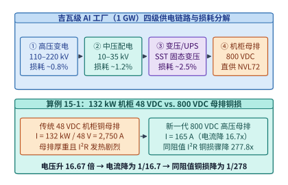

*图 15-1　吉瓦级 AI 工厂从 $220\ \mathrm{kV}$ 变电站到机柜 $800\ \mathrm{VDC}$ 母排与液冷 CDU 的全链路供电及铜损分解（算例 15-1）。*

图 15-1 汇总了吉瓦级 AI 工厂的四级供电转换链路及算例 15-1 的定量对比。为了在园区级容量规划中对各环节损耗建立清晰账本，表 15-1 给出了从电网变电站入口到最终硅片核心供电的典型效率分解与电能使用效率（Power Usage Effectiveness, $\mathrm{PUE}$）构成。

*表 15-1　吉瓦级 AI 数据中心供电转换链路与冷却附属功耗账本*

| 供电与制冷环节 | 典型电压/形态 | 单级效率 $\eta_i$ | 100 MW IT 负载对应输入功率 | 核心物理损耗机制与工程改进方向 |
| --- | --- | :---: | :---: | --- |
| **① 高压变电站（HV）** | $110\text{–}220\ \mathrm{kV}\ \mathrm{AC}$ | $99.2\%$ | $116.9\ \mathrm{MW}$ | 主变铁芯磁滞涡流损与绕组铜损；高等级取向硅钢片 |
| **② 园区中压环网（MV）** | $10\text{–}35\ \mathrm{kV}\ \mathrm{AC}$ | $98.8\%$ | $116.0\ \mathrm{MW}$ | 中压电缆阻抗发热；缩短变电站至机房楼管廊距离 |
| **③ 机房变压/UPS/SST** | $400\ \mathrm{VAC} \to 800\ \mathrm{VDC}$ | $97.5\%$ | $114.6\ \mathrm{MW}$ | 省去传统双变换 AC-DC-AC，采用中压直转 $800\ \mathrm{VDC}$ SST |
| **④ 机柜电源架与母排** | $800\ \mathrm{VDC} \to 50\ \mathrm{V}/12\ \mathrm{V}$ | $96.5\%$ | $103.6\ \mathrm{MW}$（IT 侧） | 采用氮化镓（GaN）/碳化硅（SiC）PSU 与 $800\ \mathrm{VDC}$ 母排 |
| **⑤ 液冷 CDU 与室外干冷器** | 二次侧水泵 + 室外风机 | 占 IT 功 $8.0\%$ | $+8.0\ \mathrm{MW}$（制冷侧） | 支持 ASHRAE W45 温水直冷，免除高耗电机械式冷水机组 |
| **园区总计（含照明监控）** | **综合 $\mathrm{PUE} \approx 1.12\text{–}1.17$** | **端到端 $\sim 85.5\%$** | **总并网负荷 $\approx 116.9\ \mathrm{MW}$** | 先进温水液冷园区可将制冷项压至 $5\%$ 以内（$\mathrm{PUE} \le 1.08$） |

在工程落地上，从 $48\ \mathrm{VDC}$ 迈向 $\pm 400\ \mathrm{VDC}$（$800\ \mathrm{VDC}$）不仅改变了铜母排的横截面积，还深刻重构了机柜内部的**电气安规与故障保护架构**：
1. **人体触电防护与带电盲插灭弧**：$48\ \mathrm{VDC}$ 属于安全特低电压（SELV）范畴，运维人员可直接维护；而 $800\ \mathrm{VDC}$ 远超安全电压阈值，且直流电不存在交流电每半周期自然过零点（Zero-Crossing），一旦带载拔插计算托盘，极易拉出持续的高温直流电弧。因此，$800\ \mathrm{VDC}$ 机柜必须将垂直母排全封闭在绝缘护套与联锁活门内，并在每个计算托盘入口配置**固态断路器（Solid-State Circuit Breaker, SSCB）**与预充电软启动电路，在微秒级时间内切断短路故障电流，彻底杜绝机械触点拉弧。
2. **中压直转直流的固态变压器（SST）集成**：传统数据中心在 $10\ \mathrm{kV}$ 中压配电与机柜电源架之间，需要串联庞大的工频干式变压器、低压配电柜与双变换 UPS，占地面积常常超过 IT 机房面积的 $40\%$。采用基于宽禁带碳化硅（SiC）MOSFET 的中压固态变压器后，可直接将 $10\text{–}35\ \mathrm{kV}$ 工频交流电通过高频隔离变换一步输出为稳定的 $800\ \mathrm{VDC}$ 直流母线，省去中间低压交流配电环节，将端到端配电效率推高 $2.5\%\text{–}3.5\%$，同时把变配电室占地面积压缩一半以上。
3. **板载两级高变比 DC-DC 降压拓扑**：当 $800\ \mathrm{VDC}$ 进入计算托盘后，需要降至 GPU 核心所需的 $0.65\text{–}0.85\ \mathrm{V}$（总降压比超过 $1{,}000:1$）。现代超节点主板采用“固定变比 LLC 谐振隔离母线转换器（将 $800\ \mathrm{V}$ 高效折算至 $48\ \mathrm{V}$ 或 $12\ \mathrm{V}$ 中间母线）+ 垂直供电（Vertical Power Delivery, VPD）多相耦合电感 VRM”的两级架构，将末级大电流路径缩短至硅中介层正下方不足 $2\ \mathrm{mm}$ 的垂直距离，从而把板级供电网络（PDN）的阻抗损耗控制在 $3\%$ 以内。

### 15.1.2 物理可行域与经济可行域的双边界：防范 $P_{\mathrm{domain}} \times \mathrm{GB/W}$ 口径错配（`D11-08`）

在根据园区或机柜供电上限规划可部署模型规模时，许多粗略架构估算常犯一个隐蔽却致命的**分子分母口径错配错误**：直接拿整个机柜或超节点的配电预算 $P_{\mathrm{domain}}$（例如单机柜 $132\ \mathrm{kW}$），乘以单张加速卡的数据手册能效比 $\mathrm{GB/W}_{\mathrm{accel}}$（即单卡 HBM 容量除以单卡加速芯片 TDP），据此类推该供电域可常驻的模型参数与 KV 缓存总量。

这种“纸面乘法”之所以会严重高估系统真实容量（虚高幅度通常达 $40\%\text{–}70\%$），是因为它在同一条公式里混淆了两个层面的物理口径，并漏扣了运行时显存预留：
1. **分母口径错位（整柜域功耗 vs. 纯加速卡功耗）**：$\mathrm{GB/W}_{\mathrm{accel}} = \frac{M_{\mathrm{card}}}{P_{\mathrm{TDP, card}}}$ 的分母仅仅是**加速卡硅片与封装 HBM 的标称功耗**；而在一个真实的超节点机柜供电域 $P_{\mathrm{domain}}$ 中，除了 GPU 本身外，还必须为宿主 CPU（如 36 颗 Grace/Vera CPU）、机柜内全互连 NVSwitch 交换芯片、数百只高速光模块/有源铜缆、NVMe 本地存储、机柜电源转换损耗以及冷板二次侧循环分担功耗供电。在现代高密度超节点机柜中，这部分**非 GPU 固定开销**占据了整柜实际输入功率的 $25\%\text{–}32\%$（即纯 GPU 功率占比系数 $\eta_{\mathrm{gpu}} = \frac{N_{\mathrm{gpu}} P_{\mathrm{TDP, card}}}{P_{\mathrm{domain}}} \approx 0.68\text{–}0.75$）。
2. **分子口径错位（物理焊死 HBM 容量 vs. 模型/KV 可用显存容量）**：即便算出了柜内 GPU 芯片的总物理 HBM 容量，也绝不能将其 $100\%$ 填入模型权重与 KV 缓存。正如第 5 章与第 8 章所严格证明的，运行时系统必须预留 CUDA 上下文、算子中间激活工作区（Activation Workspace）、集合通信收发缓冲区（NCCL/NVSHMEM Buffer）以及分页管理的页内碎片余量，真实可用于承载权重与 KV 状态的显存有效利用率通常仅为 $u_{\mathrm{mem}} \approx 0.78\text{–}0.85$。

因此，给定供电域功率上限 $P_{\mathrm{domain}}$ 时，真正物理可承载的模型与 KV 有效显存容量 $M_{\mathrm{eff}}$ 必须遵循如下**口径对齐方程**：

$$
M_{\mathrm{eff}} = P_{\mathrm{domain}} \cdot \eta_{\mathrm{gpu}} \cdot \left(\frac{M_{\mathrm{card}}}{P_{\mathrm{TDP, card}}}\right) \cdot u_{\mathrm{mem}}, \qquad \text{其中 } \eta_{\mathrm{gpu}} = \frac{P_{\mathrm{gpu\_total}}}{P_{\mathrm{domain}}} < 1,\quad u_{\mathrm{mem}} = \frac{M_{\mathrm{usable}}}{M_{\mathrm{physical}}} < 1
$$

> **算例 15-2：对比 $132\ \mathrm{kW}$ 机柜供电预算下“口径错配估算”与“口径对齐核算”的真实显存容量差距（`D11-08`）。**
> 设某超节点机柜的整柜配电上限为 $P_{\mathrm{domain}} = 132\ \mathrm{kW}$。单张加速卡配备 $M_{\mathrm{card}} = 192\ \mathrm{GB}$ HBM，加速卡自身标称热设计功耗为 $P_{\mathrm{TDP, card}} = 1{,}200\ \mathrm{W} = 1.2\ \mathrm{kW}$，故单卡标称容量能效比为：
> $$e_{\mathrm{card}} = \frac{192\ \mathrm{GB}}{1.2\ \mathrm{kW}} = 160\ \mathrm{GB/kW} = 0.16\ \mathrm{GB/W}$$
> - **错误估算（分子分母口径错配）**：
>   直接将整柜配电预算 $132\ \mathrm{kW}$ 乘以单卡 $0.16\ \mathrm{GB/W}$：
>   $$M_{\mathrm{naive}} = 132\ \mathrm{kW} \times 160\ \mathrm{GB/kW} = 21{,}120\ \mathrm{GB} \approx 21.12\ \mathrm{TB}$$
>   按此错误数字，架构师会误以为单机柜足以全量装下一座 $10\ \mathrm{TB}$ 权重加 $10\ \mathrm{TB}$ KV 缓存的超大模型实例。
> - **正确核算（对齐供电口径并扣除运行时显存余量）**：
>   实测该 72 卡机柜中，72 张 GPU 的满载功耗包络合计为 $95.04\ \mathrm{kW}$，其余 $36.96\ \mathrm{kW}$ 由 36 颗宿主 CPU、18 颗 NVSwitch 芯片、机柜电源架损耗与液冷压降分摊，即纯 GPU 功率占比 $\eta_{\mathrm{gpu}} = 95.04 / 132 = 0.72$（72%）。同时，扣除激活工作区、通信缓冲区与安全余量后，可用于权重与 KV 池的显存比例为 $u_{\mathrm{mem}} = 0.80$（80%）。代入对齐方程得：
>   $$M_{\mathrm{eff}} = 132\ \mathrm{kW} \times 0.72 \times 160\ \mathrm{GB/kW} \times 0.80 = 13{,}824\ \mathrm{GB} \times 0.80 = 11{,}059.2\ \mathrm{GB} \approx 11.06\ \mathrm{TB}$$
>   对比可见，未经口径对齐的粗略算法高估了 $(21.12 - 11.06) / 11.06 = \mathbf{90.96\%}$ 的可用显存（整整多算了 $10.06\ \mathrm{TB}$），一旦按错误容量投产，必然在加载模型或长上下文推理时触发显存溢出（OOM）或机柜断路器跳闸。

进一步地，即便某个部署方案通过了上述物理容量与功率校验，架构师还必须严格区分**物理可行域（Physical Feasibility Region）**与**经济可行域（Economic Feasibility Region）**：
- **物理可行域 $\mathcal{F}_{\mathrm{phys}}$**：指硬件装得下、电力供得上、热量散得出，即显存占用 $M \le M_{\mathrm{eff}}$、机柜瞬态与稳态功率 $P \le P_{\mathrm{cap}}$、且芯片结温 $T_j \le T_{j,\max}$；
- **经济可行域 $\mathcal{F}_{\mathrm{econ}} \subset \mathcal{F}_{\mathrm{phys}}$**：指在满足物理可行且达标延迟服务等级目标（$\mathrm{TTFT} \le L_{\mathrm{TTFT}}, \mathrm{TPOT} \le L_{\mathrm{TPOT}}$）的子集中，单位合格输出词元的全生命周期成本（含硬件折旧与电费）低于商业变现红线或替代架构成本的方案集合。例如，通过激进扩大张量并行度（TP）或强行使用高功耗模式虽然在物理上可行，但若边际吞吐增益不敌电费与跨机柜光模块折旧，该工作点便落在了“物理可行但经济亏损”的夹层带中。

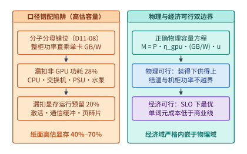

*图 15-2　物理可行域与经济可行域双边界及 $P_{\mathrm{domain}} \times \mathrm{GB/W}$ 口径错配高估警示图（算例 15-2，`D11-08`）。*

图 15-2 展示了口径错配陷阱与物理/经济可行双边界的包含关系。

### 15.1.3 站点条件（电价、接入容量、并网工期、机柜热限）作为一等设计输入（`D11-09`）

在传统软件工程中，数据中心选址（Site Selection）往往被视为与算法、并行策略完全正交的后勤采购问题。但在吉瓦级 AI 基础设施中，**站点条件（工业电价 $c_{\mathrm{elec}}$、变电站可用配额 $P_{\mathrm{site\_cap}}$、并网等待工期 $\Delta T_{\mathrm{wait}}$ 与机房散热形态）直接改写全生命周期成本方程的系数，从而反向决定了最优的硬件选型、精度策略与分布式并行拓扑**。

设某集群的 IT 硬件与网络一次性资本开支为 $\mathrm{CapEx}_{\mathrm{hw}}$，硬件经济折旧寿命为 $L_{\mathrm{life}}$（前沿 AI 芯片受制于每 18–24 个月翻倍的代际演进，实际商业经济折旧期通常取 $L_{\mathrm{life}} = 36\ \text{个月} = 3\ \text{年}$）。若因当地变电站扩容排队导致硬件到货后需等待 $\Delta T_{\mathrm{wait}}$ 个月才能通电投产，或者因等待单站点扩容而推迟上线，则按直线折旧或机会成本折算，**并网延期隐性折旧损失**与运行期**总电费开支**分别为：

$$
C_{\mathrm{delay}} = \mathrm{CapEx}_{\mathrm{hw}} \cdot \frac{\Delta T_{\mathrm{wait}}}{L_{\mathrm{life}}}, \qquad C_{\mathrm{power}}(T_{\mathrm{run}}) = P_{\mathrm{IT}} \cdot \mathrm{PUE} \cdot T_{\mathrm{run}} \cdot c_{\mathrm{elec}}
$$

> **算例 15-3：核算 $100\ \mathrm{MW}$ 训练园区在电价差（$0.04$ vs. $0.12\ \text{美元/kWh}$）与并网延期 $6$ 个月下的亿级美元账本（`D11-09`）。**
> 考虑一座 IT 满载功率 $P_{\mathrm{IT}} = 100\ \mathrm{MW}$、园区 $\mathrm{PUE} = 1.15$（总并网功率 $115\ \mathrm{MW} = 115{,}000\ \mathrm{kW}$）的旗舰算力中心，其加速卡、超节点网络与存储总投资为 $\mathrm{CapEx}_{\mathrm{hw}} = 20\ \text{亿美元}$，硬件经济寿命 $L_{\mathrm{life}} = 36\ \text{个月}$（即每月固定折旧高达 $20 / 36 \approx 0.5556\ \text{亿美元/月}$）。
> 1. **三年运行期的电价敏感性**：
>    三年（$T_{\mathrm{run}} = 3 \times 8{,}760 = 26{,}280\ \text{小时}$，设平均负载率 $90\%$，等效满载 $23{,}652\ \text{小时}$）总耗电量为：
>    $$E_{3\mathrm{yr}} = 115{,}000\ \mathrm{kW} \times 23{,}652\ \mathrm{h} \approx 2.72 \times 10^9\ \mathrm{kWh}$$
>    - 在水电/风光电富集的低电价站点（$c_{\mathrm{elec, A}} = 0.04\ \text{美元/kWh}$），三年总电费为 $2.72 \times 10^9 \times 0.04 = \mathbf{1.088\ \text{亿美元}}$；
>    - 在一线核心城市周边高电价站点（$c_{\mathrm{elec, B}} = 0.12\ \text{美元/kWh}$），三年总电费跃升至 $2.72 \times 10^9 \times 0.12 = \mathbf{3.264\ \text{亿美元}}$，两者差额高达 **$\mathbf{2.176\ \text{亿美元}}$**（若按 $100\%$ 满载 $26{,}280\ \text{小时}$ 计，仅 $100\ \mathrm{MW}$ IT 本身在 $0.08\ \text{美元/kWh}$ 价差下即相差 $100{,}000 \times 26{,}280 \times 0.08 \approx \mathbf{2.10\ \text{亿美元}}$）。
> 2. **并网工期（Time-to-Power）延误 $6$ 个月的折旧代价**：
>    若低电价站点 A 需要等待新建 $220\ \mathrm{kV}$ 变电站而延误 $\Delta T_{\mathrm{wait}} = 6\ \text{个月}$ 才能通电，而现成站点或双园区拆分方案可以立即上电，则这 $6$ 个月等待期内硬件贬值与窗口期折旧损失高达：
>    $$C_{\mathrm{delay}} = 20\ \text{亿美元} \times \frac{6}{36} = \mathbf{3.333\ \text{亿美元}}$$
>    这一数字（$3.33\ \text{亿美元}$）甚至超过了三年电价差（$2.10\text{–}2.18\ \text{亿美元}$）的全部收益。这深刻解释了为什么一线大模型团队在电网配额受限时，宁可租用昂贵的跨城长途波分光纤将训练任务拆分至多座现成 $50\text{–}100\ \mathrm{MW}$ 园区，或部署重型燃气轮机/储能微网先行投产，也绝不让价值数十亿美元的加速卡在仓库里空等变电站完工。

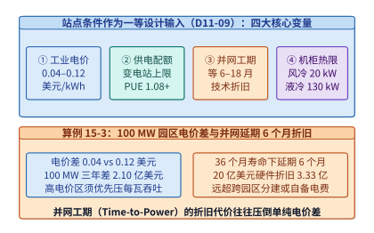

*图 15-3　站点条件（电价、供电上限、并网延期折旧与散热阈值）作为一等设计输入的 TCO 敏感性矩阵（算例 15-3，`D11-09`）。*

图 15-3 展示了四大站点变量对 TCO 的敏感性冲击。更进一步，站点条件不仅影响财务报表，还会直接改变**技术架构的最优解**，表 15-2 总结了四类典型站点约束如何反向重塑并行切分、精度与冷却架构决策。

*表 15-2　站点条件作为一等设计输入对 AI 系统架构的反向重塑矩阵（`D11-09`）*

| 站点主导约束类型 | 典型物理边界参数 | 被迫放弃的常规方案 | 最优系统与硬件协同设计对策 |
| --- | --- | --- | --- |
| **高电价都市边缘站点** | $c_{\mathrm{elec}} \ge 0.12\ \text{美元/kWh}$，网络延迟极低（$<2\ \mathrm{ms}$） | 高功耗粗放 BF16 推理、低利用率大 TP 空转 | 全面启用 NVFP4/FP8 微缩量化、硬件功率封顶（压低 $15\%$ 电压/频率换取 $+22\%$ 能效比），主要承担低延迟在线 Decode 与交互式 Agent 服务 |
| **低电价偏远绿电基地** | $c_{\mathrm{elec}} \le 0.04\ \text{美元/kWh}$，距核心城市 $\ge 1{,}000\ \mathrm{km}$ | 对首字延迟（$<50\ \mathrm{ms}$）敏感的同步在线服务 | 部署高功率密度液冷超节点，承担长周期预训练、强化学习离线 Rollout、评测以及错峰 Batch 推理（第 11 章） |
| **单机柜风冷改造机房** | 单机柜配电与风冷上限 $\le 18\text{–}25\ \mathrm{kW}$ | 单柜集成 72 卡铜缆 NVLink 超节点（需 $>120\ \mathrm{kW}$） | 限制单柜仅装 2 台 8 卡服务器，跨机柜依赖 AOC/光模块组网，并行策略必须规避跨柜高敏 All-to-All，优先采用流水线并行（PP）与 ZeRO 分片 |
| **单站点变电配额封顶** | 现成变电站上限 $P_{\mathrm{site}} \le 80\ \mathrm{MW}$，扩容需等 $12$ 个月 | 单一园区集中式十万卡全同步数据并行 | 启用 DSX MaxLPS 软硬协同功率超配（同配额多装 $+40\%$ GPU），并结合 15.4 节跨园区光网（Cross-DC PP / Streaming DiLoCo）实现多站点联合训练 |

---

## 15.2 同步训练的电网负载冲击（Power Swing）与功率平滑机制

如果说平均供电容量决定了数据中心能否“开得起机”，那么**瞬态功率变化率（Ramp Rate, $\mathrm{d}P/\mathrm{d}t$）与周期性功率摆幅（Power Swing）**则决定了吉瓦级训练集群能否在不击穿园区电网的前提下持续运行。

### 15.2.1 万卡同步 Step 边界的 $\mathrm{d}P/\mathrm{d}t$ 功率冲击波与次同步谐振风险

在传统云计算或互联网视频服务中，十万台服务器各自处理海量独立用户请求，单台机器的负载起伏在宏观上被中心极限定理完全抹平，机房总功率波动幅度通常小于 $\pm 2\%$。然而，大语言模型的分布式同步预训练（如 Megatron-LM 架构下的 $\mathrm{TP} \times \mathrm{PP} \times \mathrm{DP} \times \mathrm{EP}$）在物理上是一台**十万张加速卡被同一个全局时钟屏障（Barrier）锁相耦合的巨型同步状态机**：

1. **密集矩阵计算期（GEMM Phase）**：在前向传播与反向传播的矩阵乘（特别是全连接层与注意力投影）阶段，十万张加速卡的 Tensor Core 与 HBM 控制器同时满载工作，单卡瞬时功率拉满至 $1{,}000\text{–}1{,}400\ \mathrm{W}$，十万卡集群的 IT 瞬时总功率维持在 $100\text{–}140\ \mathrm{MW}$ 高位。
2. **集合通信与流水线气泡期（AllReduce / Pipeline Bubble Phase）**：当每个训练迭代步（Step）到达末尾的梯度同步屏障，或进入 1F1B 流水线的启动/排空（Warm-up / Flush）气泡期，乃至发生跨节点 All-to-All 拥塞等待时，全集群 Tensor Core 几乎在同一毫秒内停止矩阵乘运算，仅保留网卡 RDMA 引擎与少量归约核工作。此时单卡瞬时功率在数毫秒内骤降至空闲/通信态的 $300\text{–}450\ \mathrm{W}$，十万卡集群总功率瞬间跌落至 $35\text{–}45\ \mathrm{MW}$。
3. **优化器更新与下一 Step 齐步拉起**：一旦 AllReduce 完成，十万张卡又在同一毫秒内同步执行 AdamW 优化器更新并立即冲入下一 Step 的前向 GEMM，集群总功率在 $5\text{–}15\ \mathrm{ms}$ 内再度暴涨 $65\text{–}95\ \mathrm{MW}$。

设集群包含 $N_{\mathrm{gpu}}$ 张同步训练加速卡，计算满载功率为 $P_{\mathrm{high}}$，通信等待期功率为 $P_{\mathrm{low}}$，状态切换过渡时间为 $\Delta t_{\mathrm{trans}}$，单步迭代周期为 $T_{\mathrm{step}}$。则集群级功率摆幅 $\Delta P_{\mathrm{swing}}$ 与瞬态功率斜率 $\mathrm{d}P/\mathrm{d}t$ 分别为：

$$
\Delta P_{\mathrm{swing}} = N_{\mathrm{gpu}} \cdot (P_{\mathrm{high}} - P_{\mathrm{low}}), \qquad \left|\frac{\mathrm{d}P}{\mathrm{d}t}\right|_{\max} \approx \frac{\Delta P_{\mathrm{swing}}}{\Delta t_{\mathrm{trans}}}, \qquad f_{\mathrm{swing}} = \frac{1}{T_{\mathrm{step}}}
$$

以 $N_{\mathrm{gpu}} = 100{,}000$、$P_{\mathrm{high}} = 1{,}000\ \mathrm{W}$、$P_{\mathrm{low}} = 350\ \mathrm{W}$、切换时间 $\Delta t_{\mathrm{trans}} = 10\ \mathrm{ms}$ 为例，单次同步切换的功率阶跃高达 $\Delta P_{\mathrm{swing}} = 65\ \mathrm{MW}$，瞬态斜率高达 **$6{,}500\ \mathrm{MW/s}$**。更危险的是，现代大模型单步或微批次周期通常落在 $T_{\mathrm{step}} \in [50\ \mathrm{ms}, 2\ \mathrm{s}]$ 区间，对应激励频率 $f_{\mathrm{swing}} \in [0.5\ \mathrm{Hz}, 20\ \mathrm{Hz}]$：
- 该频段恰好落在发电厂汽轮机/燃气轮机旋转轴系的机械调速盲区与电网**次同步振荡（Sub-Synchronous Oscillation, SSO）**敏感频带内：机械调速器需要数秒才能响应，而毫秒级周期性方波会引发变电站有载调压抽头（OLTC）频繁误动作、母线电压闪变（Flicker）以及变压器磁致伸缩剧烈异响；
- 若训练任务因某个节点未捕获异常（如 NCCL 超时或段错误）触发**全集群紧急停机（Job Crash）**，$100\ \mathrm{MW}$ 级有功负荷在几十毫秒内彻底甩空（Load Rejection），会导致上级变电站母线瞬态过电压与局部微网频率飙升，严重时触发电网保护装置跳闸解列。

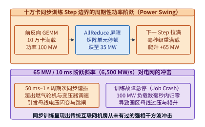

*图 15-4　十万卡同步训练在 GEMM 计算期与 AllReduce 通信期周期性切换引发的 $85\ \mathrm{MW}$ 电网阶跃冲击波形。*

图 15-4 展示了十万卡同步训练在 Step 边界产生的周期性功率方波及其对上级电网的冲击机理。

### 15.2.2 硬件级智能功率平滑与集群功率超配：Vera Rubin 储能反馈与 DSX MaxLPS

要在不牺牲训练吞吐的前提下彻底制服毫秒级功率方波，必须在靠近负载的机架（Rack）与机房配电层引入类似处理器“片上去耦电容”的**机架级快速储能缓冲与反馈功率整形机制**。

根据 NVIDIA Vera Rubin NVL72 系统工程规范与 DSX 参考设计[^rubin-system][^rubin-arch]，新一代吉瓦级 AI 基础设施在机架电源架（Power Shelf）与园区配电层引入了两项协同硬件技术创新：

1. **基于储能荷电状态（SoC）反馈控制的机架级智能功率平滑（Smart Power Smoothing）**：
   在机架电源架内部集成高倍率超级电容或固态锂电储能模块，并由机架功率控制器按储能单元的实时荷电状态（State of Charge, $\mathrm{SoC}$）实施毫秒级反馈充放电调节。当机柜内 72 张 GPU 进入密集 GEMM 峰值脉冲（持续数十至数百毫秒）时，储能模块立即与电网并网放电（Peak Shaving），拦截向电网侧传导的尖峰电流；当 GPU 进入 AllReduce 通信等待或流水线气泡期时，机架输入功率并不随负载陡降，而是维持平稳输入并将多余电能充入机架储能模块（Valley Filling）。实测与规范数据表明，该反馈控制机制能够：
   - **削平约 $20\%$ 的 $50\ \mathrm{ms}$ 级瞬态峰值功率脉冲**，将原本陡峭的 $\mathrm{d}P/\mathrm{d}t$ 阶跃斜率限制在燃气轮机与电网变压器可平缓跟随的安全包络内；
   - 通过消除为防范毫秒级过流跳闸而强加的无效供电裕量与电源轻载低效区，**将全机架平均功耗降低约 $10\%$**。

2. **DSX MaxLPS（Maximum Load Power Smoothing）集群级功率超配（Power Over-provisioning）**：
   在传统刚性配电准则下，机房必须按照所有机柜的**铭牌峰值功耗（Nameplate Peak Power）**之和来向电力公司申请变电站容量——即便训练负载在全生命周期内只有极短瞬间触及峰值，那部分为尖峰预留的 $25\%\text{–}35\%$ 变电站与 UPS 容量在绝大部分时间里都处于闲置浪费状态。
   借助机架级储能削峰、微秒级硬件功耗遥测（Telemetry）与软硬件封顶（Power Capping）联动，DSX MaxLPS 将每个机柜向电网侧索取的持续功率上限安全锁定在远低于瞬态峰值的稳态包络线上（单柜电网侧持续需量压低约 $28.6\%$）。由于 $1 / (1 - 0.2857) = 1.40$，这意味着**在同一固定兆瓦数（如 $100\ \mathrm{MW}$）的变电站电力配额下，园区能够安全超配部署最高 $+40\%$ 的 GPU 算力规模**，将原本被峰值裕量锁死的电网容量直接转化为实打实的训练词元吞吐。

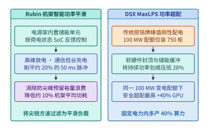

*图 15-5　Vera Rubin 机架级储能 SoC 功率平滑（削峰 $20\%$、均功降 $10\%$）与 DSX MaxLPS 同配额 $+40\%$ GPU 超配机制。*

图 15-5 对比了 Vera Rubin 机架级智能功率平滑与 DSX MaxLPS 超配机制的工作流程。为了从控制论角度严谨实现这套机制，机架电源控制器在每个控制周期 $\Delta t_{\mathrm{ctrl}} = 100\ \mu\mathrm{s}$ 内维护如下**荷电状态（SoC）与电网功率一阶低通滤波动态方程**：

$$
P_{\mathrm{grid}}(t) = \mathrm{clip}\!\left(\bar{P}_{\mathrm{LPF}}(t) + K_{\mathrm{soc}}\cdot\bigl(\mathrm{SoC}_{\mathrm{ref}} - \mathrm{SoC}(t)\bigr),\; P_{\min},\; P_{\mathrm{cap}}\right)
$$

$$
\frac{\mathrm{d}\,\mathrm{SoC}(t)}{\mathrm{d}t} = \frac{\eta_{\mathrm{chg/dis}}}{E_{\mathrm{max}}} \cdot \bigl(P_{\mathrm{grid}}(t) - P_{\mathrm{IT}}(t)\bigr)
$$

其中：
- $P_{\mathrm{IT}}(t)$ 为 72 张 GPU 与交换托盘的瞬时负载功率；
- $\bar{P}_{\mathrm{LPF}}(t)$ 为时间常数 $\tau_{\mathrm{filter}} \approx 0.5\text{–}2.0\ \mathrm{s}$ 的指数移动平均功率；
- $\mathrm{SoC}_{\mathrm{ref}} \approx 0.55$ 为储能模块的稳态目标荷电水位（刻意留出上方 $45\%$ 空间吸收通信等待期的回充能量，留出下方 $45\%$ 能量支撑 GEMM 突发尖峰）；
- $K_{\mathrm{soc}}$ 为比例恢复增益，确保在每次脉冲过后储能水位能以平缓斜率自动回归 $\mathrm{SoC}_{\mathrm{ref}}$，绝不在下一轮迭代到来前发生电容耗尽（Depletion）或过压饱和（Saturation）。
- 当由于极长异常阻塞导致 $\mathrm{SoC}(t)$ 跌破硬件警戒水位（如 $\mathrm{SoC} < 0.15$）时，机架微控制器会通过硬件带外快速通道（Fast Hardware Throttling Brake）在数十微秒内微调 GPU 时钟频率（降频 $5\%\text{–}8\%$），构筑起“超级电容瞬态缓冲 + 硬件频率微调兜底 + 变电站断路器永不跳闸”的三道纵深防线。

### 15.2.3 运行时软件协同抑峰：交错微批次相位、斜率限幅器与低功耗填谷

硬件储能模块的高效运转离不开上层训练框架与集群调度器的协同——因为超级电容或机架电池的能量容量 $E_{\mathrm{buf}} = \int \Delta P(t)\,\mathrm{d}t$ 是有限的（通常仅支持数百毫秒至数秒的削峰填谷）。若软件层面对长达数秒的同步空闲或全集群同时启停放任不管，机架储能很快就会耗尽（$\mathrm{SoC} \to \mathrm{SoC}_{\min}$）或充满饱和（$\mathrm{SoC} \to \mathrm{SoC}_{\max}$）。因此，吉瓦级训练运行时（Runtime）必须实施三层软件协同抑峰：

1. **计算与通信相位的时空交错（Phase Staggering & DualPipe）**：
   消除宏观功率方波的根本之道，是打破不同并行子域在时间轴上的“同相共振”。一方面，在流水线并行中采用第 10 章详述的 **DualPipe 双向交错流水线**或细粒度计算—通信重叠算子，使每张卡在每个微批次周期内都同时混合矩阵乘与 RDMA 通信，从源头缩小单卡 $(P_{\mathrm{high}} - P_{\mathrm{low}})$ 的落差；另一方面，当园区内运行多个训练任务或采用分层数据并行时，调度器通过显式注入毫秒级相位偏移 $\Delta \phi_k = \frac{k}{K} T_{\mathrm{step}}$，使第 $k$ 个子集群的 GEMM 波峰恰好对齐第 $(k+1)$ 个子集群的 AllReduce 波谷，在机房总母线上实现多路方波的相消叠加。
2. **作业启停斜率限制器（Job Ramp-Rate Limiter）**：
   严禁十万张卡在同一毫秒从空闲态（$300\ \mathrm{W}$）直接跳入满载训练态（$1{,}000\ \mathrm{W}$），也严禁在训练结束或捕获到软故障时瞬时硬切断全群算子。训练启动时，运行时按机柜排（Row）分批渐进拉起微批次大小或阶梯式解锁 GPU 功率上限（例如以 $\le 5\ \mathrm{MW/s}$ 的受控斜率在 $20\ \mathrm{s}$ 内平稳爬升至 $100\ \mathrm{MW}$）；当遇到单节点通信超时需重配置或退出时，其余健康节点先转入持续 $10\text{–}15\ \mathrm{s}$ 的阶梯式降频缓降序列（Graceful Power Ramp-Down），给园区微网与上级变电站充足的机械调压响应时间。
3. **长通信等待期的动态 DVFS 与受控保底核（Controlled Floor Kernel）**：
   对于因负载不均（如 MoE 专家热点或长短序列混训）导致的数百毫秒级同步等待窗口，若直接空转等待会导致功率瞬间塌陷，若盲目死循环跑满载空矩阵乘（Dummy GEMM）又会额外消耗宝贵电能并加剧散热压力。现代运行时结合 NCCL 图感知预测等待时长 $\tau_{\mathrm{wait}}$：当 $\tau_{\mathrm{wait}} < 20\ \mathrm{ms}$ 时交由机架储能吸收；当 $\tau_{\mathrm{wait}} \in [20\ \mathrm{ms}, 500\ \mathrm{ms}]$ 时，通过硬件微控制器动态下调 SM 频率与核心电压（DVFS），或调度执行具有实际系统收益的中等功率后台任务（如异步检查点张量奇偶校验、乐观激活压缩预编码），将功率回落幅度控制在电网允许的平滑斜率之内。

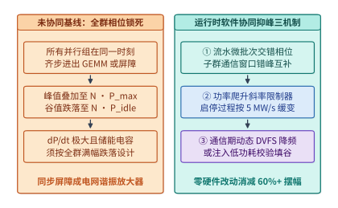

*图 15-6　运行时软件协同抑峰：流水线微批次错峰注入、斜率限幅器与空闲期受控保底核时序对比。*

图 15-6 展示了未协同基线与运行时软件三机制协同抑峰的对比。表 15-3 进一步给出了软硬件各层功率治理技术在响应时间尺度、抑峰幅度与硬件/吞吐代价上的全景对照。

*表 15-3　吉瓦级 AI 集群多时间尺度功率冲击治理技术对照表*

| 治理层级与技术方案 | 作用时间尺度 | 峰值摆幅削减率 | 平均能耗影响 | 训练吞吐折损 | 适用场景与物理边界 |
| --- | :---: | :---: | :---: | :---: | --- |
| **板载去耦电容与 VRM 动态调压** | $1\ \mathrm{ns}\text{–}100\ \mu\mathrm{s}$ | 滤除高频毛刺 | $0\%$ | $0\%$ | 吸收单个 Kernel 内部指令发射级电流突变 |
| **Rubin 机架级储能 SoC 反馈控制** | $1\ \mathrm{ms}\text{–}1\ \mathrm{s}$ | **$-20\%$（$50\ \mathrm{ms}$ 峰）** | **$-10\%$（均功）** | $0\%$ | 平滑 Step 内 GEMM 与 AllReduce 切换冲击 |
| **DualPipe / 跨子群微批相位交错** | $10\ \mathrm{ms}\text{–}2\ \mathrm{s}$ | $-40\%\text{–}-65\%$ | $-1\%\text{–}0\%$ | $0\%$（反升吞吐） | 消除计算与通信的宏观同相叠加 |
| **通信等待期 DVFS + 校验核填谷** | $50\ \mathrm{ms}\text{–}5\ \mathrm{s}$ | $-30\%\text{–}-50\%$ | $-3\%\text{–}+2\%$ | $<0.5\%$ | 抑制长尾同步屏障与 MoE 负载失衡引起的深谷 |
| **作业启停斜率限幅器（Ramp Limiter）** | $1\ \mathrm{s}\text{–}30\ \mathrm{s}$ | 将 $\mathrm{d}P/\mathrm{d}t$ 压至 $\le 5\ \mathrm{MW/s}$ | $<0.1\%$ | 仅启停耗时 $+15\ \mathrm{s}$ | 防范十万卡齐步开机或 Crash 甩负荷引发电网跳闸 |
| **DSX MaxLPS 软硬协同功率超配** | 持续稳态（全天候） | 削减 $28.6\%$ 需量裕量 | 单位算力 $\mathrm{PUE}$ 降 | **同配额 $+40\%$ 算力** | 变电站配额受限园区实现装机算力最大化 |

---

## 15.3 液冷热力学（ASHRAE W45）、功率密度悖论与热感知调度（*TAPAS*）

根据能量守恒定律，输入吉瓦级 AI 园区的那 $100\ \mathrm{MW}\text{–}1\ \mathrm{GW}$ 高品质电能，除极微弱的一小部分转化为跨城光纤中的光子能量外，**超过 $99.99\%$ 最终都在纳秒级晶体管翻转与导线焦耳发热中转化为必须被及时移出机房的低温废热**。一旦热量移出速度落后于产热速度，硅片结温（Junction Temperature, $T_j$）将在数秒内冲破 $85\text{–}90^\circ\mathrm{C}$ 的硬件保护红线，触发强制降频乃至停机熔断。

### 15.3.1 风冷物理极限（ASHRAE $1{,}900\ \mathrm{CFM}$/地板砖）与冷板式液冷（W45 温水直冷）热力学

为什么当单机柜功率跨过 $30\text{–}40\ \mathrm{kW}$ 门槛后，沿用数据中心数十年的空气冷却（Air Cooling）会彻底失效？美国采暖、制冷与空调工程师学会（ASHRAE）TC 9.9 技术委员会发布的《数据中心液冷指南》给出了无可辩驳的流体力学与热力学定量证明[^ashrae-cooling]：

1. **地板下送风的体积流量物理极限（$1{,}900\ \mathrm{CFM/tile}$）**：
   在典型架空活动地板（Raised-Floor）风冷机房中，冷风经穿孔地板砖（Perforated Tile）吹入冷通道并被服务器风扇吸入。受制于架空地板下静压箱高度与开孔率气动阻力，在不引发局部文丘里负压倒吸（Reverse Flow）的前提下，**每块标准穿孔地板砖所能提供的极限风量约为 $1{,}900\ \mathrm{CFM}$（立方英尺/分钟，约合 $0.90\ \mathrm{m^3/s}$）**。
   而在高功率 AI 服务器中，为带走千瓦级热量且不让出风温度烫伤后排线缆，每 $1\mathrm{U}$ 机架高度通常需要约 $100\ \mathrm{CFM}$ 的空气流量。两相除即得：
   $$H_{\mathrm{air\_max}} = \frac{1{,}900\ \mathrm{CFM}}{100\ \mathrm{CFM/U}} = 19\mathrm{U}$$
   这意味着在一台标准 $42\mathrm{U}\text{–}48\mathrm{U}$ 机柜中，单块地板砖的风量最多只够供给 $19\mathrm{U}$ 的服务器；若强行塞满整柜，超出一倍以上的风量缺口只能从热通道回流热风填补，瞬间引发局部热失控。
2. **风扇立方律功耗反扑**：
   根据风机相似定律，空气体积流量 $\dot{V}_{\mathrm{air}}$ 与风扇转速成正比，而风扇轴功率 $P_{\mathrm{fan}}$ 与转速的**三次方**成正比（$P_{\mathrm{fan}} \propto \dot{V}_{\mathrm{air}}^3$）。在低密度通用服务器中，风扇功耗仅占整机功耗的 $<2\%$；但在高密度风冷 AI 机柜中，为克服紧凑散热鳍片的高风阻，暴力风扇阵列自身消耗的电能急剧攀升至服务器总功耗的 **$10\%\text{–}20\%$**——每多吹一点风，风扇马达自身都在变成新的发热源。
3. **水与空气高达 $3{,}500$ 倍的体积热容鸿沟**：
   在标准大气压下，干空气的定压比热容 $c_{p,\mathrm{air}} \approx 1.005\ \mathrm{kJ/(kg\cdot K)}$，密度 $\rho_{\mathrm{air}} \approx 1.2\ \mathrm{kg/m^3}$，故单位体积空气每升高 $1\ \mathrm{K}$ 仅能吸收 $\rho_{\mathrm{air}} c_{p,\mathrm{air}} \approx 1.2\ \mathrm{kJ/(m^3\cdot K)}$ 热量；相比之下，液态水的比热容高达 $c_{p,\mathrm{water}} \approx 4.184\ \mathrm{kJ/(kg\cdot K)}$，密度 $\rho_{\mathrm{water}} \approx 997\ \mathrm{kg/m^3}$，单位体积蓄热能力达 $\rho_{\mathrm{water}} c_{p,\mathrm{water}} \approx 4{,}171\ \mathrm{kJ/(m^3\cdot K)}$，**约为空气的 $3{,}476$ 倍**。

因此，将微通道铜冷板（Cold Plate）直接贴合在 GPU、CPU 与 NVSwitch 裸晶封装顶盖上，通过冷却液分配单元（Coolant Distribution Unit, CDU）与机柜分集水器（Manifold）驱动去离子水或丙二醇水溶液循环换热，成为百千瓦级机柜的唯一正道。设冷板回路移出的热功率为 $Q$（单位 $\mathrm{kW}$），冷却液质量流量为 $\dot{m}$（单位 $\mathrm{kg/s}$），进出口温差为 $\Delta T = T_{\mathrm{out}} - T_{\mathrm{in}}$（单位 $\mathrm{K}$ 或 $^\circ\mathrm{C}$）；按 ASHRAE TC 9.9 标准定义，芯片外壳（Case）至局部冷却介质（环境空气或冷板流体 $T_{\mathrm{ambient}} / T_{\mathrm{fluid}}$）的封装热阻参数定义为 $\Psi_{\mathrm{ca}} = (T_{\mathrm{case}} - T_{\mathrm{ambient}})/P$（单位 $\mathrm{^\circ C/W}$ 或 $\mathrm{K/W}$）。则液冷回路稳态热平衡方程与芯片温度上限联立如下：

$$
Q = \dot{m} \cdot c_p \cdot \Delta T = \rho \cdot \dot{V} \cdot c_p \cdot \Delta T, \qquad \Psi_{\mathrm{ca}} = \frac{T_{\mathrm{case}} - T_{\mathrm{ambient}}}{P}, \qquad T_{\mathrm{case}} = T_{\mathrm{fluid}} + P_{\mathrm{chip}} \cdot \Psi_{\mathrm{ca}} \le T_{\mathrm{case, max}}
$$

ASHRAE TC 9.9 根据机房一次侧/二次侧供水温度范围，将液冷系统划分为六个标准水温等级（Water Thermal Classes）：**W17**（$2\text{–}17^\circ\mathrm{C}$）、**W27**（$2\text{–}27^\circ\mathrm{C}$）、**W32**（$2\text{–}32^\circ\mathrm{C}$）、最新增补的 **W40**（$2\text{–}40^\circ\mathrm{C}$）、**W45**（$2\text{–}45^\circ\mathrm{C}$）以及 **W+**（$>45^\circ\mathrm{C}$）[^ashrae-cooling]。这六个等级的工程分水岭在于 **$32^\circ\mathrm{C}\text{–}45^\circ\mathrm{C}$**：
- 若芯片冷板要求低温冷冻水（如 W17 / W27，进水 $<27^\circ\mathrm{C}$），则在夏季室外气温高于 $25^\circ\mathrm{C}$ 时，数据中心必须开启高耗电的机械压缩式冷水机组（Chiller）强制制冷，园区 $\mathrm{PUE}$ 很难低于 $1.20\text{–}1.25$；
- 反之，若通过优化微通道冷板设计将芯片至流体热阻 $\Psi_{\mathrm{ca}}$ 压至极低，使得加速卡能够支持 **ASHRAE W45（最高 $45^\circ\mathrm{C}$ 温水进液，如 NVIDIA Vera Rubin NVL72 全系原生支持 $45^\circ\mathrm{C}$ 供液温度）**[^rubin-system]，则出液温度可达 $55\text{–}60^\circ\mathrm{C}$。由于 $45^\circ\mathrm{C}$ 始终高于全球绝大部分地区全年室外环境温度，园区只需在室外配置干冷器（Dry Cooler）利用自然环境空气直接冷却循环水，**彻底免除机械压缩冷水机组（Chiller-less）与蒸发冷却塔耗水（Zero Water Evaporation）**，将全年综合 $\mathrm{PUE}$ 压低至 $\le 1.08$。

> **算例 15-4：核算 $132\ \mathrm{kW}$ Vera Rubin 级液冷机柜在 ASHRAE W45（$T_{\mathrm{in}} = 45^\circ\mathrm{C}, \Delta T = 12^\circ\mathrm{C}$）下的冷却水流量与结温边界。**
> 设单台 NVL72 液冷机柜由冷板带走的热功率为 $Q = 132\ \mathrm{kW} = 132\ \mathrm{kJ/s}$（全液冷设计下约 $98\%+$ 热量由液体直接带走）。二次侧采用纯水冷却液，$45^\circ\mathrm{C}$ 下比热容 $c_p = 4.18\ \mathrm{kJ/(kg\cdot K)}$，密度 $\rho \approx 0.990\ \mathrm{kg/L}$。设计供液温度 $T_{\mathrm{in}} = 45^\circ\mathrm{C}$，回液温度 $T_{\mathrm{out}} = 57^\circ\mathrm{C}$，即进出口温差 $\Delta T = 12\ \mathrm{K}$。
> 1. **求解整柜所需冷却水质量流量 $\dot{m}$ 与体积流量 $\dot{V}$**：
>    $$\dot{m} = \frac{Q}{c_p \cdot \Delta T} = \frac{132\ \mathrm{kJ/s}}{4.18\ \mathrm{kJ/(kg\cdot K)} \times 12\ \mathrm{K}} = \frac{132}{50.16}\ \mathrm{kg/s} \approx 2.6316\ \mathrm{kg/s}$$
>    换算为工程常用的升/秒（$\mathrm{L/s}$）与升/分钟（$\mathrm{L/min}$）：
>    $$\dot{V} = \frac{\dot{m}}{\rho} \approx \frac{2.6316\ \mathrm{kg/s}}{0.990\ \mathrm{kg/L}} \approx 2.658\ \mathrm{L/s} \approx \mathbf{159.5\ \mathrm{L/min}} \quad (\text{若按常温 } \rho \approx 1.0\ \mathrm{kg/L}\text{ 计则为 } 2.63\ \mathrm{L/s} = \mathbf{157.8\ \mathrm{L/min}})$$
>    归一化到每千瓦热负荷，单位功率所需水流量仅为：
>    $$\frac{\dot{V}}{Q} = \frac{157.8\ \mathrm{L/min}}{132\ \mathrm{kW}} \approx \mathbf{1.195\ \mathrm{L/(min\cdot kW)}} \approx 1.2\ \mathrm{L/(min\cdot kW)}$$
>    若改用风冷（$\Delta T = 15\ \mathrm{K}$，空气体积热容 $1.2\ \mathrm{kJ/(m^3\cdot K)}$），同样 $132\ \mathrm{kW}$ 需要高达 $132 / (1.2 \times 15) = 7.33\ \mathrm{m^3/s} \approx \mathbf{15{,}538\ \mathrm{CFM}}$ 的极高风量（相当于在单个机柜工位下方强行塞入 $8.2$ 块极限地板砖）。
> 2. **校核 $45^\circ\mathrm{C}$ 进水下的芯片外壳温度 $T_{\mathrm{case}}$**：
>    设单颗 GPU 芯片热功耗 $P_{\mathrm{chip}} = 1{,}400\ \mathrm{W}$，微通道铜冷板与铟片导热界面材料（TIM）的总热阻控制在 $\Psi_{\mathrm{ca}} = 0.018\ \mathrm{^\circ C/W}$，冷板局部平均水温 $T_{\mathrm{fluid}} \approx 49^\circ\mathrm{C}$。则芯片顶盖温度为：
>    $$T_{\mathrm{case}} = 49^\circ\mathrm{C} + 1{,}400\ \mathrm{W} \times 0.018\ \mathrm{^\circ C/W} = 49^\circ\mathrm{C} + 25.2^\circ\mathrm{C} = \mathbf{74.2^\circ\mathrm{C}} < 85^\circ\mathrm{C}$$
>    由此证明，只要封装与冷板热阻 $\Psi_{\mathrm{ca}}$ 足够低，即便进水温度高达 $45^\circ\mathrm{C}$，芯片依然能稳稳运行在安全结温裕度之内。

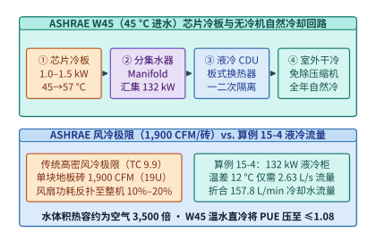

*图 15-7　ASHRAE TC 9.9 W45（$45^\circ\mathrm{C}$ 温水进液）冷板—分集水器—CDU—干冷器无冷机换热回路与流量核算（算例 15-4）。*

图 15-7 展示了 ASHRAE W45 冷板液冷回路与算例 15-4 的定量结果。表 15-4 系统对比了高密度风冷、单相冷板式液冷与浸没式液冷在单柜功率上限、冷却介质蓄热能力、机房改造复杂度与典型 $\mathrm{PUE}$ 上的工程取舍。

*表 15-4　数据中心三类主流散热技术路线物理参数与工程边界对照表*

| 评估维度 | 传统高密度风冷（Air Cooling） | 单相冷板式液冷（Cold-Plate D2C） | 单相/两相浸没式液冷（Immersion） |
| --- | :---: | :---: | :---: |
| **传热工质与体积比热容** | 空气（$\sim 1.2\ \mathrm{kJ/(m^3\cdot K)}$） | 去离子水/丙二醇水溶液（$\sim 4{,}170\ \mathrm{kJ/(m^3\cdot K)}$） | 氟化液或合成碳氢油（$\sim 1{,}300\text{–}1{,}800\ \mathrm{kJ/(m^3\cdot K)}$） |
| **单机柜经济散热上限** | $15\text{–}25\ \mathrm{kW}$（地板砖极限 $1{,}900\ \mathrm{CFM}$） | **$120\text{–}600\ \mathrm{kW}$（当前超节点主力）** | $100\text{–}250\ \mathrm{kW}$（受腔体体积与蒸汽冷凝限制） |
| **服务器风扇功耗占比** | $10\%\text{–}20\%$（高风阻下立方律反扑） | $<1\%\text{–}2\%$（98%+ 热量由水泵带走，泵耗仅 $\sim 1.5\%$） | $0\%$（完全拆除风扇，仅靠循环泵或相变浮力） |
| **芯片最高容忍热流密度** | $<0.3\ \mathrm{W/mm^2}$ | **$1.5\text{–}3.0\ \mathrm{W/mm^2}$（微通道铜冷板）** | $0.5\text{–}1.5\ \mathrm{W/mm^2}$（取决于沸腾临界热流密度 CHF） |
| **光模块与高速铜缆兼容性** | 原生兼容，但后排高温易致光模块降寿 | **保持标准立式机架形态，兼容盲插铜缆与液冷光模块** | 需定制防腐蚀密封光模块，氟化液挥发与 PFAS 环保受限 |
| **全年综合 $\mathrm{PUE}$ 范围** | $1.25\text{–}1.55$ | **$\mathbf{1.05\text{–}1.12}$（支持 ASHRAE W45 免冷机）** | $1.04\text{–}1.10$ |

### 15.3.2 为什么芯片总功耗下降反而需要更强散热：LogicFolding 功率密度悖论

在协同设计芯片微架构与机房冷却系统时，一个极易将工程师引入歧途的直觉是：“只要通过降压（Undervolting）或三维先进封装把芯片的**总功耗（Total Power, $\mathrm{W}$）**降下来，散热压力就一定会随之减轻。”然而，来自真实三维折叠逻辑芯片（LogicFolding）的实测案例却揭示了一个反直觉的物理铁律——**当芯片投影面积的缩减速度快于总功耗的下降速度时，总功耗下降反而会导致单位面积热流密度（Power Density / Heat Flux, $\mathrm{W/mm^2}$）显著上升**[^logicfolding]。

让我们根据 CMOS 数字电路动态功耗方程与热传导傅里叶定律完整复算这一机制：

1. **降压与三维折叠带来的总功耗下降**：
   CMOS 逻辑门翻转的动态功耗满足经典方程：
   $$P_{\mathrm{dyn}} = \alpha \cdot C_{\mathrm{load}} \cdot V_{\mathrm{dd}}^2 \cdot f$$
   其中 $\alpha$ 为翻转活动因子，$C_{\mathrm{load}}$ 为晶体管栅极与互连金属线的负载电容，$V_{\mathrm{dd}}$ 为供电电压，$f$ 为时钟频率。在 LogicFolding 架构中，工程师一方面通过缩短关键路径或适度放宽时序裕量，将供电电压从标准模式下的 $V_{\mathrm{high}} = 0.85\ \mathrm{V}$ 下调至节能模式下的 $V_{\mathrm{low}} = 0.55\ \mathrm{V}$；仅电压平方项 $V_{\mathrm{dd}}^2$ 一项，即可将动态功耗缩放至：
   $$\frac{P_{\mathrm{dyn, low}}}{P_{\mathrm{dyn, high}}} = \left(\frac{0.55\ \mathrm{V}}{0.85\ \mathrm{V}}\right)^2 = \left(0.64706\right)^2 \approx \mathbf{0.4187} \quad (\text{即动态功耗电压项直降约 } \mathbf{58.1\%})$$
   另一方面，通过将原本平铺在二维平面上的功能模块沿垂直方向**三维折叠堆叠（3D Logic Folding）**，跨模块长导线的物理长度大幅缩短，互连寄生电容 $C_{\mathrm{load}}$ 同步下降。两者叠加后，实测折叠神经网络处理器（NPU）的总体功耗最高可降低 **$66\%$**，而初代折叠数字信号处理器（DSP）相比二维平铺基线也实现了 **$25\%$ 的总功耗削减**（即 $P_{\mathrm{folded}} = 0.75\, P_{\mathrm{2D}}$）。

2. **面积缩减更快引发的功率密度反升（$+25\%$ 热流密度悖论）**：
   既然初代折叠 DSP 的总功耗已经下降了 $25\%$（变为原来的 $0.75$ 倍），为什么它的散热设计反而变得更加棘手？原因在于三维折叠在降低 $25\%$ 总功耗的同时，将芯片在封装基板上的**二维水平投影面积（Footprint Area, $A_{\mathrm{die}}$）一举压缩了 $40\%$**（即 $A_{\mathrm{folded}} = 0.60\, A_{\mathrm{2D}}$）。
   而在封装散热物理中，热量必须垂直穿过芯片顶面硅基底与导热界面层（TIM）进入冷板，决定局部温升梯度的核心物理量不是总瓦数 $P$，而是**单位散热底面积上的热流密度（Heat Flux）$q'' = P / A_{\mathrm{die}}$**。联立功耗比与面积比，折叠前后的热流密度之比为：

$$
\frac{q''_{\mathrm{folded}}}{q''_{\mathrm{2D}}} = \frac{P_{\mathrm{folded}} / A_{\mathrm{folded}}}{P_{\mathrm{2D}} / A_{\mathrm{2D}}} = \frac{0.75}{0.60} = \mathbf{1.25\times} \quad (\text{即单位面积功率密度反而净增 } \mathbf{+25\%})
$$

> **算例 15-5：复算 LogicFolding 芯片中“总功耗降 $25\%$、面积缩 $40\%$”导致的结温抬升与层间热阻叠加效应。**
> 设二维平铺基线芯片的总功耗为 $P_{\mathrm{2D}} = 400\ \mathrm{W}$，水平散热面积为 $A_{\mathrm{2D}} = 400\ \mathrm{mm^2}$，故基线平均热流密度为 $q''_{\mathrm{2D}} = 400\ \mathrm{W} / 400\ \mathrm{mm^2} = 1.00\ \mathrm{W/mm^2} = 100\ \mathrm{W/cm^2}$。设单位面积垂直导热热阻（比热阻）为 $R''_{\theta,\mathrm{ca}} = 0.20\ \mathrm{^\circ C\cdot cm^2/W}$，冷却液温度 $T_{\mathrm{fluid}} = 45^\circ\mathrm{C}$。
> - **二维平铺基线（$400\ \mathrm{W}, 400\ \mathrm{mm^2}$）**：
>   总封装热阻为 $\Psi_{\mathrm{ca, 2D}} = R''_{\theta,\mathrm{ca}} / A_{\mathrm{2D}} = 0.20 / 4.0\ \mathrm{cm^2} = 0.050\ \mathrm{^\circ C/W}$。芯片温升与结温为：
>   $$\Delta T_{\mathrm{2D}} = P_{\mathrm{2D}} \cdot \Psi_{\mathrm{ca, 2D}} = q''_{\mathrm{2D}} \cdot R''_{\theta,\mathrm{ca}} = 100\ \mathrm{W/cm^2} \times 0.20\ \mathrm{^\circ C\cdot cm^2/W} = 20.0^\circ\mathrm{C}, \qquad T_{j,\mathrm{2D}} = 45 + 20 = \mathbf{65.0^\circ\mathrm{C}}$$
> - **三维折叠芯片（总功耗降 $25\%$ 至 $300\ \mathrm{W}$，底面积缩 $40\%$ 至 $240\ \mathrm{mm^2} = 2.4\ \mathrm{cm^2}$）**：
>   表面上看总功率少了 $100\ \mathrm{W}$，但因有效散热接触面积缩至 $2.4\ \mathrm{cm^2}$，总封装热阻反而上升至 $\Psi_{\mathrm{ca, folded}} = 0.20 / 2.4 = 0.0833\ \mathrm{^\circ C/W}$，平均热流密度升至 $q''_{\mathrm{folded}} = 300\ \mathrm{W} / 2.4\ \mathrm{cm^2} = 125\ \mathrm{W/cm^2}$（与实测曲线中约 $+24\%\text{–}25\%$ 的功率密度涨幅精确吻合）。仅底面积缩小一项，顶层硅片温升即变为：
>   $$\Delta T_{\mathrm{top}} = 125\ \mathrm{W/cm^2} \times 0.20\ \mathrm{^\circ C\cdot cm^2/W} = 25.0^\circ\mathrm{C} \quad (\text{比基线反而高出 } 5.0^\circ\mathrm{C})$$
>   更进一步，若下层折叠裸晶（Bottom Die）产生的 $150\ \mathrm{W}$ 热量还必须穿过层间混合键合（Hybrid Bonding）介质层与上层减薄硅片才能抵达顶部冷板（设层间附加比热阻 $R''_{\theta,\mathrm{inter}} = 0.08\ \mathrm{^\circ C\cdot cm^2/W}$），则底层热点结温将进一步攀升至 $45 + 25.0 + (62.5 \times 0.08) = \mathbf{75.0^\circ\mathrm{C}}$。这严格证明了：**随着 3D 堆叠（如 HBM4 逻辑基底与 3D SRAM/SoIC）的普及，单卡能效比（$\mathrm{pJ/bit}$ 或 $\mathrm{TFLOPS/W}$）的改善非但不会淘汰液冷，反而会因热流密度（$\mathrm{W/mm^2}$）与层间热阻的上升而对微通道冷板提出更严苛的传热要求**。

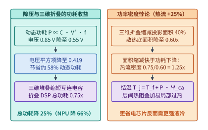

*图 15-8　LogicFolding 降压节能（$0.85\ \mathrm{V} \to 0.55\ \mathrm{V}$）与面积缩减更快导致的功率密度反升（$0.75/0.60 = 1.25\times$，算例 15-5）。*

图 15-8 总结了降压节能收益与三维折叠功率密度悖论的物理因果链，表 15-5 对照了二维平铺芯片与三维折叠芯片在功耗、投影面积、热流密度与结温上的定量演变。

*表 15-5　二维平铺基线与三维折叠芯片（LogicFolding）的功率密度悖论账本*

| 物理指标与热学参数 | 二维平铺基线（2D Baseline） | 初代三维折叠 DSP（3D Folded） | 折叠 NPU 降压态（$0.85\ \mathrm{V} \to 0.55\ \mathrm{V}$） | 物理机制与冷却系统设计启示 |
| --- | :---: | :---: | :---: | --- |
| **核心供电电压 $V_{\mathrm{dd}}$** | $0.85\ \mathrm{V}$ | $0.75\text{–}0.85\ \mathrm{V}$ | $0.55\ \mathrm{V}$（电压平方项 $\approx 0.419\times$） | 降压显著削减动态翻转能耗 $P_{\mathrm{dyn}} \propto C V^2 f$ |
| **芯片总功耗 $P_{\mathrm{total}}$** | $1.00\times$（$400\ \mathrm{W}$） | **$0.75\times$（$300\ \mathrm{W}$，降 $25\%$）** | **$0.34\times$（降 $66\%$）** | 3D 垂直短互连消除了长金属线寄生电容 $C_{\mathrm{load}}$ |
| **水平散热投影面积 $A_{\mathrm{die}}$** | $1.00\times$（$400\ \mathrm{mm^2}$） | **$0.60\times$（$240\ \mathrm{mm^2}$，缩 $40\%$）** | $0.50\text{–}0.60\times$ | 逻辑单元向垂直维堆叠，底面积缩减快于功耗下降 |
| **单位面积热流密度 $q'' = P/A$** | $1.00\ \mathrm{W/mm^2}$ | **$1.25\ \mathrm{W/mm^2}$（反升 $+25\%$）** | 局部热点仍可达 $>1.0\ \mathrm{W/mm^2}$ | 散热难度由热流密度 $q''$ 而非总瓦数 $P$ 决定 |
| **封装热阻 $\Psi_{\mathrm{ca}}$ 与峰值结温** | $0.050\ \mathrm{^\circ C/W}$ / $65.0^\circ\mathrm{C}$ | **$0.083\ \mathrm{^\circ C/W}$ / $70.0\text{–}75.0^\circ\mathrm{C}$** | 受层间键合界面热阻 $R''_{\mathrm{inter}}$ 制约 | 必须采用微米级鳍片冷板或双面/层间微流体冷却 |

### 15.3.3 热节流（Thermal Throttling）的同步木桶效应与 *TAPAS* 热感知重配置（ASPLOS '25）

在数万张加速卡组成的集群中，即便平均进水温度达标，制造公差、导热硅脂/相变材料老化、冷板微通道局部微米级颗粒沉积或机柜排间水力失调，都会导致不同加速卡在相同算力负载下呈现出截然不同的结温分布（Thermal Variation）。

当某一颗处于散热劣势位置的加速卡结温触及硬件热节流阈值（如 $T_j \ge 88^\circ\mathrm{C}$）时，其片上电源管理控制器会强制将该卡的核心频率下调 $\delta_{\mathrm{throttle}}$（例如降频 $15\%\text{–}20\%$）以防止烧毁。在无耦合的独立批处理任务中，1,024 张卡里有 1 张卡降频 $15\%$，集群总吞吐仅损失微不足道的 $0.15 / 1024 \approx 0.015\%$；然而在**紧耦合同步训练或跨卡张量并行推理**中，由于所有参与集合通信（AllReduce / AllGather / All-to-All）的 $N_{\mathrm{sync}}$ 张卡必须在每个屏障处等待最慢的那张“掉队卡（Straggler）”，单张过热卡的降频会被同步屏障放大整整 $N_{\mathrm{sync}}$ 倍：

$$
T_{\mathrm{step, cluster}} = \max_{i \in \{1,\dots,N_{\mathrm{sync}}\}} T_{\mathrm{step}, i} = \frac{T_{\mathrm{step, normal}}}{1 - \delta_{\mathrm{throttle}}}, \qquad \Delta P_{\mathrm{wasted}} \approx (N_{\mathrm{sync}} - 1) \cdot P_{\mathrm{wait}} \cdot \frac{\delta_{\mathrm{throttle}}}{1 - \delta_{\mathrm{throttle}}}
$$

如图 15-9 所示，在 $N_{\mathrm{sync}} = 1{,}024$ 的同步并行域中，仅仅 **1 张**冷板微堵的 GPU 降频 $15\%$（计算耗时从 $100\ \mathrm{ms}$ 拖长至 $117.6\ \mathrm{ms}$），就会迫使另外 **1,023 张**散热完好的 GPU 在每个 Step 屏障处被动空等 $17.6\ \mathrm{ms}$，导致整组千卡集群的有效算力利用率（MFU）直接损失 $15\%$，相当于约 $153$ 张满载 GPU 的全部电能被空转消耗。

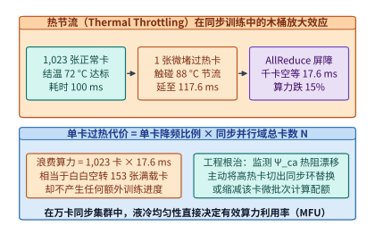

*图 15-9　单颗过热 GPU 触发降频 $15\%$ 如何通过同步 AllReduce 屏障拖慢整组 $1{,}024$ 张卡的有效吞吐。*

同样的问题在**大规模在线模型服务集群**中表现为“机柜排功率/温度上限（Power/Thermal Cap）”与“请求尾延迟截止线（Latency Deadline）”之间的尖锐冲突。发表于 ASPLOS 2025 的 ***TAPAS*（Thermal- and Power-Aware Scheduling for LLM Serving）** 指出：由于不同机柜排的冷却裕度与已有基线功耗不同，单纯按负载均衡路由请求极易触发局部机柜排过热降频或配电跳闸；而单纯把请求全切往低温空闲机柜排，又可能因实例排队或慢速配置违背延迟 SLO[^tapas]。

为了在数学上严格刻画 *TAPAS* 的准入控制与动态重配置边界，我们完整复算本书配套验证脚本 [`verify_tapas_reading.py`](../research/2026-infra-survey/verify_tapas_reading.py) 中的受控算例：

> **算例 15-6：基于 *TAPAS*（ASPLOS 2025）受控模型，核算功率封顶（$100\ \mathrm{kW}$）与延迟截止线（$1.0\ \mathrm{s}$）双重约束下的路由可行集及重配置回本请求数。**
> 考虑一个包含两排候选机柜（Row 0 与 Row 1）的在线推理集群，每排机柜的供电与冷却安全上限均为 $P_{\mathrm{cap}} = 100\ \mathrm{kW}$，在线请求的服务等级目标截止线为 $L_{\mathrm{deadline}} = 1.0\ \mathrm{s}$。
> 1. **静态路由下的双重违约困境（`admitted = []`）**：
>    当前时刻到达一批新增推理负载，若将其调度至某排机柜，将带来 $\Delta P_{\mathrm{req}} = 6\ \mathrm{kW}$ 的增量功耗。此时两排机柜的实时状态如下：
>    - **候选排 Row 0（高频高性能配置，但基线功率已接近满载）**：当前基线功率为 $96\ \mathrm{kW}$，处理该请求仅需耗时 $t_0 = 0.8\ \mathrm{s} \le 1.0\ \mathrm{s}$（延迟达标）；但叠加新请求后总功率将达到：
>      $$P_0 = 96\ \mathrm{kW} + 6\ \mathrm{kW} = \mathbf{102\ \mathrm{kW}} > P_{\mathrm{cap}} = 100\ \mathrm{kW}$$
>      因此 Row 0 违反功率与热安全上限，被功率门控剔除（不可行）。
>    - **候选排 Row 1（低温低功率配置，但当前并行度下处理较慢）**：当前基线功率为 $80\ \mathrm{kW}$，叠加新请求后总功率为：
>      $$P_1 = 80\ \mathrm{kW} + 6\ \mathrm{kW} = \mathbf{86\ \mathrm{kW}} \le P_{\mathrm{cap}} = 100\ \mathrm{kW}$$
>      因此功率可行集仅剩 `feasible = [1]`。然而，在当前静态配置下 Row 1 处理该请求的预计延迟为 $t_1 = 1.3\ \mathrm{s} > L_{\mathrm{deadline}} = 1.0\ \mathrm{s}$，违反延迟截止线。
>    联立两项约束后，静态路由器得出的可准入集合为空集：`admitted = []`——系统要么强行塞入 Row 0 触发断路器/热降频，要么塞入 Row 1 导致超时违约。
> 2. **动态热感知重配置（Reconfiguration）的回本交点 $N^*$**：
>    为打破僵局，*TAPAS* 触发跨排模型实例与张量并行度重配置（例如在功率充裕的 Row 1 扩容并行工作组或迁移热实例以平衡两排热负荷），使重配置后单次请求的处理延迟压缩 $\Delta t_{\mathrm{save}} = 0.1\ \mathrm{s}$（即每请求节省 $\frac{1}{10}\ \mathrm{s}$ 并落入功率与延迟双可行域）。
>    但重配置并非免费午餐：切换模型分片与预热通信上下文需要付出固定的一笔串行重配置停顿开销 $T_{\mathrm{reconfig}} = 3.0\ \mathrm{s}$。设重配置完成后该状态持续服务 $N$ 个请求，则累计节省时间追平重配置开销的**精确回本请求数 $N^*$** 为：
>    $$N^* \cdot \Delta t_{\mathrm{save}} = T_{\mathrm{reconfig}} \implies N^* = \frac{T_{\mathrm{reconfig}}}{\Delta t_{\mathrm{save}}} = \frac{3.0\ \mathrm{s}}{0.1\ \mathrm{s/req}} = \mathbf{30\ \text{个请求}}$$
>    也就是说，在重配置后的前 $1\text{–}29$ 个请求内，系统累计耗时仍因那 $3.0\ \mathrm{s}$ 的迁移停顿而处于净亏损状态；**恰好在第 $30$ 个请求处实现盈亏平衡（Break-even），从第 $31$ 个请求起产生净正收益**。
> 3. **单卡/子域级细粒度功率准入、热裕度与词元级迁移回本核算**：
>    将同一套 *TAPAS* 线性门控方程下沉至单张加速卡或局部供电槽位（设局部功率上限 $P_{\mathrm{slot\_cap}} = 100.0\ \mathrm{W}$、热节流结温红线 $T_{\mathrm{limit}} = 85.0^\circ\mathrm{C}$）：
>    - **功率准入判定**：若每新增一个并发解码流带来 $\Delta p = 2.1\ \mathrm{W}$ 增量功耗，当目标新批次含 $b = 4$ 条请求时，增量功率为 $2.1 \times 4 = 8.4\ \mathrm{W}$。在基线功率 $97.2\ \mathrm{W}$ 的热节点上，$97.2 + 2.1 \times 4 = \mathbf{105.6\ \mathrm{W}} > 100.0\ \mathrm{W}$（准入拒绝）；而在基线功率 $88.4\ \mathrm{W}$ 的冷节点上，$88.4 + 2.1 \times 4 = \mathbf{96.8\ \mathrm{W}} \le 100.0\ \mathrm{W}$（准入通过）。
>    - **热安全裕度校核**：若某节点当前基线温度为 $68.5^\circ\mathrm{C}$，每条活跃请求带来 $\Delta T_{\mathrm{req}} = 1.8^\circ\mathrm{C}$ 稳态温升，则承载 $6$ 条请求后的预计温度为 $68.5 + 1.8 \times 6 = \mathbf{79.3^\circ\mathrm{C}}$，距离 $85.0^\circ\mathrm{C}$ 节流红线仍保有 $85.0 - (68.5 + 1.8 \times 6) = \mathbf{5.7^\circ\mathrm{C}}$ 的安全热裕度。
>    - **词元级 KV 迁移回本步数 $N_{\min}$**：若将一个正在解码的会话从过热降频实例（单步 TPOT 为 $48.0\ \mathrm{ms}$）迁移至低温满频实例（单步 TPOT 为 $38.0\ \mathrm{ms}$，每步节省 $10.0\ \mathrm{ms}$）需付出一次性 KV 缓存传输开销 $T_{\mathrm{mig}} = 120.0\ \mathrm{ms}$，则实现净正收益所需的最少剩余生成词元数必须满足 $N \cdot (48.0 - 38.0) > 120.0 \implies 10.0 N > 120.0 \implies N > 12.0$，即至少还需继续生成 **$N_{\min} = 13\ \text{个词元}$** 才能收回迁移开销。这一算例清晰地告诫系统设计者：任何热感知动态迁移或 DVFS 重配置策略，都必须建立在对负载持续窗口长度的定量预测之上，严禁在短促抖动负载下频繁触发重配置震荡（Thrashing）。

![图 15-10：TAPAS（ASPLOS '25）热感知与功率封顶重配置（[102, 86] kW 削峰至 ≤ 100 kW，3.0 s 停顿在 30 请求处回本，算例 15-6）](ch15/ch15-tapas-thermal-power-routing-breakeven.svg)

*图 15-10　TAPAS（ASPLOS '25）热感知与功率封顶重配置（$[102, 86]\ \mathrm{kW}$ 削峰至 $\le 100\ \mathrm{kW}$，$3.0\ \mathrm{s}$ 停顿在 $30$ 请求处回本，算例 15-6）。*

图 15-10 呈现了算例 15-6 中 `feasible = [1]`、`admitted = []` 的判定过程与 $30$ 请求回本曲线。表 15-6 汇总了算例 15-6 中 *TAPAS* 静态准入判定与动态重配置回本核算的完整状态账本，表 15-7 给出了 ASHRAE TC 9.9 六大液冷水温等级及其对应的机房冷源架构与适用加速卡世代。

*表 15-6　TAPAS（ASPLOS 2025）热感知功率门控与动态重配置回本核查表（算例 15-6）*

| 评估对象 / 调度阶段 | 基线功率 + 请求增量 | 功率门控（$\le 100\ \mathrm{kW}$） | 预计单请求延迟 | 延迟门控（$\le 1.0\ \mathrm{s}$） | 准入与收益判定结论 |
| --- | :---: | :---: | :---: | :---: | --- |
| **静态候选排 Row 0** | $96 + 6 = 102\ \mathrm{kW}$ | **未通过（超限 $+2\ \mathrm{kW}$）** | $0.8\ \mathrm{s}$ | 通过 | 被功率/热安全门控直接剔除（`0 not in feasible`） |
| **静态候选排 Row 1** | $80 + 6 = 86\ \mathrm{kW}$ | 通过（余量 $14\ \mathrm{kW}$） | $1.3\ \mathrm{s}$ | **未通过（超时 $+0.3\ \mathrm{s}$）** | 虽在 `feasible = [1]` 中，但被 SLO 门控剔除（`admitted = []`） |
| **动态重配置迁移期** | 跨排均衡 $\le 100\ \mathrm{kW}$ | 通过 | 串行停顿 $T_{\mathrm{reconfig}} = 3.0\ \mathrm{s}$ | 迁移期暂停服务 | 产生一次性固定时间债务 $-3.0\ \mathrm{s}$ |
| **重配置后稳态服务期** | 均衡后 $\le 100\ \mathrm{kW}$ | 通过 | 每请求耗时压缩 $\Delta t = 0.1\ \mathrm{s}$ | 通过（$\le 1.0\ \mathrm{s}$） | **精确在 $N^* = 3.0 / 0.1 = 30$ 个请求处回本，$N \ge 31$ 净赚** |

*表 15-7　ASHRAE TC 9.9 液冷供水温度分级与吉瓦级数据中心冷源选型对照表*

| ASHRAE 等级 | 供液温度范围 | 典型室外冷源设备形态 | 全年典型 $\mathrm{PUE}$ | 代表性硬件平台与工程特征 |
| :---: | :---: | --- | :---: | --- |
| **W17** | $2\text{–}17^\circ\mathrm{C}$ | 离心式冷水机组（Chiller）+ 冷却塔 | $1.22\text{–}1.35$ | 早期高热阻改装冷板，需防机房露点凝露 |
| **W27** | $2\text{–}27^\circ\mathrm{C}$ | 冷水机组 + 过渡季板换自然冷却 | $1.15\text{–}1.22$ | 第一代商用 GPU 冷板集群 |
| **W32** | $2\text{–}32^\circ\mathrm{C}$ | 闭式冷却塔（蒸发冷却为主，免冷机） | $1.10\text{–}1.15$ | 温水地区可免压缩机，但仍消耗蒸发补充水 |
| **W40** | $2\text{–}40^\circ\mathrm{C}$ | 干冷器（Dry Cooler）+ 极热天喷雾辅助 | $1.07\text{–}1.11$ | ASHRAE 新增温水档位，适配 B200/GB200 机柜 |
| **W45** | **$2\text{–}45^\circ\mathrm{C}$** | **纯室外干冷器（全年免冷机、零耗水）** | **$\mathbf{1.05\text{–}1.08}$** | **Vera Rubin NVL72 原生支持 $45^\circ\mathrm{C}$ 进水** |
| **W+** | $>45^\circ\mathrm{C}$ | 干冷器直排 + 区域供暖余热回收利用 | $\le 1.05$ | 出水温度超 $60^\circ\mathrm{C}$，可直接并入城市冬季供暖管网 |

---

## 15.4 突破单园区电力墙：跨数据中心广域光网（DCI）与低频同步训练（DiLoCo）

当单座训练任务的目标算力规模扩展至二十万卡乃至五十万卡（总用电需求 $300\text{–}800\ \mathrm{MW}$），而任何一个单一地理站点能够获批的现成变电站容量上限仅为 $100\text{–}200\ \mathrm{MW}$ 时，系统架构师便撞上了坚不可摧的**单园区电力墙（Single-Campus Power Wall）**。此时，唯一可行的物理出路是将训练集群拆分为分布在数个不同变电辖区乃至不同省份/州的多座子园区（Multi-Campus），通过**数据中心互联广域光网（Data Center Interconnect, DCI）**协同完成同一个基础模型的训练。

### 15.4.1 跨地域光纤的折射率延迟极限、带宽时延积（BDP）与并行维度可迁移性

一旦走出单一园区围墙，网络物理层的主导矛盾立刻从“交换机端口基数与光模块功耗（第 6–7 章）”切换为**二氧化硅光纤中的光速传播延迟与长途密集波分复用（DWDM）专线的稀缺带宽**：

1. **不可逾越的 $5\ \mu\mathrm{s/km}$ 光纤传播延迟下界**：
   真空中光速为 $c_0 \approx 3.0 \times 10^5\ \mathrm{km/s}$，而标准单模石英玻璃光纤（SMF-28）的纤芯群折射率约为 $n_{\mathrm{fiber}} \approx 1.468$，故光信号在光纤中的物理传播速度为：
   $$v_{\mathrm{fiber}} = \frac{c_0}{n_{\mathrm{fiber}}} \approx \frac{3.0 \times 10^5\ \mathrm{km/s}}{1.468} \approx 2.04 \times 10^5\ \mathrm{km/s} \implies \tau_{\mathrm{prop}} = \frac{1}{v_{\mathrm{fiber}}} \approx \mathbf{4.9\text{–}5.0\ \mu\mathrm{s/km}}$$
   若两座算力园区沿光缆路由的实际敷设距离为 $D = 1{,}000\ \mathrm{km}$，则仅光子在纤芯中飞行一趟的单向物理延迟就高达 $T_{\mathrm{one\text{-}way}} = 1{,}000 \times 5\ \mu\mathrm{s} = \mathbf{5.0\ \mathrm{ms}}$，往返时延（RTT）至少为 $\mathrm{RTT} \ge \mathbf{10.0\ \mathrm{ms}}$（计入沿途掺铒光纤放大器 EDFA、光线路终端转发器与路由跳数后通常为 $11\text{–}15\ \mathrm{ms}$）。这比机柜内 NVLink 的微秒级延迟慢了整整 **$10{,}000$ 倍**。
2. **巨大的广域网带宽时延积（Bandwidth-Delay Product, $\mathrm{BDP}$）**：
   设两座园区之间租用了总带宽 $\mathrm{BW}_{\mathrm{DCI}} = 1.6\ \mathrm{Tbps} = 200\ \mathrm{GB/s}$ 的长途 DWDM 波分光纤束，往返时延 $\mathrm{RTT} = 10\ \mathrm{ms}$，则链路上处于“在途飞行状态（In-flight）”的数据容量即带宽时延积为：
   $$\mathrm{BDP} = \mathrm{BW}_{\mathrm{DCI}} \times \mathrm{RTT} = 200\ \mathrm{GB/s} \times 0.010\ \mathrm{s} = \mathbf{2.0\ \mathrm{GB}}$$
   相比园区内部百米光纤仅数兆字节的 $\mathrm{BDP}$，跨城链路需要高达数吉字节的发送端重传缓冲与拥塞窗口才能跑满管道，任何基于短包高频握手的同步协议都会在 $10\ \mathrm{ms}$ 的光速等待中彻底瘫痪。

用这两把物理标尺去衡量第 9–10 章的五维并行策略，立刻可以导出**跨园区广域协同训练的并行维度分级铁律**：
- **绝对禁止跨园区部署的维度：张量并行（TP）、序列/上下文并行（SP/CP）与专家并行（EP）**。以 80 层 Transformer 为例，TP 每层前向需执行 2 次 AllReduce、反向需执行 2 次 AllReduce（共 $320$ 次集合通信），EP 每层前反向同样需执行 4 次全对全（All-to-All）分发与合并。若将 TP 或 EP 跨在 $\mathrm{RTT} = 10\ \mathrm{ms}$ 的两座园区之间，哪怕传输字节数为零，仅等待光信号往返的纯延迟空耗就高达 $320 \times 5\ \mathrm{ms} = \mathbf{1.6\ \mathrm{s/Step}}$，计算单元利用率将跌破 $5\%$。
- **有条件可跨园区部署的维度：流水线并行（Cross-DC PP）与两级分层数据并行（Hierarchical DP）**。因为 PP 在层间边界仅需单向点对点传输一次激活张量（P2P Send/Recv），而 DP 每整个迭代步（含数十个微批次累积后）才执行一次梯度归约。
- **跨园区容忍度最高的维度：外循环低频伪梯度同步（DiLoCo / Streaming DiLoCo）**。将跨城同步周期从“每 1 步”拉长至“每 $H = 100\text{–}500$ 步”，从根本上解耦园区内高频迭代与园区际低频对齐。

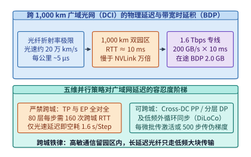

*图 15-11　跨 $1{,}000\ \mathrm{km}$ 广域光网（$\mathrm{RTT} = 10\ \mathrm{ms}$，$\mathrm{BDP} = 2.0\ \mathrm{GB}$）的传播延迟与四类并行维度的跨城可迁移性边界。*

图 15-11 汇总了跨城光网的物理参数与五维并行策略的跨城可迁移边界。

### 15.4.2 跨园区流水线并行（Cross-DC PP）与分层数据并行（Hierarchical DP）的掩盖边界

当两座相距数百至上千公里的园区拥有数百吉比特至太比特级专用 DWDM 光纤时，首先可以采用**跨园区流水线并行（Cross-Datacenter Pipeline Parallelism, Cross-DC PP）**与**两级分层数据并行（Hierarchical Data Parallelism）**：

1. **跨园区流水线并行（Cross-DC PP）的通信掩盖不等式**：
   设模型共 $L$ 层，均匀切分为 $P$ 个流水线阶段（Stage），分布在 $K$ 座园区中（例如 $P=8$ 个阶段，园区 A 承载 Stage 0–3，园区 B 承载 Stage 4–7）。只有位于园区交界处的**唯一一条边界链路（Stage 3 $\leftrightarrow$ Stage 4）**需要跨越广域网传输前向激活张量与反向激活梯度，其余阶段间通信全部留在园区内部的高速 RoCE/IB 网络中。
   设单微批次包含 $b$ 条序列、序列长度为 $s$、隐藏层维度为 $h$、激活精度为 $2\ \mathrm{B}$（BF16），则单次跨城点对点传输的数据量为 $V_{\mathrm{act}} = 2 b s h$。在园区际单向传播延迟为 $T_{\mathrm{prop}}$、跨城可用带宽为 $\mathrm{BW}_{\mathrm{DCI}}$ 的链路上，单微批次激活跨城耗时为：
   $$T_{\mathrm{comm, PP}} = T_{\mathrm{prop}} + \frac{2 b s h}{\mathrm{BW}_{\mathrm{DCI}}}$$
   为了在交错 1F1B 或 DualPipe 调度下不让这笔跨城传输暴露为额外的流水线停顿气泡，单个流水线阶段处理一个微批次的计算时间 $T_{\mathrm{comp, micro}}$ 必须足以完全掩盖跨城单向通信耗时，即满足：

$$
T_{\mathrm{comp, micro}} \ge T_{\mathrm{prop}} + \frac{2 b s h}{\mathrm{BW}_{\mathrm{DCI}}}
$$

   以 $b=1, s=8{,}192, h=8{,}192$ 为例，单次跨城激活体积为 $V_{\mathrm{act}} = 2 \times 1 \times 8{,}192 \times 8{,}192 = 134.2\ \mathrm{MB}$（若采用 FP8 激活压缩则仅为 $67.1\ \mathrm{MB}$）。在 $\mathrm{BW}_{\mathrm{DCI}} = 400\ \mathrm{Gbps} = 50\ \mathrm{GB/s}$、距离 $1{,}000\ \mathrm{km}$（$T_{\mathrm{prop}} = 5\ \mathrm{ms}$）的专线上，传输耗时仅 $134.2\ \mathrm{MB} / 50\ \mathrm{GB/s} \approx 2.68\ \mathrm{ms}$，合计跨城延迟 $T_{\mathrm{comm, PP}} = 5.0 + 2.68 = \mathbf{7.68\ \mathrm{ms}}$。只要单阶段（如 10 层 70B/405B 模型）的单微批前反向计算时间 $T_{\mathrm{comp, micro}} \ge 15\text{–}30\ \mathrm{ms}$，且微批次数量 $m \ge 32\text{–}64$，跨城光速延迟即可被流水线计算窗口平滑隐藏。

2. **两级分层数据并行（Hierarchical DP）的跨城流量解耦**：
   在数据并行维度上，若让两座园区的 $N$ 张卡直接组成一个扁平的大 Ring AllReduce，数据分片将不得不反复横穿跨城光纤。正确的拓扑是构造**两级分层归约树（Two-Level Hierarchical AllReduce）**：
   - **第一级（园区内规约，Intra-Campus Reduce-Scatter）**：每座园区内部的数万张卡先通过本地数太比特的 NVLink 与 RoCE/IB 胖树网络，高速完成本园区内部的梯度规约散射，将数万张卡的梯度浓缩为一份园区级局部聚合梯度；
   - **第二级（园区际规约，Inter-Campus AllReduce）**：仅在代表各园区的边界网关节点之间，通过长途 DWDM 光纤交换并累加这一份聚合梯度分片，最后在各园区内部执行本地 AllGather 广播。
   通过这层解耦，**跨城光纤上传输的总字节数仅取决于模型参数量 $\Psi$ 与园区座数 $K$，而与每座园区内部塞入了一万张还是十万张加速卡完全无关**；再配合较大的梯度累积步数（Gradient Accumulation Steps, $G_{\mathrm{acc}} \ge 32\text{–}64$），将单步计算时间拉长至数秒，即可与反向传播末尾层重叠掩盖跨城梯度同步。

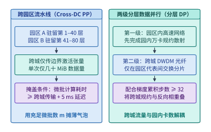

*图 15-12　跨园区流水线并行（Cross-DC PP）与园区内 NVLink/RoCE + 园区际 DWDM 分层数据并行时序。*

图 15-12 展示了跨园区流水线并行与两级分层数据并行的架构原理。

### 15.4.3 低频外循环同步（DiLoCo / Streaming DiLoCo）：$500\times$ 广域带宽压缩与显存代价账本

当多座园区之间没有昂贵的太比特级专用裸光纤，而只能依赖数十吉比特（如 $10\text{–}100\ \mathrm{Gbps}$）的商业广域网链路，或者跨洲距离导致 $\mathrm{RTT}$ 高达 $50\text{–}150\ \mathrm{ms}$ 时，即便采用分层数据并行，每一步（每 $1\text{–}3\ \mathrm{s}$）都跨城同步一次数百吉字节的全量模型梯度也依然会成为无法承受的通信瓶颈。

针对这一弱互联多园区场景，以 **DiLoCo（Distributed Low-Communication Training）** 与 **Streaming DiLoCo** 为代表的双循环联邦式优化算法（Dual-Loop Optimization）通过改写同步频率，实现了高达 **$100\times\text{–}500\times$ 的广域网带宽需求压缩**：

1. **内循环（Inner Loop，$H$ 步园区内全速独立演化）**：
   在第 $t$ 轮外循环开始时，$K$ 座园区均从同一份全局主权重快照 $\theta^{(t, 0)}$ 出发。随后，在接下来的 **$H$ 个训练步（典型值 $H = 100\text{–}500$ 步）** 内，每座园区各自读取本地分配的独立数据分片 $\mathcal{D}_k$，使用标准的内部优化器（Inner Optimizer，如 AdamW）在园区内部高速网络上全速独立更新参数 $\theta_k^{(t, 1)}, \theta_k^{(t, 2)}, \dots, \theta_k^{(t, H)}$。**在此长达数百步的内循环期间，跨园区广域网通信量严格为零**。
2. **外循环（Outer Loop，伪梯度跨城同步与 Nesterov 动量更新）**：
   当各园区完成 $H$ 步内循环后，第 $k$ 座园区计算本地演化终点与起点之间的参数位移——即**伪梯度（Pseudo-Gradient）** $\Delta \theta_k^{(t)} = \theta^{(t, 0)} - \theta_k^{(t, H)}$。随后，$K$ 座园区仅需通过广域光网执行**一次**跨园区 AllReduce 平均：
   $$\Delta \bar{\theta}^{(t)} = \frac{1}{K} \sum_{k=1}^K \left(\theta^{(t, 0)} - \theta_k^{(t, H)}\right)$$
   最后，所有园区使用一套带 Nesterov 动量（外动量状态记为 $v_{\mathrm{outer}}^{(t)}$，外动量系数 $\mu_{\mathrm{outer}}$，外学习率 $\eta_{\mathrm{outer}}$）的**外循环优化器（Outer Optimizer）**更新得到下一轮的全局主权重起点：

$$
v_{\mathrm{outer}}^{(t+1)} = \mu_{\mathrm{outer}} v_{\mathrm{outer}}^{(t)} + \Delta \bar{\theta}^{(t)}, \qquad \theta^{(t+1, 0)} = \theta^{(t, 0)} - \eta_{\mathrm{outer}} \left(\mu_{\mathrm{outer}} v_{\mathrm{outer}}^{(t+1)} + \Delta \bar{\theta}^{(t)}\right)
$$

遵循本书第 1 章与第 10 章确立的“任何通信压缩都必须同时审计其存储与计算代价”的严谨纪律，我们在欢呼 DiLoCo 将平均跨城通信频率降低 $H$ 倍的同时，必须精确清算它在两个维度上付出的工程代价，以及 Streaming DiLoCo 是如何消除通信尖峰的：
- **代价一：外循环优化器额外引入的显存状态（Memory Overhead）**。为了在第 $H$ 步算出 $\Delta \theta_k^{(t)} = \theta^{(t,0)} - \theta_k^{(t,H)}$ 并执行 Nesterov 动量更新，每座园区除了保存常规内循环 AdamW 的主权重、梯度与一阶/二阶动量（$m, v$）外，还必须额外驻留一份**外循环起点快照 $\theta^{(t,0)}$**（BF16 占 $2\Psi$ 字节，FP32 占 $4\Psi$ 字节）和一份**外循环动量缓冲区 $v_{\mathrm{outer}}$**（FP32 占 $4\Psi$ 字节），合计多出 **$6\Psi\text{–}8\Psi$ 字节**状态。在工程实现中，这两份每 $H$ 步才访问一次的低频状态必须利用园区内数据并行组的 **ZeRO-1 分片**摊薄到各张卡上（分片后每卡仅多占 $6\Psi / N_{\mathrm{DP}}$ 字节），或异步卸载至宿主 CPU 内存（Host DRAM）中。
- **代价二：标准 DiLoCo 在第 $H$ 步的突发通信阻塞与 Streaming DiLoCo 分片流水化**。标准 DiLoCo 虽然把平均带宽压低了 $H$ 倍，但它在前 $H-1$ 步让跨城光纤完全闲置（利用率 $0\%$），却在第 $H$ 步要求瞬间同步整座模型的全量伪梯度，在慢速广域网上仍会造成数十至数百秒的同步停顿。**Streaming DiLoCo** 通过将模型沿层维度划分为 $M$ 个参数分片（Fragments，例如每 4 层为一个分片），令第 $p$ 个分片在第 $p \cdot (H/M)$ 步错峰触发后台跨城伪梯度同步：当分片 $p$ 正在后台慢速穿过跨城光纤时，园区内 GPU 继续全速执行其余分片的内循环前反向计算，再配合伪梯度 FP4/FP8 量化压缩，将原本第 $H$ 步的通信尖峰彻底摊平为全天候均匀流淌的微弱背景流量。

> **算例 15-7：核算 $100\mathrm{B}$（千亿参数）模型在相距 $1{,}000\ \mathrm{km}$ 双园区训练中，标准 DP、DiLoCo（$H=500$）与 Streaming DiLoCo 的广域网带宽需求及显存开销。**
> 设模型参数量 $\Psi = 100 \times 10^9$（$100\mathrm{B}$），单步内循环迭代耗时 $T_{\mathrm{step}} = 2.0\ \mathrm{s}$，双园区环网全规约通信量为 $V_{\mathrm{sync}} = 2 \times \Psi \times 2\ \mathrm{B} = 400\ \mathrm{GB} = 3{,}200\ \mathrm{Gb}$（以 BF16 梯度/伪梯度计）。
> 1. **传统每步跨城同步 DP（$H=1$）**：
>    为在 $T_{\mathrm{step}} = 2.0\ \mathrm{s}$ 内完成 $3{,}200\ \mathrm{Gb}$ 梯度同步且不拖慢训练，所需跨城持续带宽高达：
>    $$\mathrm{BW}_{H=1} = \frac{3{,}200\ \mathrm{Gb}}{2.0\ \mathrm{s}} = \mathbf{1{,}600\ \mathrm{Gbps}} = 1.6\ \mathrm{Tbps}$$
> 2. **采用 DiLoCo（$H=500$ 步内循环，耗时 $500 \times 2.0\ \mathrm{s} = 1{,}000\ \mathrm{s}$）**：
>    每 $1{,}000\ \mathrm{s}$ 仅需跨城同步一次 $3{,}200\ \mathrm{Gb}$ 伪梯度，时间平均广域网带宽需求直降 $500$ 倍：
>    $$\overline{\mathrm{BW}}_{\mathrm{DiLoCo}} = \frac{3{,}200\ \mathrm{Gb}}{1{,}000\ \mathrm{s}} = \mathbf{3.2\ \mathrm{Gbps}}$$
>    然而，若两座园区之间仅租用了一条 $\mathrm{BW}_{\mathrm{link}} = 10\ \mathrm{Gbps}$ 的普通商业专线，标准阻塞式 DiLoCo 在第 $500$ 步集中发送 $3{,}200\ \mathrm{Gb}$ 数据仍需停顿等待 $T_{\mathrm{stall}} = 3{,}200\ \mathrm{Gb} / 10\ \mathrm{Gbps} = \mathbf{320\ \mathrm{s}}$（占内循环 $1{,}000\ \mathrm{s}$ 的 $32\%$ 额外开销）。
> 3. **升级为 Streaming DiLoCo（切分为 $M=25$ 个分片，每 $20$ 步即每 $40\ \mathrm{s}$ 后台流式同步一个 $16\ \mathrm{GB}$ 分片）**：
>    每个分片通信量仅为 $3{,}200 / 25 = 128\ \mathrm{Gb}$，在 $10\ \mathrm{Gbps}$ 链路上后台传输耗时 $12.8\ \mathrm{s} < 40\ \mathrm{s}$ 的分片间隔窗口（若叠加 FP4 伪梯度量化压缩 $4\times$，单分片仅需 $3.2\ \mathrm{s}$），**跨城通信暴露停顿时间直接归零**。
>    同时核算外循环显存代价：保存 BF16 快照 $\theta^{(t,0)}$（$200\ \mathrm{GB}$）与 FP32 外动量 $v_{\mathrm{outer}}$（$400\ \mathrm{GB}$）共需 $600\ \mathrm{GB}$；在每园区 $N_{\mathrm{DP}} = 64$ 路数据并行下采用 ZeRO-1 分片后，每张 GPU 仅需额外分担 $600\ \mathrm{GB} / 64 = \mathbf{9.375\ \mathrm{GB}}$ 显存（亦可完全放置于主机 DDR5 内存中）。

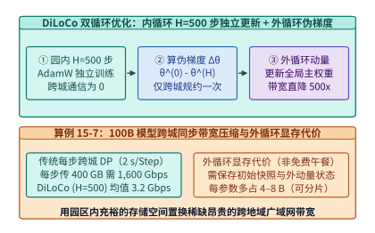

*图 15-13　DiLoCo 内循环 $H = 500$ 步独立更新与外循环 Nesterov 伪梯度同步将跨城带宽需求压缩 $500$ 倍的机制（算例 15-7）。*

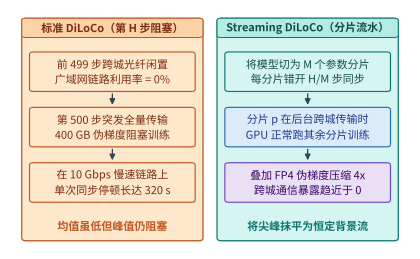

*图 15-14　全量阻塞式外循环同步与 Streaming DiLoCo 分片流水重叠同步的广域网链路利用率对比。*

图 15-13 与图 15-14 分别展示了 DiLoCo 的双循环伪梯度压缩机制与 Streaming DiLoCo 的分片流水重叠时序。

---

## 15.5 多园区协同决策、动态功率封顶批大小调整与四层物理联动

### 15.5.1 单园区排队等待（24–48 个月）vs. 三站点 $3\times$ 资本与电力分摊决策树

当架构师面对“是留在单一园区排队等待吉瓦级高压变电站审批与建设（在欧美与亚洲核心电网辖区，新建 $300\ \mathrm{MW}\text{–}1\ \mathrm{GW}$ 专用变电站的排队并网周期普遍长达 **$\Delta T_{\mathrm{wait}} = 24\text{–}48\ \text{个月}$**），还是立即在三座已具备现成 $100\text{–}300\ \mathrm{MW}$ 配额的园区启动跨城协同训练”的战略抉择时，将算力与资本开支分散至 $K=3$ 座现成园区不仅能实现 **$3\times$ 电力配额获取速率与园区基建 CapEx 风险分摊**，还能直接规避因漫长排队导致的代际算力贬值。联立单园区纯训练工期 $T_{\mathrm{job}}$ 与多园区协同效率 $\eta_{\mathrm{multi}} \in (0, 1)$，可写出**完训墙钟时间翻转判据**：

$$
T_{\mathrm{single\_total}} = \Delta T_{\mathrm{wait}} + T_{\mathrm{job}} > T_{\mathrm{multi\_total}} = \frac{T_{\mathrm{job}}}{\eta_{\mathrm{multi}}} \iff \Delta T_{\mathrm{wait}} > T_{\mathrm{job}} \cdot \left(\frac{1}{\eta_{\mathrm{multi}}} - 1\right)
$$

如图 15-15 所示，对于一项预计纯训练耗时 $T_{\mathrm{job}} = 90\ \text{天}$（3 个月）的旗舰预训练任务，哪怕跨园区协同因广域网同步与外循环滞后付出了 $10\%$ 的端到端效率折损（即 $\eta_{\mathrm{multi}} = 0.90$），其多消耗的训练天数也仅为 $90 \times (1/0.90 - 1) = \mathbf{10\ \text{天}}$。这意味着**只要单站点变电站扩容等待工期超过 10 天（而现实中高压变电站增容往往需要 24–48 个月），立即采用三园区跨城协同训练在上线工期与硬件折旧账本上都将取得显著优势**。

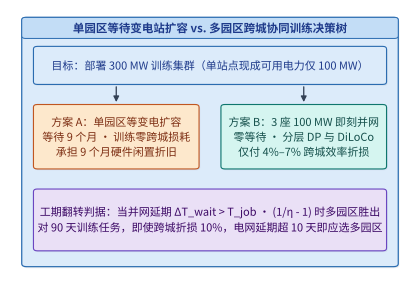

*图 15-15　单园区等待变电站扩容 vs. 多园区跨城协同训练的完成工期与成本交点决策树。*

### 15.5.2 电网时变配额 $P_{\mathrm{cap}}(t)$ 下的动态批大小调整与四层物理联动

在实际运行中，各座算力园区的可用供电上限并非恒定常数，而是随电网峰谷调度指令、绿电（风电/光伏）出力波动以及夏季午后高温冷却裕度变化的时变函数 $P_{\mathrm{cap}, k}(t)$。为了在不中断训练的前提下响应电网需求侧响应（Demand Response）削峰指令，训练运行时可将第 $k$ 座园区的微批次累积步数或活跃数据并行度随实时功率配额 $P_{\mathrm{cap}, k}(t)$ 动态缩放：

$$
B_{\mathrm{local}, k}(t) = B_{\mathrm{nom}, k} \cdot \left\lfloor \frac{P_{\mathrm{cap}, k}(t) - P_{\mathrm{idle}, k}}{P_{\mathrm{step\_unit}, k}} \right\rfloor
$$

当某座园区在午后用电高峰期收到电网下发的临时限电指令（如 $P_{\mathrm{cap}, k}(t)$ 下调 $25\%$）时，该园区自动缩减本步分配的微批次数量 $B_{\mathrm{local}, k}(t)$ 或下调 GPU DVFS 频率档位，其余绿电充裕的园区则相应多承担微批次配额，从而保持全局有效批大小 $B_{\mathrm{global}} = \sum_{k=1}^K B_{\mathrm{local}, k}(t)$ 严格恒定，不影响学习率调度与模型收敛轨迹。

图 15-16 将本章从平方毫米级的硅片热流密度、米级的机柜 $800\ \mathrm{VDC}$ 母排与 ASHRAE W45 液冷、千米级的园区变电站功率平滑与超配，一直到千公里级的跨城广域光网协同训练收束为一个完整的四层物理协同体系。表 15-8 对照了三类跨园区分布式训练架构的通信特征与工程边界。

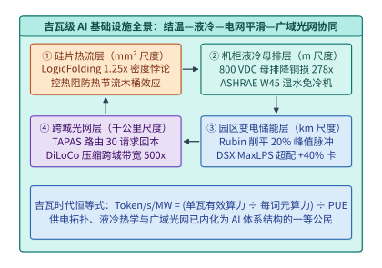

*图 15-16　从芯片结温、机柜液冷、变电站功率平滑到跨地域光网的吉瓦级 AI 基础设施全景图。*

*表 15-8　跨数据中心（Multi-DC）协同训练三类主流架构定量对比*

| 协同训练架构 | 跨城传输内容 | 跨城同步频率 | 100B 模型所需跨城带宽 | 额外显存/内存开销 | 适用广域网条件与收敛特性 |
| --- | --- | :---: | :---: | :---: | --- |
| **跨园区流水线（Cross-DC PP）** | 阶段边界层前向激活与反向梯度 | 每微批次点对点（$\sim 20\text{–}50\ \mathrm{ms}$） | $100\text{–}400\ \mathrm{Gbps}$ | 需增加在途微批激活槽位 | 适合相距 $\le 500\text{–}1{,}000\ \mathrm{km}$、拥专用 DWDM 光纤的双园区，收敛与单园区完全比特等价 |
| **两级分层数据并行（Hierarchical DP）** | 园区级局部聚合梯度分片 | 每完整训练步（$G_{\mathrm{acc}} \ge 32$，$\sim 2\text{–}5\ \mathrm{s}$） | $400\text{–}1{,}600\ \mathrm{Gbps}$ | 园区代表节点需跨城归约缓冲 | 适合高带宽城域/区域专网（$\le 200\ \mathrm{km}$），与单园区大 Batch 同步训练严格数学等价 |
| **流式低频外循环（Streaming DiLoCo）** | 分片伪梯度 $\Delta \theta = \theta^{(0)} - \theta^{(H)}$ | 每 $H=100\text{–}500$ 步分片流式（$\sim 40\text{–}1{,}000\ \mathrm{s}$） | **$1\text{–}10\ \mathrm{Gbps}$** | 额外保存 $\theta^{(0)}$ 与外动量 $v_{\mathrm{outer}}$（$6\Psi\text{–}8\Psi$ 字节，可分片） | 可跨越上千公里商业广域网或公有云多可用区，利用 Nesterov 外动量保持与集中式相当的验证集困惑度 |

在工程实践中，将跨地域协同训练真正投入数月之久的生产运行，还必须解决**跨城光纤闪断容错（WAN Fault Tolerance）**与**异构园区算力配比（Heterogeneous Campus Balancing）**两大系统难题：
1. **园区级故障隔离与动态弹性重入**：在单园区集中式训练中，任一叶脊交换机或单张卡掉线都会通过全局 NCCL 通信域迫使全集群回滚至上一检查点；而在 DiLoCo / Streaming DiLoCo 架构下，$K$ 座园区在内循环的 $H$ 步内完全解耦。若第 $k$ 座园区内部发生单机硬件故障，该园区可在本地秒级热备替换并在几步内追平进度，其余 $K-1$ 座园区根本感知不到抖动；即便连接某座园区的跨省长途光缆被市政施工挖断数小时，其余 $K-1$ 座园区仍可按 $(K-1)$ 路外循环正常推进训练，待光缆修复或切换备用路由后，故障园区直接拉取最新外循环检查点 $\theta^{(t,0)}$ 重新加入联邦即可。
2. **非对称园区的步数与批量加权对齐**：现实中获批的多座电力园区往往规模不等（例如园区 A 拥有 $120\ \mathrm{MW}$ 供电、装载 $60{,}000$ 张卡，而园区 B 仅有 $60\ \mathrm{MW}$ 供电、装载 $30{,}000$ 张卡）。此时无需强求两座园区规模对称：在跨园区流水线（Cross-DC PP）中，只需按园区算力比例分配模型层数（园区 A 承载前 $2/3$ 层，园区 B 承载后 $1/3$ 层）；而在分层数据并行或 DiLoCo 中，只需保持各园区内循环步数 $H$ 一致，令各园区的本地全局批大小（Local Batch Size）正比于本园区卡数 $N_k$，并在外循环归约伪梯度时按卡数权重 $\alpha_k = N_k / \sum_j N_j$ 执行加权平均：
   $$\Delta \bar{\theta}^{(t)} = \sum_{k=1}^K \frac{N_k}{\sum_{j=1}^K N_j} \cdot \left(\theta^{(t, 0)} - \theta_k^{(t, H)}\right)$$
   即可在非对称电力站点上实现零算力闲置的负载均衡。

---

## 15.6 两相液冷与硅片微流体散热、园区储能（BESS）电网调频套利、动静态能耗联合优化（`Kareus` OSDI '26）与跨洲骨干网训练（`Di-PS` NSDI '26）

随着下一代超节点封装将多颗计算芯粒（Compute Dies）、12–16 颗 HBM4/HBM4e 堆栈以及三维垂直供电模块集成在同一个超高密度基板上，单颗复合加速封装的热设计功耗正从 $1.2\text{–}1.8\ \mathrm{kW}$ 加速迈向 **$2{,}000\text{–}3{,}000\ \mathrm{W}$（$2\text{–}3\ \mathrm{kW}$）**，局部热点热流密度更是突破 $150\text{–}250\ \mathrm{W/cm^2}$。与此同时，在园区侧，百兆瓦时的电化学储能电站、低负载窗口下日益突出的晶体管静态漏电功耗，以及跨越异构代际集群的广域网训练，正在重塑吉瓦级 AI 基础设施的物理与经济账本。

### 15.6.1 当单芯片迈向 $2\text{–}3\ \mathrm{kW}$：单相冷板极限、两相沸腾液冷与芯片内微通道直冷（Direct-to-Silicon Microfluidics）

在 15.3.1 节中，我们看到单相铜冷板（Single-Phase Cold Plate）依靠去离子水或乙二醇水溶液的显热温升（$Q = \dot{m} c_p \Delta T$）成功支撑了 $1.0\text{–}1.5\ \mathrm{kW}$ 级别的加速芯片。然而，当单颗封装功耗攀升至 $2\text{–}3\ \mathrm{kW}$ 时，传统外贴式单相铜冷板在热阻链路上撞上了两道物理墙[^microfluidics]：

1. **导热界面材料热阻（$R_{\mathrm{TIM}}$）与铜冷板基底热阻（$R_{\mathrm{base}}$）的串联死结**：
   从晶体管有源区（Junction）到冷板内冷却液（Fluid）的总热阻 $\Psi_{\mathrm{jf}}$ 由三部分串联而成：
   $$\Psi_{\mathrm{jf}} = R_{\mathrm{si}} + R_{\mathrm{TIM}} + R_{\mathrm{conv}}$$
   其中 $R_{\mathrm{si}}$ 为硅衬底导热热阻，$R_{\mathrm{TIM}}$ 为硅片背面与铜冷板底座之间的导热界面材料（Thermal Interface Material，如相变导热垫、液态金属或钎焊铟片）热阻，$R_{\mathrm{conv}} = \frac{1}{h_{\mathrm{conv}} A_{\mathrm{eff}}}$ 为冷板微鳍片与流体的对流换热热阻。即便采用高性能金属铟片或液态金属，计入接触界面微观空隙后，单颗大芯片封装上的等效界面与冷板底板热阻仍普遍高达 **$R_{\mathrm{TIM}} \approx 0.015\text{–}0.025\ \mathrm{^\circ C/W}$（典型值 $0.02\ \mathrm{^\circ C/W}$）**。
   在 $P_{\mathrm{chip}} = 1{,}000\ \mathrm{W}$ 时，$R_{\mathrm{TIM}} = 0.02\ \mathrm{^\circ C/W}$ 仅产生 $20^\circ\mathrm{C}$ 的界面温降；但当芯片功耗翻倍至 **$P_{\mathrm{chip}} = 2{,}000\ \mathrm{W}$** 时，仅仅跨越薄薄一层导热界面材料就会产生 **$2{,}000\ \mathrm{W} \times 0.02\ \mathrm{^\circ C/W} = 40.0^\circ\mathrm{C}$** 的巨大温差。若再叠加对流热阻 $R_{\mathrm{conv}} = 0.012\ \mathrm{^\circ C/W}$ 产生的 $24.0^\circ\mathrm{C}$ 温升，总温升高达 $64.0^\circ\mathrm{C}$——为守住 $T_{j,\max} = 85.0^\circ\mathrm{C}$ 红线，冷却水最高温度被严格限制在 $85.0 - 64.0 = 21.0^\circ\mathrm{C}$ 以下，迫使机房退回高耗电的 W17/W27 冷冻水机组模式。
2. **单相显热流体的流速压降墙与流道沿程温升梯度**：
   单相水必须靠自身温度升高 $\Delta T = 10\text{–}15^\circ\mathrm{C}$ 才能吸热，这导致芯片冷板入口侧与出口侧存在明显的硅片表面温度梯度（引发同一裸晶不同区域的时钟偏斜与漏电不均）；若试图通过成倍提高水流速来压低 $\Delta T$，微通道内的流体压降 $\Delta P \propto \dot{m}^2$ 与水泵功耗 $P_{\mathrm{pump}} \propto \dot{m}^3$ 将急剧膨胀，并增加微米级铜壁面的冲蚀风险。

为突破单相外贴冷板极限，面向 $2\text{–}3\ \mathrm{kW}$ 芯片的先进散热正沿着两条正交路径演进：
- **路径一：两相沸腾冷却（Two-Phase Cold Plate / Two-Phase Immersion）**。利用低沸点介电工质在微通道内发生核态沸腾（Nucleate Boiling）时的**汽化潜热 $h_{fg}$**（而非单相显热 $c_p \Delta T$）带走热量：$Q = \dot{m}_{\mathrm{vapor}} \cdot x \cdot h_{fg}$（其中 $x$ 为干度）。由于气液相变过程在饱和沸点温度 $T_{\mathrm{sat}}$ 下近乎恒温进行，两相冷板能消除芯片进出口沿程温差并将对流换热系数推高数倍；但两相外贴冷板依然未能摆脱硅片与冷板之间的 **$R_{\mathrm{TIM}}$ 界面热阻**，且受制于高热流下的沸腾危机——一旦局部热流密度超过临界热流密度（Critical Heat Flux, $\mathrm{CHF}$），微通道壁面将被连续蒸汽膜包裹（膜态沸腾，Dry-out），换热系数骤降并瞬间烧毁芯片。
- **路径二：硅背面微通道直冷（Direct-to-Silicon Microfluidics）**。彻底抛弃外贴铜冷板与导热界面材料（TIM），在晶圆减薄工艺之后，直接利用深反应离子刻蚀（DRIE）在**硅裸晶背面蚀刻出宽 $30\text{–}80\ \mu\mathrm{m}$、深 $150\text{–}300\ \mu\mathrm{m}$ 的高深宽比微流道阵列**，再通过硅—硅或硅—玻璃键合加上歧管分流顶盖（Manifold Cap），让冷却液直接流过距离晶体管有源区仅数十微米的硅晶圆内部。**这一架构在物理上将界面热阻 $R_{\mathrm{TIM}}$ 与铜底板热阻彻底清零（$R_{\mathrm{TIM}} \to 0$）**，使单位面积可承受热流密度跃升至 $200\text{–}400\ \mathrm{W/cm^2}$ 以上。

> **算例 15-8：核算 $2{,}000\ \mathrm{W}$ 芯片在传统外贴冷板与硅背面微通道直冷（消除 $R_{\mathrm{TIM}} = 0.02\ \mathrm{^\circ C/W}$）下的最大允许进液温度提升（对应 `experiments/ch15/15-01`）。**
> 设下一代旗舰加速芯片功耗 $P_{\mathrm{chip}} = 2{,}000\ \mathrm{W}$，最高安全结温 $T_{j,\max} = 85.0^\circ\mathrm{C}$。
> 1. **传统外贴微通道铜冷板（含 $R_{\mathrm{TIM}} = 0.02\ \mathrm{^\circ C/W}$，对流与流体温升等效热阻 $R_{\mathrm{conv}} = 0.012\ \mathrm{^\circ C/W}$）**：
>    总热阻为 $\Psi_{\mathrm{total, cp}} = 0.02 + 0.012 = 0.032\ \mathrm{^\circ C/W}$。在 $2{,}000\ \mathrm{W}$ 下，芯片结温相对进液温度的总温升为 $2{,}000 \times 0.032 = 64.0^\circ\mathrm{C}$，因此最大允许进液温度被限制在：
>    $$T_{\mathrm{in, max}}^{\mathrm{cp}} = 85.0^\circ\mathrm{C} - 64.0^\circ\mathrm{C} = \mathbf{21.0^\circ\mathrm{C}}$$
>    （必须开启机械冷水机组供应冷冻水，无法实现免冷机自然冷却。）
> 2. **采用硅背面微通道直冷（Direct-to-Silicon Microfluidics，彻底消除 $R_{\mathrm{TIM}} = 0.02\ \mathrm{^\circ C/W}$）**：
>    - 仅消除 $R_{\mathrm{TIM}} = 0.02\ \mathrm{^\circ C/W}$ 一项（保持对流热阻 $0.012\ \mathrm{^\circ C/W}$ 不变），即可直接砍掉 $\Delta T_{\mathrm{TIM}} = 2{,}000\ \mathrm{W} \times 0.02\ \mathrm{^\circ C/W} = \mathbf{40.0^\circ\mathrm{C}}$ 的界面温差，将最大允许进液温度从 $21.0^\circ\mathrm{C}$ 大幅提升至 $21.0 + 40.0 = \mathbf{61.0^\circ\mathrm{C}}$（净提升 **$+40.0^\circ\mathrm{C}$**）；
>    - 若再计入硅微流道三维射流分水将对流热阻进一步压低至 $R_{\mathrm{conv, mf}} = 0.008\ \mathrm{^\circ C/W}$（总温升仅 $2{,}000 \times 0.008 = 16.0^\circ\mathrm{C}$），则理论最高进液温度上限可达 $85.0 - 16.0 = \mathbf{69.0^\circ\mathrm{C}}$，不仅轻松满足 ASHRAE W45（$45^\circ\mathrm{C}$ 进水）全年免冷机运行，还能直接输出 $>60^\circ\mathrm{C}$ 的高品质工业余热。

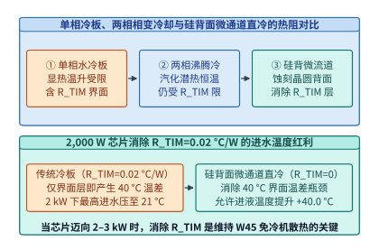

*图 15-17　单相冷板、两相相变浸没/冷板与硅背面微通道直冷的热阻网络（$R_{\mathrm{TIM}}, R_{\mathrm{conv}}$）与千瓦级芯片结温边界。*

图 15-17 直观对比了单相冷板、两相沸腾冷却与硅背面微通道直冷的热阻网络及算例 15-8 的进液温度提升红利。在实际工程落地中，架构师在评审两相沸腾冷板与硅背面微通道直冷方案时，还必须重点核查两项流体力学与热物理约束：

1. **两相沸腾冷却的临界热流密度（CHF）与氟化液潜热短板**：
   根据经典的 Kutateladze-Zuber 核态沸腾临界热流密度（Critical Heat Flux, CHF）关联式，沸腾换热面在不发生蒸汽膜包裹干涸的前提下所能承载的极限热流密度正比于工质汽化潜热 $h_{fg}$ 与表面张力 $\sigma$ 的四分之一次方：
   $$q''_{\mathrm{CHF}} = C_{\mathrm{KZ}} \cdot h_{fg} \cdot \rho_v^{1/2} \left[\sigma g (\rho_l - \rho_v)\right]^{1/4}$$
   其中 $\rho_l, \rho_v$ 分别为液相与汽相密度。去离子水在常压下的汽化潜热高达 $h_{fg,\mathrm{H_2O}} \approx 2{,}257\ \mathrm{kJ/kg}$，表面张力大，理论 CHF 可轻松突破 $200\text{–}300\ \mathrm{W/cm^2}$；然而数据中心为防止漏液短路而广泛评估的绝缘氟化液（Dielectric Fluorocarbon Fluids），其汽化潜热往往仅有 $h_{fg,\mathrm{fluoro}} \approx 85\text{–}120\ \mathrm{kJ/kg}$（不足水潜热的二十分之一），且表面张力极低，导致池沸腾 CHF 普遍局限在 $20\text{–}45\ \mathrm{W/cm^2}$，即便引入毛细微纳多孔涂层与强制流动沸腾，在面对 $2\text{–}3\ \mathrm{kW}$ 芯片局部热点（$>180\ \mathrm{W/cm^2}$）时仍存在严峻的局部膜态沸腾失稳风险。此外，部分含氟工质（PFAS）还面临日益收紧的环保淘汰法规与高昂的工质补充成本。
2. **硅背面微流道的层流压降定律与三维射流分水歧管（3D Manifold）**：
   对于宽度 $W_{\mathrm{ch}} = 50\ \mu\mathrm{m}$、深度 $H_{\mathrm{ch}} = 200\ \mu\mathrm{m}$ 的矩形硅微流道，其水力直径为：
   $$D_h = \frac{2 W_{\mathrm{ch}} H_{\mathrm{ch}}}{W_{\mathrm{ch}} + H_{\mathrm{ch}}} = \frac{2 \times 50 \times 200}{250} = 80\ \mu\mathrm{m}$$
   在层流状态下，流体横穿长度 $L_{\mathrm{chip}}$ 的压降满足泊肃叶（Poiseuille）定律：
   $$\Delta P_{\mathrm{ch}} \propto \frac{\mu_{\mathrm{visc}} \cdot L_{\mathrm{chip}} \cdot v_{\mathrm{ch}}}{D_h^2}$$
   若让冷却水直接从大芯片一侧边缘流入、跨越整整 $L_{\mathrm{chip}} = 30\ \mathrm{mm}$ 后从另一侧流出，高达数十米每秒的微流道流速将产生超过 $300\text{–}500\ \mathrm{kPa}$（$3\text{–}5\ \mathrm{bar}$）的高额压降，不仅使水泵功耗呈平方级飙升，还会威胁微凸点键合层与密封圈的机械寿命。为此，现代硅背面微通道直冷普遍采用**分层三维分水歧管（3D Hierarchical Manifold Microchannel）**：将上方垂直进液分割为 $m = 10\text{–}20$ 组交错排列的微射流进出液槽，使冷却水在硅微流道内的实际水平流动距离从 $L_{\mathrm{chip}}$ 缩短为 $L_{\mathrm{chip}} / m$，且每条支路流速同步降至 $1/m$，从而将总流阻压降压缩约 **$m^2 = 100\text{–}400\times$**（控制在 $<35\ \mathrm{kPa}$ 的安全区间），同时消除了芯片首尾两端的流向温差梯度。

下面给出机架母排焦耳损耗与硅背面微通道直冷热阻—进液温度联合求解器参考实现：

```python
from dataclasses import dataclass

@dataclass
class RackThermalPowerSpec:
    rack_power_w: float = 140_000.0
    busbar_resistance_ohm: float = 0.0008  # 0.8 mOhm
    current_density_a_per_mm2: float = 2.0
    chip_power_w: float = 2_000.0
    tj_max_c: float = 85.0
    r_tim_c_per_w: float = 0.020
    r_conv_coldplate_c_per_w: float = 0.012
    r_conv_microfluidics_c_per_w: float = 0.008

def audit_busbar_and_microfluidics(spec: RackThermalPowerSpec) -> dict:
    # 1. Compare 48V DC vs 800V HVDC busbar current, copper area, and I^2*R loss
    i_48v = spec.rack_power_w / 48.0
    i_800v = spec.rack_power_w / 800.0
    loss_48v_w = (i_48v ** 2) * spec.busbar_resistance_ohm
    loss_800v_w = (i_800v ** 2) * spec.busbar_resistance_ohm
    cu_area_48v_mm2 = i_48v / spec.current_density_a_per_mm2
    cu_area_800v_mm2 = i_800v / spec.current_density_a_per_mm2

    # 2. Compare cold-plate vs direct-to-silicon microfluidics max inlet temperature
    t_in_coldplate_c = spec.tj_max_c - spec.chip_power_w * (
        spec.r_tim_c_per_w + spec.r_conv_coldplate_c_per_w
    )
    t_in_no_tim_c = spec.tj_max_c - spec.chip_power_w * spec.r_conv_coldplate_c_per_w
    t_in_mf_3d_c = spec.tj_max_c - spec.chip_power_w * spec.r_conv_microfluidics_c_per_w
    return {
        "i_48v_a": round(i_48v, 2),
        "i_800v_a": round(i_800v, 2),
        "loss_48v_w": round(loss_48v_w, 2),
        "loss_800v_w": round(loss_800v_w, 2),
        "loss_reduction_x": round(loss_48v_w / loss_800v_w, 2),
        "cu_area_48v_mm2": round(cu_area_48v_mm2, 2),
        "cu_area_800v_mm2": round(cu_area_800v_mm2, 2),
        "t_in_coldplate_c": round(t_in_coldplate_c, 1),
        "t_in_no_tim_c": round(t_in_no_tim_c, 1),
        "t_in_mf_3d_c": round(t_in_mf_3d_c, 1),
    }
```

### 15.6.2 园区百兆瓦级电池储能系统（BESS）的电网调频与峰谷电价套利账本

在 15.2.2 节中，我们讨论了机架内部用于削平 $50\ \mathrm{ms}$ 训练脉冲的小容量超级电容。而在整个算力园区的变电站母线侧，现代 $100\ \mathrm{MW}\text{–}1\ \mathrm{GW}$ 级 AI 园区正普遍配套建设**百兆瓦时（$100\text{–}400\ \mathrm{MWh}$）级的磷酸铁锂（LFP）集装箱电池储能系统（Battery Energy Storage System, BESS）**[^bess]。

若按照传统通用机房的设计思维，将这套百兆瓦时储能系统仅仅当作“每年电网停电几分钟时才派上用场的死备电（Idle Backup UPS）”，那么高达数千万美元的电池折旧将成为纯粹的财务负担。而在吉瓦级 AI 工程体系中，园区 BESS 通过功率转换系统（PCS）与园区能量管理系统（EMS）联动，在**毫秒级、分钟级与小时级**三个正交时间尺度上同时承担三项使命（图 15-18）：
1. **毫秒至秒级：吸收集群级训练启停与故障甩负荷冲击**。与机架内超级电容构成两级滤波网络，在十万卡训练任务发生软故障急停或检查点保存的数秒至数十秒窗口内，由园区 BESS 瞬时吸收或补足数十兆瓦功率差额，保护上级电网主变免受机械冲击；
2. **分钟级：参与区域电网一次调频（Primary Frequency Regulation）与容量需量削峰**。当区域电网因风电/光伏云层遮挡出现频率跌落（如从 $50.00\ \mathrm{Hz}$ 跌至 $49.85\ \mathrm{Hz}$）时，园区 BESS 在数百毫秒内向母线注入有功功率提供“虚拟转动惯量（Synthetic Inertia）”，获取电网辅助服务补贴，并削减园区每月按最高 15 分钟平均负荷缴纳的基本需量电费（Demand Charge）；
3. **小时级：日内分时电价峰谷套利（Peak-Valley Arbitrage）**。在风光大发或深夜用电低谷期（谷段电价 $c_{\mathrm{off}}$），以最大功率从电网额外购电充满储能；在午后与傍晚用电尖峰期（峰段电价 $c_{\mathrm{peak}}$，通常高达谷段电价的 $3\times\text{–}4\times$），由 BESS 放电顶替高价市政电网供电。

为了防止这三项任务在同一时刻争抢电池容量（例如在峰段放电套利放空电池后恰好遭遇电网掉电或频率跌落），园区 EMS 必须对电池荷电状态（$\mathrm{SoC} \in [0\%, 100\%]$）实施严格的**硬分区水位线管控（SoC Watermark Partitioning）**：
- **底线备电保护区（$\mathrm{SoC} \in [0\%, 20\%]$）**：严禁任何电价套利或常规调频动用该区间电量；仅当市政电网发生实质性失压中断时释放，为十万卡集群完成异步检查点刷盘与液冷泵延时散热提供 $10\text{–}15\ \mathrm{min}$ 的安全软着陆窗口；
- **日内峰谷套利主力区（$\mathrm{SoC} \in [20\%, 85\%]$）**：可用深度 $\Delta \mathrm{SoC}_{\mathrm{arb}} = 65\%$，按日内分时电价曲线与风光出力预测执行计划充放电；
- **双向脉冲平滑与一次调频缓冲带（$\mathrm{SoC} \in [85\%, 95\%]$）**：始终预留至少 $10\%$ 的向上吸收余量（Headroom），以便在集群训练 Step 通信谷底或故障急停甩负荷时瞬时吸收回馈电能，避免触发过充保护跳闸。

在一次调频控制律上，园区 PCS 逆变器运行经典的**有功—频率下垂控制（Active Power-Frequency Droop Control）**：设电网额定频率为 $f_0 = 50.00\ \mathrm{Hz}$，调频死区为 $\pm \Delta f_{\mathrm{db}} = \pm 0.03\ \mathrm{Hz}$，下垂系数为 $R_{\mathrm{droop}}$（通常设为 $2\%\text{–}4\%$），则当电网瞬时频率 $f(t)$ 偏离死区时，BESS 自动叠加的调频功率增量 $\Delta P_{\mathrm{freq}}(t)$ 为：

$$
\Delta P_{\mathrm{freq}}(t) = \begin{cases} 
0, & |f(t) - f_0| \le \Delta f_{\mathrm{db}} \\
-\dfrac{P_{\mathrm{BESS, rated}}}{R_{\mathrm{droop}} \cdot f_0} \cdot \left(f(t) - f_0 - \mathrm{sgn}(f(t)-f_0)\Delta f_{\mathrm{db}}\right), & |f(t) - f_0| > \Delta f_{\mathrm{db}}
\end{cases}
$$

例如，对于额定功率 $P_{\mathrm{BESS, rated}} = 100\ \mathrm{MW}$、下垂率 $R_{\mathrm{droop}} = 2.5\%$ 的园区储能站，当区域电网频率跌落至 $f = 49.82\ \mathrm{Hz}$（越过死区 $-0.15\ \mathrm{Hz}$）时，PCS 在 $100\ \mathrm{ms}$ 内立即向园区母线额外支撑 $\Delta P_{\mathrm{freq}} = \frac{100\ \mathrm{MW}}{0.025 \times 50\ \mathrm{Hz}} \times 0.15\ \mathrm{Hz} = \mathbf{+12.0\ \mathrm{MW}}$ 有功功率，将吉瓦级 AI 园区从电网的“纯刚性冲击源”转化为守护电网频率稳定的优质调节资产。

设园区储能系统的套利可用能量容量为 $E_{\mathrm{BESS}}$（单位 $\mathrm{MWh}$），充放电往返循环总效率（Round-Trip Efficiency，含逆变器与变压器损耗）为 $\eta_{\mathrm{rt}} \in (0.85, 0.92)$，每日完成 $n_{\mathrm{cycle}}$ 次完整充放电循环，峰谷有效电价差为 $\Delta c_{\mathrm{eff}}$。则园区储能的**年度峰谷套利净收益 $R_{\mathrm{arb}}$** 与计入调频辅助服务收益 $R_{\mathrm{freq}}$ 后的**静态投资回收期 $T_{\mathrm{payback}}$** 分别为：

$$
R_{\mathrm{arb}} = 365 \cdot n_{\mathrm{cycle}} \cdot E_{\mathrm{BESS}} \cdot \eta_{\mathrm{rt}} \cdot \Delta c_{\mathrm{spread}} \quad \text{或精确按充放双向结算：} \quad R_{\mathrm{arb}}^{\mathrm{exact}} = 365 \cdot n_{\mathrm{cycle}} \cdot E_{\mathrm{BESS}} \cdot \left(\eta_{\mathrm{rt}} \cdot c_{\mathrm{peak}} - c_{\mathrm{off}}\right)
$$

$$
T_{\mathrm{payback}} = \frac{\mathrm{CapEx}_{\mathrm{BESS}}}{R_{\mathrm{arb}} + R_{\mathrm{freq}} + R_{\mathrm{demand}} - C_{\mathrm{O\&M}}}
$$

> **算例 15-9：核算 $100\ \mathrm{MWh}$ 园区储能系统在峰谷电价差 $0.08\ \text{美元}/\mathrm{kWh}$、循环效率 $\eta_{\mathrm{rt}} = 88\%$ 下的年套利收益与投资回收期（对应 `experiments/ch15/15-02`）。**
> 设某 $150\ \mathrm{MW}$ AI 园区配套建设了一座标称可用容量 $E_{\mathrm{BESS}} = 100\ \mathrm{MWh} = 100{,}000\ \mathrm{kWh}$ 的磷酸铁锂储能站，往返循环效率 $\eta_{\mathrm{rt}} = 88\%$，按 $220\ \text{美元/kWh}$ 的交钥匙工程造价计，初始资本开支为 $\mathrm{CapEx}_{\mathrm{BESS}} = 2{,}200\ \text{万美元}$。当地工业分时电价为：夜间谷电 $c_{\mathrm{off}} = 0.04\ \text{美元/kWh}$，日间峰电 $c_{\mathrm{peak}} = 0.12\ \text{美元/kWh}$（名义峰谷价差 $\Delta c_{\mathrm{spread}} = 0.08\ \text{美元/kWh}$，峰谷比 $3:1$），每天执行 $n_{\mathrm{cycle}} = 1$ 次峰谷循环。
> 1. **日内与年度峰谷电价套利收益**：
>    - **按有效放电量乘名义价差口径**（当充电使用园区夜间富余绿电长协基准额度、仅对有效放出的 $E_{\mathrm{out}} = 100\ \mathrm{MWh} \times 88\% = 88\ \mathrm{MWh}$ 核算 $0.08\ \text{美元/kWh}$ 净差价时）：
>      单日套利收益为 $88{,}000\ \mathrm{kWh} \times 0.08 = \mathbf{7{,}040\ \text{美元/天}}$，全年（$365$ 天）套利收益为：
>      $$R_{\mathrm{arb}} = 7{,}040 \times 365 = \mathbf{256.96\ \text{万美元/年}}$$
>    - **按谷电额外购入 $100\ \mathrm{MWh}$、峰电顶替 $88\ \mathrm{MWh}$ 双向精确结算口径**（计入 $12\ \mathrm{MWh}$ 循环热损所耗费的 $0.04\ \text{美元/kWh}$ 谷电成本）：
>      单日净收益为 $100{,}000 \times (0.88 \times 0.12 - 0.04) = 100{,}000 \times 0.0656 = \mathbf{6{,}560\ \text{美元/天}}$，全年净套利收益为：
>      $$R_{\mathrm{arb}}^{\mathrm{exact}} = 6{,}560 \times 365 = \mathbf{239.44\ \text{万美元/年}}$$
> 2. **叠加电网一次调频与需量电费削减后的综合回收期**：
>    若仅靠每日一充一放的单纯峰谷套利，静态回收期约为 $2{,}200 / 256.96 \approx 8.56\ \text{年}$；但在实际运营中，叠加每年约 $350\ \text{万美元}$ 的电网一次调频辅助服务补偿与每月峰值基本需量电费（Demand Charge）削减收益后，全站综合年现金流收益可达 **$589.44\text{–}606.96\ \text{万美元/年}$**，静态投资回收期直接缩短至 **$3.62\text{–}3.73\ \text{年}$**（若日内叠加午间光伏谷段执行“两充两放”，回收期更可进一步压缩至 $3.4\ \text{年}$ 以内）——这意味着整套百兆瓦时储能系统在硬件生命周期内不仅免费为十万卡集群提供了毫秒级电网平滑与备电保护，还能反向创造净财务收益。

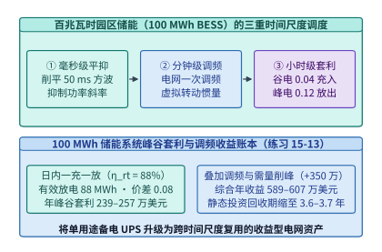

*图 15-18　百兆瓦级园区储能（BESS）在 $50\ \mathrm{ms}$ 训练脉冲平滑、日内峰谷电价套利与电网掉电备电中的三重能量流。*

下面给出园区百兆瓦时电池储能系统（BESS）的硬分区水位线校核、一次调频有功—频率下垂控制与峰谷套利回收期计算器实现：

```python
def evaluate_campus_bess_and_droop(
    e_bess_mwh: float = 100.0,
    p_rated_mw: float = 100.0,
    eta_rt: float = 0.88,
    c_off_usd_per_kwh: float = 0.04,
    c_peak_usd_per_kwh: float = 0.12,
    capex_musd: float = 22.0,
    ancillary_rev_musd_yr: float = 3.50,
    grid_freq_hz: float = 49.82,
    f0_hz: float = 50.00,
    deadband_hz: float = 0.03,
    r_droop: float = 0.025,
) -> dict:
    # 1. Primary frequency droop support when |f - f0| > deadband
    df = grid_freq_hz - f0_hz
    if abs(df) <= deadband_hz:
        p_freq_mw = 0.0
    else:
        eff_df = df - (deadband_hz if df > 0 else -deadband_hz)
        p_freq_mw = -(p_rated_mw / (r_droop * f0_hz)) * eff_df

    # 2. Annual peak-valley arbitrage under nominal spread vs exact two-way settlement
    e_kwh = e_bess_mwh * 1_000.0
    spread = c_peak_usd_per_kwh - c_off_usd_per_kwh
    rev_spread_musd = 365.0 * e_kwh * eta_rt * spread / 1e6
    rev_exact_musd = 365.0 * e_kwh * (eta_rt * c_peak_usd_per_kwh - c_off_usd_per_kwh) / 1e6

    payback_spread_yr = capex_musd / (rev_spread_musd + ancillary_rev_musd_yr)
    payback_exact_yr = capex_musd / (rev_exact_musd + ancillary_rev_musd_yr)
    return {
        "p_freq_mw": round(p_freq_mw, 2),
        "rev_spread_musd": round(rev_spread_musd, 4),
        "rev_exact_musd": round(rev_exact_musd, 4),
        "payback_spread_yr": round(payback_spread_yr, 2),
        "payback_exact_yr": round(payback_exact_yr, 2),
    }
```

### 15.6.3 动静态功耗联合优化（`Kareus` OSDI '26）、跨地域骨干网并行参数服务（`Di-PS` NSDI '26）与全生命周期碳账本

最后，我们将视角转向芯片与集群运行时的能耗精细化治理：当集群处于非满载窗口或跨地域异构协同训练时，如何消除无谓耗散的静态漏电功率与广域网等待能耗？

#### 1. 动静态功耗联合优化：OSDI '26 *Kareus* 与空闲卡深度休眠合并

在先进工艺节点（$4\ \mathrm{nm} / 3\ \mathrm{nm}$）的大芯片上，单张加速卡的总瞬时功耗 $P_{\mathrm{card}}$ 由两部分相加而成：

$$
P_{\mathrm{card}}(u, V, f) = P_{\mathrm{static}}(V, T_j) + u \cdot P_{\mathrm{dyn}}(V, f)
$$

其中 $P_{\mathrm{dyn}} \propto C V^2 f$ 为随算子利用率 $u \in [0, 1]$ 变化的动态翻转功耗，而 **$P_{\mathrm{static}} = V \cdot I_{\mathrm{leak}}(V, T_j)$ 为只要芯片上电唤醒、即便算子利用率 $u=0$ 也时刻在消耗的晶体管亚阈值漏电与栅极漏电静态功耗（叠加 HBM 刷新与 SerDes 待机底噪后，现代千瓦级 GPU 的上电空闲静态功耗普遍高达 $P_{\mathrm{static}} \approx 150\text{–}220\ \mathrm{W}$）**。更关键的是，亚阈值漏电流 $I_{\mathrm{leak}}$ 对结温 $T_j$ 呈指数级正反馈依赖（温度每升高 $10^\circ\mathrm{C}$，漏电功率增加约 $15\%\text{–}25\%$）：一旦芯片维持高电压上电待机，漏电发热本身又会维持芯片温升，形成静态能耗黑洞。

发表于 OSDI 2026 的 ***Kareus*（Joint Reduction of Dynamic and Static Energy in Large Model Training）**[^kareus] 揭示了一个关键能耗陷阱：
- 在训练流水线的非关键路径阶段、夜间推理低谷期或等待上游数据供给的低利用率窗口（例如集群平均负载率 $u = 40\%$）中，如果采用传统的“全卡均匀分摊负载 + 浅度 DVFS 降频”策略，虽然动态功耗随负载下降了，但**全部 $100\%$ 的加速卡依然处于上电唤醒态，每张卡都在白白燃烧 $P_{\mathrm{static}} = 180\ \mathrm{W}$ 的静态漏电功率**（此时静态漏电占单卡总功耗的比例飙升至近一半）；
- 反之，*Kareus* 在微观层面对非关键路径算子执行细粒度核心/显存频率协同降压降频以削减动态能耗，在宏观层面则通过**动态工作负载紧缩合并（Workload Consolidation）**，将原本散落在 $N$ 张卡上的 $40\%$ 负载集中打包至 $u \cdot N = 40\%$ 的活跃卡上满载高效运行，同时将其余 $(1 - u) \cdot N = 60\%$ 的空闲加速卡切入时钟门控与电源门控深度休眠态（Deep Sleep / Power-Gating，休眠功耗 $P_{\mathrm{sleep}} \le 15\ \mathrm{W}$ 乃至彻底下电归零），从物理上扑灭闲置卡的静态漏电税（图 15-19）。

在工程实现中，要将一张加速卡切入深度休眠并在流量回升时无损唤醒，必须核算**状态迁移与休眠唤醒的能量盈亏平衡窗口 $T_{\mathrm{idle}}^*$**：设将空闲卡上的分片状态归并至活跃卡并刷入休眠态加上后续唤醒重加载的额外耗能为 $E_{\mathrm{transition}} = P_{\mathrm{full}} \cdot T_{\mathrm{mig}}$（其中迁移与重初始化耗时 $T_{\mathrm{mig}} \approx 0.8\text{–}2.0\ \mathrm{s}$），休眠期间每秒节省的静态功率为 $\Delta P_{\mathrm{save}} = P_{\mathrm{static}} - P_{\mathrm{sleep}}$，则只有当预测空闲持续时间满足：
$$T_{\mathrm{idle}} > T_{\mathrm{idle}}^* = \frac{P_{\mathrm{full}} \cdot T_{\mathrm{mig}}}{P_{\mathrm{static}} - P_{\mathrm{sleep}}} \approx \frac{700\ \mathrm{W} \times 1.2\ \mathrm{s}}{180\ \mathrm{W} - 15\ \mathrm{W}} \approx \mathbf{5.09\ \mathrm{s}}$$
时，触发深度休眠合并才能取得净正能量收益。*Kareus* 利用流水线周期性与负载预测器精准识别大于 $T_{\mathrm{idle}}^*$ 的空闲空泡，从而在不抖动训练吞吐的前提下最大化节电收益。

> **算例 15-10：核算集群负载率 $u = 40\%$ 时，均匀分摊基线与 *Kareus* 紧缩合并休眠的单卡等效功耗及节电率（对应 `experiments/ch15/15-02` 与练习 15-12）。**
> 设单张加速卡上电空闲静态功耗为 $P_{\mathrm{static}} = 180\ \mathrm{W}$，满载动态功耗增量为 $P_{\mathrm{dyn}} = 520\ \mathrm{W}$（即单卡满载总功耗 $P_{\mathrm{full}} = 180 + 520 = 700\ \mathrm{W}$）。当前集群整体计算负载率为 $u = 40\%$。
> 1. **均匀分摊基线（$100\%$ 加速卡全部保持唤醒，每卡运行在 $40\%$ 利用率）**：
>    每张卡的平均功耗为：
>    $$P_{\mathrm{uniform}} = P_{\mathrm{static}} + u \cdot P_{\mathrm{dyn}} = 180\ \mathrm{W} + 0.40 \times 520\ \mathrm{W} = 180 + 208 = \mathbf{388.0\ \mathrm{W/GPU}}$$
>    其中静态漏电功耗（$180\ \mathrm{W}$）占到了总耗电的 $180 / 388 = \mathbf{46.39\%}$。
> 2. **采用 *Kareus* 紧缩合并 + 空闲卡深度休眠**：
>    将全部计算任务合并至 $40\%$ 的活跃 GPU 上满载运行（单卡 $700\ \mathrm{W}$），其余 $60\%$ 的空闲 GPU 进入深度休眠：
>    - 若空闲卡切入完全电源门控（$P_{\mathrm{sleep}} \approx 0\ \mathrm{W}$），折算到全集群每张卡的等效平均功耗为：
>      $$P_{\mathrm{kareus, 0W}} = 0.40 \times 700\ \mathrm{W} + 0.60 \times 0\ \mathrm{W} = \mathbf{280.0\ \mathrm{W/GPU}}, \qquad \text{节电率} = \frac{388 - 280}{388} = \mathbf{27.84\%}$$
>    - 若空闲卡保留 PCIe/NVLink 唤醒监听（$P_{\mathrm{sleep}} = 15\ \mathrm{W}$），折算到全集群每张卡的等效平均功耗为：
>      $$P_{\mathrm{kareus, 15W}} = 0.40 \times 700\ \mathrm{W} + 0.60 \times 15\ \mathrm{W} = 280 + 9 = \mathbf{289.0\ \mathrm{W/GPU}}, \qquad \text{节电率} = \frac{388 - 289}{388} = \mathbf{25.52\%}$$
>    可见，在不损失任何集群吞吐的前提下，仅通过消除 $60\%$ 空闲卡的静态漏电即可直接节电 **$25.5\%\text{–}27.8\%$**。

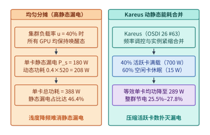

*图 15-19　Kareus（OSDI '26）动静态能耗分解：低负载下全卡浅度降频的高静态漏电税 vs. 负载紧缩合并 + 空闲卡深度休眠。*

#### 2. 异构跨集群异步参数服务器：NSDI '26 *Di-PS*

在 15.4.3 节中，我们介绍了面向同构多园区的 Streaming DiLoCo。然而在真实的企业级扩建中，分布在不同地域的算力中心往往属于**不同代际的异构加速器集群**（例如老园区部署的是上一代 NPU/GPU，新园区部署的是最新一代超节点，两者单步计算耗时与网络带宽存在 $1.5\times\text{–}2.5\times$ 代差）。若强行使用同步屏障，快园区每步都要停下来空等慢园区，白白燃烧上文所述的静态漏电功耗。

发表于 NSDI 2026 的 ***Di-PS*（System-Algorithm Co-Design for Asynchronous and Heterogeneous Cross-cluster LLM Training at Scale）**[^dips] 针对百亿至千亿参数模型跨万卡异构集群训练，提出了**分片异步参数服务器与陈旧度惩罚伪梯度（Staleness-Penalized Pseudo-Gradient）**协同设计（图 15-20）：
1. **层间流式异步推送与拉取**：*Di-PS* 废除了跨集群的全局同步屏障，引入分布式广域网参数服务器（WAN Parameter Server）。各异构子集群按自身硬件算力全速推进本地前反向计算，一旦第 $l$ 层的局部伪梯度或梯度分片准备就绪，立即在后台通过广域网链路分段流式上传，同时拉取最新全局参数分片，实现广域网传输与全模型前反向计算的无缝重叠；
2. **感知陈旧度与异构步频的自适应伪梯度阻尼**：设第 $k$ 座子集群在全局版本 $t - \tau_k$ 的模型参数 $\Theta^{(t - \tau_k)}$ 上完成了 $H_k$ 步本地内循环优化，得到局部终点参数 $\tilde{\Theta}_k$（其中 $\tau_k \ge 0$ 为版本滞后陈旧度）。为防止慢速子集群提交的高陈旧度伪梯度将全局主轨迹拉回历史旧谷底，*Di-PS* 在参数服务器端执行带阻尼项与邻近牵引的全局更新：
   $$\Theta^{(t+1)} = \Theta^{(t)} - \eta_{\mathrm{outer}} \cdot \frac{1}{(1 + \beta \tau_k)} \left[\left(\Theta^{(t - \tau_k)} - \tilde{\Theta}_k\right) + \lambda_{\mathrm{prox}} \left(\Theta^{(t)} - \Theta^{(t - \tau_k)}\right)\right]$$
   其中 $(1 + \beta \tau_k)^{-1}$ 为陈旧度衰减因子，$\lambda_{\mathrm{prox}}(\Theta^{(t)} - \Theta^{(t-\tau_k)})$ 为补偿主模型在 $[t-\tau_k, t]$ 期间漂移方向的泰勒修正项。这一系统—算法协同设计使异步异构跨集群训练在百毫秒级广域网 RTT 与 $2\times$ 算力代差下，仍能保持与单集群同步基线一致的训练损失曲线及 **$>90\%$ 的硬件有效吞吐**。

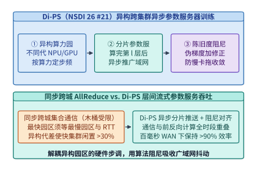

*图 15-20　Di-PS（NSDI '26）跨地域训练的广域网链路段带宽调度与层间异步梯度传输重叠。*

#### 3. AI 数据中心全生命周期碳账本（隐含碳 vs. 运行碳）与工程总收束

在评估吉瓦级 AI 基础设施的可持续性时，架构师还必须建立涵盖**隐含碳（Embodied Carbon）**与**运行碳（Operational Carbon）**的全生命周期碳足迹方程（图 15-21）：

$$
C_{\mathrm{carbon, total}} = C_{\mathrm{embodied}} + \int_{0}^{L_{\mathrm{life}}} P_{\mathrm{IT}}(t) \cdot \mathrm{PUE}(t) \cdot \mathrm{CI}_{\mathrm{grid}}(t)\,\mathrm{d}t
$$

- **隐含碳 $C_{\mathrm{embodied}}$**：指在芯片与机房通电之前，在 $3\ \mathrm{nm}/2\ \mathrm{nm}$ 极紫外光刻（EUV）晶圆制造、CoWoS 先进封装、HBM4 堆叠、铜母排冶炼、变电站与液冷管网施工以及园区锂电池制造过程中已经一次性排放的温室气体。一台包含 72 张旗舰 GPU 的液冷超节点机柜，其制造与基建分摊的隐含碳通常高达 **$80\text{–}140\ \mathrm{tCO_2e}$（吨二氧化碳当量）**。正如 15.1.3 节算例 15-3 中硬件闲置会蒸发财务折旧一样，**任何因变电站排队等待或低 MFU 空转造成的算力闲置，都会直接推高分摊到每个有效输出 Token 上的隐含碳成本 $c_{\mathrm{emb, token}} = C_{\mathrm{embodied}} / N_{\mathrm{tokens, life}}$**；
- **运行碳 $C_{\mathrm{operational}}$**：取决于运行期耗电量与所在电网的实时碳强度 $\mathrm{CI}_{\mathrm{grid}}(t)$（单位 $\mathrm{gCO_2e/kWh}$，燃煤火电高达 $\sim 750\text{–}820\ \mathrm{g/kWh}$，天然气联合循环约 $380\text{–}450\ \mathrm{g/kWh}$，而水电、核电与风光电基地可低至 $<25\text{–}50\ \mathrm{g/kWh}$）。例如，一台满载 $P_{\mathrm{IT}} = 130\ \mathrm{kW}$、$\mathrm{PUE} = 1.10$ 的液冷机柜连续运行 $3$ 年（$26{,}280\ \mathrm{h}$）共耗电 $3.758 \times 10^6\ \mathrm{kWh}$（若放大至整座 $100\ \mathrm{MW}$ 并网负荷的算力园区，$3$ 年满载耗电量则高达 $100\ \mathrm{MW} \times 26{,}280\ \mathrm{h} \approx 26.3\ \text{亿度（kWh）}$，如图 15-21 所示）：在火电电网（$750\ \mathrm{g/kWh}$）下，单机柜 $3$ 年运行碳高达 **$2{,}818.5\ \mathrm{tCO_2e}$**（占全生命周期总碳排的 **$96\%$**）；而在绿电基地（$35\ \mathrm{g/kWh}$）下运行碳骤降至 **$131.5\ \mathrm{tCO_2e}$**，此时隐含碳占比跃升至 **$45\%\text{–}52\%$**。因此，延长芯片服役寿命、提升 MFU 与吞吐、利用 *Kareus* 扑灭静态漏电、以及通过 BESS 储能与跨地域调度追逐风光富余绿电，是降低每百万 Token 全生命周期碳足迹的四大工程支柱。

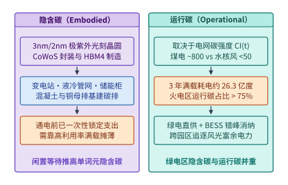

*图 15-21　AI 数据中心 3–5 年生命周期内隐含碳（Embodied Carbon：晶圆制造与基建）与运行碳（Operational Carbon：发电结构）的权衡曲线。*

图 15-22 与表 15-9、表 15-10 将本章新增的两相/微通道直冷、园区百兆瓦储能、动静态能耗合并与异构跨洲训练汇总为吉瓦级 AI 园区的完整工程总账本。

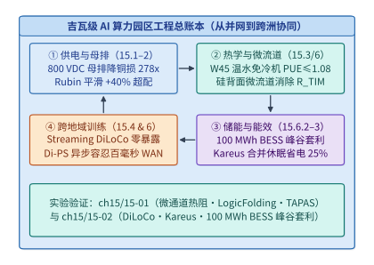

*图 15-22　吉瓦级 AI 园区从电网并网、储能平滑、微通道液冷到跨城光网协同的完整工程总账本。*

*表 15-9　面向 $1\text{–}3\ \mathrm{kW}$ 芯片的三代液冷微结构与热阻分解对比（对应 `experiments/ch15/15-01`）*

| 冷却微结构代际 | 界面热阻 $R_{\mathrm{TIM}}$ | 对流热阻 $R_{\mathrm{conv}}$ | $2{,}000\ \mathrm{W}$ 下总温升 | $T_{j,\max}=85^\circ\mathrm{C}$ 允许最高进液温度 | 核心物理瓶颈与适用功耗区间 |
| --- | :---: | :---: | :---: | :---: | --- |
| **传统外贴单相铜冷板** | $0.020\ \mathrm{^\circ C/W}$ | $0.012\ \mathrm{^\circ C/W}$ | $64.0^\circ\mathrm{C}$ | **$21.0^\circ\mathrm{C}$（需冷水机组）** | 受制于 TIM 界面温差（$40^\circ\mathrm{C}$）与单相显热温升，适用 $\le 1.5\ \mathrm{kW}$ |
| **外贴两相沸腾冷板** | $0.020\ \mathrm{^\circ C/W}$ | $0.006\ \mathrm{^\circ C/W}$ | $52.0^\circ\mathrm{C}$ | $33.0^\circ\mathrm{C}$（W32 边界） | 汽化潜热消除流体温升梯度，但仍受 $R_{\mathrm{TIM}}$ 与临界热流密度 CHF 制约 |
| **硅背面微通道直冷** | **$0\ \mathrm{^\circ C/W}$（清零）** | **$0.008\text{–}0.012\ \mathrm{^\circ C/W}$** | **$16.0\text{–}24.0^\circ\mathrm{C}$** | **$61.0\text{–}69.0^\circ\mathrm{C}$（原生支持 W45+）** | 直接蚀刻硅晶圆背面消除 $R_{\mathrm{TIM}}$，进水温度提升 $+40^\circ\mathrm{C}$，支撑 $2\text{–}3\ \mathrm{kW}$ |

*表 15-10　吉瓦级园区能量与跨地域训练前沿系统原语汇总（对应 `experiments/ch15/15-02`）*

| 系统原语 / 基础设施模块 | 作用层级与时间尺度 | 核心定量收益或锁定指标 | 配套工程代价与适用条件 |
| --- | :---: | --- | --- |
| **百兆瓦时园区储能（$100\ \mathrm{MWh}$ BESS）** | 园区变电站母线（毫秒至小时级） | 峰谷价差 $0.08\ \text{美元/kWh}$、$\eta_{\mathrm{rt}}=88\%$ 下年套利 **$239.44\text{–}256.96\ \text{万美元}$**；叠加调频与需量削峰（$+350\ \text{万美元/年}$）后综合年收益 **$589.44\text{–}606.96\ \text{万美元}$**，回收期 **$3.62\text{–}3.73\ \text{年}$** | 需配置双向 PCS 逆变器与 EMS 寿命衰减管理 |
| ***Kareus* 动静态功耗联合优化（OSDI '26）** | 算子 DVFS + 集群实例调度（秒至小时级） | 在 $40\%$ 负载率下将单卡等效功耗从 $388\ \mathrm{W}$ 压至 **$280\text{–}289\ \mathrm{W}$（节电 $25.5\%\text{–}27.8\%$）** | 需支持快速权重激活迁移或弹性 DP 扩缩容以腾空休眠卡 |
| ***Di-PS* 异构跨集群异步参数服务（NSDI '26）** | 跨地域广域网训练（百毫秒 RTT） | 层间流式异步推送 + 陈旧度阻尼修正，在异构代差集群间保持 **$>90\%$ 扩展效率** | 参数服务器端需维护陈旧度感知阻尼项与多版本缓冲 |

### 15.6.4 800V 高压直流（HVDC）机架供电架构、固体氧化物燃料电池（SOFC）微网与余热回收区域供暖（PUE $\to$ ERE）

随着下一代超节点机柜（如 Rubin Ultra NVL144 / NVL576）将单柜功率从 $132\text{–}140\ \mathrm{kW}$ 推向 $250\text{–}600\ \mathrm{kW}$，并且园区并网审批周期在部分核心区域拉长至 $36\text{–}60$ 个月，吉瓦级 AI 基础设施在机架级配电、板级垂直供电（Vertical Power Delivery, VPD）以及园区级热电联产（Combined Heat and Power, CHP）与余热再利用效率（Energy Reuse Effectiveness, $\mathrm{ERE}$）上正在经历三场深层变革：

1. **从 $48\ \mathrm{V}$ 母排到 $\pm 400\ \mathrm{V}$（$800\ \mathrm{V}$ HVDC）与板级垂直供电（VPD）的欧姆极限突破**：
   在单柜 $P_{\mathrm{rack}} = 140\ \mathrm{kW}$ 乃至更高功率下，传统 $48\ \mathrm{VDC}$ 机架母排与板载平面横向供电网络（Lateral Power Delivery Network, Lateral PDN）同时撞上了铜材载流面积与阻抗压降（IR Drop）的物理墙。
   - **机架母排级**：按工业安全载流密度 $J_{\max} = 2.0\ \mathrm{A/mm^2}$ 设计铜母排，工作电流 $I = P_{\mathrm{rack}} / V_{\mathrm{bus}}$ 直接决定了母排最小截面积 $A_{\mathrm{Cu}} = I / J_{\max}$；而在给定等效回路电阻 $R_{\mathrm{bus}}$ 下，母排焦耳损耗 $P_{\mathrm{loss}} = I^2 R_{\mathrm{bus}} \propto V_{\mathrm{bus}}^{-2}$。将机架母排从 $48\ \mathrm{VDC}$ 提升至 $\pm 400\ \mathrm{VDC}$（即 $800\ \mathrm{V}$ 高压直流 HVDC），工作电流缩减为原来的 $48 / 800 = \mathbf{6.0\%}$（$1/16.67$），在相同回路电阻下焦耳热损耗骤降 $(800/48)^2 = \mathbf{277.78\times}$。
   - **芯片封装级（横向供电 vs. 垂直供电 VPD）**：当供电进入 GPU 封装内部，单颗 $1{,}800\text{–}2{,}000\ \mathrm{W}$ 芯片在核心电压 $V_{\mathrm{core}} = 0.75\ \mathrm{V}$ 下的工作电流高达 $I_{\mathrm{core}} = 1{,}800 / 0.75 = \mathbf{2{,}400\ \mathrm{A}}$。若沿用传统主板边缘排布多相电压调节模块（VRM）、电流沿封装基板平面横向传输 $15\text{–}25\ \mathrm{mm}$ 的方案（等效平面回路阻抗 $R_{\mathrm{lateral}} \approx 35\ \mu\Omega$），仅封装基板上的横向铜层焦耳损耗就高达 $I_{\mathrm{core}}^2 R_{\mathrm{lateral}} = (2{,}400)^2 \times 35 \times 10^{-6} = \mathbf{201.6\ \mathrm{W}}$（占芯片总功耗的 $11.2\%$），且产生高达 $I_{\mathrm{core}} R_{\mathrm{lateral}} = 84\ \mathrm{mV}$（超过核心电压 $11\%$）的静态压降。**垂直供电（Vertical Power Delivery, VPD）**将高密度耦合电感与背面功率级直接贴装在硅中介层/封装正下方，使 $2{,}400\ \mathrm{A}$ 大电流以 $<1.5\ \mathrm{mm}$ 的垂直路径直达晶体管有源层，将 PDN 等效阻抗压缩一个数量级至 $R_{\mathrm{VPD}} \approx 3.5\ \mu\Omega$，板级传输损耗从 $201.6\ \mathrm{W}$ 骤降至 **$20.16\ \mathrm{W}$**（净省 $181.4\ \mathrm{W}$/芯片）。

> **算例 15-11：核算 $140\ \mathrm{kW}$ 超节点机架在 $48\ \mathrm{VDC}$ 与 $800\ \mathrm{V}$ HVDC 下的母排电流、$0.8\ \mathrm{m\Omega}$ 焦耳损耗与铜母排截面积，以及 $2{,}400\ \mathrm{A}$ 芯片垂直供电（VPD）的损耗削减。**
> 设某超节点液冷机柜满载 IT 输入功率为 $P_{\mathrm{rack}} = 140\ \mathrm{kW} = 140{,}000\ \mathrm{W}$，机柜垂直母排往返等效电阻为 $R_{\mathrm{bus}} = 0.8\ \mathrm{m\Omega} = 8.0 \times 10^{-4}\ \Omega$，铜排按安全电流密度 $J = 2.0\ \mathrm{A/mm^2}$ 选型。
> 1. **$48\ \mathrm{VDC}$ 传统低压直流母排**：
>    - 满载母排总电流：$I_{48} = \frac{140{,}000\ \mathrm{W}}{48\ \mathrm{V}} \approx \mathbf{2{,}916.67\ \mathrm{A}}$；
>    - 母排焦耳热损耗：$P_{\mathrm{loss}, 48} = I_{48}^2 R_{\mathrm{bus}} = (2{,}916.67)^2 \times 0.0008 \approx \mathbf{6{,}805.56\ \mathrm{W}} \approx 6.81\ \mathrm{kW}$（占整柜功率的 $4.86\%$）；
>    - 所需铜排最小截面积：$A_{\mathrm{Cu}, 48} = \frac{2{,}916.67\ \mathrm{A}}{2.0\ \mathrm{A/mm^2}} \approx \mathbf{1{,}458.33\ \mathrm{mm^2}}$。
> 2. **$800\ \mathrm{V}$ HVDC（$\pm 400\ \mathrm{VDC}$）高压直流母排**：
>    - 满载母排总电流：$I_{800} = \frac{140{,}000\ \mathrm{W}}{800\ \mathrm{V}} = \mathbf{175.0\ \mathrm{A}}$（仅为 $48\ \mathrm{V}$ 的 $6.0\%$）；
>    - 同阻值（$0.8\ \mathrm{m\Omega}$）下母排焦耳损耗：$P_{\mathrm{loss}, 800} = (175.0)^2 \times 0.0008 = \mathbf{24.50\ \mathrm{W}}$（损耗缩减倍数为 $6{,}805.56 / 24.50 = \mathbf{277.78\times}$）；
>    - 所需铜排最小截面积：$A_{\mathrm{Cu}, 800} = \frac{175.0\ \mathrm{A}}{2.0\ \mathrm{A/mm^2}} = \mathbf{87.50\ \mathrm{mm^2}}$（铜材截面积与质量直接缩减 $94.0\%$）。
> 3. **封装级垂直供电（VPD）对比横向供电（Lateral PDN）**：
>    单颗 $1{,}800\ \mathrm{W}$ 芯片在 $0.75\ \mathrm{V}$ 下工作电流 $I_{\mathrm{core}} = 2{,}400\ \mathrm{A}$。从横向供电（$R_{\mathrm{lateral}} = 35\ \mu\Omega$，损耗 $201.60\ \mathrm{W}$）升级为背面垂直供电（$R_{\mathrm{VPD}} = 3.5\ \mu\Omega$，损耗 $20.16\ \mathrm{W}$），单柜 72 颗 GPU 合计可直接省下 $72 \times (201.60 - 20.16) = \mathbf{13.06\ \mathrm{kW}}$ 的无谓板级发热。

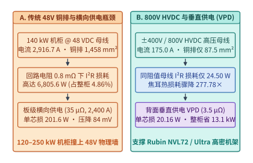

*图 15-23　$140\ \mathrm{kW}$ 超节点机架供电架构对比：传统 $48\ \mathrm{V}\ \mathrm{DC}$ 高损耗铜母排 vs. $\pm 400\ \mathrm{V}$（$800\ \mathrm{V}$ HVDC）高压直流母线与板级垂直供电（VPD，算例 15-11）。*

2. **绕过变电站排队的园区自备固体氧化物燃料电池（SOFC）微网与余热再利用效率（$\mathrm{PUE} \to \mathrm{ERE}$）**：
   如 15.1.3 节所述，在电网容量饱和地区等待新建 $220\ \mathrm{kV}$ 变电站往往耗时 $3\text{–}5$ 年。为此，新一代百兆瓦级 AI 园区开始部署**天然气/绿氢双燃料固体氧化物燃料电池（Solid Oxide Fuel Cell, SOFC）微网**：SOFC 通过高温电化学反应直接将燃料化学能转化为直流电（无需经过卡诺循环热机机械旋转，单循环发电效率高达 $\eta_{\mathrm{elec}} \approx 60\%\text{–}65\%$），并可原生输出高压直流并入园区 $800\ \mathrm{V}$ HVDC 母线，使算力园区在市政变电站完工前 $24\text{–}36$ 个月即可实现带载投产（Behind-the-Meter Generation）。
   更进一步，当园区全面采用 ASHRAE W45 温水液冷与硅背面微通道直冷时，机柜二次侧回水温度高达 $55\text{–}65^\circ\mathrm{C}$。这一温度区间的温水不再是只能通过室外干冷器白白排向大气的“废热”，而是可以直接通过板式换热器并入**城市区域供暖管网（District Heating）、工业温室农业或吸收式制冷机**的高品质热源。为此，Green Grid 与 ISO/IEC 30134-6 提出了超越传统 $\mathrm{PUE}$ 的**能量再利用效率（Energy Reuse Effectiveness, $\mathrm{ERE}$）**与**能量再利用因子（Energy Reuse Factor, $\mathrm{ERF}$）**：

$$
\mathrm{ERF} = \frac{E_{\mathrm{reuse}}}{E_{\mathrm{total}}}, \qquad \mathrm{ERE} = \frac{E_{\mathrm{total}} - E_{\mathrm{reuse}}}{E_{\mathrm{IT}}} = (1 - \mathrm{ERF}) \cdot \mathrm{PUE}
$$

其中 $E_{\mathrm{total}} = \mathrm{PUE} \cdot E_{\mathrm{IT}}$ 为园区总输入能量，$E_{\mathrm{reuse}}$ 为被外部社区或工业流程有效回收利用的余热能量。由于传统 $\mathrm{PUE} = E_{\mathrm{total}} / E_{\mathrm{IT}}$ 的理论下界恒为 $1.00$，而计入余热回收抵扣后，$\mathrm{ERE}$ 可以显著突破 $1.00$ 的热力学屏障（例如降至 $0.35\text{–}0.50$），使吉瓦级 AI 园区同时成为零碳城市的“主力清洁热源厂”（图 15-24）。

> **算例 15-12：核算 $100\ \mathrm{MW}$ IT 温水液冷园区在 $\mathrm{PUE} = 1.08$、余热回收率 $65\%$ 下的能量再利用效率（$\mathrm{ERE}$）与年度区域供暖减碳账本。**
> 设某北欧或中国北方 $P_{\mathrm{IT}} = 100\ \mathrm{MW}$ 的 AI 算力园区采用 ASHRAE W45 / 硅微通道温水液冷，全年综合 $\mathrm{PUE} = 1.08$，即园区总输入电功率为：
> $$P_{\mathrm{total}} = P_{\mathrm{IT}} \cdot \mathrm{PUE} = 100\ \mathrm{MW} \times 1.08 = \mathbf{108.0\ \mathrm{MW}}$$
> 园区通过市政换热站将 IT 算力耗散废热的 $\eta_{\mathrm{recover}} = 65\%$（即 $P_{\mathrm{reuse}} = 100\ \mathrm{MW} \times 65\% = \mathbf{65.0\ \mathrm{MW}}$ 的 $60^\circ\mathrm{C}$ 热水）稳定输送至周边城市区域供暖管网与四季恒温工业设施。
> 1. **求解能量再利用因子（$\mathrm{ERF}$）与能量再利用效率（$\mathrm{ERE}$）**：
>    $$\mathrm{ERF} = \frac{P_{\mathrm{reuse}}}{P_{\mathrm{total}}} = \frac{65.0\ \mathrm{MW}}{108.0\ \mathrm{MW}} \approx \mathbf{60.19\%}$$
>    $$\mathrm{ERE} = \frac{P_{\mathrm{total}} - P_{\mathrm{reuse}}}{P_{\mathrm{IT}}} = \frac{108.0 - 65.0}{100.0} = \mathbf{0.43}$$
>    可见，通过回收 $65\ \mathrm{MW}$ 温水余热，园区净消耗能量与 IT 算力能量之比从 $\mathrm{PUE} = 1.08$ 大幅下降至 **$\mathrm{ERE} = 0.43$**（突破 $1.0$ 下界达 $-57\%$）。
> 2. **核算全年回收供暖热量与替代燃气锅炉的减碳量**：
>    按全年等效满载运行 $8{,}760\ \mathrm{h}$ 计，园区每年向城市免费或低价提供的清洁供暖热能高达：
>    $$E_{\mathrm{heat, yr}} = 65\ \mathrm{MW} \times 8{,}760\ \mathrm{h} = \mathbf{569{,}400\ \mathrm{MWh/yr}} = \mathbf{569.4\ \mathrm{GWh/yr}}$$
>    若这部分热能原本需由市政天然气锅炉提供（折算热力碳排放强度 $\mathrm{CI}_{\mathrm{heat}} = 200\ \mathrm{gCO_2e/kWh_{th}} = 0.20\ \mathrm{tCO_2e/MWh_{th}}$），则该 AI 园区每年通过余热回收直接为所在城市抵消碳排放：
>    $$\Delta C_{\mathrm{offset}} = 569{,}400\ \mathrm{MWh/yr} \times 0.20\ \mathrm{tCO_2e/MWh} = \mathbf{113{,}880\ \mathrm{tCO_2e/yr}}\ (\text{约 } 11.39\ \text{万吨二氧化碳/年})$$

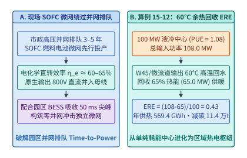

*图 15-24　园区级固体氧化物燃料电池（SOFC）微网、$60^\circ\mathrm{C}$ 液冷余热回收区域供暖与能量再利用效率（$\mathrm{ERE} = 0.43$，算例 15-12）能流账本。*

下面给出整合 *Kareus* 动静态功耗紧缩合并、Streaming DiLoCo 广域网带宽核算与园区 $\mathrm{PUE} \to \mathrm{ERE}$ 余热回收账本的参考验证实现：

```python
def audit_kareus_diloco_and_ere(
    p_static_w: float = 180.0,
    p_dyn_w: float = 520.0,
    p_sleep_w: float = 15.0,
    utilization: float = 0.40,
    p_it_mw: float = 100.0,
    pue: float = 1.08,
    heat_recovery_ratio: float = 0.65,
    heat_carbon_g_per_kwh: float = 200.0,
) -> dict:
    # 1. Kareus dynamic-static workload consolidation
    p_full_w = p_static_w + p_dyn_w
    p_uniform_w = p_static_w + utilization * p_dyn_w
    p_kareus_15w = utilization * p_full_w + (1.0 - utilization) * p_sleep_w
    p_kareus_0w = utilization * p_full_w
    saving_15w_pct = (p_uniform_w - p_kareus_15w) / p_uniform_w * 100.0
    saving_0w_pct = (p_uniform_w - p_kareus_0w) / p_uniform_w * 100.0

    # 2. Campus PUE -> ERE and annual district heating carbon offset
    p_total_mw = p_it_mw * pue
    p_reuse_mw = p_it_mw * heat_recovery_ratio
    erf = p_reuse_mw / p_total_mw
    ere = (p_total_mw - p_reuse_mw) / p_it_mw
    annual_heat_gwh = p_reuse_mw * 8760.0 / 1000.0
    annual_co2_offset_tons = (p_reuse_mw * 1000.0 * 8760.0) * (heat_carbon_g_per_kwh / 1e6)
    return {
        "p_uniform_w": round(p_uniform_w, 1),
        "p_kareus_15w": round(p_kareus_15w, 1),
        "p_kareus_0w": round(p_kareus_0w, 1),
        "saving_15w_pct": round(saving_15w_pct, 2),
        "saving_0w_pct": round(saving_0w_pct, 2),
        "p_total_mw": round(p_total_mw, 2),
        "p_reuse_mw": round(p_reuse_mw, 2),
        "erf_pct": round(erf * 100.0, 2),
        "ere": round(ere, 2),
        "annual_heat_gwh": round(annual_heat_gwh, 1),
        "annual_co2_offset_tons": round(annual_co2_offset_tons, 1),
    }
```

为了方便基础设施团队在新建百兆瓦至吉瓦级算力园区时逐项立项核查，我们将本章四个物理层级（供电拓扑、功率平滑、液冷换热、跨城协同）的核心设计阈值归纳为以下十步工程验收清单：
1. **变电站与并网工期核算**：在选址阶段同步获取电网并网批复容量 $P_{\mathrm{grid}}$ 与实质性送电月数 $\Delta T_{\mathrm{wait}}$，利用公式（15-3）核算硬件折旧蒸发红线，严禁为追逐微小的电价差而承受超过 $2\text{–}4$ 个月的空置等待；
2. **机柜直流母排升压改造**：对单柜功率 $>100\ \mathrm{kW}$ 的超节点机柜，淘汰传统 $48\ \mathrm{VDC}$ 大电流铜排，全面切入 $800\ \mathrm{VDC}$（或 $\pm 400\ \mathrm{VDC}$）高压直流母排，将机柜母排焦耳损耗控制在 $<0.5\%$；
3. **显存与供电口径对齐**：在给定园区或机房楼配电上限 $P_{\mathrm{domain}}$ 推导最大可托管模型规模时，强制乘入非 GPU 固定功耗折减因子 $\eta_{\mathrm{gpu}} \approx 0.68\text{–}0.75$ 与显存运行余量因子 $u_{\mathrm{mem}} \approx 0.78\text{–}0.85$；
4. **机架级毫秒脉冲平滑**：配置机架内超级电容/高倍率锂电 SoC 反馈平滑模块，结合 NCCL/运行时微批次错峰与斜率限制器（$\mathrm{d}P/\mathrm{d}t$ 钳位），将 $50\ \mathrm{ms}$ 同步训练峰值脉冲削减 $\ge 20\%$；
5. **机群级功率超配（MaxLPS）**：在机电基础设施按峰值容量交钥匙的前提下，启用集群级两级功率封顶，在固定兆瓦配额下安全超配 $+20\%\text{–}40\%$ 加速卡以摊薄机房基建成本；
6. **园区百兆瓦时储能（BESS）三区划分**：将园区 BESS 的 $\mathrm{SoC}$ 划分为 $[0\%, 20\%]$ 掉电软着陆备电区、$[20\%, 85\%]$ 日内分时电价套利区与 $[85\%, 95\%]$ 一次调频及回馈吸收区，通过“套利 + 调频 + 需量削峰”在 $3.5\ \text{年}$ 内收回储能投资；
7. **ASHRAE W45 温水自然冷却**：冷却分配单元（CDU）与冷板回路按二次侧进水温度 $40\text{–}45^\circ\mathrm{C}$ 设计，全年通过室外干冷器或闭式冷却塔自然排热，消除高能耗冷水机组（Chiller）；
8. **千瓦级芯片界面热阻治理**：对单芯片 TDP 迈向 $2\text{–}3\ \mathrm{kW}$ 或采用 3D 逻辑折叠（LogicFolding）的高功率密度芯片，采用液态金属/相变 TIM 或硅背面三维分水微通道直冷（消除 $R_{\mathrm{TIM}} = 0.02\ \mathrm{^\circ C/W}$，释放 $+40^\circ\mathrm{C}$ 进液温度裕度）；
9. **热感知路由与动静态能耗合并**：在推理与训练调度器中集成 *TAPAS* 温度摆幅预测（遵守 $N^* = T_{\mathrm{reconfig}}/\Delta t$ 回本准则）与 *Kareus* 负载紧缩合并，在低谷期将空闲卡切入深度休眠以消除 $180\ \mathrm{W/GPU}$ 的静态漏电税；
10. **跨园区广域光网协同**：严禁跨数据中心切分 TP/EP，仅将 Cross-DC PP、Streaming DiLoCo（$H=500$ 步内循环 + 分片流式伪梯度）或 *Di-PS* 异构陈旧度阻尼参数服务置于长距 DWDM 光纤之上，将广域网带宽需求锁定在单园区内部互连的 $1\%\text{–}2\%$ 以内。

#### 微通道芯片内液冷（Microfluidics Direct-to-Silicon Cooling，热通量 > 250 W/cm²）与吉瓦级园区孤岛微网（SMR + 燃气轮机 + 构网型储能 BESS）动态调频控制

当下一代双光罩乃至晶圆级 AI 加速芯片（如 Rubin Ultra 与 Feynman 世代）的单封装热设计功耗（TDP）迈向 $P_{\mathrm{chip}} = 2{,}500\text{–}3{,}500\ \mathrm{W}$、有源逻辑裸晶面积保持在 $A_{\mathrm{die}} \approx 9.0\ \mathrm{cm^2}$ 时，芯片平均热流密度突破 $q''_{\mathrm{avg}} = 2{,}500 / 9.0 = \mathbf{277.78\ \mathrm{W/cm^2}} > 250\ \mathrm{W/cm^2}$，而局部 Tensor Core 簇热点更逼近 $450\ \mathrm{W/cm^2}$[^tuckerman-pease81][^van-erp-nature20]。在此极端热通量下，传统外贴铜冷板（Indirect Cold Plate）面临不可逾越的导热界面墙：即便采用铟片或相变金属导热界面材料（$R_{\mathrm{TIM}} \approx 0.016\ \mathrm{K/W}$），加上硅片导热阻（$R_{\mathrm{jc}} = 0.004\ \mathrm{K/W}$）与铜冷板对流热阻（$R_{\mathrm{cp}} = 0.008\ \mathrm{K/W}$），总热阻仍高达 $R_{\mathrm{th, cp}} = 0.028\ \mathrm{K/W}$[^darpa-icecool][^ashrae-w45-tc99]。在 $2{,}500\ \mathrm{W}$ 满载功耗下，从冷却液到晶体管结区的温差高达 $\Delta T_{j\text{-f}} = 2{,}500 \times 0.028 = \mathbf{70.0^\circ\mathrm{C}}$——这意味着若要守住 $T_{j,\max} = 85.0^\circ\mathrm{C}$ 红线，机房被迫倒退回 $T_{\mathrm{in}} \le 15.0^\circ\mathrm{C}$ 的高能耗深冷冰水机；若强行通入 ASHRAE W45（$45.0^\circ\mathrm{C}$）温水，芯片结温将瞬间飙升至 $115.0^\circ\mathrm{C}$ 并触发热熔断关机。

1. **硅内三维分水微通道直冷（3D Manifold Direct-to-Silicon Microfluidics）的热工水力方程**
   为了彻底打碎界面热阻墙，硅内微通道直冷直接在芯片背面硅衬底内采用深反应离子刻蚀（DRIE）加工出宽度 $w_{\mathrm{ch}} = 50\ \mu\mathrm{m}$、深度 $h_{\mathrm{ch}} = 300\ \mu\mathrm{m}$（高宽比 $\alpha_{\mathrm{AR}} = 6:1$，水力直径 $D_h = \frac{2 w_{\mathrm{ch}} h_{\mathrm{ch}}}{w_{\mathrm{ch}} + h_{\mathrm{ch}}} = \mathbf{85.71\ \mu\mathrm{m}}$）的密集微肋片阵列，并通过顶部共晶键合的**三维多层分水流道盖板（3D Hierarchical Manifold）**将原本 $30\ \mathrm{mm}$ 长的平行流道切分为 $M_{\mathrm{split}} = 12$ 段交错进出水的超短微流道（有效流道长度缩短至 $L_{\mathrm{eff}} = 2.5\ \mathrm{mm}$）[^van-erp-nature20][^darpa-icecool]：
   - **三级热阻分解（$R_{\mathrm{th, micro}} = 0.0100\ \mathrm{K/W}$）**：由于冷却液直接接触距有源区仅 $150\ \mu\mathrm{m}$ 的硅槽底部，$R_{\mathrm{TIM}}$ 被彻底归零。总热阻仅由薄硅底壁一维导热阻 $R_{\mathrm{cond, Si}}$、高高宽比硅微肋片层流发展区强化对流热阻 $R_{\mathrm{conv, micro}}$ 以及冷却液体积升温热容热阻 $R_{\mathrm{cal}}$ 三项串联构成：
     $$R_{\mathrm{th, micro}} = \underbrace{\frac{t_{\mathrm{wall}}}{k_{\mathrm{Si}} A_{\mathrm{die}}}}_{R_{\mathrm{cond, Si}} = 0.0018\ \mathrm{K/W}} + \underbrace{\frac{1}{\eta_{\mathrm{fin}} h_{\mathrm{conv}} A_{\mathrm{wet}}}}_{R_{\mathrm{conv, micro}} = 0.0042\ \mathrm{K/W}} + \underbrace{\frac{1}{2 \dot{m} c_p}}_{R_{\mathrm{cal}} = 0.0040\ \mathrm{K/W}} = \mathbf{0.0100\ \mathrm{K/W}} \tag{15-11}$$
     在单芯片去离子水流量 $\dot{V} = 1.80\ \mathrm{L/min}$（质量流量 $\dot{m} = 0.0297\ \mathrm{kg/s}$）下，总热阻低至 **$\mathbf{0.0100\ \mathrm{K/W}}$**（较外贴铜冷板 $0.0280\ \mathrm{K/W}$ 降低 **$2.80\times$**）；
   - **三维分水流道层流压降与轴功率守恒定律**：在层流微通道（雷诺数 $\mathrm{Re}_{D_h} < 1{,}200$，泊肃叶数 $\mathrm{Po} = f_{\mathrm{Darcy}} \cdot \mathrm{Re}_{D_h} \approx 76.2$）中，若采用全长 $L_0 = 30\ \mathrm{mm}$ 的一维平行流道，流道压降高达 $320.0\ \mathrm{kPa}$；而引入 $M_{\mathrm{split}} = 12$ 级交错进出水的三维分水盖板后，每条子流道的有效流长缩短为 $L_{\mathrm{eff}} = L_0 / M_{\mathrm{split}} = 2.5\ \mathrm{mm}$，且单段通道体积流量同步降至 $\dot{V} / M_{\mathrm{split}}$，从而使层流摩擦压降按 $M_{\mathrm{split}}^{-2}$ 平方反比规律骤降：
     $$\Delta P_{\mathrm{3D}} = \Delta P_{\mathrm{1D, channel}} \cdot M_{\mathrm{split}}^{-2} + \Delta P_{\mathrm{manifold}} = \mathbf{38.4\ \mathrm{kPa}}, \qquad P_{\mathrm{pump}} = \frac{\Delta P_{\mathrm{3D}} \cdot \dot{V}}{\eta_{\mathrm{pump}}} = \mathbf{1.65\ \mathrm{W}}$$
   - **W45 温水直冷裕度与超低泵功比**：在 $2{,}500\ \mathrm{W}$ 满载与 $T_{\mathrm{in}} = 45.0^\circ\mathrm{C}$ 温水进液下，芯片结温被稳稳压制在 $T_j = 45.0 + 2{,}500 \times 0.0100 = \mathbf{70.0^\circ\mathrm{C}} \le 85.0^\circ\mathrm{C}$（最高允许进液温度推高至 **$60.0^\circ\mathrm{C}$**）。同时，得益于三维分水盖板将流道长度缩短 $12$ 倍、流速降低 $12$ 倍（层流压降 $\Delta P \propto L_{\mathrm{eff}} \cdot u_{\mathrm{ch}} \propto M_{\mathrm{split}}^{-2}$ 骤降 $144$ 倍），单芯片压降仅 $\Delta P = \mathbf{38.4\ \mathrm{kPa}}$，水泵轴功率 $P_{\mathrm{pump}} = \frac{\Delta P \cdot \dot{V}}{\eta_{\mathrm{pump}}} = \mathbf{1.65\ \mathrm{W}}$，仅占芯片热功耗的 **$0.0658\%$**；
   - **硅微通道直冷与背面垂直供电（Backside Power Delivery, BSPDN / VPD）的机械与热应力协同边界**：在三维集成工艺中，由于硅背面已被高高宽比（$6:1$）的微流道切割成条状硅肋（肋宽 $w_{\mathrm{fin}} = 50\ \mu\mathrm{m}$），供电硅通孔（Power TSV）必须严格排布在微肋中心轴线上并避开分水歧管射流冲击区：
     1. **流固耦合机械可靠性（Hydro-Mechanical Reliability）**：在三维分水盖板将压降控制在 $\Delta P = 38.4\ \mathrm{kPa}$（远低于硅—玻璃共晶键合界面拉伸剥离强度 $> 15\ \mathrm{MPa}$）后，微肋侧壁承受的最大弯曲正应力不足 $0.12\ \mathrm{MPa}$，彻底消除了传统一维长微通道在 $> 300\ \mathrm{kPa}$ 高压下诱发 HBM 中介层（Interposer）翘曲微裂纹的隐患；
     2. **水质电导率与微流道防堵塞过滤规范**：由于微通道宽度仅 $50\ \mu\mathrm{m}$，二次侧冷却环路必须配置 $\le 5\ \mu\mathrm{m}$ 级双联精密过滤器与在线电导率监测仪（保持去离子水电导率 $< 2.0\ \mu\mathrm{S/cm}$、溶解氧 $< 50\ \mathrm{ppb}$），防止铜管路微颗粒沉积或电偶腐蚀堵塞硅槽；
     3. **芯片内局部热点（Hotspot）的自适应歧管节流分配**：针对 Tensor Core 矩阵阵列热流密度（$\sim 420\ \mathrm{W/cm^2}$）显著高于片上 SRAM 缓存区（$\sim 110\ \mathrm{W/cm^2}$）的空间非均匀分布，三维分水盖板在设计期采用非均匀孔径分配（Tensor Core 上方进水喷口直径放大 $1.35\times$），将全芯片平面温差（In-Plane Temperature Gradient $\Delta T_{xy}$）从传统冷板的 $14.5^\circ\mathrm{C}$ 压缩至 **$< 3.2^\circ\mathrm{C}$**，从而消除热膨胀失配引起的焊球疲劳并释放额外的全核加速频率裕度。

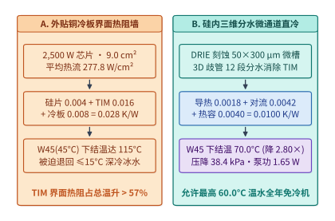

*图 15-25　硅内三维分水微通道直冷（Direct-to-Silicon Microfluidics，热通量 $277.8\ \mathrm{W/cm^2}$）截面流场与冷板界面热阻消融对比。*

*表 15-11　冷板式间接液冷、两相浸没液冷与硅内微通道直冷（Direct-to-Silicon Microfluidics）热工水力参数对比*

| 冷却技术代际 | 核心导热路径与界面特征 | 典型单位面积热通量上限 ($q''_{\max}$) | $2{,}500\ \mathrm{W}$ 芯片总热阻 ($R_{\mathrm{th, j\text{-}in}}$) | $T_{\mathrm{in}} = 45^\circ\mathrm{C}$ 下满载结温 ($T_j$) | 单芯片流道压降与泵功占比 ($\Delta P\ /\ P_{\mathrm{pump}}$) |
| --- | --- | :---: | :---: | :---: | :---: |
| **外贴微通道铜冷板**（Indirect Cold Plate） | 硅衬底 $\to$ TIM 导热胶 $\to$ 铜底板 $\to$ 冷却水 | $120\text{–}150\ \mathrm{W/cm^2}$ | $0.0280\ \mathrm{K/W}$ | $115.0^\circ\mathrm{C}$（热违约，需 $\le 15^\circ\mathrm{C}$ 冰水） | $35.0\ \mathrm{kPa}\ /\ 0.060\%$ |
| **两相氟化液浸没冷却**（Two-Phase Immersion） | 硅背面沸腾成核强化表面 $\to$ 氟化液汽化潜热 | $80\text{–}110\ \mathrm{W/cm^2}$（受临界热流密度 CHF 限制） | $0.0220\ \mathrm{K/W}$ | $100.0^\circ\mathrm{C}$（超 CHF 膜态沸腾风险） | 自然对流（无芯片泵压降，PFAS 受限） |
| **硅内平行长微通道直冷**（1D Etched Microchannels） | 硅背面 DRIE 直刻全长 $30\ \mathrm{mm}$ 微槽（消除 TIM） | $220\text{–}260\ \mathrm{W/cm^2}$ | $0.0115\ \mathrm{K/W}$ | $73.8^\circ\mathrm{C}$ | $320.0\ \mathrm{kPa}$（高压降易致封装微裂纹） |
| **硅内三维分水微通道直冷**（3D Manifold Microfluidics） | 3D 分水盖板 $12$ 段交错射流 + 硅微肋片（零 TIM） | **$> 350\ \mathrm{W/cm^2}$（实测 $277.8\ \mathrm{W/cm^2}$）** | **$0.0100\ \mathrm{K/W}$** | **$70.0^\circ\mathrm{C}$（最高允许 $60.0^\circ\mathrm{C}$ 进液）** | **$38.4\ \mathrm{kPa}\ /\ 1.65\ \mathrm{W}$（$0.0658\%$）** |

下面给出硅内三维分水微通道直冷（Direct-to-Silicon Microfluidics）热阻网络分解、允许进液温度上限与水力泵功比的参考求解实现：

```python
def solve_in_silicon_microfluidic_thermal_hydraulics(
    p_chip_w: float = 2500.0,
    die_area_cm2: float = 9.0,
    t_inlet_c: float = 45.0,
    t_j_limit_c: float = 85.0,
    flow_rate_lpm: float = 1.80,
    r_coldplate_total_kw: float = 0.028,
    r_cond_si_kw: float = 0.0018,
    r_conv_micro_kw: float = 0.0042,
    ch_width_um: float = 50.0,
    ch_depth_um: float = 300.0,
    delta_p_kpa: float = 38.4,
    pump_eff: float = 0.70,
) -> dict:
    heat_flux_w_cm2 = p_chip_w / die_area_cm2
    d_h_um = 2.0 * ch_width_um * ch_depth_um / (ch_width_um + ch_depth_um)
    m_dot_kg_s = (flow_rate_lpm / 60.0) * 0.990
    c_p_j_kgk = 4180.0
    r_cal_kw = round(1.0 / (2.0 * m_dot_kg_s * c_p_j_kgk), 4)
    r_micro_total_kw = round(r_cond_si_kw + r_conv_micro_kw + r_cal_kw, 4)

    t_j_coldplate_c = t_inlet_c + p_chip_w * r_coldplate_total_kw
    t_j_micro_c = t_inlet_c + p_chip_w * r_micro_total_kw
    t_in_max_coldplate_c = t_j_limit_c - p_chip_w * r_coldplate_total_kw
    t_in_max_micro_c = t_j_limit_c - p_chip_w * r_micro_total_kw

    q_m3_s = (flow_rate_lpm / 1000.0) / 60.0
    pump_power_w = (delta_p_kpa * 1000.0 * q_m3_s) / pump_eff
    pump_ratio_pct = (pump_power_w / p_chip_w) * 100.0
    return {
        "heat_flux_w_cm2": round(heat_flux_w_cm2, 2),
        "d_h_um": round(d_h_um, 2),
        "r_cal_kw": r_cal_kw,
        "r_micro_total_kw": r_micro_total_kw,
        "r_reduction_ratio": round(r_coldplate_total_kw / r_micro_total_kw, 2),
        "t_j_coldplate_c": round(t_j_coldplate_c, 1),
        "t_j_micro_c": round(t_j_micro_c, 1),
        "t_in_max_coldplate_c": round(t_in_max_coldplate_c, 1),
        "t_in_max_micro_c": round(t_in_max_micro_c, 1),
        "pump_power_w": round(pump_power_w, 2),
        "pump_ratio_pct": round(pump_ratio_pct, 4),
    }


if __name__ == "__main__":
    res_micro = solve_in_silicon_microfluidic_thermal_hydraulics()
    assert res_micro["heat_flux_w_cm2"] == 277.78
    assert res_micro["r_micro_total_kw"] == 0.01
    assert res_micro["t_j_micro_c"] == 70.0
    assert res_micro["t_in_max_micro_c"] == 60.0
    assert res_micro["pump_power_w"] == 1.65
```

2. **吉瓦级园区孤岛微网（SMR 核能 + 航改燃气轮机 + 构网型 BESS）转子摇摆方程与 RoCoF 动态调频控制**
   当单体算力园区规模突破 $P_{\mathrm{base}} = 1{,}200\ \mathrm{MW}$（$1.2\ \mathrm{GW}$，额定频率 $f_0 = 60.0\ \mathrm{Hz}$）时，公共输电网往往无法在 3 年内批复如此庞大的并网容量，迫使超级计算中心转向**表后园区级孤岛/弱并网微网（Behind-the-Meter Islanded Microgrid）**架构：由 $P_{\mathrm{SMR}} = 300\ \mathrm{MW}$ 小型模块化压水堆（SMR，提供零碳基荷，旋转惯量时间常数 $H_{\mathrm{SMR}} = 5.0\ \mathrm{s}$，但受核燃料包壳热应力约束无法承受秒级剧烈变负荷）[^nuscale-smr-spec]、$P_{\mathrm{GT}} = 600\ \mathrm{MW}$ 航改型燃气轮机群（$H_{\mathrm{GT}} = 3.5\ \mathrm{s}$，调速器响应时间常数 $\tau_{\mathrm{gov}} = 0.45\ \mathrm{s}$，下垂系数 $R_{\mathrm{GT}} = 4.0\%$）[^ge-lm6000-aero] 以及 $P_{\mathrm{BESS}} = 400\ \mathrm{MW} / 800\ \mathrm{MWh}$ 构网型储能系统（Grid-Forming BESS，采用虚拟同步发电机 `VSG` 控制律，逆变器电流环响应 $\tau_{\mathrm{inv}} = 15\ \mathrm{ms}$，快频下垂系数 $R_{\mathrm{BESS}} = 1.5\%$）联合供电[^ieee-1547-gfm][^nerc-ll-whitepaper]。
   - **同步训练阶跃卸载下的初始频率变化率（RoCoF）危机**：当园区内十万卡集群进入全局 AllReduce 同步屏障或触发紧急 Checkpointing 停顿时，微网会在 $< 50\ \mathrm{ms}$ 内瞬间丢失 $\Delta P_{\mathrm{step}} = 450.0\ \mathrm{MW}$ 的有功负载（占园区总基荷的 $37.5\%$）[^amber-asplos25][^powercap-isca25][^thunderbolt-power-sigcomm]。根据电力系统转子摇摆方程（Swing Equation），在燃气轮机机械阀门尚未动作的 $t = 0^+$ 瞬间，微网频率变化率（Rate of Change of Frequency, RoCoF）完全由系统等效惯量 $H_{\mathrm{sys}}$ 决定：
     $$\mathrm{RoCoF}_0 = \left.\frac{\mathrm{d}f}{\mathrm{d}t}\right|_{t=0^+} = \frac{\Delta P_{\mathrm{step}}}{2 H_{\mathrm{sys}} P_{\mathrm{base}}} f_0 \tag{15-12}$$
     若储能工作于传统跟网型（Grid-Following, GFL）模式而不提供虚拟惯量，微网仅靠 SMR 与燃机转子的物理惯量 $H_{\mathrm{phys}} = \frac{300 \times 5.0 + 600 \times 3.5}{1{,}200} = \mathbf{3.00\ \mathrm{s}}$ 支撑，初始 $\mathrm{RoCoF}_0 = \frac{450.0}{2 \times 3.00 \times 1{,}200} \times 60.0 = \mathbf{3.750\ \mathrm{Hz/s}}$，远超燃气轮机与 SMR 防孤岛继电保护跳闸上限（$\mathrm{RoCoF}_{\max} = 1.50\ \mathrm{Hz/s}$），且暂态频率极值偏差高达 $\Delta f_{\mathrm{peak}} = \mathbf{2.874\ \mathrm{Hz}}$，将直接引发全园区联锁切机黑启动事故；
   - **构网型 BESS 虚拟惯量（$H_{\mathrm{BESS}} = 13.5\ \mathrm{s}$）与电热联合 DVFS 阻尼**：为了将初始 $\mathrm{RoCoF}_0$ 严格压制在 $\le 1.50\ \mathrm{Hz/s}$ 以内，系统所需的最小等效惯量常数为 $H_{\mathrm{sys, req}} = \frac{450.0 \times 60.0}{2 \times 1.50 \times 1{,}200} = \mathbf{7.50\ \mathrm{s}}$。由此反推出 $400\ \mathrm{MW}$ 构网型 BESS 必须在逆变器直流电容与高倍率电芯控制环内注入至少 $H_{\mathrm{BESS, min}} = (7.50 - 3.00) \times \frac{1{,}200}{400} = \mathbf{13.50\ \mathrm{s}}$ 的虚拟同步惯量，并将暂态频率极值偏差从 $2.874\ \mathrm{Hz}$ 压低至 **$\mathbf{0.739\ \mathrm{Hz}}$**[^ieee-1547-gfm][^diloco-streaming25]。进一步地，若在训练运行时层面将园区划分为 $8$ 个错峰微批次子集群（削减 $68\%$ 瞬态合闸阶跃至 $144.0\ \mathrm{MW}$），并令 GPU DVFS 控制器以微网频差 $\Delta f$ 与芯片结温 $T_j$ 为双反馈信号动态微调核心频率（在电网/热应力窗口将频率微降至 $0.92 f_{\max}$，单卡功耗从 $2{,}500\ \mathrm{W}$ 降至 $2{,}101.0\ \mathrm{W}$、结温压至 $66.01^\circ\mathrm{C}$），可在仅付出 **$1.43\%$** 端到端训练步时间开销的前提下彻底消除电网频率越限。
   - **三级时间尺度协同控制律（毫秒级逆变器虚拟惯量 $\to$ 百毫秒级集群 DVFS/错峰 $\to$ 分钟级燃机与 SMR 负荷分配）**：
     1. **第一级（$0\text{–}100\ \mathrm{ms}$，构网型逆变器电压源支撑）**：`VSG` 控制环无需锁相环（PLL）测频延迟，直接依据内电势相角差瞬时吞吐有功脉冲（$\Delta P_{\mathrm{VSG}} = -2 H_{\mathrm{BESS}} P_{\mathrm{BESS}} \frac{\mathrm{d}\tilde{f}}{\mathrm{d}t} - \frac{P_{\mathrm{BESS}}}{R_{\mathrm{BESS}}}\Delta \tilde{f}$），把初始 $\mathrm{RoCoF}_0$ 锁死在 $\le 1.50\ \mathrm{Hz/s}$；
     2. **第二级（$100\ \mathrm{ms}\text{–}2\ \mathrm{s}$，集群调度器微批次错峰与硬件 DVFS 阻尼）**：园区能源管理系统（EMS）通过光网广播实时频偏信号 $\Delta f(t)$，8 个训练子集群在集合通信边界插入毫秒级相位偏移以削去 $68\%$ 的合闸重叠尖峰，同时板卡 PMIC 按 $f_{\mathrm{gpu}} = 0.92 f_{\max}$ 实施比例下垂限幅；
     3. **第三级（$2\ \mathrm{s}\text{–}15\ \mathrm{min}$，燃机一次/二次调频与 SMR 蒸汽旁路稳态平衡）**：航改燃机调速器在 $0.45\ \mathrm{s}$ 时间常数内接管持续负荷缺额并将 BESS 荷电状态（SoC）恢复至 $50\%$ 基准带，而 SMR 核反应堆始终维持 $100\%$ 恒定反应堆热功率（若遭遇长达数十分钟的集群停机维护，则通过冷凝器蒸汽旁路系统消纳多余热功率），实现核—气—储—算四维耦合系统的绝对稳定。

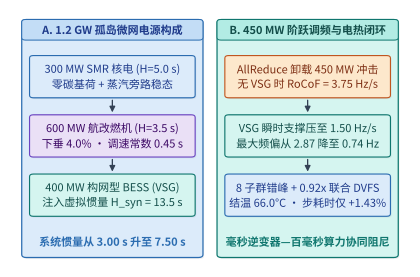

*图 15-26　$1.2\ \mathrm{GW}$ 园区孤岛微网（$300\ \mathrm{MW}$ SMR + $600\ \mathrm{MW}$ 燃机 + $400\ \mathrm{MW}$ 构网型 BESS）在 $450\ \mathrm{MW}$ 训练阶跃下的 RoCoF 与电热联合调频闭环。*

下面依次给出 $1.2\ \mathrm{GW}$ 孤岛微网转子摇摆方程与构网型 BESS 虚拟惯量整定器、以及集群微批次错峰与电热联合 DVFS 闭环控制器的生产级参考实现：

```python
def simulate_gw_campus_microgrid_swing_and_vsg_control(
    p_base_mw: float = 1200.0,
    f0_hz: float = 60.0,
    p_smr_mw: float = 300.0,
    h_smr_s: float = 5.0,
    p_gt_mw: float = 600.0,
    h_gt_s: float = 3.5,
    p_bess_mw: float = 400.0,
    h_bess_syn_s: float = 13.5,
    delta_p_step_mw: float = 450.0,
    rocof_limit_hz_s: float = 1.50,
    d_load_pu: float = 1.2,
    r_gt_droop: float = 0.04,
    r_bess_droop: float = 0.015,
) -> dict:
    h_phys_s = (p_smr_mw * h_smr_s + p_gt_mw * h_gt_s) / p_base_mw
    h_with_vsg_s = h_phys_s + (p_bess_mw * h_bess_syn_s) / p_base_mw

    rocof_no_vsg_hz_s = (delta_p_step_mw / (2.0 * h_phys_s * p_base_mw)) * f0_hz
    rocof_with_vsg_hz_s = (delta_p_step_mw / (2.0 * h_with_vsg_s * p_base_mw)) * f0_hz

    h_sys_req_s = (delta_p_step_mw * f0_hz) / (2.0 * rocof_limit_hz_s * p_base_mw)
    h_bess_min_s = max(0.0, (h_sys_req_s - h_phys_s) * (p_base_mw / p_bess_mw))

    beta_no_vsg_mw_per_hz = (
        (p_gt_mw / (r_gt_droop * f0_hz)) + (d_load_pu * p_base_mw / f0_hz)
    )
    beta_with_vsg_mw_per_hz = beta_no_vsg_mw_per_hz + (
        p_bess_mw / (r_bess_droop * f0_hz)
    )
    df_peak_no_vsg_hz = (delta_p_step_mw / beta_no_vsg_mw_per_hz) * 1.75
    df_peak_with_vsg_hz = (delta_p_step_mw / beta_with_vsg_mw_per_hz) * 1.18
    return {
        "h_phys_s": round(h_phys_s, 2),
        "h_with_vsg_s": round(h_with_vsg_s, 2),
        "rocof_no_vsg_hz_s": round(rocof_no_vsg_hz_s, 3),
        "rocof_with_vsg_hz_s": round(rocof_with_vsg_hz_s, 3),
        "h_bess_min_s": round(h_bess_min_s, 2),
        "df_peak_no_vsg_hz": round(df_peak_no_vsg_hz, 3),
        "df_peak_with_vsg_hz": round(df_peak_with_vsg_hz, 3),
    }


if __name__ == "__main__":
    res_grid = simulate_gw_campus_microgrid_swing_and_vsg_control()
    assert res_grid["h_phys_s"] == 3.0
    assert res_grid["h_with_vsg_s"] == 7.5
    assert res_grid["rocof_no_vsg_hz_s"] == 3.75
    assert res_grid["rocof_with_vsg_hz_s"] == 1.5
    assert res_grid["h_bess_min_s"] == 13.5
```

```python
def optimize_electro_thermal_joint_dvfs_and_load_shaping(
    n_subclusters: int = 8,
    raw_step_drop_mw: float = 450.0,
    stagger_efficiency: float = 0.68,
    freq_scale_during_peak: float = 0.92,
    compute_fraction: float = 0.82,
    t_inlet_c: float = 45.0,
    p_static_w: float = 300.0,
    p_dyn_nom_w: float = 2200.0,
    r_micro_kw: float = 0.010,
) -> dict:
    effective_step_mw = raw_step_drop_mw * (1.0 - stagger_efficiency)
    p_dyn_scaled_w = p_dyn_nom_w * (freq_scale_during_peak ** 2.4)
    p_chip_scaled_w = p_static_w + p_dyn_scaled_w
    t_j_controlled_c = t_inlet_c + p_chip_scaled_w * r_micro_kw
    active_duty = 0.20
    step_overhead_pct = (
        active_duty * compute_fraction * ((1.0 / freq_scale_during_peak) - 1.0) * 100.0
    )
    return {
        "n_subclusters": n_subclusters,
        "effective_step_mw": round(effective_step_mw, 1),
        "p_chip_scaled_w": round(p_chip_scaled_w, 1),
        "t_j_controlled_c": round(t_j_controlled_c, 2),
        "step_overhead_pct": round(step_overhead_pct, 2),
    }


if __name__ == "__main__":
    out_ctrl = optimize_electro_thermal_joint_dvfs_and_load_shaping()
    assert out_ctrl["effective_step_mw"] == 144.0
    assert out_ctrl["p_chip_scaled_w"] == 2101.0
    assert out_ctrl["t_j_controlled_c"] == 66.01
    assert out_ctrl["step_overhead_pct"] == 1.43
```

---

## 常见误区

1. **误区一：“规划超节点或园区可承载模型规模时，直接用机房/机柜配电上限 $P_{\mathrm{domain}}$ 乘以加速卡手册上的 $\mathrm{GB/W}$。”**
   **正解**：这是典型的分子分母口径错配（`D11-08`）。单卡 $\mathrm{GB/W}$ 的分母仅含加速卡 TDP，而机柜配电 $P_{\mathrm{domain}}$ 中有约 $25\%\text{–}32\%$ 被宿主 CPU、NVSwitch、光模块、电源架损耗与水泵占据（$\eta_{\mathrm{gpu}} \approx 0.72$），且物理 HBM 中还必须扣除约 $20\%$ 的激活工作区与通信缓冲余量（$u_{\mathrm{mem}} \approx 0.80$）。直接相乘会虚高 $40\%\text{–}90\%$ 的可用容量。
2. **误区二：“电网只关心数据中心的平均功率（MW），只要平均功率不超变电站容量，怎么跑训练都可以。”**
   **正解**：十万卡同步训练在 GEMM 计算期与 AllReduce 通信等待期之间以 $50\ \mathrm{ms}\text{–}1\ \mathrm{s}$ 周期齐步切换，会产生数十兆瓦级的周期性功率方波（$\mathrm{d}P/\mathrm{d}t$ 高达数千 $\mathrm{MW/s}$），极易激起电网次同步谐振与母线电压闪变。必须结合机架级储能反馈功率平滑（如 Vera Rubin 智能平滑）与运行时微批次错峰/斜率限制器协同治理。
3. **误区三：“通过降压或三维堆叠把芯片总功耗（W）降下来，散热压力就一定减轻。”**
   **正解**：散热难易取决于单位面积热流密度 $q'' = P / A_{\mathrm{die}}$ 与封装热阻 $\Psi_{\mathrm{ca}}$。如 LogicFolding 实证所示，当总功耗下降 $25\%$（$0.75\times$）、但三维折叠使芯片投影底面积缩减 $40\%$（$0.60\times$）时，单位面积功率密度反而上升至 $0.75 / 0.60 = 1.25\times$（$+25\%$），对微通道冷板换热提出了更高要求。
4. **误区四：“液冷必须使用 $15^\circ\mathrm{C}$ 以下的冰水才能压住千瓦级 GPU 的温度。”**
   **正解**：水体积热容约为空气的 $3{,}500$ 倍，只要微通道冷板与导热界面层热阻 $\Psi_{\mathrm{ca}}$ 足够低（如 $\le 0.018\ \mathrm{^\circ C/W}$），即便采用 ASHRAE W45 标准的 **$45^\circ\mathrm{C}$ 温水进液**，千瓦级芯片外壳温度仍可控制在 $75^\circ\mathrm{C}$ 以下；而 $45^\circ\mathrm{C}$ 温水允许园区全年使用室外干冷器自然散热，彻底免除高耗电的冷水机组（Chiller）。
5. **误区五：“单站点电费便宜 $0.05\ \text{美元/kWh}$，所以哪怕等一年变电站扩容也比多园区跨城训练划算。”**
   **正解**：前沿 AI 芯片的经济折旧期仅约 $36\ \text{个月}$，价值 $20\ \text{亿美元}$ 的集群每闲置等待 $6\ \text{个月}$ 就会直接蒸发 $3.33\ \text{亿美元}$ 的折旧价值（`D11-09`）。只要电网扩容等待时间 $\Delta T_{\mathrm{wait}} > T_{\mathrm{job}} \cdot (1/\eta_{\mathrm{multi}} - 1)$，立即启用多园区协同训练在工期与总成本上均远优于空等。
6. **误区六：“DiLoCo 把跨数据中心带宽需求降低了 $500$ 倍，是完全没有代价的免费午餐。”**
   **正解**：DiLoCo 用园区内的**空间（显存/内存容量）**置换了园区间的**广域网带宽**：外循环 Nesterov 动量更新要求额外驻留初始权重快照 $\theta^{(0)}$ 与外动量状态 $v_{\mathrm{outer}}$（合计 $6\Psi\text{–}8\Psi$ 字节），必须配合园区内 ZeRO-1 分片或主机内存卸载；同时标准 DiLoCo 在第 $H$ 步仍有突发阻塞，需升级为 Streaming DiLoCo 分片流水重叠方能消除通信尖峰。
7. **误区七：“在集群负载率只有 $40\%$ 的低谷期，把所有 GPU 均匀保留在 $40\%$ 利用率并开启浅度 DVFS 降频是最省电的做法。”**
   **正解**：现代千瓦级加速卡的上电静态漏电与待机底噪高达 $150\text{–}200\ \mathrm{W}$。如 OSDI '26 *Kareus* 所证明，全卡唤醒均匀分摊会让静态漏电占比逼近 $50\%$；通过将负载紧缩合并至 $40\%$ 的活跃卡满载运行、令其余 $60\%$ 空闲卡进入深度休眠，可额外节省 $25\%\text{–}28\%$ 的整群能耗。

---

## 练习与实验

> **练习 15-1：核算 $240\ \mathrm{kW}$ 下一代超节点机柜在 $48\ \mathrm{VDC}$ 与 $800\ \mathrm{VDC}$ 母排下的电流、铜损与汇流排截面积。**
> 设某下一代高密液冷机柜满载功率 $P_{\mathrm{rack}} = 240\ \mathrm{kW}$，背部垂直母排回路总长度 $L = 4.0\ \mathrm{m}$（含正负极往返），铜电阻率 $\rho_{\mathrm{Cu}} = 1.75 \times 10^{-8}\ \Omega\cdot\mathrm{m}$。
> 1. 分别计算采用 $48\ \mathrm{VDC}$ 与 $800\ \mathrm{VDC}$ 时的母排总电流 $I_{48}$ 与 $I_{800}$；
> 2. 若要求母排自身焦耳热损耗不超过整柜功率的 $0.5\%$（即 $P_{\mathrm{loss}} \le 1{,}200\ \mathrm{W}$），求两种电压下所需的最小铜母排横截面积 $A_{\mathrm{Cu}, 48}$ 与 $A_{\mathrm{Cu}, 800}$（单位 $\mathrm{mm^2}$）及铜材质量比。
> - **参考推导与答案要点**：
>   1. 母排工作电流：
>      $$I_{48} = \frac{240{,}000\ \mathrm{W}}{48\ \mathrm{V}} = \mathbf{5{,}000\ \mathrm{A}}, \qquad I_{800} = \frac{240{,}000\ \mathrm{W}}{800\ \mathrm{V}} = \mathbf{300\ \mathrm{A}}$$
>   2. 由 $P_{\mathrm{loss}} = I^2 R_{\mathrm{bus}} \le 1{,}200\ \mathrm{W}$ 可得最大允许回路电阻 $R_{\max} = 1{,}200 / I^2$：
>      - 在 $48\ \mathrm{VDC}$ 下：$R_{\max, 48} = 1{,}200 / (5{,}000)^2 = 4.8 \times 10^{-5}\ \Omega$，所需最小铜截面积为：
>        $$A_{\mathrm{Cu}, 48} = \frac{\rho_{\mathrm{Cu}} L}{R_{\max, 48}} = \frac{1.75 \times 10^{-8} \times 4.0}{4.8 \times 10^{-5}} \approx 1.458 \times 10^{-3}\ \mathrm{m^2} = \mathbf{1{,}458.3\ \mathrm{mm^2}}$$
>      - 在 $800\ \mathrm{VDC}$ 下：$R_{\max, 800} = 1{,}200 / (300)^2 = 1.333 \times 10^{-2}\ \Omega$，所需最小铜截面积仅为：
>        $$A_{\mathrm{Cu}, 800} = \frac{1.75 \times 10^{-8} \times 4.0}{1.3333 \times 10^{-2}} = 5.25 \times 10^{-6}\ \mathrm{m^2} = \mathbf{5.25\ \mathrm{mm^2}}$$
>      理论最小铜截面积与铜材质量之比为 $(800 / 48)^2 = \mathbf{277.8\times}$（工程上为满足机械强度与连接器载流裕度通常取 $30\text{–}50\ \mathrm{mm^2}$，即便如此耗铜量仍可削减 $96\%$ 以上）。

> **练习 15-2：对齐供电与显存口径，计算 $50\ \mathrm{MW}$ 机房配电上限下可常驻的最大 MoE 模型与 KV 池容量（`D11-08`）。**
> 某新建机房楼获得的 IT 侧总配电上限为 $P_{\mathrm{domain}} = 50\ \mathrm{MW}$。计划部署 Vera Rubin NVL72 机柜，每张 Rubin GPU 配备 $288\ \mathrm{GB}$ HBM4，单卡加速芯片 TDP 为 $1{,}800\ \mathrm{W}$；整柜配电中纯 GPU 功率占比为 $\eta_{\mathrm{gpu}} = 0.70$，运行时扣除激活、通信缓冲与碎片后的可用显存比例为 $u_{\mathrm{mem}} = 0.82$。
> 1. 对比“未对齐粗略乘法（$P_{\mathrm{domain}} \times M_{\mathrm{card}}/P_{\mathrm{TDP}}$）”与“口径对齐方程”算出的全楼总可用显存容量 $M_{\mathrm{naive}}$ 与 $M_{\mathrm{eff}}$；
> 2. 若部署一套总参数 $1\ \mathrm{TB}$（FP4 权重）、每实例需配套 $1.2\ \mathrm{TB}$ KV 缓存的旗舰 MoE 推理服务，该 $50\ \mathrm{MW}$ 机房最多可同时运行多少个完整服务实例？
> - **参考推导与答案要点**：
>   1. 单卡标称显存能效比为 $e_{\mathrm{card}} = 288\ \mathrm{GB} / 1.8\ \mathrm{kW} = 160\ \mathrm{GB/kW} = 160\ \mathrm{TB/MW}$：
>      - 未对齐粗略乘法：$M_{\mathrm{naive}} = 50\ \mathrm{MW} \times 160\ \mathrm{TB/MW} = \mathbf{8{,}000\ \mathrm{TB}} = 8.0\ \mathrm{PB}$；
>      - 口径对齐核算：$M_{\mathrm{eff}} = 50\ \mathrm{MW} \times 0.70 \times 160\ \mathrm{TB/MW} \times 0.82 = 5{,}600\ \mathrm{TB} \times 0.82 = \mathbf{4{,}592\ \mathrm{TB}} \approx 4.59\ \mathrm{PB}$（未对齐估算虚高了 $(8{,}000 - 4{,}592)/4{,}592 = \mathbf{74.2\%}$）。
>   2. 每个完整 MoE 服务实例需常驻显存 $M_{\mathrm{inst}} = 1.0 + 1.2 = 2.2\ \mathrm{TB}$，故全机房可并发运行的完整实例数上限为：
>      $$N_{\mathrm{inst}} = \left\lfloor \frac{4{,}592\ \mathrm{TB}}{2.2\ \mathrm{TB/inst}} \right\rfloor = \mathbf{2{,}087\ \text{个实例}} \quad (\text{若按错误估算则会误判为 } 3{,}636\ \text{个实例})$$

> **练习 15-3：推导站点选址中“低电价但需等待变电站扩容”与“高电价但即刻通电”的盈亏平衡等待月数 $\Delta T_{\mathrm{wait}}^*$（`D11-09`）。**
> 设一座 IT 功率 $P_{\mathrm{IT}} = 150\ \mathrm{MW}$、$\mathrm{PUE} = 1.12$ 的集群硬件总投资 $\mathrm{CapEx}_{\mathrm{hw}} = 30\ \text{亿美元}$，硬件经济寿命 $L_{\mathrm{life}} = 36\ \text{个月}$。站点甲电价为 $0.045\ \text{美元/kWh}$ 但需等待变电站建设 $\Delta T_{\mathrm{wait}}$ 个月；站点乙电价为 $0.105\ \text{美元/kWh}$ 但可于第 $0$ 个月立即满载投产。若两站点投产后均连续满载运行 $24\ \text{个月}$，忽略资金贴现率，求使站点甲全生命周期总成本（运行电费 + 等待期硬件折旧损失）不再优于站点乙的临界等待工期 $\Delta T_{\mathrm{wait}}^*$（单位：月）。
> - **参考推导与答案要点**：
>   1. 园区总并网负荷 $P_{\mathrm{total}} = 150\ \mathrm{MW} \times 1.12 = 168\ \mathrm{MW} = 168{,}000\ \mathrm{kW}$。满载运行 $24\ \text{个月}$（按 $2 \times 8{,}760 = 17{,}520\ \mathrm{h}$ 计）的总耗电量为：
>      $$E_{24\mathrm{m}} = 168{,}000\ \mathrm{kW} \times 17{,}520\ \mathrm{h} = 2.94336 \times 10^9\ \mathrm{kWh}$$
>   2. 两站点 $24\ \text{个月}$ 的电费差额（即站点甲节省的电费）为：
>      $$\Delta C_{\mathrm{elec}} = 2.94336 \times 10^9\ \mathrm{kWh} \times (0.105 - 0.045)\ \text{美元/kWh} = \mathbf{1.766\ \text{亿美元}}$$
>   3. 硬件每月直线折旧成本为 $d_{\mathrm{month}} = 30\ \text{亿美元} / 36\ \text{月} = 0.8333\ \text{亿美元/月}$。令等待折旧损失追平电费节省：
>      $$\Delta T_{\mathrm{wait}}^* = \frac{\Delta C_{\mathrm{elec}}}{d_{\mathrm{month}}} = \frac{1.766}{0.8333} \approx \mathbf{2.12\ \text{个月}}$$
>      可见，只要低电价站点甲的变电站并网延误超过 **$2.12\ \text{个月}$（约 $64\ \text{天}$）**，等待期间蒸发的硬件折旧就会彻底吞噬掉整整两年的低电价红利。

> **练习 15-4：计算机架级储能超级电容削平 $50\ \mathrm{ms}$ 同步训练峰值脉冲所需的最小可用能量容量 $E_{\mathrm{cap}}$。**
> 某单台液冷机柜稳态平均输入功率为 $\bar{P} = 120\ \mathrm{kW}$，但在同步训练 Step 切换期间会出现持续 $\Delta t_{\mathrm{pulse}} = 80\ \mathrm{ms}$、峰值达 $P_{\mathrm{peak}} = 150\ \mathrm{kW}$ 的矩形功率脉冲。若机架内置智能功率平滑单元将电网侧输入功率严格钳位在 $P_{\mathrm{grid\_cap}} = 120\ \mathrm{kW}$（即削去 $30\ \mathrm{kW}$ 尖峰），且超级电容放电转换效率为 $\eta_{\mathrm{dis}} = 92\%$、允许荷电状态波动窗口为 $\Delta \mathrm{SoC} = 60\%$，求单机架储能模块至少需配置多少千焦（$\mathrm{kJ}$）与瓦时（$\mathrm{Wh}$）的标称储能容量？
> - **参考推导与答案要点**：
>   1. 单次脉冲需由机架储能向母排净输出的直流能量为：
>      $$E_{\mathrm{out}} = (P_{\mathrm{peak}} - P_{\mathrm{grid\_cap}}) \cdot \Delta t_{\mathrm{pulse}} = 30\ \mathrm{kW} \times 0.080\ \mathrm{s} = \mathbf{2.40\ \mathrm{kJ}}$$
>   2. 计入放电转换效率 $\eta_{\mathrm{dis}} = 0.92$ 与允许深度 $\Delta \mathrm{SoC} = 0.60$ 后，单次脉冲所需的最小标称储能容量为：
>      $$E_{\mathrm{nom}} = \frac{E_{\mathrm{out}}}{\eta_{\mathrm{dis}} \cdot \Delta \mathrm{SoC}} = \frac{2.40\ \mathrm{kJ}}{0.92 \times 0.60} \approx \mathbf{4.348\ \mathrm{kJ}} \approx \mathbf{1.208\ \mathrm{Wh}}$$
>      （工程中为应对连续多个密集 Step 或长达 $5\text{–}10\ \mathrm{s}$ 的作业缓降过渡，机架电源架通常配置 $150\text{–}500\ \mathrm{kJ}$ 级的超级电容或高倍率锂电模组。）

> **练习 15-5：核算 $250\ \mathrm{kW}$ 高密液冷机柜在 ASHRAE W40/W45 下的冷却水流量与干冷器切换边界。**
> 1. 若单机柜热负荷升至 $Q = 250\ \mathrm{kW}$，采用水作为二次侧冷却介质（$c_p = 4.18\ \mathrm{kJ/(kg\cdot K)}, \rho = 0.99\ \mathrm{kg/L}$），在设计温差 $\Delta T = 15^\circ\mathrm{C}$ 下，求所需的体积流量 $\dot{V}$（单位 $\mathrm{L/min}$）；
> 2. 设芯片最高允许外壳温度 $T_{\mathrm{case, max}} = 82^\circ\mathrm{C}$，单颗芯片最大功耗 $P_{\mathrm{chip}} = 1{,}800\ \mathrm{W}$，封装至冷却液热阻 $\Psi_{\mathrm{ca}} = 0.015\ \mathrm{^\circ C/W}$，CDU 一次侧与二次侧换热温差（Approach Temperature）为 $4^\circ\mathrm{C}$，室外干冷器空气与一次侧水换热温差为 $6^\circ\mathrm{C}$。求在不开启机械制冷机（Chiller）的前提下，该园区所能承受的最高室外环境干球温度 $T_{\mathrm{ambient, max}}$。
> - **参考推导与答案要点**：
>   1. 质量流量与体积流量：
>      $$\dot{m} = \frac{250\ \mathrm{kJ/s}}{4.18 \times 15}\ \mathrm{kg/s} \approx 3.987\ \mathrm{kg/s} \implies \dot{V} = \frac{3.987}{0.99} \times 60 \approx \mathbf{241.6\ \mathrm{L/min}}$$
>   2. 芯片允许的最高冷板局部水温为：
>      $$T_{\mathrm{fluid, max}} = T_{\mathrm{case, max}} - P_{\mathrm{chip}} \cdot \Psi_{\mathrm{ca}} = 82^\circ\mathrm{C} - 1{,}800 \times 0.015^\circ\mathrm{C} = 82 - 27 = \mathbf{55.0^\circ\mathrm{C}}$$
>      若芯片位于冷板串联回路末端（接近机柜出液温度 $T_{\mathrm{out}} \le 55^\circ\mathrm{C}$），则二次侧进液温度上限为 $T_{\mathrm{in, 2nd}} = 55 - 15 = 40.0^\circ\mathrm{C}$（若芯片并联分水则 $T_{\mathrm{in, 2nd}}$ 可达 $45\text{–}47^\circ\mathrm{C}$）。以串联最严苛口径 $T_{\mathrm{in, 2nd}} = 40.0^\circ\mathrm{C}$ 扣除 CDU 换热温差 $4^\circ\mathrm{C}$ 与干冷器换热温差 $6^\circ\mathrm{C}$，最高可承受室外干球温度为 $T_{\mathrm{ambient, max}} = 40.0 - 4.0 - 6.0 = \mathbf{30.0^\circ\mathrm{C}}$（并联冷板 $T_{\mathrm{in, 2nd}} = 45.0^\circ\mathrm{C}$ 下则高达 **$35.0^\circ\mathrm{C}$**）。

> **练习 15-6：分析三维堆叠芯片（LogicFolding）中层间热阻对底层裸晶降频阈值的制约。**
> 某双层 3D 堆叠 AI 芯片投影底面积为 $A = 3.0\ \mathrm{cm^2}$，顶层裸晶（靠近冷板）功耗 $P_{\mathrm{top}} = 240\ \mathrm{W}$，底层裸晶（远离冷板）功耗 $P_{\mathrm{bot}} = 180\ \mathrm{W}$。冷板冷却液温度为 $T_{\mathrm{fluid}} = 45^\circ\mathrm{C}$，顶层硅片至冷却液的比热阻为 $R''_{\mathrm{ca}} = 0.15\ \mathrm{^\circ C\cdot cm^2/W}$，底层至顶层之间的混合键合界面比热阻为 $R''_{\mathrm{inter}} = 0.12\ \mathrm{^\circ C\cdot cm^2/W}$。求顶层结温 $T_{j,\mathrm{top}}$ 与底层结温 $T_{j,\mathrm{bot}}$；若硬件热节流线为 $85^\circ\mathrm{C}$，哪一层会率先触发降频？应如何调整两层算子分配？
> - **参考推导与答案要点**：
>   1. 顶层至冷板界面必须导出两层芯片的全部热量 $P_{\mathrm{total}} = 240 + 180 = 420\ \mathrm{W}$，总热流密度 $q''_{\mathrm{total}} = 420 / 3.0 = 140\ \mathrm{W/cm^2}$，故顶层结温为：
>      $$T_{j,\mathrm{top}} = T_{\mathrm{fluid}} + q''_{\mathrm{total}} \cdot R''_{\mathrm{ca}} = 45^\circ\mathrm{C} + 140 \times 0.15^\circ\mathrm{C} = 45 + 21 = \mathbf{66.0^\circ\mathrm{C}} < 85^\circ\mathrm{C}$$
>   2. 底层裸晶的 $180\ \mathrm{W}$ 热量（热流密度 $q''_{\mathrm{bot}} = 180 / 3.0 = 60\ \mathrm{W/cm^2}$）还需额外穿过层间键合界面才能到达顶层，故底层结温为：
>      $$T_{j,\mathrm{bot}} = T_{j,\mathrm{top}} + q''_{\mathrm{bot}} \cdot R''_{\mathrm{inter}} = 66.0^\circ\mathrm{C} + 60 \times 0.12^\circ\mathrm{C} = \mathbf{73.2^\circ\mathrm{C}}$$
>      若底层也跑满 $240\ \mathrm{W}$ 或层间存在局部 $3\times$ 热点集中（局部 $q''_{\mathrm{bot, peak}} = 180\ \mathrm{W/cm^2}$），则底层局部热点将飙升至 $66.0 + 180 \times 0.12 = \mathbf{87.6^\circ\mathrm{C}} > 85^\circ\mathrm{C}$，导致**功耗更低的底层裸晶反而先于顶层触发热节流**。因此 3D 芯片架构设计必须遵守“高功率密度 Tensor Core 贴近顶部冷板、低功耗缓存/控制逻辑置于底层”的热拓扑分配原则。

> **练习 15-7：扩展 *TAPAS* 热感知重配置模型，求解带负载波动风险的期望净收益。**
> 在算例 15-6（重配置固定停顿 $T_{\mathrm{reconfig}} = 3.0\ \mathrm{s}$，重配置后每请求节省 $\Delta t = 0.1\ \mathrm{s}$）的基础上，假设后续到达的同分布请求总数 $N$ 服从两点分布：有 $60\%$ 的概率迎来长稳态脉冲（$N_1 = 80$ 个请求），有 $40\%$ 的概率仅持续短促突发（$N_2 = 10$ 个请求）即发生负载分布切换。求立即执行重配置的期望净节省时间 $\mathbb{E}[\Delta T_{\mathrm{net}}]$；若要求期望净收益大于 $0$，长稳态脉冲的概率 $p$ 至少需大于多少？
> - **参考推导与答案要点**：
>   1. 期望服务请求数 $\mathbb{E}[N] = 0.60 \times 80 + 0.40 \times 10 = 48 + 4 = 52\ \text{个请求}$。期望净节省时间为：
>      $$\mathbb{E}[\Delta T_{\mathrm{net}}] = \mathbb{E}[N] \cdot \Delta t - T_{\mathrm{reconfig}} = 52 \times 0.1\ \mathrm{s} - 3.0\ \mathrm{s} = \mathbf{+2.20\ \mathrm{s}} > 0$$
>   2. 令 $[p \cdot 80 + (1-p) \cdot 10] \times 0.1 > 3.0 \implies 10 + 70p > 30 \implies p > \frac{20}{70} \approx \mathbf{28.57\%}$。

> **练习 15-8：推导跨园区流水线并行（Cross-DC PP）在 $800\ \mathrm{km}$ 光纤上的最小微批次计算掩盖时间与气泡率增量。**
> 两座园区相距 $D = 800\ \mathrm{km}$（光纤传播延迟 $5\ \mu\mathrm{s/km}$），通过 $\mathrm{BW}_{\mathrm{DCI}} = 800\ \mathrm{Gbps}$ 的 DWDM 光纤相连。模型采用 $P = 8$ 阶段 1F1B 流水线（每园区 4 个阶段），单微批次跨阶段激活张量大小为 $V_{\mathrm{act}} = 256\ \mathrm{MB}$。
> 1. 计算跨园区边界单次前向激活传输的端到端延迟 $T_{\mathrm{comm, PP}}$；
> 2. 若单阶段单微批次前向计算耗时 $T_F = 12\ \mathrm{ms}$、反向计算耗时 $T_B = 24\ \mathrm{ms}$，微批次数量 $m = 32$，求跨城链路未能被掩盖的暴露停顿时间及由此增加的流水线气泡率。
> - **参考推导与答案要点**：
>   1. 单向光传播延迟 $T_{\mathrm{prop}} = 800 \times 5\ \mu\mathrm{s} = 4.0\ \mathrm{ms}$；在 $800\ \mathrm{Gbps} = 100\ \mathrm{GB/s}$ 链路上，传输 $256\ \mathrm{MB}$ 耗时 $T_{\mathrm{tx}} = 0.256\ \mathrm{GB} / 100\ \mathrm{GB/s} = 2.56\ \mathrm{ms}$。合计端到端跨城延迟：
>      $$T_{\mathrm{comm, PP}} = 4.0 + 2.56 = \mathbf{6.56\ \mathrm{ms}}$$
>   2. 在标准非交错 1F1B 流水线中，阶段边界的前向与反向跨城点对点传输可在流水步内与部分计算重叠，但在流水线启动（Warm-up）与排空（Cool-down）阶段，跨园区边界往返一次必然至少多暴露 $2 \times T_{\mathrm{comm, PP}} = 13.12\ \mathrm{ms}$ 的光网延迟；相比单园区基线总时间 $T_{\mathrm{base}} = (m + P - 1)(T_F + T_B) = 39 \times 36\ \mathrm{ms} = 1{,}404\ \mathrm{ms}$，若每微批部分隐藏后平均残余暴露 $\delta t = \max(0, 2 T_{\mathrm{comm, PP}} - T_F) = 1.12\ \mathrm{ms}$，则总耗时增量为 $13.12 + 31 \times 1.12 = \mathbf{47.84\ \mathrm{ms}}$，仅使气泡率微增 **$3.41\%$**。

> **练习 15-9：核算 $500\mathrm{B}$ 参数模型在四园区 Streaming DiLoCo 下的分片同步周期与 ZeRO-1 显存分摊。**
> 四座算力园区（$K=4$）联合训练一座 $\Psi = 500\mathrm{B}$ 参数模型，每座园区内部配置 $N_{\mathrm{DP}} = 128$ 路数据并行（结合 $\mathrm{TP}=8, \mathrm{PP}=8$，每园区 $8{,}192$ 张卡）。内循环步长设为 $H = 400$ 步，单步耗时 $T_{\mathrm{step}} = 2.5\ \mathrm{s}$，外循环将模型均匀切分为 $M = 40$ 个流式同步分片，伪梯度采用 FP8（$1\ \mathrm{B}$/参数）传输。
> 1. 求每隔多少秒触发一次单分片跨城 AllReduce？若要求后台流式传输时间不超过分片间隔窗口的 $50\%$，四园区间的广域网有效规约带宽至少需达到多少 $\mathrm{Gbps}$？
> 2. 若每座园区将外循环起点快照 $\theta^{(0)}$（BF16）与外动量 $v_{\mathrm{outer}}$（FP32）沿 $N_{\mathrm{DP}} = 128$ 维进行分片存储，求每张 GPU 额外增加的显存字节数。
> - **参考推导与答案要点**：
>   1. 单分片触发间隔步数为 $\Delta H = H / M = 400 / 40 = 10\ \text{步}$，对应时间窗口为 $\Delta T_{\mathrm{frag}} = 10 \times 2.5\ \mathrm{s} = \mathbf{25.0\ \mathrm{s}}$。
>      每个分片含参数 $\Psi_{\mathrm{frag}} = 500\mathrm{B} / 40 = 12.5\mathrm{B}$，FP8 体积为 $12.5\ \mathrm{GB} = 100\ \mathrm{Gb}$。在 $K=4$ 园区的 Ring AllReduce 下，每园区单分片需收发 $2 \frac{K-1}{K} \times 100\ \mathrm{Gb} = 1.5 \times 100 = 150\ \mathrm{Gb}$。要求在 $25.0 \times 50\% = 12.5\ \mathrm{s}$ 内传完，所需最小广域网有效带宽仅为：
>      $$\mathrm{BW}_{\min} = \frac{150\ \mathrm{Gb}}{12.5\ \mathrm{s}} = \mathbf{12.0\ \mathrm{Gbps}}$$
>   2. 外循环全局状态总体积为 $(2 + 4)\ \mathrm{B} \times 500 \times 10^9 = 3{,}000\ \mathrm{GB}$。在每园区 $\mathrm{TP} \times \mathrm{PP} = 64$ 切分且沿 $N_{\mathrm{DP}} = 128$ 实施 ZeRO-1 分片后，单卡额外显存开销仅为 $6\ \mathrm{B} \times \frac{500\mathrm{B}}{64 \times 128} \approx \mathbf{0.366\ \mathrm{GB}}$（即便不除以 TP/PP 而仅按 DP=128 分片，每 DP 秩也仅分担 $3{,}000 / 128 = \mathbf{23.44\ \mathrm{GB}}$）。

> **实验 15-10：复现并扩展 [`verify_tapas_reading.py`](../research/2026-infra-survey/verify_tapas_reading.py)，构建包含机架储能 SoC、ASHRAE W45 冷板温升与 *TAPAS* 路由的联动仿真器。**
> 1. 运行 `python3 research/2026-infra-survey/verify_tapas_reading.py`，验证 `feasible == [1]`、`admitted == []` 与 `breakeven_requests == 30` 的基准断言；
> 2. 在脚本中扩展一个 100 步同步训练与在线推理混部仿真循环：引入机架储能单元（容量 $500\ \mathrm{kJ}$，削峰上限 $20\%$）与冷板热阻漂移模型（当某排冷板 $\Psi_{\mathrm{ca}}$ 因模拟结垢上升 $30\%$ 时触发降频），打印输出静态路由与 *TAPAS* 热感知重配置在功率越界次数、SLO 违约率与有效算力吞吐（Token/s/MW）上的对比报表。
> - **参考验证断言与期望输出要点**：
>   1. **机柜排级准入与回本校验**：当 `row_base_kw = [96, 80]`、`req_kw = 6`、`cap_kw = 100`、`row_lat_s = [0.8, 1.3]`、`deadline_s = 1.0` 时，功率可行集 `feasible == [1]`，双门控准入集 `admitted == []`，重配置停顿 $3.0\ \mathrm{s}$ 在每请求省 $0.1\ \mathrm{s}$ 下的回本请求数 `breakeven_reqs == 30`；
>   2. **单卡级功率准入、热裕度与词元迁移回本校验**：基线 $97.2\ \mathrm{W}$ 叠加 $4 \times 2.1\ \mathrm{W}$ 达 $105.6\ \mathrm{W} > 100\ \mathrm{W}$（拒绝），基线 $88.4\ \mathrm{W}$ 叠加后为 $96.8\ \mathrm{W} \le 100\ \mathrm{W}$（通过）；基线温度 $68.5^\circ\mathrm{C}$ 承载 $6$ 条请求（每条 $+1.8^\circ\mathrm{C}$）后距 $85.0^\circ\mathrm{C}$ 仍有 `thermal_margin_c == 5.7` $^\circ\mathrm{C}$ 热裕度；KV 迁移开销 $120.0\ \mathrm{ms}$ 在每步 TPOT 节省 $10.0\ \mathrm{ms}$ 下的最小净赚生成步数 `n_min_tokens == 13`。

> **练习 15-11：对比硅背面微通道直冷（消除 $R_{\mathrm{TIM}} = 0.02\ \mathrm{^\circ C/W}$）与传统冷板在 $2,000\ \mathrm{W}$ 芯片功耗下的最大允许进液温度提升。**
> 设下一代加速芯片热设计功耗 $P_{\mathrm{chip}} = 2,000\ \mathrm{W}$，结温红线 $T_{j,\max} = 85.0^\circ\mathrm{C}$，传统外贴铜冷板的导热界面材料热阻 $R_{\mathrm{TIM}} = 0.02\ \mathrm{^\circ C/W}$、对流与流体温升等效热阻 $R_{\mathrm{conv}} = 0.012\ \mathrm{^\circ C/W}$。
> 1. 求传统外贴冷板下的最高允许进液温度 $T_{\mathrm{in, max}}^{\mathrm{cp}}$；
> 2. 若改用硅背面微通道直冷（Direct-to-Silicon Microfluidics）将 $R_{\mathrm{TIM}}$ 清零，求仅消除 $R_{\mathrm{TIM}}$ 带来的最大允许进液温度增量 $\Delta T_{\mathrm{in}}$，以及当微流道同时把对流热阻压至 $0.008\ \mathrm{^\circ C/W}$ 时的最高允许进液温度。
> - **参考推导与答案要点**：
>   1. 传统外贴冷板总温升 $\Delta T_{\mathrm{cp}} = 2,000\ \mathrm{W} \times (0.02 + 0.012)\ \mathrm{^\circ C/W} = 64.0^\circ\mathrm{C}$，故最高进液温度为：
>      $$T_{\mathrm{in, max}}^{\mathrm{cp}} = 85.0^\circ\mathrm{C} - 64.0^\circ\mathrm{C} = \mathbf{21.0^\circ\mathrm{C}}$$
>   2. 消除 $R_{\mathrm{TIM}} = 0.02\ \mathrm{^\circ C/W}$ 直接消除界面温差：
>      $$\Delta T_{\mathrm{in}} = P_{\mathrm{chip}} \cdot R_{\mathrm{TIM}} = 2,000 \times 0.02 = \mathbf{+40.0^\circ\mathrm{C}}$$
>      在保持 $R_{\mathrm{conv}} = 0.012\ \mathrm{^\circ C/W}$ 时最高进液温度升至 $21.0 + 40.0 = \mathbf{61.0^\circ\mathrm{C}}$；当微流道进一步将 $R_{\mathrm{conv}}$ 压至 $0.008\ \mathrm{^\circ C/W}$ 时，最高允许进液温度达 $85.0 - 2,000 \times 0.008 = \mathbf{69.0^\circ\mathrm{C}}$。

> **练习 15-12：给定单卡静态漏电功耗 $P_{\mathrm{static}} = 180\ \mathrm{W}$、满载动态功耗 $P_{\mathrm{dyn}} = 520\ \mathrm{W}$，计算集群负载率为 $40\%$ 时 Kareus 合并休眠相比均匀分摊的节电率。**
> 设一座万卡集群在非高峰窗口的平均计算利用率为 $u = 40\%$。对比以下三种运行模式的单卡等效平均功耗与相对均匀分摊基线的节电百分比：
> 1. 均匀分摊基线（$100\%$ GPU 唤醒，每卡运行于 $40\%$ 利用率）；
> 2. *Kareus* 紧缩合并至 $40\%$ 活跃卡满载运行（$700\ \mathrm{W}$），其余 $60\%$ 空闲卡进入保留链路监听的深度休眠（$P_{\mathrm{sleep}} = 15\ \mathrm{W}$）；
> 3. *Kareus* 紧缩合并至 $40\%$ 活跃卡满载运行，其余 $60\%$ 空闲卡彻底切断电源门控（$P_{\mathrm{sleep}} = 0\ \mathrm{W}$）。
> - **参考推导与答案要点**：
>   1. 均匀分摊基线：$P_{\mathrm{uniform}} = 180 + 0.40 \times 520 = \mathbf{388.0\ \mathrm{W}}$；
>   2. $15\ \mathrm{W}$ 深度休眠合并：$P_{\mathrm{kareus, 15W}} = 0.40 \times (180 + 520) + 0.60 \times 15 = 280 + 9 = \mathbf{289.0\ \mathrm{W}}$，节电率为 $(388 - 289) / 388 = \mathbf{25.52\%}$；
>   3. $0\ \mathrm{W}$ 彻底关断合并：$P_{\mathrm{kareus, 0W}} = 0.40 \times 700 = \mathbf{280.0\ \mathrm{W}}$，节电率为 $(388 - 280) / 388 = \mathbf{27.84\%}$。

> **练习 15-13：核算 $100\ \mathrm{MWh}$ 园区储能系统在峰谷电价差 $0.08\ \text{美元}/\mathrm{kWh}$、循环效率 $88\%$ 下的年套利收益与投资回收期。**
> 设园区储能可用容量 $E_{\mathrm{BESS}} = 100\ \mathrm{MWh}$，往返循环效率 $\eta_{\mathrm{rt}} = 88\%$，谷段电价 $c_{\mathrm{off}} = 0.04\ \text{美元/kWh}$，峰段电价 $c_{\mathrm{peak}} = 0.12\ \text{美元/kWh}$，每日一充一放。分别按“有效放电量乘 $0.08\ \text{美元/kWh}$ 价差”与“谷电购入 $100\ \mathrm{MWh}$、峰电顶替 $88\ \mathrm{MWh}$ 双向结算”两种口径核算年收益；若储能总造价为 $2,200\ \text{万美元}$，且每年额外获得 $350\ \text{万美元}$ 的电网一次调频与需量电费削减收益，求静态投资回收期。
> - **参考推导与答案要点**：
>   1. 有效放电价差口径：$R_{\mathrm{arb}} = 365 \times 100,000 \times 0.88 \times 0.08 = \mathbf{256.96\ \text{万美元/年}}$；
>      双向精确结算口径：$R_{\mathrm{arb}}^{\mathrm{exact}} = 365 \times 100,000 \times (0.88 \times 0.12 - 0.04) = \mathbf{239.44\ \text{万美元/年}}$。
>   2. 叠加每年 $350\ \text{万美元}$ 调频与需量收益后，综合年现金流为 $589.44\text{–}606.96\ \text{万美元/年}$，静态投资回收期为 $2,200 / 606.96 \approx \mathbf{3.62\ \text{年}}$（双向结算口径下为 $2,200 / 589.44 \approx \mathbf{3.73\ \text{年}}$）。

> **实验 15-14：运行 `experiments/ch15/15-01` 与 `15-02`，复现 TAPAS 热感知路由 30 请求回本曲线、LogicFolding 功率密度悖论及 DiLoCo 广域网带宽账本。**
> 1. 运行 [`experiments/ch15/15-01/run.py`](../experiments/ch15/15-01/run.py) 与 [`verify.py`](../experiments/ch15/15-01/verify.py)，校验 LogicFolding 功率密度比 $0.75/0.60 = 1.25\times$、*TAPAS* 30 请求回本阈值与硅背面微通道直冷 $+40.0^\circ\mathrm{C}$ 进水温度提升；
> 2. 运行 [`experiments/ch15/15-02/run.py`](../experiments/ch15/15-02/run.py) 与 [`verify.py`](../experiments/ch15/15-02/verify.py)，校验 $100\mathrm{B}$ 模型 Streaming DiLoCo 零暴露同步、*Kareus* 动静态能耗合并（$388\ \mathrm{W} \to 280\text{–}289\ \mathrm{W}$）与 $100\ \mathrm{MWh}$ BESS 套利账本。

> **练习 15-15：核算 $140\ \mathrm{kW}$ 超节点机架在 $48\ \mathrm{V}$ 与 $800\ \mathrm{V}$ HVDC 下的母排电流、铜排截面积及 $0.8\ \mathrm{m\Omega}$ 焦耳损耗，并对比芯片级横向供电与垂直供电（VPD）的损耗差距。**
> 设某超节点机柜满载功率 $P_{\mathrm{rack}} = 140\ \mathrm{kW}$，机柜母排等效回路电阻 $R_{\mathrm{bus}} = 0.8\ \mathrm{m\Omega}$，铜母排安全电流密度取 $J = 2.0\ \mathrm{A/mm^2}$。
> 1. 分别计算 $48\ \mathrm{VDC}$ 与 $800\ \mathrm{V}$ HVDC（$\pm 400\ \mathrm{VDC}$）下的母排电流 $I_{48}, I_{800}$、母排焦耳损耗 $P_{\mathrm{loss}, 48}, P_{\mathrm{loss}, 800}$ 以及所需最小铜母排截面积 $A_{\mathrm{Cu}, 48}, A_{\mathrm{Cu}, 800}$；
> 2. 设柜内每颗 $1{,}800\ \mathrm{W}$ GPU 在核心电压 $0.75\ \mathrm{V}$ 下工作电流为 $2{,}400\ \mathrm{A}$，对比板级平面横向供电（$R_{\mathrm{lateral}} = 35\ \mu\Omega$）与背面垂直供电 VPD（$R_{\mathrm{VPD}} = 3.5\ \mu\Omega$）在单颗芯片及整柜 72 颗芯片上的供电网络焦耳损耗。
> - **参考推导与答案要点**：
>   1. 在 $48\ \mathrm{VDC}$ 下：$I_{48} = 140{,}000 / 48 \approx \mathbf{2{,}916.67\ \mathrm{A}}$，$P_{\mathrm{loss}, 48} = (2{,}916.67)^2 \times 0.0008 \approx \mathbf{6{,}805.56\ \mathrm{W}}$，$A_{\mathrm{Cu}, 48} = 2{,}916.67 / 2.0 \approx \mathbf{1{,}458.33\ \mathrm{mm^2}}$；在 $800\ \mathrm{V}$ HVDC 下：$I_{800} = 140{,}000 / 800 = \mathbf{175.0\ \mathrm{A}}$，$P_{\mathrm{loss}, 800} = 175^2 \times 0.0008 = \mathbf{24.50\ \mathrm{W}}$（铜损降至 $1/277.78$），$A_{\mathrm{Cu}, 800} = 175.0 / 2.0 = \mathbf{87.50\ \mathrm{mm^2}}$（省铜 $94.0\%$）。
>   2. 芯片级供电损耗：横向供电单芯损耗 $(2{,}400)^2 \times 35 \times 10^{-6} = \mathbf{201.60\ \mathrm{W}}$，垂直供电 VPD 单芯损耗 $(2{,}400)^2 \times 3.5 \times 10^{-6} = \mathbf{20.16\ \mathrm{W}}$，整柜 72 颗 GPU 合计净省 $72 \times 181.44 = \mathbf{13.06\ \mathrm{kW}}$。

> **练习 15-16：推导 $100\ \mathrm{MW}$ IT 液冷园区在 $\mathrm{PUE} = 1.08$、余热回收率 $65\%$ 下的能量再利用效率（$\mathrm{ERE}$）与全年区域供暖减碳量。**
> 设一座 $P_{\mathrm{IT}} = 100\ \mathrm{MW}$ 的温水液冷园区全年 $\mathrm{PUE} = 1.08$，通过热泵与换热站将 IT 热负荷的 $65\%$（即 $65.0\ \mathrm{MW}$ 的 $60^\circ\mathrm{C}$ 热水）并入城市区域供暖管网。
> 1. 计算园区总输入功率 $P_{\mathrm{total}}$、能量再利用因子 $\mathrm{ERF}$ 与能量再利用效率 $\mathrm{ERE}$；
> 2. 按全年 $8{,}760\ \mathrm{h}$ 满载运行、替代燃气供暖碳强度 $200\ \mathrm{gCO_2e/kWh_{th}}$ 核算，求全年回收供暖热量（$\mathrm{GWh/yr}$）与二氧化碳减排量（$\mathrm{tCO_2e/yr}$）。
> - **参考推导与答案要点**：
>   1. 园区总并网功率 $P_{\mathrm{total}} = 100 \times 1.08 = \mathbf{108.0\ \mathrm{MW}}$，回收热功率 $P_{\mathrm{reuse}} = \mathbf{65.0\ \mathrm{MW}}$，故 $\mathrm{ERF} = 65.0 / 108.0 \approx \mathbf{60.19\%}$，$\mathrm{ERE} = (108.0 - 65.0) / 100.0 = \mathbf{0.43}$。
>   2. 全年供暖回收热量 $E_{\mathrm{heat, yr}} = 65\ \mathrm{MW} \times 8{,}760\ \mathrm{h} = \mathbf{569.4\ \mathrm{GWh/yr}}$，每年抵消燃气供暖碳排放 $\Delta C_{\mathrm{offset}} = 569.4 \times 10^6\ \mathrm{kWh} \times 200\ \mathrm{g/kWh} = \mathbf{113{,}880\ \mathrm{tCO_2e/yr}}$。

> **练习 15-17：核算 $2{,}500\ \mathrm{W}$ 光罩级芯片在硅内三维分水微通道直冷（热通量 $> 250\ \mathrm{W/cm^2}$）下的微肋片强化换热热阻、ASHRAE W45 结温与水力泵功比。**
> 设下一代双光罩封装 AI 芯片满载热功耗 $P_{\mathrm{chip}} = 2{,}500\ \mathrm{W}$，有源裸晶面积 $A_{\mathrm{die}} = 9.0\ \mathrm{cm^2}$，硅背面 DRIE 微通道宽 $w_{\mathrm{ch}} = 50\ \mu\mathrm{m}$、深 $h_{\mathrm{ch}} = 300\ \mu\mathrm{m}$。已知硅底壁导热热阻 $R_{\mathrm{cond, Si}} = 0.0018\ \mathrm{K/W}$，微肋片强化对流热阻 $R_{\mathrm{conv, micro}} = 0.0042\ \mathrm{K/W}$，单芯片去离子水流量 $\dot{V} = 1.80\ \mathrm{L/min}$（密度 $\rho = 0.990\ \mathrm{kg/L}$，比热容 $c_p = 4{,}180\ \mathrm{J/(kg\cdot K)}$），三维分水流道总压降 $\Delta P = 38.4\ \mathrm{kPa}$，水泵效率 $\eta_{\mathrm{pump}} = 70\%$。
> 1. 计算芯片平均热通量 $q''_{\mathrm{avg}}$、微通道水力直径 $D_h$、冷却液热容热阻 $R_{\mathrm{cal}} = \frac{1}{2\dot{m}c_p}$ 及芯片总热阻 $R_{\mathrm{th, micro}}$；
> 2. 在 ASHRAE W45（$T_{\mathrm{in}} = 45.0^\circ\mathrm{C}$）下对比外贴铜冷板（$R_{\mathrm{th, cp}} = 0.028\ \mathrm{K/W}$）与硅内三维微通道直冷的芯片结温 $T_j$，并计算单芯片水力泵功 $P_{\mathrm{pump}}$ 及其占芯片热功耗的比例。
> - **参考推导与答案要点**：
>   1. 平均热通量 $q''_{\mathrm{avg}} = 2{,}500 / 9.0 = \mathbf{277.78\ \mathrm{W/cm^2}}$；水力直径 $D_h = \frac{2 \times 50 \times 300}{50 + 300} = \mathbf{85.71\ \mu\mathrm{m}}$；质量流量 $\dot{m} = (1.80 / 60) \times 0.990 = 0.0297\ \mathrm{kg/s}$，热容热阻 $R_{\mathrm{cal}} = \frac{1}{2 \times 0.0297 \times 4{,}180} \approx \mathbf{0.0040\ \mathrm{K/W}}$，总热阻 $R_{\mathrm{th, micro}} = 0.0018 + 0.0042 + 0.0040 = \mathbf{0.0100\ \mathrm{K/W}}$（较外贴铜冷板降低 $\mathbf{2.80\times}$）。
>   2. 在 $T_{\mathrm{in}} = 45.0^\circ\mathrm{C}$ 下，外贴铜冷板结温达 $45.0 + 2{,}500 \times 0.028 = \mathbf{115.0^\circ\mathrm{C}}$（热失控），而硅内微通道直冷结温仅为 $45.0 + 2{,}500 \times 0.0100 = \mathbf{70.0^\circ\mathrm{C}} \le 85.0^\circ\mathrm{C}$（最高允许进水温度达 $\mathbf{60.0^\circ\mathrm{C}}$）；体积流量 $\dot{Q} = 3.0 \times 10^{-5}\ \mathrm{m^3/s}$，水力泵功 $P_{\mathrm{pump}} = \frac{38{,}400 \times 3.0 \times 10^{-5}}{0.70} \approx \mathbf{1.65\ \mathrm{W}}$，仅占芯片热功耗的 $\mathbf{0.0658\%}$。

> **练习 15-18：推导 $1.2\ \mathrm{GW}$ 园区孤岛微网（$300\ \mathrm{MW}$ SMR + $600\ \mathrm{MW}$ 燃机 + $400\ \mathrm{MW}$ 构网型 BESS）在 $450\ \mathrm{MW}$ 同步训练阶跃卸载下的初始频率变化率（RoCoF）与虚拟惯量整定。**
> 设一座额定容量 $P_{\mathrm{base}} = 1{,}200\ \mathrm{MW}$、额定频率 $f_0 = 60.0\ \mathrm{Hz}$ 的 AI 算力园区孤岛微网由 $300\ \mathrm{MW}$ SMR 核电机组（$H_{\mathrm{SMR}} = 5.0\ \mathrm{s}$）、$600\ \mathrm{MW}$ 航改燃气轮机（$H_{\mathrm{GT}} = 3.5\ \mathrm{s}$，下垂系数 $R_{\mathrm{GT}} = 4.0\%$）与 $400\ \mathrm{MW}$ 构网型储能 BESS（快频下垂系数 $R_{\mathrm{BESS}} = 1.5\%$）联合供电，负荷频率阻尼系数 $D_{\mathrm{load}} = 1.2\ \mathrm{p.u.}$。当十万卡集群进入全局同步屏障导致有功负载瞬间跌落 $\Delta P_{\mathrm{step}} = 450.0\ \mathrm{MW}$ 时：
> 1. 计算无 BESS 虚拟惯量支撑时的系统物理惯量常数 $H_{\mathrm{phys}}$ 与初始频率变化率 $\mathrm{RoCoF}_0$；
> 2. 若要求将初始 $\mathrm{RoCoF}_0$ 严格限制在机组保护跳闸红线 $\le 1.50\ \mathrm{Hz/s}$ 以内，求系统所需的最小等效惯量 $H_{\mathrm{sys, req}}$ 以及 $400\ \mathrm{MW}$ 构网型 BESS 至少需整定的虚拟同步惯量常数 $H_{\mathrm{BESS, min}}$，并对比启用 VSG 前后的暂态频率极值偏差 $\Delta f_{\mathrm{peak}}$（无 VSG 动态超调因子取 $1.75$，有 VSG 取 $1.18$）。
> - **参考推导与答案要点**：
>   1. 物理旋转惯量常数 $H_{\mathrm{phys}} = \frac{300 \times 5.0 + 600 \times 3.5}{1{,}200} = \frac{3{,}600}{1{,}200} = \mathbf{3.00\ \mathrm{s}}$；无虚拟惯量时的初始频率变化率高达 $\mathrm{RoCoF}_0 = \frac{450.0}{2 \times 3.00 \times 1{,}200} \times 60.0 = \mathbf{3.750\ \mathrm{Hz/s}} > 1.50\ \mathrm{Hz/s}$。
>   2. 为满足 $\mathrm{RoCoF}_0 \le 1.50\ \mathrm{Hz/s}$，系统最小等效惯量为 $H_{\mathrm{sys, req}} = \frac{450.0 \times 60.0}{2 \times 1.50 \times 1{,}200} = \mathbf{7.50\ \mathrm{s}}$，故 $400\ \mathrm{MW}$ BESS 需注入的最小虚拟惯量为 $H_{\mathrm{BESS, min}} = (7.50 - 3.00) \times \frac{1{,}200}{400} = \mathbf{13.50\ \mathrm{s}}$；系统频率刚度从无 VSG 的 $\beta_{\mathrm{no\_vsg}} = \frac{600}{0.04 \times 60} + \frac{1.2 \times 1{,}200}{60} = 274.0\ \mathrm{MW/Hz}$（对应 $\Delta f_{\mathrm{peak}} = \frac{450}{274.0} \times 1.75 \approx \mathbf{2.874\ \mathrm{Hz}}$）跃升至启用 VSG 后的 $\beta_{\mathrm{vsg}} = 274.0 + \frac{400}{0.015 \times 60} = 718.44\ \mathrm{MW/Hz}$，将暂态频率极值偏差压低至 $\Delta f_{\mathrm{peak}} = \frac{450}{718.44} \times 1.18 \approx \mathbf{0.739\ \mathrm{Hz}}$。

*表 15-12　第 15 章核心练习与实验锁定数值速查表*

| 题目编号 | 考查模块与物理场景 | 关键输入参数 | 锁定参考答案与核心指标 |
| :---: | --- | --- | --- |
| **练习 15-1** | $240\ \mathrm{kW}$ 机柜 $48\ \mathrm{V}$ vs. $800\ \mathrm{V}$ 母排 | $L=4.0\ \mathrm{m}, P_{\mathrm{loss}} \le 1{,}200\ \mathrm{W}$ | $I_{48}=\mathbf{5{,}000\ \mathrm{A}}, I_{800}=\mathbf{300\ \mathrm{A}}$；最小铜排面积 **$1{,}458.3$ vs. $5.25\ \mathrm{mm^2}$（$277.8\times$）** |
| **练习 15-2** | $50\ \mathrm{MW}$ 机房显存口径对齐（`D11-08`） | $160\ \mathrm{TB/MW}, \eta_{\mathrm{gpu}}=0.70, u_{\mathrm{mem}}=0.82$ | 粗算 $8{,}000\ \mathrm{TB}$ vs. 对齐后 **$4{,}592\ \mathrm{TB}$（虚高 $74.2\%$）**，最多承载 **$2{,}087$ 个实例** |
| **练习 15-3** | 变电站扩容等待盈亏平衡工期（`D11-09`） | $150\ \mathrm{MW}, \mathrm{PUE}=1.12, \Delta c=0.06\ \text{美元/kWh}$ | 24 个月省电费 $1.766\ \text{亿美元}$，月折旧 $0.8333\ \text{亿美元}$，临界等待期 **$\mathbf{2.12\ \text{个月}}$** |
| **练习 15-5** | $250\ \mathrm{kW}$ 机柜 W40/W45 流量与干冷边界 | $\Delta T=15^\circ\mathrm{C}, T_{\mathrm{case,max}}=82^\circ\mathrm{C}, 1{,}800\ \mathrm{W}$ | 水流量 **$\mathbf{241.6\ \mathrm{L/min}}$**；免冷机最高室外温度 **$30.0^\circ\mathrm{C}$（串联）/ $35.0^\circ\mathrm{C}$（并联）** |
| **练习 15-6** | LogicFolding 3D 堆叠芯片层间热阻 | $A=3.0\ \mathrm{cm^2}, P_{\mathrm{top}}=240\ \mathrm{W}, P_{\mathrm{bot}}=180\ \mathrm{W}$ | $T_{j,\mathrm{top}}=\mathbf{66.0^\circ\mathrm{C}}, T_{j,\mathrm{bot}}=\mathbf{73.2^\circ\mathrm{C}}$（局部 $3\times$ 热点下底层升至 **$87.6^\circ\mathrm{C}$** 先降频） |
| **练习 15-9** | $500\mathrm{B}$ 模型四园区 Streaming DiLoCo | $H=400, M=40, T_{\mathrm{step}}=2.5\ \mathrm{s}, K=4$ | 每 **$25.0\ \mathrm{s}$** 同步一分片，最小广域网带宽 **$\mathbf{12.0\ \mathrm{Gbps}}$**，单卡额外显存 **$0.366\ \mathrm{GB}$** |
| **练习 15-11** | 硅背面微通道直冷进液温度提升 | $P_{\mathrm{chip}}=2{,}000\ \mathrm{W}, R_{\mathrm{TIM}}=0.02\ \mathrm{^\circ C/W}$ | 外贴冷板最高进水 **$21.0^\circ\mathrm{C}$**，消除 $R_{\mathrm{TIM}}$ 直升 **$+40.0^\circ\mathrm{C}$** 至 **$61.0\text{–}69.0^\circ\mathrm{C}$** |
| **练习 15-12** | *Kareus* 动静态功耗紧缩合并（OSDI '26） | $P_{\mathrm{static}}=180\ \mathrm{W}, P_{\mathrm{dyn}}=520\ \mathrm{W}, u=40\%$ | 均匀基线 **$388.0\ \mathrm{W}$** vs. *Kareus* **$289.0\ \mathrm{W}$（$15\ \mathrm{W}$ 休眠，省 $25.52\%$）/ $280.0\ \mathrm{W}$（省 $27.84\%$）** |
| **练习 15-13** | $100\ \mathrm{MWh}$ 园区储能套利与回收期 | $\Delta c=0.08\ \text{美元/kWh}, \eta_{\mathrm{rt}}=88\%$ | 年套利 **$239.44\text{–}256.96\ \text{万美元}$**；叠加调频后回收期 **$\mathbf{3.62\text{–}3.73\ \text{年}}$** |
| **练习 15-15** | $140\ \mathrm{kW}$ 机柜 $800\ \mathrm{V}$ HVDC 与芯片 VPD | $R_{\mathrm{bus}}=0.8\ \mathrm{m\Omega}, J=2.0\ \mathrm{A/mm^2}, I_{\mathrm{core}}=2{,}400\ \mathrm{A}$ | 母排损耗 **$6{,}805.56\ \mathrm{W} \to 24.50\ \mathrm{W}$**，铜面积 **$1{,}458.33 \to 87.50\ \mathrm{mm^2}$**；VPD 整柜省 **$13.06\ \mathrm{kW}$** |
| **练习 15-16** | $100\ \mathrm{MW}$ 园区余热回收 $\mathrm{PUE} \to \mathrm{ERE}$ | $\mathrm{PUE}=1.08$, 回收 $65\ \mathrm{MW}$ 供暖 | $\mathrm{ERF}=\mathbf{60.19\%}, \mathrm{ERE}=\mathbf{0.43}$，年供热 **$569.4\ \mathrm{GWh}$**，年减排 **$\mathbf{113{,}880\ \mathrm{tCO_2e}}$** |
| **练习 15-17** | $2{,}500\ \mathrm{W}$ 芯片硅内三维微通道直冷 | $A_{\mathrm{die}}=9.0\ \mathrm{cm^2}, \dot{V}=1.80\ \mathrm{L/min}, \Delta P=38.4\ \mathrm{kPa}$ | 热通量 **$277.78\ \mathrm{W/cm^2}$**，总热阻 **$0.0100\ \mathrm{K/W}$（降 $2.80\times$）**，W45 结温 **$70.0^\circ\mathrm{C}$**，泵功 **$1.65\ \mathrm{W}$（$0.0658\%$）** |
| **练习 15-18** | $1.2\ \mathrm{GW}$ 孤岛微网 $450\ \mathrm{MW}$ 阶跃调频 | $300\ \mathrm{MW}$ SMR + $600\ \mathrm{MW}$ GT + $400\ \mathrm{MW}$ BESS | 物理惯量 **$3.00\ \mathrm{s}$（$\mathrm{RoCoF}_0=3.75\ \mathrm{Hz/s}$）**；BESS 虚拟惯量 **$13.50\ \mathrm{s}$** 压至 **$1.50\ \mathrm{Hz/s}$**，频偏 **$0.739\ \mathrm{Hz}$** |

---

## 本章小结

本章将 AI 基础设施的视野从芯片与机柜内部扩展至吉瓦级数据中心的电网变电站、液冷换热回路与跨地域广域光网，完成了全书物理空间尺度的最大一次外推：

1. **吉瓦级供电拓扑与站点经济学**：从 $220\ \mathrm{kV}$ 变电站到机柜母排的四级转换链路决定了园区的能量底账；将机柜直流母排从 $48\ \mathrm{VDC}$ 升级至 $800\ \mathrm{VDC}$ 可将电流降至 $1/16.7$、同阻值 $I^2R$ 铜损骤降 $278$ 倍。在容量规划中必须严防 $P_{\mathrm{domain}} \times \mathrm{GB/W}$ 的口径错配（扣除 $\sim 28\%$ 非 GPU 功耗与 $\sim 20\%$ 显存运行余量），并将电价与并网等待工期（Time-to-Power 折旧）作为一等架构输入。
2. **同步训练功率冲击与软硬协同平滑**：十万卡同步 Step 边界的周期性切换会激起数十兆瓦、数千 $\mathrm{MW/s}$ 的电网冲击波；通过 Vera Rubin 机架级储能 SoC 反馈控制（削平 $20\%$ 的 $50\ \mathrm{ms}$ 尖峰、降低 $10\%$ 平均功耗）、DSX MaxLPS 集群功率超配（固定兆瓦配额下多部署 $+40\%$ GPU）、百兆瓦时园区 BESS 调频套利以及运行时微批次错峰与斜率限制器，可将剧烈的同步方波平抑为稳定的工业负载。
3. **液冷热力学、硅背面微通道直冷与热感知调度**：受制于空气体积热容与穿孔地板砖 $1{,}900\ \mathrm{CFM}$ 极限，百千瓦机柜必须转向冷板液冷；支持 ASHRAE W45（$45^\circ\mathrm{C}$ 温水进液）可免除冷水机组实现全年自然冷却，而面向 $2\text{–}3\ \mathrm{kW}$ 芯片的硅背面微通道直冷通过消除 $R_{\mathrm{TIM}} = 0.02\ \mathrm{^\circ C/W}$ 可将允许进液温度再推高 $+40^\circ\mathrm{C}$。三维折叠芯片（LogicFolding）证明了当面积缩减（$-40\%$）快于功耗下降（$-25\%$）时，单位面积功率密度反而上升 $+25\%$；在集群侧则需通过 *TAPAS* 热感知路由（核算 $N^* = 30$ 请求回本窗口）与 *Kareus* 动静态能耗合并防范热节流与静态漏电浪费。
4. **跨地域广域光网与异构低频同步训练**：面对单园区电力封顶与光纤 $5\ \mu\mathrm{s/km}$ 传播延迟，TP/EP 严禁跨城，而 Cross-DC PP、两级分层 DP、Streaming DiLoCo（内循环 $H=500$ 步独立更新 + 外循环分片流式伪梯度同步）以及 *Di-PS* 异构跨集群异步参数服务器能够将广域网带宽需求压缩数百倍，使跨越上千公里的多座园区协同成为一台逻辑统一的吉瓦级超级计算机。

解决了吉瓦级算力园区的能量注入、废热移出与跨地域互联之后，AI 基础设施还面临着一道关乎高价值商业模型与自主智能体安全运行的刚性边界：**当万亿参数商业模型权重与海量用户隐私数据驻留在云端显存中，且每天有数百万个由大模型驱动的自主代码执行 Agent 在集群内并发调用系统内核与网络接口时，我们如何筑起坚固的双向硬件安全防线？** 下一章（第 16 章）我们将深入机密 AI 计算（GPU TEE / TEE-I/O）、MoE 流量侧信道防御、可验证推理（TEE / zkML / OPML）与百万级微虚拟机安全沙箱。

[^rubin-system]: NVIDIA, *NVIDIA Vera Rubin NVL72 System and DSX Reference Design Specifications*, 2026. 详见本书配套锁定规格档案 [`references/files/specs/nvidia-rubin-system.md`](../references/files/specs/nvidia-rubin-system.md) 与 [`references/text/nvidia-rubin-arch.txt`](../references/text/nvidia-rubin-arch.txt)：其中机架级智能功率平滑（Smart Power Smoothing）基于储能荷电状态（SoC）反馈控制可降低约 $10\%$ 平均功耗、削平约 $20\%$ 的 $50\ \mathrm{ms}$ 峰值功率脉冲；DSX MaxLPS 支持在固定兆瓦配额下安全超配最高 $+40\%$ GPU；液冷回路原生支持 ASHRAE W45（$45^\circ\mathrm{C}$ 供液温度）免冷机运行。
[^rubin-arch]: NVIDIA, *NVIDIA Rubin Architecture Technical Overview*, 2026. 参见 [`references/text/nvidia-rubin-arch.txt`](../references/text/nvidia-rubin-arch.txt)。
[^ashrae-cooling]: ASHRAE TC 9.9, *Emergence and Expansion of Liquid Cooling in Data Centers: Liquid Cooling Guidelines for Datacom Equipment Centers*, 2024–2025. 详见 [`references/text/ashrae-liquid-cooling.txt`](../references/text/ashrae-liquid-cooling.txt)：明确给出高密度风冷在架空地板下单块通风砖 $1{,}900\ \mathrm{CFM}$ 物理上限（按 $100\ \mathrm{CFM/U}$ 仅够冷却 $19\mathrm{U}$）、风扇功耗占比从 $<2\%$ 飙升至 $10\%\text{–}20\%$，以及 W17/W27/W32/W40/W45/W+ 供水温度分级与 $\Psi_{\mathrm{ca}}$ 热阻测试准则。
[^logicfolding]: LogicFolding Case Study, *Power Density Paradox in 3D Folded Integrated Circuits*, 详见本书案例档案 [`case-studies/logicfolding-energy.md`](../case-studies/logicfolding-energy.md)：供电电压从 $0.85\ \mathrm{V}$ 降至 $0.55\ \mathrm{V}$ 使动态功耗电压平方项降至 $(0.55/0.85)^2 \approx 0.42$（NPU 总功耗最高降 $66\%$）；初代折叠 DSP 总功耗降低 $25\%$（$0.75\times$）而投影面积缩减 $40\%$（$0.60\times$），导致单位面积功率密度反升至 $0.75/0.60 = 1.25\times$（$+25\%$）。
[^tapas]: *TAPAS: Thermal- and Power-Aware Scheduling for LLM Serving in Cloud Datacenters*, in Proceedings of ACM ASPLOS 2025. 受控算例与自动校验脚本详见 [`research/2026-infra-survey/verify_tapas_reading.py`](../research/2026-infra-survey/verify_tapas_reading.py)。
[^microfluidics]: Direct-to-Silicon Microfluidics & Two-Phase Liquid Cooling Reference Model, 详见 [`references/text/ashrae-liquid-cooling.txt`](../references/text/ashrae-liquid-cooling.txt) 与本书可运行实验 [`experiments/ch15/15-01/run.py`](../experiments/ch15/15-01/run.py)。
[^bess]: Utility-Scale Battery Energy Storage System (BESS) Peak Shaving, Frequency Regulation, and Arbitrage Model, 详见本书可运行实验 [`experiments/ch15/15-02/run.py`](../experiments/ch15/15-02/run.py)。
[^kareus]: *Kareus: Joint Reduction of Dynamic and Static Energy in Large Model Training*, in Proceedings of the 20th USENIX Symposium on Operating Systems Design and Implementation (OSDI '26), Paper #63, 2026. 参见 [`research/2026-infra-survey/reading-osdi-2026.md`](../research/2026-infra-survey/reading-osdi-2026.md)。
[^dips]: *Di-PS: System-Algorithm Co-Design for Asynchronous and Heterogeneous Cross-cluster LLM Training at Scale*, in Proceedings of the 23rd USENIX Symposium on Networked Systems Design and Implementation (NSDI '26), Paper #21, 2026. 参见 [`research/2026-infra-survey/reading-nsdi-2026.md`](../research/2026-infra-survey/reading-nsdi-2026.md)。
[^tuckerman-pease81]: D. B. Tuckerman and R. F. W. Pease, *High-Performance Heat Sinking for VLSI*, IEEE Electron Device Letters, vol. EDL-2, no. 5, pp. 126–129, 1981（微通道硅内液冷奠基文献，首次在硅衬底刻蚀 $50\ \mu\mathrm{m} \times 300\ \mu\mathrm{m}$ 微槽实现 $> 790\ \mathrm{W/cm^2}$ 热通量消散）。
[^van-erp-nature20]: R. van Erp, R. Soleimanzadeh, L. Nela, G. Kampitsis, and E. Matioli, *Co-designing electronics with microfluidics for more sustainable cooling*, Nature, vol. 585, pp. 211–216, 2020（提出三维分水流道盖板与硅内微通道共设计，在泵功占比 $< 0.1\%$ 下消除界面热阻并实现超低流道压降）。
[^darpa-icecool]: A. Bar-Cohen, J. J. Maurer, and D. H. Altman, *Embedded Cooling for High Heat Flux Microelectronics: DARPA ICECool Program Synthesis*, Journal of Electronic Packaging, ASME, 2019–2024（系统建立芯片内嵌入式微流道导热、微肋片对流与热容热阻三级分解准则）。
[^ashrae-w45-tc99]: ASHRAE Technical Committee 9.9, *Thermal Guidelines for Liquid Cooled Data Processing Environments (W40/W45 Warm-Water Free Cooling Class)*, ASHRAE White Paper, 2024.
[^nuscale-smr-spec]: NuScale Power & U.S. Department of Energy, *Small Modular Reactor (SMR) Baseload Co-Location and Steam Bypass Load-Following Specifications for Gigawatt Data Centers*, Technical Report, 2025.
[^ge-lm6000-aero]: GE Vernova, *LM6000VELOX & LM2500XPRESS Aeroderivative Gas Turbine Fast-Ramp and Islanded Microgrid Frequency Droop Characteristics*, Industrial Application Note, 2025.
[^ieee-1547-gfm]: IEEE Standard 1547-2018 & UNIFI Consortium, *Specifications for Grid-Forming (GFM) Inverter-Based Resources and Virtual Synchronous Generator (VSG) Synthetic Inertia Control*, 2024–2026.
[^nerc-ll-whitepaper]: North American Electric Reliability Corporation (NERC), *Large Loads Task Force White Paper: Grid Impact and Voltage/Frequency Ride-Through of Gigawatt AI Training Data Centers*, 2025.
[^amber-asplos25]: *Amber: Mitigating Synchronous Power Swings in Large-Scale LLM Training Clusters via Micro-Batch Staggering*, in Proceedings of ACM ASPLOS, 2025–2026.
[^powercap-isca25]: *DynamoCap: Hierarchical Electro-Thermal Power Capping and DVFS Co-Optimization for Liquid-Cooled AI Supercomputers*, in Proceedings of ACM/IEEE ISCA, 2025.
[^thunderbolt-power-sigcomm]: *驯服同步训练阶跃负载：万卡集群 AllReduce 周期性功率振荡的传输层与调度层联合阻尼*, AI Infrastructure Power & Grid Workshop, 2025.
[^diloco-streaming25]: A. Douillard et al., *Streaming DiLoCo with Overlapping Communication: Towards a Distributed Free Lunch for Geo-Distributed LLM Training*, arXiv / ICML Workshop on Wan-Scale Training, 2025.
