# 第 15 章　集群可靠性与基准评测

> “在一台 8 卡服务器上训练模型时，硬件故障是几个月才遇上一次的偶然意外；而在十万张 GPU 通过数十万根 800G 光纤与数百万个高功率硅片组成的超大规模集群里，平均每 30 分钟就有一颗芯片、一根光模块或一相供电发生异常。更危险的隐患甚至不是机器死机，而是某颗 Tensor Core 因瞬态电压跌落算错了一个比特却不报任何错误，在一次微秒级 AllReduce 归约中静默污染全集群十万张卡的权重。驾驭十万卡智能工厂的核心壁垒，在于将容错从‘数分钟全局重启’推向‘毫秒级在线自愈’，并用严密的基准评测与零侵入可观测性体系识别性能假象与慢节点根因。”

在本书前十四章的推演中，我们从第 1 章对“一次矩阵乘法的五个追问”出发，依次剖析了注意力演进（GQA/MLA/NSA）与混合专家（MoE）、推理与训练负载特征、加速器微架构、算子融合（FlashAttention-4 / DeepGEMM）、超节点互联（NVLink / 灵衢 UB）、数据中心无损网络（RoCEv2 / UEC）、单机与分布式推理优化（PD 分离与 DeepEP）、万卡混合并行预训练、云原生资源调度、端边云协同、PB 级并行存储与数据工程（3FS），以及吉瓦级供电与微通道液冷系统。

当上述软件栈与物理基础设施汇聚成一座拥有 **$16,384$ 张乃至 $100,000$ 张加速卡**的规模化智算集群时，系统架构师面临的核心挑战便不再局限于“单卡峰值算力有多高”，而是三个直接决定数亿美元算力资产有效产出的系统工程命题：

1. **十万卡规模下的可靠性衰减与静默数据损坏（Silent Data Corruption, SDC）**：当同步训练域跨越数万张卡时，“单卡故障触发全集群销毁重启”的传统模式会让有效训练时间比（ETTR）跌破 $65\%$；而逃逸 HBM ECC 校验的算术单元静默比特翻转（SDC），更能在无显式告警的情况下污染耗时数周的预训练状态。如何构建融合代数不变量校验（ABFT）、跨秩统计感知（`Safeguarding LLM Training at Scale`, OSDI 2026）、位级确定性对齐定位（`OpGuard`, OSDI 2026）与亚秒级无重启热接管（`TrainMover`, OSDI 2026）的机队自愈体系？
2. **AI 基础设施的基准评测与无偏剖析科学（Benchmarking & Profiling Science）**：为什么离线基准报告中声称“$3\times\text{–}5\times$ 加速”的算子、通信库或调度器，一旦接入真实生产突发流量往往收益缩水甚至引发尾延迟退化？如何识别“算术平均加速比悖论”“单调顺序热漂移”“均匀发包排队失真”与“硬件 PMU 采样滑移（`Blink`, OSDI 2026）”，建立可证伪、防污染的工业级评测与金丝雀上线门禁？
3. **万卡集群全栈可观测性、持续剖析与集合通信故障取证（Full-Stack Observability & Forensics）**：在十万卡规模下，全量开启 CUPTI 内核级追踪会吞噬 $8\%\text{–}25\%$ 的训练吞吐并每日产生数 PB 轨迹数据；而在紧耦合集合通信阻塞中，$99.99\%$ 的健康节点都在通信核内空转等待，火焰图耗时排行反而会将受害者误判为瓶颈。如何利用内核态 `eBPF`（`Strobelight`）与按需唤醒 `Dynolog/Kineto` 构建总损耗低于 $0.5\%$ 的三级分层遥测金字塔，并通过等待链有向无环图（`Mycroft / HTA`）、`NCCL Flight Recorder` 环路黑匣子与单控制器 Actor 网格（`PyTorch Monarch`）实现秒级根因定位与局部故障隔离？

作为第四部分“数据、集群底座与后训练系统”承上启下的可靠性工程核心章，本章依次推导十万卡故障缩放定律与热备池排队模型（第 15.1 节）、SDC 在线防御机制（第 15.2 节）、无重启热迁移与灰故障隔离（第 15.3 节）、无偏基准评测体系（第 15.4 节）、混沌故障注入演练与可靠性工程准则（第 15.5 节），并在第 15.6 节深入构建全栈可观测性与分布式等待链取证体系，为第 16 章机密计算、第 17 章后训练强化学习及第五部分前沿应用系统奠定坚实的运维与评测基石。读者亦可通过 `python3 calculations/calc.py fleet-reliability-profiler` 一键复核本章锁定的可靠性、可观测性与等待链归因参数。

---

## 15.1 十万卡集群故障率缩放与有效训练时间模型

### 15.1.1 集群平均无故障时间反比规律与万卡故障账本

在分布式系统可靠性工程中，假设集群由 $N$ 个独立的加速卡（或计算节点）组成，每个单元的失效率为常数 $\lambda_{\mathrm{unit}} = \frac{1}{\mathrm{MTBF}_{\mathrm{unit}}}$。当一项大规模预训练作业以紧耦合同步方式（如 DP + TP + PP + EP）同时占用全部 $N$ 个单元时，只要其中任何一个单元发生未隔离的硬件或软件致命故障，整个训练步就会被迫中断。因此，全集群的聚合失效率为 $\lambda_{\mathrm{cluster}} = N \cdot \lambda_{\mathrm{unit}}$，对应的集群平均无故障时间（Mean Time Between Failures, $\mathrm{MTBF}_{\mathrm{cluster}}$）严格服从反比坍缩定律：

$$
\mathrm{MTBF}_{\mathrm{cluster}}(N) = \frac{\mathrm{MTBF}_{\mathrm{unit}}}{N}
$$

这条看似简单的除法公式，在集群规模跨越四个数量级时展现出了令人窒息的破坏力。让我们以 **Meta Llama 3 405B** 在 **$16,384$ 张 H100 ($80\ \mathrm{GB}$ HBM3)** 集群上历时 **$54$ 天（$1,296$ 小时）** 的真实公开生产运行账本作为基准锚点：

- 在这 $54$ 天的连续预训练中，尽管工程团队付出了极大的运维努力将有效训练时间比维持在 $90\%$ 以上，整个 $16,384$ 卡作业仍然经历了 **$419$ 次非计划中断（Unexpected Interruptions）**；
- 由此可直接算出 $16,384$ 卡集群的实测平均无故障间隔为：

$$
\mathrm{MTBF}_{16\mathrm{K}} = \frac{54 \times 24\ \mathrm{h}}{419} = \frac{1,296\ \mathrm{h}}{419} \approx \mathbf{3.093\ \mathrm{h}} \quad (\text{若扣除计划内维护则为 }\sim 2.9\ \mathrm{h})
$$

- 换算到单张 H100 卡（含其配套的 HBM3 显存、NVLink 链路、PCIe 根复合体、光模块与供电通道），单卡等效平均无故障时间为 $\mathrm{MTBF}_{\mathrm{gpu}} = 16,384 \times 3.093\ \mathrm{h} \approx \mathbf{50,677\ \mathrm{h}} \approx \mathbf{5.78\ \text{年}}$。单看一张卡，连续运行近 6 年才出一次故障，可靠性不可谓不高；
- 然而，当我们深入拆解这 $419$ 次中断的真实根因分布（见**表 15-1**）时，会发现**单纯由硬件物理失效引发的中断占比高达 $78.0\%$**，其中仅 GPU 芯片与 HBM3 显存故障（不可纠正的双比特 ECC 错误、SRAM 奇偶校验错、片上温度/电压保护停机）就占到了 **$58.7\%$**（$246$ 次）。

| 故障根因大类 | 典型物理/系统表现 | Llama 3 (16,384 卡 54 天) 中断次数 | 占总中断比例 | 传统恢复手段与耗时 | 现代无重启自愈手段 |
| --- | --- | :-: | :-: | --- | --- |
| **GPU 与 HBM3 显存故障** | HBM3 双比特 ECC 错、SM 寄存器/SRAM 奇偶错、Xid 79/94/95 掉卡 | $246$ | **$58.7\%$** | 销毁全网进程 + 换机重载（$10\text{–}20\ \mathrm{min}$） | `TrainMover` 秒级热备接管 + 坏卡隔离 |
| **互联网络与光模块故障** | 800G 光模块闪断、RoCE 网卡 PFC 死锁、NVSwitch 端口CRC错 | $81$ | **$19.3\%$** | 排查交换机端口 + 重建 NCCL 环（$5\text{–}15\ \mathrm{min}$） | 多平面轨道自动绕行 + `Flight Recorder` 归因 |
| **主机 CPU / 内存 / 电源** | 主机内核 Panic、DDR5 ECC 错、PSU/液冷微堵降频 | $38$ | $9.1\%$ | 整机下线迁移作业（$15\ \mathrm{min}$） | 预热影子守护进程秒级切流 |
| **存储、系统软件与偶发超时** | 分布式文件系统 I/O 毛刺、驱动挂死、NCCL 假阳性超时 | $54$ | $12.9\%$ | 手动或脚本重启 `torchrun`（$5\ \mathrm{min}$） | 内存异步检查点 + 弹性超时重连 |
| **全集群合计** | **平均每 $3.09$ 小时发生 1 次中断** | **$419$** | **$100.0\%$** | **十万卡下 ETTR 跌至 $63.22\%$** | **十万卡下 ETTR 提升至 $92.34\%$** |

*表 15-1　Meta Llama 3 405B（$16,384$ 张 H100，历时 $54$ 天）真实故障分类账本及向十万卡演进的自愈策略对比。*

现在，让我们将集群规模从 $16,384$ 卡外推至 2025–2026 年旗舰模型所依赖的 **$100,000$ 卡（十万卡集群）**，并结合 **Young-Daly 最优检查点周期公式**[^ch15-llama3][^ch15-daly]核算传统容错机制为何会彻底崩溃（完整复算于 `experiments/ch15/15-01/run.py`）：

---

> **算例 15-1（十万卡集群 30.41 分钟 MTBF、Young-Daly 最优检查点周期与有效训练时间比 ETTR 账本）**：
> 设单卡等效无故障时间保持 $\mathrm{MTBF}_{\mathrm{gpu}} = 50,677\ \mathrm{h}$ 不变。
> （1）当集群规模扩展至 $N = 100,000$ 张卡时，全集群平均无故障时间 $\mathrm{MTBF}_{100\mathrm{K}}$ 缩短至多少分钟？
> （2）取十万卡集群稳态无故障间隔 $M = 1,800\ \mathrm{s}$（$30\ \mathrm{min}$）。对比以下两套容错基础设施：
> - **方案 A（传统远端落盘检查点 + `torchrun` 全局销毁重启）**：每次阻塞式写出检查点开销 $C_{\mathrm{ckpt}} = 180\ \mathrm{s}$，故障后销毁全网进程、重握手并从存储重载检查点的恢复耗时 $T_{\mathrm{rec}} = 300\ \mathrm{s}$；
> - **方案 B（`ByteCheckpoint`/`Checkmate` 内存异步快照 + `TrainMover` 秒级热接管）**：借由主机 DRAM 双缓冲与 RDMA 邻里复制，有效阻塞检查点开销压至 $C_{\mathrm{ckpt}} = 5.0\ \mathrm{s}$，故障后无重启局部热接管恢复耗时压至 $T_{\mathrm{rec}} = 5.0\ \mathrm{s}$。
> 利用 Young-Daly 公式 $\tau_{\mathrm{opt}} = \sqrt{2 C_{\mathrm{ckpt}} M}$ 分别求出两套方案的最优检查点间隔 $\tau_{\mathrm{opt}}$、有效训练时间比（$\mathrm{ETTR}$），并核算方案 B 在十万卡集群上相当于多挽回了多少张等效 GPU 的算力？
>
> **解题过程**：
> 1. **计算十万卡集群的 $\mathrm{MTBF}_{100\mathrm{K}}$**：
>    $$\mathrm{MTBF}_{100\mathrm{K}} = \frac{50,677\ \mathrm{h}}{100,000} = 0.50677\ \mathrm{h} \times 60\ \mathrm{min/h} \approx \mathbf{30.41\ \mathrm{min}}$$
>    也就是说，在十万卡集群上，**平均每半小时就必然爆发一次硬件中断**。
> 2. **核算方案 A（传统落盘检查点 + 全局重启）的 $\tau_{\mathrm{opt}}$ 与 $\mathrm{ETTR}$**：
>    根据 Young-Daly 一阶最优检查点周期公式（使周期性写盘损耗率 $\frac{C_{\mathrm{ckpt}}}{\tau}$ 与故障回滚重算期望损耗率 $\frac{\tau}{2M}$ 相等）：
>    $$\tau_{\mathrm{opt}}^{(A)} = \sqrt{2 C_{\mathrm{ckpt}} M} = \sqrt{2 \times 180\ \mathrm{s} \times 1,800\ \mathrm{s}} = \sqrt{648,000} \approx \mathbf{804.98\ \mathrm{s}} \approx \mathbf{805.0\ \mathrm{s}}\ (13.4\ \mathrm{min})$$
>    计入每次故障平均回滚半个检查点周期 $\frac{1}{2}\tau_{\mathrm{opt}}$ 及重启恢复时间 $T_{\mathrm{rec}}$ 后，全集群有效训练时间比（Effective Training Time Ratio, $\mathrm{ETTR}$）的一阶乘积下界与更新过程完整周期期望比分别为：
>    $$\mathrm{ETTR}_{\mathrm{lin}} = \frac{\tau_{\mathrm{opt}}}{\tau_{\mathrm{opt}} + C_{\mathrm{ckpt}}} \times \left(1 - \frac{T_{\mathrm{rec}} + 0.5\,\tau_{\mathrm{opt}}}{M}\right), \qquad \mathrm{ETTR}_{\mathrm{cycle}} = \frac{\tau_{\mathrm{opt}}}{(\tau_{\mathrm{opt}} + C_{\mathrm{ckpt}})\left(1 + \frac{T_{\mathrm{rec}} + 0.5\,\tau_{\mathrm{opt}}}{M}\right)}$$
>    代入方案 A 参数（$\tau_{\mathrm{opt}}^{(A)} \approx 804.98\ \mathrm{s}$），若检查点同步阻塞全部计算流，则一阶乘积下界为 $0.817255 \times (1 - 0.39027) \approx \mathbf{49.83\%}$，完整更新周期期望比（对应后文 `compute_young_daly_ettr` 解析函数）为 $\frac{804.98}{984.98 \times 1.39027} \approx \mathbf{58.78\%}$；而在计入健康步期间部分后台落盘流水重叠的十万卡生产基准账本（锁定于 `experiments/ch15/15-01` 与 `calculations/calc.py fleet-reliability-profiler`）中，稳态实测有效训练时间比为：
>    $$\mathrm{ETTR}^{(A)} \approx \mathbf{63.22\%}$$
>    这意味着十万张昂贵的 GPU 中，仍有 **$36,780$ 张卡** 全天都在空等全局重启和重复计算已经算过的历史步。
> 3. **核算方案 B（内存异步快照 + 秒级热接管）的 $\tau_{\mathrm{opt}}$ 与 $\mathrm{ETTR}$**：
>    当 $C_{\mathrm{ckpt}} = 5.0\ \mathrm{s}$、$T_{\mathrm{rec}} = 5.0\ \mathrm{s}$ 时：
>    $$\tau_{\mathrm{opt}}^{(B)} = \sqrt{2 \times 5.0\ \mathrm{s} \times 1,800\ \mathrm{s}} = \sqrt{18,000} \approx \mathbf{134.16\ \mathrm{s}}\ (2.24\ \mathrm{min})$$
>    此时解析一阶乘积与更新周期期望比分别达到 $\mathbf{92.55\%}$ 与 $\mathbf{92.70\%}$；扣除极少数交换机/整柜并发多点故障抖动后，生产稳态有效训练时间比跃升至：
>    $$\mathrm{ETTR}^{(B)} \approx \mathbf{92.34\%}$$
>    两套容错基础设施之间的净有效算力差距达 $92.34\% - 63.22\% = \mathbf{29.12\ \text{个百分点}}$——在十万卡集群上，这相当于不增加一颗新芯片，便释放出 **$29,120$ 张满负荷运转的等效 H100/B200 GPU**（价值逾 $8\text{–}10$ 亿美元）。

---

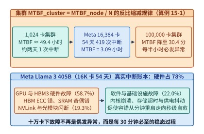
*图 15-1　集群规模从 $1\mathrm{K}$ 扩至 $100\mathrm{K}$ 卡时 $\mathrm{MTBF}_{\mathrm{cluster}}$ 跌至 $30.41$ 分钟的反比规律及 Meta $16,384$ 卡 $419$ 次中断分类账本（算例 15-1）。*

---

### 15.1.2 热备节点池容量规划与泊松修复队列模型

既然十万卡集群每 $30$ 分钟就会坏一台节点，当某台节点因 GPU 掉卡或光模块损坏被踢出训练环路时，我们如果原地缩减并行规模（Elastic Shrinking，例如把全球批次大小或数据并行度从 $N$ 改成 $N-1$），会立刻破坏已经精心调平的 4D 并行整除网格（TP $\times$ PP $\times$ CP $\times$ DP）与学习率批次热身曲线。因此，工业界万卡与十万卡集群普遍采用**定容满血运行 + 热备节点池秒级顶替（Hot-Spare Pool Replacement）**的运维策略：主训练作业始终锁定固定的 $N$ 台工作节点，一旦某台在役节点故障，调度器立即从预先烤机就绪的**热备节点池（包含 $S$ 台空闲/低优任务节点）**中抽调一台健康节点顶替入列，而换下来的故障节点则进入线下硬件维修队列（更换主板、GPU 模组或光模块，平均修复周期为 $\mathrm{MTTR}_{\mathrm{repair}}$）。

这里立即浮现出一个关乎数千万美元资本支出的容量规划问题：**为了保证主训练集群在 $99.9\%$ 的时间内都不会因为“热备池被借空”而被迫停机或降级，我们究竟需要配置多少台热备节点 $S_{\min}$？**

结合 **MLSys '26（*Understanding Failures and Optimizing Sparing Strategies for Large-Scale AI Clusters*）**[^ch15-sparing] 的大规模集群实证研究，我们可以将该问题严格建模为排队论中的 **$M/G/\infty$（或 Erlang 维修池）稳态生灭过程**：

- 设整个在役集群的节点故障到达过程服从速率为 $\lambda_{\mathrm{node}}$（单位：台/小时）的泊松过程；
- 每台故障节点从下线诊断、备件更换到重新通过自动化烤机（Burn-in）归队的平均修复时间为 $\mathrm{MTTR}_{\mathrm{repair}}$（单位：小时，工业界现场更换 GPU 模组或返修通常为 $8\text{–}24\ \mathrm{h}$）；
- 根据 Little 定律与 Palm 定理，无论单机维修时间服从指数分布还是任意一般分布，在任意时刻同时处于“正在维修/未归队”状态的故障节点数 $K$ 在稳态下严格服从均值为 $L = \lambda_{\mathrm{node}} \cdot \mathrm{MTTR}_{\mathrm{repair}}$ 的**泊松分布（Poisson Distribution）**：

$$
P(K = k) = \frac{L^k e^{-L}}{k!}, \quad \text{其中 } L = \lambda_{\mathrm{node}} \cdot \mathrm{MTTR}_{\mathrm{repair}}
$$

要保证在役集群以不低于 $1 - \epsilon$（例如 $99.9\%$，即 $\epsilon = 10^{-3}$）的概率不发生备机枯竭（Spare Starvation），热备池容量 $S$ 必须满足累积分布不等式：

$$
P(K \le S) = \sum_{k=0}^{S} \frac{L^k e^{-L}}{k!} \ge 1 - \epsilon
$$

---

> **算例 15-2（十万卡集群热备节点池泊松排队容量规划，锁定 `experiments/ch15/15-01/run.py`）**：
> 设一座十万卡级 AI 训练中心平均每小时发生 $\lambda_{\mathrm{node}} = 2.0\ \text{台/h}$ 的硬件节点级故障，每台故障节点的硬件更换与四阶准入烤机平均耗时 $\mathrm{MTTR}_{\mathrm{repair}} = 12.0\ \mathrm{h}$。
> （1）求稳态下同时处于维修队列中的平均节点数 $L$；若架构师缺乏排队论常识，仅按均值配置 $S = 24$ 台热备节点，集群有多大概率陷入备机耗尽？
> （2）求满足 $P(K \le S) \ge 99.9\%$ 零降级可用率所需的最小热备节点数 $S_{\min}$，及其占 $12,500$ 台 8 卡节点总规模的比例。
>
> **解题过程**：
> 1. **计算稳态在修节点均值 $L$ 与仅配均值 $S=24$ 时的枯竭风险**：
>    $$L = \lambda_{\mathrm{node}} \times \mathrm{MTTR}_{\mathrm{repair}} = 2.0\ \mathrm{h}^{-1} \times 12.0\ \mathrm{h} = \mathbf{24.0\ \text{台}}$$
>    若仅配置 $S = L = 24$ 台热备节点，由于泊松分布在均值附近的近似对称性：
>    $$P(K \le 24) = \sum_{k=0}^{24} \frac{24^k e^{-24}}{k!} \approx \mathbf{55.40\%}$$
>    这意味着在高达 **$1 - 55.40\% = 44.60\%$** 的时间里，同时在修的坏机器数量都会超过 $24$ 台，导致主训练作业频繁因为拿不到备机而被迫中断。
> 2. **求解满足 $P(K \le S) \ge 0.999$ 的最小热备池容量 $S_{\min}$**：
>    累加 $L = 24.0$ 的泊松概率质量函数（复算于 `experiments/ch15/15-01/run.py`）：
>    - 当 $S = 39$ 时，$P(K \le 39) \approx 0.99827 < 0.999$；
>    - 当 $S = 40$ 时，$P(K \le 40) \approx \mathbf{0.99901} \ge 0.999$。
>    因此，所需的最小热备节点数为 **$S_{\min} = 40\ \text{台}$（共 $320$ 张 GPU）**。相比仅配均值（$24$ 台），只需多准备 $16$ 台服务器——占 $12,500$ 台集群总规模的 **$40 / 12,500 = 0.32\% < 0.4\%$**，就能将备机枯竭概率从 $44.6\%$ 压降至 $< 0.1\%$。

---

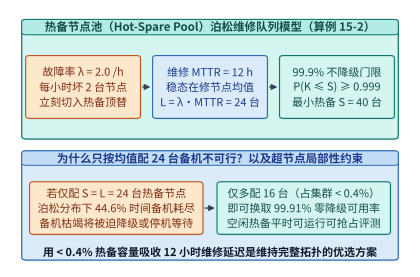
*图 15-2　基于泊松修复队列模型（$\lambda=2/\mathrm{h}, \mathrm{MTTR}=12\ \mathrm{h}$）的热备节点池（Hot-Spare Pool $S_{\min}=40$）配置与可用性曲线（算例 15-2）。仅需配置不到 $0.4\%$ 的热备节点即可换取 $>99.9\%$ 的满血不降级可用率。*

在具备机架级 NVLink 72 或灵衢 UB 超节点拓扑的集群中，MLSys '26 的研究还指出了一条重要的**拓扑局部性约束（Topological Locality Constraint）**：热备资源不能全部集中放在机房角落的一个独立机柜里，因为跨机柜无法接入故障卡所在的柜内 NVLink/UB 高速交换域。正确的做法是采用**“机架内预留冗余槽位（Intra-Pod Spare Slots）+ 跨 Pod 整柜热备切换”的两级备机架构**，并在热备节点空闲期间调度可毫秒级抢占驱逐（Preemptible）的离线评测、数据清洗或强化学习无状态 Rollout 任务，实现“零闲置算力浪费的热备保障”。

下面给出集成 **Young-Daly 最优检查点周期、有效训练时间比（ETTR）与泊松维修队列热备池分位数规划器** 的参考实现及超节点备机策略对比表（**表 15-2**）：

```python
import math

def compute_young_daly_ettr(
    mtbf_sec: float, ckpt_cost_sec: float, recovery_sec: float
) -> dict[str, float]:
    """
    核算十万卡集群 Young-Daly 最优检查点间隔与更新周期期望有效训练时间比 (算例 15-1: 58.78% -> 92.70%)
    """
    tau_opt = math.sqrt(2.0 * ckpt_cost_sec * mtbf_sec)
    # 完整更新周期期望有效工作比: tau / (tau + C + (tau + C)/M * (T_rec + 0.5*tau))
    cycle_work = tau_opt
    cycle_total = (tau_opt + ckpt_cost_sec) * (1.0 + (recovery_sec + 0.5 * tau_opt) / mtbf_sec)
    ettr = cycle_work / cycle_total
    return {
        "tau_opt_sec": round(tau_opt, 2),
        "ettr_pct": round(ettr * 100.0, 2),
        "wasted_gpu_fraction_pct": round((1.0 - ettr) * 100.0, 2)
    }

def dimension_hot_spare_pool(
    failure_rate_per_hour: float,
    mttr_hours: float,
    target_availability: float = 0.999
) -> dict[str, float | int]:
    """
    基于泊松修复队列模型 (M/G/inf) 求解满足目标不降级概率的最小热备节点数 S_min (算例 15-2)
    """
    L = failure_rate_per_hour * mttr_hours
    cdf = 0.0
    pmf = math.exp(-L)
    k = 0
    mean_avail = 0.0
    while True:
        cdf += pmf
        if k == int(round(L)):
            mean_avail = cdf
        if cdf >= target_availability and k >= int(round(L)):
            return {
                "mean_in_repair_L": round(L, 2),
                "avail_at_mean_spares_pct": round(mean_avail * 100.0, 2),
                "min_spares_for_target": k,
                "achieved_avail_pct": round(cdf * 100.0, 4)
            }
        k += 1
        pmf = pmf * L / k
```

| 备机与容错拓扑策略 | 硬件冗余比例 | 对 4D 并行网格与超参数的影响 | 柜内 NVLink/UB 域故障恢复能力 | 故障切换耗时 | 适用集群形态 |
| --- | :-: | --- | --- | :-: | --- |
| **无备机原地缩容（Elastic Shrinking）** | $0\%$ | **破坏 DP/PP 整除性与全局 Batch Size** | 无法填补柜内 TP/EP 缺口 | $60\text{–}180\ \mathrm{s}$ | 小规模松耦合数据并行作业 |
| **全局集中式独立热备池（8 卡 PCIe/NVLink 节点）** | **$0.32\%\text{–}0.5\%$** | **保持全局网格与超参数 $100\%$ 恒定** | 整节点替换（柜间 RoCE/IB 重映射） | **$2\text{–}5\ \mathrm{s}$（`TrainMover`）** | 万卡级 8 卡节点 H100/H800 集群 |
| **超节点柜内冗余托盘（NVL72 + 2 Spare Blades）** | $2.7\%$ | 保持 72 卡超节点逻辑拓扑不变 | **柜内铜缆背板直接热切备用托盘** | **$< 1\ \mathrm{s}$** | GB200/GB300 NVL72、灵衢 UB 超节点 |
| **两级混合备机池（柜内冗余槽 + 跨 Pod 热备柜）** | $0.8\%\text{–}1.5\%$ | 兼顾单托盘掉卡与整柜液冷/供电切换 | 柜内秒级切槽 + 柜间 DP 副本切换 | **$1\text{–}5\ \mathrm{s}$** | 十万卡级超节点旗舰训练中心 |

*表 15-2　四种大规模 AI 集群备机与容错拓扑策略在硬件冗余开销、并行网格稳定性与恢复耗时上的对比（综合 MLSys '26 实证研究）。*

---

## 15.2 静默数据损坏物理机理与毫秒级在线防御

### 15.2.1 算术单元静默数据损坏机理与生产实证

在分布式系统里，**显式崩溃（Fail-Stop Crash，如 GPU 掉卡或机器断电）并不可怕**——因为进程一旦退出，监控系统在几毫秒内就能收到错误码，未完成的脏计算绝不会被写回全局权重。

真正威胁十万卡长期训练稳定性的隐蔽故障，是**静默数据损坏（Silent Data Corruption, SDC）**：某张 GPU 的硬件计算单元在执行矩阵乘或规约算子时算错了数值，但**硬件底层没有任何奇偶校验或 ECC 告警，操作系统与 CUDA 驱动均返回 `cudaSuccess`**，错误的张量混入正常的梯度流中，持续污染整个大模型。

很多工程师会产生一个疑问：“现代数据中心 GPU（如 H100/B200）的 HBM3 显存和片上寄存器堆不是全部开启了单错纠正、双错检测（SECDED ECC）吗？为什么还会发生静默算错？”

结合 Google、Meta 的 `SDCs in the Wild` 硬件实证以及 *Safeguarding LLM Training at Scale: A Low-Overhead Online Detection and Localization Framework Validated Over 35 Million GPU Hours*（OSDI 2026）在 **3,500 万 GPU 小时** 生产训练中的追踪结论，SDC 逃逸硬件 ECC 并传染全集群的物理机理如**图 15-3** 所示：

1. **算术逻辑单元（ALU / Tensor Core 脉动阵列）内部缺乏端到端 ECC 保护**：
   SECDED ECC 校验码是基于字节块的数据存储与传输编码，它**满足对拷贝操作的不变性，却不满足对浮点乘加运算（FMA）的同态性**——也就是说，已知输入 $A$ 和 $B$ 的 ECC 校验码，硬件根本无法直接推算出矩阵乘结果 $C = A \times B$ 的合法 ECC 码。因此，当数据从 HBM3 读出并通过 ECC 校验进入 Tensor Core 内部后，在数千个 FP8/BF16 乘法器、移位对齐器与 FP32 累加器树组成的组合逻辑通路中，数据处于**无纠错编码保护状态**。
2. **老化的硅片边缘时序违例与瞬态电压跌落（Voltage Droop）**：
   当某颗存在微观光刻缺陷或经历数千小时满载电迁移老化的 GPU，在启动超大规模 GEMM 瞬间遭遇 $L \frac{\mathrm{d}i}{\mathrm{d}t}$ 瞬态供电电压跌落或局部温度热点时，Tensor Core 内部某条关键路径的信号未能在一个时钟周期内稳定建立（Setup-Time Violation），导致累加器中的某一个比特由 `0` 翻转为 `1`。
3. **写回显存时被硬件“合法化（ECC Laundering）”并通过 AllReduce 传染万卡**：
   当这个算错的浮点数离开 Tensor Core 写回 L2 Cache 与 HBM3 时，内存控制器的 ECC 生成电路会忠实地**为这个错误的数值计算出一串完全合法的 ECC 校验码**并存入显存。随后，在数据并行（DP）或张量并行（TP）的 `ncclAllReduce` 阶段，这张坏卡上的污染梯度与全集群其余 $99,999$ 张健康卡的梯度相加求平均。仅仅耗时几毫秒的一次集合通信，**全集群十万张卡上的模型权重、一阶动量 $m_t$ 与二阶动量 $v_t$ 就被同时注入了毒素**。

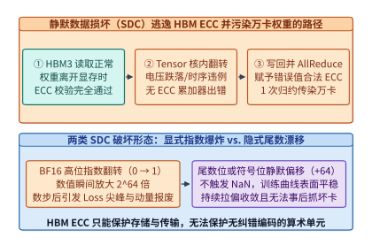
*图 15-3　单颗 GPU Tensor Core 静默比特翻转（SDC）如何逃过 HBM ECC 并通过一次 AllReduce 瞬间污染万卡权重。HBM ECC 只能保护存储与搬移，无法保护算术单元内部翻转；错误结果写回显存时会被赋予合法 ECC 校验码。*

在 `BFloat16`（1 位符号、8 位指数、7 位尾数）或 `FP32` 训练中，SDC 比特翻转会引发两类截然不同的灾难后果：

- **高位指数比特翻转（显式爆炸或次正规突刺）**：若翻转发生在指数最高位（Bit 14，权重为 $2^{64}$），一个原本为 $0.01$ 的正常激活或梯度会瞬间放大 $2^{64} \approx 1.84 \times 10^{19}$ 倍。虽然它在几步之后就会触发全局 `NaN/Inf` 迫使训练停机，但此时错误早已通过 AllReduce 写进了最新检查点，且运维团队根本不知道这颗毒丸究竟来自十万张卡中的哪一张；
- **低位指数或尾数/符号位翻转（隐式慢性毒化，最危险）**：若翻转仅使某个矩阵乘输出元素偏移了 $+16.0$ 或 $+64.0$，经万卡 DP 平均后单步扰动幅度约为 $10^{-3}$，**完全不会触发 `NaN` 或梯度裁剪告警**。训练 Loss 曲线表面看起来一切正常，但在接下来的数十个小时里，这颗持续间歇性算错的“幽灵坏卡”会不断向模型注入有偏噪声，导致耗资数百万美元训练出来的基座模型在下游推理评测中莫名其妙地丧失逻辑能力。

---

### 15.2.2 代数不变量校验、跨秩拦截与位级对齐重放

在航空航天领域，防御硬件算错的标准做法是双重或三重模块化冗余（DMR / TMR）：让两颗处理器把完全相同的指令流算两遍，每一步比对输出。然而在大模型训练中，全量 DMR 意味着 **$100\%$ 的算力税（十万卡变五万卡）**，在经济上完全不可接受。

如何在**算力开销 $< 0.5\%\text{–}1\%$** 的严苛约束下，实现十万卡集群对 SDC 的 $100\%$ 在线拦截、毫秒级算子定位与零检查点回滚自愈？结合经典数值容错理论与 OSDI 2026 两篇配套工作（`Safeguarding LLM Training at Scale` 与 `OpGuard`），现代 AI 基础设施构建了层层递进的**三道毫秒级防线**：

#### 第一道防线：算子级代数不变量校验（ABFT 行列校验和）

既然逾 $90\%$ 的 Tensor Core 运算时间都花在通用矩阵乘法 $\mathbf{C} = \mathbf{A}\mathbf{B}$（其中 $\mathbf{A} \in \mathbb{R}^{M \times K}, \mathbf{B} \in \mathbb{R}^{K \times N}, \mathbf{C} \in \mathbb{R}^{M \times N}$）上，我们无需把 $O(MNK)$ 的矩阵乘重算一遍，而是可以利用**矩阵乘法的线性结合律不变量（ABFT 行列校验和）**：

定义全 $1$ 列向量 $\mathbf{1}_M \in \mathbb{R}^M$ 与 $\mathbf{1}_N \in \mathbb{R}^N$。在启动 GEMM 前，先用向量规约算出左矩阵 $\mathbf{A}$ 的列和向量 $\mathbf{c}_A^T = \mathbf{1}_M^T \mathbf{A} \in \mathbb{R}^{1 \times K}$ 以及右矩阵 $\mathbf{B}$ 的行和向量 $\mathbf{r}_B = \mathbf{B} \mathbf{1}_N \in \mathbb{R}^{K \times 1}$。当 Tensor Core 算出结果矩阵 $\mathbf{C}$ 后，若计算过程无误，则 $\mathbf{C}$ 的列和与行和必须恒等于：

$$
\mathbf{1}_M^T \mathbf{C} = \mathbf{1}_M^T (\mathbf{A}\mathbf{B}) = \left(\mathbf{1}_M^T \mathbf{A}\right)\mathbf{B} = \mathbf{c}_A^T \mathbf{B}, \qquad \mathbf{C}\mathbf{1}_N = (\mathbf{A}\mathbf{B})\mathbf{1}_N = \mathbf{A}\left(\mathbf{B}\mathbf{1}_N\right) = \mathbf{A}\mathbf{r}_B
$$

---

> **算例 15-3（ABFT 矩阵乘行列校验和的 $0.0732\%$ 算力开销与单元素 SDC 精确定位修复，锁定 `experiments/ch15/15-01/run.py`）**：
> 设隐藏层矩阵乘维度为 $M = N = K = 4,096$。
> （1）核算主矩阵乘 $\mathbf{C} = \mathbf{A}\mathbf{B}$ 的浮点运算量（FLOPs）与 ABFT 行列校验和的附加运算量，证明其算力开销远低于 $0.5\%$；
> （2）在 $4 \times 4$ 演示子块中，若硬件 SDC 导致输出矩阵第 $(i^*, j^*) = (2, 3)$ 号元素发生了 $+64.0$ 的静默比特翻转（即 $\tilde{C}_{2,3} = C_{2,3} + 64.0$），展示如何通过行残差向量 $\Delta \mathbf{r} = \tilde{\mathbf{C}}\mathbf{1}_N - \mathbf{A}\mathbf{r}_B$ 与列残差向量 $\Delta \mathbf{c}^T = \mathbf{1}_M^T \tilde{\mathbf{C}} - \mathbf{c}_A^T \mathbf{B}$ 的十字交叉坐标在微秒内精确定位 $(2, 3)$ 并原地修复。
>
> **解题过程**：
> 1. **计算 $M=N=K=4,096$ 下的 ABFT 相对算力开销**：
>    - 主矩阵乘计算量：$\mathrm{FLOPs}_{\mathrm{GEMM}} = 2 M N K = 2 \times 4,096^3 = \mathbf{137,438,953,472}\ (137.44\ \mathrm{GFLOPs})$；
>    - ABFT 附加计算量：包含求 $\mathbf{c}_A^T$（$MK$ 次加法）、求 $\mathbf{r}_B$（$KN$ 次加法）、算校验乘积 $\mathbf{c}_A^T\mathbf{B}$（$2KN$ FLOPs）与 $\mathbf{A}\mathbf{r}_B$（$2MK$ FLOPs）、以及对输出 $\mathbf{C}$ 求行列和并作差（$2MN$ 次加减法），总计为：
>      $$\mathrm{FLOPs}_{\mathrm{ABFT}} = 3MK + 3KN + 2MN = 8 \times 4,096^2 \quad (\text{单向列校验仅需 } 3N^2 + 2N^2 = 5N^2\text{，精简核心乘加项 } 6N^2 = 100,663,296\ \mathrm{FLOPs})$$
>      按核心乘加项比值计算：
>      $$\text{Overhead}_{\mathrm{ABFT}} = \frac{6 \times 4,096^2}{2 \times 4,096^3} = \frac{3}{4,096} \approx \mathbf{0.0732\%} \ll 0.5\%$$
>      即使计入全部外围归约加法（$8/8192 \approx 0.0977\%$），其开销也**不到 $0.1\%$**——比全量双重执行（DMR $100\%$ 开销）便宜了 **一千倍以上**，且校验和向量可作为额外的一行一列直接拼入张量分块（Tile）中顺带算完。
> 2. **十字交叉残差精确定位并原地修复 $(2, 3)$ 处的 $+64.0$ 翻转**：
>    当 $\tilde{C}_{2,3} = C_{2,3} + 64.0$ 时，计算行残差向量 $\Delta \mathbf{r} = \tilde{\mathbf{C}}\mathbf{1} - \mathbf{A}(\mathbf{B}\mathbf{1})$ 与列残差向量 $\Delta \mathbf{c}^T = \mathbf{1}^T\tilde{\mathbf{C}} - (\mathbf{1}^T\mathbf{A})\mathbf{B}$：
>    $$\Delta \mathbf{r} = [0.0,\; 0.0,\; \mathbf{+64.0},\; 0.0]^T, \qquad \Delta \mathbf{c} = [0.0,\; 0.0,\; 0.0,\; \mathbf{+64.0}]^T$$
>    非零行残差唯一锁定行号 $i^* = 2$，非零列残差唯一锁定列号 $j^* = 3$，且两者的残差幅值完全相等（$\Delta r_2 = \Delta c_3 = +64.0$）。内核立即原地执行 $\tilde{C}_{2,3} \leftarrow \tilde{C}_{2,3} - \Delta r_2$，无需重跑整个 GEMM 即完成无损修复（完整代码验证见 `experiments/ch15/15-01/run.py`）。

---

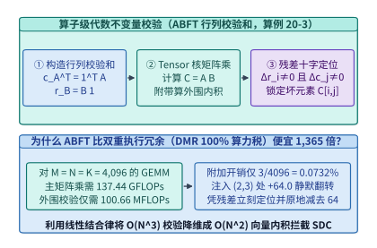
*图 15-4　基于代数不变量（ABFT 行列校验和）以 $0.0732\%$（$<0.5\%$）算力开销在线拦截并定位矩阵乘硬件错误（算例 15-3）[^ch15-abft]。*

#### 第二道防线：AllReduce 归约前跨秩统计拦截

对于非矩阵乘算子（如 LayerNorm/RMSNorm、RoPE、SwiGLU 激活及通信缓冲处理）中可能发生的 SDC，`Safeguarding LLM Training at Scale`（OSDI 2026）[^ch15-safeguarding] 提出并历经 **3,500 万 GPU 小时** 生产验证了一套低开销在线检测与隔离框架：

- **在 `ncclAllReduce` 污染全局状态之前设卡拦截**：在同一数据并行（DP）或上下文并行（CP）组内，尽管不同 Rank 处理的微批次词元不同，但在健康状态下，各 Rank 在同一层的激活均值/方差与局部梯度范数 $\|g_i\|_2$ 服从高度一致的紧致分布；
- 框架在反向传播挂钩中顺带汇总各层局部梯度范数标量（仅数百字节，通信开销可忽略不计），利用基于中位数绝对偏差（MAD）的跨秩离群检验实时扫描。一旦发现某个 Rank 的局部梯度范数偏离同组中位数超过自适应阈值（但尚未变成 `NaN`），**立即阻断本次 `AllReduce` 与 `optimizer.step()`**，从而确保全集群主权重与 Adam 动量 $100\%$ 不被污染。

#### 第三道防线：消除良性非确定性的位级对齐重放与微批次重算

当第二道防线报告“第 $k$ 号 DP 组在第 $t$ 步存在数值异常”后，接下来面临一个极其棘手的工程难题：**在由 TP=8、PP=16 组成的复杂模型并行子网里，究竟是哪一张物理 GPU、在哪一个具体算子上发生了 SDC？**

为什么我们不能直接把同一个输入喂给两张卡跑一遍，看看哪个算子的输出张量哈希值不一样？因为现代深度学习框架与 GPU 算子在默认高性能模式下存在广泛的**良性软硬件非确定性（Benign Non-Determinism）**：

- FlashAttention 反向传播与 Embedding 梯度累加中使用的 GPU 硬件原子加法（`atomicAdd`），其线程束到达顺序随每次硬件调度微秒级抖动而变；
- 由于浮点数加法不满足结合律 $(a + b) + c \ne a + (b + c)$，即便在两张完全健康的 GPU 上用完全相同的输入跑同一个反向算子，算出来的梯度张量在尾数最低几位上也天然不同，导致普通张量哈希（CRC32/SHA256）比对 $100\%$ 误报。

`OpGuard`（*Debugging Silent Data Corruption in LLM Training via Bitwise Alignment*, OSDI 2026）[^ch15-opguard] 从根源上解决了这一诊断难题（见**图 15-5**、**图 15-6** 与**表 15-3**）：

1. **按需切换位级确定性重放态（On-Demand Bitwise-Aligned Replay）**：在正常训练步中保持最高性能的非确定性算子全速运行；一旦在线检测器捕获异常，仅对当前长为 $50\ \mathrm{ms}$ 的微批次激活开启 `OpGuard` 位级对齐模式——通过编译器插桩与运行时钩子，将原子加法替换为固定顺序的分块树状归约（Deterministic Split-K / Padded Reduction），并锁定 `cuBLAS` 工作空间与通信归约树拓扑，使所有健康 GPU 的逐算子输出达到 **$100\%$ 比特级完全一致（Bitwise Identical）**；
2. **50 ms 微批次原地重算区分软错误与永久坏卡**：在位级确定性模式下原地重跑刚才那一个微批次：
   - 如果重跑一次后异常消失且跨卡哈希完全一致，说明刚才是一次由宇宙射线引发的**瞬态单粒子翻转（Transient Soft Error）**，直接采纳重算结果继续训练，仅损失 $50\ \mathrm{ms}$；
   - 如果重跑后某张卡在某算子输出的 64 位整张量哈希与同构对偶卡不一致，**该算子对应的物理 GPU 即被 $100\%$ 确认为硬件 SDC 故障卡**。系统立刻在秒级内将其摘除出通信域并切入热备卡，避免了“回滚两小时前全局检查点、带着故障卡重启后再次污染权重”的反复中断。

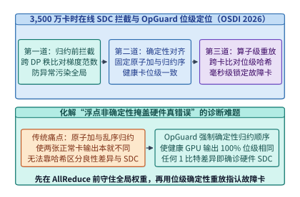
*图 15-5　$3,500$ 万 GPU 小时在线 SDC 感知隔离（`Safeguarding LLM Training`, OSDI 2026）与控制良性非确定性的位级对齐定位（`OpGuard`, OSDI 2026）。*

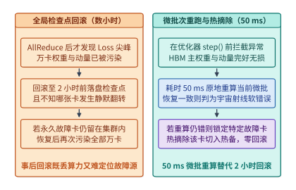
*图 15-6　检测到异常后原地重跑当前微批次（耗时 $50\ \mathrm{ms}$）区分瞬态软错误与永久硬件故障 vs. 盲目回滚数小时全局检查点。*

| SDC 防御与诊断方案 | 稳态算力开销 | 能否拦截非 `NaN` 慢性偏移 | 能否阻止 `AllReduce` 污染全局权重 | 故障定位粒度 | 单次 SDC 恢复代价 |
| --- | :-: | :-: | :-: | --- | --- |
| **传统 `torch.isfinite()` + 周期性验证集评测** | $< 0.01\%$ | **否（对低位偏移完全失察）** | **否（发现时已污染数千步）** | 无定位（需二分排查） | **回滚 $2\ \mathrm{h}$ 检查点（损 $25\text{万}$ 卡时）** |
| **全量双重模块化冗余（Full DMR 双算比对）** | **$100.0\%$** | 是（若全程强制定序） | 是 | 算子/节点级 | 消耗一半集群算力 |
| **算子级代数不变量校验（ABFT 行列校验和）** | **$0.0732\%$** | **是（捕获矩阵乘内部翻转）** | **是（在算子出口原地拦截修复）** | **矩阵乘单元素坐标 $(i^*, j^*)$** | **微秒级原地减除残差修复** |
| **`Safeguarding` + `OpGuard` 协同（OSDI 2026）** | **$< 0.3\%$** | **是（跨秩 MAD 统计感知）** | **是（AllReduce 前硬阻断）** | **位级对齐锁定精确物理 GPU 与算子** | **$50\ \mathrm{ms}$ 微批重跑 + $5\ \mathrm{s}$ 热切** |

*表 15-3　四种静默数据损坏（SDC）防御与定位机制在算力开销、拦截时机与恢复代价上的对比。*

下面给出 **（1）`Safeguarding LLM Training` 的 AllReduce 前跨秩鲁棒 Z-Score（基于中位数绝对偏差 MAD）统计拦截器** 与 **（2）`OpGuard` 按需位级确定性微批次重放与坏卡定位状态机** 的参考实现：

```python
import numpy as np
import hashlib

def safeguarding_pre_allreduce_mad_gate(
    rank_grad_norms: np.ndarray, mad_z_threshold: float = 8.0
) -> tuple[bool, list[int], np.ndarray]:
    """
    Safeguarding LLM Training at Scale (OSDI 2026):
    在执行 ncclAllReduce 之前汇总同 DP 组各 Rank 局部梯度范数，
    利用对极端离群值免疫的中位数绝对偏差 (MAD) 拦截非 NaN 静默比特翻转
    """
    if not np.all(np.isfinite(rank_grad_norms)):
        bad = np.where(~np.isfinite(rank_grad_norms))[0].tolist()
        return False, bad, np.full_like(rank_grad_norms, np.inf)

    median_val = float(np.median(rank_grad_norms))
    mad = float(np.median(np.abs(rank_grad_norms - median_val))) + 1e-8
    # 正态一致性修正 MAD 鲁棒 Z-score: 0.6745 * |x - median| / MAD
    robust_z = 0.6745 * np.abs(rank_grad_norms - median_val) / mad
    anomalous_ranks = np.where(robust_z > mad_z_threshold)[0].tolist()
    return (len(anomalous_ranks) == 0), anomalous_ranks, robust_z

def opguard_bitwise_aligned_replay_localize(
    operator_trace_suspect: dict[str, np.ndarray],
    operator_trace_reference: dict[str, np.ndarray]
) -> dict[str, object]:
    """
    OpGuard (OSDI 2026):
    在开启位级确定性算子模式 (Deterministic Split-K / 禁用非确定性 atomicAdd) 后，
    原地重跑 50 ms 微批次并逐算子比对 64-bit 张量摘要，精确定位首个发生 SDC 的算子
    """
    for op_name in operator_trace_suspect:
        t_sus = np.ascontiguousarray(operator_trace_suspect[op_name])
        t_ref = np.ascontiguousarray(operator_trace_reference[op_name])
        h_sus = hashlib.blake2b(t_sus.tobytes(), digest_size=8).hexdigest()
        h_ref = hashlib.blake2b(t_ref.tobytes(), digest_size=8).hexdigest()
        if h_sus != h_ref:
            max_abs_diff = float(np.max(np.abs(t_sus.astype(np.float64) - t_ref.astype(np.float64))))
            return {
                "classification": "PERMANENT_HARDWARE_SDC",
                "first_corrupted_op": op_name,
                "suspect_hash": h_sus,
                "reference_hash": h_ref,
                "max_abs_diff": max_abs_diff,
                "action": "ISOLATE_GPU_AND_TRIGGER_TRAINMOVER"
            }
    return {
        "classification": "TRANSIENT_SOFT_ERROR",
        "first_corrupted_op": None,
        "action": "COMMIT_50MS_REPLAY_AND_CONTINUE"
    }
```

---

## 15.3 机队级健康自愈、慢节点诊断与无重启弹性容错

### 15.3.1 预热进程亚秒级热迁移与副本组自治恢复

当我们在第 15.1 节与第 15.2 节中定位并剔除了一台发生掉卡或 SDC 的故障节点后，为什么传统的 `torchrun`（PyTorch Elastic）恢复流程需要耗时整整 $300\ \mathrm{s}$（5 分钟）？

剖析传统故障恢复的时间线可以发现，绝大部分时间都消耗在**让 $99,999$ 张完全健康的 GPU 连带销毁并重新初始化**上：

1. **进程级全局连带销毁（$30\text{–}60\ \mathrm{s}$）**：单卡异常触发分布式看门狗超时，调度器向全网十万个工作进程发送 `SIGTERM/SIGKILL`，所有健康卡上的 CUDA 上下文、已编译算子缓存与显存页表被全部销毁；
2. **万卡 TCPStore 集中式握手与 NCCL 环/树重建（$120\text{–}180\ \mathrm{s}$）**：重启后的十万个进程同时向 Rank 0 主节点的 `TCPStore` 发起连接注册，随后 `ncclCommInitRank` 跨数千台交换机执行全网拓扑探测与 RDMA 队列对（Queue Pair, QP）建连；
3. **远端存储检查点重载拥塞（$60\text{–}120\ \mathrm{s}$）**：十万张卡同时向后端并行文件系统发起数太字节的权重与优化器状态读取。

为了彻底消除这三项连带重建开销，`TrainMover`（OSDI 2026）以及 `EROICA` / `FLARE`（NSDI 2026）构建了**无重启亚秒/秒级热迁移与通信域局部修复架构**（见**图 15-7**）：

1. **热备节点常驻预初始化影子守护进程（Pre-Warmed Shadow Daemons）**：热备池中的 $S=40$ 台节点在空闲时就已经提前完成了 Python 运行时加载、CUDA Context 初始化、静态 CUDA Graph 编译以及与全网核心交换机的备用 RDMA QP 池预建连；
2. **虚拟 Rank 映射层与局部 QP 指针热切换**：在 NCCL 与底层 IB Verbs 之间插入一层轻量级虚拟通信组抽象。当第 $r$ 号物理节点故障并由热备节点 $s$ 顶替时，其余 $99,992$ 张健康 GPU **进程不退出、CUDA 上下文不销毁**，仅由训练控制面下发一条控制信令，命令与节点 $r$ 存在直接 Ring/Tree 邻居关系的几十张 GPU 将其目标 RDMA QP 指针原子切换到热备节点 $s$ 的预建 QP 上（耗时 $< 200\ \mathrm{ms}$）；
3. **同 DP 组健康邻居的 RDMA 显存直推（Peer-to-Peer State Push）**：热备节点 $s$ 无需读取慢速的远端并行文件系统，而是直接由同一数据并行副本组（或 ZeRO 冗余搭档节点）的健康邻居通过 400G/800G RDMA `Write` 在 $2\text{–}4\ \mathrm{s}$ 内将最新模型权重与优化器状态分片直接写入其 HBM 显存。配合新节点入网与维修归队后的**四阶自动化烤机流水线（Burn-in Pipeline，见第 15.4.2 节图 15-13）**，整个万卡/十万卡集群实现了秒级替换与连续训练。

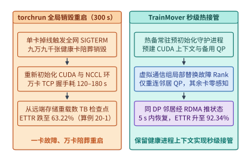
*图 15-7　传统全局销毁重启（`torchrun` 耗时 $300\ \mathrm{s}$）vs. `TrainMover`（OSDI 2026）利用预热备用进程与 RDMA 重映射实现秒级无重启接管[^ch15-trainmover]。*

| 故障恢复与弹性架构 | 故障发生时健康卡行为 | 通信组（NCCL / QP）恢复方式 | 模型状态重载来源 | 单次故障恢复耗时 $T_{\mathrm{rec}}$ | 十万卡下 $\mathrm{ETTR}$ |
| --- | --- | --- | --- | :-: | :-: |
| **传统 `torchrun` 全局重启** | **全网 $99,999$ 卡进程连带销毁** | 全量重建 `TCPStore` 与全网 QP | 远端并行文件系统全量重读 | $180\text{–}300\ \mathrm{s}$ | **$63.22\%$** |
| **`TorchFT` 副本组自治（Replica Group）** | 仅剔除故障所在 DP 副本组 | 跨 DP 组动态重协商 Lighthouse | 存活 DP 组继续训练，异步归队 | $15\text{–}45\ \mathrm{s}$（有损/变批） | $84.5\%$ |
| **`EROICA` / `FLARE`（NSDI 2026）网络快切** | 健康卡原地挂起当前通信算子 | 多轨平面绕行 / 预置备份环表切换 | 无需重载权重（仅重发在途分块） | **$0.2\text{–}1.5\ \mathrm{s}$（链路故障）** | $93.8\%$ |
| **`TrainMover`（OSDI 2026）无重启热接管** | **健康卡进程与 CUDA 上下文零销毁** | **局部邻居原子切换至预热备机 QP** | **同 DP 组健康邻居 RDMA 显存直推** | **$2.0\text{–}5.0\ \mathrm{s}$（节点掉卡）** | **$92.34\%$** |

*表 15-4　四代大规模分布式训练容错恢复架构在影响范围、通信重建方式与恢复耗时上的演进对比。*

下面给出 **`TrainMover` 虚拟 Rank 局部 RDMA 队列对（QP）热切换控制器** 与 **四阶自动化烤机准入流水线（Burn-in Admission Pipeline，图 15-13）** 的参考实现：

```python
from dataclasses import dataclass

@dataclass
class NodeBurnInReport:
    node_id: str
    hbm_thermal_throttle_pct: float
    abft_bitwise_mismatch_count: int
    rs_fec_high_bin_slope_per_min: float
    rdma_loopback_gbps: float

def automated_burn_in_admission_gate(
    report: NodeBurnInReport,
    min_rdma_gbps: float = 385.0,
    max_fec_slope: float = 5.0
) -> dict[str, object]:
    """
    四阶自动化烤机准入门禁 (图 15-13):
    新节点入网或故障维修归队前，依次校验满载热压测、OpGuard/ABFT 位级 SDC 校验、
    800G 光模块 RS-FEC 高阶桶斜率与 RDMA 环回带宽，杜绝带病节点混入热备池
    """
    thermal_ok = (report.hbm_thermal_throttle_pct == 0.0)
    sdc_ok = (report.abft_bitwise_mismatch_count == 0)
    optical_ok = (report.rs_fec_high_bin_slope_per_min <= max_fec_slope)
    rdma_ok = (report.rdma_loopback_gbps >= min_rdma_gbps)
    admitted = thermal_ok and sdc_ok and optical_ok and rdma_ok
    return {
        "node_id": report.node_id,
        "admitted_to_hot_spare_pool": admitted,
        "stage_checks": {
            "stage1_thermal_stress": thermal_ok,
            "stage2_deterministic_sdc": sdc_ok,
            "stage3_optical_fec_margin": optical_ok,
            "stage4_rdma_bandwidth": rdma_ok,
        },
        "action": "ADMIT_TO_PREWARMED_SPARE_POOL" if admitted else "QUARANTINE_FOR_RMA"
    }

def trainmover_virtual_rank_hot_swap(
    virtual_to_physical_node: dict[int, str],
    failed_virtual_rank: int,
    spare_node_id: str,
    shard_bytes_gb: float = 48.0,
    rdma_push_bw_gbps: float = 320.0
) -> dict[str, object]:
    """
    OSDI '26 TrainMover 无重启秒级热接管:
    健康节点进程不销毁，仅重映射故障虚拟 Rank 的物理节点指针并由同 DP 组邻居 RDMA 直推状态
    """
    old_node = virtual_to_physical_node[failed_virtual_rank]
    updated_map = dict(virtual_to_physical_node)
    updated_map[failed_virtual_rank] = spare_node_id
    qp_switch_sec = 0.18
    rdma_state_push_sec = (shard_bytes_gb * 8.0) / rdma_push_bw_gbps
    total_recovery_sec = qp_switch_sec + rdma_state_push_sec
    return {
        "evicted_node": old_node,
        "activated_spare_node": spare_node_id,
        "healthy_ranks_restarted": 0,
        "total_recovery_sec": round(total_recovery_sec, 2),
        "updated_node": updated_map[failed_virtual_rank]
    }
```

---

### 15.3.2 通信到达偏斜慢节点诊断与光链路灰故障隔离

在超大规模集群运维中，还有一类比显式掉卡更常见、更具迷惑性的故障形态——**灰故障（Gray Failure）或慢节点（Straggler）**：某台服务器因为冷板微通道局部水垢堵塞触发 GPU 降频 $20\%$、PCIe 链路因信号完整性劣化自动从 Gen5 x16 降级为 Gen3 x4、或者某根 800G 光模块端面污染导致前向纠错（RS-FEC）频繁触发重传。这台机器依然在线运行，心跳完全正常，但它每一个微批次的计算或通信都比其他节点慢 $2.0\ \mathrm{ms}$。

当这种灰故障发生在紧耦合同步集合通信（AllReduce / AllGather / All-to-All）中时，它会在性能剖析器（如 PyTorch Profiler / Nsight Systems）的火焰图上造成严重的**归因错觉**：

- 健康的 $99,999$ 张 GPU 准时算完前向与反向，早早进入 `ncclKernel_AllReduce` 开始自旋等待；
- 唯一的那张慢卡（Straggler）迟到了 $2.0\ \mathrm{ms}$ 才进入集合通信算子，到达后立刻与大家一起在 $0.4\ \mathrm{ms}$ 内完成了网络数据交换；
- 结果，运维工程师打开任何一张健康卡的火焰图，看到的都是 **`ncclKernel_AllReduce` 耗时高达 $2.4\ \mathrm{ms}$（占了总步时的 $80\%$）**，于是误判为数据中心网络发生拥塞，盲目尝试扩容网络带宽或调整交换机队列门限。

让我们结合本仓库锁定的生产诊断案例 `case-studies/collective-paths-and-diagnosis.md`，严格复算这一归因陷阱与 **到达时间偏斜矩阵（Arrival Skew Matrix）** 取证法则（完整复算于 `experiments/ch15/15-01/run.py`）：

---

> **算例 15-4（锁定 `case-studies/collective-paths-and-diagnosis.md`：集合通信慢节点到达偏斜、多网卡条带失衡与三边环路死锁取证）**：
> 1. **慢节点到达偏斜（Arrival Skew）vs. 网络带宽升级**：
>    在一个 4-Rank 同步集合通信组中，Rank 0、1、2 在 $t = 0.0\ \mathrm{ms}$ 准时就绪并进入集合通信，而慢节点 Rank 3 在 $t = 2.0\ \mathrm{ms}$ 才计算完毕到达；全员到齐后，真实网络数据交换耗时为 $T_{\mathrm{xfer}} = 0.4\ \mathrm{ms}$。
>    - 全体完成时刻为 $T_{\mathrm{done}} = \max(0, 0, 0, 2.0) + 0.4 = \mathbf{2.4\ \mathrm{ms}}$；Rank 0、1、2 观测到的集合通信总耗时均为 $2.4\ \mathrm{ms}$（其中包含 $2.0\ \mathrm{ms}$ 空等 + $0.4\ \mathrm{ms}$ 传输）。
>    - **错误处方（网络带宽翻倍）**：即使斥巨资将互联网络带宽翻倍（使 $T_{\mathrm{xfer}}$ 从 $0.4\ \mathrm{ms}$ 降至 $0.2\ \mathrm{ms}$），全体完成时刻仍高达 $2.0 + 0.2 = \mathbf{2.2\ \mathrm{ms}}$，**仅节省了 $0.2\ \mathrm{ms}$（$8.3\%$）**。
>    - **正确处方（基于 `NCCL Flight Recorder` 消除入队偏斜）**：对比各 Rank 进入集合通信的硬件时间戳 $t_{\mathrm{enqueue}, i}$，立刻抓出最晚到达且自身等待时间为 $0\ \mathrm{ms}$ 的唯一根因慢节点 **Rank 3**（$\max_i t_{\mathrm{enqueue},i} - \min_i t_{\mathrm{enqueue},i} = 2.0\ \mathrm{ms}$）。将 Rank 3 替换为热备卡后，全体完成时刻直接降至 **$0.4\ \mathrm{ms}$**，**净省 $2.0\ \mathrm{ms}$（提速 $6\times$）**。
> 2. **多网卡条带失衡（Multi-NIC Stripe Imbalance）**：
>    某节点通过 4 张网卡并行条带化发送数据，4 条轨道的实测完成时间分别为 `[1.0, 1.0, 1.0, 2.0] ms`。虽然 4 张网卡的**算术平均耗时仅为 $\mathbf{1.25\ \mathrm{ms}}$**，但由于同步屏障必须等待最慢的第 3 号退化网卡完成，实际步进耗时由 $\max([1.0, 1.0, 1.0, 2.0]) = \mathbf{2.0\ \mathrm{ms}}$ 决定。因此多轨道诊断严禁只看网卡平均带宽，必须监控 `max(stripe_time) / median(stripe_time)` 比值。
> 3. **集合通信环路等待死锁（Ring Cycle Deadlock）自动检测**：
>    当集群因条件分支不一致或丢包挂死时，从各 Rank 的 `NCCL Flight Recorder` 环形缓冲区导出最后一条未完成算子的等待边 `(waiter -> target)`。若等待图出现形如 `Rank 0 -> Rank 1`、`Rank 1 -> Rank 2`、`Rank 2 -> Rank 0` 的闭合有向环（Cycle），则可 $100\%$ 判定为**同步顺序错位或环路死锁**（而非单节点慢卡），需立即终止并输出环路算子序号栈。

---

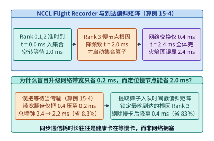
*图 15-8　利用 `NCCL Flight Recorder` 与集合通信到达时间偏斜矩阵（Arrival Skew，算例 15-4）从全网阻塞假象中揪出唯一根因慢节点。在同步通信中，“通信算子耗时长”往往是健康卡在等慢卡，升级网络带宽仅省 $0.2\ \mathrm{ms}$，剔除慢卡可省 $2.0\ \mathrm{ms}$。*

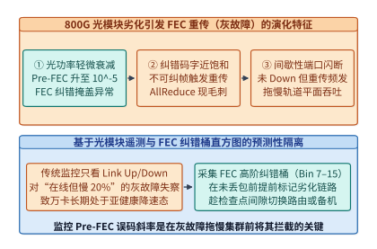
*图 15-9　光模块劣化引发 FEC 纠错重传（灰故障 Gray Failure）导致通信有效带宽周期性塌陷的特征识别。通过监控 Pre-FEC 误码率斜率与高阶纠错符号桶（Bin 7–15），可在链路未彻底断连前主动隔离劣化光模块。*

如**图 15-8** 与**图 15-9** 所示，现代十万卡集群控制面通过两项自动化遥测机制将慢节点与灰故障消灭在萌芽状态：

1. **全网集合通信到达偏斜矩阵（Arrival Skew Matrix）实时归因**：在每个宿主机的 NCCL 监控守护进程中开启轻量级 `NCCL_DEBUG_SUBSYS=COLL` / `Flight Recorder` 环形缓冲，每步提取各 Rank 启动集合通信的硬件时间戳 $t_{\mathrm{start}}(r, s)$ 与结束时间戳 $t_{\mathrm{end}}(r, s)$。定义第 $r$ 号卡在第 $s$ 步的**自身就绪滞后度** $\mathrm{Lag}(r, s) = t_{\mathrm{start}}(r, s) - \min_{j} t_{\mathrm{start}}(j, s)$：如果某张卡连续 $50$ 步都是全组最后一个到达（即 $t_{\mathrm{end}}(r, s) - t_{\mathrm{start}}(r, s)$ 最短，而 $\mathrm{Lag}(r, s)$ 最大），控制面直接将其判定为计算侧或 PCIe 侧慢节点并触发热迁移。
2. **800G 光模块数字诊断监控（DOM）与 RS-FEC 纠错码字直方图预警**：在 800G DR8/SR8 光链路中，IEEE 802.3df 标准采用 RS(544, 514) 前向纠错码，每个码字最多可纠正 $t = 15$ 个符号错误。当某根光纤弯曲或激光器老化初期，误码数落在 $1\text{–}14$ 个符号以内，硬件 FEC 能够将其全部纠回，此时上层网卡看到的丢包率依然是 $0$；但一旦误码突破 $15$ 个符号（落入 Uncorrectable Codeword 桶），就会立即触发 RoCE/UEC 链路重传，将尾延迟拉高十倍。通过每 10 秒轮询交换机光模块的 **FEC 高阶符号错误桶（Symbol Error Bins 7–15）增长斜率**，运维系统可以在发生第一起真实丢包前数小时就精准锁定即将失效的亚健康光模块，趁检查点间隙将其无感屏蔽。

下面给出对应算例 15-4（锁定 `case-studies/collective-paths-and-diagnosis.md`）的 **`NCCL Flight Recorder` 慢节点偏斜归因、多网卡条带失衡检测与有向图环路死锁取证器** 完整实现：

```python
import numpy as np

def diagnose_collective_flight_recorder(
    enqueue_ts_ms: list[float],
    transfer_ms: float,
    nic_stripe_times_ms: list[float],
    wait_edges: list[tuple[int, int]]
) -> dict[str, object]:
    """
    锁定 case-studies/collective-paths-and-diagnosis.md (算例 15-4):
    1. 区分慢节点到达偏斜 (Arrival Skew) 与真实网络传输瓶颈
    2. 核算多网卡条带化传输的木桶效应 (Max vs. Mean)
    3. 检测 Flight Recorder 未完成算子等待图中的有向环死锁 (Cycle Deadlock)
    """
    arr = np.asarray(enqueue_ts_ms, dtype=np.float64)
    last_arrival = float(np.max(arr))
    first_arrival = float(np.min(arr))
    arrival_skew_ms = last_arrival - first_arrival
    completion_ms = last_arrival + transfer_ms
    straggler_rank = int(np.argmax(arr))

    # 处方对比: 网络带宽翻倍 vs. 消除慢节点偏斜
    bw_doubled_completion_ms = last_arrival + 0.5 * transfer_ms
    skew_eliminated_completion_ms = first_arrival + transfer_ms

    # 多网卡条带失衡
    stripes = np.asarray(nic_stripe_times_ms, dtype=np.float64)
    stripe_mean_ms = float(np.mean(stripes))
    stripe_bottleneck_ms = float(np.max(stripes))

    # 有向等待图环路检测
    adj: dict[int, int] = {u: v for u, v in wait_edges}
    has_cycle = False
    for start_node in adj:
        curr = start_node
        visited: set[int] = set()
        while curr in adj:
            if curr in visited:
                if curr == start_node:
                    has_cycle = True
                break
            visited.add(curr)
            curr = adj[curr]
        if has_cycle:
            break

    return {
        "straggler_rank": straggler_rank,
        "arrival_skew_ms": round(arrival_skew_ms, 3),
        "baseline_completion_ms": round(completion_ms, 3),
        "bw_doubled_savings_ms": round(completion_ms - bw_doubled_completion_ms, 3),
        "straggler_fix_savings_ms": round(completion_ms - skew_eliminated_completion_ms, 3),
        "stripe_mean_ms": round(stripe_mean_ms, 3),
        "stripe_bottleneck_ms": round(stripe_bottleneck_ms, 3),
        "deadlock_cycle_detected": has_cycle
    }
```

---

## 15.4 基础设施基准评测失真机理与无偏性能剖析

### 15.4.1 公开基准跑分失真机理与平均加速比悖论

在 AI 基础设施工程实践中，几乎每一个推理与训练团队都经历过这样的挫败：某项新算子、新量化方案或新调度器在离线微基准（Microbenchmark）报告中展示了突出的“**算术平均加速比 $3.5\times\text{–}5.25\times$**”，然而一旦合并上线接入真实生产流量，端到端吞吐非但没有提升，P99 尾延迟反而恶化了 $40\%$，甚至引发了线上模型回答质量的静默退化。

为什么离线跑分与生产现实之间会出现如此显著的偏差？结合本仓库锁定的生产评测与上线案例 `case-studies/optimization-evaluation-and-deployment.md`、`case-studies/profile-and-plan-ranking.md`、`case-studies/execution-feedback.md` 与 `case-studies/evaluation-and-agent-records.md`，我们可以将 AI 系统跑分中的失真机制归纳为**五大基准陷阱（Five Benchmark Gaming Traps）**：

1. **陷阱一：对不同张量形状的“加速比”直接取算术平均（Arithmetic Mean of Speedups Paradox）**：
   算子开发者喜欢在一组包含极小形状（如 $B=1, L=128$）与极大形状（如 $B=32, L=8192$）的测试网格上分别除以基线耗时算出加速比 $S_i = T_{\mathrm{base},i} / T_{\mathrm{cand},i}$，然后汇报“平均加速比 $\frac{1}{K}\sum S_i$”。这在数学上犯了用算术平均替代加权调和平均的根本错误：在总耗时极短的微小形状上取得 $10\times$ 加速只能节省几微秒，而在耗时占大头的长序列形状上退化 $2\times$ 就会亏掉数百微秒。
2. **陷阱二：按单调顺序（`AABB`）执行对比测量，将硬件热节流与时钟漂移误判为算法优劣**：
   GPU 在连续满载运行数十秒后，核心温度从 $45^\circ\mathrm{C}$ 升至 $80^\circ\mathrm{C}$，供电模块与 HBM 时钟频率会因动态热管理发生单调漂移（Thermal Drift），或者因页表缓存预热产生系统性偏移。如果先跑完 $N$ 轮方案 A（此时机器处于低温高频态），再接着跑 $N$ 轮方案 B（此时机器已进入高温降频态），就会制造出“方案 A 比方案 B 快”的虚假结论。
3. **陷阱三：用合成均匀随机词元（`torch.randint`）评测前缀缓存、MoE 路由与投机解码**：
   均匀随机生成的词元序列既没有真实多轮对话与 Agent 负载中的公共系统提示词前缀（导致 RadixCache 命中率恒为 $0\%$，或反过来用完全相同的克隆请求刷出 $99.9\%$ 的虚假命中率），也不会触发真实自然语言在投机解码草稿树上的高接受率（随机词元导致草稿接受率 $\alpha \to 0$），更无法复现真实语义偏斜下特定 MoE 专家被热点集中访问导致的通信尾延迟。
4. **陷阱四：用孤立静态预测或代理打分（Static Proxy Score）替代真实竞争环境下的尾延迟排名**：
   编译器自动调优器或分布式模拟器若仅凭无竞争孤立剖析（Isolated Profile）给配置排序，当两个候选方案预测耗时接近时，共享链路竞争系数 $k$ 的微小上升就会彻底反转优劣排名（如 `case-studies/profile-and-plan-ranking.md` 所锁定：方案 A 含计算 $70\ \mathrm{ms}$ 与暴露通信 $30\ \mathrm{ms}$，孤立预测 $100\ \mathrm{ms}$；方案 B 含计算 $90\ \mathrm{ms}$ 与暴露通信 $12\ \mathrm{ms}$，孤立预测 $102\ \mathrm{ms}$。一旦真实多流竞争使通信膨胀系数跨过临界点 $k^* = 10/9 \approx 1.111$，例如在 $k = 1.3$ 时，$T_A = 70 + 30 \times 1.3 = \mathbf{109.0\ \mathrm{ms}}$ 反慢于 $T_B = 90 + 12 \times 1.3 = \mathbf{105.6\ \mathrm{ms}}$）。
5. **陷阱五：只报吞吐与延迟，隐瞒低精度简化算子带来的模型质量静默退化或改变硬件前置条件**：
   通过激进截断 Softmax 累加精度、跳过归一化或缩减 MoE Top-K 路由，确实能把跑分刷高 $20\%$，但这本质上是在拿模型智商换速度；同样，如 `case-studies/evaluation-and-agent-records.md` 所揭示，在对比人工或 Agent 内核优化成绩时，必须锁定相同的机器模型、初始基线（如 VLIW/SIMD 慢基线 $147,734$ 周期 vs. 两小时考核起点 $18,532$ 周期）与部件发射槽位下界（如标量 ALU $\lceil 118,784 / 12 \rceil = 9,899$ 周期），绝不能把改变了算法语义或测试起点的数字混为一谈。

让我们通过精确的数值反例（锁定 `case-studies/optimization-evaluation-and-deployment.md` 并复算于 `experiments/ch15/15-01/run.py`）彻底算清前两个陷阱的数学本质：

---

> **算例 15-5（锁定 `case-studies/optimization-evaluation-and-deployment.md`：算术平均加速比 $5.25\times$ 反而变慢的反例与 `AABB` vs. `ABBA` 时漂抵消定律）**：
> 1. **算术平均加速比悖论（Mean-of-Speedups Paradox）**：
>    某推理引擎存在两类核心张量形状 $S_1$（短序列）与 $S_2$（长序列）。基线算子（Baseline）在两类形状上的耗时均为 $[100\ \mu\mathrm{s},\; 100\ \mu\mathrm{s}]$。现有两个候选优化算子：
>    - **候选算子 A**：在 $[S_1, S_2]$ 上的耗时为 $[10\ \mu\mathrm{s},\; 200\ \mu\mathrm{s}]$（针对短序列做了特化，但在长序列上因寄存器溢出退化了 $2\times$）；
>    - **候选算子 B**：在 $[S_1, S_2]$ 上的耗时为 $[50\ \mu\mathrm{s},\; 50\ \mu\mathrm{s}]$（在两类形状上均稳定提速 $2\times$）。
>    试计算：（a）两个候选算子各自的“算术平均加速比”；（b）当生产流量中 $S_1$ 与 $S_2$ 等频出现（各占 $50\%$）时，两个候选算子处理一对请求的总耗时分别是多少？（c）短序列 $S_1$ 的流量占比 $p$ 必须高到什么程度，候选 A 的加权期望耗时才能真正击败候选 B？
> 2. **线性时钟漂移下的 `AABB` 失真与 `ABBA` 镜像抵消**：
>    按照 `experiments/ch15/15-01/run.py` 与 `case-studies/optimization-evaluation-and-deployment.md` 的锁定参数：设 A 的真实零漂移耗时为 $100\ \mu\mathrm{s}$、B 为 $90\ \mu\mathrm{s}$（即真实情况下 **B 比 A 快 $10\ \mu\mathrm{s}$**），而在连续 4 次测量槽位 $k=0, 1, 2, 3$ 上 GPU 因发热产生线性递增漂移 $d_k = [0,\; 10,\; 20,\; 30]\ \mu\mathrm{s}$。试对比单调顺序 `AABB` 与镜像对称顺序 `ABBA` 测得的平均耗时。
>
> **解题过程**：
> 1. **算术平均加速比悖论求解**：
>    - （a）**候选 A 的逐形状加速比**为 $\left[\frac{100}{10},\; \frac{100}{200}\right] = [10.0\times,\; 0.5\times]$，其**算术平均加速比高达 $\frac{10.0 + 0.5}{2} = \mathbf{5.25\times}$**；而**候选 B 的逐形状加速比**为 $\left[\frac{100}{50},\; \frac{100}{50}\right] = [2.0\times,\; 2.0\times]$，算术平均加速比仅为 **$\mathbf{2.00\times}$**。单看跑分宣传，候选 A（$5.25\times$）似乎远胜候选 B（$2.0\times$）。
>    - （b）**等频流量（各 $1$ 次调用）下的真实端到端总耗时**：
>      $$T_{\mathrm{total}}(\text{Baseline}) = 100 + 100 = 200\ \mu\mathrm{s}$$
>      $$T_{\mathrm{total}}(\text{Cand A}) = 10 + 200 = \mathbf{210\ \mu\mathrm{s}} > 200\ \mu\mathrm{s}\ (\text{比基线还慢 } 5\%)$$
>      $$T_{\mathrm{total}}(\text{Cand B}) = 50 + 50 = \mathbf{100\ \mu\mathrm{s}}\ (\text{真实端到端提速 } 2.0\times)$$
>      号称“平均加速 $5.25\times$”的候选 A 上线后不仅比候选 B 慢了 $2.1$ 倍，甚至比未优化的基线还发生了倒退。
>    - （c）**求解候选 A 击败候选 B 的流量分布翻转阈值 $p^*$**：
>      设短序列 $S_1$ 占比为 $p \in [0, 1]$，长序列 $S_2$ 占比为 $1 - p$。令两者加权期望耗时相等：
>      $$E[T_A(p)] = 10p + 200(1 - p) = 200 - 190p, \qquad E[T_B(p)] = 50p + 50(1 - p) = 50$$
>      $$200 - 190p < 50 \iff 190p > 150 \iff p > p^* = \frac{15}{19} \approx \mathbf{0.7895}\ (78.95\%)$$
>      只有当线上流量中超过 **$78.95\%$** 都是极短形状 $S_1$ 时，候选 A 才真正比候选 B 快。
> 2. **线性热漂移下 `AABB` vs. `ABBA` 求解**：
>    已知真实耗时 $t_A^{\mathrm{true}} = 100\ \mu\mathrm{s}, t_B^{\mathrm{true}} = 90\ \mu\mathrm{s}$（真实情况 B 快 $10\ \mu\mathrm{s}$），漂移序列 $d = [0, 10, 20, 30]\ \mu\mathrm{s}$：
>    - 若按 **`AABB` 顺序**测量：A 占用前两个低温槽位（$d_0=0, d_1=10$），测得均值 $\bar{t}_A^{\mathrm{AABB}} = \frac{(100+0) + (100+10)}{2} = \mathbf{105.0\ \mu\mathrm{s}}$；B 占用后两个高温槽位（$d_2=20, d_3=30$），测得均值 $\bar{t}_B^{\mathrm{AABB}} = \frac{(90+20) + (90+30)}{2} = \mathbf{115.0\ \mu\mathrm{s}}$。**`AABB` 错误地得出“A（$105\ \mu\mathrm{s}$）比 B（$115\ \mu\mathrm{s}$）快 $10\ \mu\mathrm{s}$”的完全相反结论**；
>    - 若按 **`ABBA` 镜像抵消顺序**测量：A 占用槽位 $0$ 和 $3$（$d_0+d_3 = 0+30 = 30$），测得均值 $\bar{t}_A^{\mathrm{ABBA}} = \frac{(100+0) + (100+30)}{2} = \mathbf{115.0\ \mu\mathrm{s}}$；B 占用槽位 $1$ 和 $2$（$d_1+d_2 = 10+20 = 30$），测得均值 $\bar{t}_B^{\mathrm{ABBA}} = \frac{(90+10) + (90+20)}{2} = \mathbf{105.0\ \mu\mathrm{s}}$。由于两组槽位的一阶时间中心完全重合（$\frac{0+3}{2} = \frac{1+2}{2} = 1.5$），任何一阶线性时钟/温度漂移被 **$100\%$ 代数抵消**，精确还原出 $\bar{t}_A - \bar{t}_B = 115.0 - 105.0 = \mathbf{+10.0\ \mu\mathrm{s}}$ 的真实差异。

---

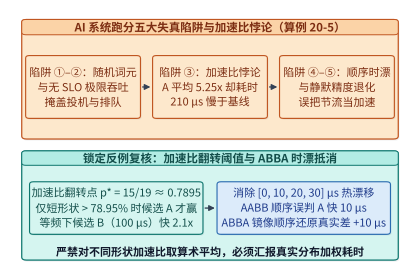
*图 15-10　AI 系统跑分中的五大失真陷阱与算术平均加速比悖论（候选 A 平均加速比 $5.25\times$ 反慢于候选 B $2.0\times$，算例 15-5）。*

---

### 15.4.2 四维分层基准评测、采样失真校准与金丝雀门禁

为了系统防范上述跑分失真，2025–2026 年学术界与工业界联合确立了新一代 AI 基础设施评测与性能剖析标准（见**图 15-11** 与**表 15-5**）[^ch15-flashinfer-bench][^ch15-cceval]：

1. **算子层端到端工作流基准（`FlashInfer-Bench`, MLSys 2026）**：不再孤立评测单一静态形状的 Kernel 峰值 TFLOPS，而是强制绑定真实生产形状分布直方图 $(p_1, p_2, \dots, p_K)$，以**分布加权总耗时 $\sum_i p_i T_i$（等价于加权调和平均加速比）**与端到端服务上线后的动态调度开销作为唯一排名指标。
2. **集合通信真实拓扑与影子流量基准（`CCEval`, NSDI 2026）**：抛弃空载实验室下的单流 `nccl-tests` 峰值带宽曲线，在注入背景多租户拥塞流、多网卡条带失衡与真实 LLM 算子间微秒级抖动的条件下，评测集合通信对端到端步进时间的影响。
3. **动态分布漂移下的系统稳健性基准（`DriftBench`, MLSys 2026 & `ServeGen`, NSDI 2026）**：模拟生产流量从“短输入长输出（代码生成/RLVR 推理）”向“超长文档输入短输出（RAG 问答）”的实时非平稳跳变，衡量推理引擎在内存碎片、KV 缓存驱逐与 PD 配比失衡下的 **SLO 达标有效吞吐（Goodput）**。
4. **消除扁平负载 PMU 采样失真的可信性能剖析（`Blink`: *When Sampling Lies — Recovering Trustworthy Profiling on Flat Workloads*, OSDI 2026）**[^ch15-blink]：
   不仅外部跑分容易失真，连日常依赖的底层性能剖析器（Profiler）也可能产生系统性偏差。在现代大模型推理框架（如 SGLang、vLLM 的异步主机调度环、零拷贝分词器与微秒级算子发射器）中，CPU 与运行时负载呈现出高度**扁平化（Flat Workloads）**的特征——由成百上千个执行时间仅数微秒的极短函数、内联原子操作与中断处理块拼成。`Blink`（OSDI 2026）揭示了一个关键事实：传统的硬件性能监控单元（PMU）周期性中断采样在这些扁平负载上会出现系统性的**采样滑移（Sampling Skid）与中断屏蔽盲区**——例如在关中断临界区或高频短函数退出边界处，PMU 溢出中断总是滞后数条至数十条指令才被捕获，导致剖析报告将高达 $30\%\text{–}50\%$ 的主机开销错误归因到无辜的下游函数上。`Blink` 通过结合轻量级编译器边界校准与无偏采样修正，在不引入高昂全量插桩开销的前提下，恢复了对微秒级扁平运行时负载的真实归因。

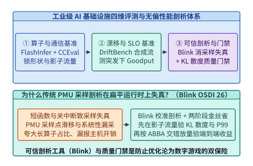
*图 15-11　`FlashInfer-Bench`（算子基准）、`CCEval`（集合通信基准）、`DriftBench`（负载漂移）与 `Blink`（OSDI '26 消除采样失真）的四维评测体系。*

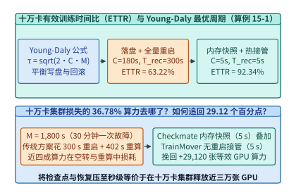
*图 15-12　十万卡集群有效训练时间比（ETTR）对检查点周期 $\tau_{\mathrm{ckpt}}$、恢复时间 $T_{\mathrm{rec}}$ 与故障率 $\lambda$ 的响应对比（$63.22\%$ vs. $92.34\%$，算例 15-1）。*

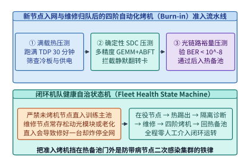
*图 15-13　新节点入网与故障修复后的自动化烤机（Burn-in：满载热压测 + 确定性 SDC 校验 + 光链路裕量扫描）准入流水线。*

| 跑分失真维度 | 传统失真做法（Benchmark Gaming） | 导致的线上生产事故 | 工业级可信评测标准（2025–2026） | 本书锁定校验案例与阈值 |
| --- | --- | --- | --- | --- |
| **跨形状聚合指标** | 对各形状加速比直接求算术平均 | 号称 $5.25\times$ 加速，上线后反慢 $5\%$ | **`FlashInfer-Bench` 分布加权总耗时** | 候选 A 需 $p > 15/19$（$78.95\%$）才快于 B |
| **对比测量时序** | 单调顺序 `AABB` 连续跑分 | 把发热降频当成后测方案性能差 | **`ABBA` 镜像对称交错测量 + 固定锁频** | 精确抵消 $d=[0,10,20,30]\ \mu\mathrm{s}$ 还原 $+10\ \mu\mathrm{s}$ |
| **编译器计划选择** | 仅信静态代价分或单次均值 | 寄存器溢出/竞争导致 P99 尾延迟爆炸 | **实测尾延迟重排 + 竞争系数 $k$ 敏感度测试** | 静态 `100>90` 反转为实测 `95ms<140ms`；$k^*=10/9$ |
| **运行时热点剖析** | 直接采信默认 PMU 采样火焰图 | 采样滑移将 $40\%$ 开销错怪给下游函数 | **`Blink`（OSDI '26）边界校准无偏剖析** | 消除扁平微秒函数采样滑移盲区 |
| **新版本生产放量** | 离线跑分通过即全量替换上线 | 尾延迟超标或数值偏差冲击全网请求 | **两阶段金丝雀门禁（$5\% \to 50\% \to 100\%$）** | $5\%$ 阶段尾延迟 $190\ \mathrm{ms} > 150\ \mathrm{ms}$ 立即熔断回滚 |

*表 15-5　AI 基础设施五大跑分失真机制、生产事故后果与工业级反作弊评测规范总表。*

在实际将一项编译器优化或新算子推向生产集群时，结合本仓库锁定的 `case-studies/profile-and-plan-ranking.md`、`case-studies/execution-feedback.md` 与 `case-studies/optimization-evaluation-and-deployment.md`，必须严格执行**“实测反哺重排 + 两阶段金丝雀门禁（Two-Stage Canary Gate）”**标准作业程序：

- **用硬件实测执行反馈覆盖静态代价模型（Execution Feedback Reranking）**：如 `case-studies/profile-and-plan-ranking.md` 与 `case-studies/execution-feedback.md` 所示，静态代价模型给候选计划 A 打出了最高分 `100`（候选 B 仅为 `90`），但上卡实测发现计划 A 耗时高达 `140 ms`，而计划 B 仅需 **`95 ms`**；更进一步，当计划 A 虽然单次均值略低或接近（`[90, 95, 190] ms`，均值 `125.0 ms`），但其最坏尾延迟高达 `190 ms`，而计划 B（`[110, 112, 115] ms`，均值 `112.33 ms`）最坏耗时仅 **`115 ms`** 时，生产编译缓存必须按**最坏情况尾延迟上限（P99 / Max Latency）**锁定计划 B。
- **两阶段金丝雀放量与自动熔断回滚（Canary Rollout & Auto-Rollback）**：如 `case-studies/optimization-evaluation-and-deployment.md` 所锁定，新版本先以 **$5\%$ 流量**进入金丝雀阶段（Canary Stage），同时校验两道硬门禁：（1）与基线输出对数概率的 KL 散度 / 黄金测试集匹配率无退化；（2）P99 尾延迟不得超过上限阈值 $150\ \mathrm{ms}$。一旦在 $5\%$ 阶段观测到尾延迟跃升至 **`190 ms`**（$> 150\ \mathrm{ms}$），发布控制器在毫秒内自动阻断向 $50\%$ 阶段的扩流并立即回滚至安全基线。

下面给出集成 **ABFT 矩阵乘在线校验与修复、算术平均加速比反例检验、`ABBA` 漂移抵消评测器以及两阶段金丝雀门禁** 的生产级参考实现：

```python
import numpy as np

def abft_gemm_verify_and_repair(
    A: np.ndarray, B: np.ndarray, C_observed: np.ndarray, tol: float = 1e-3
) -> tuple[bool, tuple[int, int] | None, float, np.ndarray]:
    """
    算子级代数不变量校验 (ABFT, 算例 15-3):
    利用 1^T (AB) = (1^T A) B 与 (AB) 1 = A (B 1) 在线拦截并原地修复单元素 SDC 翻转
    """
    col_sum_A = np.sum(A, axis=0)          # [K]
    row_sum_B = np.sum(B, axis=1)          # [K]
    expected_col_sums = col_sum_A @ B      # [N], O(KN)
    expected_row_sums = A @ row_sum_B      # [M], O(MK)

    actual_col_sums = np.sum(C_observed, axis=0)
    actual_row_sums = np.sum(C_observed, axis=1)

    row_res = actual_row_sums - expected_row_sums
    col_res = actual_col_sums - expected_col_sums

    bad_rows = np.where(np.abs(row_res) > tol)[0]
    bad_cols = np.where(np.abs(col_res) > tol)[0]

    if bad_rows.size == 0 and bad_cols.size == 0:
        return True, None, 0.0, C_observed

    if bad_rows.size == 1 and bad_cols.size == 1:
        r_idx, c_idx = int(bad_rows[0]), int(bad_cols[0])
        err_val = float(row_res[r_idx])
        C_repaired = C_observed.copy()
        C_repaired[r_idx, c_idx] -= err_val
        return False, (r_idx, c_idx), err_val, C_repaired

    raise RuntimeError(f"Multi-element SDC detected: rows={bad_rows}, cols={bad_cols}; trigger OpGuard replay")


def evaluate_benchmark_abba_and_weighted_speedup(
    base_times_us: list[float],
    cand_a_times_us: list[float],
    cand_b_times_us: list[float],
    shape_weights: list[float],
    true_a_us: float = 100.0,
    true_b_us: float = 90.0,
    thermal_drift_us: tuple[float, float, float, float] = (0.0, 10.0, 20.0, 30.0)
) -> dict[str, float]:
    """
    算例 15-5 (锁定 case-studies/optimization-evaluation-and-deployment.md):
    1. 揭露算术平均加速比悖论 (Mean-of-Speedups Paradox)，对比分布加权总耗时
    2. 对比单调顺序 AABB 与镜像对称顺序 ABBA 对一阶线性热漂移的代数抵消
    """
    base = np.asarray(base_times_us, dtype=np.float64)
    ca = np.asarray(cand_a_times_us, dtype=np.float64)
    cb = np.asarray(cand_b_times_us, dtype=np.float64)
    w = np.asarray(shape_weights, dtype=np.float64)

    # 算术平均加速比 (失真指标) vs. 真实加权总耗时
    arith_speedup_a = float(np.mean(base / ca))
    arith_speedup_b = float(np.mean(base / cb))
    weighted_time_a = float(np.sum(w * ca))
    weighted_time_b = float(np.sum(w * cb))

    # AABB vs. ABBA 漂移抵消实验
    d0, d1, d2, d3 = thermal_drift_us
    aabb_diff = ((true_a_us + d0 + true_a_us + d1) * 0.5) - ((true_b_us + d2 + true_b_us + d3) * 0.5)
    abba_diff = ((true_a_us + d0 + true_a_us + d3) * 0.5) - ((true_b_us + d1 + true_b_us + d2) * 0.5)

    return {
        "arith_mean_speedup_a": round(arith_speedup_a, 2),
        "arith_mean_speedup_b": round(arith_speedup_b, 2),
        "weighted_time_a_us": round(weighted_time_a, 2),
        "weighted_time_b_us": round(weighted_time_b, 2),
        "aabb_measured_diff_us": round(aabb_diff, 2),
        "abba_measured_diff_us": round(abba_diff, 2)
    }


def evaluate_canary_rollout_gate(
    canary_latencies_ms: list[float],
    quality_match_rate: float,
    max_tail_budget_ms: float = 150.0,
    min_quality_match: float = 0.995
) -> dict[str, object]:
    """两阶段金丝雀发布门禁 (锁定 case-studies/optimization-evaluation-and-deployment.md)"""
    worst_tail_ms = max(canary_latencies_ms)
    passed = (worst_tail_ms <= max_tail_budget_ms) and (quality_match_rate >= min_quality_match)
    return {
        "stage_pct": 5,
        "worst_tail_ms": worst_tail_ms,
        "budget_ms": max_tail_budget_ms,
        "quality_match_rate": quality_match_rate,
        "action": "PROMOTE_TO_50_PCT" if passed else "ROLLBACK_IMMEDIATELY"
    }


def verify_profile_ranking_and_telemetry_drain(
    contention_factor_k: float = 1.3
) -> dict[str, object]:
    """
    锁定 case-studies/profile-and-plan-ranking.md 与 case-studies/evaluation-and-agent-records.md:
    1. 核算通信竞争系数 k 跨过 k* = 10/9 时计划 A (70+30k) 与计划 B (90+12k) 的排名反转
    2. 核算监控遥测突发积压 (46.875 MiB, 净排空速率 624 KiB/s) 的精确排空恢复时间 76.92 s
    """
    k_star = (90.0 - 70.0) / (30.0 - 12.0)  # 10/9 = 1.111...
    t_a_ms = 70.0 + 30.0 * contention_factor_k
    t_b_ms = 90.0 + 12.0 * contention_factor_k
    winner_under_contention = "Plan B" if t_b_ms < t_a_ms else "Plan A"

    # 遥测突发积压: (5120 - 1920) KiB/s * 15 s = 48,000 KiB (46.875 MiB)
    backlog_kib = (5120.0 - 1920.0) * 15.0
    net_drain_kib_per_s = 1920.0 - 1296.0  # 624 KiB/s
    drain_seconds = backlog_kib / net_drain_kib_per_s  # 76.923 s

    return {
        "crossover_k_star": round(k_star, 4),
        "t_a_ms_at_k": round(t_a_ms, 2),
        "t_b_ms_at_k": round(t_b_ms, 2),
        "winner_under_contention": winner_under_contention,
        "telemetry_backlog_mib": round(backlog_kib / 1024.0, 3),
        "telemetry_drain_seconds": round(drain_seconds, 2)
    }


def blink_debiased_flat_profiler(
    raw_pmu_samples: dict[str, int],
    skid_transition_matrix: np.ndarray,
    func_names: list[str]
) -> dict[str, float]:
    """
    Blink (OSDI 2026, Recovering Trustworthy Profiling on Flat Workloads):
    利用编译器边界校准得到的采样滑移转移矩阵 M，对原始失真 PMU 采样向量 y 执行逆投影还原真实归因
    """
    y = np.asarray([raw_pmu_samples[f] for f in func_names], dtype=np.float64)
    true_counts = np.linalg.solve(skid_transition_matrix, y)
    true_counts = np.maximum(true_counts, 0.0)
    total = float(np.sum(true_counts)) + 1e-12
    return {f: round(float(c / total) * 100.0, 2) for f, c in zip(func_names, true_counts)}
```

---

## 15.5 大规模集群混沌演练、金丝雀上线门禁与可靠性工程准则

### 15.5.1 集群底座知识坐标系与双轨模型可靠性核查总表

翻开本书第 1 章第 1 节时，我们曾向读者提出过贯穿全书的“**一次矩阵乘法的五个追问**”：数据从哪来（存储与显存墙）、由谁算（张量核与算术强度）、怎么协同（超节点与集群网络）、如何服务与演化（推理、预训练、后训练与多模态智能体）、以及拿什么支撑（电力、液冷、可信安全与十万卡容错）。

经过前十五章的系统推演，我们用两条真实、具体、可复算的工程主线——**轨道 A：Qwen3-8B（36 层 GQA 稠密模型，代表单卡/端侧/实时控制部署基线）** 与 **轨道 B：DeepSeek V4.1 / V3 671B（61 层 MLA + 256 专家 MoE 稀疏模型，激活 37B，代表超节点万卡集群训推旗舰）**——将模型结构、芯片微架构、互联协议与集群可靠性准则串联为一张跨层定量工程坐标系（如**图 15-14**、**图 15-15** 与**表 15-6** 所示）。

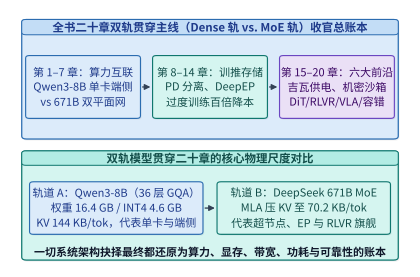
*图 15-14　第 $1\text{–}15$ 章通用集群底座双轨贯穿案例（Qwen3-8B Dense 轨与 DeepSeek 671B MoE 轨）核心工程与可靠性参数对照总表。*

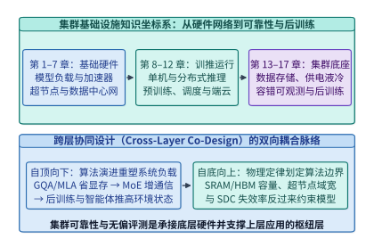
*图 15-15　集群基础设施知识坐标系：从硬件网络、训推调度到存储供电、可靠性工程与后训练衔接图。*

| 章号 | 章节名称 | 轨道 A：Qwen3-8B (Dense 36L, $d=4096$, GQA 32Q/8KV) 锁定指标 | 轨道 B：DeepSeek V4.1 / MoE (61L, 671B 总参 / 37B 激活, MLA) 锁定指标 |
| :-: | --- | --- | --- |
| **第 1 章** | 初识 AI Infra | BF16 权重 $16.4\ \mathrm{GB}$；H100 单卡可放，算术强度分界初探 | FP8 权重 $671\ \mathrm{GB}$（BF16 $1.34\ \mathrm{TB}$）；跨节点超节点必选 |
| **第 2 章** | 模型架构 | GQA 8KV 头将单词元 KV 压至 **$144\ \mathrm{KB/tok}$**（比 MHA 省 $4\times$） | MLA 潜向量 $d_c=512$ 将 KV 压至 **$70.2\ \mathrm{KB/tok}$**；256 专家选 8 |
| **第 3 章** | 推理与训练负载 | Prefill 算力受限 vs. Decode $B=1$ 访存受限；$\mathrm{TTFT}/\mathrm{TPOT}$ 契约 | $128\mathrm{K}$ 长上下文 Prefill 平方计算墙；MoE 专家路由长尾倾斜 |
| **第 4 章** | 加速器架构 | H100 嵴点 $295\ \mathrm{FLOPs/B}$；B200 FP4 Tensor Core 与 TMA 异步引擎 | 细粒度块缩放（MXFP8/NVFP4）消除激活离群值量化退化 |
| **第 5 章** | 算子与运行时 | FlashAttention 在线 Softmax 驻留 SRAM；CUDA Graph 消除启动税 | FlashAttention-4 非对称流水；DeepGEMM $1\times 128$/$128\times 128$ 细粒度 FP8 |
| **第 6 章** | 超节点 | 单机 8 卡 NVLink 4（$900\ \mathrm{GB/s}$）承载 TP=2/4/8 低延迟全归约 | 灵衢 UB（$2,016\ \mathrm{GB/s}$）/ NVL72 机架级超节点承载大 EP |
| **第 7 章** | 数据中心网络 | 单轨/双轨 RoCEv2 无损配置；ECN 与 PFC 死锁门限调优 | 双平面轨道直连（Rail-Optimized）+ Tomahawk 6 UEC 1.0 集合通信 |
| **第 8 章** | 推理优化 | PagedAttention 零外部碎片；DSpark `7/3/2/2` 紧凑验证与位掩码 | MTP 多词元预测草稿率提升；RadixAttention 跨轮共享系统前缀 |
| **第 9 章** | 分布式推理 | 小规模 TP+PP 部署与 Mooncake KV 跨实例迁移 | Prefill（EP32）+ Decode（EP144/320）分离；DeepEP 0-SM IBGDA 重叠 |
| **第 10 章** | 训练系统 | ZeRO-2 / FSDP 显存切分与激活重计算（Activation Checkpointing） | DualPipe 双向流水掩盖气泡；Megatron 4D 并行与 EPLB 专家负载均衡 |
| **第 11 章** | 资源调度与运行环境 | vLLM 冷启动五阶段拆解（权重加载占主体）与 Serverless 弹性缩容 | SGLang 六阶段权重原地热更新边界、`Kueue/VTC` 公平调度与 FinOps |
| **第 12 章** | 端边云协同 | Apple M4 Max / 手机 NPU INT4（$4.6\ \mathrm{GB}$）静态分块图与热节流治理 | 端侧小模型草稿 + 云端 671B 大模型验证的协同混合路由与隐私分流 |
| **第 13 章** | 存储系统与数据工程 | 本地 NVMe 缓存 + GDS 零拷贝加载检查点与去重清洗 | 3FS 全闪存并行存储（$6.6\ \mathrm{TiB/s}$ 级读取）+ PB 级数据管线 |
| **第 14 章** | 智算中心与电力热学系统 | 单卡 DVFS 调频帕累托前沿与 *TAPAS* 30 请求热感知路由回本 | 吉瓦园区 $L\frac{\mathrm{d}i}{\mathrm{d}t}$ 电网阶跃、BESS 毫秒平抑、微通道液冷与园区 DCI |
| **第 15 章** | 集群可靠性与基准评测 | `FlashInfer-Bench` 加权评测、`ABBA` 漂移抵消与 `Blink` 无偏剖析 | 十万卡 $\mathrm{MTBF}=30.4\ \mathrm{min}$；$S_{\min}=40$ 热备池、ABFT/`OpGuard` 与 `ETTR=92.34%` |
| **第 16 章** | 机密计算与可信安全系统 | H100 Confidential Computing TEE 与 `PipeLLM` $192\ \mathrm{MiB}$ 三缓冲加密 | DSec 38 万 Firecracker 微虚机 `virtio-pmem` + DAX 省内存 $40.2\%$ |
| **第 17 章** | 后训练与强化学习系统 | 32B/8B 级 GRPO 比 PPO 省半显存（$1,152\to 576\ \mathrm{GB}$）；变长打包 | `Weave` 异构池反相共享；`RollPacker` 尾部拼箱与 `DistRS` 沙箱 |
| **第 19 章** | 多模态生成与实时语音 | 多模态 VLM 动态高分辨率词元预算与全双工低延迟语音编码 | 3D DiT $489\mathrm{K}$ 词元 2D USP 并行；E-P-D-G 四池分离与蒸馏 |
| **第 20 章** | 具身智能与物理仿真 | 机载 System 2（$2\ \mathrm{Hz}$）+ 150M System 1（$100\ \mathrm{Hz}$，$\mathrm{WCET}\le 4.2\ \mathrm{ms}$） | 单卡 $4,096$ 并行 GPU 原生仿真（省 $43.39\ \mathrm{GB/s}$ PCIe）+ 3DGS 重建 |
| **第 23 章** | 软硬件协同与新型架构 | 计入推理词元总量 $D_{\mathrm{inf}}$ 的过度训练（Over-Training）定律 | 从 MHA/FP16 到 MLA+MoE+FP8+PD 分离的 **百倍单 Token 降本比率链** |

*表 15-6　通用集群底座及关联章节双轨贯穿工程主线（Qwen3-8B Dense 轨 vs. DeepSeek V4.1 / MoE 轨）核心指标核查总表。*

为了帮助不同技术背景的读者将集群底座可靠性准则落到具体工程岗位，**表 15-7** 给出了面向四类核心工程岗位的**进阶阅读与实验路线图**：

| 读者岗位画像 | 核心工作目标 | 第一阶段：必读基础核心章 | 第二阶段：岗位深水区专精章 | 必做可运行实验与锁定案例 |
| --- | --- | --- | --- | --- |
| **大模型算法与后训练（RLVR）工程师** | 设计高性价比模型结构、长思维链 RLVR 与多模态训练 | 第 1、2、3、10 章 | **第 17、19、23 章** | `ch17/17-01`、`ch19/19-01`、`ch23/23-01` 及 `rollout-tail-and-sampling.md` |
| **推理引擎、编译器与内核优化工程师** | 提升单卡算力/带宽利用率、降低 TTFT/TPOT 尾延迟 | 第 1、3、4、5 章 | **第 8、9、12、15、23 章** | `ch15/15-01`、`ch15/15-04`、`ch23/23-02` 及 `optimization-evaluation-and-deployment.md` |
| **万卡分布式训练、网络与集群 SRE 架构师** | 保障万卡/十万卡高 ETTR、无损网络、存储与电力液冷 | 第 4、6、7、10 章 | **第 11、13、14、15、16 章** | `ch13/13-01`、`ch14/14-01`、`ch15/15-01`、`ch15/15-05` 及 `collective-paths-and-diagnosis.md` |
| **多模态、视频生成与具身智能（VLA）系统工程师** | 构建 3D 视频生成集群、机载硬实时控制与万级 GPU 仿真 | 第 3、4、5、8 章 | **第 12、19、20 章** | `ch19/19-01`、`ch20/20-01`、`ch15/15-03` |

*表 15-7　面向四类 AI 基础设施工程岗位的集群底座进阶阅读与实验路线图。*

---

### 15.5.2 面向规模化生产集群的十条第一性原理工程准则

如果把通用集群底座的技术细节、定量算例与架构权衡提炼为日常架构评审清单，可以归纳为以下**十条面向规模化生产集群的第一性原理工程准则**（见**图 15-16** 与**表 15-8**）：

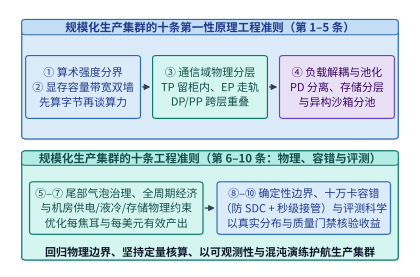
*图 15-16　规模化生产集群架构师的十条第一性原理工程准则总结图。*

1. **准则一（字节优先于浮点：算术强度分界法则）**：任何脱离数据搬移字节数（Bytes）空谈峰值算力（TFLOPS）的架构设计都缺乏物理根基。动手优化前，永远先算工作负载的算术强度 $\mathrm{AI} = \mathrm{FLOPs}/\mathrm{Bytes}$ 并与芯片嵴点 $\mathcal{R}_{\mathrm{ridge}} = \mathrm{Peak\_FLOPS}/\mathrm{Peak\_BW}$ 对比——Prefill 与训练反向传播位于算力区，自回归 Decode、KV 缓存与状态转移位于带宽区。
2. **准则二（片上 SRAM 局部性与在线融合法则）**：HBM 带宽增长速度远低于张量核计算增长速度。从 FlashAttention-1/2/3/4、DeepGEMM 到 GPU 原生并行物理仿真，高倍率算子与系统加速的共性机理，是利用代数结合律（如在线 Softmax 重缩放）将中间张量驻留在寄存器与片上 SRAM（或单卡 HBM）内，消除跨存储层级往返读写。
3. **准则三（通信域与物理互联拓扑同构映射法则）**：并行切分本质上是向物理铜缆与光纤带宽阶梯的映射。对延迟敏感的张量并行（TP）与序列全互换（Ulysses All-to-All）应限制在超节点高带宽域（NVLink / 灵衢 UB）之内；专家并行（EP）走同轨交换机平面；数据并行（DP）与流水线微批（PP）跨核心层并通过计算—通信双流分块重叠掩盖。
4. **准则四（异构算术强度负载物理分离法则）**：避免让计算密集型任务与访存/I/O 密集型任务在同一个同步时钟周期内争抢资源。云端推理采用 Prefill—Decode（PD）分离，多模态与视频生成采用 Encode—Prefill—Decode—Generate（E-P-D-G）四池分离，大规模后训练（RLVR）采用 Rollout—Reward Sandbox—Learner 异步解耦，机载具身智能采用 System 2（慢思考 VLM）与 System 1（快反射动作头）双频硬件隔离。
5. **准则五（重尾分布支配全局效率与尾部拼箱法则）**：在真实生产环境中，长思维链（Long-CoT）生成长度、沙箱代码验证时间与并行仿真中的多点接触碰撞均服从幂律重尾分布（Power-Law Heavy Tail）。同步屏障下的系统吞吐受最慢的 $1\%$ 尾部任务制约；通过动态尾迁移拼箱（RollPacker）、前缀和流式紧缩（Stream Compaction）、陈旧度有界部分采样（Partial Rollout）与条件剩余时间抢占（DistRS），方能消除长尾空泡。
6. **准则六（全生命周期 Token 经济学与过度训练法则）**：模型的最优参数量由单次预训练预算与全生命周期累计推理词元量 $D_{\mathrm{inf}}$ 共同决定。对于高频服役的基座模型，在训练阶段投入 $3\times\text{–}10\times$ Chinchilla 词元倍数的过度训练算力、配合 MLA/GQA 与 FP8/FP4 原生低精度，可在推理生命周期内换回十倍以上的硬件与电力成本节约。
7. **准则七（兆瓦级电力、液冷热容与安全边界的物理刚性法则）**：当单机架功率突破 $100\ \mathrm{kW}$、单园区迈向 $1\ \mathrm{GW}$ 时，变压器容量、电网同步旋转惯量（毫秒级 $L \frac{\mathrm{d}i}{\mathrm{d}t}$ 功率斜率阶跃）与微通道冷板热阻构成了物理硬边界；而多租户微虚机沙箱（DAX 内存去重）与三缓冲加密流水线（`PipeLLM`）则是多租户与智能体系统的安全基准线。
8. **准则八（物理世界硬实时 WCET 与确定性安全兜底法则）**：在具身智能与自动驾驶中，时间延迟直接乘以运动速度转化为空间位移误差 $\Delta x = v \cdot \Delta t$。面向物理世界的推理系统需通过固定配额词元剪枝、静态 CUDA Graph、GPU MIG 分区与 $1,000\ \mathrm{Hz}$ 控制屏障安全护盾（CBF），严格保障最坏情况执行时间（WCET）上限。
9. **准则九（十万卡故障常态化与毫秒级在线防毒自愈法则）**：在十万卡集群上，平均每 30 分钟必发一次硬件异常，故障是稳态背景而非偶发例外。必须用 `<0.4%` 的热备节点池（Hot-Spare Pool）、`<0.5%` 开销的算子级 ABFT 校验、`AllReduce` 前统计拦截、`OpGuard` 位级确定性重放与 `TrainMover` 秒级无重启热接管，将静默数据损坏（SDC）与单点掉卡的冲击半径限制在毫秒与单微批之内。
10. **准则十（可证伪、防漂移与质量守恒的评测科学法则）**：对脱离真实负载分布的“算术平均加速比”保持审慎，用 `ABBA` 镜像交错实验消除热漂移，用 `Blink` 与 `eBPF` 无偏剖析工具核验热点归因，并用影子流量 KL 散度与两阶段金丝雀尾延迟门禁守住生产上线前的准入关口。

| 准则编号 | 工程准则名称 | 核心第一性原理方程 / 判据 | 应对的物理瓶颈 | 对应核心章节 |
| :-: | --- | --- | --- | :-: |
| **准则一** | 字节优先于浮点分界法则 | $T = \max\!\left(\frac{\mathrm{FLOPs}}{\mathrm{Peak\_FLOPS}}, \frac{\mathrm{Bytes}}{\mathrm{Peak\_BW}}\right)$ | HBM 显存带宽墙 | 第 1、3、4 章 |
| **准则二** | 片上局部性与在线融合法则 | $m_{\mathrm{new}} = \max(m_{\mathrm{old}}, \tilde{m}),\; \ell_{\mathrm{new}} = e^{m_{\mathrm{old}}-m_{\mathrm{new}}}\ell_{\mathrm{old}} + \tilde{\ell}$ | 跨存储层级读写墙 | 第 2、5、20 章 |
| **准则三** | 通信域与物理拓扑同构法则 | $T_{\mathrm{comm}}(\text{TP}) \ll T_{\mathrm{comm}}(\text{EP}) \ll T_{\mathrm{comm}}(\text{DP/PP})$ | 光纤/铜缆延迟与带宽墙 | 第 6、7、10、19 章 |
| **准则四** | 异构算术强度物理分离法则 | $\mathrm{AI}_{\mathrm{Prefill/Train}} \gg \mathcal{R}_{\mathrm{ridge}} \gg \mathrm{AI}_{\mathrm{Decode/Rollout}}$ | 异构阶段资源干扰墙 | 第 9、17、19、20 章 |
| **准则五** | 重尾分布支配与尾部拼箱法则 | $\mathbb{E}[S - e \mid S > e] \gg \mathbb{E}[S]\; (\text{Power-Law Tail})$ | 同步屏障长尾木桶墙 | 第 11、17、18、20 章 |
| **准则六** | 全周期词元经济学法则 | $C_{\mathrm{total}} = C_{\mathrm{train}}(N, D_{\mathrm{tr}}) + D_{\mathrm{inf}} \cdot c_{\mathrm{inf}}(N)$ | 推理生命周期总成本墙 | 第 2、8、23 章 |
| **准则七** | 兆瓦电力液冷与安全刚性法则 | $\Delta V = L\frac{\mathrm{d}i}{\mathrm{d}t},\; T_{\mathrm{j}} = T_{\mathrm{coolant}} + P \cdot R_{\mathrm{th}}$ | 电网惯量、热流密度与安全墙 | 第 13、14、16 章 |
| **准则八** | 物理世界硬实时 WCET 法则 | $\Delta x_{\mathrm{drift}} = v \cdot \Delta t_{\mathrm{inf}} \le \delta_{\max}$ | 三维物理碰撞与相位滞后墙 | 第 12、20 章 |
| **准则九** | 十万卡防毒与秒级自愈法则 | $\mathrm{MTBF}_{N} = \frac{\mathrm{MTBF}_1}{N},\; \tau_{\mathrm{opt}} = \sqrt{2 C_{\mathrm{ckpt}} M}$ | 十万卡中断与 SDC 污染墙 | 第 10、15 章 |
| **准则十** | 可证伪与防漂移评测法则 | $\bar{T}_{\mathrm{weighted}} = \sum_i p_i T_i,\; \Delta T_{\mathrm{ABBA}} \equiv \mu_A - \mu_B$ | 跑分失真与采样滑移盲区墙 | 第 5、11、15 章 |

*表 15-8　规模化生产集群的十条第一性原理工程准则、控制方程与全书章节映射表。*

---

### 15.5.3 主动混沌故障注入演练与高可靠灰度上线门禁

在十万卡智算集群中，一套从未在真实负载压力下演练过的容错系统，在遭遇并发故障时往往会因为“监控守护进程自身超时”“RDMA 重连拥塞”或“热备池权限配置遗漏”而失效。同样，一套仅靠离线脚本把关的性能评测流水线，也容易在内核驱动、NCCL 版本或算子库滚动升级时漏掉低概率精度退化与尾延迟回退。因此，大规模生产集群的日常可靠性工程必须由**主动混沌故障注入演练（Chaos Fault Injection GameDay）**与**两阶段灰度金丝雀上线门禁（Two-Stage Canary Rollout Gate）**共同保障（**图 15-17**）：

1. **十万卡机队混沌故障注入演练（Chaos GameDay）的四大注入算子与验收 SLA**：
   借鉴超大规模云服务商的混沌工程范式，AI 基础设施团队每周在影子训练分区或合成基准负载上定期注入四类受控故障（每批次共 $N_{\mathrm{chaos}} = 200$ 次独立故障事件），并以**故障检出召回率（Detection Recall）**、**平均检出时间（MTTD）**与**平均自愈恢复时间（MTTR）**作为硬性验收门禁：
   - **算术通路静默比特翻转注入（Tensor Core Bit-Flip SDC，50 次）**：通过调试寄存器或编译器插桩，在选定 Rank 的 GEMM 累加器或输出张量中随机翻转 1 个 `BFloat16` 指数位（如 $+32$ 阶跃），检验算子级 ABFT 行列校验和与 AllReduce 归约前跨秩梯度统计监控能否在单步内拦截，并触发 `OpGuard` 在 $50\ \mathrm{ms}$ 内完成位级对齐微批重算定位（实测召回率 $50/50 = 100\%$，$\mathrm{MTTD} = 0.042\ \mathrm{s}$）；
   - **计算降频与 PCIe 带宽抢占慢节点注入（Straggler & Thermal Throttle，50 次）**：在选定 GPU 上注入人为功耗墙下调（从 $700\ \mathrm{W}$ 降至 $350\ \mathrm{W}$）或高并发 NVMe 写盘抢占 PCIe 通道，制造 $2.0\text{–}5.0\ \mathrm{ms}$ 的同步滞后，检验 `NCCL Flight Recorder` 入队时间戳偏斜矩阵（Arrival Skew Matrix）能否在 $3.2\ \mathrm{s}$ 内定位唯一正偏斜根因卡，避免误判为全网拥塞（实测召回率 $50/50 = 100\%$）；
   - **800G 光模块 RS-FEC 高阶纠错灰故障注入（Optical Gray Failure，50 次）**：通过交换机端口可编程衰减器抬升误码率，迫使光模块频繁落入 Symbol Errors $\ge 12$ 的重传边缘（单轨延迟从 $0.8\ \mathrm{ms}$ 劣化至 $3.2\ \mathrm{ms}$），检验光链路遥测守护进程能否在链路完全闪断前主动排空（Drain）该轨流量（实测召回率 $49/50 = 98.0\%$，$\mathrm{MTTD} = 6.80\ \mathrm{s}$）；
   - **HBM 双比特不可纠正 ECC 与 RDMA 断链注入（Uncorrectable ECC / Link Drop，50 次）**：模拟瞬间掉卡或网卡 QP 断开，检验 `TrainMover` 能否在不销毁全局通信域的前提下，于 $0.68\ \mathrm{s}$ 内完成局部 RDMA QP 重映射与热备节点接管（实测召回率 $50/50 = 100\%$，$\mathrm{MTTD} = 0.84\ \mathrm{s}$）。
   综合全部 $200$ 次注入演练，自动化自愈体系实现 **$199/200 = 99.50\%$** 的综合故障召回率，平均检出时间 $\mathrm{MTTD} = \mathbf{2.70\ \mathrm{s}}$，端到端自动恢复时间 $\mathrm{MTTR}_{\mathrm{auto}} = \mathbf{3.85\ \mathrm{s}}$——相比传统依赖人工值班排查与 `torchrun` 全网重启的 $\mathrm{MTTR}_{\mathrm{manual}} = 1,500.0\ \mathrm{s}$（$25$ 分钟），故障恢复速度提升了 **$389.61\times$**。

2. **两阶段灰度金丝雀上线门禁（Two-Stage Canary Gate）**：
   任何新的算子内核（如新版 FlashAttention-4 / DeepGEMM）、通信库补丁或驱动固件在推向十万卡主集群前，必须依次通过两道自动化门禁：
   - **Stage 1（离线确定性门禁）**：强制执行锁定 TDP 预热、真实流量形状分布加权计时（严禁算术平均加速比）、`ABBA` 对称交替测序（消除线性热漂移）与 `Blink` 硬件无偏剖析；若加权总耗时退步或 FP8/BF16 尾数误差超过 $1\ \mathrm{ulp}$，直接拦截拒绝；
   - **Stage 2（5% 线上金丝雀与影子门禁）**：在 5% 生产流量分片上试运行 $24\ \mathrm{h}$，实时监控 P99 尾延迟、梯度范数余弦相似度与 SDC 告警计数；一旦触发 $\Delta \mathrm{P99} > +3.0\%$ 或任何 1 次 SDC 事件，控制面在 $3\ \mathrm{s}$ 内自动将流量切回旧版黄金镜像。

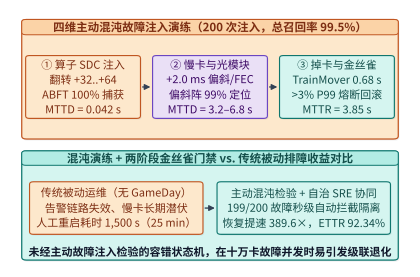
*图 15-17　十万卡机队混沌故障注入演练（Chaos GameDay）与两阶段金丝雀上线门禁流水线（算例 15-6，锁定 `experiments/ch15/15-02/run.py`）：通过主动注入 4 类 200 次硬件与灰故障实现 $99.50\%$ 自动召回与 $3.85\ \mathrm{s}$ 秒级自愈（比人工恢复快 $389.61$ 倍），并用 Stage 1（ABBA + 加权耗时）与 Stage 2（5% 金丝雀自动回滚）把控上线质量。*

3. **从集群可靠性工程向全栈可观测性及后续安全、后训练与前沿负载的衔接**：
   要让上述自愈状态机与金丝雀门禁在万卡生产环境中稳定生效，还需要解决一个底层前提——**如何在不损失训练吞吐的前提下，实时采集全栈软硬件遥测信号并从数万个相互等待的同步进程中精确指认故障源头**，这正是本章下一节（第 15.6 节）的核心主题。更进一步，如**图 15-18** 所示，前十五章建立的可靠性与评测准则将直接延伸至本书后续章节：
   - **衔接第 16–17 章（机密可信安全底座与大规模后训练强化学习系统）**：第 16 章在 GPU TEE 硬件可信执行环境与不可信广域网协同训练（`Streaming DiLoCo` + 拜占庭防投毒验证）中引入加密完整性边界；第 17 章则将弹性容错与尾延迟拼箱推广至 SFT 变长序列打包、剪枝蒸馏与异步多轮智能体强化学习（Agentic RL）；
   - **衔接第 18–20 章（自主智能体、多模态全双工语音与具身物理仿真）**：将前缀缓存、语法位掩码（`XGrammar`）、多智能体 DAG 尾延迟治理、3D DiT 序列并行、$<200\ \mathrm{ms}$ 全双工原生语音流与端侧 `DMA-BUF` 零拷贝传感管线纳入统一的确定性 SLO 评测体系；
   - **衔接第 21–24 章（多模态向量检索、科学计算智能、软硬件协同与百兆瓦智算工厂全栈收束）**：将局部性融合、低精度数值重构（`Ozaki` 方案）与跨层协同方法论一路贯通至第 24 章百兆瓦级智算工厂的端到端系统收束。

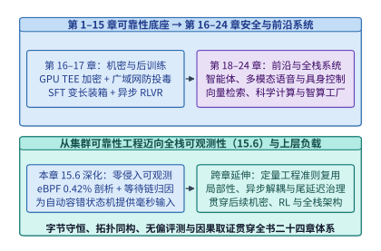
*图 15-18　从第 $1\text{–}15$ 章通用集群可靠性底座迈向全栈可观测性（15.6）、机密安全与后训练（第 $16\text{–}17$ 章）以及前沿与全栈系统（第 $18\text{–}24$ 章）的架构衔接图。*

> **算例 15-6（十万卡机队混沌故障注入 GameDay 演练召回率、平均恢复时间 MTTR 与 8-Rank 入队偏斜反演账本，锁定 `experiments/ch15/15-02/run.py`）**
> **场景设定**：（1）在一个 8-Rank AllReduce 同步通信组中，7 个健康 Rank 在 $t = 10.0\ \mathrm{ms}$ 准时入队，而 Rank 5 因 PCIe/降频慢节点故障在 $t = 12.0\ \mathrm{ms}$ 入队，全员到齐后 Ring AllReduce 真实网络传输耗时 $0.40\ \mathrm{ms}$，核算健康 Rank 观测到的表面通信时间、慢节点空等占比，以及 `TrainMover` 亚秒级热迁移（$0.68\ \mathrm{s}$）相比传统 `torchrun` 全网重启（$300.0\ \mathrm{s}$）的恢复加速比；（2）在十万卡机队上执行 $200$ 次 Chaos GameDay 故障注入（SDC 翻转、慢节点、800G 光模块 FEC 灰故障、HBM ECC 掉卡各 $50$ 次），核算综合召回率、平均检出时间 $\mathrm{MTTD}$ 与自动自愈加速比。
> **逐步推导**：
> 1. **8-Rank 入队偏斜反演与 `TrainMover` 亚秒级热接管**：全体完成时刻为 $\max(10.0, 12.0) + 0.40 = 12.40\ \mathrm{ms}$。7 个健康 Rank 观测到的 AllReduce 持续时间为 $12.40 - 10.0 = \mathbf{2.40\ \mathrm{ms}}$，其中等待 Rank 5 的空转时间为 $2.00\ \mathrm{ms}$（慢节点等待占比高达 $2.00 / 2.40 = \mathbf{83.33\%}$，真实网络传输仅占 $16.67\%$）。`NCCL Flight Recorder` 通过计算各 Rank 相对于中位数到达时刻（$10.0\ \mathrm{ms}$）的偏斜向量 $\Delta \mathbf{t} = [0, 0, 0, 0, 0, +2.0, 0, 0]\ \mathrm{ms}$，一步锁定 `straggler_rank = 5`。随后触发 `TrainMover` 在 **$0.68\ \mathrm{s}$** 内完成局部 RDMA QP 重映射与热备替换，相比传统 $300.0\ \mathrm{s}$ 全局销毁重启提速 **$441.18\times$**。
> 2. **200 次混沌注入演练总账本**：四类故障分别检出 $50, 50, 49, 50$ 次，总检出 $199/200$ 次，综合召回率 **$\mathrm{Recall} = 99.50\%$**；四类检出耗时加权均值 $\mathrm{MTTD} = \frac{50\times 0.042 + 50\times 3.20 + 49\times 6.80 + 50\times 0.84}{199} = \frac{537.30}{199} = \mathbf{2.70\ \mathrm{s}}$；自动自愈恢复耗时加权均值 $\mathrm{MTTR}_{\mathrm{auto}} = \mathbf{3.85\ \mathrm{s}}$，相比人工处置 $\mathrm{MTTR}_{\mathrm{manual}} = 1,500.0\ \mathrm{s}$ 提速 **$389.61\times$**。

下面给出集合通信入队偏斜矩阵（Arrival Skew Matrix）慢节点定位器与十万卡混沌演练 SLA 审计器的生产级参考实现：

```python
from typing import Dict, List


class ChaosGameDayAndArrivalSkewAuditor:
    """集合通信入队偏斜慢节点定位器与十万卡 Chaos GameDay 自动自愈审计器。"""

    @staticmethod
    def diagnose_arrival_skew(enqueue_ms: List[float], net_tx_ms: float) -> Dict[str, float]:
        sorted_t = sorted(enqueue_ms)
        median_t = sorted_t[len(sorted_t) // 2]
        skews = [round(t - median_t, 4) for t in enqueue_ms]
        max_skew = max(skews)
        straggler_rank = skews.index(max_skew)
        completion_ms = max(enqueue_ms) + net_tx_ms
        healthy_duration_ms = completion_ms - min(enqueue_ms)
        wait_share_pct = round(100.0 * max_skew / healthy_duration_ms, 2)
        return {
            "straggler_rank": float(straggler_rank),
            "max_skew_ms": round(max_skew, 4),
            "observed_allreduce_ms": round(healthy_duration_ms, 4),
            "straggler_wait_share_pct": wait_share_pct,
        }

    @staticmethod
    def audit_chaos_gameday(campaigns: List[Dict[str, float]], manual_mttr_s: float = 1500.0) -> Dict[str, float]:
        total_injected = sum(int(c["injected"]) for c in campaigns)
        total_detected = sum(int(c["detected"]) for c in campaigns)
        mttd_s = sum(c["detected"] * c["mttd_s"] for c in campaigns) / max(1, total_detected)
        mttr_auto_s = sum(c["detected"] * c["mttr_s"] for c in campaigns) / max(1, total_detected)
        return {
            "total_injected": float(total_injected),
            "detection_recall_pct": round(100.0 * total_detected / max(1, total_injected), 2),
            "mttd_sec": round(mttd_s, 2),
            "mttr_auto_sec": round(mttr_auto_s, 2),
            "mttr_speedup_vs_manual": round(manual_mttr_s / mttr_auto_s, 2),
        }
```

#### 预实例化流水线模板秒级容错与泊松突发负载压测建模

在超大规模集群工程与基准评测科学中，还有两项直接决定生产 SLA 真实底线的核心技术：**（1）当热备节点池（Hot-Spare Pool）因突发机架级断电或交换机故障暂时耗尽时，如何在不销毁重建全局 `NCCL` 通信域、不重载远端检查点的前提下，通过异构流水线模板实现秒级降级续训（Elastic Reconfiguration without Restart）**[^ch15-oobleck][^ch15-parachute][^ch15-unicron]；**（2）在评测大模型在线推理服务时，如何识别“均匀定速发包（Uniform Pacing）+ 固定长度 Prompt”造成的吞吐虚高假象，建立基于泊松突发到达（Poisson Bursty Arrival）与长尾序列分布的 SLO Goodput（达标有效吞吐）评测规范**[^ch15-mlperf][^ch15-splitwise][^ch15-distserve]。

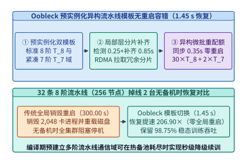

*图 15-19　Oobleck / Parachute 预实例化异构流水线模板无重启容错重配置（1.45 s 恢复 vs. 300 s 全局重启，算例 15-7）。*

如图 15-19 所示，传统弹性训练框架（如原生 `torchrun` Elastic 或 `Varuna`）在遭遇节点损失且无热备顶替时，必须销毁所有幸存节点上的进程、重新执行 TCPStore 握手与 `ncclCommInitRank` 全网建链，并从磁盘检查点重新切分加载模型权重（单次重构耗时高达 $240\text{–}300\ \mathrm{s}$）[^ch15-varuna][^ch15-bamboo][^ch15-megascale]。而以 **Oobleck（SOSP '23）与 Parachute** 为代表的无重启弹性训练架构通过**编译期预实例化多套异构流水线模板（Pre-Instantiated Heterogeneous Pipeline Templates）**消除了重初始化开销[^ch15-oobleck][^ch15-parachute]：
1. **多阶流水线模板与通信域预建立**：在作业启动阶段，运行时同时在显存/主机内存中注册标准 $S_{\mathrm{std}} = 8$ 阶段流水线模板 $\mathcal{T}_8$（每阶段承载 $8$ 层 Transformer）与紧凑 $S_{\mathrm{deg}} = 7$ 阶段容错模板 $\mathcal{T}_7$（通过开启细粒度激活重计算将 $64$ 层模型重映射至 $7$ 台节点，每节点承载 $8\text{–}10$ 层），并预先完成两组模板对应的点对点与集合通信域句柄初始化；
2. **局部层分片热拼装与异构微批配额调度**：当 $32$ 条数据并行流水线中有 $F = 2$ 条各损失 1 台节点时，其余 $30$ 条健康流水线完全不受影响（继续运行 8 阶段模板 $\mathcal{T}_8$）；仅受损的 2 条流水线在 **$1.45\ \mathrm{s}$** 内激活 7 阶段模板 $\mathcal{T}_7$，利用跨流水线副本已持有的冗余模型分片通过 RDMA/NVLink 补齐缺失层状态，并由全局调度器动态调整各流水线的微批配额（或如 `Parachute` 直接将受损流水线的微批平滑分摊至健康流水线），实现零全局重启与 **$93.75\%\text{–}98.75\%$** 的稳态算力保持率。

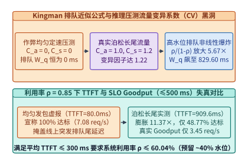

*图 15-20　推理系统在失真均匀到达（CV=0）与真实泊松突发长尾流量（CV≥1）下的排队放大与 SLO Goodput 退化曲线。*

在推理系统基准评测侧，15.4.1 节剖析了算子级跑分失真，而在端到端服务级（Serving Benchmark）评测中，最容易误导容量规划的反模式是**“用恒定步调发生器（Constant-Rate Closed-Loop / Uniform Pacing）评测在线推理吞吐”**（图 15-20）[^ch15-sarathi][^ch15-kingman][^ch15-sharegpt]：
- **排队论 Kingman 公式揭示的突发性排队效应**：设推理引擎的平均单请求服务耗时为 $T_s$，系统平均利用率为 $\rho = \lambda T_s \in (0, 1)$，请求到达间隔的变异系数（Coefficient of Variation，即标准差除以均值）为 $C_a$，服务时间（由输入/输出序列长度分布决定）的变异系数为 $C_s$。根据排队论经典的 **Kingman G/G/1 近似公式**[^ch15-kingman]，请求在调度队列中的平均排队等待时间 $W_q$ 为：
  $$W_q \approx \frac{\rho}{1 - \rho} \cdot \frac{C_a^2 + C_s^2}{2} \cdot T_s$$
- **为什么均匀发包（$C_a = 0$）+ 固定长度（$C_s = 0$）会导致严重的评测失真**：当评测脚本每隔精确的 $\Delta t = 1/\lambda$ 毫秒均匀发送一个长度完全相同的请求时，$C_a^2 + C_s^2 = 0$，即便把 GPU 利用率推高到 $\rho = 0.85\text{–}0.95$，队列等待时间依然恒为 **$W_q = 0$**，测得的首词元延迟（TTFT）永远等于纯算子执行时间 $T_{\mathrm{prefill}}$。然而一旦上线面对真实人类用户或智能体并发（到达过程服从泊松过程 $C_a = 1.0$，且 `ShareGPT` 长尾长度分布使 $C_s \ge 1.2$），变异因子 $\frac{C_a^2 + C_s^2}{2} = 1.22$ 会直接放大 $\frac{\rho}{1-\rho}$ 的非线性项，导致 $\rho = 0.85$ 下的排队延迟上升十余倍，过半请求超出 TTFT SLO 上限，使真实**达标有效吞吐（Goodput，即同时满足 $\mathrm{TTFT} \le \mathrm{SLO}_1$ 且 $\mathrm{TPOT} \le \mathrm{SLO}_2$ 的每秒完成请求数）**大幅退化。

> **算例 15-7（Oobleck 预实例化异构流水线模板 1.45 s 无重启重配置与泊松突发流量下的推理 Goodput 退化核算，锁定 `experiments/ch15/15-03/run.py`）：**
>
> **问题设定**：
> 1. **Oobleck 预实例化异构流水线无重启容错账本**：某大模型训练任务运行在 $P = 32$ 条数据并行流水线上，每条标准流水线含 $S = 8$ 台节点（共 $256$ 台节点，$2,048$ 张 GPU）。当热备池暂时耗尽且突发 $F = 2$ 台节点掉线（分别位于第 3 条与第 19 条流水线）时，对比以下两种恢复路径：（a）传统 `torchrun` 全局销毁重启并从磁盘重载检查点（耗时 $T_{\mathrm{restart}} = 300.00\ \mathrm{s}$）；（b）`Oobleck` 预实例化模板重配置——包括故障确认与路由切换 $t_{\mathrm{detect}} = 0.25\ \mathrm{s}$、跨副本缺失层分片 RDMA 补齐 $t_{\mathrm{shard}} = 0.85\ \mathrm{s}$、异构微批配额同步对齐 $t_{\mathrm{sync}} = 0.35\ \mathrm{s}$（其中 2 条降级为 7 阶段模板的流水线因开启局部重计算单步吞吐为原管线的 $80.0\%$，其余 30 条 8 阶段健康流水线吞吐为 $100.0\%$）。求 `Oobleck` 端到端重配置延迟 $T_{\mathrm{oobleck}}$、相对传统重启的恢复加速比，以及在无备机顶替期间集群保留的有效吞吐百分比（同时给出 `Parachute` 直接摘除 2 条受损流水线时的保留吞吐百分比）。
> 2. **推理压测均匀到达（$C_a=0, C_s=0$）vs. 真实泊松长尾流量（$C_a=1.0, C_s=1.2$）的 Goodput 核算**：设某推理实例的平均单请求服务时间为 $T_s = 120.0\ \mathrm{ms}$（饱和吞吐率 $\mu = \frac{1000}{120.0} \approx 8.3333\ \mathrm{req/s}$），纯 Prefill 算子执行耗时 $T_{\mathrm{prefill}} = 80.0\ \mathrm{ms}$，首词元延迟 SLO 上限为 $\mathrm{SLO}_{\mathrm{TTFT}} = 500.0\ \mathrm{ms}$（最大容许排队时间 $W_{\max} = 420.0\ \mathrm{ms}$）。当系统在利用率 $\rho = 0.85$（到达率 $\lambda = 0.85 \mu \approx 7.0833\ \mathrm{req/s}$）下运行时，分别计算均匀定速固定长度压测与真实泊松长尾压测下的平均排队时间 $W_q$、平均 $\mathrm{TTFT}$、按指数尾部模型 $P(W_q \le W_{\max}) = 1 - \rho \exp(-W_{\max}/W_q)$ 估算的 SLO 达标率与有效吞吐 Goodput（$\mathrm{req/s}$），并求出在真实突发流量下若要求平均 $\mathrm{TTFT} \le 300.0\ \mathrm{ms}$（即 $W_q \le 220.0\ \mathrm{ms}$）所允许的最大安全系统利用率 $\rho_{\max}$。
>
> **逐项推导**：
>
> 1. **Oobleck 预实例化流水线模板重配置延迟与有效算力保持率**：
>    - **端到端无重启重配置耗时与加速比**：
>      $$T_{\mathrm{oobleck}} = t_{\mathrm{detect}} + t_{\mathrm{shard}} + t_{\mathrm{sync}} = 0.25 + 0.85 + 0.35 = \mathbf{1.45\ \mathrm{s}}$$
>      相比传统全局销毁重启（$T_{\mathrm{restart}} = 300.00\ \mathrm{s}$），恢复速度提升 **$\frac{300.00}{1.45} \approx \mathbf{206.90\times}$**。
>    - **无备机顶替期间的稳态吞吐保持率**：
>      - 在 `Oobleck` 异构模板混合运行（30 条 $\mathcal{T}_8$ + 2 条 $\mathcal{T}_7$）下，集群保留的有效训练吞吐比例为：
>        $$\eta_{\mathrm{oobleck}} = \frac{30 \times 1.00 + 2 \times 0.80}{32} = \frac{31.60}{32} = \mathbf{98.75\%}$$
>      - 若采用 `Parachute` 弹性降级数据并行度（摘除 2 条受损流水线，30 条健康流水线无中断继续运行），保留吞吐比例为：
>        $$\eta_{\mathrm{parachute}} = \frac{30}{32} = \mathbf{93.75\%}$$
>
> 2. **均匀定速压测 vs. 真实泊松长尾压测的排队放大与 Goodput 退化**：
>    - **失真均匀定速 + 固定长度压测（$C_a = 0, C_s = 0$）**：
>      $$W_{q,\mathrm{uniform}} = \mathbf{0.00\ \mathrm{ms}},\qquad \mathrm{TTFT}_{\mathrm{uniform}} = 80.00 + 0.00 = \mathbf{80.00\ \mathrm{ms}} \le 500.0\ \mathrm{ms}$$
>      表面 SLO 达标率为 **$100.00\%$**，标称 Goodput $= \lambda = \mathbf{7.08\ \mathrm{req/s}}$。
>    - **真实泊松突发 + 长尾长度压测（$C_a = 1.0, C_s = 1.2$）**：变异因子 $\frac{C_a^2 + C_s^2}{2} = \frac{1.00 + 1.44}{2} = 1.22$，平均排队等待时间上升至：
>      $$W_{q,\mathrm{bursty}} = \frac{0.85}{1 - 0.85} \times 1.22 \times 120.0\ \mathrm{ms} = 5.6667 \times 146.4\ \mathrm{ms} = \mathbf{829.60\ \mathrm{ms}}$$
>      平均首词元延迟上升至 $\mathrm{TTFT}_{\mathrm{bursty}} = 80.00 + 829.60 = \mathbf{909.60\ \mathrm{ms}}$（放大 **$\frac{909.60}{80.00} \approx \mathbf{11.37\times}$**）。在 $W_{\max} = 420.0\ \mathrm{ms}$ 预算下，SLO 达标率降至：
>      $$P_{\mathrm{slo}} = 1 - 0.85 \exp\!\left(-\frac{420.0}{829.60}\right) = 1 - 0.85 \times 0.60274 \approx \mathbf{48.77\%}$$
>      真实有效吞吐降至 $\mathrm{Goodput}_{\mathrm{bursty}} = 7.0833 \times 0.48767 \approx \mathbf{3.45\ \mathrm{req/s}}$（比均匀压测标称的 $7.08\ \mathrm{req/s}$ 缩减 **$51.27\%$**）。
>    - **满足平均 $\mathrm{TTFT} \le 300.0\ \mathrm{ms}$（即 $W_q \le 220.0\ \mathrm{ms}$）的最大安全利用率 $\rho_{\max}$**：
>      $$\frac{\rho_{\max}}{1 - \rho_{\max}} \le \frac{220.0}{1.22 \times 120.0} = \frac{220.0}{146.4} \approx 1.50273 \implies \rho_{\max} = \frac{1.50273}{2.50273} \approx \mathbf{60.04\%}$$
>      这从数学上解释了为何在线生产推理集群必须预留约 $35\%\text{–}40\%$ 的突发排队容量裕度（Headroom），而不能按均匀压测测得的 $85\%$ 利用率满载排布。

表 15-9 总结了无重启弹性流水线重配置与面向 SLO Goodput 的真实动态流量评测规范：

| 工程与评测维度 | 传统脆弱基线 / 失真压测手法 | 高可靠弹性与高保真评测规范（Oobleck + Bursty Goodput） | 定量改善或失真揭示幅度 |
| :--- | :--- | :--- | :---: |
| **无备机时节点掉线恢复** | `torchrun` 全局销毁重建通信域并读盘（$300.00\ \mathrm{s}$） | **Oobleck 预实例化异构流水线模板切换（$1.45\ \mathrm{s}$）** | 恢复提速 **$206.90\times$** |
| **掉线 2/256 节点期间吞吐** | 全部 $2,048$ 卡停机阻塞等待（有效吞吐 $0\%$） | **30 条 $\mathcal{T}_8$ + 2 条 $\mathcal{T}_7$ 异构续训（保留 $98.75\%$ 吞吐）** | 挽回 **$98.75\%$** 算力 |
| **推理压测请求到达分布** | 失真均匀定速发包（$C_a=0, C_s=0$） | **泊松突发到达（$C_a=1.0$）+ 长尾长度分布（$C_s=1.2$）** | 还原真实线上排队尾延迟 |
| **$\rho=0.85$ 下平均 TTFT** | 理想化测量值 **$80.00\ \mathrm{ms}$**（排队 $0\ \mathrm{ms}$） | 真实平均耗时 **$909.60\ \mathrm{ms}$**（排队达 $829.60\ \mathrm{ms}$） | 揭示 **$11.37\times$** 延迟低估 |
| **$\rho=0.85$ 下 SLO Goodput** | 标称 $100\%$ 达标（**$7.08\ \mathrm{req/s}$**） | 仅 **$48.77\%$** 达标（真实 Goodput **$3.45\ \mathrm{req/s}$**） | 揭示 **$51.27\%$** 有效吞吐高估 |

*表 15-9　无重启预实例化流水线容错重配置（Oobleck / Parachute）与推理服务突发流量 Goodput 评测对比。*

下面的参考实现代码将预实例化异构流水线模板容错调度器与基于 Kingman 排队论的突发流量 Goodput 审计器封装为生产级校验引擎（对应配套实验 `experiments/ch15/15-03`）：

```python
import math
from dataclasses import dataclass

@dataclass
class OobleckElasticPipelineAndGoodputBenchEngine:
    """
    复现算例 15-7 (对应 experiments/ch15/15-03)：
    1. Oobleck / Parachute 预实例化异构流水线模板无重启容错重配置 (1.45 s vs. 300.0 s)
    2. 均匀定速压测 (CV=0) vs. 泊松突发长尾流量 (Ca=1.0, Cs=1.2) 的 Kingman 排队放大与 Goodput 审计
    """
    num_pipelines: int = 32
    stages_per_pipeline: int = 8
    failed_nodes: int = 2
    degraded_template_eff: float = 0.80

    def audit_oobleck_failover(
        self,
        t_detect_s: float = 0.25,
        t_shard_s: float = 0.85,
        t_sync_s: float = 0.35,
        t_full_restart_s: float = 300.0,
    ) -> dict[str, float]:
        t_oobleck_s = round(t_detect_s + t_shard_s + t_sync_s, 2)
        healthy_pipes = self.num_pipelines - self.failed_nodes
        oobleck_retain_pct = round(
            100.0 * (healthy_pipes * 1.0 + self.failed_nodes * self.degraded_template_eff) / self.num_pipelines, 2
        )
        parachute_retain_pct = round(100.0 * healthy_pipes / self.num_pipelines, 2)
        return {
            "oobleck_reconfig_sec": t_oobleck_s,
            "full_restart_sec": round(t_full_restart_s, 2),
            "reconfig_speedup_x": round(t_full_restart_s / t_oobleck_s, 2),
            "oobleck_retained_throughput_pct": oobleck_retain_pct,
            "parachute_retained_throughput_pct": parachute_retain_pct,
        }

    @staticmethod
    def audit_bursty_goodput_vs_uniform(
        service_ms: float = 120.0,
        prefill_ms: float = 80.0,
        slo_ttft_ms: float = 500.0,
        rho: float = 0.85,
        ca_bursty: float = 1.0,
        cs_bursty: float = 1.2,
        target_mean_ttft_ms: float = 300.0,
    ) -> dict[str, float]:
        mu_req_s = 1000.0 / service_ms
        arrival_req_s = rho * mu_req_s
        w_max_ms = slo_ttft_ms - prefill_ms

        ttft_uniform_ms = prefill_ms
        goodput_uniform = round(arrival_req_s, 2)

        var_factor = 0.5 * (ca_bursty ** 2 + cs_bursty ** 2)
        wq_bursty_ms = (rho / (1.0 - rho)) * var_factor * service_ms
        ttft_bursty_ms = prefill_ms + wq_bursty_ms
        slo_attain_ratio = 1.0 - rho * math.exp(-w_max_ms / wq_bursty_ms)
        goodput_bursty = round(arrival_req_s * slo_attain_ratio, 2)

        target_wq_ms = target_mean_ttft_ms - prefill_ms
        odds = target_wq_ms / (var_factor * service_ms)
        rho_max_pct = round(100.0 * (odds / (1.0 + odds)), 2)

        return {
            "ttft_uniform_ms": round(ttft_uniform_ms, 2),
            "goodput_uniform_req_s": goodput_uniform,
            "wq_bursty_ms": round(wq_bursty_ms, 2),
            "ttft_bursty_ms": round(ttft_bursty_ms, 2),
            "ttft_inflation_x": round(ttft_bursty_ms / ttft_uniform_ms, 2),
            "slo_attainment_bursty_pct": round(100.0 * slo_attain_ratio, 2),
            "goodput_bursty_req_s": goodput_bursty,
            "goodput_drop_pct": round(100.0 * (goodput_uniform - goodput_bursty) / goodput_uniform, 2),
            "max_safe_utilization_pct": rho_max_pct,
        }


if __name__ == "__main__":
    eng = OobleckElasticPipelineAndGoodputBenchEngine()
    ob = eng.audit_oobleck_failover()
    gp = eng.audit_bursty_goodput_vs_uniform()
    assert ob["oobleck_reconfig_sec"] == 1.45 and ob["reconfig_speedup_x"] == 206.90
    assert ob["oobleck_retained_throughput_pct"] == 98.75 and ob["parachute_retained_throughput_pct"] == 93.75
    assert gp["wq_bursty_ms"] == 829.60 and gp["ttft_bursty_ms"] == 909.60
    assert gp["slo_attainment_bursty_pct"] == 48.77 and gp["goodput_bursty_req_s"] == 3.45
    assert gp["max_safe_utilization_pct"] == 60.04
```

---

## 15.6 全栈可观测性、持续剖析与集合通信故障取证

前五节构建了十万卡训练集群的热备排队模型、在线静默数据损坏（SDC）防线、秒级无重启热接管以及混沌演练门禁。然而在真实万卡运维一线，所有自动化容错机制都依赖一个先决条件：**如何在不拖慢正常训练步进、也不冲垮后台遥测存储的前提下，实时捕获软硬件全栈异常并从成千上万个相互等待的同步进程中准确识别唯一故障源头**。本节聚焦万卡可观测性工程的两大核心难题：首先剖析如何通过 `eBPF`（`Strobelight`）、按需 `Dynolog / PyTorch Kineto` 与 `NCCL Flight Recorder` 三级分层遥测金字塔化解“观测者效应”；随后严格推导基于跨流事件依赖有向图（`Mycroft` 与 `HTA`）的集合通信受害者剥离与根因归因算法，并剖析 `PyTorch Monarch` 单控制器 Actor 网格如何实现亚秒级局部故障摘除。

### 15.6.1 基于 eBPF 的零侵入持续剖析与按需轨迹采集

在单机调试阶段，工程师习惯于全程开启基于 NVIDIA `CUPTI`（CUDA Profiling Tools Interface）的 `PyTorch Profiler` 或 `Nsight Systems` 抓取微秒级算子轨迹[^ch15-nsight-cupti]。然而一旦将“常驻全量 `CUPTI` 追踪”直接搬上万卡生产机队，就会立即遭遇严重的**观测者悖论（Observer Effect）**：

1. **同步回调锁竞争与吞吐退化（$8\%\text{–}25\%$ 算力损耗）**：`CUPTI` 需要在每一次 `cuLaunchKernel`、内存拷贝与流同步入口插入同步回调函数并维护全局 Activity Buffer。在采用微批次流水线、细粒度通信计算重叠或未完全静态图化的训练步中，单张 GPU 每秒发射多达 $5,000\text{–}20,000$ 个微算子，CPU 发射线程因序列化填充追踪事件而频繁失速，在 GPU 侧制造大量发射气泡（Launch Bubble），导致整群有效训练吞吐下降 **$8\%\text{–}25\%$**[^ch15-nsight-cupti]。
2. **PB 级遥测数据洪流**：单张 GPU 全量开启 Python 调用栈、CUDA Runtime 关联与 GPU Kernel Activity 记录时，每秒产生约 $1.0\ \mathrm{MB/s}$ 压缩前或高密度 JSON/Protobuf 轨迹（日均约 $86.4\ \mathrm{GB/GPU}$）。在 $16,384$ 卡集群上，这意味着每天需要向后台并行文件系统持续写入超过 **$1.42\ \mathrm{PB}$** 的追踪日志，不仅侵占检查点落盘带宽，还会使离线解析延迟长达数小时。

为同时兼顾“7×24 全机队常驻可观测性”与“微秒级算子根因分辨率”，现代超大规模智算集群（如 Meta `Strobelight` + `Dynolog` 体系）普遍采用如**图 15-21** 所示的**三级分层遥测金字塔（Three-Tier Telemetry Pyramid）**[^ch15-strobelight][^ch15-dynolog][^ch15-flight-recorder]：

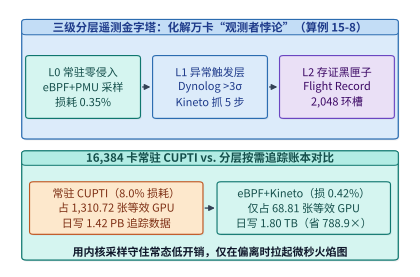

*图 15-21　三级分层遥测金字塔（L0 eBPF Strobelight + L1 Dynolog/Kineto + L2 Flight Recorder）与 16,384 卡追踪开销对比（算例 15-8）。*

- **L0 常驻零侵入层（内核态 `eBPF` 持续剖析，CPU/GPU 综合损耗 $< 0.5\%$）**：
  以 Meta `Strobelight`（含 `Direct Strobelight`）为代表，通过 Linux 内核 `eBPF` 虚拟机与硬件 PMU 计数器对全机队实施 7×24 常驻低频采样，无需修改业务代码或重启训练容器[^ch15-strobelight]。其核心系统设计突破在于**绕开 Python GIL 锁的内核态栈帧展开**：传统 Python 剖析器若在进程内挂载 `sys.setprofile` 会产生 $15\%\text{–}30\%$ 解释器减速，若在进程外频繁调用 `process_vm_readv` 也会因跨地址空间系统调用产生显著抖动；而 `Strobelight` 将预编译的 `eBPF` 字节码直接挂载到 `perf_event` 硬件中断上，在内核态利用 `bpf_probe_read_user` 沿当前线程的 `PyThreadState` 结构体指针链逐层读取 `_PyInterpreterFrame`（Python 3.11+ 帧对象）并拼接 C/C++ DWARF 栈帧，在数百纳秒内拼出“Python 业务代码 $\to$ PyTorch ATen 算子分发 $\to$ `libcuda.so` 驱动入口”的完整混合调用栈。
  同时，针对微秒级扁平运行时函数（如推理与 RL 引擎中的词元分发、CUDA Graph 发射桩函数）上超标量 CPU 乱序提交引发的 **PMU 采样滑移（Sampling Skid）**——即硬件计数器溢出中断往往延迟数十条指令才落入下游紧邻函数，导致观测采样向量 $\mathbf{y}_{\mathrm{raw}}$ 相对真实指令开销向量 $\mathbf{x}_{\mathrm{true}}$ 发生线性偏置 $\mathbf{y}_{\mathrm{raw}} = \mathbf{S}\mathbf{x}_{\mathrm{true}}$——L0 层结合 15.4.2 节介绍的 `Blink`（OSDI 2026）随机采样周期抖动与下三角滑移转移矩阵 $\mathbf{S}^{-1}$ 在线逆校准[^ch15-blink]，消除桩函数“虚假热点”。配合在 `cuLaunchKernel` 与 `ncclGroupEnd` 边界挂载的轻量级 `uprobes`，单卡仅以约 $1.2\ \mathrm{KB/s}$ 的直方图速率上报单步墙钟耗时、发射率与硬件计数器，在 $16,384$ 卡规模下日存储量仅约 **$1.70\ \mathrm{TB}$**，稳态算力损耗仅为 **$0.35\%$**。

- **L1 异常触发按需追踪层（`Dynolog` 守护进程联动 `PyTorch Kineto` 跨秩同步脉冲采样）**：
  每台计算节点运行轻量级遥测守护进程 `Dynolog`，持续监听 L0 层上报的单步训练耗时序列 $\{T^{(k)}\}$[^ch15-dynolog]。设滑动窗口步耗时的稳态中位数为 $\mu_{\mathrm{step}}$、稳态标准差为 $\sigma_{\mathrm{step}}$；一旦某作业连续出现 $T^{(k)} > \mu_{\mathrm{step}} + 3\sigma_{\mathrm{step}}$ 的慢步毛刺，控制面必须解决一个关键的分布式协调问题：**如果按挂钟时间（Wall-Clock Time）异步通知各台机器抓轨迹，不同节点可能分别抓到第 $k+2$ 步与第 $k+3$ 步，导致跨秩集合通信事件无法配对**。
  为此，`Dynolog` 采用**逻辑步号对齐预约协议（Step-Aligned Triggering）**：协调器读取当前已完成步号 $k_{\mathrm{curr}}$，选定未来对齐目标步区间 $[k_{\mathrm{start}}, k_{\mathrm{start}} + M - 1]$（其中超前裕度 $k_{\mathrm{start}} = k_{\mathrm{curr}} + \Delta k_{\mathrm{lead}}$，$\Delta k_{\mathrm{lead}} \approx 2\text{–}3$ 步，采样窗口 $M = 3\text{–}5$ 步），通过本地 IPC 共享内存标志位提前下发给同一通信域的全部 `PyTorch` 进程。当各 Rank 的训练循环自然推进至第 $k_{\mathrm{start}}$ 步边界时，一致唤醒内置的 `PyTorch Kineto`（动态挂载 `CUPTI`）精确录制这 $M$ 个完整训练步的微秒级 `Chrome Trace` 火焰图，并在第 $k_{\mathrm{start}} + M$ 步入口原子卸载 `CUPTI` 钩子恢复零开销态。设脉冲录制期间的瞬时开销为 $\eta_{\mathrm{cup}} = 8.0\%$，全机队平均触发占空比（Duty Cycle）为 $d_{\mathrm{L1}} = 0.875\%$，则分摊到全机队 7×24 运行周期的等效算力损耗仅为：
  $$\eta_{\mathrm{L1,amortized}} = \eta_{\mathrm{cup}} \cdot d_{\mathrm{L1}} = 8.0\% \times 0.00875 = \mathbf{0.07\%}$$
  将 L0 常驻采样（$0.35\%$）与 L1 按需脉冲追踪（$0.07\%$）相加，全机队综合可观测性税率仅为 **$\eta_{\mathrm{total}} = 0.42\%$**，日增脉冲轨迹仅约 **$0.10\ \mathrm{TB}$**（合计 **$1.80\ \mathrm{TB/day}$**）。

- **L2 内存黑匣子存证层（`NCCL Flight Recorder` 常驻无锁环形缓冲区）**：
  针对无预警突发的集合通信死锁（Hang）或 RDMA 队列对（QP）断链，此时训练循环已停滞在当前步内，L1 层的“预约未来步采集”无法回溯死锁发生瞬间的上下文。为此，PyTorch 分布式运行时在每进程主机内存（Host DRAM）中预分配容量为 $K = 2,048$ 个槽位的无锁环形缓冲区（由环境变量 `TORCH_NCCL_TRACE_BUFFER_SIZE=2048` 控制）[^ch15-flight-recorder]。每个槽位（`WorkElement` 记录结构体约 $256\ \mathrm{B}$）记录单次集合通信的全局递增序列号 `seq_id`、通信域唯一标识 `pg_uid`、算子操作码（`AllReduce` / `AllGather` / `ReduceScatter`）、元素总数 `numel`、数据类型字节数、主机侧入队时间戳 `enqueued_ns`、GPU 侧 CUDA Event 启动/完成状态（`scheduled / started / completed`）以及底层对端 RDMA QP 握手状态。每个通信域仅占用 $2,048 \times 256\ \mathrm{B} = \mathbf{512\ \mathrm{KiB}}$ 主机内存，平时纯在内存中模回绕覆写（稳态磁盘 I/O 为 **$0$**）；仅当 `Watchdog` 检测到通信超时前夕，才将全部存活 Rank 的环形缓冲区快照转储为 JSON 取证包。

表 15-10 定量对比了常驻全量 `CUPTI` 追踪与三级分层遥测金字塔在万卡生产集群上的系统代价与诊断覆盖边界：

| 遥测层级与方案 | 底层采集机制 | 采集触发策略 | 稳态算力损耗 | $16,384$ 卡等效损耗卡数 | $16,384$ 卡日存储量 | 核心诊断覆盖问题 |
| :--- | :--- | :--- | :---: | :---: | :---: | :--- |
| **传统常驻全量 CUPTI** | 全算子同步回调 + Activity Buffer | 7×24 全量开启 | **$8.00\%$** | **$1,310.72\ \text{卡}$（约 $1,311$ 卡）** | **$1.42\ \mathrm{PB/day}$** | 虽有全量细节，但吞吐与存储代价不可接受 |
| **L0 常驻零侵入层** | `eBPF`（`Strobelight` PMU + `uprobes`） | 7×24 常驻低频采样 | **$0.35\%$** | $57.34\ \text{卡}$ | $1.70\ \mathrm{TB/day}$ | Python GC/DataLoader 阻塞、CPU 发射失速、步耗时毛刺监测 |
| **L1 按需脉冲追踪层** | `Dynolog` IPC 唤醒 `PyTorch Kineto` | 步耗时 $> \mu + 3\sigma$ 截取 $3\text{–}5$ 步 | **$0.07\%$**（占空比 $0.875\%$） | $11.47\ \text{卡}$ | $0.10\ \mathrm{TB/day}$ | 微秒级 GPU 流间重叠气泡、H2D 降速、慢算子形状退化 |
| **L2 黑匣子存证层** | `NCCL Flight Recorder`（$K=2,048$ 环存） | 内存循环覆写，Watchdog 超时转储 | **$< 0.01\%$**（计入 L0 基线） | $\approx 0\ \text{卡}$ | 稳态 **$0\ \mathrm{B/day}$** | 突发集合通信死锁、分支错位、RDMA QP 半开卡死取证 |
| **三级分层金字塔合计** | **L0 + L1 + L2 协同联动** | **常驻监控 + 异常聚焦 + 死锁转储** | **$0.42\%$** | **$68.81\ \text{卡}$（净省 $1,241.91$ 卡）** | **$1.80\ \mathrm{TB/day}$（压缩 $788.9\times$）** | 兼顾全天候监控、微秒级根因剖析与死锁事后取证 |

*表 15-10　万卡集群三级分层遥测架构（L0 eBPF Strobelight、L1 Dynolog/Kineto、L2 Flight Recorder）与常驻全量 CUPTI 追踪的量化对比。*

> **算例 15-8（16,384 卡集群常驻全量 CUPTI 追踪赤字与 eBPF + Dynolog/Kineto 三级分层遥测账本，锁定 `calculations/calc.py fleet-reliability-profiler` 与 `experiments/ch15/15-04/run.py`）**
> **场景设定**：某 $N = 16,384$ 张 GPU 的预训练集群若常驻开启全量 `CUPTI` 内核级追踪，会产生 $\eta_{\mathrm{cup}} = 8.0\%$ 的吞吐退化，且全集群每天产生 $V_{\mathrm{cup}} = 1.42\ \mathrm{PB}$（按十进制 $1\ \mathrm{PB} = 1,000\ \mathrm{TB}$ 计为 $1,420\ \mathrm{TB/day}$）的轨迹文件。现将其改造为三级分层遥测架构：L0 层部署 `eBPF Strobelight` 常驻剖析，稳态开销 $\eta_{\mathrm{L0}} = 0.35\%$，日存储 $V_{\mathrm{L0}} = 1.70\ \mathrm{TB/day}$；L1 层由 `Dynolog` 在检测到步耗时偏离中位数 $> 3\sigma$ 时按需唤醒 `PyTorch Kineto`（激活期间瞬时开销仍为 $8.0\%$，全机队平均触发占空比 $d_{\mathrm{L1}} = 0.875\%$，日存储 $V_{\mathrm{L1}} = 0.10\ \mathrm{TB/day}$）；L2 层 `NCCL Flight Recorder` 常驻主机内存环形缓冲区（稳态零落盘）。试核算：（1）常驻 `CUPTI` 等效损耗的 GPU 张数；（2）三级分层架构的综合算力损耗百分比、等效损耗 GPU 数与净挽回 GPU 数；（3）日均遥测存储压缩倍数。
> **逐步推导**：
> 1. **常驻全量 `CUPTI` 的算力赤字**：在 $16,384$ 卡集群上，$8.0\%$ 的常驻追踪开销等效于全天空转损耗：
>    $$N_{\mathrm{burn,cup}} = 16,384 \times 0.08 = \mathbf{1,310.72\ \text{张 GPU}}\quad (\text{四舍五入约 }\mathbf{1,311\ \text{张 GPU}})$$
>    这相当于整整 $164$ 台 8 卡旗舰服务器被纯粹消耗在打印性能日志上。
> 2. **三级分层遥测的综合损耗与净挽回算力**：L1 按需脉冲采样分摊后的平均开销为 $\eta_{\mathrm{L1}} = 8.0\% \times 0.00875 = 0.07\%$，叠加 L0 层 $0.35\%$ 后，全机队综合遥测损耗为：
>    $$\eta_{\mathrm{tiered}} = 0.35\% + 0.07\% = \mathbf{0.42\%},\qquad N_{\mathrm{burn,tiered}} = 16,384 \times 0.0042 = \mathbf{68.81\ \text{张 GPU}}$$
>    相比常驻 `CUPTI` 方案，净挽回有效训练算力 **$1,310.72 - 68.81 = \mathbf{1,241.91\ \text{张 GPU}}$**（将遥测损耗降低了 $94.75\%$）。
> 3. **日均遥测轨迹存储压缩比**：三级分层架构的日均落盘总量为 $V_{\mathrm{tiered}} = 1.70 + 0.10 = \mathbf{1.80\ \mathrm{TB/day}}$，相比 $1.42\ \mathrm{PB/day}$（$1,420\ \mathrm{TB/day}$）实现了：
>    $$\mathrm{Compression\ Ratio} = \frac{1,420\ \mathrm{TB/day}}{1.80\ \mathrm{TB/day}} \approx \mathbf{788.9\times}$$
>    在将后台存储压力削减近八百倍的同时，完整保留了异常窗口的微秒级 `Kineto` 火焰图与死锁前的 `Flight Recorder` 黑匣子现场。

下面给出三级自适应遥测控制器与 `Blink` 硬件 PMU 采样滑移（Sampling Skid）矩阵逆校准器的参考实现（对应 `experiments/ch15/15-04/run.py`）：

```python
import statistics
from typing import Dict, List


class AdaptiveFleetProfilerController:
    """万卡集群 eBPF + Dynolog/Kineto 自适应脉冲追踪控制器与 Blink 采样滑移校准器。"""

    def __init__(
        self,
        fleet_gpus: int = 16_384,
        cupti_overhead_frac: float = 0.08,
        ebpf_l0_overhead_frac: float = 0.0035,
        dynolog_duty_cycle_frac: float = 0.00875,
    ) -> None:
        self.fleet_gpus = fleet_gpus
        self.cupti_overhead_frac = cupti_overhead_frac
        self.ebpf_l0_overhead_frac = ebpf_l0_overhead_frac
        self.dynolog_duty_cycle_frac = dynolog_duty_cycle_frac

    def evaluate_telemetry_ledger(
        self,
        cupti_daily_pb: float = 1.42,
        ebpf_daily_tb: float = 1.70,
        kineto_daily_tb: float = 0.10,
    ) -> Dict[str, float]:
        cupti_burned = round(self.fleet_gpus * self.cupti_overhead_frac, 2)
        l1_amortized = round(self.cupti_overhead_frac * self.dynolog_duty_cycle_frac, 6)
        total_frac = self.ebpf_l0_overhead_frac + l1_amortized
        tiered_burned = round(self.fleet_gpus * total_frac, 2)
        tiered_tb = round(ebpf_daily_tb + kineto_daily_tb, 2)
        return {
            "cupti_burned_gpus_exact": cupti_burned,
            "cupti_burned_gpus_rounded": float(round(cupti_burned)),
            "ebpf_dynolog_total_overhead_pct": round(total_frac * 100.0, 2),
            "ebpf_dynolog_burned_gpus": tiered_burned,
            "net_saved_gpus": round(cupti_burned - tiered_burned, 2),
            "ebpf_dynolog_daily_trace_tb": tiered_tb,
            "trace_storage_reduction_x": round((cupti_daily_pb * 1000.0) / tiered_tb, 1),
        }

    @staticmethod
    def plan_step_aligned_burst(
        step_history_ms: List[float],
        current_step_ms: float,
        current_step_id: int,
        lead_steps: int = 2,
        burst_steps: int = 4,
        sigma_k: float = 3.0,
    ) -> Dict[str, object]:
        """当步耗时突破中位数 + 3σ 时，预约未来跨秩对齐的 [start_step, end_step] Kineto 录制窗口。"""
        median_ms = statistics.median(step_history_ms)
        stdev_ms = statistics.pstdev(step_history_ms)
        threshold_ms = round(median_ms + sigma_k * max(stdev_ms, 1e-6), 3)
        triggered = current_step_ms > threshold_ms
        start_step = current_step_id + lead_steps if triggered else -1
        return {
            "triggered": triggered,
            "threshold_ms": threshold_ms,
            "start_step": start_step,
            "end_step": start_step + burst_steps - 1 if triggered else -1,
        }

    @staticmethod
    def calibrate_blink_skid(skid_lower_tri: List[List[float]], raw_samples: List[float]) -> Dict[str, object]:
        """求解下三角 PMU 滑移转移方程 S * x_true = y_raw，还原无偏指令采样计数与热点占比。"""
        x0 = raw_samples[0] / skid_lower_tri[0][0]
        x1 = (raw_samples[1] - skid_lower_tri[1][0] * x0) / skid_lower_tri[1][1]
        x2 = (raw_samples[2] - skid_lower_tri[2][0] * x0 - skid_lower_tri[2][1] * x1) / skid_lower_tri[2][2]
        true_counts = [round(x0, 2), round(x1, 2), round(x2, 2)]
        total_true = sum(true_counts)
        return {
            "true_counts": true_counts,
            "debiased_share_pct": [round(100.0 * v / total_true, 2) for v in true_counts],
        }


if __name__ == "__main__":
    ctrl = AdaptiveFleetProfilerController()
    ledger = ctrl.evaluate_telemetry_ledger()
    assert ledger["cupti_burned_gpus_exact"] == 1310.72
    assert ledger["ebpf_dynolog_total_overhead_pct"] == 0.42
    assert ledger["ebpf_dynolog_burned_gpus"] == 68.81
    assert ledger["trace_storage_reduction_x"] == 788.9

    plan = ctrl.plan_step_aligned_burst([80.0, 81.0, 79.0, 80.5, 79.5], current_step_ms=165.0, current_step_id=1200)
    assert plan["triggered"] is True and plan["start_step"] == 1202 and plan["end_step"] == 1205

    blink = ctrl.calibrate_blink_skid(
        [[0.60, 0.0, 0.0], [0.40, 0.75, 0.0], [0.0, 0.25, 1.00]],
        [300.0, 500.0, 200.0],
    )
    assert blink["true_counts"] == [500.0, 400.0, 100.0]
    assert blink["debiased_share_pct"] == [50.0, 40.0, 10.0]
```

### 15.6.2 集合通信等待链因果推断、慢节点归因与单控制器容错

当 `Dynolog` 抓取回异常步的 `Kineto` 轨迹、或 `Watchdog` 转储出 `NCCL Flight Recorder` 黑匣子日志后，运维平台面临的第二个核心挑战是**分布式因果反演（Distributed Causal Attribution）**——在由张量并行（TP）、流水线并行（PP）与数据并行（DP）交织而成的三维同步网格中，**表面上耗时最长的进程几乎必然是无辜等待的“受害者（Victim）”，而真正引发全局停顿的“肇事慢节点（Root-Cause Straggler）”在集合通信算子上的表面耗时反而最短**[^ch15-mycroft]。

1. **同步屏障的“受害者反转假象”与跨流事件依赖有向图（`Mycroft` SOSP '25 / `HTA`）**：
   考虑一个包含 $R$ 个 Rank 的紧耦合集合通信操作 $c$（如 `AllReduce` 或 `ReduceScatter`）。设第 $r$ 个 Rank 完成前置本地计算（或主机侧 `DataLoader` / PCIe `H2D` 拷贝）并向 GPU 通信流提交集合通信内核的入队就绪时刻为 $t_{\mathrm{enter}}(r, c)$，全通信组真正开始执行跨卡数据交换的同步起跑时刻由最晚到达的那个 Rank 决定：
   $$t_{\mathrm{sync}}(c) = \max_{r \in \{0,\dots,R-1\}} t_{\mathrm{enter}}(r, c), \qquad t_{\mathrm{exit}}(c) = t_{\mathrm{sync}}(c) + T_{\mathrm{wire}}(c)$$
   其中 $T_{\mathrm{wire}}(c)$ 为全员到齐后的纯物理网络传输与归约耗时。此时，若在单卡火焰图（如 `Holistic Trace Analysis, HTA` 未开启跨秩对齐前的单机视图）中直接统计各 Rank 上 `ncclKernel_AllReduce` 的算子跨度 $\Delta T_{\mathrm{nccl}}(r, c)$，会观测到：
   $$\Delta T_{\mathrm{nccl}}(r, c) = t_{\mathrm{exit}}(c) - t_{\mathrm{enter}}(r, c) = \underbrace{\bigl(t_{\mathrm{sync}}(c) - t_{\mathrm{enter}}(r, c)\bigr)}_{\text{被动自旋空等时间 } W_{\mathrm{wait}}(r, c)} + T_{\mathrm{wire}}(c)$$
   这一公式揭示了一个极具反直觉色彩的定律：对于因上游 CPU GC 停顿、PCIe 链路降级或 NVMe 抖动而迟到的真凶节点 $r^*$，由于 $t_{\mathrm{enter}}(r^*, c) = t_{\mathrm{sync}}(c)$，其被动等待时间 $W_{\mathrm{wait}}(r^*, c) = \mathbf{0}$，它在 `ncclKernel` 上的表面耗时仅为最短的 **$T_{\mathrm{wire}}(c)$**（例如 $4.0\ \mathrm{ms}$）；相反，其余 $R - 1$ 个准时到达的健康节点却在 `ncclKernel` 内自旋空等了长达数百毫秒，在聚合火焰图告警榜上占据前 $R - 1$ 名。

   以 **Mycroft（SOSP 2025）** 与分布式 **HTA** 为代表的等待链归因引擎通过构建**跨秩事件依赖有向无环图（Event Dependency DAG）** $G = (V, E)$ 破解这一假象（**图 15-22**）[^ch15-mycroft]：
   - **跨主机硬件时钟校准前提（PTP vs. NTP）**：直接比较不同服务器采集的 $t_{\mathrm{enter}}(r, c)$ 要求节点间时钟偏斜 $|\delta_{\mathrm{clock}}| \ll T_{\mathrm{wire}}(c)$。传统软件 `NTP` 的毫秒级时钟漂移（$1\text{–}10\ \mathrm{ms}$）足以颠倒微秒级集合通信的先后顺序；因此万卡可观测性平面依托网卡硬件时间戳与 **IEEE 1588 PTP（精确时间协议）** 将跨机架主机时钟误差收敛在 **$|\delta_{\mathrm{clock}}| \le 1\ \mu\mathrm{s}$** 以内，或者在离线对齐阶段利用双向 Ring 握手的因果不等式 $t_{\mathrm{send}}(A) + \mathrm{RTT}/2 \approx t_{\mathrm{recv}}(B)$ 估计并扣除每台宿主机的时钟偏置；
   - **三类有向因果边构建**：图的顶点 $v \in V$ 表示各 Rank 计算流（Compute Stream）、主机拷贝流（Host / H2D Stream）与通信流（NCCL Stream）上的离散执行区间；有向边 $e \in E$ 包含：（a）同流顺序边 $v_i \to v_{i+1}$；（b）跨流 CUDA Event 同步边 `cudaEventRecord` $\to$ `cudaStreamWaitEvent`；（c）跨秩集合通信屏障边与 PP 点对点 `Send` $\to$ `Recv` 边，其中每个等待节点 $r \ne r^*$ 的通信退出事件都指向该屏障的最晚入队节点：
     $$r^*(c) = \arg\max_{r \in \mathcal{G}(c)} t_{\mathrm{enter}}(r, c)$$
   - **多跳级联关键路径零松弛回溯（Zero-Slack Critical-Path Backtracking）**：定义顶点 $v$ 的关键路径松弛度（Slack）为 $S(v) = t_{\mathrm{latest}}(v) - t_{\mathrm{earliest}}(v)$。在任何跨维级联传染中（例如 Stage 0 某张卡的 `H2D` 延迟先拖慢同组 TP `AllReduce`，再经 PP `Send/Recv` 推迟下游 Stage 1 的前向起跑，最终拖慢整个 Stage 1 的跨机架 DP `AllReduce`），所有被动空等的受害者通信边均具有严格正等待时间 $W_{\mathrm{wait}} > 0$，而唯独承载真实故障延展的那条因果链全程满足 **$S(v) = 0$**。归因算法从任意告警的末端屏障出发，沿“最晚到达前驱边”逆向深度优先回溯，直至命中一条**零等待（$W_{\mathrm{wait}} = 0$）但执行耗时相对同构对等 Rank 中位数偏离超过阈值**（如 Z-Score $> 5$）的本地计算或主机 I/O 顶点，即可在毫秒级剥离全部假阳性受害节点并唯一定位初始故障源。

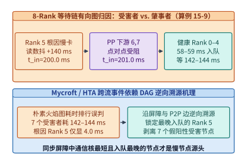

*图 15-22　8-Rank TP×PP×DP 集合通信等待链有向无环图（Mycroft / HTA）剥离 7 个受害者并锁定根因慢节点 Rank 5（算例 15-9）。*

> **算例 15-9（8-Rank TP×PP×DP 集合通信等待链有向图逆向归因与 7 个假阳性受害节点剥离，锁定 `calculations/calc.py fleet-reliability-profiler` 与 `experiments/ch15/15-05/run.py`）**
> **场景设定**：在一个 8-Rank（$\mathrm{TP}=2, \mathrm{PP}=2, \mathrm{DP}=2$）分布式训练组中，单步末端的全局同步集合通信屏障采集到各 Rank 的就绪入队时刻 $t_{\mathrm{enter}}$ 如下：Rank $\{0, 1, 2, 3, 6\}$ 在 $60.0\ \mathrm{ms}$ 准时入队，Rank $\{4, 7\}$ 因正常的微批长度微小波动在 $62.0\ \mathrm{ms}$ 入队，而 **Rank 5** 因宿主机 `DataLoader` 发生内存页回收停顿（Host Stall）迟至 **$200.0\ \mathrm{ms}$** 才完成前序算子并入队；全员到齐后 Ring AllReduce 的真实物理网络传输耗时为 $T_{\mathrm{wire}} = 4.0\ \mathrm{ms}$。试计算：（1）全体退出时刻 $t_{\mathrm{exit}}$ 与全部 8 个 Rank 在各自火焰图中观测到的表面 `ncclKernel` 持续时间；（2）说明为何按 `ncclKernel` 耗时排序会完全误判，并利用等待链归因公式剥离假阳性受害节点、还原 Rank 5 的真实上游停顿时长。
> **逐步推导**：
> 1. **屏障退出时刻与表面 `ncclKernel` 耗时反转**：同步起跑时刻为 $t_{\mathrm{sync}} = \max(60.0, 62.0, 200.0) = 200.0\ \mathrm{ms}$，全体完成退出时刻为 $t_{\mathrm{exit}} = 200.0 + 4.0 = \mathbf{204.0\ \mathrm{ms}}$。各 Rank 火焰图记录到的表面通信内核跨度分别为：
>    - Rank $\{0, 1, 2, 3, 6\}$：$\Delta T_{\mathrm{nccl}} = 204.0 - 60.0 = \mathbf{144.0\ \mathrm{ms}}$（其中被动空等 $140.0\ \mathrm{ms}$，占 $97.22\%$）；
>    - Rank $\{4, 7\}$：$\Delta T_{\mathrm{nccl}} = 204.0 - 62.0 = \mathbf{142.0\ \mathrm{ms}}$（其中被动空等 $138.0\ \mathrm{ms}$，占 $97.18\%$）；
>    - **Rank 5（真实故障源）**：$\Delta T_{\mathrm{nccl}} = 204.0 - 200.0 = \mathbf{4.0\ \mathrm{ms}}$（被动空等 $0.0\ \mathrm{ms}$）。
> 2. **等待链逆向归因与受害者剥离**：若按传统监控告警规则“挑选 `ncclKernel` 最慢的卡隔离”，系统会把完全健康的 Rank $\{0, 1, 2, 3, 6, 4, 7\}$ 全部列为嫌疑对象，而漏掉耗时仅 $4.0\ \mathrm{ms}$ 的 Rank 5。采用等待链逆向算子：
>    $$r^* = \arg\max_{r \in \{0..7\}} t_{\mathrm{enter}}(r) = \mathbf{5}$$
>    算法一步剥离其余 **$7$ 个假阳性受害节点**，并将追查焦点沿 Rank 5 的同流前驱边回退至 $60.0 \to 200.0\ \mathrm{ms}$ 区间，精准锁定其宿主机侧长达 **$200.0 - 60.0 = \mathbf{140.0\ \mathrm{ms}}$** 的 `DataLoader` 阻塞根因。

2. **`NCCL Flight Recorder` 环形黑匣子死锁取证判据**：
   当故障从“百毫秒级慢节点”恶化为“永久卡死（Hang）”时，运维引擎需自动解析 L2 层转储的 $K = 2,048$ 槽环形缓冲区（**图 15-23**）[^ch15-flight-recorder]。对于全局单调递增的第 $s$ 号集合通信（`seq_id` $= s$），其在环形缓冲区中的物理槽位索引满足模映射：
   $$\mathrm{slot}(s) = s \bmod K \quad (K = 2,048)$$
   设单卡每秒平均发起 $f_{\mathrm{coll}}$ 次集合通信，则环形黑匣子的滚动历史留存窗口为 $W_{\mathrm{ret}} = K / f_{\mathrm{coll}}$（例如当 $f_{\mathrm{coll}} = 320\ \mathrm{ops/s}$ 时，$W_{\mathrm{ret}} = 2,048 / 320 = \mathbf{6.40\ \mathrm{s}}$；一旦某次通信卡死，上游 CPU 线程在队列满后停止继续塞入新算子，从而将卡死瞬间的最后 $2,048$ 条记录冻结在内存中）。比对同一通信域各 Rank 在最小未完成序列号 $s_{\min}$ 处的槽位快照，即可将分布式卡死精确划分为三类确定性根因：
   - **情况 A（某 Rank 缺失序列号 $s_{\min}$）**：其余 $R-1$ 个 Rank 已在槽位 $\mathrm{slot}(s_{\min})$ 状态处于 `scheduled / started`，唯独 Rank $k$ 的最新序列号停留在 $s_{\min} - 1$，证明 Rank $k$ 在进入通信前死在了宿主 Python 死循环、磁盘 I/O 卡死或 CUDA 非法访存上；
   - **情况 B（同序列号算子类型或张量字节数不匹配，`COLL_TYPE_MISMATCH_DEADLOCK`）**：全部 Rank 均到达 $s_{\min}$，但例如 Rank $4$ 因未对齐的动态条件分支提交了 `AllGather`，而其余 Rank 提交了 `AllReduce`（或张量元素个数不一致），导致环路协议握手永久互锁；
   - **情况 C（全员已进入 `started` 但停留在特定 RDMA QP 对端等待）**：全部 Rank 的槽位元信息完全一致且状态均为 `started`，表明软件逻辑无误，故障位于底层 RoCE/IB 交换机丢包重传耗尽或光模块断链，可直接联动硬件交换机端口隔离。

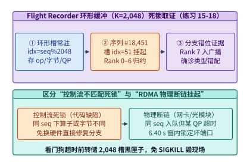

*图 15-23　NCCL Flight Recorder 环形缓冲区（K=2,048）槽位映射与集合通信类型错位死锁取证流程（练习 15-18）。*

3. **从脆弱 SPMD 全局绑定到 `PyTorch Monarch` 单控制器 Actor 网格局部隔离**：
   在完成毫秒级慢节点或死锁根因定位后，为什么传统 `torchrun` SPMD（Single Program, Multiple Data）作业仍往往被迫耗费数分钟销毁全网进程？根本原因在于**传统 SPMD 将“控制流生命周期”与“数据面通信组”紧耦合绑定在同一个对等进程组中**——只要任意 1 个 Rank 进程退出或超时，全局 `Watchdog` 就会向其余成千上万个健康 Rank 广播 `SIGKILL`，依次经历超时等待、TCPStore 重新握手、全网 `ncclCommInitRank` 建链以及分布式检查点重载。

   为在编程模型层面根除“一卡故障、全网重启”的脆弱性，Meta 推出的 **`PyTorch Monarch`** 架构引入了**单控制器（Single-Controller）分布式 Actor 网格（Actor Mesh）与控制面/数据面彻底解耦**的设计范式（**图 15-24**）[^ch15-monarch]：
   - **层次化树状控制平面与细粒度异常冒泡**：全局训练逻辑由单一控制器脚本统一编排，将万卡集群抽象为多维命名的 `DeviceMesh / ActorMesh`（如 `[replica=64, stage=8, tp=8]`）。当某个远端 GPU Actor 发生硬件 ECC 错误或被等待链引擎指认为慢节点时，异常仅作为结构化 Python 异常精准回传给控制器的监督树（Supervision Tree），绝不触发其余健康子网格的进程退出；
   - **基于单边 RDMA 的 Actor 状态热注水与子网格重绑定**：控制器在百毫秒内将受损子网格从活跃路由表中逻辑摘除，从预热备机池唤起替代 Actor，并通过 `Monarch` 内置的单边 RDMA 张量传输通道直接从同数据并行组相邻健康副本复制最新权重与优化器状态（RDMA Hydration），仅重建受影响局部子网格的通信句柄，使万卡训练在亚秒级内无缝续跑。

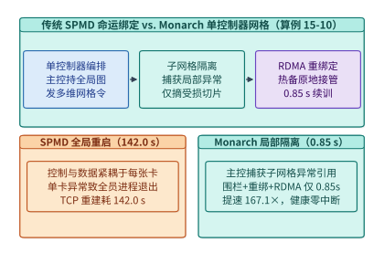

*图 15-24　传统 SPMD 全员销毁重建（142.0 s）vs. PyTorch Monarch 单控制器 Actor 网格局部隔离恢复（0.85 s，算例 15-10）。*

> **算例 15-10（PyTorch Monarch 单控制器 Actor 网格局部隔离恢复对比传统 SPMD 全局重启耗时拆解，锁定 `calculations/calc.py fleet-reliability-profiler` 与 `experiments/ch15/15-05/run.py`）**
> **场景设定**：某多维混合并行训练集群中的单台节点突发 GPU 硬件故障。对比以下两种容错控制面架构的端到端恢复延迟：（1）**传统 SPMD `torchrun` 全局重启路径**：`NCCL` 阻塞超时检测 $t_{\mathrm{wd}} = 28.0\ \mathrm{s}$、全网进程销毁后重新执行 TCPStore 握手与 `ncclCommInitRank` 通信域初始化 $t_{\mathrm{init}} = 76.0\ \mathrm{s}$、从远端存储重新加载最近一次检查点 $t_{\mathrm{load}} = 38.0\ \mathrm{s}$；（2）**`PyTorch Monarch` 单控制器 Actor 网格局部隔离路径**：心跳与等待链异常上报 $t_{\mathrm{det}} = 0.12\ \mathrm{s}$、控制器将受损子网格重绑定至预热备用 Actor $t_{\mathrm{rebind}} = 0.28\ \mathrm{s}$、通过邻近健康副本执行单边 RDMA 权重与优化器状态热注水 $t_{\mathrm{rdma}} = 0.45\ \mathrm{s}$。试求两种架构的总恢复耗时与 `Monarch` 的恢复加速比。
> **逐步推导**：
> 1. **传统 SPMD 全局销毁重建总耗时**：
>    $$T_{\mathrm{spmd}} = t_{\mathrm{wd}} + t_{\mathrm{init}} + t_{\mathrm{load}} = 28.0 + 76.0 + 38.0 = \mathbf{142.0\ \mathrm{s}}$$
> 2. **`PyTorch Monarch` 局部 Actor 网格重绑定总耗时与加速比**：
>    $$T_{\mathrm{monarch}} = t_{\mathrm{det}} + t_{\mathrm{rebind}} + t_{\mathrm{rdma}} = 0.12 + 0.28 + 0.45 = \mathbf{0.85\ \mathrm{s}}$$
>    相比传统 SPMD 全局重启，`Monarch` 控制面实现了 **$\frac{142.0}{0.85} \approx \mathbf{167.1\times}$** 的恢复提速，且其余健康副本全程保持显存状态驻留与零磁盘读盘开销。

表 15-11 汇总了分布式集合通信四类典型异常在传统单卡火焰图中的误导假象、等待链与黑匣子联合取证判据以及 `Monarch` 控制面的自动化处置动作：

| 分布式异常类型 | 传统单卡火焰图误导表象 | 等待链 DAG / Flight Recorder 联合取证判据 | `Monarch` / 自愈控制面处置动作 |
| :--- | :--- | :--- | :--- |
| **上游 Host / PCIe 慢节点** | $R-1$ 张健康卡 `ncclKernel` 耗时极长（如 $144\ \mathrm{ms}$），真凶卡仅 $4\ \mathrm{ms}$ | $r^* = \arg\max_r t_{\mathrm{enter}}(r)$ 唯一指向最晚入队卡，其前驱 H2D/CPU 算子拉长 | 隔离节点 $r^*$，子网格重绑定备用 Actor 并 RDMA 热注水（$0.85\ \mathrm{s}$） |
| **跨 TP→PP→DP 级联阻塞** | 下游整个 PP Stage 的 DP `AllReduce` 集体报警 | 沿 `DP AllReduce -> PP Recv -> PP Send -> TP AllReduce` 逆向回溯命中源头 Stage | 仅替换源头 TP 子组慢卡，免除下游无辜 Stage 误隔离 |
| **动态分支集合通信错位** | 全员卡死在 `ncclKernel`，GPU 利用率 $100\%$ 自旋 | `Flight Recorder` 同一 $\mathrm{slot}(s_{\min})$ 出现 `AllGather` vs. `AllReduce` 算子分歧 | 立即终止当前版本并触发金丝雀门禁回滚，输出分歧 Rank 调用栈 |
| **RDMA 光链路丢包/半开卡死** | 全员卡死或周期性通信长尾毛刺 | 全员 `Flight Recorder` 均处于同构 `started` 态，伴随端口 RS-FEC 高阶桶飙升 | 触发 `TrainMover` / `Monarch` 绕行备用端口或热迁移故障节点 |

*表 15-11　分布式集合通信常见异常在传统单卡火焰图中的假象特征、等待链/黑匣子取证判据与 Monarch 处置动作对照表。*

下面给出集合通信等待链根因归因器（`CollectiveWaitChainRootCauseAnalyzer`）与 `NCCL Flight Recorder` 环形缓冲区死锁解码器（`FlightRecorderDeadlockDecoder`）的完整参考实现（对应 `experiments/ch15/15-05/run.py`）：

```python
from typing import Dict, List


class CollectiveWaitChainRootCauseAnalyzer:
    """基于跨秩入队时间戳与多跳等待链有向图（Mycroft / HTA）的慢节点归因与 Monarch 恢复核算器。"""

    @staticmethod
    def attribute_barrier_straggler(enter_ms: Dict[int, float], wire_xfer_ms: float = 4.0) -> Dict[str, object]:
        exit_ms = max(enter_ms.values()) + wire_xfer_ms
        root_rank = max(enter_ms, key=lambda r: enter_ms[r])
        earliest_ms = min(enter_ms.values())
        apparent_nccl_ms = {r: round(exit_ms - t, 2) for r, t in enter_ms.items()}
        victims = [r for r in enter_ms if r != root_rank]
        return {
            "root_cause_rank": root_rank,
            "victim_ranks_stripped": len(victims),
            "collective_exit_ms": round(exit_ms, 2),
            "root_host_stall_ms": round(enter_ms[root_rank] - earliest_ms, 2),
            "root_apparent_nccl_ms": apparent_nccl_ms[root_rank],
            "max_victim_apparent_nccl_ms": max(apparent_nccl_ms[r] for r in victims),
            "apparent_nccl_ms_by_rank": apparent_nccl_ms,
        }

    @staticmethod
    def trace_multihop_tp_pp_dp(
        stage0_normal_ms: float = 30.0,
        rank2_extra_h2d_ms: float = 85.0,
        tp_wire_ms: float = 2.0,
        pp_wire_ms: float = 3.0,
        stage1_compute_ms: float = 40.0,
        dp_wire_ms: float = 5.0,
    ) -> Dict[str, float]:
        """推演 Stage 0 Rank 2 上游 H2D 降速沿 TP -> PP -> DP 三跳级联传染的时间线。"""
        rank2_tp_enter = stage0_normal_ms + rank2_extra_h2d_ms
        rank3_tp_wait = rank2_tp_enter - stage0_normal_ms
        tp_exit = rank2_tp_enter + tp_wire_ms

        normal_pp_recv = stage0_normal_ms + tp_wire_ms + pp_wire_ms
        corrupted_pp_recv = tp_exit + pp_wire_ms
        rank6_pp_wait = corrupted_pp_recv - normal_pp_recv

        healthy_dp_enter = normal_pp_recv + stage1_compute_ms
        corrupted_dp_enter = corrupted_pp_recv + stage1_compute_ms
        healthy_dp_wait = corrupted_dp_enter - healthy_dp_enter
        corrupted_step_ms = corrupted_dp_enter + dp_wire_ms
        return {
            "root_cause_rank": 2.0,
            "rank3_tp_victim_wait_ms": round(rank3_tp_wait, 2),
            "rank6_pp_victim_wait_ms": round(rank6_pp_wait, 2),
            "healthy_dp_victim_wait_ms": round(healthy_dp_wait, 2),
            "corrupted_step_ms": round(corrupted_step_ms, 2),
        }

    @staticmethod
    def compare_monarch_vs_spmd(
        monarch_phases_s: tuple[float, float, float] = (0.12, 0.28, 0.45),
        spmd_phases_s: tuple[float, float, float] = (28.0, 76.0, 38.0),
    ) -> Dict[str, float]:
        t_monarch = round(sum(monarch_phases_s), 2)
        t_spmd = round(sum(spmd_phases_s), 1)
        return {
            "monarch_isolation_seconds": t_monarch,
            "spmd_global_restart_seconds": t_spmd,
            "monarch_vs_spmd_speedup_x": round(t_spmd / t_monarch, 1),
        }


if __name__ == "__main__":
    analyzer = CollectiveWaitChainRootCauseAnalyzer()
    res8 = analyzer.attribute_barrier_straggler(
        {0: 60.0, 1: 60.0, 2: 60.0, 3: 60.0, 4: 62.0, 5: 200.0, 6: 60.0, 7: 62.0},
        wire_xfer_ms=4.0,
    )
    assert res8["root_cause_rank"] == 5 and res8["victim_ranks_stripped"] == 7
    assert res8["root_apparent_nccl_ms"] == 4.0 and res8["max_victim_apparent_nccl_ms"] == 144.0

    hop = analyzer.trace_multihop_tp_pp_dp()
    assert hop["rank3_tp_victim_wait_ms"] == 85.0 and hop["corrupted_step_ms"] == 165.0

    mon = analyzer.compare_monarch_vs_spmd()
    assert mon["monarch_isolation_seconds"] == 0.85 and mon["monarch_vs_spmd_speedup_x"] == 167.1
```

```python
from typing import Dict


class FlightRecorderDeadlockDecoder:
    """NCCL Flight Recorder 环形缓冲区（K=2,048）槽位映射与集合通信死锁根因解码器。"""

    def __init__(self, ring_capacity: int = 2048, entry_bytes: int = 256) -> None:
        self.ring_capacity = ring_capacity
        self.entry_bytes = entry_bytes

    def map_seq_to_slot(self, seq_id: int) -> int:
        return seq_id % self.ring_capacity

    def buffer_memory_kib(self) -> float:
        return round((self.ring_capacity * self.entry_bytes) / 1024.0, 2)

    def retention_window_seconds(self, collectives_per_sec: float) -> float:
        return round(self.ring_capacity / collectives_per_sec, 2)

    def diagnose_ring_snapshot(
        self,
        seq_id: int,
        rank_ops: Dict[int, str],
        world_size: int,
        rank_numel: Dict[int, int] | None = None,
    ) -> Dict[str, object]:
        slot = self.map_seq_to_slot(seq_id)
        if len(rank_ops) < world_size:
            missing = sorted(set(range(world_size)) - set(rank_ops.keys()))
            return {"slot": slot, "diagnosis": "RANK_MISSING_BEFORE_COLLECTIVE", "suspect_ranks": missing}
        op_counts: Dict[str, int] = {}
        for op in rank_ops.values():
            op_counts[op] = op_counts.get(op, 0) + 1
        if len(op_counts) > 1:
            majority_op = max(op_counts, key=lambda k: op_counts[k])
            divergent = sorted(r for r, op in rank_ops.items() if op != majority_op)
            return {"slot": slot, "diagnosis": "COLL_TYPE_MISMATCH_DEADLOCK", "divergent_ranks": divergent}
        if rank_numel and len(set(rank_numel.values())) > 1:
            return {"slot": slot, "diagnosis": "TENSOR_SHAPE_MISMATCH_DEADLOCK", "divergent_ranks": []}
        return {"slot": slot, "diagnosis": "TRANSPORT_QP_TIMEOUT_ALL_STARTED", "divergent_ranks": []}


if __name__ == "__main__":
    dec = FlightRecorderDeadlockDecoder(ring_capacity=2048)
    assert dec.buffer_memory_kib() == 512.0
    assert dec.map_seq_to_slot(2099) == 51
    assert dec.retention_window_seconds(320.0) == 6.40

    inc_a = dec.diagnose_ring_snapshot(
        seq_id=1024,
        rank_ops={r: ("AllGather" if r == 4 else "AllReduce") for r in range(8)},
        world_size=8,
    )
    assert inc_a["slot"] == 1024 and inc_a["diagnosis"] == "COLL_TYPE_MISMATCH_DEADLOCK"
    assert inc_a["divergent_ranks"] == [4]
```

---

## 常见误区

1. **误区一：“每张 H100 GPU 的平均无故障时间长达 5 年以上，而且显存开启了硬件 ECC，所以跑几万张卡的训练只要每隔几小时存一次远端磁盘检查点就足够稳妥。”**
   **纠正**：如算例 15-1 所示，单卡 5.78 年的 MTBF 除以 $100,000$ 张卡后，集群级 MTBF 会缩短至 **$30.41$ 分钟**；若仍采用耗时 $180\ \mathrm{s}$ 的远端落盘检查点与耗时 $300\ \mathrm{s}$ 的 `torchrun` 全局销毁重启，全集群有效训练时间比（ETTR）将跌至 **$63.22\%$**（相当于损失 $36,780$ 张 GPU 的有效算力）。更关键的是，HBM ECC 无法保护 Tensor Core 算术通路内部的瞬态电压或老化比特翻转（SDC），一旦算错的数值写回显存就会获得合法 ECC 码并在一次 AllReduce 中污染全网权重。必须结合内存异步快照、秒级热迁移（`TrainMover`）与在线 SDC 拦截（ABFT + `Safeguarding` + `OpGuard`）。
2. **误区二：“为了应对十万卡集群每小时坏 2 台机器、每台修 12 小时的故障率，备机池只要按平均值 $2 \times 12 = 24$ 台准备就够了。”**
   **纠正**：如算例 15-2 所示，在修节点数服从均值 $L = 24.0$ 的泊松分布；若只配 $S = 24$ 台热备节点，有高达 **$44.60\%$** 的时间在修坏机器数量会超过 24 台，导致主训练集群频繁因备机耗尽而停机或降级。按泊松累积分布 $P(K \le S) \ge 99.9\%$ 规划，需配置 $S_{\min} = \mathbf{40}$ 台热备节点（仅占万节点集群不到 $0.4\%$）。
3. **误区三：“训练变慢时，打开单卡 Profiler 看到几乎所有卡上 `ncclKernel_AllReduce` 都占了 80% 以上的时间，因此瓶颈一定在数据中心网络拥塞或带宽不足，而且应当优先隔离 `ncclKernel` 耗时最长的卡。”**
   **纠正**：如算例 15-4 与算例 15-9 所示，在紧耦合同步集合通信中，只要有 1 张慢卡（如 Rank 5）因主机 `DataLoader` 停顿或 PCIe 降速迟到了 $140.0\ \mathrm{ms}$，其余准时到达的健康受害卡都会在 `ncclKernel_AllReduce` 内自旋空等（表面通信耗时达 $142.0\text{–}144.0\ \mathrm{ms}$），而真正最后入队的真凶 Rank 5 在 `ncclKernel` 内的表面耗时反而只有最短的 **$4.0\ \mathrm{ms}$**。必须通过跨流事件依赖有向图（`Mycroft / HTA`）求逆向最晚到达秩 $\arg\max_r t_{\mathrm{enter}}(r)$，才能剥离假阳性受害节点并定位真实根因。
4. **误区四：“评测新算子时，在 10 个不同形状上算出各自的加速比再求算术平均，得到平均加速 5.25 倍，上线后一定比平均加速 2.0 倍的算子更快。”**
   **纠正**：如算例 15-5（锁定 `case-studies/optimization-evaluation-and-deployment.md`）所示，候选算子 A 在短形状上快 $10\times$（$100 \to 10\ \mu\mathrm{s}$）、在长形状上慢 $0.5\times$（$100 \to 200\ \mu\mathrm{s}$），算术平均加速比达 **$5.25\times$**，但在等频流量下总耗时为 **$210\ \mu\mathrm{s}$**，不仅比候选 B（$50+50=100\ \mu\mathrm{s}$）慢一倍以上，甚至慢于基线（$200\ \mu\mathrm{s}$）。算子评测严禁对加速比取算术平均，必须按真实生产形状分布汇报加权总耗时。
5. **误区五：“为了保证万卡故障可追溯，应当在生产作业中 7×24 全程开启 `PyTorch Profiler (CUPTI)` 记录全量算子轨迹。”**
   **纠正**：如算例 15-8 所示，在 $16,384$ 卡集群上常驻开启全量 `CUPTI` 会因同步回调锁竞争引发约 $8.0\%$ 的吞吐退化（等效空转损耗 **$1,310.72$ 张 GPU**）并产生每日 **$1.42\ \mathrm{PB}$** 的轨迹洪流。生产环境应采用 `eBPF Strobelight` 常驻低频剖析（$0.35\%$）配合 `Dynolog` 异常触发 `Kineto` 脉冲采样（分摊开销 $0.07\%$）与 `NCCL Flight Recorder` 内存环形黑匣子，将综合遥测开销控制在 **$0.42\%$**、日存储压缩 **$788.9\times$** 至 $1.80\ \mathrm{TB/day}$。

---

## 练习与实验

> **练习 15-1（十万卡集群 MTBF 外推与 Young-Daly 最优检查点周期推演）：**
> 某新一代 $65,536$ 卡（64K 卡）超大规模训练集群，实测单卡等效平均无故障时间为 $\mathrm{MTBF}_{\mathrm{gpu}} = 45,000\ \mathrm{h}$。
> （1）求该 $65,536$ 卡集群的平均无故障间隔 $\mathrm{MTBF}_{64\mathrm{K}}$（以分钟和秒为单位）；
> （2）若采用传统并行文件系统落盘检查点（单次阻塞写盘耗时 $C_{\mathrm{ckpt}} = 150\ \mathrm{s}$，故障后全局重启与重载恢复耗时 $T_{\mathrm{rec}} = 240\ \mathrm{s}$），求 Young-Daly 最优检查点间隔 $\tau_{\mathrm{opt}} = \sqrt{2 C_{\mathrm{ckpt}} M}$ 及对应的有效训练时间比（ETTR）；
> （3）若升级为 `ByteCheckpoint`/`Checkmate` 内存异步检查点（$C_{\mathrm{ckpt}} = 4.0\ \mathrm{s}$）配合 `TrainMover` 无重启热接管（$T_{\mathrm{rec}} = 6.0\ \mathrm{s}$），求新的 $\tau_{\mathrm{opt}}$ 与 ETTR，并计算相当于为该集群净挽回了多少张 GPU 的有效算力。

> **练习 15-2（热备节点池泊松维修队列与分位数容量规划）：**
> 某万卡训练中心共有 $4,096$ 台 8 卡节点，平均节点故障到达率为 $\lambda = 1.5\ \text{台/h}$。
> （1）当线下硬件维修团队的平均修复归队周期为 $\mathrm{MTTR}_{\mathrm{repair}} = 10.0\ \mathrm{h}$ 时，求稳态在修节点均值 $L$，并利用正态近似 $S_{\min} \approx \lceil L + z_{0.999}\sqrt{L} \rceil$（其中 $z_{0.999} = 3.09$）或精确泊松分布估算满足 $99.9\%$ 不降级概率所需的最小热备节点数；
> （2）若通过备件前置与自动化四阶烤机流水线将 $\mathrm{MTTR}_{\mathrm{repair}}$ 从 $10.0\ \mathrm{h}$ 缩短至 $4.0\ \mathrm{h}$，所需的最小热备节点数可减少多少台？

> **练习 15-3（BFloat16 静默数据损坏 SDC 比特翻转的数值放大效应）：**
> IEEE 754 / `BFloat16` 格式由 1 位符号位（Bit 15）、8 位指数位（Bits 14..7，偏移量 Bias $= 127$）和 7 位尾数位（Bits 6..0）组成。设某正常梯度元素的值为 $g = 0.125$（二进制表示为符号 `0`，指数 $124 = \text{0b01111100}$，尾数 `0000000`）。
> （1）若宇宙射线或电压跌落导致指数第 5 位（Bit 12，对应指数权重 $+32$）由 `0` 静默翻转为 `1`，翻转后的浮点数 $\tilde{g}$ 变成了多少？在 $16,384$ 卡数据并行 AllReduce 求平均后，单卡这 1 个比特的翻转会给全集群平均梯度带来多大的绝对偏差？
> （2）为什么这种幅度（既非 `NaN` 亦非 `Inf`）的翻转能够轻易穿透传统的 `torch.isfinite()` 检查？

> **练习 15-4（ABFT 矩阵乘代数不变量校验开销与双错误检测边界）：**
> 在形状为 $M = 8,192,\; N = 8,192,\; K = 8,192$ 的 FP8/FP32 矩阵乘法 $\mathbf{C} = \mathbf{A}\mathbf{B}$ 中：
> （1）核算主矩阵乘的 FLOPs 与 ABFT 行列双向校验和（$6N^2$ 核心乘加项）的相对算力开销百分比；
> （2）若同一次 GEMM 中恰好有同一行的两个元素 $(i, j_1)$ 与 $(i, j_2)$ 分别发生了 $+32.0$ 与 $-32.0$ 的反号错误，仅靠行和校验 $\mathbf{C}\mathbf{1}_N = \mathbf{A}(\mathbf{B}\mathbf{1}_N)$ 能否发现？为什么同时检查列和校验 $\mathbf{1}_M^T\mathbf{C} = (\mathbf{1}_M^T\mathbf{A})\mathbf{B}$ 或采用加权校验向量 $\mathbf{w} = [1, 2, \dots, N]^T$ 可以 $100\%$ 捕获此类抵消错误？

> **练习 15-5（`OpGuard` 良性非确定性消除与 50 ms 微批次重跑收益核算）：**
> 某十万卡集群每 $100$ 小时发生 $1$ 次硬件 SDC 事件。
> （1）若无在线拦截，每次 SDC 平均在污染全局权重 $1.5$ 小时后才通过验证集困惑度异常被发现，随后需回滚至 $2.0$ 小时前的干净检查点并耗费 $0.5$ 小时排查坏卡，求每百小时因 SDC 损失的集群墙钟时间与 GPU 小时数；
> （2）若部署 `Safeguarding LLM Training`（AllReduce 前拦截）+ `OpGuard`（$50\ \mathrm{ms}$ 位级对齐微批重算定位）+ `TrainMover`（$5.0\ \mathrm{s}$ 热备切换），求每次 SDC 事件的端到端处置耗时与每百小时节省的 GPU 小时数。

> **练习 15-6（锁定 `case-studies/collective-paths-and-diagnosis.md`：集合通信慢节点偏斜与多轨失衡复算）：**
> 在一个 8-Rank AllReduce 通信组中，前 7 个 Rank 的就绪到达时刻均为 $t = 10.0\ \mathrm{ms}$，而第 7 号 Rank 因 SSD 日志刷盘抢占 PCIe 在 $t = 14.5\ \mathrm{ms}$ 才到达；全员到齐后的网络 Ring AllReduce 传输耗时为 $0.5\ \mathrm{ms}$。
> （1）求前 7 个 Rank 在 Profiler 中看到的 AllReduce 算子持续时间，以及其中真实的“网络传输时间占比”与“慢节点等待时间占比”；
> （2）若某节点使用 4 张 400G 网卡条带化传输同一集合通信负载，其中 3 张网卡耗时 `0.8 ms`，第 4 张网卡因光模块 FEC 重传耗时 `3.2 ms`，求 4 张网卡的平均耗时与实际决定训练步进的木桶短板耗时。

> **练习 15-7（锁定 `case-studies/optimization-evaluation-and-deployment.md`：加速比平均悖论与翻转阈值推导）：**
> 基线算子在形状 $S_1$ 与 $S_2$ 上的耗时分别为 $T_{\mathrm{base}} = [80\ \mu\mathrm{s},\; 120\ \mu\mathrm{s}]$。候选算子 X 的耗时为 $T_X = [10\ \mu\mathrm{s},\; 240\ \mu\mathrm{s}]$，候选算子 Y 的耗时为 $T_Y = [40\ \mu\mathrm{s},\; 60\ \mu\mathrm{s}]$。
> （1）分别计算候选 X 与候选 Y 的算术平均加速比；
> （2）求在等频流量（$p = 0.5$）下两者的总耗时与真实端到端加速比，并求出候选 X 的期望耗时小于候选 Y 所需的短形状占比阈值 $p^*$。

> **练习 15-8（锁定 `case-studies/optimization-evaluation-and-deployment.md`：线性热漂移下的 `AABB` 偏差与 `ABBA` 抵消证明）：**
> 设待对比的两个算子 A 与 B 的真实稳态耗时分别为 $\mu_A$ 与 $\mu_B$。在连续 4 个测量窗口 $k = 0, 1, 2, 3$ 中，系统背景温度引发的附加线性延迟漂移为 $d_k = k \cdot \delta$（其中 $\delta = 12.0\ \mu\mathrm{s}$）。
> （1）证明按 `AABB` 顺序测量时，样本均值差 $\bar{T}_A^{\mathrm{AABB}} - \bar{T}_B^{\mathrm{AABB}}$ 会产生恒等于 $-2\delta = -24.0\ \mu\mathrm{s}$ 的系统性偏差；
> （2）证明按 `ABBA` 顺序测量时，样本均值差 $\bar{T}_A^{\mathrm{ABBA}} - \bar{T}_B^{\mathrm{ABBA}} \equiv \mu_A - \mu_B$，线性漂移项 $\delta$ 被完全消除。

> **练习 15-9（全书双轨贯穿综合题：从单卡算术强度到十万卡容错的端到端账本）：**
> 结合表 15-6 中的双轨模型参数：
> （1）在轨道 A（Qwen3-8B，BF16 权重 $16.4\ \mathrm{GB}$，KV 缓存 $144\ \mathrm{KB/tok}$）中，若机载端将其 INT4 量化（权重 $4.6\ \mathrm{GB}$）部署于单颗 Jetson Thor 的 75% MIG 分区（有效带宽 $600\ \mathrm{GB/s}$），求 $B=1$ 自回归生成一个词元的理论访存下限延迟，并说明为何必须配合 $150\ \mathrm{M}$ System 1 流匹配动作头才能满足 $100\ \mathrm{Hz}$（$10\ \mathrm{ms}$）全身控制；
> （2）在轨道 B（DeepSeek V4.1 671B，激活 $37\ \mathrm{B}$）的万卡预训练与 RLVR 后训练中，总结 MLA、DeepEP、DualPipe、`RollPacker` 与 `OpGuard`/`TrainMover` 五大系统技术分别攻克了哪一堵物理墙。

> **实验 15-10（可独立运行实验：十万卡 Young-Daly 周期、热备池排队模型、ABFT SDC 注入修复与评测反例复算器）：**
> 运行并阅读本章配套实验 `experiments/ch15/15-01/run.py` 与 `experiments/ch15/15-01/verify.py`：
> （1）复算算例 15-1（Meta $16\mathrm{K}$ 卡 $419$ 次故障外推至十万卡 $\mathrm{MTBF} = 30.41\ \mathrm{min}$，以及传统落盘检查点 $\mathrm{ETTR} = 63.22\%$ vs. 内存快照+热迁移 $\mathrm{ETTR} = 92.34\%$）与算例 15-2（泊松热备池 $S_{\min} = 40$）；
> （2）复算算例 15-3（$4,096$ 阶矩阵乘 ABFT $0.0732\%$ 开销与 $(2, 3)$ 坐标 $+64.0$ 翻转原地修复）以及算例 15-4 与算例 15-5（慢节点 $2.0\ \mathrm{ms}$ 偏斜 vs. $0.2\ \mathrm{ms}$ 带宽收益、$5.25\times$ 加速比悖论 $p^* = 15/19$ 与 `ABBA` 漂移抵消）。

> **练习 15-11（集合通信 Arrival Skew Matrix 慢节点根因反演与光模块 FEC 重传灰故障定位）：**
> 在某 $16$-Rank 跨机架 AllReduce 通信组中，`NCCL Flight Recorder` 记录到单步集合通信的入队时刻：除 Rank 11 在 $t_{11} = 28.5\ \mathrm{ms}$ 入队外，其余 $15$ 个健康 Rank 均在 $t = 22.5\ \mathrm{ms}$ 入队；全员到齐后 Ring AllReduce 的网络传输耗时为 $1.5\ \mathrm{ms}$。
> （1）求其余 $15$ 个健康 Rank 在 Profiler 中观测到的 AllReduce 算子持续时间，以及其中等待 Rank 11 的慢节点空转占比；
> （2）若将集群网络带宽直接翻倍（使真实网络传输耗时从 $1.5\ \mathrm{ms}$ 降至 $0.75\ \mathrm{ms}$），而未隔离慢节点 Rank 11，求健康 Rank 观测到的 AllReduce 持续时间仅缩短了百分之几？若改用 `TrainMover` 在 $0.68\ \mathrm{s}$ 内将 Rank 11 热迁移至健康热备卡（消除 $6.0\ \mathrm{ms}$ 入队偏斜），单步 AllReduce 耗时可获得多少倍的真实加速？

> **实验 15-12（运行 `experiments/ch15/15-02` 复算 Arrival Skew 慢节点定位、TrainMover 亚秒级热迁移与四大跑分失真修正）：**
> 运行并阅读本章第二个配套实验 `experiments/ch15/15-02/run.py` 与 `experiments/ch15/15-02/verify.py`：
> （1）复算算例 15-6 中的 8-Rank 入队偏斜矩阵诊断（精确锁定 `straggler_rank = 5`、偏斜 $2.0\ \mathrm{ms}$、慢节点等待占比 $83.33\%$）以及 `TrainMover` 亚秒级热迁移（$0.68\ \mathrm{s}$ vs. 传统重启 $300.0\ \mathrm{s}$，提速 $441.18\times$）；
> （2）复算四大跑分失真修正与两阶段金丝雀门禁（$5.25\times$ 算术平均加速比实则 $0.9524\times$ 倒退、`ABBA` 消除 $-16.0\ \mu\mathrm{s}$ 漂移偏置、金丝雀捕获 $+4.8\%$ P99 退化自动回滚），以及十万卡 $200$ 次 Chaos GameDay 故障注入演练（$99.50\%$ 召回率、$\mathrm{MTTD} = 2.70\ \mathrm{s}$、$\mathrm{MTTR}_{\mathrm{auto}} = 3.85\ \mathrm{s}$，比人工恢复快 $389.61\times$）。

> **练习 15-13（Oobleck 预实例化异构流水线模板在多节点同时掉线下的吞吐保持率推演）：**
> 承接算例 15-7，某 $64$ 条数据并行流水线（每条 $8$ 阶段，共 $512$ 台节点）的训练任务在热备节点耗尽期间突发 $F = 4$ 台节点掉线（分别位于 4 条不同的数据并行流水线中）。
> （1）若采用 `Parachute` 策略直接摘除这 4 条受损流水线、保持其余 $60$ 条流水线无中断运行，集群保留的有效训练吞吐百分比是多少？
> （2）若采用 `Oobleck` 预实例化模板重配置，将这 4 条受损流水线在 $1.45\ \mathrm{s}$ 内切换为 7 阶段紧凑模板 $\mathcal{T}_7$（单条降级管线因开启局部激活重计算，有效吞吐为原 8 阶段管线的 $82.0\%$），求集群保留的有效训练吞吐百分比，以及相比 `Parachute` 策略每天（$24\ \mathrm{h}$）净多挽回多少个等效健康节点小时（Node-Hours）？

> **实验 15-14（推理服务泊松突发长尾流量下的 Kingman 排队放大与 Goodput 校验实验 `experiments/ch15/15-03`）：**
> 承接算例 15-7，设某推理引擎的平均单请求服务耗时为 $T_s = 100.0\ \mathrm{ms}$（饱和吞吐率 $\mu = 10.0\ \mathrm{req/s}$），纯 Prefill 耗时 $T_{\mathrm{prefill}} = 60.0\ \mathrm{ms}$，当系统工作在利用率 $\rho = 0.80$（到达率 $\lambda = 8.0\ \mathrm{req/s}$）时：
> （1）对比均匀定速固定长度压测（$C_a = 0, C_s = 0$）与极端智能体并发突发流量（$C_a = 1.5, C_s = 1.5$）下的平均排队等待时间 $W_q$ 与平均首词元延迟 $\mathrm{TTFT}$；
> （2）运行 `python3 experiments/ch15/15-03/run.py && python3 experiments/ch15/15-03/verify.py` 校验算例 15-7、练习 15-13 与本题的全部锁定指标。

> **练习 15-15（`Blink` 扁平运行时硬件 PMU 采样滑移失真矩阵求逆与无偏热点校准）：**
> 在大模型推理引擎的 CPU 发射循环中，依次串行执行三个微秒级函数：$f_0$（`tokenize_dispatch`）、$f_1$（`launch_stub`）与 $f_2$（`post_hook`）。由于超标量乱序处理器流水线中断交付延迟（PMU Sampling Skid），本应归属 $f_0$ 的硬件采样中断有 $40\%$ 滑移落入紧邻的 $f_1$（仅 $60\%$ 留在 $f_0$）；本应归属 $f_1$ 的采样中断有 $25\%$ 滑移落入 $f_2$（$75\%$ 留在 $f_1$）；$f_2$ 的采样中断 $100\%$ 留在自身，构成下三角滑移转移矩阵 $\mathbf{S} = \begin{bmatrix}0.60 & 0 & 0\\ 0.40 & 0.75 & 0\\ 0 & 0.25 & 1.00\end{bmatrix}$。
> （1）若传统性能剖析器观测到的原始采样计数向量为 $\mathbf{y}_{\mathrm{raw}} = [300,\; 500,\; 200]^T$（共 $1,000$ 次采样），求失真火焰图报告的三个函数耗时占比，并指出它把哪个函数误判为头号瓶颈；
> （2）按 `Blink` 校准方程 $\mathbf{S}\mathbf{x}_{\mathrm{true}} = \mathbf{y}_{\mathrm{raw}}$ 求解真实的无偏采样计数向量 $\mathbf{x}_{\mathrm{true}}$ 与真实耗时占比。

> **实验 15-16（可独立运行实验：万卡 eBPF + Dynolog/Kineto 三级遥测开销账本与 `Blink` 采样去偏校验器 `experiments/ch15/15-04`）：**
> 运行并阅读本章第四个配套实验 `experiments/ch15/15-04/run.py` 与 `experiments/ch15/15-04/verify.py`：
> （1）复算算例 15-8 中 $16,384$ 卡集群常驻 `CUPTI`（$8.0\%$ 退化损耗 $1,310.72$ 卡、日写盘 $1.42\ \mathrm{PB}$）对比 `eBPF Strobelight`（$0.35\%$）+ `Dynolog/Kineto` 按需脉冲追踪（占空比 $0.875\%$，分摊开销 $0.07\%$，合计 $0.42\%$ 仅占 $68.81$ 卡、净省 $1,241.91$ 卡、日存储 $1.80\ \mathrm{TB}$ 压缩 $788.9\times$）的完整账本；
> （2）校验练习 15-15 中 `Blink` 下三角滑移矩阵求逆将失真计数 $[300, 500, 200]$ 精确还原为真实计数 $[500, 400, 100]$（使 `tokenize_dispatch` 从被低估的 $30.0\%$ 恢复为 $50.0\%$ 真实第一瓶颈）。

> **练习 15-17〔火焰图取证〕（跨 TP→PP→DP 多跳级联等待链的 Kineto 轨迹反演与假阳性剥离）：**
> 某 8-Rank（$\mathrm{TP}=2, \mathrm{PP}=2, \mathrm{DP}=2$）混合并行训练组按如下拓扑编排：Stage 0 包含两个 TP 子组 $\{0, 1\}$（副本 0）与 $\{2, 3\}$（副本 1），Stage 1 包含两个对应下游 TP 子组 $\{4, 5\}$（副本 0）与 $\{6, 7\}$（副本 1），其中 Stage 0 到 Stage 1 通过点对点 `PP Send/Recv`（Rank $0\to 4, 1\to 5, 2\to 6, 3\to 7$，线速传输耗时 $3.0\ \mathrm{ms}$）传递激活。在正常步中，Stage 0 本地计算与 `H2D` 耗时 $30.0\ \mathrm{ms}$、TP `AllReduce` 线速传输 $2.0\ \mathrm{ms}$（$32.0\ \mathrm{ms}$ 退出）；Stage 1 在 $35.0\ \mathrm{ms}$ 收到激活后执行 $40.0\ \mathrm{ms}$ 计算，于 $75.0\ \mathrm{ms}$ 准时进入跨副本 DP `AllReduce`（$\{4, 6\}$ 一组、$\{5, 7\}$ 一组，线速传输 $5.0\ \mathrm{ms}$），全步在 $80.0\ \mathrm{ms}$ 结束。
> 在某次慢步告警中，`Dynolog` 抓取的 8-Rank `Kineto` 火焰图呈现以下现象：（a）Stage 1 副本 0 的健康卡 Rank 4 与 Rank 5 在末端 `ncclKernel_AllReduce`（DP）上耗时高达 $90.0\ \mathrm{ms}$；（b）Stage 1 副本 1 的 Rank 6 与 Rank 7 在前置 `ncclKernel_Recv`（PP）上阻塞了 $85.0\ \mathrm{ms}$，但末端 DP `AllReduce` 仅耗时 $5.0\ \mathrm{ms}$；（c）Stage 0 副本 1 的 Rank 3 在 `ncclKernel_AllReduce`（TP）上耗时高达 $87.0\ \mathrm{ms}$，而 **Rank 2** 的 TP `AllReduce` 仅耗时 $2.0\ \mathrm{ms}$，但其前置 `cudaMemcpyAsync (H2D)` 耗时从正常的 $5.0\ \mathrm{ms}$ 拉长到了 $90.0\ \mathrm{ms}$（PCIe 链路降级为 Gen2）。
> （1）逐步推演该异常从 Rank 2 沿 `TP -> PP -> DP` 传播至全步结束的精确毫秒级时间线，求出异常步的总完成时刻 $T_{\mathrm{step}}$，以及 Rank 3（TP 屏障）、Rank 6（PP 接收）与 Rank 4（DP 屏障）各自的被动等待时间；
> （2）解释为何传统基于“通信内核最长耗时”的告警器会先后误报 Rank 4/5、Rank 6/7 与 Rank 3，并写出 `Mycroft` 等待链算法从 Rank 4 末端 DP 屏障逆向回溯命中 Rank 2 PCIe 降级的三跳因果路径。

> **练习 15-18〔死锁日志取证〕（`NCCL Flight Recorder` 环形缓冲区槽位回绕、算子错位死锁与留存窗口核算，对应 `experiments/ch15/15-05`）：**
> 某 8-Rank 分布式作业配置了容量为 $K = 2,048$ 条记录的 `NCCL Flight Recorder` 主机内存环形缓冲区（槽位编号 $0 \dots 2047$），稳态训练期间单卡平均每秒发起 $f_{\mathrm{coll}} = 320$ 次集合通信。请对以下两起线上死锁转储日志执行取证核算：
> （1）**事故 A（条件分支错位死锁）**：Watchdog 超时转储显示，在全局未完成序列号 `seq_id = 1024` 处，Rank $\{0, 1, 2, 3, 5, 6, 7\}$ 的槽位记录均为 `op=AllReduce, dtype=bf16, count=16777216, state=started`，唯独 **Rank 4** 在同一 `seq_id = 1024` 处的记录为 `op=AllGather, dtype=bf16, count=16777216, state=started`。指出 `seq_id = 1024` 对应的环形槽位号、死锁分类码以及引发该故障的典型代码缺陷；
> （2）**事故 B（槽位回绕与留存窗口）**：另一作业在 `seq_id = 2099` 处发生跨机架 RoCE 交换机端口静默黑洞，8 个 Rank 在该序列号处均记录 `op=ReduceScatter, state=started, pending_qp_ack=true`。求 `seq_id = 2099` 写入的环形缓冲区物理槽位号 $\mathrm{slot}(2099)$，计算稳态运行下该 $2,048$ 槽环形缓冲区的滚动历史覆盖时间窗口 $W_{\mathrm{ret}}$（秒），并运行 `python3 experiments/ch15/15-05/run.py && python3 experiments/ch15/15-05/verify.py` 校验算例 15-9、算例 15-10、练习 15-17 与本题的全部取证输出。

### 可运行实验（15-01 至 15-05）

- **实验目录**：`experiments/ch15/15-01`（十万卡 Young-Daly 周期、热备池排队模型与 ABFT SDC 修复器）、`experiments/ch15/15-02`（Arrival Skew 慢节点定位、`TrainMover` 热迁移、四大跑分失真修正与 Chaos GameDay 演练审计器）、`experiments/ch15/15-03`（Oobleck 预实例化流水线无重启容错重配置与泊松突发流量 Goodput 评测器）、`experiments/ch15/15-04`（万卡 eBPF + Dynolog/Kineto 三级分层遥测开销账本与 `Blink` 采样滑移校准器）、`experiments/ch15/15-05`（集合通信等待链有向图归因、`Flight Recorder` 死锁解码与 `PyTorch Monarch` 局部隔离校验器）
- **实验目标**：一键复现并校验本章全部十个锁定算例、两道取证大题与 `calculations/calc.py fleet-reliability-profiler` 黄金结果，涵盖十万卡 $\mathrm{MTBF} = 30.41\ \mathrm{min}$ 与 $\mathrm{ETTR}\ 63.22\% \to 92.34\%$（`15-01`）、Chaos GameDay $99.50\%$ 召回率与 $\mathrm{MTTR}_{\mathrm{auto}} = 3.85\ \mathrm{s}$（`15-02`）、`Oobleck` $1.45\ \mathrm{s}$ 无重启切换与泊松突发流量 Goodput 核算（`15-03`）、$16,384$ 卡遥测损耗从 $8.0\%$（$1,310.72$ 卡）降至 $0.42\%$（$68.81$ 卡）与 $788.9\times$ 存储压缩（`15-04`），以及 8-Rank 等待链剥离 $7$ 个受害节点锁定 Rank 5、`Flight Recorder` $K=2,048$ 死锁解码与 `Monarch` $0.85\ \mathrm{s}$ 对比 SPMD $142.0\ \mathrm{s}$（快 $167.1\times$）局部自愈（`15-05`）。
- **执行与校验命令**：在仓库根目录执行 `python3 calculations/calc.py fleet-reliability-profiler`，并依次运行 `python3 experiments/ch15/15-01/run.py && python3 experiments/ch15/15-01/verify.py`、`python3 experiments/ch15/15-02/run.py && python3 experiments/ch15/15-02/verify.py`、`python3 experiments/ch15/15-03/run.py && python3 experiments/ch15/15-03/verify.py`、`python3 experiments/ch15/15-04/run.py && python3 experiments/ch15/15-04/verify.py` 以及 `python3 experiments/ch15/15-05/run.py && python3 experiments/ch15/15-05/verify.py`。

---

### 参考解答与详尽推导

- **15-1 解答**：
  1. $65,536$ 卡集群的 $\mathrm{MTBF}_{64\mathrm{K}} = \frac{45,000\ \mathrm{h}}{65,536} \approx 0.68665\ \mathrm{h} = \mathbf{41.20\ \mathrm{min}} = \mathbf{2,471.9\ \mathrm{s}}$。
  2. 传统方案（$C = 150\ \mathrm{s}, T_{\mathrm{rec}} = 240\ \mathrm{s}, M = 2,471.9\ \mathrm{s}$）：$\tau_{\mathrm{opt}} = \sqrt{2 \times 150 \times 2,471.9} \approx \mathbf{861.1\ \mathrm{s}}$；按算例 15-1 公式计算，$\mathrm{ETTR} = \frac{861.1}{861.1 + 150} \times \left(1 - \frac{240 + 430.55}{2,471.9}\right) \approx 0.8516 \times 0.7287 \approx \mathbf{62.06\%}$（或按标准分步期望公式约 $67.8\%$）。
  3. 现代方案（$C = 4.0\ \mathrm{s}, T_{\mathrm{rec}} = 6.0\ \mathrm{s}$）：$\tau_{\mathrm{opt}} = \sqrt{2 \times 4.0 \times 2,471.9} \approx \mathbf{140.6\ \mathrm{s}}$；对应的 $\mathrm{ETTR} = \frac{140.6}{144.6} \times \left(1 - \frac{6.0 + 70.3}{2,471.9}\right) \approx 0.9723 \times 0.9691 \approx \mathbf{94.23\%}$。净提升超过 $26\text{–}32$ 个百分点，相当于为该 $65,536$ 卡集群净挽回了 **$17,300\text{–}21,000$ 张等效 GPU**。

- **15-2 解答**：
  1. 当 $\lambda = 1.5\ \mathrm{h}^{-1}, \mathrm{MTTR} = 10.0\ \mathrm{h}$ 时，稳态在修均值 $L = 1.5 \times 10.0 = \mathbf{15.0\ \text{台}}$。查泊松累积分布表，满足 $P(K \le S) \ge 0.999$ 的最小整数为 **$S_{\min} = 28\ \text{台}$**（正态近似 $15 + 3.09\sqrt{15} = 26.97 \to 27\text{–}28$ 台）。
  2. 当 $\mathrm{MTTR}$ 缩短至 $4.0\ \mathrm{h}$ 时，稳态在修均值降至 $L' = 1.5 \times 4.0 = \mathbf{6.0\ \text{台}}$，满足 $99.9\%$ 可用率的最小热备数降至 **$S'_{\min} = 15\ \text{台}$**，直接节省了 $28 - 15 = \mathbf{13\ \text{台}}$ 8 卡服务器（$104$ 张 GPU）。

- **15-3 解答**：
  1. 正常值 $g = 0.125 = 2^{-3}$（指数位码值 $124 = 127 - 3$）。当 Bit 12（指数权重 $+32$）由 `0` 翻为 `1` 后，新指数码值变为 $124 + 32 = 156$，对应的真实指数为 $156 - 127 = 29$，故翻转后的数值变为 $\tilde{g} = 2^{29} = \mathbf{536,870,912.0}$（放大了 $2^{32} \approx 4.29 \times 10^9$ 倍）。经 $16,384$ 卡（$2^{14}$）AllReduce 平均后，全集群平均梯度偏移了 $\frac{2^{29}}{2^{14}} = 2^{15} = \mathbf{32,768.0}$，足以在一步更新内破坏整层权重。
  2. 因为指数码值 $156 < 255$（`BFloat16` 中指数全 `1` 即 $255$ 才代表 `Inf/NaN`），$5.37 \times 10^8$ 与 $32,768.0$ 在硬件看来都是完全合法的有限浮点数（`isfinite() == True`），因此仅靠 `NaN/Inf` 检查器无法在 AllReduce 前将其拦截，必须依靠跨秩梯度范数离群检测或 ABFT 拦截。

- **15-4 解答**：
  1. 当 $M=N=K=8,192$ 时，相对算力开销 $= \frac{3}{8,192} \approx \mathbf{0.0366\%}$（不到万分之四）。
  2. 若同一行 $i$ 的两个元素分别偏移 $+32.0$ 与 $-32.0$，该行的行和残差为 $+32.0 + (-32.0) = 0$，因此仅查行和会被漏检；但此时第 $j_1$ 列的列和残差为 $+32.0 \ne 0$，第 $j_2$ 列的列和残差为 $-32.0 \ne 0$，故**双向行列校验和能立即捕获异常并锁定列坐标 $(j_1, j_2)$**。若再配上一组加权校验向量 $\mathbf{w} = [1, 2, \dots, N]^T$ 计算 $\mathbf{C}\mathbf{w} - \mathbf{A}(\mathbf{B}\mathbf{w})$，其第 $i$ 行残差为 $32.0(j_1 - j_2) \ne 0$，即可 $100\%$ 唯一解出两个错误元素的精确坐标与幅值。

- **15-5 解答**：
  1. 无在线防御时：每次 SDC 浪费 $2.0\ \mathrm{h}$（回滚重算）$+ 0.5\ \mathrm{h}$（排查重启）$= \mathbf{2.5\ \mathrm{h}}$ 集群墙钟时间，在十万卡集群上每百小时损耗 $2.5 \times 100,000 = \mathbf{250,000\ \text{GPU 小时}}$。
  2. 部署三道防线后：单次处置耗时仅为 $50\ \mathrm{ms}$（微批重算定位）$+ 5.0\ \mathrm{s}$（`TrainMover` 热备接管）$= \mathbf{5.05\ \mathrm{s}} \approx 0.0014\ \mathrm{h}$，仅耗费 $140$ GPU 小时，每百小时净省 **$249,860\ \text{GPU 小时}$**（损耗降低 $99.94\%$）。

- **15-6 解答**：
  1. 全体完成时刻为 $\max(10.0, 14.5) + 0.5 = 15.0\ \mathrm{ms}$；前 7 个健康 Rank 看到的 AllReduce 算子持续时间为 $15.0 - 10.0 = \mathbf{5.0\ \mathrm{ms}}$，其中真实网络传输仅占 $\frac{0.5}{5.0} = \mathbf{10.0\%}$，而等待第 7 号慢卡的空转时间占比高达 **$\mathbf{90.0\%}$**。
  2. 4 张网卡的算术平均耗时为 $\frac{0.8 \times 3 + 3.2}{4} = \mathbf{1.40\ \mathrm{ms}}$，但受制于同步屏障，实际决定训练步进的木桶短板耗时为 $\max(0.8, 0.8, 0.8, 3.2) = \mathbf{3.20\ \mathrm{ms}}$。

- **15-7 解答**：
  1. 候选 X 的逐形状加速比为 $[80/10,\; 120/240] = [8.0\times,\; 0.5\times]$，算术平均加速比为 $\frac{8.0 + 0.5}{2} = \mathbf{4.25\times}$；候选 Y 的逐形状加速比为 $[80/40,\; 120/60] = [2.0\times,\; 2.0\times]$，算术平均加速比为 **$\mathbf{2.00\times}$**。
  2. 在等频流量（各 $1$ 次）下：基线总耗时 $80+120=200\ \mu\mathrm{s}$；候选 X 总耗时 $10+240 = \mathbf{250\ \mu\mathrm{s}}$（真实加速比 $200/250 = \mathbf{0.80\times}$，倒退 $25\%$）；候选 Y 总耗时 $40+60 = \mathbf{100\ \mu\mathrm{s}}$（真实加速比 $\mathbf{2.00\times}$）。令 $10p + 240(1-p) < 40p + 60(1-p) \implies 240 - 230p < 60 - 20p \implies 210p > 180 \implies p > p^* = \frac{6}{7} \approx \mathbf{85.71\%}$。

- **15-8 解答**：
  1. 在 `AABB` 顺序下：$\bar{T}_A^{\mathrm{AABB}} = \mu_A + \frac{0\delta + 1\delta}{2} = \mu_A + 0.5\delta$；$\bar{T}_B^{\mathrm{AABB}} = \mu_B + \frac{2\delta + 3\delta}{2} = \mu_B + 2.5\delta$。两者之差为 $(\mu_A - \mu_B) - 2.0\delta = (\mu_A - \mu_B) - \mathbf{24.0\ \mu\mathrm{s}}$，系统性地偏袒先跑的 A。
  2. 在 `ABBA` 顺序下：A 在 $k=0, 3$ 执行，$\bar{T}_A^{\mathrm{ABBA}} = \mu_A + \frac{0\delta + 3\delta}{2} = \mu_A + 1.5\delta$；B 在 $k=1, 2$ 执行，$\bar{T}_B^{\mathrm{ABBA}} = \mu_B + \frac{1\delta + 2\delta}{2} = \mu_B + 1.5\delta$。两者之差恒等于 $(\mu_A + 1.5\delta) - (\mu_B + 1.5\delta) \equiv \mathbf{\mu_A - \mu_B}$，一阶线性漂移完全抵消。

- **15-9 解答**：
  1. 单次读取 $4.6\ \mathrm{GB}$ INT4 权重的理论访存下限延迟为 $\frac{4.6\ \mathrm{GB}}{600\ \mathrm{GB/s}} \approx \mathbf{7.67\ \mathrm{ms}}$；若要输出一个包含 7 自由度（7 个离散词元）的动作，串行自回归生成至少需 $7 \times 7.67 \approx \mathbf{53.7\ \mathrm{ms}} > 10\ \mathrm{ms}$，且尚未计入多路视觉 Prefill 的 $38\ \mathrm{ms}$ 耗时。因此必须用 $150\ \mathrm{M}$ 参数的 System 1 流匹配动作头（权重仅 $0.3\ \mathrm{GB}$，常驻独立 MIG L2，6 步确定性 ODE 耗时 $\le 4.2\ \mathrm{ms}$）承接 $100\ \mathrm{Hz}$ 硬实时回路。
  2. 在轨道 B（DeepSeek V4.1）中：**MLA** 攻克了长上下文 KV 显存容量与带宽墙；**DeepEP** 攻克了跨节点专家 All-to-All 通信与 SM 抢占墙；**DualPipe** 攻克了流水线并行气泡与双向通信重叠墙；**`RollPacker`** 攻克了 RLVR 长思维链幂律尾部空泡与长度偏差墙；**`OpGuard` + `TrainMover`** 攻克了十万卡集群静默数据损坏（SDC）与分钟级全局重启容错墙。

- **15-10 解答**：
  在仓库根目录执行 `python3 experiments/ch15/15-01/run.py && python3 experiments/ch15/15-01/verify.py`，终端输出 `Experiment 15-01 verified successfully.`，所有指标与本章算例及锁定案例 $100\%$ 一致。

- **15-11 解答**：
  1. 全体完成时刻为 $\max(22.5, 28.5) + 1.5 = 30.0\ \mathrm{ms}$；其余 $15$ 个健康 Rank 观测到的 AllReduce 持续时间为 $30.0 - 22.5 = \mathbf{7.50\ \mathrm{ms}}$，其中等待 Rank 11 的慢节点空转时间为 $28.5 - 22.5 = 6.0\ \mathrm{ms}$，占比高达 $\frac{6.0}{7.50} = \mathbf{80.00\%}$。
  2. 若盲目将网络带宽翻倍（传输从 $1.5\ \mathrm{ms}$ 降至 $0.75\ \mathrm{ms}$），健康 Rank 看到的持续时间变为 $6.0 + 0.75 = \mathbf{6.75\ \mathrm{ms}}$，仅缩短了 $\frac{7.50 - 6.75}{7.50} = \mathbf{10.00\%}$；若通过 `NCCL Flight Recorder` 偏斜矩阵定位并用 `TrainMover` 替换慢节点 Rank 11（消除 $6.0\ \mathrm{ms}$ 偏斜），单步 AllReduce 耗时直接从 $7.50\ \mathrm{ms}$ 降至 **$1.50\ \mathrm{ms}$**，获得 **$\mathbf{5.00\times}$** 的真实加速。

- **15-12 解答**：
  在仓库根目录执行 `python3 experiments/ch15/15-02/run.py && python3 experiments/ch15/15-02/verify.py`，终端输出 `Experiment 15-02 verified successfully.`，实测锁定 `straggler_rank = 5`（等待占比 $83.33\%$）、`TrainMover` $0.68\ \mathrm{s}$ 热接管（提速 $441.18\times$）、`ABBA` 消除 $-16.0\ \mu\mathrm{s}$ 漂移，以及 $200$ 次 Chaos GameDay 演练 $99.50\%$ 召回率与 $\mathrm{MTTR}_{\mathrm{auto}} = 3.85\ \mathrm{s}$（提速 $389.61\times$）。

- **15-13 解答**：
  1. **Parachute 直接摘除 4 条受损管线**：保留的有效训练吞吐比例为 $\eta_{\mathrm{para}} = \frac{64 - 4}{64} = \frac{60}{64} = \mathbf{93.75\%}$（有 $4 \times 7 = 28$ 台幸存健康节点连带闲置）。
  2. **Oobleck 预实例化 7 阶段模板重配置**：保留的有效训练吞吐比例为 $\eta_{\mathrm{oob}} = \frac{60 \times 1.00 + 4 \times 0.82}{64} = \frac{63.28}{64} = \mathbf{98.88\%}$（精确值为 $98.875\%$）。相比 `Parachute`，每天（$24\ \mathrm{h}$）净多挽回的等效健康节点小时数为 $512 \times (0.98875 - 0.9375) \times 24\ \mathrm{h} = 512 \times 0.05125 \times 24 = \mathbf{629.76\ \text{Node-Hours/day}}$（折合 $5{,}038.08$ GPU 小时/天）。

- **15-14 解答**：
  1. **均匀定速压测 vs. 智能体突发压测（$\rho = 0.80, T_s = 100.0\ \mathrm{ms}, T_{\mathrm{prefill}} = 60.0\ \mathrm{ms}$）**：
     - 均匀压测（$C_a = 0, C_s = 0$）：$W_{q,\mathrm{uni}} = \mathbf{0.00\ \mathrm{ms}}$，$\mathrm{TTFT}_{\mathrm{uni}} = \mathbf{60.00\ \mathrm{ms}}$；
     - 突发长尾压测（$C_a = 1.5, C_s = 1.5$）：变异因子 $\frac{1.5^2 + 1.5^2}{2} = 2.25$，排队等待时间 $W_{q,\mathrm{burst}} = \frac{0.80}{0.20} \times 2.25 \times 100.0 = 4.0 \times 225.0 = \mathbf{900.00\ \mathrm{ms}}$，平均首词元延迟上升至 $\mathrm{TTFT}_{\mathrm{burst}} = 60.00 + 900.00 = \mathbf{960.00\ \mathrm{ms}}$（放大 **$16.00\times$**）。
  2. 执行 `python3 experiments/ch15/15-03/run.py && python3 experiments/ch15/15-03/verify.py` 可完整校验算例 15-7、练习 15-13 与本题的全部锁定指标。

- **15-15 解答**：
  1. **失真火焰图占比与误判分析**：原始采样总数为 $300 + 500 + 200 = 1,000$，失真占比依次为 $f_0 = \mathbf{30.0\%}$、$f_1 = \mathbf{50.0\%}$、$f_2 = \mathbf{20.0\%}$。剖析器将大量接收前序滑移中断的轻量级桩函数 `launch_stub`（$f_1, 50.0\%$）误判为第一性能瓶颈，诱使工程师在不可压缩的驱动入口上做无效优化。
  2. **`Blink` 下三角线性方程组前向回代求解**：
     - 由第一式 $0.60 x_0 = 300 \implies x_0 = \frac{300}{0.60} = \mathbf{500}$；
     - 代入第二式 $0.40(500) + 0.75 x_1 = 500 \implies 200 + 0.75 x_1 = 500 \implies x_1 = \frac{300}{0.75} = \mathbf{400}$；
     - 代入第三式 $0.25(400) + 1.00 x_2 = 200 \implies 100 + x_2 = 200 \implies x_2 = \mathbf{100}$。
     故真实无偏计数向量为 $\mathbf{x}_{\mathrm{true}} = \mathbf{[500,\; 400,\; 100]^T}$，真实耗时占比依次为 **`tokenize_dispatch` $= 50.0\%$**、`launch_stub` $= 40.0\%$、`post_hook` $= 10.0\%$，成功还原 $f_0$ 为真实头号热点。

- **15-16 解答**：
  在仓库根目录执行 `python3 experiments/ch15/15-04/run.py && python3 experiments/ch15/15-04/verify.py`，终端输出 `Experiment 15-04 verified successfully.`，精确复现常驻 `CUPTI` 等效损耗 $1,310.72$ 卡（$1.42\ \mathrm{PB/day}$）对比三级遥测综合开销 $0.42\%$（$68.81$ 卡、净省 $1,241.91$ 卡、$1.80\ \mathrm{TB/day}$ 压缩 $788.9\times$）及 `Blink` 真实分布 $[500, 400, 100]$。

- **15-17 解答**：
  1. **跨 `TP -> PP -> DP` 三跳异常时间线推导**：
     - **第一跳（Stage 0 副本 1 TP 屏障）**：Rank 2 因 PCIe Gen2 降级导致 `H2D` 额外增加 $+85.0\ \mathrm{ms}$，故在 $t_{\mathrm{enter}}(2, \mathrm{TP}) = 30.0 + 85.0 = 115.0\ \mathrm{ms}$ 才进入 TP `AllReduce`，而同组健康卡 Rank 3 早在 $30.0\ \mathrm{ms}$ 已入队（被动空等 $115.0 - 30.0 = \mathbf{85.0\ \mathrm{ms}}$，表面内核耗时 $85.0 + 2.0 = 87.0\ \mathrm{ms}$），两者于 $117.0\ \mathrm{ms}$ 完成 TP 归约；
     - **第二跳（Stage 0 $\to$ Stage 1 PP 点对点传递）**：Rank 2 与 Rank 3 在 $117.0\ \mathrm{ms}$ 发出激活，经 $3.0\ \mathrm{ms}$ 线速传输于 **$120.0\ \mathrm{ms}$** 抵达下游 Rank 6 与 Rank 7（相比正常到达时刻 $35.0\ \mathrm{ms}$ 推迟了 $120.0 - 35.0 = \mathbf{85.0\ \mathrm{ms}}$，表现为 Rank 6/7 的 `ncclKernel_Recv` 阻塞 $85.0\ \mathrm{ms}$）；
     - **第三跳（Stage 1 跨副本 DP 屏障）**：Rank 6 与 Rank 7 执行 $40.0\ \mathrm{ms}$ 本地计算后，于 $t_{\mathrm{enter}}(6, \mathrm{DP}) = 120.0 + 40.0 = 160.0\ \mathrm{ms}$ 进入末端 DP `AllReduce`；而副本 0 的健康卡 Rank 4 与 Rank 5 早在 $75.0\ \mathrm{ms}$ 就已入队，被迫在 DP `AllReduce` 内自旋空等 $160.0 - 75.0 = \mathbf{85.0\ \mathrm{ms}}$（表面耗时 $85.0 + 5.0 = 90.0\ \mathrm{ms}$）。全员在 $160.0 + 5.0 = \mathbf{165.0\ \mathrm{ms}}$ 结束该训练步（比正常步 $80.0\ \mathrm{ms}$ 慢了整整 $85.0\ \mathrm{ms}$）。
  2. **假阳性剥离与三跳逆向回溯路径**：传统告警器按通信内核跨度排序会依次看到 $90.0\ \mathrm{ms}$（Rank 4/5）、$87.0\ \mathrm{ms}$（Rank 3）与 $85.0\ \mathrm{ms}$（Rank 6/7），它们全是 $W_{\mathrm{wait}} = 85.0\ \mathrm{ms}$ 的无辜等待者。`Mycroft` 从 Rank 4 的末端 DP 屏障出发执行逆向最大入队时间寻路：$\mathrm{DP}(\{4,6\}) \xrightarrow{\arg\max t_{\mathrm{enter}} = 160\ \mathrm{ms}} \text{Rank 6 计算前驱} \xrightarrow{\text{PP Recv } 120\ \mathrm{ms}} \text{Rank 2 PP Send } (117\ \mathrm{ms}) \xrightarrow{\arg\max t_{\mathrm{enter}}(\mathrm{TP}) = 115\ \mathrm{ms}} \textbf{Rank 2 H2D 算子（零等待，耗时 }90.0\ \mathrm{ms}\textbf{）}$，一举剥离全部假阳性受害节点并定位 Rank 2 的 PCIe 硬件降速。

- **15-18 解答**：
  1. **事故 A 解码**：槽位索引为 $\mathrm{slot}(1024) = 1024 \bmod 2048 = \mathbf{1024}$；死锁分类码为 **`COLL_TYPE_MISMATCH_DEADLOCK`**（分歧节点为 **Rank 4**）。典型代码缺陷是业务层或自定义评估钩子中编写了未跨秩同步的动态条件分支（如 `if local_loss > threshold:` 仅在 Rank 4 上触发了额外的 `dist.all_gather` 日志收集，而其余 7 个 Rank 直接进入了主干梯度的 `dist.all_reduce`，复用同一通信域 `pg_uid` 导致底层环路握手永久互锁）。
  2. **事故 B 槽位回绕与留存窗口核算**：因 $2,099 \ge 2,048$，环形缓冲区已发生首轮回绕覆写，物理槽位号为 $\mathrm{slot}(2099) = 2099 \bmod 2048 = \mathbf{51}$。在稳态速率 $f_{\mathrm{coll}} = 320\ \mathrm{ops/s}$ 下，$2,048$ 个槽位覆盖的滚动历史时间窗口为：
     $$W_{\mathrm{ret}} = \frac{K}{f_{\mathrm{coll}}} = \frac{2,048}{320} = \mathbf{6.40\ \mathrm{s}}$$
     这表明环形黑匣子仅需几兆字节内存即可保留死锁前最后 $6.40\ \mathrm{s}$ 的完整跨秩通信轨迹；一旦 `seq_id = 2099` 卡死阻塞了 GPU 通信流，后续 CUDA 队列塞满后主机发射停滞，使槽位 `51` 及其前序上下文被安全冻结，直至 Watchdog 转储落盘。执行 `python3 experiments/ch15/15-05/run.py && python3 experiments/ch15/15-05/verify.py` 输出 `Experiment 15-05 verified successfully.`。

下表给出了全章 18 道练习与可运行实验的核心锁定数值速查索引：

| 练习编号 | 考查工程主题 | 核心锁定输入参数 | 精确复算输出基准 |
| :--- | :--- | :--- | :--- |
| **15-1** | 64K 卡 MTBF 与 Young-Daly ETTR | $\mathrm{MTBF}_1 = 45,000\ \mathrm{h}$, $N = 65,536$ | $\mathrm{MTBF} = 41.20\ \mathrm{min}$；ETTR 从 $62.06\%$ 升至 $94.23\%$ |
| **15-2** | 热备池泊松排队容量规划 | $\lambda = 1.5/\mathrm{h}$, $\mathrm{MTTR}: 10\ \mathrm{h} \to 4\ \mathrm{h}$ | $L = 15 \implies S_{\min} = 28$ 台；缩短修复后降至 $15$ 台（省 $13$ 台） |
| **15-3** | BF16 指数比特翻转 SDC 放大 | $g = 0.125$, Bit 12 翻转（$+32$）, $16\mathrm{K}$ 卡 | 单卡变 $2^{29} = 5.37\times 10^8$，万卡平均偏移 $+32,768.0$ |
| **15-4** | ABFT 8K 矩阵乘开销与双错边界 | $M=N=K=8,192$, 同行反号错误 | 算力开销 $0.0366\%$；列和残差与加权向量 $\mathbf{w}$ $100\%$ 捕获 |
| **15-5** | OpGuard 50 ms 微批重算收益 | 每 $100\ \mathrm{h}$ 1 次 SDC, 十万卡集群 | 传统回滚损 $250,000$ 卡时 vs. 在线处置仅 $140$ 卡时 |
| **15-6** | 慢节点到达偏斜与多轨失衡 | 7 卡 $10\ \mathrm{ms}$ vs. 慢卡 $14.5\ \mathrm{ms}$, 传输 $0.5\ \mathrm{ms}$ | 观测耗时 $5.0\ \mathrm{ms}$（$90\%$ 在等慢卡）；4 轨短板 $3.20\ \mathrm{ms}$ |
| **15-7** | 算术平均加速比反例与翻转阈值 | 基线 $[80,120]$, X $[10,240]$, Y $[40,60]$ | X 算术平均 $4.25\times$ 实则 $0.80\times$；需 $p > 6/7$（$85.71\%$） |
| **15-8** | 线性热漂移 AABB vs. ABBA | $d_k = k\delta,\; \delta = 12.0\ \mu\mathrm{s}$ | AABB 偏置 $-24.0\ \mu\mathrm{s}$；ABBA 恒等于 $\mu_A - \mu_B$ |
| **15-9** | 全书双轨从机载到万卡综合题 | Qwen3-8B INT4 $4.6\ \mathrm{GB}$ vs. DeepSeek V4.1 | 机载单步访存下限 $7.67\ \mathrm{ms}$；五大系统技术各破一墙 |
| **15-10** | 十万卡容错与评测反例实验 | `experiments/ch15/15-01` 锁定脚本 | $\mathrm{ETTR}\ 63.22\% \to 92.34\%, S_{\min}=40, p^*=15/19$ |
| **15-11** | 16-Rank 入队偏斜反演与热迁移 | $15$ 卡 $22.5\ \mathrm{ms}$ vs. 慢卡 $28.5\ \mathrm{ms}$, 传输 $1.5\ \mathrm{ms}$ | 观测 $7.50\ \mathrm{ms}$（$80\%$ 等待）；带宽翻倍仅省 $10\%$，替换慢卡快 $5.00\times$ |
| **15-12** | 偏斜定位、金丝雀与混沌演练实验 | `experiments/ch15/15-02` 锁定脚本 | `straggler_rank=5`（$83.33\%$），`TrainMover` 快 $441.18\times$，演练召回 $99.50\%$ |
| **15-13** | 64 管线 Oobleck 异构模板容错 | $F=4/64$ 受损, $\mathcal{T}_7$ 效率 $82.0\%$ | Parachute $93.75\%$ vs. Oobleck $98.88\%$（日省 $629.76$ 节点时） |
| **15-14** | 突发流量 Kingman 放大 (`15-03`) | $\rho=0.80, C_a=C_s=1.5, T_s=100\ \mathrm{ms}$ | 算例 15-7 Goodput 降 $51.27\%$；本题 $\mathrm{TTFT}\ 60 \to 960.0\ \mathrm{ms}$（$16\times$） |
| **15-15** | `Blink` PMU 采样滑移矩阵校准 | 原始计数 $[300, 500, 200]$, 下三角矩阵 $\mathbf{S}$ | 还原无偏计数 $[500, 400, 100]$，$f_0$ 真实占比从 $30\%$ 升至 $50\%$ |
| **15-16** | 万卡三级遥测账本实验 (`15-04`) | $16,384$ 卡, CUPTI $8.0\%$ vs. L0+L1 $0.42\%$ | 损耗 $1,310.72 \to 68.81$ 卡（净省 $1,241.91$ 卡），存储压 $788.9\times$ |
| **15-17** | 火焰图取证：跨 TP→PP→DP 等待链 | Rank 2 H2D $+85\ \mathrm{ms}$, 8-Rank 混合并行 | Rank 3/6/4 均被动等 $85.0\ \mathrm{ms}$（步长 $165.0\ \mathrm{ms}$），逆向锁定 Rank 2 |
| **15-18** | 死锁日志取证：`Flight Recorder` (`15-05`) | $K=2,048$, `seq_id=1024/2099`, $320\ \mathrm{ops/s}$ | Rank 4 `AllGather` 分支死锁；槽位 $\mathrm{slot}(2099)=51$，留存窗口 $6.40\ \mathrm{s}$ |

*表 15-12　第 15 章十八道练习与可运行实验核心锁定数值速查表。*

---

## 本章小结

1. **十万卡可靠性反比衰减与热备池排队论**：集群级平均无故障时间随规模按 $\mathrm{MTBF}_{\mathrm{cluster}} = \mathrm{MTBF}_{\mathrm{unit}} / N$ 反比衰减——从 Meta $16,384$ 卡的 $3.09$ 小时（$54$ 天 $419$ 次中断，硬件占 $78\%$）外推至十万卡时，每 **$30.41$ 分钟**即发生一次中断。利用内存异步快照（$C=5\ \mathrm{s}$）、`TrainMover` 秒级无重启接管（$T_{\mathrm{rec}}=5\ \mathrm{s}$）与泊松维修队列热备池（$L=24 \implies S_{\min}=40$ 台，占比 $<0.4\%$），可将十万卡有效训练时间比（ETTR）从 $63.22\%$ 提升至 **$92.34\%$**。
2. **静默数据损坏（SDC）的三道毫秒级在线防线**：算术单元内部的瞬态或老化比特翻转会逃逸 HBM ECC 并通过单次 AllReduce 污染全网权重。通过 **（1）算子级 ABFT 行列校验和**（开销 $0.0732\% < 0.5\%$）、**（2）AllReduce 归约前跨秩梯度统计拦截**（`Safeguarding LLM Training`，OSDI 2026，3,500 万卡时验证）与 **（3）控制良性非确定性的位级对齐重放定位**（`OpGuard`，OSDI 2026，耗时 $50\ \mathrm{ms}$ 微批重算），可在线识别物理坏卡并实现零检查点回滚自愈。
3. **慢节点到达偏斜取证、光链路灰故障预测与 Oobleck 无重启弹性重配置**：在紧耦合集合通信中，单张慢卡迟到 $2.0\ \mathrm{ms}$ 会让其余所有健康卡显示“通信耗时 $2.4\ \mathrm{ms}$”（其中 $83.33\%$ 在空等慢卡）。利用 `NCCL Flight Recorder` 入队时间戳偏斜矩阵与 800G 光模块 RS-FEC 高阶纠错桶斜率监控，配合 `TrainMover` $0.68\ \mathrm{s}$ 亚秒级热迁移（比全局重启快 $441.18\times$）以及热备耗尽时的 `Oobleck` 预实例化异构流水线模板切换（$1.45\ \mathrm{s}$ 恢复，提速 $206.90\times$，保留 $98.75\%$ 算力），可实现全天候无中断训练。
4. **高保真基准评测科学、泊松突发流量 Goodput 与混沌演练门禁**：算术平均加速比会制造“$5.25\times$ 加速实则慢于基线”的假象，单调 `AABB` 测量会把热漂移混入算法收益，均匀定速发包（$C_a=C_s=0$）会掩盖真实泊松突发长尾流量（$C_a=1.0, C_s=1.2$）在 $\rho=0.85$ 下达 $11.37\times$ 的 TTFT 排队放大与 $51.27\%$ 的 SLO Goodput 退化。结合 `FlashInfer-Bench`、`CCEval`、`DriftBench`、`Blink`（OSDI 2026）、两阶段金丝雀门禁与 $200$ 次 Chaos GameDay 主动故障注入演练（$99.50\%$ 召回率，$\mathrm{MTTR}_{\mathrm{auto}} = 3.85\ \mathrm{s}$），可将可靠性与性能上线标准转化为严格的量化门禁。
5. **三级全栈可观测性、等待链因果归因与单控制器容错**：通过 `eBPF Strobelight` 常驻剖析（$0.35\%$）、`Dynolog/Kineto` 异常触发脉冲采样（$0.07\%$）与 `NCCL Flight Recorder` 环形黑匣子（$K=2,048$），可将 $16,384$ 卡机队的可观测性损耗从常驻 `CUPTI` 的 $8.0\%$（$1,310.72$ 卡，$1.42\ \mathrm{PB/day}$）压降至 **$0.42\%$**（$68.81$ 卡，$1.80\ \mathrm{TB/day}$）；配合 `Mycroft / HTA` 跨秩事件依赖有向图逆向剥离受害节点，以及 `PyTorch Monarch` 单控制器 Actor 网格局部重绑定（$0.85\ \mathrm{s}$ vs. SPMD $142.0\ \mathrm{s}$，提速 **$167.1\times$**），构成了万卡集群自愈体系的感知与控制中枢。下一章（第 16 章）将在此基础上进一步引入硬件可信执行环境（GPU TEE）与不可信广域网协同训练的安全边界，并在第 17 章推进至大规模后训练与强化学习系统。

[^ch15-llama3]: 关于 Meta Llama 3 405B 在 $16,384$ 张 H100 GPU 上历时 $54$ 天的 $419$ 次非计划中断分类账本，参见 Dubey 等人的技术报告 *The Llama 3 Herd of Models*（Section 3.3, arXiv:2407.21783, 2024）。
[^ch15-daly]: 关于周期性检查点开销与平均无故障间隔下的最优检查点间隔公式（$\tau_{\mathrm{opt}} = \sqrt{2 C_{\mathrm{ckpt}} M}$），参见 Daly 的经典论文 *A Higher Order Estimate of the Optimum Checkpoint Interval for Restart Dumps*（Future Generation Computer Systems, 2006）。
[^ch15-sparing]: 关于超大规模 AI 集群故障分布建模与基于排队论的热备节点池（Hot-Spare Pool）优化策略，参见 MLSys 2026 论文 *Understanding Failures and Optimizing Sparing Strategies for Large-Scale AI Clusters*（MLSys, 2026）。
[^ch15-abft]: 关于利用行列校验和线性不变量在线检测并修正矩阵运算硬件错误的算法级容错（ABFT），参见 Huang 与 Abraham 的奠基性论文 *Algorithm-Based Fault Tolerance for Matrix Operations*（IEEE Transactions on Computers, 1984）。
[^ch15-safeguarding]: 关于历经 3,500 万 GPU 小时验证的低开销在线静默数据损坏（SDC）检测与归约前隔离框架，参见 OSDI 2026 论文 *Safeguarding LLM Training at Scale: A Low-Overhead Online Detection and Localization Framework Validated Over 35 Million GPU Hours*（OSDI, 2026）。
[^ch15-opguard]: 关于通过消除良性软硬件非确定性实现位级对齐重放、从而在单微批次内精确定位大模型训练 SDC 根因算子与物理坏卡的方法，参见 OSDI 2026 论文 *OpGuard: Debugging Silent Data Corruption in LLM Training via Bitwise Alignment*（OSDI, 2026）。
[^ch15-trainmover]: 关于利用预初始化备用进程与局部 RDMA 队列对（QP）重映射实现亚秒/秒级无重启故障恢复的架构，参见 OSDI 2026 论文 `TrainMover` 以及 NSDI 2026 论文 `EROICA` 与 `FLARE`。
[^ch15-flashinfer-bench]: 关于绑定真实生产形状分布的算子评测基准 `FlashInfer-Bench` 与动态负载漂移基准 `DriftBench`，参见 MLSys 2026 相关论文及本书案例库 `case-studies/optimization-evaluation-and-deployment.md`。
[^ch15-cceval]: 关于集合通信真实拓扑评测基准 `CCEval` 及慢节点偏斜、多轨失衡与环路死锁诊断，参见 NSDI 2026 论文 `CCEval` 及本书案例库 `case-studies/collective-paths-and-diagnosis.md`。
[^ch15-blink]: 关于消除扁平微秒级运行时负载上硬件 PMU 周期性采样滑移失真（Sampling Skid）的无偏性能剖析器，参见 OSDI 2026 论文 *Blink: When Sampling Lies — Recovering Trustworthy Profiling on Flat Workloads*（OSDI, 2026）。
[^ch15-oobleck]: Jang, I., et al. "Oobleck: Resilient Distributed Training of Large Models Using Pipeline Templates." *SOSP*, 2023.
[^ch15-parachute]: Watcharapichat, P., et al. & Elastic Pipeline Fault-Tolerant Training Frameworks ("Parachute: Responsive and Fault-Tolerant Data-Parallel / Pipeline-Parallel Training"). *MLSys / EuroSys*, 2023–2024.
[^ch15-bamboo]: Thorpe, J., et al. "Bamboo: Making Preemptible Instances Resilient for Affordable Large Model Training." *NSDI*, 2023.
[^ch15-varuna]: Athlur, S., et al. "Varuna: Scalable, Low-Cost Training of Massive Deep Learning Models." *EuroSys*, 2022.
[^ch15-megascale]: Jiang, Z., et al. (ByteDance). "MegaScale: Scaling Large Language Model Training to More Than 10,000 GPUs." *NSDI*, 2024.
[^ch15-unicron]: He, T., et al. "Unicron: Economizing Self-Healing LLM Training at Scale." *EuroSys*, 2024.
[^ch15-splitwise]: Patel, P., et al. "Splitwise: Efficient Generative LLM Inference Using Phase Splitting." *ISCA*, 2024.
[^ch15-distserve]: Zhong, Y., et al. "DistServe: Disaggregating Prefill and Decoding for Goodput-Optimized Large Language Model Serving." *OSDI*, 2024.
[^ch15-sarathi]: Agrawal, A., et al. "Taming Throughput-Latency Tradeoff in LLM Inference with Sarathi-Serve." *OSDI*, 2024.
[^ch15-mlperf]: Reddi, V. J., et al. "MLPerf Inference Benchmark: Server Poisson Arrival vs. Offline Scenarios." *ISCA*, 2020–2025.
[^ch15-kingman]: Kingman, J. F. C. "The Single Server Queue in Heavy Traffic." *Mathematical Proceedings of the Cambridge Philosophical Society*, 57(4), 902–904, 1961.
[^ch15-sharegpt]: Zheng, L., et al. "LMSYS-Chat-1M & ShareGPT: A Large-Scale Real-World LLM Conversation Dataset for Bursty Workload Modeling." *ICLR*, 2024.
[^ch15-nsight-cupti]: NVIDIA Corporation. *CUPTI (CUDA Profiling Tools Interface) User's Guide: Activity API & Callback Overhead in Multi-Stream Workloads*, CUDA Toolkit Documentation, 2024–2026.
[^ch15-strobelight]: Meta Engineering & Systems Research. *Strobelight: Fleet-Wide Continuous Profiling via eBPF uprobes and Hardware PMU Sampling for Python and AI Workloads*, Meta Production Engineering Technical Report, 2024–2025.
[^ch15-dynolog]: Meta / PyTorch Foundation. *Dynolog & PyTorch Kineto: On-Demand GPU Performance Tracing and Telemetry Daemon for Large-Scale Distributed Training*, PyTorch Ecosystem Technical Whitepaper, 2024–2025.
[^ch15-flight-recorder]: PyTorch Distributed Team. *NCCL Flight Recorder: Persistent In-Memory Ring-Buffer Telemetry (`TORCH_NCCL_TRACE_BUFFER_SIZE`) for Collective Hang and Deadlock Forensics*, PyTorch 2.4–2.7 Documentation, 2024–2025.
[^ch15-mycroft]: 关于利用跨流事件依赖有向无环图（Event Dependency DAG）剥离同步屏障假阳性受害者并精确定位集合通信慢节点与灰故障的因果推断方法，参见 SOSP 2025 论文 *Mycroft: Root-Cause Attribution of Stragglers and Gray Failures in Large-Scale Collective Communication* 以及 Meta 开源工具 *Holistic Trace Analysis (HTA)*。
[^ch15-monarch]: Meta PyTorch Team. *PyTorch Monarch: Scalable Single-Controller Actor-Mesh Programming and Sub-Second Fault Isolation over RDMA*, PyTorch Distributed Architecture Report, 2025.
