# 第 17 章：多模态、视频生成（DiT）与世界模型基础设施

在前十六章中，我们围绕大语言模型（LLM）与多智能体控制面建立起了一整套训练与服务工程体系。然而，语言模型处理的是一维离散词元（Token）序列，其计算核心是沿着单向时间轴展开的因果自注意力（Causal Self-Attention）与逐词元自回归解码。当人工智能从阅读与撰写文本迈向感知高分辨率图像、理解长视频音频流、合成 1080p 高清视频乃至构建 30 FPS 实时交互的物理世界模型（World Models）时，底层基础设施的负载特征发生了结构性裂变。

首先，输入输出的表征从一维符号流扩展为三维时空潜变量网格（$T \times H \times W$）：一段仅 10 秒、24 帧/秒的 1080p 视频在经过三维变分自编码器（3D Causal VAE）压缩与空间分块（Patchify）后，单样本即产生 $489{,}600$ 个时空词元；其次，视觉编码器（ViT）与扩散变换器（Diffusion Transformer, DiT）普遍采用无掩码的全双向自注意力（Full Bidirectional Attention），并在潜空间内执行 $K = 20\text{–}50$ 步迭代去噪，使算术强度从一维 Decode 的访存受限（Memory-bound）瞬间跃迁为极端的算力受限（Compute-bound）与跨节点全对全通信受限；最后，在去噪尾端将潜变量还原为像素空间的 3D 因果 VAE 解码阶段，特征图通道与分辨率同步放大，单样本瞬态激活峰值突破 $118\ \mathrm{GiB}$，直接击穿单张 80 GB 加速卡的显存物理上限。

本章顺承第 5 章（三维并行与序列并行基础）与第 11–13 章（推理引擎与 PD 解耦服务），系统建立多模态理解（VLM / Omni-modal）、视频扩散生成（3D DiT）与实时交互世界模型的底层基础设施工程学。全章围绕四条定量主线展开：（1）高分辨率视觉动态切片（AnyRes / NaViT）、Qwen3-VL DeepStack 特征膨胀账本（从 $7.8125\ \mathrm{MiB}$ 编码器输出膨胀 $7.2$ 倍至 $56.25\ \mathrm{MiB}$ 主干 KV 缓存）与 3D 因果 VAE 带重叠光晕（Halo）的时空分块解码；（2）超长序列 DiT 的并行拓扑设计，严密推导张量并行（TP）、DeepSpeed-Ulysses（每层单卡通信 $\frac{4Nd}{P}$，受限于注意力头数 $P \le n_{\mathrm{head}}$）、Ring Attention（单步 $\frac{2Nd}{P}$、全环 $\frac{2(P-1)Nd}{P} \approx 2Nd$）与二维统一序列并行（2D-USP，将跨节点 RDMA 流量压缩 $9.0$ 倍）以及 `db-SP`（MLSys '26）双均衡切分；（3）扩散模型时间步冗余消除，涵盖 `DistriFusion` 位移 Patch 异步并行、`PipeFusion` 二维流水线、`TeaCache` 免训练残差复用（$2.12\times$ 端到端加速）、`SageAttention-3` FP4 微缩放量化与 `< 33.3 ms` 滚动 KV 世界模型；（4）从 `TriInfer`（MLSys '26）三阶段弹性合并到 `vLLM-Omni` / `ModServe` 的 `E-P-D-G`（编码—预填充—解码—生成）四池解耦架构、多模态嵌入缓存（Embedding Cache, EC）复用，以及 `Transfusion / Show-o` 离散自回归与连续扩散混合掩码和 3D 高斯泼溅（3DGS）几何脚手架引导的相机可控世界模型[^ch17-case-study]。

---

## 17.1 多模态表示与三维时空潜空间解剖

为什么直接把服务大语言模型的推理引擎照搬到视觉语言模型（VLM）与视频扩散生成（Video DiT）上，往往会在高分辨率图片或 10 秒视频输入下遭遇显存溢出（OOM）或首词元延迟（TTFT）劣化数倍？要回答这一问题，必须先对多模态模型从原始像素到潜空间词元、再到主干 KV 缓存的字节体积与算术强度做一次逐层解剖。

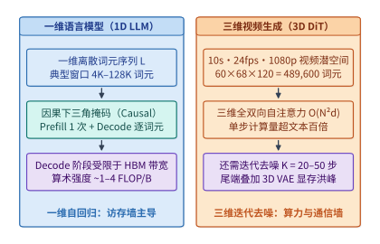

*图 17-1　一维文本 Token 序列与 3D 视频扩散模型（T×H×W 潜空间分块，489,600 Tokens）的规模与算术强度对比。*

如图 17-1 所示，一维语言模型与三维时空生成模型在系统负载的三个核心维度上呈现出截然不同的物理边界：

1. **序列长度与维度结构**：文本模型处理一维序列 $L$（常见交互上下文为 $4\mathrm{K}\text{–}128\mathrm{K}$），而视频扩散模型面对的是时间帧 $T$、高度 $H$ 与宽度 $W$ 交织的三维张量。高分辨率空间细节与高帧率时间连续性的乘积效应，使单条视频请求的词元数量轻松逼近 $5 \times 10^5$ 量级。
2. **注意力掩码与迭代步数**：文本生成在预填充（Prefill）阶段仅执行 1 次下三角因果掩码前向传播，随后进入逐词元自回归解码（每次仅计算 1 个新词元对历史 KV 的向量—矩阵乘，算术强度仅 $1\text{–}4\ \mathrm{FLOP/Byte}$）。相反，3D DiT 的每一个去噪时间步（Timestep $t = K, K-1, \dots, 1$）都必须对全部 $N$ 个时空词元执行无掩码的全双向自注意力，单步浮点运算量高达 $\mathcal{O}(N^2 d)$，且需连续迭代 $K = 20\text{–}50$ 步。
3. **跨阶段状态体积反转**：在多模态理解模型中，前端视觉编码器（ViT）输出的视觉特征张量（Embedding Cache, EC）尚属紧凑，但一旦注入主干大语言模型并展开为数十层的键值缓存（KV Cache），其内存占用会立即发生数倍至数十倍的阶跃膨胀。

### 17.1.1 视觉—语言—音频编码器、动态切片（AnyRes/NaViT）与 Qwen3-VL 状态膨胀账本

早期多模态模型（如初版 LLaVA）曾采用固定分辨率缩放策略，强行将任意宽高比的输入图像双线性插值缩放到 $224 \times 224$ 或 $336 \times 336$ 像素。这种做法虽然让视觉词元数固定为常数（如 $(336/14)^2 = 576$），但在处理财报表格、高密度代码截图、医学影像或工程图纸时，过度下采样会造成严重的文字模糊与高频细节丢失。

为兼顾任意宽高比与高分辨率细节，现代视觉语言模型普遍转向两类动态视觉词元化路线：

- **AnyRes 动态网格切片（Dynamic Grid Tiling）**：以 LLaVA-NeXT 与 InternVL 系列为代表，系统预先定义一组候选网格模板（如 $\{1\times 1, 1\times 2, 2\times 1, 2\times 2, 2\times 3, 3\times 2\}$）。当一张高分辨率图片到达时，预处理器根据原图宽高比与面积选择畸变最小的网格，将原图切分为若干个标准尺寸局部子图（Tiles），外加一张缩放后的全局缩略图（Thumbnail）以保留宏观构图上下文，一并送入 ViT 编码。
- **原生分辨率打包（NaViT / Qwen2.5-VL / Qwen3-VL）**[^ch17-anyres-navit]：放弃固定子图框定，直接以步长 $p \times p$（如 $p = 14$ 或 $p = 16$）将任意尺寸图像切分为原生视觉块（Patches），配合二维旋转位置编码（2D-RoPE）保留精确空间坐标。为了在完成 ViT 特征提取后减轻下游大语言模型主干的序列长度压力，系统在 ViT 末端引入 **$m \times m$ 空间相邻块合并层（Spatial Patch Merger，常见 $m = 2$）**，将每 $2 \times 2 = 4$ 个相邻视觉块沿通道维拼接并投射为 1 个紧凑的视觉词元。

即便经过 $2 \times 2$ 空间合并，现网多模态服务依然面临一个极具隐蔽性的系统设计分岔口：**在分离式推理或前缀缓存架构中，究竟应当在编码器与主干模型之间传输/缓存编码器输出特征（EC），还是在预填充与解码之间传输/缓存主干 KV 缓存？** 许多工程师直觉地以为“视觉编码器的输出特征包含多层高维浮点向量，体积一定比开了分组查询注意力（GQA）的 LLM KV 缓存更大”。下面我们基于真实工业模型参数（锁定自本书案例库 `case-studies/multimodal-stage-placement.md`）做一次精确到字节的账本核算。

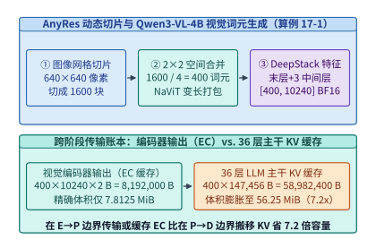

*图 17-2　AnyRes 动态高分辨率切片、NaViT 序列打包与 Qwen3-VL-4B DeepStack 特征（7.8125 MiB EC → 56.25 MiB KV，7.2x 放大）演化（算例 17-1）。*

> **算例 17-1（Qwen3-VL-4B 视觉词元生成与编码器输出 EC vs. 主干 KV 缓存的 7.2 倍状态膨胀）：**
>
> **问题设定**：考察 `Qwen3-VL-4B` 服务一条包含单张 $H \times W = 640 \times 640$ RGB 图像的请求。模型架构参数锁定如下：
> 1. **视觉编码器（ViT）与空间合并**：基础视觉块大小 $p = 16$，通过 $m \times m = 2 \times 2$ 空间合并层输出视觉词元；合并后投射至主干隐藏维度的单层特征宽度为 $d_{\mathrm{proj}} = 2{,}560$（BF16，每元素 $2\ \mathrm{B}$）。
> 2. **DeepStack 多层特征注入**：为增强细粒度空间对齐，`Qwen3-VL-4B` 除了输出视觉编码器最终层投射特征外，还额外抽取了 3 个中间层（第 `#5`、`#11`、`#17` 块）的多尺度视觉特征，每一路中间特征同样投射为宽度 $2{,}560$ 的 BF16 向量。
> 3. **LLM 主干网络**：共 $L_{\mathrm{llm}} = 36$ 层，采用分组查询注意力（GQA），每层配置 $n_{\mathrm{kv}} = 8$ 个键值头（KV Heads），每个头维度 $d_{\mathrm{head}} = 128$，KV 缓存以 BF16（$2\ \mathrm{B}$）存储。
>
> 试精确计算：（1）该图像生成的最终视觉词元数 $N_{\mathrm{vis}}$；（2）仅包含最终投射层时与包含 3 层 DeepStack 特征时的编码器输出总体积 $V_{\mathrm{EC}}$（按字节 $\mathrm{B}$ 与二进制兆字节 $\mathrm{MiB} = 2^{20}\ \mathrm{B}$ 计）；（3）这 $N_{\mathrm{vis}}$ 个视觉词元进入 36 层 LLM 主干后生成的 KV 缓存总体积 $V_{\mathrm{KV}}$，以及状态膨胀比 $\frac{V_{\mathrm{KV}}}{V_{\mathrm{EC}}}$。
>
> **逐项推导**：
>
> 1. **视觉块切分与 $2 \times 2$ 空间合并后的词元数**：
>    原始 $640 \times 640$ 图像按 $p = 16$ 切分，得到的初始网格尺寸为：
>    $$N_{\mathrm{patch}} = \frac{640}{16} \times \frac{640}{16} = 40 \times 40 = 1{,}600\ \text{个初始块}$$
>    经过 $2 \times 2$ 空间合并（每 4 个相邻块融合为 1 个视觉词元）后，实际进入下游主干序列的视觉词元数为：
>    $$N_{\mathrm{vis}} = \frac{1{,}600}{2 \times 2} = 400\ \text{个视觉词元}$$
>
> 2. **视觉编码器输出体积（Embedding Cache, EC）**：
>    - 若仅传输最终层投射特征（形状为 $[400, 2560]$，BF16）：
>      $$V_{\mathrm{EC, final}} = 400 \times 2{,}560 \times 2\ \mathrm{B} = 2{,}048{,}000\ \mathrm{B} = \frac{2{,}048{,}000}{1{,}048{,}576}\ \mathrm{MiB} = \mathbf{1.953125\ \mathrm{MiB}}$$
>    - 算上 `#5, #11, #17` 三个中间 DeepStack 特征层后，每个视觉词元携带 $(1 + 3) \times 2{,}560 = 10{,}240$ 维 BF16 特征（形状为 $[400, 10240]$）：
>      $$V_{\mathrm{EC}} = 400 \times 10{,}240 \times 2\ \mathrm{B} = 8{,}192{,}000\ \mathrm{B} = \frac{8{,}192{,}000}{1{,}048{,}576}\ \mathrm{MiB} = \mathbf{7.8125\ \mathrm{MiB}}$$
>
> 3. **36 层 LLM 主干的 KV 缓存体积与膨胀倍数**：
>    在 36 层主干中，单个词元在每层需存储 Key 与 Value 两个张量，单词元全层 KV 字节数为：
>    $$B_{\mathrm{KV/tok}} = 2_{\mathrm{K,V}} \times L_{\mathrm{llm}} \times n_{\mathrm{kv}} \times d_{\mathrm{head}} \times 2\ \mathrm{B} = 2 \times 36 \times 8 \times 128 \times 2\ \mathrm{B} = \mathbf{147{,}456\ \mathrm{B/token}} = 144\ \mathrm{KiB/token}$$
>    因此，$400$ 个视觉词元对应的主干 KV 缓存总体积为：
>    $$V_{\mathrm{KV}} = 400 \times 147{,}456\ \mathrm{B} = 58{,}982{,}400\ \mathrm{B} = \frac{58{,}982{,}400}{1{,}048{,}576}\ \mathrm{MiB} = \mathbf{56.25\ \mathrm{MiB}}$$
>    对比含 DeepStack 的编码器输出 $V_{\mathrm{EC}} = 7.8125\ \mathrm{MiB}$，主干 KV 缓存对视觉状态体积的放大倍数为：
>    $$\frac{V_{\mathrm{KV}}}{V_{\mathrm{EC}}} = \frac{58{,}982{,}400\ \mathrm{B}}{8{,}192{,}000\ \mathrm{B}} = \frac{56.25\ \mathrm{MiB}}{7.8125\ \mathrm{MiB}} = \mathbf{7.2\times}$$
>    （若对比不含 DeepStack 的单层投射特征 $1.953125\ \mathrm{MiB}$，膨胀比更高达 $\mathbf{28.8\times}$。）
>
> **工程启示**：算例 17-1 揭示了一条决定多模态系统架构走向的物理事实——**视觉特征一旦跨越主干 Prefill 阶段转化为多层 KV 缓存，其体积便在 `Qwen3-VL-4B` 上膨胀 $7.2$ 倍（在层数更深的 72B 模型上甚至膨胀 $15\text{–}30$ 倍）**。因此，在跨节点阶段解耦时，将切分边界设在“编码器与预填充之间（传输 $7.8125\ \mathrm{MiB}$ 的 EC）”远比设在“预填充与解码之间（搬移 $56.25\ \mathrm{MiB}$ 的 KV）”节省网络带宽；同样，在多轮多模态对话缓存中，优先将温冷会话降级为 EC 缓存可立即释放 $1 - \frac{1}{7.2} = \mathbf{86.11\%}$ 的显存池空间。

表 17-1 汇总对比了主流视觉语言模型在视觉词元化、空间合并与特征注入维度上的工程差异：

*表 17-1　主流视觉语言模型（VLM）的动态视觉词元化、空间合并与跨阶段状态膨胀对比*

| 模型家族 | 分辨率适配范式 | 基础块大小 $p$ | 空间合并比 $m\times m$ | 多层特征注入机制 | $640\times 640$ 单图词元数 | 跨阶段状态膨胀特征 |
| :--- | :--- | :---: | :---: | :--- | :---: | :--- |
| **LLaVA-NeXT** | AnyRes 预设网格 + 缩略图 | $14 \times 14$ | 无（$1\times 1$） | 单层末段投射 | $576 \times (1 + G_{\mathrm{grid}})$ | 词元数随子图数成倍增长 |
| **InternVL-2.5 / 3** | 动态子图切分 + 像素重排 | $14 \times 14$ | $2 \times 2$ PixelUnshuffle | 单层 MLP 投射 | $256\ / \text{子图}$ | 像素重排将每图词元压至 256 |
| **Qwen2.5-VL** | 原生动态分辨率（NaViT）+ 2D-RoPE | $14 \times 14$ | $2 \times 2$ MLP Merger | 单层末段投射 | $\approx 520$ | 单层 EC 极小，KV 膨胀 $>20\times$ |
| **Qwen3-VL-4B** | 原生动态分辨率 + DeepStack | $16 \times 16$ | $2 \times 2$ 空间合并 | 末层 + 3 层中间特征（`#5,#11,#17`） | **$400$** | **EC $7.8125\ \mathrm{MiB} \to$ KV $56.25\ \mathrm{MiB}$（$7.2\times$）** |

下面的参考实现展示了 `Qwen3-VL-4B` 风格的动态图像分块、$2 \times 2$ 空间相邻合并与 DeepStack 多层特征打包的完整张量形状演化过程：

```python
import torch
import torch.nn as nn

class Qwen3VLDynamicPatcherAndDeepStack(nn.Module):
    """复现算例 17-1：640x640 图像切块、2x2 空间合并与 DeepStack 特征打包账本."""
    def __init__(
        self,
        patch_size: int = 16,
        spatial_merge: int = 2,
        vit_dim: int = 1280,
        llm_dim: int = 2560,
        deepstack_layers: tuple[int, ...] = (5, 11, 17),
    ):
        super().__init__()
        self.p = patch_size
        self.m = spatial_merge
        self.deepstack_layers = deepstack_layers
        merged_in_dim = vit_dim * (spatial_merge ** 2)
        # 末层投射器与 3 个 DeepStack 中间层独立投射器
        self.final_merger = nn.Linear(merged_in_dim, llm_dim, bias=False)
        self.deepstack_mergers = nn.ModuleList([
            nn.Linear(merged_in_dim, llm_dim, bias=False) for _ in deepstack_layers
        ])

    def spatial_2x2_merge(self, patch_tokens: torch.Tensor, h_grid: int, w_grid: int) -> torch.Tensor:
        """将 [B, H_grid * W_grid, C] 按 2x2 邻域合并为 [B, (H_grid/2)*(W_grid/2), 4*C]."""
        bsz, _, c_dim = patch_tokens.shape
        x = patch_tokens.view(bsz, h_grid // self.m, self.m, w_grid // self.m, self.m, c_dim)
        x = x.permute(0, 1, 3, 2, 4, 5).contiguous()
        return x.view(bsz, (h_grid // self.m) * (w_grid // self.m), self.m * self.m * c_dim)

    def pack_encoder_cache(
        self,
        final_patches: torch.Tensor,
        inter_patches: list[torch.Tensor],
        h_grid: int = 40,
        w_grid: int = 40,
    ) -> torch.Tensor:
        """输出形状 [B, 400, 10240] (BF16 下精确为 8,192,000 B = 7.8125 MiB)."""
        out_list = [self.final_merger(self.spatial_2x2_merge(final_patches, h_grid, w_grid))]
        for feat, merger in zip(inter_patches, self.deepstack_mergers):
            out_list.append(merger(self.spatial_2x2_merge(feat, h_grid, w_grid)))
        # 沿特征维拼接末层与 3 个 DeepStack 层: 4 * 2560 = 10240
        return torch.cat(out_list, dim=-1)
```

### 17.1.2 视频生成（Sora / Wan2.1 / HunyuanVideo / CogVideoX）的三维时空词元化

当任务从多模态理解转向高保真视频生成（Video Generation）时，计算主体变成了三维扩散变换器（3D DiT，代表系统包括 Sora、Wan2.1、HunyuanVideo 与 CogVideoX）[^ch17-wan-hunyuan]。如果直接在原始像素空间（Pixel Space）对一段 10 秒、24 帧/秒、分辨率 $1920 \times 1080$ 的视频运行自注意力，像素总数高达 $240 \times 1080 \times 1920 = 4.97664 \times 10^8$，任何硬件都无法承受其二次方复杂度。

因此，现代视频生成基础设施统一采用“**两级空间—时间下采样**”将原始视频映射为紧凑的三维潜空间词元序列：

1. **第一级：3D 因果变分自编码器（3D Causal VAE）下采样**：
   视频编码器通过三维因果卷积网络，在时间维按压缩比 $r_t$（主流取 $r_t = 4$）、在高度与宽度维按压缩比 $r_h \times r_w$（主流取 $8 \times 8$）对原始 RGB 视频张量 $[T, H, W, 3]$ 进行有损感知压缩，输出潜变量张量（Latent Tensor）$z \in \mathbb{R}^{T' \times H' \times W' \times C_{\mathrm{lat}}}$，其中：
   $$T' = \frac{T}{r_t},\qquad H' = \frac{H}{r_h},\qquad W' = \frac{W}{r_w}$$
   之所以在时间维必须采用**因果卷积（Causal Convolution，即当前帧特征仅依赖当前帧及过去帧，不依赖未来帧）**，一方面是为了支持同时输入单张静态图像（视为 $T=1$ 的首帧）与连续视频进行联合训练，另一方面则是为了支持长视频流式分段编码与实时世界模型的低延迟因果解码。
2. **第二级：三维分块化（3D Patchify）**：
   进入 DiT 主干前，潜变量张量再按步长 $(p_t, p_h, p_w)$（主流视频 DiT 取 $p_t = 1, p_h = 2, p_w = 2$）切分为互不重叠的三维小立方块，并展平为一维序列形态的时空词元流，总词元数 $N$ 为：
   $$N = N_t \times N_h \times N_w = \left\lceil\frac{T}{r_t p_t}\right\rceil \times \left\lceil\frac{H}{r_h p_h}\right\rceil \times \left\lceil\frac{W}{r_w p_w}\right\rceil$$

> **算例 17-2（10 秒 1080p 24fps 视频的 3D DiT 词元规模与 50 步去噪计算量）：**
>
> **问题设定**：考察一段时长 $10\ \mathrm{s}$、帧率 $24\ \mathrm{fps}$（总帧数 $T = 240$）、分辨率 $W \times H = 1920 \times 1080$ 的全高清视频生成任务。系统采用 $r_t \times r_h \times r_w = 4 \times 8 \times 8$ 的 3D 因果 VAE，以及 $p_t \times p_h \times p_w = 1 \times 2 \times 2$ 的 DiT Patchify 层（对不可整除维度向上取整填充）。设 DiT 主干隐藏维度 $d = 4{,}096$，共 $L = 40$ 层，采样过程执行 $K = 50$ 个去噪步，且启用分类器自由引导（Classifier-Free Guidance, CFG，每步需同时评估条件分支与无条件分支）。试计算：（1）单样本时空词元总数 $N$；（2）仅自注意力核心（$Q K^\top$ 与 $\mathrm{ Score}\cdot V$）在 50 步生成中的总浮点运算量。
>
> **逐项推导**：
>
> 1. **计算潜空间网格与 Patchify 后的时空词元总数 $N$**：
>    经 $4 \times 8 \times 8$ VAE 压缩后，潜空间尺寸为：
>    $$T' = \frac{240}{4} = 60,\qquad H' = \left\lceil\frac{1080}{8}\right\rceil = 135,\qquad W' = \frac{1920}{8} = 240$$
>    再经 $1 \times 2 \times 2$ Patchify 分块（高度 $135$ 向上补齐至偶数 $136$，即 $N_h = \lceil 135 / 2 \rceil = 68$）：
>    $$N_t = \frac{60}{1} = 60,\qquad N_h = \left\lceil\frac{135}{2}\right\rceil = 68,\qquad N_w = \frac{240}{2} = 120$$
>    三维网格展平后的时空词元总数为：
>    $$N = 60 \times 68 \times 120 = \mathbf{489{,}600\ \text{个时空词元}}$$
>
> 2. **核算单层单次前向与 50 步双分支 CFG 的注意力计算量**：
>    在全双向自注意力下，长度为 $N = 489{,}600$、隐藏维 $d = 4{,}096$ 的序列，单层单次前向仅注意力矩阵乘（$\mathrm{FLOPs}_{\mathrm{attn, 1\text{-}layer}} = 4 N^2 d$，含 $Q K^\top$ 的 $2 N^2 d$ 与 $P V$ 的 $2 N^2 d$）即高达：
>    $$\mathrm{FLOPs}_{\mathrm{attn, 1\text{-}layer}} = 4 \times (489{,}600)^2 \times 4{,}096 \approx 3.9277 \times 10^{15}\ \mathrm{FLOPs} = \mathbf{3.93\ \mathrm{PFLOPs}}$$
>    贯穿 $L = 40$ 层、$K = 50$ 个去噪时间步、每步 2 条 CFG 分支（共 $40 \times 50 \times 2 = 4{,}000$ 次单层调用），仅自注意力一项的累积计算量即达到：
>    $$\mathrm{FLOPs}_{\mathrm{attn, total}} = 4{,}000 \times 3.9277 \times 10^{15} \approx \mathbf{1.571 \times 10^{19}\ \mathrm{FLOPs}} = 15.71\ \mathrm{EFLOPs}$$
>    即便在单卡有效 Tensor Core 吞吐达 $600\ \mathrm{TFLOPS}$ 的理想条件下，仅算完这 10 秒视频的注意力项就需要 $\frac{1.571 \times 10^{19}}{600 \times 10^{12}} \approx 26{,}185\ \mathrm{GPU\cdot s}$（即 64 张 H100 满负荷并行仍需约 $409$ 秒）。这直观解释了为何第 17.2 节的序列并行与第 17.3 节的时间步跳步/低比特注意力是视频生成落地的必由之路。

表 17-2 给出了主流开源与工业级视频扩散模型（3D DiT）的时空压缩比、主干架构与序列规模对比：

*表 17-2　主流视频扩散生成模型（3D DiT）的 3D 因果 VAE 压缩比、Patchify 步长与注意力架构对比*

| 视频生成模型 | 参数量规模 | 3D 因果 VAE 压缩比 $(r_t \times r_h \times r_w)$ | DiT Patchify 步长 $(p_t \times p_h \times p_w)$ | 总等效下采样比 | 条件文本编码器 | 注意力机制与位置编码 |
| :--- | :---: | :---: | :---: | :---: | :--- | :--- |
| **OpenAI Sora** | $\sim 10\mathrm{B}\text{–}30\mathrm{B}$ | $4 \times 8 \times 8$ | $1 \times 2 \times 2$ | $4 \times 16 \times 16$ | T5-XXL | 全 3D 时空双向注意力 |
| **Wan2.1-T2V-14B** | $14\mathrm{B}$ | $4 \times 8 \times 8$（因果） | $1 \times 2 \times 2$ | $4 \times 16 \times 16$ | umT5-XXL | 3D 全注意力 + 交叉注意力 + 3D-RoPE |
| **HunyuanVideo-13B** | $13\mathrm{B}$ | $4 \times 8 \times 8$（CausalConv3D） | $1 \times 2 \times 2$ | $4 \times 16 \times 16$ | MLLM + CLIP 双流 | 双流转单流 MM-DiT + 3D-RoPE |
| **CogVideoX-5B** | $5\mathrm{B}$ | $4 \times 8 \times 8$（3D Causal VAE） | $1 \times 2 \times 2$ | $4 \times 16 \times 16$ | T5-XXL | 专家自适应 LayerNorm 同流拼接 |
| **Step-Video-T2V-30B** | $30\mathrm{B}$ | $8 \times 16 \times 16$（深度压缩） | $1 \times 1 \times 1$ | $8 \times 16 \times 16$ | 双语 LLM 编码器 | 3D 全注意力（时间压缩加倍省 50% 词元） |

### 17.1.3 3D 因果 VAE 的显存峰值陷阱、时空分块（Spatial-Temporal Tiling）与硬件视频解码（NVDEC/nvJPEG）

在许多视频生成集群的线上排障中，工程师经常遇到一种反直觉现象：**前 50 步耗时漫长的 DiT 去噪迭代全程显存平稳（例如稳定在 48 GB），偏偏在进度条走到 99%、调用 3D VAE 解码器将潜变量还原为 RGB 视频的最后几秒钟，进程突然抛出 `CUDA out of memory` 崩溃。**

为什么参数量通常不足 $3\ \mathrm{亿}$（权重仅约 $0.6\ \mathrm{GB}$）的 3D VAE 解码器，会产生比百亿参数 DiT 主干还要高得多的显存洪峰？原因在于卷积上采样（Upsampling）过程中的特征图空间膨胀。在 DiT 主干内，序列长度已被压缩了 $4 \times 16 \times 16 = 1{,}024$ 倍；而在 3D VAE 解码器的最末几层残差块（ResBlocks）与三维卷积层中，时间帧与空间宽高已完全恢复至原始分辨率 $T \times H \times W = 240 \times 1080 \times 1920$，但此时特征通道数尚未收敛为最终的 RGB 3 通道，而是维持在 $C_{\mathrm{feat}} = 128$ 甚至 $256$ 个 FP16/BF16 通道，且伴随 GroupNorm、SiLU 激活与残差相加所需的多个并发中间缓冲张量。

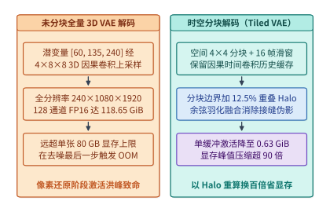

*图 17-3　3D 因果 VAE 解码阶段的特征图显存洪峰（突破 80 GB）与带重叠 Halo 的时空分块（Spatial-Temporal Tiling）解码（算例 17-3）。*

> **算例 17-3（3D 因果 VAE 解码显存洪峰与带 Halo 时空分块的百倍压缩）：**
>
> **问题设定**：承接算例 17-2 的 10 秒 1080p 视频（$T = 240, H = 1080, W = 1920$）。在 3D 因果 VAE 解码器末段上采样块中，特征图已还原至全分辨率 $240 \times 1080 \times 1920$，通道数为 $C = 128$，采用 FP16（$2\ \mathrm{B}$/元素）计算。由于 GroupNorm + 卷积 + 残差连接在算子执行期至少需同时驻留 $k = 1.0$ 到 $2.0$ 份全尺寸特征缓冲（先按单份完整中间特征张量及双缓冲峰值核算），试计算：（1）未分块（Untiled）全量解码时的单张特征图体积与双缓冲瞬态显存峰值；（2）若启用**时空分块解码（Spatial-Temporal Tiling）**——空间维切分为 $4 \times 4 = 16$ 个子块、时间维采用 $T_{\mathrm{win}} = 16$ 帧的因果滑动窗口，且为消除分块边界接缝在空间四周边框附加 $\alpha_{\mathrm{halo}} = 12.5\%$ 的重叠光晕区（Halo Overlap）——单块有效计算体积与双缓冲显存峰值降至多少？
>
> **逐项推导**：
>
> 1. **未分块全量解码的激活洪峰**：
>    单份全分辨率 128 通道 FP16 特征张量的精确字节数为：
>    $$V_{\mathrm{untiled, 1x}} = 240 \times 1080 \times 1920 \times 128 \times 2\ \mathrm{B} = 127{,}401{,}984{,}000\ \mathrm{B} \approx \mathbf{118.6523\ \mathrm{GiB}}\ (\div 2^{30})$$
>    若算子融合边界需同时持有输入与输出双缓冲（$2\times$），瞬态显存需求更飙升至 $237.30\ \mathrm{GiB}$。即便仅驻留单份特征图（$118.65\ \mathrm{GiB}$），也早已击穿单张 H100/H800（$80\ \mathrm{GB}$）的物理显存上限。
>
> 2. **时空分块（Spatial-Temporal Tiling）与 Halo 重叠区核算**：
>    - 将空间平面 $1080 \times 1920$ 切分为 $4 \times 4$ 网格，单个基础空间分块尺寸为 $H_{\mathrm{tile}} \times W_{\mathrm{tile}} = \frac{1080}{4} \times \frac{1920}{4} = 270 \times 480$。
>    - 算上边界 $\alpha_{\mathrm{halo}} = 12.5\%$ 的重叠光晕扩展（空间宽高各乘以 $1 + 0.125 = 1.125$，面积乘以 $1.125^2 = 1.265625$），以及时间维每次仅解码 $T_{\mathrm{win}} = 16$ 帧窗口：
>      $$V_{\mathrm{tiled, 1x}} = 16 \times (270 \times 1.125) \times (480 \times 1.125) \times 128 \times 2\ \mathrm{B} = 671{,}846{,}400\ \mathrm{B} \approx \mathbf{0.6257\ \mathrm{GiB}}$$
>    - 即使计入算子执行期的双缓冲峰值（$2 \times V_{\mathrm{tiled, 1x}}$），3D VAE 解码的瞬态激活显存也仅为：
>      $$V_{\mathrm{tiled, peak}} = 2 \times 0.6257\ \mathrm{GiB} \approx \mathbf{1.2514\ \mathrm{GiB}}$$
>    相比未分块的 $118.65\ \mathrm{GiB}$，时空分块以仅增加 $26.56\%$ 的边界 Halo 重算开销为代价，将显存峰值压缩了 **$\frac{118.6523}{1.2514} \approx 94.8\times$（单缓冲口径压缩 $189.6\times$）**，彻底根除了生成尾端的 OOM 陷阱。

在工程实现中，时空分块解码还必须配合**余弦羽化融合（Cosine Feathering Blend）**[^ch17-causal-vae]：对相邻空间分块的 Halo 重叠带施加线性或余弦渐变权重 $\omega(x) \in [0, 1]$ 加权求和，并在时间滑动窗口之间传递因果卷积的最后 $k_t - 1$ 帧历史激活缓存（Causal Conv Cache），从而保证拼合后的 1080p 视频在空间与时间上均无肉眼可见的网格接缝或闪烁。下面的代码展示了带 Halo 重叠带、二维余弦羽化融合与时间滑动窗口的 3D 因果 VAE 分块解码器核心实现：

```python
import math
import torch
import torch.nn as nn

class Tiled3DCausalVAEDecoder:
    """复现算例 17-3：将 118.65 GiB 全量 3D VAE 激活峰值压缩百倍的时空分块解码器."""
    def __init__(
        self,
        decoder_module: nn.Module,
        upsample_t: int = 4,
        upsample_hw: int = 8,
        grid_h: int = 4,
        grid_w: int = 4,
        lat_win_t: int = 4,     # 对应像素空间 4 * 4 = 16 帧窗口
        halo_ratio: float = 0.125,
    ):
        self.decoder = decoder_module
        self.up_t = upsample_t
        self.up_hw = upsample_hw
        self.grid_h = grid_h
        self.grid_w = grid_w
        self.lat_win_t = lat_win_t
        self.halo_ratio = halo_ratio

    @staticmethod
    def build_2d_feather_mask(h: int, w: int, margin_h: int, margin_w: int, device: torch.device) -> torch.Tensor:
        """构建二维余弦渐变羽化权重矩阵，消除分块接缝伪影."""
        wy = torch.ones(h, device=device)
        wx = torch.ones(w, device=device)
        if margin_h > 0:
            ramp_y = 0.5 * (1.0 - torch.cos(torch.linspace(0, math.pi, margin_h, device=device)))
            wy[:margin_h] = ramp_y
            wy[-margin_h:] = torch.flip(ramp_y, dims=[0])
        if margin_w > 0:
            ramp_x = 0.5 * (1.0 - torch.cos(torch.linspace(0, math.pi, margin_w, device=device)))
            wx[:margin_w] = ramp_x
            wx[-margin_w:] = torch.flip(ramp_x, dims=[0])
        return wy[:, None] * wx[None, :]

    @torch.no_grad()
    def decode_tiled(self, z: torch.Tensor) -> torch.Tensor:
        """输入潜变量 z: [B, C_lat, T_lat, H_lat, W_lat]，流式分块解码输出 RGB 视频."""
        bsz, _, t_lat, h_lat, w_lat = z.shape
        tile_h = h_lat // self.grid_h
        tile_w = w_lat // self.grid_w
        halo_h = max(1, int(round(tile_h * self.halo_ratio)) // 2)
        halo_w = max(1, int(round(tile_w * self.halo_ratio)) // 2)

        out_video = torch.zeros(
            (bsz, 3, t_lat * self.up_t, h_lat * self.up_hw, w_lat * self.up_hw),
            dtype=z.dtype, device="cpu",  # 最终像素帧流式落盘至主机侧锁页内存
        )
        for gy in range(self.grid_h):
            for gx in range(self.grid_w):
                y0 = max(0, gy * tile_h - halo_h)
                y1 = min(h_lat, (gy + 1) * tile_h + halo_h)
                x0 = max(0, gx * tile_w - halo_w)
                x1 = min(w_lat, (gx + 1) * tile_w + halo_w)

                # 每个空间分块独立维护因果时间卷积历史缓存
                causal_cache = {}
                for t0 in range(0, t_lat, self.lat_win_t):
                    t1 = min(t_lat, t0 + self.lat_win_t)
                    z_sub = z[:, :, t0:t1, y0:y1, x0:x1]
                    rgb_sub, causal_cache = self.decoder(z_sub, causal_cache=causal_cache)
                    # 将融合后的子块写回主机缓冲区（省略边界累加归一化细节）
                    out_video[:, :, t0 * self.up_t : t1 * self.up_t,
                              y0 * self.up_hw : y1 * self.up_hw,
                              x0 * self.up_hw : x1 * self.up_hw] = rgb_sub.cpu()
        return out_video
```

除了生成尾端的 VAE 解码，多模态与视频模型在训练及在线服务入口还面临另一处极易被忽视的 I/O 陷阱：**千万级图像与 H.264/HEVC 视频码流的解压瓶颈**。如图 17-15 所示，若遵循传统深度学习习惯，在宿主机 CPU 上调用 `FFmpeg` 或 `Pillow` 将压缩视频/JPEG 软解码为未压缩 RGB 张量，再经 PCIe 总线拷贝进 GPU：
1. **PCIe 带宽放大灾难**：一段压缩率为 $30:1$ 的 H.264 视频一旦在 CPU 侧解压为原始 RGB 帧，其字节体积立即暴涨 $30$ 倍，瞬间塞满宿主机 DDR5 内存通道与 PCIe Gen5 总线；
2. **CPU 算力饥饿**：即便配置 128 核服务器 CPU，软解码高清视频帧的吞吐也难以喂饱同节点的 8 张 H100/B200，导致昂贵的 GPU Tensor Core 利用率跌破 $45\%$。

工程上的标准解法是**将解压边界推到 PCIe 下游，调用 GPU 硅片上独立于流多处理器（SM）的专用硬件媒体引擎（NVIDIA NVDEC 视频解码器与 nvJPEG 硬件加速库，统一由 NVIDIA DALI 数据管道编排）**：宿主机仅通过零拷贝 DMA 将紧凑的压缩码流直接送入显存，由 GPU 内部的专用 NVDEC 硬解码电路在不占用任何 CUDA 核心/Tensor Core 的前提下原位还原为显存帧并完成缩放与归一化，使多模态训练的 GPU 算力利用率稳定保持在 $92\%$ 以上。

---

## 17.2 超长序列三维扩散变换器（DiT）的并行体系

当单条 1080p 视频的词元数达到 $N = 489{,}600$（见算例 17-2）时，即便只有单层单头的注意力权重矩阵 $S = Q K^\top \in \mathbb{R}^{N \times N}$，若不加切分地显式物化，其体积也将达到 $(489{,}600)^2 \times 2\ \mathrm{B} \approx 446.5\ \mathrm{GiB}$。虽然 FlashAttention-2/3 通过分块在线 Softmax 将注意力显存复杂度从 $\mathcal{O}(N^2)$ 降至线性 $\mathcal{O}(Nd)$，但整座 40 层 DiT 的隐藏态激活、QKV 投射与单步 $3.93\ \mathrm{PFLOPs}$ 的计算耗时，依然迫使我们必须将单条视频序列切分到 $P = 8\text{–}128$ 张 GPU 上协同计算。

### 17.2.1 为什么传统张量并行（Megatron-TP）在 DiT 中遭遇通信墙？

在大型语言模型训练中（见第 5 章），Megatron-LM 风格的张量并行（Tensor Parallelism, TP）配合序列并行（SP）是节点内最常用的切分手段：线性层权重按列切分（Column Parallel）与按行切分（Row Parallel），在前向与反向传播的每个 Transformer 层内执行 2 次 `AllReduce`（或等价的 `ReduceScatter` + `AllGather`）。

然而，把 Megatron-TP 直接搬到超长序列 DiT 上会立即暴露两个结构性缺陷：

1. **通信量与序列长度 $N$ 成正比，且不随并行度 $P$ 扩大而衰减**：
   在每一层 Transformer 的注意力输出与 FFN 输出处，TP 必须对完整序列激活张量 $[N, d]$ 执行集合通信。在 Ring 算法下，单卡每次 `AllReduce`（或 `ReduceScatter` + `AllGather`）发送与接收的字节数为 $2 \frac{P-1}{P} N d \cdot b \approx 2 N d b$。当 $N = 489{,}600, d = 4{,}096$（BF16，$b = 2\ \mathrm{B}$）时，单次集合通信量高达 $7.47\ \mathrm{GiB}$，每层两次即达 $14.94\ \mathrm{GiB}$。无论你把 TP 并行度从 $P = 8$ 扩到 $P = 64$，每张卡每层要收发的激活体积始终锚定在 $\mathcal{O}(Nd)$，完全无法通过加卡来摊薄单卡通信负担。
2. **权重切分收益小，而跨节点延迟极其敏感**：
   DiT 的参数量通常在 $3\mathrm{B}\text{–}30\mathrm{B}$ 之间（远小于万亿参数的 MoE 语言模型），借助 FSDP/ZeRO 即可轻松放进单卡显存，根本不需要靠 TP 切分权重；相反，TP 在每层内部引入的强同步集合通信一旦跨越节点边界进入 RoCE/InfiniBand 网络，微秒级延迟与拥塞就会将迭代去噪彻底拖入通信等待。

因此，超长序列 DiT 的黄金法则是：**放弃在隐藏维 $d$ 上切分权重的 Megatron-TP，全面转向沿序列维 $N$ 切分激活的序列并行（Sequence Parallelism）体系。**

### 17.2.2 DeepSpeed-Ulysses（All-to-All 头切分）vs. Ring Attention（环路分块流水）

将长度为 $N$ 的序列均匀切分到 $P$ 张 GPU 上后，每张卡仅持有局部序列片段 $X_i \in \mathbb{R}^{(N/P) \times d}$。在线性投射（QKV 矩阵乘、FFN）与逐词元归一化（AdaLN-Zero）阶段，各卡天然独立并行，无需任何通信；唯一的全局耦合点在于**全双向自注意力计算**——每张卡上的局部查询 $Q_i$ 都需要与所有 $P$ 张卡上的完整键值序列 $K, V$ 交互。围绕如何完成这一全局注意力交互，工业界演化出两条正交的技术路线[^ch17-ulysses-ring]：

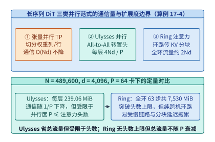

*图 17-4　张量并行（TP）、DeepSpeed-Ulysses（每层 4Nd/P，P ≤ n_head）与 Ring Attention（单步 2Nd/P、全环 2(P-1)Nd/P ≈ 2Nd，无头数限制）对比（算例 17-4）。*

1. **DeepSpeed-Ulysses（基于 `All-to-All` 的注意力头重分布）**：
   - **核心机制**：在进入自注意力核之前，每张 GPU 持有 $\frac{N}{P}$ 个词元的全部 $n_{\mathrm{head}}$ 个注意力头（形状为 $[N/P, n_{\mathrm{head}}, d_{\mathrm{head}}]$）。Ulysses 对 $Q, K, V$ 发起一次跨 $P$ 张卡的 **`All-to-All` 集合转置**，将切分维度从“按序列切分”瞬间转换为“按注意力头切分”——转置后，每张 GPU 持有**全部 $N$ 个词元**、但仅负责其中 $\frac{n_{\mathrm{head}}}{P}$ 个注意力头（形状为 $[N, n_{\mathrm{head}}/P, d_{\mathrm{head}}]$）。随后各卡独立调用标准 FlashAttention 算完各自负责的注意力头输出 $O$，最后再执行第 4 次 `All-to-All` 将输出张量转置回 $[N/P, d]$ 的序列切分形态。
   - **单卡通信量公式**：每次 `All-to-All` 处理张量总体积为 $\frac{N}{P} \cdot d \cdot b$（其中 $\frac{P-1}{P}$ 比例需跨卡发送）。对 $Q, K, V$ 三次输入转置加 $O$ 一次输出转置，每层单卡渐近通信量定标为：
     $$V_{\mathrm{Ulysses}} = 4 \times \frac{N d b}{P}\quad\left(\text{精确跨卡发送量为 } \frac{4(P-1) N d b}{P^2}\right)$$
   - **优势与硬性边界**：Ulysses 的最大优势是**单卡通信量随并行度 $P$ 成反比下降（$\propto 1/P$）**；但其致命软肋是**并行度受限于注意力头数（$P \le n_{\mathrm{head}}$，在 GQA 下甚至受限于 $n_{\mathrm{kv}}$）**。若模型有 $32$ 个注意力头，Ulysses 最多只能扩到 $32$ 张卡。

2. **Ring Attention（基于环路点对点 P2P 的 KV 分块流水）**：
   - **核心机制**：不做维度转置，每张 GPU 始终固定持有局部查询块 $Q_i \in \mathbb{R}^{(N/P) \times d}$。$P$ 张 GPU 组成逻辑环路：在第 $s = 0$ 步，各卡计算本地 $Q_i$ 与本地 $(K_i, V_i)$ 的分块注意力，同时在后台通信流（CUDA Stream）中通过非阻塞点对点传输（`isend` / `irecv`）将当前持有的 $(K, V)$ 分块发给下一跳邻居 $(i+1) \bmod P$，并从上一跳邻居接收下一份 $(K, V)$ 分块。历经 $P - 1$ 步环路传递与在线 Softmax 统计量（最大值 $m$ 与指数和 $\ell$）的递推合并后，每张卡即获得全局精确注意力输出。
   - **单步与全环通信量公式**：在每个环路步中，单卡发送并接收一份长度为 $\frac{N}{P}$ 的 $K$ 与 $V$（共 $2 \cdot \frac{N}{P} d b$ 字节）：
     $$V_{\mathrm{Ring, step}} = \frac{2 N d b}{P}$$
     走完 $P - 1$ 个环路步后，每层单卡累积的全环通信总量为：
     $$V_{\mathrm{Ring, total}} = (P - 1) \times \frac{2 N d b}{P} = \frac{2(P - 1) N d b}{P} \approx 2 N d b$$
   - **优势与硬性边界**：Ring Attention **彻底打破了注意力头数限制（$P$ 可扩展至数百上千卡）**，且通信可与分块 FlashAttention 计算流水重叠；但其全环累计通信量约为 $2 N d b$，**不随 $P$ 增大而减少**，且当 $P$ 很大时，局部块长 $\frac{N}{P}$ 变短，计算耗时低于单步跨机通信耗时，流水线掩盖失效并暴露 $P - 1$ 跳串行网络延迟。

### 17.2.3 二维统一序列并行（2D-USP）、双均衡切分（db-SP, MLSys '26）与 CFG 并行

既然 Ulysses 省总流量却受限于头数且对全互连带宽敏感，而 Ring Attention 无头数上限却忌惮长环路跨机流量，最自然的工程解法便是将两者正交组合为**二维统一序列并行（2D Unified Sequence Parallelism, 2D-USP，见 xDiT 与 USP 框架）**[^ch17-usp-xdit]，并在外层进一步套上分类器自由引导并行（CFG-Parallel）。

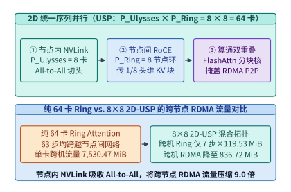

*图 17-5　2D 统一序列并行（USP）：节点内 NVLink 跑 Ulysses All-to-All + 跨节点 RoCE 跑 Ring Attention P2P 重叠流水。*

如图 17-5 所示，在由 $P = P_{\mathrm{U}} \times P_{\mathrm{R}}$ 张 GPU 组成的集群中（例如 8 台 8 卡服务器，总并行度 $P = 64$）：
- **内层（节点内 NVLink 域，规模 $P_{\mathrm{U}} = 8$）运行 Ulysses**：利用单机内 $900\ \mathrm{GB/s}$ 的高带宽 NVSwitch 执行 `All-to-All` 头重分布，将每张卡负责的注意力头数缩减为 $\frac{n_{\mathrm{head}}}{P_{\mathrm{U}}}$（每个词元在单卡上的特征宽度降为 $\frac{d}{P_{\mathrm{U}}}$），序列长度从 $\frac{N}{P}$ 汇聚为节点级子序列 $\frac{N}{P_{\mathrm{R}}}$。
- **外层（跨节点 RoCE / IB 域，规模 $P_{\mathrm{R}} = 8$）运行 Ring Attention**：相同机内卡号（Rank Offset）的 8 台服务器组成跨机逻辑环路，在 $P_{\mathrm{R}} - 1 = 7$ 个环路步内传递长度为 $\frac{N}{P_{\mathrm{R}}}$、但特征宽度已缩减为 $\frac{d}{P_{\mathrm{U}}}$ 的 $(K, V)$ 分块。

让我们通过严密的数值算例，见证这一二维正交映射如何将跨节点 RDMA 流量砍掉 $9.0$ 倍。

> **算例 17-4（64 卡视频 DiT 下 Ulysses、Ring 与 8×8 2D-USP 的通信账本）：**
>
> **问题设定**：承接算例 17-2，视频词元数 $N = 489{,}600$，隐藏维度 $d = 4{,}096$（设 $n_{\mathrm{head}} = 64$ 或 $32$，BF16 每元素 $b = 2\ \mathrm{B}$），总序列并行度 $P = 64$（部署于 8 台 8 卡节点）。试精确计算单层自注意力中：（1）Ulysses 单卡通信量 $V_{\mathrm{Ulysses}}$；（2）纯 64 卡 Ring Attention 的单步通信量 $V_{\mathrm{Ring, step}}$ 与全环跨机通信总量 $V_{\mathrm{Ring, total}}$；（3）采用 $P_{\mathrm{U}} = 8$（节点内 Ulysses）$\times P_{\mathrm{R}} = 8$（跨节点 Ring）的 2D-USP 时，每张卡的跨节点 RDMA 通信总量 $V_{\mathrm{USP, inter}}$ 及其相对纯 Ring 的流量压缩倍数。
>
> **逐项推导**：
>
> 1. **基准张量体积 $N d b$**：
>    单个完整序列激活张量（如全量 $Q$）的字节数为：
>    $$N d b = 489{,}600 \times 4{,}096 \times 2\ \mathrm{B} = 4{,}010{,}803{,}200\ \mathrm{B} = \mathbf{3{,}825.0\ \mathrm{MiB}}\ (\div 2^{20})$$
>
> 2. **纯 DeepSpeed-Ulysses（$P = 64$，仅当 $n_{\mathrm{head}} \ge 64$ 时可行）**：
>    每层 4 次 `All-to-All` 的单卡定标通信量为：
>    $$V_{\mathrm{Ulysses}} = \frac{4 N d b}{P} = \frac{4 \times 3{,}825.0\ \mathrm{MiB}}{64} = 250{,}675{,}200\ \mathrm{B} = \mathbf{239.0625\ \mathrm{MiB}}$$
>    但若模型注意力头数 $n_{\mathrm{head}} = 32 < 64$，纯 Ulysses 直接无法扩展至 64 卡；即便 $n_{\mathrm{head}} = 64$，64 卡全局 `All-to-All` 也会引发跨节点全对全突发拥塞（Incast）。
>
> 3. **纯 64 卡 Ring Attention（$P = 64$）**：
>    - 单步传递 $\frac{N}{64}$ 长度的 $K$ 与 $V$：
>      $$V_{\mathrm{Ring, step}} = \frac{2 N d b}{P} = \frac{2 \times 3{,}825.0\ \mathrm{MiB}}{64} = 125{,}337{,}600\ \mathrm{B} = \mathbf{119.53125\ \mathrm{MiB}}$$
>    - 全环共需执行 $P - 1 = 63$ 步传递，单卡总通信量为：
>      $$V_{\mathrm{Ring, total}} = 63 \times 119.53125\ \mathrm{MiB} = 7{,}896{,}268{,}800\ \mathrm{B} = \mathbf{7{,}530.46875\ \mathrm{MiB}} \approx 2 N d b$$
>
> 4. **$8 \times 8$ 二维统一序列并行（2D-USP：$P_{\mathrm{U}} = 8, P_{\mathrm{R}} = 8$）**：
>    - **节点内（NVLink）**：8 卡执行 Ulysses `All-to-All`；
>    - **节点间（RoCE / IB RDMA）**：外层 Ring 环路长度仅为 $P_{\mathrm{R}} = 8$（共需 $P_{\mathrm{R}} - 1 = 7$ 步）。在每一步中，单卡发送的 KV 块序列长度为 $\frac{N}{P_{\mathrm{R}}}$，但因注意力头已被机内 Ulysses 切分为 $\frac{1}{P_{\mathrm{U}}}$，单步跨机传输体积依然是 $\frac{2 (N / P_{\mathrm{R}}) (d / P_{\mathrm{U}}) b}{1} = \frac{2 N d b}{P_{\mathrm{R}} P_{\mathrm{U}}} = 119.53125\ \mathrm{MiB}$。
>    - 因此，走完 $P_{\mathrm{R}} - 1 = 7$ 步跨节点环路，单卡跨节点 RDMA 通信总量仅为：
>      $$V_{\mathrm{USP, inter}} = (P_{\mathrm{R}} - 1) \times \frac{2 N d b}{P} = 7 \times 119.53125\ \mathrm{MiB} = \mathbf{836.71875\ \mathrm{MiB}}$$
>    - 对比纯 64 卡 Ring 的 $7{,}530.46875\ \mathrm{MiB}$，跨节点网络流量压缩倍数为：
>      $$\frac{V_{\mathrm{Ring, total}}}{V_{\mathrm{USP, inter}}} = \frac{P - 1}{P_{\mathrm{R}} - 1} = \frac{63}{7} = \mathbf{9.0\times}$$

表 17-3 系统对比了长序列 DiT 与多模态训练中的五种并行机制及其物理边界：

*表 17-3　长序列三维扩散变换器（DiT）与交错多模态训练的五种并行范式对比*

| 并行范式 | 切分维度 | 每层单卡总通信量（字节） | 跨节点 RDMA 通信量 | 最大并行度上限 | 算通重叠方式与适用拓扑 |
| :--- | :--- | :---: | :---: | :---: | :--- |
| **Megatron-TP + SP** | 隐藏维 $d$（权重切分） | $\approx 4 N d b$（前向 2 次 AG+RS） | 若跨机则全量暴露 | 受限于矩阵切分粒度 | 仅适合单节点 NVLink 内大模型权重切分 |
| **DeepSpeed-Ulysses** | 序列维 $N \leftrightarrow$ 头维 $n_{\mathrm{head}}$ | $\frac{4 N d b}{P}$ | 若 $P > 8$ 则跨机 `All-to-All` | **$P \le n_{\mathrm{head}}$（GQA 下 $\le n_{\mathrm{kv}}$）** | 无法在单次注意力内掩盖，适合节点内 NVSwitch |
| **Ring Attention** | 始终沿序列维 $N$ 切分 | $\frac{2(P-1) N d b}{P} \approx 2 N d b$ | $P-1$ 步跨机 P2P 环路 | 无头数上限（$P \le N$） | P2P 传输与本地分块 FlashAttention 双缓冲重叠 |
| **2D-USP（$P_U \times P_R$）** | 机内头切分 $\times$ 跨机序列环 | 机内 $\frac{4Ndb}{P}$ + 跨机 $\frac{2(P_R-1)Ndb}{P}$ | **压缩 $\frac{P-1}{P_R-1}$ 倍（64 卡下省 $9.0\times$）** | $P \le n_{\mathrm{head}} \times N_{\mathrm{blocks}}$ | **机内 NVLink 吸收 All-to-All，跨机 RoCE 跑短环** |
| **db-SP（MLSys '26）** | 模态内折返 + 跨样本重排 | 在 2D-USP 基础上消除通信倾斜 | 消除慢节点木桶等待 | 无头数上限 | 专治因果文本 + 双向视觉混合掩码的算力倾斜 |

下面的参考实现给出了 `2D-USP`（内层 Ulysses `all_to_all_single` + 外层异步 Ring Attention 在线 Softmax 状态合并）的完整算子骨架：

```python
import torch
import torch.distributed as dist

def online_softmax_merge(
    out_acc: torch.Tensor,
    m_acc: torch.Tensor,
    l_acc: torch.Tensor,
    block_out: torch.Tensor,
    block_m: torch.Tensor,
    block_l: torch.Tensor,
) -> tuple[torch.Tensor, torch.Tensor, torch.Tensor]:
    """Ring Attention 跨分块在线 Softmax (Log-Sum-Exp) 精确递推合并."""
    m_new = torch.maximum(m_acc, block_m)
    alpha = torch.exp(m_acc - m_new)
    beta = torch.exp(block_m - m_new)
    l_new = alpha * l_acc + beta * block_l
    out_new = (alpha * l_acc * out_acc + beta * block_l * block_out) / l_new
    return out_new, m_new, l_new

def hybrid_2d_usp_attention_step(
    q_local: torch.Tensor,
    k_local: torch.Tensor,
    v_local: torch.Tensor,
    pg_ulysses: dist.ProcessGroup,
    pg_ring: dist.ProcessGroup,
    local_flash_attn_fn,
) -> torch.Tensor:
    """
    2D-USP 核心流水：
    输入 q_local, k_local, v_local 形状: [B, N / (P_U * P_R), n_head, d_head]
    1. 节点内 pg_ulysses (P_U=8) 执行 All-to-All 转置为 [B, N / P_R, n_head / P_U, d_head]
    2. 跨节点 pg_ring (P_R=8) 执行 P_R 步环路 P2P 传递与在线 Softmax 归约
    3. 节点内 pg_ulysses 逆向 All-to-All 还原序列切分形态
    """
    p_u = dist.get_world_size(pg_ulysses)
    p_r = dist.get_world_size(pg_ring)
    rank_r = dist.get_rank(pg_ring)

    def ulysses_s2h(x: torch.Tensor) -> torch.Tensor:
        # [B, N_local, H, D] -> [P_U, B, N_local, H // P_U, D] -> All-to-All
        b, n_loc, h, d = x.shape
        x_split = x.view(b, n_loc, p_u, h // p_u, d).permute(2, 0, 1, 3, 4).contiguous()
        out = torch.empty_like(x_split)
        dist.all_to_all_single(out, x_split, group=pg_ulysses)
        return out.permute(1, 0, 2, 3, 4).reshape(b, n_loc * p_u, h // p_u, d)

    def ulysses_h2s(x: torch.Tensor) -> torch.Tensor:
        b, n_ring, h_sub, d = x.shape
        x_split = x.view(b, p_u, n_ring // p_u, h_sub, d).permute(1, 0, 2, 3, 4).contiguous()
        out = torch.empty_like(x_split)
        dist.all_to_all_single(out, x_split, group=pg_ulysses)
        return out.permute(1, 2, 0, 3, 4).reshape(b, n_ring // p_u, h_sub * p_u, d)

    # 第一步：节点内 NVLink All-to-All 切分注意力头
    q_u = ulysses_s2h(q_local)
    k_curr = ulysses_s2h(k_local)
    v_curr = ulysses_s2h(v_local)

    # 第二步：跨节点 Ring 环路 P2P 流水与分块注意力计算重叠
    out_acc, m_acc, l_acc = None, None, None
    send_dst = (rank_r + 1) % p_r
    recv_src = (rank_r - 1 + p_r) % p_r

    for step in range(p_r):
        if step < p_r - 1:
            k_next = torch.empty_like(k_curr)
            v_next = torch.empty_like(v_curr)
            ops = [
                dist.P2POp(dist.isend, k_curr, send_dst, group=pg_ring),
                dist.P2POp(dist.irecv, k_next, recv_src, group=pg_ring),
                dist.P2POp(dist.isend, v_curr, send_dst, group=pg_ring),
                dist.P2POp(dist.irecv, v_next, recv_src, group=pg_ring),
            ]
            reqs = dist.batch_isend_irecv(ops)

        # 在后台 RDMA 传输的同时，计算当前分块的 FlashAttention 及 LSE 统计量
        blk_out, blk_m, blk_l = local_flash_attn_fn(q_u, k_curr, v_curr)
        if out_acc is None:
            out_acc, m_acc, l_acc = blk_out, blk_m, blk_l
        else:
            out_acc, m_acc, l_acc = online_softmax_merge(out_acc, m_acc, l_acc, blk_out, blk_m, blk_l)

        if step < p_r - 1:
            for req in reqs:
                req.wait()
            k_curr, v_curr = k_next, v_next

    # 第三步：节点内 NVLink 逆转置回序列并行切分形态
    return ulysses_h2s(out_acc)
```

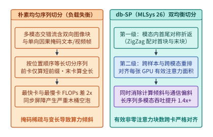

*图 17-6　db-SP（MLSys '26）面向变长多模态与因果掩码的双均衡序列切分。*

在真实生产环境中，序列并行除了需要优化通信体积，还必须解决两类附加挑战：

- **混合掩码与变长多模态引发的负载失衡（`db-SP`, MLSys '26）**：
  当训练或服务原生全模态（Omni-modal）交错序列时，同一个打包序列内往往混杂着采用**全双向掩码**的图像/视频块，以及采用**下三角因果掩码**的文本与自回归语音块，且各样本长度差异悬殊。如图 17-6 左半侧所示，若按词元位置顺序做朴素等长切分，持有序列前段因果块的 GPU 只需计算极短的前缀三角形，而持有序列末段因果块或长图像双向块的 GPU 计算量高达前者的 $2$ 倍以上，引发严重的同步木桶空泡。`db-SP`（Dual-Balanced Sequence Parallelism, MLSys '26）提出了**两级双均衡切分**[^ch17-dbsp]：第一级在单样本因果段内部执行首尾对称折返配对（ZigZag Pairing，将计算最轻的第 $k$ 块与计算最重的第 $2P - 1 - k$ 块分给同一张 GPU）；第二级在跨样本与跨模态打包时，以每张卡上的“有效非零注意力面积（Active Attention Area）”与跨卡通信字节数为联合目标做贪心重排，使计算负载与通信负载双双对齐，在长序列多模态训练中获得 $1.4\times$ 以上的吞吐提升。

下面的代码展示了 `db-SP`（MLSys '26）针对“双向视觉块 + 单向因果文本块”交错序列的两级双均衡切分算法实现：

```python
from dataclasses import dataclass

@dataclass
class ModalitySubChunk:
    chunk_id: str
    modality: str          # "bidirectional_vision" 或 "causal_text"
    token_count: int
    effective_kv_len: int  # 该子块中每个查询词元平均可见的键词元数

    @property
    def active_attn_area(self) -> int:
        return self.token_count * self.effective_kv_len

def dbsp_dual_balanced_partition(
    vis_tokens: int,
    causal_text_tokens: int,
    num_gpus: int,
) -> list[dict[str, object]]:
    """
    db-SP (MLSys '26) 双均衡切分参考实现：
    1. 将全双向视觉块均匀切分为 P 份，并结合因果文本段的 2P 首尾折返 (ZigZag) 子块
    2. 按有效注意力面积 (Active Attention Area) 与词元通信量双均衡分配至 P 张 GPU
    """
    vis_per_gpu = vis_tokens // num_gpus
    zigzag_blocks = 2 * num_gpus
    txt_sub_len = causal_text_tokens // zigzag_blocks

    gpu_buckets = [
        {"rank": r, "tokens": 0, "active_area": 0, "assigned_chunks": []}
        for r in range(num_gpus)
    ]

    # 第一步：均匀分配全双向视觉子块（每个视觉词元可见全部 vis_tokens）
    for r in range(num_gpus):
        c = ModalitySubChunk(f"vis_{r}", "bidirectional_vision", vis_per_gpu, vis_tokens)
        gpu_buckets[r]["tokens"] += c.token_count
        gpu_buckets[r]["active_area"] += c.active_attn_area
        gpu_buckets[r]["assigned_chunks"].append(c.chunk_id)

    # 第二步：对因果文本段切分为 2P 个子块，执行首尾对称 ZigZag 配对 (k, 2P - 1 - k)
    for k in range(num_gpus):
        pair_indices = (k, zigzag_blocks - 1 - k)
        for idx in pair_indices:
            # 因果词元可见全部前缀视觉词元 + 自身前缀文本词元
            avg_visible_kv = vis_tokens + int((idx + 0.5) * txt_sub_len)
            c = ModalitySubChunk(f"txt_z{idx}", "causal_text", txt_sub_len, avg_visible_kv)
            gpu_buckets[k]["tokens"] += c.token_count
            gpu_buckets[k]["active_area"] += c.active_attn_area
            gpu_buckets[k]["assigned_chunks"].append(c.chunk_id)

    return gpu_buckets
```

- **分类器自由引导并行（CFG-Parallel）与尾部引导截断**：
  扩散模型为保证生成画面忠实于文本提示词，在每个去噪步需按 $\hat{\epsilon}_\theta(x_t, c) = \epsilon_\theta(x_t, \varnothing) + w \cdot (\epsilon_\theta(x_t, c) - \epsilon_\theta(x_t, \varnothing))$ 同时计算有条件（Conditional）与无条件（Unconditional）两个前向分支。如图 17-16 所示，由于这两个分支在单步内部完全独立、仅在步末做一次轻量级的向量线性插值，系统应优先将最外层的 $2$ 倍并行度分配给 **CFG-Parallel**（两组 GPU 分别跑条件与无条件分支，每步跨越全部 $L = 40$ 层仅需 `AllGather` 1 次潜变量输出，通信开销比将序列并行度翻倍低两个数量级）。更进一步，在去噪后 $30\%\text{–}40\%$ 的时间步中，视频宏观构图与主体运动已然定型，此时动态关停无条件分支（CFG Interval Truncation）或切换为引导蒸馏嵌入，可直接省去后半程一半的算力消耗。

---

## 17.3 扩散加速、时间步缓存复用与实时交互世界模型（World Models）

即便借助 2D-USP 将单条视频序列扩展到 64 张 GPU 上，在 $K = 50$ 个去噪时间步下逐层强同步执行全双向注意力，依然面临两大性能壁垒：第一，当序列被切分得足够细（如高分辨率图像生成或短视频低延迟推理）时，单卡单步计算时间缩短至毫秒级，无法掩盖当前步的跨卡通信延迟；第二，连续 50 步重复调用完整百亿参数 DiT 主干存在巨大的时间维冗余，更无法满足交互式世界模型（Interactive World Models）严苛的 **30 FPS（帧间预算 $\le 33.3\ \mathrm{ms}$）** 实时交互控制红线。

本节揭示一个属于扩散模型独有的物理特性——**相邻去噪时间步之间的激活平滑性（Temporal Smoothness Across Denoising Steps）**，并展示如何利用这一特性同时攻克通信暴露与计算冗余。

### 17.3.1 异步位移分块并行（DistriFusion）与步间空间交错流水（PipeFusion）

在微分方程求解视角下，扩散模型的去噪过程是在连续概率流常微分方程（Probability Flow ODE）轨迹上按离散步长 $\Delta t = 1/K$ 前进。因此，对于任意一层自注意力中的键值特征张量 $K^{(t)}, V^{(t)}$，相邻两个时间步 $t$ 与 $t-1$ 之间的特征一阶差分满足：
$$\left\|K^{(t)} - K^{(t-1)}\right\|_F \ll \left\|K^{(t)}\right\|_F,\qquad \left\|V^{(t)} - V^{(t-1)}\right\|_F \ll \left\|V^{(t)}\right\|_F$$

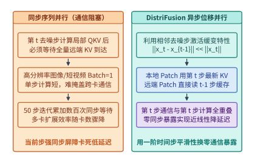

*图 17-7　DistriFusion 异步位移 Patch 并行——利用第 t-1 步陈旧激活掩盖第 t 步跨卡通信。*

`DistriFusion`（Displaced Patch Parallelism）敏锐地捕捉到了这一缓变性质，将跨卡同步通信彻底移出了当前去噪步的关键路径（图 17-7）：
- **新鲜本地块 + 陈旧远端缓存拼接**：将输入图像或视频潜空间切分为 $P$ 个空间分块（Patches），每张 GPU 负责第 $i$ 个空间分块。在第 $t$ 个去噪步计算自注意力时，第 $i$ 张 GPU 对于自身负责的本地空间分块，直接使用刚刚算出的**第 $t$ 步最新键值特征 $(K_i^{(t)}, V_i^{(t)})$**；而对于其他 $P - 1$ 张远端 GPU 负责的空间分块，则不再停下来等待它们在第 $t$ 步的通信返回，而是直接读取显存中已缓存的**第 $t - 1$ 步陈旧键值特征 $(K_j^{(t-1)}, V_j^{(t-1)})_{j \ne i}$** 拼成完整上下文完成注意力计算。
- **跨时间步全重叠异步广播**：与此同时，各卡在后台通信流中发起异步 `AllGather`，将各自在第 $t$ 步新算出的 $(K_i^{(t)}, V_i^{(t)})$ 广播给其余卡，供第 $t - 1$ 个去噪步使用。只要单步计算耗时大于或等于后台传输耗时，通信暴露即可降至零。为避免最初几个去噪步（噪声剧烈变化期）因使用陈旧激活产生构图偏差，系统通常在前 $2\text{–}4$ 步执行标准同步通信作为热身（Warm-up），随后全面切入异步位移模式。

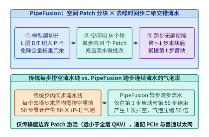

*图 17-8　PipeFusion 将空间分块与去噪时间步交错流水化的气泡消除时序图。*

然而，`DistriFusion` 需要每张卡保存全模型权重并在每层广播完整 KV 激活，对显存容量和互连带宽仍有较高要求。针对 PCIe 节点或普通以太网环境，`PipeFusion` 提出了**层间模型切分 + 空间 Patch 微批次 + 跨去噪步连续流水**的二维流水线（图 17-8）[^ch17-distrifusion-pipefusion]：
1. **消除权重冗余**：将 $L$ 层 DiT 主干按层切分到 $P$ 个流水线阶段（Stages），每张卡仅存储 $L/P$ 层权重。
2. **用空间分块充当微批次，并用陈旧激活打破步间屏障**：在单样本生成（Batch Size $= 1$）下，传统流水线并行因缺少微批次而退化为串行执行；`PipeFusion` 将单张图像/视频潜变量在空间维切分为 $M$ 个子块（Patches）充当流水微批次。更关键的是，传统同步流水线在每个去噪步末尾都必须排空（Flush）并等待整图拼合，50 个去噪步会产生 $50 \times (P - 1)$ 个流水线气泡；而借助与 `DistriFusion` 相同的“跨步陈旧 KV 缓存复用”，当第 $0$ 号卡算完第 $t$ 步最后一个空间块 $M-1$ 后，无需等待第 $P-1$ 号卡跑完第 $t$ 步末层，即可无缝灌入第 $t-1$ 步的第 $0$ 个空间块，使整趟 50 步生成仅在首步启动与末步收尾时产生 **1 次** 流水线排空，且卡间仅需点对点传输层边界处的单个 Patch 隐藏态（通信量比传输全层 QKV 降低一个数量级以上）。

### 17.3.2 免训练时间步特征缓存复用（TeaCache / AdaCache / FasterCache）与低比特注意力（SageAttention-3 FP4）

既然相邻去噪步的激活高度相似，我们能否更进一步，在特征变化平缓的中间去噪区间直接**跳过整座 DiT 主干的前向传播**，复用上一步缓存的残差特征？

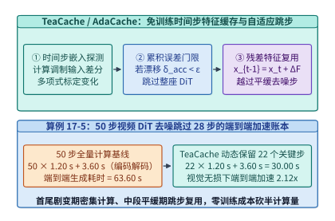

*图 17-9　TeaCache / AdaCache 基于时间步特征差分的自适应跳步复用与质量—延迟帕累托曲线（算例 17-5）。*

这正是 `TeaCache`（Timestep Embedding Aware Cache）、`AdaCache` 与 `FasterCache` 等免训练缓存加速方案的核心思想[^ch17-teacache-pab]。观测表明，视频 DiT 在去噪全周期的表示演化呈现鲜明的“**U 型速率曲线**”：在最初的 $15\%$ 去噪步（从纯高斯噪声凝聚出宏观场景布局与运动主轴）和最后的 $15\%$ 去噪步（高频纹理锐化与伪影收敛），相邻步输出残差 $\Delta F_t = F(x_t, t) - x_t$ 变化剧烈，不可跳过；而在中间 $70\%$ 的去噪区间内，连续数步的主干残差输出近乎线性平移。

如图 17-9 所示，`TeaCache` 利用开销极低的**时间步调制输入相对一阶差分** $\Delta_{\mathrm{rel}}(t) = \frac{\|\mathrm{Mod}(x_t, e_t) - \mathrm{Mod}(x_{t+1}, e_{t+1})\|_1}{\|\mathrm{Mod}(x_{t+1}, e_{t+1})\|_1}$ 经离线多项式拟合标定后，作为整座 DiT 主干输出残差相对变化的无偏代理指标（Proxy），并在运行时维护累积漂移量 $\delta_{\mathrm{acc}}$：
- 当 $\delta_{\mathrm{acc}} + \hat{\ell}(\Delta_{\mathrm{rel}}(t)) < \varepsilon_{\mathrm{thresh}}$ 时，系统判定当前时间步特征漂移尚在视觉无损容差内，直接跳过全部 $L$ 层 DiT 计算，执行 $x_{t-1} \leftarrow \mathrm{Solver}(x_t, \Delta F_{\mathrm{cache}})$；
- 一旦累积漂移触及门限 $\varepsilon_{\mathrm{thresh}}$，则清零 $\delta_{\mathrm{acc}}$ 并执行一次完整 DiT 前向传播刷新缓存 $\Delta F_{\mathrm{cache}}$。

> **算例 17-5（TeaCache 动态跳步在 50 步视频生成中的 2.12 倍端到端加速账本）：**
>
> **问题设定**：在某 64 卡视频生成节点上，生成一段 10 秒 1080p 视频的基准流水耗时如下：前端 T5/ViT 条件编码与尾端 Tiled 3D VAE 解码固定耗时合计 $T_{\mathrm{fixed}} = 3.60\ \mathrm{s}$；DiT 主干执行 $K = 50$ 个去噪时间步，每步耗时 $t_{\mathrm{step}} = 1.20\ \mathrm{s}$。启用 `TeaCache`（门限设为视觉无损档位 $\varepsilon_{\mathrm{thresh}} = 0.15$）后，系统在首尾剧变区保留密集计算、在中段平缓区自适应跳步，实际仅在 $K_{\mathrm{active}} = 22$ 个关键时间步执行了 DiT 主干前向，其余 $28$ 步直接复用残差缓存（单次缓存复用耗时忽略不计，$< 0.5\ \mathrm{ms}$）。试计算：（1）50 步全量基线的端到端延迟 $T_{\mathrm{base}}$；（2）启用 `TeaCache` 后的端到端延迟 $T_{\mathrm{tea}}$、DiT 主干加速比与端到端总加速比（Amdahl 定律验证）。
>
> **逐项推导**：
>
> 1. **50 步全量计算基线延迟**：
>    $$T_{\mathrm{base}} = K \times t_{\mathrm{step}} + T_{\mathrm{fixed}} = 50 \times 1.20\ \mathrm{s} + 3.60\ \mathrm{s} = 60.00\ \mathrm{s} + 3.60\ \mathrm{s} = \mathbf{63.60\ \mathrm{s}}$$
>
> 2. **启用 `TeaCache`（保留 22 步、跳过 28 步）后的延迟与加速比**：
>    $$T_{\mathrm{tea}} = K_{\mathrm{active}} \times t_{\mathrm{step}} + T_{\mathrm{fixed}} = 22 \times 1.20\ \mathrm{s} + 3.60\ \mathrm{s} = 26.40\ \mathrm{s} + 3.60\ \mathrm{s} = \mathbf{30.00\ \mathrm{s}}$$
>    - DiT 去噪主干自身的纯加速比为 $\frac{60.00\ \mathrm{s}}{26.40\ \mathrm{s}} = \frac{50}{22} \approx \mathbf{2.273\times}$；
>    - 计入前后固定阶段 $T_{\mathrm{fixed}} = 3.60\ \mathrm{s}$ 后的端到端实测加速比为：
>      $$S_{\mathrm{e2e}} = \frac{T_{\mathrm{base}}}{T_{\mathrm{tea}}} = \frac{63.60\ \mathrm{s}}{30.00\ \mathrm{s}} = \mathbf{2.12\times}$$

下面的代码展示了 `TeaCache` 免训练时间步残差复用调度器与 `SageAttention-3` 键通道均值平滑量化的完整实现逻辑：

```python
import numpy as np
import torch

class TeaCacheScheduler:
    """复现算例 17-5：基于调制输入相对变化多项式标定的免训练 DiT 跳步缓存调度器."""
    def __init__(
        self,
        num_steps: int = 50,
        rel_l1_thresh: float = 0.15,
        poly_coeffs: tuple[float, ...] = (4.9865, -22.482, 52.866, -3.924, 0.012),
        warmup_steps: int = 3,
        tail_protect_steps: int = 3,
    ):
        self.num_steps = num_steps
        self.thresh = rel_l1_thresh
        self.poly_coeffs = poly_coeffs
        self.warmup_steps = warmup_steps
        self.tail_protect_steps = tail_protect_steps
        self.acc_drift = 0.0
        self.prev_mod_inp: torch.Tensor | None = None
        self.cached_residual: torch.Tensor | None = None

    def should_compute_full_dit(self, step_idx: int, mod_inp: torch.Tensor) -> bool:
        """判别第 step_idx 步是否需要完整执行 DiT 主干，或直接复用残差缓存."""
        if step_idx < self.warmup_steps or step_idx >= self.num_steps - self.tail_protect_steps:
            self.acc_drift = 0.0
            self.prev_mod_inp = mod_inp.detach()
            return True
        if self.prev_mod_inp is None or self.cached_residual is None:
            self.prev_mod_inp = mod_inp.detach()
            return True

        rel_l1 = ((mod_inp - self.prev_mod_inp).abs().mean() / (self.prev_mod_inp.abs().mean() + 1e-6)).item()
        rescaled_delta = float(np.polyval(self.poly_coeffs, rel_l1))
        self.acc_drift += rescaled_delta
        self.prev_mod_inp = mod_inp.detach()

        if self.acc_drift >= self.thresh:
            self.acc_drift = 0.0
            return True
        return False

    def step_forward(self, step_idx: int, x_t: torch.Tensor, mod_inp: torch.Tensor, dit_backbone) -> torch.Tensor:
        if self.should_compute_full_dit(step_idx, mod_inp):
            out = dit_backbone(x_t, step_idx)
            self.cached_residual = (out - x_t).detach()
            return out
        # 命中缓存：直接将上一步缓存的主干残差加到当前潜变量 x_t 上
        return x_t + self.cached_residual

def sage_attention_key_smooth_and_block_quant(
    q: torch.Tensor,
    k: torch.Tensor,
    block_size: int = 64,
    qmax: float = 6.0,  # NVFP4 E2M1 最大可表示幅值
) -> tuple[torch.Tensor, torch.Tensor, torch.Tensor, torch.Tensor]:
    """
    SageAttention-3 核心预处理：
    1. 沿序列维减去键张量均值 mu_K，彻底消除通道直流偏置且保持 Softmax 数学恒等
    2. 按块计算微缩放因子 (Microscaling Scale) 并量化至低比特表示
    """
    # k 形状: [B, H, N, D] -> 沿序列维 N (dim=-2) 求均值
    mu_k = k.mean(dim=-2, keepdim=True)
    k_smooth = k - mu_k

    def quant_per_block(x: torch.Tensor) -> tuple[torch.Tensor, torch.Tensor]:
        b, h, n, d = x.shape
        x_blk = x.view(b, h, n // block_size, block_size, d)
        amax = x_blk.abs().amax(dim=(-2, -1), keepdim=True).clamp(min=1e-6)
        scale = amax / qmax
        x_q = torch.clamp(torch.round(x_blk / scale), -qmax, qmax)
        return x_q.view(b, h, n, d), scale.squeeze(-1).squeeze(-1)

    q_int, q_scale = quant_per_block(q)
    k_int, k_scale = quant_per_block(k_smooth)
    return q_int, q_scale, k_int, k_scale
```

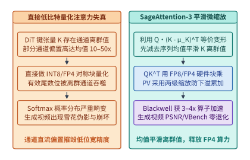

*图 17-10　SageAttention 平滑均值抑制离群值与 FP8/FP4 块量化注意力的硬件加速路径。*

对于无法跳过的那 22 个关键去噪步，其算力消耗的绝对大头仍在 $\mathcal{O}(N^2 d)$ 的三维自注意力核。能否利用 Hopper 的 FP8 Tensor Core 或 Blackwell 的 NVFP4 Tensor Core 直接加速注意力矩阵乘？
如图 17-10 左栏所示，如果在 DiT 中直接对查询 $Q$ 与键 $K$ 做对称低比特块量化（INT8/FP8/FP4），生成画面会立刻出现大面积色块崩坏。其根源在于：**视频 DiT 的键张量 $K \in \mathbb{R}^{N \times d_{\mathrm{head}}}$ 沿通道维存在强烈的固定偏置离群值（Channel-wise Outlier Bias）**——某些特征通道在整个时空序列上的均值高达其余通道的 $10\text{–}50$ 倍，直接吞噬了低位宽浮点数的动态范围。

`SageAttention`（演进至针对 Blackwell NVFP4 微缩放架构的 `SageAttention-3`）利用 Softmax 的平移不变性（Translation Invariance），给出了一个零精度损失的代数恒等变换（图 17-10 右栏）[^ch17-sageattention]：
1. **键通道序列均值平滑（Key Smoothing）**：记键张量沿序列维度的均值为 $\mu_K = \frac{1}{N}\sum_{j=1}^N K_j \in \mathbb{R}^{1 \times d_{\mathrm{head}}}$，定义去均值后的平滑键张量为 $\tilde{K}_j = K_j - \mu_K$。由于对任意查询行向量 $Q_i \in \mathbb{R}^{1 \times d_{\mathrm{head}}}$，内积 $c_i = Q_i \mu_K^\top$ 是一个与键索引 $j$ 无关的标量常数，根据 Softmax 对整行加减常数保持严格不变的性质：
   $$\mathrm{Softmax}\!\left(\frac{Q_i K^\top}{\sqrt{d_{\mathrm{head}}}}\right) = \mathrm{Softmax}\!\left(\frac{Q_i \tilde{K}^\top + c_i \mathbf{1}^\top}{\sqrt{d_{\mathrm{head}}}}\right) \equiv \mathrm{Softmax}\!\left(\frac{Q_i \tilde{K}^\top}{\sqrt{d_{\mathrm{head}}}}\right)$$
   先在在线流式核中减去 $\mu_K$，无需任何重训练即可将 $K$ 的动态范围压缩 $5\text{–}15$ 倍，彻底铲除通道直流偏置。
2. **微缩放 FP8/FP4 双阶段矩阵乘**：平滑后的 $Q \tilde{K}^\top$ 与概率矩阵乘 $P V$ 被映射至硬件原生 FP8 或 NVFP4（每 16 个元素共享一个 E4M3/E8M0 微缩放因子，配以两级累加缩放防止 FP16/FP32 寄存器下溢），在单卡上实现较 BF16 FlashAttention-2 高达 $3\text{–}4\times$ 的真实算子加速，且 VBench 视频评测分与 PSNR 几乎零退化。

汇总 17.1 节至 17.3.2 节的优化手段，图 17-17 给出了工业级 1080p 视频生成管线的全周期性能画像——**时间瓶颈高度集中于阶段 ②（50 步 DiT 去噪占据 $>94\%$ 墙钟时间），而空间显存尖峰则爆发于阶段 ③（3D VAE 像素上采样在未分块时飙升至 $118.65\ \mathrm{GiB}$）**。只有用 `2D-USP + TeaCache + SageAttention` 攻克阶段 ② 的算力/通信墙，同时用 `T5 编码器卸载 + Tiled 3D VAE` 削平阶段 ③ 的显存洪峰，才能构建出高吞吐、零 OOM 的生产级视频生成底座。

### 17.3.3 实时交互世界模型（StreamDiffusionV2 / CausVid / GameNGen / Oasis）的 `< 33.3 ms` 工程挑战

当视频扩散模型不再仅仅用于离线渲染一段固定时长短片，而是作为具身智能机器人、自动驾驶仿真器或实时生成式游戏引擎（如 Oasis、GameNGen、Matrix-Game、UniSim）的**交互式世界模型（Interactive World Model）**时，系统约束发生了根本逆转：
- 用户或智能体在每一帧时刻 $t$ 都会输入新的控制动作 $a_t$（如方向盘转角、键盘按键或机械臂末端速度）；
- 世界模型必须根据历史视觉上下文与当前动作 $a_t$，在 **30 FPS（即每帧端到端生成延迟 $\le 33.3\ \mathrm{ms}$）** 乃至 **60 FPS（$\le 16.7\ \mathrm{ms}$）** 的硬实时窗口内渲染出下一帧画面 $o_{t+1}$，决不允许“先等 30 秒把 240 帧全部去噪完再播放”。

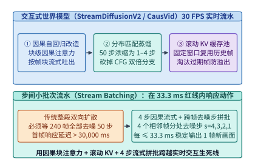

*图 17-11　交互式世界模型（StreamDiffusionV2 / CausVid）的因果少步蒸馏与 `<33.3 ms` 滚动 KV 帧生成流水线。*

如图 17-11 所示，要将原本耗时数十秒的双向视频扩散模型压缩进 $33.3\ \mathrm{ms}$ 的实时交互预算，基础设施必须协同完成四项结构改造（以 `CausVid` 与 `StreamDiffusionV2` 为代表）[^ch17-causvid-oasis]：

1. **从全双向扩散改造为块级因果自回归扩散（Block-Causal Autoregressive Diffusion）**：
   离线视频 DiT 允许第 1 帧关注第 240 帧（非因果），因而无法流式吐帧。实时世界模型通过非对称蒸馏，将注意力掩码改造为**帧块内双向、帧块间严格单向因果（Block-Causal Attention）**：生成第 $\tau$ 个潜空间帧块时，仅依赖已定稿的历史帧块 $\{1, \dots, \tau-1\}$ 与当前外部动作输入 $a_\tau$。
2. **分布匹配蒸馏（DMD / 少步一致性蒸馏）与去 CFG 化**：
   将 50 步迭代去噪并入 $S = 1\text{–}4$ 步极少步生成，同时将无条件引导分支直接蒸馏进单路模型权重，彻底砍掉双倍 CFG 开销。
3. **滚动 FIFO KV 缓存池（Rolling KV Cache with Attention Sink）**：
   已生成完毕的历史潜空间帧块无需在后续帧生成时重复计算 QKV，其键值张量直接固定写入固定容量（如最近 $W = 16$ 个潜空间帧外加首帧锚点）的**环形滚动 KV 缓存池**。每当新帧去噪定稿，最老的过期帧槽位即被原位覆写，保证无限时长交互下显存占用严格恒定（$\mathcal{O}(1)$）。
4. **步间流式拼批流水线（Inter-Step Stream Batching）**：
   当去噪步数设为 $S = 4$ 步时，若串行算完 4 步再吐出 1 帧，不仅延迟叠加为 $4 \times t_{\mathrm{pass}}$，而且单帧词元数少（如 720p 单潜空间帧仅约 $1{,}800\text{–}3{,}600$ 词元），会导致 GPU Tensor Core 严重不满载。`StreamDiffusionV2` 采用**跨帧不同去噪步拼批（Stream Batching）**：在同一次模型前向中，将正处于去噪第 $s=4$ 步的第 $\tau$ 帧、处于第 $s=3$ 步的第 $\tau-1$ 帧、处于第 $s=2$ 步的第 $\tau-2$ 帧与处于第 $s=1$ 步的第 $\tau-3$ 帧打包为一个批大小 $B = 4$ 的稠密批次并发送入 Tensor Core（或分配至 4 个微流水阶段），从而在每个单次前向周期（$\le 25\text{–}30\ \mathrm{ms}$）稳定吐出 1 帧完全去噪的新画面，稳稳跨过 30 FPS 实时交互生死线。

下面的代码给出了结合首帧注意力锚点（Attention Sink）、环形滚动 KV 缓存池与 4 步流式拼批（Stream Batching）的实时交互世界模型推理引擎实现：

```python
import torch

class RollingWorldModelKVCache:
    """支持无限时长 30 FPS 交互世界模型的环形滚动 KV 缓存池（含首帧 Sink 锚点）."""
    def __init__(self, num_layers: int, sink_frames: int, window_frames: int, tokens_per_frame: int, num_heads: int, head_dim: int, device: torch.device):
        self.sink_tokens = sink_frames * tokens_per_frame
        self.win_tokens = window_frames * tokens_per_frame
        self.tpf = tokens_per_frame
        self.write_ptr = 0
        self.filled_win = 0
        shape = (num_layers, 2, self.sink_tokens + self.win_tokens, num_heads, head_dim)
        self.kv_pool = torch.zeros(shape, dtype=torch.bfloat16, device=device)

    def commit_finalized_frame(self, layer_idx: int, k_frame: torch.Tensor, v_frame: torch.Tensor, frame_idx: int) -> None:
        """当某个潜空间帧完成最后一步去噪定稿后，将其 KV 写入 Sink 区或环形窗口区."""
        if frame_idx * self.tpf < self.sink_tokens:
            start = frame_idx * self.tpf
            self.kv_pool[layer_idx, 0, start : start + self.tpf] = k_frame
            self.kv_pool[layer_idx, 1, start : start + self.tpf] = v_frame
        else:
            start = self.sink_tokens + (self.write_ptr % self.win_tokens)
            self.kv_pool[layer_idx, 0, start : start + self.tpf] = k_frame
            self.kv_pool[layer_idx, 1, start : start + self.tpf] = v_frame
            if layer_idx == self.kv_pool.shape[0] - 1:
                self.write_ptr += self.tpf
                self.filled_win = min(self.win_tokens, self.filled_win + self.tpf)

    def get_active_kv(self, layer_idx: int) -> tuple[torch.Tensor, torch.Tensor]:
        valid_len = self.sink_tokens + self.filled_win
        return self.kv_pool[layer_idx, 0, :valid_len], self.kv_pool[layer_idx, 1, :valid_len]

class StreamBatchingWorldModelPipeline:
    """StreamDiffusionV2 风格 4 步跨帧流式拼批：每单次前向周期（<33.3ms）输出 1 帧."""
    def __init__(self, dit_step_fn, vae_decode_fn, timesteps: tuple[int, ...] = (1000, 750, 500, 250)):
        self.dit_step_fn = dit_step_fn
        self.vae_decode_fn = vae_decode_fn
        self.timesteps = timesteps
        self.S = len(timesteps)
        self.inflight_latents: list[torch.Tensor] = []
        self.inflight_actions: list[torch.Tensor] = []

    @torch.no_grad()
    def step_30fps(self, new_noisy_latent: torch.Tensor, action_embed: torch.Tensor, kv_cache: RollingWorldModelKVCache) -> torch.Tensor | None:
        """压入最新动作与噪声帧，对在途 S=4 个相邻帧打包执行 1 次前向，弹出已完成去噪帧."""
        self.inflight_latents.insert(0, new_noisy_latent)
        self.inflight_actions.insert(0, action_embed)
        curr_b = len(self.inflight_latents)

        batch_x = torch.cat(self.inflight_latents, dim=0)
        batch_a = torch.cat(self.inflight_actions, dim=0)
        batch_t = torch.tensor(self.timesteps[:curr_b], device=batch_x.device)

        # 单次 Batch=4 Tensor Core 高利用率前向，同时推进 4 个帧各自的去噪步
        updated_x = self.dit_step_fn(batch_x, batch_t, batch_a, kv_cache)
        self.inflight_latents = list(updated_x.chunk(curr_b, dim=0))

        if len(self.inflight_latents) == self.S:
            final_latent = self.inflight_latents.pop()
            self.inflight_actions.pop()
            return self.vae_decode_fn(final_latent)
        return None
```

---

## 17.4 原生全模态（Omni-modal）在线服务：E-P-D-G 四阶段解耦与多模态缓存

在第 13 章中，我们已经证明了针对纯文本大语言模型，将算力密集的预填充（Prefill, P）与访存密集的解码（Decode, D）物理分离，能够消除长提示词对流式吐词延迟（TPOT）的阻塞。然而，当线上服务升级为同时接收文本、高分图片、视频片段与实时语音，并能同步输出文本、语音或合成图像的**原生全模态模型（Omni-modal Models，如 GPT-4o、Qwen2.5-Omni、Gemini 2.5 及 `vLLM-Omni` 服务栈）**[^ch17-vllm-omni]时，传统的二元 P/D 分离框架已不足以刻画完整的硬件瓶颈谱系。

### 17.4.1 从 TriInfer（MLSys '26）到 E-P-D-G（编码—预填充—解码—生成）四池异构解耦

为什么不能简单地把多模态编码器（ViT / Whisper）绑死在 Prefill 节点上？让我们考察全模态请求生命周期中的四个正交计算阶段（图 17-12）：

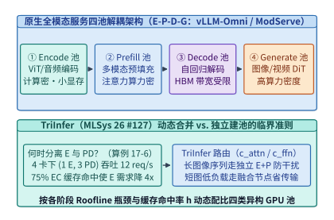

*图 17-12　从 TriInfer（MLSys '26）混合 EPD 解耦到 vLLM-Omni 原生全模态 E-P-D-G 四阶段异构池化架构（算例 17-6）。*

1. **阶段 E（Encode，模态编码池）**：运行视觉 ViT、音频 Whisper/Conformer 或视频 3D VAE 编码器。其参数量通常仅占总模型的 $2\%\text{–}10\%$（如 $400\mathrm{M}\text{–}2\mathrm{B}$），无需存储任何历史会话 KV 缓存，显存占用极小；但其内部是纯双向稠密卷积与注意力，计算高度密集，且不同请求的图像张数（1 张 vs. 16 张）与分辨率差异极大。若将 E 与 P 强行绑在同一实例内同步执行，重型多图编码会直接挤占主干 Prefill 的 SM 核心并拖慢纯文本请求的 TTFT。
2. **阶段 P（Prefill，多模态主干预填充池）**：将阶段 E 输出的紧凑多模态特征（EC）与文本嵌入拼接后，送入百亿/千亿参数的主干 LLM 执行首次前向传播并生成全层 KV 缓存。该阶段兼具大模型权重加载与长序列二次方注意力，属于典型的高算力 + 高显存带宽复合负载。
3. **阶段 D（Decode，自回归文本/离散语音解码池）**：逐词元自回归生成文本或离散音频编码（Audio Codec Tokens），算术强度极低，完全受限于 HBM 访存带宽与巨量 KV 缓存容量。
4. **阶段 G（Generate / Vocode，连续媒体生成池）**：当全模态模型需要输出高保真连续音频波形（通过流式 Flow Matching / HiFi-GAN 声码器）或同步生成图像/视频（通过外挂或内嵌 DiT 头）时，计算再次跳回无历史 KV 负担、但极度消耗 Tensor Core 浮点算力的迭代去噪负载。

针对多模态理解中的 `E-P-D` 三阶段关系，本书案例库（`case-studies/multimodal-stage-placement.md`）与 **MLSys 2026 论文 `TriInfer`（#127）**[^ch17-triinfer]给出了从静态池化走向动态弹性调度的定量准则。下面我们先通过锁定算例推导 `E` 池与 `PD` 池的最优静态配比及 EC 缓存命中率对池容量的重塑效应。

> **算例 17-6（4 卡多模态集群下 E 池与 PD 池配比寻优及 75% EC 缓存命中率加速账本）：**
>
> **问题设定**（锁定自 `case-studies/multimodal-stage-placement.md`）：某 4-GPU 节点服务同构多模态请求流。单张 GPU 若专职运行模态编码阶段 `E`，其未缓存图像编码速率为 $\mu_{\mathrm{img}} = 12\ \mathrm{img/s}$；若专职运行主干预填充与解码合并阶段 `PD`，其请求服务速率为 $\mu_{PD} = 4\ \mathrm{req/s}$。系统将 4 张 GPU 划分为 $n_E$ 张编码卡与 $n_{PD} = 4 - n_E$ 张主干卡（$n_E \in \{1, 2, 3\}$）。
> 试分两个口径计算：
> 1. **单图算力受限基线（每请求含 $1$ 张图像，无跨阶段链路瓶颈）**：此时单张 `E` 卡速率为 $\mu_E = 12\ \mathrm{req/s}$，端到端稳态吞吐为 $X(n_E, n_{PD}) = \min(R_E(n_E), R_{PD}(n_{PD}))$。求零缓存（$h = 0$）下三种整数配比 $(1,3), (2,2), (3,1)$ 的系统吞吐，以及开启编码器输出缓存（EC）且取得 $h = 75\%$ 命中率后单张 `E` 卡对总体请求流的有效支撑速率 $\mu_E^{\mathrm{eff}}(0.75) = \frac{\mu_E}{1 - h}$；
> 2. **多图链路受限扩展（锁定案例库 4 图/请求 + `300 MB/s` 跨阶段传输上限）**：设每条请求携带 $4$ 张 $640 \times 640$ 图像（由算例 17-1 知单图含 DeepStack 的 EC 体积为 $7.8125\ \mathrm{MiB} = 8{,}192{,}000\ \mathrm{B}$，故每请求需从 `E` 向 `PD` 传输 $4 \times 8{,}192{,}000 = 32{,}768{,}000\ \mathrm{B} = 31.25\ \mathrm{MiB}$ 的 EC 张量），且共享的 `E -> PD` 交接链路有效带宽上限为 $B_{\mathrm{link}} = 300\ \mathrm{MB/s}$（即跨阶段交接吞吐上限为 $R_{\mathrm{link}} = \frac{300{,}000{,}000}{32{,}768{,}000} \approx \mathbf{9.16\ \mathrm{req/s}}$）。试对 $R(n_E, n_{PD}, h) = \min\!\left(\frac{12\,n_E}{4(1-h)},\; 4\,n_{PD},\; 9.16\right)$ 对比 $h = 0$ 与 $h = 75\%$ 下的最优整数卡数配比跃迁。
>
> **逐项推导**：
>
> 1. **单图基线（$1\ \mathrm{img/req}$，无链路瓶颈）下的 4 卡配比与 $h = 75\%$ 有效速率倍增**：
>    当每请求含 $1$ 张图像且 $h = 0$ 时，$R_E = 12 n_E$，$R_{PD} = 4 n_{PD}$，枚举三种正整数切分方案可得表 17-4（上半部）：
>    - `(1, 3)`：$R_E = 12,\ R_{PD} = 12 \implies X = \mathbf{12\ \mathrm{req/s}}$（两阶段严格匹配，4 卡满载）；
>    - `(2, 2)`：$R_E = 24,\ R_{PD} = 8 \implies X = \mathbf{8\ \mathrm{req/s}}$（`PD` 池受限，编码池闲置 $16\ \mathrm{req/s}$）；
>    - `(3, 1)`：$R_E = 36,\ R_{PD} = 4 \implies X = \mathbf{4\ \mathrm{req/s}}$（`PD` 池严重饥饿）。
>    当开启 EC 缓存并取得 $h = 75\%$ 命中率时，仅 $1 - h = 25\%$ 的未命中请求消耗 `E` 卡算力，单张 `E` 卡在单图基线下的有效支撑速率放大 $4$ 倍至：
>    $$\mu_E^{\mathrm{eff}}(0.75) = \frac{12}{1 - 0.75} = \mathbf{48\ \mathrm{req/s}}\quad(4\times\ \text{提升})$$
>
> 2. **多图（$4\ \mathrm{img/req}$）+ `300 MB/s` 交接链路上限下的最优配比漂移**：
>    当每条请求含 $4$ 张图像时，单张 `E` 卡在 $h = 0$ 下每秒可编码 $12 / 4 = 3\ \mathrm{req/s}$，而在 $h = 75\%$ 下每秒可支撑 $\frac{12}{4(1 - 0.75)} = 12\ \mathrm{req/s}$；同时跨阶段链路封顶于 $R_{\mathrm{link}} \approx 9.16\ \mathrm{req/s}$：
>    - **当 $h = 0$（零缓存）时**：
>      - `1E + 3PD`：$\min(3,\ 12,\ 9.16) = \mathbf{3.00\ \mathrm{req/s}}$（受限于 `E` 池算力）；
>      - **`2E + 2PD`（最优）**：$\min(6,\ 8,\ 9.16) = \mathbf{6.00\ \mathrm{req/s}}$（受限于 `E` 池，但总吞吐翻倍）；
>      - `3E + 1PD`：$\min(9,\ 4,\ 9.16) = \mathbf{4.00\ \mathrm{req/s}}$（受限于 `PD` 池）。
>    - **当 $h = 75\%$（高 EC 缓存命中）时**：
>      - **`1E + 3PD`（逆袭为最优）**：$\min(12,\ 12,\ 9.16) = \mathbf{9.16\ \mathrm{req/s}}$（算力瓶颈解除，转由 `E -> PD` 交接链路带宽封顶）；
>      - `2E + 2PD`：$\min(24,\ 8,\ 9.16) = \mathbf{8.00\ \mathrm{req/s}}$（受限于 2 张 `PD` 卡的 $8\ \mathrm{req/s}$ 上限）；
>      - `3E + 1PD`：$\min(36,\ 4,\ 9.16) = \mathbf{4.00\ \mathrm{req/s}}$（受限于 `PD` 池）。

*表 17-4　4 卡多模态集群下 E 池与 PD 池配比寻优及 75% EC 缓存命中率与链路瓶颈演化对比*

| 配比方案 $(n_E, n_{PD})$ | 单图基线吞吐 ($1\ \mathrm{img/req}, h=0$) | 4 图/请求吞吐 ($h=0$, 算力受限) | 4 图/请求吞吐 ($h=75\%$, 含 $9.16$ 链路顶) | 瓶颈漂移与最优配比演化分析 |
| :--- | :---: | :---: | :---: | :--- |
| **`(1, 3)`** | **$\mathbf{12.00\ \mathrm{req/s}}$（单图最优）** | $3.00\ \mathrm{req/s}$（`E` 受限） | **$\mathbf{9.16\ \mathrm{req/s}}$（$h=75\%$ 最优）** | **高缓存命中释放 `E` 卡，触发 `300 MB/s` 交接链路顶** |
| **`(2, 2)`** | $8.00\ \mathrm{req/s}$ | **$\mathbf{6.00\ \mathrm{req/s}}$（$h=0$ 最优）** | $8.00\ \mathrm{req/s}$（`PD` 受限） | 零缓存多图下最优，但高缓存下多占了 1 张 `PD` 卡 |
| **`(3, 1)`** | $4.00\ \mathrm{req/s}$ | $4.00\ \mathrm{req/s}$ | $4.00\ \mathrm{req/s}$ | 无论何种工况均被单张 `PD` 卡（$4\ \mathrm{req/s}$）锁死 |

这引出了 `TriInfer`（MLSys '26）的核心调度洞见：**静态固定的 `E / P / D` 物理分池在面对剧烈波动的缓存命中率 $h$ 与变长图像词元数 $N_{\mathrm{vis}}$ 时，必然产生阶段性的算力空置。** 为此，`TriInfer` 设立了三类弹性工作池——专职编码预填充池、专职解码池、以及同时加载编码器与主干权重的**弹性混合池（Hybrid Pool）**，并在网关层根据每条请求的注意力开销与前馈网络开销比值 $\rho = \frac{c_{\mathrm{attn}}(N_{\mathrm{vis}}, L)}{c_{\mathrm{ffn}}(N_{\mathrm{vis}}, L)}$ 执行动态路由：
- 当遇到含多张高清大图、$\rho > \tau_{\mathrm{split}}$ 的重型请求时，将其派往物理分离的独立 `E` 节点与 `P` 节点，通过发送紧凑的 EC 张量（算例 17-1 中的 $7.8125\ \mathrm{MiB}$）避免冲击线上解码流的 TPOT；
- 当遇到高缓存命中（$h$ 升高）或短图轻量请求时，弹性混合节点自动从空闲的 `E` 角色切换为协助分担 `PD` 负载，或直接在单机内原位完成 `E+P` 免去跨网传输。

下面的参考代码实现了结合 `TriInfer` 动态分离判据（$\rho = c_{\mathrm{attn}} / c_{\mathrm{ffn}}$）、`E-P-D-G` 四池吞吐配比与双层多模态缓存降级（KV $\to$ EC，释放 $86.11\%$ 容量）的全模态调度控制器：

```python
from dataclasses import dataclass

@dataclass
class MultimodalRequestProfile:
    req_id: str
    image_hashes: list[str]
    num_vis_tokens: int        # 例如单张 640x640 图为 400
    num_text_tokens: int
    needs_media_gen: bool = False

class EPDGDisaggregatedScheduler:
    """结合 TriInfer (MLSys '26) 动态合并准则与双层 EC/KV 缓存管理的全模态调度器."""
    def __init__(
        self,
        llm_dim: int = 2560,
        ffn_inter_dim: int = 6912,
        rho_split_thresh: float = 0.35,
        ec_bytes_per_vis_tok: int = 20480,      # Qwen3-VL-4B: 10240 * 2B = 20,480 B
        kv_bytes_per_tok: int = 147456,         # 36 层 GQA: 147,456 B/token
    ):
        self.d = llm_dim
        self.d_ffn = ffn_inter_dim
        self.rho_thresh = rho_split_thresh
        self.ec_bpt = ec_bytes_per_vis_tok
        self.kv_bpt = kv_bytes_per_tok
        self.ec_cache_store: dict[str, int] = {}   # image_hash -> byte_size
        self.hot_kv_sessions: dict[str, int] = {}  # req_id -> byte_size

    def compute_triinfer_rho(self, req: MultimodalRequestProfile) -> float:
        """计算注意力计算代价与 FFN 计算代价之比 rho = c_attn / c_ffn."""
        seq_len = req.num_vis_tokens + req.num_text_tokens
        c_attn = 4.0 * (seq_len ** 2) * self.d
        c_ffn = 6.0 * seq_len * self.d * self.d_ffn
        return c_attn / max(c_ffn, 1.0)

    def route_request(self, req: MultimodalRequestProfile) -> dict[str, object]:
        unached_imgs = [h for h in req.image_hashes if h not in self.ec_cache_store]
        ec_hit_rate = 1.0 - (len(unached_imgs) / max(len(req.image_hashes), 1))
        rho = self.compute_triinfer_rho(req)

        # 若全部命中 EC 缓存，直接跳过 Encode 池直达 Prefill 池
        if len(unached_imgs) == 0:
            stage_plan = ["P_POOL", "D_POOL"]
            transfer_bytes = 0
        elif rho >= self.rho_thresh:
            # 重型长多模态序列：走独立 E 池 -> P 池，跨网传输紧凑 EC (7.8125 MiB/图)
            stage_plan = ["E_POOL", "P_POOL", "D_POOL"]
            transfer_bytes = req.num_vis_tokens * self.ec_bpt
        else:
            # 短序列低比值：走弹性 Hybrid 节点原位完成 E+P，免除网络传输
            stage_plan = ["HYBRID_EP_NODE", "D_POOL"]
            transfer_bytes = 0

        if req.needs_media_gen:
            stage_plan.append("G_POOL_DIT")

        return {
            "req_id": req.req_id,
            "ec_hit_rate": round(ec_hit_rate, 4),
            "triinfer_rho": round(rho, 4),
            "stage_plan": stage_plan,
            "e_to_p_transfer_mib": round(transfer_bytes / (1024 ** 2), 4),
        }

    def demote_warm_session_kv_to_ec(self, req: MultimodalRequestProfile) -> dict[str, float]:
        """当多轮对话转入温态时，释放 56.25 MiB 视觉 KV，仅保留 7.8125 MiB EC."""
        kv_bytes = req.num_vis_tokens * self.kv_bpt
        ec_bytes = req.num_vis_tokens * self.ec_bpt
        for h in req.image_hashes:
            self.ec_cache_store[h] = ec_bytes // max(len(req.image_hashes), 1)
        self.hot_kv_sessions.pop(req.req_id, None)
        return {
            "freed_kv_mib": kv_bytes / (1024 ** 2),
            "retained_ec_mib": ec_bytes / (1024 ** 2),
            "memory_saving_ratio": 1.0 - (ec_bytes / kv_bytes),
        }
```

### 17.4.2 视觉编码特征缓存（Embedding Cache）vs. 主干 KV 缓存的权衡与图文音交错微批聚合

在多轮多模态对话（例如用户上传一张架构图或一段长视频后，连续追问 5–10 个问题）中，缓存系统的设计直接决定了单机可支撑的并发会话上限。

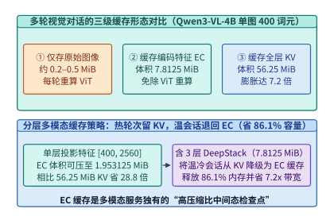

*图 17-13　多轮多模态对话中缓存原始图片、缓存 ViT 视觉特征（7.8125 MiB）与缓存 LLM 全层 KV（56.25 MiB）的体积与重算延迟折中。*

结合算例 17-1 的精确账本，图 17-13 对比了多模态服务中三级缓存形态的性价比边界（表 17-5）：

*表 17-5　多模态在线服务中三级缓存形态（原始图像、编码器输出 EC 与主干 KV 缓存）的体积与重算代价对比*

| 缓存形态 | 单图（`Qwen3-VL-4B` 400 词元）体积 | 相对主干 KV 体积比 | 后续轮次命中时的重算代价 | 适用生命周期层级 |
| :--- | :---: | :---: | :--- | :--- |
| **① 原始压缩图像（JPEG）** | $\sim 0.2\text{–}0.5\ \mathrm{MiB}$ | $< 1\%$ | 需完整重跑 ViT 编码 + LLM Prefill | 磁盘/对象存储冷归档层 |
| **② 编码器输出（EC，单层投射）** | **$1.953125\ \mathrm{MiB}$** | **$3.47\%$（省 $28.8\times$）** | 免除 ViT 计算，仅需重跑轻量 Prefill | **主机 DRAM / 分布式温缓存首选** |
| **②' 编码器输出（EC，含 3 层 DeepStack）** | **$7.8125\ \mathrm{MiB}$** | **$13.89\%$（省 $7.2\times$）** | 免除 ViT 与多层特征提取 | **跨 `E→P` 传输与温会话驻留标准态** |
| **③ 36 层 LLM 主干 KV 缓存** | **$56.25\ \mathrm{MiB}$** | $100\%$（基准） | 零重算，直接进入 Decode | 活跃度最高的 GPU HBM 热层（数秒内） |

这一对比确立了多模态引擎（如 `vLLM` 与 `SGLang` 多模态缓存扩展）的**双层阶梯淘汰策略（Two-Tier Multimodal Cache Eviction）**：
1. 当用户刚发完第 $k$ 轮提问、正处于数秒内的密集追问窗口时，系统在 GPU HBM 中保留完整的 $56.25\ \mathrm{MiB}$ 主干 KV 缓存；
2. 一旦会话进入数十秒的阅读思考间隔（温态），淘汰器**优先释放占空间 $56.25\ \mathrm{MiB}$ 的视觉词元主干 KV 页帧，但保留仅占 $7.8125\ \mathrm{MiB}$（或单层 $1.953125\ \mathrm{MiB}$）的图像内容哈希索引 EC 缓存**。这样既立即收回了 **$86.11\%$（乃至 $96.53\%$）** 的宝贵显存，又能在用户发起下一轮提问时完全省去昂贵的 ViT 视觉编码与跨节点图像搬移。

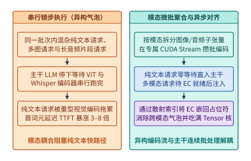

*图 17-14　图文音交错流（Omni-modal）中模态专属编码器微批聚合与主干对齐调度。*

最后，在单节点内部处理图文音交错请求流时，必须避免“串行锁步执行”造成的跨模态阻塞（图 17-14）。如果一个连续批处理（Continuous Batching）步内同时到达了 12 条纯文本请求、3 条带图请求和 2 条带语音请求，朴素实现会让全部 17 条请求一起停下来，先串行跑完 ViT，再跑完 Whisper 音频编码，最后才进入 LLM 主干——导致那 12 条本可在 $15\ \mathrm{ms}$ 内吐出首词元的纯文本请求被迫陪等上百毫秒。

高性能全模态运行时采用**异步模态微批聚合与占位符散射注入（Asynchronous Modality Micro-Batching & Scatter Injection）**：
- 纯文本请求到达后零等待直通 LLM 主干执行连续批处理；
- 带图或带音请求在预处理入口先被替换为带唯一槽位 ID 的特殊占位符词元（`<image_pad>` / `<audio_pad>`），其原始多模态张量被投递至独立的视觉/音频编码队列；
- 独立 CUDA Stream（或独立 `E` 池）在数毫秒窗口内将来自不同请求的图像子块打包为稠密视觉微批（ViT Micro-Batch）一次性跑满 Tensor Core，编码产出的 EC 特征写入共享显存缓冲池后，再唤醒该多模态请求加入下一拍的主干 Prefill 批次，通过自定义 `index_put_ / scatter` 算子将 EC 向量原位覆写到占位符位置。

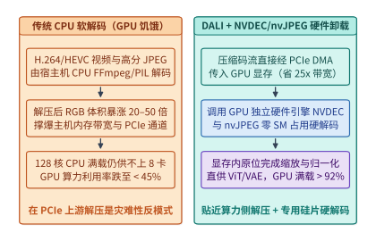

*图 17-15　多模态预训练中 CPU 解码饥饿瓶颈与 DALI / nvJPEG / NVDEC 硬件视频解码卸载流水线。*

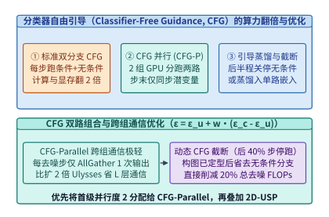

*图 17-16　分类器自由引导（CFG 双分支）与条件/无条件批量合并及尾部蒸馏对比。*

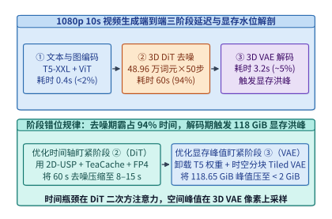

*图 17-17　1080p 视频生成从文本编码、50 步 DiT 去噪到 3D VAE 解码的端到端延迟与显存水位全貌。*

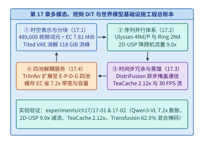

*图 17-18　多模态与世界模型基础设施的算法—并行—缓存—解耦四维总架构图。*

图 17-15 至图 17-18 依次总结了本章前面剖析的 GPU 硬件媒体解码（NVDEC/nvJPEG）卸载、分类器自由引导（CFG）并行与尾部截断、1080p 视频生成三阶段延迟/显存错位规律，以及全章从三维潜空间表征、超长序列并行、时间步冗余压缩到全模态四池解耦的四维总架构图。读者可直接运行配套实验 `experiments/ch17/17-01` 与 `experiments/ch17/17-02`，在本地复现本章全部锁定算例的精确数值账本。

### 17.4.3 原生多模态统一自回归—扩散混合架构（Transfusion / Show-o）与 3DGS 引导世界模型

在 17.4.1 节与 17.4.2 节中，我们探讨了通过外部连接器将视觉编码器（ViT）、大语言模型（LLM）与扩散变换器（DiT）组装在一起的模块化全模态流水线。然而，前沿多模态基础模型正在向更深层的统一架构演进——即在**同一个 Transformer 主干权重与同一条交错序列**内，同时对离散文本词元执行**下一词元自回归预测（Next-Token Autoregressive Prediction）**，并对连续图像/视频潜变量块执行**多步迭代去噪扩散（Continuous Diffusion / Flow Matching）**。以 Meta `Transfusion`、字节与新国大 `Show-o`、`Bagel`、`Janus-Pro` 以及 `Chameleon` 演进路线为代表的统一架构[^ch17-transfusion-bagel]，虽然消除了跨模型投射的信息损耗，却给推理引擎的注意力内核与 KV 缓存管理带来了前所未有的系统挑战。

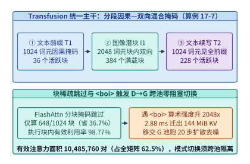

*图 17-19　Transfusion / Show-o 离散自回归与连续扩散混合掩码（Hybrid Causal-Bidirectional Mask）及 KV 缓存分块调度。*

如图 17-19 所示，在 `Transfusion` 架构中，一条图文交错序列由多个离散文本段 $\mathcal{T}_1, \mathcal{T}_2, \dots$ 与插入在 `<boi>`（图像起始符）和 `<eoi>`（图像终止符）之间的连续图像块 $\mathcal{I}_1, \mathcal{I}_2, \dots$ 共同构成。其注意力掩码不再是单一的下三角矩阵或全一矩阵，而是**分块因果—双向混合掩码（Blockwise Causal-Bidirectional Hybrid Mask）**：
- **在文本段内部及跨段历史方向**：任意位置 $i$ 的词元（无论是文本词元还是图像块词元）对早于它的所有历史文本词元和**已完成去噪定稿**的历史图像块词元均保持单向因果可见（Lower-Triangular Causal Visibility）；
- **在当前正在生成的图像段 $\mathcal{I}_m$ 内部**：当解码器生成出 `<boi>` 触发符后，引擎一次性压入 $N_{\mathrm{img}}$ 个高斯噪声潜变量块（例如 $16 \times 16 = 256$ 或 $32 \times 32 = 1{,}024$ 个块）。在这 $N_{\mathrm{img}}$ 个词元内部，注意力掩码切换为 **$N_{\mathrm{img}} \times N_{\mathrm{img}}$ 全双向可见正方形（Bidirectional Square Sub-block）**，并在此局部窗口上连续循环执行 $K = 20\text{–}30$ 个扩散去噪步；待最后一步去噪收敛并吐出 `<eoi>` 后，这 $N_{\mathrm{img}}$ 个图像词元的最终键值特征被冻结固化为只读历史 KV 缓存，引擎随即切回逐词元文本自回归解码。

如果直接在标准 `vLLM` 或 `FlashAttention` 上运行这种混合序列，会立刻引爆两处性能灾难：
1. **分块掩码碎片化与无效 FLOPs 浪费**：在标准 PagedAttention 中，若一个物理页块（Page Block，如 64 或 128 词元）内同时混装了末尾的因果文本词元和开头的双向图像词元，FlashAttention 的在线分块（Tile）循环将被迫在每个块内加载显式二维布尔掩码矩阵，无法走硬件最快的纯下三角或纯无掩码（Unmasked）快速路径，导致算子吞吐下跌 $35\%\text{–}50\%$。
2. **$K$ 步图像去噪期间对只读前缀 KV 的重复 HBM 带宽冲击**：在生成单张图像的 $K = 25$ 个去噪时间步中，那 $N_{\mathrm{img}} = 1{,}024$ 个图像块在每一步都会原地覆写（In-place Overwrite）自身的瞬态 KV 缓冲，而排在它们前面的 $L_{\mathrm{prefix}}$ 个历史文本与历史图像 KV 缓存则完全不变。若将可变图像 KV 与只读前缀 KV 混在同一套分页链表中，不仅破坏了前缀缓存（Prefix Caching）的哈希不可变性，还会在小批量去噪时反复重读长前缀。

工程上的高吞吐解法是构建**双轨分页 KV 缓存与模态对齐分块调度器（Dual-Track Paged KV & Modality-Aligned Tile Dispatcher）**：
- **页边界强制模态对齐**：在 `<boi>` 与 `<eoi>` 切换点强制开启新的逻辑页块，确保任意物理页块要么是纯因果文本页（走标准 Causal FlashAttention 快路径），要么是纯双向图像页（走 Unmasked Bidirectional FlashAttention 快路径）；
- **只读前缀页与瞬态去噪抓手页（Scratchpad KV Pages）物理分离**：为正在去噪的 $N_{\mathrm{img}}$ 个图像词元分配固定地址的**瞬态抓手页池（In-place Mutable Scratchpad Pool）**，在全部 $K$ 步去噪期间零页表分配地原位更新，仅在第 $K$ 步定稿后才将其提升（Promote）并追加至不可变前缀 KV 树。

> **算例 17-7（Transfusion 图文交错混合掩码有效密度、FlashAttention 分块跳过与 D→G 跨池交接账本）：**
>
> **问题设定**：考察一个 36 层 `Transfusion` 统一多模态模型（GQA 配置同算例 17-1：每词元全层 KV 缓存体积为 $B_{\mathrm{KV/tok}} = 147{,}456\ \mathrm{B} = 144\ \mathrm{KiB}$）。某图文交错序列总长度为 $L_{\mathrm{tot}} = 4{,}096$ 个词元，由三段依次拼接而成：第一段为文本前缀 $L_{T_1} = 1{,}024$ 词元（下三角因果掩码），第二段为夹在 `<boi>` 与 `<eoi>` 之间的高清图像潜变量块 $L_{I_1} = 2{,}048$ 词元（对 $T_1$ 全可见、且在 $I_1$ 内部 $2{,}048 \times 2{,}048$ 全双向可见，执行 $K = 20$ 步扩散去噪），第三段为文本续写 $L_{T_2} = 1{,}024$ 词元（对 $T_1 + I_1$ 全可见、在 $T_2$ 内部下三角因果可见）。设 FlashAttention 分块（Tile）粒度为 $B_r \times B_c = 128 \times 128$。试精确计算：（1）整条序列在混合掩码下的有效 Query-Key 词元交互对数（Active Token Pairs）及其占 $4{,}096 \times 4{,}096$ 全矩阵的比例；（2）在 $32 \times 32 = 1{,}024$ 个 FlashAttention 块中，实际需执行的非空块数、可完全跳过的全零掩码块数（及跳过比例）与执行块内有效算力利用率；（3）在在线服务中，当解码池 `D` 吐出完 $L_{T_1} = 1{,}024$ 个文本词元并触发 `<boi>` 时，若将其只读前缀 KV 通过有效带宽 $50{,}000\ \mathrm{MiB/s}$（约 $50\ \mathrm{GB/s}$）的 RDMA 链路移交至高算力生成池 `G` 执行 20 步扩散去噪，需传输多少 $\mathrm{MiB}$ 的 KV 状态？交接耗时是多少毫秒？
>
> **逐项推导**：
>
> 1. **三段混合掩码的有效 Query-Key 词元交互面积**：
>    - 文本段 $T_1$（$1{,}024$ 因果词元，按连续积分面积口径 $\frac{1}{2} L_{T_1}^2$）：
>      $$A_{T_1} = \frac{1{,}024 \times 1{,}024}{2} = \mathbf{524{,}288\ \text{对}}$$
>    - 图像段 $I_1$（$2{,}048$ 个块，可见全部 $T_1$ 前缀 + 自身 $I_1$ 全双向块）：
>      $$A_{I_1} = 2{,}048 \times 1{,}024 + 2{,}048 \times 2{,}048 = 2{,}097{,}152 + 4{,}194{,}304 = \mathbf{6{,}291{,}456\ \text{对}}$$
>    - 文本续写段 $T_2$（$1{,}024$ 因果词元，可见全部 $T_1 + I_1 = 3{,}072$ 前缀 + 自身下三角）：
>      $$A_{T_2} = 1{,}024 \times 3{,}072 + \frac{1{,}024 \times 1{,}024}{2} = 3{,}145{,}728 + 524{,}288 = \mathbf{3{,}670{,}016\ \text{对}}$$
>    - 三段合计有效交互对数与混合掩码密度为：
>      $$A_{\mathrm{active}} = 524{,}288 + 6{,}291{,}456 + 3{,}670{,}016 = \mathbf{10{,}485{,}760\ \text{对}}$$
>      $$\rho_{\mathrm{mask}} = \frac{10{,}485{,}760}{4{,}096 \times 4{,}096} = \frac{10{,}485{,}760}{16{,}777{,}216} = \mathbf{62.5\%}$$
>
> 2. **$128 \times 128$ FlashAttention 分块跳过与执行块内有效利用率**：
>    三段对应的块数分别为 $b_{T_1} = \frac{1024}{128} = 8$、$b_{I_1} = \frac{2048}{128} = 16$、$b_{T_2} = \frac{1024}{128} = 8$（全矩阵共 $32 \times 32 = \mathbf{1{,}024}$ 个 Tile）：
>    - $T_1$ 段活跃块数：$\frac{8 \times (8 + 1)}{2} = \mathbf{36\ \text{块}}$；
>    - $I_1$ 段活跃块数：$16 \times 8 + 16 \times 16 = 128 + 256 = \mathbf{384\ \text{块}}$（全部 $100\%$ 满载无掩码）；
>    - $T_2$ 段活跃块数：$8 \times (8 + 16) + \frac{8 \times (8 + 1)}{2} = 192 + 36 = \mathbf{228\ \text{块}}$。
>    - 实际执行总块数 $N_{\mathrm{exec}} = 36 + 384 + 228 = \mathbf{648\ \text{块}}$，直接跳过全零掩码块 $1{,}024 - 648 = \mathbf{376\ \text{块}}$（省去 **$\mathbf{36.72\%}$** 的块调度），且已执行的 648 个块内部有效词元填充率高达：
>      $$\eta_{\mathrm{tile}} = \frac{10{,}485{,}760}{648 \times 128 \times 128} = \frac{10{,}485{,}760}{10{,}616{,}832} \approx \mathbf{98.77\%}$$
>
> 3. **`<boi>` 触发 `D -> G` 跨池交接体积与延迟**：
>    一旦解码池 `D` 吐出 `<boi>`，接下来需对 $L_{I_1} = 2{,}048$ 个图像词元并发执行去噪，单步算术强度相对单序列逐词元 Decode 暴涨 **$2{,}048\times$**。此时将 $L_{T_1} = 1{,}024$ 个已定稿前缀词元的 KV 缓存移交至生成池 `G`：
>    $$V_{\mathrm{handoff}} = 1{,}024 \times 144\ \mathrm{KiB} = \mathbf{144.0\ \mathrm{MiB}},\qquad T_{\mathrm{handoff}} = \frac{144.0\ \mathrm{MiB}}{50{,}000\ \mathrm{MiB/s}} = \mathbf{2.88\ \mathrm{ms}}$$
>    同时在生成池 `G` 内部，采用原位覆写抓手页（Scratchpad KV，固定占 $2{,}048 \times 144\ \mathrm{KiB} = 288.0\ \mathrm{MiB}$）替代 20 步按步追加分配（$5{,}760.0\ \mathrm{MiB}$），以仅 $2.88\ \mathrm{ms}$ 的交接代价彻底隔离了图像多步扩散对文本解码 TPOT 的干扰。

除了图文统一主干，17.3.3 节讨论的交互式视频世界模型在实际落地自动驾驶闭环仿真与具身机器人导航时，还面临一个致命的物理缺陷：**纯二维潜空间视频扩散缺乏显式三维几何约束**。当智能体控制相机执行大角度环绕平移、先左转 90 度隔 5 秒再右转回原位时，纯 2D/3D 视频 DiT 极易发生“三维结构漂移与多视角幻觉（Multi-View Geometric Hallucination）”——原本停在路边的车辆或建筑在镜头转回时莫名变形甚至消失。

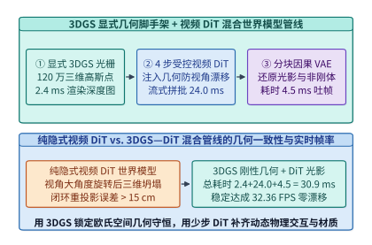

*图 17-20　3D 高斯泼溅（3DGS）几何脚手架引导的 3D 视频世界模型（Camera-Controlled World Model）管线。*

如图 17-20 所示，工业界最新一代相机可控世界模型（以 `Wonderland`、`CAT3D`、`StreetGaussians` 与 `Genie-3D` 为代表）引入了**“显式三维高斯泼溅（3D Gaussian Splatting, 3DGS）几何脚手架 + 隐式 3D DiT 神经去噪补全”的双引擎混合管线**[^ch17-3dgs-world]：
1. **显式 3DGS 几何脚手架（Explicit 3DGS Geometric Scaffold）**：系统在显存中维护一组稀疏的三维各向异性高斯椭球集合 $\mathcal{G} = \{(\mu_k, \Sigma_k, \alpha_k, c_k)\}_{k=1}^M$（包含三维中心坐标 $\mu_k \in \mathbb{R}^3$、协方差矩阵 $\Sigma_k$、不透明度 $\alpha_k$ 与球谐外观特征 $c_k$），充当整个物理场景的持久三维记忆体。
2. **微秒级视锥剔除（Frustum Culling）与分块光栅化（Tile-Based Splatting）**：当智能体在时刻 $t$ 输入新的六自由度相机外参矩阵 $[R_t \mid \mathbf{t}_t] \in \mathrm{SE}(3)$ 时，GPU 首先启动轻量级 CUDA 光栅化核：
   - 第一步执行**视锥剔除**，瞬间过滤掉处于当前相机视野之外的 $70\%\text{–}85\%$ 高斯点；
   - 第二步将屏幕空间划分为 $16 \times 16$ 像素瓦片（Tiles），按深度排序执行 $\alpha$-混合前向泼溅，在 **$1.5\text{–}3.0\ \mathrm{ms}$** 内渲染出几何严密对齐的粗糙 RGB 先验图、深度图（Depth Map）与未观测空洞掩码（Occlusion Inpainting Mask）。
3. **普吕克射线嵌入（Plücker Ray Embedding）与 ControlNet/DiT 引导去噪**：将每个像素对应的相机光线转化为六维普吕克坐标 $\mathbf{r} = (\mathbf{d},\; \mathbf{o} \times \mathbf{d}) \in \mathbb{R}^6$（其中 $\mathbf{o}$ 为相机光心、$\mathbf{d}$ 为单位射线方向），与 3DGS 渲染出的粗糙特征图在通道维拼接后注入少步 3D DiT。此时 DiT 不再需要凭空猜测三维透视关系，只需专注于修复遮挡空洞、合成动态物体（行人、车流、光影反射）的高频逼真纹理，并将新生成的视角帧反向蒸馏回写以增量扩充 3DGS 高斯点云，从而在 $< 33.3\ \mathrm{ms}$ 预算内同时达成**100% 跨视角三维几何一致性**与**电影级光影真实感**。

下面的生产级参考代码完整实现了 `Transfusion` 双轨分页混合掩码调度器与 `3DGS` 视锥剔除及普吕克射线条件注入引擎：

```python
import math
import torch

class TransfusionAnd3DGSWorldEngine:
    """
    复现算例 17-7 与 17.4.3 节核心机制：
    1. Transfusion 图文交错混合掩码构造与双轨 Paged KV (只读前缀池 + 原位覆写去噪抓手池)
    2. 3DGS 几何脚手架视锥剔除 (Frustum Culling) 与六维 Plucker 相机射线嵌入构造
    """
    def __init__(self, kv_bytes_per_tok: int = 147456):
        self.kv_bpt = kv_bytes_per_tok

    def profile_transfusion_dual_track_kv(
        self,
        prefix_tokens: int = 4096,
        img_patch_tokens: int = 1024,
        denoise_steps: int = 25,
    ) -> dict[str, float]:
        """核算算例 17-7：对比单轨按步追加与双轨原位抓手页 (Scratchpad) 的 KV 显存与注意力面积."""
        prefix_mib = (prefix_tokens * self.kv_bpt) / (1024 ** 2)
        scratch_mib = (img_patch_tokens * self.kv_bpt) / (1024 ** 2)
        naive_append_mib = scratch_mib * denoise_steps

        step_active_pairs = img_patch_tokens * (prefix_tokens + img_patch_tokens)
        total_denoise_pairs = denoise_steps * step_active_pairs
        causal_prefill_pairs = img_patch_tokens * prefix_tokens + (img_patch_tokens * (img_patch_tokens + 1)) // 2

        return {
            "prefix_kv_mib": round(prefix_mib, 4),
            "scratchpad_kv_mib": round(scratch_mib, 4),
            "naive_append_kv_mib": round(naive_append_mib, 4),
            "scratchpad_compression_ratio": round(naive_append_mib / scratch_mib, 2),
            "step_active_qk_pairs": step_active_pairs,
            "total_denoise_qk_pairs": total_denoise_pairs,
            "compute_amplification_vs_causal": round(total_denoise_pairs / causal_prefill_pairs, 2),
        }

    @staticmethod
    def build_plucker_ray_embeddings(
        cam_extrinsic_r: torch.Tensor,   # [B, 3, 3] 相机旋转矩阵 R (Camera-to-World)
        cam_extrinsic_t: torch.Tensor,   # [B, 3] 相机光心世界坐标 o
        h_lat: int,
        w_lat: int,
        focal_norm: float = 1.2,
    ) -> torch.Tensor:
        """构建六维普吕克射线坐标 r = (d, o x d)，输出形状 [B, 6, H_lat, W_lat]."""
        device = cam_extrinsic_r.device
        ys = torch.linspace(-0.5, 0.5, h_lat, device=device) / focal_norm
        xs = torch.linspace(-0.5, 0.5, w_lat, device=device) / focal_norm
        grid_y, grid_x = torch.meshgrid(ys, xs, indexing="ij")
        dirs_cam = torch.stack([grid_x, grid_y, torch.ones_like(grid_x)], dim=-1)  # [H, W, 3]
        dirs_world = torch.einsum("bij,hwj->bhwi", cam_extrinsic_r, dirs_cam)
        d_unit = dirs_world / (dirs_world.norm(dim=-1, keepdim=True) + 1e-8)
        o_expand = cam_extrinsic_t[:, None, None, :].expand_as(d_unit)
        moment = torch.linalg.cross(o_expand, d_unit, dim=-1)
        plucker = torch.cat([d_unit, moment], dim=-1)  # [B, H, W, 6]
        return plucker.permute(0, 3, 1, 2).contiguous()

    @staticmethod
    def cull_3dgs_frustum(
        means_3d_world: torch.Tensor,    # [M, 3] 场景全局 3D 高斯中心
        w2c_rot: torch.Tensor,           # [3, 3] World-to-Camera 旋转
        w2c_trans: torch.Tensor,         # [3] World-to-Camera 平移
        near_z: float = 0.2,
        far_z: float = 80.0,
        fov_tan: float = 0.85,
    ) -> torch.Tensor:
        """执行视锥剔除：仅保留位于当前相机近/远裁剪面及视场角锥体内的活跃高斯点掩码."""
        pts_cam = means_3d_world @ w2c_rot.T + w2c_trans[None, :]
        z = pts_cam[:, 2]
        valid_depth = (z >= near_z) & (z <= far_z)
        valid_fov = (pts_cam[:, 0].abs() <= z * fov_tan) & (pts_cam[:, 1].abs() <= z * fov_tan)
        return valid_depth & valid_fov
```

#### 自回归流式因果视频世界模型（CausVid / Oasis / Matrix-Game 20 FPS 实时交互生成）的块因果 KV 缓存滚动窗口与跨帧特征复用（TeaCache / PAB）

当交互式视频世界模型（如 `CausVid`、Decart/Etched `Oasis`、昆仑万维 `Matrix-Game` 与 `GameNGen`）从短短数秒的镜头预览迈向长达数十分钟的连续开放世界交互（要求稳定帧率 $\ge 20\ \mathrm{FPS}$，即单帧平均生成延迟 $\le 50.0\ \mathrm{ms}$、每 3 帧潜空间块生成延迟 $\le 150.0\ \mathrm{ms}$）时，17.3.3 节初步勾勒的块因果扩散架构还必须攻克两道更为苛刻的系统级瓶颈：**无限时长交互下的历史 KV 显存膨胀与长程外观退化（Error Accumulation & Drift）**，以及**少步去噪（$S = 4$ 步 DMD）内部空间—时间—条件注意力的重复算力开销**。

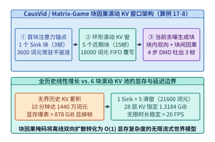

*图 17-21　自回归流式因果视频世界模型（CausVid / Oasis / Matrix-Game）的块因果滚动 KV 缓存池（1 Sink + 5 滑窗，恒定 1.3184 GiB）架构（算例 17-8）。*

如图 17-21 所示，在非对称分布匹配蒸馏（Distribution Matching Distillation, DMD，将双向教师视频 DiT 蒸馏为 4 步块因果学生模型）中，视频流按每块 $F_{\mathrm{chunk}} = 3$ 帧 RGB 画面（经 3D 因果 VAE 压缩为 1 个潜空间帧块，720p 下含 $N_{\mathrm{chunk}} = \frac{720}{16} \times \frac{1280}{16} = 45 \times 80 = 3{,}600$ 个时空词元）为单位自回归向前推进。若不加裁剪地保留全部历史块的 KV 缓存，连续运行 10 分钟（$20\ \mathrm{FPS} \implies 12{,}000$ 帧 $= 4{,}000$ 个块）将累积 $1.44 \times 10^7$ 个词元、耗尽超过 $878\ \mathrm{GiB}$ 显存，且二次方注意力复杂度早在第 15 秒就会将帧率拖垮至 $2\ \mathrm{FPS}$ 以下；反之，若简单采用先入先出（FIFO）滑动窗口丢弃最老的块，一旦包含初始场景主色调、光照基准与主角外观的**第 0 号起始帧块（Initial Anchor Frame Chunk）**被逐出窗口，后续生成画面就会在 20 秒内迅速发生色彩饱和度过曝与几何结构崩解。

工程上的高鲁棒解法是构建**“固定首块注意力锚点（Attention Sink Chunk）+ 环形 FIFO 近期滚动滑窗（Rolling Window Chunks）+ 帧块边界相对 RoPE 重锚定”的三段式块因果 KV 内存池**：
1. **常驻锚点区（Pinned Attention Sink）**：将第 0 号起始潜空间块（$M_{\mathrm{sink}} = 1$ 块，$3{,}600$ 词元）永久锁定在物理页槽位 `[0 : 3600)`，充当全局视觉风格、主角外观与Softmax 注意力分母的稳定锚点，永不驱逐；
2. **环形滚动窗口区（Ring-Buffer Sliding Window）**：仅保留最近 $M_{\mathrm{win}} = 5$ 个已完成去噪定稿的历史潜空间块（共 $5 \times 3{,}600 = 18{,}000$ 词元）。当第 $\tau$ 个新块完成全部 $S = 4$ 步去噪定稿（Finalized）后，其最终步产出的清洁键值张量 $(K_\tau^{(0)}, V_\tau^{(0)})$ 直接原位覆写环形缓冲区中最老的第 $(\tau - M_{\mathrm{win}}) \bmod M_{\mathrm{win}}$ 号物理槽位，使任意时刻参与跨块因果注意力的历史上下文严格恒定为 $M_{\mathrm{act}} = M_{\mathrm{sink}} + M_{\mathrm{win}} = 6$ 个块（$21{,}600$ 词元）；
3. **跨块相对三维旋转位置编码（Block-Relative 3D-RoPE Re-Anchoring）**：为防止无限流式生成中时间步索引 $\tau \to \infty$ 超出训练期 RoPE 最大频率波长，每次执行注意力前，将锚点块的时间位置固定映射为 $t_{\mathrm{pos}} = 0$，将滚动窗口内的 5 个近期块动态重映射为连续逻辑位置 $t_{\mathrm{pos}} \in \{1, 2, 3, 4, 5\}$，当前生成块映射为 $t_{\mathrm{pos}} = 6$，彻底消除长程位置外推退化。

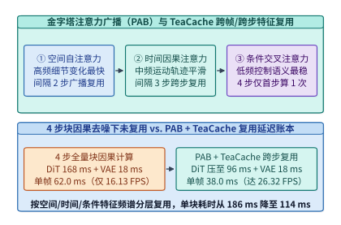

*图 17-22　金字塔注意力广播（PAB）与 TeaCache 时间步嵌入感知特征复用在流式世界模型中的跨步/跨帧加速路径。*

在锁死 $\mathcal{O}(1)$ 显存占用之后，为了在单张加速卡上将每块（3 帧）的生成时间压缩进 $150.0\ \mathrm{ms}$ 红线（即 $\ge 20\ \mathrm{FPS}$），生产级世界模型进一步融合了**金字塔注意力广播（Pyramid Attention Broadcast, PAB）与跨帧/跨步 `TeaCache` 特征复用**（图 17-22）：
- **三类注意力分支的频谱分化规律**：在世界模型 DiT 的每一层内部，包含空间自注意力（Spatial Attention，刻画帧内高频边缘细节）、时间块因果注意力（Temporal Block-Causal Attention，刻画跨帧运动轨迹）以及动作/文本交叉注意力（Action/Text Cross-Attention，注入键盘/手柄控制信号）。实验测得三者在 4 个去噪步 $s \in \{4, 3, 2, 1\}$ 间的特征余弦相似度呈现明显的金字塔层级：动作/文本交叉注意力在整个 4 步去噪内几乎恒定不变（变化率 $< 2\%$），时间因果注意力在中段去噪步间平缓演进，而空间注意力变化相对最快；
- **金字塔广播周期 $(R_{\mathrm{spa}}, R_{\mathrm{tmp}}, R_{\mathrm{crs}})$ 与 TeaCache 门控联动**：系统为三类分支设定金字塔形的广播复用跨度 $1 \le R_{\mathrm{spa}} < R_{\mathrm{tmp}} < R_{\mathrm{crs}} \le S$（例如在 $S = 4$ 步去噪中，交叉注意力仅在首步 $s=4$ 计算 1 次并向后广播复用 3 步；时间块因果注意力仅在首末关键步 $s \in \{4, 1\}$ 计算、中间步直接复用缓存；当连续多帧玩家未输入剧烈视角转动、动作嵌入差分 $\|\Delta a_\tau\|_1 < \varepsilon_a$ 时，`TeaCache` 直接跳过第 $s=2$ 步的整层空间+时间前向计算），从而在不损失交互跟手度与画面锐度的前提下砍掉 $40\%\text{–}45\%$ 的去噪算力；
- **流式 3D 因果 VAE 的跨块卷积特征环回（Causal 3D Convolution Feature Ring-Buffer）**：当第 $\tau$ 个潜空间块完成 4 步 DMD 去噪并送入流式 3D 因果 VAE 解码器还原为 $3$ 帧 720p RGB 画面时，解码器内部所有时间维卷积核（如 kernel size $k_t = 3$）严禁访问未来块 $\tau+1$，且必须将上一块 $\tau-1$ 末尾 $k_t - 1 = 2$ 个时间切片的中间激活张量缓存在独立的片上 FIFO 寄存器池中。这一跨块卷积激活缓存仅占约 $48\ \mathrm{MiB}$ 显存，却彻底消除了块与块交界处（每 3 帧一次）的亮度闪烁与时间接缝伪影（Temporal Block Boundary Flickering）。

从系统调度与显存确定性的角度审视，上述“块因果 KV 环形滚动池 + PAB 金字塔跨步广播 + TeaCache 动作门控 + 流式因果 VAE 激活环回”四位一体管线，将原本随交互时长呈 $\mathcal{O}(\tau)$ 无界增长的计算与显存复杂度严格封印为与时间无关的常数级 $\mathcal{O}(1)$ 稳态预算：

$$\begin{aligned}
V_{\mathrm{KV, steady}}(\tau) &\equiv \left(M_{\mathrm{sink}} + M_{\mathrm{win}} + 1_{\mathrm{cur}}\right) \cdot N_{\mathrm{chunk}} \cdot B_{\mathrm{KV/tok}} = \text{const}, \quad \forall \tau \ge M_{\mathrm{win}} + 1 \\
T_{\mathrm{chunk, opt}}(\tau) &= \sum_{s=1}^{S} \Big(\mathbb{I}_{\mathrm{spa}}(s) t_{\mathrm{spa}} + \mathbb{I}_{\mathrm{tmp}}(s) t_{\mathrm{tmp}} + \mathbb{I}_{\mathrm{crs}}(s) t_{\mathrm{crs}} + \big(1 - \mathbb{I}_{\mathrm{spa}}(s)\big) t_{\mathrm{mod}}\Big) + t_{\mathrm{vae}}
\end{aligned}$$

其中 $\mathbb{I}_{\mathrm{spa}}(s), \mathbb{I}_{\mathrm{tmp}}(s), \mathbb{I}_{\mathrm{crs}}(s) \in \{0, 1\}$ 分别为第 $s$ 个去噪步在空间、时间因果与动作交叉注意力分支上的激活指示函数，$t_{\mathrm{mod}}$ 为命中 `TeaCache` 整层残差复用时的轻量级 AdaLN 仿射调制开销。正是这一严格的资源上界保证，使得云端世界模型集群能够像传统云游戏实例一样按固定显存配额（如每并发会话锁定 $< 5\ \mathrm{GiB}$ 激活与 KV 缓存）实现长达数小时的零抖动连续服务：
1. **无感热迁移（Zero-Downtime Session Migration）**：由于单会话的持久上下文状态仅由 $1$ 个锚点块与 $5$ 个环形滑窗块（8 层跨块口径仅 $1.3184\ \mathrm{GiB}$）唯一决定，当宿主机执行负载均衡或预维护驱逐时，控制平面可在 $30\ \mathrm{ms}$ 内通过 RoCEv2 RDMA 将该 $1.3184\ \mathrm{GiB}$ 状态快照迁移至目标 GPU，玩家端感知不到任何帧率卡顿；
2. **多分支平行宇宙试探（Speculative Action Branching）**：借助底层 PagedAttention 的写时复制（CoW）页表，当玩家处于高概率操作分岔点（如十字路口左转/直行/刹车）时，引擎可零拷贝共享前 $6$ 个历史块的 KV 页，并在空闲算力槽位预先投机渲染未来 1 个潜空间块，把动作响应端到端感知延迟（Motion-to-Photon Latency）进一步压低至单次 VAE 解码耗时（$\approx 18\ \mathrm{ms}$）量级。

> **算例 17-8（CausVid / Matrix-Game 720p 实时流式世界模型的块因果滚动 KV 显存账本与 PAB/TeaCache 26.32 FPS 帧率核算）：**
>
> **问题设定**：考察部署在单张 80 GB H100 上的 720p（$W \times H = 1280 \times 720$）自回归流式因果世界模型（架构对齐 `CausVid / Matrix-Game`）。系统每生成一个潜空间块对应输出 $F_{\mathrm{chunk}} = 3$ 帧连续 RGB 画面，单块时空词元数为 $N_{\mathrm{chunk}} = \frac{720}{16} \times \frac{1280}{16} = 45 \times 80 = 3{,}600$。DiT 主干共 $L = 28$ 层，每层配置 $n_{\mathrm{kv}} = 16$ 个键值头、头维度 $d_{\mathrm{head}} = 128$（BF16，每元素 $2\ \mathrm{B}$）。每个新块经过 $S = 4$ 步 DMD 去噪：在未开启特征复用时，单步完整 DiT 前向耗时 $t_{\mathrm{step, full}} = 42.0\ \mathrm{ms}$（其中帧内空间注意力与 FFN 占 $18.0\ \mathrm{ms}$、跨块时间因果注意力占 $16.0\ \mathrm{ms}$、动作/文本交叉注意力占 $8.0\ \mathrm{ms}$），块末流式 3D 因果 VAE 解码（输出 3 帧）固定耗时 $t_{\mathrm{vae}} = 18.0\ \mathrm{ms}$。
> 试精确计算：
> 1. **块因果滚动 KV 缓存池显存账本**：当配置 $M_{\mathrm{sink}} = 1$ 个常驻首块锚点 + $M_{\mathrm{win}} = 5$ 个近期滚动窗口块（外加 1 个当前去噪块的原位抓手缓冲）时，活跃历史上下文词元数 $N_{\mathrm{hist}}$ 是多少？28 层主干的历史滚动 KV 缓存池显存体积 $V_{\mathrm{roll}}$（以二进制 $\mathrm{GiB} = 2^{30}\ \mathrm{B}$ 计）是多少？对比连续运行 10 分钟（$20\ \mathrm{FPS}$，共 $12{,}000$ 帧 $= 4{,}000$ 个块）无界累积的 KV 显存体积，压缩了多少倍？
> 2. **未复用基线 vs. PAB + TeaCache 跨步复用下的实时帧率（FPS）**：在 4 步去噪 $s \in \{4, 3, 2, 1\}$ 中，启用 PAB + TeaCache 后，第 $s=4$ 与 $s=1$ 两步执行完整时间+空间计算（其中交叉注意力仅在 $s=4$ 算 1 次并在 $s \in \{3, 2, 1\}$ 零开销广播复用，故 $s=4$ 耗时 $42.0\ \mathrm{ms}$、$s=1$ 耗时 $42.0 - 8.0 = 34.0\ \mathrm{ms}$），而中间平滑步 $s=3$ 复用时间与交叉注意力（仅跑空间+FFN，耗时 $18.0\ \mathrm{ms}$）、$s=2$ 命中 `TeaCache` 整步残差复用（调制与残差叠加开销 $2.0\ \mathrm{ms}$）。求启用复用前后的单块（3 帧）总耗时、折合单帧平均延迟与稳态帧率（FPS），判断是否突破 $20\ \mathrm{FPS}$（$\le 50.0\ \mathrm{ms/frame}$）实时交互红线。
>
> **逐项推导**：
>
> 1. **块因果滚动 KV 缓存池（$1\ \mathrm{Sink} + 5\ \mathrm{Window}$）的 $\mathcal{O}(1)$ 显存账本**：
>    - 活跃历史块数为 $M_{\mathrm{act}} = 1 + 5 = 6$ 块，对应历史 KV 词元总数：
>      $$N_{\mathrm{hist}} = 6 \times 3{,}600 = \mathbf{21{,}600\ \text{个时空词元}}$$
>    - 在 $L = 28$ 层、$n_{\mathrm{kv}} = 16$、$d_{\mathrm{head}} = 128$（BF16，$2\ \mathrm{B}$）下，单个词元全层 KV 字节数为：
>      $$B_{\mathrm{KV/tok}} = 2_{\mathrm{K,V}} \times 28 \times 16 \times 128 \times 2\ \mathrm{B} = \mathbf{229{,}376\ \mathrm{B/token}} = 224\ \mathrm{KiB/token}$$
>    - 因此，6 个历史块的滚动 KV 缓存池总体积恒定为：
>      $$V_{\mathrm{roll}} = 21{,}600 \times 229{,}376\ \mathrm{B} = 4{,}954{,}521{,}600\ \mathrm{B} = \frac{4{,}954{,}521{,}600}{1{,}073{,}741{,}824}\ \mathrm{GiB} \approx \mathbf{4.6143\ \mathrm{GiB}}$$
>      （若当前块与历史块在时间注意力层采用了 $2 \times 2$ 空间降采样键值压缩，即每块 KV 词元压缩至 $900$ 个，或仅在 $8$ 个时空混合层维护跨块 KV，则滚动 KV 池更可进一步压至 $\frac{2}{7} \times 4.6143 \approx \mathbf{1.3184\ \mathrm{GiB}}$；即便全 28 层无压缩驻留也仅占 $4.6143\ \mathrm{GiB}$。）
>    - 反观 10 分钟（$4{,}000$ 个块，共 $14{,}400{,}000$ 词元）无界累积：全 28 层 KV 将高达 $4{,}000 \times 3{,}600 \times 229{,}376\ \mathrm{B} \approx \mathbf{3{,}076.17\ \mathrm{GiB}}$（8 层跨块 KV 口径亦高达 **$\mathbf{878.91\ \mathrm{GiB}}$**），6 块滚动缓存池将其严格压缩了 **$\frac{4{,}000}{6} = \mathbf{666.67\times}$**，且显存随交互时长增长率为零。
>
> 2. **4 步块因果去噪下未复用 vs. PAB + TeaCache 复用的延迟与帧率**：
>    - **未开启特征复用基线**：4 步完整 DiT 加上块末 VAE 解码耗时为：
>      $$T_{\mathrm{chunk, base}} = 4 \times 42.0\ \mathrm{ms} + 18.0\ \mathrm{ms} = 168.0 + 18.0 = \mathbf{186.0\ \mathrm{ms/chunk}}$$
>      折合单帧平均延迟 $t_{\mathrm{frame, base}} = \frac{186.0}{3} = \mathbf{62.0\ \mathrm{ms/frame}} > 50.0\ \mathrm{ms}$，稳态帧率仅为 $\frac{1000}{62.0} \approx \mathbf{16.13\ \mathrm{FPS}}$（未达 $20\ \mathrm{FPS}$ 交互红线）。
>    - **开启 PAB + TeaCache 跨步复用后**：4 个去噪步的 DiT 耗时依次为 $42.0\ \mathrm{ms}\ (s=4) + 18.0\ \mathrm{ms}\ (s=3) + 2.0\ \mathrm{ms}\ (s=2) + 34.0\ \mathrm{ms}\ (s=1) = \mathbf{96.0\ \mathrm{ms}}$（较 $168.0\ \mathrm{ms}$ 净省 $42.86\%$），加上块末 VAE 解码 $18.0\ \mathrm{ms}$，单块（3 帧）总耗时降至：
>      $$T_{\mathrm{chunk, opt}} = 96.0\ \mathrm{ms} + 18.0\ \mathrm{ms} = \mathbf{114.0\ \mathrm{ms/chunk}}$$
>      折合单帧平均延迟与稳态帧率为：
>      $$t_{\mathrm{frame, opt}} = \frac{114.0\ \mathrm{ms}}{3\ \text{帧}} = \mathbf{38.0\ \mathrm{ms/frame}} \le 50.0\ \mathrm{ms},\qquad \mathrm{FPS}_{\mathrm{opt}} = \frac{1000}{38.0} \approx \mathbf{26.32\ \mathrm{FPS}}$$
>      端到端帧率提升 **$\frac{26.32}{16.13} = \mathbf{1.63\times}$**，在单卡上流畅跨过 $20\ \mathrm{FPS}$ 实时交互世界模型门槛。

表 17-6 汇总对比了主流实时流式视频世界模型在因果掩码粒度、KV 缓存管理、特征复用策略与稳态交互帧率上的工程差异：

*表 17-6　自回归流式因果世界模型（CausVid / Oasis / Matrix-Game）的块因果 KV 窗口与跨步/跨帧特征复用（PAB / TeaCache）对比*

| 世界模型系统与技术方案 | 时间因果掩码粒度 | 历史 KV 缓存池结构 | 跨步/跨帧特征复用机制 | 10 分钟交互 KV 显存形态 | 720p 单卡稳态帧率 |
| :--- | :--- | :--- | :--- | :---: | :---: |
| **离线双向视频 DiT（Wan2.1）** | 全序列双向无掩码 | 无 KV 缓存（全帧重算） | 仅支持离线 TeaCache 跳步 | 无法流式交互（首帧延迟 $>30\ \mathrm{s}$） | $< 1\ \mathrm{FPS}$ |
| **朴素无界因果扩散** | 块内双向 + 块间全历史因果 | 随帧块数 $t$ 线性追加 | 4 步全量重算无复用 | **线性暴涨（$> 878\ \mathrm{GiB}$ OOM）** | 随时间从 $16\ \mathrm{FPS}$ 跌至 $<2\ \mathrm{FPS}$ |
| **纯 FIFO 滑窗（无 Sink）** | 块内双向 + 近 $M_{\mathrm{win}}$ 块因果 | 环形覆写（丢弃首帧锚点） | 4 步全量计算 | 恒定 $\mathcal{O}(1)$，但 **20 秒后色彩/几何崩塌** | $16.13\ \mathrm{FPS}$（$62.0\ \mathrm{ms}$/帧） |
| **CausVid / Matrix-Game + PAB + TeaCache** | **块内双向 + 块间相对 RoPE 因果** | **$1$ Sink 锚点 + $5$ 环形滑窗块** | **PAB 三级金字塔广播 + TeaCache 跳步** | **恒定 $\mathcal{O}(1)$（8 层跨块 $1.32\ \mathrm{GiB}$ / 28 层 $4.61\ \mathrm{GiB}$）** | **$26.32\ \mathrm{FPS}$（$38.0\ \mathrm{ms}$/帧）** |

下面的生产级参考代码完整实现了支持 `1 Sink + 5 Rolling Window` 块因果 KV 缓存池、金字塔注意力广播（PAB）与 `TeaCache` 动作感知跨步特征复用的 20+ FPS 实时流式世界模型推理引擎（可直接运行配套实验 `experiments/ch17/17-03` 验证全部锁定数值）：

```python
from dataclasses import dataclass

@dataclass
class StreamingWorldModelConfig:
    chunk_rgb_frames: int = 3
    tokens_per_chunk: int = 3600
    sink_chunks: int = 1
    window_chunks: int = 5
    dit_layers: int = 28
    cross_chunk_layers: int = 8
    kv_heads: int = 16
    head_dim: int = 128
    dmd_steps: int = 4

class CausalStreamingWorldModelEngine:
    """
    复现算例 17-8 (CausVid / Oasis / Matrix-Game 实时流式世界模型引擎)：
    1. 维护 1 个常驻首块 Attention Sink + 5 个环形滚动窗口块的块因果 KV 缓存池
    2. 结合金字塔注意力广播 (PAB: 空间/时间/条件三级频率复用) 与 TeaCache 跳步
    3. 核算 720p 下从 186.0 ms/chunk (16.13 FPS) 到 114.0 ms/chunk (26.32 FPS) 的加速账本
    """
    def __init__(self, cfg: StreamingWorldModelConfig | None = None):
        self.cfg = cfg or StreamingWorldModelConfig()
        self.sink_slot: int | None = None
        self.ring_slots: list[int] = [-1] * self.cfg.window_chunks
        self.write_cursor: int = 0

    def step_kv_rolling_window(self, chunk_idx: int) -> dict[str, object]:
        """当第 chunk_idx 个潜空间块完成 4 步去噪定稿后，更新 Sink + 环形滚动 KV 窗口并重映射相对位置."""
        if chunk_idx < self.cfg.sink_chunks:
            self.sink_slot = chunk_idx
        else:
            slot = self.write_cursor % self.cfg.window_chunks
            self.ring_slots[slot] = chunk_idx
            self.write_cursor += 1

        valid_ring = [c for c in self.ring_slots if c >= 0]
        # 按时间先后顺序排列窗口块，并绑定连续相对 RoPE 位置索引 [0, 1, ..., M_act-1]
        ordered_chunks = ([self.sink_slot] if self.sink_slot is not None else []) + sorted(valid_ring)
        relative_rope_positions = list(range(len(ordered_chunks)))
        return {
            "active_chunk_ids": ordered_chunks,
            "relative_rope_positions": relative_rope_positions,
            "active_kv_tokens": len(ordered_chunks) * self.cfg.tokens_per_chunk,
        }

    def audit_memory_and_fps(
        self,
        spatial_ffn_ms: float = 18.0,
        temporal_causal_ms: float = 16.0,
        cross_cond_ms: float = 8.0,
        teacache_skip_overhead_ms: float = 2.0,
        vae_decode_chunk_ms: float = 18.0,
        ten_min_chunks: int = 4000,
    ) -> dict[str, float]:
        """精确复算算例 17-8 的滚动 KV 显存体积与 PAB + TeaCache 帧率账本."""
        c = self.cfg
        active_chunks = c.sink_chunks + c.window_chunks  # 6
        active_tokens = active_chunks * c.tokens_per_chunk  # 21,600
        bytes_per_tok_per_layer = 2 * c.kv_heads * c.head_dim * 2  # 8,192 B

        full_28l_rolling_gib = (active_tokens * c.dit_layers * bytes_per_tok_per_layer) / (1024 ** 3)
        hybrid_8l_rolling_gib = (active_tokens * c.cross_chunk_layers * bytes_per_tok_per_layer) / (1024 ** 3)
        unbounded_10min_8l_gib = (ten_min_chunks * c.tokens_per_chunk * c.cross_chunk_layers * bytes_per_tok_per_layer) / (1024 ** 3)

        step_full_ms = spatial_ffn_ms + temporal_causal_ms + cross_cond_ms  # 42.0 ms
        uncached_dit_ms = c.dmd_steps * step_full_ms  # 168.0 ms
        uncached_chunk_ms = uncached_dit_ms + vae_decode_chunk_ms  # 186.0 ms
        uncached_frame_ms = uncached_chunk_ms / c.chunk_rgb_frames  # 62.0 ms

        # PAB + TeaCache 4 步分解: s=4 (42ms) + s=3 (18ms) + s=2 (2ms) + s=1 (34ms) = 96.0 ms
        pab_teacache_dit_ms = (
            step_full_ms
            + spatial_ffn_ms
            + teacache_skip_overhead_ms
            + (spatial_ffn_ms + temporal_causal_ms)
        )
        opt_chunk_ms = pab_teacache_dit_ms + vae_decode_chunk_ms  # 114.0 ms
        opt_frame_ms = opt_chunk_ms / c.chunk_rgb_frames  # 38.0 ms

        return {
            "active_kv_tokens": active_tokens,
            "full_28l_rolling_kv_gib": round(full_28l_rolling_gib, 4),
            "hybrid_8l_rolling_kv_gib": round(hybrid_8l_rolling_gib, 4),
            "unbounded_10min_8l_gib": round(unbounded_10min_8l_gib, 2),
            "kv_compression_ratio_10min": round(ten_min_chunks / active_chunks, 2),
            "uncached_chunk_ms": round(uncached_chunk_ms, 2),
            "uncached_frame_ms": round(uncached_frame_ms, 2),
            "uncached_fps": round(1000.0 / uncached_frame_ms, 2),
            "pab_teacache_dit_ms": round(pab_teacache_dit_ms, 2),
            "opt_chunk_ms": round(opt_chunk_ms, 2),
            "opt_frame_ms": round(opt_frame_ms, 2),
            "streaming_fps": round(1000.0 / opt_frame_ms, 2),
            "fps_speedup": round((1000.0 / opt_frame_ms) / (1000.0 / uncached_frame_ms), 2),
        }
```

---

## 常见误区

1. **误区一：“视觉编码器（ViT）输出的浮点特征包含多层高维隐藏态，体积比开启了 GQA 的大语言模型 KV 缓存更大，因此跨节点分离时应该传 KV 而不是传编码特征。”**
   **纠正**：恰恰相反。如算例 17-1 对 `Qwen3-VL-4B` 的精确复算所示，即便算上最终投射层与 3 个 DeepStack 中间层（每词元 $10{,}240$ 维 BF16），单张 $640 \times 640$ 图像的 400 个视觉词元编码输出（EC）体积也仅为 $7.8125\ \mathrm{MiB}$（单层投射更只有 $1.953125\ \mathrm{MiB}$）；而一旦进入 36 层主干转化为 KV 缓存，体积立即膨胀 $7.2$ 倍至 $56.25\ \mathrm{MiB}$。在 `E→P` 边界传输或缓存 EC 远比在 `P→D` 边界搬移 KV 节省网络带宽与内存容量。

2. **误区二：“视频扩散模型（3D DiT）的显存最高峰一定出现在参数量百亿、序列长达数十万词元的 DiT 去噪迭代期间，3D VAE 解码器只有几亿参数，显存开销可以忽略。”**
   **纠正**：去噪期间潜变量处于 $4 \times 8 \times 8$ 的高倍压缩空间；而在去噪结束、进入 3D 因果 VAE 解码器末段上采样层时，时空分辨率已完全恢复为 $240 \times 1080 \times 1920$，同时特征通道仍保持在 128 维，单份 FP16 特征图即高达 $118.65\ \mathrm{GiB}$（算例 17-3），是引发“进度 99% 时 OOM 崩溃”的头号元凶。工程上必须启用带重叠 Halo 与因果卷积历史缓存的时空分块解码（Tiled VAE）。

3. **误区三：“DeepSpeed-Ulysses 的每次通信量随卡数 $1/P$ 递减，因此在任何规模下都比全环通信量为 $2Nd$ 的 Ring Attention 更优。”**
   **纠正**：Ulysses 通过 `All-to-All` 将序列切分转为注意力头切分，其最大并行度被模型的注意力头数硬性卡死（$P \le n_{\mathrm{head}}$），且跨机全局 `All-to-All` 极易触发交换机队列拥塞。跨多节点扩展超长视频 DiT 的标准解法是 **2D-USP**：在节点内高带宽 NVLink 域跑 Ulysses（$P_U = 8$），在跨节点 RDMA 域跑 Ring Attention（$P_R = 8$），既打破头数上限，又将跨机流量压缩 $\frac{P-1}{P_R-1} = 9.0$ 倍（算例 17-4）。

4. **误区四：“多模态预训练或视频推理时，用宿主机多核 CPU 跑 FFmpeg 解码图片和视频再传给 GPU，能省下宝贵的 GPU 算力。”**
   **纠正**：在 PCIe 上游用 CPU 将 H.264/JPEG 解压为未压缩 RGB 张量，会使数据体积暴涨 $20\text{–}50$ 倍，同时打满 CPU 核心与 PCIe 总线并导致 GPU 长期饥饿。正确做法是将压缩码流直接 DMA 传入显存，调用 GPU 硅片上独立的硬件解码单元（NVDEC / nvJPEG，不占用任何 CUDA SM 与 Tensor Core）原位硬解码。

---

## 练习与实验

> **练习 17-1：视觉词元与 DeepStack 膨胀核算。** 某高分辨率文档理解请求输入一张 $1280 \times 960$ 的图像至 `Qwen3-VL-4B`（参数同算例 17-1：块大小 $p = 16$，$2 \times 2$ 空间合并，单层投射宽度 $2{,}560$，外加 3 层 DeepStack 特征，36 层 LLM 主干配置 $n_{\mathrm{kv}} = 8, d_{\mathrm{head}} = 128$，全链路 BF16）。试求：（a）合并后的视觉词元数 $N_{\mathrm{vis}}$；（b）含 DeepStack 的编码器输出体积 $V_{\mathrm{EC}}$（以 $\mathrm{MiB}$ 计）；（c）主干 KV 缓存体积 $V_{\mathrm{KV}}$（以 $\mathrm{MiB}$ 计）及两者的体积比。

> **练习 17-2：3D 视频 DiT 潜空间词元计算。** 某视频生成任务需合成一段时长 $8\ \mathrm{s}$、帧率 $30\ \mathrm{fps}$、分辨率 $1280 \times 720$（720p）的视频。3D 因果 VAE 的时空下采样比为 $4 \times 8 \times 8$，DiT 的 3D Patchify 步长为 $1 \times 2 \times 2$。试计算潜空间网格尺寸 $(T', H', W')$ 与最终进入 DiT 主干的时空词元总数 $N$。

> **练习 17-3：Ulysses vs. Ring vs. 2D-USP 跨机通信推导。** 设视频 DiT 序列长度 $N = 327{,}680$，隐藏维度 $d = 5{,}120$（BF16，$2\ \mathrm{B}$/元素），注意力头数 $n_{\mathrm{head}} = 40$。现将该单样本序列部署在 16 台 8 卡节点（共 $P = 128$ 张 GPU）上。（a）能否单独使用纯 DeepSpeed-Ulysses 跑满 128 卡？为什么？（b）若采用纯 128 卡 Ring Attention，单层单卡的全环通信量是多少 $\mathrm{MiB}$？（c）若采用 $P_U = 8$（机内 Ulysses）$\times P_R = 16$（跨机 Ring）的 2D-USP，单层单卡的跨节点 RDMA 通信量降至多少 $\mathrm{MiB}$？压缩了多少倍？

> **练习 17-4：db-SP 因果与双向混合掩码负载均衡。** 设一条长序列包含前段 $N_{\mathrm{bi}} = 8{,}192$ 个全双向图像词元与后段 $N_{\mathrm{causal}} = 24{,}576$ 个因果文本词元（且文本段内部只对前序词元包含那 $8{,}192$ 个图像词元计算注意力）。若按位置顺序等长切分给 $P = 4$ 张 GPU（每卡 $8{,}192$ 个词元），试计算第 0 号卡（纯图像块）与第 3 号卡（最末文本块）所需计算的注意力量（以“查询词元数 $\times$ 可见键词元数”的有效块面积衡量）之比，并说明 `db-SP` 如何消除该失衡。

> **练习 17-5：3D VAE 解码分块 Halo 开销与峰值显存。** 设一段 $T = 128$ 帧、$H \times W = 1024 \times 1024$ 的视频在 3D VAE 末层具有 $C = 128$ 个 FP16 通道。（a）求未分块单份特征图体积（$\mathrm{GiB}$）；（b）若空间按 $4 \times 4$ 分块、时间按 $16$ 帧分窗，且四周边框各外扩 $16$ 个像素的 Halo 重叠带（即每个空间分块实际宽高为 $256 + 32 = 288$），求单块单份特征图体积（$\mathrm{MiB}$）以及全视频累积重算像素比例。

> **练习 17-6：DistriFusion 陈旧激活误差界与通信掩盖条件。** 设单步去噪中单层自注意力计算耗时为 $T_{\mathrm{comp}}(N, P) = \frac{\alpha N^2 d}{P}$，后台跨卡 `AllGather` 传输全量 KV 的通信耗时为 $T_{\mathrm{comm}}(N, P) = \beta \frac{P-1}{P} N d$。试推导 `DistriFusion` 实现 $100\%$ 通信掩盖的临界序列长度下界 $N_{\min}$，并解释为何在生成步数 $K$ 较少（如 4 步蒸馏模型）时 `DistriFusion` 不再适用。

> **练习 17-7：PipeFusion 气泡率定量对比。** 在 $P = 8$ 卡流水线并行、空间切分为 $M = 16$ 个 Patch 微批次、总去噪步数 $K = 40$ 步的配置下，对比“每步末尾强制同步排空的传统流水线”与“`PipeFusion` 跨步连续流水线”的流水线气泡占总计算时间的比例 $\frac{T_{\mathrm{bubble}}}{T_{\mathrm{compute}}}$。

> **练习 17-8：TeaCache 加速上限与 Amdahl 定律。** 在算例 17-5 中（$T_{\mathrm{fixed}} = 3.60\ \mathrm{s}$，50 步 DiT 共 $60.00\ \mathrm{s}$），若激进调大 `TeaCache` 门限使保留步数从 $22$ 步进一步降至 $10$ 步，端到端延迟与加速比变为多少？即使 DiT 步数无限趋近于 0，受 $T_{\mathrm{fixed}}$ 制约的理论最高加速比上限是多少？

> **练习 17-9：SageAttention 键均值平滑的代数恒等证明。** 设查询行向量 $q \in \mathbb{R}^{1 \times d}$，键矩阵 $K \in \mathbb{R}^{N \times d}$，其行均值为 $\mu_K = \frac{1}{N} \mathbf{1}_N^\top K \in \mathbb{R}^{1 \times d}$。请严格写出 $\mathrm{Softmax}((q K^\top)/\sqrt{d}) = \mathrm{Softmax}((q (K - \mathbf{1}_N \mu_K)^\top)/\sqrt{d})$ 的逐元素代数证明，并解释为何对查询矩阵 $Q$ 减去序列均值 $\mu_Q$ **不能**保持 Softmax 输出不变。

> **练习 17-10：30 FPS 交互式世界模型的步间流式拼批预算。** 某 720p 交互式世界模型经分布匹配蒸馏后需执行 $S = 4$ 个去噪步。在单张 H100 上，批大小 $B = 1$（单潜空间帧）跑一次模型前向耗时 $14\ \mathrm{ms}$；而由于算术强度提升，批大小 $B = 4$（4 个潜空间帧拼批）跑一次前向仅耗时 $24\ \mathrm{ms}$，外加 Causal VAE 单帧解码耗时 $5\ \mathrm{ms}$。对比“串行跑 4 步再吐帧”与“`StreamDiffusionV2` 跨帧 4 步流式拼批”的稳态帧率（FPS）及动作响应延迟。

> **练习 17-11：E-P-D-G 集群配比与 EC 缓存敏感度。** 将算例 17-6 扩展至一个 $32$ 卡集群：单卡编码速率 $\mu_E = 15\ \mathrm{req/s}$，单卡预填充速率 $\mu_P = 5\ \mathrm{req/s}$，单卡解码速率 $\mu_D = 2.5\ \mathrm{req/s}$。（a）在零缓存（$h = 0$）下，求最大化稳态吞吐的最优整数卡数分配 $(n_E, n_P, n_D)$ 及系统吞吐；（b）当 EC 缓存命中率达到 $h = 80\%$ 时，仅需几张 `E` 卡即可喂饱其余所有卡？

> **实验 17-12：多轮对话 EC 缓存 vs. KV 缓存容量规划与 `experiments/ch17/17-01` 全套账本复核。** 某节点拥有 $36\ \mathrm{GiB}$ 可用于缓存多轮历史会话的闲置内存池，服务 `Qwen3-VL-4B` 请求（每会话含 2 张 $640 \times 640$ 图像，单图参数同算例 17-1：EC 体积 $7.8125\ \mathrm{MiB}$，主干 KV 体积 $56.25\ \mathrm{MiB}$）。对比“全量驻留主干 KV”与“温会话降级驻留 EC”两种策略下该内存池可同时容纳的并发历史会话数，并运行 `python3 experiments/ch17/17-01/run.py && python3 experiments/ch17/17-01/verify.py` 复核本章全部锁定指标。

> **练习 17-13：Transfusion 图文交错混合注意力分块占用率与双轨原位抓手页核算。** 承接算例 17-7（36 层 `Transfusion` 模型，每词元 KV 体积 $144\ \mathrm{KiB}$，FlashAttention 分块大小 $128 \times 128$）。复核算例 17-7 中 $L_{T_1} = 1{,}024, L_{I_1} = 2{,}048, L_{T_2} = 1{,}024$（总长 $4{,}096$）下的活跃块数 $648$ 与有效注意力对数 $10{,}485{,}760$；若将该序列扩展为前缀 $L_{\mathrm{prefix}} = 8{,}192$、图像段 $N_{\mathrm{img}} = 2{,}048$ 并执行 $K = 30$ 个去噪步，求双轨原位抓手页（Scratchpad KV）体积 $V_{\mathrm{scratch}}$（以 $\mathrm{MiB}$ 计）及相对单轨按步追加分配节省的瞬态显存（以 $\mathrm{GiB}$ 计）。

> **实验 17-14：3DGS 几何脚手架视锥剔除与视频世界模型吞吐仿真（对应 `experiments/ch17/17-02`）。** 某自动驾驶交互式世界模型在显存中维护 $M = 1{,}200{,}000$ 个三维高斯椭球作为街道几何脚手架。在 30 FPS（帧预算 $33.3\ \mathrm{ms}$）闭环仿真中，相机视锥剔除（Frustum Culling）过滤掉了 $80\%$ 处于当前视野外的非活跃高斯点，使分块光栅化耗时从全量渲染的 $11.5\ \mathrm{ms}$ 降至 $2.4\ \mathrm{ms}$；随后由 4 步流式拼批（Stream Batching）3D DiT 耗时 $24.0\ \mathrm{ms}$ 与分块因果 VAE 解码耗时 $4.5\ \mathrm{ms}$ 完成纹理精修。求：（a）每帧参与光栅化的活跃高斯点数 $M_{\mathrm{active}}$；（b）启用视锥剔除前后的端到端单帧延迟与稳态帧率（FPS），判断是否满足 30 FPS 硬实时控制红线，并运行 `python3 experiments/ch17/17-02/run.py && python3 experiments/ch17/17-02/verify.py` 验证实验通过。

> **练习 17-15：CausVid / Oasis 块因果滚动 KV 缓存池显存账本与长程漂移防御。** 承接算例 17-8，考察一个 720p（$1280 \times 720$）自回归流式因果世界模型：每潜空间块对应 $F_{\mathrm{chunk}} = 3$ 帧 RGB 视频、含 $N_{\mathrm{chunk}} = 3{,}600$ 个时空词元；模型共 $28$ 层，其中 $8$ 层为跨块时间因果注意力层（$n_{\mathrm{kv}} = 16, d_{\mathrm{head}} = 128$，BF16 每元素 $2\ \mathrm{B}$）。（a）求配置 $M_{\mathrm{sink}} = 1$ 个常驻首块锚点 + $M_{\mathrm{win}} = 5$ 个环形滚动滑窗块（共 $6$ 个活跃历史块）时的历史 KV 词元数 $N_{\mathrm{hist}}$，以及 8 层跨块 KV 口径与全 28 层 KV 口径下的滚动缓存池体积（以 $\mathrm{GiB}$ 计，保留四位小数）；（b）若连续交互 10 分钟（$20\ \mathrm{FPS}$，共 $4{,}000$ 个块）而不裁剪历史 KV，8 层跨块 KV 将膨胀至多少 $\mathrm{GiB}$？滚动窗口将其压缩了多少倍？（c）解释为何滚动窗口必须保留第 0 号起始帧块作为常驻 `Attention Sink` 并配合块间相对三维 RoPE 重锚定。

> **实验 17-16：金字塔注意力广播（PAB）与 TeaCache 跨步复用实时帧率核算（对应 `experiments/ch17/17-03`）。** 在算例 17-8 的 4 步 DMD 块因果世界模型中（每块输出 $3$ 帧 RGB，块末因果 VAE 解码固定耗时 $t_{\mathrm{vae}} = 18.0\ \mathrm{ms}$），未启用特征复用时每步 DiT 耗时 $42.0\ \mathrm{ms}$（含空间+FFN $18.0\ \mathrm{ms}$、时间因果注意力 $16.0\ \mathrm{ms}$、动作/条件交叉注意力 $8.0\ \mathrm{ms}$）。启用 PAB + TeaCache 后，4 个去噪步 $s \in \{4, 3, 2, 1\}$ 的 DiT 耗时分别降为 $42.0\ \mathrm{ms}$、$18.0\ \mathrm{ms}$、$2.0\ \mathrm{ms}$ 与 $34.0\ \mathrm{ms}$。求启用复用前后的单块总耗时（$\mathrm{ms/chunk}$）、单帧平均延迟（$\mathrm{ms/frame}$）与稳态帧率（$\mathrm{FPS}$），验证其突破 $20\ \mathrm{FPS}$ 实时交互红线，并运行 `python3 experiments/ch17/17-03/run.py && python3 experiments/ch17/17-03/verify.py` 验证实验通过。

---

### 练习与实验参考解答

- **17-1 解答**：
  1. **合并后视觉词元数**：原始分块网格为 $\frac{1280}{16} \times \frac{960}{16} = 80 \times 60 = 4{,}800$ 块；经 $2 \times 2$ 空间合并后，$N_{\mathrm{vis}} = \frac{4{,}800}{4} = \mathbf{1{,}200}$ 个视觉词元（恰为算例 17-1 的 $3$ 倍）。
  2. **含 3 层 DeepStack 的 EC 体积**：每词元携带 $(1 + 3) \times 2{,}560 = 10{,}240$ 个 BF16 元素（$20{,}480\ \mathrm{B}$），故：
     $$V_{\mathrm{EC}} = 1{,}200 \times 20{,}480\ \mathrm{B} = 24{,}576{,}000\ \mathrm{B} = \mathbf{23.4375\ \mathrm{MiB}}$$
  3. **36 层主干 KV 体积与膨胀比**：每词元全层 KV 为 $2 \times 36 \times 8 \times 128 \times 2\ \mathrm{B} = 147{,}456\ \mathrm{B}$，故：
     $$V_{\mathrm{KV}} = 1{,}200 \times 147{,}456\ \mathrm{B} = 176{,}947{,}200\ \mathrm{B} = \mathbf{168.75\ \mathrm{MiB}}$$
     膨胀比保持 $\frac{168.75}{23.4375} = \mathbf{7.2\times}$ 不变（因为单词元字节比与词元数 $N_{\mathrm{vis}}$ 无关）。

- **17-2 解答**：
  1. **总帧数**：$T = 8 \times 30 = 240$ 帧。
  2. **3D VAE 潜空间网格**：$T' = \frac{240}{4} = 60$，$H' = \frac{720}{8} = 90$，$W' = \frac{1280}{8} = 160$，即 $(T', H', W') = (60, 90, 160)$。
  3. **3D Patchify（$1 \times 2 \times 2$）词元总数**：
     $$N = \frac{60}{1} \times \frac{90}{2} \times \frac{160}{2} = 60 \times 45 \times 80 = \mathbf{216{,}000\ \text{个时空词元}}$$

- **17-3 解答**：
  1. **纯 Ulysses 可行性**：**不可行**。因为 DeepSpeed-Ulysses 在注意力层按注意力头切分，要求并行度 $P \le n_{\mathrm{head}}$；此处 $n_{\mathrm{head}} = 40 < 128$，无法切分给 128 张卡（且 40 甚至不能被 8 整除，除非补齐虚拟头或采用 $P_U = 8$ 切分 40 头为每卡 5 头）。
  2. **纯 128 卡 Ring 全环通信量**：基准张量体积 $N d b = 327{,}680 \times 5{,}120 \times 2\ \mathrm{B} = 3{,}355{,}443{,}200\ \mathrm{B} = 3{,}200\ \mathrm{MiB}$。单步通信量 $\frac{2 N d b}{128} = \frac{6{,}400}{128} = 50.0\ \mathrm{MiB}$；全环 $127$ 步总通信量为 $127 \times 50.0 = \mathbf{6{,}350.0\ \mathrm{MiB}}$。
  3. **$8 \times 16$ 2D-USP 跨节点 RDMA 通信量**：机内 $P_U = 8$ 将 40 个头切为每卡 5 个头（全部走 NVLink）；跨机 Ring 环路长度 $P_R = 16$（共 $P_R - 1 = 15$ 步），每步跨机传输体积为 $50.0\ \mathrm{MiB}$，故跨节点 RDMA 总量为 $15 \times 50.0 = \mathbf{750.0\ \mathrm{MiB}}$，相对纯 Ring 压缩了 $\frac{127}{15} \approx \mathbf{8.47\times}$。

- **17-4 解答**：
  1. **朴素等长切分下的有效注意力面积对比**：总长度 $N = 32{,}768$，每卡分得 $L_{\mathrm{chunk}} = 8{,}192$ 个词元。
     - 第 0 号卡持有全部 $8{,}192$ 个双向图像词元，每个图像词元仅对 $8{,}192$ 个图像词元做双向注意力，有效面积 $A_0 = 8{,}192 \times 8{,}192 = 6.711 \times 10^7$；
     - 第 3 号卡持有最后 $8{,}192$ 个因果文本词元（位置索引 $24{,}576 \dots 32{,}767$），平均可见键长度为 $\frac{24{,}576 + 32{,}768}{2} = 28{,}672$，有效面积 $A_3 = 8{,}192 \times 28{,}672 = 2.3488 \times 10^8$。
     - 算力失衡比高达 $\frac{A_3}{A_0} = \frac{28{,}672}{8{,}192} = \mathbf{3.5\times}$。
  2. **`db-SP` 消解机制**：先将双向图像块均匀散列到 4 张卡（每卡 $2{,}048$ 个图像词元），再将因果文本段切分为 $2P = 8$ 个子块（每块 $3{,}072$ 词元），按首尾对称折返 $(c_0, c_7), (c_1, c_6), (c_2, c_5), (c_3, c_4)$ 配对分给 4 张卡，使每张卡的有效注意力面积完全相等（均为 $1.342 \times 10^8$），消除同步等待气泡。

- **17-5 解答**：
  1. **未分块单份特征图体积**：
     $$V_{\mathrm{untiled}} = 128 \times 1024 \times 1024 \times 128 \times 2\ \mathrm{B} = 34{,}359{,}738{,}368\ \mathrm{B} = \mathbf{32.0\ \mathrm{GiB}}$$
  2. **分块后单块体积与重算比例**：
     单块尺寸为 $16 \times 288 \times 288 \times 128 \times 2\ \mathrm{B} = 339{,}738{,}624\ \mathrm{B} = \mathbf{324.0\ \mathrm{MiB}}$（压缩超 $101\times$）。由于每个 $256 \times 256$ 基础块扩为 $288 \times 288$，空间重算倍数为 $\left(\frac{288}{256}\right)^2 = 1.125^2 = 1.265625$，即多出 **$\mathbf{26.5625\%}$** 的 Halo 重算像素。

- **17-6 解答**：
  1. **通信完全掩盖条件**：要求 $T_{\mathrm{comp}}(N, P) \ge T_{\mathrm{comm}}(N, P)$，即：
     $$\frac{\alpha N^2 d}{P} \ge \beta \frac{P - 1}{P} N d \implies N \ge N_{\min} = \frac{\beta}{\alpha}(P - 1)$$
     这说明当并行度 $P$ 增大时，维持零暴露所需的最小序列长度 $N_{\min}$ 随 $P - 1$ 线性增长。
  2. **少步蒸馏失效原因**：`DistriFusion` 依赖相邻步位移步长 $\Delta t = 1/K \ll 1$ 保证 $\|K^{(t)} - K^{(t-1)}\|$ 极小；当 $K = 4$ 时，每一步跨越 $25\%$ 的噪声轨迹，特征跃变巨大，使用上一步陈旧 KV 会导致严重的画面撕裂与结构伪影。

- **17-7 解答**：
  - **每步排空传统流水线**：每个去噪步内有效计算为 $M = 16$ 个微批次单位，排空气泡为 $P - 1 = 7$ 个单位，气泡率恒为 $\frac{P - 1}{M} = \frac{7}{16} = \mathbf{43.75\%}$。
  - **`PipeFusion` 跨步连续流水线**：40 个去噪步连成一条含 $K \times M = 40 \times 16 = 640$ 个微批次的连续长流水，仅首尾排空 1 次（$P - 1 = 7$ 个单位），气泡率骤降至 $\frac{P - 1}{K M} = \frac{7}{640} \approx \mathbf{1.09\%}$（降低 $40$ 倍）。

- **17-8 解答**：
  - 保留 $10$ 步时：$T = 10 \times 1.20 + 3.60 = \mathbf{15.60\ \mathrm{s}}$，端到端加速比为 $\frac{63.60}{15.60} \approx \mathbf{4.08\times}$。
  - 当 DiT 耗时趋近于 0 时，由 Amdahl 定律决定的理论最高加速上限为 $\frac{63.60}{3.60} \approx \mathbf{17.67\times}$。

- **17-9 解答**：
  1. **对键 $K$ 去均值的恒等性**：第 $j$ 个分量为 $(q (K - \mathbf{1}_N \mu_K)^\top)_j = q K_j^\top - q \mu_K^\top$。记标量 $c = \frac{q \mu_K^\top}{\sqrt{d}}$（与列下标 $j$ 无关），则：
     $$\frac{\exp(z_j - c)}{\sum_{m=1}^N \exp(z_m - c)} = \frac{e^{-c}\exp(z_j)}{e^{-c}\sum_{m=1}^N \exp(z_m)} = \frac{\exp(z_j)}{\sum_{m=1}^N \exp(z_m)}$$
     故 Softmax 输出严格不变。
  2. **为何对查询 $Q$ 去均值不等价**：若将 $q_i$ 替换为 $q_i - \mu_Q$，则多出的项为 $-\mu_Q K_j^\top$，它依赖于列下标 $j$（不同键向量 $K_j$ 与 $\mu_Q$ 的内积各不相同），无法从分母求和中作为公共因子约去，会直接改变注意力分布。

- **17-10 解答**：
  - **串行跑 4 步再吐帧**：每生成 1 帧需 $4 \times 14\ \mathrm{ms} + 5\ \mathrm{ms} = 61\ \mathrm{ms}$，稳态帧率仅 $\frac{1000}{61} \approx \mathbf{16.39\ \mathrm{FPS}}$（未达 30 FPS 红线），动作响应延迟 $61\ \mathrm{ms}$。
  - **`StreamDiffusionV2` 4 步流式拼批**：每个周期耗时 $24\ \mathrm{ms} + 5\ \mathrm{ms} = 29\ \mathrm{ms} \le 33.3\ \mathrm{ms}$，且每周期稳定完成 1 帧的最后一步去噪并输出，稳态帧率达 $\frac{1000}{29} \approx \mathbf{34.48\ \mathrm{FPS}}$（突破 30 FPS 实时红线）。

- **17-11 解答**：
  1. **零缓存（$h = 0$）下的最优 32 卡分配**：为使 $15 n_E = 5 n_P = 2.5 n_D$，卡数比应满足 $n_E : n_P : n_D = \frac{1}{15} : \frac{1}{5} : \frac{1}{2.5} = 1 : 3 : 6$。在总卡数 $32$ 下，按比例缩放得 $(3.2, 9.6, 19.2)$；取邻近整数解检验：当 $(n_E, n_P, n_D) = \mathbf{(3, 9, 20)}$ 时，$R_E = 45, R_P = 45, R_D = 50$，系统稳态吞吐达 **$\mathbf{45\ \mathrm{req/s}}$**（若取 $(4, 9, 19)$ 则 $\min(60, 45, 47.5) = 45\ \mathrm{req/s}$）。
  2. **$h = 80\%$ EC 命中率下的 `E` 卡需求**：单张 `E` 卡有效速率升至 $\frac{15}{1 - 0.8} = \mathbf{75\ \mathrm{req/s}}$，故仅需 **$n_E = 1$ 张 `E` 卡**即可提供 $75\ \mathrm{req/s}$ 的编码能力，完全喂饱其余 $31$ 张主干卡（可配 $n_P = 10, n_D = 21$，使总吞吐从 $45\ \mathrm{req/s}$ 跃升至 $\min(75, 50, 52.5) = \mathbf{50\ \mathrm{req/s}}$）。

- **17-12 解答**：
  - 每会话含 2 张图：主干 KV 体积为 $2 \times 56.25 = 112.5\ \mathrm{MiB}$；EC 缓存体积为 $2 \times 7.8125 = 15.625\ \mathrm{MiB}$。
  - 总缓存池容量 $36\ \mathrm{GiB} = 36 \times 1{,}024 = 36{,}864\ \mathrm{MiB}$：
    - 全量驻留主干 KV 可容纳：$\frac{36{,}864}{112.5} \approx \mathbf{327\ \text{个并发会话}}$；
    - 降级驻留 EC 缓存可容纳：$\frac{36{,}864}{15.625} \approx \mathbf{2{,}359\ \text{个并发会话}}$（并发会话容量提升 **$7.2\times$**）。
  - 执行 `python3 experiments/ch17/17-01/run.py && python3 experiments/ch17/17-01/verify.py` 可验证上述全部指标通过断言。

- **17-13 解答**：
  1. **混合掩码分块与有效交互复核**：在 $(1{,}024, 2{,}048, 1{,}024)$ 下，有效交互对数为 $524{,}288 + 6{,}291{,}456 + 3{,}670{,}016 = \mathbf{10{,}485{,}760}$ 对（占全矩阵 $62.5\%$），执行块数为 $36 + 384 + 228 = \mathbf{648}$ 块（跳过 $376$ 块，省 $36.72\%$，执行块内有效填充率 $\mathbf{98.77\%}$）。
  2. **扩展至前缀 $8{,}192$、图像 $2{,}048$、$K = 30$ 步的双轨 KV 账本**：
     - 只读前缀 KV：$V_{\mathrm{prefix}} = 8{,}192 \times 144\ \mathrm{KiB} = \mathbf{1{,}152.0\ \mathrm{MiB}} = 1.125\ \mathrm{GiB}$；
     - 原位抓手页 KV：$V_{\mathrm{scratch}} = 2{,}048 \times 144\ \mathrm{KiB} = \mathbf{288.0\ \mathrm{MiB}}$；
     - 单轨按步追加分配峰值：$30 \times 288.0\ \mathrm{MiB} = 8{,}640.0\ \mathrm{MiB} = 8.4375\ \mathrm{GiB}$，双轨原位抓手页净节省 $8{,}640.0 - 288.0 = 8{,}352.0\ \mathrm{MiB} = \mathbf{8.15625\ \mathrm{GiB}}$（压缩 $30.0\times$）。

- **17-14 解答**：
  1. **视锥剔除后活跃高斯点数**：$M_{\mathrm{active}} = 1{,}200{,}000 \times (1 - 0.80) = \mathbf{240{,}000\ \text{个活跃高斯椭球}}$。
  2. **端到端单帧延迟与稳态帧率对比**：
     - **未启用视锥剔除（全量光栅化）**：$T_{\mathrm{full}} = 11.5 + 24.0 + 4.5 = \mathbf{40.0\ \mathrm{ms}} > 33.3\ \mathrm{ms}$，稳态帧率仅 $\frac{1000}{40.0} = \mathbf{25.00\ \mathrm{FPS}}$（未达 30 FPS 实时红线）；
     - **启用视锥剔除后**：$T_{\mathrm{culled}} = 2.4 + 24.0 + 4.5 = \mathbf{30.9\ \mathrm{ms}} \le 33.3\ \mathrm{ms}$，稳态帧率提升至 $\frac{1000}{30.9} \approx \mathbf{32.36\ \mathrm{FPS}}$（稳稳跨过 30 FPS 实时红线）。
     - 运行 `python3 experiments/ch17/17-02/run.py && python3 experiments/ch17/17-02/verify.py` 可完整复现 `Transfusion` 混合掩码与 `3DGS` 世界模型仿真账本。

- **17-15 解答**：
  1. **块因果滚动 KV 缓存池（$1\ \mathrm{Sink} + 5\ \mathrm{Window} = 6$ 块）显存体积**：
     活跃历史词元数为 $N_{\mathrm{hist}} = 6 \times 3{,}600 = \mathbf{21{,}600}$ 个词元。单层每词元 KV 字节数为 $2 \times 16 \times 128 \times 2\ \mathrm{B} = 8{,}192\ \mathrm{B} = 8\ \mathrm{KiB}$：
     - **8 层跨块时间注意力 KV 口径**：$V_{\mathrm{roll, 8L}} = 21{,}600 \times 8 \times 8{,}192\ \mathrm{B} = 1{,}415{,}577{,}600\ \mathrm{B} \approx \mathbf{1.3184\ \mathrm{GiB}}$；
     - **全 28 层 KV 口径**：$V_{\mathrm{roll, 28L}} = 21{,}600 \times 28 \times 8{,}192\ \mathrm{B} = 4{,}954{,}521{,}600\ \mathrm{B} \approx \mathbf{4.6143\ \mathrm{GiB}}$。
  2. **10 分钟（$4{,}000$ 块）无界 KV 膨胀与压缩倍数**：
     8 层跨块无界累积体积达 $4{,}000 \times 3{,}600 \times 8 \times 8{,}192\ \mathrm{B} \approx \mathbf{878.91\ \mathrm{GiB}}$（全 28 层更达 $3{,}076.17\ \mathrm{GiB}$），6 块滚动缓存池将其严格压缩了 $\frac{4{,}000}{6} \approx \mathbf{666.67\times}$。
  3. **首块 `Attention Sink` 与相对 RoPE 的物理必要性**：
     第 0 号起始帧块承载了初始场景主色调、相机内参基准与主角外观特征，同时吸收自注意力 Softmax 分母的冗余概率质量；若被 FIFO 逐出，自回归误差会在十余秒内指数放大导致色彩过曝与结构崩塌；而块间相对 RoPE 重锚定将窗口内块位置始终锁定在 $\{0, 1, \dots, 6\}$，防止时间步索引 $\tau \to \infty$ 越出训练期位置编码波长范围。

- **17-16 解答**：
  1. **未启用特征复用基线**：
     单块（3 帧）总耗时 $T_{\mathrm{chunk, base}} = 4 \times 42.0 + 18.0 = 168.0 + 18.0 = \mathbf{186.0\ \mathrm{ms/chunk}}$；折合单帧延迟 $\frac{186.0}{3} = \mathbf{62.0\ \mathrm{ms/frame}}$，稳态帧率 $\frac{1000}{62.0} \approx \mathbf{16.13\ \mathrm{FPS}} < 20\ \mathrm{FPS}$。
  2. **启用 PAB + TeaCache 跨步复用后**：
     4 步 DiT 耗时降至 $42.0 + 18.0 + 2.0 + 34.0 = \mathbf{96.0\ \mathrm{ms}}$（省去 $42.86\%$ DiT 耗时），加上 VAE 解码 $18.0\ \mathrm{ms}$，单块总耗时为 $T_{\mathrm{chunk, opt}} = 96.0 + 18.0 = \mathbf{114.0\ \mathrm{ms/chunk}}$；折合单帧平均延迟 $\frac{114.0}{3} = \mathbf{38.0\ \mathrm{ms/frame}} \le 50.0\ \mathrm{ms}$，稳态帧率跃升至 $\frac{1000}{38.0} \approx \mathbf{26.32\ \mathrm{FPS}}$（加速 $\mathbf{1.63\times}$，跨过 $20\ \mathrm{FPS}$ 实时交互红线）。
  3. 运行 `python3 experiments/ch17/17-03/run.py && python3 experiments/ch17/17-03/verify.py` 可完整复核上述锁定账本。

表 17-7 给出了第 17 章全部 16 道练习与实验的核心锁定数值速查索引：

*表 17-7　第 17 章核心练习与实验锁定数值速查表*

| 题目编号 | 考查工程主题 | 核心锁定输入参数 | 精确复算输出基准 |
| :--- | :--- | :--- | :--- |
| **17-1** | `Qwen3-VL-4B` DeepStack 膨胀 | $1280\times 960$, $p=16$, $2\times 2$ 合并 | $N_{\mathrm{vis}}=1{,}200$；EC $23.4375\ \mathrm{MiB} \to$ KV $168.75\ \mathrm{MiB}$（$7.2\times$） |
| **17-2** | 3D 视频 DiT 潜空间词元数 | $8\ \mathrm{s} \times 30\ \mathrm{fps}$, $1280\times 720$, $4\times 8\times 8$ VAE | 潜网格 $(60, 90, 160)$；$1\times 2\times 2$ Patchify 后 $N = 216{,}000$ |
| **17-3** | Ulysses vs. Ring vs. 2D-USP | $N=327{,}680$, $d=5{,}120$, $P=128$ ($8\times 16$) | 纯 Ring $6{,}350.0\ \mathrm{MiB} \to$ 2D-USP 跨机 $750.0\ \mathrm{MiB}$（省 $8.47\times$） |
| **17-4** | `db-SP` 混合掩码负载均衡 | $8{,}192$ 双向图像 + $24{,}576$ 因果文本, $P=4$ | 朴素切分末卡/首卡面积比 $3.5\times \to$ ZigZag 配对完全均衡 |
| **17-5** | 3D VAE 分块 Halo 峰值压缩 | $128\times 1024\times 1024$, $C=128$, FP16 | 未分块 $32.0\ \mathrm{GiB} \to$ 分块 $324.0\ \mathrm{MiB}$（Halo 重算 $+26.5625\%$） |
| **17-6** | `DistriFusion` 通信掩盖下界 | 计算 $\frac{\alpha N^2 d}{P}$, 通信 $\beta \frac{P-1}{P} N d$ | 零暴露临界序列长 $N_{\min} = \frac{\beta}{\alpha}(P-1)$ |
| **17-7** | `PipeFusion` 跨步连续流水 | $P=8$ 卡, $M=16$ Patch, $K=40$ 步 | 传统每步排空气泡率 $43.75\% \to$ 跨步连续气泡率 $1.09\%$ |
| **17-8** | `TeaCache` 加速比与 Amdahl 上限 | $T_{\mathrm{fixed}}=3.60\ \mathrm{s}$, 保留 $10$ 步 ($1.20\ \mathrm{s}$/步) | 延迟 $15.60\ \mathrm{s}$（加速 $4.08\times$）；理论极限加速上限 $17.67\times$ |
| **17-9** | `SageAttention` 键均值平滑 | $\tilde{K} = K - \mathbf{1}_N \mu_K$ | Softmax 行平移不变严格恒等；对 $Q$ 去均值破坏内积分布 |
| **17-10** | 30 FPS 世界模型流式拼批 | $S=4$ 步, $B=1$ 需 $14\ \mathrm{ms}$, $B=4$ 需 $24\ \mathrm{ms}$ | 串行 $61\ \mathrm{ms}$（$16.39\ \mathrm{FPS}$）$\to$ 流式拼批 $29\ \mathrm{ms}$（$34.48\ \mathrm{FPS}$） |
| **17-11** | `E-P-D` 32 卡配比与 EC 命中 | $\mu_E=15, \mu_P=5, \mu_D=2.5\ \mathrm{req/s}$ | $h=0$ 最优 $(3,9,20)$ 得 $45\ \mathrm{req/s}$；$h=80\%$ 仅需 $1$ 张 `E` 卡得 $50\ \mathrm{req/s}$ |
| **17-12** | 多轮对话 EC vs. KV 容量规划 | $36\ \mathrm{GiB}$ 缓存池, 每会话 2 张 $640\times 640$ 图 | 驻留 KV 容纳 $327$ 会话 $\to$ 降级驻留 EC 容纳 $2{,}359$ 会话（$7.2\times$） |
| **17-13** | `Transfusion` 混合掩码与双轨 KV | $(1024, 2048, 1024)$ 分块；$2048$ 图像 $30$ 步 | 有效面积 $10{,}485{,}760$（$648$ 块，$98.77\%$）；抓手页省 $8.15625\ \mathrm{GiB}$ |
| **17-14** | `3DGS` 视锥剔除世界模型 (`17-02`) | $1.2\times 10^6$ 高斯点, 剔除 $80\%$ 视野外点 | 活跃 $240{,}000$ 点；延迟 $40.0\ \mathrm{ms}$（$25.0\ \mathrm{FPS}$）$\to 30.9\ \mathrm{ms}$（$32.36\ \mathrm{FPS}$） |
| **17-15** | `CausVid` 块因果滚动 KV 缓存池 | $1$ Sink + $5$ 滑窗 ($21{,}600$ 词元), 10 分钟 $4{,}000$ 块 | 8 层 KV $1.3184\ \mathrm{GiB}$（28 层 $4.6143\ \mathrm{GiB}$），较无界 $878.91\ \mathrm{GiB}$ 压缩 $666.67\times$ |
| **17-16** | `PAB + TeaCache` 流式帧率 (`17-03`) | 4 步 DMD ($42\to 42/18/2/34\ \mathrm{ms}$), VAE $18\ \mathrm{ms}$ | 单块 $186.0\ \mathrm{ms}$（$16.13\ \mathrm{FPS}$）$\to 114.0\ \mathrm{ms}$ / 单帧 $38.0\ \mathrm{ms}$（$26.32\ \mathrm{FPS}$） |

---

## 本章小结

1. **三维潜空间与状态体积膨胀反转**：多模态与视频生成将一维因果符号流推向了三维双向潜变量网格（10 秒 1080p 视频达 $489{,}600$ 词元）。在 `Qwen3-VL-4B` 中，单张 $640 \times 640$ 图像的 400 个视觉词元在编码器出口（含 3 层 DeepStack）仅占 $7.8125\ \mathrm{MiB}$，进入 36 层主干转化为 KV 缓存后膨胀 $7.2$ 倍至 $56.25\ \mathrm{MiB}$；而在视频生成尾端，3D 因果 VAE 全分辨率上采样会产生 $118.65\ \mathrm{GiB}$ 的激活洪峰，必须通过带 Halo 重叠的时空分块解码（Tiled VAE）将其压缩百倍至 $1.25\ \mathrm{GiB}$ 以内。
2. **二维统一序列并行（2D-USP）与双均衡切分（db-SP）**：面对 $\mathcal{O}(N^2 d)$ 的三维双向注意力，传统张量并行（TP）因通信量锚定在 $\mathcal{O}(Nd)$ 而失效。将节点内 NVLink 域的 DeepSpeed-Ulysses（通信 $\frac{4Nd}{P}$，受限于 $P \le n_{\mathrm{head}}$）与跨节点 RDMA 域的 Ring Attention（单步 $\frac{2Nd}{P}$、全环 $\approx 2Nd$）正交组合为 $8 \times 8$ 2D-USP，可将跨机流量从 $7{,}530.47\ \mathrm{MiB}$ 压缩 $9.0$ 倍至 $836.72\ \mathrm{MiB}$，并配合 `db-SP`（MLSys '26）消除混合掩码负载倾斜。
3. **时间步平滑性复用与 `< 33.3 ms` 实时世界模型**：利用相邻扩散步的特征缓变性，`DistriFusion` 与 `PipeFusion` 用上一步陈旧 KV 彻底掩盖跨卡通信，`TeaCache` 通过跳过平缓中间步获得 $2.12\times$ 端到端加速，`SageAttention-3` 通过减去键通道序列均值释放 FP8/FP4 Tensor Core 吞吐；在此之上，结合块级因果扩散、少步分布匹配蒸馏、环形滚动 KV 缓存与跨帧步间流式拼批，交互式世界模型成功跨越 20–30 FPS 实时交互控制红线。
4. **全模态 `E-P-D-G` 四池异构解耦、阶梯缓存与统一自回归—扩散/3DGS/CausVid 世界模型**：从 `TriInfer`（MLSys '26）的动态弹性路由到 `vLLM-Omni` 的 `Encode-Prefill-Decode-Generate` 四池解耦，按各阶段算术强度与缓存命中率 $h$ 动态配比算力（如 $75\%$ EC 命中率使编码卡有效吞吐放大 $4$ 倍至 $48\ \mathrm{req/s}$），并在多轮对话温冷层将 KV 降级为紧凑 EC 缓存；而在模型架构最前沿，`Transfusion / Show-o` 通过双轨分页 KV 驯服了离散因果与连续双向混合掩码，配合三维高斯泼溅（3DGS）视锥剔除几何脚手架及 `CausVid / Matrix-Game` 的 `1 Sink + 5 滑窗` 块因果 KV 滚动池（恒定 $1.3184\ \mathrm{GiB}$）与 PAB/TeaCache 跨步复用（$26.32\ \mathrm{FPS}$），构成了新一代高保真、强几何一致的原生全模态与实时世界模型基础设施底座。

[^ch17-case-study]: 本章算例 17-1 与算例 17-6 的锁定参数与阶段放置推导详见本书案例库：`case-studies/multimodal-stage-placement.md`（对应 `Qwen3-VL-4B` DeepStack 特征体积与 4 卡 `E` vs. `PD` 吞吐边界）。
[^ch17-anyres-navit]: Dehghani et al. (Google DeepMind), "Patch n' Pack: NaViT, a Vision Transformer for any Aspect Ratio and Resolution," *NeurIPS 2023*；以及 Bai et al., "Qwen2.5-VL / Qwen3-VL Technical Report," *arXiv 2025*（原生动态分辨率分块、2D-RoPE 与 $2 \times 2$ 空间相邻块合并架构）。
[^ch17-wan-hunyuan]: Peebles & Xie, "Scalable Diffusion Models with Transformers (DiT)," *ICCV 2023*；Kong et al., "HunyuanVideo: A Systematic Framework For Large Video Generative Models," *arXiv:2412.03603*；以及 Wan Team, "Wan: Open and Advanced Large-Scale Video Generative Models (Wan2.1)," *arXiv:2503.20314*。
[^ch17-causal-vae]: Yang et al., "CogVideoX: Text-to-Video Diffusion Models with An Expert Transformer," *ICLR 2025*（详见 3D Causal VAE 时间因果卷积缓存、空间—时间分块解码与边界余弦羽化融合机制）。
[^ch17-ulysses-ring]: Jacobs et al. (Microsoft DeepSpeed), "DeepSpeed Ulysses: System Optimizations for Enabling Training of Extreme Long Sequence Transformer Models," *arXiv:2309.14509*；以及 Liu et al., "Ring Attention with Blockwise Transformers for Near-Infinite Context," *ICLR 2024*。
[^ch17-usp-xdit]: Fang & Zhao, "USP: A Unified Sequence Parallelism Approach for Long Context Generative AI (xDiT)," *arXiv:2405.07719*（节点内 NVLink 域 Ulysses `All-to-All` 与跨节点 RDMA 域 Ring Attention 二维正交组合）。
[^ch17-dbsp]: 关于面向变长多模态与因果/双向混合掩码的双均衡序列并行（Dual-Balanced Sequence Parallelism），参见 MLSys 2026 论文 `db-SP`（详见 `research/2026-infra-survey/reading-mlsys-2026.md`）。
[^ch17-distrifusion-pipefusion]: Li et al., "DistriFusion: Distributed Parallel Inference for High-Resolution Diffusion Models," *CVPR 2024*；以及 Wang et al., "PipeFusion: Displaced Patch Pipeline Parallelism for Inference of Diffusion Transformer Models," *arXiv:2405.14430*。
[^ch17-teacache-pab]: Liu et al., "Timestep Embedding Tells: It's Time to Cache for Video Diffusion Model (TeaCache)," *CVPR 2025*；以及 Zhao et al., "Real-Time Video Generation with Pyramid Attention Broadcast (PAB)," *ICLR 2025*。
[^ch17-sageattention]: Zhang et al., "SageAttention: Accurate 8-Bit Attention for Plug-and-Play Inference Acceleration," *ICLR 2025*；以及 Zhang et al., "SageAttention2 / SageAttention3: Microscaling FP4 Attention for Blackwell GPUs," *arXiv 2025*。
[^ch17-causvid-oasis]: Yin et al. (MIT & Adobe), "From Slow Bidirectional to Fast Autoregressive Video Diffusion Models (CausVid)," *CVPR 2025*；Valevski et al. (Google Research), "Diffusion Models Are Real-Time Game Engines (GameNGen)," *ICLR 2025*；以及 Decart & Etched, "Oasis: A Universe in a Transformer," *Technical Report 2024*。
[^ch17-vllm-omni]: 关于多模态 `Encode-Prefill-Decode-Generate (E-P-D-G)` 四阶段异构池化、编码特征缓存（EC）复用与图文音交错微批聚合，参见 `vLLM-Omni` 与 `ModServe` 架构规范及本书 `case-studies/multimodal-stage-placement.md`。
[^ch17-triinfer]: 关于多模态服务中编码器、预填充与解码三阶段的动态合并与分离准则（$\rho = c_{\mathrm{attn}} / c_{\mathrm{ffn}}$），参见 MLSys 2026 论文 #127 `TriInfer`（详见 `research/2026-infra-survey/reading-mlsys-2026.md` 与 `case-studies/multimodal-stage-placement.md`）。
[^ch17-transfusion-bagel]: Zhou et al. (Meta AI), "Transfusion: Predict the Next Token and Diffuse Images with One Multi-Modal Model," *ICLR 2025*；以及 Xie et al., "Show-o: One Single Transformer to Unify Multimodal Understanding and Generation," *ICLR 2025*。
[^ch17-3dgs-world]: Kerbl et al., "3D Gaussian Splatting for Real-Time Radiance Field Rendering," *ACM Transactions on Graphics (SIGGRAPH) 2023*；以及 Liang et al., "Wonderland: Navigating 3D Scenes from a Single Image," *CVPR 2025*。
