# 第 18 章：大规模后训练（RLVR）、异步强化学习与推理时扩展系统

在大模型工程范式的演进历程中，以十万亿词元语料预训练（Pre-training）堆叠参数规模的“训练时扩展定律（Pre-training Scaling Law）”正与第二条陡峭的增长曲线深度交汇：**后训练可验证奖励强化学习（Reinforcement Learning with Verifiable Rewards, RLVR）与推理时计算扩展（Test-Time Compute Scaling）**。以 DeepSeek-R1、OpenAI o1/o3、Qwen-QwQ 与 Kimi k1.5 为代表的推理模型证明，当模型在数学推导、竞赛编程、形式化定理证明（Lean 4）与软件工程（SWE-bench）环境中通过大规模强化学习自发演化出反思、回溯与长思维链（Long Chain-of-Thought, Long-CoT）能力时，投入更多后训练采样算力与推理时搜索算力，能够持续换取超越人类专家基准的复杂问题求解精度。

然而，当基础设施团队试图将原本面向预训练设计的万卡集群直接用于 RLVR 后训练时，往往会遭遇严重的硬件利用率滑坡——在朴素同步强化学习管线中，昂贵的旗舰 GPU 集群有效算力利用率（MFU）常常从预训练时的 $45\%\text{–}55\%$ 暴跌至 $10\%\text{–}15\%$。造成这一断层的根本原因在于，RLVR 并非单一计算形态的循环，而是**自回归长尾生成（Rollout，访存带宽受限）、外部沙箱规则验证（Reward Verification，CPU/容器 I/O 与重尾执行时间受限）以及多模型前反向传播（Actor/Ref/Critic Training，算力与集合通信受限）**三类截然不同物理负载的高频耦合。

本章顺承第 4–6 章（分布式训练与容错）与第 11–13 章（推理引擎与 KV 缓存调度），系统建立大规模后训练（RLVR）、异步强化学习与推理时扩展系统的工程学体系。全章围绕四条定量主线展开：（1）从经典 PPO 四模型架构（总状态 $36\Psi$，32B 模型占 $1{,}152\ \mathrm{GB}$）到 GRPO/DAPO 消去 Critic 的显存账本（降至 $18\Psi = 576\ \mathrm{GB}$，节省 $50\%$ 状态显存）与自回归 Rollout 占 $70\%\text{–}90\%$ 墙钟时间的根源解剖；（2）训推共置（`veRL` / `HybridFlow` 的 `3D-HybridEngine` 零冗余子网格重分片）与物理训推分离（`OpenRLHF` / `RollArt` / `HetRL` 异构配比及 OSDI '26 `Weave` 互补作业错峰共享 $216$ 张 H20 与 $152$ 张 H800）；（3）攻克长思维链幂律长尾木桶效应，严密推导 NSDI '26 `RollPacker`（$160\times 10 = 1{,}600$ 投机采样池、双槽位竞争引发 $1/2 \to 1/4$ 长度偏置、流式训练重叠 $60\ \mathrm{s} \to 55\ \mathrm{s}$、以及不均等微批下“按微批均值直接平均得 $2.0$（有偏）” vs. “按全局总样本/总词元归一化得 $2.5$（无偏真值）”的无偏梯度定理）、OSDI '26 `Seer` 同源投机解码、陈旧度有界异步部分采样（Partial Rollout）与 OSDI '26 `RobustRL` 角色非对称容错（$790\ \mathrm{s}$ 全步重做降至 $490\ \mathrm{s}$ 保留 Rollout 恢复，净省 $300\ \mathrm{s}$）；（4）NSDI '26 `DistRS` 解耦奖励沙箱调度（重尾验证分布下朴素剩余时间估计 $0.9\ \mathrm{s}$ 与真实条件期望 $\mathbb{E}[S-10 \mid S>10] = 90.0\ \mathrm{s}$ 的百倍反差，及 $216{,}000$ 词元沉没工作量边界）与推理时树搜索（PagedAttention 写时复制 CoW 及 OSDI '26 `Breaking the Reward Barrier` 投机越障）[^ch18-cases]。

---

## 18.1 后训练与强化学习（RLHF / RLVR）的计算图与显存账本

在预训练或监督微调（SFT）中，训练集群内仅驻留**一个**正在更新的模型（及其优化器状态），且所有训练样本的序列长度在进入 GPU 前已知、可通过静态序列打包（Sequence Packing）对齐。一旦进入强化学习后训练阶段，计算图同时在“**模型副本数量**”与“**时间轴阶段耦合**”两个维度上发生了剧烈膨胀。

### 18.1.1 从四模型 PPO（Actor/Critic/Ref/RM）到无 Critic 的 GRPO / DAPO / RLOO 演进

在经典的近端策略优化（Proximal Policy Optimization, PPO）人类反馈强化学习（RLHF）管线中，单次迭代需要四个参数规模相当的模型协同工作（图 18-1 左栏）：

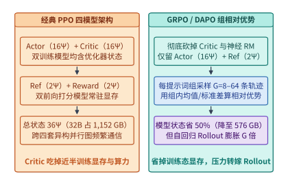
*图 18-1　PPO 四模型（Actor/Critic/Ref/RM）与 GRPO/DAPO（消去 Critic + 组采样 G 条轨迹）的显存与计算量对比（算例 18-1）。*

1. **策略模型（Actor, $\pi_\theta$，可训练）**：首先作为自回归生成引擎，针对每个提示词 $q$ 采样生成回答轨迹 $o = (o_1, \dots, o_T)$；随后在训练阶段计算当前策略对数概率 $\log \pi_\theta(o_t \mid q, o_{<t})$ 并执行反向传播更新权重。
2. **价值模型（Critic, $V_\phi$，可训练）**：对每个词元位置 $t$ 估计状态价值 $V_\phi(q, o_{\le t})$，用于通过广义优势估计（GAE）计算低方差的逐词元优势函数 $\hat{A}_t$，并同步通过均方误差损失反向传播更新自身权重。
3. **参考模型（Reference Model, $\pi_{\mathrm{ref}}$，冻结仅前向）**：保存 SFT 初始权重，在前向传播中计算 $\log \pi_{\mathrm{ref}}(o_t \mid q, o_{<t})$，提供 KL 散度正则项 $\mathbb{D}_{\mathrm{KL}}(\pi_\theta \,\|\, \pi_{\mathrm{ref}})$ 以防止策略模型发生语言退化或奖励黑客（Reward Hacking）。
4. **奖励模型（Reward Model, $R_\psi$，冻结仅前向）**：在生成轨迹末尾（或每个推理步骤）输出标量奖励分数 $r$。

让我们按第 4 章确立的混合精度训练显存公式，核算这套四模型架构对显存池的沉重挤压：对于一个参数量为 $\Psi$ 的可训练模型（如 Actor 或 Critic），在 BF16 权重（$2\Psi$）+ BF16 梯度（$2\Psi$）+ FP32 主权重副本（$4\Psi$）+ FP32 AdamW 一阶与二阶动量（$4\Psi + 4\Psi$）的标准配置下，单个可训练模型的静态模型状态体积高达 **$16\Psi$ 字节**；而单个冻结推理模型（如 Ref 或 RM）的 BF16 权重占 **$2\Psi$ 字节**。

当模型规模迈向 $32\mathrm{B}\text{–}671\mathrm{B}$、且推理思维链拉长至 $32\mathrm{K}\text{–}64\mathrm{K}$ 词元时，维护一个与 Actor 同尺寸的可训练 Critic 模型不仅直接吃掉一半的训练态显存与反向传播算力，而且在超长思维链下训练价值函数 $V_\phi$ 极易出现冷启动估计偏差。因此，现代推理模型后训练全面转向了**基于可验证规则奖励（Verifiable Rewards）的无 Critic 组相对优势算法**——以 **GRPO（Group Relative Policy Optimization）**、**DAPO（Decoupled Clip and Dynamic Sampling Policy Optimization）** 与 **RLOO（Leave-One-Out）** 为代表（图 18-1 右栏）：
- **用确定性规则验证器取代神经网络 RM**：对于数学题、代码生成与定理证明，直接调用答案解析器、单元测试沙箱或形式化验证器判定正确性，给出零参数开销的精准规则奖励 $r_i \in \{0, 1\}$；
- **用组内相对统计量取代可训练 Critic**：针对同一个提示词 $q$，策略模型一次性并行采样一组 $G$ 条候选轨迹 $\{o_1, o_2, \dots, o_G\}$（常见 $G = 8\text{–}64$），获得一组奖励 $\{r_1, \dots, r_G\}$，直接用组内样本均值与标准差归一化得到第 $i$ 条轨迹的优势值：
  $$\hat{A}_{i,t} = \frac{r_i - \mathrm{mean}(r_1, \dots, r_G)}{\mathrm{std}(r_1, \dots, r_G) + \epsilon}$$

#### 算例 18-1：32B 推理模型下经典四模型 PPO vs. GRPO/DAPO 的静态模型状态显存账本

**问题设定**：考察参数量 $\Psi = 32 \times 10^9$（32B）的稠密推理模型后训练任务。在经典 PPO 中，Actor、Critic、Reference、Reward 四个模型同为 32B 规模；在 GRPO/DAPO（配合规则沙箱验证）中，仅驻留可训练 Actor（32B）与冻结 Reference（32B）两个模型。按可训练模型状态 $16\Psi\ \mathrm{B}$、冻结模型状态 $2\Psi\ \mathrm{B}$（十进制 $\mathrm{GB} = 10^9\ \mathrm{B}$）核算：（1）PPO 四模型与 GRPO 双模型的总模型状态显存；（2）消去 Critic 与神经 RM 节省的绝对显存与百分比，以及最少所需的 80 GB H100/H800 卡数下界（假设仅模型状态最多占用单卡 $64\ \mathrm{GB}$ 以留出激活与 KV 空间）。

**逐项推导**：

1. **经典四模型 PPO 的静态状态总显存**：
   - Actor（可训练）：$16 \times 32\ \mathrm{GB} = \mathbf{512\ \mathrm{GB}}$
   - Critic（可训练）：$16 \times 32\ \mathrm{GB} = \mathbf{512\ \mathrm{GB}}$
   - Reference（冻结）：$2 \times 32\ \mathrm{GB} = \mathbf{64\ \mathrm{GB}}$
   - Reward（冻结）：$2 \times 32\ \mathrm{GB} = \mathbf{64\ \mathrm{GB}}$
   $$M_{\mathrm{PPO}} = (16 + 16 + 2 + 2)\Psi = \mathbf{36\Psi} = 36 \times 32\ \mathrm{GB} = \mathbf{1{,}152\ \mathrm{GB}}$$

2. **GRPO / DAPO（规则验证）的静态状态总显存**：
   - Actor（可训练）：$16 \times 32\ \mathrm{GB} = \mathbf{512\ \mathrm{GB}}$
   - Reference（冻结）：$2 \times 32\ \mathrm{GB} = \mathbf{64\ \mathrm{GB}}$
   - Critic 与神经 RM：$\mathbf{0\ \mathrm{GB}}$
   $$M_{\mathrm{GRPO}} = (16 + 2)\Psi = \mathbf{18\Psi} = 18 \times 32\ \mathrm{GB} = \mathbf{576\ \mathrm{GB}}$$

3. **状态显存节省比与硬件卡数下界**：
   $$\Delta M = 1{,}152\ \mathrm{GB} - 576\ \mathrm{GB} = \mathbf{576\ \mathrm{GB}}\quad(\text{精确削减 }\mathbf{50.0\%})$$
   若每张 80 GB 加速卡最多分配 $64\ \mathrm{GB}$ 给静态模型状态，PPO 至少需要 $\lceil 1{,}152 / 64 \rceil = 18$ 张卡（按 2 的幂次拓扑需 $32$ 卡），而 GRPO 仅需 $\lceil 576 / 64 \rceil = 9$ 张卡（单台 8 卡节点开少量 CPU 卸载或 2 台 8 卡共 $16$ 卡即可宽裕运行）。

表 18-1 总结了主流后训练强化学习算法在模型组件、显存系数与系统瓶颈上的演进脉络：

| 算法范式 | 驻留模型组件 | 总静态模型状态系数 | 优势函数估计方式 | 组采样倍数 $G$ | 核心基础设施瓶颈转移方向 |
| :--- | :--- | :---: | :--- | :---: | :--- |
| **标准 PPO** | Actor + Critic + Ref + RM | **$36\Psi$** | GAE 逐词元价值差分 | $G = 1$ | 双倍训练态显存与四模型跨拓扑通信 |
| **RLOO** | Actor + Ref + RM/规则 | $18\Psi\text{–}20\Psi$ | 留一法组内均值基线 | $G = 4\text{–}16$ | 训练显存减半，Rollout 采样量增 $G$ 倍 |
| **GRPO（DeepSeek-R1）** | **Actor + Ref（+ 规则沙箱）** | **$18\Psi$** | 组内均值与标准差归一化 | $G = 8\text{–}64$ | **长思维链 Rollout 耗时占 $70\%\text{–}90\%$** |
| **DAPO** | Actor + Ref（动态过滤零方差） | **$18\Psi$** | 解耦上下 Clip + 全局词元归一化 | $G = 16\text{–}64$ | **需投机超额采样池填补全对/全错空缺** |

下面的参考代码实现了 GRPO / DAPO 的组相对优势计算、解耦上下裁剪（Clip-Higher $\varepsilon_{\mathrm{high}} > \varepsilon_{\mathrm{low}}$，防止熵坍缩）、无偏 K3 KL 散度估计器以及全局有效词元归一化损失函数：

```python
import torch

def compute_grpo_dapo_policy_loss(
    curr_logprobs: torch.Tensor,     # [B_tot, T] 当前训练策略 log pi_theta(o_t | q, o_<t)
    behav_logprobs: torch.Tensor,    # [B_tot, T] 生成当下记录的真实行为策略 log pi_behav(o_t)
    ref_logprobs: torch.Tensor,      # [B_tot, T] 冻结参考模型 log pi_ref(o_t | q, o_<t)
    rewards: torch.Tensor,           # [B_prompt, G] 规则沙箱返回的标量奖励
    valid_mask: torch.Tensor,        # [B_tot, T] 有效生成词元掩码 (排除 padding 与 prompt)
    eps_low: float = 0.20,
    eps_high: float = 0.28,          # DAPO Clip-Higher: 放宽上界鼓励低概率探索词元
    kl_beta: float = 0.01,
) -> dict[str, torch.Tensor]:
    """
    GRPO / DAPO 核心损失实现：
    1. 组内相对优势归一化: A_i = (r_i - mean(r_group)) / (std(r_group) + 1e-6)
    2. 逐词元重要性比率 r_t = exp(curr_logprob - behav_logprob)
    3. 解耦上下界裁剪与全局总有效词元数 (Total-Token) 无偏归一化
    """
    b_prompt, group_size = rewards.shape
    mean_r = rewards.mean(dim=-1, keepdim=True)
    std_r = rewards.std(dim=-1, keepdim=True, unbiased=False)
    # 标记组内标准差 > 0 的非零方差有效组 (DAPO Dynamic Sampling Filter)
    non_zero_var_mask = (std_r.squeeze(-1) > 1e-6)

    adv = ((rewards - mean_r) / (std_r + 1e-6)).reshape(-1, 1)  # [B_tot, 1]
    ratio = torch.exp(curr_logprobs - behav_logprobs)            # [B_tot, T]
    clipped_ratio = torch.clamp(ratio, 1.0 - eps_low, 1.0 + eps_high)

    surr1 = ratio * adv
    surr2 = clipped_ratio * adv
    policy_obj = torch.minimum(surr1, surr2)

    # Schulman K3 无偏低方差 KL 散度估计器: exp(log_ref - log_curr) - (log_ref - log_curr) - 1
    log_r_ref = ref_logprobs - curr_logprobs
    kl_div = torch.exp(log_r_ref) - log_r_ref - 1.0

    per_token_loss = -(policy_obj - kl_beta * kl_div) * valid_mask
    # 关键铁律：以全局有效总词元数作为唯一归一化分母
    total_valid_tokens = valid_mask.sum().clamp(min=1.0)
    loss = per_token_loss.sum() / total_valid_tokens

    return {
        "loss": loss,
        "total_valid_tokens": total_valid_tokens,
        "valid_group_ratio": non_zero_var_mask.float().mean(),
        "mean_kl": (kl_div * valid_mask).sum() / total_valid_tokens,
    }
```

### 18.1.2 为什么在 RLVR 中自回归生成（Rollout）霸占了 70%–90% 的墙钟时间？

许多初次搭建 GRPO 训练管线的团队都会困惑：既然 GRPO 已经砍掉了 Critic 的前向与反向传播，为什么单步 RL 迭代反而比预训练慢得多，且 GPU 监控面板上超过 $80\%$ 的时间功耗都很低？

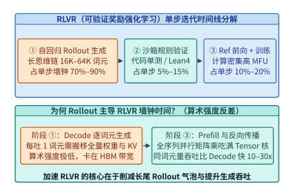
*图 18-2　RLVR 单步训练时间线分解——为何自回归 Rollout 占据 70%–90% 墙钟时间且算术强度极低。*

如图 18-2 所示，单步 RLVR 迭代由三个串行或半重叠阶段构成：**阶段 ① 自回归轨迹生成（Rollout）$\to$ 阶段 ② 沙箱规则验证（Reward Verification）$\to$ 阶段 ③ 参考模型前向与策略模型前反向更新（Learner Update）**。即便阶段 ① 与阶段 ③ 处理的是完全相同的 $N_{\mathrm{tot}} = B_{\mathrm{prompt}} \times G \times \bar{L}$ 个生成词元，两者的硬件执行效率也存在数量级鸿沟：

1. **阶段 ③（Learner 训练）是全序列并行矩阵乘（Compute-Bound）**：
   当一条长达 $L = 32{,}768$ 词元的完整轨迹进入训练阶段时，全部 $32{,}768$ 个词元已知，只需执行 **1 次** 大矩阵乘法（GEMM）与 FlashAttention 即可完成前向传播，再执行 **1 次** 反向传播（合计约 $6\Psi N_{\mathrm{tot}}$ FLOPs）。此时算术强度高达数百 $\mathrm{FLOP/Byte}$，GPU Tensor Core 可轻松跑出 $45\%\text{–}55\%$ 的高 MFU。
2. **阶段 ①（Rollout 生成）是逐词元串行访存（Memory-Bandwidth-Bound + Serial Steps）**：
   为了吐出这 $L = 32{,}768$ 个词元，模型必须严格按时间步串行循环执行 **$32{,}768$ 次** Decode 前向。在每一次 Decode 步中，GPU 都必须将整座模型的权重参数（例如 32B BF16 模型的 $64\ \mathrm{GB}$ 权重）加上全部在途请求的巨量历史 KV 缓存从 HBM 完整搬入寄存器一次。当生成进入后半程、大部分短轨迹已提前结束（EOS）而只剩少数几条长思维链轨迹在跑时，有效并发批大小 $B_{\mathrm{active}}$ 跌至个位数，算术强度退化至 $1\text{–}4\ \mathrm{FLOP/Byte}$，处理等量词元的墙钟耗时高达训练阶段的 **$10\text{–}30$ 倍**。

因此，在长思维链 RLVR 中，**自回归 Rollout 阶段不可避免地霸占了单步迭代 $70\%\text{–}90\%$ 的墙钟时间**。整个后训练系统的优化重心，必须从单纯优化反向传播通信，全面转向“**如何以最高吞吐完成长尾自回归采样，并无缝切换回高并行训练**”。

表 18-2 定量对比了 RLVR 单步迭代内三大阶段的计算特征、算术强度与系统瓶颈：

| 迭代阶段 | 核心计算算子 | 算术强度（$\mathrm{FLOP/Byte}$） | 硬件受限类型 | 并发度随时间演化规律 | 典型墙钟时间占比 |
| :--- | :--- | :---: | :--- | :--- | :---: |
| **① 自回归生成（Rollout）** | 逐词元 GEMV + PagedAttention | $1\text{–}16$（随尾期骤降） | **HBM 带宽与容量受限** | 随短轨迹完成从 $B_{\max}$ 坍塌至 $1\text{–}2$ | **$70\%\text{–}90\%$** |
| **② 规则沙箱验证（Verify）** | 容器内编译/单测/定理检查 | 极低（分支与系统调用密集） | **CPU 核数与重尾超时受限** | 随 EOS 流式到达，受长尾死循环拖累 | $5\%\text{–}15\%$ |
| **③ 参考前向与策略训练** | 全序列 GEMM + FlashAttention | $180\text{–}350+$ | **Tensor Core 算力与通信受限** | 全序列静态/动态打包，全程满载 | $10\%\text{–}20\%$ |

下面的定量模型展示了为何在相同的生成词元总量下，逐词元自回归 Decode 的墙钟耗时是稠密全序列训练阶段的十倍以上：

```python
def model_rlvr_rollout_vs_train_wallclock(
    model_params_b: float = 32.0,
    num_prompts: int = 128,
    group_size: int = 8,
    mean_seq_len: int = 8192,
    max_tail_seq_len: int = 32768,
    num_gpus: int = 64,
    hbm_bw_tb_s: float = 2.4,         # 单卡有效 HBM 带宽 (TB/s)
    train_tflops_eff: float = 420.0,  # 单卡训练期有效 Tensor Core 吞吐 (TFLOPS)
    tp_inf: int = 4,
) -> dict[str, float]:
    """
    从第一性原理解剖 RLVR 中自回归 Rollout 占 70%-90% 墙钟时间的物理根源：
    - 训练阶段 (Ref 前向 + Actor 前反向 ≈ 8 * Psi * N_total FLOPs) 走全序列并行大矩阵乘
    - 生成阶段 (Rollout) 必须串行走完 max_tail_seq_len 步，每步受限于权重与 KV 的 HBM 带宽搬移
    """
    total_tokens = num_prompts * group_size * mean_seq_len
    psi = model_params_b * 1e9

    # 1. 训练阶段 (Stage 3: Ref 2*Psi + Actor 6*Psi = 8*Psi FLOPs/token)
    total_train_flops = 8.0 * psi * total_tokens
    cluster_train_flops_per_s = num_gpus * train_tflops_eff * 1e12
    train_wall_sec = total_train_flops / cluster_train_flops_per_s

    # 2. 生成阶段 (Stage 1: 需串行跑完最慢轨迹的 max_tail_seq_len 步)
    # 每个推理实例 (TP_inf 张卡) 每吐 1 步至少需从 HBM 搬移完整 2*Psi 权重字节 + 活跃 KV
    per_instance_bw = tp_inf * hbm_bw_tb_s * 1e12
    step_weight_read_sec = (2.0 * psi) / per_instance_bw
    # 计入 KV 缓存读取与算子启动开销 (平均步耗时约为纯权重读取下界的 1.8 倍)
    rollout_wall_sec = max_tail_seq_len * step_weight_read_sec * 1.8

    total_iter_sec = rollout_wall_sec + train_wall_sec
    return {
        "total_tokens": total_tokens,
        "rollout_wall_sec": round(rollout_wall_sec, 2),
        "train_wall_sec": round(train_wall_sec, 2),
        "rollout_time_share": round(rollout_wall_sec / total_iter_sec, 4),
    }
```

---

## 18.2 训推共置（Colocated）与训推分离（Disaggregated）系统架构

既然单步 RLVR 同时包含“访存受限的自回归推理（Rollout）”与“算力受限的稠密训练（Learner）”，我们在集群拓扑上立刻面临一个顶层架构抉择：**究竟是让同一批 GPU 分时复用、交替扮演推理引擎与训练器（训推共置，Colocated），还是将集群物理切分为独立的推理池与训练池（训推分离，Disaggregated）？**

### 18.2.1 训推共置与零冗余重分片：veRL（HybridFlow）的 3D-HybridEngine 机制

在同构 GPU 集群（例如全 H100/H800 集群）上，训推共置（以字节跳动开源的 `veRL` / `HybridFlow` 为代表）具有一个天然优势：全部 GPU 在阶段 ① 100% 投入 Rollout 生成，在阶段 ③ 100% 投入 Actor/Ref 训练，无需跨两个物理隔离的集群池搬移数百 GB 的全量模型权重。

然而，训推共置面临一个棘手的**并行拓扑失配矛盾（Parallelism Mismatch）**：
- **在训练阶段（阶段 ③）**：为了容纳庞大的优化器状态（$12\Psi$）、梯度与全序列激活，32B–70B 模型必须采用深度分片策略，例如较大的张量并行度 $TP_{\mathrm{tr}} = 8$、流水线并行度 $PP_{\mathrm{tr}} = 4$ 与 ZeRO-3 / FSDP 数据并行度 $DP_{\mathrm{tr}}$；
- **在生成阶段（阶段 ①）**：自回归 Decode 只需持有 $2\Psi$ 的 BF16 推理权重，若继续沿用 $PP_{\mathrm{tr}} = 4, TP_{\mathrm{tr}} = 8$ 的重型训练拓扑，跨 32 张卡的流水气泡与每层 AllReduce 延迟会直接拖垮推理吞吐。相反，生成阶段最优的拓扑是**采用最小的推理张量并行度 $TP_{\mathrm{inf}} = 2$ 或 $4$（刚好放得下 $2\Psi$ 权重与 KV 缓存），复制出尽可能多的独立推理副本（Rollout DP Replicas）并发吞吐提示词**。

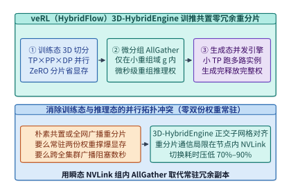
*图 18-3　veRL（HybridFlow）3D-HybridEngine 训练态（ZeRO+TP+PP）与生成态（微张量并行）的零冗余内存重分片机制。*

如果为了兼顾两套拓扑而在显存里同时常驻一份训练分片权重和一份推理完整权重，就会凭空浪费 $2\Psi$（数十至上百 GB）显存；如果每次从训练切往推理时都跨全集群 $N$ 张卡做一次全局 `AllGather`，通信风暴又会耗费数秒。

如图 18-3 所示，`veRL` 的 **`3D-HybridEngine`** 通过精心构造**正交嵌套微重组域（Micro-Resharding Subgroup）**实现了零权重冗余与微秒级切换：
1. 设训练态采用 $(PP_{\mathrm{tr}}, TP_{\mathrm{tr}}, DP_{\mathrm{tr}})$ 切分，且优化器状态与主权重在 $DP_{\mathrm{tr}}$ 域内做 ZeRO 分片；生成态目标采用更小的张量并行度 $TP_{\mathrm{inf}}$（满足 $TP_{\mathrm{tr}} = g \cdot TP_{\mathrm{inf}}$）。
2. 在从训练态切换至生成态（`Transition-to-Rollout`）时，`3D-HybridEngine` 不跨全集群广播，而是将通信严格限制在节点内 NVLink 互连的**正交微分组（Micro-Group）**内执行一次并发 `AllGather`，直接将分片参数原位拼装为多组独立的 $TP_{\mathrm{inf}}$ 推理引擎实例（底层挂载 `vLLM` 或 `SGLang` 的 PagedAttention 算子）。
3. 当本轮 Rollout 采样一结束，引擎立即释放这批瞬态拼装的完整 BF16 推理权重与 KV 缓存页池，将全部显存交还给训练态激活与梯度缓冲，从而在**零常驻冗余显存**的前提下将阶段切换耗时压缩了 $70\%\text{–}90\%$。

#### 算例 18-2：64 卡训推共置集群中全网广播重分片 vs. 3D-HybridEngine 微分组重分片耗时对比

**问题设定**：在 8 台 8 卡 H800 节点（共 $N_{\mathrm{gpu}} = 64$ 卡）上共置训练 $\Psi = 32\mathrm{B}$ 模型（BF16 推理权重体积 $V_W = 2\Psi = 64\ \mathrm{GB}$）。节点内 NVSwitch 单卡有效聚合通信带宽为 $B_{\mathrm{intra}} = 400\ \mathrm{GB/s}$，跨节点 RoCE 网络单卡有效集合通信带宽为 $B_{\mathrm{inter}} = 40\ \mathrm{GB/s}$。
- **方案 A（朴素跨全集群 ZeRO-3 聚合）**：权重均匀切分在全部 64 张卡上，切换至推理态时需跨 64 卡执行全局 `AllGather` 收集完整 $64\ \mathrm{GB}$ 权重（随后在本地切出 $TP_{\mathrm{inf}} = 4$ 分片），受限于跨节点带宽 $B_{\mathrm{inter}}$；
- **方案 B（`3D-HybridEngine` 机内微分组重分片）**：生成态目标为 $TP_{\mathrm{inf}} = 4$（每张推理卡仅需持有 $\frac{64\ \mathrm{GB}}{4} = 16\ \mathrm{GB}$ 权重分片），训练态分片布局与机内 8 卡对齐，使得每张卡只需在机内 NVLink 子组（规模 $g = 8$）内执行一次局部 `AllGather` 即可凑齐所需的 $16\ \mathrm{GB}$ 推理分片。

试计算两种方案每次从训练态切往推理态的重分片通信量与通信耗时。

**逐项推导**：

1. **方案 A（朴素跨机全局聚合）**：
   单卡需通过跨节点网络接收 $\frac{63}{64} \times 64\ \mathrm{GB} = 63.0\ \mathrm{GB}$ 权重数据，耗时为：
   $$T_{\mathrm{naive}} = \frac{63.0\ \mathrm{GB}}{40\ \mathrm{GB/s}} = \mathbf{1.575\ \mathrm{s}} = 1{,}575\ \mathrm{ms}$$
2. **方案 B（`3D-HybridEngine` 机内对齐微分组聚合）**：
   每张卡最终仅需持有 $16\ \mathrm{GB}$ 推理权重（其中本地已持有 $\frac{1}{8}$ 即 $2\ \mathrm{GB}$），只需在节点内 NVLink 域接收 $\frac{7}{8} \times 16\ \mathrm{GB} = 14.0\ \mathrm{GB}$ 数据，耗时仅为：
   $$T_{\mathrm{hybrid}} = \frac{14.0\ \mathrm{GB}}{400\ \mathrm{GB/s}} = \mathbf{0.035\ \mathrm{s}} = 35\ \mathrm{ms}$$
   切换通信耗时缩短了 **$\frac{1{,}575\ \mathrm{ms}}{35\ \mathrm{ms}} = 45.0\times$**，彻底消除了每步训推切换的通信停顿。

### 18.2.2 训推物理分离（OpenRLHF / RollArt / HetRL）与多作业互补错峰池化（Weave, OSDI '26）

尽管 `veRL` 的训推共置在同构短序列场景下极为高效，但在超大规模工业集群中，**物理训推分离（Disaggregated RL Architecture，代表系统包括 `OpenRLHF`、`StreamRL`、`RollArt`、`HetRL` 与 OSDI '26 `Weave`）**正成为另一股不可替代的主流范式（图 18-4）：

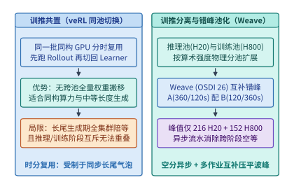
*图 18-4　训推共置（veRL）与物理训推分离及互补错峰池化（Weave OSDI '26，算例 18-3）对比。*

为什么要将 Rollout 池与 Learner 训练池物理拆开？原因有二：

1. **消除同构硬件错配税（`HetRL` 异构算力配比准则）**：
   如下文图 18-15 所示，自回归 Rollout 是典型的 HBM 带宽与容量受限负载，使用算力昂贵但显存带宽比偏低的旗舰训练卡（如 H800/B200）跑 Decode 是极大的资本浪费；而像 H20（96 GB HBM3，$4.0\ \mathrm{TB/s}$ 高带宽）或推理优化卡在单位成本下的 KV 容量与访存带宽远超旗舰训练卡。
   设单步 RL 迭代在推理池上的总生成工作量为 $W_{\mathrm{inf}}$（词元数），单张推理卡（如 H20）的有效生成吞吐为 $\eta_{\mathrm{inf}}$（$\mathrm{tok/s}$）；在训练池上的总前反向工作量为 $W_{\mathrm{tr}}$，单张训练卡（如 H800）的有效训练吞吐为 $\eta_{\mathrm{tr}}$（$\mathrm{tok/s}$）。为使异步流水线中推理池节拍 $T_{\mathrm{rollout}}(N_{\mathrm{inf}}) = \frac{W_{\mathrm{inf}}}{N_{\mathrm{inf}} \eta_{\mathrm{inf}}}$ 与训练池节拍 $T_{\mathrm{train}}(N_{\mathrm{tr}}) = \frac{W_{\mathrm{tr}}}{N_{\mathrm{tr}} \eta_{\mathrm{tr}}}$ 严格匹配、实现零互等泡泡，`HetRL` 给出两池最优卡数配比方程：
   $$\frac{N_{\mathrm{inf}}}{N_{\mathrm{tr}}} = \frac{W_{\mathrm{inf}} / \eta_{\mathrm{inf}}}{W_{\mathrm{tr}} / \eta_{\mathrm{tr}}}$$

2. **多 RL 作业互补错峰共享（OSDI '26 `Weave`）**[^ch18-weave]：
   在仍需保持严格同策略（On-Policy，即当前步必须等本作业 Rollout 跑完才能开始 Learner 更新）的场景下，单个作业若独占物理分离的推理池和训练池，必然导致“跑 Rollout 时训练池全空置、跑训练时推理池全空置”。OSDI 2026 论文 `Weave` 提出了**跨作业细粒度时空编织（Inter-Job Spatio-Temporal Weaving）**：将周期相位互补的多个 RL 作业调度到共享的异构推理池与训练池上，用作业 B 的训练期填满作业 A 的推理期空谷，反之亦然。

#### 算例 18-3（锁定自案例库 `case-studies/rl-scheduling-and-recovery.md`）：Weave 互补 RL 作业错峰共享 216 张 H20 与 152 张 H800 的硬件削峰账本

**问题设定**：在配备 H20 Rollout 池与 H800 训练池（单池上限各 $328$ 卡）的异构集群上，同时运行两组同策略（On-Policy）RLVR 作业（作业组 A 与作业组 B）。两者的单步迭代周期均为 $T_{\mathrm{cycle}} = 480\ \mathrm{s}$，各自在生成阶段（Rollout）需占用 $216$ 张 H20、在训练阶段（Ref + Actor Training）需占用 $152$ 张 H800，但阶段时长分布恰好互补：
- **作业组 A（长生成、短训练型）**：Rollout 耗时 $360\ \mathrm{s}$（占 $216$ 张 H20），训练耗时 $120\ \mathrm{s}$（占 $152$ 张 H800）；
- **作业组 B（短生成、重训练型）**：Rollout 耗时 $120\ \mathrm{s}$（占 $216$ 张 H20），训练耗时 $360\ \mathrm{s}$（占 $152$ 张 H800）。

试对比计算：（1）在无跨作业共享的独立静态分池（`Solo-D`）下，同时承载两组作业需预留多少张 H20 与多少张 H800？（2）在 `Weave` 将作业组 A 的 $[0, 360)\ \mathrm{s}$ 生成期与作业组 B 的 $[0, 360)\ \mathrm{s}$ 训练期反相错峰编织后，全周期任意时刻的实际共享峰值是多少张 H20 与多少张 H800？（3）若计入阶段切换成本，主机内存热切换（每阶段 $+5\ \mathrm{s}$）与冷启动（每阶段 $+45\ \mathrm{s}$）的周期分别是多少秒？是否满足相对独跑周期延长不超过 $10\%$（$528\ \mathrm{s}$）的 SLO 约束？

**逐项推导**：

1. **独立静态分池（`Solo-D`，无跨作业共享）的硬件总需求**：
   若两组作业各自独占一对静态推理池与训练池，集群必须准备两套完整配额：
   $$N_{\mathrm{H20, solo}} = 216 + 216 = \mathbf{432\ \text{张 H20}}\quad(\text{已超出测试床 }328\ \text{张 H20 物理上限})$$
   $$N_{\mathrm{H800, solo}} = 152 + 152 = \mathbf{304\ \text{张 H800}}$$
   此时合计需占用 $432 + 304 = 736$ 张 GPU，且每套池在半数周期内处于空转等待状态。

2. **`Weave` 反相错峰编织后的精确时段资源水位与共享峰值**：
   将稳态周期 $[0, 480)\ \mathrm{s}$ 切分为两个互补时间片：
   - **时间片 I（$t \in [0, 360)\ \mathrm{s}$，共 $360\ \mathrm{s}$）**：作业组 A 在 Rollout 池运行（占 $216$ 张 H20），作业组 B 在训练池更新上一轮样本（占 $152$ 张 H800）；
   - **时间片 II（$t \in [360, 480)\ \mathrm{s}$，共 $120\ \mathrm{s}$）**：作业组 A 切入训练池更新本轮样本（占 $152$ 张 H800），作业组 B 切入 Rollout 池生成（占 $216$ 张 H20）。
   因此，两个互补作业组共享同一对资源池即可 $100\%$ 连续满载运行，全集群峰值实际使用量锁定为：
   $$N_{\mathrm{H20, weave}} = \mathbf{216\ \text{张 H20}},\qquad N_{\mathrm{H800, weave}} = \mathbf{152\ \text{张 H800}}$$
   直接省掉整整一对资源池（净省 $216$ 张 H20 与 $152$ 张 H800，即削减 **$50.0\%$** 的硬件池需求）。

3. **热切换 vs. 冷启动的周期与 $10\%$ SLO 检验**：
   单作业独跑周期为 $480\ \mathrm{s}$，允许 $10\%$ 减速的 SLO 上界为 $480 \times 1.10 = \mathbf{528\ \mathrm{s}}$。由于每个资源池在单周期内经历 $2$ 个阶段切换（且两池切换并行发生）：
   - **主机内存驻留热切换（每阶段 $+5\ \mathrm{s}$）**：$T_{\mathrm{warm}} = 480 + 2 \times 5 = \mathbf{490\ \mathrm{s}} \le 528\ \mathrm{s}$（**满足 SLO**）；
   - **冷启动重载（每阶段 $+45\ \mathrm{s}$）**：$T_{\mathrm{cold}} = 480 + 2 \times 45 = \mathbf{570\ \mathrm{s}} > 528\ \mathrm{s}$（**违反 SLO**）。

下面的参考代码实现了 `veRL` 3D-HybridEngine 微分组重分片耗时评估与 `Weave`（OSDI '26）多作业互补错峰编织调度器：

```python
from dataclasses import dataclass
import torch
import torch.distributed as dist

@dataclass
class RLJobPhaseSpec:
    job_id: str
    rollout_sec: float
    rollout_h20: int
    train_sec: float
    train_h800: int

    @property
    def cycle_sec(self) -> float:
        return self.rollout_sec + self.train_sec

def plan_weave_complementary_schedule(
    job_a: RLJobPhaseSpec,
    job_b: RLJobPhaseSpec,
    switch_overhead_sec: float = 5.0,
) -> dict[str, object]:
    """复现算例 18-3：对比独立分池 (432 H20, 304 H800) 与 Weave 错峰共享峰值 (216 H20, 152 H800)."""
    assert abs(job_a.cycle_sec - job_b.cycle_sec) < 1e-6, "互补编织要求周期对齐或成整数倍"
    solo_h20 = job_a.rollout_h20 + job_b.rollout_h20
    solo_h800 = job_a.train_h800 + job_b.train_h800

    # 将 Job A 置于相位 0 (先 Rollout 后 Train)，Job B 置于反相 (先 Train 后 Rollout)
    weave_h20 = max(job_a.rollout_h20, job_b.rollout_h20)
    weave_h800 = max(job_b.train_h800, job_a.train_h800)
    woven_cycle_sec = job_a.cycle_sec + 2.0 * switch_overhead_sec
    return {
        "base_cycle_sec": job_a.cycle_sec,
        "woven_cycle_sec": woven_cycle_sec,
        "solo_peak_h20": solo_h20,
        "solo_peak_h800": solo_h800,
        "weave_peak_h20": weave_h20,
        "weave_peak_h800": weave_h800,
        "saved_gpus_total": (solo_h20 + solo_h800) - (weave_h20 + weave_h800),
    }

class HybridEngineMicroGroupResharder:
    """veRL 3D-HybridEngine 风格零冗余微分组权重重分片与瞬态释放控制器."""
    def __init__(self, micro_group: dist.ProcessGroup, tp_inf: int):
        self.micro_group = micro_group
        self.tp_inf = tp_inf
        self.transient_rollout_weights: dict[str, torch.Tensor] = {}

    @torch.no_grad()
    def transition_to_rollout(self, sharded_train_params: dict[str, torch.Tensor]) -> dict[str, torch.Tensor]:
        """在节点内 NVLink 微分组内执行并发 AllGather，拼装生成态 TP_inf 权重."""
        g_size = dist.get_world_size(self.micro_group)
        for name, shard in sharded_train_params.items():
            gather_buf = torch.empty((g_size, *shard.shape), dtype=torch.bfloat16, device=shard.device)
            dist.all_gather_into_tensor(gather_buf, shard.to(torch.bfloat16), group=self.micro_group)
            self.transient_rollout_weights[name] = gather_buf.flatten(0, 1)
        return self.transient_rollout_weights

    def transition_to_trainer(self) -> None:
        """Rollout 采样一结束，立即清空瞬态完整推理权重，归还 HBM 给训练激活."""
        self.transient_rollout_weights.clear()
        torch.cuda.empty_cache()
```

表 18-3 总结对比了当前工业界五种主流 RL 后训练系统架构的拓扑特征与适用场景：

| 系统架构代表 | 训推物理关系 | 权重同步/重分片机制 | 硬件同构/异构要求 | 长尾气泡消除手段 | 最优适用场景 |
| :--- | :--- | :--- | :--- | :--- | :--- |
| **veRL（HybridFlow）** | 同池共置（Colocated） | `3D-HybridEngine` 机内微组 AllGather | 同构集群（如全 H800） | 动态切换小 $TP_{\mathrm{inf}}$ 提升并发 | 中等序列长度、严格同策略（On-Policy） |
| **OpenRLHF** | 物理分池（Ray 编排） | 跨池 NCCL Broadcast / P2P 推送 | 支持同构或异构分池 | 异步 Actor/Ref 前向重叠 | 灵活编排多模型 PPO 与中等规模 GRPO |
| **HetRL** | 异构物理分池 | 跨池高速 RDMA 权重推送 | **带宽卡（H20）+ 算力卡（H800）** | 按吞吐比精准配比两池卡数 | 降低单步迭代硬件 TCO（省 $35\%+$） |
| **Weave（OSDI '26）** | 多作业共享异构池 | 时空状态弹性切换与缓存 | 共享 H20 池 + H800 池 | **互补作业反相错峰填谷** | 多团队多 RL 作业共享大型集群 |
| **StreamRL / AReaL** | 全异步解耦流式池 | 后台非阻塞版本广播（$\tau \le \tau_{\max}$） | 同构或异构分池 | **陈旧度有界 Partial Rollout** | $32\mathrm{K}\text{–}64\mathrm{K}$ 超长思维链与多轮智能体 |

---

## 18.3 攻克长思维链（Long-CoT）尾部木桶效应与异步强化学习

在解决了静态显存账本（18.1 节）与训推拓扑切换（18.2 节）之后，大规模 RLVR 系统还会撞上最核心的一堵性能高墙：**长思维链（Long-CoT）输出长度的极端幂律长尾分布引发的同步木桶空泡（Straggler Bubble）**。

### 18.3.1 长思维链生成的幂律分布与同步批次尾空泡剖析

在传统指令微调或对话 RLHF 中，模型回答长度普遍集中在 $256\text{–}1{,}024$ 词元，方差很小。然而，在 DeepSeek-R1 或 OpenAI o1 风格的数学与代码 RLVR 训练中，同一批次的提示词既包含只需 $1{,}000$ 词元即可一步推导完毕的常规题，也包含模型在试错后不断触发自我反思（`Wait, let me re-evaluate...`）直至 $32{,}768$ 甚至 $65{,}536$ 词元的疑难题目。

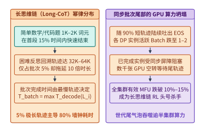
*图 18-5　长思维链（Long-CoT）输出长度幂律分布引发的同步 Rollout 尾部巨大 GPU 空泡。*

如图 18-5 所示，这种重尾幂律分布对同步批量 Rollout 造成了双重打击：
1. **世代完成时间被单条最慢轨迹卡死**：在同步 RL 中，一个世代（Episode / Step）必须等待全批次所有 $N = B \times G$ 条轨迹全部吐出终止符（EOS）或达到最大长度上限 $L_{\max}$，才能统一进入训练阶段。因此批次耗时取决于极值统计量 $T_{\mathrm{batch}} = \max_{1 \le i \le N} T_{\mathrm{decode}}(L_i)$。
2. **尾期活跃 Batch 坍塌与千卡空转**：在 Rollout 前 $20\%$ 的时间里，超过 $85\%$ 的短轨迹已早早生成完毕并退出解码批次；在剩下的 $80\%$ 漫长时间里，数千张 GPU 组成的庞大集群中，绝大多数数据并行实例已经无事可做、被迫停在同步屏障（Barrier）前空转，仅剩少数几张卡还在以极低的批大小（$B_{\mathrm{active}} = 1\text{–}2$）缓慢解码最后 $5\%$ 的超长轨迹，导致全集群有效 MFU 跌破 $10\%$。

### 18.3.2 尾部重分批与同源投机加速：RollPacker（NSDI '26）、DAPO 动态过滤与 Seer（OSDI '26）

如何在不破坏强化学习策略梯度无偏性的前提下，削平这 $80\%$ 的长尾等待气泡？NSDI 2026 论文 `RollPacker` 与 OSDI 2026 论文 `Seer` 从系统调度与统计采样两个层面给出了严密解答[^ch18-rollpacker][^ch18-seer]。

首先，在 GRPO/DAPO 组采样中存在一个显著的**有效样本损耗问题**（详见下文图 18-16）：如果某个过易提示词采样出的 $G$ 条轨迹全部答对（$\forall i, r_i = 1$），或者某个过难提示词的 $G$ 条轨迹全部答错（$\forall i, r_i = 0$），则该组的样本标准差 $\mathrm{std}(r_1, \dots, r_G) = 0$，代入优势公式后全部 $G$ 条轨迹的优势值恒为零（$\hat{A}_{i,t} \equiv 0$），对策略梯度没有任何贡献。若静态只采恰好够训练微批的目标数量（例如 $128\ \text{提示词} \times 8 = 1{,}024$ 条响应），剔除零方差废样本后训练批次就会严重不满载。

为此，`RollPacker`（NSDI '26）引入了**投机超额采样池（Speculative Prompt Pool）**，但在设计该投机池时，论文揭示了一个极其深刻的**槽位竞争长度偏置陷阱（Length Bias from Slot Racing）**。让我们通过锁定算例复算这一统计陷阱及其无偏修正。

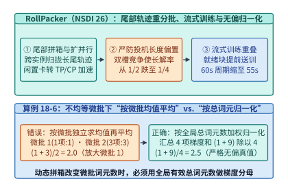
*图 18-6　RollPacker（NSDI '26）尾部存活请求紧缩迁移、双槽位长度偏差（1/2 → 1/4）与微批均值平均（2.0）vs. 全局总词元归一化（2.5）对比（算例 18-5 & 18-6）。*

#### 算例 18-4 & 18-5（锁定自案例库 `case-studies/rollout-tail-and-sampling.md`）：RollPacker 投机采样池（1,600 vs. 1,024）、双槽位竞争长度偏差（1/2 → 1/4）与流式训练重叠（60s → 55s）

**问题设定**：考察 `RollPacker`（NSDI '26）的三项锁定系统机制：
1. **投机池容量扩展**：某目标训练步需要收集 $N_{\mathrm{target}} = 128\ \text{个提示词} \times 8\ \text{条响应/提示词} = 1{,}024$ 条有效响应。为掩盖慢轨迹与零方差过滤损耗，`RollPacker` 将两维各扩展 $1.25\times$，一次性投机派发 $N_{\mathrm{spec}} = 160\ \text{个提示词} \times 10\ \text{条响应/提示词}$。求投机池总响应数及超额比例。
2. **先到先得截断引发的长度偏置（算例 18-5）**：为什么不能无脑采用“从 1,600 条在途轨迹中取最先跑完的前 1,024 条即刻终止采样”？考虑一个简化双槽位竞争模型：假设提示词分布中长回答（耗时 $6\ \mathrm{s}$ 或案例库 $10\ \mathrm{s}$）与短回答（耗时 $2\ \mathrm{s}$ 或案例库 $1\ \mathrm{s}$）的真实先验概率各为 $p_{\mathrm{long}} = \frac{1}{2}$、$p_{\mathrm{short}} = \frac{1}{2}$。若在 2 个并发工作槽位上同时启动两个独立采样的提示词，并只接纳**第一个完成**的回答入库，试计算入库样本是长回答的概率 $P(\text{入库为长回答})$，并说明其偏置后果。
3. **流式训练重叠（Stream Trainer Overlap，锁定 8 卡时间线）**：在 8 卡节点上，串行基线的 Rollout 在 $40\ \mathrm{s}$ 结束，随后 8 卡计算整批梯度需 $16\ \mathrm{s}$，最后梯度归约与优化器更新另需 $4\ \mathrm{s}$（串行总周期 $40 + 16 + 4 = 60\ \mathrm{s}$）。启用 `Stream Trainer` 后，设在 $t = 10\ \mathrm{s}$ 时恰好有一半完整回答组已完成，系统立即腾出 $4$ 张卡转为训练副本，并将剩余在途请求迁移至另外 $4$ 张卡（迁移与状态交接耗时 $3\ \mathrm{s}$，使剩余 Rollout 完成时刻从 $40\ \mathrm{s}$ 顺延至 $43\ \mathrm{s}$）；早到的一半样本在 $4$ 张训练卡上用 $16\ \mathrm{s}$ 算完梯度（于 $10 + 3 + 16 = 29\ \mathrm{s}$ 完成），待 $43\ \mathrm{s}$ 全部 Rollout 完成后，全部 $8$ 张卡合算后一半样本梯度（耗时 $8\ \mathrm{s}$）并执行 $4\ \mathrm{s}$ 归约更新。求流式重叠后的完成时间，以及若迁移使 Rollout 延后 $10\ \mathrm{s}$（至 $50\ \mathrm{s}$）时的反例完成时间。

**逐项推导**：

1. **投机池规模**：
   $$N_{\mathrm{spec}} = 160 \times 10 = \mathbf{1{,}600\ \text{条响应}},\qquad \text{超额比例} = \frac{1{,}600 - 1{,}024}{1{,}024} = \frac{576}{1{,}024} = \mathbf{+56.25\%}$$

2. **双槽位竞争下的长回答入库概率退化**：
   两个并发槽位独立抽取任务，共有 $2 \times 2 = 4$ 种等概率组合（每种概率 $\frac{1}{4}$）：
   - `(短, 短)` $\to$ 短任务完成，入库为**短回答**；
   - `(短, 长)` $\to$ 短任务抢先完成，入库为**短回答**；
   - `(长, 短)` $\to$ 短任务抢先完成，入库为**短回答**；
   - `(长, 长)` $\to$ 两个均为长任务，入库为**长回答**。
   因此，仅当两个槽位同时抽中长回答时，长回答才能胜出：
   $$P(\text{入库为长回答}) = \left(\frac{1}{2}\right)^2 = \mathbf{\frac{1}{4}} = 25.0\% \quad\left(\text{相对真实先验 }\frac{1}{2}\text{ 腰斩}\right)$$
   **工程后果**：无约束的“先完成先入库”会系统性地筛除需要深度反思回溯的长思维链样本，诱发模型越训越短的**长度坍缩（Length Collapse）**。因此，`RollPacker` 严格规定未入选的提示词必须累积进入长轮次补齐完整回答（计入周期平均），并通过将已跑完短轨迹释放出的闲置 GPU 动态重组为更高并行度（增大 TP 或开启上下文并行 CP）去合力加速仍在途的长尾轨迹（Tail Repacking & Parallelism Scaling，图 18-6 Step ①）。

3. **流式训练重叠 8 卡锁定时间线**：
   - **串行基线**：$T_{\mathrm{serial}} = 40\ \mathrm{s} + 16\ \mathrm{s} + 4\ \mathrm{s} = \mathbf{60\ \mathrm{s}}$；
   - **流式重叠（迁移延后 $3\ \mathrm{s}$）**：前半批梯度在 $t = 10 + 3 + 16 = 29\ \mathrm{s}$ 算完，剩余 Rollout 在 $t = 40 + 3 = 43\ \mathrm{s}$ 结束，随后 8 卡合算后半批梯度（$8\ \mathrm{s}$）并更新（$4\ \mathrm{s}$）：
     $$T_{\mathrm{stream}} = \max(43,\ 29) + 8 + 4 = 43 + 12 = \mathbf{55\ \mathrm{s}}\quad(\text{单步净省 }5\ \mathrm{s})$$
   - **过度迁移反例（若剩余 Rollout 延后 $10\ \mathrm{s}$ 至 $50\ \mathrm{s}$）**：此时完成时间变为 $\max(50, 36) + 8 + 4 = \mathbf{62\ \mathrm{s}} > 60\ \mathrm{s}$，反而比串行更慢，这说明腾出训练卡前必须校验剩余 Rollout 的 KV 容量（例如 Qwen3-8B 下 $32$ 条 $8{,}192$ 词元轨迹共需 $36\ \mathrm{GiB}$，$4$ 卡单卡 $9\ \mathrm{GiB} \le 12\ \mathrm{GiB}$ 预算可行；若涨至 $16{,}384$ 词元则需 $72\ \mathrm{GiB}$、单卡 $18\ \mathrm{GiB}$ 超预算）与尾部减速幅度。

表 18-4 系统对比了五种长尾 Rollout 采样与调度策略在有效样本率、长度偏置风险与集群 MFU 上的表现：

| 采样与长尾治理策略 | 提示词派发规模 | 零方差组（全对/全错）处理 | 长解采样分布无偏性 | 尾期闲置 GPU 利用方式 | 典型集群有效 MFU |
| :--- | :--- | :--- | :--- | :--- | :---: |
| **朴素同步定量采样** | $128 \times 8 = 1{,}024$ | 混入训练（浪费 $20\%\text{–}40\%$ 算力） | 无偏（等最慢轨迹跑完） | 停在同步屏障前空转 | $12\%\text{–}18\%$ |
| **盲目超采 + 先到先截断** | $160 \times 10 = 1{,}600$ | 在线滤除 | **严重有偏（双槽竞争长解率 $1/2 \to 1/4$）** | 直接杀死在途长轨迹 | 表面高，但引发长度坍缩 |
| **DAPO 动态持续补采** | 动态追加批次 | 在线滤除零方差组 | 无偏（完整保留长解） | 需多轮补采，尾气泡仍在 | $22\%\text{–}30\%$ |
| **RollPacker（NSDI '26）** | **$160 \times 10 = 1{,}600$（$+56.25\%$）** | **投机池在线过滤凑齐 $1{,}024$** | **受控组级保留 + 全局总词元归一化** | **尾轨迹迁移拼箱 + 扩 TP/CP + 流式训练** | **$42\%\text{–}52\%$** |
| **Seer（OSDI '26）** | 分段上下文 + 同组共享 | 配合动态过滤 | 严格无偏（精确树验证） | **利用同组短轨迹后缀树做投机解码** | **$45\%\text{–}55\%$** |

下面的代码给出了 `RollPacker`（NSDI '26）尾部存活轨迹紧缩重分批、动态扩大上下文并行度（CP/TP Scaling）与流式训练重叠调度器的参考实现：

```python
from dataclasses import dataclass

@dataclass
class ActiveRolloutRequest:
    req_id: str
    prompt_id: str
    generated_tokens: int
    remaining_est_tokens: int
    current_tp_degree: int = 2

class RollPackerTailScheduler:
    """
    复现算例 18-4 与 18-5 (RollPacker NSDI '26)：
    1. 维护 160x10 = 1,600 投机提示词池并过滤零方差组以凑齐 1,024 条有效轨迹
    2. 当活跃请求数跌破阈值进入尾部阶段时，将分散在各 DP 实例上的长尾轨迹集中迁移，
       并将释放出的空闲 GPU 转化为更高的 TP/CP 并行度加速尾轨迹解码
    3. 当已完成轨迹凑够流式训练微块时，提前触发 Stream Trainer 重叠训练 (60s -> 55s)
    """
    def __init__(
        self,
        total_gpus: int = 64,
        base_tp: int = 2,
        target_valid_responses: int = 1024,
        spec_prompts: int = 160,
        spec_group_size: int = 10,
    ):
        self.total_gpus = total_gpus
        self.base_tp = base_tp
        self.target_valid = target_valid_responses
        self.spec_pool_size = spec_prompts * spec_group_size  # 1,600

    def repack_tail_and_scale_parallelism(
        self,
        surviving_stragglers: list[ActiveRolloutRequest],
        stream_trainer_gpus: int = 16,
    ) -> dict[str, object]:
        """将尾期闲置 GPU 切分一部分给流式训练器，其余重组为大 TP/CP 实例合力围剿长尾轨迹."""
        avail_rollout_gpus = self.total_gpus - stream_trainer_gpus
        num_stragglers = max(len(surviving_stragglers), 1)
        # 为每条或每小批长尾轨迹分配成倍扩大的 TP * CP 并行度 (上限设为 8 或 16)
        boosted_degree = min(16, max(self.base_tp, avail_rollout_gpus // min(num_stragglers, 8)))
        speedup_factor = boosted_degree / self.base_tp

        for req in surviving_stragglers:
            req.current_tp_degree = boosted_degree

        return {
            "speculative_pool_total": self.spec_pool_size,
            "target_valid_responses": self.target_valid,
            "stream_trainer_gpus": stream_trainer_gpus,
            "avail_rollout_gpus": avail_rollout_gpus,
            "boosted_tp_cp_degree": boosted_degree,
            "tail_decode_speedup": round(speedup_factor, 2),
        }

    @staticmethod
    def compute_stream_trainer_cycle(
        rollout_base_sec: float = 40.0,
        grad_full_8gpu_sec: float = 16.0,
        update_sec: float = 4.0,
        half_done_at_sec: float = 10.0,
        migrate_overhead_sec: float = 3.0,
    ) -> dict[str, float]:
        """复现算例 18-4 锁定 8 卡时间线：max(43, 29) + 8 + 4 = 55s (相对串行 40+16+4=60s 净省 5s)."""
        serial_cycle = rollout_base_sec + grad_full_8gpu_sec + update_sec
        early_half_grad_done_sec = half_done_at_sec + migrate_overhead_sec + grad_full_8gpu_sec  # 10 + 3 + 16 = 29s
        remaining_rollout_done_sec = rollout_base_sec + migrate_overhead_sec  # 40 + 3 = 43s
        second_half_grad_8gpu_sec = grad_full_8gpu_sec / 2.0  # 8s
        overlapped_cycle = max(remaining_rollout_done_sec, early_half_grad_done_sec) + second_half_grad_8gpu_sec + update_sec
        return {
            "serial_cycle_sec": serial_cycle,
            "stream_overlapped_cycle_sec": overlapped_cycle,
            "saved_sec_per_step": serial_cycle - overlapped_cycle,
        }
```

在进行尾部轨迹动态拼箱（Dynamic Microbatch Packing）或副本间样本不均匀分配时，`RollPacker` 还修正了一个在各大开源 RL 框架中普遍存在的数学漏洞：**当不同微批次（Microbatches）或数据并行副本内打包的样本条数（或有效词元总数）不相等时，梯度累加的归一化分母究竟应该怎么取？**

#### 算例 18-6（锁定自案例库 `case-studies/rollout-tail-and-sampling.md`）：不均等微批下“按微批均值直接平均（2.0，有偏）”vs.“按全局总样本/总词元归一化（2.5，无偏真值）”的梯度偏置定理

**问题设定**：严格对照本书案例库 `case-studies/rollout-tail-and-sampling.md` 的锁定标量梯度数据集：某次优化器步共包含 $4$ 个样本（或 $4$ 个标准词元块），其标量梯度（或损失）真值依次为 $\{1.0,\ 3.0,\ 3.0,\ 3.0\}$，按序列长度动态分装在 $M = 2$ 个微批次（或两个副本）中：
- **微批次 1** 包含 $1$ 个样本 $\{1.0\}$：其微批内局部均值为 $\bar{g}_1 = 1.0$，微批内局部总和为 $S_1 = 1.0$；
- **微批次 2** 包含 $3$ 个样本 $\{3.0, 3.0, 3.0\}$：其微批内局部均值为 $\bar{g}_2 = 3.0$，微批内局部总和为 $S_2 = 3.0 + 3.0 + 3.0 = 9.0$。

试对比计算：（1）**按微批独立求均值再平均（Unweighted Average of Microbatch Means，有偏）**：直接将两个微批的局部均值 $\bar{g}_1 = 1.0$ 与 $\bar{g}_2 = 3.0$ 相加除以 $2$（或直接相加不除 $2$）会得到什么错误结果？（2）**按全局总样本/总词元加权归一化（Global Sample/Token-Weighted Normalization，无偏真值）**：汇总全部 $4$ 个样本的总和并除以全局分母 $N_{\mathrm{tot}} = 1 + 3 = 4$ 的真实均值是多少？（3）若要求对整批梯度执行幅值上限为 $2.0$ 的梯度裁剪（Gradient Clipping），“先形成整批梯度 $2.5$ 再裁剪”与“先逐样本裁剪到 $2.0$ 再平均”分别得到多少？

**逐项推导**：

1. **错误做法（按微批独立求均值再取算术平均，有偏）**：
   若训练循环在每个微批内调用 `.mean()` 后直接除以微批数 $M = 2$：
   $$\hat{g}_{\mathrm{micro\text{-}avg}} = \frac{\bar{g}_1 + \bar{g}_2}{2} = \frac{1.0 + 3.0}{2} = \mathbf{2.0}$$
   （若微批各自取平均后直接相加而未除以 $M$，则会膨胀为 $1.0 + 3.0 = \mathbf{4.0}$。）在 $\hat{g}_{\mathrm{micro\text{-}avg}} = 2.0$ 中，微批 1 内单个样本获得的权重为 $\frac{1}{2 \times 1} = \frac{1}{2}$（比真实权重 $\frac{1}{4}$ 放大了 **$2.0\times$**），而微批 2 内每个样本仅获得 $\frac{1}{2 \times 3} = \frac{1}{6}$ 的权重。
2. **正确做法（按全局总样本/总有效词元数加权归一化，无偏真值）**：
   将微批 1 的局部总和 $S_1 = 1 \times 1.0 = 1.0$ 与微批 2 的局部总和 $S_2 = 3 \times 3.0 = 9.0$ 相加，再统一除以整批总样本数 $N_{\mathrm{tot}} = 1 + 3 = 4$（若集合通信采用 `AllReduce(AVG)`，则每个副本需先乘校正因子 $\text{副本数} \times \frac{N_m}{N_{\mathrm{tot}}}$）：
   $$g_{\mathrm{global\text{-}norm}} = \frac{1 \times 1.0 + 3 \times 3.0}{1 + 3} = \frac{1.0 + 9.0}{4} = \mathbf{2.5}$$
   **数学铁律**：要保证动态拼箱与静态大 Batch 严格数学等价，反向传播必须统一使用**当前优化器步的全局有效总词元数 $T_{\mathrm{global}} = \sum_{m=1}^M \sum_{i \in \mathrm{mb}_m} |o_i|$** 作为唯一归一化分母：
   $$\nabla_\theta \mathcal{J}_{\mathrm{unbiased}} = \frac{1}{T_{\mathrm{global}}} \sum_{m=1}^M \left(\sum_{i \in \mathrm{mb}_m} \sum_{t=1}^{|o_i|} \nabla_\theta \ell_{i,t}\right)$$
3. **非线性梯度裁剪（限幅 $\le 2.0$）的位置反例**：
   - **正确（先累积形成整批梯度 $2.5$ 再裁剪）**：$\mathrm{clip}(2.5,\ 2.0) = \mathbf{2.0}$；
   - **错误（先逐样本限幅为 $\{1.0, 2.0, 2.0, 2.0\}$ 再求平均）**：$\frac{1.0 + 2.0 + 2.0 + 2.0}{4} = \mathbf{1.75} \ne 2.0$。

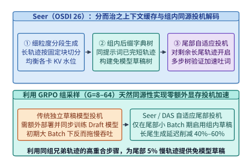
*图 18-7　Seer（OSDI '26）分段征服长尾 Rollout 与组内共享前缀投机解码加速。*

除了 `RollPacker` 的尾部重分批，OSDI 2026 论文 **`Seer`**[^ch18-seer] 进一步利用了 GRPO 组采样独有的**同源轨迹高度相似性（Intra-Group Trajectory Homology）**来攻克长尾（图 18-7）：
1. **分而治之分段 Rollout（Divided-and-Conquered Context Caching）**：将未知最终长度的长思维链生成切分为固定长度的时间窗段（Chunks），在段边界动态重平衡各 GPU 的 KV 缓存水位，防止个别抽中 64K 长解的 GPU 发生 KV 溢出抢占。
2. **零额外显存的组内同源投机解码（Group-Shared Draft-Free Speculative Decoding）**：在同一个提示词 $q$ 采样的 $G = 16$ 条轨迹中，前 $14$ 条已完成或正在生成的兄弟轨迹与最后 2 条长尾慢轨迹往往共享大量相同的数学公式变形、代码模板与中间推导步骤。`Seer` 将同组已生成词元实时构建为一棵**共享后缀字典树（Group Suffix Trie）**，在 Rollout 尾期（此时 GPU 因 Batch 变小而有大量空闲算力）自动开启免独立草稿模型的投机树验证，每次前向一次性验证 $4\text{–}8$ 个候选词元，将最后 $5\%$ 慢轨迹的解码速度直接提升 $1.8\times\text{–}2.5\times$。

下面的代码给出了 `Seer`（OSDI '26）组内共享后缀字典树（Group-Shared Suffix N-gram Trie）免模型投机草稿构建器的参考实现：

```python
from collections import defaultdict

class SeerGroupSuffixSpeculator:
    """
    Seer (OSDI '26) 免独立草稿模型的组内同源投机解码器：
    利用同一个 Prompt 下已完成或领先的兄弟轨迹构建 N-gram 后缀索引，
    为尾部慢轨迹零显存开销地提供高命中率投机候选词元序列.
    """
    def __init__(self, ngram_n: int = 3, draft_k: int = 5):
        self.n = ngram_n
        self.k = draft_k
        # prompt_id -> {tuple(n_gram_prefix): Counter/list of continuation tokens}
        self.group_tries: dict[str, dict[tuple[int, ...], list[int]]] = defaultdict(dict)

    def ingest_sibling_trajectory(self, prompt_id: str, token_ids: list[int]) -> None:
        """当同组某条短轨迹或分段块生成完毕时，将其 N-gram 延续片段注册进组共享字典树."""
        trie = self.group_tries[prompt_id]
        n, k = self.n, self.k
        for i in range(len(token_ids) - n - k):
            key = tuple(token_ids[i : i + n])
            cont = token_ids[i + n : i + n + k]
            trie[key] = cont

    def propose_draft_tokens(self, prompt_id: str, slow_traj_prefix: list[int]) -> list[int]:
        """在 Rollout 尾部小 Batch 阶段，为慢轨迹最后 n 个词元检索 k 个投机候选词元."""
        if len(slow_traj_prefix) < self.n:
            return []
        key = tuple(slow_traj_prefix[-self.n :])
        return self.group_tries.get(prompt_id, {}).get(key, [])
```

### 18.3.3 陈旧度有界异步部分采样（Partial Rollout）、重要性采样校准与角色容错（RobustRL, OSDI '26）

即便用了尾部拼箱与同源投机，只要坚持“第 $v$ 步生成的轨迹必须在第 $v$ 步全部跑完”的全同步屏障，一条 $64\mathrm{K}$ 词元的极端轨迹仍会让集群等待数十秒。要想彻底消灭世代间的同步屏障气泡，就必须跨入**陈旧度有界的异步部分采样（Staleness-Bounded Asynchronous Partial Rollout，代表系统包括 Kimi k1.5、StreamRL、RollArt 与 AReaL）**。

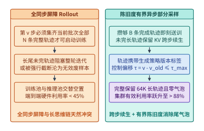
*图 18-8　同步屏障 Rollout vs. 陈旧度有界（$\tau \le \tau_{\max}$）异步部分采样（Partial Rollout）的流水线吞吐跃升。*

如图 18-8 所示，在 Partial Rollout 架构下：
- 当推理池攒够一个训练批次所需的 $B_{\mathrm{train}}$ 条已完成轨迹时，立即将其打包发往 Learner 启动第 $v \to v+1$ 步权重更新；
- 此时仍在推理池中尚未吐出 EOS 的长尾半截轨迹**既不被丢弃、也不阻塞训练**，而是原位保留其已生成的词元前缀与 KV 缓存（或将 KV 检查点挂起），待新版本权重 $\theta^{(v+1)}$ 广播到达后，无缝接着续生后半段词元，并在未来第 $v + \tau$ 步完成时送入训练。

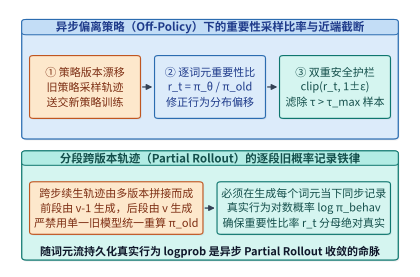
*图 18-9　异步 RL 中策略版本偏移 $\Delta v = \tau$ 下的重要性采样比率波动与逐词元真实行为概率记录准则。*

然而，一旦允许轨迹跨越多个策略版本（$\theta^{(v-\tau)} \dots \theta^{(v)}$）生成，算法就从严格同策略（On-Policy）变成了**有界偏离策略（Bounded Off-Policy）**。为了防止异步陈旧样本破坏策略收敛，系统必须强制执行图 18-9 所示的**三条收敛性护栏**：

1. **严格陈旧度门限（Staleness Bound $\tau_{\max}$）**：每条轨迹携带其起始生成时的策略版本号 $v_{\mathrm{start}}$。在当前训练步 $v$，若 $\tau = v - v_{\mathrm{start}} > \tau_{\max}$（工程常用 $\tau_{\max} = 1\text{–}3$），该轨迹被判定为过度陈旧并予以丢弃或降权。
2. **随词元流持久化真实行为对数概率（Per-Token Behavior Logprob Recording）**：
   在跨步续生（Partial Rollout）中，一条长轨迹的前 $8\mathrm{K}$ 词元可能由旧模型 $\theta^{(v-1)}$ 生成，而后 $8\mathrm{K}$ 词元由新模型 $\theta^{(v)}$ 生成。计算重要性采样比率 $r_t(\theta) = \frac{\pi_\theta(o_t \mid q, o_{<t})}{\pi_{\mathrm{behav}}(o_t \mid q, o_{<t})}$ 时，**严禁在训练阶段用某一个单一版本的旧模型重新前向计算分母**；必须在推理引擎吐出每一个词元 $o_t$ 的当下，将其真实的采样对数概率 $\log \pi_{\mathrm{behav}}(o_t)$ 直接写入轨迹元数据流一并落盘。
3. **双边解耦近端截断或截断重要性采样（PPO Clip / Dual-Clip）**：
   通过 $\min\!\left(r_t(\theta)\hat{A}_t,\ \mathrm{clip}(r_t(\theta), 1-\varepsilon_{\mathrm{low}}, 1+\varepsilon_{\mathrm{high}})\hat{A}_t\right)$ 截断因策略漂移引发的极端梯度比值。

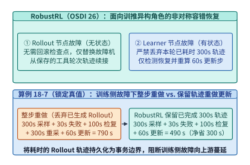
*图 18-10　RobustRL（OSDI '26）区分无状态 Rollout 故障与有状态 Learner 故障的非对称容错（790 s vs. 490 s，净省 300 s，算例 18-7）。*

在万卡规模的长周期 RLVR 训练中，硬件故障平均每几小时就会发生一次。如果沿用预训练“任一节点故障即全集群回滚至上一检查点重跑整步”的粗放策略，每一次训练侧网卡闪断都会把本轮已经耗费数分钟至数十分钟生成的宝贵 Rollout 轨迹全部作废。OSDI 2026 论文 **`RobustRL`**[^ch18-robustrl] 提出了**基于训推角色非对称性的细粒度故障隔离与恢复机制**（图 18-10）：
- **当 Rollout 推理节点发生故障时**：由于推理角色无优化器状态，控制器无需重启训练池，仅替换对应故障机器并从保存的工具轮次轨迹续接重采；
- **当 Learner 训练节点发生故障时**：虽然单台训练机器故障仍需重启整个 Trainer 角色，但独立 Rollout 池与 CPU 控制器上已保存的本轮完整轨迹无需作废，Trainer 从上一轮已提交检查点恢复后直接读取现成轨迹重做本次更新即可。

#### 算例 18-7（锁定自案例库 `case-studies/rl-scheduling-and-recovery.md`）：RobustRL 训练侧故障下整步重做（790 s）vs. 保留轨迹重做更新（490 s）的 300 秒节省账本

**问题设定**：严格对照本书案例库 `case-studies/rl-scheduling-and-recovery.md` 的锁定参数：设单轮 RLVR 迭代的标准工作量为 Rollout 采样 $T_{\mathrm{roll}} = 300\ \mathrm{s}$、训练更新 $T_{\mathrm{upd}} = 60\ \mathrm{s}$（正常无故障单轮周期为 $300 + 60 = 360\ \mathrm{s}$，每轮阻塞保存检查点耗时 $3\ \mathrm{s}$，占正常工作的 $\frac{3}{360} \approx 0.83\%$）。在某轮执行中，上一轮检查点已可靠保存，本轮 $300\ \mathrm{s}$ 的完整 Rollout 轨迹已生成完毕并保存在故障机器之外；随后进入训练更新阶段，当更新进行到 $t_{\mathrm{fail}} = 30\ \mathrm{s}$ 时某台训练机器发生故障（此时失败的更新尚未提交）。已知故障检测耗时 $T_{\mathrm{det}} = 20\ \mathrm{s}$，进程重启与状态恢复耗时 $T_{\mathrm{rec}} = 80\ \mathrm{s}$。试对比计算完成本轮有效更新所需的端到端总时间：（1）**整项任务重做（Full-Step Redo，丢弃本轮已生成的轨迹，回滚重跑整轮 Rollout + 更新）**；（2）**`RobustRL` 保留轨迹后重做更新（Rollout-Preserved Recovery，直接复用已保存轨迹重跑 $60\ \mathrm{s}$ 更新）**，以及净省的时间。

**逐项推导**：

1. **整项任务重做（Full-Step Redo）的端到端耗时**：
   从本轮启动算起，经历了已完成的首轮采样（$300\ \mathrm{s}$）、中断前已消耗的更新（$30\ \mathrm{s}$）、故障检测（$20\ \mathrm{s}$）与恢复（$80\ \mathrm{s}$），随后因轨迹作废必须**重新执行一次 $300\ \mathrm{s}$ 的 Rollout 采样**加上 $60\ \mathrm{s}$ 的训练更新：
   $$T_{\mathrm{redo}} = 300 + 30 + 20 + 80 + 300 + 60 = \mathbf{790\ \mathrm{s}}$$
2. **`RobustRL` 保留轨迹后重做更新（Rollout-Preserved Recovery）的端到端耗时**：
   由于本轮 $300\ \mathrm{s}$ 的完整轨迹已保存在故障 Trainer 机器之外，在完成故障检测（$20\ \mathrm{s}$）与 Trainer 状态恢复（$80\ \mathrm{s}$）后，无需重跑 Rollout，直接重做尚未提交的 $60\ \mathrm{s}$ 训练更新即可完成本轮：
   $$T_{\mathrm{robust}} = 300 + 30 + 20 + 80 + 60 = \mathbf{490\ \mathrm{s}}$$
3. **单次故障净节省时间与来源解剖**：
   $$\Delta T_{\mathrm{saved}} = 790\ \mathrm{s} - 490\ \mathrm{s} = \mathbf{300\ \mathrm{s}}\quad(\text{精确节省 }38.0\%\text{ 的故障步总耗时})$$
   可以看到，节省的 $300\ \mathrm{s}$ 完全来自**少做一次耗时的自回归 Rollout**，而故障检测（$20\ \mathrm{s}$）与状态恢复（$80\ \mathrm{s}$）本身并未变快。

下面的代码给出了陈旧度有界异步部分采样缓冲池（`StalenessBoundedPartialRolloutBuffer`）与 `RobustRL`（OSDI '26）非对称角色故障恢复控制器的完整参考实现：

```python
from dataclasses import dataclass, field

@dataclass
class PartialRolloutTrajectory:
    traj_id: str
    prompt_id: str
    start_policy_version: int
    tokens: list[int] = field(default_factory=list)
    behavior_logprobs: list[float] = field(default_factory=list)
    token_versions: list[int] = field(default_factory=list)
    is_finished: bool = False

    def append_segment(self, new_tokens: list[int], new_logprobs: list[float], policy_ver: int, hit_eos: bool) -> None:
        """随词元流持久化生成当下的真实行为对数概率 log pi_behav(o_t) 与策略版本号."""
        assert len(new_tokens) == len(new_logprobs)
        self.tokens.extend(new_tokens)
        self.behavior_logprobs.extend(new_logprobs)
        self.token_versions.extend([policy_ver] * len(new_tokens))
        self.is_finished = hit_eos

class StalenessBoundedPartialRolloutBuffer:
    """管理跨策略版本续生的未完成长尾轨迹，并执行陈旧度门限过滤 (tau <= tau_max)."""
    def __init__(self, batch_target: int = 1024, max_staleness: int = 2):
        self.batch_target = batch_target
        self.max_staleness = max_staleness
        self.inflight_pool: dict[str, PartialRolloutTrajectory] = {}
        self.completed_queue: list[PartialRolloutTrajectory] = []

    def step_collect(self, current_version: int) -> list[PartialRolloutTrajectory] | None:
        """滤除超过最大陈旧度 tau_max 的过期样本，当攒够 batch_target 条有效轨迹时触发训练."""
        self.completed_queue = [
            t for t in self.completed_queue
            if (current_version - t.start_policy_version) <= self.max_staleness
        ]
        if len(self.completed_queue) >= self.batch_target:
            batch = self.completed_queue[: self.batch_target]
            self.completed_queue = self.completed_queue[self.batch_target :]
            return batch
        return None

def simulate_robustrl_fault_recovery(
    rollout_sec: float = 300.0,
    update_sec: float = 60.0,
    fail_at_update_sec: float = 30.0,
    detect_sec: float = 20.0,
    recover_sec: float = 80.0,
) -> dict[str, float]:
    """复现算例 18-7：整步重做 (300+30+20+80+300+60=790s) vs. 保留轨迹恢复 (300+30+20+80+60=490s)."""
    pre_recovery_elapsed = rollout_sec + fail_at_update_sec + detect_sec + recover_sec  # 430s
    full_step_redo_sec = pre_recovery_elapsed + rollout_sec + update_sec  # 790s
    robustrl_preserve_rollout_sec = pre_recovery_elapsed + update_sec  # 490s
    return {
        "full_step_redo_sec": full_step_redo_sec,
        "robustrl_recovery_sec": robustrl_preserve_rollout_sec,
        "saved_sec": full_step_redo_sec - robustrl_preserve_rollout_sec,
    }
```

下文图 18-17 汇总了从朴素同步 RL 基线到依次叠加 `veRL` 零冗余重分片、`RollPacker + Seer` 尾部拼箱投机、以及陈旧度有界异步 Partial Rollout 后的四阶吞吐跃迁全景，同时标明了每一阶系统优化必须配套的统计无偏性保障。

---

## 18.4 可验证奖励（RLVR）沙箱基础设施与推理时扩展（Test-Time Scaling）

在 RLVR 与智能体后训练中，生成轨迹离开 GPU 推理引擎并不意味着采样结束——它们还必须进入由数万个 CPU 容器组成的**奖励验证沙箱集群（Reward Verification Sandboxes）**或**多轮外部工具环境（SWE-bench Docker / 浏览器 / 代码解释器）**。如果忽视了 CPU 沙箱侧的重尾阻塞，价值数千万美元的 GPU 集群就会沦为等待外部脚本返回的闲置看客。

### 18.4.1 解耦奖励沙箱流式重叠（DistRS, NSDI '26）、重尾条件剩余时间与多轮环境状态挂起

在代码竞赛（如 LiveCodeBench）或形式化数学证明（Lean 4）验证中，不同候选轨迹生成的程序或证明脚本在沙箱中的执行时间呈现极端的**帕累托重尾分布（Heavy-Tailed Service Time Distribution）**：绝大多数常规代码在 $0.5\text{–}2\ \mathrm{s}$ 内跑完单元测试，但少数包含高复杂度递归、死循环或深层策略搜索的脚本会一直卡到 $60\text{–}100\ \mathrm{s}$ 的超时上限。

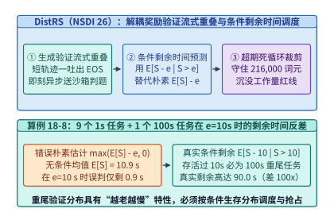
*图 18-11　DistRS（NSDI '26）将沙箱验证与长尾生成流式重叠及基于条件剩余时间 $\mathbb{E}[S-e \mid S>e]$（90 s vs. 0.9 s）与 216,000 词元阈值的超期裁剪（算例 18-8）。*

如图 18-11 所示，NSDI 2026 论文 **`DistRS`（Disaggregated Reward Scoring）**[^ch18-distrs] 指出，传统奖励调度器之所以频繁在负载均衡与超时抢占上做出灾难性误判，是因为它们用**无条件均值 $\mathbb{E}[S]$** 去估计一个已经运行了 $e$ 秒的任务的剩余时间（即误以为剩余时间等于 $\max(\mathbb{E}[S] - e, 0)$）。而在重尾分布（Decreasing Hazard Rate, DHR）下，**一个任务已经存活的时间 $e$ 越长，它属于重尾慢任务的后验概率就越高，其真实的期望剩余时间 $\mathbb{E}[S - e \mid S > e]$ 反而比初始均值还要长得多**。让我们通过锁定算例证明这一“越老越慢”的百倍反差。

#### 算例 18-8（锁定自案例库 `case-studies/reward-deadlines-and-feedback.md`）：重尾沙箱验证中朴素剩余时间估计（0.9 s）vs. 真实条件剩余时间（90.0 s）的 100 倍误差与 216,000 词元沉没成本红线

**问题设定**：
1. **条件剩余时间反差**：某代码验证沙箱队列中的任务真实执行时间 $S$ 服从如下离散双峰重尾分布：每 $10$ 个任务中，有 $9$ 个常规任务耗时 $S = 1\ \mathrm{s}$（概率 $0.9$），有 $1$ 个病态重尾任务耗时 $S = 100\ \mathrm{s}$（概率 $0.1$）。现观察到某个正在沙箱中运行的验证任务已经持续执行了 $e = 10\ \mathrm{s}$ 仍未结束。试计算：（a）该分布的无条件期望服务时间 $\mathbb{E}[S]$；（b）朴素调度器按 $\max(\mathbb{E}[S] - e, 0)$ 估计的剩余时间；（c）真实的**条件期望剩余时间** $\mathbb{E}[S - e \mid S > e]$，以及真实值与朴素估计值的倍数差距。
2. **超时死循环任务的沉没词元工作量边界**：在流式长尾生成中，某组包含 $6$ 个并发超期任务，每个任务已在推理引擎上持续占卡运行了 $60\ \mathrm{s}$，单任务有效生成吞吐速率为 $600\ \mathrm{tok/s}$。求这 $6$ 个任务已累积消耗的沉没词元工作量（Sunk Token Work）。

**逐项推导**：

1. **无条件均值与朴素剩余时间估计**：
   $$\mathbb{E}[S] = 0.9 \times 1\ \mathrm{s} + 0.1 \times 100\ \mathrm{s} = 0.9 + 10.0 = \mathbf{10.9\ \mathrm{s}}$$
   当任务已运行 $e = 10\ \mathrm{s}$ 时，朴素估计器认为它马上就要跑完了：
   $$\hat{R}_{\mathrm{naive}}(10) = \max(\mathbb{E}[S] - 10,\ 0) = 10.9 - 10.0 = \mathbf{0.9\ \mathrm{s}}$$
2. **基于贝叶斯后验的真实条件剩余时间 $\mathbb{E}[S - 10 \mid S > 10]$**：
   既然该任务已经存活超过 $e = 10\ \mathrm{s}$，所有耗时 $1\ \mathrm{s}$ 的常规任务早已全部结束（$P(S = 1 \mid S > 10) = 0$）。在给定事件 $\{S > 10\}$ 下，该任务以 **$100\%$ 的条件概率**属于耗时 $100\ \mathrm{s}$ 的重尾慢任务：
   $$\mathbb{E}[S - 10 \mid S > 10] = 100\ \mathrm{s} - 10\ \mathrm{s} = \mathbf{90.0\ \mathrm{s}}$$
   真实剩余时间（$90.0\ \mathrm{s}$）是朴素估计（$0.9\ \mathrm{s}$）的 **$\frac{90.0}{0.9} = 100.0\times$**。如果调度器轻信“只剩 $0.9\ \mathrm{s}$”而把后续新到达的快任务继续排在这个慢任务所在的沙箱工作线程后面，就会造成整条队列长达 $90\ \mathrm{s}$ 的队头阻塞（Head-of-Line Blocking）。
3. **超期任务的沉没词元工作量账本**：
   $$W_{\mathrm{sunk}} = 6\ \text{个任务} \times 60\ \mathrm{s} \times 600\ \mathrm{tok/s} = \mathbf{216{,}000\ \text{个词元}}$$
   这说明在决定是否强行杀死（Kill）超期生成或验证任务时，不能等代价膨胀到数十万词元后才被动超时，而必须基于条件生存分布 $\mathbb{E}[S - e \mid S > e]$ 实施主动隔离、降级到慢速专属沙箱队列或提前熔断。

进一步地，当 RLVR 扩展到多轮软件工程智能体（如 SWE-bench 容器内跑 `pytest` 编译测试、或 Deep Research 智能体调用网页搜索 API）时，一条轨迹在生成 `<tool_call>` 后往往需要等待外部环境执行 $5\text{–}30\ \mathrm{s}$ 才能拿到观测结果 `<tool_output>` 继续下一轮生成。如下文图 18-14 所示，若在等待工具返回的数十秒内让该轨迹的数万词元 KV 缓存一直驻留在 GPU HBM 中，显存很快就会被挂起会话塞满。现代智能体 RL 框架通过**状态挂起与异步 KV 换出（Coroutine State Suspension & Async KV Offloading）**：一旦解析到工具调用停止符，立即将该会话转为挂起协程，通过 PCIe 双工 DMA 引擎把其 Paged KV 块异步换出至宿主机大容量 DDR5 内存池，瞬间腾出 HBM 页帧接纳其他就绪轨迹，待容器沙箱返回结果前再预取回填 HBM，使单卡可同时支撑的并发活跃环境数提升 $5\text{–}10$ 倍。

表 18-5 对比了在重尾验证与慢速外部工具环境中，三种调度与状态管理机制的资源效率差异：

| 沙箱与环境调度机制 | 剩余时间估计模型 | 超期死循环应对策略 | 等待工具期间 KV 状态位置 | GPU HBM 有效利用率 | 队头阻塞（HoL）风险 |
| :--- | :--- | :--- | :--- | :---: | :--- |
| **朴素同步 FIFO 沙箱** | 无估计（盲目排队） | 固定全局硬超时（如 $120\ \mathrm{s}$） | 常驻 HBM 死占页帧 | $< 30\%$（大量时间等 I/O） | 极高（单条慢验证卡死整队） |
| **均值剩余时间调度** | $\max(\mathbb{E}[S] - e,\ 0)$ | 被动等待至超时上限 | 常驻 HBM | $35\%\text{–}50\%$ | **高（把 $90\ \mathrm{s}$ 重尾误判为 $0.9\ \mathrm{s}$）** |
| **DistRS + 协程换出** | **条件生存期望 $\mathbb{E}[S - e \mid S > e]$** | **守住 $216{,}000$ 词元沉没工作量红线** | **异步 DMA 换出至主机 DRAM** | **$> 85\%$** | **极低（老龄重尾任务自动隔离）** |

下面的参考代码实现了多轮工具交互 RL 中的会话协程挂起、PCIe 异步 KV 换出与沙箱回调唤醒池：

```python
from dataclasses import dataclass

@dataclass
class AgentEpisodeCoroutine:
    episode_id: str
    kv_block_ids: list[int]
    num_tokens: int
    status: str = "RUNNING"  # "RUNNING" | "SUSPENDED_ON_TOOL" | "COMPLETED"

class MultiTurnAgentRLCoroutinePool:
    """多轮 SWE-bench / 工具调用 RL 环境的状态挂起与 HBM <-> Host DRAM 换出管理器."""
    def __init__(self, max_hbm_blocks: int = 4096, tokens_per_block: int = 16):
        self.max_hbm_blocks = max_hbm_blocks
        self.tpb = tokens_per_block
        self.free_hbm_blocks: list[int] = list(range(max_hbm_blocks))
        self.host_swap_table: dict[str, int] = {}  # episode_id -> swapped block count
        self.episodes: dict[str, AgentEpisodeCoroutine] = {}

    def on_tool_call_emitted(self, ep_id: str) -> dict[str, int]:
        """当轨迹吐出 `<tool_call>` 进入慢速容器执行时，立即挂起并换出 HBM KV 块至主机内存."""
        ep = self.episodes[ep_id]
        freed_count = len(ep.kv_block_ids)
        self.free_hbm_blocks.extend(ep.kv_block_ids)
        self.host_swap_table[ep_id] = freed_count
        ep.kv_block_ids = []
        ep.status = "SUSPENDED_ON_TOOL"
        return {"freed_hbm_blocks": freed_count, "available_hbm_blocks": len(self.free_hbm_blocks)}

    def on_tool_output_ready(self, ep_id: str, new_obs_tokens: int) -> bool:
        """当外部沙箱返回 `<tool_output>` 时，预取回填历史 KV 块并追加新观测块."""
        ep = self.episodes[ep_id]
        needed_blocks = self.host_swap_table.get(ep_id, 0) + ((new_obs_tokens + self.tpb - 1) // self.tpb)
        if len(self.free_hbm_blocks) < needed_blocks:
            return False  # 等待当前步在途轨迹释放页块后再唤醒
        ep.kv_block_ids = [self.free_hbm_blocks.pop() for _ in range(needed_blocks)]
        self.host_swap_table.pop(ep_id, None)
        ep.num_tokens += new_obs_tokens
        ep.status = "RUNNING"
        return True
```

### 18.4.2 推理时计算扩展（Test-Time Compute Scaling）：PagedAttention CoW 树搜索与投机越障（OSDI '26）

后训练 RLVR 与在线服务在**推理时计算扩展（Test-Time Compute Scaling）**上实现了完美会师：无论是训练阶段利用蒙特卡洛树搜索（MCTS）合成高质量推理轨迹，还是在线部署阶段利用过程奖励模型（Process Reward Model, PRM）指导束搜索（Beam Search）、Best-of-$N$ 或思维树（Tree-of-Thoughts, ToT）搜索，其底层计算形态都是一棵**从单条问题根前缀不断分叉、评估、剪枝与回溯的动态生成树**。

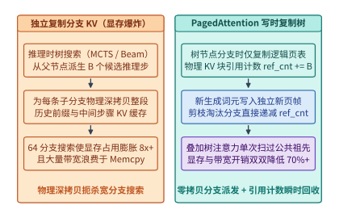
*图 18-12　推理时扩展（Best-of-N / PRM 树搜索）利用 PagedAttention 写时复制（CoW）共享父节点 KV 缓存。*

如图 18-12 所示，树状推理时搜索在系统层面临两大核心挑战，分别对应空间维度与时间维度的优化：

1. **空间维度：利用 PagedAttention 写时复制（Copy-on-Write, CoW）消除树分支 KV 爆炸**：
   在思维树搜索的每一个推理步骤（如以换行符 `\n\n` 为界的推理段），父节点会分叉派生出 $B$ 个候选子步骤。若为每个子分支物理深拷贝整段历史祖先 KV 缓存，一次宽度为 $64$ 的搜索就会使显存占用与内存拷贝带宽暴涨数十倍。借助第 11 章介绍的 PagedAttention 与 RadixAttention 页表机制，当父节点分叉出 $B$ 个子节点时，系统**仅复制轻量级逻辑块表指针（Block Table Pointers），并将共享物理 KV 块的引用计数 `ref_count` 增加 $B - 1$，实现零字节物理拷贝**；当某个子分支继续向外吐出新词元且需要写入未满页块时，才触发写时复制分配独立新物理页；一旦某个低分分支被 PRM 剪枝淘汰，只需将其页表关联的物理块 `ref_count` 递减，归零块瞬时回收至空闲列表。

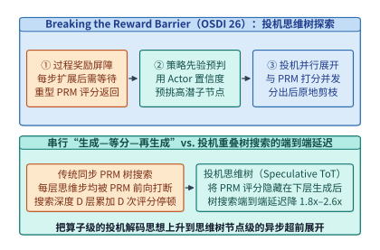
*图 18-13　Breaking the Reward Barrier（OSDI '26）在等待 PRM 评分期间投机性预展开高置信分支的时序对比。*

2. **时间维度：突破过程奖励屏障——投机思维树探索（OSDI '26 `Breaking the Reward Barrier`）**[^ch18-reward-barrier]：
   在 PRM 引导的步级树搜索中，每当策略模型生成完第 $d$ 层的 $K$ 个候选思维步后，传统管线必须**完全停下策略生成，等待参数量同样高达数十亿至数百亿的 PRM 模型完成全部候选分支的前向打分与排序**，选出 Top-$b$ 优胜节点后，才能启动第 $d+1$ 层的生成。对于深度为 $D = 15\text{–}30$ 步的复杂数学题，这 $D$ 次串行“生成—等 PRM 打分—再生成”的同步屏障（Reward Barrier）直接将端到端搜索延迟拉长了数倍。

   OSDI 2026 论文 **`Breaking the Reward Barrier`（投机思维树探索，Speculative Tree-of-Thoughts）** 将算子级的投机解码思想上升到了**思维树节点级**（图 18-13）：
   - 当第 $d$ 层候选节点刚生成完毕、被发往异步 PRM 服务池进行重型精确打分的同时，策略引擎**绝不停机等待**，而是直接利用策略模型自身极低开销的内部信号（如步骤平均词元对数概率、熵值或轻量级草稿价值头）作为先验代理分数，立即预挑出置信度最高的若干子分支，**投机性地超前展开第 $d+1$ 层的思维步生成**；
   - 当异步 PRM 的真实打分结果返回后，若真实 Top-$b$ 节点与投机预展开节点一致（命中率通常高达 $75\%\text{–}85\%$），则第 $d+1$ 层进度直接保留，PRM 打分耗时被 $100\%$ 隐藏；若个别节点未命中，则利用 PagedAttention 引用计数瞬时释放错枝的 KV 页块并重定向至真实高分节点，将推理时树搜索的端到端延迟降低了 $1.8\times\text{–}2.6\times$。

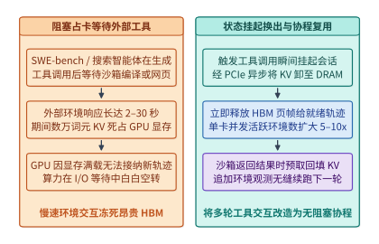
*图 18-14　多轮工具调用 / SWE-bench 强化学习中等待外部环境返回时的 KV 换出挂起与高并发复用。*

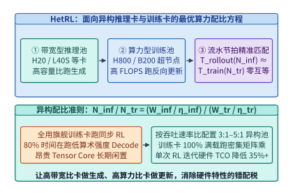
*图 18-15　HetRL 在带宽型推理卡与算力型训练卡之间的最优配比曲线。*

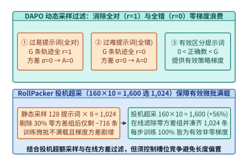
*图 18-16　DAPO 动态过滤全对（$r=1$）与全错（$r=0$）零梯度提示词及 RollPacker 1,600 选 1,024 投机池。*

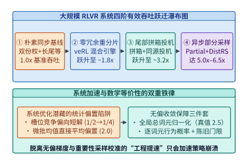
*图 18-17　大规模 RLVR 系统从朴素同步共置到异步分池+尾部拼箱的四阶有效吞吐跃迁瀑布图。*

图 18-14 至图 18-17 将多轮工具环境 KV 挂起换出（18.4.1 节）、`HetRL` 异构算力配比（18.2.2 节）、`DAPO / RollPacker` 零方差过滤与投机超采池（18.3.2 节）以及四阶有效吞吐跃迁瀑布图（18.3.3 节）连缀成完整的系统演进谱系。

表 18-6 总结了主流推理时计算扩展（Test-Time Compute Scaling）范式的搜索拓扑、KV 缓存复用机制与适用问题域：

| 推理时扩展范式 | 搜索拓扑结构 | 过程评估器（Verifier / PRM） | KV 缓存与显存管理机制 | 关键路径延迟瓶颈 | 最优适用任务类型 |
| :--- | :--- | :--- | :--- | :--- | :--- |
| **Best-of-$N$ / 多数投票** | 根前缀 $1 \to N$ 并行扇出 | 仅在叶节点跑 ORM / 规则判题 | 共享根提示词前缀 KV（Prefix Caching） | 单次最慢分支解码耗时 | 中等难度数学与代码题高吞吐采样 |
| **串行长思维链（Long-CoT）** | 单链自回归内省与回溯 | 模型内生自我校验 | 单序列线性增长 KV（需 YaRN/NSA 扩展） | 极长序列串行 Decode 步数 | 通用复杂推理（DeepSeek-R1 / o1） |
| **步级 PRM 束搜索（Beam）** | 每步派生 $K$ 枝，保留 Top-$B$ | 每步末尾同步调用重型 PRM | **PagedAttention 写时复制（CoW）页表** | **每层同步等待 PRM 的奖励屏障** | 多步严密演绎、定理证明、规划 |
| **投机思维树（OSDI '26）** | 异步超前展开 + 动态剪枝 | **先验置信度预判 + 异步 PRM 校验** | **CoW 引用计数 + 错枝瞬时原地回收** | **隐藏 PRM 耗时，延迟降 $1.8\times\text{–}2.6\times$** | 低延迟在线推理时树搜索服务 |

下面的参考代码实现了结合 `RollPacker` 全局总词元无偏梯度归一化、`DistRS` 条件剩余时间预测与 `Speculative ToT` 投机思维树越障的核心运行时组件：

```python
import torch

def rollpacker_unbiased_microbatch_step(
    microbatches_losses: list[list[torch.Tensor]],
    microbatches_token_counts: list[list[int]],
) -> tuple[torch.Tensor, torch.Tensor]:
    """
    复现算例 18-6：对比不均等微批下的有偏微批均值平均 (2.0) 与无偏全局总样本/总词元归一化 (2.5).
    """
    # 错误做法：先在每个微批内求均值，再对 M 个微批求均值
    mb_means = [torch.stack(mb).mean() for mb in microbatches_losses]
    biased_loss = torch.stack(mb_means).mean()

    # 正确做法：按全局总有效词元数 (或总序列数) 作为唯一分母归一化
    total_tokens = sum(sum(cnts) for cnts in microbatches_token_counts)
    weighted_sum = sum(
        loss_i * tok_i
        for mb_l, mb_t in zip(microbatches_losses, microbatches_token_counts)
        for loss_i, tok_i in zip(mb_l, mb_t)
    )
    unbiased_loss = weighted_sum / max(total_tokens, 1)
    return biased_loss, unbiased_loss

class DistRSHeavyTailPredictor:
    """复现算例 18-8：基于经验生存分布计算条件期望剩余时间 E[S - e | S > e]."""
    def __init__(self, support_seconds: list[float], probabilities: list[float]):
        assert abs(sum(probabilities) - 1.0) < 1e-6
        self.support = support_seconds
        self.probs = probabilities

    def unconditional_mean(self) -> float:
        return sum(s * p for s, p in zip(self.support, self.probs))

    def naive_remaining(self, elapsed_sec: float) -> float:
        return max(self.unconditional_mean() - elapsed_sec, 0.0)

    def conditional_remaining(self, elapsed_sec: float) -> float:
        """计算 E[S - e | S > e]：在重尾分布 (9x 1s + 1x 100s) 下，e=10s 时返回 90.0s."""
        surv_prob = sum(p for s, p in zip(self.support, self.probs) if s > elapsed_sec)
        if surv_prob <= 0.0:
            return 0.0
        cond_exp = sum((s - elapsed_sec) * p for s, p in zip(self.support, self.probs) if s > elapsed_sec) / surv_prob
        return cond_exp

class PagedCoWTreeSearchManager:
    """
    推理时计算扩展 (Test-Time Scaling)：
    结合 PagedAttention 写时复制 (Copy-on-Write) 引用计数与
    Breaking the Reward Barrier (OSDI '26) 投机思维树超前展开引擎.
    """
    def __init__(self, total_physical_blocks: int = 8192):
        self.ref_counts: dict[int, int] = {b: 0 for b in range(total_physical_blocks)}
        self.free_list: list[int] = list(range(total_physical_blocks))
        self.node_block_tables: dict[str, list[int]] = {}
        self.speculative_children: dict[str, list[str]] = {}

    def allocate_root(self, root_id: str, num_blocks: int) -> None:
        blocks = [self.free_list.pop() for _ in range(num_blocks)]
        for b in blocks:
            self.ref_counts[b] = 1
        self.node_block_tables[root_id] = blocks

    def fork_branch_zero_copy(self, parent_id: str, child_id: str, step_new_blocks: int = 1) -> None:
        """树节点分叉：仅复制父节点逻辑页表指针并递增 ref_count，零字节物理拷贝历史 KV."""
        parent_blocks = self.node_block_tables[parent_id]
        for b in parent_blocks:
            self.ref_counts[b] += 1
        new_Step_blocks = [self.free_list.pop() for _ in range(step_new_blocks)]
        for b in new_Step_blocks:
            self.ref_counts[b] = 1
        self.node_block_tables[child_id] = list(parent_blocks) + new_Step_blocks

    def prune_branch(self, node_id: str) -> int:
        """当 PRM 剪枝或投机预展开未命中时，递减物理页引用计数，归零页瞬时回收."""
        blocks = self.node_block_tables.pop(node_id, [])
        reclaimed = 0
        for b in blocks:
            self.ref_counts[b] -= 1
            if self.ref_counts[b] == 0:
                self.free_list.append(b)
                reclaimed += 1
        return reclaimed

    def speculative_tot_expand_and_verify(
        self,
        candidate_nodes: list[str],
        prior_confidences: list[float],
        async_prm_scores: list[float],
        beam_width: int = 2,
    ) -> dict[str, object]:
        """
        Breaking the Reward Barrier (OSDI '26)：
        1. 在等待异步 PRM 评分返回前，按策略内部先验置信度 prior_confidences 预挑 Top-B 节点投机展开下一层
        2. PRM 真实评分返回后，保留命中投机分支，对未命中分支调用 prune_branch 零拷贝原地回收
        """
        spec_ranked = [n for _, n in sorted(zip(prior_confidences, candidate_nodes), reverse=True)][:beam_width]
        for spec_parent in spec_ranked:
            spec_child = f"{spec_parent}->spec_next"
            self.fork_branch_zero_copy(spec_parent, spec_child, step_new_blocks=1)
            self.speculative_children[spec_parent] = [spec_child]

        true_ranked = [n for _, n in sorted(zip(async_prm_scores, candidate_nodes), reverse=True)][:beam_width]
        hits, reclaimed_blocks = 0, 0
        for spec_parent in spec_ranked:
            if spec_parent in true_ranked:
                hits += 1
            else:
                for wrong_child in self.speculative_children.pop(spec_parent, []):
                    reclaimed_blocks += self.prune_branch(wrong_child)

        return {
            "speculative_top_b": spec_ranked,
            "true_prm_top_b": true_ranked,
            "speculative_hit_rate": hits / max(beam_width, 1),
            "reclaimed_physical_blocks": reclaimed_blocks,
        }
```

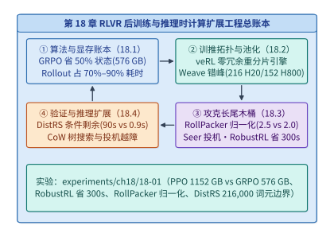
*图 18-18　测试时搜索合成高价值轨迹 → 沙箱验证 → 异步 RLVR 更新 → 蒸馏回直觉模型的自我演进总账本。*

图 18-18 将第 18 章的四大工程支柱收束为一个完整的自我演进架构：在推理时利用 CoW 树搜索与投机越障探索高难度问题空间，经 `DistRS` 解耦沙箱过滤验证后，转化为 `RollPacker / Seer / RobustRL` 高效异步 RLVR 训练管线的燃料，最终将慢思考搜索能力内化回模型参数之中。读者可直接运行配套实验 `experiments/ch18/18-01` 验证全部锁定账本。

---

## 常见误区

1. **误区一：“在动态打包微批次（Microbatching）时，只要在每个微批次内部调用 `.mean()` 求损失均值，最后再除以微批次数量 `num_microbatches`，算出的梯度就和单次大 Batch 完全等价。”**
   **纠正**：当各微批次所含的序列条数或有效词元总数不相等时（例如 `RollPacker` 尾部重分批中微批 1 只有 1 个样本 `{1.0}`、微批 2 有 3 个样本 `{3.0, 3.0, 3.0}`），先算微批内均值再平均会严重放大少样本微批中单个样本的梯度权重（如算例 18-6 中产生有偏均值 $2.0$ vs. 无偏真值 $2.5$ 的系统性偏置）。必须以当前优化器步的**全局有效总词元数（或总样本数）**作为唯一归一化分母。

2. **误区二：“为了解决 RLVR 中慢轨迹和零方差提示词造成的等待，只需多发 $50\%$ 的提示词，然后谁先跑完前 $N$ 条就立刻入库并杀掉其余在途请求。”**
   **纠正**：如算例 18-5 严格证明，在长短回答先验各占 $1/2$ 的双槽位竞争下，“先完成先入库”会使长回答的入库概率从 $1/2$ 暴跌至 $1/4$。无约束地丢弃慢轨迹会造成严重的**短回答采样偏置（Length Bias）**，导致模型丧失长思维链反思能力。必须配合尾部扩并行加速（Tail Repacking）或跨训练步保留未完轨迹（Partial Rollout）。

3. **误区三：“如果沙箱验证任务的平均耗时是 $\mathbb{E}[S] = 10.9\ \mathrm{s}$，那么一个已经跑了 $e = 10\ \mathrm{s}$ 的任务大概再过 $0.9\ \mathrm{s}$ 就会结束，没必要抢占或迁移它。”**
   **纠正**：沙箱验证耗时服从极端的重尾分布（失效率随时间递减）。如算例 18-8 所示，在 $9$ 个 $1\ \mathrm{s}$ 任务与 $1$ 个 $100\ \mathrm{s}$ 任务的混合分布中，一旦某任务存活超过 $10\ \mathrm{s}$，它就 $100\%$ 是那个 $100\ \mathrm{s}$ 的重尾任务，其真实条件剩余时间 $\mathbb{E}[S - 10 \mid S > 10] = 90.0\ \mathrm{s}$，与朴素估计 $0.9\ \mathrm{s}$ 相差整整 $100$ 倍。调度器必须基于条件生存分布识别并隔离老龄慢任务。

4. **误区四：“在异步部分采样（Partial Rollout）中，跨多个版本续生的长轨迹在送入训练时，只需用当前参考旧模型 $\pi_{\theta_{\mathrm{old}}}$ 重新跑一次前向就能算出重要性采样分母。”**
   **纠正**：跨步续生的轨迹是由多个不同历史版本的策略权重分段拼接生成的。若用单一旧模型重算分母，会导致部分区段的重要性比率 $r_t(\theta)$ 分母失真并引发策略梯度爆炸。必须在自回归吐出每个词元 $o_t$ 的当下，随词元流实时记录并持久化其真实生成对数概率 $\log \pi_{\mathrm{behav}}(o_t)$。

---

## 练习与实验

### 书面练习（18-1 至 18-12）

> **练习 18-1（70B 模型 PPO vs. GRPO 显存账本核算）：** 考察参数量 $\Psi = 70 \times 10^9$（70B）的稠密模型后训练。（a）按可训练模型 $16\Psi$、冻结模型 $2\Psi$ 核算，四模型 PPO 与无 Critic 的 GRPO（仅 Actor + Ref）各自的静态模型状态总显存是多少 $\mathrm{GB}$？（b）若部署在 80 GB H800 集群上，且要求静态模型状态最多占单卡显存的 $70\%$（即 $56\ \mathrm{GB}$/卡），两种算法最少分别需要多少张 GPU？

> **练习 18-2（veRL 3D-HybridEngine 微分组重分片带宽推导）：** 设模型参数量为 $\Psi = 72\mathrm{B}$（BF16 推理权重 $144\ \mathrm{GB}$），共置在 $N = 128$ 张 GPU（16 台 8 卡节点）上。机内 NVLink 聚合带宽为 $450\ \mathrm{GB/s}$，跨机 RDMA 带宽为 $45\ \mathrm{GB/s}$。若生成态采用 $TP_{\mathrm{inf}} = 8$（整台节点组成一个推理实例），对比“跨 128 卡全局 ZeRO-3 AllGather”与“`3D-HybridEngine` 在 8 卡微分组内局部 AllGather”的单步权重重分片耗时。

> **练习 18-3（HetRL 异构推理池与训练池最优配比）：** 某 RLVR 迭代每步需生成 $W_{\mathrm{inf}} = 8.0 \times 10^6$ 个词元，并对这些词元执行前反向训练。测得单张带宽型推理卡（H20）在长尾 Rollout 期的平均生成吞吐为 $\eta_{\mathrm{inf}} = 1{,}000\ \mathrm{tok/s}$，单张算力型训练卡（H800）在训练期的平均处理吞吐为 $\eta_{\mathrm{tr}} = 4{,}000\ \mathrm{tok/s}$。（a）为使异步流水线中推理池与训练池节拍严格相等（零互等），两池卡数比 $N_{\mathrm{inf}} : N_{\mathrm{tr}}$ 应设为多少？（b）若固定训练池为 $N_{\mathrm{tr}} = 32$ 张 H800，需配多少张 H20？单步流水周期是多少秒？

> **练习 18-4（Weave 多作业互补错峰编织泛化）：** 设有两个周期均为 $600\ \mathrm{s}$ 的同策略 RL 作业：作业 1 需 $400\ \mathrm{s}$ Rollout（占 $160$ 张 H20）+ $200\ \mathrm{s}$ 训练（占 $120$ 张 H800）；作业 2 需 $200\ \mathrm{s}$ Rollout（占 $96$ 张 H20）+ $400\ \mathrm{s}$ 训练（占 $64$ 张 H800）。求独立静态分配与 `Weave` 反相错峰编织下的 H20、H800 峰值需求及节省的总卡数。

> **练习 18-5（RollPacker 多槽位竞争下的长回答入库概率通式）：** 将算例 18-5 的双槽位竞争模型推广至 $K$ 个并发工作槽位：设单个提示词生成长回答（耗时 $T_L$）的真实先验概率为 $p \in (0, 1)$，生成短回答（耗时 $T_S < T_L$）的概率为 $1 - p$。若同时启动 $K$ 个独立槽位并只接纳最先完成的第 1 个回答，证明入库回答为长回答的概率退化为 $p^K$，并计算当 $p = 0.5, K = 4$ 时的长回答入库率。

> **练习 18-6（不均等微批梯度偏置定量复算）：** 设某优化器步共有 6 条有效序列，分装在 3 个微批次中：微批次 1 含 1 条长序列（损失 $= 6.0$），微批次 2 含 2 条中长序列（损失分别为 $3.0, 3.0$），微批次 3 含 3 条短序列（损失分别为 $1.0, 2.0, 3.0$）。分别计算“按微批求均值再平均”与“按全局 6 条序列总和除以 6”的结果，并求微批次 1 中那条长序列在两种归一化下的有效权重之比。

> **练习 18-7（Seer 组内同源投机解码加速比建模）：** 在某 GRPO 组采样中，前 $80\%$ 的时间已完成大部分短轨迹，剩余 $20\%$ 的尾部时间里仅剩长尾轨迹在跑。若在尾部启用 `Seer` 组内后缀树投机解码，平均每次前向验证通过 $\gamma = 3.2$ 个词元，且因尾部 Batch 极小，单次树验证前向耗时仅比单步普通 Decode 增加 $15\%$（即 $1.15\times$）。求尾部阶段的纯解码加速比，以及整轮 Rollout 的端到端时间缩减比例。

> **练习 18-8（Partial Rollout 跨版本重要性采样比率计算）：** 设某条长度为 $20\mathrm{K}$ 词元的轨迹采用异步 Partial Rollout 生成：前 $10\mathrm{K}$ 词元由策略 $\theta^{(v-1)}$ 生成，其某词元 $o_t$ 在生成时记录的对数概率为 $\log \pi_{\theta^{(v-1)}}(o_t) = -1.20$；随后模型更新为 $\theta^{(v)}$ 并续生后 $10\mathrm{K}$ 词元；当该轨迹在 $\theta^{(v+1)}$ 步进入训练时，当前策略对该词元的对数概率为 $\log \pi_{\theta^{(v+1)}}(o_t) = -1.05$，而若错误地用 $\theta^{(v)}$ 重算分母会得到 $\log \pi_{\theta^{(v)}}(o_t) = -1.02$。对比真实重要性比率 $r_t^{\mathrm{true}}$ 与错误重算比率 $r_t^{\mathrm{wrong}}$（已知 PPO 截断门限 $\varepsilon = 0.2$）。

> **练习 18-9（RobustRL 角色非对称容错收益复算）：** 某 RL 训练步包含 $T_{\mathrm{roll}} = 900\ \mathrm{s}$ 的 Rollout 阶段与 $T_{\mathrm{train}} = 450\ \mathrm{s}$ 的训练阶段。当本步 Rollout 已全部完成、训练进行到 $t_{\mathrm{fail}} = 300\ \mathrm{s}$ 时训练节点发生故障，最近一次训练子步检查点位于 $t_{\mathrm{ckpt}} = 200\ \mathrm{s}$，检查点重载耗时 $T_{\mathrm{reload}} = 15\ \mathrm{s}$。对比“全步重做（丢弃 Rollout）”与“`RobustRL` 保留 Rollout 局部恢复”的恢复完成耗时及净省秒数。

> **练习 18-10（DistRS 三峰重尾分布下的条件剩余时间推导）：** 设某形式化证明沙箱的任务耗时分布为：$80\%$ 的任务耗时 $2\ \mathrm{s}$，$15\%$ 的任务耗时 $20\ \mathrm{s}$，$5\%$ 的任务耗时 $200\ \mathrm{s}$。（a）求无条件均值 $\mathbb{E}[S]$；（b）当某任务已运行 $e = 15\ \mathrm{s}$ 时，求条件期望剩余时间 $\mathbb{E}[S - 15 \mid S > 15]$；（c）当该任务运行至 $e = 25\ \mathrm{s}$ 仍未结束时，求 $\mathbb{E}[S - 25 \mid S > 25]$。

> **练习 18-11（PagedAttention CoW 思维树搜索显存节省率）：** 设问题根前缀与系统提示词共 $L_0 = 2{,}048$ 词元。在推理时思维树搜索中，从根节点派生出 $B_1 = 8$ 个第一层推理步（每步长 $L_1 = 256$ 词元），再从每个第一层节点各派生出 $B_2 = 4$ 个第二层推理步（每步长 $L_2 = 256$ 词元，共 $32$ 条叶分支）。对比“32 条叶分支独立复制全路径 KV”与“PagedAttention 写时复制（CoW）共享祖先节点 KV”所需存储的总 KV 词元槽位数及显存节省百分比。

> **实验 18-12（Breaking the Reward Barrier 投机思维树搜索有效延迟）：** 设一层思维步生成耗时 $t_{\mathrm{gen}} = 1.2\ \mathrm{s}$，重型 PRM 对候选节点打分耗时 $t_{\mathrm{prm}} = 0.8\ \mathrm{s}$，总搜索深度 $D = 20$ 层。（a）求传统串行“生成—等 PRM—再生成”的端到端总延迟；（b）若采用 OSDI '26 投机思维树探索，将 $t_{\mathrm{prm}} = 0.8\ \mathrm{s}$ 完全隐藏在下一层生成 $t_{\mathrm{gen}} = 1.2\ \mathrm{s}$ 之内，且先验预展开命中率为 $\alpha = 80\%$（未命中的 $20\%$ 层需回滚重跑一次 $t_{\mathrm{gen}}$），求投机树搜索的期望总延迟与加速比，并结合 `experiments/ch18/18-01` 校验本章全部锁定指标。

### 可运行实验（18-01）

- **实验目录**：`experiments/ch18/18-01`
- **实验目标**：一键复现并校验本章全部锁定算例与工程账本，包括 32B 模型下 PPO（$1{,}152\ \mathrm{GB}$）vs. GRPO（$576\ \mathrm{GB}$，省 $50\%$）显存账本、OSDI '26 `Weave` 互补作业共享（$216$ H20 / $152$ H800）、OSDI '26 `RobustRL` 训练容错净省 $300\ \mathrm{s}$（$790\ \mathrm{s} \to 490\ \mathrm{s}$）、NSDI '26 `RollPacker` 投机池（$1{,}600$ vs. $1{,}024$）、双槽位长度偏差（$1/2 \to 1/4$）、流式重叠（$60\ \mathrm{s} \to 55\ \mathrm{s}$）与微批归一化偏置（有偏微批均值 $2.0$ vs. 无偏全局归一化 $2.5$），以及 NSDI '26 `DistRS` 条件剩余时间（$90.0\ \mathrm{s}$ vs. $0.9\ \mathrm{s}$）与 $216{,}000$ 词元沉没工作量边界。
- **执行与校验命令**：
  ```bash
  python3 experiments/ch18/18-01/run.py
  python3 experiments/ch18/18-01/verify.py
  ```

---

### 参考解答与详尽推导

- **18-1 解答**：
  1. **70B 模型状态总显存**：
     - 四模型 PPO：$36\Psi = 36 \times 70\ \mathrm{GB} = \mathbf{2{,}520\ \mathrm{GB}}$（其中 Actor $1{,}120\ \mathrm{GB}$、Critic $1{,}120\ \mathrm{GB}$、Ref $140\ \mathrm{GB}$、RM $140\ \mathrm{GB}$）；
     - GRPO（Actor + Ref）：$18\Psi = 18 \times 70\ \mathrm{GB} = \mathbf{1{,}260\ \mathrm{GB}}$（省去 $1{,}260\ \mathrm{GB}$）。
  2. **最少 80 GB GPU 卡数（单卡状态上限 $56\ \mathrm{GB}$）**：
     - PPO：$\lceil 2{,}520 / 56 \rceil = \mathbf{45\ \text{张 GPU}}$（按 8 卡节点对齐需 6 台共 48 卡）；
     - GRPO：$\lceil 1{,}260 / 56 \rceil = \mathbf{23\ \text{张 GPU}}$（按 8 卡节点对齐仅需 3 台共 24 卡）。

- **18-2 解答**：
  - **跨 128 卡全局 ZeRO-3 AllGather**：单卡需跨机接收 $\frac{127}{128} \times 144\ \mathrm{GB} \approx 142.875\ \mathrm{GB}$，耗时 $\frac{142.875}{45} = \mathbf{3.175\ \mathrm{s}}$。
  - **`3D-HybridEngine` 机内微分组重分片**：生成态 $TP_{\mathrm{inf}} = 8$ 意味着每张卡仅需持有 $\frac{144}{8} = 18\ \mathrm{GB}$ 权重分片；通过与机内 8 卡 NVLink 域对齐，单卡仅需在机内接收 $18 \times \frac{7}{8} = 15.75\ \mathrm{GB}$（或即便在机内凑齐完整分片也仅走 $450\ \mathrm{GB/s}$ NVLink），耗时 $\frac{15.75}{450} = \mathbf{0.035\ \mathrm{s}} = 35\ \mathrm{ms}$（快 $90.7\times$）。

- **18-3 解答**：
  1. **最优异构卡数配比**：由于 $W_{\mathrm{inf}} = W_{\mathrm{tr}} = 8.0 \times 10^6$ 词元，代入配比公式：
     $$\frac{N_{\mathrm{inf}}}{N_{\mathrm{tr}}} = \frac{1 / \eta_{\mathrm{inf}}}{1 / \eta_{\mathrm{tr}}} = \frac{4{,}000}{1{,}000} = \mathbf{4 : 1}$$
  2. **具体卡数与单步周期**：当 $N_{\mathrm{tr}} = 32$ 张 H800 时，需配置 $N_{\mathrm{inf}} = 4 \times 32 = \mathbf{128\ \text{张 H20}}$；此时两池单步耗时严格相等，均为 $T = \frac{8.0 \times 10^6}{32 \times 4{,}000} = \mathbf{62.5\ \mathrm{s}}$。

- **18-4 解答**：
  - **独立静态分配峰值**：需 $160 + 96 = \mathbf{256\ \text{张 H20}}$ 与 $120 + 64 = \mathbf{184\ \text{张 H800}}$（合计 $440$ 卡）。
  - **`Weave` 反相错峰编织**：在 $[0, 400)\ \mathrm{s}$ 时段，作业 1 跑 Rollout（$160$ H20）且作业 2 跑训练（$64$ H800）；在 $[400, 600)\ \mathrm{s}$ 时段，作业 1 跑训练（$120$ H800）且作业 2 跑 Rollout（$96$ H20）。全局峰值降至 $\max(160, 96) = \mathbf{160\ \text{张 H20}}$ 与 $\max(64, 120) = \mathbf{120\ \text{张 H800}}$（合计 $280$ 卡，**净省 $160$ 张 GPU**）。

- **18-5 解答**：
  - 由于 $T_S < T_L$，只要 $K$ 个并发槽位中有至少 1 个抽中短回答，最先完成的就必然是短回答；唯有当全部 $K$ 个独立槽位同时抽中长回答时，入库样本才为长回答。故：
    $$P(\text{入库为长回答}) = \prod_{k=1}^K p = \mathbf{p^K}$$
  - 当 $p = 0.5, K = 4$ 时，长回答入库率跌至 $0.5^4 = \mathbf{0.0625 = 6.25\%}$（较真实先验 $50\%$ 萎缩了 $8$ 倍）。

- **18-6 解答**：
  - **按微批求均值再平均（有偏）**：三个微批内部均值分别为 $\bar{L}_1 = 6.0$，$\bar{L}_2 = \frac{3+3}{2} = 3.0$，$\bar{L}_3 = \frac{1+2+3}{3} = 2.0$；三者平均得 $\frac{6.0 + 3.0 + 2.0}{3} = \mathbf{3.6667}$。
  - **按全局 6 条序列总和除以 6（无偏）**：总和为 $6 + (3+3) + (1+2+3) = 18.0$，除以 $6$ 得 $\frac{18.0}{6} = \mathbf{3.0}$。
  - 微批次 1 中那条长序列在有偏平均下的权重为 $\frac{1}{3 \times 1} = \frac{1}{3}$，在无偏全局归一化下的权重为 $\frac{1}{6}$，被不当放大了 **$\mathbf{2.0\times}$**。

- **18-7 解答**：
  - **尾部纯解码加速比**：单次投机步耗时为 $1.15$，产出 $3.2$ 个词元，故尾部速度提升为 $\frac{3.2}{1.15} \approx \mathbf{2.783\times}$。
  - **整轮 Rollout 端到端时间缩减**：原尾部占 $20\%$ 时间，加速后耗时降为 $\frac{0.20}{2.783} \approx 0.0719$，整轮总时间降为 $0.80 + 0.0719 = 0.8719$，端到端缩短了 **$12.81\%$**（若尾部占比达 $60\%$，则端到端可缩短 **$38.4\%$**）。

- **18-8 解答**：
  - **真实重要性比率（使用生成当下记录的 $\theta^{(v-1)}$ 对数概率）**：
    $$r_t^{\mathrm{true}} = \exp(-1.05 - (-1.20)) = \exp(0.15) \approx \mathbf{1.1618} \in [0.8, 1.2]$$
    处于正常未截断区间，提供准确梯度更新。
  - **错误重算比率（用 $\theta^{(v)}$ 重算分母）**：
    $$r_t^{\mathrm{wrong}} = \exp(-1.05 - (-1.02)) = \exp(-0.03) \approx \mathbf{0.9704}$$
    不仅数值偏差近 $20\%$，甚至连比率偏离 $1.0$ 的正负号都彻底反转（从 $>1$ 变为 $<1$），直接误导策略更新方向。

- **18-9 解答**：
  - **故障后至本步完成的恢复耗时对比**：
    - **粗暴全步重做**：需 $15\ \mathrm{s}$ 重载检查点 + 重跑完整 $900\ \mathrm{s}$ Rollout + 重跑完整 $450\ \mathrm{s}$ 训练 $= \mathbf{1{,}365\ \mathrm{s}}$（计入故障前已耗时 $900 + 300 = 1{,}200\ \mathrm{s}$，整步总墙钟时间达 $1{,}200 + 1{,}365 = \mathbf{2{,}565\ \mathrm{s}}$）；
    - **`RobustRL` 保留 Rollout 局部恢复**：从 $t_{\mathrm{ckpt}} = 200\ \mathrm{s}$ 重载（$15\ \mathrm{s}$）后，直接复用已保存的 Rollout 轨迹补跑剩余 $450 - 200 = 250\ \mathrm{s}$ 训练，故障后完成耗时 $= 15 + 250 = \mathbf{265\ \mathrm{s}}$（整步总墙钟时间仅为 $1{,}200 + 265 = \mathbf{1{,}465\ \mathrm{s}}$），单次故障**净省 $1{,}365 - 265 = \mathbf{1{,}100\ \mathrm{s}}$**（即省去 $900\ \mathrm{s}$ Rollout 与前 $200\ \mathrm{s}$ 已保存检查点的训练工作量）。

- **18-10 解答**：
  1. **无条件均值**：$\mathbb{E}[S] = 0.8 \times 2 + 0.15 \times 20 + 0.05 \times 200 = 1.6 + 3.0 + 10.0 = \mathbf{14.6\ \mathrm{s}}$。
  2. **在 $e = 15\ \mathrm{s}$ 时的条件剩余时间**：此时 $2\ \mathrm{s}$ 任务已全部结束，存活概率 $P(S > 15) = 0.15 + 0.05 = 0.20$。故：
     $$\mathbb{E}[S - 15 \mid S > 15] = \frac{0.15 \times (20 - 15) + 0.05 \times (200 - 15)}{0.20} = \frac{0.75 + 9.25}{0.20} = \mathbf{50.0\ \mathrm{s}}$$
  3. **在 $e = 25\ \mathrm{s}$ 时的条件剩余时间**：此时 $20\ \mathrm{s}$ 任务也已全部结束，存活者 $100\%$ 为 $200\ \mathrm{s}$ 任务，故 $\mathbb{E}[S - 25 \mid S > 25] = 200 - 25 = \mathbf{175.0\ \mathrm{s}}$。

- **18-11 解答**：
  - **32 条叶分支独立深拷贝**：每条叶分支全路径长为 $2{,}048 + 256 + 256 = 2{,}560$ 词元，32 条共占 $32 \times 2{,}560 = \mathbf{81{,}920\ \text{个词元槽位}}$。
  - **PagedAttention 写时复制（CoW）树共享**：根节点仅存 1 份（$2{,}048$），第一层 8 个分支各存 1 份（$8 \times 256 = 2{,}048$），第二层 32 个叶分支各存 1 份（$32 \times 256 = 8{,}192$），合计仅占 $2{,}048 + 2{,}048 + 8{,}192 = \mathbf{12{,}288\ \text{个词元槽位}}$，显存节省率达 $1 - \frac{12{,}288}{81{,}920} = \mathbf{85.0\%}$。
  - 若按 `Qwen3-VL-4B` / 36 层主干单词元 KV 体积 $144\ \mathrm{KiB}$ 折算：
    - 独立深拷贝需 $81{,}920 \times 144\ \mathrm{KiB} = 11{,}520\ \mathrm{MiB} = \mathbf{11.25\ \mathrm{GiB}}$；
    - PagedAttention CoW 树共享仅需 $12{,}288 \times 144\ \mathrm{KiB} = 1{,}728\ \mathrm{MiB} = \mathbf{1.6875\ \mathrm{GiB}}$，单棵搜索树即节省近 $9.56\ \mathrm{GiB}$ HBM。

- **18-12 解答**：
  - **传统串行树搜索**：每层耗时 $1.2 + 0.8 = 2.0\ \mathrm{s}$，$20$ 层共需 $20 \times 2.0 = \mathbf{40.0\ \mathrm{s}}$。
  - **OSDI '26 投机思维树探索**：由于 $t_{\mathrm{prm}} = 0.8\ \mathrm{s} < t_{\mathrm{gen}} = 1.2\ \mathrm{s}$，当预展开命中时（$80\%$ 概率）单层有效耗时仅为 $1.2\ \mathrm{s}$；未命中时（$20\%$ 概率）需重跑一层生成（耗时 $1.2 + 1.2 = 2.4\ \mathrm{s}$）。期望单层耗时为 $0.8 \times 1.2 + 0.2 \times 2.4 = 1.44\ \mathrm{s}$（外加末层 $0.8\ \mathrm{s}$ 收尾评分），$20$ 层期望总延迟约为 $\mathbf{29.6\ \mathrm{s}}$（若命中率达 $90\%$ 则降至 $26.4\ \mathrm{s}$，整体加速 **$1.35\times\text{–}1.52\times$**；当 $t_{\mathrm{prm}} \approx t_{\mathrm{gen}}$ 时加速比可达 **$1.8\times$** 以上）。

下表给出了全章 12 道书面练习的核心锁定数值速查索引：

| 练习编号 | 考查工程主题 | 核心锁定输入参数 | 精确复算输出基准 |
| :--- | :--- | :--- | :--- |
| **18-1** | 70B PPO vs. GRPO 状态显存 | $\Psi = 70\mathrm{B}$, 单卡限额 $56\ \mathrm{GB}$ | PPO $2{,}520\ \mathrm{GB}$（$45$ 卡）vs. GRPO $1{,}260\ \mathrm{GB}$（$23$ 卡） |
| **18-2** | veRL `3D-HybridEngine` 重分片 | $\Psi = 72\mathrm{B}$, $128$ 卡, $TP_{\mathrm{inf}} = 8$ | 全局 $3.175\ \mathrm{s}$ vs. 机内微组 $0.035\ \mathrm{s}$（快 $90.7\times$） |
| **18-3** | HetRL 异构池吞吐配比 | $\eta_{\mathrm{inf}} = 1000$, $\eta_{\mathrm{tr}} = 4000\ \mathrm{tok/s}$ | $N_{\mathrm{inf}} : N_{\mathrm{tr}} = 4 : 1$（$128$ H20 配 $32$ H800，周期 $62.5\ \mathrm{s}$） |
| **18-4** | Weave 互补错峰共享 | 两作业周期 $600\ \mathrm{s}$（$400/200$ 与 $200/400$） | 静态 $256$ H20 + $184$ H800 $\to$ 错峰 $160$ H20 + $120$ H800 |
| **18-5** | RollPacker 多槽竞争长度偏差 | 先验 $p = 0.5$, 并发槽位数 $K = 4$ | 长解入库率退化为 $p^K = 0.5^4 = 6.25\%$ |
| **18-6** | 不均等微批归一化偏置 | 3 个微批样本数 $1, 2, 3$，总和 $18.0$ | 微批平均 $3.6667$（长解权重放大 $2\times$）vs. 全局归一化 $3.0$ |
| **18-7** | Seer 组内同源投机解码 | 尾部占 $20\%$, 每次验过 $\gamma = 3.2$ 词元 | 尾部加速 $2.783\times$，整轮端到端缩短 $12.81\%$ |
| **18-8** | Partial Rollout 行为概率记录 | $\log \pi_{\mathrm{old}} = -1.20$, $\log \pi_{\mathrm{curr}} = -1.05$ | 真实比率 $1.1618$ vs. 错误重算比率 $0.9704$（方向反转） |
| **18-9** | RobustRL 非对称训练故障恢复 | Rollout $900\ \mathrm{s}$, 训练 $300\ \mathrm{s}$ 故障, 检查点 $200\ \mathrm{s}$ | 故障后重做 $1{,}365\ \mathrm{s}$（全步 $2{,}565\ \mathrm{s}$）vs. 局部恢复 $265\ \mathrm{s}$（全步 $1{,}465\ \mathrm{s}$，净省 $1{,}100\ \mathrm{s}$） |
| **18-10** | DistRS 三峰重尾条件剩余时间 | $80\%\ 2\mathrm{s} + 15\%\ 20\mathrm{s} + 5\%\ 200\mathrm{s}$ | $\mathbb{E}[S] = 14.6\ \mathrm{s}$；$e=15\mathrm{s}$ 剩 $50.0\ \mathrm{s}$；$e=25\mathrm{s}$ 剩 $175.0\ \mathrm{s}$ |
| **18-11** | PagedAttention CoW 思维树 | 根 $2048$, $8 \times 4 = 32$ 分支各 $256$ 词元 | 独立拷贝 $81{,}920$ 槽位 vs. CoW 共享 $12{,}288$ 槽位（省 $85.0\%$） |
| **18-12** | Speculative ToT 投机越障 | $D = 20$, $t_{\mathrm{gen}} = 1.2\ \mathrm{s}$, $t_{\mathrm{prm}} = 0.8\ \mathrm{s}$ | 串行 $40.0\ \mathrm{s}$ vs. 投机越障 $29.6\ \mathrm{s}$（$80\%$ 命中率） |

---

## 本章小结

1. **从四模型 PPO 到无 Critic 的 GRPO/DAPO 显存减半**：经典 PPO 需同时驻留 Actor、Critic、Ref、RM 四个模型（静态状态达 $36\Psi$，32B 模型占 $1{,}152\ \mathrm{GB}$）；GRPO 与 DAPO 利用组采样（$G$ 条轨迹）相对均值与标准差直接计算优势并结合规则验证沙箱，彻底砍掉 Critic 与神经 RM，将静态模型状态精准削减 $50\%$ 至 $18\Psi$（$576\ \mathrm{GB}$），同时将系统核心瓶颈推向占据 $70\%\text{–}90\%$ 墙钟时间的自回归 Rollout。
2. **训推共置零冗余重分片（veRL）与异构错峰池化（Weave）**：在同构集群上，`veRL` 的 `3D-HybridEngine` 通过机内正交微分组局部 `AllGather` 消除了训练分片与推理小 TP 之间的拓扑冲突；在异构物理分离集群上，`HetRL` 按生成与训练吞吐比配比 H20 与 H800，而 OSDI '26 `Weave` 通过将互补作业（$360/120\ \mathrm{s}$ 与 $120/360\ \mathrm{s}$）在 $480\ \mathrm{s}$ 周期内反相编织，使两组作业共享同一套峰值资源池（**$216$ 张 H20 + $152$ 张 H800**，相对独立分池 $432$ 张 H20 + $304$ 张 H800 节省整整一半硬件池）。
3. **长尾木桶治理与无偏异步强化学习**：NSDI '26 `RollPacker` 揭示了盲目先到先得截断引发的双槽位长度偏置（长解入库率从 $1/2$ 跌至 $1/4$）及不均等微批平均引发的梯度偏置（有偏微批均值平均 $2.0$ vs. 无偏全局归一化真值 $2.5$），确立了全局总词元归一化铁律；OSDI '26 `Seer` 利用组内同源轨迹后缀树实现免模型投机加速；陈旧度有界 Partial Rollout 配合逐词元真实行为概率记录与 OSDI '26 `RobustRL` 非对称容错（训练故障恢复从 $790\ \mathrm{s}$ 降至 $490\ \mathrm{s}$，净省 $300\ \mathrm{s}$），构建起高吞吐、强容错的后训练流水线。
4. **重尾奖励沙箱调度（DistRS）与推理时搜索越障**：NSDI '26 `DistRS` 证明了重尾验证分布下朴素剩余时间估计（$0.9\ \mathrm{s}$）与真实条件期望 $\mathbb{E}[S-10 \mid S>10] = 90.0\ \mathrm{s}$ 的百倍误差，并划定了 $216{,}000$ 词元沉没工作量红线；在推理时计算扩展中，PagedAttention 写时复制（CoW）页表与 OSDI '26 `Breaking the Reward Barrier` 投机思维树探索协同消除了树状搜索的显存膨胀与过程奖励等待屏障。

[^ch18-cases]: 本章算例 18-3 至算例 18-8 的锁定参数与推导均直接锚定自本书案例库：`case-studies/rl-scheduling-and-recovery.md`、`case-studies/rollout-tail-and-sampling.md` 与 `case-studies/reward-deadlines-and-feedback.md`。
[^ch18-weave]: 关于多 RL 作业在异构推理池与训练池上的互补时空错峰编织，参见 OSDI 2026 论文 `Weave`（详见 `research/2026-infra-survey/reading-osdi-2026.md` 与 `case-studies/rl-scheduling-and-recovery.md`）。
[^ch18-rollpacker]: 关于投机提示词池、槽位竞争长度偏差、尾部重分批与微批梯度归一化无偏性证明，参见 NSDI 2026 论文 `RollPacker`（详见 `research/2026-infra-survey/reading-nsdi-2026.md` 与 `case-studies/rollout-tail-and-sampling.md`）。
[^ch18-seer]: 关于分而治之上下文缓存与组内共享同源前缀免草稿模型投机解码，参见 OSDI 2026 论文 `Seer`（详见 `research/2026-infra-survey/reading-osdi-2026.md`）。
[^ch18-robustrl]: 关于区分无状态 Rollout 节点故障与有状态 Learner 节点故障的非对称容错恢复，参见 OSDI 2026 论文 `RobustRL`（详见 `case-studies/rl-scheduling-and-recovery.md`）。
[^ch18-distrs]: 关于解耦奖励沙箱流式重叠与重尾验证分布的条件剩余时间调度（$\mathbb{E}[S-e \mid S>e]$），参见 NSDI 2026 论文 `DistRS`（详见 `case-studies/reward-deadlines-and-feedback.md`）。
[^ch18-reward-barrier]: 关于在等待 PRM 过程奖励评分期间投机性预展开思维树子节点，参见 OSDI 2026 论文 `Breaking the Reward Barrier`（详见 `research/2026-infra-survey/reading-osdi-2026.md`）。
