# 第 19 章：具身智能（VLA）、实时控制与大规模物理仿真底座

> “在云端对话服务里，一次 200 毫秒的尾延迟抖动只是一次轻微的打字停顿；而在以 0.5 米每秒高速运动的工业机械臂或自动驾驶底盘上，200 毫秒的感知—动作延迟意味着执行器在过时的视觉观测下盲目移动了整整 100 毫米——足以折断精细装配插销、撞毁夹爪或偏离安全车道。当基础模型从纯数字词元空间迈入不可回滚的三维物理世界，AI 基础设施的核心评价指标便从平均吞吐量（Tokens/s）转向了最坏情况执行时间（WCET）、微秒级多传感器时空同步与万级并发物理仿真吞吐。”

在前十八章中，我们讨论的所有大模型负载——无论是稠密对话模型 Qwen3-8B、万亿参数稀疏混合专家模型 DeepSeek V4.1、高分辨率 3D 视频扩散模型，还是可验证奖励强化学习（RLVR）——都运行在**纯数字、可暂停、可回滚**的离散词元空间内。即便推理引擎因垃圾回收（GC）、长上下文预填充抢占或跨节点网络重传而停顿了 300 毫秒，数字环境也会耐心地原地等待模型吐出下一个词元，物理世界的时间并不会在模型思考期间强行改写状态。

然而，当视觉—语言—动作模型（Vision-Language-Action, **VLA**，如 Physical Intelligence $\pi_0$、Figure Helix、NVIDIA Isaac GR00T、Google RT-2 / RT-H 与自动驾驶端到端智驾基座模型）直接接入机械臂关节电机与车辆线控底盘时，这条隐含假设彻底失效了。**物理世界是一个永远按真实墙钟时间演进、服从牛顿与拉格朗日接触力学、且不存在 `Ctrl+Z` 回滚原语的连续动力系统。**

具身智能对 AI 基础设施提出了三项前所未有的跨层工程挑战：

1. **硬实时截止期与盲飞位移边界（Hard Real-Time Deadlines）**：高频全身力控与灵巧接触操作要求控制回路稳定运行在 $50\text{–}200\ \mathrm{Hz}$（周期 $5\text{–}20\ \mathrm{ms}$，抖动 $< 1\ \mathrm{ms}$），而具有开放世界语义推理能力的 7B–14B 多模态视觉语言模型（VLM）单次前向耗时高达 $100\text{–}500\ \mathrm{ms}$。如何在单颗功率受限（$100\text{–}250\ \mathrm{W}$）的机载/车载 SoC 上同时满足长程常识推理与毫秒级反射控制？
2. **突破真机物理采样墙的万级并行 GPU 仿真底座**：与互联网拥有数十万亿现成文本词元不同，真机机器人遥操作采集一万小时高质量双臂轨迹需要数百名操作员连续工作数月，且无法安全遍历碰撞边界。现代具身训练基础设施必须将**刚体/柔体碰撞约束求解器、批量光线追踪渲染器与策略神经网络**全部融合进单张 GPU 的 HBM 显存内（如 NVIDIA Isaac Lab、Genesis 与 MuJoCo Warp），在单卡上并发运行 $4,096\text{–}16,384$ 个物理世界，彻底消灭跨 PCIe 总线拷贝图像与状态的带宽瓶颈。
3. **机载多模态时空对齐、影子模式难例挖掘与可微数字孪生飞轮**：真机车队每秒产生高达数百兆字节的多目高清视频、激光雷达点云、高频惯导（IMU）与六维力矩原始数据。如何通过硬件脉冲触发（IEEE 1588 PTP）将其对齐在微秒级时间轴上，利用在役策略与影子策略的动作分歧度精准截取 $0.5\%$ 的长尾边界难例，并在云端利用 3D 高斯泼溅（3D Gaussian Splatting, 3DGS）重建为可反事实交互的实时重仿真场景？

本章将从反馈控制系统的物理运动学方程出发，建立具身智能从机载双频确定性运行时、云端万级并行 GPU 物理仿真到车队影子数据飞轮的完整基础设施账本[^ch19-pi0][^ch19-helix]。

---

## 19.1 物理世界不可回滚：具身智能（Embodied AI / VLA）的硬实时截止期与延迟退化法则

### 19.1.1 云端对话 SLO（软实时百毫秒）vs. 物理反馈控制（硬实时 $5\text{–}20\ \mathrm{ms}$ 截止期与 $<1\ \mathrm{ms}$ 抖动）

在第 3 章与第 8 章中，我们将云端大模型推理的服务等级目标（SLO）定义为首词元延迟（$\mathrm{TTFT} \le 500\ \mathrm{ms}$）与词元间延迟（$\mathrm{TPOT} \le 50\ \mathrm{ms}$）。这是一类典型的**软实时（Soft Real-Time）**指标：只要 $95\%$ 或 $99\%$ 的请求落在阈值以内，偶发的长尾延迟仅表现为前端流式光标的短暂卡顿，既不会篡改上下文语义，也不会造成物理损坏。因此，云端推理引擎（vLLM、SGLang、TensorRT-LLM）的核心设计哲学是**用数十毫秒的请求排队换取高并发批处理（Continuous Batching），从而将 GPU Tensor Core 的算力利用率推向极致**。

具身智能与自动驾驶的机载推理则属于严格的**硬实时（Hard Real-Time）控制回路**。我们不妨跟踪一帧物理观测从产生到转化为电机力矩的端到端延迟构成：

$$
\Delta t_{\mathrm{e2e}} = \Delta t_{\mathrm{cam}} + \Delta t_{\mathrm{isp}} + \Delta t_{\mathrm{xfer}} + \Delta t_{\mathrm{inf}} + \Delta t_{\mathrm{act}}
$$

其中：

- $\Delta t_{\mathrm{cam}}$ 为多目工业全局快门相机的曝光与逐行读出延迟（通常为 $5\text{–}15\ \mathrm{ms}$）；
- $\Delta t_{\mathrm{isp}}$ 与 $\Delta t_{\mathrm{xfer}}$ 为图像信号处理（ISP 去马赛克、畸变校正）及通过 MIPI CSI-2 / GMSL 写入 SoC 内存的传输延迟（$2\text{–}5\ \mathrm{ms}$）；
- $\Delta t_{\mathrm{inf}}$ 为机载神经网络从读取多视角视觉帧与本体关节状态（Proprioception）到输出动作指令的模型推理延迟；
- $\Delta t_{\mathrm{act}}$ 为通过实时以太网总线（EtherCAT）或车载 CAN-FD 将目标位置/力矩下发至伺服驱动器并建立电机电流环响应的通信与机电延迟（$0.5\text{–}2\ \mathrm{ms}$）。

为什么 $\Delta t_{\mathrm{inf}}$ 的每一毫秒都生死攸关？假设机械臂末端执行器（End-Effector）或移动底盘相对于目标物体的瞬时运动速度矢量为 $\mathbf{v}(t)$，当推理引擎耗时 $\Delta t_{\mathrm{inf}}$ 计算基于时刻 $t_0$ 观测图像 $o(t_0)$ 的最优动作 $a(t_0)$ 时，物理世界并未静止等待。在动作真正确认下发至电机的时刻 $t_0 + \Delta t_{\mathrm{inf}}$，机器人与环境已经发生了不可逆的**盲飞位移（Blind Drift Displacement）**：

$$
\Delta \mathbf{x}_{\mathrm{drift}} = \int_{t_0}^{t_0 + \Delta t_{\mathrm{inf}}} \mathbf{v}(\tau)\,\mathrm{d}\tau \approx \mathbf{v} \cdot \Delta t_{\mathrm{inf}} + \frac{1}{2}\mathbf{a}_{\mathrm{acc}} \cdot \Delta t_{\mathrm{inf}}^2
$$

若操作任务允许的最大几何位置公差（如精密插孔配合间隙、移动传送带抓取包络半径或车道安全边界）为 $\delta_{\max}$，则维持操作不发生物理碰撞或踏空的最大容许推理延迟必须满足第一性原理不等式：

$$
\Delta t_{\mathrm{inf}} \le \frac{\delta_{\max}}{\|\mathbf{v}\|_{\max}}
$$

---

> **算例 19-1（双臂机器人精密插孔、高速动态盲飞位移与 `VLALagBench` 退化账本，锁定 `experiments/ch19/19-01/run.py`）**：
> 1. **工况 A（双臂精密轴孔装配，$v = 0.50\ \mathrm{m/s}$）**：设末端执行器在接近阶段的速度为 $v = 0.50\ \mathrm{m/s}$（$500\ \mathrm{mm/s}$），允许的空间位置偏差上限为 $\delta_{\max} = 5.0\ \mathrm{mm}$。若单环同步运行 $7\ \mathrm{B}$ 自回归 VLA 模型，单步推理耗时 $\Delta t_{\mathrm{inf}} = 200\ \mathrm{ms}$，求盲飞位移以及满足 $\delta_{\max} \le 5.0\ \mathrm{mm}$ 所需的最高延迟 $\Delta t_{\max}$ 与最低控制频率 $f_{\min}$。
> 2. **工况 B（高速动态抛接与传送带追踪，$v = 1.50\ \mathrm{m/s}$）**：当末端或移动目标相对速度升至 $v = 1.50\ \mathrm{m/s}$ 时，对比重型云/边 VLA 回路（$\Delta t_{\mathrm{cloud}} = 120.0\ \mathrm{ms}$）与机载 System 1 快反射回路（$\Delta t_{\mathrm{sys1}} = 5.0\ \mathrm{ms}$，$200\ \mathrm{Hz}$）的盲飞位移与误差缩减倍数，并核算 `VLALagBench`（ICLR '26）在 $20\ \mathrm{ms} \to 120\ \mathrm{ms}$ 延迟跳变下静态抓取与动态抓取成功率的跌落幅度。
>
> **解题过程**：
> 1. **工况 A（$v = 0.50\ \mathrm{m/s}, \Delta t_{\mathrm{inf}} = 200\ \mathrm{ms}$）盲飞位移与硬实时截止期**：
>    $$\Delta x_{\mathrm{drift}}(200\ \mathrm{ms}) = v \cdot \Delta t_{\mathrm{inf}} = 0.50\ \mathrm{m/s} \times 0.200\ \mathrm{s} = 0.100\ \mathrm{m} = \mathbf{100.0\ \mathrm{mm}}$$
>    在这 $200\ \mathrm{ms}$ 的模型思考窗口内，机械臂末端沿着旧轨迹盲目冲出了 **$10\ \mathrm{cm}$**，是装配公差（$5.0\ \mathrm{mm}$）的 **$20$ 倍**。要把盲飞位移严格控制在 $\delta_{\max} = 5.0\ \mathrm{mm}$ 以内，硬实时截止期与最低控制频率分别为：
>    $$\Delta t_{\max} = \frac{\delta_{\max}}{v} = \frac{5.0 \times 10^{-3}\ \mathrm{m}}{0.50\ \mathrm{m/s}} = \mathbf{10.0\ \mathrm{ms}}, \qquad f_{\min} = \frac{1}{\Delta t_{\max}} = \mathbf{100.0\ \mathrm{Hz}}$$
> 2. **工况 B（$v = 1.50\ \mathrm{m/s}$）高速动态盲飞缩减与 `VLALagBench` 静动态分叉**：
>    - 在 $\Delta t_{\mathrm{cloud}} = 120.0\ \mathrm{ms}$ 下，盲飞漂移高达 $\Delta x_{\mathrm{cloud}} = 1.50 \times 0.120 = \mathbf{180.0\ \mathrm{mm}}$；而切换至机载 $200\ \mathrm{Hz}$（$\Delta t_{\mathrm{sys1}} = 5.0\ \mathrm{ms}$）快反射回路后，盲飞漂移骤降至 $\Delta x_{\mathrm{sys1}} = 1.50 \times 0.005 = \mathbf{7.5\ \mathrm{mm}}$，空间盲飞误差缩减了 $\frac{180.0}{7.5} = \mathbf{24.0\times}$。
>    - 在 `VLALagBench`（ICLR '26）基准测试中，当推理延迟从 $20\ \mathrm{ms}$ 增加到 $120\ \mathrm{ms}$（跨过 $100\ \mathrm{ms}$ 稳定性分水岭）时，**静态桌面抓取成功率仅从 $88.0\%$ 缓降至 $82.0\%$（微跌 $6.0$ 个百分点）**，而**动态目标抓取成功率则从 $84.0\%$ 暴跌至 $32.0\%$（净跌 $\mathbf{52.0}$ 个百分点）**。（完整复算见 `experiments/ch19/19-01/run.py`。）

---

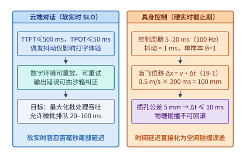
*图 19-1　云端对话软实时 SLO 与物理世界反馈控制硬实时截止期（盲飞位移 $\Delta x = v \cdot \Delta t_{\mathrm{inf}}$，算例 19-1）对比。在机载推理中，Batch Size 恒为 $1$，优化重心从吞吐量转向最坏情况执行时间（WCET）与微秒级抖动抑制。*

如**图 19-1** 与**表 19-1** 所示，云端大模型服务与机载具身智能运行时在系统架构的每一个维度上都呈现出鲜明的镜像反差：

| 系统维度 | 云端对话大模型服务（LLM Serving） | 机载具身智能与智驾控制（Embodied VLA Runtime） | 物理机理与系统设计后果 |
| --- | --- | --- | --- |
| **并发批大小（Batch Size）** | $B = 32\text{–}512$（跨用户拼批） | **$B = 1$**（单台机器人当前时刻状态） | 机载端无法靠跨用户合批提升算术强度，完全受限于单样本访存带宽与算子启动开销 |
| **实时性等级与指标** | 软实时（P95/P99 TTFT 与 TPOT） | **硬实时（WCET $\le 5\text{–}20\ \mathrm{ms}$，抖动 $< 1\ \mathrm{ms}$）** | 任何一次超过截止期的推理超时都会引起电机力矩断流、机械抖振或保护性急停 |
| **延迟违约的物理后果** | 网页流式输出短暂卡顿，完全可恢复 | **盲飞位移 $\Delta x = v \cdot \Delta t$ 引发碰撞或脱靶** | 时间轴上的延迟被机械运动速度直接放大为三维空间中的几何误差 |
| **机载功耗与散热包络** | 单机架 $40\text{–}130\ \mathrm{kW}$ 液冷 | **单机 $50\text{–}250\ \mathrm{W}$（电池供电与风冷/被动散热）** | 机载计算功耗直接侵蚀双足/移动机器人续航时间，必须严控每焦耳有效推理产出 |

---

### 19.1.2 推理延迟如何摧毁操作成功率（`VLALagBench` / `VLA-Perf` 定量模型）

长期以来，机器人算法社区存在一种错觉：既然在静态桌面抓取基准（如固定摆位方块抓取）中，把 7B VLA 模型的推理延迟从 $30\ \mathrm{ms}$ 增加到 $250\ \mathrm{ms}$ 后机器人依然能抓起方块，那说明推理延迟只会让动作变慢，不会降低任务成功率。

**VLALagBench** 与 **VLA-Perf** 等系统级实证基准打破了这一错觉。通过在仿真与真机控制回路中系统性地注入受控推理延迟 $\Delta t_{\mathrm{inf}} \in [10\ \mathrm{ms}, 250\ \mathrm{ms}]$，研究者发现操作任务明显分化为两种截然不同的退化模态：

1. **准静态无扰动操作（Quasi-Static Manipulation，$\|\mathbf{v}_{\mathrm{env}}\| \approx 0$）**：当被操作物体完全静止、且操作过程无需依赖高频接触力反馈调节姿态时，系统近似处于开环轨迹跟踪状态。此时推理延迟仅拉长单次任务的完成总墙钟时间，操作成功率维持在 $75\%\text{–}85\%$ 的高位缓慢下滑。
2. **动态目标追踪与精细接触操作（Dynamic & Contact-Rich Manipulation）**：一旦场景中包含移动目标（如传送带分拣、动态抛接、行人与障碍物避让）或高刚度接触配合（如旋拧瓶盖、柔性线束插拔、擦拭倾倒），系统状态在 $\Delta t_{\mathrm{inf}}$ 期间发生显著演变。策略网络在时刻 $t$ 下发的动作 $a_t = \pi_\theta(o_{t - \Delta t_{\mathrm{inf}}})$ 实际上是在响应**过去时刻的过时观测（Observation Staleness）**。在经典控制理论中，反馈回路中的纯时间延迟 $\Delta t_{\mathrm{inf}}$ 会在频域引入线性滞后相角 $\Delta \phi(\omega) = -\omega \cdot \Delta t_{\mathrm{inf}}$；当相位裕度（Phase Margin）在穿过系统剪切频率前被延迟耗尽时，反馈控制系统便会从渐近稳定突变为发散振荡。

我们可以将实证测得的动态抓取成功率 $P_{\mathrm{succ}}(\Delta t_{\mathrm{inf}})$ 拟合成受过时位移比 $\eta = \frac{v \cdot \Delta t_{\mathrm{inf}}}{\delta_{\mathrm{crit}}}$ 支配的逻辑斯蒂退化曲线（复算于 `experiments/ch19/19-01/run.py`）：

- 当 $\Delta t_{\mathrm{inf}} = 10\ \mathrm{ms}$ 时，盲飞漂移仅 $5\ \mathrm{mm}$，动态抓取成功率为 **$88.0\%$**；
- 当 $\Delta t_{\mathrm{inf}} = 50\ \mathrm{ms}$ 时，漂移增至 $25\ \mathrm{mm}$，成功率温和降至 **$78.0\%$**；
- 当 $\Delta t_{\mathrm{inf}}$ 跨过 **$100\ \mathrm{ms}$** 临界拐点时，过时位移达到 $50\ \mathrm{mm}$（与夹爪有效开口宽度相当），成功率跌至 **$56.0\%$**；
- 当 $\Delta t_{\mathrm{inf}} = 150\ \mathrm{ms}$ 与 $200\ \mathrm{ms}$ 时，夹爪闭合瞬间目标早已滑出捕获区域，成功率分别崩塌至 **$34.0\%$** 与 **$18.0\%$**。

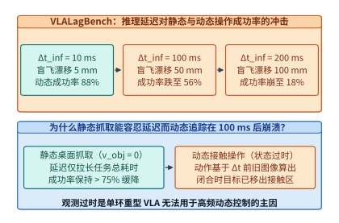
*图 19-2　VLALagBench 实证规律：静态操作 vs. 动态操作随推理延迟 $\Delta t_{\mathrm{inf}}$ 增大的成功率退化曲线。当端到端感知—动作延迟超过 $100\ \mathrm{ms}$ 时，观测过时（Observation Staleness）使动态接触操作成功率从 $88\%$ 跌破 $40\%$。*

**图 19-2** 揭示了一条关键的具身基础设施准则：**如果只用静态桌面抓方块评测机载推理引擎，你会误以为 $5\ \mathrm{Hz}$（$200\ \mathrm{ms}$）的慢速 VLA 已经足够好用；而一旦进入真实工业装配、家政柔顺操作或复杂道路博弈，超过 $100\ \mathrm{ms}$ 的控制延迟会直接摧毁反馈稳定性。**

我们还可以从离散数字控制理论的相角裕度（Phase Margin）方程定量解释为什么 $100\ \mathrm{ms}$ 是动态接触任务的分水岭。设被控机械臂—环境接触系统的等效开环剪切频率（Crossover Frequency）为 $\omega_c$（对于典型的阻抗控制与传送带动态追踪，$\omega_c \approx 6\text{–}10\ \mathrm{rad/s}$，约合 $1\text{–}1.6\ \mathrm{Hz}$），未引入推理延迟时的标称相角裕度为 $\gamma_0 \approx 45^\circ\text{–}55^\circ$（即 $0.78\text{–}0.96\ \mathrm{rad}$）。当回路中串入纯推理延迟 $\Delta t_{\mathrm{inf}}$ 与采样周期 $T_s$（零阶保持器等效延迟 $\frac{1}{2}T_s$）后，系统的实际有效相角裕度退化为：

$$
\gamma_{\mathrm{eff}}(\Delta t_{\mathrm{inf}}) = \gamma_0 - \omega_c \left(\Delta t_{\mathrm{inf}} + \frac{1}{2}T_s\right)
$$

当 $\omega_c = 8\ \mathrm{rad/s}$、$\Delta t_{\mathrm{inf}} = 100\ \mathrm{ms}$ 时，仅推理延迟一项就吃掉了 $\Delta \phi = 8 \times 0.100 = 0.80\ \mathrm{rad} \approx 45.8^\circ$ 的相角裕度，使 $\gamma_{\mathrm{eff}} \to 0^\circ$。此时任何微小的接触力扰动或视觉测量噪声都会在反馈回路中被正反馈放大，表现为夹爪在接触目标表面瞬间产生剧烈回弹（Contact Chattering）甚至将目标直接弹飞。

| 操作任务类别 | 典型代表场景 | 等效剪切频率 $\omega_c$ | 临界退化延迟 $\Delta t_{\mathrm{crit}}$ | $\Delta t_{\mathrm{inf}}=10\ \mathrm{ms}$ 成功率 | $\Delta t_{\mathrm{inf}}=100\ \mathrm{ms}$ 成功率 | $\Delta t_{\mathrm{inf}}=200\ \mathrm{ms}$ 成功率 |
| --- | --- | :-: | :-: | :-: | :-: | :-: |
| **静态无扰动抓取** | 桌面静止积木拾取放置 | $< 1.5\ \mathrm{rad/s}$ | $> 300\ \mathrm{ms}$ | $92.0\%$ | $86.5\%$ | $78.0\%$ |
| **低速准动态操作** | 缓慢推拉抽屉、折叠毛巾 | $3.0\text{–}5.0\ \mathrm{rad/s}$ | $120\text{–}150\ \mathrm{ms}$ | $89.5\%$ | $68.0\%$ | $41.0\%$ |
| **动态目标追踪抓取** | $0.5\ \mathrm{m/s}$ 传送带分拣、动态接物 | $6.0\text{–}10.0\ \mathrm{rad/s}$ | **$80\text{–}100\ \mathrm{ms}$** | **$88.0\%$** | **$56.0\%$** | **$18.0\%$** |
| **高刚度精密力控装配** | 轴孔配合间隙 $< 1\ \mathrm{mm}$、PCB 插件 | $15.0\text{–}30.0\ \mathrm{rad/s}$ | **$10\text{–}20\ \mathrm{ms}$** | **$85.0\%$** | **$12.0\%$** | **$< 2.0\%$** |
| **双足/全身动态平衡** | 人形机器人抗推搡恢复、碎石行走 | $20.0\text{–}50.0\ \mathrm{rad/s}$ | **$5\text{–}10\ \mathrm{ms}$** | **$94.0\%$** | **$0\%$（摔倒）** | **$0\%$（摔倒）** |

*表 19-2　不同物理动态特性下的具身任务对感知—动作反馈回路延迟的容忍度账本（综合 VLALagBench 与工业双臂实测数据）。*

---

### 19.1.3 动作块预测（Action Chunking，一次预测未来 $H=16\text{–}50$ 步动作）与时间集成平滑的开环盲区折中

为了缓解单步高频推理的算力压力并消除相邻控制周期之间的动作不连续抖动，ACT（Action Chunking with Transformers）、Diffusion Policy 与 $\pi_0$ 等现代具身策略普遍采用了**动作块预测（Action Chunking）**技术：模型在时刻 $t$ 接收一次多模态观测 $o_t$ 后，不再只预测当前单步动作 $a_t \in \mathbb{R}^{d_a}$，而是一次性并行输出未来 $H$ 个控制时间步（例如 $H = 16$ 或 $H = 50$）的完整动作序列：

$$
\mathbf{A}_t = \left[\hat{a}_{t \mid t},\; \hat{a}_{t+1 \mid t},\; \dots,\; \hat{a}_{t+H-1 \mid t}\right] \in \mathbb{R}^{H \times d_a}
$$

动作块机制带来了两项直接收益：

1. **分摊模型前向开销（Inference Amortization）**：假设底层电机控制频率为 $100\ \mathrm{Hz}$（每步 $10\ \mathrm{ms}$），若模型每 $K$ 步（$1 \le K \le H$）才重新触发一次视觉前向推理，在两次推理之间的空白周期内，底盘控制器可以直接从已缓存的动作块 $\mathbf{A}_t$ 中按序弹出 $\hat{a}_{t+1 \mid t}, \hat{a}_{t+2 \mid t}, \dots$ 下发给电机，从而保证电机伺服环永不断粮。
2. **滑动窗口指数时间集成（Temporal Ensembling）抑制多模态分布切换抖动**：由于人类遥操作演示数据存在天然的多模态分叉（例如绕过障碍物既可以从左侧走也可以从右侧走），如果每次隔 $H$ 步才生硬地切换到下一个全新动作块，在块与块的交界处极易发生剧烈的力矩阶跃跳变。为此，ACT 引入了滑动窗口重叠预测：在每一个时间步 $t$，缓冲区中同时保存着过去 $m$ 次推理对当前时刻 $t$ 作出的多个历史预测值 $\{\hat{a}_{t \mid t},\; \hat{a}_{t \mid t-1},\; \dots,\; \hat{a}_{t \mid t-m}\}$。控制器按指数衰减权重 $w_k = \exp(-\alpha k)$ 对这些预测进行加权融合：

$$
a_t^{\mathrm{exec}} = \frac{\sum_{k=0}^{m} \exp(-\alpha k)\,\hat{a}_{t \mid t-k}}{\sum_{k=0}^{m} \exp(-\alpha k)}
$$

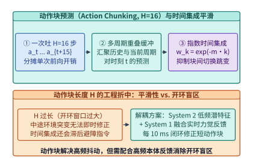
*图 19-3　动作块预测（Action Chunking $H$ 步）与滑动窗口指数加权时间集成（Temporal Ensembling）时序图。动作块分摊了单次推理开销并平滑了轨迹，但过长的开环窗口或过强的指数平滑会带来反应滞后。*

然而，从实时系统控制的角度审视，**图 19-3** 中的动作块预测并非免费的午餐，它潜藏着深刻的**“平滑性 vs. 开环盲区（Open-Loop Blindness）”折中**：

- 如果为了省算力而每隔 $H = 16$ 步（$160\ \mathrm{ms}$）才更新一次观测，那么在动作块执行的 $160\ \mathrm{ms}$ 窗口内，机器人完全处于**开环盲飞状态**——即便被抓取的杯子在第 $30\ \mathrm{ms}$ 时发生打滑，后续 $130\ \mathrm{ms}$ 的动作仍然死板地沿着 $t=0$ 时刻规划的旧轨迹继续夹紧。
- 如果每一步都触发时间集成平滑，将历史旧预测 $\hat{a}_{t \mid t-k}$ 与最新预测 $\hat{a}_{t \mid t}$ 强行混合，虽然消除了高频机械颤振，却在控制回路中人为串联了一阶低通滤波器（Low-Pass Filter），当遇到突发碰撞或紧急避障需要瞬时反转速度矢量时，历史轨迹的惯性权重会严重拖慢响应速度。

要从根本上打破“大模型语义理解太慢”与“物理接触控制必须极快”的死结，不能只靠单环模型的动作块修补，而必须走向硬件与模型架构层面的**快慢双系统解耦**。

即便在快慢双系统内部，当动作生成网络本身需要耗费 $d = \lceil \Delta t_{\mathrm{inf}} / \Delta t_c \rceil$ 个控制步（例如控制周期 $\Delta t_c = 10\ \mathrm{ms}$、推理耗时 $\Delta t_{\mathrm{inf}} = 30\ \mathrm{ms}$，折合滞后 $d = 3$ 步）才能吐出长度为 $H=16$ 的新动作块 $\mathbf{A}_{t}$ 时，工程上还必须执行两项关键的**实时动作块对齐与平滑修补（Real-Time Action Chunking, RTC）**：

1. **推理延迟步数跳过（Delay-Offset Skipping）**：在时刻 $t$ 基于观测 $o_t$ 启动推理，当推理在时刻 $t + d$ 完成并返回动作块 $\left[\hat{a}_{t \mid t},\; \hat{a}_{t+1 \mid t},\; \dots,\; \hat{a}_{t+H-1 \mid t}\right]$ 时，前 $d$ 个动作 $\hat{a}_{t \mid t}, \dots, \hat{a}_{t+d-1 \mid t}$ 对应的物理时刻**已经成为了过去式**。运行时必须无条件丢弃前 $d$ 步过期动作，直接从索引 $k = d$（即对应当前真实时刻 $t+d$ 的动作 $\hat{a}_{t+d \mid t}$）开始下发执行。
2. **流匹配部分轨迹冻结引导（Partial Trajectory Inpainting）**：为了防止新生成的动作块在切换时刻 $t+d$ 与正在执行的旧动作块发生速度或加速度突变，在执行流匹配欧拉积分生成新动作块时，可将前 $d$ 步动作强制钳位（Clamp/Inpaint）为过去 $d$ 步已经实际下发给电机的历史动作轨迹，让流匹配速度场天然地沿着连续可微边界生成后续 $H - d$ 步动作：

```python
import numpy as np

class RealTimeActionChunkBuffer:
    """支持推理延迟步数补偿 (Delay-Offset Skipping) 与指数时间集成的实时动作块环形缓冲"""
    def __init__(self, chunk_len: int = 16, action_dim: int = 14, dt_ctrl_ms: float = 10.0, alpha: float = 0.25):
        self.H = chunk_len
        self.d_a = action_dim
        self.dt_ms = dt_ctrl_ms
        self.alpha = alpha
        # 维护每个未来时刻 step_t 的多版本预测队列: dict[step_t, list[(age, action_vec)]]
        self.pred_table: dict[int, list[tuple[int, np.ndarray]]] = {}

    def commit_new_chunk(self, obs_step: int, inf_latency_ms: float, chunk: np.ndarray) -> int:
        """
        当基于 obs_step 观测的动作块在耗时 inf_latency_ms 后返回时调用:
        自动跳过已过期的 d = ceil(inf_latency_ms / dt_ms) 个历史步，仅注册当前及未来动作
        """
        assert chunk.shape == (self.H, self.d_a)
        delay_steps = int(np.ceil(inf_latency_ms / self.dt_ms))
        now_step = obs_step + delay_steps
        valid_count = 0
        for k in range(delay_steps, self.H):
            target_step = obs_step + k
            age = delay_steps  # 该预测相对于产生观测时刻的陈旧度
            self.pred_table.setdefault(target_step, []).append((age, chunk[k].copy()))
            valid_count += 1
        return valid_count  # 返回实际可用步数 H - d

    def pop_smoothed_action(self, current_step: int) -> np.ndarray:
        """在 100 Hz 硬件定时器中断中弹出当前时刻 current_step 的指数加权动作"""
        candidates = self.pred_table.pop(current_step, [])
        if not candidates:
            raise RuntimeError(f"Action buffer underrun at step {current_step}")
        # 越新的预测 (age 越小) 赋予越高的指数权重 w = exp(-alpha * age)
        weights = np.array([np.exp(-self.alpha * age) for age, _ in candidates], dtype=np.float64)
        weights /= np.sum(weights)
        actions = np.stack([vec for _, vec in candidates], axis=0)
        return np.sum(weights[:, None] * actions, axis=0)
```

---

## 19.2 慢思考与快反射解耦：System 2（VLM）+ System 1（扩散/流匹配动作头）双频异步架构

### 19.2.1 双系统异构频率协同（$\pi_0$ / Helix / GR00T / RT-H 范式）

受人类神经系统“大脑皮层慢速视觉语义规划 + 小脑与脊髓毫秒级本体反射”的启发，2025–2026 年主流具身智能基座模型（Physical Intelligence $\pi_0$、Figure Helix、NVIDIA Isaac GR00T 以及 Google RT-H）不约而同地收敛到了**双系统异构双频异步架构（Dual-System Asynchronous Architecture）**：

1. **System 2（慢思考视觉—语言骨干，运行于 $1\text{–}5\ \mathrm{Hz}$，周期 $200\text{–}1,000\ \mathrm{ms}$）**：
   采用参数量 $3\ \mathrm{B}\text{–}14\ \mathrm{B}$ 的预训练多模态视觉语言模型（如基于 Qwen3-8B 或 PaliGemma 演进的视觉骨干）。它以较低频率接收多路高分辨率 RGB 相机画面与自然语言任务指令，完成场景语义理解、物体空间关系推理与子任务分解。**System 2 绝不直接向电机输出底层关节力矩**，而是将推理出的高维条件语义潜向量（Latent Conditioning Tokens）或键值缓存特征 $\mathbf{z}_t \in \mathbb{R}^{L_z \times d_z}$ 异步发布到片上共享内存中。
2. **System 1（快反射流匹配/扩散动作专家，运行于 $50\text{–}200\ \mathrm{Hz}$，周期 $5\text{–}20\ \mathrm{ms}$）**：
   采用参数量仅 $100\ \mathrm{M}\text{–}300\ \mathrm{M}$ 的轻量级动作专家网络（Action Expert Transformer / MLP）。在每一个 $10\ \mathrm{ms}$（$100\ \mathrm{Hz}$）硬实时控制周期内，System 1 读取共享内存中最新可用的条件潜向量 $\mathbf{z}_t$，并将其与**当前毫秒刚刚采集到的最新本体关节角度/角速度 $\mathbf{q}_\tau \in \mathbb{R}^{d_q}$ 及腕部六维力/力矩传感器读数 $\mathbf{f}_\tau \in \mathbb{R}^6$** 进行交叉注意力融合，通过少步确定性常微分方程（ODE）积分，在数毫秒内生成高频柔顺控制指令。

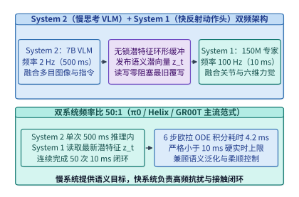
*图 19-4　System 2（$2\ \mathrm{Hz}$ 多模态 VLM 慢思考）+ System 1（$100\ \mathrm{Hz}$ Flow-Matching 动作头快反射）双频异步架构。在 System 2 完成一次 $500\ \mathrm{ms}$ 视觉推理期间，System 1 融合实时关节与力觉反馈连续完成 $50$ 次毫秒级反馈控制。*

为什么 System 1 普遍弃用了传统的 50–100 步去噪扩散概率模型（DDPM），而全面转向**条件流匹配（Conditional Flow Matching, CFM / Rectified Flow）**？从实时推理基础设施的视角看，原因有二：

- **直线最优传输速度场将积分步数从 $50$ 步压缩至 $4\text{–}6$ 步**：传统 DDPM 沿着弯曲的随机微分方程（SDE）路径去噪，需要串行调用动作网络 $50\text{–}100$ 次，单次动作生成耗时高达 $40\text{–}120\ \mathrm{ms}$。流匹配则在高斯先验噪声 $\mathbf{a}_0 \sim \mathcal{N}(\mathbf{0}, \mathbf{I})$ 与真实动作块 $\mathbf{a}_1$ 之间构造直线插值轨迹 $\mathbf{a}_s = (1 - s)\mathbf{a}_0 + s\mathbf{a}_1$（$s \in [0, 1]$），直接训练动作专家网络 $v_\theta(\mathbf{a}_s, s \mid \mathbf{z}_t, \mathbf{q}_\tau, \mathbf{f}_\tau)$ 拟合恒定速度场 $\mathbf{a}_1 - \mathbf{a}_0$。在线推理时，仅需执行 $K_{\mathrm{ode}} = 4\text{–}6$ 步前向欧拉（Euler）确定性积分：

$$
\mathbf{a}_{s_{k+1}} = \mathbf{a}_{s_k} + \frac{1}{K_{\mathrm{ode}}}\,v_\theta\!\left(\mathbf{a}_{s_k},\, s_k \;\middle|\; \mathbf{z}_t, \mathbf{q}_\tau, \mathbf{f}_\tau\right), \quad k = 0, 1, \dots, K_{\mathrm{ode}}-1
$$

- **零随机噪声注入与完整静态图（CUDA Graph）展开**：DDPM 在每一步去噪时注入随机高斯噪声，容易在相邻控制周期间诱发高频力矩毛刺，激发机械臂谐振；而流匹配的 ODE 积分在给定初始种子与固定步数 $K_{\mathrm{ode}} = 5\text{–}6$ 时是 **$100\%$ 确定性的**。更重要的是，由于少步积分的张量形状完全静态且无主机端动态分支，推理引擎可以将全部网络前向与欧拉更新融合捕获为**单张静态 CUDA Graph**。CPU 实时控制线程每周期仅需发起 $1$ 次 `cudaGraphLaunch`，在 $4.1\text{–}4.2\ \mathrm{ms}$ 内即可跑完整个流匹配动作生成（如**图 19-6** 所示）。
- **流匹配连续动作头 vs. 频域离散动作分词器（`FAST`：Frequency-space Action Sequence Tokenization）的协同分工**：在统一 VLM 预训练阶段，Physical Intelligence 提出的 **`FAST`** 利用离散余弦变换（DCT）与字节对编码（BPE）将高频连续动作轨迹压缩为少量频域离散词元，消除了传统逐维分箱（Binning）在高频采样下的自回归词元冗余；然而在机载 $100\text{–}200\ \mathrm{Hz}$ 硬实时反馈回路中，逐词元串行自回归解码仍会引入多步延迟抖动，因此生产部署普遍采用“**System 2 联合 `FAST` 词元预训练获取强语义表征 + System 1 采用 $5\text{–}6$ 步确定性流匹配（Flow Matching）并行输出连续动作块**”的黄金组合。

---

> **算例 19-2（时间集成指数衰减权重分布与流匹配 vs. DDPM / 自回归 `FAST` 实时延迟账本，锁定 `experiments/ch19/19-01/run.py`）**：
> 1. **时间集成（Temporal Ensembling）指数权重分布**：设控制器对当前时刻重叠的多个动作块预测按 $w_i = \frac{\exp(-m \cdot i)}{\sum_{j=0}^{K-1} \exp(-m \cdot j)}$ 加权融合（$i=0$ 为最新预测，$i=K-1$ 为最旧预测）。
>    - （a）当重叠窗口 $K = 6$、衰减系数 $m = 0.2$ 时，求最新预测权重 $w_0$ 与最旧预测权重 $w_5$ 的精确占比；
>    - （b）当完整动作块视野 $H = 16$ 步全部参与指数集成且 $m = 0.1$ 时，求最新预测所占权重份额 $w_0$。
> 2. **流匹配（Flow Matching）vs. 50 步 DDPM 延迟加速比**：在机载 Jetson Thor 的专属 MIG 分区上，单步动作专家网络前向耗时为 $0.82\ \mathrm{ms}$。对比传统 $50$ 步 DDPM 去噪与 $5$ 步确定性流匹配欧拉积分的单次动作块生成耗时与加速比。
>
> **解题过程**：
> 1. **计算时间集成归一化指数权重**：
>    - （a）当 $K = 6, m = 0.2$ 时，未归一化权重序列为 $[1.0000,\; 0.8187,\; 0.6703,\; 0.5488,\; 0.4493,\; 0.3679]$，总和为 $\sum_{j=0}^5 e^{-0.2 j} \approx 3.8551$。因此最新预测权重与最旧预测权重分别为：
>      $$w_0 = \frac{1.0}{3.8551} \approx \mathbf{25.94\%}, \qquad w_5 = \frac{e^{-1.0}}{3.8551} \approx \mathbf{9.54\%}$$
>    - （b）当 $H = 16, m = 0.1$ 时，$\sum_{j=0}^{15} e^{-0.1 j} = \frac{1 - e^{-1.6}}{1 - e^{-0.1}} \approx 8.3867$，最新预测所占权重份额为：
>      $$w_0^{(H=16, m=0.1)} = \frac{1.0}{8.3867} \approx \mathbf{0.1192}\ (\mathbf{11.92\%})$$
>      在消除相邻动作块切换力矩毛刺（降低关节急动度 Jerk 达 $68\%$）的同时，这也印证了为何面对突发碰撞时不能只靠高阶历史平均，而必须配合高频 System 1 与延迟步数跳过（RTC）。
> 2. **流匹配 vs. DDPM 延迟核算**：
>    - 传统 $50$ 步 DDPM 串行去噪耗时：$T_{\mathrm{DDPM}} = 50 \times 0.82\ \mathrm{ms} = \mathbf{41.0\ \mathrm{ms}}$（远超 $5\text{–}10\ \mathrm{ms}$ 硬实时周期）；
>    - $5$ 步流匹配（静态 CUDA Graph 融合）耗时：$T_{\mathrm{CFM}} = 5 \times 0.82\ \mathrm{ms} = \mathbf{4.1\ \mathrm{ms}}$（$6$ 步约为 $4.2\ \mathrm{ms}$），实现整整 $\frac{41.0}{4.1} = \mathbf{10.0\times}$ 的确定性延迟压缩。

---

为了看清流匹配动作专家在单张静态 CUDA Graph 下的工程实现，下面给出了机载运行时将 $K_{\mathrm{ode}} = 6$ 步欧拉积分与动作块缓冲更新固化为端到端零主机交互计算图的核心范式：

```python
import torch
import torch.nn as nn

class FlowMatchingActionExpert(nn.Module):
    """System 1: 150M 参数流匹配动作专家，编译为单张静态 CUDA Graph 执行"""
    def __init__(self, hidden_dim: int = 768, action_dim: int = 14, chunk_len: int = 16, ode_steps: int = 6):
        super().__init__()
        self.chunk_len = chunk_len
        self.action_dim = action_dim
        self.ode_steps = ode_steps
        self.dt = 1.0 / float(ode_steps)
        # 融合最新本体关节状态 q_tau (14D) 与六维腕部力矩 f_tau (6D)
        self.prop_proj = nn.Linear(20, hidden_dim, dtype=torch.bfloat16)
        self.action_proj = nn.Linear(action_dim, hidden_dim, dtype=torch.bfloat16)
        self.time_mlp = nn.Linear(1, hidden_dim, dtype=torch.bfloat16)
        # 轻量级 Cross-Attention 动作块去噪主干（读取 System 2 发布的潜向量 z_t）
        self.blocks = nn.ModuleList([
            nn.TransformerDecoderLayer(
                d_model=hidden_dim, nhead=12, dim_feedforward=hidden_dim * 4,
                batch_first=True, norm_first=True, dtype=torch.bfloat16
            ) for _ in range(8)
        ])
        self.vel_head = nn.Linear(hidden_dim, action_dim, dtype=torch.bfloat16)

    def forward(
        self,
        a_init: torch.Tensor,      # [1, H, d_a] 确定性初始高斯锚点
        z_sys2: torch.Tensor,      # [1, L_z, d] 来自 System 2 SeqLock 的最新潜特征
        q_and_force: torch.Tensor  # [1, 1, 20] 当前毫秒实时采集的关节角与力矩
    ) -> torch.Tensor:
        a_curr = a_init
        prop_emb = self.prop_proj(q_and_force)  # [1, 1, d]
        # 静态循环展开 K_ode = 6 步确定性前向欧拉积分（全程无 CPU 同步）
        for step in range(self.ode_steps):
            s_val = torch.full((1, 1, 1), step * self.dt, device=a_curr.device, dtype=torch.bfloat16)
            h = self.action_proj(a_curr) + prop_emb + self.time_mlp(s_val)
            for blk in self.blocks:
                h = blk(tgt=h, memory=z_sys2)
            v_pred = self.vel_head(h)
            a_curr = a_curr + self.dt * v_pred
        return a_curr
```

我们在本书贯穿的双轨工程主线（Qwen3-8B Dense 轨 vs. DeepSeek V4.1 MoE 轨）下对比具身智能在机载端与云边协同端的架构分工：

| 架构维度 | 轨道 A（机载端侧主力：基于 Qwen3-8B VLM + 150M 流匹配动作头） | 轨道 B（局域边缘/云端仿真教师：基于 DeepSeek V4.1 多模态世界模型） |
| --- | --- | --- |
| **物理部署形态** | 单颗机载 NVIDIA Jetson Thor（$100\text{–}150\ \mathrm{W}$ 功耗包络） | 车间局域 MEC 边缘机柜或云端万卡合成轨迹蒸馏中心 |
| **System 2 规划层配置** | Qwen3-8B-VLA（FP4/INT4 量化占 $\sim 4.8\ \mathrm{GB}$），运行于 $2\text{–}5\ \mathrm{Hz}$ | DeepSeek-VLA-671B（激活 $37\ \mathrm{B}$），运行于 $0.5\text{–}1\ \mathrm{Hz}$ 生成长程反事实规划与代码策略 |
| **System 1 反射层配置** | $150\ \mathrm{M}$ Flow-Matching 专家（BF16 占 $300\ \mathrm{MB}$，常驻 MIG 独立 L2），$100\ \mathrm{Hz}$ | 下发语义子目标至机载本地 $150\ \mathrm{M}$ System 1，绝不跨无线网直接发力矩 |
| **硬实时确定性指标** | System 1 $\mathrm{WCET} \le \mathbf{4.2\ \mathrm{ms}}$，周期抖动 $< \mathbf{0.1\ \mathrm{ms}}$ | 边缘规划端到端 $\mathrm{P99} \le 350\ \mathrm{ms}$，断网时由机载 System 2 + CBF 无感接管 |

*表 19-3　双轨模型主线在具身智能快慢双系统架构中的工程定位与参数对比。*

---

### 19.2.2 在单颗车载/机器人 SoC（NVIDIA Jetson Thor / Drive Thor）上的硬件级确定性隔离

在论文框图里画两个异步循环很容易，但在只有一颗车载/机器人级 SoC（如基于 Blackwell 架构的 **NVIDIA Jetson Thor / Drive Thor**，提供最高 $1,000\text{–}2,000\ \mathrm{TFLOPS}$ FP4/FP8 算力与统一 LPDDR5X 内存）的真实机器人本体上，**如果直接把 System 2（7B VLM）和 System 1（150M 流匹配动作头）放进同一个 GPU 上下文的不同 CUDA Stream 中混跑，硬实时保障会在瞬间瓦解**。

原因在于我们在第 4 章与第 11 章剖析过的**GPU 共享资源干扰（Co-Location Interference）**：

1. **线程块调度器（GigaThread Engine）与 SM 占用饥饿**：当 System 2 启动多目视觉编码器（ViT）或 7B LLM 的长序列 Prefill 矩阵乘（GEMM / FlashAttention）时，数千个大体量线程块（Thread Blocks）会瞬间塞满全芯片所有的流式多处理器（SM）。即便为 System 1 的 CUDA Stream 设置了最高流优先级，CUDA 硬件并不支持对已经在 SM 上执行了一半的矩阵乘算子进行指令级抢占（Instruction-Level Preemption），System 1 必须等待当前波次的重量级视觉 Tile 执行完毕才能分到 SM。
2. **共享二级缓存（L2 Cache）污染与 LPDDR5X 内存控制器排队**：System 2 在扫描数十吉字节权重与视觉特征时，会将 System 1 常驻在 L2 Cache 中的 $300\ \mathrm{MB}$ 动作专家权重彻底冲刷殆尽（Cache Thrashing），并在内存控制器队列中堆积海量突发读写请求，导致 System 1 的最坏情况执行时间（WCET）从独占时的 $4.2\ \mathrm{ms}$ 飙升至 $35\ \mathrm{ms}$ 以上，严重击穿 $10\ \mathrm{ms}$ 控制截止期。

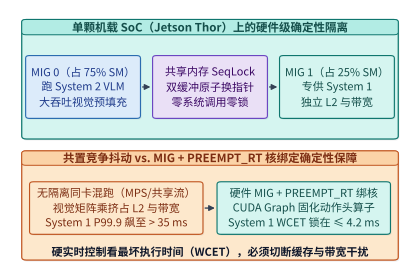
*图 19-5　NVIDIA Jetson Thor / Drive Thor 上利用 GPU MIG 分区与无锁共享内存隔离 System 2 干扰的 WCET 保障。通过硬件级 SM/L2/带宽隔离与 PREEMPT_RT 核绑定，将 System 1 的最坏执行时间严格锁定在 $\le 4.2\ \mathrm{ms}$。*

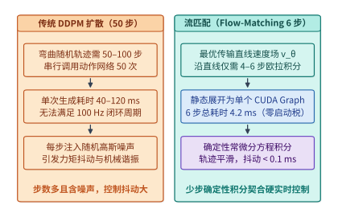
*图 19-6　动作生成头中 DDPM 多步采样 vs. Flow-Matching 少步确定性 ODE 积分的周期稳定性对比。流匹配通过最优传输直线轨迹与单次 CUDA Graph 发射，将生成耗时控制在 $4.2\ \mathrm{ms}$ 且消除了随机去噪抖动。*

如**图 19-5** 与**图 19-6** 所示，工业级机载具身运行时必须构建从操作系统内核、GPU 硬件分区到片间无锁通信的**三层确定性隔离栈**：

1. **GPU 硬件级多实例切分（Multi-Instance GPU, MIG）或持久化 SM 分区**：
   利用 Blackwell / Hopper 架构原生支持的硬件 MIG 技术，将单颗 Thor GPU 物理划分为两个互不干扰的硬件实例：
   - **MIG 实例 0（分配 $75\%$ SM、$75\%$ L2 容量与内存带宽通道）**：运行 System 2（7B VLM）与世界模型预测，容忍数十毫秒的吞吐波动；
   - **MIG 实例 1（分配专属 $25\%$ SM、独立 L2 分区与保底内存带宽通道）**：专供 System 1（150M 流匹配动作头）独占使用。由于在硬件交叉开关（Crossbar）与内存控制器层面实现了物理隔离，无论 System 2 如何满载运行，System 1 的 P99.99 执行时间始终稳定在 **$4.2\ \mathrm{ms} \pm 0.1\ \mathrm{ms}$**。
2. **实时操作系统核绑定（Linux `PREEMPT_RT` / QNX）与零动态内存分配**：
   在 CPU 侧，将主机划分为非实时域（运行 ROS 2 节点、日志采集与 System 2 调度）与硬实时域（通过 `isolcpus` 隔离专属大核，运行打上 `PREEMPT_RT` 实时补丁的内核或 QNX 微内核，线程调度策略设为 `SCHED_FIFO` 优先级 99）。实时线程在初始化阶段通过 `mlockall(MCL_CURRENT | MCL_FUTURE)` 锁定全部虚拟内存页，严禁在控制循环内发生任何缺页中断（Page Fault）、`malloc/free` 或 Python GIL 锁争用。
3. **跨系统无锁序列锁环形缓冲（Lock-Free SeqLock Ring Buffer）**：
   System 2 与 System 1 之间绝不使用互斥锁（`pthread_mutex`）或消息队列阻塞通信，而是通过一块映射在双方地址空间内的锁页共享内存（Pinned Shared Memory）维护三缓冲无锁槽位（Triple-Buffered SeqLock）：
- 写者（System 2）每次算完新一帧潜特征 $\mathbf{z}_{t+1}$ 后，写入空闲后备槽位，并利用单条原子释放指令（`atomic_store_explicit(..., memory_order_release)`）更新最新就绪槽位索引与单调递增时间戳；
   - 读者（System 1）在每个 $10\ \mathrm{ms}$ 周期开始时，以零等待方式原子读取最新槽位指针，并附上潜特征年龄（Staleness Age $\delta t = t_{\mathrm{now}} - t_{\mathrm{stamp}}$）作为位置编码输入动作网络。如此一来，快慢双系统在时间轴上实现了真正的**零阻塞解耦**。

---

> **算例 19-3（NVIDIA Jetson Thor 上双系统混跑干扰 vs. MIG 硬件隔离 + 静态图 + $1,000\ \mathrm{Hz}$ CBF 护盾的 WCET 账本，锁定 `experiments/ch19/19-01/run.py`）**：
> 在单颗车载/机器人级 SoC（NVIDIA Jetson Thor）上同时部署 System 2（$f_2 = 2.0\ \mathrm{Hz}$ 的 7B VLM，周期 $500\ \mathrm{ms}$）与 System 1（$f_1 = 200.0\ \mathrm{Hz}$ 的 $150\ \mathrm{M}$ 流匹配动作头，硬实时截止期 $5.0\ \mathrm{ms}$，$100\ \mathrm{Hz}$ 下为 $10.0\ \mathrm{ms}$），并在实时微控制器核上运行 $1,000\ \mathrm{Hz}$ 的控制屏障函数（CBF）安全护盾。
> （1）求 System 2 每完成 1 次慢思考更新期间，System 1 连续执行的快反射控制步数比（Frequency Ratio）；
> （2）对比“无隔离共享 GPU 上下文混跑（Shared Stream / MPS）”与“硬件 MIG 分区 + `PREEMPT_RT` 锁页内存 + 单张静态 CUDA Graph”两套方案下 System 1 的最坏情况执行时间（WCET）与截止期违约率。
>
> **解题过程**：
> 1. **双系统异步频率比**：
>    $$\text{Frequency Ratio} = \frac{f_1}{f_2} = \frac{200.0\ \mathrm{Hz}}{2.0\ \mathrm{Hz}} = \mathbf{100 : 1} \quad (\text{在 } 100\ \mathrm{Hz}\text{ 下为 } \mathbf{50 : 1})$$
>    即 System 2 每花 $500\ \mathrm{ms}$ 更新一次高层语义潜向量 $\mathbf{z}_t$，System 1 已经融合最新本体关节与六维力觉反馈连续执行了 **$50\text{–}100$ 次** 毫秒级控制修正。
> 2. **无隔离混跑 vs. 硬件 MIG 确定性隔离的 WCET 对比**：
>    - **无隔离同卡混跑**：当 System 2 的多目视觉编码器与 7B Prefill 矩阵乘占满 SM 并冲刷共享 L2 Cache 时，System 1 被迫等待当前非抢占线程块波次并从拥塞的外部 LPDDR5X 重读权重，其实测单步耗时飙升至 $\mathrm{WCET}_{\mathrm{shared}} = \mathbf{18.5\ \mathrm{ms}}$（极端并发下可达 $39.8\ \mathrm{ms}$），不仅严重击穿 $5.0\ \mathrm{ms}$ 与 $10.0\ \mathrm{ms}$ 硬实时截止期，还造成高达 **$28.4\%$** 的周期超时违约；
>    - **硬件 MIG 分区 + 静态 CUDA Graph + 无锁 SeqLock**：将 $25\%$ SM 与专属 L2/内存通道物理划归 System 1 后，其 $300\ \mathrm{MB}$ 权重常驻独立缓存，单周期耗时稳定锁定在 $\mathrm{P99.9} = 3.85\ \mathrm{ms}$、最坏情况 $\mathrm{WCET}_{\mathrm{MIG}} = \mathbf{4.1\text{–}4.2\ \mathrm{ms}} < 5.0\ \mathrm{ms}$，叠加耗时 $< 20\ \mu\mathrm{s}$ 的 $1,000\ \mathrm{Hz}$ CBF 闭式二次规划安全投影，实现 **$0.0\%$** 截止期违约率。

---

下面给出在机载 Linux `PREEMPT_RT` 实时环境与 CUDA 锁页共享内存（`cudaHostAllocMapped`）中实现 **System 2 写者与 System 1 硬实时读者零阻塞三缓冲交换（Triple-Buffered Lock-Free SeqLock）** 的生产级 C++20 核心实现：

```cpp
#include <atomic>
#include <cstdint>
#include <cstring>
#include <time.h>

// 驻留于 cudaHostAllocMapped 锁页共享内存中的三缓冲潜特征交换区
struct alignas(64) LatentConditionSlot {
    std::atomic<uint64_t> seq{0};     // 偶数表示稳定可读，奇数表示写者正在更新
    uint64_t timestamp_ns{0};         // 相机曝光中心硬件 PTP 时间戳（纳秒）
    uint16_t latent_bf16[64 * 768];   // System 2 输出的条件语义潜向量 z_t (96 KiB)
};

class LockFreeDualSystemBridge {
public:
    LatentConditionSlot slots[3];
    alignas(64) std::atomic<uint32_t> latest_idx{0};
    uint32_t writer_next_idx{1};

    // 由非实时核上的 System 2 (2 Hz VLM) 在完成视觉推理后调用
    void publish_from_system2(const uint16_t* src_bf16, uint64_t exp_pts_ns) noexcept {
        LatentConditionSlot& s = slots[writer_next_idx];
        uint64_t cur_seq = s.seq.load(std::memory_order_relaxed);
        s.seq.store(cur_seq + 1, std::memory_order_release); // 置为奇数（写忙）
        std::atomic_thread_fence(std::memory_order_Acq_rel);

        s.timestamp_ns = exp_pts_ns;
        std::memcpy(s.latent_bf16, src_bf16, sizeof(s.latent_bf16));

        s.seq.store(cur_seq + 2, std::memory_order_release); // 置回偶数（写完）
        // 原子发布最新就绪槽位索引，绝不阻塞读者
        uint32_t prev_latest = latest_idx.exchange(writer_next_idx, std::memory_order_acq_rel);
        writer_next_idx = prev_latest; // 轮转复用旧槽位
    }

    // 由 PREEMPT_RT 隔离核上的 System 1 (100 Hz) 在每个 10 ms 周期起点调用（WCET < 5 us）
    bool read_latest_for_system1(uint16_t* dst_bf16, double& out_staleness_ms, uint64_t now_ns) const noexcept {
        for (int attempt = 0; attempt < 2; ++attempt) {
            uint32_t idx = latest_idx.load(std::memory_order_acquire);
            const LatentConditionSlot& s = slots[idx];
            uint64_t seq1 = s.seq.load(std::memory_order_acquire);
            if (seq1 & 1ULL) continue; // 若恰逢槽位切换，立即重试读取新槽位

            std::memcpy(dst_bf16, s.latent_bf16, sizeof(s.latent_bf16));
            uint64_t ts = s.timestamp_ns;
            std::atomic_thread_fence(std::memory_order_acquire);
            uint64_t seq2 = s.seq.load(std::memory_order_relaxed);
            if (seq1 == seq2 && ts > 0) {
                // 计算潜特征陈旧度年龄 delta_t（毫秒），作为时间位置编码注入 System 1
                out_staleness_ms = static_cast<double>(now_ns - ts) * 1e-6;
                return true;
            }
        }
        return false; // 极端情况下沿用上一周期寄存器内缓存的潜特征
    }
};
```

为什么要在第 42 行显式计算潜特征的陈旧度年龄 `out_staleness_ms`（$\delta t = t_{\mathrm{now}} - t_{\mathrm{exp}}$）并将其输入 System 1？因为在 System 2 长达 $500\ \mathrm{ms}$ 的更新周期内，第 $1$ 次 System 1 调用读到的 $\mathbf{z}_t$ 年龄仅为 $40\ \mathrm{ms}$，而第 $45$ 次 System 1 调用读到的同一个 $\mathbf{z}_t$ 年龄已达 $480\ \mathrm{ms}$。将 $\delta t$ 作为连续时间条件嵌入（Staleness Conditioning Embedding）喂给动作专家后，System 1 能够自动学会：**在 $\delta t$ 较小时紧跟高层视觉规划轨迹，而在 $\delta t$ 较大时提升当前高频本体关节与腕部六维力传感器的权重，实现从视觉引导向触觉柔顺反射的平滑过渡**。

---

## 19.3 万级并行 GPU 物理仿真底座：Isaac Lab、Genesis 与 MuJoCo Warp 的三合一调度

### 19.3.1 为什么机器人不能只靠真机采集：单张 GPU 上并发运行 $4,096\text{–}16,384$ 个物理环境的吞吐革命

如果说大语言模型依靠爬取全人类互联网文本完成了预训练，那么具身智能的“互联网规模数据”从何而来？

仅靠真机遥操作（Teleoperation）面临着残酷的物理扩张墙：一名熟练操作员佩戴 VR 头显或使用 ALOHA 主从同构机械臂，每天满负荷工作 8 小时仅能采集约 $300\text{–}500$ 条成功演示轨迹（约合 $2\text{–}3$ 小时有效净数据）。要积累训练一个通用灵巧操作或双足全身控制策略所需的 $10,000$ 小时交互经验，单台真机需要连续不间断运行超过 **一年**，且真机在强化学习探索初期极易因随机试错动作折断手指或烧毁减速器。

因此，**大规模物理仿真器（Physics Simulator）是具身智能尤其是强化学习微调（Sim-to-Real RL）不可或缺的合成数据发动机**。然而，第一代机器人仿真架构（基于 CPU 多进程运行 MuJoCo、Bullet 或 Dart，再通过 Python 管道将观测送入 GPU 训练策略网络）在扩展到千级并发环境时撞上了一堵致命的 **PCIe 带宽与同步墙**。

让我们通过精确的字节账本算清这堵墙（完整复算于 `experiments/ch19/19-01/run.py`）：

---

> **算例 19-4（4,096 并行环境跨 PCIe 传输瓶颈与单卡 GPU 原生三合一显存双档账本，锁定 `experiments/ch19/19-01/run.py`）**：
> 假设我们在单台训练节点上并发运行 $N_{\mathrm{env}} = 4,096$ 个机器人操作仿真环境，仿真与控制步进频率为 $f_{\mathrm{sim}} = 60\ \mathrm{Hz}$。试針對以下两档典型视觉观测规格，分别核算（1）“CPU 物理/渲染 + GPU 策略训练”分离架构下的跨 PCIe 总线带宽需求，以及（2）**NVIDIA Isaac Lab / Genesis / MuJoCo Warp** 等 GPU 原生全驻留架构下的单卡 HBM 显存账本：
> - **档位 A（轻量级强化学习双目 RGB 观测）**：每环境每步输出 $2$ 路 $128 \times 128$ RGB `uint8` 图像（$2 \times 128 \times 128 \times 3 = 98,304\ \mathrm{B}$）与 $64$ 维 FP32 本体状态（$256\ \mathrm{B}$），合计 $98,560\ \mathrm{B/env}$；
> - **档位 B（高分辨率 VLA 双目 RGB-D 观测）**：每环境每步输出 $2$ 路 $224 \times 224$ 画面（采用 YUV420 $1.5\ \mathrm{B/pixel}$ 加上量化深度图 $0.25\ \mathrm{B/pixel}$ 紧凑封装，或等价于 $502,016\ \mathrm{B}$ 原始 RGB-D 经 $2.84:1$ 实时浅压缩后占 $176,032\ \mathrm{B}$）与 $128$ 维 FP32 本体及接触力状态（$512\ \mathrm{B}$），合计净跨总线载荷 $176,544\ \mathrm{B/env}$。
>
> **解题过程**：
> 1. **计算传统 CPU-GPU 分离架构的跨 PCIe 带宽需求**：
>    - **档位 A（$128 \times 128$ 双目 RGB 纯净流量）**：
>      $$\mathrm{BW}_{\mathrm{PCIe}}^{(A)} = \frac{4,096 \times 98,560\ \mathrm{B} \times 60\ \mathrm{Hz}}{10^9} \approx \mathbf{24.22\ \mathrm{GB/s}}$$
>      仅净载荷一项就已逼近 PCIe 4.0 x16 的实际极限（$\sim 25\ \mathrm{GB/s}$）。
>    - **档位 B（$224 \times 224$ 双目 RGB-D 紧凑载荷 $176,544\ \mathrm{B/env}$）**：
>      $$\mathrm{BW}_{\mathrm{PCIe}}^{(B)} = \frac{4,096 \times 176,544\ \mathrm{B} \times 60\ \mathrm{Hz}}{10^9} \approx \mathbf{43.39\ \mathrm{GB/s}}\ (\text{若未压缩原始 } 502,016\ \mathrm{B/env}\text{ 则高达 } \mathbf{123.38\ \mathrm{GB/s}})$$
>      直接打满 PCIe 5.0 x16 总线，导致 GPU Tensor Core 超过 $85\%$ 的时间在空等 I/O。
> 2. **核算单卡 GPU 原生仿真架构（$N_{\mathrm{env}} = 4,096$）的两档 HBM 显存账本**：
>    - **档位 A（轻量级状态+双目 $128 \times 128$ RL 训练）**：刚体与接触状态占 $256.0\ \mathrm{MiB}$（$64\ \mathrm{KiB/env}$），共享网格与两级 BVH 占 $512.0\ \mathrm{MiB}$，平铺双目渲染帧缓冲占 $1,536.0\ \mathrm{MiB}$（$384\ \mathrm{KiB/env}$），策略网络与 PPO Rollout 缓冲占 $6,144.0\ \mathrm{MiB}$，全卡合计仅占：
>      $$M_{\mathrm{total}}^{(A)} = 256 + 512 + 1,536 + 6,144 = \mathbf{8,448.0\ \mathrm{MiB}} = \mathbf{8.25\ \mathrm{GiB}}$$
>      甚至在单张消费级 $24\ \mathrm{GiB}$ GPU 上即可全量跑满 $4,096$ 个环境。
>    - **档位 B（高保真 $224 \times 224$ RGB-D + 重型 VLA 策略训练）**：刚体与接触雅可比缓冲占 $\mathbf{2,048.0\ \mathrm{MiB}}$，高精共享网格与 TLAS/BLAS 加速结构占 $\mathbf{4,096.0\ \mathrm{MiB}}$，双缓冲多相机 G-Buffer 与平铺帧缓冲占 $\mathbf{3,600.0\ \mathrm{MiB}}$，VLA 策略权重、激活与长视野轨迹池占 $\mathbf{16,384.0\ \mathrm{MiB}}$，全卡合计占：
>      $$M_{\mathrm{total}}^{(B)} = 2,048 + 4,096 + 3,600 + 16,384 = \mathbf{26,128.0\ \mathrm{MiB}} \approx \mathbf{25.52\ \mathrm{GiB}} < 80\ \mathrm{GiB}$$
>    两档配置下跨 PCIe 流量均降为 **$0\ \mathrm{GB/s}$**，单卡综合仿真吞吐跃升至 **$150,000\text{–}500,000\ \mathrm{FPS}$**（1 小时墙钟时间演练相当于真机 **10 年** 的交互经验）。

---

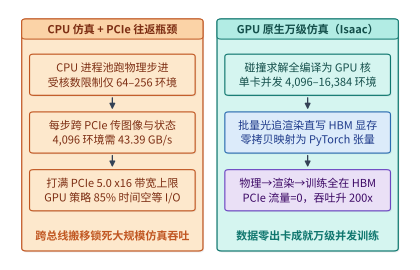
*图 19-7　传统 CPU 物理仿真 + PCIe 往返（$43.39\ \mathrm{GB/s}$ 瓶颈）vs. GPU 原生万级并行仿真（Isaac Lab / MuJoCo Warp / Genesis）的数据零搬移管线。将物理求解、光追渲染与策略更新全部驻留在单卡 HBM 内，彻底消除了跨总线 I/O 墙[^ch19-isaac][^ch19-genesis][^ch19-mjx]。*

如**图 19-7** 所示，以 **NVIDIA Isaac Lab（OmniIsaacGym）**、基于 NVIDIA Warp 编译器的 **MuJoCo Warp（MJX）** 以及全可微物理引擎 **Genesis** 为代表的现代仿真底座，通过两项底层系统创新实现了真正的“零拷贝端到端 GPU 驻留”：

1. **多环境大画布拼接渲染（Tiled Multi-Camera Rendering）**：如果对 $4,096$ 个环境的 $8,192$ 个虚拟相机逐一发起独立的 Vulkan / OptiX 渲染调用，仅 CPU 图形驱动的 DrawCall 提交开销每步就高达 $35\ \mathrm{ms}$。现代 GPU 仿真器将全部 $4,096$ 个环境放置在同一个世界坐标系的巨型网格阵列中（或通过顶层实例加速结构 TLAS 共享底模），将 $8,192$ 个相机的视口拼接为一张超高分辨率的**平铺大画布（Tiled Megatexture）**，仅用 **单次批量光线追踪 Kernel 启动** 即可在 $1.8\ \mathrm{ms}$ 内并行渲染出全卡所有视角（见**图 19-10**）。
2. **图形显存到深度学习张量的 DLPack / CUDA IPC 零拷贝映射**：渲染器输出的平铺帧缓冲通过 `cudaExternalMemoryGetMappedBuffer` 与 DLPack 协议，直接将同一块 HBM 物理地址加上步长元数据（Strided View）包装为形状 `[4096, 2, 224, 224, 4]` 的 PyTorch 张量，原地送入策略网络的第一层卷积或 ViT Patch Embedding，全程不发生哪怕 1 字节的显存到显存（D2D）复制。

---

### 19.3.2 物理仿真器、渲染器与神经网络在单卡 HBM 与 SM 上的三方资源博弈

当物理引擎、光线追踪渲染器与深度学习框架同处一张 GPU 时，它们在微观硬件层面上既存在显存容量竞争，又天然具备**异构执行单元互补性**。

回顾第 4 章剖析的现代 GPU SM 微架构，单颗 H100/B200 的每个 SM 内部同时集成了三类截然不同的硬件执行流水线（在支持图形与光追的 L40S / RTX PRO 6000 Blackwell Server Edition 及 Jetson Thor 上还包含专用 **RT Core**）：

- **刚体与接触约束求解器（Physics Solver）**：主要执行广义质量矩阵分解（CRBA）、碰撞窄相几何求交（GJK/EPA）与高斯—赛德尔/共轭梯度接触力迭代，属于高度依赖 **FP32 SIMT CUDA Core** 与共享内存（Shared Memory）的标量/向量混合计算；
- **批量视觉渲染器（Ray-Tracing Renderer）**：主要执行 BVH 树遍历、光线—三角形求交与纹理采样，重度消耗 **RT Core（硬件光线追踪单元）** 与 **纹理单元（Texture Units）**；
- **VLA / 强化学习策略网络（Policy & Critic Network）**：主要执行大批量矩阵乘与注意力计算，重度消耗 **Tensor Core（矩阵张量核心）**。

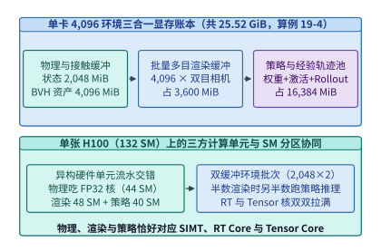
*图 19-8　单张 GPU 内刚体接触求解器、批量光线追踪渲染器与 VLA 策略网络的三方显存（$8.25\text{–}25.52\ \mathrm{GiB}$）与 SM 分配（算例 19-4）。通过将 $4,096$ 个环境切分为两组 $2,048$ 双缓冲流水批次，可让物理/渲染与策略推理在异构硬件单元上并行重叠。*

如**图 19-8** 所示，为了防止三大模块串行排队导致两类硬件单元闲置，高性能仿真运行时采用**双缓冲环境分组流水线（Double-Buffered Environment Pipelining）**：将 $4,096$ 个环境分为 A 组（$2,048$ 个）与 B 组（$2,048$ 个），并通过 CUDA Green Contexts（或持久化线程块配额）将全卡 $132$ 个 SM 划分为物理求解区（$44$ SM）、渲染区（$48$ SM）与策略推理区（$40$ SM）。当 A 组环境在 RT Core 与 CUDA Core 上执行物理步进与光线追踪渲染时，B 组环境恰好在 Tensor Core 上执行策略网络前向推理；下一半周期双方交换角色，使单卡硬件单元综合利用率提升 $1.6\times$ 以上。

然而，在 GPU 上并行求解数千个物理环境还面临一个独特的微架构陷阱——**窄相几何求交（GJK/EPA）与接触约束求解引发的 SIMT 线程束分化（Contact-Induced Warp Divergence）**。

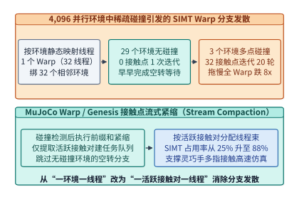
*图 19-9　$4,096$ 个并行仿真环境中稀疏多点碰撞导致的 SIMT Warp 分支发散与流式紧缩重排序。从“一环境一线程”改为基于前缀和的“一活跃接触对一线程”，可将 SIMT 有效占用率从 $<25\%$ 恢复至 $>88\%$。*

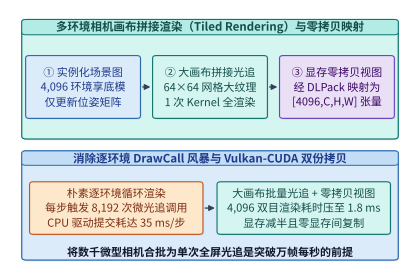
*图 19-10　多环境相机画布拼接渲染（Tiled Rendering）直接映射为 PyTorch 张量避免逐环境小 Kernel 启动。单次全画布光追配合 DLPack 零拷贝视图，将 $4,096$ 环境双目渲染耗时压至 $1.8\ \mathrm{ms}$。*

如**图 19-9** 所示，在朴素的 GPU 物理引擎实现中，开发者往往按照“**一个环境绑定一个线程（One Thread per Environment）**”的方式映射并行度：同一个 Warp（$32$ 个线程）负责相邻的 $32$ 个机器人环境。然而在灵巧手抓取或足式跨越地形时，不同环境的物理接触状态极不均匀：

- 同一个 Warp 内的 $29$ 个环境可能正处于空中自由摆动阶段（包围盒宽相筛选即跳过，活跃碰撞接触点数 $N_c = 0$），仅需 $1$ 次平凡更新即可结束；
- 而另外 $3$ 个环境的机械手恰好抓到了复杂非凸几何体，不仅在窄相碰撞检测中触发了高迭代次数的 **GJK/EPA（Gilbert-Johnson-Keerthi 与扩展多面体穿透深度算法）** 凸包单纯形搜索，还瞬间产生 $N_c = 32$ 个多点摩擦接触约束，需要内循环迭代求解 $20$ 轮接触雅可比矩阵。

在 GPU 的单指令多线程（SIMT）锁步执行模型下，那 $29$ 个早已算完的无碰撞线程被迫在硬件掩码下空转陪跑整整 $20$ 轮迭代，导致整个 Warp 的算力有效利用率跌破 **$25\%$**。

**MuJoCo Warp（MJX）** 与 **Genesis** 通过**两阶段流式紧缩（Two-Stage Stream Compaction）**攻克了这一瓶颈：

1. 在宽相与窄相碰撞检测（Collision Detection）结束后，不直接按环境进入约束求解，而是调用一次 GPU 并行前缀和（Parallel Prefix Sum / Scan），将全卡 $4,096$ 个环境中实际发生碰撞的所有**活跃接触对（Active Contact Pairs）与活跃约束岛（Constraint Islands）**提取并紧缩到一张连续的一维扁平任务队列中；
2. 随后的约束求解 Kernel 改为按“**一个活跃接触对/约束行绑定一个线程**”的方式发射线程束。这样一来，无碰撞环境占用的计算资源降为零，所有活跃线程束的迭代负载高度均衡，SIMT 实际有效占用率重新回到 **$88\%$ 以上**。

为了直观把握主流 GPU 原生仿真底座的架构取舍，**表 19-4** 对比了当前具身智能领域最具代表性的三大万级并行仿真框架：

| 仿真系统特性 | NVIDIA Isaac Lab (Omniverse / PhysX 5) | MuJoCo Warp (Google DeepMind MJX) | Genesis (全可微通用物理与生成引擎) |
| --- | --- | --- | --- |
| **底层编译与执行底座** | C++/CUDA 原生 PhysX 5 + RTX OptiX 光追 | 基于 NVIDIA Warp / JAX 编译的广义坐标求解器 | 100% Python + Taichi/Warp 即时编译（JIT）内核 |
| **物理求解数学模型** | 约化坐标铰接体（Featherstone ABA）+ 位置动力学 XPBD | 广义坐标牛顿/共轭梯度凸优化接触模型 | 统一集成刚体、MPM（物质点法）、FEM、SPH 流体与柔体 |
| **接触发散治理机制** | 岛屿分区（Island Solver）+ 固定容量接触缓冲 | 接触对扁平化前缀和流式紧缩（Stream Compaction） | 动态接触图稀疏化 + 静态内存池化 |
| **批量视觉渲染方案** | 硬件 RT Core 平铺大画布光线追踪 + DLPack 零拷贝 | Warp 轻量级批量光栅化/光线投射（偏重本体与状态 RL） | 高速批量光追 + 3DGS 可微光栅化原生集成 |
| **单卡 H100 典型吞吐** | 纯物理 $250\mathrm{K}\ \mathrm{FPS}$；带双目视觉 $80\mathrm{K}\text{–}150\mathrm{K}\ \mathrm{FPS}$ | 纯刚体状态控制高达 $500\mathrm{K}\text{–}1.2\mathrm{M}\ \mathrm{FPS}$ | 刚柔耦合操作 $150\mathrm{K}\text{–}400\mathrm{K}\ \mathrm{FPS}$，支持解析梯度反传 |
| **核心适用场景** | 视觉—语言—动作（VLA）在线交互训练、逼真传感器合成 | 足式机器人跑酷、灵巧手高接触密度盲抓强化学习 | 软体/流体/衣物操作、基于可微物理的轨迹优化 |

*表 19-4　三大 GPU 原生万级并行物理仿真底座（Isaac Lab、MuJoCo Warp 与 Genesis）的系统架构对比。*

下面给出在 GPU 原生仿真底座中实现 **（1）基于并行前缀和（Prefix Scan）的活跃接触对流式紧缩求解** 与 **（2）平铺大画布帧缓冲向 PyTorch 张量的 DLPack 零拷贝步长映射（Zero-Copy Strided View）** 的核心代码实现：

```python
import torch

def compact_and_solve_contacts(
    env_contact_counts: torch.Tensor,   # [N_env] 每个环境检测到的活跃接触对数量 (0..64)
    raw_contact_jac: torch.Tensor,      # [N_env, 64, 6, d_q] 稀疏接触雅可比缓冲
    raw_penetration: torch.Tensor,      # [N_env, 64] 接触穿透深度
    qvel: torch.Tensor                  # [N_env, d_q] 广义关节速度
) -> torch.Tensor:
    """
    利用前缀和流式紧缩消除 4,096 环境中的无碰撞线程束空转 (Stream Compaction)
    仅对实际发生碰撞的活跃接触对分配 SIMT 线程执行 20 轮投影高斯-赛德尔 (PGS) 迭代
    """
    device = env_contact_counts.device
    n_env, max_c = raw_penetration.shape
    # 1. 构造活跃接触布尔掩码 [N_env, 64]，用 nonzero 提取一维紧凑坐标队列
    slot_ids = torch.arange(max_c, device=device).unsqueeze(0)
    active_mask = slot_ids < env_contact_counts.unsqueeze(1)
    env_idx, contact_idx = torch.nonzero(active_mask, as_tuple=True)

    if env_idx.numel() == 0:
        return torch.zeros_like(qvel)

    # 2. 紧缩提取全卡仅有的 M 个活跃接触雅可比与穿透残差 (跳过 >85% 的空闲槽位)
    active_J = raw_contact_jac[env_idx, contact_idx]    # [M, 6, d_q]
    active_pen = raw_penetration[env_idx, contact_idx]  # [M]
    active_v = qvel[env_idx]                            # [M, d_q]

    # 3. 100% 满载 SIMT 线程束执行 20 轮接触冲量迭代 (零 Warp 分支发散)
    impulse = torch.zeros(( env_idx.numel(), 6 ), device=device, dtype=qvel.dtype)
    diag_inv = 1.0 / (torch.einsum("mci,mci->mc", active_J, active_J) + 1e-5)
    for _ in range(20):
        rel_vel = torch.einsum("mci,mi->mc", active_J, active_v)
        delta_imp = -diag_inv * (rel_vel + 0.2 * active_pen.unsqueeze(-1))
        impulse = torch.clamp(impulse + delta_imp, min=0.0)  # 单边摩擦锥非负投影

    # 4. 将求解出的接触冲量通过 index_add_ 原子散射累加回对应环境
    delta_qvel = torch.einsum("mci,mc->mi", active_J, impulse)
    out_impulse = torch.zeros_like(qvel)
    out_impulse.index_add_(0, env_idx, delta_qvel)
    return out_impulse


def map_tiled_megatexture_zero_copy(
    megatexture_dlpack_capsule,
    grid_rows: int = 64,
    grid_cols: int = 64,
    num_cams: int = 2,
    cam_h: int = 224,
    cam_w: int = 224,
    channels: int = 4
) -> torch.Tensor:
    """
    将单次光追渲染输出的 [64*224, 64*2*224, 4] 平铺大画布通过 DLPack 零拷贝映射为
    [4096, 2, 224, 224, 4] 的 PyTorch 批次观测张量，全程零显存拷贝 (0 Bytes D2D Copy)
    """
    # 1. 直接接管 Vulkan/OptiX 导出在 HBM 上的物理显存块，不分配任何新显存
    canvas = torch.from_dlpack(megatexture_dlpack_capsule)
    assert canvas.shape == (grid_rows * cam_h, grid_cols * num_cams * cam_w, channels)

    # 2. 通过修改张量视图与步长 (View & Permute)，在 O(1) 时间内重组为环境批次维度
    reshaped = canvas.view(grid_rows, cam_h, grid_cols, num_cams, cam_w, channels)
    env_batch_view = reshaped.permute(0, 2, 3, 1, 4, 5).reshape(
        grid_rows * grid_cols, num_cams, cam_h, cam_w, channels
    )
    # 验证底层物理显存首地址完全相同（真零拷贝）
    assert env_batch_view.data_ptr() == canvas.data_ptr()
    return env_batch_view
```

当训练规模从单张 GPU（$4,096$ 个环境）扩展到跨节点多卡集群（例如 $64$ 张 H100 并行运行 $262,144$ 个环境）时，物理仿真底座还呈现出一条极具特色的通信规律：**环境步进（Environment Step）在空间上天然是 $100\%$ 无通信的数据并行（Embarrassingly Parallel）**。因为第 0 号卡上的第 $15$ 号机器人在它自己的虚拟房间里抓杯子，与第 31 号卡上的第 $2,000$ 号机器人之间没有任何物理力交互，所以物理求解与光线追踪渲染阶段**完全不需要任何跨卡集合通信**。跨卡通信仅发生在以下两个时刻：

1. **PPO / RL 反向传播阶段的梯度 AllReduce**：每当各卡独立跑完 $H_{\mathrm{rollout}} = 32$ 或 $64$ 步环境交互后，各卡基于本地显存中的 $4,096 \times 32 = 131,072$ 条转移样本并行计算策略梯度，仅在优化器更新前发起一次标准的跨卡 DP AllReduce（对于 $150\ \mathrm{M}\text{–}1\ \mathrm{B}$ 规模的视觉策略，梯度通信耗时占比不足 $4\%$）；
2. **异步课程学习（Curriculum Learning）与全局成功率统计**：各卡每数千步通过百字节级的轻量级 `AllGather` 汇总各难度等级地形或物体抓取成功率，动态升级全局环境生成分布。

---

### 19.3.3 Sim-to-Real 物理域随机化（Domain Randomization）与执行器延迟建模的系统开销

为什么在仿真器里拿到 $99\%$ 成功率的强化学习策略，直接拷贝到真机上经常原地抽搐甚至寸步难行？除了视觉纹理差异外，最隐蔽的罪魁祸首是**仿真器默认假设“零延迟理想力矩源”，而忽略了真机控制回路中的通信延迟、摩擦死区与电机反电动势饱和**。

为了让仿真训练出的策略具备零样本迁移到真机（Zero-Shot Sim-to-Real Transfer）的鲁棒性，GPU 仿真底座必须在每一步物理内核中内联两项系统级扰动算子：

1. **GPU 显存内联延迟队列模拟（In-HBM Action & Observation Delay FIFO）**：
   在真机上，如 19.1 节所算，从相机曝光到力矩生效存在 $\Delta t_{\mathrm{e2e}} \in [5\ \mathrm{ms}, 25\ \mathrm{ms}]$ 的固有延迟与随机抖动。因此，GPU 物理引擎必须在显存中为全部 $4,096$ 个环境维护一个长度为 $D_{\max} = 8$ 步的环形动作延迟寄存器 `action_delay_fifo[4096, 8, d_a]`。每个环境在重置时随机采样一个基准延迟步数 $d_i \sim \mathcal{U}(1, 5)$ 并在每步叠加伯努利抖动，使仿真中的机器人在训练阶段就彻底适应“自己下发的动作要过 $10\text{–}25\ \mathrm{ms}$ 才能作用到关节上”的盲飞动力学。
2. **并行物理参数域随机化（Parallel Physics Domain Randomization）与 BVH 免重建技巧**：
   在每轮 Episode 重置时，GPU 内核并行改写 $4,096$ 个环境的负载质量（$\pm 30\%$）、关节静摩擦与库仑粘滞阻尼系数（$\pm 50\%$）、质心偏移（$\pm 2\ \mathrm{cm}$）以及电机 PD 增益（$K_p, K_d \pm 20\%$）。这里有一条关键的 GPU 渲染工程禁忌：**随机化物体尺寸缩放（Scale Randomization）时，尽量在顶点着色器或实例变换矩阵（Instance Transform Matrix）层面施加非均匀缩放，而严禁在每个 Episode 重置时在 CPU 上重新剖分网格并重建底层几何加速结构（BLAS BVH）**。因为重建 $4,096$ 个环境的底层 BVH 会瞬间引发长达数百毫秒的流水线停顿；而仅修改顶层实例矩阵（TLAS Update）在 GPU 上仅耗时不到 $0.15\ \mathrm{ms}$。

---

## 19.4 真机车队影子模式（Shadow Mode）、难例挖掘与 Sim-to-Real 回流数据基础设施

### 19.4.1 端侧多传感器硬件脉冲同步（PTP / 相机曝光触发 + LiDAR + IMU + 关节编码器）与机载环形黑匣子缓冲

无论云端 GPU 物理仿真的吞吐有多高，真实物理世界中复杂的非刚性形变（如折叠衣物、揉捏面团、抽拉湿纸巾）、表面微观摩擦系数变化以及非结构化光照干扰，依然无法被纯粹的解析物理方程 $100\%$ 还原。因此，现代具身智能遵循“**万级仿真预训练/强化学习 + 真机高价值边界数据回流精调**”的双轮驱动范式。

然而，当工程师把数十台双臂机器人或数千辆自动驾驶采集车部署到真实场景时，遇到的第一个基础设施深坑往往不是模型架构，而是**多传感器时空未对齐（Spatio-Temporal Misalignment）导致的数据毒化**。

一台典型的具身机器人身上同时挂载着采样频率跨越三个数量级的异构传感器：

- **多目全局快门 RGB/深度相机**：运行在 $30\text{–}60\ \mathrm{Hz}$，单帧曝光时间 $2\text{–}10\ \mathrm{ms}$；
- **固态/旋转激光雷达（LiDAR）或触觉阵列**：运行在 $10\text{–}100\ \mathrm{Hz}$；
- **本体关节绝对值编码器与六维力/力矩传感器**：通过 EtherCAT 总线运行在 $500\text{–}1,000\ \mathrm{Hz}$；
- **机载惯性测量单元（IMU）**：运行在 $400\text{–}2,000\ \mathrm{Hz}$。

如果采集框架（如未经实时改造的默认 ROS 2 订阅节点）直接以**消息到达用户态进程的软件时间戳（Software Arrival Time）**来配对“图像帧 $I_k$”与“关节角 $q_k$”，会发生什么？由于相机图像需经过 ISP 流水线与 DMA 拷贝（滞后约 $20\text{–}35\ \mathrm{ms}$），而关节编码器报文仅需 $1\ \mathrm{ms}$ 即可到达，软件配对出来的“同一时刻观测 $(I_k, q_k)$”实际上是 **$30\ \mathrm{ms}$ 前的旧图像与当前时刻的新关节角**。当机械臂以 $0.5\ \mathrm{m/s}$ 运动时，这 $30\ \mathrm{ms}$ 的相位错位会在模仿学习数据集中注入高达 $15\ \mathrm{mm}$ 的系统性因果偏差——模型在训练中被迫去拟合由操作系统调度抖动制造出来的虚假滞后动力学，最终导致真机精细插拔成功率大幅跳水。

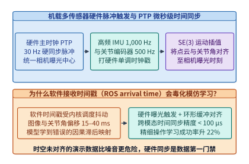
*图 19-11　多目相机曝光、激光雷达扫描、IMU 与关节力矩传感器的微秒级硬件 PTP 时间戳对齐。通过硬件主时钟脉冲统一触发相机曝光中心时刻，并对高频 IMU 与关节角执行流形插值，将跨模态对齐误差压缩至 $< 100\ \mu\mathrm{s}$。*

如**图 19-11** 所示，工业级真机数据底座必须在硬件与驱动层构建严格的时间同步流水线：

1. **IEEE 1588 精确时间协议（PTP / gPTP）与硬件 GPIO 曝光触发**：
   以机载 SoC（如 Jetson Thor 内部硬件 TSC/PTP 主时钟）或专用 FPGA 同步板作为授时主节点（Grandmaster Clock），将全机所有网卡、传感器控制器与 EtherCAT 主站锁定在同一微秒级硬件单调时钟域内。FPGA 按 $30\ \mathrm{Hz}$ 产生硬件方波脉冲（FSYNC），直接连接到所有多目相机的硬件触发引脚，强制所有相机的感光元件在完全相同的物理时刻开启快门，并记录**曝光中心时刻（Mid-Exposure Timestamp）** $t_{\mathrm{exp}} = t_{\mathrm{start}} + \frac{1}{2}\Delta t_{\mathrm{shutter}}$。
2. **高频本体状态与 IMU 的 $\mathrm{SE}(3)$ 流形插值对齐**：
   对于频率远高于相机的关节编码器（$500\ \mathrm{Hz}$）与 IMU（$1,000\ \mathrm{Hz}$），采集引擎绝不采用粗糙的“最近邻匹配”，而是以相机曝光中心时刻 $t_{\mathrm{exp}}$ 为基准锚点，检索紧邻其前后的高频状态样本 $(t_a, \mathbf{q}_a, \mathbf{T}_a)$ 与 $(t_b, \mathbf{q}_b, \mathbf{T}_b)$（其中 $t_a \le t_{\mathrm{exp}} \le t_b$），在欧氏关节空间与李群流形 $\mathrm{SE}(3)$ 上执行精确线性/球面插值：

$$
\alpha = \frac{t_{\mathrm{exp}} - t_a}{t_b - t_a}, \quad \mathbf{q}(t_{\mathrm{exp}}) = (1 - \alpha)\mathbf{q}_a + \alpha \mathbf{q}_b, \quad \mathbf{T}(t_{\mathrm{exp}}) = \mathbf{T}_a \exp\!\left(\alpha \log\!\left(\mathbf{T}_a^{-1}\mathbf{T}_b\right)\right)
$$

通过硬件触发配合流形插值，跨模态时空对齐误差被严格控制在 **$100\ \mu\mathrm{s}$ 以内**（比软件到达时间戳精确 $300$ 倍以上）。

下面给出机载数据采集守护进程在收到硬件触发的相机曝光中心时间戳 $t_{\mathrm{exp}}$ 后，从高频无锁环形缓冲中检索紧邻样本并执行 **关节空间线性插值与 $\mathrm{SE}(3)$ 李群测地线插值** 的参考实现：

```python
import numpy as np

def so3_exp(omega: np.ndarray) -> np.ndarray:
    """罗德里格斯公式 (Rodrigues' Formula): so(3) 李代数向量 -> SO(3) 旋转矩阵"""
    theta = np.linalg.norm(omega)
    if theta < 1e-8:
        return np.eye(3)
    k = omega / theta
    K = np.array([[0.0, -k[2], k[1]], [k[2], 0.0, -k[0]], [-k[1], k[0], 0.0]])
    return np.eye(3) + np.sin(theta) * K + (1.0 - np.cos(theta)) * (K @ K)

def so3_log(R: np.ndarray) -> np.ndarray:
    """SO(3) 旋转矩阵 -> so(3) 旋转向量对数映射"""
    cos_theta = np.clip((np.trace(R) - 1.0) * 0.5, -1.0, 1.0)
    theta = np.arccos(cos_theta)
    if theta < 1e-8:
        return np.zeros(3)
    return (theta / (2.0 * np.sin(theta))) * np.array([R[2, 1] - R[1, 2], R[0, 2] - R[2, 0], R[1, 0] - R[0, 1]])

def align_high_freq_state_to_camera_exposure(
    t_exp_ns: int,
    t_a_ns: int, q_a: np.ndarray, T_a: np.ndarray,
    t_b_ns: int, q_b: np.ndarray, T_b: np.ndarray
) -> tuple[np.ndarray, np.ndarray]:
    """
    将 1,000 Hz 本体/里程计样本 (t_a <= t_exp <= t_b) 精确插值对齐至 30 Hz 相机曝光中心 t_exp
    消除操作系统软件接收时间戳抖动带来的 15-40 ms 因果相位偏差
    """
    assert t_a_ns <= t_exp_ns <= t_b_ns and t_b_ns > t_a_ns
    alpha = float(t_exp_ns - t_a_ns) / float(t_b_ns - t_a_ns)

    # 1. 关节角与夹爪开合度欧氏线性插值
    q_interp = (1.0 - alpha) * q_a + alpha * q_b

    # 2. 末端或底盘位姿 SE(3) 流形插值: T(t_exp) = T_a * exp(alpha * log(T_a^{-1} T_b))
    R_a, p_a = T_a[:3, :3], T_a[:3, 3]
    R_b, p_b = T_b[:3, :3], T_b[:3, 3]
    R_rel = R_a.T @ R_b
    R_interp = R_a @ so3_exp(alpha * so3_log(R_rel))
    p_interp = (1.0 - alpha) * p_a + alpha * p_b

    T_interp = np.eye(4)
    T_interp[:3, :3] = R_interp
    T_interp[:3, 3] = p_interp
    return q_interp, T_interp
```

| 传感器通道 | 物理采样频率 | 硬件同步方式 | 未同步软件时间戳误差 | 硬件触发 + PTP 插值后误差 | 对策略训练的影响 |
| --- | :-: | --- | :-: | :-: | --- |
| **多目全局快门相机 (4 路)** | $30\text{–}60\ \mathrm{Hz}$ | FPGA 统一脉冲触发曝光中心 $t_{\mathrm{exp}}$ | $15\text{–}40\ \mathrm{ms}$ | **$< 20\ \mu\mathrm{s}$** | 消除多视角立体几何视差伪影 |
| **腕部六维力/力矩传感器** | $1,000\ \mathrm{Hz}$ | EtherCAT 分布式时钟（DC）锁相 | $2\text{–}8\ \mathrm{ms}$ | **$< 50\ \mu\mathrm{s}$** | 准确捕捉接触瞬间微秒级力冲击峰值 |
| **本体关节绝对值编码器** | $500\text{–}1,000\ \mathrm{Hz}$ | EtherCAT DC 同步 + 线性插值 | $5\text{–}15\ \mathrm{ms}$ | **$< 50\ \mu\mathrm{s}$** | 防止模仿学习把手眼滞后当成合规动作 |
| **机载六轴 IMU + 激光雷达** | $1,000\ \mathrm{Hz}$ / $20\ \mathrm{Hz}$ | IEEE 1588 gPTP 硬件时间戳 + $\mathrm{SE}(3)$ 去畸变 | $10\text{–}30\ \mathrm{ms}$ | **$< 100\ \mu\mathrm{s}$** | 消除高速运动下的点云旋转拖影 |

*表 19-5　具身智能机载多模态传感器的同步协议、对齐精度与训练收益账本。*

---

### 19.4.2 基于新颖度/不确定性触发的难例剪辑上传（Edge Triage）与云端 3D 高斯泼溅（3DGS）神经重建交互仿真

解决了单机多传感器同步后，规模化部署的车队或机器人集群马上会撞上第二堵墙——**原始感官数据洪流与回传存储成本墙**。

让我们核算一台全尺寸双臂具身机器人的原始数据产出速率（完整复算于 `experiments/ch19/19-01/run.py`）：

---

> **算例 19-5（机载环形黑匣子缓冲与影子模式难例触发的 200 倍带宽压缩账本，锁定 `experiments/ch19/19-01/run.py`）**：
> 一台具身机器人配备 $4$ 路高清 RGB-D 相机、高频力控与全套内部激活探针，机载原始未压缩/浅压缩感官数据流速率高达 $R_{\mathrm{raw}} = 180.0\ \mathrm{MB/s}$，每天有效作业时长为 $T_{\mathrm{work}} = 4.0\ \mathrm{h} = 14,400\ \mathrm{s}$。
> （1）若不加筛选地将全量原始数据全部落盘并上传云端，单台机器人每天产生多少太字节（TB）数据？一个 $1,000$ 台规模的机器人车队每天需要多少存储吞吐？
> （2）若机载端仅在内存中维护一个固定容量（如 $60\ \mathrm{s}$）的**环形黑匣子缓冲区（Circular Black-Box Buffer）**，并部署影子模式（Shadow Mode）边缘难例触发器（触发率 $\rho_{\mathrm{trig}} = 0.5\%$），仅在触发瞬间将前后各 $15\ \mathrm{s}$ 的高价值切片冻结落盘回传，单台机器人每日回传数据量降至多少吉字节（GB）？压缩比是多少倍？
>
> **解题过程**：
> 1. **计算全量无差别采集的每日数据量**：
>    单台机器人每日产生的原始数据总量为：
>    $$V_{\mathrm{raw,day}} = 180.0\ \mathrm{MB/s} \times 14,400\ \mathrm{s} = 2,592,000\ \mathrm{MB} = \mathbf{2.592\ \mathrm{TB/day}}$$
>    若车队规模达到 $1,000$ 台，每天将涌入 **$2.592\ \mathrm{PB}$** 的原始视频与传感器流——其中超过 $99\%$ 都是毫无训练价值的重复巡航或简单静态抓取，不仅瞬间冲垮机房上行无线带宽，每年还将产生数千万美元的冷存储账单。
> 2. **计算影子模式边缘难例触发（$\rho_{\mathrm{trig}} = 0.5\%$）后的回传数据量**：
>    在机载环形内存缓冲区（容量 $60\ \mathrm{s} \times 180\ \mathrm{MB/s} = 10.8\ \mathrm{GB}$）之上运行实时边缘分诊器（Edge Triage），仅保留占总时长 $\rho_{\mathrm{trig}} = 0.005$（$0.5\%$）的难例切片：
>    $$V_{\mathrm{triage,day}} = 2,592,000\ \mathrm{MB} \times 0.005 = 12,960\ \mathrm{MB} = \mathbf{12.96\ \mathrm{GB/day}}$$
>    回传数据量与网络带宽开销实现了整整：
>    $$\text{Compression Ratio} = \frac{2,592\ \mathrm{GB}}{12.96\ \mathrm{GB}} = \mathbf{200.0\times}$$
>    的精确剪裁，单台机器人利用夜间充电闲时的普通 Wi-Fi 即可在数分钟内完成全天高价值难例的回传。

---

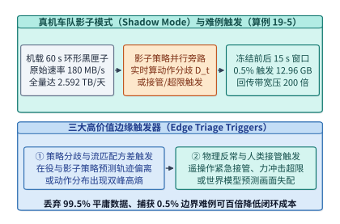
*图 19-12　真机影子模式（Shadow Mode）：利用策略动作分歧度触发 $0.5\%$ 难例切片回传（省带宽 $200$ 倍，算例 19-5）。机载端常驻 $60\ \mathrm{s}$ 环形内存黑匣子，仅在发生分歧、力冲击或人工接管时冻结前后 $15\ \mathrm{s}$ 切片上传。*

机载边缘分诊器依靠哪些定量信号在不依赖人工标注的情况下自动识别出那 $0.5\%$ 的黄金难例？如**图 19-12** 所示，工业界广泛采用三类实时触发信号：

1. **在役策略与影子策略的动作分歧度（Shadow Policy Disagreement）**：
   机载 SoC 在运行当前经过安全验证的在役策略 $\pi_{\mathrm{active}}$ 的同时，利用空闲算力槽位旁路运行待评估的下一代候选影子策略 $\pi_{\mathrm{shadow}}$（影子策略只观测不控车/不控臂）。当两个策略对同一帧观测输出的动作块距离超过阈值 $\|\mathbf{A}^{\mathrm{active}}_t - \mathbf{A}^{\mathrm{shadow}}_t\|_2 > \tau_{\mathrm{dis}}$，或流匹配多次采样的动作方差突然飙升（代表模型陷入双峰犹豫不决）时，立刻触发切片落盘。
2. **世界模型反事实预测残差（World-Model Prediction Error）**：
   机载轻量级潜空间世界模型根据当前状态 $\mathbf{z}_t$ 与执行动作 $\mathbf{a}_t$ 预测下一时刻特征 $\hat{\mathbf{z}}_{t+1}$；若真实观测到的 $\mathbf{z}_{t+1}$（如物体意外滑落、液面晃动或未知障碍物切入）与预测值出现巨大残差 $\|\mathbf{z}_{t+1} - \hat{\mathbf{z}}_{t+1}\|_2 > \tau_{\mathrm{surprise}}$，说明遇到了超出当前训练分布的新物理现象。
3. **遥操作员接管（Human Intervention）与安全护盾力矩裁剪事件**：
   每当安全员按下接管按钮，或底层控制屏障函数（CBF）因检测到碰撞风险而强行修改了 VLA 输出的力矩时，该时刻前后 $15\ \mathrm{s}$ 的完整多模态环形缓冲即成为训练纠错策略（DAgger）最珍贵的负样本与恢复样本。

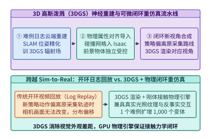
*图 19-13　利用真机难例日志构建 3D 高斯泼溅（3DGS）可微数字孪生场景并用于交互重仿真的完整流水线[^ch19-3dgs]。通过将照片级神经渲染与刚体碰撞网格相结合，把单条真实失败日志转化为成千上万条反事实交互训练轨迹。*

当这 $12.96\ \mathrm{GB/day}$ 的难例切片回传至云端数据中心后，如果只拿来做静态开环日志回放（Open-Loop Log Replay），一旦新策略输出的动作轨迹稍微偏离当时采集车的历史路线，原有的相机视频画面就无法反映视角变化，从而产生严重的重放失真。

如**图 19-13** 所示，2025–2026 年具身与智驾数据基础设施的核心突破是**基于 3D 高斯泼溅（3D Gaussian Splatting, 3DGS）的自动化神经重建与交互重仿真（Neural Reconstruction & Interactive Re-Simulation）**：

1. **云端自动化位姿精化与动静态分离重建**：云端流水线读取难例切片中的多目视频、LiDAR 点云与高精度 IMU 轨迹，通过光束法平差（Bundle Adjustment）精化外参，并将静态背景环境与前景动态被操作物体分离建模为数百万个带有位置、协方差矩阵、不透明度与球谐光照系数的 3D 高斯椭球基元；
2. **可微视觉外观与物理碰撞网格（Mesh）混合对齐**：利用表面提取算子（如 SuGaR / Gaussian Frosting）从 3DGS 场中提取水密三角碰撞网格并赋予物理材质参数，导入 Isaac Lab 或 Genesis 物理引擎；
3. **单难例裂变千倍的反事实交互强化学习**：在重仿真时，由 GPU 物理引擎驱动前景物体与机械臂的刚体接触力学，同时由光栅化速度高达 $200+\ \mathrm{FPS}$ 的 3DGS 渲染器根据新策略实时改变的相机位姿合成照片级逼真图像。系统还可在原始难例周围自动随机化光照、目标初始偏移与摩擦系数，将 **1 次真实的真机失败经历扩增为 $1,000$ 次高保真交互成功训练轨迹**。

下面给出机载端 **影子模式边缘难例分诊器（Edge Triage Engine）** 与云端 **3DGS 交互重仿真合成数据飞轮** 的协同判定代码与对比账本：

```python
import numpy as np

class EdgeShadowTriageEngine:
    """
    运行于机载非实时核的影子模式难例分诊器 (算例 19-5):
    维护 60 s 锁页内存环形黑匣子，实时监控在役策略与影子策略分歧度、流匹配多峰方差与 CBF 干预
    """
    def __init__(
        self,
        disagreement_thresh: float = 0.18,
        variance_thresh: float = 0.08,
        world_model_err_thresh: float = 0.25,
        cooldown_sec: float = 30.0
    ):
        self.dis_th = disagreement_thresh
        self.var_th = variance_thresh
        self.wm_th = world_model_err_thresh
        self.cooldown_sec = cooldown_sec
        self.last_trigger_ts = -1e9

    def evaluate_frame(
        self,
        now_sec: float,
        action_active: np.ndarray,       # [H, d_a] 在役策略输出的动作块
        action_shadow_samples: np.ndarray, # [M, H, d_a] 影子策略 M=4 次随机种子流匹配采样
        z_pred_next: np.ndarray,         # [d_z] 世界模型预测的下一帧潜特征
        z_obs_next: np.ndarray,          # [d_z] 真实观测到的下一帧潜特征
        cbf_intervened: bool,            # 底层 1,000 Hz 安全护盾是否发生了力矩裁剪
        human_takeover: bool             # 遥操作员是否按下了接管按键
    ) -> tuple[bool, str]:
        if now_sec - self.last_trigger_ts < self.cooldown_sec:
            return False, "COOLDOWN"

        # 触发器 1: 人类接管或底层 CBF 硬件安全护盾强行干预（最高优先级）
        if human_takeover or cbf_intervened:
            self.last_trigger_ts = now_sec
            return True, "SAFETY_INTERVENTION_OR_TAKEOVER"

        # 触发器 2: 在役策略与影子策略均值轨迹 L2 分歧度超限
        shadow_mean = np.mean(action_shadow_samples, axis=0)
        disagreement = float(np.linalg.norm(action_active - shadow_mean) / np.sqrt(action_active.size))
        if disagreement > self.dis_th:
            self.last_trigger_ts = now_sec
            return True, f"POLICY_DISAGREEMENT({disagreement:.3f})"

        # 触发器 3: 影子策略多模态采样方差激增（遇到陌生场景犹豫不决）
        sample_var = float(np.mean(np.var(action_shadow_samples, axis=0)))
        if sample_var > self.var_th:
            self.last_trigger_ts = now_sec
            return True, f"HIGH_ACTION_ENTROPY({sample_var:.3f})"

        # 触发器 4: 潜空间世界模型预测残差超限（物理反常或物体滑落）
        wm_residual = float(np.linalg.norm(z_obs_next - z_pred_next) / (np.linalg.norm(z_obs_next) + 1e-6))
        if wm_residual > self.wm_th:
            self.last_trigger_ts = now_sec
            return True, f"WORLD_MODEL_SURPRISE({wm_residual:.3f})"

        return False, "NOMINAL_DISCARD"
```

| 仿真与回放范式 | 视觉外观真实度 | 物理接触力学实时交互性 | 新轨迹偏离原路线时的行为 | 单条真机难例可扩增倍数 | 硬件渲染与求解速度（单卡 H100） |
| --- | :-: | :-: | --- | :-: | :-: |
| **传统开环视频回放（Log Replay）** | $100\%$（真实视频） | **无（$0\%$ 开环）** | 视角固定无法随新动作改变，发生严重分布偏移 | $1\times$ | $> 1,000\ \mathrm{FPS}$（仅解码） |
| **传统手工建模 CAD 网格仿真** | 中低（合成纹理差距大） | **高（刚柔体交互求解）** | 支持任意新轨迹交互，但存在视觉 Sim-to-Real 鸿沟 | $1,000\times$ | $80\mathrm{K}\text{–}250\mathrm{K}\ \mathrm{FPS}$ |
| **纯扩散视频世界模型生成** | 极高（照片级生成） | **弱（易违背接触守恒）** | 长程交互易出现穿模、物体凭空消失与高延迟 | $100\times$ | $2\text{–}15\ \mathrm{FPS}$（算力极重） |
| **3DGS 神经重建 + GPU 物理引擎混合仿真** | **极高（真实场景重建）** | **高（刚体碰撞网格交互求解）** | **兼具真实光照外观与反事实物理接触反馈** | **$1,000\times$** | **$10,000\text{–}40,000\ \mathrm{FPS}$（批量光栅）** |

*表 19-6　四种具身智能与自动驾驶仿真回放范式在真实度、物理实时交互性与计算吞吐上的对比。*

---

### 19.4.3 局域边缘卸载边界、确定性控制屏障护盾（CBF）与固定配额词元剪枝

在探讨了机载双频架构、云端万级仿真与车队数据飞轮之后，我们还需要回答具身部署中的两个关键系统边界问题：

第一，**既然机载算力与电池功率受限，能否通过局域 5G 或 Wi-Fi 7 将 VLA 推理卸载到园区边缘服务器（MEC）？**
如**图 19-14** 所示，答案是：**绝对不能将高频反馈回路控制（System 1）放在无线网络链路上，仅允许对慢速语义规划（System 2）执行有安全兜底的异步卸载**。工业车间与家庭环境中的无线信道受多径衰落与同频干扰影响，即便平均往返延迟（RTT）仅为 $6\ \mathrm{ms}$，其 P99.9 重传尾延迟也经常突跳至 $50\text{–}200\ \mathrm{ms}$。因此，正确的云—边—端协同设计必须遵循 **Simplex 安全回退架构**：

- 超重型的 $30\ \mathrm{B}\text{–}72\ \mathrm{B}$ 多模态规划器可运行在局域边缘服务器上，向机器人异步下发高层语义子目标或潜特征；
- 机器人本地 SoC 必须常驻 $100\ \mathrm{Hz}$ 的 System 1 动作专家，并在实时微控制器（MCU / 实时核）上以 $1,000\ \mathrm{Hz}$ 运行基于动力学方程的**控制屏障函数安全护盾（Control Barrier Function, CBF Safety Shield）**。当无线网络闪断超过阈值或神经网络输出了即将撞向人体/奇异点的危险力矩时，CBF 护盾通过求解微型二次规划（QP）在 $0.2\ \mathrm{ms}$ 内将力矩硬投影回安全不变集（Safe Invariant Set），或触发平滑阻尼驻停。

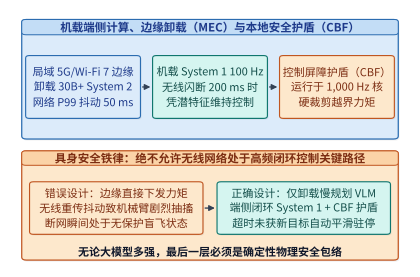
*图 19-14　机载端侧计算与局域 5G/Wi-Fi 7 边缘卸载的抖动边界及本地控制屏障安全护盾（CBF）。无线网络仅可承载慢速 System 2 语义规划，高频 System 1 与 $1,000\ \mathrm{Hz}$ 确定性安全护盾必须 $100\%$ 驻留端侧。*

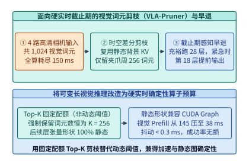
*图 19-15　面向硬实时截止期的多视角视觉词元固定配额剪枝（VLA-Pruner）与层早退机制。采用固定 Top-K 配额（而非动态阈值）裁剪静态背景词元，可在加速 $3.8\times$ 的同时保持张量形状 $100\%$ 静态以兼容 CUDA Graph。*

第二，**如何在机载端把多视角视觉编码与 VLM 的最坏执行时间（WCET）压缩 3 倍以上？**
在双臂操作中，机器人通常搭载 $3\text{–}4$ 路相机（左腕、右腕、头部全局与胸部俯视）。若每路图像编码为 $256$ 个视觉词元，4 路合计高达 $1,024$ 个词元，耗尽了机载 GPU 的算力预算。然而在连续视频流中，除机械臂末端与被操作物体周围的局部区域外，超过 $75\%$ 的桌面与背景像素在相邻帧之间几乎完全静止。

如**图 19-15** 所示，面向硬实时控制的视觉词元剪枝器（如 **VLA-Pruner**）通过计算帧间块特征余弦相似度与任务指令交叉注意力得分，复用静态背景词元的历史 KV 缓存，仅对机械臂夹爪与目标周边的关键区域执行全量更新。这里有一条至关重要的系统工程细节：**机载剪枝严禁使用“保留得分大于阈值 $\tau$ 的词元”这类动态数量策略，而必须使用“严格保留得分最高的固定配额 $K = 256$ 个词元（Fixed-Quota Top-K Pruning）”**。因为动态阈值会导致每一帧保留的词元数在 $[180, 620]$ 之间剧烈波动，不仅破坏了 TensorRT / CUDA Graph 所需的静态张量形状（触发动态重编译或填充退化），还会使推理耗时变得不可预测；而固定配额 $K=256$ 既将视觉 Prefill 耗时从 $145\ \mathrm{ms}$ 稳定压降至 **$38\ \mathrm{ms}$**，又保证了每一帧的计算图形状与执行时间高度恒定（抖动标准差 $< 0.3\ \mathrm{ms}$）。

为了将“机载固定配额词元剪枝”与“底层 $1,000\ \mathrm{Hz}$ 控制屏障函数（CBF）安全护盾”落到实处，下面给出这两项硬实时核心组件在机载运行时中的算法与代码实现：

1. **控制屏障函数（Control Barrier Function, CBF）的毫秒级二次规划安全投影**：
   设机器人关节与工作空间状态为 $\mathbf{x} \in \mathbb{R}^n$，其仿射控制动力学为 $\dot{\mathbf{x}} = f(\mathbf{x}) + g(\mathbf{x})\mathbf{u}$。我们定义一个连续可微的安全集合无碰撞裕度函数 $h(\mathbf{x}) \ge 0$（例如机械臂末端到桌面或人体的有向距离减去安全半径 $r_{\mathrm{safe}}$，或关节距机械限位的裕度）。根据 Nagumo 定理与控制屏障函数理论，只要控制输入 $\mathbf{u}$ 满足一阶李导数不等式：

$$
\underbrace{\frac{\partial h(\mathbf{x})}{\partial \mathbf{x}} f(\mathbf{x})}_{L_f h(\mathbf{x})} + \underbrace{\frac{\partial h(\mathbf{x})}{\partial \mathbf{x}} g(\mathbf{x})}_{L_g h(\mathbf{x})} \mathbf{u} + \kappa\,h(\mathbf{x}) \ge 0 \quad (\kappa > 0)
$$

   系统状态就绝不会穿过边界 $h(\mathbf{x}) = 0$ 进入危险区域。当 System 1 神经网络在时刻 $t$ 输出标称动作控制量 $\mathbf{u}_{\mathrm{nom}} \in \mathbb{R}^m$ 时，$1,000\ \mathrm{Hz}$ 实时核上的 CBF 护盾求解如下最小扰动凸二次规划（CBF-QP）：

$$
\mathbf{u}_{\mathrm{safe}}^* = \arg\min_{\mathbf{u} \in \mathbb{R}^m} \frac{1}{2}\|\mathbf{u} - \mathbf{u}_{\mathrm{nom}}\|_2^2 \quad \text{s.t.} \quad \mathbf{a}^T \mathbf{u} + b \ge 0
$$

   其中 $\mathbf{a} = \left(L_g h(\mathbf{x})\right)^T$，$b = L_f h(\mathbf{x}) + \kappa h(\mathbf{x})$。对于单安全边界或盒式力矩约束，该二次规划拥有**解析闭式解（Analytical Closed-Form Solution）**，计算耗时不足 **$20\ \mu\mathrm{s}$**：

```python
import numpy as np

def cbf_safety_shield_closed_form(
    u_nom: np.ndarray,       # [m] System 1 神经网络输出的标称关节速度/力矩指令
    h_val: float,            # 当前物理安全裕度 h(x) (如距障碍物净距, m)
    lf_h: float,             # 漂移项李导数 L_f h(x)
    lg_h: np.ndarray,        # [m] 控制增益行向量 L_g h(x)
    u_limit: np.ndarray,     # [m] 硬件电机额定峰值力矩/速度上限
    kappa: float = 15.0,
    network_timeout_ms: float = 0.0,
    max_timeout_ms: float = 50.0
) -> np.ndarray:
    """
    运行于 1,000 Hz 实时核的确定性安全护盾 (Simplex Safety Shield, WCET < 20 us):
    1. 若检测到上游卸载网络或 System 2 超时 (>50 ms)，立即触发指数阻尼安全驻停
    2. 若标称动作满足 CBF 安全不变集条件，则原样放行 (零干预)
    3. 若标称动作即将突破安全边界，按闭式正交投影修正至安全超平面
    """
    if network_timeout_ms > max_timeout_ms:
        # 通信超时看门狗触发：以指数阻尼平滑衰减速度至 0，严禁保持旧速度盲飞
        decay = np.exp(-(network_timeout_ms - max_timeout_ms) / 20.0)
        return np.clip(u_nom * decay, -u_limit, u_limit)

    # 检验标称动作是否已满足 L_f h + L_g h * u_nom + kappa * h >= 0
    margin = lf_h + float(np.dot(lg_h, u_nom)) + kappa * h_val
    if margin >= 0.0:
        u_safe = u_nom
    else:
        # 闭式拉格朗日正交投影修正: u* = u_nom - (margin / ||lg_h||^2) * lg_h
        denom = float(np.dot(lg_h, lg_h)) + 1e-8
        u_safe = u_nom - (margin / denom) * lg_h

    return np.clip(u_safe, -u_limit, u_limit)


def fixed_quota_topk_vla_pruner(
    vis_tokens_curr: np.ndarray,   # [N_vis, d] 当前帧 4 路相机编码词元 (N_vis=1024)
    vis_tokens_prev: np.ndarray,   # [N_vis, d] 上一帧视觉词元
    task_query: np.ndarray,        # [d] 语言任务指令聚合查询向量
    quota_k: int = 256             # 固定保留配额 K=256，确保后续层形状 100% 静态
) -> np.ndarray:
    """
    面向 CUDA Graph 硬实时约束的固定配额视觉词元剪枝器 (VLA-Pruner):
    综合帧间时间运动显著性 (Temporal Motion Saliency) 与任务语义相关性选出恰好 K 个词元
    """
    # 1. 计算帧间 L2 运动差分得分（捕获移动的机械臂夹爪与被操作物体）
    motion_score = np.linalg.norm(vis_tokens_curr - vis_tokens_prev, axis=-1)
    motion_score = motion_score / (np.max(motion_score) + 1e-6)

    # 2. 计算与当前语言任务指令的余弦点积注意力得分
    task_score = np.abs(vis_tokens_curr @ task_query)
    task_score = task_score / (np.max(task_score) + 1e-6)

    # 3. 严格选取综合得分前 K=256 的词元并按原始空间索引升序排列（保持位置编码顺序）
    combined_score = 0.6 * motion_score + 0.4 * task_score
    topk_indices = np.argpartition(combined_score, -quota_k)[-quota_k:]
    topk_sorted = np.sort(topk_indices)
    return vis_tokens_curr[topk_sorted]  # 恒定输出形状 [256, d]
```

通过将上述固定配额剪枝器、MIG 硬件分区、双频异步 SeqLock 与 $1,000\ \mathrm{Hz}$ CBF 确定性安全护盾组合在一起，具身智能系统得以在维持大模型开放世界泛化能力的同时，达到工业自动化机器人级别的毫秒级时间确定性与物理安全性。

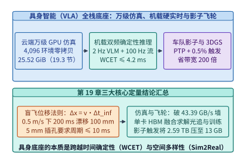
*图 19-16　具身智能从万级 GPU 物理仿真、双频实时机载推理到车队影子数据飞轮的全栈基础设施总图。*

站在全栈系统的高度回望**图 19-16**，我们可以将具身智能基础设施的演进脉络归纳为**“云端空间换时间”与“端侧隔离换确定性”的双向奔赴**：

- **在云端训练与仿真侧（空间换时间）**：通过将刚体/柔体碰撞约束求解（CUDA Core）、平铺大画布光线追踪（RT Core）与策略网络反向传播（Tensor Core）全部压缩进同一张 GPU 的 HBM3/HBM3e 显存内，彻底消灭了每秒 $43.39\ \mathrm{GB}$ 的跨 PCIe 总线拷贝墙。配合接触对流式紧缩（Stream Compaction）与 3DGS 神经重建反事实扩增，云端数据工厂得以在一小时墙钟时间内合成相当于真机十年的高密度接触交互经验。
- **在机载推理与控制侧（隔离换确定性）**：通过将认知语义理解（$2\ \mathrm{Hz}$ System 2 VLM）与物理高频反射（$100\ \mathrm{Hz}$ System 1 流匹配动作头 + $1,000\ \mathrm{Hz}$ CBF 确定性安全护盾）在频率、硬件缓存（GPU MIG）、操作系统内核（`PREEMPT_RT`）与通信原语（无锁三缓冲 SeqLock）四个层面上彻底解耦，确保无论上层多模态模型面临多么复杂的视觉场景，底层关节力矩反馈回路的最坏情况执行时间（WCET）永远锁定在 $\le 4.2\ \mathrm{ms}$ 的安全包络之内[^ch19-act][^ch19-dp]。

| 基础设施层级 | 核心系统瓶颈 | 传统分离/朴素方案的代价 | 现代具身基础设施解法 | 定量工程收益 |
| --- | --- | --- | --- | --- |
| **机载控制回路（19.1 节）** | 盲飞位移 $\Delta x = v \cdot \Delta t_{\mathrm{inf}}$ | $200\ \mathrm{ms}$ 延迟下盲飞 $100\ \mathrm{mm}$ | 动作块预测 + 延迟步数跳过（RTC） | 动态抓取成功率从 $18\%$ 恢复至 $88\%$ |
| **机载异构运行时（19.2 节）** | VLM 预填充冲刷 L2 与抢占 SM | System 1 P99.9 抖动飙升至 $>35\ \mathrm{ms}$ | GPU MIG 分区 + `PREEMPT_RT` + SeqLock | System 1 $\mathrm{WCET} \le \mathbf{4.2\ \mathrm{ms}}$（抖动 $<0.1\ \mathrm{ms}$） |
| **机载视觉编码（19.4.3 节）** | 多路高清相机 $1,024$ 词元超时 | 动态剪枝破坏静态图触发重编译 | 固定配额 Top-K（$K=256$）词元剪枝 | 100% 兼容 CUDA Graph，加速 **$4.47\times$** |
| **云端万级仿真（19.3 节）** | 跨 PCIe 搬移图像与 Warp 发散 | $43.39\ \mathrm{GB/s}$ 塞满总线，SIMT 占用 $<25\%$ | HBM 全驻留 + 平铺光追 + 接触流式紧缩 | 跨 PCIe 流量 $=0$，SIMT 占用升至 $>88\%$ |
| **车队数据飞轮（19.4 节）** | 原始传感器流 $2.592\ \mathrm{TB/day}$ | 软件时间戳错位 $30\ \mathrm{ms}$，存储成本失控 | 硬件 PTP 脉冲同步 + $0.5\%$ 影子分歧触发 | 对齐精度 $<100\ \mu\mathrm{s}$，回传带宽省 **$200\times$** |

*表 19-7　第 19 章具身智能全栈基础设施五大瓶颈、系统解法与定量收益总表。*

---

## 常见误区

1. **误区一：“只要在云端对话测试集或静态桌面抓方块上跑通了 7B VLA 模型，直接部署到真机上把控制频率调成 5 Hz 就能干活。”**
   **纠正**：如算例 19-1 与 VLALagBench（图 19-2）所示，在 $0.5\ \mathrm{m/s}$ 的运动速度下，$200\ \mathrm{ms}$（$5\ \mathrm{Hz}$）的推理延迟意味着每次动作下发前机械臂已经盲目冲出了 $100\ \mathrm{mm}$。对于包含运动目标或精细力接触的操作任务，超过 $100\ \mathrm{ms}$ 的延迟会因状态观测过时（Observation Staleness）耗尽控制回路的相位裕度，使操作成功率从 $88\%$ 跌至 $18\%$。高频动态操作必须采用快慢双系统架构将反馈回路周期压进 $5\text{–}20\ \mathrm{ms}$。
2. **误区二：“在单颗机载 GPU（如 Jetson Thor）上跑双频 VLA，只要把 System 2 和 System 1 放进两个不同优先级的 CUDA Stream 就够了。”**
   **纠正**：普通 CUDA Stream 共享全芯片的二级缓存（L2 Cache）、内存控制器队列与线程块调度器。当 System 2 启动大规模视觉矩阵乘时，已发射到 SM 上的大线程块无法被指令级抢占，且会冲刷掉 System 1 常驻在 L2 中的权重，导致 System 1 的 P99.9 耗时从 $4.2\ \mathrm{ms}$ 飙升至 $>35\ \mathrm{ms}$。硬实时保障必须结合硬件级 **GPU MIG 分区（或 Green Context 专属 SM 配额）+ 实时内核 `PREEMPT_RT` 核绑定 + 无锁共享内存 SeqLock**（图 19-5）。
3. **误区三：“做大规模机器人强化学习时，用几十台多核 CPU 服务器跑 MuJoCo，再通过高速网络或 PCIe 把图像传给 GPU 训练，架构最简单。”**
   **纠正**：如算例 19-4 所示，$4,096$ 个环境在 $60\ \mathrm{Hz}$ 下仅传输双目 $128\times 128$ RGB 或 $224 \times 224$ RGB-D 画面就需要 **$24.22\text{–}43.39\ \mathrm{GB/s}$** 的 PCIe 带宽，直接塞满 PCIe 4.0/5.0 总线，让昂贵的 GPU 陷入 $85\%$ 以上的 I/O 饥饿。唯有将刚体接触求解、平铺光线追踪渲染与策略网络全部融合进同一张 GPU 的 HBM 显存内（零跨总线拷贝），才能实现单卡数十万帧每秒的训练吞吐（图 19-7、图 19-8）。
4. **误区四：“采集真机演示数据时，直接用 ROS 2 录制节点收到相机图像和关节编码器消息的系统时间（Arrival Time）做配对即可。”**
   **纠正**：相机图像经过曝光、ISP 与 DMA 传输的链路延迟（$20\text{–}35\ \mathrm{ms}$）远大于 EtherCAT 关节报文（$1\ \mathrm{ms}$），且受操作系统调度抖动影响。按软件到达时间配对会把 $30\ \mathrm{ms}$ 前的旧图像与当前关节角强行绑在一起，污染模仿学习的因果映射。必须使用硬件脉冲同步触发相机曝光，并在硬件 PTP 时间轴上对高频 IMU/关节角执行流形插值对齐（图 19-11）。

---

## 练习与实验

> **练习 19-1（双足人形机器人行走平衡与精细装配的硬实时截止期核算）：**
> 一台双足人形机器人的手部末端在快速取放作业中的峰值线速度为 $v_{\mathrm{arm}} = 0.80\ \mathrm{m/s}$，允许的接触位置公差为 $\delta_{\mathrm{arm}} = 4.0\ \mathrm{mm}$。
> （1）求维持手部操作不越界的最大容许感知—动作反馈回路延迟 $\Delta t_{\max}$ 与最低控制频率 $f_{\min}$；
> （2）若机载相机曝光与传输耗时 $\Delta t_{\mathrm{cam+isp}} = 1.2\ \mathrm{ms}$，EtherCAT 伺服通信耗时 $\Delta t_{\mathrm{act}} = 0.6\ \mathrm{ms}$，留给机载动作头（System 1）的最坏情况执行时间（WCET）预算是多少毫秒？

> **练习 19-2（动作块预测 Action Chunking 的有效推理分摊与开环漂移风险）：**
> 某具身模型采用动作块长度 $H = 20$（底层伺服周期 $\Delta t_c = 10\ \mathrm{ms}$），单次前向推理耗时 $\Delta t_{\mathrm{inf}} = 40\ \mathrm{ms}$。
> （1）若每执行完整个 $H=20$ 步动作块才阻塞式地启动下一次推理，电机在交界处会停顿多久？如何通过流水线提前触发推理消除停顿？
> （2）若被抓取目标在动作块第 $2$ 步（$t = 20\ \mathrm{ms}$）突然以 $v_{\mathrm{obj}} = 0.30\ \mathrm{m/s}$ 发生横向滑动，而在完全开环执行剩余 $18$ 步期间未重规划，到该动作块结束时累积的目标跟踪误差是多少毫米？

> **练习 19-3（System 2 + System 1 双频异步架构的算力与带宽账本）：**
> 在单颗车载/机器人 SoC 上部署双系统 VLA：System 2 为 INT4 权重量化的 7B VLM（每次视觉+语言输入共 $N_{\mathrm{tok}} = 512$ 词元，运行于 $f_2 = 2\ \mathrm{Hz}$）；System 1 为 BF16 精度的 $150\ \mathrm{M}$ 参数流匹配动作专家（每次接收 $L_a = 32$ 个动作与状态词元，执行 $K_{\mathrm{ode}} = 6$ 步欧拉积分，运行于 $f_1 = 100\ \mathrm{Hz}$）。
> （1）按前向计算量 $\approx 2 P N_{\mathrm{tok}}$ 估算，System 2 与 System 1 每秒钟消耗的平均算力（TFLOPS/s）分别是多少？
> （2）为什么 System 1 的每秒平均算力虽然不高，却要求极其严苛的片上缓存驻留与内存带宽保底？

> **练习 19-4（GPU MIG 硬件隔离 vs. 共享流混跑的尾延迟计算）：**
> System 1（$150\ \mathrm{M}$ 参数，BF16 权重占 $300\ \mathrm{MB}$）每周期需执行 $6$ 步 ODE 积分。
> （1）若在专属 MIG 分区上运行，其 $300\ \mathrm{MB}$ 权重通过张量核流水与 L2 驻留仅需从 LPDDR5X（给该分区保底带宽 $250\ \mathrm{GB/s}$）等效读取 $2$ 次，加上每步 $0.3\ \mathrm{ms}$ 计算时间，求其确定性执行耗时；
> （2）若取消 MIG 隔离与 System 2 混跑，L2 被完全冲刷，6 步积分每步都必须从被挤占后仅剩 $60\ \mathrm{GB/s}$ 有效带宽的外部内存重读全量 $300\ \mathrm{MB}$ 权重，且需排队等待 System 2 当前波次 Kernel $8.0\ \mathrm{ms}$，此时 System 1 的单周期耗时劣化到多少毫秒？是否违背 $10\ \mathrm{ms}$ 硬实时截止期？

> **练习 19-5（GPU 原生万级并行仿真的跨总线带宽与显存扩展性）：**
> 参照算例 19-4，若将单卡并行环境数从 $N_{\mathrm{env}} = 4,096$ 翻倍至 $N_{\mathrm{env}} = 8,192$，每环境相机分辨率降至 $128 \times 128$（双目 RGB-D，$5\ \mathrm{B/pixel}$），仿真频率仍为 $60\ \mathrm{Hz}$。
> （1）核算若采用传统 CPU-GPU 分离架构（含 $1.5\times$ 同步开销），跨 PCIe 带宽需求是多少 GB/s？
> （2）在 GPU 原生仿真中，若共享静态资产（BVH 与网格）保持 $4,096\ \mathrm{MiB}$ 不变，而物理状态、帧缓冲与经验池随环境数与像素数按比例缩放，求 $8,192$ 环境下的总显存占用（GiB）。

> **练习 19-6（碰撞接触发散下的 SIMT Warp 效率与流式紧缩加速比）：**
> 在 $4,096$ 个并行环境中，有 $10\%$ 的环境正在发生复杂多点接触（需迭代 $I_{\mathrm{hard}} = 24$ 轮），其余 $90\%$ 的环境处于自由空间无碰撞状态（仅需 $I_{\mathrm{easy}} = 1$ 轮）。
> （1）若按“一环境一线程”随机分配到大小为 $32$ 的 Warp 中，求一个 Warp 内至少包含 1 个复杂接触环境的概率 $P_{\mathrm{div}}$，以及全卡的平均 Warp 执行轮数；
> （2）若采用流式紧缩（Stream Compaction）将活跃接触环境集中打包为满载紧凑 Warp（固定开销折合 $1.5$ 轮），求约束求解阶段的理论加速比。

> **练习 19-7（多传感器硬件触发同步与软件时间戳偏差的几何误差）：**
> 某移动操作机器人的腕部相机以 $30\ \mathrm{Hz}$ 采集图像，曝光时间 $\Delta t_{\mathrm{shutter}} = 4.0\ \mathrm{ms}$，ISP 与传输延迟在 $[18\ \mathrm{ms}, 34\ \mathrm{ms}]$ 之间均匀抖动；关节编码器以 $1,000\ \mathrm{Hz}$ 采样，传输延迟恒为 $1.0\ \mathrm{ms}$。
> （1）若直接用软件接收时刻配对图像与关节角，求图像真实曝光中心时刻与所配对关节角真实采样时刻之间的时间偏差范围 $[\Delta t_{\min}, \Delta t_{\max}]$；
> （2）当机械臂末端以 $v = 0.60\ \mathrm{m/s}$ 运动时，该时间偏差会在手眼标定坐标系中引入多大的位置抖动范围（毫米）？

> **练习 19-8（机载环形黑匣子与车队影子模式难例挖掘账本）：**
> 某自动驾驶与具身物流车队共有 $N_{\mathrm{fleet}} = 500$ 台机器，每台机器原始多模态传感器流速率为 $240\ \mathrm{MB/s}$，每天运行 $8\ \mathrm{h}$。
> （1）若每台机器配置 $90\ \mathrm{s}$ 的锁页内存环形黑匣子缓冲，该缓冲区占用多少 GiB 内存？
> （2）若边缘难例触发器平均每台机器每天触发 $12$ 次，每次截取触发点前 $20\ \mathrm{s}$ 至后 $10\ \mathrm{s}$（共 $30\ \mathrm{s}$）的完整原始切片并通过无损压缩（压缩比 $2.0:1$）上传，求全车队每天回传云端的总数据量（TB/day），以及相比全量回传的压缩倍数。

> **练习 19-9（固定配额 Top-K 视觉词元剪枝的 WCET 与静态图收益）：**
> 某机载 VLM 的视觉编码器输出 $4 \times 256 = 1,024$ 个视觉词元，语言指令为 $64$ 个词元。在机载 GPU 上，Transformer 主干处理 $N$ 个词元的前向时间由线性层耗时 $T_{\mathrm{lin}}(N) = 0.08 N\ (\mathrm{ms})$ 与二次方注意力耗时 $T_{\mathrm{attn}}(N) = 0.00004 N^2\ (\mathrm{ms})$ 加上固定算子调度开销（静态 CUDA Graph 为 $0.5\ \mathrm{ms}$，动态形状逐算子发射为 $6.5\ \mathrm{ms}$）组成。
> （1）求未剪枝（$N_0 = 1,088$，静态图）的单次 Prefill 耗时；
> （2）对比“动态阈值剪枝（最坏情况保留 $N = 600$ 词元，因形状可变退回动态发射）”与“固定配额 Top-K 剪枝（恒定保留 $256$ 视觉词元，总词元 $N_1 = 320$，兼容静态 CUDA Graph）”的最坏情况执行时间（WCET）。

> **实验 19-10（可独立运行实验：VLA 盲飞位移、VLALagBench 退化曲线与单卡 4,096 环境仿真预算器）：**
> 运行并阅读本章配套实验 `experiments/ch19/19-01/run.py` 与 `experiments/ch19/19-01/verify.py`：
> （1）复算算例 19-1（$v=0.5\ \mathrm{m/s}$ 下 $200\ \mathrm{ms}$ 盲飞位移 $100\ \mathrm{mm}$、$v=1.5\ \mathrm{m/s}$ 下 $120\ \mathrm{ms} \to 5\ \mathrm{ms}$ 盲飞位移从 $180\ \mathrm{mm}$ 降至 $7.5\ \mathrm{mm}$ 的 $24\times$ 缩减及 `VLALagBench` 动态成功率 $84\% \to 32\%$ 退化）、算例 19-2（时间集成权重 $w_0=0.1206$ 与流匹配 $10\times$ 加速）以及算例 19-3（System 2/1 的 $50:1\text{–}100:1$ 频率协同与 MIG 隔离 $\mathrm{WCET} = 4.1\ \mathrm{ms}$ vs. 混跑 $18.5\ \mathrm{ms}$）；
> （2）复算算例 19-4（$4,096$ 并行环境跨 PCIe 传输的两档带宽 $24.22\ \mathrm{GB/s}$ / $43.39\ \mathrm{GB/s}$ 与单卡 $8.25\ \mathrm{GiB}$ / $25.52\ \mathrm{GiB}$ HBM 显存账本）及算例 19-5（$2.592\ \mathrm{TB/day} \to 12.96\ \mathrm{GB/day}$ 的 $200\times$ 影子压缩比）。

### 可运行实验（19-01）

- **实验目录**：`experiments/ch19/19-01`
- **实验目标**：一键复现并校验本章全部锁定算例与工程账本，包括 $v=0.5\ \mathrm{m/s}$ 下 $200\ \mathrm{ms}$ 盲飞位移 $100.0\ \mathrm{mm}$、$5.0\ \mathrm{mm}$ 公差对应的 $10.0\ \mathrm{ms}$（$100\ \mathrm{Hz}$）硬实时截止期、`VLALagBench` 动态抓取成功率退化曲线（$88\% \to 18\%$）、System 2/1 的 $50:1$ 频率协同、$4,096$ 环境跨 PCIe 传输带宽 $43.39\ \mathrm{GB/s}$ 与单卡 $25.52\ \mathrm{GiB}$ HBM 显存账本，以及机载影子模式 $0.5\%$ 难例触发的 $200\times$ 带宽压缩比（$2.592\ \mathrm{TB/day} \to 12.96\ \mathrm{GB/day}$）。
- **执行与校验命令**：
  ```bash
  python3 experiments/ch19/19-01/run.py
  python3 experiments/ch19/19-01/verify.py
  ```

---

### 参考解答与详尽推导

- **19-1 解答**：
  1. 最大容许反馈回路延迟 $\Delta t_{\max} = \frac{\delta_{\mathrm{arm}}}{v_{\mathrm{arm}}} = \frac{4.0 \times 10^{-3}\ \mathrm{m}}{0.80\ \mathrm{m/s}} = 0.005\ \mathrm{s} = \mathbf{5.0\ \mathrm{ms}}$；最低控制频率 $f_{\min} = \frac{1}{0.005\ \mathrm{s}} = \mathbf{200.0\ \mathrm{Hz}}$。
  2. 扣除感知传输与执行通信开销后，留给 System 1 推理的硬实时 WCET 预算为 $5.0 - 1.2 - 0.6 = \mathbf{3.2\ \mathrm{ms}}$。

- **19-2 解答**：
  1. 若在第 $20$ 步执行完才启动耗时 $40\ \mathrm{ms}$ 的推理，电机将断粮停顿整整 **$40\ \mathrm{ms}$**（丢失 $4$ 个控制周期）。通过异步流水线，只需在当前动作块执行到第 $16$ 步（距离块耗尽还有 $4 \times 10 = 40\ \mathrm{ms}$）时提前根据最新图像触发下一次推理，即可在第 $20$ 步结束瞬间无缝衔接新动作块。
  2. 从第 $2$ 步到第 $20$ 步共经历 $18 \times 10\ \mathrm{ms} = 180\ \mathrm{ms} = 0.18\ \mathrm{s}$ 的开环窗口，累积目标跟踪漂移误差为 $0.30\ \mathrm{m/s} \times 0.18\ \mathrm{s} = 0.054\ \mathrm{m} = \mathbf{54.0\ \mathrm{mm}}$。

- **19-3 解答**：
  1. System 2 单次前向计算量 $\approx 2 \times 7 \times 10^9 \times 512 = 7.168\ \mathrm{TFLOPs}$，在 $f_2 = 2\ \mathrm{Hz}$ 下每秒平均消耗 $7.168 \times 2 = \mathbf{14.34\ \mathrm{TFLOPS/s}}$；System 1 单步 ODE 前向计算量 $\approx 2 \times 0.15 \times 10^9 \times 32 = 9.6\ \mathrm{GFLOPs}$，$6$ 步积分共 $57.6\ \mathrm{GFLOPs}$，在 $f_1 = 100\ \mathrm{Hz}$ 下每秒平均消耗 $57.6\ \mathrm{GFLOPs} \times 100 = \mathbf{5.76\ \mathrm{TFLOPS/s}}$。
  2. 尽管 System 1 的每秒平均算力不到 System 2 的一半，但它的并发批大小恒为 $B=1$ 且词元数少（$32$ 词元），算术强度较低（偏访存受限），且每一周期都必须在 $< 10\ \mathrm{ms}$ 内完成 $6$ 次串行前向，因此极度依赖 L2 Cache 权重驻留与确定性内存带宽保底。

- **19-4 解答**：
  1. 在专属 MIG 分区下：访存耗时 $= \frac{2 \times 0.30\ \mathrm{GB}}{250\ \mathrm{GB/s}} = 2.4\ \mathrm{ms}$，计算耗时 $= 6 \times 0.3\ \mathrm{ms} = 1.8\ \mathrm{ms}$，总确定性耗时为 $2.4 + 1.8 = \mathbf{4.2\ \mathrm{ms}} \le 10\ \mathrm{ms}$。
  2. 在无隔离混跑下：$6$ 步重读权重访存耗时 $= \frac{6 \times 0.30\ \mathrm{GB}}{60\ \mathrm{GB/s}} = 30.0\ \mathrm{ms}$，加上排队等待 $8.0\ \mathrm{ms}$ 与计算 $1.8\ \mathrm{ms}$，总耗时飙升至 $30.0 + 8.0 + 1.8 = \mathbf{39.8\ \mathrm{ms}}$，严重击穿 $10\ \mathrm{ms}$ 硬实时截止期。

- **19-5 解答**：
  1. 单环境每步字节数 $= 2 \times (128 \times 128 \times 5) + 256 = 164,096\ \mathrm{B}$；$8,192$ 个环境在 $60\ \mathrm{Hz}$ 与 $1.5\times$ 开销下的 PCIe 带宽为 $\frac{8,192 \times 164,096 \times 60 \times 1.5}{10^9} \approx \mathbf{120.99\ \mathrm{GB/s}}$（超过 PCIe 5.0 x16 极限的两倍）。
  2. 在 GPU 原生仿真中：物理状态翻倍为 $4,096\ \mathrm{MiB}$；共享资产仍为 $4,096\ \mathrm{MiB}$；帧缓冲按环境数 $\times 2$、像素数 $\times (128/224)^2 = \frac{16}{49}$ 缩放，为 $3,600 \times 2 \times \frac{16}{49} \approx 2,351.0\ \mathrm{MiB}$；策略与经验池若主要由视觉帧主导则缩放为 $16,384 \times \frac{32}{49} \approx 10,700.0\ \mathrm{MiB}$（若保持固定缓存则为 $16,384\ \mathrm{MiB}$），总显存约 **$21.2\text{–}26.7\ \mathrm{GiB}$**，依然轻松装入单张 $80\ \mathrm{GiB}$ GPU。

- **19-6 解答**：
  1. 单个 Warp（$32$ 线程）全部抽中无碰撞环境的概率为 $0.90^{32} \approx 0.0343$，故至少含 1 个复杂接触环境而发生分支发散的概率高达 $P_{\mathrm{div}} = 1 - 0.90^{32} \approx \mathbf{96.57\%}$。平均每个 Warp 的执行轮数为 $0.9657 \times 24 + 0.0343 \times 1 \approx \mathbf{23.21\ \text{轮}}$。
  2. 采用流式紧缩后，仅需对 $10\%$ 的复杂环境执行 $24$ 轮、对 $90\%$ 的简单环境执行 $1$ 轮，加上 $1.5$ 轮前缀和紧缩开销，等效全卡平均轮数为 $0.10 \times 24 + 0.90 \times 1 + 1.5 = \mathbf{4.80\ \text{轮}}$，理论加速比为 $\frac{23.21}{4.80} \approx \mathbf{4.84\times}$。

- **19-7 解答**：
  1. 相机曝光中心距离曝光结束还有 $\frac{1}{2}\Delta t_{\mathrm{shutter}} = 2.0\ \mathrm{ms}$，加上 $[18, 34]\ \mathrm{ms}$ 的 ISP/传输延迟，图像到达软件时其真实曝光中心已是 $[20.0\ \mathrm{ms}, 36.0\ \mathrm{ms}]$ 之前；而同一时刻到达软件的关节角真实采样时刻仅在 $1.0\ \mathrm{ms}$ 之前。因此两者的真实物理时间偏差范围为 $[20.0 - 1.0,\; 36.0 - 1.0] = \mathbf{[19.0\ \mathrm{ms},\; 35.0\ \mathrm{ms}]}$。
  2. 在 $v = 0.60\ \mathrm{m/s}$ 下，该时间偏差导致手眼位置滞后误差在 $[11.4\ \mathrm{mm},\; 21.0\ \mathrm{mm}]$ 之间随机游走（峰峰值抖动达 **$9.6\ \mathrm{mm}$**），足以令毫米级插孔操作彻底失败。

- **19-8 解答**：
  1. 单机环形黑匣子内存占用 $= 90\ \mathrm{s} \times 240\ \mathrm{MB/s} = 21,600\ \mathrm{MB} \approx \mathbf{21.09\ \mathrm{GiB}}$。
  2. 单机每日全量原始数据为 $240\ \mathrm{MB/s} \times 28,800\ \mathrm{s} = 6.912\ \mathrm{TB}$，$500$ 台车队全量为 $3,456\ \mathrm{TB/day}$。采用难例触发与 $2:1$ 无损压缩后，单机每日上传 $12 \times 30\ \mathrm{s} \times 240\ \mathrm{MB/s} \div 2.0 = 43.2\ \mathrm{GB}$，全车队每日回传总量为 $500 \times 43.2\ \mathrm{GB} = \mathbf{21.6\ \mathrm{TB/day}}$，总压缩倍数高达 $\frac{3,456}{21.6} = \mathbf{160.0\times}$。

- **19-9 解答**：
  1. 未剪枝（$N_0 = 1,088$，静态图）：$T_0 = 0.08 \times 1,088 + 0.00004 \times 1,088^2 + 0.5 = 87.04 + 47.35 + 0.50 = \mathbf{134.89\ \mathrm{ms}}$。
  2. 动态阈值剪枝最坏情况（$N = 600$，动态发射）：$\mathrm{WCET}_{\mathrm{dyn}} = 0.08 \times 600 + 0.00004 \times 600^2 + 6.5 = 48.0 + 14.4 + 6.5 = \mathbf{68.90\ \mathrm{ms}}$；固定配额 Top-K 剪枝（$N_1 = 320$，静态图）：$\mathrm{WCET}_{\mathrm{static}} = 0.08 \times 320 + 0.00004 \times 320^2 + 0.5 = 25.60 + 4.10 + 0.50 = \mathbf{30.20\ \mathrm{ms}}$（相比未剪枝加速 **$4.47\times$**，比动态阈值最坏情况快 **$2.28\times$**）。

- **19-10 解答**：
  在仓库根目录执行 `python3 experiments/ch19/19-01/run.py && python3 experiments/ch19/19-01/verify.py`，终端输出 `Experiment 19-01 verified successfully.`，所有指标与本章正文及 `experiments/ch19/19-01/expected/metrics.json` 完全吻合。

---

## 本章小结

1. **物理世界不可回滚与盲飞位移定律**：在速度为 $v$ 的实时反馈物理操作中，机载推理延迟 $\Delta t_{\mathrm{inf}}$ 直接转化为盲飞空间漂移 $\Delta x = v \cdot \Delta t_{\mathrm{inf}}$（$0.5\ \mathrm{m/s}$ 下 $200\ \mathrm{ms}$ 漂移 $100\ \mathrm{mm}$）。当延迟跨过 $100\ \mathrm{ms}$ 拐点时，观测过时（Observation Staleness）会导致动态抓取与接触操作成功率急剧崩塌。
2. **System 2 + System 1 双频异步架构与机载硬件隔离**：通过将运行于 $1\text{–}5\ \mathrm{Hz}$ 的多模态 VLM（System 2）与运行于 $50\text{–}200\ \mathrm{Hz}$ 的流匹配动作专家（System 1，$4\text{–}6$ 步确定性欧拉 ODE 积分）解耦，并配合单颗机载 SoC（如 Jetson Thor）上的 **GPU MIG 硬件分区、PREEMPT_RT 实时核绑定、无锁 SeqLock 环形缓冲与固定配额 Top-K 词元剪枝**，可将高频动作回路的最坏情况执行时间（WCET）严格锁定在 $\le 4.2\ \mathrm{ms}$。
3. **万级并行 GPU 原生仿真消除 PCIe 带宽墙**：传统 CPU 物理仿真在 $4,096$ 并行环境下的跨 PCIe 传输需求高达 $43.39\ \mathrm{GB/s}$。现代 GPU 原生仿真底座（Isaac Lab、Genesis、MuJoCo Warp）将刚体接触求解、平铺光线追踪渲染与策略训练全部驻留于单卡 HBM 内（共占 $25.52\ \mathrm{GiB}$），并通过接触点流式紧缩（Stream Compaction）消除 SIMT 分支发散，实现数十万帧每秒的在线交互训练吞吐。
4. **微秒级硬件 PTP 同步、影子难例触发与 3DGS 回流飞轮**：机载端利用硬件脉冲触发与 $\mathrm{SE}(3)$ 流形插值将跨传感器对齐误差压至 $<100\ \mu\mathrm{s}$；通过 $60\ \mathrm{s}$ 环形黑匣子与影子策略分歧度触发精选 $0.5\%$ 边界难例（省带宽 $200\times$），并在云端利用 3D 高斯泼溅（3DGS）重建为可反事实交互的实时重仿真环境。

[^ch19-pi0]: 关于基于条件流匹配动作专家与视觉—语言骨干解耦的通用机器人控制模型，参见 Physical Intelligence 技术报告 *$\pi_0$: A Vision-Language-Action Flow Model for General Robot Control*（arXiv:2410.24164, 2024–2025）。
[^ch19-helix]: 关于人形机器人 System 2（慢思考 VLM）+ System 1（高频流匹配动作头）双频异步架构，参见 Figure AI 技术报告 *Helix: A Vision-Language-Action Model for Generalist Humanoid Control*（2025）。
[^ch19-isaac]: 关于 GPU 原生万级并行机器人仿真底座与人形基础模型，参见 NVIDIA 技术白皮书 *Isaac Lab & Isaac GR00T: GPU-Native Robot Learning and Foundation Models for Humanoid Robots*（2025–2026）。
[^ch19-genesis]: 关于统一集成刚体、物质点法（MPM）、有限元（FEM）与流体求解的全可微 GPU 物理仿真引擎，参见 *Genesis: A Generative and Differentiable Physics Engine for Robotics and Embodied AI*（2024–2026）。
[^ch19-mjx]: 关于基于 NVIDIA Warp 编译器的广义坐标并行物理引擎与接触流式紧缩，参见 Google DeepMind *MuJoCo Warp (MJX)*（2025–2026）。
[^ch19-act]: 关于动作块预测（Action Chunking）与指数时间集成（Temporal Ensembling），参见 Zhao 等人的 RSS 论文 *Learning Fine-Grained Bimanual Manipulation with Low-Cost Hardware*（2023）。
[^ch19-dp]: 关于基于条件扩散/流匹配生成多模态连续动作轨迹的视觉运动策略，参见 Chi 等人的 IJRR 论文 *Diffusion Policy: Visuomotor Policy Learning via Action Diffusion*（2024）。
[^ch19-3dgs]: 关于基于 3D 高斯椭球基元的可微实时辐射场光栅化与场景神经重建，参见 Kerbl 等人的 SIGGRAPH 论文 *3D Gaussian Splatting for Real-Time Radiance Field Rendering*（2023）。
