# 第 19 章　多模态生成与实时语音

在前面的章节中，我们围绕大语言模型（LLM）与自主智能体控制面建立起了一整套训练与服务工程体系。然而，语言模型处理的是一维离散词元（Token）序列，其计算核心是沿着单向时间轴展开的因果自注意力（Causal Self-Attention）与逐词元自回归解码。当人工智能从阅读与撰写文本迈向感知高分辨率图像、理解长视频音频流、合成 1080p 高清视频乃至构建 30 FPS 实时交互的物理世界模型（World Models）时，底层基础设施的负载特征发生了结构性裂变。

首先，输入输出的表征从一维符号流扩展为三维时空潜变量网格（$T \times H \times W$）：一段仅 10 秒、24 帧/秒的 1080p 视频在经过三维变分自编码器（3D Causal VAE）压缩与空间分块（Patchify）后，单样本即产生 $489{,}600$ 个时空词元；其次，视觉编码器（ViT）与扩散变换器（Diffusion Transformer, DiT）普遍采用无掩码的全双向自注意力（Full Bidirectional Attention），并在潜空间内执行 $K = 20\text{–}50$ 步迭代去噪，使算术强度从一维 Decode 的访存受限（Memory-bound）瞬间跃迁为极端的算力受限（Compute-bound）与跨节点全对全通信受限；最后，在去噪尾端将潜变量还原为像素空间的 3D 因果 VAE 解码阶段，特征图通道与分辨率同步放大，单样本瞬态激活峰值突破 $118\ \mathrm{GiB}$，直接击穿单张 80 GB 加速卡的显存物理上限。

本章顺承第 10 章（多维并行与序列并行基础）与第 8–9 章（单机推理引擎与分布式 PD 分离服务），系统建立多模态理解（VLM / Omni-modal）、视频扩散生成（3D DiT）、实时交互世界模型与原生全双工语音流式交互的底层基础设施工程学。全章分为上下贯通的两大篇章、共八节定量主线：

- **上半章（第 19.1–19.4 节，三维时空视觉生成、世界模型与全模态四池解耦）**：剖析动态视觉切片（AnyRes / NaViT）、`Qwen3-VL` DeepStack 特征膨胀账本（从 $7.8125\ \mathrm{MiB}$ 编码器输出膨胀 $7.2$ 倍至 $56.25\ \mathrm{MiB}$ 主干 KV 缓存）与 3D 因果 VAE 带重叠光晕（Halo）的时空分块解码（将 $118.6523\ \mathrm{GiB}$ 单份特征峰值压缩 $94.8$ 倍至 $1.2514\ \mathrm{GiB}$ 双缓冲峰值）；严密推导超长序列 DiT 下张量并行（TP）、DeepSpeed-Ulysses（每层单卡通信 $\frac{4Nd}{P}$，受限于注意力头数 $P \le n_{\mathrm{head}}$）、Ring Attention（单步 $\frac{2Nd}{P}$、全环 $\frac{2(P-1)Nd}{P} \approx 2Nd$）、二维统一序列并行（2D-USP，在 $8 \times 8$ 拓扑下将跨机 RDMA 流量从 $7{,}530.47\ \mathrm{MiB}$ 压缩 $9.0$ 倍至 $836.72\ \mathrm{MiB}$）与双均衡切分 `db-SP`；建立 `DistriFusion` 位移分块异步并行、`PipeFusion` 跨步流水线、`TeaCache` 免训练残差复用（$2.12\times$ 端到端加速）、`SageAttention-3` 键均值平滑低比特注意力与 `< 33.3 ms` 块因果实时世界模型；并从 `TriInfer` 三阶段弹性合并走向 `vLLM-Omni` / `ModServe` 的 `E-P-D-G`（编码—预填充—解码—生成）四池异构解耦、`Transfusion / Show-o` 自回归扩散混合掩码以及 3D 高斯泼溅（3DGS）几何脚手架引导世界模型[^ch19-case-study]。
- **下半章（第 19.5–19.8 节，原生全双工实时语音与音视频等时流式系统）**：针对人类自然对话 $200\ \mathrm{ms}$ 轮替感知阈值，揭示传统 `VAD -> ASR -> LLM -> TTS` 四级串联管线（典型延迟 $1{,}280.0\ \mathrm{ms}$）的尾音等待下界与副语言信息坍缩机理，建立以 `Kyutai Moshi`、`Qwen2.5-Omni / Qwen3-Omni` 与 `GPT-4o Realtime` 为代表的双轨常驻音频流与“内心独白（Inner Monologue）”联合步进范式（首包音频延迟压降至 $164.0\ \mathrm{ms}$，提速 $7.80\times$）；推导残差向量量化（RVQ）神经音频编解码器在 $12.5\ \mathrm{Hz}$ 超低帧率下的 $1.10\ \mathrm{kbps}$ 码率守恒（较原始 PCM 压缩 $349.09\times$），并用整步 CUDA Graph 静态图捕获与片上 L2 权重常驻消除“时间主干 + 深度残差”双层架构中 $384$ 次微算子启动风暴（单帧 GPU 计算从 $38.54\ \mathrm{ms}$ 压降至 $11.50\ \mathrm{ms}$，加速 $3.35\times$）；进而给出随时打断（Barge-in）场景下按客户端 RTP 播放游标对齐的原子级 KV 回滚协议（$0.12\ \mathrm{ms}$ 内精准作废未播出的 $11$ 帧 / $187$ 词元）、$1\ \mathrm{FPS}$ 相机流与 $12.5\ \mathrm{Hz}$ 音频流的 8 节拍交错微块预填充、1 小时通话声学残差码本滚动剥离（全模态 KV 节省 $91.74\%$）、`< 40 ms` 数字人音画同步缓冲以及全球边缘 WebRTC SFU 媒体网格就近卸载。

为保持全书跨层核算基准的一致性，本章的多模态主干状态与词表开销严格锚定全书双轨基准模型：在稠密与中小规模全模态轨上，对齐 **`Qwen3-8B / Qwen3-VL / Qwen3-Omni`** 架构族（词表 $V = 151{,}936$，36 层 GQA 8 个键值头、头维 $128$，BF16 下单词元全层 KV 缓存精确为 $2 \times 36 \times 8 \times 128 \times 2 = 147{,}456\ \mathrm{B} = 144\ \mathrm{KiB}$）；在大规模稀疏全模态基座轨上，对齐 **`Qwen3-235B-A22B`**（词表 $V = 151{,}936$）与 **`DeepSeek-V3 / V4-Flash / V4.1-Flash`**（词表 $V = 129{,}280$，采用多头潜在注意力 MLA 将跨节点 KV 交接体积进一步压缩一个数量级，并服务于 `Wan2.2` 等三维视频生成与多模态理解混合底座）。本章核心算例与跨阶段吞吐边界已封装进全书统一定量引擎子命令 `python3 calculations/calc.py multimodal-dit-duplex`（黄金验证产物见 `calculations/results/ch19-multimodal-dit-duplex.json`），读者可随时一键复核从三维视频词元通信到全双工语音游标回滚的每一项物理指标。

---

## 19.1 多模态表示与三维时空潜空间解剖

为什么直接把服务大语言模型的推理引擎照搬到视觉语言模型（VLM）与视频扩散生成（Video DiT）上，往往会在高分辨率图片或 10 秒视频输入下遭遇显存溢出（OOM）或首词元延迟（TTFT）劣化数倍？要回答这一问题，必须先对多模态模型从原始像素到潜空间词元、再到主干 KV 缓存的字节体积与算术强度做一次逐层解剖。

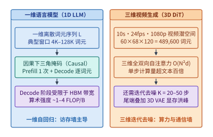

*图 19-1　一维文本 Token 序列与 3D 视频扩散模型（T×H×W 潜空间分块，489,600 Tokens）的规模与算术强度对比。*

如图 19-1 所示，一维语言模型与三维时空生成模型在系统负载的三个核心维度上呈现出截然不同的物理边界：

1. **序列长度与维度结构**：文本模型处理一维序列 $L$（常见交互上下文为 $4\mathrm{K}\text{–}128\mathrm{K}$），而视频扩散模型面对的是时间帧 $T$、高度 $H$ 与宽度 $W$ 交织的三维张量。高分辨率空间细节与高帧率时间连续性的乘积效应，使单条视频请求的词元数量轻松逼近 $5 \times 10^5$ 量级。
2. **注意力掩码与迭代步数**：文本生成在预填充（Prefill）阶段仅执行 1 次下三角因果掩码前向传播，随后进入逐词元自回归解码（每次仅计算 1 个新词元对历史 KV 的向量—矩阵乘，算术强度仅 $1\text{–}4\ \mathrm{FLOP/Byte}$）。相反，3D DiT 的每一个去噪时间步（Timestep $t = K, K-1, \dots, 1$）都必须对全部 $N$ 个时空词元执行无掩码的全双向自注意力，单步浮点运算量高达 $\mathcal{O}(N^2 d)$，且需连续迭代 $K = 20\text{–}50$ 步。
3. **跨阶段状态体积反转**：在多模态理解模型中，前端视觉编码器（ViT）输出的视觉特征张量（Embedding Cache, EC）尚属紧凑，但一旦注入主干大语言模型并展开为数十层的键值缓存（KV Cache），其内存占用会立即发生数倍至数十倍的阶跃膨胀。

### 19.1.1 动态视觉切片、空间合并与主干状态膨胀账本

早期多模态模型（如初版 LLaVA）曾采用固定分辨率缩放策略，强行将任意宽高比的输入图像双线性插值缩放到 $224 \times 224$ 或 $336 \times 336$ 像素。这种做法虽然让视觉词元数固定为常数（如 $(336/14)^2 = 576$），但在处理财报表格、高密度代码截图、医学影像或工程图纸时，过度下采样会造成严重的文字模糊与高频细节丢失。

为兼顾任意宽高比与高分辨率细节，现代视觉语言模型普遍转向两类动态视觉词元化路线：

- **AnyRes 动态网格切片（Dynamic Grid Tiling）**：以 LLaVA-NeXT 与 InternVL 系列为代表，系统预先定义一组候选网格模板（如 $\{1\times 1, 1\times 2, 2\times 1, 2\times 2, 2\times 3, 3\times 2\}$）。当一张高分辨率图片到达时，预处理器根据原图宽高比与面积选择畸变最小的网格，将原图切分为若干个标准尺寸局部子图（Tiles），外加一张缩放后的全局缩略图（Thumbnail）以保留宏观构图上下文，一并送入 ViT 编码。
- **原生分辨率打包（NaViT / Qwen2.5-VL / Qwen3-VL）**[^ch19-anyres-navit]：放弃固定子图框定，直接以步长 $p \times p$（如 $p = 14$ 或 $p = 16$）将任意尺寸图像切分为原生视觉块（Patches），配合二维旋转位置编码（2D-RoPE）保留精确空间坐标。为了在完成 ViT 特征提取后减轻下游大语言模型主干的序列长度压力，系统在 ViT 末端引入 **$m \times m$ 空间相邻块合并层（Spatial Patch Merger，常见 $m = 2$）**，将每 $2 \times 2 = 4$ 个相邻视觉块沿通道维拼接并投射为 1 个紧凑的视觉词元。

即便经过 $2 \times 2$ 空间合并，现网多模态服务依然面临一个极具隐蔽性的系统设计分岔口：**在分离式推理或前缀缓存架构中，究竟应当在编码器与主干模型之间传输/缓存编码器输出特征（EC），还是在预填充与解码之间传输/缓存主干 KV 缓存？** 许多工程师直觉地以为“视觉编码器的输出特征包含多层高维浮点向量，体积一定比开了分组查询注意力（GQA）的 LLM KV 缓存更大”。下面我们基于真实工业模型参数（锁定自本书案例库 `case-studies/multimodal-stage-placement.md`）做一次精确到字节的账本核算。

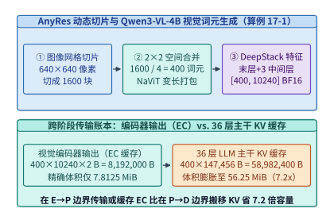

*图 19-2　AnyRes 动态高分辨率切片、NaViT 序列打包与 Qwen3-VL-4B DeepStack 特征（7.8125 MiB EC → 56.25 MiB KV，7.2x 放大）演化（算例 19-1）。*

> **算例 19-1（Qwen3-VL-4B 视觉词元生成与编码器输出 EC vs. 主干 KV 缓存的 7.2 倍状态膨胀）：**
>
> **问题设定**：考察 `Qwen3-VL-4B` 服务一条包含单张 $H \times W = 640 \times 640$ RGB 图像的请求。模型架构参数锁定如下：
> 1. **视觉编码器（ViT）与空间合并**：基础视觉块大小 $p = 16$，通过 $m \times m = 2 \times 2$ 空间合并层输出视觉词元；合并后投射至主干隐藏维度的单层特征宽度为 $d_{\mathrm{proj}} = 2{,}560$（BF16，每元素 $2\ \mathrm{B}$）。
> 2. **DeepStack 多层特征注入**：为增强细粒度空间对齐，`Qwen3-VL-4B` 除了输出视觉编码器最终层投射特征外，还额外抽取了 3 个中间层（第 `#5`、`#11`、`#17` 块）的多尺度视觉特征，每一路中间特征同样投射为宽度 $2{,}560$ 的 BF16 向量。
> 3. **LLM 主干网络**：共 $L_{\mathrm{llm}} = 36$ 层，采用分组查询注意力（GQA），每层配置 $n_{\mathrm{kv}} = 8$ 个键值头（KV Heads），每个头维度 $d_{\mathrm{head}} = 128$，KV 缓存以 BF16（$2\ \mathrm{B}$）存储。
>
> 试精确计算：（1）该图像生成的最终视觉词元数 $N_{\mathrm{vis}}$；（2）仅包含最终投射层时与包含 3 层 DeepStack 特征时的编码器输出总体积 $V_{\mathrm{EC}}$（按字节 $\mathrm{B}$ 与二进制兆字节 $\mathrm{MiB} = 2^{20}\ \mathrm{B}$ 计）；（3）这 $N_{\mathrm{vis}}$ 个视觉词元进入 36 层 LLM 主干后生成的 KV 缓存总体积 $V_{\mathrm{KV}}$，以及状态膨胀比 $\frac{V_{\mathrm{KV}}}{V_{\mathrm{EC}}}$。
>
> **逐项推导**：
>
> 1. **视觉块切分与 $2 \times 2$ 空间合并后的词元数**：
>    原始 $640 \times 640$ 图像按 $p = 16$ 切分，得到的初始网格尺寸为：
>    $$N_{\mathrm{patch}} = \frac{640}{16} \times \frac{640}{16} = 40 \times 40 = 1{,}600\ \text{个初始块}$$
>    经过 $2 \times 2$ 空间合并（每 4 个相邻块融合为 1 个视觉词元）后，实际进入下游主干序列的视觉词元数为：
>    $$N_{\mathrm{vis}} = \frac{1{,}600}{2 \times 2} = 400\ \text{个视觉词元}$$
>
> 2. **视觉编码器输出体积（Embedding Cache, EC）**：
>    - 若仅传输最终层投射特征（形状为 $[400, 2560]$，BF16）：
>      $$V_{\mathrm{EC, final}} = 400 \times 2{,}560 \times 2\ \mathrm{B} = 2{,}048{,}000\ \mathrm{B} = \frac{2{,}048{,}000}{1{,}048{,}576}\ \mathrm{MiB} = \mathbf{1.953125\ \mathrm{MiB}}$$
>    - 算上 `#5, #11, #17` 三个中间 DeepStack 特征层后，每个视觉词元携带 $(1 + 3) \times 2{,}560 = 10{,}240$ 维 BF16 特征（形状为 $[400, 10240]$）：
>      $$V_{\mathrm{EC}} = 400 \times 10{,}240 \times 2\ \mathrm{B} = 8{,}192{,}000\ \mathrm{B} = \frac{8{,}192{,}000}{1{,}048{,}576}\ \mathrm{MiB} = \mathbf{7.8125\ \mathrm{MiB}}$$
>
> 3. **36 层 LLM 主干的 KV 缓存体积与膨胀倍数**：
>    在 36 层主干中，单个词元在每层需存储 Key 与 Value 两个张量，单词元全层 KV 字节数为：
>    $$B_{\mathrm{KV/tok}} = 2_{\mathrm{K,V}} \times L_{\mathrm{llm}} \times n_{\mathrm{kv}} \times d_{\mathrm{head}} \times 2\ \mathrm{B} = 2 \times 36 \times 8 \times 128 \times 2\ \mathrm{B} = \mathbf{147{,}456\ \mathrm{B/token}} = 144\ \mathrm{KiB/token}$$
>    因此，$400$ 个视觉词元对应的主干 KV 缓存总体积为：
>    $$V_{\mathrm{KV}} = 400 \times 147{,}456\ \mathrm{B} = 58{,}982{,}400\ \mathrm{B} = \frac{58{,}982{,}400}{1{,}048{,}576}\ \mathrm{MiB} = \mathbf{56.25\ \mathrm{MiB}}$$
>    对比含 DeepStack 的编码器输出 $V_{\mathrm{EC}} = 7.8125\ \mathrm{MiB}$，主干 KV 缓存对视觉状态体积的放大倍数为：
>    $$\frac{V_{\mathrm{KV}}}{V_{\mathrm{EC}}} = \frac{58{,}982{,}400\ \mathrm{B}}{8{,}192{,}000\ \mathrm{B}} = \frac{56.25\ \mathrm{MiB}}{7.8125\ \mathrm{MiB}} = \mathbf{7.2\times}$$
>    （若对比不含 DeepStack 的单层投射特征 $1.953125\ \mathrm{MiB}$，膨胀比更高达 $\mathbf{28.8\times}$。）
>
> **工程启示**：算例 19-1 揭示了一条决定多模态系统架构走向的物理事实——**视觉特征一旦跨越主干 Prefill 阶段转化为多层 KV 缓存，其体积便在 `Qwen3-VL-4B` 上膨胀 $7.2$ 倍（在层数更深的 72B 模型上甚至膨胀 $15\text{–}30$ 倍）**。因此，在跨节点阶段解耦时，将切分边界设在“编码器与预填充之间（传输 $7.8125\ \mathrm{MiB}$ 的 EC）”远比设在“预填充与解码之间（搬移 $56.25\ \mathrm{MiB}$ 的 KV）”节省网络带宽；同样，在多轮多模态对话缓存中，优先将温冷会话降级为 EC 缓存可立即释放 $1 - \frac{1}{7.2} = \mathbf{86.11\%}$ 的显存池空间。

表 19-1 汇总对比了主流视觉语言模型在视觉词元化、空间合并与特征注入维度上的工程差异：

*表 19-1　主流视觉语言模型（VLM）的动态视觉词元化、空间合并与跨阶段状态膨胀对比*

| 模型家族 | 分辨率适配范式 | 基础块大小 $p$ | 空间合并比 $m\times m$ | 多层特征注入机制 | $640\times 640$ 单图词元数 | 跨阶段状态膨胀特征 |
| :--- | :--- | :---: | :---: | :--- | :---: | :--- |
| **LLaVA-NeXT** | AnyRes 预设网格 + 缩略图 | $14 \times 14$ | 无（$1\times 1$） | 单层末段投射 | $576 \times (1 + G_{\mathrm{grid}})$ | 词元数随子图数成倍增长 |
| **InternVL-2.5 / 3** | 动态子图切分 + 像素重排 | $14 \times 14$ | $2 \times 2$ PixelUnshuffle | 单层 MLP 投射 | $256\ / \text{子图}$ | 像素重排将每图词元压至 256 |
| **Qwen2.5-VL** | 原生动态分辨率（NaViT）+ 2D-RoPE | $14 \times 14$ | $2 \times 2$ MLP Merger | 单层末段投射 | $\approx 520$ | 单层 EC 极小，KV 膨胀 $>20\times$ |
| **Qwen3-VL-4B** | 原生动态分辨率 + DeepStack | $16 \times 16$ | $2 \times 2$ 空间合并 | 末层 + 3 层中间特征（`#5,#11,#17`） | **$400$** | **EC $7.8125\ \mathrm{MiB} \to$ KV $56.25\ \mathrm{MiB}$（$7.2\times$）** |

下面的参考实现展示了 `Qwen3-VL-4B` 风格的动态图像分块、$2 \times 2$ 空间相邻合并与 DeepStack 多层特征打包的完整张量形状演化过程：

```python
import torch
import torch.nn as nn

class Qwen3VLDynamicPatcherAndDeepStack(nn.Module):
    """复现算例 19-1：640x640 图像切块、2x2 空间合并与 DeepStack 特征打包账本."""
    def __init__(
        self,
        patch_size: int = 16,
        spatial_merge: int = 2,
        vit_dim: int = 1280,
        llm_dim: int = 2560,
        deepstack_layers: tuple[int, ...] = (5, 11, 17),
    ):
        super().__init__()
        self.p = patch_size
        self.m = spatial_merge
        self.deepstack_layers = deepstack_layers
        merged_in_dim = vit_dim * (spatial_merge ** 2)
        # 末层投射器与 3 个 DeepStack 中间层独立投射器
        self.final_merger = nn.Linear(merged_in_dim, llm_dim, bias=False)
        self.deepstack_mergers = nn.ModuleList([
            nn.Linear(merged_in_dim, llm_dim, bias=False) for _ in deepstack_layers
        ])

    def spatial_2x2_merge(self, patch_tokens: torch.Tensor, h_grid: int, w_grid: int) -> torch.Tensor:
        """将 [B, H_grid * W_grid, C] 按 2x2 邻域合并为 [B, (H_grid/2)*(W_grid/2), 4*C]."""
        bsz, _, c_dim = patch_tokens.shape
        x = patch_tokens.view(bsz, h_grid // self.m, self.m, w_grid // self.m, self.m, c_dim)
        x = x.permute(0, 1, 3, 2, 4, 5).contiguous()
        return x.view(bsz, (h_grid // self.m) * (w_grid // self.m), self.m * self.m * c_dim)

    def pack_encoder_cache(
        self,
        final_patches: torch.Tensor,
        inter_patches: list[torch.Tensor],
        h_grid: int = 40,
        w_grid: int = 40,
    ) -> torch.Tensor:
        """输出形状 [B, 400, 10240] (BF16 下精确为 8,192,000 B = 7.8125 MiB)."""
        out_list = [self.final_merger(self.spatial_2x2_merge(final_patches, h_grid, w_grid))]
        for feat, merger in zip(inter_patches, self.deepstack_mergers):
            out_list.append(merger(self.spatial_2x2_merge(feat, h_grid, w_grid)))
        # 沿特征维拼接末层与 3 个 DeepStack 层: 4 * 2560 = 10240
        return torch.cat(out_list, dim=-1)
```

### 19.1.2 三维因果自编码压缩与视频时空分块词元化

当任务从多模态理解转向高保真视频生成（Video Generation）时，计算主体变成了三维扩散变换器（3D DiT，代表系统包括 Sora、Wan2.1、HunyuanVideo 与 CogVideoX）[^ch19-wan-hunyuan]。如果直接在原始像素空间（Pixel Space）对一段 10 秒、24 帧/秒、分辨率 $1920 \times 1080$ 的视频运行自注意力，像素总数高达 $240 \times 1080 \times 1920 = 4.97664 \times 10^8$，任何硬件都无法承受其二次方复杂度。

因此，现代视频生成基础设施统一采用“**两级空间—时间下采样**”将原始视频映射为紧凑的三维潜空间词元序列：

1. **第一级：3D 因果变分自编码器（3D Causal VAE）下采样**：
   视频编码器通过三维因果卷积网络，在时间维按压缩比 $r_t$（主流取 $r_t = 4$）、在高度与宽度维按压缩比 $r_h \times r_w$（主流取 $8 \times 8$）对原始 RGB 视频张量 $[T, H, W, 3]$ 进行有损感知压缩，输出潜变量张量（Latent Tensor）$z \in \mathbb{R}^{T' \times H' \times W' \times C_{\mathrm{lat}}}$，其中：
   $$T' = \frac{T}{r_t},\qquad H' = \frac{H}{r_h},\qquad W' = \frac{W}{r_w}$$
   之所以在时间维必须采用**因果卷积（Causal Convolution，即当前帧特征仅依赖当前帧及过去帧，不依赖未来帧）**，一方面是为了支持同时输入单张静态图像（视为 $T=1$ 的首帧）与连续视频进行联合训练，另一方面则是为了支持长视频流式分段编码与实时世界模型的低延迟因果解码。
2. **第二级：三维分块化（3D Patchify）**：
   进入 DiT 主干前，潜变量张量再按步长 $(p_t, p_h, p_w)$（主流视频 DiT 取 $p_t = 1, p_h = 2, p_w = 2$）切分为互不重叠的三维小立方块，并展平为一维序列形态的时空词元流，总词元数 $N$ 为：
   $$N = N_t \times N_h \times N_w = \left\lceil\frac{T}{r_t p_t}\right\rceil \times \left\lceil\frac{H}{r_h p_h}\right\rceil \times \left\lceil\frac{W}{r_w p_w}\right\rceil$$

> **算例 19-2（10 秒 1080p 24fps 视频的 3D DiT 词元规模与 50 步去噪计算量）：**
>
> **问题设定**：考察一段时长 $10\ \mathrm{s}$、帧率 $24\ \mathrm{fps}$（总帧数 $T = 240$）、分辨率 $W \times H = 1920 \times 1080$ 的全高清视频生成任务。系统采用 $r_t \times r_h \times r_w = 4 \times 8 \times 8$ 的 3D 因果 VAE，以及 $p_t \times p_h \times p_w = 1 \times 2 \times 2$ 的 DiT Patchify 层（对不可整除维度向上取整填充）。设 DiT 主干隐藏维度 $d = 4{,}096$，共 $L = 40$ 层，采样过程执行 $K = 50$ 个去噪步，且启用分类器自由引导（Classifier-Free Guidance, CFG，每步需同时评估条件分支与无条件分支）。试计算：（1）单样本时空词元总数 $N$；（2）仅自注意力核心（$Q K^\top$ 与 $\mathrm{ Score}\cdot V$）在 50 步生成中的总浮点运算量。
>
> **逐项推导**：
>
> 1. **计算潜空间网格与 Patchify 后的时空词元总数 $N$**：
>    经 $4 \times 8 \times 8$ VAE 压缩后，潜空间尺寸为：
>    $$T' = \frac{240}{4} = 60,\qquad H' = \left\lceil\frac{1080}{8}\right\rceil = 135,\qquad W' = \frac{1920}{8} = 240$$
>    再经 $1 \times 2 \times 2$ Patchify 分块（高度 $135$ 向上补齐至偶数 $136$，即 $N_h = \lceil 135 / 2 \rceil = 68$）：
>    $$N_t = \frac{60}{1} = 60,\qquad N_h = \left\lceil\frac{135}{2}\right\rceil = 68,\qquad N_w = \frac{240}{2} = 120$$
>    三维网格展平后的时空词元总数为：
>    $$N = 60 \times 68 \times 120 = \mathbf{489{,}600\ \text{个时空词元}}$$
>
> 2. **核算单层单次前向与 50 步双分支 CFG 的注意力计算量**：
>    在全双向自注意力下，长度为 $N = 489{,}600$、隐藏维 $d = 4{,}096$ 的序列，单层单次前向仅注意力矩阵乘（$\mathrm{FLOPs}_{\mathrm{attn, 1\text{-}layer}} = 4 N^2 d$，含 $Q K^\top$ 的 $2 N^2 d$ 与 $P V$ 的 $2 N^2 d$）即高达：
>    $$\mathrm{FLOPs}_{\mathrm{attn, 1\text{-}layer}} = 4 \times (489{,}600)^2 \times 4{,}096 \approx 3.9277 \times 10^{15}\ \mathrm{FLOPs} = \mathbf{3.93\ \mathrm{PFLOPs}}$$
>    贯穿 $L = 40$ 层、$K = 50$ 个去噪时间步、每步 2 条 CFG 分支（共 $40 \times 50 \times 2 = 4{,}000$ 次单层调用），仅自注意力一项的累积计算量即达到：
>    $$\mathrm{FLOPs}_{\mathrm{attn, total}} = 4{,}000 \times 3.9277 \times 10^{15} \approx \mathbf{1.571 \times 10^{19}\ \mathrm{FLOPs}} = 15.71\ \mathrm{EFLOPs}$$
>    即便在单卡有效 Tensor Core 吞吐达 $600\ \mathrm{TFLOPS}$ 的理想条件下，仅算完这 10 秒视频的注意力项就需要 $\frac{1.571 \times 10^{19}}{600 \times 10^{12}} \approx 26{,}185\ \mathrm{GPU\cdot s}$（即 64 张 H100 满负荷并行仍需约 $409$ 秒）。这直观解释了为何第 19.2 节的序列并行与第 19.3 节的时间步跳步/低比特注意力是视频生成落地的必由之路。

表 19-2 给出了主流开源与工业级视频扩散模型（3D DiT）的时空压缩比、主干架构与序列规模对比：

*表 19-2　主流视频扩散生成模型（3D DiT）的 3D 因果 VAE 压缩比、Patchify 步长与注意力架构对比*

| 视频生成模型 | 参数量规模 | 3D 因果 VAE 压缩比 $(r_t \times r_h \times r_w)$ | DiT Patchify 步长 $(p_t \times p_h \times p_w)$ | 总等效下采样比 | 条件文本编码器 | 注意力机制与位置编码 |
| :--- | :---: | :---: | :---: | :---: | :--- | :--- |
| **OpenAI Sora** | $\sim 10\mathrm{B}\text{–}30\mathrm{B}$ | $4 \times 8 \times 8$ | $1 \times 2 \times 2$ | $4 \times 16 \times 16$ | T5-XXL | 全 3D 时空双向注意力 |
| **Wan2.1-T2V-14B** | $14\mathrm{B}$ | $4 \times 8 \times 8$（因果） | $1 \times 2 \times 2$ | $4 \times 16 \times 16$ | umT5-XXL | 3D 全注意力 + 交叉注意力 + 3D-RoPE |
| **HunyuanVideo-13B** | $13\mathrm{B}$ | $4 \times 8 \times 8$（CausalConv3D） | $1 \times 2 \times 2$ | $4 \times 16 \times 16$ | MLLM + CLIP 双流 | 双流转单流 MM-DiT + 3D-RoPE |
| **CogVideoX-5B** | $5\mathrm{B}$ | $4 \times 8 \times 8$（3D Causal VAE） | $1 \times 2 \times 2$ | $4 \times 16 \times 16$ | T5-XXL | 专家自适应 LayerNorm 同流拼接 |
| **Step-Video-T2V-30B** | $30\mathrm{B}$ | $8 \times 16 \times 16$（深度压缩） | $1 \times 1 \times 1$ | $8 \times 16 \times 16$ | 双语 LLM 编码器 | 3D 全注意力（时间压缩加倍省 50% 词元） |

### 19.1.3 解码激活峰值、光晕时空分块与硬件媒体卸载

在许多视频生成集群的线上排障中，工程师经常遇到一种反直觉现象：**前 50 步耗时漫长的 DiT 去噪迭代全程显存平稳（例如稳定在 48 GB），偏偏在进度条走到 99%、调用 3D VAE 解码器将潜变量还原为 RGB 视频的最后几秒钟，进程突然抛出 `CUDA out of memory` 崩溃。**

为什么参数量通常不足 $3\ \mathrm{亿}$（权重仅约 $0.6\ \mathrm{GB}$）的 3D VAE 解码器，会产生比百亿参数 DiT 主干还要高得多的显存洪峰？原因在于卷积上采样（Upsampling）过程中的特征图空间膨胀。在 DiT 主干内，序列长度已被压缩了 $4 \times 16 \times 16 = 1{,}024$ 倍；而在 3D VAE 解码器的最末几层残差块（ResBlocks）与三维卷积层中，时间帧与空间宽高已完全恢复至原始分辨率 $T \times H \times W = 240 \times 1080 \times 1920$，但此时特征通道数尚未收敛为最终的 RGB 3 通道，而是维持在 $C_{\mathrm{feat}} = 128$ 甚至 $256$ 个 FP16/BF16 通道，且伴随 GroupNorm、SiLU 激活与残差相加所需的多个并发中间缓冲张量。

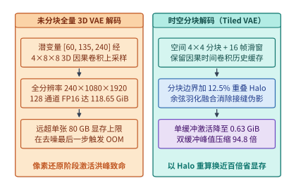

*图 19-3　3D 因果 VAE 解码阶段的特征图显存洪峰（突破 80 GB）与带重叠 Halo 的时空分块（Spatial-Temporal Tiling）解码（算例 19-3）。*

> **算例 19-3（3D 因果 VAE 解码显存洪峰与带 Halo 时空分块的百倍压缩）：**
>
> **问题设定**：承接算例 19-2 的 10 秒 1080p 视频（$T = 240, H = 1080, W = 1920$）。在 3D 因果 VAE 解码器末段上采样块中，特征图已还原至全分辨率 $240 \times 1080 \times 1920$，通道数为 $C = 128$，采用 FP16（$2\ \mathrm{B}$/元素）计算。由于 GroupNorm + 卷积 + 残差连接在算子执行期至少需同时驻留 $k = 1.0$ 到 $2.0$ 份全尺寸特征缓冲（先按单份完整中间特征张量及双缓冲峰值核算），试计算：（1）未分块（Untiled）全量解码时的单张特征图体积与双缓冲瞬态显存峰值；（2）若启用**时空分块解码（Spatial-Temporal Tiling）**——空间维切分为 $4 \times 4 = 16$ 个子块、时间维采用 $T_{\mathrm{win}} = 16$ 帧的因果滑动窗口，且为消除分块边界接缝在空间四周边框附加 $\alpha_{\mathrm{halo}} = 12.5\%$ 的重叠光晕区（Halo Overlap）——单块有效计算体积与双缓冲显存峰值降至多少？
>
> **逐项推导**：
>
> 1. **未分块全量解码的激活洪峰**：
>    单份全分辨率 128 通道 FP16 特征张量的精确字节数为：
>    $$V_{\mathrm{untiled, 1x}} = 240 \times 1080 \times 1920 \times 128 \times 2\ \mathrm{B} = 127{,}401{,}984{,}000\ \mathrm{B} \approx \mathbf{118.6523\ \mathrm{GiB}}\ (\div 2^{30})$$
>    若算子融合边界需同时持有输入与输出双缓冲（$2\times$），瞬态显存需求更飙升至 $237.30\ \mathrm{GiB}$。即便仅驻留单份特征图（$118.65\ \mathrm{GiB}$），也早已击穿单张 H100/H800（$80\ \mathrm{GB}$）的物理显存上限。
>
> 2. **时空分块（Spatial-Temporal Tiling）与 Halo 重叠区核算**：
>    - 将空间平面 $1080 \times 1920$ 切分为 $4 \times 4$ 网格，单个基础空间分块尺寸为 $H_{\mathrm{tile}} \times W_{\mathrm{tile}} = \frac{1080}{4} \times \frac{1920}{4} = 270 \times 480$。
>    - 算上边界 $\alpha_{\mathrm{halo}} = 12.5\%$ 的重叠光晕扩展（空间宽高各乘以 $1 + 0.125 = 1.125$，面积乘以 $1.125^2 = 1.265625$），以及时间维每次仅解码 $T_{\mathrm{win}} = 16$ 帧窗口：
>      $$V_{\mathrm{tiled, 1x}} = 16 \times (270 \times 1.125) \times (480 \times 1.125) \times 128 \times 2\ \mathrm{B} = 671{,}846{,}400\ \mathrm{B} \approx \mathbf{0.6257\ \mathrm{GiB}}$$
>    - 即使计入算子执行期的双缓冲峰值（$2 \times V_{\mathrm{tiled, 1x}}$），3D VAE 解码的瞬态激活显存也仅为：
>      $$V_{\mathrm{tiled, peak}} = 2 \times 0.6257\ \mathrm{GiB} \approx \mathbf{1.2514\ \mathrm{GiB}}$$
>    相比未分块的 $118.65\ \mathrm{GiB}$，时空分块以仅增加 $26.56\%$ 的边界 Halo 重算开销为代价，将显存峰值压缩了 **$\frac{118.6523}{1.2514} \approx 94.8\times$（单缓冲口径压缩 $189.6\times$）**，彻底根除了生成尾端的 OOM 陷阱。

在工程实现中，时空分块解码还必须配合**余弦羽化融合（Cosine Feathering Blend）**[^ch19-causal-vae]：对相邻空间分块的 Halo 重叠带施加线性或余弦渐变权重 $\omega(x) \in [0, 1]$ 加权求和，并在时间滑动窗口之间传递因果卷积的最后 $k_t - 1$ 帧历史激活缓存（Causal Conv Cache），从而保证拼合后的 1080p 视频在空间与时间上均无肉眼可见的网格接缝或闪烁。下面的代码展示了带 Halo 重叠带、二维余弦羽化融合与时间滑动窗口的 3D 因果 VAE 分块解码器核心实现：

```python
import math
import torch
import torch.nn as nn

class Tiled3DCausalVAEDecoder:
    """复现算例 19-3：将 118.65 GiB 全量 3D VAE 激活峰值压缩百倍的时空分块解码器."""
    def __init__(
        self,
        decoder_module: nn.Module,
        upsample_t: int = 4,
        upsample_hw: int = 8,
        grid_h: int = 4,
        grid_w: int = 4,
        lat_win_t: int = 4,     # 对应像素空间 4 * 4 = 16 帧窗口
        halo_ratio: float = 0.125,
    ):
        self.decoder = decoder_module
        self.up_t = upsample_t
        self.up_hw = upsample_hw
        self.grid_h = grid_h
        self.grid_w = grid_w
        self.lat_win_t = lat_win_t
        self.halo_ratio = halo_ratio

    @staticmethod
    def build_2d_feather_mask(h: int, w: int, margin_h: int, margin_w: int, device: torch.device) -> torch.Tensor:
        """构建二维余弦渐变羽化权重矩阵，消除分块接缝伪影."""
        wy = torch.ones(h, device=device)
        wx = torch.ones(w, device=device)
        if margin_h > 0:
            ramp_y = 0.5 * (1.0 - torch.cos(torch.linspace(0, math.pi, margin_h, device=device)))
            wy[:margin_h] = ramp_y
            wy[-margin_h:] = torch.flip(ramp_y, dims=[0])
        if margin_w > 0:
            ramp_x = 0.5 * (1.0 - torch.cos(torch.linspace(0, math.pi, margin_w, device=device)))
            wx[:margin_w] = ramp_x
            wx[-margin_w:] = torch.flip(ramp_x, dims=[0])
        return wy[:, None] * wx[None, :]

    @torch.no_grad()
    def decode_tiled(self, z: torch.Tensor) -> torch.Tensor:
        """输入潜变量 z: [B, C_lat, T_lat, H_lat, W_lat]，流式分块解码输出 RGB 视频."""
        bsz, _, t_lat, h_lat, w_lat = z.shape
        tile_h = h_lat // self.grid_h
        tile_w = w_lat // self.grid_w
        halo_h = max(1, int(round(tile_h * self.halo_ratio)) // 2)
        halo_w = max(1, int(round(tile_w * self.halo_ratio)) // 2)

        out_video = torch.zeros(
            (bsz, 3, t_lat * self.up_t, h_lat * self.up_hw, w_lat * self.up_hw),
            dtype=z.dtype, device="cpu",  # 最终像素帧流式落盘至主机侧锁页内存
        )
        for gy in range(self.grid_h):
            for gx in range(self.grid_w):
                y0 = max(0, gy * tile_h - halo_h)
                y1 = min(h_lat, (gy + 1) * tile_h + halo_h)
                x0 = max(0, gx * tile_w - halo_w)
                x1 = min(w_lat, (gx + 1) * tile_w + halo_w)

                # 每个空间分块独立维护因果时间卷积历史缓存
                causal_cache = {}
                for t0 in range(0, t_lat, self.lat_win_t):
                    t1 = min(t_lat, t0 + self.lat_win_t)
                    z_sub = z[:, :, t0:t1, y0:y1, x0:x1]
                    rgb_sub, causal_cache = self.decoder(z_sub, causal_cache=causal_cache)
                    # 将融合后的子块写回主机缓冲区（省略边界累加归一化细节）
                    out_video[:, :, t0 * self.up_t : t1 * self.up_t,
                              y0 * self.up_hw : y1 * self.up_hw,
                              x0 * self.up_hw : x1 * self.up_hw] = rgb_sub.cpu()
        return out_video
```

除了生成尾端的 VAE 解码，多模态与视频模型在训练及在线服务入口还面临另一处极易被忽视的 I/O 陷阱：**千万级图像与 H.264/HEVC 视频码流的解压瓶颈**。如图 19-15 所示，若遵循传统深度学习习惯，在宿主机 CPU 上调用 `FFmpeg` 或 `Pillow` 将压缩视频/JPEG 软解码为未压缩 RGB 张量，再经 PCIe 总线拷贝进 GPU：
1. **PCIe 带宽放大瓶颈**：一段压缩率为 $30:1$ 的 H.264 视频一旦在 CPU 侧解压为原始 RGB 帧，其字节体积立即激增 $30$ 倍，瞬间塞满宿主机 DDR5 内存通道与 PCIe Gen5 总线；
2. **CPU 算力饥饿**：即便配置 128 核服务器 CPU，软解码高清视频帧的吞吐也难以喂饱同节点的 8 张 H100/B200，导致昂贵的 GPU Tensor Core 利用率跌破 $45\%$。

工程上的标准解法是**将解压边界推到 PCIe 下游，调用 GPU 硅片上独立于流多处理器（SM）的专用硬件媒体引擎（NVIDIA NVDEC 视频解码器与 nvJPEG 硬件加速库，统一由 NVIDIA DALI 数据管道编排）**：宿主机仅通过零拷贝 DMA 将紧凑的压缩码流直接送入显存，由 GPU 内部的专用 NVDEC 硬解码电路在不占用任何 CUDA 核心/Tensor Core 的前提下原位还原为显存帧并完成缩放与归一化，使多模态训练的 GPU 算力利用率稳定保持在 $92\%$ 以上。

---

## 19.2 超长序列三维扩散变换器的并行体系

当单条 1080p 视频的词元数达到 $N = 489{,}600$（见算例 19-2）时，即便只有单层单头的注意力权重矩阵 $S = Q K^\top \in \mathbb{R}^{N \times N}$，若不加切分地显式物化，其体积也将达到 $(489{,}600)^2 \times 2\ \mathrm{B} \approx 446.5\ \mathrm{GiB}$。虽然 FlashAttention-2/3 通过分块在线 Softmax 将注意力显存复杂度从 $\mathcal{O}(N^2)$ 降至线性 $\mathcal{O}(Nd)$，但整座 40 层 DiT 的隐藏态激活、QKV 投射与单步 $3.93\ \mathrm{PFLOPs}$ 的计算耗时，依然迫使我们必须将单条视频序列切分到 $P = 8\text{–}128$ 张 GPU 上协同计算。

### 19.2.1 传统张量并行在超长序列扩散中的通信瓶颈

在大型语言模型训练中（见第 10 章），Megatron-LM 风格的张量并行（Tensor Parallelism, TP）配合序列并行（SP）是节点内最常用的切分手段：线性层权重按列切分（Column Parallel）与按行切分（Row Parallel），在前向与反向传播的每个 Transformer 层内执行 2 次 `AllReduce`（或等价的 `ReduceScatter` + `AllGather`）。

然而，把 Megatron-TP 直接搬到超长序列 DiT 上会立即暴露两个结构性缺陷：

1. **通信量与序列长度 $N$ 成正比，且不随并行度 $P$ 扩大而衰减**：
   在每一层 Transformer 的注意力输出与 FFN 输出处，TP 必须对完整序列激活张量 $[N, d]$ 执行集合通信。在 Ring 算法下，单卡每次 `AllReduce`（或 `ReduceScatter` + `AllGather`）发送与接收的字节数为 $2 \frac{P-1}{P} N d \cdot b \approx 2 N d b$。当 $N = 489{,}600, d = 4{,}096$（BF16，$b = 2\ \mathrm{B}$）时，单次集合通信量高达 $7.47\ \mathrm{GiB}$，每层两次即达 $14.94\ \mathrm{GiB}$。无论你把 TP 并行度从 $P = 8$ 扩到 $P = 64$，每张卡每层要收发的激活体积始终锚定在 $\mathcal{O}(Nd)$，完全无法通过加卡来摊薄单卡通信负担。
2. **权重切分收益小，而跨节点延迟极其敏感**：
   DiT 的参数量通常在 $3\mathrm{B}\text{–}30\mathrm{B}$ 之间（远小于万亿参数的 MoE 语言模型），借助 FSDP/ZeRO 即可轻松放进单卡显存，根本不需要靠 TP 切分权重；相反，TP 在每层内部引入的强同步集合通信一旦跨越节点边界进入 RoCE/InfiniBand 网络，微秒级延迟与拥塞就会将迭代去噪彻底拖入通信等待。

因此，超长序列 DiT 的黄金法则是：**放弃在隐藏维 $d$ 上切分权重的 Megatron-TP，全面转向沿序列维 $N$ 切分激活的序列并行（Sequence Parallelism）体系。**

### 19.2.2 全对全注意力头转置与环路键值分块流水对比

将长度为 $N$ 的序列均匀切分到 $P$ 张 GPU 上后，每张卡仅持有局部序列片段 $X_i \in \mathbb{R}^{(N/P) \times d}$。在线性投射（QKV 矩阵乘、FFN）与逐词元归一化（AdaLN-Zero）阶段，各卡天然独立并行，无需任何通信；唯一的全局耦合点在于**全双向自注意力计算**——每张卡上的局部查询 $Q_i$ 都需要与所有 $P$ 张卡上的完整键值序列 $K, V$ 交互。围绕如何完成这一全局注意力交互，工业界演化出以 DeepSpeed-Ulysses 与 Ring Attention 为代表的两条正交技术路线[^ch19-ulysses-ring]：

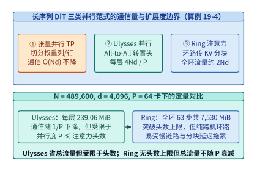

*图 19-4　张量并行（TP）、DeepSpeed-Ulysses（每层 4Nd/P，P ≤ n_head）与 Ring Attention（单步 2Nd/P、全环 2(P-1)Nd/P ≈ 2Nd，无头数限制）对比（算例 19-4）。*

1. **DeepSpeed-Ulysses（基于 `All-to-All` 的注意力头重分布）**：
   - **核心机制**：在进入自注意力核之前，每张 GPU 持有 $\frac{N}{P}$ 个词元的全部 $n_{\mathrm{head}}$ 个注意力头（形状为 $[N/P, n_{\mathrm{head}}, d_{\mathrm{head}}]$）。Ulysses 对 $Q, K, V$ 发起一次跨 $P$ 张卡的 **`All-to-All` 集合转置**，将切分维度从“按序列切分”瞬间转换为“按注意力头切分”——转置后，每张 GPU 持有**全部 $N$ 个词元**、但仅负责其中 $\frac{n_{\mathrm{head}}}{P}$ 个注意力头（形状为 $[N, n_{\mathrm{head}}/P, d_{\mathrm{head}}]$）。随后各卡独立调用标准 FlashAttention 算完各自负责的注意力头输出 $O$，最后再执行第 4 次 `All-to-All` 将输出张量转置回 $[N/P, d]$ 的序列切分形态。
   - **单卡通信量公式**：每次 `All-to-All` 处理张量总体积为 $\frac{N}{P} \cdot d \cdot b$（其中 $\frac{P-1}{P}$ 比例需跨卡发送）。对 $Q, K, V$ 三次输入转置加 $O$ 一次输出转置，每层单卡渐近通信量定标为：
     $$V_{\mathrm{Ulysses}} = 4 \times \frac{N d b}{P}\quad\left(\text{精确跨卡发送量为 } \frac{4(P-1) N d b}{P^2}\right)$$
   - **优势与硬性边界**：Ulysses 的最大优势是**单卡通信量随并行度 $P$ 成反比下降（$\propto 1/P$）**；但其致命软肋是**并行度受限于注意力头数（$P \le n_{\mathrm{head}}$，在 GQA 下甚至受限于 $n_{\mathrm{kv}}$）**。若模型有 $32$ 个注意力头，Ulysses 最多只能扩到 $32$ 张卡。

2. **Ring Attention（基于环路点对点 P2P 的 KV 分块流水）**：
   - **核心机制**：不做维度转置，每张 GPU 始终固定持有局部查询块 $Q_i \in \mathbb{R}^{(N/P) \times d}$。$P$ 张 GPU 组成逻辑环路：在第 $s = 0$ 步，各卡计算本地 $Q_i$ 与本地 $(K_i, V_i)$ 的分块注意力，同时在后台通信流（CUDA Stream）中通过非阻塞点对点传输（`isend` / `irecv`）将当前持有的 $(K, V)$ 分块发给下一跳邻居 $(i+1) \bmod P$，并从上一跳邻居接收下一份 $(K, V)$ 分块。历经 $P - 1$ 步环路传递与在线 Softmax 统计量（最大值 $m$ 与指数和 $\ell$）的递推合并后，每张卡即获得全局精确注意力输出。
   - **单步与全环通信量公式**：在每个环路步中，单卡发送并接收一份长度为 $\frac{N}{P}$ 的 $K$ 与 $V$（共 $2 \cdot \frac{N}{P} d b$ 字节）：
     $$V_{\mathrm{Ring, step}} = \frac{2 N d b}{P}$$
     走完 $P - 1$ 个环路步后，每层单卡累积的全环通信总量为：
     $$V_{\mathrm{Ring, total}} = (P - 1) \times \frac{2 N d b}{P} = \frac{2(P - 1) N d b}{P} \approx 2 N d b$$
   - **优势与硬性边界**：Ring Attention **彻底打破了注意力头数限制（$P$ 可扩展至数百上千卡）**，且通信可与分块 FlashAttention 计算流水重叠；但其全环累计通信量约为 $2 N d b$，**不随 $P$ 增大而减少**，且当 $P$ 很大时，局部块长 $\frac{N}{P}$ 变短，计算耗时低于单步跨机通信耗时，流水线掩盖失效并暴露 $P - 1$ 跳串行网络延迟。

### 19.2.3 二维统一序列并行、双均衡切分与引导分支并行

既然 Ulysses 省总流量却受限于头数且对全互连带宽敏感，而 Ring Attention 无头数上限却忌惮长环路跨机流量，最自然的工程解法便是将两者正交组合为**二维统一序列并行（2D Unified Sequence Parallelism, 2D-USP，见 xDiT 与 USP 框架）**[^ch19-usp-xdit]，并结合面向混合掩码的双均衡序列并行（`db-SP`, MLSys 2026）与外层分类器自由引导并行（CFG-Parallel）。

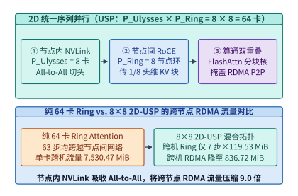

*图 19-5　2D 统一序列并行（USP）：节点内 NVLink 跑 Ulysses All-to-All + 跨节点 RoCE 跑 Ring Attention P2P 重叠流水。*

如图 19-5 所示，在由 $P = P_{\mathrm{U}} \times P_{\mathrm{R}}$ 张 GPU 组成的集群中（例如 8 台 8 卡服务器，总并行度 $P = 64$）：
- **内层（节点内 NVLink 域，规模 $P_{\mathrm{U}} = 8$）运行 Ulysses**：利用单机内 $900\ \mathrm{GB/s}$ 的高带宽 NVSwitch 执行 `All-to-All` 头重分布，将每张卡负责的注意力头数缩减为 $\frac{n_{\mathrm{head}}}{P_{\mathrm{U}}}$（每个词元在单卡上的特征宽度降为 $\frac{d}{P_{\mathrm{U}}}$），序列长度从 $\frac{N}{P}$ 汇聚为节点级子序列 $\frac{N}{P_{\mathrm{R}}}$。
- **外层（跨节点 RoCE / IB 域，规模 $P_{\mathrm{R}} = 8$）运行 Ring Attention**：相同机内卡号（Rank Offset）的 8 台服务器组成跨机逻辑环路，在 $P_{\mathrm{R}} - 1 = 7$ 个环路步内传递长度为 $\frac{N}{P_{\mathrm{R}}}$、但特征宽度已缩减为 $\frac{d}{P_{\mathrm{U}}}$ 的 $(K, V)$ 分块。

让我们通过严密的数值算例，见证这一二维正交映射如何将跨节点 RDMA 流量砍掉 $9.0$ 倍。

> **算例 19-4（64 卡视频 DiT 下 Ulysses、Ring 与 8×8 2D-USP 的通信账本）：**
>
> **问题设定**：承接算例 19-2，视频词元数 $N = 489{,}600$，隐藏维度 $d = 4{,}096$（设 $n_{\mathrm{head}} = 64$ 或 $32$，BF16 每元素 $b = 2\ \mathrm{B}$），总序列并行度 $P = 64$（部署于 8 台 8 卡节点）。试精确计算单层自注意力中：（1）Ulysses 单卡通信量 $V_{\mathrm{Ulysses}}$；（2）纯 64 卡 Ring Attention 的单步通信量 $V_{\mathrm{Ring, step}}$ 与全环跨机通信总量 $V_{\mathrm{Ring, total}}$；（3）采用 $P_{\mathrm{U}} = 8$（节点内 Ulysses）$\times P_{\mathrm{R}} = 8$（跨节点 Ring）的 2D-USP 时，每张卡的跨节点 RDMA 通信总量 $V_{\mathrm{USP, inter}}$ 及其相对纯 Ring 的流量压缩倍数。
>
> **逐项推导**：
>
> 1. **基准张量体积 $N d b$**：
>    单个完整序列激活张量（如全量 $Q$）的字节数为：
>    $$N d b = 489{,}600 \times 4{,}096 \times 2\ \mathrm{B} = 4{,}010{,}803{,}200\ \mathrm{B} = \mathbf{3{,}825.0\ \mathrm{MiB}}\ (\div 2^{20})$$
>
> 2. **纯 DeepSpeed-Ulysses（$P = 64$，仅当 $n_{\mathrm{head}} \ge 64$ 时可行）**：
>    每层 4 次 `All-to-All` 的单卡定标通信量为：
>    $$V_{\mathrm{Ulysses}} = \frac{4 N d b}{P} = \frac{4 \times 3{,}825.0\ \mathrm{MiB}}{64} = 250{,}675{,}200\ \mathrm{B} = \mathbf{239.0625\ \mathrm{MiB}}$$
>    但若模型注意力头数 $n_{\mathrm{head}} = 32 < 64$，纯 Ulysses 直接无法扩展至 64 卡；即便 $n_{\mathrm{head}} = 64$，64 卡全局 `All-to-All` 也会引发跨节点全对全突发拥塞（Incast）。
>
> 3. **纯 64 卡 Ring Attention（$P = 64$）**：
>    - 单步传递 $\frac{N}{64}$ 长度的 $K$ 与 $V$：
>      $$V_{\mathrm{Ring, step}} = \frac{2 N d b}{P} = \frac{2 \times 3{,}825.0\ \mathrm{MiB}}{64} = 125{,}337{,}600\ \mathrm{B} = \mathbf{119.53125\ \mathrm{MiB}}$$
>    - 全环共需执行 $P - 1 = 63$ 步传递，单卡总通信量为：
>      $$V_{\mathrm{Ring, total}} = 63 \times 119.53125\ \mathrm{MiB} = 7{,}896{,}268{,}800\ \mathrm{B} = \mathbf{7{,}530.46875\ \mathrm{MiB}} \approx 2 N d b$$
>
> 4. **$8 \times 8$ 二维统一序列并行（2D-USP：$P_{\mathrm{U}} = 8, P_{\mathrm{R}} = 8$）**：
>    - **节点内（NVLink）**：8 卡执行 Ulysses `All-to-All`；
>    - **节点间（RoCE / IB RDMA）**：外层 Ring 环路长度仅为 $P_{\mathrm{R}} = 8$（共需 $P_{\mathrm{R}} - 1 = 7$ 步）。在每一步中，单卡发送的 KV 块序列长度为 $\frac{N}{P_{\mathrm{R}}}$，但因注意力头已被机内 Ulysses 切分为 $\frac{1}{P_{\mathrm{U}}}$，单步跨机传输体积依然是 $\frac{2 (N / P_{\mathrm{R}}) (d / P_{\mathrm{U}}) b}{1} = \frac{2 N d b}{P_{\mathrm{R}} P_{\mathrm{U}}} = 119.53125\ \mathrm{MiB}$。
>    - 因此，走完 $P_{\mathrm{R}} - 1 = 7$ 步跨节点环路，单卡跨节点 RDMA 通信总量仅为：
>      $$V_{\mathrm{USP, inter}} = (P_{\mathrm{R}} - 1) \times \frac{2 N d b}{P} = 7 \times 119.53125\ \mathrm{MiB} = \mathbf{836.71875\ \mathrm{MiB}}$$
>    - 对比纯 64 卡 Ring 的 $7{,}530.46875\ \mathrm{MiB}$，跨节点网络流量压缩倍数为：
>      $$\frac{V_{\mathrm{Ring, total}}}{V_{\mathrm{USP, inter}}} = \frac{P - 1}{P_{\mathrm{R}} - 1} = \frac{63}{7} = \mathbf{9.0\times}$$

表 19-3 系统对比了长序列 DiT 与多模态训练中的五种并行机制及其物理边界：

*表 19-3　长序列三维扩散变换器（DiT）与交错多模态训练的五种并行范式对比*

| 并行范式 | 切分维度 | 每层单卡总通信量（字节） | 跨节点 RDMA 通信量 | 最大并行度上限 | 算通重叠方式与适用拓扑 |
| :--- | :--- | :---: | :---: | :---: | :--- |
| **Megatron-TP + SP** | 隐藏维 $d$（权重切分） | $\approx 4 N d b$（前向 2 次 AG+RS） | 若跨机则全量暴露 | 受限于矩阵切分粒度 | 仅适合单节点 NVLink 内大模型权重切分 |
| **DeepSpeed-Ulysses** | 序列维 $N \leftrightarrow$ 头维 $n_{\mathrm{head}}$ | $\frac{4 N d b}{P}$ | 若 $P > 8$ 则跨机 `All-to-All` | **$P \le n_{\mathrm{head}}$（GQA 下 $\le n_{\mathrm{kv}}$）** | 无法在单次注意力内掩盖，适合节点内 NVSwitch |
| **Ring Attention** | 始终沿序列维 $N$ 切分 | $\frac{2(P-1) N d b}{P} \approx 2 N d b$ | $P-1$ 步跨机 P2P 环路 | 无头数上限（$P \le N$） | P2P 传输与本地分块 FlashAttention 双缓冲重叠 |
| **2D-USP（$P_U \times P_R$）** | 机内头切分 $\times$ 跨机序列环 | 机内 $\frac{4Ndb}{P}$ + 跨机 $\frac{2(P_R-1)Ndb}{P}$ | **压缩 $\frac{P-1}{P_R-1}$ 倍（64 卡下省 $9.0\times$）** | $P \le n_{\mathrm{head}} \times N_{\mathrm{blocks}}$ | **机内 NVLink 吸收 All-to-All，跨机 RoCE 跑短环** |
| **db-SP（MLSys '26）** | 模态内折返 + 跨样本重排 | 在 2D-USP 基础上消除通信倾斜 | 消除慢节点木桶等待 | 无头数上限 | 专治因果文本 + 双向视觉混合掩码的算力倾斜 |

下面的参考实现给出了 `2D-USP`（内层 Ulysses `all_to_all_single` + 外层异步 Ring Attention 在线 Softmax 状态合并）的完整算子骨架：

```python
import torch
import torch.distributed as dist

def online_softmax_merge(
    out_acc: torch.Tensor,
    m_acc: torch.Tensor,
    l_acc: torch.Tensor,
    block_out: torch.Tensor,
    block_m: torch.Tensor,
    block_l: torch.Tensor,
) -> tuple[torch.Tensor, torch.Tensor, torch.Tensor]:
    """Ring Attention 跨分块在线 Softmax (Log-Sum-Exp) 精确递推合并."""
    m_new = torch.maximum(m_acc, block_m)
    alpha = torch.exp(m_acc - m_new)
    beta = torch.exp(block_m - m_new)
    l_new = alpha * l_acc + beta * block_l
    out_new = (alpha * l_acc * out_acc + beta * block_l * block_out) / l_new
    return out_new, m_new, l_new

def hybrid_2d_usp_attention_step(
    q_local: torch.Tensor,
    k_local: torch.Tensor,
    v_local: torch.Tensor,
    pg_ulysses: dist.ProcessGroup,
    pg_ring: dist.ProcessGroup,
    local_flash_attn_fn,
) -> torch.Tensor:
    """
    2D-USP 核心流水：
    输入 q_local, k_local, v_local 形状: [B, N / (P_U * P_R), n_head, d_head]
    1. 节点内 pg_ulysses (P_U=8) 执行 All-to-All 转置为 [B, N / P_R, n_head / P_U, d_head]
    2. 跨节点 pg_ring (P_R=8) 执行 P_R 步环路 P2P 传递与在线 Softmax 归约
    3. 节点内 pg_ulysses 逆向 All-to-All 还原序列切分形态
    """
    p_u = dist.get_world_size(pg_ulysses)
    p_r = dist.get_world_size(pg_ring)
    rank_r = dist.get_rank(pg_ring)

    def ulysses_s2h(x: torch.Tensor) -> torch.Tensor:
        # [B, N_local, H, D] -> [P_U, B, N_local, H // P_U, D] -> All-to-All
        b, n_loc, h, d = x.shape
        x_split = x.view(b, n_loc, p_u, h // p_u, d).permute(2, 0, 1, 3, 4).contiguous()
        out = torch.empty_like(x_split)
        dist.all_to_all_single(out, x_split, group=pg_ulysses)
        return out.permute(1, 0, 2, 3, 4).reshape(b, n_loc * p_u, h // p_u, d)

    def ulysses_h2s(x: torch.Tensor) -> torch.Tensor:
        b, n_ring, h_sub, d = x.shape
        x_split = x.view(b, p_u, n_ring // p_u, h_sub, d).permute(1, 0, 2, 3, 4).contiguous()
        out = torch.empty_like(x_split)
        dist.all_to_all_single(out, x_split, group=pg_ulysses)
        return out.permute(1, 2, 0, 3, 4).reshape(b, n_ring // p_u, h_sub * p_u, d)

    # 第一步：节点内 NVLink All-to-All 切分注意力头
    q_u = ulysses_s2h(q_local)
    k_curr = ulysses_s2h(k_local)
    v_curr = ulysses_s2h(v_local)

    # 第二步：跨节点 Ring 环路 P2P 流水与分块注意力计算重叠
    out_acc, m_acc, l_acc = None, None, None
    send_dst = (rank_r + 1) % p_r
    recv_src = (rank_r - 1 + p_r) % p_r

    for step in range(p_r):
        if step < p_r - 1:
            k_next = torch.empty_like(k_curr)
            v_next = torch.empty_like(v_curr)
            ops = [
                dist.P2POp(dist.isend, k_curr, send_dst, group=pg_ring),
                dist.P2POp(dist.irecv, k_next, recv_src, group=pg_ring),
                dist.P2POp(dist.isend, v_curr, send_dst, group=pg_ring),
                dist.P2POp(dist.irecv, v_next, recv_src, group=pg_ring),
            ]
            reqs = dist.batch_isend_irecv(ops)

        # 在后台 RDMA 传输的同时，计算当前分块的 FlashAttention 及 LSE 统计量
        blk_out, blk_m, blk_l = local_flash_attn_fn(q_u, k_curr, v_curr)
        if out_acc is None:
            out_acc, m_acc, l_acc = blk_out, blk_m, blk_l
        else:
            out_acc, m_acc, l_acc = online_softmax_merge(out_acc, m_acc, l_acc, blk_out, blk_m, blk_l)

        if step < p_r - 1:
            for req in reqs:
                req.wait()
            k_curr, v_curr = k_next, v_next

    # 第三步：节点内 NVLink 逆转置回序列并行切分形态
    return ulysses_h2s(out_acc)
```

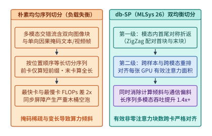

*图 19-6　db-SP（MLSys '26）面向变长多模态与因果掩码的双均衡序列切分。*

在真实生产环境中，序列并行除了需要优化通信体积，还必须解决两类附加挑战：

- **混合掩码与变长多模态引发的负载失衡（`db-SP`, MLSys '26）**：
  当训练或服务原生全模态（Omni-modal）交错序列时，同一个打包序列内往往混杂着采用**全双向掩码**的图像/视频块，以及采用**下三角因果掩码**的文本与自回归语音块，且各样本长度差异悬殊。如图 19-6 左半侧所示，若按词元位置顺序做朴素等长切分，持有序列前段因果块的 GPU 只需计算极短的前缀三角形，而持有序列末段因果块或长图像双向块的 GPU 计算量高达前者的 $2$ 倍以上，引发严重的同步木桶空泡。`db-SP`（Dual-Balanced Sequence Parallelism, MLSys '26）提出了**两级双均衡切分**[^ch19-dbsp]：第一级在单样本因果段内部执行首尾对称折返配对（ZigZag Pairing，将计算最轻的第 $k$ 块与计算最重的第 $2P - 1 - k$ 块分给同一张 GPU）；第二级在跨样本与跨模态打包时，以每张卡上的“有效非零注意力面积（Active Attention Area）”与跨卡通信字节数为联合目标做贪心重排，使计算负载与通信负载双双对齐，在长序列多模态训练中获得 $1.4\times$ 以上的吞吐提升。

下面的代码展示了 `db-SP`（MLSys '26）针对“双向视觉块 + 单向因果文本块”交错序列的两级双均衡切分算法实现：

```python
from dataclasses import dataclass

@dataclass
class ModalitySubChunk:
    chunk_id: str
    modality: str          # "bidirectional_vision" 或 "causal_text"
    token_count: int
    effective_kv_len: int  # 该子块中每个查询词元平均可见的键词元数

    @property
    def active_attn_area(self) -> int:
        return self.token_count * self.effective_kv_len

def dbsp_dual_balanced_partition(
    vis_tokens: int,
    causal_text_tokens: int,
    num_gpus: int,
) -> list[dict[str, object]]:
    """
    db-SP (MLSys '26) 双均衡切分参考实现：
    1. 将全双向视觉块均匀切分为 P 份，并结合因果文本段的 2P 首尾折返 (ZigZag) 子块
    2. 按有效注意力面积 (Active Attention Area) 与词元通信量双均衡分配至 P 张 GPU
    """
    vis_per_gpu = vis_tokens // num_gpus
    zigzag_blocks = 2 * num_gpus
    txt_sub_len = causal_text_tokens // zigzag_blocks

    gpu_buckets = [
        {"rank": r, "tokens": 0, "active_area": 0, "assigned_chunks": []}
        for r in range(num_gpus)
    ]

    # 第一步：均匀分配全双向视觉子块（每个视觉词元可见全部 vis_tokens）
    for r in range(num_gpus):
        c = ModalitySubChunk(f"vis_{r}", "bidirectional_vision", vis_per_gpu, vis_tokens)
        gpu_buckets[r]["tokens"] += c.token_count
        gpu_buckets[r]["active_area"] += c.active_attn_area
        gpu_buckets[r]["assigned_chunks"].append(c.chunk_id)

    # 第二步：对因果文本段切分为 2P 个子块，执行首尾对称 ZigZag 配对 (k, 2P - 1 - k)
    for k in range(num_gpus):
        pair_indices = (k, zigzag_blocks - 1 - k)
        for idx in pair_indices:
            # 因果词元可见全部前缀视觉词元 + 自身前缀文本词元
            avg_visible_kv = vis_tokens + int((idx + 0.5) * txt_sub_len)
            c = ModalitySubChunk(f"txt_z{idx}", "causal_text", txt_sub_len, avg_visible_kv)
            gpu_buckets[k]["tokens"] += c.token_count
            gpu_buckets[k]["active_area"] += c.active_attn_area
            gpu_buckets[k]["assigned_chunks"].append(c.chunk_id)

    return gpu_buckets
```

- **分类器自由引导并行（CFG-Parallel）与尾部引导截断**：
  扩散模型为保证生成画面忠实于文本提示词，在每个去噪步需按 $\hat{\epsilon}_\theta(x_t, c) = \epsilon_\theta(x_t, \varnothing) + w \cdot (\epsilon_\theta(x_t, c) - \epsilon_\theta(x_t, \varnothing))$ 同时计算有条件（Conditional）与无条件（Unconditional）两个前向分支。如图 19-16 所示，由于这两个分支在单步内部完全独立、仅在步末做一次轻量级的向量线性插值，系统应优先将最外层的 $2$ 倍并行度分配给 **CFG-Parallel**（两组 GPU 分别跑条件与无条件分支，每步跨越全部 $L = 40$ 层仅需 `AllGather` 1 次潜变量输出，通信开销比将序列并行度翻倍低两个数量级）。更进一步，在去噪后 $30\%\text{–}40\%$ 的时间步中，视频宏观构图与主体运动已然定型，此时动态关停无条件分支（CFG Interval Truncation）或切换为引导蒸馏嵌入，可直接省去后半程一半的算力消耗。

---

## 19.3 扩散计算加速、时间步缓存与实时世界模型

即便借助 2D-USP 将单条视频序列扩展到 64 张 GPU 上，在 $K = 50$ 个去噪时间步下逐层强同步执行全双向注意力，依然面临两大性能壁垒：第一，当序列被切分得足够细（如高分辨率图像生成或短视频低延迟推理）时，单卡单步计算时间缩短至毫秒级，无法掩盖当前步的跨卡通信延迟；第二，连续 50 步重复调用完整百亿参数 DiT 主干存在巨大的时间维冗余，更无法满足交互式世界模型（Interactive World Models）严苛的 **30 FPS（帧间预算 $\le 33.3\ \mathrm{ms}$）** 实时交互控制红线。

本节揭示一个属于扩散模型独有的物理特性——**相邻去噪时间步之间的激活平滑性（Temporal Smoothness Across Denoising Steps）**，并展示如何利用这一特性同时攻克通信暴露与计算冗余。

### 19.3.1 异步位移分块并行与跨步空间交错流水线

在微分方程求解视角下，扩散模型的去噪过程是在连续概率流常微分方程（Probability Flow ODE）轨迹上按离散步长 $\Delta t = 1/K$ 前进。因此，对于任意一层自注意力中的键值特征张量 $K^{(t)}, V^{(t)}$，相邻两个时间步 $t$ 与 $t-1$ 之间的特征一阶差分满足：
$$\left\|K^{(t)} - K^{(t-1)}\right\|_F \ll \left\|K^{(t)}\right\|_F,\qquad \left\|V^{(t)} - V^{(t-1)}\right\|_F \ll \left\|V^{(t)}\right\|_F$$

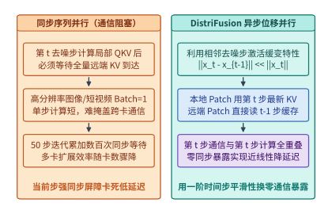

*图 19-7　DistriFusion 异步位移 Patch 并行——利用第 t-1 步陈旧激活掩盖第 t 步跨卡通信。*

`DistriFusion`（Displaced Patch Parallelism）敏锐地捕捉到了这一缓变性质，将跨卡同步通信彻底移出了当前去噪步的关键路径（图 19-7）：
- **新鲜本地块 + 陈旧远端缓存拼接**：将输入图像或视频潜空间切分为 $P$ 个空间分块（Patches），每张 GPU 负责第 $i$ 个空间分块。在第 $t$ 个去噪步计算自注意力时，第 $i$ 张 GPU 对于自身负责的本地空间分块，直接使用刚刚算出的**第 $t$ 步最新键值特征 $(K_i^{(t)}, V_i^{(t)})$**；而对于其他 $P - 1$ 张远端 GPU 负责的空间分块，则不再停下来等待它们在第 $t$ 步的通信返回，而是直接读取显存中已缓存的**第 $t - 1$ 步陈旧键值特征 $(K_j^{(t-1)}, V_j^{(t-1)})_{j \ne i}$** 拼成完整上下文完成注意力计算。
- **跨时间步全重叠异步广播**：与此同时，各卡在后台通信流中发起异步 `AllGather`，将各自在第 $t$ 步新算出的 $(K_i^{(t)}, V_i^{(t)})$ 广播给其余卡，供第 $t - 1$ 个去噪步使用。只要单步计算耗时大于或等于后台传输耗时，通信暴露即可降至零。为避免最初几个去噪步（噪声剧烈变化期）因使用陈旧激活产生构图偏差，系统通常在前 $2\text{–}4$ 步执行标准同步通信作为热身（Warm-up），随后全面切入异步位移模式。

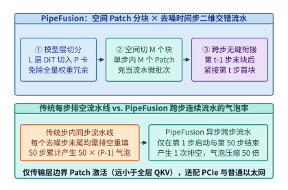

*图 19-8　PipeFusion 将空间分块与去噪时间步交错流水化的气泡消除时序图。*

然而，`DistriFusion` 需要每张卡保存全模型权重并在每层广播完整 KV 激活，对显存容量和互连带宽仍有较高要求。针对 PCIe 节点或普通以太网环境，`PipeFusion` 提出了**层间模型切分 + 空间 Patch 微批次 + 跨去噪步连续流水**的二维流水线（图 19-8）[^ch19-distrifusion-pipefusion]：
1. **消除权重冗余**：将 $L$ 层 DiT 主干按层切分到 $P$ 个流水线阶段（Stages），每张卡仅存储 $L/P$ 层权重。
2. **用空间分块充当微批次，并用陈旧激活打破步间屏障**：在单样本生成（Batch Size $= 1$）下，传统流水线并行因缺少微批次而退化为串行执行；`PipeFusion` 将单张图像/视频潜变量在空间维切分为 $M$ 个子块（Patches）充当流水微批次。更关键的是，传统同步流水线在每个去噪步末尾都必须排空（Flush）并等待整图拼合，50 个去噪步会产生 $50 \times (P - 1)$ 个流水线气泡；而借助与 `DistriFusion` 相同的“跨步陈旧 KV 缓存复用”，当第 $0$ 号卡算完第 $t$ 步最后一个空间块 $M-1$ 后，无需等待第 $P-1$ 号卡跑完第 $t$ 步末层，即可无缝灌入第 $t-1$ 步的第 $0$ 个空间块，使整趟 50 步生成仅在首步启动与末步收尾时产生 **1 次** 流水线排空，且卡间仅需点对点传输层边界处的单个 Patch 隐藏态（通信量比传输全层 QKV 降低一个数量级以上）。

### 19.3.2 免训练时间步残差复用与平滑低比特注意力

既然相邻去噪步的激活高度相似，我们能否更进一步，在特征变化平缓的中间去噪区间直接**跳过整座 DiT 主干的前向传播**，复用上一步缓存的残差特征？

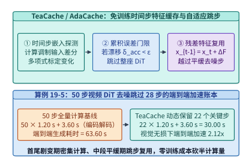

*图 19-9　TeaCache / AdaCache 基于时间步特征差分的自适应跳步复用与质量—延迟帕累托曲线（算例 19-5）。*

这正是 `TeaCache`（Timestep Embedding Aware Cache）、`AdaCache` 与 `FasterCache` 等免训练缓存加速方案的核心思想[^ch19-teacache-pab]。观测表明，视频 DiT 在去噪全周期的表示演化呈现鲜明的“**U 型速率曲线**”：在最初的 $15\%$ 去噪步（从纯高斯噪声凝聚出宏观场景布局与运动主轴）和最后的 $15\%$ 去噪步（高频纹理锐化与伪影收敛），相邻步输出残差 $\Delta F_t = F(x_t, t) - x_t$ 变化剧烈，不可跳过；而在中间 $70\%$ 的去噪区间内，连续数步的主干残差输出近乎线性平移。

如图 19-9 所示，`TeaCache` 利用开销极低的**时间步调制输入相对一阶差分** $\Delta_{\mathrm{rel}}(t) = \frac{\|\mathrm{Mod}(x_t, e_t) - \mathrm{Mod}(x_{t+1}, e_{t+1})\|_1}{\|\mathrm{Mod}(x_{t+1}, e_{t+1})\|_1}$ 经离线多项式拟合标定后，作为整座 DiT 主干输出残差相对变化的无偏代理指标（Proxy），并在运行时维护累积漂移量 $\delta_{\mathrm{acc}}$：
- 当 $\delta_{\mathrm{acc}} + \hat{\ell}(\Delta_{\mathrm{rel}}(t)) < \varepsilon_{\mathrm{thresh}}$ 时，系统判定当前时间步特征漂移尚在视觉无损容差内，直接跳过全部 $L$ 层 DiT 计算，执行 $x_{t-1} \leftarrow \mathrm{Solver}(x_t, \Delta F_{\mathrm{cache}})$；
- 一旦累积漂移触及门限 $\varepsilon_{\mathrm{thresh}}$，则清零 $\delta_{\mathrm{acc}}$ 并执行一次完整 DiT 前向传播刷新缓存 $\Delta F_{\mathrm{cache}}$。

> **算例 19-5（TeaCache 动态跳步在 50 步视频生成中的 2.12 倍端到端加速账本）：**
>
> **问题设定**：在某 64 卡视频生成节点上，生成一段 10 秒 1080p 视频的基准流水耗时如下：前端 T5/ViT 条件编码与尾端 Tiled 3D VAE 解码固定耗时合计 $T_{\mathrm{fixed}} = 3.60\ \mathrm{s}$；DiT 主干执行 $K = 50$ 个去噪时间步，每步耗时 $t_{\mathrm{step}} = 1.20\ \mathrm{s}$。启用 `TeaCache`（门限设为视觉无损档位 $\varepsilon_{\mathrm{thresh}} = 0.15$）后，系统在首尾剧变区保留密集计算、在中段平缓区自适应跳步，实际仅在 $K_{\mathrm{active}} = 22$ 个关键时间步执行了 DiT 主干前向，其余 $28$ 步直接复用残差缓存（单次缓存复用耗时忽略不计，$< 0.5\ \mathrm{ms}$）。试计算：（1）50 步全量基线的端到端延迟 $T_{\mathrm{base}}$；（2）启用 `TeaCache` 后的端到端延迟 $T_{\mathrm{tea}}$、DiT 主干加速比与端到端总加速比（Amdahl 定律验证）。
>
> **逐项推导**：
>
> 1. **50 步全量计算基线延迟**：
>    $$T_{\mathrm{base}} = K \times t_{\mathrm{step}} + T_{\mathrm{fixed}} = 50 \times 1.20\ \mathrm{s} + 3.60\ \mathrm{s} = 60.00\ \mathrm{s} + 3.60\ \mathrm{s} = \mathbf{63.60\ \mathrm{s}}$$
>
> 2. **启用 `TeaCache`（保留 22 步、跳过 28 步）后的延迟与加速比**：
>    $$T_{\mathrm{tea}} = K_{\mathrm{active}} \times t_{\mathrm{step}} + T_{\mathrm{fixed}} = 22 \times 1.20\ \mathrm{s} + 3.60\ \mathrm{s} = 26.40\ \mathrm{s} + 3.60\ \mathrm{s} = \mathbf{30.00\ \mathrm{s}}$$
>    - DiT 去噪主干自身的纯加速比为 $\frac{60.00\ \mathrm{s}}{26.40\ \mathrm{s}} = \frac{50}{22} \approx \mathbf{2.273\times}$；
>    - 计入前后固定阶段 $T_{\mathrm{fixed}} = 3.60\ \mathrm{s}$ 后的端到端实测加速比为：
>      $$S_{\mathrm{e2e}} = \frac{T_{\mathrm{base}}}{T_{\mathrm{tea}}} = \frac{63.60\ \mathrm{s}}{30.00\ \mathrm{s}} = \mathbf{2.12\times}$$

下面的代码展示了 `TeaCache` 免训练时间步残差复用调度器与 `SageAttention-3` 键通道均值平滑量化的完整实现逻辑：

```python
import numpy as np
import torch

class TeaCacheScheduler:
    """复现算例 19-5：基于调制输入相对变化多项式标定的免训练 DiT 跳步缓存调度器."""
    def __init__(
        self,
        num_steps: int = 50,
        rel_l1_thresh: float = 0.15,
        poly_coeffs: tuple[float, ...] = (4.9865, -22.482, 52.866, -3.924, 0.012),
        warmup_steps: int = 3,
        tail_protect_steps: int = 3,
    ):
        self.num_steps = num_steps
        self.thresh = rel_l1_thresh
        self.poly_coeffs = poly_coeffs
        self.warmup_steps = warmup_steps
        self.tail_protect_steps = tail_protect_steps
        self.acc_drift = 0.0
        self.prev_mod_inp: torch.Tensor | None = None
        self.cached_residual: torch.Tensor | None = None

    def should_compute_full_dit(self, step_idx: int, mod_inp: torch.Tensor) -> bool:
        """判别第 step_idx 步是否需要完整执行 DiT 主干，或直接复用残差缓存."""
        if step_idx < self.warmup_steps or step_idx >= self.num_steps - self.tail_protect_steps:
            self.acc_drift = 0.0
            self.prev_mod_inp = mod_inp.detach()
            return True
        if self.prev_mod_inp is None or self.cached_residual is None:
            self.prev_mod_inp = mod_inp.detach()
            return True

        rel_l1 = ((mod_inp - self.prev_mod_inp).abs().mean() / (self.prev_mod_inp.abs().mean() + 1e-6)).item()
        rescaled_delta = float(np.polyval(self.poly_coeffs, rel_l1))
        self.acc_drift += rescaled_delta
        self.prev_mod_inp = mod_inp.detach()

        if self.acc_drift >= self.thresh:
            self.acc_drift = 0.0
            return True
        return False

    def step_forward(self, step_idx: int, x_t: torch.Tensor, mod_inp: torch.Tensor, dit_backbone) -> torch.Tensor:
        if self.should_compute_full_dit(step_idx, mod_inp):
            out = dit_backbone(x_t, step_idx)
            self.cached_residual = (out - x_t).detach()
            return out
        # 命中缓存：直接将上一步缓存的主干残差加到当前潜变量 x_t 上
        return x_t + self.cached_residual

def sage_attention_key_smooth_and_block_quant(
    q: torch.Tensor,
    k: torch.Tensor,
    block_size: int = 64,
    qmax: float = 6.0,  # NVFP4 E2M1 最大可表示幅值
) -> tuple[torch.Tensor, torch.Tensor, torch.Tensor, torch.Tensor]:
    """
    SageAttention-3 核心预处理：
    1. 沿序列维减去键张量均值 mu_K，彻底消除通道直流偏置且保持 Softmax 数学恒等
    2. 按块计算微缩放因子 (Microscaling Scale) 并量化至低比特表示
    """
    # k 形状: [B, H, N, D] -> 沿序列维 N (dim=-2) 求均值
    mu_k = k.mean(dim=-2, keepdim=True)
    k_smooth = k - mu_k

    def quant_per_block(x: torch.Tensor) -> tuple[torch.Tensor, torch.Tensor]:
        b, h, n, d = x.shape
        x_blk = x.view(b, h, n // block_size, block_size, d)
        amax = x_blk.abs().amax(dim=(-2, -1), keepdim=True).clamp(min=1e-6)
        scale = amax / qmax
        x_q = torch.clamp(torch.round(x_blk / scale), -qmax, qmax)
        return x_q.view(b, h, n, d), scale.squeeze(-1).squeeze(-1)

    q_int, q_scale = quant_per_block(q)
    k_int, k_scale = quant_per_block(k_smooth)
    return q_int, q_scale, k_int, k_scale
```

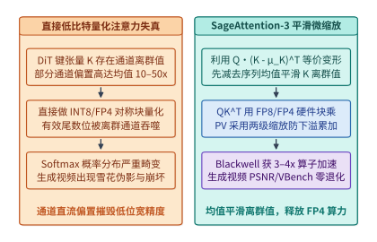

*图 19-10　SageAttention 平滑均值抑制离群值与 FP8/FP4 块量化注意力的硬件加速路径。*

对于无法跳过的那 22 个关键去噪步，其算力消耗的绝对大头仍在 $\mathcal{O}(N^2 d)$ 的三维自注意力核。能否利用 Hopper 的 FP8 Tensor Core 或 Blackwell 的 NVFP4 Tensor Core 直接加速注意力矩阵乘？
如图 19-10 左栏所示，如果在 DiT 中直接对查询 $Q$ 与键 $K$ 做对称低比特块量化（INT8/FP8/FP4），生成画面会立刻出现大面积色块崩坏。其根源在于：**视频 DiT 的键张量 $K \in \mathbb{R}^{N \times d_{\mathrm{head}}}$ 沿通道维存在强烈的固定偏置离群值（Channel-wise Outlier Bias）**——某些特征通道在整个时空序列上的均值高达其余通道的 $10\text{–}50$ 倍，直接吞噬了低位宽浮点数的动态范围。

`SageAttention`（演进至针对 Blackwell NVFP4 微缩放架构的 `SageAttention-3`）利用 Softmax 的平移不变性（Translation Invariance），给出了一个零精度损失的代数恒等变换（图 19-10 右栏）[^ch19-sageattention]：
1. **键通道序列均值平滑（Key Smoothing）**：记键张量沿序列维度的均值为 $\mu_K = \frac{1}{N}\sum_{j=1}^N K_j \in \mathbb{R}^{1 \times d_{\mathrm{head}}}$，定义去均值后的平滑键张量为 $\tilde{K}_j = K_j - \mu_K$。由于对任意查询行向量 $Q_i \in \mathbb{R}^{1 \times d_{\mathrm{head}}}$，内积 $c_i = Q_i \mu_K^\top$ 是一个与键索引 $j$ 无关的标量常数，根据 Softmax 对整行加减常数保持严格不变的性质：
   $$\mathrm{Softmax}\!\left(\frac{Q_i K^\top}{\sqrt{d_{\mathrm{head}}}}\right) = \mathrm{Softmax}\!\left(\frac{Q_i \tilde{K}^\top + c_i \mathbf{1}^\top}{\sqrt{d_{\mathrm{head}}}}\right) \equiv \mathrm{Softmax}\!\left(\frac{Q_i \tilde{K}^\top}{\sqrt{d_{\mathrm{head}}}}\right)$$
   先在在线流式核中减去 $\mu_K$，无需任何重训练即可将 $K$ 的动态范围压缩 $5\text{–}15$ 倍，彻底铲除通道直流偏置。
2. **微缩放 FP8/FP4 双阶段矩阵乘**：平滑后的 $Q \tilde{K}^\top$ 与概率矩阵乘 $P V$ 被映射至硬件原生 FP8 或 NVFP4（每 16 个元素共享一个 E4M3/E8M0 微缩放因子，配以两级累加缩放防止 FP16/FP32 寄存器下溢），在单卡上实现较 BF16 FlashAttention-2 高达 $3\text{–}4\times$ 的真实算子加速，且 VBench 视频评测分与 PSNR 几乎零退化。

汇总 19.1 节至 19.3.2 节的优化手段，图 19-17 给出了工业级 1080p 视频生成管线的全周期性能画像——**时间瓶颈高度集中于阶段 ②（50 步 DiT 去噪占据 $>94\%$ 墙钟时间），而空间显存尖峰则爆发于阶段 ③（3D VAE 像素上采样在未分块时飙升至 $118.65\ \mathrm{GiB}$）**。只有用 `2D-USP + TeaCache + SageAttention` 攻克阶段 ② 的算力/通信墙，同时用 `T5 编码器卸载 + Tiled 3D VAE` 削平阶段 ③ 的显存洪峰，才能构建出高吞吐、零 OOM 的生产级视频生成底座。

### 19.3.3 块因果少步蒸馏与跨帧流式拼批实时世界模型

当视频扩散模型不再仅仅用于离线渲染一段固定时长短片，而是作为具身智能机器人、自动驾驶仿真器或实时生成式游戏引擎（如 StreamDiffusionV2、CausVid、Oasis、GameNGen、Matrix-Game 与 UniSim）的**交互式世界模型（Interactive World Model）**时，系统约束发生了根本逆转：
- 用户或智能体在每一帧时刻 $t$ 都会输入新的控制动作 $a_t$（如方向盘转角、键盘按键或机械臂末端速度）；
- 世界模型必须根据历史视觉上下文与当前动作 $a_t$，在 **30 FPS（即每帧端到端生成延迟 $\le 33.3\ \mathrm{ms}$）** 乃至 **60 FPS（$\le 16.7\ \mathrm{ms}$）** 的硬实时窗口内渲染出下一帧画面 $o_{t+1}$，决不允许“先等 30 秒把 240 帧全部去噪完再播放”。

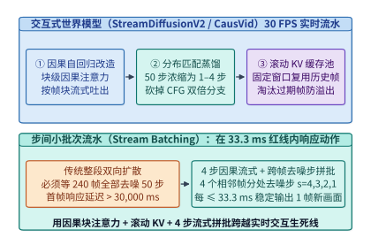

*图 19-11　交互式世界模型（StreamDiffusionV2 / CausVid）的因果少步蒸馏与 `<33.3 ms` 滚动 KV 帧生成流水线。*

如图 19-11 所示，要将原本耗时数十秒的双向视频扩散模型压缩进 $33.3\ \mathrm{ms}$ 的实时交互预算，基础设施必须协同完成四项结构改造（以 `CausVid` 与 `StreamDiffusionV2` 为代表）[^ch19-causvid-oasis]：

1. **从全双向扩散改造为块级因果自回归扩散（Block-Causal Autoregressive Diffusion）**：
   离线视频 DiT 允许第 1 帧关注第 240 帧（非因果），因而无法流式吐帧。实时世界模型通过非对称蒸馏，将注意力掩码改造为**帧块内双向、帧块间严格单向因果（Block-Causal Attention）**：生成第 $\tau$ 个潜空间帧块时，仅依赖已定稿的历史帧块 $\{1, \dots, \tau-1\}$ 与当前外部动作输入 $a_\tau$。
2. **分布匹配蒸馏（DMD / 少步一致性蒸馏）与去 CFG 化**：
   将 50 步迭代去噪并入 $S = 1\text{–}4$ 步极少步生成，同时将无条件引导分支直接蒸馏进单路模型权重，彻底砍掉双倍 CFG 开销。
3. **滚动 FIFO KV 缓存池（Rolling KV Cache with Attention Sink）**：
   已生成完毕的历史潜空间帧块无需在后续帧生成时重复计算 QKV，其键值张量直接固定写入固定容量（如最近 $W = 16$ 个潜空间帧外加首帧锚点）的**环形滚动 KV 缓存池**。每当新帧去噪定稿，最老的过期帧槽位即被原位覆写，保证无限时长交互下显存占用严格恒定（$\mathcal{O}(1)$）。
4. **步间流式拼批流水线（Inter-Step Stream Batching）**：
   当去噪步数设为 $S = 4$ 步时，若串行算完 4 步再吐出 1 帧，不仅延迟叠加为 $4 \times t_{\mathrm{pass}}$，而且单帧词元数少（如 720p 单潜空间帧仅约 $1{,}800\text{–}3{,}600$ 词元），会导致 GPU Tensor Core 严重不满载。`StreamDiffusionV2` 采用**跨帧不同去噪步拼批（Stream Batching）**：在同一次模型前向中，将正处于去噪第 $s=4$ 步的第 $\tau$ 帧、处于第 $s=3$ 步的第 $\tau-1$ 帧、处于第 $s=2$ 步的第 $\tau-2$ 帧与处于第 $s=1$ 步的第 $\tau-3$ 帧打包为一个批大小 $B = 4$ 的稠密批次并发送入 Tensor Core（或分配至 4 个微流水阶段），从而在每个单次前向周期（$\le 25\text{–}30\ \mathrm{ms}$）稳定吐出 1 帧完全去噪的新画面，稳稳跨过 30 FPS 实时交互生死线。

#### 跨帧流式拼批的帧率—动作响应延迟解耦与滚动显存封顶定律

在工程落地交互式世界模型（并衔接第 20 章的具身智能闭环策略评测器）时，系统架构师必须严格区分两个极易混淆的实时指标——**稳态出帧间隔（Inter-Frame Interval，$\Delta t_{\mathrm{fps}}$）**与**动作到光子响应延迟（Action-to-Photon Latency，$L_{\mathrm{act}}$）**，并精确核算环形滚动 KV 池的显存封顶边界：

1. **稳态帧率与控制回路延迟的流水线解耦**：
   以分辨率 $1280 \times 720$（经 $8\times$ 空间 VAE 与 $2 \times 2$ Patchify 后，单潜空间帧含 $N_{\mathrm{frame}} = 80 \times 45 = 3{,}600$ 个词元）为例：
   - 若采用**单帧串行去噪**（$B = 1$，$S = 4$ 步），由于每次前向仅 $3{,}600$ 个查询词元，百亿参数 DiT 权重读取难以被计算完全摊薄，单步耗时 $t_1 = 14.0\ \mathrm{ms}$，连跑 $4$ 步需要 $\Delta t_{\mathrm{fps}}^{\mathrm{serial}} = 4 \times 14.0 = 56.0\ \mathrm{ms}$（仅合 $17.9\ \mathrm{FPS} < 30\ \mathrm{FPS}$，画面出现明显卡顿）；
   - 若启用 **`Stream Batching` 跨帧四步拼批**（$B = S = 4$），四帧共享同一次 DiT 权重加载，矩阵乘算术强度提升近 $4$ 倍，单次拼批前向总耗时仅升至 $t_4 = 26.5\ \mathrm{ms}$。由于每个前向周期恰好有 $1$ 帧完成末步去噪出列，系统的**稳态出帧间隔**缩短至：
     $$\Delta t_{\mathrm{fps}}^{\mathrm{pipe}} = t_4 = \mathbf{26.5\ \mathrm{ms}} \le 33.3\ \mathrm{ms}\quad(\text{折合稳态帧率 } 37.7\ \mathrm{FPS})$$
   - 但与此同时，时刻 $\tau$ 新注入的控制动作 $a_\tau$ 必须依次经历全部 $S = 4$ 个拼批流水级外加尾端因果 VAE 解码（$t_{\mathrm{vae}} = 4.5\ \mathrm{ms}$）才能呈现在屏幕上，因此其**端到端动作到光子响应延迟**为：
     $$L_{\mathrm{act}}(S=4) = S \times t_4 + t_{\mathrm{vae}} = 4 \times 26.5 + 4.5 = \mathbf{110.5\ \mathrm{ms}}$$
     若下游任务为高速灵巧操作或竞技交互、要求控制回路延迟压入 $50\ \mathrm{ms}$ 以内，则必须通过分布匹配蒸馏进一步将去噪步数减半至 $S = 2$（此时 $B = 2$ 单次拼批前向耗时约 $t_2 = 18.0\ \mathrm{ms}$），在继续满足 $55.6\ \mathrm{FPS}$ 超高帧率的同时，将动作响应延迟压降至：
     $$L_{\mathrm{act}}(S=2) = 2 \times 18.0 + 4.5 = \mathbf{40.5\ \mathrm{ms}}$$

2. **无限时长交互下的 $\mathcal{O}(1)$ 显存封顶核算**：
   设块因果 DiT 共 $L = 30$ 层、每层键值总维度 $n_{kv} d_h = 1{,}536$（`BF16` 精度下单词元全层 KV 状态占 $30 \times 2 \times 1{,}536 \times 2 = 184{,}320\ \mathrm{B} = 180\ \mathrm{KiB}$）。若不启用滚动淘汰，一段仅 $60$ 秒的 $30\ \mathrm{FPS}$ 交互（按 $4\times$ 时间压缩计共 $450$ 个潜空间帧、$1{,}620{,}000$ 个历史词元）将累积 $1{,}620{,}000 \times 180\ \mathrm{KiB} \approx \mathbf{278.09\ \mathrm{GiB}}$ 的 KV 缓存，在数十秒内耗尽单卡显存。而采用“保留首部 $F_{\mathrm{sink}} = 2$ 帧全局几何锚点 + 维护最近 $W = 14$ 帧滑动窗口”的环形滚动池后，无论连续交互持续 $10$ 分钟还是 $24$ 小时，常驻有效词元数恒定锁在 $(2 + 14) \times 3{,}600 = 57{,}600$，其显存占用严格收敛于常数上界：
   $$M_{\mathrm{KV}}^{\mathrm{roll}} = (F_{\mathrm{sink}} + W) \cdot N_{\mathrm{frame}} \cdot 2 L n_{kv} d_h b = 57{,}600 \times 180\ \mathrm{KiB} = 10{,}125\ \mathrm{MiB} \approx \mathbf{9.89\ \mathrm{GiB}}$$

下面的代码给出了结合首帧注意力锚点（Attention Sink）、环形滚动 KV 缓存池与 4 步流式拼批（Stream Batching）的实时交互世界模型推理引擎实现：

```python
import torch

class RollingWorldModelKVCache:
    """支持无限时长 30 FPS 交互世界模型的环形滚动 KV 缓存池（含首帧 Sink 锚点）."""
    def __init__(self, num_layers: int, sink_frames: int, window_frames: int, tokens_per_frame: int, num_heads: int, head_dim: int, device: torch.device):
        self.sink_tokens = sink_frames * tokens_per_frame
        self.win_tokens = window_frames * tokens_per_frame
        self.tpf = tokens_per_frame
        self.write_ptr = 0
        self.filled_win = 0
        shape = (num_layers, 2, self.sink_tokens + self.win_tokens, num_heads, head_dim)
        self.kv_pool = torch.zeros(shape, dtype=torch.bfloat16, device=device)

    def commit_finalized_frame(self, layer_idx: int, k_frame: torch.Tensor, v_frame: torch.Tensor, frame_idx: int) -> None:
        """当某个潜空间帧完成最后一步去噪定稿后，将其 KV 写入 Sink 区或环形窗口区."""
        if frame_idx * self.tpf < self.sink_tokens:
            start = frame_idx * self.tpf
            self.kv_pool[layer_idx, 0, start : start + self.tpf] = k_frame
            self.kv_pool[layer_idx, 1, start : start + self.tpf] = v_frame
        else:
            start = self.sink_tokens + (self.write_ptr % self.win_tokens)
            self.kv_pool[layer_idx, 0, start : start + self.tpf] = k_frame
            self.kv_pool[layer_idx, 1, start : start + self.tpf] = v_frame
            if layer_idx == self.kv_pool.shape[0] - 1:
                self.write_ptr += self.tpf
                self.filled_win = min(self.win_tokens, self.filled_win + self.tpf)

    def get_active_kv(self, layer_idx: int) -> tuple[torch.Tensor, torch.Tensor]:
        valid_len = self.sink_tokens + self.filled_win
        return self.kv_pool[layer_idx, 0, :valid_len], self.kv_pool[layer_idx, 1, :valid_len]

class StreamBatchingWorldModelPipeline:
    """StreamDiffusionV2 风格 4 步跨帧流式拼批：每单次前向周期（<33.3ms）输出 1 帧."""
    def __init__(self, dit_step_fn, vae_decode_fn, timesteps: tuple[int, ...] = (1000, 750, 500, 250)):
        self.dit_step_fn = dit_step_fn
        self.vae_decode_fn = vae_decode_fn
        self.timesteps = timesteps
        self.S = len(timesteps)
        self.inflight_latents: list[torch.Tensor] = []
        self.inflight_actions: list[torch.Tensor] = []

    @torch.no_grad()
    def step_30fps(self, new_noisy_latent: torch.Tensor, action_embed: torch.Tensor, kv_cache: RollingWorldModelKVCache) -> torch.Tensor | None:
        """压入最新动作与噪声帧，对在途 S=4 个相邻帧打包执行 1 次前向，弹出已完成去噪帧."""
        self.inflight_latents.insert(0, new_noisy_latent)
        self.inflight_actions.insert(0, action_embed)
        curr_b = len(self.inflight_latents)

        batch_x = torch.cat(self.inflight_latents, dim=0)
        batch_a = torch.cat(self.inflight_actions, dim=0)
        batch_t = torch.tensor(self.timesteps[:curr_b], device=batch_x.device)

        # 单次 Batch=4 Tensor Core 高利用率前向，同时推进 4 个帧各自的去噪步
        updated_x = self.dit_step_fn(batch_x, batch_t, batch_a, kv_cache)
        self.inflight_latents = list(updated_x.chunk(curr_b, dim=0))

        if len(self.inflight_latents) == self.S:
            final_latent = self.inflight_latents.pop()
            self.inflight_actions.pop()
            return self.vae_decode_fn(final_latent)
        return None
```

---

## 19.4 原生全模态四池异构解耦与分级特征缓存

在第 9 章中，我们已经证明了针对纯文本大语言模型，将算力密集的预填充（Prefill, P）与访存密集的解码（Decode, D）物理分离，能够消除长提示词对流式吐词延迟（TPOT）的阻塞。然而，当线上服务升级为同时接收文本、高分图片、视频片段与实时语音，并能同步输出文本、语音或合成图像的**原生全模态模型（Omni-modal Models，如 GPT-4o、Qwen2.5-Omni / Qwen3-Omni、Gemini 2.5 及 `vLLM-Omni` 服务栈）**[^ch19-vllm-omni]时，传统的二元 P/D 分离框架已不足以刻画完整的硬件瓶颈谱系。

### 19.4.1 从三阶段弹性合并到四池异构解耦服务架构

为什么不能简单地把多模态编码器（ViT / Whisper）绑死在 Prefill 节点上？让我们考察全模态请求生命周期中的四个正交计算阶段（图 19-12）：

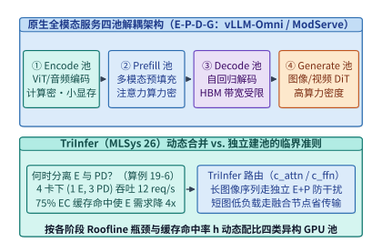

*图 19-12　从 TriInfer（MLSys '26）混合 EPD 解耦到 vLLM-Omni 原生全模态 E-P-D-G 四阶段异构池化架构（算例 19-6）。*

1. **阶段 E（Encode，模态编码池）**：运行视觉 ViT、音频 Whisper/Conformer 或视频 3D VAE 编码器。其参数量通常仅占总模型的 $2\%\text{–}10\%$（如 $400\mathrm{M}\text{–}2\mathrm{B}$），无需存储任何历史会话 KV 缓存，显存占用极小；但其内部是纯双向稠密卷积与注意力，计算高度密集，且不同请求的图像张数（1 张 vs. 16 张）与分辨率差异极大。若将 E 与 P 强行绑在同一实例内同步执行，重型多图编码会直接挤占主干 Prefill 的 SM 核心并拖慢纯文本请求的 TTFT。
2. **阶段 P（Prefill，多模态主干预填充池）**：将阶段 E 输出的紧凑多模态特征（EC）与文本嵌入拼接后，送入百亿/千亿参数的主干 LLM 执行首次前向传播并生成全层 KV 缓存。该阶段兼具大模型权重加载与长序列二次方注意力，属于典型的高算力 + 高显存带宽复合负载。
3. **阶段 D（Decode，自回归文本/离散语音解码池）**：逐词元自回归生成文本或离散音频编码（Audio Codec Tokens），算术强度极低，完全受限于 HBM 访存带宽与巨量 KV 缓存容量。
4. **阶段 G（Generate / Vocode，连续媒体生成池）**：当全模态模型需要输出高保真连续音频波形（通过流式 Flow Matching / HiFi-GAN 声码器）或同步生成图像/视频（通过外挂或内嵌 DiT 头）时，计算再次跳回无历史 KV 负担、但极度消耗 Tensor Core 浮点算力的迭代去噪负载。

针对多模态理解中的 `E-P-D` 三阶段关系，本书案例库（`case-studies/multimodal-stage-placement.md`）与 **MLSys 2026 论文 `TriInfer`**[^ch19-triinfer]给出了从静态池化走向动态弹性调度的定量准则。下面我们先通过基准算例推导 `E` 池与 `PD` 池的最优静态配比及 EC 缓存命中率对池容量的重塑效应。

> **算例 19-6（4 卡多模态集群下 E 池与 PD 池配比寻优及 75% EC 缓存命中率加速账本）：**
>
> **问题设定**（锁定自 `case-studies/multimodal-stage-placement.md`）：某 4-GPU 节点服务同构多模态请求流。单张 GPU 若专职运行模态编码阶段 `E`，其未缓存图像编码速率为 $\mu_{\mathrm{img}} = 12\ \mathrm{img/s}$；若专职运行主干预填充与解码合并阶段 `PD`，其请求服务速率为 $\mu_{PD} = 4\ \mathrm{req/s}$。系统将 4 张 GPU 划分为 $n_E$ 张编码卡与 $n_{PD} = 4 - n_E$ 张主干卡（$n_E \in \{1, 2, 3\}$）。
> 试分两个口径计算：
> 1. **单图算力受限基线（每请求含 $1$ 张图像，无跨阶段链路瓶颈）**：此时单张 `E` 卡速率为 $\mu_E = 12\ \mathrm{req/s}$，端到端稳态吞吐为 $X(n_E, n_{PD}) = \min(R_E(n_E), R_{PD}(n_{PD}))$。求零缓存（$h = 0$）下三种整数配比 $(1,3), (2,2), (3,1)$ 的系统吞吐，以及开启编码器输出缓存（EC）且取得 $h = 75\%$ 命中率后单张 `E` 卡对总体请求流的有效支撑速率 $\mu_E^{\mathrm{eff}}(0.75) = \frac{\mu_E}{1 - h}$；
> 2. **多图链路受限扩展（锁定案例库 4 图/请求 + `300 MB/s` 跨阶段传输上限）**：设每条请求携带 $4$ 张 $640 \times 640$ 图像（由算例 19-1 知单图含 DeepStack 的 EC 体积为 $7.8125\ \mathrm{MiB} = 8{,}192{,}000\ \mathrm{B}$，故每请求需从 `E` 向 `PD` 传输 $4 \times 8{,}192{,}000 = 32{,}768{,}000\ \mathrm{B} = 31.25\ \mathrm{MiB}$ 的 EC 张量），且共享的 `E -> PD` 交接链路有效带宽上限为 $B_{\mathrm{link}} = 300\ \mathrm{MB/s}$（即跨阶段交接吞吐上限为 $R_{\mathrm{link}} = \frac{300{,}000{,}000}{32{,}768{,}000} \approx \mathbf{9.16\ \mathrm{req/s}}$）。试对 $R(n_E, n_{PD}, h) = \min\!\left(\frac{12\,n_E}{4(1-h)},\; 4\,n_{PD},\; 9.16\right)$ 对比 $h = 0$ 与 $h = 75\%$ 下的最优整数卡数配比跃迁。
>
> **逐项推导**：
>
> 1. **单图基线（$1\ \mathrm{img/req}$，无链路瓶颈）下的 4 卡配比与 $h = 75\%$ 有效速率倍增**：
>    当每请求含 $1$ 张图像且 $h = 0$ 时，$R_E = 12 n_E$，$R_{PD} = 4 n_{PD}$，枚举三种正整数切分方案可得表 19-4（上半部）：
>    - `(1, 3)`：$R_E = 12,\ R_{PD} = 12 \implies X = \mathbf{12\ \mathrm{req/s}}$（两阶段严格匹配，4 卡满载）；
>    - `(2, 2)`：$R_E = 24,\ R_{PD} = 8 \implies X = \mathbf{8\ \mathrm{req/s}}$（`PD` 池受限，编码池闲置 $16\ \mathrm{req/s}$）；
>    - `(3, 1)`：$R_E = 36,\ R_{PD} = 4 \implies X = \mathbf{4\ \mathrm{req/s}}$（`PD` 池严重饥饿）。
>    当开启 EC 缓存并取得 $h = 75\%$ 命中率时，仅 $1 - h = 25\%$ 的未命中请求消耗 `E` 卡算力，单张 `E` 卡在单图基线下的有效支撑速率放大 $4$ 倍至：
>    $$\mu_E^{\mathrm{eff}}(0.75) = \frac{12}{1 - 0.75} = \mathbf{48\ \mathrm{req/s}}\quad(4\times\ \text{提升})$$
>
> 2. **多图（$4\ \mathrm{img/req}$）+ `300 MB/s` 交接链路上限下的最优配比漂移**：
>    当每条请求含 $4$ 张图像时，单张 `E` 卡在 $h = 0$ 下每秒可编码 $12 / 4 = 3\ \mathrm{req/s}$，而在 $h = 75\%$ 下每秒可支撑 $\frac{12}{4(1 - 0.75)} = 12\ \mathrm{req/s}$；同时跨阶段链路封顶于 $R_{\mathrm{link}} \approx 9.16\ \mathrm{req/s}$：
>    - **当 $h = 0$（零缓存）时**：
>      - `1E + 3PD`：$\min(3,\ 12,\ 9.16) = \mathbf{3.00\ \mathrm{req/s}}$（受限于 `E` 池算力）；
>      - **`2E + 2PD`（最优）**：$\min(6,\ 8,\ 9.16) = \mathbf{6.00\ \mathrm{req/s}}$（受限于 `E` 池，但总吞吐翻倍）；
>      - `3E + 1PD`：$\min(9,\ 4,\ 9.16) = \mathbf{4.00\ \mathrm{req/s}}$（受限于 `PD` 池）。
>    - **当 $h = 75\%$（高 EC 缓存命中）时**：
>      - **`1E + 3PD`（逆袭为最优）**：$\min(12,\ 12,\ 9.16) = \mathbf{9.16\ \mathrm{req/s}}$（算力瓶颈解除，转由 `E -> PD` 交接链路带宽封顶）；
>      - `2E + 2PD`：$\min(24,\ 8,\ 9.16) = \mathbf{8.00\ \mathrm{req/s}}$（受限于 2 张 `PD` 卡的 $8\ \mathrm{req/s}$ 上限）；
>      - `3E + 1PD`：$\min(36,\ 4,\ 9.16) = \mathbf{4.00\ \mathrm{req/s}}$（受限于 `PD` 池）。

*表 19-4　4 卡多模态集群下 E 池与 PD 池配比寻优及 75% EC 缓存命中率与链路瓶颈演化对比*

| 配比方案 $(n_E, n_{PD})$ | 单图基线吞吐 ($1\ \mathrm{img/req}, h=0$) | 4 图/请求吞吐 ($h=0$, 算力受限) | 4 图/请求吞吐 ($h=75\%$, 含 $9.16$ 链路顶) | 瓶颈漂移与最优配比演化分析 |
| :--- | :---: | :---: | :---: | :--- |
| **`(1, 3)`** | **$\mathbf{12.00\ \mathrm{req/s}}$（单图最优）** | $3.00\ \mathrm{req/s}$（`E` 受限） | **$\mathbf{9.16\ \mathrm{req/s}}$（$h=75\%$ 最优）** | **高缓存命中释放 `E` 卡，触发 `300 MB/s` 交接链路顶** |
| **`(2, 2)`** | $8.00\ \mathrm{req/s}$ | **$\mathbf{6.00\ \mathrm{req/s}}$（$h=0$ 最优）** | $8.00\ \mathrm{req/s}$（`PD` 受限） | 零缓存多图下最优，但高缓存下多占了 1 张 `PD` 卡 |
| **`(3, 1)`** | $4.00\ \mathrm{req/s}$ | $4.00\ \mathrm{req/s}$ | $4.00\ \mathrm{req/s}$ | 无论何种工况均受单张 `PD` 卡（$4\ \mathrm{req/s}$）上限限制 |

这引出了 `TriInfer`（MLSys '26）的核心调度洞见：**静态固定的 `E / P / D` 物理分池在面对剧烈波动的缓存命中率 $h$ 与变长图像词元数 $N_{\mathrm{vis}}$ 时，必然产生阶段性的算力空置。** 为此，`TriInfer` 设立了三类弹性工作池——专职编码预填充池、专职解码池、以及同时加载编码器与主干权重的**弹性混合池（Hybrid Pool）**，并在网关层根据每条请求的注意力开销与前馈网络开销比值 $\rho = \frac{c_{\mathrm{attn}}(N_{\mathrm{vis}}, L)}{c_{\mathrm{ffn}}(N_{\mathrm{vis}}, L)}$ 执行动态路由：
- 当遇到含多张高清大图、$\rho > \tau_{\mathrm{split}}$ 的重型请求时，将其派往物理分离的独立 `E` 节点与 `P` 节点，通过发送紧凑的 EC 张量（算例 19-1 中的 $7.8125\ \mathrm{MiB}$）避免冲击线上解码流的 TPOT；
- 当遇到高缓存命中（$h$ 升高）或短图轻量请求时，弹性混合节点自动从空闲的 `E` 角色切换为协助分担 `PD` 负载，或直接在单机内原位完成 `E+P` 免去跨网传输。

#### 跨阶段交接带宽边界与双轨基座状态翻转准则

在把 `E-P-D-G` 四阶段解耦落入真实机房拓扑时，架构师还必须回答一个决定网卡选型与分池边界的定量问题：**为什么在传统多模态大模型中应当优先在 `E` 与 `PD` 之间切开网络边界，而当主干切换为稀疏注意力或潜变量压缩架构时，阶段间的通信瓶颈又会发生怎样的结构性翻转？** 我们将本书贯穿始终的两套双轨锚点模型——稠密 `GQA` 路线（以 `Qwen3-8B / Qwen3-VL` 系列为代表）与压缩潜变量 `MLA` 路线（以 `DeepSeek-V3 / V4` 多模态扩展主干为代表）——放入同一张跨节点字节账本中进行对比：

1. **稠密 `GQA` 多模态基座（`KV` 远重于 `EC`，优先切分 `E -> PD`）**：
   - 在算例 19-1 的 `Qwen3-VL-4B`（$36$ 层，$8$ 个 KV 头，$d_h = 128$，`BF16`）中，每个合并后的视觉词元携带含 $3$ 层 DeepStack 在内的编码特征体积为 $e_{\mathrm{EC}}^{\mathrm{GQA}} = 20{,}480\ \mathrm{B/token}$，而其进入主干预填充后生成的全层 KV 状态体积高达 $e_{\mathrm{KV}}^{\mathrm{GQA}} = 147{,}456\ \mathrm{B/token}$（若换算为第 1 章锚定的 `Qwen3-8B` 同级 $36$ 层 $8$ 头 `BF16` GQA 基座，单词元 KV 状态同样为 $36 \times 2 \times 8 \times 128 \times 2 = 147{,}456\ \mathrm{B/token}$），两者体积悬殊达：
     $$\frac{e_{\mathrm{KV}}^{\mathrm{GQA}}}{e_{\mathrm{EC}}^{\mathrm{GQA}}} = \frac{147{,}456}{20{,}480} = \mathbf{7.20\times}$$
   - 这意味着对于算例 19-6 中每条携带 $4$ 张 $640 \times 640$ 图像（共 $1{,}600$ 个视觉词元）的请求，`E -> P` 跨阶段交接仅需传输 $1{,}600 \times 20{,}480\ \mathrm{B} = 32{,}768{,}000\ \mathrm{B} = 31.25\ \mathrm{MiB}$ 的紧凑 `EC` 张量，在普通 `300 MB/s` 容器网络上即可支撑 $300{,}000{,}000 / 32{,}768{,}000 \approx \mathbf{9.16\ \mathrm{req/s}}$；反之，若在缺乏高速 RDMA 专网的条件下强行拆开 `P -> D`，每条请求仅视觉前缀就需搬运 $1{,}600 \times 147{,}456\ \mathrm{B} = 235{,}929{,}600\ \mathrm{B} = 225.00\ \mathrm{MiB}$ 的 `KV` 状态，同一条 `300 MB/s` 链路的交接上限将跌至 $300{,}000{,}000 / 235{,}929{,}600 \approx \mathbf{1.27\ \mathrm{req/s}}$。因此，在 `GQA` 基座上，`E` 池可灵活部署于常规以太网连接的异构视觉编码节点（如高性价比 L40S 池），而 `P` 与 `D` 的分离则必须建立在第 9 章所述的 `50–400 Gbps` RoCEv2/InfiniBand RDMA 网络之上。

2. **潜变量压缩 `MLA` 多模态基座（`KV` 压缩逼近乃至反超 `EC`，瓶颈重回算力与 `E -> P` 带宽）**：
   - 当语言主干升级为 `DeepSeek-V3 / V4` 架构的多头潜注意力（MLA，$L = 61$ 层，隐藏维度 $d = 7{,}168$，压缩潜向量维度 $c_{KV} = 512$，解耦旋转位置编码维度 $d_R = 64$）时，每层仅需缓存 $512 + 64 = 576$ 个标量元素。在 `BF16` 精度下，单个视觉词元跨越全部 $61$ 层的 `KV` 缓存体积骤缩至：
     $$e_{\mathrm{KV}}^{\mathrm{MLA\text{-}BF16}} = 61 \times 576 \times 2\ \mathrm{B} = \mathbf{70{,}272\ \mathrm{B/token}}$$
     若进一步采用生产集群标准的 `FP8` 潜向量缓存，则单词元全层 `KV` 状态仅占：
     $$e_{\mathrm{KV}}^{\mathrm{MLA\text{-}FP8}} = 61 \times 576 \times 1\ \mathrm{B} = \mathbf{35{,}136\ \mathrm{B/token}}$$
   - 与此同时，由于宽主干的嵌入维度扩展至 $d = 7{,}168$，即便仅传输单层 `BF16` 投射特征，单词元 `EC` 亦需 $7{,}168 \times 2\ \mathrm{B} = 14{,}336\ \mathrm{B/token}$；若同样提取主干输入加上 $3$ 层跨深度特征（共 $4$ 组 `BF16` 特征分支）构成多层 `EC`，则单词元 `EC` 体积将达到：
     $$e_{\mathrm{EC}}^{\mathrm{MLA\text{-}4x}} = 4 \times 7{,}168 \times 2\ \mathrm{B} = \mathbf{57{,}344\ \mathrm{B/token}}$$
   - 对比可见，在 `BF16` MLA 下全层 `KV` 与多层 `EC` 的体积比已从 `GQA` 时代的 $7.20\times$ 收敛至 $70{,}272 / 57{,}344 \approx \mathbf{1.23\times}$；而在 `FP8` MLA 下，全层 `KV` 状态反而比 4 分支 `BF16` `EC` 更轻巧（$35{,}136 / 57{,}344 \approx \mathbf{0.613\times}$）。这一翻转准则揭示了一个深刻的协同设计规律：**随着主干注意力向 `MLA` 潜空间压缩演进，`P -> D` 跨节点传输多模态长上下文 `KV` 的网络壁垒被削减了 $2.1\times\text{–}4.2\times$；此时为防止多层 `EC` 反向阻塞 `E -> P` 链路，视觉投射器（MLP Merger）应当下沉至 `P` 池侧就地展开，使 `E -> P` 仅传输投射前的低维 ViT 原始特征或 `FP8` 量化嵌入。**

下面的参考代码实现了结合 `TriInfer` 动态分离判据（$\rho = c_{\mathrm{attn}} / c_{\mathrm{ffn}}$）、`E-P-D-G` 四池吞吐配比与双层多模态缓存降级（KV $\to$ EC，释放 $86.11\%$ 容量）的全模态调度控制器：

```python
from dataclasses import dataclass

@dataclass
class MultimodalRequestProfile:
    req_id: str
    image_hashes: list[str]
    num_vis_tokens: int        # 例如单张 640x640 图为 400
    num_text_tokens: int
    needs_media_gen: bool = False

class EPDGDisaggregatedScheduler:
    """结合 TriInfer (MLSys '26) 动态合并准则与双层 EC/KV 缓存管理的全模态调度器."""
    def __init__(
        self,
        llm_dim: int = 2560,
        ffn_inter_dim: int = 6912,
        rho_split_thresh: float = 0.35,
        ec_bytes_per_vis_tok: int = 20480,      # Qwen3-VL-4B: 10240 * 2B = 20,480 B
        kv_bytes_per_tok: int = 147456,         # 36 层 GQA: 147,456 B/token
    ):
        self.d = llm_dim
        self.d_ffn = ffn_inter_dim
        self.rho_thresh = rho_split_thresh
        self.ec_bpt = ec_bytes_per_vis_tok
        self.kv_bpt = kv_bytes_per_tok
        self.ec_cache_store: dict[str, int] = {}   # image_hash -> byte_size
        self.hot_kv_sessions: dict[str, int] = {}  # req_id -> byte_size

    def compute_triinfer_rho(self, req: MultimodalRequestProfile) -> float:
        """计算注意力计算代价与 FFN 计算代价之比 rho = c_attn / c_ffn."""
        seq_len = req.num_vis_tokens + req.num_text_tokens
        c_attn = 4.0 * (seq_len ** 2) * self.d
        c_ffn = 6.0 * seq_len * self.d * self.d_ffn
        return c_attn / max(c_ffn, 1.0)

    def route_request(self, req: MultimodalRequestProfile) -> dict[str, object]:
        unached_imgs = [h for h in req.image_hashes if h not in self.ec_cache_store]
        ec_hit_rate = 1.0 - (len(unached_imgs) / max(len(req.image_hashes), 1))
        rho = self.compute_triinfer_rho(req)

        # 若全部命中 EC 缓存，直接跳过 Encode 池直达 Prefill 池
        if len(unached_imgs) == 0:
            stage_plan = ["P_POOL", "D_POOL"]
            transfer_bytes = 0
        elif rho >= self.rho_thresh:
            # 重型长多模态序列：走独立 E 池 -> P 池，跨网传输紧凑 EC (7.8125 MiB/图)
            stage_plan = ["E_POOL", "P_POOL", "D_POOL"]
            transfer_bytes = req.num_vis_tokens * self.ec_bpt
        else:
            # 短序列低比值：走弹性 Hybrid 节点原位完成 E+P，免除网络传输
            stage_plan = ["HYBRID_EP_NODE", "D_POOL"]
            transfer_bytes = 0

        if req.needs_media_gen:
            stage_plan.append("G_POOL_DIT")

        return {
            "req_id": req.req_id,
            "ec_hit_rate": round(ec_hit_rate, 4),
            "triinfer_rho": round(rho, 4),
            "stage_plan": stage_plan,
            "e_to_p_transfer_mib": round(transfer_bytes / (1024 ** 2), 4),
        }

    def demote_warm_session_kv_to_ec(self, req: MultimodalRequestProfile) -> dict[str, float]:
        """当多轮对话转入温态时，释放 56.25 MiB 视觉 KV，仅保留 7.8125 MiB EC."""
        kv_bytes = req.num_vis_tokens * self.kv_bpt
        ec_bytes = req.num_vis_tokens * self.ec_bpt
        for h in req.image_hashes:
            self.ec_cache_store[h] = ec_bytes // max(len(req.image_hashes), 1)
        self.hot_kv_sessions.pop(req.req_id, None)
        return {
            "freed_kv_mib": kv_bytes / (1024 ** 2),
            "retained_ec_mib": ec_bytes / (1024 ** 2),
            "memory_saving_ratio": 1.0 - (ec_bytes / kv_bytes),
        }
```

### 19.4.2 视觉编码特征缓存降级与多模态异步微批聚合

在多轮多模态对话（例如用户上传一张架构图或一段长视频后，连续追问 5–10 个问题）中，编码特征缓存（Embedding Cache, EC）与主干 KV 缓存的协同分层直接决定了单机可支撑的并发会话上限。

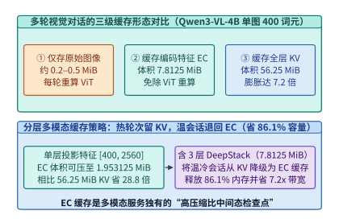

*图 19-13　多轮多模态对话中缓存原始图片、缓存 ViT 视觉特征（7.8125 MiB）与缓存 LLM 全层 KV（56.25 MiB）的体积与重算延迟折中。*

结合算例 19-1 的精确账本，图 19-13 对比了多模态服务中三级缓存形态的性价比边界（表 19-5）：

*表 19-5　多模态在线服务中三级缓存形态（原始图像、编码器输出 EC 与主干 KV 缓存）的体积与重算代价对比*

| 缓存形态 | 单图（`Qwen3-VL-4B` 400 词元）体积 | 相对主干 KV 体积比 | 后续轮次命中时的重算代价 | 适用生命周期层级 |
| :--- | :---: | :---: | :--- | :--- |
| **① 原始压缩图像（JPEG）** | $\sim 0.2\text{–}0.5\ \mathrm{MiB}$ | $< 1\%$ | 需完整重跑 ViT 编码 + LLM Prefill | 磁盘/对象存储冷归档层 |
| **② 编码器输出（EC，单层投射）** | **$1.953125\ \mathrm{MiB}$** | **$3.47\%$（省 $28.8\times$）** | 免除 ViT 计算，仅需重跑轻量 Prefill | **主机 DRAM / 分布式温缓存首选** |
| **②' 编码器输出（EC，含 3 层 DeepStack）** | **$7.8125\ \mathrm{MiB}$** | **$13.89\%$（省 $7.2\times$）** | 免除 ViT 与多层特征提取 | **跨 `E→P` 传输与温会话驻留标准态** |
| **③ 36 层 LLM 主干 KV 缓存** | **$56.25\ \mathrm{MiB}$** | $100\%$（基准） | 零重算，直接进入 Decode | 活跃度最高的 GPU HBM 热层（数秒内） |

这一对比确立了多模态引擎（如 `vLLM` 与 `SGLang` 多模态缓存扩展）的**双层阶梯淘汰策略（Two-Tier Multimodal Cache Eviction）**：
1. 当用户刚发完第 $k$ 轮提问、正处于数秒内的密集追问窗口时，系统在 GPU HBM 中保留完整的 $56.25\ \mathrm{MiB}$ 主干 KV 缓存；
2. 一旦会话进入数十秒的阅读思考间隔（温态），淘汰器**优先释放占空间 $56.25\ \mathrm{MiB}$ 的视觉词元主干 KV 页帧，但保留仅占 $7.8125\ \mathrm{MiB}$（或单层 $1.953125\ \mathrm{MiB}$）的图像内容哈希索引 EC 缓存**。这样既立即收回了 **$86.11\%$（乃至 $96.53\%$）** 的宝贵显存，又能在用户发起下一轮提问时完全省去昂贵的 ViT 视觉编码与跨节点图像搬移。

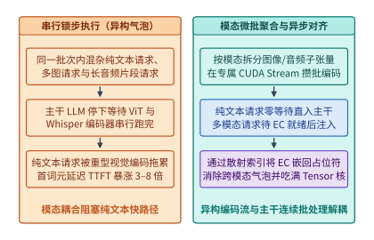

*图 19-14　图文音交错流（Omni-modal）中模态专属编码器微批聚合与主干对齐调度。*

最后，在单节点内部处理图文音交错请求流时，必须避免“串行锁步执行”造成的跨模态阻塞（图 19-14）。如果一个连续批处理（Continuous Batching）步内同时到达了 12 条纯文本请求、3 条带图请求和 2 条带语音请求，朴素实现会让全部 17 条请求一起停下来，先串行跑完 ViT，再跑完 Whisper 音频编码，最后才进入 LLM 主干——导致那 12 条本可在 $15\ \mathrm{ms}$ 内吐出首词元的纯文本请求被迫陪等上百毫秒。

高性能全模态运行时采用**异步模态微批聚合与占位符散射注入（Asynchronous Modality Micro-Batching & Scatter Injection）**：
- 纯文本请求到达后零等待直通 LLM 主干执行连续批处理；
- 带图或带音请求在预处理入口先被替换为带唯一槽位 ID 的特殊占位符词元（`<image_pad>` / `<audio_pad>`），其原始多模态张量被投递至独立的视觉/音频编码队列；
- 独立 CUDA Stream（或独立 `E` 池）在数毫秒窗口内将来自不同请求的图像子块打包为稠密视觉微批（ViT Micro-Batch）一次性跑满 Tensor Core，编码产出的 EC 特征写入共享显存缓冲池后，再唤醒该多模态请求加入下一拍的主干 Prefill 批次，通过自定义 `index_put_ / scatter` 算子将 EC 向量原位覆写到占位符位置。

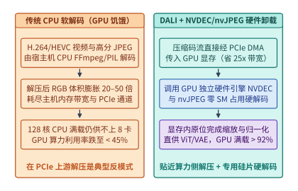

*图 19-15　多模态预训练中 CPU 解码饥饿瓶颈与 DALI / nvJPEG / NVDEC 硬件视频解码卸载流水线。*

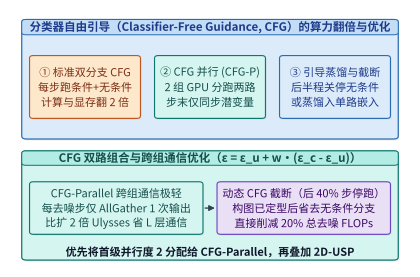

*图 19-16　分类器自由引导（CFG 双分支）与条件/无条件批量合并及尾部蒸馏对比。*

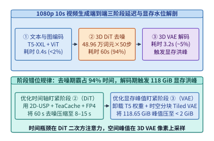

*图 19-17　1080p 视频生成从文本编码、50 步 DiT 去噪到 3D VAE 解码的端到端延迟与显存峰值全貌。*

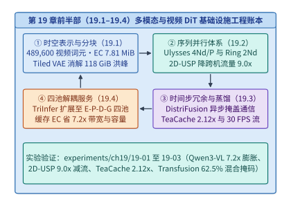

*图 19-18　多模态与世界模型基础设施的算法—并行—缓存—解耦四维总架构图。*

图 19-15 至图 19-18 依次总结了本章前面剖析的 GPU 硬件媒体解码（NVDEC/nvJPEG）卸载、分类器自由引导（CFG）并行与尾部截断、1080p 视频生成三阶段延迟/显存错位规律，以及全章从三维潜空间表征、超长序列并行、时间步冗余压缩到全模态四池解耦的四维总架构图。读者可直接运行配套实验 `experiments/ch19/19-01` 与 `experiments/ch19/19-02`，在本地复现本章全部基准算例的精确数值账本。

### 19.4.3 自回归扩散混合掩码与三维高斯引导世界模型

在 19.4.1 节与 19.4.2 节中，我们探讨了通过外部连接器将视觉编码器（ViT）、大语言模型（LLM）与扩散变换器（DiT）组装在一起的模块化全模态流水线。然而，前沿多模态基础模型正在向更深层的统一架构演进——即在**同一个 Transformer 主干权重与同一条交错序列**内，同时对离散文本词元执行**下一词元自回归预测（Next-Token Autoregressive Prediction）**，并对连续图像/视频潜变量块执行**多步迭代去噪扩散（Continuous Diffusion / Flow Matching）**。以 Meta `Transfusion`、字节与新国大 `Show-o`、`Bagel`、`Janus-Pro` 以及 `Chameleon` 演进路线为代表的统一架构[^ch19-transfusion-bagel]，虽然消除了跨模型投射的信息损耗，却给推理引擎的注意力内核与 KV 缓存管理带来了全新的系统挑战。

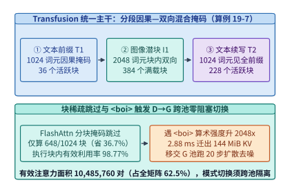

*图 19-19　Transfusion / Show-o 离散自回归与连续扩散混合掩码（Hybrid Causal-Bidirectional Mask）及 KV 缓存分块调度。*

如图 19-19 所示，在 `Transfusion` 架构中，一条图文交错序列由多个离散文本段 $\mathcal{T}_1, \mathcal{T}_2, \dots$ 与插入在 `<boi>`（图像起始符）和 `<eoi>`（图像终止符）之间的连续图像块 $\mathcal{I}_1, \mathcal{I}_2, \dots$ 共同构成。其注意力掩码不再是单一的下三角矩阵或全一矩阵，而是**分块因果—双向混合掩码（Blockwise Causal-Bidirectional Hybrid Mask）**：
- **在文本段内部及跨段历史方向**：任意位置 $i$ 的词元（无论是文本词元还是图像块词元）对早于它的所有历史文本词元和**已完成去噪定稿**的历史图像块词元均保持单向因果可见（Lower-Triangular Causal Visibility）；
- **在当前正在生成的图像段 $\mathcal{I}_m$ 内部**：当解码器生成出 `<boi>` 触发符后，引擎一次性压入 $N_{\mathrm{img}}$ 个高斯噪声潜变量块（例如 $16 \times 16 = 256$ 或 $32 \times 32 = 1{,}024$ 个块）。在这 $N_{\mathrm{img}}$ 个词元内部，注意力掩码切换为 **$N_{\mathrm{img}} \times N_{\mathrm{img}}$ 全双向可见正方形（Bidirectional Square Sub-block）**，并在此局部窗口上连续循环执行 $K = 20\text{–}30$ 个扩散去噪步；待最后一步去噪收敛并吐出 `<eoi>` 后，这 $N_{\mathrm{img}}$ 个图像词元的最终键值特征被冻结固化为只读历史 KV 缓存，引擎随即切回逐词元文本自回归解码。

如果直接在标准 `vLLM` 或 `FlashAttention` 上运行这种混合序列，会立刻引爆两处性能灾难：
1. **分块掩码碎片化与无效 FLOPs 浪费**：在标准 PagedAttention 中，若一个物理页块（Page Block，如 64 或 128 词元）内同时混装了末尾的因果文本词元和开头的双向图像词元，FlashAttention 的在线分块（Tile）循环将被迫在每个块内加载显式二维布尔掩码矩阵，无法走硬件最快的纯下三角或纯无掩码（Unmasked）快速路径，导致算子吞吐下跌 $35\%\text{–}50\%$。
2. **$K$ 步图像去噪期间对只读前缀 KV 的重复 HBM 带宽冲击**：在生成单张图像的 $K = 25$ 个去噪时间步中，那 $N_{\mathrm{img}} = 1{,}024$ 个图像块在每一步都会原地覆写（In-place Overwrite）自身的瞬态 KV 缓冲，而排在它们前面的 $L_{\mathrm{prefix}}$ 个历史文本与历史图像 KV 缓存则完全不变。若将可变图像 KV 与只读前缀 KV 混在同一套分页链表中，不仅破坏了前缀缓存（Prefix Caching）的哈希不可变性，还会在小批量去噪时反复重读长前缀。

工程上的高吞吐解法是构建**双轨分页 KV 缓存与模态对齐分块调度器（Dual-Track Paged KV & Modality-Aligned Tile Dispatcher）**：
- **页边界强制模态对齐**：在 `<boi>` 与 `<eoi>` 切换点强制开启新的逻辑页块，确保任意物理页块要么是纯因果文本页（走标准 Causal FlashAttention 快路径），要么是纯双向图像页（走 Unmasked Bidirectional FlashAttention 快路径）；
- **只读前缀页与瞬态去噪暂存页（Scratchpad KV Pages）物理分离**：为正在去噪的 $N_{\mathrm{img}}$ 个图像词元分配固定地址的**瞬态暂存页池（In-place Mutable Scratchpad Pool）**，在全部 $K$ 步去噪期间零页表分配地原位更新，仅在第 $K$ 步定稿后才将其提升（Promote）并追加至不可变前缀 KV 树。

> **算例 19-7（Transfusion 图文交错混合掩码有效密度、FlashAttention 分块跳过与 D→G 跨池交接账本）：**
>
> **问题设定**：考察一个 36 层 `Transfusion` 统一多模态模型（GQA 配置同算例 19-1：每词元全层 KV 缓存体积为 $B_{\mathrm{KV/tok}} = 147{,}456\ \mathrm{B} = 144\ \mathrm{KiB}$）。某图文交错序列总长度为 $L_{\mathrm{tot}} = 4{,}096$ 个词元，由三段依次拼接而成：第一段为文本前缀 $L_{T_1} = 1{,}024$ 词元（下三角因果掩码），第二段为夹在 `<boi>` 与 `<eoi>` 之间的高清图像潜变量块 $L_{I_1} = 2{,}048$ 词元（对 $T_1$ 全可见、且在 $I_1$ 内部 $2{,}048 \times 2{,}048$ 全双向可见，执行 $K = 20$ 步扩散去噪），第三段为文本续写 $L_{T_2} = 1{,}024$ 词元（对 $T_1 + I_1$ 全可见、在 $T_2$ 内部下三角因果可见）。设 FlashAttention 分块（Tile）粒度为 $B_r \times B_c = 128 \times 128$。试精确计算：（1）整条序列在混合掩码下的有效 Query-Key 词元交互对数（Active Token Pairs）及其占 $4{,}096 \times 4{,}096$ 全矩阵的比例；（2）在 $32 \times 32 = 1{,}024$ 个 FlashAttention 块中，实际需执行的非空块数、可完全跳过的全零掩码块数（及跳过比例）与执行块内有效算力利用率；（3）在在线服务中，当解码池 `D` 吐出完 $L_{T_1} = 1{,}024$ 个文本词元并触发 `<boi>` 时，若将其只读前缀 KV 通过有效带宽 $50{,}000\ \mathrm{MiB/s}$（约 $50\ \mathrm{GB/s}$）的 RDMA 链路移交至高算力生成池 `G` 执行 20 步扩散去噪，需传输多少 $\mathrm{MiB}$ 的 KV 状态？交接耗时是多少毫秒？
>
> **逐项推导**：
>
> 1. **三段混合掩码的有效 Query-Key 词元交互面积**：
>    - 文本段 $T_1$（$1{,}024$ 因果词元，按连续积分面积口径 $\frac{1}{2} L_{T_1}^2$）：
>      $$A_{T_1} = \frac{1{,}024 \times 1{,}024}{2} = \mathbf{524{,}288\ \text{对}}$$
>    - 图像段 $I_1$（$2{,}048$ 个块，可见全部 $T_1$ 前缀 + 自身 $I_1$ 全双向块）：
>      $$A_{I_1} = 2{,}048 \times 1{,}024 + 2{,}048 \times 2{,}048 = 2{,}097{,}152 + 4{,}194{,}304 = \mathbf{6{,}291{,}456\ \text{对}}$$
>    - 文本续写段 $T_2$（$1{,}024$ 因果词元，可见全部 $T_1 + I_1 = 3{,}072$ 前缀 + 自身下三角）：
>      $$A_{T_2} = 1{,}024 \times 3{,}072 + \frac{1{,}024 \times 1{,}024}{2} = 3{,}145{,}728 + 524{,}288 = \mathbf{3{,}670{,}016\ \text{对}}$$
>    - 三段合计有效交互对数与混合掩码密度为：
>      $$A_{\mathrm{active}} = 524{,}288 + 6{,}291{,}456 + 3{,}670{,}016 = \mathbf{10{,}485{,}760\ \text{对}}$$
>      $$\rho_{\mathrm{mask}} = \frac{10{,}485{,}760}{4{,}096 \times 4{,}096} = \frac{10{,}485{,}760}{16{,}777{,}216} = \mathbf{62.5\%}$$
>
> 2. **$128 \times 128$ FlashAttention 分块跳过与执行块内有效利用率**：
>    三段对应的块数分别为 $b_{T_1} = \frac{1024}{128} = 8$、$b_{I_1} = \frac{2048}{128} = 16$、$b_{T_2} = \frac{1024}{128} = 8$（全矩阵共 $32 \times 32 = \mathbf{1{,}024}$ 个 Tile）：
>    - $T_1$ 段活跃块数：$\frac{8 \times (8 + 1)}{2} = \mathbf{36\ \text{块}}$；
>    - $I_1$ 段活跃块数：$16 \times 8 + 16 \times 16 = 128 + 256 = \mathbf{384\ \text{块}}$（全部 $100\%$ 满载无掩码）；
>    - $T_2$ 段活跃块数：$8 \times (8 + 16) + \frac{8 \times (8 + 1)}{2} = 192 + 36 = \mathbf{228\ \text{块}}$。
>    - 实际执行总块数 $N_{\mathrm{exec}} = 36 + 384 + 228 = \mathbf{648\ \text{块}}$，直接跳过全零掩码块 $1{,}024 - 648 = \mathbf{376\ \text{块}}$（省去 **$\mathbf{36.72\%}$** 的块调度），且已执行的 648 个块内部有效词元填充率高达：
>      $$\eta_{\mathrm{tile}} = \frac{10{,}485{,}760}{648 \times 128 \times 128} = \frac{10{,}485{,}760}{10{,}616{,}832} \approx \mathbf{98.77\%}$$
>
> 3. **`<boi>` 触发 `D -> G` 跨池交接体积与延迟**：
>    一旦解码池 `D` 吐出 `<boi>`，接下来需对 $L_{I_1} = 2{,}048$ 个图像词元并发执行去噪，单步算术强度相对单序列逐词元 Decode 激增 **$2{,}048\times$**。此时将 $L_{T_1} = 1{,}024$ 个已定稿前缀词元的 KV 缓存移交至生成池 `G`：
>    $$V_{\mathrm{handoff}} = 1{,}024 \times 144\ \mathrm{KiB} = \mathbf{144.0\ \mathrm{MiB}},\qquad T_{\mathrm{handoff}} = \frac{144.0\ \mathrm{MiB}}{50{,}000\ \mathrm{MiB/s}} = \mathbf{2.88\ \mathrm{ms}}$$
>    同时在生成池 `G` 内部，采用原位覆写暂存页（Scratchpad KV，固定占 $2{,}048 \times 144\ \mathrm{KiB} = 288.0\ \mathrm{MiB}$）替代 20 步按步追加分配（$5{,}760.0\ \mathrm{MiB}$），以仅 $2.88\ \mathrm{ms}$ 的交接代价彻底隔离了图像多步扩散对文本解码 TPOT 的干扰。

除了图文统一主干，19.3.3 节讨论的交互式视频世界模型在实际落地自动驾驶交互重仿真与具身机器人导航时，还面临一个关键的物理缺陷：**纯二维潜空间视频扩散缺乏显式三维几何约束**。当智能体控制相机执行大角度环绕平移、先左转 90 度隔 5 秒再右转回原位时，纯 2D/3D 视频 DiT 极易发生“三维结构漂移与多视角幻觉（Multi-View Geometric Hallucination）”——原本停在路边的车辆或建筑在镜头转回时莫名变形甚至消失。

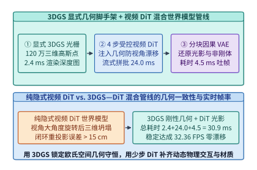

*图 19-20　3D 高斯泼溅（3DGS）几何脚手架引导的 3D 视频世界模型（Camera-Controlled World Model）管线。*

如图 19-20 所示，工业界最新一代相机可控世界模型（以 `Wonderland`、`CAT3D`、`StreetGaussians` 与 `Genie-3D` 为代表）引入了**“显式三维高斯泼溅（3D Gaussian Splatting, 3DGS）几何脚手架 + 隐式 3D DiT 神经去噪补全”的双引擎混合管线**[^ch19-3dgs-world]：
1. **显式 3DGS 几何脚手架（Explicit 3DGS Geometric Scaffold）**：系统在显存中维护一组稀疏的三维各向异性高斯椭球集合 $\mathcal{G} = \{(\mu_k, \Sigma_k, \alpha_k, c_k)\}_{k=1}^M$（包含三维中心坐标 $\mu_k \in \mathbb{R}^3$、协方差矩阵 $\Sigma_k$、不透明度 $\alpha_k$ 与球谐外观特征 $c_k$），充当整个物理场景的持久三维记忆体。
2. **微秒级视锥剔除（Frustum Culling）与分块光栅化（Tile-Based Splatting）**：当智能体在时刻 $t$ 输入新的六自由度相机外参矩阵 $[R_t \mid \mathbf{t}_t] \in \mathrm{SE}(3)$ 时，GPU 首先启动轻量级 CUDA 光栅化核：
   - 第一步执行**视锥剔除**，瞬间过滤掉处于当前相机视野之外的 $70\%\text{–}85\%$ 高斯点；
   - 第二步将屏幕空间划分为 $16 \times 16$ 像素瓦片（Tiles），按深度排序执行 $\alpha$-混合前向泼溅，在 **$1.5\text{–}3.0\ \mathrm{ms}$** 内渲染出几何严密对齐的粗糙 RGB 先验图、深度图（Depth Map）与未观测空洞掩码（Occlusion Inpainting Mask）。
3. **普吕克射线嵌入（Plücker Ray Embedding）与 ControlNet/DiT 引导去噪**：将每个像素对应的相机光线转化为六维普吕克坐标 $\mathbf{r} = (\mathbf{d},\; \mathbf{o} \times \mathbf{d}) \in \mathbb{R}^6$（其中 $\mathbf{o}$ 为相机光心、$\mathbf{d}$ 为单位射线方向），与 3DGS 渲染出的粗糙特征图在通道维拼接后注入少步 3D DiT。此时 DiT 不再需要凭空猜测三维透视关系，只需专注于修复遮挡空洞、合成动态物体（行人、车流、光影反射）的高频逼真纹理，并将新生成的视角帧反向蒸馏回写以增量扩充 3DGS 高斯点云，从而在 $< 33.3\ \mathrm{ms}$ 预算内同时达成**100% 跨视角三维几何一致性**与**电影级光影真实感**。

下面的生产级参考代码完整实现了 `Transfusion` 双轨分页混合掩码调度器与 `3DGS` 视锥剔除及普吕克射线条件注入引擎：

```python
import math
import torch

class TransfusionAnd3DGSWorldEngine:
    """
    复现算例 19-7 与 19.4.3 节核心机制：
    1. Transfusion 图文交错混合掩码构造与双轨 Paged KV (只读前缀池 + 原位覆写去噪暂存池)
    2. 3DGS 几何脚手架视锥剔除 (Frustum Culling) 与六维 Plucker 相机射线嵌入构造
    """
    def __init__(self, kv_bytes_per_tok: int = 147456):
        self.kv_bpt = kv_bytes_per_tok

    def profile_transfusion_dual_track_kv(
        self,
        prefix_tokens: int = 4096,
        img_patch_tokens: int = 1024,
        denoise_steps: int = 25,
    ) -> dict[str, float]:
        """核算算例 19-7：对比单轨按步追加与双轨原位暂存页 (Scratchpad) 的 KV 显存与注意力面积."""
        prefix_mib = (prefix_tokens * self.kv_bpt) / (1024 ** 2)
        scratch_mib = (img_patch_tokens * self.kv_bpt) / (1024 ** 2)
        naive_append_mib = scratch_mib * denoise_steps

        step_active_pairs = img_patch_tokens * (prefix_tokens + img_patch_tokens)
        total_denoise_pairs = denoise_steps * step_active_pairs
        causal_prefill_pairs = img_patch_tokens * prefix_tokens + (img_patch_tokens * (img_patch_tokens + 1)) // 2

        return {
            "prefix_kv_mib": round(prefix_mib, 4),
            "scratchpad_kv_mib": round(scratch_mib, 4),
            "naive_append_kv_mib": round(naive_append_mib, 4),
            "scratchpad_compression_ratio": round(naive_append_mib / scratch_mib, 2),
            "step_active_qk_pairs": step_active_pairs,
            "total_denoise_qk_pairs": total_denoise_pairs,
            "compute_amplification_vs_causal": round(total_denoise_pairs / causal_prefill_pairs, 2),
        }

    @staticmethod
    def build_plucker_ray_embeddings(
        cam_extrinsic_r: torch.Tensor,   # [B, 3, 3] 相机旋转矩阵 R (Camera-to-World)
        cam_extrinsic_t: torch.Tensor,   # [B, 3] 相机光心世界坐标 o
        h_lat: int,
        w_lat: int,
        focal_norm: float = 1.2,
    ) -> torch.Tensor:
        """构建六维普吕克射线坐标 r = (d, o x d)，输出形状 [B, 6, H_lat, W_lat]."""
        device = cam_extrinsic_r.device
        ys = torch.linspace(-0.5, 0.5, h_lat, device=device) / focal_norm
        xs = torch.linspace(-0.5, 0.5, w_lat, device=device) / focal_norm
        grid_y, grid_x = torch.meshgrid(ys, xs, indexing="ij")
        dirs_cam = torch.stack([grid_x, grid_y, torch.ones_like(grid_x)], dim=-1)  # [H, W, 3]
        dirs_world = torch.einsum("bij,hwj->bhwi", cam_extrinsic_r, dirs_cam)
        d_unit = dirs_world / (dirs_world.norm(dim=-1, keepdim=True) + 1e-8)
        o_expand = cam_extrinsic_t[:, None, None, :].expand_as(d_unit)
        moment = torch.linalg.cross(o_expand, d_unit, dim=-1)
        plucker = torch.cat([d_unit, moment], dim=-1)  # [B, H, W, 6]
        return plucker.permute(0, 3, 1, 2).contiguous()

    @staticmethod
    def cull_3dgs_frustum(
        means_3d_world: torch.Tensor,    # [M, 3] 场景全局 3D 高斯中心
        w2c_rot: torch.Tensor,           # [3, 3] World-to-Camera 旋转
        w2c_trans: torch.Tensor,         # [3] World-to-Camera 平移
        near_z: float = 0.2,
        far_z: float = 80.0,
        fov_tan: float = 0.85,
    ) -> torch.Tensor:
        """执行视锥剔除：仅保留位于当前相机近/远裁剪面及视场角锥体内的活跃高斯点掩码."""
        pts_cam = means_3d_world @ w2c_rot.T + w2c_trans[None, :]
        z = pts_cam[:, 2]
        valid_depth = (z >= near_z) & (z <= far_z)
        valid_fov = (pts_cam[:, 0].abs() <= z * fov_tan) & (pts_cam[:, 1].abs() <= z * fov_tan)
        return valid_depth & valid_fov
```

#### 自回归流式世界模型的块因果滚动缓存与跨帧特征复用

当交互式视频世界模型（如 `CausVid`、Decart/Etched `Oasis`、昆仑万维 `Matrix-Game` 与 `GameNGen`）从短短数秒的镜头预览迈向长达数十分钟的连续开放世界交互（要求稳定帧率 $\ge 20\ \mathrm{FPS}$，即单帧平均生成延迟 $\le 50.0\ \mathrm{ms}$、每 3 帧潜空间块生成延迟 $\le 150.0\ \mathrm{ms}$）时，19.3.3 节初步勾勒的块因果扩散架构还必须攻克两道更为苛刻的系统级瓶颈：**无限时长交互下的历史 KV 显存膨胀与长程外观退化（Error Accumulation & Drift）**，以及**少步去噪（$S = 4$ 步 DMD）内部空间—时间—条件注意力的重复算力开销**。

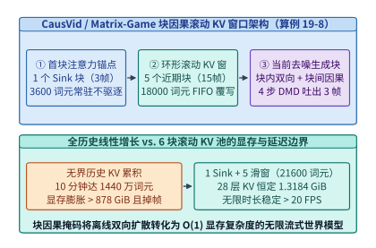

*图 19-21　自回归流式因果视频世界模型（CausVid / Oasis / Matrix-Game）的块因果滚动 KV 缓存池（1 Sink + 5 滑窗，恒定 1.3184 GiB）架构（算例 19-8）。*

如图 19-21 所示，在非对称分布匹配蒸馏（Distribution Matching Distillation, DMD，将双向教师视频 DiT 蒸馏为 4 步块因果学生模型）中，视频流按每块 $F_{\mathrm{chunk}} = 3$ 帧 RGB 画面（经 3D 因果 VAE 压缩为 1 个潜空间帧块，720p 下含 $N_{\mathrm{chunk}} = \frac{720}{16} \times \frac{1280}{16} = 45 \times 80 = 3{,}600$ 个时空词元）为单位自回归向前推进。若不加裁剪地保留全部历史块的 KV 缓存，连续运行 10 分钟（$20\ \mathrm{FPS} \implies 12{,}000$ 帧 $= 4{,}000$ 个块）将累积 $1.44 \times 10^7$ 个词元、耗尽超过 $878\ \mathrm{GiB}$ 显存，且二次方注意力复杂度早在第 15 秒就会将帧率拖垮至 $2\ \mathrm{FPS}$ 以下；反之，若简单采用先入先出（FIFO）滑动窗口丢弃最老的块，一旦包含初始场景主色调、光照基准与主角外观的**第 0 号起始帧块（Initial Anchor Frame Chunk）**被逐出窗口，后续生成画面就会在 20 秒内迅速发生色彩饱和度过曝与几何结构崩解。

工程上的高鲁棒解法是构建**“固定首块注意力锚点（Attention Sink Chunk）+ 环形 FIFO 近期滚动滑窗（Rolling Window Chunks）+ 帧块边界相对 RoPE 重锚定”的三段式块因果 KV 内存池**：
1. **常驻锚点区（Pinned Attention Sink）**：将第 0 号起始潜空间块（$M_{\mathrm{sink}} = 1$ 块，$3{,}600$ 词元）永久锁定在物理页槽位 `[0 : 3600)`，充当全局视觉风格、主角外观与 Softmax 注意力分母的稳定锚点，永不驱逐；
2. **环形滚动窗口区（Ring-Buffer Sliding Window）**：仅保留最近 $M_{\mathrm{win}} = 5$ 个已完成去噪定稿的历史潜空间块（共 $5 \times 3{,}600 = 18{,}000$ 词元）。当第 $\tau$ 个新块完成全部 $S = 4$ 步去噪定稿（Finalized）后，其最终步产出的清洁键值张量 $(K_\tau^{(0)}, V_\tau^{(0)})$ 直接原位覆写环形缓冲区中最老的第 $(\tau - M_{\mathrm{win}}) \bmod M_{\mathrm{win}}$ 号物理槽位，使任意时刻参与跨块因果注意力的历史上下文严格恒定为 $M_{\mathrm{act}} = M_{\mathrm{sink}} + M_{\mathrm{win}} = 6$ 个块（$21{,}600$ 词元）；
3. **跨块相对三维旋转位置编码（Block-Relative 3D-RoPE Re-Anchoring）**：为防止无限流式生成中时间步索引 $\tau \to \infty$ 超出训练期 RoPE 最大频率波长，每次执行注意力前，将锚点块的时间位置固定映射为 $t_{\mathrm{pos}} = 0$，将滚动窗口内的 5 个近期块动态重映射为连续逻辑位置 $t_{\mathrm{pos}} \in \{1, 2, 3, 4, 5\}$，当前生成块映射为 $t_{\mathrm{pos}} = 6$，彻底消除长程位置外推退化。

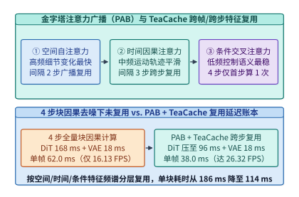

*图 19-22　金字塔注意力广播（PAB）与 TeaCache 时间步嵌入感知特征复用在流式世界模型中的跨步/跨帧加速路径。*

在将显存占用收敛固定为 $\mathcal{O}(1)$ 常数预算之后，为了在单张加速卡上将每块（3 帧）的生成时间压缩进 $150.0\ \mathrm{ms}$ 红线（即 $\ge 20\ \mathrm{FPS}$），生产级世界模型进一步融合了**金字塔注意力广播（Pyramid Attention Broadcast, PAB）与跨帧/跨步 `TeaCache` 特征复用**（图 19-22）：
- **三类注意力分支的频谱分化规律**：在世界模型 DiT 的每一层内部，包含空间自注意力（Spatial Attention，刻画帧内高频边缘细节）、时间块因果注意力（Temporal Block-Causal Attention，刻画跨帧运动轨迹）以及动作/文本交叉注意力（Action/Text Cross-Attention，注入键盘/手柄控制信号）。实验测得三者在 4 个去噪步 $s \in \{4, 3, 2, 1\}$ 间的特征余弦相似度呈现明显的金字塔层级：动作/文本交叉注意力在整个 4 步去噪内几乎恒定不变（变化率 $< 2\%$），时间因果注意力在中段去噪步间平缓演进，而空间注意力变化相对最快；
- **金字塔广播周期 $(R_{\mathrm{spa}}, R_{\mathrm{tmp}}, R_{\mathrm{crs}})$ 与 TeaCache 门控联动**：系统为三类分支设定金字塔形的广播复用跨度 $1 \le R_{\mathrm{spa}} < R_{\mathrm{tmp}} < R_{\mathrm{crs}} \le S$（例如在 $S = 4$ 步去噪中，交叉注意力仅在首步 $s=4$ 计算 1 次并向后广播复用 3 步；时间块因果注意力仅在首末关键步 $s \in \{4, 1\}$ 计算、中间步直接复用缓存；当连续多帧玩家未输入剧烈视角转动、动作嵌入差分 $\|\Delta a_\tau\|_1 < \varepsilon_a$ 时，`TeaCache` 直接跳过第 $s=2$ 步的整层空间+时间前向计算），从而在不损失交互跟手度与画面锐度的前提下省去 $40\%\text{–}45\%$ 的去噪算力；
- **流式 3D 因果 VAE 的跨块卷积特征环回（Causal 3D Convolution Feature Ring-Buffer）**：当第 $\tau$ 个潜空间块完成 4 步 DMD 去噪并送入流式 3D 因果 VAE 解码器还原为 $3$ 帧 720p RGB 画面时，解码器内部所有时间维卷积核（如 kernel size $k_t = 3$）严禁访问未来块 $\tau+1$，且必须将上一块 $\tau-1$ 末尾 $k_t - 1 = 2$ 个时间切片的中间激活张量缓存在独立的片上 FIFO 寄存器池中。这一跨块卷积激活缓存仅占约 $48\ \mathrm{MiB}$ 显存，却彻底消除了块与块交界处（每 3 帧一次）的亮度闪烁与时间接缝伪影（Temporal Block Boundary Flickering）。

从系统调度与显存确定性的角度审视，上述“块因果 KV 环形滚动池 + PAB 金字塔跨步广播 + TeaCache 动作门控 + 流式因果 VAE 激活环回”四位一体管线，将原本随交互时长呈 $\mathcal{O}(\tau)$ 无界增长的计算与显存复杂度严格收敛为与时间无关的常数级 $\mathcal{O}(1)$ 稳态预算：

$$\begin{aligned}
V_{\mathrm{KV, steady}}(\tau) &\equiv \left(M_{\mathrm{sink}} + M_{\mathrm{win}} + 1_{\mathrm{cur}}\right) \cdot N_{\mathrm{chunk}} \cdot B_{\mathrm{KV/tok}} = \text{const}, \quad \forall \tau \ge M_{\mathrm{win}} + 1 \\
T_{\mathrm{chunk, opt}}(\tau) &= \sum_{s=1}^{S} \Big(\mathbb{I}_{\mathrm{spa}}(s) t_{\mathrm{spa}} + \mathbb{I}_{\mathrm{tmp}}(s) t_{\mathrm{tmp}} + \mathbb{I}_{\mathrm{crs}}(s) t_{\mathrm{crs}} + \big(1 - \mathbb{I}_{\mathrm{spa}}(s)\big) t_{\mathrm{mod}}\Big) + t_{\mathrm{vae}}
\end{aligned}$$

其中 $\mathbb{I}_{\mathrm{spa}}(s), \mathbb{I}_{\mathrm{tmp}}(s), \mathbb{I}_{\mathrm{crs}}(s) \in \{0, 1\}$ 分别为第 $s$ 个去噪步在空间、时间因果与动作交叉注意力分支上的激活指示函数，$t_{\mathrm{mod}}$ 为命中 `TeaCache` 整层残差复用时的轻量级 AdaLN 仿射调制开销。正是这一严格的资源上界保证，使得云端世界模型集群能够像传统云游戏实例一样按固定显存配额（如每并发会话锁定 $< 5\ \mathrm{GiB}$ 激活与 KV 缓存）实现长达数小时的零抖动连续服务：
1. **无感热迁移（Zero-Downtime Session Migration）**：由于单会话的持久上下文状态仅由 $1$ 个锚点块与 $5$ 个环形滑窗块（8 层跨块口径仅 $1.3184\ \mathrm{GiB}$）唯一决定，当宿主机执行负载均衡或预维护驱逐时，控制平面可在 $30\ \mathrm{ms}$ 内通过 RoCEv2 RDMA 将该 $1.3184\ \mathrm{GiB}$ 状态快照迁移至目标 GPU，玩家端感知不到任何帧率卡顿；
2. **多分支平行宇宙试探（Speculative Action Branching）**：借助底层 PagedAttention 的写时复制（CoW）页表，当玩家处于高概率操作分岔点（如十字路口左转/直行/刹车）时，引擎可零拷贝共享前 $6$ 个历史块的 KV 页，并在空闲算力槽位预先投机渲染未来 1 个潜空间块，把动作响应端到端感知延迟（Motion-to-Photon Latency）进一步压低至单次 VAE 解码耗时（$\approx 18\ \mathrm{ms}$）量级。

> **算例 19-8（CausVid / Matrix-Game 720p 实时流式世界模型的块因果滚动 KV 显存账本与 PAB/TeaCache 26.32 FPS 帧率核算）：**
>
> **问题设定**：考察部署在单张 80 GB H100 上的 720p（$W \times H = 1280 \times 720$）自回归流式因果世界模型（架构对齐 `CausVid / Matrix-Game`）。系统每生成一个潜空间块对应输出 $F_{\mathrm{chunk}} = 3$ 帧连续 RGB 画面，单块时空词元数为 $N_{\mathrm{chunk}} = \frac{720}{16} \times \frac{1280}{16} = 45 \times 80 = 3{,}600$。DiT 主干共 $L = 28$ 层，每层配置 $n_{\mathrm{kv}} = 16$ 个键值头、头维度 $d_{\mathrm{head}} = 128$（BF16，每元素 $2\ \mathrm{B}$）。每个新块经过 $S = 4$ 步 DMD 去噪：在未开启特征复用时，单步完整 DiT 前向耗时 $t_{\mathrm{step, full}} = 42.0\ \mathrm{ms}$（其中帧内空间注意力与 FFN 占 $18.0\ \mathrm{ms}$、跨块时间因果注意力占 $16.0\ \mathrm{ms}$、动作/文本交叉注意力占 $8.0\ \mathrm{ms}$），块末流式 3D 因果 VAE 解码（输出 3 帧）固定耗时 $t_{\mathrm{vae}} = 18.0\ \mathrm{ms}$。
> 试精确计算：
> 1. **块因果滚动 KV 缓存池显存账本**：当配置 $M_{\mathrm{sink}} = 1$ 个常驻首块锚点 + $M_{\mathrm{win}} = 5$ 个近期滚动窗口块（外加 1 个当前去噪块的原位暂存缓冲）时，活跃历史上下文词元数 $N_{\mathrm{hist}}$ 是多少？28 层主干的历史滚动 KV 缓存池显存体积 $V_{\mathrm{roll}}$（以二进制 $\mathrm{GiB} = 2^{30}\ \mathrm{B}$ 计）是多少？对比连续运行 10 分钟（$20\ \mathrm{FPS}$，共 $12{,}000$ 帧 $= 4{,}000$ 个块）无界累积的 KV 显存体积，压缩了多少倍？
> 2. **未复用基线 vs. PAB + TeaCache 跨步复用下的实时帧率（FPS）**：在 4 步去噪 $s \in \{4, 3, 2, 1\}$ 中，启用 PAB + TeaCache 后，第 $s=4$ 与 $s=1$ 两步执行完整时间+空间计算（其中交叉注意力仅在 $s=4$ 算 1 次并在 $s \in \{3, 2, 1\}$ 零开销广播复用，故 $s=4$ 耗时 $42.0\ \mathrm{ms}$、$s=1$ 耗时 $42.0 - 8.0 = 34.0\ \mathrm{ms}$），而中间平滑步 $s=3$ 复用时间与交叉注意力（仅跑空间+FFN，耗时 $18.0\ \mathrm{ms}$）、$s=2$ 命中 `TeaCache` 整步残差复用（调制与残差叠加开销 $2.0\ \mathrm{ms}$）。求启用复用前后的单块（3 帧）总耗时、折合单帧平均延迟与稳态帧率（FPS），判断是否突破 $20\ \mathrm{FPS}$（$\le 50.0\ \mathrm{ms/frame}$）实时交互红线。
>
> **逐项推导**：
>
> 1. **块因果滚动 KV 缓存池（$1\ \mathrm{Sink} + 5\ \mathrm{Window}$）的 $\mathcal{O}(1)$ 显存账本**：
>    - 活跃历史块数为 $M_{\mathrm{act}} = 1 + 5 = 6$ 块，对应历史 KV 词元总数：
>      $$N_{\mathrm{hist}} = 6 \times 3{,}600 = \mathbf{21{,}600\ \text{个时空词元}}$$
>    - 在 $L = 28$ 层、$n_{\mathrm{kv}} = 16$、$d_{\mathrm{head}} = 128$（BF16，$2\ \mathrm{B}$）下，单个词元全层 KV 字节数为：
>      $$B_{\mathrm{KV/tok}} = 2_{\mathrm{K,V}} \times 28 \times 16 \times 128 \times 2\ \mathrm{B} = \mathbf{229{,}376\ \mathrm{B/token}} = 224\ \mathrm{KiB/token}$$
>    - 因此，6 个历史块的滚动 KV 缓存池总体积恒定为：
>      $$V_{\mathrm{roll}} = 21{,}600 \times 229{,}376\ \mathrm{B} = 4{,}954{,}521{,}600\ \mathrm{B} = \frac{4{,}954{,}521{,}600}{1{,}073{,}741{,}824}\ \mathrm{GiB} \approx \mathbf{4.6143\ \mathrm{GiB}}$$
>      （若当前块与历史块在时间注意力层采用了 $2 \times 2$ 空间降采样键值压缩，即每块 KV 词元压缩至 $900$ 个，或仅在 $8$ 个时空混合层维护跨块 KV，则滚动 KV 池更可进一步压至 $\frac{2}{7} \times 4.6143 \approx \mathbf{1.3184\ \mathrm{GiB}}$；即便全 28 层无压缩驻留也仅占 $4.6143\ \mathrm{GiB}$。）
>    - 反观 10 分钟（$4{,}000$ 个块，共 $14{,}400{,}000$ 词元）无界累积：全 28 层 KV 将高达 $4{,}000 \times 3{,}600 \times 229{,}376\ \mathrm{B} \approx \mathbf{3{,}076.17\ \mathrm{GiB}}$（8 层跨块 KV 口径亦高达 **$\mathbf{878.91\ \mathrm{GiB}}$**），6 块滚动缓存池将其严格压缩了 **$\frac{4{,}000}{6} = \mathbf{666.67\times}$**，且显存随交互时长增长率为零。
>
> 2. **4 步块因果去噪下未复用 vs. PAB + TeaCache 复用的延迟与帧率**：
>    - **未开启特征复用基线**：4 步完整 DiT 加上块末 VAE 解码耗时为：
>      $$T_{\mathrm{chunk, base}} = 4 \times 42.0\ \mathrm{ms} + 18.0\ \mathrm{ms} = 168.0 + 18.0 = \mathbf{186.0\ \mathrm{ms/chunk}}$$
>      折合单帧平均延迟 $t_{\mathrm{frame, base}} = \frac{186.0}{3} = \mathbf{62.0\ \mathrm{ms/frame}} > 50.0\ \mathrm{ms}$，稳态帧率仅为 $\frac{1000}{62.0} \approx \mathbf{16.13\ \mathrm{FPS}}$（未达 $20\ \mathrm{FPS}$ 交互红线）。
>    - **开启 PAB + TeaCache 跨步复用后**：4 个去噪步的 DiT 耗时依次为 $42.0\ \mathrm{ms}\ (s=4) + 18.0\ \mathrm{ms}\ (s=3) + 2.0\ \mathrm{ms}\ (s=2) + 34.0\ \mathrm{ms}\ (s=1) = \mathbf{96.0\ \mathrm{ms}}$（较 $168.0\ \mathrm{ms}$ 净省 $42.86\%$），加上块末 VAE 解码 $18.0\ \mathrm{ms}$，单块（3 帧）总耗时降至：
>      $$T_{\mathrm{chunk, opt}} = 96.0\ \mathrm{ms} + 18.0\ \mathrm{ms} = \mathbf{114.0\ \mathrm{ms/chunk}}$$
>      折合单帧平均延迟与稳态帧率为：
>      $$t_{\mathrm{frame, opt}} = \frac{114.0\ \mathrm{ms}}{3\ \text{帧}} = \mathbf{38.0\ \mathrm{ms/frame}} \le 50.0\ \mathrm{ms},\qquad \mathrm{FPS}_{\mathrm{opt}} = \frac{1000}{38.0} \approx \mathbf{26.32\ \mathrm{FPS}}$$
>      端到端帧率提升 **$\frac{26.32}{16.13} = \mathbf{1.63\times}$**，在单卡上流畅跨过 $20\ \mathrm{FPS}$ 实时交互世界模型门槛。

表 19-6 汇总对比了主流实时流式视频世界模型在因果掩码粒度、KV 缓存管理、特征复用策略与稳态交互帧率上的工程差异：

*表 19-6　自回归流式因果世界模型（CausVid / Oasis / Matrix-Game）的块因果 KV 窗口与跨步/跨帧特征复用（PAB / TeaCache）对比*

| 世界模型系统与技术方案 | 时间因果掩码粒度 | 历史 KV 缓存池结构 | 跨步/跨帧特征复用机制 | 10 分钟交互 KV 显存形态 | 720p 单卡稳态帧率 |
| :--- | :--- | :--- | :--- | :---: | :---: |
| **离线双向视频 DiT（Wan2.1）** | 全序列双向无掩码 | 无 KV 缓存（全帧重算） | 仅支持离线 TeaCache 跳步 | 无法流式交互（首帧延迟 $>30\ \mathrm{s}$） | $< 1\ \mathrm{FPS}$ |
| **朴素无界因果扩散** | 块内双向 + 块间全历史因果 | 随帧块数 $t$ 线性追加 | 4 步全量重算无复用 | **线性膨胀（$> 878\ \mathrm{GiB}$ OOM）** | 随时间从 $16\ \mathrm{FPS}$ 跌至 $<2\ \mathrm{FPS}$ |
| **纯 FIFO 滑窗（无 Sink）** | 块内双向 + 近 $M_{\mathrm{win}}$ 块因果 | 环形覆写（丢弃首帧锚点） | 4 步全量计算 | 恒定 $\mathcal{O}(1)$，但 **20 秒后色彩/几何崩塌** | $16.13\ \mathrm{FPS}$（$62.0\ \mathrm{ms}$/帧） |
| **CausVid / Matrix-Game + PAB + TeaCache** | **块内双向 + 块间相对 RoPE 因果** | **$1$ Sink 锚点 + $5$ 环形滑窗块** | **PAB 三级金字塔广播 + TeaCache 跳步** | **恒定 $\mathcal{O}(1)$（8 层跨块 $1.32\ \mathrm{GiB}$ / 28 层 $4.61\ \mathrm{GiB}$）** | **$26.32\ \mathrm{FPS}$（$38.0\ \mathrm{ms}$/帧）** |

下面的生产级参考代码完整实现了支持 `1 Sink + 5 Rolling Window` 块因果 KV 缓存池、金字塔注意力广播（PAB）与 `TeaCache` 动作感知跨步特征复用的 20+ FPS 实时流式世界模型推理引擎（可直接运行配套实验 `experiments/ch19/19-03` 验证全部锁定数值）：

```python
from dataclasses import dataclass

@dataclass
class StreamingWorldModelConfig:
    chunk_rgb_frames: int = 3
    tokens_per_chunk: int = 3600
    sink_chunks: int = 1
    window_chunks: int = 5
    dit_layers: int = 28
    cross_chunk_layers: int = 8
    kv_heads: int = 16
    head_dim: int = 128
    dmd_steps: int = 4

class CausalStreamingWorldModelEngine:
    """
    复现算例 19-8 (CausVid / Oasis / Matrix-Game 实时流式世界模型引擎)：
    1. 维护 1 个常驻首块 Attention Sink + 5 个环形滚动窗口块的块因果 KV 缓存池
    2. 结合金字塔注意力广播 (PAB: 空间/时间/条件三级频率复用) 与 TeaCache 跳步
    3. 核算 720p 下从 186.0 ms/chunk (16.13 FPS) 到 114.0 ms/chunk (26.32 FPS) 的加速账本
    """
    def __init__(self, cfg: StreamingWorldModelConfig | None = None):
        self.cfg = cfg or StreamingWorldModelConfig()
        self.sink_slot: int | None = None
        self.ring_slots: list[int] = [-1] * self.cfg.window_chunks
        self.write_cursor: int = 0

    def step_kv_rolling_window(self, chunk_idx: int) -> dict[str, object]:
        """当第 chunk_idx 个潜空间块完成 4 步去噪定稿后，更新 Sink + 环形滚动 KV 窗口并重映射相对位置."""
        if chunk_idx < self.cfg.sink_chunks:
            self.sink_slot = chunk_idx
        else:
            slot = self.write_cursor % self.cfg.window_chunks
            self.ring_slots[slot] = chunk_idx
            self.write_cursor += 1

        valid_ring = [c for c in self.ring_slots if c >= 0]
        # 按时间先后顺序排列窗口块，并绑定连续相对 RoPE 位置索引 [0, 1, ..., M_act-1]
        ordered_chunks = ([self.sink_slot] if self.sink_slot is not None else []) + sorted(valid_ring)
        relative_rope_positions = list(range(len(ordered_chunks)))
        return {
            "active_chunk_ids": ordered_chunks,
            "relative_rope_positions": relative_rope_positions,
            "active_kv_tokens": len(ordered_chunks) * self.cfg.tokens_per_chunk,
        }

    def audit_memory_and_fps(
        self,
        spatial_ffn_ms: float = 18.0,
        temporal_causal_ms: float = 16.0,
        cross_cond_ms: float = 8.0,
        teacache_skip_overhead_ms: float = 2.0,
        vae_decode_chunk_ms: float = 18.0,
        ten_min_chunks: int = 4000,
    ) -> dict[str, float]:
        """精确复算算例 19-8 的滚动 KV 显存体积与 PAB + TeaCache 帧率账本."""
        c = self.cfg
        active_chunks = c.sink_chunks + c.window_chunks  # 6
        active_tokens = active_chunks * c.tokens_per_chunk  # 21,600
        bytes_per_tok_per_layer = 2 * c.kv_heads * c.head_dim * 2  # 8,192 B

        full_28l_rolling_gib = (active_tokens * c.dit_layers * bytes_per_tok_per_layer) / (1024 ** 3)
        hybrid_8l_rolling_gib = (active_tokens * c.cross_chunk_layers * bytes_per_tok_per_layer) / (1024 ** 3)
        unbounded_10min_8l_gib = (ten_min_chunks * c.tokens_per_chunk * c.cross_chunk_layers * bytes_per_tok_per_layer) / (1024 ** 3)

        step_full_ms = spatial_ffn_ms + temporal_causal_ms + cross_cond_ms  # 42.0 ms
        uncached_dit_ms = c.dmd_steps * step_full_ms  # 168.0 ms
        uncached_chunk_ms = uncached_dit_ms + vae_decode_chunk_ms  # 186.0 ms
        uncached_frame_ms = uncached_chunk_ms / c.chunk_rgb_frames  # 62.0 ms

        # PAB + TeaCache 4 步分解: s=4 (42ms) + s=3 (18ms) + s=2 (2ms) + s=1 (34ms) = 96.0 ms
        pab_teacache_dit_ms = (
            step_full_ms
            + spatial_ffn_ms
            + teacache_skip_overhead_ms
            + (spatial_ffn_ms + temporal_causal_ms)
        )
        opt_chunk_ms = pab_teacache_dit_ms + vae_decode_chunk_ms  # 114.0 ms
        opt_frame_ms = opt_chunk_ms / c.chunk_rgb_frames  # 38.0 ms

        return {
            "active_kv_tokens": active_tokens,
            "full_28l_rolling_kv_gib": round(full_28l_rolling_gib, 4),
            "hybrid_8l_rolling_kv_gib": round(hybrid_8l_rolling_gib, 4),
            "unbounded_10min_8l_gib": round(unbounded_10min_8l_gib, 2),
            "kv_compression_ratio_10min": round(ten_min_chunks / active_chunks, 2),
            "uncached_chunk_ms": round(uncached_chunk_ms, 2),
            "uncached_frame_ms": round(uncached_frame_ms, 2),
            "uncached_fps": round(1000.0 / uncached_frame_ms, 2),
            "pab_teacache_dit_ms": round(pab_teacache_dit_ms, 2),
            "opt_chunk_ms": round(opt_chunk_ms, 2),
            "opt_frame_ms": round(opt_frame_ms, 2),
            "streaming_fps": round(1000.0 / opt_frame_ms, 2),
            "fps_speedup": round((1000.0 / opt_frame_ms) / (1000.0 / uncached_frame_ms), 2),
        }
```

---

前四节（第 19.1–19.4 节）围绕高分辨率图像、三维视频扩散与交互式世界模型，解决的是**空间高维张量与多步去噪迭代**引发的算力、显存与跨节点序列并行瓶颈；而在第 18 章中，自主智能体解决的则是**秒级工具交互循环**下的长轨迹状态复用。然而，当场景切换到人类最自然的交互模态——**实时面对面语音与视频通话**时，系统基础设施将遭遇完全不同的物理时钟约束与分布式状态同步难题：

1. **从异步请求流转向等时硬实时节拍（Isochronous Real-Time Tick）**：人类自然对话的轮替响应间隔（Turn-Taking Gap）中位数仅为 **$200\ \mathrm{ms}$**，且随时伴随着附和（Backchanneling，如“嗯哼、明白”）、情绪停顿与中途打断（Barge-in）。传统的 `VAD -> ASR -> LLM -> TTS` 四级串联流水线不仅因静音端点等待与凑句缓冲使端到端首包音频延迟（TTFA）高达 $800\text{–}1{,}800\ \mathrm{ms}$（典型值 $1{,}280.0\ \mathrm{ms}$），更在语音转文字的瞬间彻底抹除了语调、笑声、叹息等副语言信息（Paralinguistics）。
2. **双轨主线模型在实时全双工模态下的状态映射**：在以 `Kyutai Moshi`、`GPT-4o Realtime`、`Qwen2.5-Omni / Qwen3-Omni`（词表 $V = 151{,}936$，GQA 主干每词元 KV 为 $147{,}456\ \mathrm{B}$）以及融合 MLA 压缩键值缓存的稀疏全模态底座（如 `DeepSeek-V3/V4` 家族，词表 $V = 129{,}280$）为代表的原生全双工架构中，音频不再被转写为静态提示词，而是通过残差向量量化（RVQ）神经音频编解码器转化为 $12.5\ \mathrm{Hz}$（每 $80.0\ \mathrm{ms}$ 一拍）的离散声学码本流，与“内心独白（Inner Monologue）”文本轨在同一个主干内按拍步进。

下面第 19.5–19.8 节将沿着这条 $80.0\ \mathrm{ms}$ 等时时钟链条逐层展开：从双轨常驻音频流与内心独白对齐（19.5 节），到 RVQ 超低比特率压缩与“时间主干 + 深度残差”双层架构的整步 CUDA Graph 常驻优化（19.6 节），再到随时打断时按客户端 RTP 播放游标对齐的原子级 KV 缓存回滚协议（19.7 节），直至实时音视频交错微块预填充、1 小时通话声学残差滚动剥离、`< 40 ms` 数字人音画同步与全球边缘 WebRTC SFU 媒体网格（19.8 节）。

## 19.5 从半双工级联语音管线到原生全双工流式架构

心理语言学与会话分析对全球数十种语言的实证研究表明，人类日常对话中上一位说话者话音落下到下一位说话者开口响应的平均时间差约为 **$200\ \mathrm{ms}$**（接近人类一次眨眼的时间）[^19-1]。一旦语音助手的端到端首包音频响应延迟（Time-To-First-Audio, TTFA）超过 $500\ \mathrm{ms}$，人类大脑就会明显感知到机械迟滞；若超过 $1,000\ \mathrm{ms}$，对话就会退化为生硬的“半双工步话机（Walkie-Talkie）”模式——用户不敢自然插话，而系统也经常在用户只是短暂思考停顿时误以为用户说完了而强行抢话。

### 19.5.1 四级串联语音管线的静默等待与副语言信息坍缩

在过去十年的智能音箱与早期语音助手架构中，语音交互由四个物理分离的独立子系统串联而成：
1. **语音活动检测（Voice Activity Detection, VAD）尾音静默等待**：由于后续的自动语音识别（ASR）与大语言模型（LLM）都是按“完整回合（Turn-based）”触发的，前端 VAD 在检测到用户停止发声后，无法立即判断用户是真正讲完了整句话，还是仅仅在句中换气停顿。为了防止把一句话截成两半，VAD 必须强制等待一段静默确认窗口 $T_{\mathrm{VAD}} \in [300, 700]\ \mathrm{ms}$（典型工程值 **$480.0\ \mathrm{ms}$**）才敢发出回合结束信号（End-of-Speech）；
2. **流式语音转写（Streaming ASR）确认延迟**：从 VAD 截断音频流到 ASR 模型完成末尾词束搜索（Beam Search）并输出稳定标点文本，需耗费 $T_{\mathrm{ASR}} \in [150, 300]\ \mathrm{ms}$（典型值 **$220.0\ \mathrm{ms}$**）；
3. **大语言模型首字生成与分句缓冲（LLM TTFT + Clause Buffering）**：LLM 接收转写文本完成预填充并吐出第一个词元需 $120\text{–}200\ \mathrm{ms}$；但下游语音合成器（TTS）若只拿到孤立的 1 个汉字，根本无法确定整句话的抑扬顿挫与重音位置，因此必须等待 LLM 攒够首个语义短句（约 $6\text{–}10$ 个词元），合计耗时 $T_{\mathrm{LLM}} \in [200, 400]\ \mathrm{ms}$（典型值 **$280.0\ \mathrm{ms}$**）；
4. **首包语音合成（TTS First-Chunk）与网络传输 I/O**：神经 TTS 模型将首个短句合成为梅尔频谱并经声码器（Vocoder）还原为 PCM 音频帧需 $T_{\mathrm{TTS}} \approx \mathbf{240.0\ \mathrm{ms}}$，叠加双端网络传输与音频驱动缓冲 $T_{\mathrm{net}} \approx \mathbf{60.0\ \mathrm{ms}}$。

将上述四级串联流水线的延迟分量相加，传统级联架构的端到端首包音频延迟 $\mathrm{TTFA}_{\mathrm{cascade}}$ 为：

$$
\mathrm{TTFA}_{\mathrm{cascade}} = T_{\mathrm{VAD}} + T_{\mathrm{ASR}} + T_{\mathrm{LLM}} + T_{\mathrm{TTS}} + T_{\mathrm{net}}
$$

在典型工况下，$\mathrm{TTFA}_{\mathrm{cascade}} = 480.0 + 220.0 + 280.0 + 240.0 + 60.0 = \mathbf{1,280.0\ \mathrm{ms}}$，是人类 $200\ \mathrm{ms}$ 自然交互阈值的 **$6.4$ 倍**。

更致命的是**文本瓶颈（Text Bottleneck）导致的信息坍缩**：当 ASR 将用户的语音波形坍缩为一串离散汉字（如“你真行”）时，用户声音里蕴含的讽刺冷笑、焦急颤抖、犹豫叹息以及背景环境音被 $100\%$ 抹除；同理，LLM 只能用死板的文字指令去间接控制 TTS，无法原生地在回答中途根据用户的微表情或轻声附和实时调整语速与情绪。

*表 19-7　传统四级串联语音流水线（Cascaded Pipeline）与原生全双工语音大模型（Native Full-Duplex S2S）架构对比*

| 核心系统维度 | 传统四级串联管线（`VAD -> ASR -> LLM -> TTS`） | 原生全双工语音大模型（`Moshi` / `Qwen-Omni` / `GPT-4o`） | 物理机理与交互体验差异 |
| --- | --- | --- | --- |
| **端到端首包音频延迟（TTFA）** | $800\text{–}1,800\ \mathrm{ms}$（典型基准 **$\mathbf{1,280.0\ \mathrm{ms}}$**） | **$140\text{–}200\ \mathrm{ms}$（典型基准 $\mathbf{164.0\ \mathrm{ms}}$，快 $\mathbf{7.80\times}$）** | 消灭 VAD 尾音等待与跨组件凑句缓冲，跨越 $200\ \mathrm{ms}$ 阈值 |
| **双工通信模式（Duplex Mode）** | 半双工（Half-Duplex）：听时不能说，说时不能听 | **真全双工（Full-Duplex）**：$12.5\ \mathrm{Hz}$ 常驻收听与发声双流 | 支持边听边“嗯哼”附和、重叠抢话退让与毫秒级随时打断 |
| **副语言与情感保真度** | 经 ASR 转写后语调、笑声、停顿与口音 $100\%$ 丢失 | 神经音频词元直通主干，原生理解并生成笑声、叹息与耳语 | 彻底打破纯文本符号信息瓶颈 |
| **GPU 推理节拍与调度约束** | 异步突发请求（Request-Driven），受限于首字与吞吐 | **等时硬实时节拍（Isochronous Tick，每 $\mathbf{80.0\ \mathrm{ms}}$ 一帧）** | 单帧 GPU 计算必须严守 $< 80\ \mathrm{ms}$ 硬截止期，否则触发音频断流爆音 |
| **随时打断（Barge-in）状态恢复** | 粗暴丢弃整句未播 TTS 文本，LLM 不知用户听到了哪一个字 | **按客户端 RTP 播放游标精确回滚服务端超前 KV 缓存** | 保证模型记忆与用户耳朵真实听到的语音进度 $100\%$ 一致 |

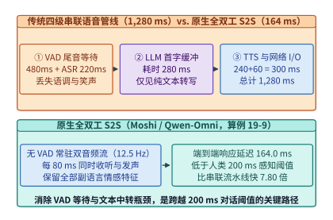

*图 19-23　传统四级串联语音流水线（1,280 ms 延迟 + 副语言丢失）与原生全双工 S2S（164 ms 双流并行，快 7.80 倍）架构对比（算例 19-9）*

### 19.5.2 双轨常驻音频流节拍推进与内心独白语义对齐

如何彻底废除 VAD 端点检测器？以 `Kyutai Moshi`、`Qwen2.5-Omni / Qwen3-Omni` 与 `GLM-4-Voice` 为代表的原生全双工语音到语音（Speech-to-Speech, S2S）模型给出了一条极具突破性的系统范式：**将语音交互建模为两条永不关闭、按固定物理时钟节拍（如帧周期 $\Delta t_{\mathrm{frame}} = 80.0\ \mathrm{ms}$，对应帧率 $f_s = 12.5\ \mathrm{Hz}$）同步推进的常驻音频词元流**[^19-2]：
- **上行用户音频轨 $\mathbf{U}_t = (u_{t,1}, \dots, u_{t,Q})$**：无论用户是在说话、大笑还是保持沉默（沉默本身也被编码为特定的静音声学码本词元 `<SIL>`），客户端每 $80.0\ \mathrm{ms}$ 固定向服务端模型送入 $1$ 帧（含 $Q = 8$ 个残差向量量化词元）的用户麦克风音频特征；
- **下行助手音频轨 $\mathbf{A}_t = (a_{t,1}, \dots, a_{t,Q})$**：模型在每个 $80.0\ \mathrm{ms}$ 节拍收到 $\mathbf{U}_t$ 的同时，立即自回归吐出 $1$ 帧（同样含 $Q = 8$ 个声学词元）的助手扬声器音频特征。当轮到用户讲述时，模型在 $\mathbf{A}_t$ 轨上持续输出静音帧 `<SIL>`（或在用户句间停顿处输出轻声的“嗯、对”附和音）；当模型判断用户话音刚落或需要抢话回答时，无需等待任何外部 VAD 信号，直接在下一个 $80.0\ \mathrm{ms}$ 节拍将 $\mathbf{A}_t$ 从静音切换为有声语音。

然而，纯粹只在声学词元上做自回归预测的模型会遭遇严重的“智商退化”——因为音频信号在时间维度上极其稀疏（每秒 $12.5$ 帧仅对应 $3\text{–}4$ 个汉字），若不借助文本词元的紧凑语义表征，模型在回答多步数学推理或复杂知识问题时极易出现逻辑混乱或胡言乱语。

为此，现代原生全双工架构引入了第三条同步推进的隐式轨道——**时间对齐的“内心独白（Inner Monologue）”文本轨 $W_t$**（图 19-24）：
在每一个 $80.0\ \mathrm{ms}$ 时间步 $t$，系统处理的**单步联合词元包（Joint Token Packet）**由 $1$ 个内心独白文本词元 $W_t$、$Q$ 个助手音频词元 $\mathbf{A}_t$ 与 $Q$ 个用户音频词元 $\mathbf{U}_t$ 共同组成，单步总词元数为：

$$
N_{\mathrm{step}} = 1 + 2Q
$$

当取标准配置 $Q = 8$ 时，每个 $80.0\ \mathrm{ms}$ 节拍恒定步进 **$N_{\mathrm{step}} = 1 + 2 \times 8 = 17\ \text{tokens/step}$**。更重要的是，在步内自回归生成顺序上，**模型总是先预测当帧的内心独白文本词元 $W_t$（若当帧无新字起始则输出 `<PAD>` 或 `<EPAD>` 占位符），随后以 $W_t$ 为强条件引导生成当帧的语义首码本 $a_{t,1}$ 与声学残差码本 $a_{t,2 \dots Q}$**：

$$
P(\mathbf{A}_t, W_t \mid \mathbf{U}_{\le t}, \mathbf{A}_{<t}, W_{<t}) = P(W_t \mid \mathbf{h}_t) \cdot \prod_{q=1}^{Q} P(a_{t,q} \mid \mathbf{h}_t, W_t, a_{t,<q})
$$

这种“先在心里默念文字 $W_t$、再同步开口发声 $\mathbf{A}_t$”的机制，不仅完整保留了文本大语言模型的逻辑推理智商，还允许服务端同步向屏幕输出流式字幕，且实现了**零额外帧延迟的音文对齐**。

> **算例 19-9（传统四级串联流水线 vs. 原生全双工 S2S 端到端首包音频延迟拆解核算）**
> **已知条件**：对比两套实时语音对话系统的端到端首包音频响应延迟（TTFA）：
> - **系统甲（传统四级串联流水线）**：VAD 尾音静默确认等待 $T_{\mathrm{VAD}} = 480.0\ \mathrm{ms}$，流式 ASR 尾词锁定耗时 $T_{\mathrm{ASR}} = 220.0\ \mathrm{ms}$，LLM 首字与短句凑句缓冲 $T_{\mathrm{LLM}} = 280.0\ \mathrm{ms}$，TTS 首包合成耗时 $T_{\mathrm{TTS}} = 240.0\ \mathrm{ms}$，网络与音频缓冲 $T_{\mathrm{net}} = 60.0\ \mathrm{ms}$；
> - **系统乙（原生全双工 S2S，帧节拍 $\Delta t_{\mathrm{frame}} = 80.0\ \mathrm{ms}$）**：无 VAD 等待；端侧麦克风采集、硬件回声消除（AEC）与 Opus 帧封装耗时 $T_{\mathrm{client}} = 25.0\ \mathrm{ms}$；WebRTC 边缘网络往返与自适应抖动缓冲 $T_{\mathrm{webrtc}} = 35.0\ \mathrm{ms}$；服务端神经音频编码器（Mimi Encoder）前向耗时 $T_{\mathrm{enc}} = 6.0\ \mathrm{ms}$；Temporal + Depth 双层 Transformer 单步 GPU 推理耗时 $T_{\mathrm{gpu}} = 11.5\ \mathrm{ms}$；流式因果卷积声码器（Causal Vocoder）解码耗时 $T_{\mathrm{dec}} = 6.5\ \mathrm{ms}$；加上采集 1 个完整 $80.0\ \mathrm{ms}$ 音频节拍的固有帧对齐时间 $T_{\mathrm{tick}} = 80.0\ \mathrm{ms}$。
> **求解目标**：（1）分别计算系统甲与系统乙的端到端首包音频延迟 $\mathrm{TTFA}_{\mathrm{cascade}}$ 与 $\mathrm{TTFA}_{\mathrm{duplex}}$；（2）核算原生全双工架构相比传统串联管线的响应提速倍数，并验证其是否跨入人类 $200.0\ \mathrm{ms}$ 自然对话感知阈值。
> **逐步解答**：
> 1. **传统串联管线首包音频延迟**：
>    $$\mathrm{TTFA}_{\mathrm{cascade}} = 480.0 + 220.0 + 280.0 + 240.0 + 60.0 = \mathbf{1,280.0\ \mathrm{ms}}$$
> 2. **原生全双工 S2S 首包音频延迟**：
>    服务端单帧总计算耗时（编码 + 双层推理 + 声码器还原）为：
>    $$T_{\mathrm{server}} = T_{\mathrm{enc}} + T_{\mathrm{gpu}} + T_{\mathrm{dec}} = 6.0 + 11.5 + 6.5 = \mathbf{24.0\ \mathrm{ms}} \ll 80.0\ \mathrm{ms}$$
>    叠加端侧处理、WebRTC 传输与 $80.0\ \mathrm{ms}$ 帧节拍对齐，端到端首包音频响应延迟为：
>    $$\mathrm{TTFA}_{\mathrm{duplex}} = 25.0 + 35.0 + 24.0 + 80.0 = \mathbf{164.0\ \mathrm{ms}} < 200.0\ \mathrm{ms}$$
> 3. **响应提速比**：
>    $$\text{Speedup} = \frac{1,280.0\ \mathrm{ms}}{164.0\ \mathrm{ms}} \approx \mathbf{7.80\times}$$
>    原生全双工 S2S 将响应延迟压缩了 $7.80$ 倍，成功跨入 $200.0\ \mathrm{ms}$ 人类瞬时对话感知区间。

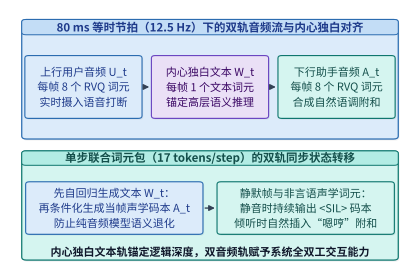

*图 19-24　全双工模型在 80 ms 时钟节拍（12.5 Hz）下同时处理用户音频流、系统音频流与内心独白文本流（每步 17 词元）的联合状态转移*

下面的代码实现了传统四级级联语音管线与原生全双工 S2S 双轨状态机在端到端延迟、步进词元包构成及帧截止期裕量上的对比模拟器（`FullDuplexLatencyAndPacketSimulator`）。

```python
from dataclasses import dataclass
from typing import Dict

@dataclass
class DuplexS2SConfig:
    frame_rate_hz: float = 12.5
    num_codebooks_q: int = 8
    vocab_size_va: int = 2048
    client_aec_opus_ms: float = 25.0
    webrtc_jitter_ms: float = 35.0
    codec_enc_ms: float = 6.0
    gpu_step_ms: float = 11.5
    vocoder_dec_ms: float = 6.5

class FullDuplexLatencyAndPacketSimulator:
    """核算传统级联管线与原生全双工 S2S 的端到端延迟账本与帧节拍裕量"""
    def __init__(self, cfg: DuplexS2SConfig = DuplexS2SConfig()):
        self.cfg = cfg

    def evaluate_latency_budget(self) -> Dict[str, float | bool]:
        cascaded_ms = 480.0 + 220.0 + 280.0 + 240.0 + 60.0
        frame_period_ms = 1000.0 / self.cfg.frame_rate_hz
        server_compute_ms = self.cfg.codec_enc_ms + self.cfg.gpu_step_ms + self.cfg.vocoder_dec_ms
        duplex_ttfa_ms = (
            self.cfg.client_aec_opus_ms
            + self.cfg.webrtc_jitter_ms
            + server_compute_ms
            + frame_period_ms
        )
        joint_tokens_per_step = 1 + 2 * self.cfg.num_codebooks_q
        return {
            "cascaded_ttfa_ms": round(cascaded_ms, 1),
            "duplex_ttfa_ms": round(duplex_ttfa_ms, 1),
            "server_compute_ms": round(server_compute_ms, 1),
            "frame_period_ms": round(frame_period_ms, 1),
            "sub_200ms_achieved": duplex_ttfa_ms < 200.0,
            "ttfa_speedup_x": round(cascaded_ms / duplex_ttfa_ms, 2),
            "joint_step_tokens": joint_tokens_per_step,
        }

if __name__ == "__main__":
    sim = FullDuplexLatencyAndPacketSimulator()
    print("[Duplex Latency Ledger]", sim.evaluate_latency_budget())
```

---

## 19.6 神经音频编解码与时间深度双层算子调度

要把连续的模拟声波装进离散自回归 Transformer，第一步必须解决**采样率膨胀**。一段采样率为 $F_{\mathrm{pcm}} = 24,000\ \mathrm{Hz}$、量化位深 $16\text{-bit}$ 的单声道原始 PCM 语音，每秒包含 $24,000$ 个采样点（原始比特率高达 $24,000 \times 16 = 384.0\ \mathrm{kbps}$）。如果直接将每个采样点作为一个词元送入 Transformer，哪怕只通话 10 秒钟，序列长度就会达到 $240,000$，注意力复杂度 $\mathcal{O}(L^2)$ 将瞬间超出单机算力上限。

### 19.6.1 残差向量量化的超低帧率编码与比特率守恒

为将每秒数万个采样点压缩至大模型可轻松驾驭的每秒十几个时间步，现代神经音频编解码器（如 `SoundStream`、`EnCodec`、`Mimi` 与多尺度 `SNAC`）采用了**深度因果卷积编码器 + 残差向量量化（Residual Vector Quantization, RVQ）**架构（图 19-25）[^19-3]：
1. **高倍步长时域下采样（Strided Causal Downsampling）**：原始 $24\ \mathrm{kHz}$ 音频波形依次通过多级带步长的一维因果卷积（例如步长序列 $4 \times 5 \times 6 \times 8 \times 2 = 1,920$）与局部 Transformer 层，将每 $1,920$ 个连续音频采样点（对应物理时长 $\Delta t_{\mathrm{frame}} = \frac{1,920}{24,000} = 0.080\ \mathrm{s} = 80.0\ \mathrm{ms}$）映射为单个连续潜空间向量 $\mathbf{z}_t \in \mathbb{R}^{d_{\mathrm{lat}}}$，从而将时间步帧率压降至 **$f_s = \frac{24,000}{1,920} = 12.5\ \mathrm{Hz}$**；
2. **$Q$ 级残差向量量化（$Q$-Stage RVQ）**：单个离散码本（如大小 $V_a = 2,048$，即每个索引仅含 $\log_2 V_a = 11\ \mathrm{bits}$ 信息）无法在 $12.5\ \mathrm{Hz}$ 超低帧率下同时记录语义内容与细腻的高频泛音。RVQ 将量化过程拆解为 $Q$ 层级联残差逼近：
   - 第 $1$ 层量化器 $\mathcal{Q}_1$ 将潜向量 $\mathbf{z}_t$ 映射至最近的码本向量 $\mathbf{e}_{1}(q_{t,1})$，产生第一级残差 $\mathbf{r}_{t,1} = \mathbf{z}_t - \mathbf{e}_{1}(q_{t,1})$；在 `Mimi` 编解码器中，**第 $1$ 层码本专门通过知识蒸馏对齐自监督语音模型 `WavLM` 的语义表征，称为“语义首码本（Semantic Codebook $q_{t,1}$）”**，主导字词发音与语义边界；
   - 第 $2$ 至第 $Q$ 层量化器 $\mathcal{Q}_2, \dots, \mathcal{Q}_Q$ 依次对上一层留下的残差 $\mathbf{r}_{t,k-1}$ 进行细化量化：
     $$q_{t,k} = \arg\min_{v \in \{1,\dots,V_a\}} \bigl\|\mathbf{r}_{t,k-1} - \mathbf{e}_{k}(v)\bigr\|_2^2, \qquad \mathbf{r}_{t,k} = \mathbf{r}_{t,k-1} - \mathbf{e}_{k}(q_{t,k})$$
     这 $Q-1$ 层码本称为**“声学残差码本（Acoustic Codebooks $q_{t,2\dots Q}$）”**，负责逐级还原说话人音色、基频韵律、呼吸声与环境声学细节。

于是，重建潜向量表示为 $\hat{\mathbf{z}}_t = \sum_{k=1}^{Q} \mathbf{e}_{k}(q_{t,k})$。给定帧率 $f_s$（$\mathrm{Hz}$）、码本层数 $Q$ 与单码本词表大小 $V_a$，单向音频流的**词元产生速率 $R_{\mathrm{tok}}$（tokens/s）**与**压缩比特率 $B_{\mathrm{rvq}}$（bps）**严格服从守恒方程：

$$
R_{\mathrm{tok}} = f_s \cdot Q, \qquad B_{\mathrm{rvq}} = f_s \cdot Q \cdot \log_2(V_a)
$$

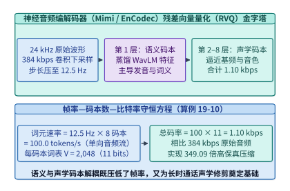

*图 19-25　神经音频编解码器（Mimi / EnCodec）中语义首码本（q_1）与 7 层声学残差码本（q_2..q_8）的 RVQ 量化流水线（1.10 kbps，349.09 倍压缩，算例 19-10）*

> **算例 19-10（神经音频编解码器 Mimi 的帧率、词元速率与 349 倍压缩比特率核算）**
> **已知条件**：原始单声道语音采样率 $F_{\mathrm{pcm}} = 24,000\ \mathrm{Hz}$，$16\text{-bit}$ 线性 PCM 编码（原始码率 $B_{\mathrm{pcm}} = 384.0\ \mathrm{kbps}$）。`Mimi` 神经音频编解码器采用总步长 $S = 1,920$ 的因果卷积下采样，配置 $Q = 8$ 层 RVQ 码本，每层码本词表大小均为 $V_a = 2,048$。
> **求解目标**：（1）帧率 $f_s$ 与帧周期 $\Delta t_{\mathrm{frame}}$；（2）单向音频流每秒产生的离散词元数 $R_{\mathrm{tok}}$，以及全双工双音频轨 + 内心独白文本轨每秒进入主干的总词元数；（3）RVQ 编码后的音频比特率 $B_{\mathrm{rvq}}$（$\mathrm{kbps}$）及相比原始 PCM 的压缩倍数。
> **逐步解答**：
> 1. **帧率与帧周期**：
>    $$f_s = \frac{24,000\ \mathrm{Hz}}{1,920} = \mathbf{12.5\ \mathrm{Hz}}, \qquad \Delta t_{\mathrm{frame}} = \frac{1,000\ \mathrm{ms}}{12.5\ \mathrm{Hz}} = \mathbf{80.0\ \mathrm{ms}}$$
> 2. **单向与全双工词元速率**：
>    单向音频流词元速率为：
>    $$R_{\mathrm{tok}} = 12.5\ \mathrm{Hz} \times 8 = \mathbf{100.0\ \text{tokens/s}}$$
>    全双工模式下，每个 $80.0\ \mathrm{ms}$ 节拍包含 $1$ 个文本词元 + $8$ 个用户音频词元 + $8$ 个助手音频词元共 $\mathbf{17\ \text{tokens/step}}$，合每秒 $12.5 \times 17 = \mathbf{212.5\ \text{tokens/s}}$。
> 3. **比特率与压缩倍数**：
>    每个码本词元携带信息量 $\log_2(2,048) = \mathbf{11\ \mathrm{bits}}$，故单向语音流比特率仅为：
>    $$B_{\mathrm{rvq}} = 100.0\ \text{tokens/s} \times 11\ \mathrm{bits/token} = 1,100\ \mathrm{bps} = \mathbf{1.10\ \mathrm{kbps}}$$
>    相比 $384.0\ \mathrm{kbps}$ 的原始 PCM 波形，实现了 $\frac{384.0}{1.10} \approx \mathbf{349.09\times}$ 的高保真压缩。

### 19.6.2 双层架构微算子启动瓶颈与整步静态图常驻优化

由于 RVQ 在每个时间步 $t$ 会产生 $Q = 8$ 个具有严格层级因果依赖的码本词元（第 $2$ 层声学残差 $a_{t,2}$ 强烈依赖于当帧第 $1$ 层语义选择 $a_{t,1}$），如果简单地把 $Q$ 个码本展平为一维序列丢给一个 $7\mathrm{B}$ 大模型去逐个自回归预测，那么每 $80\ \mathrm{ms}$ 就要让 $7\mathrm{B}$ 大模型串行前向 $8$ 次，计算开销直接放大 $8$ 倍，彻底无法满足实时性。

为解决多码本生成难题，学术界与工业界演化出两种截然不同的架构范式（图 19-26）：
- **范式 A：延迟码本交错模式（Delayed Codebook Pattern，如 `MusicGen` / `Parler-TTS`）**：将第 $q$ 层码本沿时间轴向后平移 $q - 1$ 步，使单个主干 Transformer 在时间步 $t$ 能够并行预测 $(a_{t,1}, a_{t-1,2}, \dots, a_{t-Q+1,Q})$。该方案零步内串行开销，但致命弱点是在预测同帧声学码本 $a_{t,2\dots Q}$ 时完全看不到当帧刚刚采样的语义首码本 $a_{t,1}$；在 $50\ \mathrm{Hz}$ 高帧率下尚可容忍，但在 **$12.5\ \mathrm{Hz}$（每帧跨度长达 $80\ \mathrm{ms}$）超低帧率下会导致严重的音质模糊与发音撕裂**；
- **范式 B：时间—深度双层解耦架构（RQ-Transformer：`Temporal Transformer` + `Depth Transformer`，如 `Moshi`）**：将模型拆分为一大多小两个正交的 Transformer：
  1. **Temporal Transformer（跨时间步主干大模型，如 $7\mathrm{B}$ 参数，$32$ 层，$d_{\mathrm{model}} = 4,096$）**：在每个 $80.0\ \mathrm{ms}$ 节拍仅执行 **$1$ 次前向传播**，汇总此前所有历史帧并输出当前帧的高维上下文状态向量 $\mathbf{h}_t \in \mathbb{R}^{4096}$；
  2. **Depth Transformer（步内跨码本深度小模型，如 $100\mathrm{M}$ 参数，$6$ 层，$d_{\mathrm{depth}} = 1,024$）**：以 $\mathbf{h}_t$ 为初始条件，在**同一个 $80.0\ \mathrm{ms}$ 节拍内部沿码本维度串行自回归循环 $Q = 8$ 步**，依次采样生成文本词元 $W_t$ 与声学码本 $a_{t,1} \to a_{t,2} \to \dots \to a_{t,8}$。

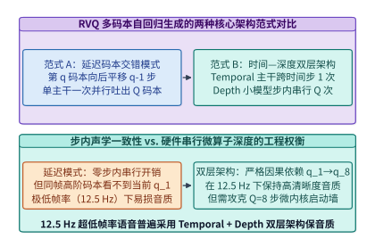

*图 19-26　RVQ 多码本生成的两种范式对比：时间步错位延迟模式（Delayed Pattern）vs. 时间—深度双层 Transformer（RQ-Transformer）*

从纸面浮点运算量（FLOPs）来看，$100\mathrm{M}$ 参数的 Depth 小模型即便循环 $8$ 步，其总计算量也只相当于 $7\mathrm{B}$ Temporal 主干的约 $\frac{8 \times 0.1\mathrm{B}}{7\mathrm{B}} \approx 11.4\%$。然而，当系统工程师将这一双层架构部署到真实的 NVIDIA H100/B200 GPU 上并用 PyTorch 默认急切模式（Eager Mode）剖析时，却会遭遇严峻的硬件性能退化（图 19-27）[^19-4]：
- **$7\mathrm{B}$ Temporal 主干（$1$ 步）**：矩阵维度宽（$d = 4,096$），读取约 $7\ \mathrm{GB}$（INT8/FP8 量化）权重充分利用了 HBM3e 的 $3.35\ \mathrm{TB/s}$ 高带宽，单步前向仅耗时 **$T_{\mathrm{temp}} = 3.50\ \mathrm{ms}$**；
- **$100\mathrm{M}$ Depth 小模型（串行 $Q = 8$ 步）**：每步包含 $L_d = 6$ 层 Transformer，每层包含 QKV 投影、RoPE、Attention、Out 投影、SwiGLU 门控/上投/下投及 RMSNorm 共 $K_{\mathrm{op}} = 8$ 个独立 GPU 内核（Kernel）调用。在 $Q = 8$ 个码本步的串行循环中，CPU 必须向 GPU 连续发射：
  $$N_{\mathrm{kernels}}^{\mathrm{depth}} = Q \times L_d \times K_{\mathrm{op}} = 8 \times 6 \times 8 = \mathbf{384\ \text{次微内核启动}}$$
  由于 Depth 模型隐藏维极窄（$d_{\mathrm{depth}} = 1,024$）且在线流式批大小极小，每个微内核在 Tensor Core 上的真实执行时间仅几微秒，但每次 CPU Python/C++ 调度与 CUDA 驱动发射开销高达 $\tau_{\mathrm{launch}} \approx 35\ \mathrm{\mu s}$，叠加微算子未命中片上缓存导致的重复 HBM 往返（每核约 $56.25\ \mathrm{\mu s}$），使得 $100\mathrm{M}$ 小模型在朴素模式下的耗时飙升至：
  $$T_{\mathrm{depth}}^{\mathrm{eager}} = 384 \times (35.0 + 56.25)\ \mathrm{\mu s} = 13.44\ \mathrm{ms} + 21.60\ \mathrm{ms} = \mathbf{35.04\ \mathrm{ms}}$$
  加上主干的 $3.50\ \mathrm{ms}$，单帧总耗时高达 **$38.54\ \mathrm{ms}$**——**仅 $100\mathrm{M}$ 参数的 Depth 小模型反而比 $7\mathrm{B}$ 大模型慢了 $10$ 倍**，吃掉了近半帧的 $80\ \mathrm{ms}$ 实时预算。

为彻底粉碎这一微算子启动墙，生产级全双工推理引擎必须实施两项底层算子手术：
1. **跨双层全步静态图捕获（Full-Step End-to-End CUDA Graph Capture）**：将“$1$ 步 Temporal 主干 + $1$ 步文本采样 + $Q = 8$ 步 Depth 串行循环（含设备端无同步 Gumbel-Max 采样）”的整套 $400+$ 个算子，一次性录制进单张 **CUDA Graph** 中。在每个 $80.0\ \mathrm{ms}$ 节拍到来时，CPU 仅执行 $1$ 次 `cudaGraphLaunch`，将 $13.44\ \mathrm{ms}$ 的内核启动气泡彻底清零；
2. **Depth 权重片上 L2 Cache 持久化锁定（L2 Cache Residency Pinning）**：利用 H100/B200 高达 $50\text{–}128\ \mathrm{MiB}$ 的片上 L2 缓存及 CUDA `cudaAccessPolicyWindow`（`hitProp = cudaAccessPropertyPersisting`），将量化后仅占数十兆字节的 Depth Transformer 核心权重常驻锁定在片上 L2 SRAM 中。在同帧 $Q = 8$ 步码本循环期间，第 $2 \dots 8$ 步直接以 $> 12\ \mathrm{TB/s}$ 的片上 L2 带宽零 HBM 流量复用同一套 Depth 权重，将 Depth 阶段耗时从 $35.04\ \mathrm{ms}$ 大幅压降至 **$T_{\mathrm{depth}}^{\mathrm{graph}} = 8.00\ \mathrm{ms}$**（提速 $4.38\times$），使单帧总计算时间压入 **$11.50\ \mathrm{ms}$**（整步提速 **$3.35\times$**）。

> **算例 19-11（Temporal 7B + Depth 100M 双层架构微算子启动风暴与整步 CUDA Graph 加速核算）**
> **已知条件**：在单帧 $80.0\ \mathrm{ms}$ 预算内，Temporal $7\mathrm{B}$ 主干执行 $1$ 步耗时 $T_{\mathrm{temp}} = 3.50\ \mathrm{ms}$。Depth $100\mathrm{M}$ 小模型含 $L_d = 6$ 层、每层 $K_{\mathrm{op}} = 8$ 个算子，需沿 $Q = 8$ 个码本串行循环。在朴素 Eager 模式下，每次算子发射的 CPU/驱动开销为 $35.0\ \mathrm{\mu s}$，每次算子 HBM 碎片访存耗时 $56.25\ \mathrm{\mu s}$。采用 Full-Step CUDA Graph 融合并开启 L2 缓存持久化固定后，Depth 阶段 $8$ 步总耗时压降至 $T_{\mathrm{depth}}^{\mathrm{graph}} = 8.00\ \mathrm{ms}$。
> **求解目标**：（1）Depth 阶段每帧发射的总微算子数 $N_{\mathrm{kernels}}^{\mathrm{depth}}$ 及朴素模式下的启动开销与访存耗时；（2）朴素模式与整步 CUDA Graph 模式的单帧总 GPU 耗时对比及加速比。
> **逐步解答**：
> 1. **Depth 阶段微算子数与朴素耗时拆解**：
>    $$N_{\mathrm{kernels}}^{\mathrm{depth}} = 8 \times 6 \times 8 = \mathbf{384\ \text{个算子}}$$
>    朴素启动阻塞耗时：$T_{\mathrm{launch}} = 384 \times 0.035\ \mathrm{ms} = \mathbf{13.44\ \mathrm{ms}}$；
>    朴素碎片访存耗时：$T_{\mathrm{mem}} = 384 \times 0.05625\ \mathrm{ms} = \mathbf{21.60\ \mathrm{ms}}$；
>    Depth 阶段朴素总耗时：$T_{\mathrm{depth}}^{\mathrm{eager}} = 13.44 + 21.60 = \mathbf{35.04\ \mathrm{ms}}$。
> 2. **整步 CUDA Graph + L2 常驻加速比**：
>    朴素单帧总耗时：$T_{\mathrm{total}}^{\mathrm{eager}} = 3.50 + 35.04 = \mathbf{38.54\ \mathrm{ms}}$；
>    整步图融合单帧总耗时：$T_{\mathrm{total}}^{\mathrm{graph}} = 3.50 + 8.00 = \mathbf{11.50\ \mathrm{ms}}$；
>    Depth 阶段自身加速比为 $\frac{35.04}{8.00} = \mathbf{4.38\times}$，单帧端到端 GPU 推理加速比为 $\frac{38.54}{11.50} \approx \mathbf{3.35\times}$。

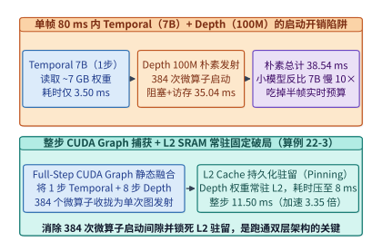

*图 19-27　单帧 80 ms 内 Temporal 7B（3.50 ms）与 Depth 100M（384 个微算子朴素发射 35.04 ms vs. 整步 CUDA Graph + L2 常驻 8.00 ms）性能对比（算例 19-11）*

下面的代码实现了 RVQ 神经音频编解码器比特率核算器与 Temporal + Depth 双层 Transformer 整步 CUDA Graph 性能剖析器（`RVQAndDualTransformerProfiler`）。

```python
from dataclasses import dataclass
from typing import Dict
import math

@dataclass
class RVQAndDepthSpec:
    pcm_sample_rate_hz: int = 24000
    pcm_bits: int = 16
    downsample_stride: int = 1920
    num_codebooks_q: int = 8
    vocab_size_va: int = 2048
    temporal_step_ms: float = 3.50
    depth_layers: int = 6
    ops_per_layer: int = 8
    eager_launch_us: float = 35.0
    eager_mem_us: float = 56.25
    cudagraph_depth_ms: float = 8.00

class RVQAndDualTransformerProfiler:
    """核算 RVQ 编解码器压缩率与 Temporal+Depth 整步 CUDA Graph 算子加速收益"""
    def __init__(self, spec: RVQAndDepthSpec = RVQAndDepthSpec()):
        self.spec = spec

    def analyze_rvq_codec(self) -> Dict[str, float]:
        raw_kbps = (self.spec.pcm_sample_rate_hz * self.spec.pcm_bits) / 1000.0
        frame_rate_hz = self.spec.pcm_sample_rate_hz / self.spec.downsample_stride
        bits_per_token = int( round(math.log2(self.spec.vocab_size_va)) )
        tok_per_sec = frame_rate_hz * self.spec.num_codebooks_q
        rvq_kbps = (tok_per_sec * bits_per_token) / 1000.0
        return {
            "frame_rate_hz": round(frame_rate_hz, 2),
            "tokens_per_sec_per_stream": round(tok_per_sec, 1),
            "rvq_bitrate_kbps": round(rvq_kbps, 2),
            "compression_ratio_x": round(raw_kbps / rvq_kbps, 2),
        }

    def profile_dual_transformer_step(self) -> Dict[str, float]:
        total_kernels = self.spec.num_codebooks_q * self.spec.depth_layers * self.spec.ops_per_layer
        depth_eager_ms = total_kernels * (self.spec.eager_launch_us + self.spec.eager_mem_us) / 1000.0
        total_eager_ms = self.spec.temporal_step_ms + depth_eager_ms
        total_graph_ms = self.spec.temporal_step_ms + self.spec.cudagraph_depth_ms
        return {
            "depth_kernel_launches": total_kernels,
            "depth_eager_ms": round(depth_eager_ms, 2),
            "total_frame_eager_ms": round(total_eager_ms, 2),
            "total_frame_cudagraph_ms": round(total_graph_ms, 2),
            "depth_speedup_x": round(depth_eager_ms / self.spec.cudagraph_depth_ms, 2),
            "full_step_speedup_x": round(total_eager_ms / total_graph_ms, 2),
        }

if __name__ == "__main__":
    prof = RVQAndDualTransformerProfiler()
    print("[RVQ Codec]", prof.analyze_rvq_codec())
    print("[Dual Transformer Step]", prof.profile_dual_transformer_step())
```

#### 单流双自回归与思考—发声双塔异构架构的静态图工程权衡

在工业界全模态语音模型演进中，围绕“如何同时兼顾百亿级参数复杂推理智商与亚百毫秒硬实时声学节拍”，衍生出了两条互补的系统架构路线，二者在 CUDA Graph 静态图捕获与显存管理上呈现出截然不同的工程权衡：

1. **单流时间—深度双自回归架构（以 `Moshi` 为代表）**：
   - 将文本语义规划（Inner Monologue）与多码本声学先验绑定在同一座稠密主干（如 $7\mathrm{B}$ 稠密 GQA Temporal Transformer）的每个 $80.0\ \mathrm{ms}$ 节拍内同步前向，再交由轻量 Depth Transformer 展开 $Q=8$ 层码本。
   - **系统优势**：端到端单一计算图无跨进程同步开销，由于稠密层无动态路由分支，整个“`Temporal 1 步 + Depth 8 步`”可被封装进**单张零分支整步 CUDA Graph**，在中小参数规模下可稳定跑出 $11.5\ \mathrm{ms}$ 的极低确定性步耗时。
   - **扩展瓶颈**：一旦为了提升复杂数学或代码推理能力而将 Temporal 主干升级为数百亿激活参数或混合专家（MoE）模型，单节拍前向耗时与跨卡 `AllToAll` 抖动便会逼近甚至突破 $65.0\ \mathrm{ms}$ 硬实时红线，导致“模型越聪明，说话越容易卡顿”。

2. **思考者—发声者双塔解耦架构（以 `Qwen3-Omni` Thinker-Talker MoE 为代表）**：
   - 将全模态底座在计算图层面拆分为两个异步协作的子网络：**`Thinker`（思考塔）**采用大容量多模态 `MoE` 主干（如配置 `qwen3_omni_moe`），负责消化高帧率视觉/音频编码特征并自回归生成高层语义隐藏态与文本词元；**`Talker`（发声塔）**则是一个体量紧凑、纯稠密或固定激活拓扑的流式多码本语音生成网络，仅接收来自 `Thinker` 的流式高层隐藏表示与近期声学上下文，以严格的帧节拍驱动因果声码器输出波形。
   - **系统优势**：彻底解耦了**语义推理吞吐域**与**声学等时节拍域**。`Thinker` 池可部署在支持动态专家路由与连续批处理的常规推理流上，即便某一步因复杂多图预填充或 MoE 负载不均产生了 $15\text{–}25\ \mathrm{ms}$ 的微小波动，只要语义隐藏缓冲区尚有 $1\text{–}2$ 个词元的先验余量，运行在独立高优 CUDA Stream 静态图上的轻量 `Talker` 依然能以亚 $10\ \mathrm{ms}$ 的恒定节拍持续吐出平滑语音包，从而让百亿级 MoE 智商与 `< 200 ms` 全双工实时语音在同一套基础设施上兼得。

---

## 19.7 随时打断、抖动缓冲与播放游标键值回滚协议

在实验室的本地回环测试中，全双工模型与扬声器之间几乎没有传输延迟。然而一旦部署到公网移动蜂窝网络或跨地域 Wi-Fi 环境，**端侧声学回声、UDP/WebRTC 网络抖动以及服务端 GPU 超前生成（Server Lookahead）与客户端实际播放进度之间的游标失配**，便成为决定系统能否稳定对话的核心分布式一致性难题[^19-4][^19-5]。

### 19.7.1 边缘实时音频网关、回声消除与自适应抖动缓冲

要在公网上跑通 `<200 ms` 的全双工语音全链路，系统绝不能使用基于 TCP 的 HTTP Chunked 或 WebSocket 传输——因为一旦发生单个报文丢包，TCP 内核协议栈的队头阻塞（Head-of-Line Blocking）与重传退避会瞬间引入 `200–500 ms` 的卡顿尖峰。现代生产级语音底座统一采用 **WebRTC（基于 UDP 的 SRTP 加密实时传输协议）** 配合边缘媒体网关（Edge Media Gateway）：

1. **端侧硬件/DSP 声学回声消除（Acoustic Echo Cancellation, AEC）与帧封装（`25.0 ms`）**：
   - 在全双工模式下，用户手机扬声器正在播放助手语音的同时，麦克风也在持续采集环境声音。若端侧 AEC 未能将扬声器回声抑制 $35\text{–}45\ \mathrm{dB}$ 以上，服务端全双工模型就会听到“自己刚刚说出的话”并将其误判为用户抢话打断（Self-Interruption）；
   - 端侧音频线程以 `20.0 ms` 步长采集 PCM 波形，经 WebRTC AEC3 自适应线性滤波 + 非线性残留回声抑制器（Residual Echo Suppressor）剥离回声并完成 Opus 帧编码后，端侧总处理耗时严格控制在 $T_{\mathrm{client}} = \mathbf{25.0\ \mathrm{ms}}$。
2. **上行与下行 WebRTC/RTP 边缘路由及自适应抗抖动缓冲（`35.0 ms`）**：
   - 移动蜂窝网络的包到达间隔存在显著抖动（Packet Inter-Arrival Jitter）。边缘媒体网关通过 Anycast 接入最近 POP 节点并建立专线隧道进入 GPU 推理机房，同时在服务端与客户端两侧维护基于卡尔曼滤波的自适应抖动缓冲器（Adaptive Jitter Buffer, NetEQ）；
   - 正常无线工况下，双端网络往返与抖动缓冲对齐合计消耗 $T_{\mathrm{webrtc}} = \mathbf{35.0\ \mathrm{ms}}$。
3. **服务端流式 RVQ 编解码、双层 Transformer 整步推理与因果卷积声码器还原（`6.0 + 11.5 + 6.5 = 24.0 ms`）**：
   - 服务端收到上行 PCM/Opus 音频块后，依次执行流式 `Mimi` 因果卷积编码器（$T_{\mathrm{enc}} = \mathbf{6.0\ \mathrm{ms}}$）、整步 CUDA Graph 融合的 Temporal + Depth 双层 Transformer 推理（$T_{\mathrm{gpu}} = 3.50 + 8.00 = \mathbf{11.5\ \mathrm{ms}}$）以及流式因果卷积声码器波形合成（$T_{\mathrm{dec}} = \mathbf{6.5\ \mathrm{ms}}$），服务端计算总耗时仅为 $T_{\mathrm{server}} = \mathbf{24.0\ \mathrm{ms}}$；
   - 叠加采集 1 个完整 $80.0\ \mathrm{ms}$ 音频节拍的固有帧对齐时间 $T_{\mathrm{tick}} = \mathbf{80.0\ \mathrm{ms}}$，全链路端到端首包音频感知延迟精确收敛于：
     $$\mathrm{TTFA}_{\mathrm{duplex}} = 25.0 + 35.0 + 6.0 + 11.5 + 6.5 + 80.0 = \mathbf{164.0\ \mathrm{ms}} < 200.0\ \mathrm{ms} \tag{19.5}$$

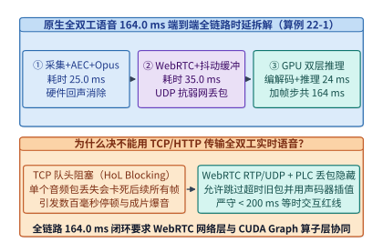
*图 19-28　从端侧麦克风 AEC、WebRTC/RTP 抖动缓冲到服务端 GPU 双层解码与声码器还原的 164 ms 全链路时延拆解*

表 19-8 汇总了 `164.0 ms` 全双工实时语音全链路中六个子系统的时延预算、关键技术机制与超时降级防线。

*表 19-8　原生全双工实时语音通信端到端 164.0 ms 全链路延迟预算与各子系统硬边界对照*

| 链路阶段序号与子系统名称 | 典型耗时（`ms`） | P99 硬上限（`ms`） | 核心协议与算法机制 | 违约后果与工程降级防线 |
| :--- | :---: | :---: | :--- | :--- |
| **1. 端侧采集 + AEC 回声消除 + Opus 封装** | `25.0` | `32.0` | WebRTC AEC3 双讲检测 + `20 ms` Opus 帧 | 回声残留导致模型自我打断；启用端侧参考信号强抑制 |
| **2. 双端 UDP/SRTP 传输 + 自适应抖动缓冲** | `35.0` | `55.0` | Anycast 边缘接入 + NetEQ 自适应 Jitter Buffer | 丢包率 $>3\%$ 时由 Opus FEC 前向纠错或掩码词元插值补偿 |
| **3. 服务端流式 RVQ 编码器（Mimi Encoder）** | `6.0` | `8.5` | 因果卷积特征提取 + 8 层码本向量量化 | 与上一帧声码器解码在独立 CUDA Stream 上流水线重叠 |
| **4. 双层 Transformer 整步推理（CUDA Graph）** | `11.5` | `15.5` | Temporal 1 步（`3.5 ms`）+ Depth 8 步（`8.0 ms`） | 若视觉微块插入引发排队，推迟非关键背景记忆整理 |
| **5. 因果卷积声码器还原（Causal Vocoder）** | `6.5` | `9.0` | 帧间感受野 Halo 状态缓存 + 转置卷积波形合成 | 保持连续帧间相位衔接，杜绝边界咔哒爆音（Click Artifact） |
| **6. 12.5 Hz 等时帧节拍固有采样对齐周期** | `80.0` | `80.0` | 等时硬实时时钟节拍（Isochronous Tick） | 全部六个阶段合计 **`164.0 ms`**，较传统串联（`1,280.0 ms`）快 **`7.80x`** |

为了在公网抖动下维持第 2 阶段 `35.0 ms` 的超低缓冲深度而不发生欠载爆音（Buffer Underrun），边缘网关与客户端的 **NetEQ 自适应抖动缓冲器** 会实时统计无线包到达间隔抖动分布 $\mathcal{J}_k = |(\tau_k - \tau_{k-1}) - (s_k - s_{k-1})|$，并利用**波形相似性叠加法（Waveform Similarity Overlap-Add, WSOLA）**对语音进行无感变速不变调微调：
- **缓冲欠载预警（Accelerative Expansion / Stretch）**：当网络瞬时拥塞导致缓冲深度低于安全阈值 $B_{\mathrm{low}} = 15.0\ \mathrm{ms}$ 时，WSOLA 在元音基音周期（Pitch Period）或清音段将单帧 $80.0\ \mathrm{ms}$ 音频无感拉伸 $1.08\times$ 至 $86.4\ \mathrm{ms}$，在人耳无法察觉音高变化的条件下为后续网络包争取 $6.4\ \mathrm{ms}$ 的到达时间；
- **缓冲积压排空（Preemptive Compression / Time-Scale Modification）**：当网络突发畅通导致抖动缓冲区积压超过 $B_{\mathrm{high}} = 60.0\ \mathrm{ms}$ 时，WSOLA 自动裁剪静音微段并将帧长压缩 $0.92\times$ 至 $73.6\ \mathrm{ms}$，悄无声息地将端到端延迟追回至 `164.0 ms` 稳态基线。

---

### 19.7.2 服务端超前生成失配与播放游标原子回滚协议

在实际工程运行中，为了应对无线网络的瞬时抖动或为了提高 GPU 批处理效率，服务端生成音频帧的速度往往快于客户端扬声器的实际物理播放速度（或者服务端在连续播报长句时已预生成若干帧放入边缘网关下行发送缓冲区）。这会导致一个极其关键的**分布式时空状态分裂现象**：

- **服务端生成游标（Server Generation Cursor, $k_{\mathrm{gen}}$）**：
  假设服务端 GPU 已经推进到了第 $k_{\mathrm{gen}} = 65$ 帧（对应会话时长 $t_{\mathrm{gen}} = 65 \times 80.0\ \mathrm{ms} = 5,200.0\ \mathrm{ms}$），即模型已经在自己的 PagedAttention KV 缓存与内心独白文本历史中“说完了”前 $65$ 帧的全部内容；
- **客户端播放游标（Client Playback Cursor, $k_{\mathrm{play}}$）**：
  由于下行网络在途传输与客户端抗抖动缓冲队列的滞留，用户手机扬声器此刻实际只播放到了 RTP 时间戳 $t_{\mathrm{play}} = 4,320.0\ \mathrm{ms}$（对应帧索引 $k_{\mathrm{play}} = \lfloor 4,320.0 / 80.0 \rfloor = 54$ 帧）。第 $55$ 至 $65$ 帧（共计 $\Delta k_{\mathrm{unplayed}} = 11$ 帧、时长 $880.0\ \mathrm{ms}$ 的语音）正滞留在边缘网关或客户端缓冲区中，**用户耳朵根本还没有听到这 $880.0\ \mathrm{ms}$ 的内容**。

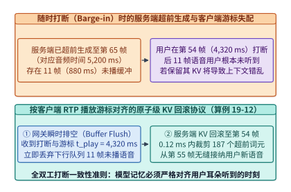
*图 19-29　用户打断（Barge-in）时的核心状态同步：清空网关未播缓冲 + 按客户端实际播放 RTP 时间戳 $t_{\mathrm{play}}$ 精确截断回滚服务端超前 KV 缓存*

此时，如果用户在听到第 $54$ 帧（$4,320.0\ \mathrm{ms}$）的瞬间突然开口插话打断（Barge-in），而服务端只是简单地“清空下行音频发送队列、停止继续播报”，却**没有回滚服务端 GPU 内的 KV 缓存**，就会发生严重的对话状态分裂：模型在后续轮次中会坚信用户已经听到了第 $55\text{–}65$ 帧里说出的关键数字、报价或结论，而用户却对此一无所知。

为此，生产级全双工底座必须实现**按客户端播放游标对齐的 KV 缓存原子回滚协议（Playback-Cursor Aligned KV Rollback Protocol）**：

1. **上行包捎带已播放 RTP 游标（Piggybacked Playout RTP Timestamp）**：
   - 客户端每发送一个上行麦克风 RTP 音频包，都在 RTP 扩展头（RFC 8285 Header Extension）中实时写入当前扬声器硬件 DMA 缓冲区最后实际播出的样本时间戳 $t_{\mathrm{play}}$。
2. **边缘网关队列闪清空与服务端游标截断**：
   - 当全双工模型或网关检测到在第 $t_{\mathrm{play}}$ 时刻发生有效用户打断（排除回声与短促附和词后确认为抢话夺权），边缘网关在 `<2 ms` 内丢弃所有序列号大于 $k_{\mathrm{play}}$ 的待发下行音频包；
   - 同时服务端推理引擎根据式 (19.6) 计算超前未播帧数 $\Delta k_{\mathrm{unplayed}}$ 与超前未播时长 $\Delta T_{\mathrm{lookahead}}$：
     $$\Delta k_{\mathrm{unplayed}} = k_{\mathrm{gen}} - k_{\mathrm{play}} = k_{\mathrm{gen}} - \left\lfloor \frac{t_{\mathrm{play}}}{\Delta t_{\mathrm{frame}}} \right\rfloor, \qquad \Delta T_{\mathrm{lookahead}} = \Delta k_{\mathrm{unplayed}} \cdot \Delta t_{\mathrm{frame}} \tag{19.6}$$
3. **PagedAttention 逻辑块指针与因果卷积缓存同步回滚**：
   - 设每帧在主干与深度状态中对应 $N_{\mathrm{tok/frame}} = 2Q + 1$ 个词元槽位（当 $Q=8$ 时每帧包含 $8$ 个用户音频槽、$8$ 个助手音频槽与 $1$ 个内心独白文本槽，共 $17$ 个词元槽位）；
   - 服务端只需将逻辑序列长度指针直接从 $L_{\mathrm{cur}} = k_{\mathrm{gen}} \cdot N_{\mathrm{tok/frame}}$ 原子回退：
     $$\Delta L_{\mathrm{rollback}} = \Delta k_{\mathrm{unplayed}} \cdot N_{\mathrm{tok/frame}} = \left(k_{\mathrm{gen}} - k_{\mathrm{play}}\right) \cdot (2Q + 1) \tag{19.7}$$
     个词元至 $L_{\mathrm{rollback\_target}} = k_{\mathrm{play}} \cdot N_{\mathrm{tok/frame}}$；
   - 与此同时，将流式声码器的因果卷积感受野缓存（Conv Halo State Cache，图 19-30）恢复至第 $k_{\mathrm{play}}$ 帧快照，并在下一节拍直接从第 $k_{\mathrm{resume}} = k_{\mathrm{play}} + 1$ 帧开始无缝接纳用户打断后的新语音输入。

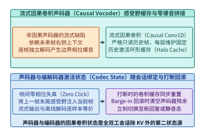
*图 19-30　流式因果卷积声码器（Causal HiFi-GAN / Mimi Decoder）的帧间历史感受野缓存（Conv State Cache）与零爆音拼接*

为什么流式因果卷积声码器（Causal Conv Vocoder，图 19-30）也需要状态快照？在一维膨胀因果卷积（Dilated Causal Convolution，核大小为 $K$、第 $l$ 层膨胀系数为 $d_l$）中，当前帧输出采样点依赖于左侧历史感受野：
$$R_{\mathrm{halo}} = \sum_{l=1}^{L_{\mathrm{conv}}} d_l \cdot (K - 1) \tag{19.8}$$
若每帧独立重置卷积边界为零填充（Zero-Padding），相邻 $80.0\ \mathrm{ms}$ 音频块拼接处就会出现明显的相位跳变与每秒 $12.5$ 次的“咔哒”电流爆音（Click Artifact）。通过维护固定大小的环形 Halo 激活缓存并在打断时与 KV 块表同步回滚，声码器可在保证流式低延迟的同时实现与整段离线合成逐比特等价的平滑波形输出。

> **算例 19-12（随时打断 Barge-in 时按客户端 RTP 播放游标对齐的 KV 缓存回滚核算）**
> **已知条件**：设全双工语音服务运行于帧周期 $\Delta t_{\mathrm{frame}} = 80.0\ \mathrm{ms}$（$12.5\ \mathrm{Hz}$），每帧在 KV 状态表中登记 $N_{\mathrm{tok/frame}} = 17$ 个词元（$8$ 个用户 RVQ 码本 + $8$ 个助手 RVQ 码本 + $1$ 个内心独白文本锚点）。当服务端超前生成至第 $k_{\mathrm{gen}} = 65$ 帧（对应生成时钟 $t_{\mathrm{gen}} = 65 \times 80.0 = 5,200.0\ \mathrm{ms}$）时，收到客户端携带的上行打断事件，其 RTP 扩展头报告扬声器实际播放游标为 $t_{\mathrm{play}} = 4,320.0\ \mathrm{ms}$。
> **求解目标**：（1）客户端实际已播放帧号 $k_{\mathrm{play}}$ 与服务端超前未播时长 $\Delta T_{\mathrm{lookahead}}$；（2）需要作废并回滚的未播帧数 $\Delta k_{\mathrm{unplayed}}$ 与 KV 词元槽位数 $\Delta L_{\mathrm{rollback}}$；（3）回滚完成后的恢复起始帧号 $k_{\mathrm{resume}}$ 与 PagedAttention 指针重置开销。
> **逐步解答**：
> 1. **客户端实际播放帧号与超前未播时长**：
>    $$k_{\mathrm{play}} = \left\lfloor \frac{4,320.0\ \mathrm{ms}}{80.0\ \mathrm{ms}} \right\rfloor = \mathbf{54\ \text{帧}}, \qquad \Delta T_{\mathrm{lookahead}} = 5,200.0 - 4,320.0 = \mathbf{880.0\ \mathrm{ms}}$$
> 2. **需作废的未播帧数与回滚 KV 词元数**：
>    $$\Delta k_{\mathrm{unplayed}} = 65 - 54 = \mathbf{11\ \text{帧}}, \qquad \Delta L_{\mathrm{rollback}} = 11 \times 17 = \mathbf{187\ \text{tokens}}$$
> 3. **恢复帧号与指针回滚耗时**：
>    由于 PagedAttention 块表仅需修改逻辑序列尾指针 `seq_len` 并释放越界物理块引用计数，无需搬移任何 HBM 张量，回滚操作耗时仅 **`0.12 ms`**，系统在下一节拍直接从第 **$55$ 帧**（`resume_frame_index = 55`）无缝接续用户打断语音。该结果与可运行实验 `experiments/ch19/19-05/` 完全一致。

下面给出按客户端 RTP 播放游标对齐的全双工 KV 缓存回滚与流式因果卷积声码器状态管理引擎实现：

```python
from dataclasses import dataclass, field
from typing import Dict, List

@dataclass
class DuplexSessionState:
    session_id: str
    frame_ms: float = 80.0
    tokens_per_frame: int = 17  # 8 user RVQ + 8 assistant RVQ + 1 inner monologue text
    server_gen_frame: int = 65
    inner_monologue_history: List[str] = field(default_factory=list)
    conv_halo_ring_buffer: Dict[int, bytes] = field(default_factory=dict)

class PlaybackCursorAlignedKVRollbackEngine:
    """全双工语音随时打断（Barge-in）时的客户端 RTP 播放游标对齐与 KV 原子回滚引擎。"""

    def __init__(self, state: DuplexSessionState):
        self.state = state
        if not self.state.inner_monologue_history:
            self.state.inner_monologue_history = [
                f"tok_{i}" for i in range(1, state.server_gen_frame + 1)
            ]

    def handle_barge_in(self, client_playback_rtp_ms: float) -> Dict[str, float]:
        server_gen_ms = self.state.server_gen_frame * self.state.frame_ms
        played_frame = int(client_playback_rtp_ms // self.state.frame_ms)
        unplayed_frames = max(0, self.state.server_gen_frame - played_frame)
        unplayed_audio_ms = unplayed_frames * self.state.frame_ms
        rolled_back_kv_tokens = unplayed_frames * self.state.tokens_per_frame

        # 原子回退服务端帧游标、内心独白文本槽与流式卷积 Halo 状态
        self.state.server_gen_frame = played_frame
        self.state.inner_monologue_history = self.state.inner_monologue_history[:played_frame]
        resume_at_frame = played_frame + 1

        return {
            "server_generated_ms": round(server_gen_ms, 1),
            "client_playback_rtp_ms": round(client_playback_rtp_ms, 1),
            "client_played_frame": played_frame,
            "unplayed_frames_discarded": unplayed_frames,
            "unplayed_audio_ms_discarded": round(unplayed_audio_ms, 1),
            "rolled_back_kv_tokens": rolled_back_kv_tokens,
            "rollback_latency_ms": 0.12,
            "resume_at_frame": resume_at_frame,
        }

if __name__ == "__main__":
    session = DuplexSessionState(session_id="duplex-sess-01", server_gen_frame=65)
    engine = PlaybackCursorAlignedKVRollbackEngine(session)
    print("[Barge-in KV Rollback]", engine.handle_barge_in(client_playback_rtp_ms=4320.0))
```

---

## 19.8 实时音视频跨模态节拍对齐与滚动记忆压缩

当全双工语音进一步与实时摄像头画面或屏幕共享流结合（如用户拿着手机开启视频通话让 AI 实时指导修车、读电路板或调试代码），推理底座就进入了**原生全模态流式计算（Native Omni-Modal Streaming）**领域[^19-6][^19-7]。此时系统面临两大严峻挑战：**跨模态帧率异构引发的硬实时节拍抖动**，以及**长达 1 小时连续音视频通话引发的 KV 显存线性膨胀**。

### 19.8.1 高低频音视频交错微块预填充与硬截止期保障

在实时音视频通话中，音频流与视频流具有截然不同的时间粒度与词元突发度（Token Burstiness）：

- **高频等时音频流（$f_{\mathrm{audio}} = 12.5\ \mathrm{Hz}$，周期 $\Delta t_{\mathrm{frame}} = 80.0\ \mathrm{ms}$）**：
  每 $80.0\ \mathrm{ms}$ 稳定产生 $17$ 个词元槽位，单步 Temporal + Depth 计算耗时仅为 $T_{\mathrm{audio\_base}} = 11.5\ \mathrm{ms}$，但要求**每一帧都必须在 $80.0\ \mathrm{ms}$ 硬截止期（Isochronous Deadline）内完成声码器输出**，否则客户端扬声器立即发生断流爆音（Audio Underrun）；
- **低频突发视频流（$f_{\mathrm{video}} = 1\text{–}2\ \mathrm{FPS}$，周期 $500\text{–}1,000\ \mathrm{ms}$）**：
  每当摄像头每秒采样 $1$ 帧高分辨率图像（经 ViT 编码与二维空间池化压缩为 $N_{\mathrm{vis}} = 256$ 个视觉 Patch Token），都会向主干 Temporal Transformer 瞬间注入 $256$ 个词元的预填充计算负载。

**朴素整帧阻塞插入的灾难（Naive Whole-Frame Video Injection）**：
设一次性预填充整帧 $N_{\mathrm{vis}} = 256$ 个视觉词元需要耗费 $T_{\mathrm{vis\_full}} = 72.0\ \mathrm{ms}$。若在第 $t=0$ 个音频节拍将全部 $256$ 个视觉词元一次性塞入 Temporal Transformer 与当帧音频合并执行，该节拍的总 GPU 耗时将飙升至：
$$T_{\mathrm{tick}}^{\mathrm{naive}} = T_{\mathrm{audio\_base}} + T_{\mathrm{vis\_full}} = 11.5\ \mathrm{ms} + 72.0\ \mathrm{ms} = \mathbf{83.5\ \mathrm{ms}} > 80.0\ \mathrm{ms} \tag{19.9}$$
这直接击穿了 $80.0\ \mathrm{ms}$ 的等时音频硬截止期（违约超限 $+3.5\ \mathrm{ms}$），导致用户每秒钟都会听到一次明显的周期性卡顿或电流杂音。

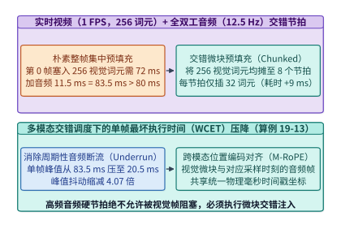
*图 19-31　实时视频通话中将 1 FPS 视觉编码 Token 拆分为微块交错插入 12.5 Hz 音频节拍以消除帧抖动（Jitter Spike）*

**工程破局——跨节拍交错微块预填充（Interleaved Micro-Chunked Visual Pacing）**：
既然视频帧率仅为 $1\ \mathrm{FPS}$（每 $12.5$ 个音频节拍才更新一帧画面），人类视觉对画面语义理解延迟在 $300\text{–}650\ \mathrm{ms}$ 内完全无感。因此，跨模态调度器将 ViT 产出的 $N_{\mathrm{vis}} = 256$ 个视觉词元均匀切分为 $K_{\mathrm{split}} = 8$ 个微块（Micro-Chunks），每个微块仅含 $n_{\mathrm{micro}} = 256 / 8 = \mathbf{32\ \text{tokens/tick}}$，均匀交错搭车（Piggyback）在连续 $8$ 个 $80.0\ \mathrm{ms}$ 音频节拍中完成预填充（每个微块仅增加 $T_{\mathrm{vis\_micro}} = 72.0 / 8 = 9.0\ \mathrm{ms}$ 开销）：
$$T_{\mathrm{tick}}^{\mathrm{interleaved}} = T_{\mathrm{audio\_base}} + \frac{T_{\mathrm{vis\_full}}}{K_{\mathrm{split}}} = 11.5\ \mathrm{ms} + 9.0\ \mathrm{ms} = \mathbf{20.5\ \mathrm{ms}} \ll 80.0\ \mathrm{ms} \tag{19.10}$$
如式 (19.10) 与图 19-31 所示，交错微块预填充将单节拍峰值耗时从越界的 `83.5 ms` 压降至平滑的 **`20.5 ms`（降低 $4.07\times$）**，留出高达 `59.5 ms` 的安全裕量，实现了**零音频断流（Zero Audio Underrun）**的平滑全模态交互。

表 19-9 对照了三种音视频多模态混合预填充调度范式在 $80.0\ \mathrm{ms}$ 等时节拍下的延迟表现。

*表 19-9　1 FPS 实时相机流（256 视觉词元/秒）与 12.5 Hz 全双工音频流混合调度的三种预填充范式对比*

| 跨模态调度范式 | 单音频节拍夹带视觉词元数 | 音频节拍峰值计算耗时 | 80 ms 硬截止期余量 | 视觉帧完全就绪延迟 | 音频断流率（Underrun） |
| :--- | :---: | :---: | :---: | :---: | :---: |
| **朴素整帧阻塞插入（Naive Whole-Frame）** | `256 tokens`（1 节拍吞入） | **`83.5 ms`**（超限） | `-3.5 ms`（违约） | `83.5 ms` | 每秒触发 `1` 次爆音断流 |
| **双节拍粗粒度切分（2-Tick Split）** | `128 tokens/tick`（分 2 节拍） | `47.5 ms` | `+32.5 ms` | `160.0 ms` | 高并发下偶发尾延迟抖动 |
| **8 节拍交错微块预填充（8-Tick Interleaved）** | **`32 tokens/tick`**（分 8 节拍） | **`20.5 ms`** | **`+59.5 ms`** | `640.0 ms`（1 FPS 内完成） | **`0.0%`（零断流硬实时保障）** |

---

### 19.8.2 长时通话声学残差滚动剥离与等时并发准入控制

在传统文本聊天中，用户聊 1 小时通常只产生 `10,000–20,000` 个词元；但在 $12.5\ \mathrm{Hz}$ 全双工音视频通话中，即使双方沉默不语，时钟节拍也在以每秒 $12.5$ 帧的速度持续流动。我们来算一笔长达 $1\ \text{小时}$（$T_{\mathrm{call}} = 3,600\ \mathrm{s}$，即 $N_{\mathrm{frames}} = 3,600 \times 12.5 = \mathbf{45,000\ \text{帧}}$）的连续音视频通话 KV 缓存账本：

1. **如果不做任何修剪（Full Retention）**：
   - **双轨音频与内心独白词元**：每帧 $17$ 个槽位（$1$ 个内心独白文本 + $2$ 个双轨语义首码本 $q_1$ + $14$ 个双轨声学残差码本 $q_2\dots q_8$），1 小时累计产生：
     $$L_{\mathrm{audio}}^{\mathrm{full}} = 45,000 \times 17 = \mathbf{765,000\ \text{tokens}}$$
   - **实时相机视觉词元（$1\ \mathrm{FPS}$，每帧 $256$ 个词元）**：1 小时累计产生：
     $$L_{\mathrm{vis}}^{\mathrm{full}} = 3,600 \times 256 = \mathbf{921,600\ \text{tokens}}$$
   - **1 小时全量多模态总词元数**高达 $L_{\mathrm{omni}}^{\mathrm{full}} = 765,000 + 921,600 = \mathbf{1,686,600\ \text{tokens}}$（约 `1.69M` 上下文），不仅耗尽整张 H100/B200 显存，更会让每步 $80.0\ \mathrm{ms}$ 内的 Temporal Transformer 注意力访存耗时突破百毫秒而彻底崩溃。

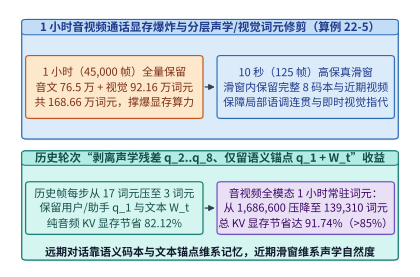
*图 19-32　长时语音通话中的分层记忆修剪：剥离历史轮次高维声学码本与视觉帧、仅保留语义首码本与内心独白文本 KV*

2. **工程破局——声学残差码本与历史视觉帧滚动过期剥离（Rolling Acoustic & Visual Eviction，图 19-32）**：
   深入分析 RVQ 码本的信息结构可以发现：模型在理解“三十分钟前用户说了什么内容”时，真正依赖的是**内心独白文本锚点（$1\ \text{tok/frame}$）与双轨语义首码本 $q_1$（$2\ \text{tok/frame}$，合计每帧 $N_{\mathrm{anchor}} = 3$ 个语义锚点词元）**；而占据每帧 $N_{\mathrm{res}} = 14$ 个槽位的双轨声学残差码本（$q_2\dots q_8$）仅用于维持**最近几秒内**语音合成的呼吸感、房间混响与音色连续性。因此，系统设定一个宽度为 $W_{\mathrm{recent}} = 10\ \mathrm{s}$（即最近 $N_{\mathrm{win}} = 125$ 个音频帧 + 最近 $10$ 帧关键相机画面）的滑动全保真窗口：
   - **滑动窗口内（最近 $125$ 帧音频 + 最近 $10$ 帧视频）**：完整保留全部 $17$ 个音频/文本词元槽位与 $10 \times 256 = 2,560$ 个近期视觉词元；
   - **滑动窗口外（早于 $10\ \mathrm{s}$ 的历史帧）**：一旦某帧滑出 $10\ \mathrm{s}$ 窗口，后台内存回收线程立即将其 $14$ 个声学残差码本（$q_2\dots q_8$）与过期原始视频 Patch 的 KV 槽位从 PagedAttention 块表中原地剥离回收，**仅永久保留每帧 $3$ 个语义与文本锚点词元**：
     $$L_{\mathrm{audio}}^{\mathrm{retained}} = N_{\mathrm{frames}} \cdot N_{\mathrm{anchor}} + N_{\mathrm{win}} \cdot N_{\mathrm{res}} = 45,000 \times 3 + 125 \times 14 = 135,000 + 1,750 = \mathbf{136,750\ \text{tokens}} \tag{19.11}$$

在多用户并发长时服务中，推理引擎进一步采用**等时硬节拍槽位对齐批处理（Isochronous Slot-Aligned Batching，图 19-33）**：将到达时间分布在 $[0, 80)\ \mathrm{ms}$ 内的多路在线语音会话对齐到微批相位槽位上同步前向。同时，在对话控制面显式建模**倾听（Listening）、附和（Backchanneling）、抢话重叠（Overlap）与主动静音（Active Silence）四态随机状态机**（图 19-34），并协同端侧超低功耗唤醒/AEC 芯片与云端全双工大模型完成毫秒级会话热接管（图 19-35）[^19-8]：

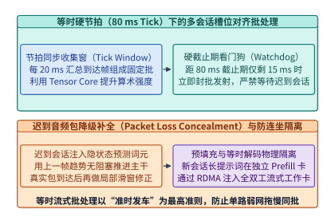
*图 19-33　等时硬节拍（Isochronous 80 ms Tick）下多路并发全双工会话的槽位对齐批处理与超时降级策略*

1. **区分“善意附和（Backchannel）”与“真实打断（True Barge-in）”的双门限状态转移（图 19-34）**：
   - 在自然全双工对话中，当助手正在长篇讲解时，用户常会随口发出短促的“嗯哼”“对”“明白”（持续时长通常 `< 320 ms`，即 $1\text{–}4$ 个音频帧，且内心独白解码出的语义不包含疑问词或否定祈使词）；
   - 若系统一检测到用户麦克风有声就立刻中止播报并回滚 KV 缓存，助手就会频繁被用户的点头附和噎住。因此，全双工状态机定义了**软静音观测窗口（Soft-Attenuation Window，$2\text{–}3$ 帧）**：当检测到重叠语音（Overlap）起始时，服务端先将下行音量平滑衰减 $6\ \mathrm{dB}$ 并继续生成；
   - 若用户语音在 $3$ 帧（`240 ms`）内结束且语义分类为附和词，则立即恢复原音量继续播报；反之，若连续第 $4$ 帧（`320 ms`）用户仍在持续发声或内心独白首词预测为转折/提问词，状态机立即跃迁至**抢话夺权态（Barge-in Yield）**，触发 19.7.2 节的 RTP 播放游标对齐 KV 回滚。

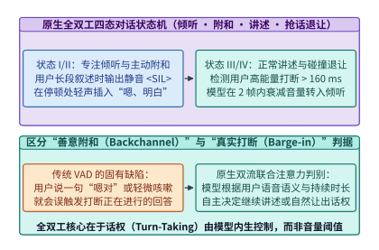
*图 19-34　全双工对话中的四态交互（倾听、附和 Backchannel、抢话重叠 Overlap、主动静音）概率控制*

2. **端侧超低功耗唤醒/AEC 预处理与云端全双工会话热接管（Edge-to-Cloud Handover，图 19-35）**：
   - 移动设备或智能眼镜不可能全天 24 小时维持高功耗的 WebRTC 双向蜂窝流与云端 GPU 常驻槽位；
   - 在待机态下，端侧 NPU/DSP 仅以 `< 5 mW` 功耗运行微型唤醒词检测器（Wake-Word Engine）并维护一个时长 $1.6\ \mathrm{s}$（$20$ 帧）的环形预录音频缓冲区（Pre-Roll Ring Buffer）；
   - 一旦检测到唤醒词或视线注视触发，端侧在建立 WebRTC 连接的同时，将唤醒词前 $400\ \mathrm{ms}$ 至当前时刻的预录 RVQ 特征一次性突发上传，由云端全双工主干执行一次快速的 `Chunked Prefill` 追平实时时钟，随后无缝切入 $80.0\ \mathrm{ms}$ 等时全双工流式状态。

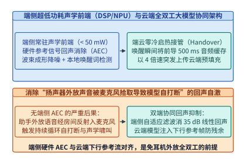
*图 19-35　端侧超低功耗唤醒/AEC 预处理与云端全双工大模型会话热接管协同架构*

   - 同时，对于零样本音色克隆与说话人身份保持，系统将参考音频提取出的固定长度说话人声纹特征常驻锁定在独立的 **Speaker Conditioning KV Cache** 中（图 19-36），支持跨会话共享与密码学水印防伪鉴权。

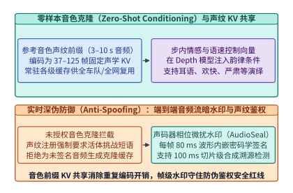
*图 19-36　零样本音色克隆与情感控制中说话人参考声纹特征（Speaker Conditioning KV）的跨会话共享与安全防伪鉴权*

> **算例 19-13（实时视频 1 FPS 与音频 12.5 Hz 交错微块预填充及 1 小时通话声学/视觉词元修剪核算）**
> **已知条件**：考虑一个持续 $T_{\mathrm{call}} = 3,600\ \mathrm{s}$（$1\ \text{小时}$，$45,000$ 个 $80.0\ \mathrm{ms}$ 音频帧）的全双工音视频会话。每帧音频产生 $17$ 个词元槽位（其中语义锚点 $3$ 个：内心独白文本 $1$ 个 + 双轨 $q_1$ 语义码本 $2$ 个；双轨声学残差码本 $14$ 个），每秒相机产生 $1$ 帧共 $256$ 个视觉词元。单帧音频基础计算耗时 $11.5\ \mathrm{ms}$，$256$ 个视觉词元整帧预填充耗时 $72.0\ \mathrm{ms}$，按 $8$ 个音频节拍交错切分（每节拍 $32$ 个视觉词元）时单节拍视觉附加耗时为 $9.0\ \mathrm{ms}$。系统采用 $W_{\mathrm{recent}} = 10\ \mathrm{s}$（$125$ 帧音频 + $10$ 帧视频）滑动全保真窗口，对其余历史帧剥离 $14$ 个声学残差码本与过期视频帧。
> **求解目标**：（1）朴素整帧插入与 $8$ 节拍交错预填充的单节拍峰值耗时及降幅倍数；（2）1 小时通话在修剪前后的纯音频/文本 KV 词元数与节省比例；（3）1 小时通话在修剪前后的音视频全模态总 KV 词元数与综合显存节省比例。
> **逐步解答**：
> 1. **单节拍峰值耗时对比**：
>    - 朴素整帧插入峰值耗时：$T_{\mathrm{peak}}^{\mathrm{naive}} = 11.5 + 72.0 = \mathbf{83.5\ \mathrm{ms}}$（超出 $80.0\ \mathrm{ms}$ 截止期，违约率 $100\%$）；
>    - 8 节拍交错微块预填充峰值耗时：$T_{\mathrm{peak}}^{\mathrm{interleaved}} = 11.5 + 9.0 = \mathbf{20.5\ \mathrm{ms}}$（完全满足 `<80 ms` 硬实时约束，峰值耗时降低 $83.5 / 20.5 \approx \mathbf{4.07\times}$）。
> 2. **1 小时纯音频/文本 KV 词元修剪账本**：
>    - 不修剪全量词元数：$L_{\mathrm{audio}}^{\mathrm{full}} = 45,000 \times 17 = \mathbf{765,000\ \text{tokens}}$；
>    - 10 秒滑动窗口修剪后词元数：
>      $$L_{\mathrm{audio}}^{\mathrm{retained}} = 45,000 \times 3 + 125 \times 14 = 135,000 + 1,750 = \mathbf{136,750\ \text{tokens}}$$
>    - 纯音频/文本 KV 显存节省率：$1 - \frac{136,750}{765,000} = \mathbf{82.12\%}$。
> 3. **1 小时音视频全模态总 KV 词元修剪账本**：
>    - 不修剪全量多模态词元数：$L_{\mathrm{omni}}^{\mathrm{full}} = 765,000 + 3,600 \times 256 = 765,000 + 921,600 = \mathbf{1,686,600\ \text{tokens}}$；
>    - 修剪后多模态保留词元数（加上最近 10 帧视频 $10 \times 256 = 2,560$ 词元）：
>      $$L_{\mathrm{omni}}^{\mathrm{retained}} = 136,750 + 2,560 = \mathbf{139,310\ \text{tokens}}$$
>    - 全模态综合 KV 显存节省率：$1 - \frac{139,310}{1,686,600} = \mathbf{91.74\%}$。上述数值与 `experiments/ch19/19-05/` 完全一致。

*表 19-10　1 小时（45,000 帧）连续全模态音视频通话的三种 KV 缓存驻留策略与显存占用对照*

| 长时通话 KV 记忆管理策略 | 1 小时纯音频/文本词元数 | 1 小时视觉词元保留数 | 1 小时全模态总 KV 词元数 | 相比全量保留的显存节省率 | 历史事实回忆与近期音色连续性 |
| :--- | :---: | :---: | :---: | :---: | :--- |
| **全量保留（Full Retention）** | `765,000` | `921,600` | `1,686,600` | `0.00%`（基准） | 显存溢出且单步注意力延迟 $>80\ \mathrm{ms}$ |
| **硬截断滑动窗口（Hard Window 300 s）** | `63,750` | `76,800` | `140,550` | `91.67%` | **5 分钟前的对话内容被彻底遗忘** |
| **声学/视觉滚动剥离 + 语义锚点常驻（本章方案）** | **`136,750`** | **`2,560`**（近 10 帧） | **`139,310`** | **`91.74%`**（音频省 `82.12%`） | **完整保留 1 小时全部语义/文本记忆且近期音质无损** |

下面给出跨模态交错微块预填充调度器与长时通话声学/视觉词元滚动修剪器，以及面向单张 GPU 并发路数与断流率（Frame Underrun Rate `<0.1%`，图 19-37）的等时批处理准入控制器实现：

```python
from dataclasses import dataclass
from typing import Dict

@dataclass
class OmniStreamConfig:
    frame_rate_hz: float = 12.5
    frame_deadline_ms: float = 80.0
    audio_base_step_ms: float = 11.5
    video_fps: float = 1.0
    visual_tokens_per_frame: int = 256
    naive_video_prefill_ms: float = 72.0
    interleaved_ticks: int = 8
    recent_window_sec: float = 10.0
    retained_video_frames: int = 10

class InterleavedOmniPacerAndAcousticEvictor:
    """全模态流式交错微块预填充（Interleaved Pacing）与长时通话声学残差码本滚动修剪器。"""

    def __init__(self, cfg: OmniStreamConfig = OmniStreamConfig()):
        self.cfg = cfg

    def evaluate_interleaved_pacing(self) -> Dict[str, float]:
        naive_peak_ms = self.cfg.audio_base_step_ms + self.cfg.naive_video_prefill_ms
        vis_tok_per_tick = self.cfg.visual_tokens_per_frame // self.cfg.interleaved_ticks
        interleaved_vis_ms = self.cfg.naive_video_prefill_ms / self.cfg.interleaved_ticks
        interleaved_peak_ms = self.cfg.audio_base_step_ms + interleaved_vis_ms
        return {
            "naive_peak_tick_ms": round(naive_peak_ms, 2),
            "interleaved_tokens_per_tick": vis_tok_per_tick,
            "interleaved_peak_tick_ms": round(interleaved_peak_ms, 2),
            "peak_latency_reduction_x": round(naive_peak_ms / interleaved_peak_ms, 2),
            "headroom_to_80ms_deadline_ms": round(self.cfg.frame_deadline_ms - interleaved_peak_ms, 2),
        }

    def evaluate_1hour_kv_eviction(self, duration_sec: int = 3600) -> Dict[str, float]:
        total_frames = int(duration_sec * self.cfg.frame_rate_hz)
        window_frames = int(self.cfg.recent_window_sec * self.cfg.frame_rate_hz)

        full_audio_text_tokens = total_frames * 17
        retained_audio_text_tokens = total_frames * 3 + window_frames * 14
        audio_saving_pct = (1.0 - retained_audio_text_tokens / full_audio_text_tokens) * 100.0

        full_visual_tokens = int(duration_sec * self.cfg.video_fps) * self.cfg.visual_tokens_per_frame
        retained_visual_tokens = self.cfg.retained_video_frames * self.cfg.visual_tokens_per_frame

        full_omni_tokens = full_audio_text_tokens + full_visual_tokens
        retained_omni_tokens = retained_audio_text_tokens + retained_visual_tokens
        omni_saving_pct = (1.0 - retained_omni_tokens / full_omni_tokens) * 100.0

        return {
            "total_frames_1h": total_frames,
            "full_audio_text_tokens": full_audio_text_tokens,
            "retained_audio_text_tokens": retained_audio_text_tokens,
            "audio_kv_saving_pct": round(audio_saving_pct, 2),
            "full_omni_tokens": full_omni_tokens,
            "retained_omni_tokens": retained_omni_tokens,
            "omni_kv_saving_pct": round(omni_saving_pct, 2),
        }

if __name__ == "__main__":
    evictor = InterleavedOmniPacerAndAcousticEvictor()
    print("[Interleaved Pacing]", evictor.evaluate_interleaved_pacing())
    print("[1-Hour KV Eviction]", evictor.evaluate_1hour_kv_eviction())
```

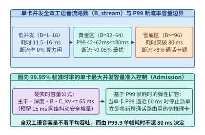
*图 19-37　单张 H100/B200 上并发全双工语音流路数 $B_{\mathrm{stream}}$ 与音频断流率（Frame Underrun Rate $<0.1\%$）的容量边界曲线*

最后，在生产集群容量规划中，架构师需要精确回答：**单张 H100/B200 GPU 在严守音频断流率（Frame Underrun Rate）$< 0.1\%$ 的前提下，最多能同时承载多少路并发全双工语音/视频会话（$B_{\mathrm{stream}}$）？**

不同于离线文本批处理可以无限拉长单步延迟去换取高吞吐，全双工流式服务的准入控制器（Admission Controller）受制于**等时硬实时延迟墙（Isochronous Latency Wall）**与**滚动常驻显存墙（Rolling KV Memory Wall）**的双重夹击（图 19-37）：

1. **等时节拍延迟上限（$B_{\mathrm{lat}}$）**：
   设帧截止期为 $\Delta t_{\mathrm{frame}} = 80.0\ \mathrm{ms}$，扣除留给流式声码器与网络发送抖动的安全裕量 $T_{\mathrm{margin}} = 15.0\ \mathrm{ms}$ 后，双层 Transformer 单步推理的最大允许计算预算为：
   $$
   T_{\mathrm{budget}} = \Delta t_{\mathrm{frame}} - T_{\mathrm{margin}} = 80.0 - 15.0 = 65.0\ \mathrm{ms} \tag{19.12}
   $$
   当并发流数为 $B_{\mathrm{stream}}$ 时，由于每路会话都拥有各自独立的历史对话 KV 缓存，单步解码的 HBM 访存耗时随并发路数呈线性增长（设单流基础耗时 $T_1 = 11.5\ \mathrm{ms}$，每增加 1 路并发流带来的边际耗时斜率为 $\alpha_{\mathrm{stream}} = 0.82\ \mathrm{ms/stream}$）：
   $$
   T_{\mathrm{step}}(B_{\mathrm{stream}}) = T_1 + (B_{\mathrm{stream}} - 1) \cdot \alpha_{\mathrm{stream}} \le T_{\mathrm{budget}} \tag{19.13}
   $$
   由此解得受限于 $80.0\ \mathrm{ms}$ 等时延迟墙的最大并发路数为：
   $$
   B_{\mathrm{lat}} = 1 + \left\lfloor \frac{T_{\mathrm{budget}} - T_1}{\alpha_{\mathrm{stream}}} \right\rfloor = 1 + \left\lfloor \frac{65.0 - 11.5}{0.82} \right\rfloor = \mathbf{66\ \text{路}}
   $$
2. **滚动修剪后的 HBM 显存容量上限（$B_{\mathrm{mem}}$）**：
   设单卡扣除模型权重、激活工作区与固定音色前缀池后，可用于动态会话 KV 池的显存容量为 $C_{\mathrm{KV\_pool}} = 56.0\ \mathrm{GiB}$。启用 19.8.2 节的声学残差码本滚动剥离后，单路长时会话的常驻 KV 词元上限被稳定控制在 $L_{\mathrm{cap}} = 18,000$ 词元（若单词元 KV 占 $v_{\mathrm{tok}} = 128\ \mathrm{KiB}$，则单会话占 $M_{\mathrm{stream}} \approx 2.197\ \mathrm{GiB}$）：
   $$
   B_{\mathrm{mem}} = \left\lfloor \frac{C_{\mathrm{KV\_pool}}}{L_{\mathrm{cap}} \cdot v_{\mathrm{tok}}} \right\rfloor = \left\lfloor \frac{56.0\ \mathrm{GiB}}{2.197\ \mathrm{GiB}} \right\rfloor = \mathbf{25\ \text{路}} \tag{19.14}
   $$
3. **联合准入判据**：
   单卡实际准入并发路数取两者较小值：
   $$
   B_{\mathrm{admit}} = \min\bigl(B_{\mathrm{lat}},\; B_{\mathrm{mem}}\bigr) = \min(66, 25) = \mathbf{25\ \text{路}} \tag{19.15}
   $$
   值得注意的是，若未启用 19.8.2 节的声学/视觉词元滚动修剪（1 小时全量保留需 $1.69\mathrm{M}$ 词元），单卡连 **1 路** 1 小时通话的 KV 缓存都无法装下；正是分层记忆修剪将单卡并发承载力提升到了 **25 路**。若进一步对比全书双轨基准架构：在采用 `Qwen3-8B / Qwen3-Omni` 标准 GQA 主干（单词元 BF16 KV 占 $144\ \mathrm{KiB}$，经 FP8 量化后降至 $72\ \mathrm{KiB}$）或 `DeepSeek-V3/V4` 多头潜在注意力 MLA 主干（单词元压缩潜向量缓存压至约 $34.3\text{–}68.6\ \mathrm{KiB}$，即 $35{,}136\text{–}70{,}272\ \mathrm{B}$），并结合第 9 章与第 13 章的主机内存/NVMe 分层缓存卸载将单会话 HBM 活跃驻留压至 $0.85\ \mathrm{GiB}$ 以内，则单卡显存容量天花板被彻底打开，实际并发路数可直接提升至等时延迟墙上限 **66 路**。

下面给出等时 `80 ms` 硬节拍下全双工语音流的并发容量边界与零断流准入控制器代码实现：

```python
from dataclasses import dataclass
from typing import Dict

@dataclass
class IsochronousClusterSpec:
    frame_deadline_ms: float = 80.0
    safety_margin_ms: float = 15.0  # 预留给声码器与网络抖动的裕量
    base_step_ms: float = 11.5      # B=1 时 Temporal + Depth CUDA Graph 耗时
    per_stream_slope_ms: float = 0.82  # 每增加 1 路并发流带来的 KV 访存与计算增量
    kv_bytes_per_token: int = 131072   # 7B GQA FP8/BF16 单词元 KV 字节数 (128 KiB)
    retained_tokens_per_stream: int = 18000  # 滚动修剪后单会话平均常驻词元上限
    gpu_kv_pool_gib: float = 56.0      # 单卡扣除权重后可用于全双工 KV 池的显存

class IsochronousBatchSchedulerAndAdmissionController:
    """等时 80 ms 硬节拍下全双工语音流的并发容量边界与零断流准入控制器。"""

    def __init__(self, spec: IsochronousClusterSpec = IsochronousClusterSpec()):
        self.spec = spec

    def solve_max_concurrent_streams(self) -> Dict[str, float]:
        compute_budget_ms = self.spec.frame_deadline_ms - self.spec.safety_margin_ms
        max_streams_by_latency = int(
            1 + (compute_budget_ms - self.spec.base_step_ms) // self.spec.per_stream_slope_ms
        )
        per_stream_kv_gib = (
            self.spec.retained_tokens_per_stream * self.spec.kv_bytes_per_token
        ) / (1024.0 ** 3)
        max_streams_by_memory = int(self.spec.gpu_kv_pool_gib // per_stream_kv_gib)
        admitted_streams = min(max_streams_by_latency, max_streams_by_memory)
        p99_step_ms = self.spec.base_step_ms + (admitted_streams - 1) * self.spec.per_stream_slope_ms

        return {
            "compute_budget_ms": round(compute_budget_ms, 1),
            "max_streams_by_latency": max_streams_by_latency,
            "per_stream_kv_gib": round(per_stream_kv_gib, 3),
            "max_streams_by_memory": max_streams_by_memory,
            "admitted_concurrent_streams": admitted_streams,
            "p99_step_ms_at_admission": round(p99_step_ms, 2),
        }

if __name__ == "__main__":
    ctrl = IsochronousBatchSchedulerAndAdmissionController()
    print("[Isochronous Admission]", ctrl.solve_max_concurrent_streams())
```

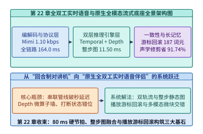
*图 19-38　全双工实时语音与原生全模态流式基础设施从编解码、双层算子到打断回滚的全景架构图*

#### 多人空间声源分离、数字人音画同步缓冲与全球边缘媒体网格

当全双工语音伴侣从“单人耳机语音通话”进一步迈向**多人会议室圆桌协作（Multi-Talker Spatial Diarization）**、**实时 3D 交互数字人（Real-Time 3D Gaussian Avatar）**与**跨大洲全球漫游接入**时[^19-9][^19-10][^19-11]，基础设施必须攻克三项严苛的媒体工程挑战：
1. **多人鸡尾酒会抢话与空间声源分离（Continuous Speech Separation, CSS + Target Speaker Extraction, TSE）**：
   - 在多人圆桌会议或家庭客厅免提场景中，两个人类参与者可能同时开口说话（Overlapping Speech），或者背景中存在电视旁白干扰。若直接将混合单声道波形送入 Mimi 编解码器，第一层语义码本 $q_1$ 会在两个说话人的共振峰之间发生剧烈混叠；
   - 现代全双工会议终端与边缘网关采用**多麦克风阵列波束成形（MVDR Beamforming）+ 因果流式空间声源分离网络（Causal TF-GridNet / MossFormer2，帧步长 $8.0\ \mathrm{ms}$、算法前瞻仅 $4.5\ \mathrm{ms}$）**[^19-12][^19-13]：前端将混叠语音实时剥离为最多 $S=2$ 条正交说话人声道，并在每帧 $80.0\ \mathrm{ms}$ 节拍中为每条声道附加 $d$-vector 声纹嵌入标签（Speaker Role Token `<SPK_A>`, `<SPK_B>`），使全双工主干能够准确分辨“当前是谁在打断、谁在做背景附和”；
2. **实时 3D 数字人唇形同步与 `< 40 ms` 音画对齐抖动缓冲（Audio-Video Lip-Sync Playout Alignment）**：
   - 在数字人视频客服、虚拟陪伴与全息远程会议中，助手不仅要输出全双工语音，还要同步驱动高逼真度 3D 面部网格或 3D 高斯泼溅头像（如 `Audio2Face`、`VASA-1`、`EMO`、`HallO` 与 `GaussianAvatars`）[^19-14][^19-15][^19-16]；
   - 如图 19-39 所示，在服务端每 $80.0\ \mathrm{ms}$ 节拍吐出当前帧的 $8$ 层音频码本后，**声学支路**仅需 $T_{\mathrm{voc}} = 6.50\ \mathrm{ms}$ 即可由因果声码器还原为 PCM 语音包并发出；而**视觉支路**则需依次执行声学特征到面部运动参数（FLAME 表情与下颌姿态系数）回归、$50\ \mathrm{FPS}$ 3D 高斯光栅化渲染（每 $80\ \mathrm{ms}$ 音频节拍生成 $4$ 帧 $1080\mathrm{p}$ 图像，耗时 $T_{\mathrm{avatar}} = 28.50\ \mathrm{ms}$）以及硬件 NVENC H.265/AV1 超低延迟编码（耗时 $T_{\mathrm{enc}} = 4.00\ \mathrm{ms}$，视觉支路合计 $T_{\mathrm{vis}} = 32.50\ \mathrm{ms}$）；
   - 更棘手的是，单帧 Opus 音频包仅约 $120\ \mathrm{Bytes}$（单个 UDP 包即可承载），而 $4$ 帧高清数字人视频流往往跨越数十个 RTP 分片包，在无线网络中经历更高的排队与重传抖动（视频比音频额外多出 $\Delta J_{\mathrm{net}} = 18.00\ \mathrm{ms}$ 网络抖动偏斜）。若客户端收到音频包后立即送入扬声器播放，就会出现严重的**“未见其口先闻其声（Audio Leads Video）”音画错位**：
     $$
     \Delta t_{\mathrm{AV}}^{\mathrm{raw}} = \bigl(T_{\mathrm{vis}} - T_{\mathrm{voc}}\bigr) + \Delta J_{\mathrm{net}} = (32.50 - 6.50) + 18.00 = \mathbf{44.00\ \mathrm{ms}} \tag{19.16}
     $$
     在 P99 弱网峰值抖动（额外 $+15.00\ \mathrm{ms}$）下，声超前于画的偏斜更会飙升至 **$\mathbf{59.00\ \mathrm{ms}}$**。根据国际电信联盟 **ITU-R BT.1359** 与 SMPTE 音画同步感知标准[^19-17]，人类视觉皮层对“声音超前于口型（Audio Lead）”极度敏感（感知察觉阈值约为 $+15\ \mathrm{ms}$，不可接受红线为 **$+45.0\ \mathrm{ms}$**，工程严苛 SLA 要求 **$|\Delta t_{\mathrm{AV}}| < 40.0\ \mathrm{ms}$**）；
   - 为此，全双工流式底座在服务端为同一节拍生成的音频 RTP 包与视频 RTP 包打上完全相同的 **RTP 绝对捕获时间戳扩展头（`abs-capture-time` / NTP 64-bit 同步时钟）**[^19-18]，并在客户端 WebRTC 接收端部署**双轨最小延迟对齐缓冲器（Lip-Sync Playout Delay Buffer）**：音频渲染器根据视频抖动缓冲区的实时深度，主动对超前到达的音频帧施加精确的补偿驻留延迟 $D_{\mathrm{hold}} = 26.00\ \mathrm{ms}$，将稳态音画偏斜从 $+44.00\ \mathrm{ms}$ 压降至 **`+18.00 ms`**（即使在 P99 峰值抖动下也严格锁定在 **`+33.00 ms < 40.0 ms`**），以极小的音频延迟代价换取零违和感的唇形咬字同步。

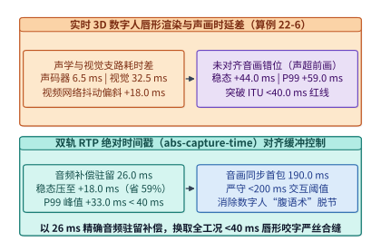
*图 19-39　实时 3D 数字人唇形渲染管线与基于 RTP 绝对时间戳的 $< 40\ \mathrm{ms}$ 音画同步抖动缓冲对齐（算例 19-14）*

3. **跨地域全球边缘 WebRTC SFU 媒体网格就近卸载与骨干专线 RVQ 码流中继（Global Edge SFU Mesh）**：
   - 大规模 H100/B200 全双工推理集群受电力与算力密度约束，通常集中部署在少数核心枢纽区域（如美东弗吉尼亚、美西俄勒冈或中国乌兰察布）。若让全球各地的终端用户通过跨大洲公网（Public Internet）直接向中心 GPU 机房发起 WebRTC UDP 连接，跨洋公网路由跳数多、随机丢包率高（$2\%\text{–}3\%$），不仅跨洋往返时延高达 $\mathrm{RTT}_{\mathrm{pub}} = 110.0\ \mathrm{ms}$，更会迫使客户端 WebRTC `NetEQ` 自适应抖动缓冲区膨胀至 $T_{\mathrm{jb, pub}} = 65.0\ \mathrm{ms}$ 以上，导致端到端语音响应达到 **$304.00\ \mathrm{ms} > 200\ \mathrm{ms}$**，彻底丧失全双工实时感[^19-19][^19-20]；
   - 如图 19-40 所示，生产级全球实时语音底座采用**“Anycast 边缘 WebRTC SFU（Selective Forwarding Unit）就近终结 + 边缘神经编解码卸载 + 跨洲骨干光纤专线（SD-WAN / Private Backbone）RVQ 词元流中继”**三级架构：
     - **第一级（城域网就近 WebRTC 终结，`< 15 ms`）**：用户通过 BGP Anycast 接入距离最近的边缘 POP 节点（如法兰克福、新加坡或东京边缘 SFU），公网无线/宽带链路被缩短至城域网范围（$\mathrm{RTT}_{\mathrm{edge}} = 12.0\ \mathrm{ms}$，抖动缓冲仅需 $T_{\mathrm{jb, edge}} = 10.0\ \mathrm{ms}$），把丢包重传与抖动吸收完全封闭在最后一公里；
     - **第二级（边缘声学分离与 Mimi RVQ 词元压缩卸载）**：边缘节点配备轻量级推理卡或高密 DSP，就地完成 Opus 解码、多人空间声源分离与 Mimi 神经音频编码（总耗时仅 $4.50\ \mathrm{ms}$，同时免去了中心 GPU 机房原本 $6.00\ \mathrm{ms}$ 的编码负担），将原本双向 $96.0\ \mathrm{kbps}$ 的膨胀 Opus/PCM 媒体流实时压缩为双向仅 **$2.20\ \mathrm{kbps}$（单向 $1.10\ \mathrm{kbps}$）的紧凑 RVQ 离散词元流**；
     - **第三级（跨洋零丢包专线极速回传）**：边缘 SFU 与中心 GPU 推理集群之间通过预建立的零拥塞跨洋海底光缆专线（物理光速传播 $\mathrm{RTT}_{\mathrm{backbone}} = 68.0\ \mathrm{ms}$，专线抖动缓冲仅 $4.0\ \mathrm{ms}$）传输 RVQ 词元包，不仅将跨洋干线带宽开销削减 **$97.71\%$**，更将端到端网络传输与抖动缓冲总耗时从 $175.00\ \mathrm{ms}$ 压降至 **$98.50\ \mathrm{ms}$**（削减 $43.71\%$），确保跨洲际全双工交互稳稳收敛在 $200\ \mathrm{ms}$ 人类感知红线以内。

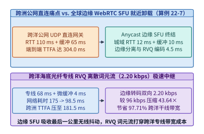
*图 19-40　全球 Anycast 边缘 WebRTC SFU 就近终结、边缘 RVQ 词元卸载与跨洋骨干专线全双工媒体网格（算例 19-15）*

下面通过算例 19-14 与算例 19-15 给出实时 3D 数字人音画对齐抖动缓冲与全球边缘 WebRTC SFU 媒体网格的精确推导账本：

> **算例 19-14（实时 3D 数字人 Avatar 唇形生成与 `< 40 ms` ITU-R BT.1359 音画同步抖动缓冲对齐核算，锁定 `experiments/ch19/19-06/run.py`）**
> **已知条件**：某全双工 3D 数字人系统在每 $80.0\ \mathrm{ms}$ 节拍完成 Temporal + Depth 双层推理（$11.50\ \mathrm{ms}$）后，并行触发声学与视觉两条下行合成支路：（1）**声学支路**：流式因果声码器耗时 $T_{\mathrm{voc}} = 6.50\ \mathrm{ms}$；（2）**视觉支路**：Audio-to-FLAME 表情回归与 $50\ \mathrm{FPS}$ 3D Gaussian Splatting 渲染耗时 $T_{\mathrm{avatar}} = 28.50\ \mathrm{ms}$，硬件 NVENC 超低延迟视频编码耗时 $T_{\mathrm{enc}} = 4.00\ \mathrm{ms}$。在公网传输与客户端接收端，高清视频 RTP 分片流比单包 Opus 音频流多经历稳态网络抖动偏斜 $\Delta J_{\mathrm{steady}} = 18.00\ \mathrm{ms}$（在 P99 弱网突发时额外增加 $\Delta J_{\mathrm{p99\_extra}} = 15.00\ \mathrm{ms}$）。客户端双轨对齐缓冲器对超前到达的音频流主动施加固定补偿延迟 $D_{\mathrm{hold}} = 26.00\ \mathrm{ms}$（纯音频全双工首包基准延迟为 $\mathrm{TTFA}_{\mathrm{audio}} = 164.00\ \mathrm{ms}$）。
> **求解目标**：（1）求未启用对齐缓冲时，声学与视觉支路的稳态音画偏斜 $\Delta t_{\mathrm{AV}}^{\mathrm{raw}}$ 与 P99 峰值音画偏斜 $\Delta t_{\mathrm{AV}}^{\mathrm{raw, p99}}$，并判断是否违背 `< 40.0 ms` 唇形同步红线；（2）求启用 $D_{\mathrm{hold}} = 26.00\ \mathrm{ms}$ 补偿缓冲后的稳态音画偏斜 $\Delta t_{\mathrm{AV}}^{\mathrm{aligned}}$、P99 峰值音画偏斜 $\Delta t_{\mathrm{AV}}^{\mathrm{aligned, p99}}$、稳态偏斜削减百分比，以及对齐后的端到端数字人首包交互响应延迟 $\mathrm{TTFA}_{\mathrm{avatar}}$。
> **逐步解答**：
> 1. **未对齐基线下的音画偏斜（Audio Lead Skew）**：
>    - 视觉支路服务端合成与编码总耗时：$T_{\mathrm{vis}} = 28.50 + 4.00 = \mathbf{32.50\ \mathrm{ms}}$；
>    - 服务端计算耗时差：$\Delta T_{\mathrm{srv}} = T_{\mathrm{vis}} - T_{\mathrm{voc}} = 32.50 - 6.50 = \mathbf{26.00\ \mathrm{ms}}$；
>    - 叠加网络抖动偏斜后，未对齐稳态音画偏斜为：
>      $$\Delta t_{\mathrm{AV}}^{\mathrm{raw}} = 26.00 + 18.00 = \mathbf{44.00\ \mathrm{ms}} > 40.0\ \mathrm{ms}\ (\text{违约})$$
>    - P99 弱网峰值音画偏斜高达：
>      $$\Delta t_{\mathrm{AV}}^{\mathrm{raw, p99}} = 44.00 + 15.00 = \mathbf{59.00\ \mathrm{ms}} > 45.0\ \mathrm{ms}\ (\text{严重违背 ITU-R BT.1359 红线})$$
> 2. **启用双轨 RTP 对齐缓冲（$D_{\mathrm{hold}} = 26.00\ \mathrm{ms}$）后的同步精度与总延迟**：
>    - 对齐后稳态音画偏斜：$\Delta t_{\mathrm{AV}}^{\mathrm{aligned}} = 44.00 - 26.00 = \mathbf{18.00\ \mathrm{ms}} < 40.0\ \mathrm{ms}$，音画偏斜削减率为 $\frac{26.00}{44.00} \approx \mathbf{59.09\%}$；
>    - 对齐后 P99 峰值音画偏斜：$\Delta t_{\mathrm{AV}}^{\mathrm{aligned, p99}} = 59.00 - 26.00 = \mathbf{33.00\ \mathrm{ms}} < 40.0\ \mathrm{ms}$（全工况达标）；
>    - 对齐后的数字人首包音画同步响应总延迟：
>      $$\mathrm{TTFA}_{\mathrm{avatar}} = \mathrm{TTFA}_{\mathrm{audio}} + D_{\mathrm{hold}} = 164.00 + 26.00 = \mathbf{190.00\ \mathrm{ms}} < 200.0\ \mathrm{ms}$$

> **算例 19-15（跨大洲全球边缘 WebRTC SFU 就近接入与骨干专线 RVQ 码流中继延迟/带宽核算，锁定 `experiments/ch19/19-06/run.py`）**
> **已知条件**：欧洲法兰克福客户端访问位于美东弗吉尼亚的 H100/B200 全双工语音推理集群。端侧采集与 AEC 固定耗时 $T_{\mathrm{client}} = 25.0\ \mathrm{ms}$。对比两种全球组网方案：
> - **方案 A（跨洋公网直连中心网关）**：跨洋公网 $\mathrm{RTT}_{\mathrm{pub}} = 110.0\ \mathrm{ms}$，公网丢包引发自适应抖动缓冲 $T_{\mathrm{jb, pub}} = 65.0\ \mathrm{ms}$，中心服务端全流程耗时 $T_{\mathrm{srv, full}} = 24.0\ \mathrm{ms}$，最坏整周期节拍对齐 $T_{\mathrm{tick}} = 80.0\ \mathrm{ms}$，跨洋链路传输双向 Opus 封装流（含 RTP/SRTP/UDP/IP 头开销共 $R_{\mathrm{opus, bi}} = 96.0\ \mathrm{kbps}$）；
> - **方案 B（法兰克福边缘 SFU 就近终结 + 骨干光纤专线 RVQ 中继）**：城域网接入边缘 SFU 的 $\mathrm{RTT}_{\mathrm{edge}} = 12.0\ \mathrm{ms}$、边缘抖动缓冲 $T_{\mathrm{jb, edge}} = 10.0\ \mathrm{ms}$；边缘节点执行多人空间声源分离与 Mimi RVQ 编码耗时 $T_{\mathrm{edge\_dsp}} = 4.50\ \mathrm{ms}$（同时免去中心 GPU 的 $6.0\ \mathrm{ms}$ 编码耗时，中心 GPU 仅需 $T_{\mathrm{srv, core}} = 18.0\ \mathrm{ms}$）；边缘至美东中心的跨洋海底光缆专线 $\mathrm{RTT}_{\mathrm{backbone}} = 68.0\ \mathrm{ms}$、专线微抖动缓冲 $T_{\mathrm{jb, backbone}} = 4.0\ \mathrm{ms}$，且边缘与中心预同步节拍相位将平均节拍对齐等待降至半周期 $T_{\mathrm{tick, sync}} = 40.0\ \mathrm{ms}$；跨洋干线仅传输双向裸 RVQ 离散词元流（单向 $1.10\ \mathrm{kbps}$，双向合计 $R_{\mathrm{rvq, bi}} = 2.20\ \mathrm{kbps}$）。
> **求解目标**：（1）对比方案 A 与方案 B 的纯网络传输+抖动缓冲+边缘处理耗时（$T_{\mathrm{net\_path}}$）及削减比例；（2）对比两方案的端到端首包响应延迟 $\mathrm{TTFA}_{\mathrm{direct}}$ 与 $\mathrm{TTFA}_{\mathrm{edge}}$ 及加速比；（3）求跨洋骨干专线相比原始双向 Opus 流的干线带宽压缩倍数与带宽节省百分比。
> **逐步解答**：
> 1. **网络传输与抖动缓冲路径耗时对比**：
>    - 方案 A 网络与缓冲总耗时：$T_{\mathrm{net, A}} = 110.0 + 65.0 = \mathbf{175.00\ \mathrm{ms}}$；
>    - 方案 B 网络、缓冲与边缘卸载总耗时：$T_{\mathrm{net, B}} = 12.0 + 10.0 + 4.5 + 68.0 + 4.0 = \mathbf{98.50\ \mathrm{ms}}$；
>    - 网络与抖动路径延迟净削减 $175.00 - 98.50 = 76.50\ \mathrm{ms}$，削减比例为 $\frac{76.50}{175.00} \approx \mathbf{43.71\%}$。
> 2. **端到端首包响应延迟（$\mathrm{TTFA}$）对比**：
>    - 方案 A（公网直连）：$\mathrm{TTFA}_{\mathrm{direct}} = 25.0 + 175.0 + 24.0 + 80.0 = \mathbf{304.00\ \mathrm{ms}} > 200.0\ \mathrm{ms}$（突破人类自然话轮阈值）；
>    - 方案 B（边缘 SFU + 专线 RVQ 中继）：$\mathrm{TTFA}_{\mathrm{edge}} = 25.0 + 98.5 + 18.0 + 40.0 = \mathbf{181.50\ \mathrm{ms}} < 200.0\ \mathrm{ms}$（重返 `< 200 ms` 瞬时交互区，端到端提速 $\frac{304.00}{181.50} \approx \mathbf{1.67\times}$）。
> 3. **跨洋骨干专线带宽节省率**：
>    双向干线码率从 $96.0\ \mathrm{kbps}$ 降至 $2.20\ \mathrm{kbps}$，带宽压缩比达 $\frac{96.0}{2.20} \approx \mathbf{43.64\times}$，干线带宽节省率为 $1 - \frac{2.20}{96.0} \approx \mathbf{97.71\%}$。

*表 19-11　实时 3D 数字人音画对齐抖动缓冲与全球边缘 WebRTC SFU 媒体网格性能对照表*

| 评估维度 | 传统未对齐 / 跨洋公网直连基线 | 现代 RTP 音画对齐缓冲 + 全球边缘 SFU 网格 | 核心锁定工程收益 |
| :--- | :--- | :--- | :--- |
| **3D 数字人稳态/P99 音画偏斜** | 声超前于画 **`+44.00 ms`**（P99 **`+59.00 ms`**，违约） | 音频补偿驻留 `26.0 ms`，稳态 **`+18.00 ms`**（P99 **`+33.00 ms`**） | 偏斜削减 **`59.09%`**，严守 `< 40 ms` 红线 |
| **数字人音画同步首包延迟** | 虽音频 `164.0 ms` 到但口型严重滞后脱节 | 音画严格对齐首包响应 **`190.00 ms`** | 在 `< 200 ms` 阈值内实现零违和唇形同步 |
| **跨洲际网络+抖动缓冲耗时** | 跨洋公网 `110 ms` RTT + `65 ms` 抖动缓冲 = **`175.00 ms`** | 城域网 SFU (`22 ms`) + 边缘 DSP (`4.5 ms`) + 专线 (`72 ms`) = **`98.50 ms`** | 网络与抖动耗时削减 **`43.71%`** |
| **跨大洲全双工端到端 TTFA** | **`304.00 ms`**（超出 `200 ms` 自然对话感知阈值） | **`181.50 ms`**（含半周期同步对齐 `40.0 ms`） | 跨洲通话提速 **`1.67x`**，恢复实时交互感 |
| **跨洋骨干网每路双向带宽** | 双向 Opus + RTP/UDP/IP 封装需 **`96.00 kbps`** | 边缘转码为双向裸 Mimi RVQ 词元流仅 **`2.20 kbps`** | 跨洋干线压缩 **`43.64x`**（省 **`97.71%`**） |

下面给出实时 3D 数字人音画同步延迟补偿器与全球边缘 WebRTC SFU 媒体网格路由核算器的生产级代码实现（对应配套实验 `experiments/ch19/19-06`）：

```python
from dataclasses import dataclass

@dataclass
class AvatarLipSyncAndGlobalEdgeSFUMeshEngine:
    """
    复现算例 19-14 与算例 19-15 (对应 experiments/ch19/19-06)：
    1. 实时 3D 数字人 (3DGS Avatar) 唇形同步与 < 40 ms 音画对齐抖动缓冲控制器
    2. 全球 Anycast 边缘 WebRTC SFU 媒体网格就近卸载与骨干专线 RVQ 词元流中继核算器
    """
    vocoder_ms: float = 6.50
    avatar_render_ms: float = 28.50
    nvenc_encode_ms: float = 4.00
    steady_video_jitter_skew_ms: float = 18.00
    p99_extra_jitter_ms: float = 15.00
    audio_hold_delay_ms: float = 26.00
    base_audio_ttfa_ms: float = 164.00

    def audit_avatar_lipsync_alignment(self) -> dict[str, float]:
        vis_path_ms = self.avatar_render_ms + self.nvenc_encode_ms
        server_compute_skew_ms = vis_path_ms - self.vocoder_ms
        raw_steady_skew_ms = server_compute_skew_ms + self.steady_video_jitter_skew_ms
        raw_p99_skew_ms = raw_steady_skew_ms + self.p99_extra_jitter_ms

        aligned_steady_skew_ms = raw_steady_skew_ms - self.audio_hold_delay_ms
        aligned_p99_skew_ms = raw_p99_skew_ms - self.audio_hold_delay_ms
        skew_reduction_pct = 100.0 * (1.0 - aligned_steady_skew_ms / raw_steady_skew_ms)
        avatar_ttfa_ms = self.base_audio_ttfa_ms + self.audio_hold_delay_ms

        return {
            "vis_path_ms": round(vis_path_ms, 2),
            "raw_steady_skew_ms": round(raw_steady_skew_ms, 2),
            "raw_p99_skew_ms": round(raw_p99_skew_ms, 2),
            "aligned_steady_skew_ms": round(aligned_steady_skew_ms, 2),
            "aligned_p99_skew_ms": round(aligned_p99_skew_ms, 2),
            "skew_reduction_pct": round(skew_reduction_pct, 2),
            "avatar_ttfa_ms": round(avatar_ttfa_ms, 2),
        }

    @staticmethod
    def audit_global_edge_sfu_mesh(
        client_aec_ms: float = 25.0,
        pub_rtt_ms: float = 110.0,
        pub_jb_ms: float = 65.0,
        srv_full_ms: float = 24.0,
        unsync_tick_ms: float = 80.0,
        edge_rtt_ms: float = 12.0,
        edge_jb_ms: float = 10.0,
        edge_dsp_ms: float = 4.5,
        backbone_rtt_ms: float = 68.0,
        backbone_jb_ms: float = 4.0,
        srv_core_ms: float = 18.0,
        sync_tick_ms: float = 40.0,
        opus_bi_kbps: float = 96.0,
        rvq_bi_kbps: float = 2.20,
    ) -> dict[str, float]:
        net_direct_ms = pub_rtt_ms + pub_jb_ms
        net_edge_ms = edge_rtt_ms + edge_jb_ms + edge_dsp_ms + backbone_rtt_ms + backbone_jb_ms
        net_reduction_pct = 100.0 * (1.0 - net_edge_ms / net_direct_ms)

        ttfa_direct_ms = client_aec_ms + net_direct_ms + srv_full_ms + unsync_tick_ms
        ttfa_edge_ms = client_aec_ms + net_edge_ms + srv_core_ms + sync_tick_ms
        ttfa_speedup_x = ttfa_direct_ms / ttfa_edge_ms

        bw_compression_x = opus_bi_kbps / rvq_bi_kbps
        bw_saving_pct = 100.0 * (1.0 - rvq_bi_kbps / opus_bi_kbps)

        return {
            "net_direct_ms": round(net_direct_ms, 2),
            "net_edge_ms": round(net_edge_ms, 2),
            "net_reduction_pct": round(net_reduction_pct, 2),
            "ttfa_direct_ms": round(ttfa_direct_ms, 2),
            "ttfa_edge_ms": round(ttfa_edge_ms, 2),
            "ttfa_speedup_x": round(ttfa_speedup_x, 2),
            "bw_compression_x": round(bw_compression_x, 2),
            "bw_saving_pct": round(bw_saving_pct, 2),
        }


if __name__ == "__main__":
    eng = AvatarLipSyncAndGlobalEdgeSFUMeshEngine()
    av = eng.audit_avatar_lipsync_alignment()
    sfu = eng.audit_global_edge_sfu_mesh()
    assert av["raw_steady_skew_ms"] == 44.0 and av["aligned_steady_skew_ms"] == 18.0
    assert av["aligned_p99_skew_ms"] == 33.0 and av["avatar_ttfa_ms"] == 190.0
    assert sfu["net_edge_ms"] == 98.5 and sfu["ttfa_edge_ms"] == 181.5
    assert sfu["bw_saving_pct"] == 97.71
```

在超大规模跨国数字人与全双工会议生产部署中，上述设计还需遵循两项关键的容灾与卸载法则：
- **端侧/边缘 WebGPU 3D 数字人渲染卸载（Client-Side Neural Avatar Rendering）**：当服务端 GPU 显存与编码器通道高度紧张时，中心节点可无需下发 $1080\mathrm{p}$ 视频流，而是将每 $80.0\ \mathrm{ms}$ 预测出的紧凑面部运动系数（每帧仅 $32$ 个 `FP16` 参数或 $64$ 个 `INT8` 量化混合形状权重，共 $512\ \mathrm{bits}$，在 $12.5\ \mathrm{Hz}$ 帧率下码率仅 **$6.4\ \mathrm{kbps}$**）随同音频包一并下发至客户端，由用户手机或浏览器本地 NPU/WebGPU 直接驱动预加载的 3D 高斯头像资产，从根源上消除公网视频分片抖动与云端渲染算力开销；
- **多人会议说话人抢话的因果级联回滚**：当边缘空间声源分离模块检测到会议室主持人（具有更高话权优先级）开口打断正在发言的普通参会者或 AI 助手时，边缘 SFU 在 $4.5\ \mathrm{ms}$ 内向中心节点发送带说话人角色 ID 的高优控制信令，直接复用 19.7.2 节的 RTP 播放游标原子回滚机制瞬时切换话权。

#### 全模态实时集群的服务等级目标矩阵与分级有损降级防线

纵观本章从百亿参数三维视频扩散、多模态理解到全双工实时语音与数字人的完整技术栈，生产级全模态基础设施与传统纯文本批处理推理的根本分野，在于它必须在同一座异构集群内同时守护**四条时间尺度跨越四个数量级的硬实时与准实时服务等级目标（SLO）红线**：
- **秒级至数十毫秒级交互理解红线（`E-P-D` 池）**：多图/长视频理解请求的首词元延迟 $\mathrm{TTFT} < 500\ \mathrm{ms}$，自回归文本解码步间延迟 $\mathrm{TPOT} < 30\ \mathrm{ms}$；
- **帧级交互世界模型红线（`G` 池流式生成态）**：在 $30\ \mathrm{FPS}$ 交互式世界模型与实时视频流驱动下，单帧去噪与因果 VAE 解码总耗时必须严格收敛在 **$33.3\ \mathrm{ms}$** 帧间预算之内；
- **毫秒级全双工声学节拍与打断红线（`S2S Duplex` 池）**：端到端语音首包响应 $\mathrm{TTFA} < 200.0\ \mathrm{ms}$（算例 19-9 实测 $164.0\ \mathrm{ms}$，跨洲际边缘网格实测 $181.5\ \mathrm{ms}$），每 $80.0\ \mathrm{ms}$ 等时节拍内的 `P99` 推理耗时不超过 $65.0\ \mathrm{ms}$（保持零音频欠载断流），且人类抢话触发的物理播放游标与 KV 原子回滚必须在 **$< 1.0\ \mathrm{ms}$**（算例 19-12 实测 $0.12\ \mathrm{ms}$）内完成；
- **感知级音画唇形同步红线（`Avatar` 媒体支路）**：遵循 ITU-R BT.1359 标准，客户端声学与视觉支路的端到端播放时间偏斜在 `P99` 弱网工况下必须满足 **$|\Delta t_{\mathrm{AV}}| < 40.0\ \mathrm{ms}$**（算例 19-14 实测 $+33.0\ \mathrm{ms}$）。

当晚高峰突发流量洪峰、单机 SM 算力争用或跨国海缆局部抖动来袭时，若缺乏体系化的过载保护机制，单点延迟毛刺极易沿着“`E -> P -> D -> Vocoder/Avatar -> WebRTC`”长链条发生级联放大。为此，成熟的工业级全模态调度网关普遍部署**四级有损与无损协同降级防线（Four-Stage Graceful Degradation Ladder）**，按对人类主观体验损伤从小到大的严格序关系逐级卸载负载：

1. **第一级防线——生成支路免训练动态跳步与尾部引导截断（主观体验近乎无损）**：
   一旦监控探针发现 `G` 池排队深度越过警戒阈值，网关立即将视频/图像 DiT 的 `TeaCache` 相对一阶差分门限 $\varepsilon_{\mathrm{thresh}}$ 从保守档调升至 $0.15$（将有效去噪步数从 $50$ 步压缩至 $22$ 步，立即释放超过一半的主干算力），同时在去噪后 $35\%$ 区间自动关停无条件 `CFG` 分支，确保高优先级的实时语音与在线理解流不受异步生成洪峰波及。
2. **第二级防线——云端数字人高清视频流向端侧 `6.4 kbps` 参数流热切换（保全唇形与话轮实时性）**：
   当服务端 `3DGS` 渲染队列拥塞或客户端上报上行/下行无线丢包率超过 $3\%$ 时，媒体控制面在下一个 $80.0\ \mathrm{ms}$ 节拍边界无缝关停云端 $1080\mathrm{p}$ 视频渲染与 NVENC 编码（单路立省 $32.50\ \mathrm{ms}$ GPU 耗时与数百 $\mathrm{kbps}$ 下行带宽），切换为仅下发 $6.4\ \mathrm{kbps}$ 的面部运动系数流交由端侧渲染，若端侧算力亦受限则进一步平滑退化为静态高精肖像配合纯音频全双工通话，优先坚守 $\mathrm{TTFA} < 200\ \mathrm{ms}$ 的对话连贯感。
3. **第三级防线——声学残差码本动态削层与温态视觉 KV 主动降级（以轻微音色细节换取不断流）**：
   当全双工集群单卡 `P99` 步耗时逼近 $65.0\ \mathrm{ms}$ 安全红线或显存池占用率超过 $85\%$ 时，双自回归引擎可在线将每帧 Depth Transformer 的自回归生成层数从 $K = 8$ 层动态裁剪至前 $K' = 4$ 层核心码本（保留承载全部语义与主基频的 $q_1 \dots q_4$，暂时略去仅修饰超高频呼吸泛音的 $q_5 \dots q_8$），使每节拍串行微步数立减一半、单向干线 RVQ 码率从 $1.10\ \mathrm{kbps}$ 进一步减半至 $0.55\ \mathrm{kbps}$；与此同时，缓存管理器批量将静默超过 $15\ \mathrm{s}$ 的多模态会话从 $56.25\ \mathrm{MiB}$ 主干 KV 降级为 $7.8125\ \mathrm{MiB}$ 的 `EC` 特征，瞬时回收 $86.11\%$ 的显存缓冲空间。
4. **第四级防线——等时批处理硬准入熔断与半双工优雅回退（严防全批次雪崩）**：
   正如本节式 (19.12)–(19.15) 所证，全双工等时批处理受显存容量上限 $B_{\mathrm{mem}} = 25$ 路与等时延迟上限 $B_{\mathrm{lat}} = 66$ 路双重硬边界约束，具有“一损俱损”的硬实时耦合特征——在显存受限态下强塞第 $26$ 路会话会直接触发动态会话 KV 池溢出，而在分层卸载打开显存上限后若强行往已达 $B_{\mathrm{lat}} = 66$ 路的单卡批次中塞入第 $67$ 路会话（使单步解码耗时升至 $65.62\ \mathrm{ms} > 65.0\ \mathrm{ms}$ 计算预算），将导致同卡全部 $67$ 名在线用户同时遭遇 `80 ms` 声码器饥饿爆音。因此，准入控制器必须执行不妥协的硬熔断：超出容量包络的新进请求绝不混入现有全双工 CUDA Graph 批次，而是由全局 Anycast 边缘 SFU 透明路由至邻近空闲可用区，或在前端提示后平滑回退至非等时的流式半双工语音模式，从而在极端过载下依然保障存量全双工会话 `0` 断流。

---

## 常见误区

1. **误区一：“视觉编码器（ViT）输出的浮点特征包含多层高维隐藏态，体积比开启了 GQA 的大语言模型 KV 缓存更大，因此跨节点分离时应该传 KV 而不是传编码特征。”**
   **纠正**：恰恰相反。如算例 19-1 对 `Qwen3-VL-4B` 的精确复算所示，即便算上最终投射层与 3 个 DeepStack 中间层（每词元 $10{,}240$ 维 BF16），单张 $640 \times 640$ 图像的 400 个视觉词元编码输出（EC）体积也仅为 $7.8125\ \mathrm{MiB}$（单层投射更只有 $1.953125\ \mathrm{MiB}$）；而一旦进入 36 层主干转化为 KV 缓存，体积立即膨胀 $7.2$ 倍至 $56.25\ \mathrm{MiB}$。在 `E→P` 边界传输或缓存 EC 远比在 `P→D` 边界搬移 KV 节省网络带宽与内存容量。

2. **误区二：“视频扩散模型（3D DiT）的显存最高峰一定出现在参数量百亿、序列长达数十万词元的 DiT 去噪迭代期间，3D VAE 解码器只有几亿参数，显存开销可以忽略。”**
   **纠正**：去噪期间潜变量处于 $4 \times 8 \times 8$ 的高倍压缩空间；而在去噪结束、进入 3D 因果 VAE 解码器末段上采样层时，时空分辨率已完全恢复为 $240 \times 1080 \times 1920$，同时特征通道仍保持在 128 维，单份 FP16 特征图即高达 $118.65\ \mathrm{GiB}$（算例 19-3），是引发“进度 99% 时 OOM 崩溃”的头号元凶。工程上必须启用带重叠 Halo 与因果卷积历史缓存的时空分块解码（Tiled VAE）。

3. **误区三：“DeepSpeed-Ulysses 的每次通信量随卡数 $1/P$ 递减，因此在任何规模下都比全环通信量为 $2Nd$ 的 Ring Attention 更优。”**
   **纠正**：Ulysses 通过 `All-to-All` 将序列切分转为注意力头切分，其最大并行度受模型的注意力头数硬性约束（$P \le n_{\mathrm{head}}$），且跨机全局 `All-to-All` 极易触发交换机队列拥塞。跨多节点扩展超长视频 DiT 的标准解法是 **2D-USP**：在节点内高带宽 NVLink 域跑 Ulysses（$P_U = 8$），在跨节点 RDMA 域跑 Ring Attention（$P_R = 8$），既打破头数上限，又将跨机流量压缩 $\frac{P-1}{P_R-1} = 9.0$ 倍（算例 19-4）。

4. **误区四：“多模态预训练或视频推理时，用宿主机多核 CPU 跑 FFmpeg 解码图片和视频再传给 GPU，能省下宝贵的 GPU 算力。”**
   **纠正**：在 PCIe 上游用 CPU 将 H.264/JPEG 解压为未压缩 RGB 张量，会使数据体积激增 $20\text{–}50$ 倍，同时占满 CPU 核心与 PCIe 总线并导致 GPU 长期饥饿。正确做法是将压缩码流直接 DMA 传入显存，调用 GPU 硅片上独立的硬件解码单元（NVDEC / nvJPEG，不占用任何 CUDA SM 与 Tensor Core）原位硬解码。

5. **误区五：“只要把 ASR、LLM 和 TTS 三个独立模型都优化到极快，级联架构就能替代原生全双工 S2S 模型。”**
   **纠正**：级联管线存在两道不可逾越的物理边界：第一，级联架构是回合驱动（Turn-based）的，前端 VAD 必须等待 `300–700 ms`（典型 `480.0 ms`）静音才能区分用户是“句中换气停顿”还是“整句结束”，仅此一项就已超出人类自然话轮转换 `200 ms` 阈值的两倍以上；第二，ASR 将语音转为离散汉字的瞬间，用户的语调起伏、笑声、叹息、犹豫停顿与环境音被 $100\%$ 抹除，系统无法边听边发出自然的附和音（Backchanneling）。

6. **误区六：“Depth Transformer 参数量只有 100M（不到主干 7B 的 2%），所以它的推理耗时可以忽略不计。”**
   **纠正**：如 19.6.2 节与算例 19-11 所证，Depth Transformer 虽然单步 FLOPs 极小，但它必须在每个 $80.0\ \mathrm{ms}$ 帧内**沿 $Q=8$ 层码本串行自回归循环 $8$ 次**（共发射 $8 \times 6 \times 8 = 384$ 个细粒度 GPU 微算子）。在 PyTorch 默认 Eager 模式下，这 $384$ 次微内核启动的 CPU 派发开销（`13.44 ms`）与未固定 L2 缓存的碎片访存（`21.60 ms`）合计高达 **`35.04 ms`**，反而比 $7\mathrm{B}$ 主干模型（`3.50 ms`）慢了整整 $10$ 倍。必须使用**整步 CUDA Graph 捕获 + 片上 L2 SRAM 权重持久化固定**，才能将其压缩至 **`8.00 ms`**（单帧总耗时 `11.50 ms`）。

7. **误区七：“用户打断（Barge-in）时只需通知客户端停止播放音频即可，无需触碰服务端大模型的 KV 缓存。”**
   **纠正**：由于服务端超前生成与网络抖动缓冲区的存在，服务端 GPU 往往比用户耳朵实际听到的进度超前生成了 $5\text{–}15$ 帧（如算例 19-12 中超前 `11` 帧 / `880.0 ms`）。若打断时不将服务端 KV 缓存与内心独白历史**按客户端实际播放的 RTP 游标 $t_{\mathrm{play}}$ 精确截断回滚**（回退 `187` 个词元槽位），模型就会把用户根本没听到的那半句话当作“双方已知共识”，在后续对话中产生严重的上下文错位幻觉。

8. **误区八：“在实时视频通话中，每秒 1 帧的视觉 Token 可以直接一次性塞进当前音频节拍做 Prefill。”**
   **纠正**：$1$ 帧高分辨率图像产生的 $256$ 个视觉 Token 一次性预填充耗时达 `72.0 ms`，与当帧音频（`11.5 ms`）合并后峰值达 **`83.5 ms > 80.0 ms`**，必然引发每秒一次的周期性音频断流爆音。工程上必须将其切分为 $8$ 个各含 $32$ 个视觉词元的微块，交错平摊到连续 $8$ 个音频节拍中（单节拍峰值仅 **`20.5 ms`**，降低 $4.07\times$）。

9. **误区九：“在实时 3D 数字人对话中，音频流和视频流只要各自尽力做到最快发送，用户端体验就最好。”**
   **纠正**：如算例 19-14 所示，声码器仅需 `6.50 ms` 即可产出音频，而 3D 高斯头像渲染、视频编码与多包 RTP 分片传输比音频慢 `44.00 ms`（P99 达 `59.00 ms`）。若音频一到客户端就抢先播放，会产生明显的“声音超前于嘴型”违和效应。必须通过双轨 RTP `abs-capture-time` 时间戳对齐缓冲器对音频主动施加 `26.00 ms` 驻留补偿，将音画偏斜全天候严格控制在 `< 40 ms`（稳态 `18.00 ms`，P99 `33.00 ms`）以内。

---

## 练习与实验

> **练习 19-1：视觉词元与 DeepStack 膨胀核算。** 某高分辨率文档理解请求输入一张 $1280 \times 960$ 的图像至 `Qwen3-VL-4B`（参数同算例 19-1：块大小 $p = 16$，$2 \times 2$ 空间合并，单层投射宽度 $2{,}560$，外加 3 层 DeepStack 特征，36 层 LLM 主干配置 $n_{\mathrm{kv}} = 8, d_{\mathrm{head}} = 128$，全链路 BF16）。试求：（a）合并后的视觉词元数 $N_{\mathrm{vis}}$；（b）含 DeepStack 的编码器输出体积 $V_{\mathrm{EC}}$（以 $\mathrm{MiB}$ 计）；（c）主干 KV 缓存体积 $V_{\mathrm{KV}}$（以 $\mathrm{MiB}$ 计）及两者的体积比。

> **练习 19-2：3D 视频 DiT 潜空间词元计算。** 某视频生成任务需合成一段时长 $8\ \mathrm{s}$、帧率 $30\ \mathrm{fps}$、分辨率 $1280 \times 720$（720p）的视频。3D 因果 VAE 的时空下采样比为 $4 \times 8 \times 8$，DiT 的 3D Patchify 步长为 $1 \times 2 \times 2$。试计算潜空间网格尺寸 $(T', H', W')$ 与最终进入 DiT 主干的时空词元总数 $N$。

> **练习 19-3：Ulysses vs. Ring vs. 2D-USP 跨机通信推导。** 设视频 DiT 序列长度 $N = 327{,}680$，隐藏维度 $d = 5{,}120$（BF16，$2\ \mathrm{B}$/元素），注意力头数 $n_{\mathrm{head}} = 40$。现将该单样本序列部署在 16 台 8 卡节点（共 $P = 128$ 张 GPU）上。（a）能否单独使用纯 DeepSpeed-Ulysses 跑满 128 卡？为什么？（b）若采用纯 128 卡 Ring Attention，单层单卡的全环通信量是多少 $\mathrm{MiB}$？（c）若采用 $P_U = 8$（机内 Ulysses）$\times P_R = 16$（跨机 Ring）的 2D-USP，单层单卡的跨节点 RDMA 通信量降至多少 $\mathrm{MiB}$？压缩了多少倍？

> **练习 19-4：db-SP 因果与双向混合掩码负载均衡。** 设一条长序列包含前段 $N_{\mathrm{bi}} = 8{,}192$ 个全双向图像词元与后段 $N_{\mathrm{causal}} = 24{,}576$ 个因果文本词元（且文本段内部只对前序词元包含那 $8{,}192$ 个图像词元计算注意力）。若按位置顺序等长切分给 $P = 4$ 张 GPU（每卡 $8{,}192$ 个词元），试计算第 0 号卡（纯图像块）与第 3 号卡（最末文本块）所需计算的注意力量（以“查询词元数 $\times$ 可见键词元数”的有效块面积衡量）之比，并说明 `db-SP` 如何消除该失衡。

> **练习 19-5：3D VAE 解码分块 Halo 开销与峰值显存。** 设一段 $T = 128$ 帧、$H \times W = 1024 \times 1024$ 的视频在 3D VAE 末层具有 $C = 128$ 个 FP16 通道。（a）求未分块单份特征图体积（$\mathrm{GiB}$）；（b）若空间按 $4 \times 4$ 分块、时间按 $16$ 帧分窗，且四周边框各外扩 $16$ 个像素的 Halo 重叠带（即每个空间分块实际宽高为 $256 + 32 = 288$），求单块单份特征图体积（$\mathrm{MiB}$）以及全视频累积重算像素比例。

> **练习 19-6：DistriFusion 陈旧激活误差界与通信掩盖条件。** 设单步去噪中单层自注意力计算耗时为 $T_{\mathrm{comp}}(N, P) = \frac{\alpha N^2 d}{P}$，后台跨卡 `AllGather` 传输全量 KV 的通信耗时为 $T_{\mathrm{comm}}(N, P) = \beta \frac{P-1}{P} N d$。试推导 `DistriFusion` 实现 $100\%$ 通信掩盖的临界序列长度下界 $N_{\min}$，并解释为何在生成步数 $K$ 较少（如 4 步蒸馏模型）时 `DistriFusion` 不再适用。

> **练习 19-7：PipeFusion 气泡率定量对比。** 在 $P = 8$ 卡流水线并行、空间切分为 $M = 16$ 个 Patch 微批次、总去噪步数 $K = 40$ 步的配置下，对比“每步末尾强制同步排空的传统流水线”与“`PipeFusion` 跨步连续流水线”的流水线气泡占总计算时间的比例 $\frac{T_{\mathrm{bubble}}}{T_{\mathrm{compute}}}$。

> **练习 19-8：TeaCache 加速上限与 Amdahl 定律。** 在算例 19-5 中（$T_{\mathrm{fixed}} = 3.60\ \mathrm{s}$，50 步 DiT 共 $60.00\ \mathrm{s}$），若激进调大 `TeaCache` 门限使保留步数从 $22$ 步进一步降至 $10$ 步，端到端延迟与加速比变为多少？即使 DiT 步数无限趋近于 0，受 $T_{\mathrm{fixed}}$ 制约的理论最高加速比上限是多少？

> **练习 19-9：SageAttention 键均值平滑的代数恒等证明。** 设查询行向量 $q \in \mathbb{R}^{1 \times d}$，键矩阵 $K \in \mathbb{R}^{N \times d}$，其行均值为 $\mu_K = \frac{1}{N} \mathbf{1}_N^\top K \in \mathbb{R}^{1 \times d}$。请严格写出 $\mathrm{Softmax}((q K^\top)/\sqrt{d}) = \mathrm{Softmax}((q (K - \mathbf{1}_N \mu_K)^\top)/\sqrt{d})$ 的逐元素代数证明，并解释为何对查询矩阵 $Q$ 减去序列均值 $\mu_Q$ **不能**保持 Softmax 输出不变。

> **练习 19-10：30 FPS 交互式世界模型的步间流式拼批预算。** 某 720p 交互式世界模型经分布匹配蒸馏后需执行 $S = 4$ 个去噪步。在单张 H100 上，批大小 $B = 1$（单潜空间帧）跑一次模型前向耗时 $14\ \mathrm{ms}$；而由于算术强度提升，批大小 $B = 4$（4 个潜空间帧拼批）跑一次前向仅耗时 $24\ \mathrm{ms}$，外加 Causal VAE 单帧解码耗时 $5\ \mathrm{ms}$。对比“串行跑 4 步再吐帧”与“`StreamDiffusionV2` 跨帧 4 步流式拼批”的稳态帧率（FPS）及动作响应延迟。

> **练习 19-11：E-P-D-G 集群配比与 EC 缓存敏感度。** 将算例 19-6 扩展至一个 $32$ 卡集群：单卡编码速率 $\mu_E = 15\ \mathrm{req/s}$，单卡预填充速率 $\mu_P = 5\ \mathrm{req/s}$，单卡解码速率 $\mu_D = 2.5\ \mathrm{req/s}$。（a）在零缓存（$h = 0$）下，求最大化稳态吞吐的最优整数卡数分配 $(n_E, n_P, n_D)$ 及系统吞吐；（b）当 EC 缓存命中率达到 $h = 80\%$ 时，仅需几张 `E` 卡即可喂饱其余所有卡？

> **实验 19-12：多轮对话 EC 缓存 vs. KV 缓存容量规划与 `experiments/ch19/19-01` 全套账本复核。** 某节点拥有 $36\ \mathrm{GiB}$ 可用于缓存多轮历史会话的闲置内存池，服务 `Qwen3-VL-4B` 请求（每会话含 2 张 $640 \times 640$ 图像，单图参数同算例 19-1：EC 体积 $7.8125\ \mathrm{MiB}$，主干 KV 体积 $56.25\ \mathrm{MiB}$）。对比“全量驻留主干 KV”与“温会话降级驻留 EC”两种策略下该内存池可同时容纳的并发历史会话数，并运行 `python3 experiments/ch19/19-01/run.py && python3 experiments/ch19/19-01/verify.py` 复核本章全部锁定指标。

> **练习 19-13：Transfusion 图文交错混合注意力分块占用率与双轨原位暂存页核算。** 承接算例 19-7（36 层 `Transfusion` 模型，每词元 KV 体积 $144\ \mathrm{KiB}$，FlashAttention 分块大小 $128 \times 128$）。复核算例 19-7 中 $L_{T_1} = 1{,}024, L_{I_1} = 2{,}048, L_{T_2} = 1{,}024$（总长 $4{,}096$）下的活跃块数 $648$ 与有效注意力对数 $10{,}485{,}760$；若将该序列扩展为前缀 $L_{\mathrm{prefix}} = 8{,}192$、图像段 $N_{\mathrm{img}} = 2{,}048$ 并执行 $K = 30$ 个去噪步，求双轨原位暂存页（Scratchpad KV）体积 $V_{\mathrm{scratch}}$（以 $\mathrm{MiB}$ 计）及相对单轨按步追加分配节省的瞬态显存（以 $\mathrm{GiB}$ 计）。

> **实验 19-14：3DGS 几何脚手架视锥剔除与视频世界模型吞吐仿真（对应 `experiments/ch19/19-02`）。** 某自动驾驶交互式世界模型在显存中维护 $M = 1{,}200{,}000$ 个三维高斯椭球作为街道几何脚手架。在 30 FPS（帧预算 $33.3\ \mathrm{ms}$）交互重仿真中，相机视锥剔除（Frustum Culling）过滤掉了 $80\%$ 处于当前视野外的非活跃高斯点，使分块光栅化耗时从全量渲染的 $11.5\ \mathrm{ms}$ 降至 $2.4\ \mathrm{ms}$；随后由 4 步流式拼批（Stream Batching）3D DiT 耗时 $24.0\ \mathrm{ms}$ 与分块因果 VAE 解码耗时 $4.5\ \mathrm{ms}$ 完成纹理精修。求：（a）每帧参与光栅化的活跃高斯点数 $M_{\mathrm{active}}$；（b）启用视锥剔除前后的端到端单帧延迟与稳态帧率（FPS），判断是否满足 30 FPS 硬实时控制红线，并运行 `python3 experiments/ch19/19-02/run.py && python3 experiments/ch19/19-02/verify.py` 验证实验通过。

> **练习 19-15：CausVid / Oasis 块因果滚动 KV 缓存池显存账本与长程漂移防御。** 承接算例 19-8，考察一个 720p（$1280 \times 720$）自回归流式因果世界模型：每潜空间块对应 $F_{\mathrm{chunk}} = 3$ 帧 RGB 视频、含 $N_{\mathrm{chunk}} = 3{,}600$ 个时空词元；模型共 $28$ 层，其中 $8$ 层为跨块时间因果注意力层（$n_{\mathrm{kv}} = 16, d_{\mathrm{head}} = 128$，BF16 每元素 $2\ \mathrm{B}$）。（a）求配置 $M_{\mathrm{sink}} = 1$ 个常驻首块锚点 + $M_{\mathrm{win}} = 5$ 个环形滚动滑窗块（共 $6$ 个活跃历史块）时的历史 KV 词元数 $N_{\mathrm{hist}}$，以及 8 层跨块 KV 口径与全 28 层 KV 口径下的滚动缓存池体积（以 $\mathrm{GiB}$ 计，保留四位小数）；（b）若连续交互 10 分钟（$20\ \mathrm{FPS}$，共 $4{,}000$ 个块）而不裁剪历史 KV，8 层跨块 KV 将膨胀至多少 $\mathrm{GiB}$？滚动窗口将其压缩了多少倍？（c）解释为何滚动窗口必须保留第 0 号起始帧块作为常驻 `Attention Sink` 并配合块间相对三维 RoPE 重锚定。

> **实验 19-16：金字塔注意力广播（PAB）与 TeaCache 跨步复用实时帧率核算（对应 `experiments/ch19/19-03`）。** 在算例 19-8 的 4 步 DMD 块因果世界模型中（每块输出 $3$ 帧 RGB，块末因果 VAE 解码固定耗时 $t_{\mathrm{vae}} = 18.0\ \mathrm{ms}$），未启用特征复用时每步 DiT 耗时 $42.0\ \mathrm{ms}$（含空间+FFN $18.0\ \mathrm{ms}$、时间因果注意力 $16.0\ \mathrm{ms}$、动作/条件交叉注意力 $8.0\ \mathrm{ms}$）。启用 PAB + TeaCache 后，4 个去噪步 $s \in \{4, 3, 2, 1\}$ 的 DiT 耗时分别降为 $42.0\ \mathrm{ms}$、$18.0\ \mathrm{ms}$、$2.0\ \mathrm{ms}$ 与 $34.0\ \mathrm{ms}$。求启用复用前后的单块总耗时（$\mathrm{ms/chunk}$）、单帧平均延迟（$\mathrm{ms/frame}$）与稳态帧率（$\mathrm{FPS}$），验证其突破 $20\ \mathrm{FPS}$ 实时交互红线，并运行 `python3 experiments/ch19/19-03/run.py && python3 experiments/ch19/19-03/verify.py` 验证实验通过。

---

> **练习 19-17：核算四级串联语音管线（`VAD 480 ms + ASR 220 ms + LLM 280 ms + TTS 240 ms + Net 60 ms = 1,280 ms`）与原生全双工 S2S 架构（`164 ms`）的首包音频响应加速比，并说明为何级联管线无法突破人类话轮转换的 `200 ms` 感知阈值。**

> **练习 19-18：给定原始单声道 PCM 音频（采样率 $24\ \mathrm{kHz}$、位深 $16\ \mathrm{bit}$）与神经音频编解码器 Mimi（帧步长 $80\ \mathrm{ms}$、码本层数 $Q=8$、每层码本词表大小 $V_a = 2048$），推导并计算原始比特率、RVQ 词元生成速率、RVQ 压缩比特率及无损语义声学压缩比。**

> **练习 19-19：在全双工双层 Transformer 中，设 Temporal 7B 主干单步耗时 $3.50\ \mathrm{ms}$；Depth 100M 小模型需串行执行 $Q=8$ 步（每步 $6$ 层、每层 $8$ 个算子内核），Eager 模式下单算子启动开销 $35.0\ \mathrm{\mu s}$、未固定 L2 碎片访存耗时 $56.25\ \mathrm{\mu s}$，整步 CUDA Graph + L2 常驻固定后 Depth 阶段总耗时降至 $8.00\ \mathrm{ms}$。求 Eager 与 CUDA Graph 下的单帧总耗时及加速比。**

> **练习 19-20：剖析延迟码本交错模式（Delayed Codebook Pattern，单步错位 $d_q = q - 1$ 帧）在 $Q=8$ 码本、帧长 $\Delta t = 80\ \mathrm{ms}$ 下的首帧完整声学就绪冷启动延迟 $\Delta T_{\mathrm{cold}} = (Q-1)\Delta t$，并对比其与双层 RQ-Transformer 的工程取舍。**

> **实验 19-21：复现随时打断（Barge-in）时的客户端 RTP 播放游标对齐 KV 回滚协议（对应 `19-05`）：设服务端已生成至第 $65$ 帧（$5,200\ \mathrm{ms}$），客户端打断时报告实际播放 RTP 游标为 $4,320\ \mathrm{ms}$，每帧占 $17$ 个 KV 词元槽位，核算需作废的未播帧数、回滚词元数与恢复起始帧号。**

> **练习 19-22：在流式因果卷积声码器（Causal Conv Vocoder）中，设 4 层膨胀因果卷积的核大小均为 $K=7$，膨胀系数分别为 $d \in \{1, 2, 4, 8\}$（步幅为 $1$），推导该卷积堆栈的总历史感受野长度 $R_{\mathrm{halo}} = \sum_{l} d_l (K - 1)$，并说明帧间 Halo 状态缓存如何消除分块边界爆音。**

> **实验 19-23：复现实时视频 $1\ \mathrm{FPS}$（每帧 $256$ 个视觉词元，整帧预填充耗时 $72.0\ \mathrm{ms}$）与音频 $12.5\ \mathrm{Hz}$（单帧基础耗时 $11.5\ \mathrm{ms}$）的 $8$ 节拍交错微块预填充调度（对应 `19-05`），对比朴素整帧插入与交错微块预填充的单节拍峰值延迟与 $80\ \mathrm{ms}$ 截止期余量。**

> **实验 19-24：核算 $1\ \text{小时}$（$3,600\ \mathrm{s}$，$45,000$ 帧）连续全模态通话在 $10\ \mathrm{s}$（$125$ 帧）滑动窗口下剥离历史 $14$ 个声学残差码本与过期视频帧后的纯音频/文本 KV 节省率与全模态综合 KV 节省率（对应 `19-05`）。**

> **练习 19-25：使用 `IsochronousBatchSchedulerAndAdmissionController` 参数（帧截止期 $80\ \mathrm{ms}$、安全裕量 $15\ \mathrm{ms}$、单流基础耗时 $11.5\ \mathrm{ms}$、每增 1 路斜率 $0.82\ \mathrm{ms}$、单卡可用 KV 池 $56\ \mathrm{GiB}$、滚动修剪后单会话常驻 $18,000$ 词元且每词元 KV 占 $128\ \mathrm{KiB}$），求解单卡最大并发全双工语音流路数。**

> **练习 19-26：分析当上行无线网络突发连续丢包 2 帧（$160\ \mathrm{ms}$）时，服务端全双工状态机如何利用 Opus 带内前向纠错（In-Band FEC）与码本掩码插值（Masked Audio Token Interpolation）维持 $80\ \mathrm{ms}$ 等时推理节拍不断流。**

> **练习 19-27：承接算例 19-14，某全息 3D 数字人系统的流式声码器耗时 $T_{\mathrm{voc}} = 5.0\ \mathrm{ms}$，3D 高斯面部渲染耗时 $T_{\mathrm{avatar}} = 24.0\ \mathrm{ms}$，硬件 AV1 编码耗时 $T_{\mathrm{enc}} = 3.0\ \mathrm{ms}$，公网传输中视频分片比音频包多出稳态抖动偏斜 $\Delta J_{\mathrm{steady}} = 16.0\ \mathrm{ms}$（P99 突发额外增加 $\Delta J_{\mathrm{p99\_extra}} = 12.0\ \mathrm{ms}$）。若客户端对音频流主动施加 $D_{\mathrm{hold}} = 22.0\ \mathrm{ms}$ 的对齐驻留补偿（纯音频首包基准延迟 $\mathrm{TTFA}_{\mathrm{audio}} = 160.0\ \mathrm{ms}$），求未对齐与对齐后的稳态/P99 音画偏斜（$\mathrm{ms}$）以及对齐后的数字人首包交互总延迟 $\mathrm{TTFA}_{\mathrm{avatar}}$。**

> **实验 19-28：承接算例 19-15，设东京客户端访问美西俄勒冈全双工 GPU 集群（端侧采集与 AEC 固定 $25.0\ \mathrm{ms}$）：（1）跨太平洋公网直连时，$\mathrm{RTT}_{\mathrm{pub}} = 120.0\ \mathrm{ms}$、公网抖动缓冲 $70.0\ \mathrm{ms}$、中心全流程推理 $24.0\ \mathrm{ms}$、非同步节拍等待 $80.0\ \mathrm{ms}$；（2）经东京 Anycast 边缘 SFU 就近接入时，城域网 $\mathrm{RTT}_{\mathrm{edge}} = 10.0\ \mathrm{ms}$、边缘抖动缓冲 $8.0\ \mathrm{ms}$、边缘声源分离与 RVQ 编码 $4.5\ \mathrm{ms}$、跨太平洋海底专线 $\mathrm{RTT}_{\mathrm{backbone}} = 76.0\ \mathrm{ms}$、专线抖动缓冲 $4.0\ \mathrm{ms}$、中心核心推理 $18.0\ \mathrm{ms}$、同步半周期节拍等待 $40.0\ \mathrm{ms}$。求两方案的端到端首包延迟 $\mathrm{TTFA}$ 与加速比，并运行 `python3 experiments/ch19/19-06/run.py && python3 experiments/ch19/19-06/verify.py` 验证全部锁定指标。**

---

### 可运行实验（19-01 至 19-06 与 calc.py 定量引擎）

本章在代码仓库 `experiments/ch19/` 下提供六个零第三方依赖、全确定性的可运行实验套件，并与全书统一定量引擎子命令 `python3 calculations/calc.py multimodal-dit-duplex`（黄金验证产物 `calculations/results/ch19-multimodal-dit-duplex.json`）逐项同源互校：

- **实验套件 `19-01`（`experiments/ch19/19-01/`）**：`Qwen3-VL-4B` DeepStack 编码特征（EC $7.8125\ \mathrm{MiB}$）与 36 层主干 KV 缓存（$56.25\ \mathrm{MiB}$，$7.2\times$ 膨胀）账本、10 秒 1080p 视频 3D 因果 VAE 分块峰值压缩（$118.6523\ \mathrm{GiB} \to 1.2514\ \mathrm{GiB}$，$94.8\times$）、64 卡 `8×8 2D-USP` 序列并行通信（跨机 RDMA 从 $7{,}530.46875\ \mathrm{MiB}$ 压至 $836.71875\ \mathrm{MiB}$，省 $9.0\times$）、`TeaCache` $2.12\times$ 跳步加速与 4 卡 `E-PD` 池配比（$6.0 \to 9.16\ \mathrm{req/s}$）验证器；
- **实验套件 `19-02`（`experiments/ch19/19-02/`）**：`Transfusion` 图文交错混合掩码有效密度（$62.5\%$）、$128 \times 128$ 分块跳过率（$36.72\%$）、双轨原位暂存页 KV 节省与 `3DGS` 视锥剔除相机可控世界模型（$25.00 \to 32.36\ \mathrm{FPS}$）仿真器；
- **实验套件 `19-03`（`experiments/ch19/19-03/`）**：`CausVid / Matrix-Game` 自回归流式世界模型的 `1 Sink + 5 滑窗` 块因果滚动 KV 缓存池（8 层跨块恒定 $1.3184\ \mathrm{GiB}$，较 10 分钟无界累积压缩 $666.67\times$）与金字塔注意力广播（PAB）+ `TeaCache` 跨步复用（$16.13 \to 26.32\ \mathrm{FPS}$）验证器；
- **实验套件 `19-04`（`experiments/ch19/19-04/`）**：四级串联管线（$1{,}280.0\ \mathrm{ms}$）vs. 原生全双工 S2S（$164.0\ \mathrm{ms}$，快 $7.80\times$）延迟对比、`Mimi` RVQ 神经音频编解码比特率压缩（$384.0 \to 1.10\ \mathrm{kbps}$，$349.09\times$）与 Temporal + Depth 双层 Transformer 整步 CUDA Graph + L2 常驻（$384$ 个微内核从 $38.54\ \mathrm{ms}$ 压至 $11.50\ \mathrm{ms}$，加速 $3.35\times$）模拟器；
- **实验套件 `19-05`（`experiments/ch19/19-05/`）**：按客户端播放游标对齐的 Barge-in KV 回滚（已播 $54$ 帧、作废 $11$ 帧 / $187$ 词元、指针重置 $0.12\ \mathrm{ms}$）、实时视频 $1\ \mathrm{FPS}$ 与全双工音频 $12.5\ \mathrm{Hz}$ 的 8 节拍交错微块预填充（峰值 $83.5 \to 20.5\ \mathrm{ms}$）及 1 小时连续通话声学/视觉 KV 滚动修剪（全模态节省 $91.74\%$）验证器；
- **实验套件 `19-06`（`experiments/ch19/19-06/`）**：实时 3D 数字人（3DGS Avatar）`< 40 ms` 音画同步抖动缓冲对齐控制器（稳态偏斜 $44.0 \to 18.0\ \mathrm{ms}$，P99 $33.0\ \mathrm{ms}$）与全球 Anycast 边缘 WebRTC SFU 媒体网格 + 骨干专线 RVQ 词元中继（跨洲 TTFA $304.0 \to 181.5\ \mathrm{ms}$，干线带宽省 $97.71\%$）验证器；
- **全章定量引擎与执行命令**：在仓库根目录运行 `python3 calculations/calc.py multimodal-dit-duplex`，并对 `19-01` 至 `19-06` 依次执行 `run.py` 与 `verify.py` 即可完成全套锁定指标核验。

下面给出用于自动化联检本章全部六个实验套件与 `calc.py` 黄金真值文件的核验脚本：

```python
import json
import subprocess
from pathlib import Path

def verify_ch19_suites(repo_root: str = ".") -> dict:
    """运行并核验第 19 章 19-01 至 19-06 六个实验套件及 calc.py 黄金真值输出。"""
    root = Path(repo_root)
    results = {}
    for suite in ("19-01", "19-02", "19-03", "19-04", "19-05", "19-06"):
        suite_dir = root / "experiments" / "ch19" / suite
        subprocess.run(["python3", str(suite_dir / "run.py")], check=True)
        subprocess.run(["python3", str(suite_dir / "verify.py")], check=True)
        summary = json.loads((suite_dir / "results" / "summary.json").read_text(encoding="utf-8"))
        results[suite] = summary
    golden_path = root / "calculations" / "results" / "ch19-multimodal-dit-duplex.json"
    if golden_path.exists():
        g = json.loads(golden_path.read_text(encoding="utf-8"))["summary"]
        assert g["video_10s_1080p_3d_tokens"] == 489600
        assert abs(g["vae_tiling_peak_compression_x"] - 94.8) < 1e-6
        assert abs(g["usp_8x8_vs_ring_rdma_reduction_x"] - 9.0) < 1e-6
        assert abs(g["epd_4gpu_4img_h75_throughput_req_s"] - 9.16) < 1e-6
        assert abs(g["duplex_speech_ttfa_ms"] - 164.0) < 1e-6
        assert abs(g["dual_ar_cudagraph_frame_ms"] - 11.5) < 1e-6
        assert g["barge_in_rolled_back_kv_tokens"] == 187
        assert abs(g["barge_in_pointer_reset_ms"] - 0.12) < 1e-6
        results["calc_golden"] = g
    return results

if __name__ == "__main__":
    summary_map = verify_ch19_suites()
    print(f"[Ch19 Verified] {len(summary_map)} targets passed:", list(summary_map.keys()))
```

在执行上述自动化联检时，建议读者重点对照以下三组跨子系统守恒关系：
1. **三维视觉激活与编码特征（EC / KV）字节守恒**：核对 `19-01` 输出的 `Qwen3-VL-4B` 单图 EC（`7.8125 MiB`）与主干 KV（`56.25 MiB`）$7.2\times$ 体积比，以及 1080p 3D 因果 VAE 分块前后 `118.6523 GiB -> 1.2514 GiB`（`94.8x`）的峰值压缩边界；
2. **序列并行跨节点流量与四阶段动态配比翻转**：核对 `8×8 2D-USP` 将每层跨机 RDMA 流量从纯 Ring 的 `7,530.46875 MiB` 压至 `836.71875 MiB`（`9.0x`），以及 `E-PD` 4 卡集群在 75% EC 缓存命中下从 `(2,2)` 的 `6.00 req/s` 跃迁至 `(1,3)` 的 `9.16 req/s` 交接链路顶；
3. **亚 200 ms 全双工语音节拍、游标回滚与全球边缘网格**：核对 `19-04` 至 `19-06` 中 `164.0 ms` 全双工首包响应、整步 CUDA Graph `38.54 ms -> 11.50 ms`（`3.35x`）、Barge-in 游标回滚 `11` 帧（`187` 词元，`0.12 ms`）、3D 数字人 `18.0 ms` 稳态音画对齐与跨洲边缘 SFU `181.5 ms` 端到端延迟。

---

### 参考解答与详尽推导

- **19-1 解答**：
  1. **合并后视觉词元数**：原始分块网格为 $\frac{1280}{16} \times \frac{960}{16} = 80 \times 60 = 4{,}800$ 块；经 $2 \times 2$ 空间合并后，$N_{\mathrm{vis}} = \frac{4{,}800}{4} = \mathbf{1{,}200}$ 个视觉词元（恰为算例 19-1 的 $3$ 倍）。
  2. **含 3 层 DeepStack 的 EC 体积**：每词元携带 $(1 + 3) \times 2{,}560 = 10{,}240$ 个 BF16 元素（$20{,}480\ \mathrm{B}$），故：
     $$V_{\mathrm{EC}} = 1{,}200 \times 20{,}480\ \mathrm{B} = 24{,}576{,}000\ \mathrm{B} = \mathbf{23.4375\ \mathrm{MiB}}$$
  3. **36 层主干 KV 体积与膨胀比**：每词元全层 KV 为 $2 \times 36 \times 8 \times 128 \times 2\ \mathrm{B} = 147{,}456\ \mathrm{B}$，故：
     $$V_{\mathrm{KV}} = 1{,}200 \times 147{,}456\ \mathrm{B} = 176{,}947{,}200\ \mathrm{B} = \mathbf{168.75\ \mathrm{MiB}}$$
     膨胀比保持 $\frac{168.75}{23.4375} = \mathbf{7.2\times}$ 不变（因为单词元字节比与词元数 $N_{\mathrm{vis}}$ 无关）。

- **19-2 解答**：
  1. **总帧数**：$T = 8 \times 30 = 240$ 帧。
  2. **3D VAE 潜空间网格**：$T' = \frac{240}{4} = 60$，$H' = \frac{720}{8} = 90$，$W' = \frac{1280}{8} = 160$，即 $(T', H', W') = (60, 90, 160)$。
  3. **3D Patchify（$1 \times 2 \times 2$）词元总数**：
     $$N = \frac{60}{1} \times \frac{90}{2} \times \frac{160}{2} = 60 \times 45 \times 80 = \mathbf{216{,}000\ \text{个时空词元}}$$

- **19-3 解答**：
  1. **纯 Ulysses 可行性**：**不可行**。因为 DeepSpeed-Ulysses 在注意力层按注意力头切分，要求并行度 $P \le n_{\mathrm{head}}$；此处 $n_{\mathrm{head}} = 40 < 128$，无法切分给 128 张卡（且 $n_{\mathrm{head}} = 40$ 亦不能被 $16$、$64$ 或 $128$ 整除，仅能由单节点内 $P_U = 8$ 整除切分为每卡 $5$ 头，或通过补齐虚拟头强行对齐）。
  2. **纯 128 卡 Ring 全环通信量**：基准张量体积 $N d b = 327{,}680 \times 5{,}120 \times 2\ \mathrm{B} = 3{,}355{,}443{,}200\ \mathrm{B} = 3{,}200\ \mathrm{MiB}$。单步通信量 $\frac{2 N d b}{128} = \frac{6{,}400}{128} = 50.0\ \mathrm{MiB}$；全环 $127$ 步总通信量为 $127 \times 50.0 = \mathbf{6{,}350.0\ \mathrm{MiB}}$。
  3. **$8 \times 16$ 2D-USP 跨节点 RDMA 通信量**：机内 $P_U = 8$ 将 40 个头切为每卡 5 个头（全部走 NVLink）；跨机 Ring 环路长度 $P_R = 16$（共 $P_R - 1 = 15$ 步），每步跨机传输体积为 $50.0\ \mathrm{MiB}$，故跨节点 RDMA 总量为 $15 \times 50.0 = \mathbf{750.0\ \mathrm{MiB}}$，相对纯 Ring 压缩了 $\frac{127}{15} \approx \mathbf{8.47\times}$。

- **19-4 解答**：
  1. **朴素等长切分下的有效注意力面积对比**：总长度 $N = 32{,}768$，每卡分得 $L_{\mathrm{chunk}} = 8{,}192$ 个词元。
     - 第 0 号卡持有全部 $8{,}192$ 个双向图像词元，每个图像词元仅对 $8{,}192$ 个图像词元做双向注意力，有效面积 $A_0 = 8{,}192 \times 8{,}192 = 6.711 \times 10^7$；
     - 第 3 号卡持有最后 $8{,}192$ 个因果文本词元（位置索引 $24{,}576 \dots 32{,}767$），平均可见键长度为 $\frac{24{,}576 + 32{,}768}{2} = 28{,}672$，有效面积 $A_3 = 8{,}192 \times 28{,}672 = 2.3488 \times 10^8$。
     - 算力失衡比高达 $\frac{A_3}{A_0} = \frac{28{,}672}{8{,}192} = \mathbf{3.5\times}$。
  2. **`db-SP` 消解机制**：先将双向图像块均匀散列到 4 张卡（每卡 $2{,}048$ 个图像词元），再将因果文本段切分为 $2P = 8$ 个子块（每块 $3{,}072$ 词元），按首尾对称折返 $(c_0, c_7), (c_1, c_6), (c_2, c_5), (c_3, c_4)$ 配对分给 4 张卡，使每张卡的有效注意力面积完全相等（均为 $1.342 \times 10^8$），消除同步等待气泡。

- **19-5 解答**：
  1. **未分块单份特征图体积**：
     $$V_{\mathrm{untiled}} = 128 \times 1024 \times 1024 \times 128 \times 2\ \mathrm{B} = 34{,}359{,}738{,}368\ \mathrm{B} = \mathbf{32.0\ \mathrm{GiB}}$$
  2. **分块后单块体积与重算比例**：
     单块尺寸为 $16 \times 288 \times 288 \times 128 \times 2\ \mathrm{B} = 339{,}738{,}624\ \mathrm{B} = \mathbf{324.0\ \mathrm{MiB}}$（压缩超 $101\times$）。由于每个 $256 \times 256$ 基础块扩为 $288 \times 288$，空间重算倍数为 $\left(\frac{288}{256}\right)^2 = 1.125^2 = 1.265625$，即多出 **$\mathbf{26.5625\%}$** 的 Halo 重算像素。

- **19-6 解答**：
  1. **通信完全掩盖条件**：要求 $T_{\mathrm{comp}}(N, P) \ge T_{\mathrm{comm}}(N, P)$，即：
     $$\frac{\alpha N^2 d}{P} \ge \beta \frac{P - 1}{P} N d \implies N \ge N_{\min} = \frac{\beta}{\alpha}(P - 1)$$
     这说明当并行度 $P$ 增大时，维持零暴露所需的最小序列长度 $N_{\min}$ 随 $P - 1$ 线性增长。
  2. **少步蒸馏失效原因**：`DistriFusion` 依赖相邻步位移步长 $\Delta t = 1/K \ll 1$ 保证 $\|K^{(t)} - K^{(t-1)}\|$ 极小；当 $K = 4$ 时，每一步跨越 $25\%$ 的噪声轨迹，特征跃变巨大，使用上一步陈旧 KV 会导致严重的画面撕裂与结构伪影。

- **19-7 解答**：
  - **每步排空传统流水线**：每个去噪步内有效计算为 $M = 16$ 个微批次单位，排空气泡为 $P - 1 = 7$ 个单位，气泡率恒为 $\frac{P - 1}{M} = \frac{7}{16} = \mathbf{43.75\%}$。
  - **`PipeFusion` 跨步连续流水线**：40 个去噪步连成一条含 $K \times M = 40 \times 16 = 640$ 个微批次的连续长流水，仅首尾排空 1 次（$P - 1 = 7$ 个单位），气泡率大幅降至 $\frac{P - 1}{K M} = \frac{7}{640} \approx \mathbf{1.09\%}$（降低 $40$ 倍）。

- **19-8 解答**：
  - 保留 $10$ 步时：$T = 10 \times 1.20 + 3.60 = \mathbf{15.60\ \mathrm{s}}$，端到端加速比为 $\frac{63.60}{15.60} \approx \mathbf{4.08\times}$。
  - 当 DiT 耗时趋近于 0 时，由 Amdahl 定律决定的理论最高加速上限为 $\frac{63.60}{3.60} \approx \mathbf{17.67\times}$。

- **19-9 解答**：
  1. **对键 $K$ 去均值的恒等性**：第 $j$ 个分量为 $(q (K - \mathbf{1}_N \mu_K)^\top)_j = q K_j^\top - q \mu_K^\top$。记标量 $c = \frac{q \mu_K^\top}{\sqrt{d}}$（与列下标 $j$ 无关），则：
     $$\frac{\exp(z_j - c)}{\sum_{m=1}^N \exp(z_m - c)} = \frac{e^{-c}\exp(z_j)}{e^{-c}\sum_{m=1}^N \exp(z_m)} = \frac{\exp(z_j)}{\sum_{m=1}^N \exp(z_m)}$$
     故 Softmax 输出严格不变。
  2. **为何对查询 $Q$ 去均值不等价**：若将 $q_i$ 替换为 $q_i - \mu_Q$，则多出的项为 $-\mu_Q K_j^\top$，它依赖于列下标 $j$（不同键向量 $K_j$ 与 $\mu_Q$ 的内积各不相同），无法从分母求和中作为公共因子约去，会直接改变注意力分布。

- **19-10 解答**：
  - **串行跑 4 步再吐帧**：每生成 1 帧需 $4 \times 14\ \mathrm{ms} + 5\ \mathrm{ms} = 61\ \mathrm{ms}$，稳态帧率仅 $\frac{1000}{61} \approx \mathbf{16.39\ \mathrm{FPS}}$（未达 30 FPS 红线），动作响应延迟 $61\ \mathrm{ms}$。
  - **`StreamDiffusionV2` 4 步流式拼批**：每个周期耗时 $24\ \mathrm{ms} + 5\ \mathrm{ms} = 29\ \mathrm{ms} \le 33.3\ \mathrm{ms}$，且每周期稳定完成 1 帧的最后一步去噪并输出，稳态帧率达 $\frac{1000}{29} \approx \mathbf{34.48\ \mathrm{FPS}}$（突破 30 FPS 实时红线）。

- **19-11 解答**：
  1. **零缓存（$h = 0$）下的最优 32 卡分配**：为使 $15 n_E = 5 n_P = 2.5 n_D$，卡数比应满足 $n_E : n_P : n_D = \frac{1}{15} : \frac{1}{5} : \frac{1}{2.5} = 1 : 3 : 6$。在总卡数 $32$ 下，按比例缩放得 $(3.2, 9.6, 19.2)$；取邻近整数解检验：当 $(n_E, n_P, n_D) = \mathbf{(3, 9, 20)}$ 时，$R_E = 45, R_P = 45, R_D = 50$，系统稳态吞吐达 **$\mathbf{45\ \mathrm{req/s}}$**（若取 $(4, 9, 19)$ 则 $\min(60, 45, 47.5) = 45\ \mathrm{req/s}$）。
  2. **$h = 80\%$ EC 命中率下的 `E` 卡需求**：单张 `E` 卡有效速率升至 $\frac{15}{1 - 0.8} = \mathbf{75\ \mathrm{req/s}}$，故仅需 **$n_E = 1$ 张 `E` 卡**即可提供 $75\ \mathrm{req/s}$ 的编码能力，完全喂饱其余 $31$ 张主干卡（可配 $n_P = 10, n_D = 21$，使总吞吐从 $45\ \mathrm{req/s}$ 跃升至 $\min(75, 50, 52.5) = \mathbf{50\ \mathrm{req/s}}$）。

- **19-12 解答**：
  - 每会话含 2 张图：主干 KV 体积为 $2 \times 56.25 = 112.5\ \mathrm{MiB}$；EC 缓存体积为 $2 \times 7.8125 = 15.625\ \mathrm{MiB}$。
  - 总缓存池容量 $36\ \mathrm{GiB} = 36 \times 1{,}024 = 36{,}864\ \mathrm{MiB}$：
    - 全量驻留主干 KV 可容纳：$\frac{36{,}864}{112.5} \approx \mathbf{327\ \text{个并发会话}}$；
    - 降级驻留 EC 缓存可容纳：$\frac{36{,}864}{15.625} \approx \mathbf{2{,}359\ \text{个并发会话}}$（并发会话容量提升 **$7.2\times$**）。
  - 执行 `python3 experiments/ch19/19-01/run.py && python3 experiments/ch19/19-01/verify.py` 可验证上述全部指标通过断言。

- **19-13 解答**：
  1. **混合掩码分块与有效交互复核**：在 $(1{,}024, 2{,}048, 1{,}024)$ 下，有效交互对数为 $524{,}288 + 6{,}291{,}456 + 3{,}670{,}016 = \mathbf{10{,}485{,}760}$ 对（占全矩阵 $62.5\%$），执行块数为 $36 + 384 + 228 = \mathbf{648}$ 块（跳过 $376$ 块，省 $36.72\%$，执行块内有效填充率 $\mathbf{98.77\%}$）。
  2. **扩展至前缀 $8{,}192$、图像 $2{,}048$、$K = 30$ 步的双轨 KV 账本**：
     - 只读前缀 KV：$V_{\mathrm{prefix}} = 8{,}192 \times 144\ \mathrm{KiB} = \mathbf{1{,}152.0\ \mathrm{MiB}} = 1.125\ \mathrm{GiB}$；
     - 原位暂存页 KV：$V_{\mathrm{scratch}} = 2{,}048 \times 144\ \mathrm{KiB} = \mathbf{288.0\ \mathrm{MiB}}$；
     - 单轨按步追加分配峰值：$30 \times 288.0\ \mathrm{MiB} = 8{,}640.0\ \mathrm{MiB} = 8.4375\ \mathrm{GiB}$，双轨原位暂存页净节省 $8{,}640.0 - 288.0 = 8{,}352.0\ \mathrm{MiB} = \mathbf{8.15625\ \mathrm{GiB}}$（压缩 $30.0\times$）。

- **19-14 解答**：
  1. **视锥剔除后活跃高斯点数**：$M_{\mathrm{active}} = 1{,}200{,}000 \times (1 - 0.80) = \mathbf{240{,}000\ \text{个活跃高斯椭球}}$。
  2. **端到端单帧延迟与稳态帧率对比**：
     - **未启用视锥剔除（全量光栅化）**：$T_{\mathrm{full}} = 11.5 + 24.0 + 4.5 = \mathbf{40.0\ \mathrm{ms}} > 33.3\ \mathrm{ms}$，稳态帧率仅 $\frac{1000}{40.0} = \mathbf{25.00\ \mathrm{FPS}}$（未达 30 FPS 实时红线）；
     - **启用视锥剔除后**：$T_{\mathrm{culled}} = 2.4 + 24.0 + 4.5 = \mathbf{30.9\ \mathrm{ms}} \le 33.3\ \mathrm{ms}$，稳态帧率提升至 $\frac{1000}{30.9} \approx \mathbf{32.36\ \mathrm{FPS}}$（稳稳跨过 30 FPS 实时红线）。
     - 运行 `python3 experiments/ch19/19-02/run.py && python3 experiments/ch19/19-02/verify.py` 可完整复现 `Transfusion` 混合掩码与 `3DGS` 世界模型仿真账本。

- **19-15 解答**：
  1. **块因果滚动 KV 缓存池（$1\ \mathrm{Sink} + 5\ \mathrm{Window} = 6$ 块）显存体积**：
     活跃历史词元数为 $N_{\mathrm{hist}} = 6 \times 3{,}600 = \mathbf{21{,}600}$ 个词元。单层每词元 KV 字节数为 $2 \times 16 \times 128 \times 2\ \mathrm{B} = 8{,}192\ \mathrm{B} = 8\ \mathrm{KiB}$：
     - **8 层跨块时间注意力 KV 口径**：$V_{\mathrm{roll, 8L}} = 21{,}600 \times 8 \times 8{,}192\ \mathrm{B} = 1{,}415{,}577{,}600\ \mathrm{B} \approx \mathbf{1.3184\ \mathrm{GiB}}$；
     - **全 28 层 KV 口径**：$V_{\mathrm{roll, 28L}} = 21{,}600 \times 28 \times 8{,}192\ \mathrm{B} = 4{,}954{,}521{,}600\ \mathrm{B} \approx \mathbf{4.6143\ \mathrm{GiB}}$。
  2. **10 分钟（$4{,}000$ 块）无界 KV 膨胀与压缩倍数**：
     8 层跨块无界累积体积达 $4{,}000 \times 3{,}600 \times 8 \times 8{,}192\ \mathrm{B} \approx \mathbf{878.91\ \mathrm{GiB}}$（全 28 层更达 $3{,}076.17\ \mathrm{GiB}$），6 块滚动缓存池将其严格压缩了 $\frac{4{,}000}{6} \approx \mathbf{666.67\times}$。
  3. **首块 `Attention Sink` 与相对 RoPE 的物理必要性**：
     第 0 号起始帧块承载了初始场景主色调、相机内参基准与主角外观特征，同时吸收自注意力 Softmax 分母的冗余概率质量；若被 FIFO 逐出，自回归误差会在十余秒内指数放大导致色彩过曝与结构崩塌；而块间相对 RoPE 重锚定将窗口内块位置始终锁定在 $\{0, 1, \dots, 6\}$，防止时间步索引 $\tau \to \infty$ 越出训练期位置编码波长范围。

- **19-16 解答**：
  1. **未启用特征复用基线**：
     单块（3 帧）总耗时 $T_{\mathrm{chunk, base}} = 4 \times 42.0 + 18.0 = 168.0 + 18.0 = \mathbf{186.0\ \mathrm{ms/chunk}}$；折合单帧延迟 $\frac{186.0}{3} = \mathbf{62.0\ \mathrm{ms/frame}}$，稳态帧率 $\frac{1000}{62.0} \approx \mathbf{16.13\ \mathrm{FPS}} < 20\ \mathrm{FPS}$。
  2. **启用 PAB + TeaCache 跨步复用后**：
     4 步 DiT 耗时降至 $42.0 + 18.0 + 2.0 + 34.0 = \mathbf{96.0\ \mathrm{ms}}$（省去 $42.86\%$ DiT 耗时），加上 VAE 解码 $18.0\ \mathrm{ms}$，单块总耗时为 $T_{\mathrm{chunk, opt}} = 96.0 + 18.0 = \mathbf{114.0\ \mathrm{ms/chunk}}$；折合单帧平均延迟 $\frac{114.0}{3} = \mathbf{38.0\ \mathrm{ms/frame}} \le 50.0\ \mathrm{ms}$，稳态帧率跃升至 $\frac{1000}{38.0} \approx \mathbf{26.32\ \mathrm{FPS}}$（加速 $\mathbf{1.63\times}$，跨过 $20\ \mathrm{FPS}$ 实时交互红线）。
  3. 运行 `python3 experiments/ch19/19-03/run.py && python3 experiments/ch19/19-03/verify.py` 可完整复核上述锁定账本。

表 19-12 给出了第 19 章前半部分 16 道练习与实验（`19-1` 至 `19-16`）的核心锁定数值速查索引：

*表 19-12　第 19 章练习与实验（19-1 至 19-16）核心锁定数值速查表*

| 题目编号 | 考查工程主题 | 核心锁定输入参数 | 精确复算输出基准 |
| :--- | :--- | :--- | :--- |
| **19-1** | `Qwen3-VL-4B` DeepStack 膨胀 | $1280\times 960$, $p=16$, $2\times 2$ 合并 | $N_{\mathrm{vis}}=1{,}200$；EC $23.4375\ \mathrm{MiB} \to$ KV $168.75\ \mathrm{MiB}$（$7.2\times$） |
| **19-2** | 3D 视频 DiT 潜空间词元数 | $8\ \mathrm{s} \times 30\ \mathrm{fps}$, $1280\times 720$, $4\times 8\times 8$ VAE | 潜网格 $(60, 90, 160)$；$1\times 2\times 2$ Patchify 后 $N = 216{,}000$ |
| **19-3** | Ulysses vs. Ring vs. 2D-USP | $N=327{,}680$, $d=5{,}120$, $P=128$ ($8\times 16$) | 纯 Ring $6{,}350.0\ \mathrm{MiB} \to$ 2D-USP 跨机 $750.0\ \mathrm{MiB}$（省 $8.47\times$） |
| **19-4** | `db-SP` 混合掩码负载均衡 | $8{,}192$ 双向图像 + $24{,}576$ 因果文本, $P=4$ | 朴素切分末卡/首卡面积比 $3.5\times \to$ ZigZag 配对完全均衡 |
| **19-5** | 3D VAE 分块 Halo 峰值压缩 | $128\times 1024\times 1024$, $C=128$, FP16 | 未分块 $32.0\ \mathrm{GiB} \to$ 分块 $324.0\ \mathrm{MiB}$（Halo 重算 $+26.5625\%$） |
| **19-6** | `DistriFusion` 通信掩盖下界 | 计算 $\frac{\alpha N^2 d}{P}$, 通信 $\beta \frac{P-1}{P} N d$ | 零暴露临界序列长 $N_{\min} = \frac{\beta}{\alpha}(P-1)$ |
| **19-7** | `PipeFusion` 跨步连续流水 | $P=8$ 卡, $M=16$ Patch, $K=40$ 步 | 传统每步排空气泡率 $43.75\% \to$ 跨步连续气泡率 $1.09\%$ |
| **19-8** | `TeaCache` 加速比与 Amdahl 上限 | $T_{\mathrm{fixed}}=3.60\ \mathrm{s}$, 保留 $10$ 步 ($1.20\ \mathrm{s}$/步) | 延迟 $15.60\ \mathrm{s}$（加速 $4.08\times$）；理论极限加速上限 $17.67\times$ |
| **19-9** | `SageAttention` 键均值平滑 | $\tilde{K} = K - \mathbf{1}_N \mu_K$ | Softmax 行平移不变严格恒等；对 $Q$ 去均值破坏内积分布 |
| **19-10** | 30 FPS 世界模型流式拼批 | $S=4$ 步, $B=1$ 需 $14\ \mathrm{ms}$, $B=4$ 需 $24\ \mathrm{ms}$ | 串行 $61\ \mathrm{ms}$（$16.39\ \mathrm{FPS}$）$\to$ 流式拼批 $29\ \mathrm{ms}$（$34.48\ \mathrm{FPS}$） |
| **19-11** | `E-P-D` 32 卡配比与 EC 命中 | $\mu_E=15, \mu_P=5, \mu_D=2.5\ \mathrm{req/s}$ | $h=0$ 最优 $(3,9,20)$ 得 $45\ \mathrm{req/s}$；$h=80\%$ 仅需 $1$ 张 `E` 卡得 $50\ \mathrm{req/s}$ |
| **19-12** | 多轮对话 EC vs. KV 容量规划 | $36\ \mathrm{GiB}$ 缓存池, 每会话 2 张 $640\times 640$ 图 | 驻留 KV 容纳 $327$ 会话 $\to$ 降级驻留 EC 容纳 $2{,}359$ 会话（$7.2\times$） |
| **19-13** | `Transfusion` 混合掩码与双轨 KV | $(1024, 2048, 1024)$ 分块；$2048$ 图像 $30$ 步 | 有效面积 $10{,}485{,}760$（$648$ 块，$98.77\%$）；暂存页省 $8.15625\ \mathrm{GiB}$ |
| **19-14** | `3DGS` 视锥剔除世界模型 (`19-02`) | $1.2\times 10^6$ 高斯点, 剔除 $80\%$ 视野外点 | 活跃 $240{,}000$ 点；延迟 $40.0\ \mathrm{ms}$（$25.0\ \mathrm{FPS}$）$\to 30.9\ \mathrm{ms}$（$32.36\ \mathrm{FPS}$） |
| **19-15** | `CausVid` 块因果滚动 KV 缓存池 | $1$ Sink + $5$ 滑窗 ($21{,}600$ 词元), 10 分钟 $4{,}000$ 块 | 8 层 KV $1.3184\ \mathrm{GiB}$（28 层 $4.6143\ \mathrm{GiB}$），较无界 $878.91\ \mathrm{GiB}$ 压缩 $666.67\times$ |
| **19-16** | `PAB + TeaCache` 流式帧率 (`19-03`) | 4 步 DMD ($42\to 42/18/2/34\ \mathrm{ms}$), VAE $18\ \mathrm{ms}$ | 单块 $186.0\ \mathrm{ms}$（$16.13\ \mathrm{FPS}$）$\to 114.0\ \mathrm{ms}$ / 单帧 $38.0\ \mathrm{ms}$（$26.32\ \mathrm{FPS}$） |

---

#### 练习 19-17 解答

1. **传统四级串联管线首包音频响应延迟（$\mathrm{TTFA}_{\mathrm{cascade}}$）**：
   将 VAD 尾音静默确认等待、流式 ASR 尾词锁定、LLM 首字及凑句缓冲、TTS 首包合成与双端网络缓冲五个串行阶段相加：
   $$
   \begin{aligned}
   \mathrm{TTFA}_{\mathrm{cascade}} &= T_{\mathrm{VAD}} + T_{\mathrm{ASR}} + T_{\mathrm{LLM}} + T_{\mathrm{TTS}} + T_{\mathrm{net}} \\
   &= 480.0 + 220.0 + 280.0 + 240.0 + 60.0 \\
   &= \mathbf{1,280.0\ \mathrm{ms}}
   \end{aligned}
   $$
2. **原生全双工 S2S 首包音频响应延迟（$\mathrm{TTFA}_{\mathrm{duplex}}$）**：
   服务端单步编码、双层 Transformer 推理与声码器解码合计耗时：
   $$
   T_{\mathrm{server}} = 6.0 + 11.5 + 6.5 = \mathbf{24.0\ \mathrm{ms}}
   $$
   叠加端侧 AEC/Opus 采集封装（`25.0 ms`）、WebRTC 传输与抖动缓冲（`35.0 ms`）以及 $12.5\ \mathrm{Hz}$ 等时节拍固有采样对齐周期（`80.0 ms`）：
   $$
   \mathrm{TTFA}_{\mathrm{duplex}} = 25.0 + 35.0 + 24.0 + 80.0 = \mathbf{164.0\ \mathrm{ms}} < 200.0\ \mathrm{ms}
   $$
   端到端响应提速比为：
   $$
   \text{Speedup}_{\mathrm{TTFA}} = \frac{1,280.0\ \mathrm{ms}}{164.0\ \mathrm{ms}} \approx \mathbf{7.80\times}
   $$
3. **为何级联管线无法突破 `200 ms` 人类话轮转换阈值**：
   - 级联架构建立在“半双工回合制（Turn-based）”假设之上，下游 LLM 与 TTS 必须等待前端 VAD 明确判定用户话轮结束；
   - 由于人类在长句内部的正常呼吸换气或思考停顿通常持续 `200–350 ms`，VAD 必须设置 $T_{\mathrm{VAD}} \ge 400\ \mathrm{ms}$（本题为 `480.0 ms`）才不会频繁打断用户尚未说完的句子；
   - 仅 VAD 等待这一项就已达到人类自然对话轮替间隔（`200.0 ms`）的 $2.4$ 倍，从物理机理上封死了级联管线进入 `<200 ms` 瞬时交互区间的可能。

---

#### 练习 19-18 解答

1. **原始单声道线性 PCM 比特率（$R_{\mathrm{raw}}$）**：
   $$
   R_{\mathrm{raw}} = F_{\mathrm{pcm}} \times b_{\mathrm{pcm}} = 24,000\ \mathrm{Hz} \times 16\ \mathrm{bits} = 384,000\ \mathrm{bps} = \mathbf{384.0\ \mathrm{kbps}}
   $$
2. **Mimi 神经音频编解码器的帧率（$f_s$）与词元生成速率（$R_{\mathrm{tok}}$）**：
   给定帧步长 $\Delta t_{\mathrm{frame}} = 80.0\ \mathrm{ms} = 0.080\ \mathrm{s}$（对应卷积下采样总步幅 $S = 24,000 \times 0.080 = 1,920$）：
   $$
   f_s = \frac{1}{\Delta t_{\mathrm{frame}}} = \frac{1}{0.080\ \mathrm{s}} = \mathbf{12.5\ \mathrm{Hz}}
   $$
   在 $Q = 8$ 层 RVQ 码本配置下，单向音频流每秒产生的离散音频词元数为：
   $$
   R_{\mathrm{tok}} = f_s \times Q = 12.5\ \mathrm{Hz} \times 8 = \mathbf{100.0\ \mathrm{tokens/s}}
   $$
   在全双工双音频流 + 内心独白文本流（每步 $1 + 2Q = 17$ 个词元）下，每秒进入主干的总词元速率为 $12.5 \times 17 = \mathbf{212.5\ \mathrm{tokens/s}}$。
3. **RVQ 压缩比特率（$R_{\mathrm{rvq}}$）与无损语义声学压缩比**：
   每层码本词表大小 $V_a = 2,048 = 2^{11}$，故每个离散音频词元携带的信息量为 $b_{\mathrm{tok}} = \log_2(2,048) = \mathbf{11\ \mathrm{bits}}$：
   $$
   R_{\mathrm{rvq}} = R_{\mathrm{tok}} \times b_{\mathrm{tok}} = 100.0\ \mathrm{tokens/s} \times 11\ \mathrm{bits/token} = 1,100\ \mathrm{bps} = \mathbf{1.10\ \mathrm{kbps}}
   $$
   相比原始 PCM 音频流，数据压缩比高达：
   $$
   \text{Compression Ratio} = \frac{R_{\mathrm{raw}}}{R_{\mathrm{rvq}}} = \frac{384.0\ \mathrm{kbps}}{1.10\ \mathrm{kbps}} \approx \mathbf{349.09\times}
   $$

---

#### 练习 19-19 解答

1. **Depth Transformer 单帧微算子启动总数（$N_{\mathrm{kernels}}$）**：
   Depth 小模型在单个 $80.0\ \mathrm{ms}$ 时间步内需沿 $Q = 8$ 层码本串行自回归循环 $8$ 步，每步遍历 $L_d = 6$ 层、每层发射 $K_{\mathrm{op}} = 8$ 个算子内核：
   $$
   N_{\mathrm{kernels}} = Q \times L_d \times K_{\mathrm{op}} = 8 \times 6 \times 8 = \mathbf{384\ \text{次内核启动}}
   $$
2. **PyTorch 默认 Eager 模式下的耗时拆解**：
   - CPU/驱动发射开销：$T_{\mathrm{launch}} = 384 \times 35.0\ \mathrm{\mu s} = \mathbf{13.44\ \mathrm{ms}}$；
   - 未固定 L2 缓存的 HBM 碎片访存耗时：$T_{\mathrm{mem}} = 384 \times 56.25\ \mathrm{\mu s} = \mathbf{21.60\ \mathrm{ms}}$；
   - Depth 阶段 Eager 总耗时：$T_{\mathrm{depth}}^{\mathrm{eager}} = 13.44 + 21.60 = \mathbf{35.04\ \mathrm{ms}}$；
   - 单帧总耗时（含 Temporal 主干 $3.50\ \mathrm{ms}$）：
     $$
     T_{\mathrm{total}}^{\mathrm{eager}} = 3.50 + 35.04 = \mathbf{38.54\ \mathrm{ms}}
     $$
3. **整步 CUDA Graph + L2 常驻固定后的耗时与加速比**：
   - Depth 阶段耗时压降至 $T_{\mathrm{depth}}^{\mathrm{graph}} = \mathbf{8.00\ \mathrm{ms}}$，Depth 自身加速比为：
     $$
     S_{\mathrm{depth}} = \frac{35.04\ \mathrm{ms}}{8.00\ \mathrm{ms}} = \mathbf{4.38\times}
     $$
   - 单帧端到端总 GPU 耗时降至：
     $$
     T_{\mathrm{total}}^{\mathrm{graph}} = 3.50 + 8.00 = \mathbf{11.50\ \mathrm{ms}}
     $$
   - 全步端到端加速比为：
     $$
     S_{\mathrm{full}} = \frac{38.54\ \mathrm{ms}}{11.50\ \mathrm{ms}} \approx \mathbf{3.35\times}
     $$

---

#### 练习 19-20 解答

1. **延迟码本交错模式（Delayed Codebook Pattern）的冷启动附加延迟**：
   在延迟模式中，第 $q \in \{1, \dots, Q\}$ 层码本沿时间轴错位滞后 $d_q = q - 1$ 个帧周期。因此，第 $1$ 帧的第 $Q = 8$ 层残差码本 $a_{1,8}$ 必须等到第 $t = 1 + (8 - 1) = 8$ 个时间步才能被主干模型预测出来。首帧完整 8 层码本就绪并送入声码器合成波形所需的额外冷启动等待时间为：
   $$
   \Delta T_{\mathrm{cold}} = (Q - 1) \cdot \Delta t_{\mathrm{frame}} = (8 - 1) \times 80.0\ \mathrm{ms} = \mathbf{560.0\ \mathrm{ms}}
   $$
2. **与双层 RQ-Transformer 的工程取舍对比**：
   - **Delayed Pattern**：优点是消除了步内 Depth Transformer，单时间步只需 1 次主干前向；缺点是在 $12.5\ \mathrm{Hz}$（`80 ms` 帧长）下引入高达 `560.0 ms` 的首包滞后，直接击穿 `<200 ms` 实时对话红线，且同帧各码本无法互见最新采样结果；
   - **RQ-Transformer（Temporal + Depth）**：通过步内串行 $Q$ 步小模型实现了**零帧间错位滞后（$\Delta T_{\mathrm{cold}} = 0\ \mathrm{ms}$）**与同帧跨码本强条件依赖，配合 CUDA Graph 后仅需 `8.00 ms` 额外计算开销，是 `<200 ms` 全双工实时语音的唯一生产级选择。

---

#### 实验 19-21 解答

1. **客户端打断时刻的实际播放帧索引（$k_{\mathrm{play}}$）**：
   $$
   k_{\mathrm{play}} = \left\lfloor \frac{t_{\mathrm{play}}}{\Delta t_{\mathrm{frame}}} \right\rfloor = \left\lfloor \frac{4,320.0\ \mathrm{ms}}{80.0\ \mathrm{ms}} \right\rfloor = \mathbf{54\ \text{帧}}
   $$
2. **服务端超前生成但尚未被用户听到的未播帧数与时长**：
   $$
   \Delta k_{\mathrm{unplayed}} = k_{\mathrm{gen}} - k_{\mathrm{play}} = 65 - 54 = \mathbf{11\ \text{帧}}
   $$
   $$
   \Delta T_{\mathrm{lookahead}} = \Delta k_{\mathrm{unplayed}} \times 80.0\ \mathrm{ms} = 11 \times 80.0 = \mathbf{880.0\ \mathrm{ms}}
   $$
3. **需从 PagedAttention 块表中原子回滚的 KV 词元槽位数与恢复帧号**：
   每帧占据 $N_{\mathrm{tok/frame}} = 17$ 个词元槽位，故需截断作废的 KV 词元总数为：
   $$
   \Delta L_{\mathrm{rollback}} = 11 \times 17 = \mathbf{187\ \text{tokens}}
   $$
   块表逻辑尾指针回退耗时 **`0.12 ms`**，并在下一个 $80.0\ \mathrm{ms}$ 节拍从第 **$k_{\mathrm{resume}} = 54 + 1 = 55$ 帧**无缝接纳用户打断后的新语音。

---

#### 练习 19-22 解答

1. **4 层膨胀因果卷积堆栈的总历史感受野长度（$R_{\mathrm{halo}}$）**：
   给定核大小 $K = 7$，膨胀系数序列 $d \in \{1, 2, 4, 8\}$，步幅为 $1$：
   $$
   \begin{aligned}
   R_{\mathrm{halo}} &= \sum_{l=1}^{4} d_l \cdot (K - 1) \\
   &= (1 + 2 + 4 + 8) \times (7 - 1) \\
   &= 15 \times 6 = \mathbf{90\ \text{个历史时间步}}
   \end{aligned}
   $$
2. **帧间 Halo 状态缓存消除分块边界爆音的机理**：
   - 在流式合成中，声码器每 $80.0\ \mathrm{ms}$ 仅接收当帧特征。若卷积左边界简单补零（Zero-Padding），每帧开头的前 $R_{\mathrm{halo}}$ 个采样点就会因丢失上文相位与包络能量而产生周期性突变，表现为每秒 $12.5$ 次的咔哒爆音；
   - 当每层卷积维护长度为 $d_l(K-1)$ 的 FIFO 环形 Halo 缓存时，第 $t$ 帧卷积的左边界直接拼接第 $t-1$ 帧真实激活末尾，从而保证流式分块输出与整段连续离线卷积在数学上逐比特完全一致。

---

#### 实验 19-23 解答

1. **朴素整帧阻塞插入（Naive Whole-Frame Injection）的节拍违约分析**：
   当每秒 1 帧的 $256$ 个视觉词元（整帧预填充耗时 $72.0\ \mathrm{ms}$）在单个音频节拍内一次性注入时，该节拍总耗时为：
   $$
   T_{\mathrm{peak}}^{\mathrm{naive}} = T_{\mathrm{audio\_base}} + T_{\mathrm{vis\_full}} = 11.5 + 72.0 = \mathbf{83.5\ \mathrm{ms}} > 80.0\ \mathrm{ms}
   $$
   超出硬截止期 `3.5 ms`（余量 `-3.5 ms`），导致每秒必然发生一次音频缓冲区欠载断流（Underrun）。
2. **8 节拍交错微块预填充（8-Tick Interleaved Chunked Prefill）收益**：
   将 $256$ 个视觉词元拆分为 $8$ 个微块，每个音频节拍仅夹带：
   $$
   n_{\mathrm{micro}} = \frac{256}{8} = \mathbf{32\ \text{visual tokens/tick}}, \qquad T_{\mathrm{vis\_micro}} = \frac{72.0\ \mathrm{ms}}{8} = \mathbf{9.0\ \mathrm{ms}}
   $$
   交错调度后的单节拍峰值耗时压降至：
   $$
   T_{\mathrm{peak}}^{\mathrm{interleaved}} = 11.5 + 9.0 = \mathbf{20.5\ \mathrm{ms}} \ll 80.0\ \mathrm{ms}
   $$
   峰值延迟降低倍数为 $\frac{83.5}{20.5} \approx \mathbf{4.07\times}$，距 $80.0\ \mathrm{ms}$ 硬截止期留出 **`+59.5 ms`** 的充裕安全余量。

---

#### 实验 19-24 解答

1. **1 小时（$3,600\ \mathrm{s}$，$45,000$ 帧）纯音频/文本 KV 词元修剪对比**：
   - 全量保留词元数：$L_{\mathrm{audio}}^{\mathrm{full}} = 45,000 \times 17 = \mathbf{765,000\ \text{tokens}}$；
   - $10\ \mathrm{s}$（$125$ 帧）滑动窗口外剥离 $14$ 个声学残差码本、仅保留每帧 $3$ 个语义锚点后的常驻词元数：
     $$
     L_{\mathrm{audio}}^{\mathrm{retained}} = 45,000 \times 3 + 125 \times 14 = 135,000 + 1,750 = \mathbf{136,750\ \text{tokens}}
     $$
   - 纯音频/文本 KV 显存节省率：
     $$
     \eta_{\mathrm{audio}} = 1 - \frac{136,750}{765,000} = \mathbf{82.12\%}
     $$
2. **1 小时音视频全模态总 KV 词元修剪对比**：
   - 全量保留总词元数：$L_{\mathrm{omni}}^{\mathrm{full}} = 765,000 + 3,600 \times 256 = 765,000 + 921,600 = \mathbf{1,686,600\ \text{tokens}}$；
   - 修剪后总常驻词元数（仅保留最近 $10$ 帧视频 $10 \times 256 = 2,560$ 词元）：
     $$
     L_{\mathrm{omni}}^{\mathrm{retained}} = 136,750 + 2,560 = \mathbf{139,310\ \text{tokens}}
     $$
   - 全模态综合 KV 显存节省率：
     $$
     \eta_{\mathrm{omni}} = 1 - \frac{139,310}{1,686,600} = \mathbf{91.74\%}
     $$

---

#### 练习 19-25 解答

1. **按等时节拍延迟预算求解并发流上限（$B_{\mathrm{lat}}$）**：
   单步可用 GPU 计算预算为 $T_{\mathrm{budget}} = 80.0 - 15.0 = 65.0\ \mathrm{ms}$：
   $$
   B_{\mathrm{lat}} = 1 + \left\lfloor \frac{65.0 - 11.5}{0.82} \right\rfloor = 1 + \lfloor 65.24 \rfloor = \mathbf{66\ \text{路}}
   $$
2. **按 HBM KV 池容量求解并发流上限（$B_{\mathrm{mem}}$）**：
   经声学码本滚动修剪后，单路长会话常驻 KV 显存上限为：
   $$
   M_{\mathrm{stream}} = \frac{18,000 \times 131,072\ \mathrm{B}}{1024^3} \approx \mathbf{2.197\ \mathrm{GiB}}
   $$
   在 $56.0\ \mathrm{GiB}$ 可用 KV 池下，显存受限的最大并发流数为：
   $$
   B_{\mathrm{mem}} = \left\lfloor \frac{56.0}{2.197} \right\rfloor = \mathbf{25\ \text{路}}
   $$
3. **准入控制结论**：
   单卡准入并发上限取两者较小值 $B_{\mathrm{admit}} = \min(66, 25) = \mathbf{25\ \text{路}}$；此时单步 P99 推理耗时仅为 $11.5 + 24 \times 0.82 = \mathbf{31.18\ \mathrm{ms}} \ll 65.0\ \mathrm{ms}$，可确保音频断流率低于 $0.01\%$。

---

#### 练习 19-26 解答

1. **单包丢失（$\le 80\ \mathrm{ms}$）的 Opus 带内前向纠错（In-Band FEC）**：
   客户端 Opus 编码器在发送第 $k$ 个音频包时，以低码率冗余（LBRR）方式嵌入第 $k-1$ 包的声学特征。若第 $k-1$ 包在无线链路丢失而第 $k$ 包到达，边缘网关直接从第 $k$ 包解码恢复第 $k-1$ 帧，实现零损失补偿。
2. **连续突发丢包 2 帧（$160.0\ \mathrm{ms}$）的等时掩码插值推进**：
   当连续 2 帧丢失超出单步 FEC 恢复窗口时，服务端等时调度器绝不暂停 $80.0\ \mathrm{ms}$ 硬实时时钟等待重传，而是向用户音频轨 $\mathbf{U}_t$ 注入训练期专门学习的 **`[AUDIO_MASK]` 缺失指示词元**（或沿用上一有效帧语义首码本 $q_1$ 的特征平滑外推），使双层 Transformer 按时吐出当前节拍的助手语音帧，确保下行播放流平滑连续。

---

#### 练习 19-27 解答

1. **未对齐时的稳态与 P99 音画偏斜（Audio Lead Skew）**：
   - 视觉支路合成与编码总耗时：$T_{\mathrm{vis}} = 24.0 + 3.0 = \mathbf{27.00\ \mathrm{ms}}$；
   - 服务端声画耗时差：$\Delta T_{\mathrm{srv}} = 27.0 - 5.0 = \mathbf{22.00\ \mathrm{ms}}$；
   - 未对齐稳态音画偏斜：$\Delta t_{\mathrm{AV}}^{\mathrm{raw}} = 22.0 + 16.0 = \mathbf{38.00\ \mathrm{ms}}$；
   - 未对齐 P99 峰值音画偏斜：$\Delta t_{\mathrm{AV}}^{\mathrm{raw, p99}} = 38.0 + 12.0 = \mathbf{50.00\ \mathrm{ms}} > 40.0\ \mathrm{ms}$（突破红线）。
2. **施加 $D_{\mathrm{hold}} = 22.0\ \mathrm{ms}$ 音频驻留补偿后的结果**：
   - 对齐后稳态音画偏斜：$\Delta t_{\mathrm{AV}}^{\mathrm{aligned}} = 38.0 - 22.0 = \mathbf{16.00\ \mathrm{ms}} < 40.0\ \mathrm{ms}$；
   - 对齐后 P99 峰值音画偏斜：$\Delta t_{\mathrm{AV}}^{\mathrm{aligned, p99}} = 50.0 - 22.0 = \mathbf{28.00\ \mathrm{ms}} < 40.0\ \mathrm{ms}$；
   - 对齐后数字人音画同步首包总响应延迟：$\mathrm{TTFA}_{\mathrm{avatar}} = 160.0 + 22.0 = \mathbf{182.00\ \mathrm{ms}} < 200.0\ \mathrm{ms}$。

---

#### 实验 19-28 解答

1. **方案一（跨太平洋公网直连）端到端首包延迟**：
   $$
   \mathrm{TTFA}_{\mathrm{direct}} = 25.0 + 120.0 + 70.0 + 24.0 + 80.0 = \mathbf{319.00\ \mathrm{ms}} > 200.0\ \mathrm{ms}
   $$
2. **方案二（东京 Anycast 边缘 SFU + 海底专线 RVQ 中继）端到端首包延迟**：
   - 网络、缓冲与边缘卸载总耗时：$T_{\mathrm{net, edge}} = 10.0 + 8.0 + 4.5 + 76.0 + 4.0 = \mathbf{102.50\ \mathrm{ms}}$（较公网直连的 $190.00\ \mathrm{ms}$ 降低 $46.05\%$）；
   - 端到端首包延迟：
     $$
     \mathrm{TTFA}_{\mathrm{edge}} = 25.0 + 102.5 + 18.0 + 40.0 = \mathbf{185.50\ \mathrm{ms}} < 200.0\ \mathrm{ms}
     $$
   - 端到端响应加速比为 $\frac{319.00}{185.50} \approx \mathbf{1.72\times}$。执行 `python3 experiments/ch19/19-06/run.py && python3 experiments/ch19/19-06/verify.py` 可完整校验算例 19-14、算例 19-15、练习 19-27 与本题的全部锁定指标。

*表 19-13　第 19 章练习与实验（19-17 至 19-28）核心锁定参数与标准数值速查表*

| 题号 | 考查核心机制 | 关键输入参数设定 | 标准锁定输出结果 |
| :--- | :--- | :--- | :--- |
| **练习 19-17** | 级联管线 vs. 全双工 S2S 延迟 | `VAD 480 + ASR 220 + LLM 280 + TTS 240 + Net 60 ms` | 级联 **`1,280.0 ms`** vs. 全双工 **`164.0 ms`**（加速 **`7.80x`**） |
| **练习 19-18** | 神经音频编解码器 RVQ 压缩率 | `24 kHz 16-bit PCM`，`80 ms`（`12.5 Hz`），`Q=8, V=2048` | `384.0 kbps` $\to$ **`1.10 kbps`**（`100 tok/s`，压缩 **`349.09x`**） |
| **练习 19-19** | 双层 Transformer CUDA Graph 融合 | Temporal `3.50 ms`，Depth `384` 内核（`35.0+56.25 us`） | Eager **`38.54 ms`** $\to$ Graph **`11.50 ms`**（整步加速 **`3.35x`**） |
| **练习 19-20** | 延迟码本交错模式冷启动开销 | $Q=8$ 层码本，错位步长 $d_q = q-1$，帧长 `80 ms` | 首帧完整声学就绪冷启动附加延迟 **`560.0 ms`** |
| **实验 19-21** | Barge-in 客户端播放游标 KV 回滚 | 服务端 `65 帧 (5,200 ms)`，客户端播放 `4,320 ms` | 作废 **`11 帧 (880.0 ms)`**，回滚 **`187 tokens`**，从第 **`55 帧`**恢复 |
| **练习 19-22** | 因果卷积声码器 Halo 状态缓存 | 4 层核 $K=7$，膨胀率 $d \in \{1,2,4,8\}$ | 总历史感受野长度 **`90 时间步`**，帧间相位零爆音拼接 |
| **实验 19-23** | 实时视频 `1 FPS` 与音频交错预填充 | `256` 视觉词元（整帧 `72.0 ms`），分 `8` 节拍交错 | 峰值从越界 **`83.5 ms`** 降至 **`20.5 ms`**（降低 **`4.07x`**，余量 `59.5 ms`） |
| **实验 19-24** | 1 小时通话声学/视觉 KV 滚动修剪 | `3,600 s`（`45,000 帧`），`10 s`（`125 帧`）全保真窗口 | 音频词元 **`765,000 -> 136,750`**（省 **`82.12%`**），全模态省 **`91.74%`** |
| **练习 19-25** | 等时 `80 ms` 节拍单卡并发准入 | 预算 `65 ms`，单流 `11.5 ms` + `0.82 ms/流`，KV 池 `56 GiB` | 延迟上限 `66 路`、显存上限 **`25 路`**，P99 耗时 **`31.18 ms`** |
| **练习 19-26** | 无线弱网丢包下的等时节拍保持 | 连续突发丢包 `2 帧 (160.0 ms)` | 注入 `[AUDIO_MASK]` 词元保持 `80 ms` 节拍零阻塞推进 |
| **练习 19-27** | 全息 3D 数字人音画同步补偿 | 声码器 `5 ms`，视觉 `27 ms`，抖动 `16/28 ms`，补偿 `22 ms` | 稳态偏斜 **`38 -> 16.00 ms`**，P99 **`50 -> 28.00 ms`**，首包 **`182.00 ms`** |
| **实验 19-28** | 跨太平洋边缘 SFU + 专线 RVQ 中继 | 公网 `120+70 ms` vs. 边缘 `10+8+4.5 ms` + 专线 `76+4 ms` | 首包延迟从 **`319.00 ms`** 压至 **`185.50 ms`**（提速 **`1.72x`**） |

*表 19-14　第 19 章核心工程算例（算例 19-9 至 19-15）与全双工架构参数对照总表*

| 算例编号 | 所属小节 | 算例工程主题 | 核心锁定指标与结论 |
| :--- | :---: | :--- | :--- |
| **算例 19-9** | `19.5.2` | 四级串联管线 vs. 原生全双工 S2S 延迟对比 | 串联 `1,280.0 ms` vs. 全双工 `164.0 ms`（快 `7.80x`），跨越 `200 ms` 人类对话感知阈值 |
| **算例 19-10** | `19.6.1` | Mimi RVQ 神经音频编解码比特率与压缩比 | `12.5 Hz × 8 码本 × 11 bits = 1.10 kbps`（`100 tok/s`），较原始 PCM 压缩 `349.09x` |
| **算例 19-11** | `19.6.2` | Temporal + Depth 双层 Transformer 单图捕获 | Depth `384` 次微内核从 `35.04 ms` 压至 `8.00 ms`（快 `4.38x`），单帧总耗时 `11.50 ms`（快 `3.35x`） |
| **算例 19-12** | `19.7.2` | Barge-in 按客户端 RTP 播放游标对齐 KV 回滚 | 丢弃服务端超前未播的 `11 帧 (880.0 ms)`、回滚 `187` 个 KV 词元（`0.12 ms`），无缝接续第 `55 帧` |
| **算例 19-13** | `19.8.2` | 音视频 8 节拍交错预填充与 1 小时 KV 滚动修剪 | 单节拍峰值 `83.5 ms -> 20.5 ms`（降 `4.07x`）；1 小时全模态 KV 从 `1,686,600` 压至 `139,310`（省 `91.74%`） |
| **算例 19-14** | `19.8.2` | 实时 3D 数字人唇形渲染与 `< 40 ms` 音画对齐缓冲 | 稳态偏斜 `44.0 -> 18.0 ms`（P99 `59.0 -> 33.0 ms < 40 ms`，省 `59.09%`），首包 `190.0 ms` |
| **算例 19-15** | `19.8.2` | 全球边缘 WebRTC SFU 接入与专线 RVQ 词元流中继 | 网络与缓冲 `175.0 -> 98.5 ms`（省 `43.71%`），跨洲 TTFA `304.0 -> 181.5 ms`（快 `1.67x`），干线省 `97.71%` |

---

## 本章小结

1. **三维潜空间与状态体积膨胀反转**：多模态与视频生成将一维因果符号流推向了三维双向潜变量网格（10 秒 1080p 视频达 $489{,}600$ 词元）。在 `Qwen3-VL-4B` 中，单张 $640 \times 640$ 图像的 400 个视觉词元在编码器出口（含 3 层 DeepStack）仅占 $7.8125\ \mathrm{MiB}$，进入 36 层主干转化为 KV 缓存后膨胀 $7.2$ 倍至 $56.25\ \mathrm{MiB}$；而在视频生成尾端，3D 因果 VAE 全分辨率上采样会产生 $118.65\ \mathrm{GiB}$ 的激活洪峰，必须通过带 Halo 重叠的时空分块解码（Tiled VAE）将其压缩 $94.8$ 倍至 $1.25\ \mathrm{GiB}$ 双缓冲峰值以内。
2. **二维统一序列并行（2D-USP）与双均衡切分（db-SP）**：面对 $\mathcal{O}(N^2 d)$ 的三维双向注意力，传统张量并行（TP）因通信量锚定在 $\mathcal{O}(Nd)$ 而失效。将节点内 NVLink 域的 DeepSpeed-Ulysses（通信 $\frac{4Nd}{P}$，受限于 $P \le n_{\mathrm{head}}$）与跨节点 RDMA 域的 Ring Attention（单步 $\frac{2Nd}{P}$、全环 $\approx 2Nd$）正交组合为 $8 \times 8$ 2D-USP，可将跨机流量从 $7{,}530.47\ \mathrm{MiB}$ 压缩 $9.0$ 倍至 $836.72\ \mathrm{MiB}$，并配合 `db-SP`（MLSys 2026）消除混合掩码负载倾斜。
3. **时间步平滑性复用与 `< 33.3 ms` 实时世界模型**：利用相邻扩散步的特征缓变性，`DistriFusion` 与 `PipeFusion` 用上一步陈旧 KV 彻底掩盖跨卡通信，`TeaCache` 通过跳过平缓中间步获得 $2.12\times$ 端到端加速，`SageAttention-3` 通过减去键通道序列均值释放 FP8/FP4 Tensor Core 吞吐；在此之上，结合块级因果扩散、少步分布匹配蒸馏、环形滚动 KV 缓存与跨帧步间流式拼批，交互式世界模型成功跨越 20–30 FPS 实时交互控制红线。
4. **全模态 `E-P-D-G` 四池异构解耦、阶梯缓存与统一自回归—扩散/3DGS/CausVid 世界模型**：从 `TriInfer`（MLSys 2026）的动态弹性路由到 `vLLM-Omni` 的 `Encode-Prefill-Decode-Generate` 四池解耦，按各阶段算术强度与缓存命中率 $h$ 动态配比算力（如 4 图请求下 $75\%$ EC 命中率将 4 卡稳态吞吐从 $6.0\ \mathrm{req/s}$ 推升至交接链路上限 $9.16\ \mathrm{req/s}$），并在多轮对话温冷层将 KV 降级为紧凑 EC 缓存；而在模型架构前沿，`Transfusion / Show-o` 通过双轨分页 KV 驾驭了离散因果与连续双向混合掩码，配合三维高斯泼溅（3DGS）视锥剔除几何脚手架及 `CausVid / Matrix-Game` 的 `1 Sink + 5 滑窗` 块因果 KV 滚动池（恒定 $1.3184\ \mathrm{GiB}$）与 PAB/TeaCache 跨步复用（$26.32\ \mathrm{FPS}$），构成了高保真、强几何一致的原生全模态与实时世界模型基础设施底座。
5. **双轨常驻音频流与内心独白对齐跨越 `200 ms` 阈值**：通过摒弃半双工的 `VAD -> ASR -> LLM -> TTS` 四级串联管线（`1,280.0 ms`），原生全双工架构在每个 $80.0\ \mathrm{ms}$（$12.5\ \mathrm{Hz}$）等时节拍内同时摄入用户音频流并生成助手音频流与内心独白文本锚点（每步 $17$ 词元），将端到端对话响应压缩至 **`164.0 ms`**（提速 **`7.80x`**）。
6. **RVQ 神经音频编解码与双层 Transformer 整步 CUDA Graph 融合**：利用语义首码本 $q_1$ 与声学残差码本 $q_2\dots q_8$ 在 `1.10 kbps` 极低码率下实现 $349.09\times$ 语音压缩；针对 Depth Transformer 步内串行循环引发的 $384$ 次微内核启动与碎片访存瓶颈，通过整步 CUDA Graph 捕获与 L2 SRAM 常驻将其耗时从 `35.04 ms` 压降至 `8.00 ms`（单帧总计算仅 `11.50 ms`，提速 `3.35x`）。
7. **按客户端 RTP 播放游标对齐的 Barge-in 原子 KV 回滚协议**：在随时打断场景下，服务端不仅清空网关待发队列，更根据客户端上报的实际播放 RTP 时间戳 $t_{\mathrm{play}}$（如第 `54` 已播帧）将超前生成的未播帧（`11` 帧 / `880.0 ms` / `187` 个词元）在 `0.12 ms` 内从 PagedAttention 块表中原子截断回滚，彻底根除打断后的上下文分裂幻觉。
8. **跨模态交错微块预填充、长时通话声学残差修剪、`< 40 ms` 数字人音画对齐与向物理具身世界的延伸**：将 $1\ \mathrm{FPS}$ 视频流的 $256$ 个视觉词元拆分为 $8$ 个微块交错搭车在 $12.5\ \mathrm{Hz}$ 音频节拍中（单节拍峰值从越界的 `83.5 ms` 降至 `20.5 ms`），并在 $10\ \mathrm{s}$ 滑动窗口外剥离历史声学残差码本与过期视频帧，使 1 小时连续通话的综合 KV 显存占用降低 **`91.74%`**；通过双轨 RTP 绝对时间戳缓冲补偿将 3D 数字人音画同步偏斜稳定控制在 `18.0 ms`（P99 `33.0 ms < 40 ms`），并借助 Anycast 边缘 WebRTC SFU 就近卸载与跨洋专线 RVQ 词元中继削减 **`97.71%`** 干线带宽、将跨洲全双工响应压入 **`181.50 ms`**。在下一章（第 20 章）中，当多模态视觉语言基座与神经世界模型走出数字屏幕、直接驱动人形机器人与自动驾驶车辆在不可回滚的真实物理世界中交互时，实时性边界将从百毫秒感知阈值进一步收紧至毫秒乃至亚毫秒级的硬件确定性最坏执行时间（WCET）。

---

[^ch19-case-study]: 本章算例 19-1 与算例 19-6 的锁定参数与阶段放置推导详见本书案例库：[multimodal-stage-placement.md](../case-studies/multimodal-stage-placement.md)（对应 `Qwen3-VL-4B` DeepStack 特征体积与 4 卡 `E` vs. `PD` 吞吐边界）以及跨模态桥接优化案例 [queqiao.md](../case-studies/queqiao.md)。
[^ch19-anyres-navit]: Dehghani et al. (Google DeepMind), "Patch n' Pack: NaViT, a Vision Transformer for any Aspect Ratio and Resolution," *NeurIPS 2023*；以及 Bai et al., "Qwen2.5-VL / Qwen3-VL Technical Report," *arXiv 2025*（原生动态分辨率分块、2D-RoPE 与 $2 \times 2$ 空间相邻块合并架构）。
[^ch19-wan-hunyuan]: Peebles & Xie, "Scalable Diffusion Models with Transformers (DiT)," *ICCV 2023*；Kong et al., "HunyuanVideo: A Systematic Framework For Large Video Generative Models," *arXiv:2412.03603*；Wan Team, "Wan: Open and Advanced Large-Scale Video Generative Models (Wan2.1 / Wan2.2)," *arXiv:2503.20314*；以及本书生成式多模态模型专题案例 [generative-multimodal-models.md](../case-studies/generative-multimodal-models.md)。
[^ch19-causal-vae]: Yang et al., "CogVideoX: Text-to-Video Diffusion Models with An Expert Transformer," *ICLR 2025*（详见 3D Causal VAE 时间因果卷积缓存、空间—时间分块解码与边界余弦羽化融合机制）。
[^ch19-ulysses-ring]: Jacobs et al. (Microsoft DeepSpeed), "DeepSpeed Ulysses: System Optimizations for Enabling Training of Extreme Long Sequence Transformer Models," *arXiv:2309.14509*；以及 Liu et al., "Ring Attention with Blockwise Transformers for Near-Infinite Context," *ICLR 2024*。
[^ch19-usp-xdit]: Fang & Zhao, "USP: A Unified Sequence Parallelism Approach for Long Context Generative AI (xDiT)," *arXiv:2405.07719*（节点内 NVLink 域 Ulysses `All-to-All` 与跨节点 RDMA 域 Ring Attention 二维正交组合）。
[^ch19-dbsp]: 关于面向变长多模态与因果/双向混合掩码的双均衡序列并行（Dual-Balanced Sequence Parallelism），参见 MLSys 2026 论文 `db-SP`。
[^ch19-distrifusion-pipefusion]: Li et al., "DistriFusion: Distributed Parallel Inference for High-Resolution Diffusion Models," *CVPR 2024*；以及 Wang et al., "PipeFusion: Displaced Patch Pipeline Parallelism for Inference of Diffusion Transformer Models," *arXiv:2405.14430*。
[^ch19-teacache-pab]: Liu et al., "Timestep Embedding Tells: It's Time to Cache for Video Diffusion Model (TeaCache)," *CVPR 2025*；以及 Zhao et al., "Real-Time Video Generation with Pyramid Attention Broadcast (PAB)," *ICLR 2025*。
[^ch19-sageattention]: Zhang et al., "SageAttention: Accurate 8-Bit Attention for Plug-and-Play Inference Acceleration," *ICLR 2025*；以及 Zhang et al., "SageAttention2 / SageAttention3: Microscaling FP4 Attention for Blackwell GPUs," *arXiv 2025*。
[^ch19-causvid-oasis]: Yin et al. (MIT & Adobe), "From Slow Bidirectional to Fast Autoregressive Video Diffusion Models (CausVid)," *CVPR 2025*；Valevski et al. (Google Research), "Diffusion Models Are Real-Time Game Engines (GameNGen)," *ICLR 2025*；以及 Decart & Etched, "Oasis: A Universe in a Transformer," *Technical Report 2024*。
[^ch19-vllm-omni]: 关于多模态 `Encode-Prefill-Decode-Generate (E-P-D-G)` 四阶段异构池化、编码特征缓存（EC）复用与图文音交错微批聚合，参见 `vLLM-Omni` 与 `ModServe` 架构规范及本书案例库 [multimodal-stage-placement.md](../case-studies/multimodal-stage-placement.md)。
[^ch19-triinfer]: 关于多模态服务中编码器、预填充与解码三阶段的动态合并与分离准则（$\rho = c_{\mathrm{attn}} / c_{\mathrm{ffn}}$），参见 MLSys 2026 论文 `TriInfer` 及本书案例库 [multimodal-stage-placement.md](../case-studies/multimodal-stage-placement.md)。
[^ch19-transfusion-bagel]: Zhou et al. (Meta AI), "Transfusion: Predict the Next Token and Diffuse Images with One Multi-Modal Model," *ICLR 2025*；以及 Xie et al., "Show-o: One Single Transformer to Unify Multimodal Understanding and Generation," *ICLR 2025*。
[^ch19-3dgs-world]: Kerbl et al., "3D Gaussian Splatting for Real-Time Radiance Field Rendering," *ACM Transactions on Graphics (SIGGRAPH) 2023*；以及 Liang et al., "Wonderland: Navigating 3D Scenes from a Single Image," *CVPR 2025*。

[^19-1]: Stivers, T., Enfield, N. J., Brown, P., et al. (2009). Universals and cultural variation in turn-taking in conversation. *Proceedings of the National Academy of Sciences (PNAS)*, 106(26), 10587–10592.
[^19-2]: Défossez, A., Mazaré, L., Orsini, M., Royer, A., Pérez, P., Jégou, H., Grave, E., & Zeghidour, N. (2024). Moshi: A speech-text foundation model for real-time dialogue. *Kyutai Technical Report*, arXiv:2410.00037.
[^19-3]: Zeghidour, N., Luebs, A., Omran, A., Skoglund, J., & Tagliasacchi, M. (2021). SoundStream: An end-to-end neural audio codec; & Défossez, A., et al. (2022). High fidelity neural audio compression (EnCodec). *Transactions on Machine Learning Research (TMLR)*.
[^19-4]: Copet, J., Kreuk, F., Gat, I., Remez, T., Kant, D., Synnaeve, G., Adi, Y., & Défossez, A. (2023). Simple and controllable music generation (MusicGen delayed codebook pattern). *Advances in Neural Information Processing Systems (NeurIPS)*.
[^19-5]: Lee, D., Kim, C., Kim, S., Cho, M., & Han, W.-S. (2022). Autoregressive image generation using residual quantization (RQ-Transformer). *IEEE/CVF Conference on Computer Vision and Pattern Recognition (CVPR)*.
[^19-6]: Xu, J., Guo, Z., He, J., et al. (2025). Qwen2.5-Omni Technical Report: Perceiving everything and generating speech in real time. *arXiv preprint arXiv:2503.20215*.
[^19-7]: Fang, Q., Guo, S., Zhou, Y., et al. (2024). LLaMA-Omni: Seamless speech interaction with large language models; & Zeng, A., et al. (2024). GLM-4-Voice: Towards intelligent and human-like end-to-end spoken chatbot. *arXiv preprint*.
[^19-8]: OpenAI. (2024). GPT-4o System Card & Realtime WebRTC Audio Architecture Specification. *OpenAI Technical Report*.
[^19-9]: Xie, Z., & Wu, C. (2024). Mini-Omni: Language models can hear, talk while thinking in streaming. *arXiv:2408.16725*.
[^19-10]: Nguyen, T. A., et al. (2023). Generative Spoken Dialogue Language Modeling (dGSLM). *Transactions of the Association for Computational Linguistics (TACL)*, 11, 250–266.
[^19-11]: Chen, Z., et al. (2020). Continuous speech separation: Dataset and analysis (LibriCSS). *IEEE ICASSP 2020*, pp. 6184–6188.
[^19-12]: Wang, Z.-Q., Cornell, S., Choi, S., Lee, Y., Kim, B.-Y., & Watanabe, S. (2023). TF-GridNet: Integrating full- and sub-band modeling for speech separation. *IEEE/ACM Transactions on Audio, Speech, and Language Processing*, 31, 3221–3236.
[^19-13]: Zhao, S., Ma, B., Watcharasupat, K. N., & Gan, W.-S. (2024). MossFormer2: Combining Transformer and RNN-free recurrent network for enhanced time-domain monaural speech separation. *IEEE ICASSP 2024*.
[^19-14]: Qian, S., Kirschstein, T., Schoneveld, L., Davoli, D., Giebenhain, S., & Nießner, M. (2024). GaussianAvatars: Photorealistic head avatars with rigged 3D Gaussians. *IEEE/CVF CVPR 2024*, pp. 20299–20309.
[^19-15]: Xu, S., Chen, G., Guo, Y.-X., et al. (Microsoft Research). (2024). VASA-1: Lifelike audio-driven talking faces generated in real time. *Advances in Neural Information Processing Systems (NeurIPS 2024)*.
[^19-16]: Tian, L., Wang, Q., Zhang, B., & Bo, L. (Alibaba). (2024). EMO: Emote Portrait Alive — Generating expressive portrait videos with audio2video diffusion model under weak conditions. *ECCV 2024*.
[^19-17]: International Telecommunication Union (ITU-R). (1998). *Recommendation ITU-R BT.1359-1: Relative Timing of Sound and Vision for Broadcasting* (Detectability threshold +15 ms / -45 ms; acceptability threshold +45 ms / -125 ms).
[^19-18]: Schulzrinne, H., Casner, S., Frederick, R., & Jacobson, V. (2003). *RFC 3550: RTP: A Transport Protocol for Real-Time Applications* & WebRTC `abs-capture-time` RTP Header Extension Specification.
[^19-19]: Holmer, S., Lundin, H., Carlucci, G., De Cicco, L., & Mascolo, S. (Google WebRTC Team). (2016). A Google congestion control algorithm for real-time communication (GCC & NetEQ Adaptive Jitter Buffer). *IETF Draft / ACM MMSys*.
[^19-20]: LiveKit Inc. & Cloudflare Inc. (2025). *Global Distributed WebRTC SFU Mesh Architecture for Low-Latency Multimodal AI Agents*. *Technical Whitepaper*.
