# 第 22 章　科学计算智能系统

> **导读**：在第 18 至第 21 章中，我们依次剖析了长程自主智能体、原生多模态与实时语音、具身智能物理仿真以及万亿参数推荐与视觉多向量检索系统。本章将视角延伸至自然科学与工程计算的交叉前沿——**科学计算智能系统（AI for Science Infrastructure）**。当建模对象从离散的一维自然语言词元序列或互联网用户行为流，转向受三维欧氏空间旋转平移等变性约束的**生物大分子复合物（`AlphaFold 3` / `Boltz-1`）**、跨越百万单核苷酸上下文的**生命基因组序列（`Evo 2` 40B）**、遵循偏微分方程守恒律的**全球高分辨率大气海洋场（`FourCastNet 3` / `GraphCast` / `Aurora`）**、包含上亿原子的**分子动力学势能面（`MACE` / `MatterGen`）**，以及需要双精度数值稳定性的**量子化学与多物理场耦合系统**时，底层计算图与存储通信瓶颈发生了根本性转变。与此同时，在现代自动化科学发现流水线中，以前沿稠密/稀疏主线模型（如本地工具编排底座 `Qwen3-8B` 与科学假设推演底座 `Qwen3-235B-A22B` / `DeepSeek-V3` / `DeepSeek-V4-Flash`）驱动的科学智能体负责生成分子构象假设与实验脚本，而真正的算力主体则落在高阶几何与物理场专用算子池上。本章从科学基础模型区别于传统语言模型的两大系统特征（**适中参数规模下的高阶几何激活显存膨胀**与**重 I/O 检索/超算求解同 GPU 神经推理的异构失配**）出发，系统推导 **`MMseqs2-GPU` 序列比对加速与两阶段异构池解耦（端到端提速 `55.85x`）**、**Pairformer $\mathcal{O}(N_{\mathrm{res}}^3)$ 分块三角注意力核融合与动态轴向并行（单卡工作区从 `512.00 GiB` 降至 `0.25 GiB`，缩减 `2,048.0x`）**、**百万碱基 `FlashFFTConv` Monarch 矩阵分解（算子减负 `20,763.8x`、单层提速 `28.5x`）**、**球面傅里叶神经算子二维域分解与双流光环掩盖**、**托卡马克聚变 `68.5 us` 硬实时控制与单细胞稀疏图谱加速**，并在 **22.5 节建立五大科学领域跨尺度统一核算账本**，最后于 **22.6 节深入推导基于低精度 `INT8` 张量核重构双精度 `FP64` 矩阵乘的有符号中心化 `Ozaki` 方案（`3.68x` 端到端提速）与 `DLPack` 显存原位零拷贝耦合及守恒律拉格朗日投影机制（可通过 `python3 calculations/calc.py science-ozaki-coupling` 确定性复现全部黄金指标）**。

---

## 22.1 科学基础模型的几何算子与高阶访存特征

在过去数年中，围绕大语言模型（LLM）构建的分布式训练与推理框架（如 `Megatron-LM`、`DeepSpeed`、`vLLM` 与 `SGLang`）均建立在一个隐含假设之上：**计算图的输入是一维离散词元序列 $X \in \mathbb{R}^{B \times L \times d}$，系统瓶颈主要由模型权重参数量 $P$（百亿至万亿级，如 `Qwen3-8B` 的稠密权重或 `DeepSeek-V3` 的 `671B` 稀疏专家权重）与一维 KV 缓存决定**。然而，当我们将科学计算工作负载直接迁入标准语言模型框架时，往往会在参数量不足十亿的模型上遭遇显存溢出（OOM）与低于 $5\%$ 的算力利用率（MFU）。

### 22.1.1 三维几何等变张量与连续物理场算子形态

自然界的物理、化学与生命系统并非按照人类自然语言的一维线性语法运行，而是受制于三维欧几里得空间的几何对称性（$SE(3)/E(3)$ 旋转平移等变性）、碱基配对的超长程折叠耦合以及连续时空场上的偏微分方程（PDE）守恒律。图 22-1 与表 22-1 系统对比了一维文本语言模型与四大核心科学智能领域的计算图结构、主导算子及复杂度特征[^22-1]。

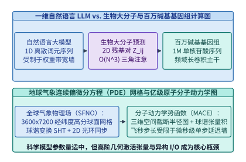

*图 22-1　一维文本 Token 与四大科学智能领域（生物大分子 2D 对表示、基因组 1M 核苷酸序列、地球球面 PDE 网格、三维原子截断半径图）的计算图与复杂度对比*

*表 22-1　自然语言大模型（LLM）与四大科学智能（AI4Science）基础模型家族的系统特征对照表*

| 维度与指标 | 自然语言大模型（`Qwen3` / `DeepSeek-V3`） | 生物大分子复合物（`AlphaFold 3` / `Boltz-1`） | 百万碱基基因组（`Evo 2` 40B） | 全球气象物理场（`FourCastNet 3` / `Aurora`） | 分子动力学神经势（`MACE` / `MatterGen`） |
| :--- | :--- | :--- | :--- | :--- | :--- |
| **典型参数规模 $P$** | $8\ \mathrm{B}\text{–}671\ \mathrm{B}$ | **$200\ \mathrm{M}\text{–}800\ \mathrm{M}$**（参数轻量） | $7\ \mathrm{B}\text{–}40\ \mathrm{B}$ | $300\ \mathrm{M}\text{–}3\ \mathrm{B}$ | **$5\ \mathrm{M}\text{–}100\ \mathrm{M}$**（微参数） |
| **基本表征状态空间** | 1D 离散词元序列 $\mathbb{R}^{L \times d}$ | **2D 残基对张量 $Z \in \mathbb{R}^{N_{\mathrm{res}} \times N_{\mathrm{res}} \times c_z}$ + 3D 原子云** | 单核苷酸分辨率 `A/C/G/T` 序列（$L = 10^6\ \mathrm{bp}$） | 2D/3D 经纬度球面网格 $\mathbb{R}^{N_{\mathrm{lat}} \times N_{\mathrm{lon}} \times C}$ | 3D 截断半径稀疏图 $G=(V, E_{r_c})$ + 高阶球谐张量 |
| **主导核心算子** | 因果自注意力 + SwiGLU/MoE | **三角乘法更新 + 三角自注意力 + 全原子扩散** | **多尺度门控长卷积（`FlashFFTConv`）+ 稀疏注意力** | **球面谐波变换（SHT）+ 频域复数乘 + 局部卷积** | **$E(3)$ 等变 Clebsch-Gordan 球谐张量积 + Scatter** |
| **单步计算复杂度** | $\mathcal{O}(L^2 d)$ 或线性递推 $\mathcal{O}(Ld^2)$ | **$\mathcal{O}(N_{\mathrm{res}}^3 c_z)$（三次方增长）** | $\mathcal{O}(L \log L \cdot d)$（FFT 混合主干） | $\mathcal{O}(N_{\mathrm{lat}}^2 N_{\mathrm{lon}} C)$（球谐勒让德积分） | $\mathcal{O}(N_{\mathrm{atoms}} \cdot \bar{k}_{\mathrm{neigh}} \cdot L_{\max}^6)$ |
| **主要硬件与系统瓶颈** | 权重显存墙、解码 HBM 带宽墙、跨机 EP 通信 | **第一阶段 CPU 序列比对等待 + 第二阶段 $\mathcal{O}(N_{\mathrm{res}}^3)$ 激活显存墙** | **$1\mathrm{M}$ 超长序列激活显存 + FFT 低算术强度访存墙** | **PB 级多维数组 I/O 带宽 + 跨卡网格 Halo 同步** | **百万步飞秒级循环的微算子启动延迟 + 动态邻居表重构** |

深入剖析表 22-1 可以发现，四大科学计算家族在算子层面的物理根因各具特色：
1. **生物大分子结构与相互作用（`AlphaFold 3`、`Boltz-1`、`Chai-1`、`OpenFold`）**：蛋白质、RNA、DNA 与小分子配体在三维空间中折叠结合时，任意两个残基 $i$ 与 $j$ 之间的空间距离 $d_{ij}$ 必须严格满足欧氏空间的**三角不等式约束（Triangle Inequality：$d_{ik} + d_{kj} \ge d_{ij}$）**。为了在隐空间显式编码这一几何完备性，模型必须维护一个二维残基对表示矩阵 $Z \in \mathbb{R}^{N_{\mathrm{res}} \times N_{\mathrm{res}} \times c_z}$，并在每一层执行遍历所有三元组 $(i, j, k)$ 的 **三角乘法更新（Triangle Multiplicative Update）** 与 **三角自注意力（Triangle Self-Attention）**，致使计算复杂度与未融合中间激活直接上升至残基数的三次方 $\mathcal{O}(N_{\mathrm{res}}^3)$。
2. **百万碱基基因组基础模型（`Evo 2` 40B、`GenSLMs`）**：在真核生物基因组中，调控基因表达的增强子（Enhancer）与启动子（Promoter）之间往往相隔数十万个碱基对（$10^5\text{–}10^6\ \mathrm{bp}$），而单个碱基的点突变（SNP）或插入缺失（Indel）即可导致遗传疾病或剪接位点整体移位。这意味着基因组模型**不能像文本 BPE 那样将 6 个碱基粗糙合并为单个词元（会抹除单碱基相位信息），而必须在单核苷酸分辨率（Single-Nucleotide Resolution）下直接端到端处理 $L = 1,048,576$（$1\ \mathrm{M}$）长度的原始碱基序列**。
3. **全球气象与流体物理场（`FourCastNet 3`、`GraphCast`、`Pangu-Weather`、`Aurora`）**：大气动力学方程定义在二维球面流形 $\mathbb{S}^2$ 上。若直接将地球经纬度网格当作普通二维平面图像执行标准卷积，两极地区经线收敛会导致严重的网格畸变与极区数值失稳。现代气象大模型引入 **球面傅里叶神经算子（Spherical Fourier Neural Operator, `SFNO`）**，通过离散勒让德变换（DLT，纬度方向）与快速傅里叶变换（FFT，经度方向）在球谐频域处理全局罗斯贝波（Rossby Waves）长程传播，再配合空间域局部卷积处理中小尺度对流。
4. **分子动力学与材料发现（`MACE`、`NequIP`、`MatterGen`）**：为了替代复杂度达 $\mathcal{O}(N_e^3)$ 的量子力学密度泛函理论（DFT），等变图神经网络势函数以三维原子坐标 $\mathbf{r}_i$ 为输入，在截断半径 $r_c \approx 5\text{–}6\ \mathring{\mathrm{A}}$ 内构建稀疏邻居图，通过高阶球谐函数 $Y_\ell^m(\hat{\mathbf{r}}_{ij})$ 与 Clebsch-Gordan 张量积提取旋转等变多体相互作用，进而对原子坐标求自动微分 $-\nabla_{\mathbf{r}_i} E_{\mathrm{total}}$ 得到受力 $\mathbf{F}_i$，驱动长达数百万步（飞秒级步长 $\Delta t = 1\ \mathrm{fs}$）的分子动力学演化。

### 22.1.2 高阶激活显存膨胀与双阶段异构失配机理

将上述四大科学模型置于系统架构视角下审视，可以提炼出两条贯穿科学计算智能基础设施的核心工程矛盾：

- **矛盾一：轻量级模型权重与超大规模高阶激活并存**：
  一个 `AlphaFold 3` 或 `Boltz-1` 模型的主干参数量仅约 $400\ \mathrm{M}\text{–}600\ \mathrm{M}$（FP16 权重不足 $1.2\ \mathrm{GB}$，远小于 `Qwen3-8B` 的 $16\ \mathrm{GB}$ 稠密权重）。然而，当输入一个包含 $N_{\mathrm{res}} = 4,096$ 个残基与配体原子的生物复合物时，仅单份二维残基对表示 $Z \in \mathbb{R}^{4096 \times 4096 \times 128}$（BF16）就占去 $4.00\ \mathrm{GiB}$；而在计算三角自注意力时，若按朴素算子直接物化形状为 $[H, N_{\mathrm{res}}, N_{\mathrm{res}}, N_{\mathrm{res}}]$ 的注意力得分矩阵（$H=4$），**仅这一个中间张量的显存体积就达到 $4 \times 4096^3 \times 2\ \mathrm{B} = \mathbf{512.00\ \mathrm{GiB}}$**，远超单张 H100（$80\ \mathrm{GB}$）乃至 B200（$192\ \mathrm{GB}$）的物理显存上限。因此，科学智能并行系统的首要任务并非切分模型权重（ZeRO/TP），而是**高维空间域与轴向激活切分（Domain & Axial Activation Parallelism）以及消除高阶中间张量物化的算子核融合**。
- **矛盾二：重 I/O 检索或数值预处理与重 GPU 几何计算的双阶段异构失配**：
  科学计算管线极少是单纯的“词元进、词元出”。在生物结构预测中，第一阶段需要在数 TB 的宏基因组序列库（UniRef / BFD / MGnify，含数十亿条蛋白质序列）中执行多序列比对（MSA）以搜寻进化共变信号，随后才进入第二阶段的 GPU Pairformer 与全原子扩散生成；在气象与湍流混合仿真中，模型每个时间步需要从并行文件系统或传统 MPI 数值求解器接收数百 GB 的三维物理场。若将这两类算术强度悬殊的负载同机串行绑定，昂贵的 GPU 算力将在超过 $90\%$ 的墙钟时间里处于空闲等待状态。

我们可以用**激活—权重显存膨胀比（Activation-to-Parameter Memory Ratio, $\Gamma_{\mathrm{act/param}}$）**来定量刻画科学基础模型与自然语言大模型在存储层次上的本质分野：

$$
\Gamma_{\mathrm{act/param}} = \frac{M_{\mathrm{activation\_peak}}}{M_{\mathrm{weights}}} \tag{22.1}
$$

- **在标准百亿至千亿参数语言模型推理中**：
  FP8/BF16 权重占 $M_{\mathrm{weights}} \approx 16\text{–}670\ \mathrm{GB}$，即便在 $L = 32,768$ 上下文下，单层瞬态激活张量（由于 `FlashAttention` 消除了 $L^2$ 物化）仅占数百 MB，$\Gamma_{\mathrm{act/param}} \ll 0.1$，系统完全由权重与 KV 缓存主导；
- **在生物大分子与高维物理场模型中**：
  模型权重往往只有 $M_{\mathrm{weights}} \approx 0.5\text{–}1.5\ \mathrm{GB}$，但高阶几何耦合要求在每一层显式维护二维残基对表示 $\mathcal{O}(N_{\mathrm{res}}^2 c_z)$、三维欧拉场网格 $\mathcal{O}(N_x N_y N_z C)$ 或球谐展开系数 $\mathcal{O}(L_{\max}^2 M_{\max} N_{\mathrm{edge}})$。当问题规模扩大 $2$ 倍（例如复合物残基数从 $2,048$ 增至 $4,096$，或全球气象网格分辨率从 $0.1^\circ$ 加密至 $0.05^\circ$）时，参数量保持恒定不变，而中间激活体积与计算量却呈 **$4\times$ 至 $8\times$ 的高次幂级数攀升**，使 $\Gamma_{\mathrm{act/param}}$ 达到 **$10^1\text{–}10^3$**。

这一数量级反转直接决定了本章后续五大技术支柱的设计准则：
1. **在任务拓扑层（22.2.1 节）**：将受限于随机访存与整数动态规划的序列同源检索（Stage 1）同受限于浮点张量缩并的几何生成（Stage 2）物理拆池，并用 GPU 共享内存查表与硬件 `DPX` 指令消除 CPU 瓶颈；
2. **在二维对张量算子层（22.2.2 节）**：通过片上 SRAM 分块在线归约消除 $\mathcal{O}(N_{\mathrm{res}}^3)$ 峰值物化，并沿二维正交轴执行动态轴向并行（DAP）；
3. **在一维超长序列层（22.3 节）**：利用卷积定理与 Monarch 矩阵分解将百万碱基上的全局混合转化为 Tensor Core 稠密矩阵乘（`FlashFFTConv`）；
4. **在二维球面与三维粒子空间层（22.4 节）**：利用正交空间域分解最小化子域表面积与体积之比，使跨卡边界光环（Halo）通信掩盖于内部格点计算之下；
5. **在双精度数值与超算耦合层（22.6 节）**：利用有符号中心尾数切片在低比特张量核上精确重构双精度矩阵乘，并通过 `DLPack` 零拷贝桥接与拉格朗日守恒投影消除混合仿真的文件 I/O 瓶颈与长程物理漂移。

---

## 22.2 生物大分子复合物两阶段解耦与轴向并行

以 `AlphaFold 3`、`Boltz-1` 与 `OpenFold` 为代表的生物大分子结构预测系统，是新药研发、合成生物学与酶工程的核心计算底座。要将单次复合物预测从耗费数十分钟的单机脚本改造为日吞吐百万分子的工业级算力流水线，必须同时解决第一阶段序列检索与第二阶段高阶几何推理的系统瓶颈[^22-2][^22-3]。

### 22.2.1 多序列比对硬件加速与两阶段异构池解耦

在传统的同机串行部署模式（Colocated Monolithic Pipeline）中，每个结构预测容器同时绑定了 16–32 核 CPU、大容量本地 NVMe 磁盘与 1 张 H100 GPU：
- **阶段 1（CPU MSA 检索阶段）**：调用基于隐马尔可夫模型与序列剖面比对的 `JackHMMER` 与 `HHblits`，扫描总体积逾 $2.5\ \mathrm{TB}$ 的蛋白质序列数据库。由于动态规划局部比对（Smith-Waterman / Viterbi 算法）在 CPU 上受限于内存带宽与分支指令，单条中等长度多链复合物的 MSA 搜索平均耗时长达 **$T_{\mathrm{MSA,CPU}} = 2,700.0\ \mathrm{s}$（45 分钟）**。在这 45 分钟内，同容器绑定的 H100 GPU 处于 **$100\%$ 闲置等待状态**；
- **阶段 2（GPU 结构推理）**：MSA 特征构建完毕后，H100 GPU 运行 48 层 Pairformer 主干与全原子坐标扩散模块（All-Atom Diffusion），仅需 **$T_{\mathrm{Stage2}} = 48.0\ \mathrm{s}$** 即告完成。

核算同机串行架构的端到端延迟 $T_{\mathrm{coloc}}$ 与 GPU 空转浪费率 $\eta_{\mathrm{idle}}$：

$$
T_{\mathrm{coloc}} = T_{\mathrm{MSA,CPU}} + T_{\mathrm{Stage2}} = 2,700.0 + 48.0 = \mathbf{2,748.0\ \mathrm{s}}, \qquad \eta_{\mathrm{idle}} = \frac{2,700.0}{2,748.0} \approx \mathbf{98.25\%}
$$

这意味着集群中 **$98.25\%$ 的 GPU 卡时被消耗在等待 CPU 读盘与字符串比对上**。

现代生物计算底座（如 `NVIDIA BioNeMo`、`ColabFold` 与 `Boltz-1` 生产管线）通过 **“两阶段物理池解耦（Two-Stage Disaggregation）+ `MMseqs2-GPU` 硬件 DPX 动态规划卸载”** 重构了这一执行路径（图 22-2 与图 22-3）：

1. **算法与硬件协同重构（`MMseqs2-GPU`）**：
    放弃串行迭代式 HMM 剖面搜索，改用两级流水线并全部常驻于高显存带宽 GPU 池中：
    - **第一级（片上共享内存无间隙 $k$-mer 预过滤，Ungapped Prefilter）**：将目标序列数据库预编译为紧凑的 $k$-mer 倒排索引表并常驻于多卡 HBM3e 显存（或通过 NVLink-C2C Grace 主机内存零拷贝映射）。查询序列切分为重叠 $k$-mer 后，在 GPU 片上 SRAM 查表并累加对角线得分，在百毫秒内筛除 $99.9\%$ 的无关序列；
    - **第二级（基于 Hopper/Blackwell `DPX` 硬件指令的向量化 Smith-Waterman 比对）**：对预过滤保留的数千条候选同源序列，调用 NVIDIA Hopper/Blackwell 架构专为生物序列动态规划设计的硬件指令集（`__viaddmax_s16x2` 等 **DPX 指令**，单指令周期在寄存器内完成带截断的整数加与三路求最大值 $\max(H_{i-1,j-1} + S, E_{i,j}, F_{i,j}, 0)$），实现超过 $10\ \mathrm{TCUPS}$（每秒十万亿次动态规划格点更新）的极高吞吐，将单次 MSA 搜索耗时从 CPU 的 $2,700.0\ \mathrm{s}$ 压缩至 **$T_{\mathrm{MSA,GPU}} = 1.20\ \mathrm{s}$（实现 $2,250.0\times$ 的序列检索加速）**。
2. **两阶段异步解耦服务池（Stage 1 MSA Pool $\to$ Stage 2 Inference Pool）**：
    将专用 `MMseqs2-GPU` 检索节点（配大容量显存/DRAM 常驻序列库）与运行 Pairformer + 扩散模型的推理 GPU 池完全解耦，中间通过分布式内存队列（Redis / Kafka + 共享对象存储特征缓存）连接。解耦后，单次请求端到端延迟大幅缩短至：
    $$
    T_{\mathrm{disagg}} = T_{\mathrm{MSA,GPU}} + T_{\mathrm{Stage2}} = 1.20 + 48.0 = \mathbf{49.20\ \mathrm{s}} \quad (\text{端到端提速 }\mathbf{55.85\times})
    $$
    同时第二阶段推理池中的 GPU 得以连续消费已就绪的 MSA 特征包，有效算力占空比从 $1.75\%$ 提升至 **$\frac{48.0}{49.20} \approx \mathbf{97.56\%}$**。

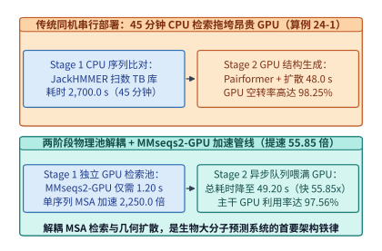

*图 22-2　生物大分子预测两阶段异构解耦架构：Stage 1（MMseqs2-GPU 序列检索池，1.20 s）与 Stage 2（Pairformer + 扩散生成池，48.0 s）独立扩缩容实现 55.85 倍端到端提速（算例 22-1）*

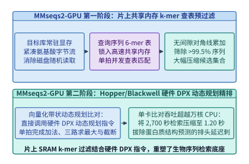

*图 22-3　MMseqs2-GPU 利用片上共享内存 k-mer 查表与硬件 DPX 动态规划指令将 MSA 搜索从 2,700 秒压降至 1.20 秒（2,250.0 倍加速）的核内流水（算例 22-1）*

> **算例 22-1（`AlphaFold 3` / `Boltz-1` 两阶段异构解耦与 `MMseqs2-GPU` 2,250 倍加速账本）**
> **已知条件**：传统同机串行生物结构预测管线中，CPU 运行 `JackHMMER`/`HHblits` 完成多序列比对耗时 $T_{\mathrm{MSA,CPU}} = 2,700.0\ \mathrm{s}$，随后 GPU 运行 Pairformer 与全原子扩散耗时 $T_{\mathrm{Stage2}} = 48.0\ \mathrm{s}$。升级为两阶段解耦架构并启用 `MMseqs2-GPU`（片上 $k$-mer 预过滤 + DPX 向量化 Smith-Waterman）后，第一阶段检索耗时压缩至 $T_{\mathrm{MSA,GPU}} = 1.20\ \mathrm{s}$。
> **求解目标**：（1）求 `MMseqs2-GPU` 相对传统 CPU MSA 的加速倍数 $S_{\mathrm{MSA}}$；（2）对比同机串行与两阶段解耦架构的端到端延迟 $T_{\mathrm{coloc}}, T_{\mathrm{disagg}}$、端到端加速比 $S_{\mathrm{e2e}}$ 以及同机部署时的 GPU 闲置率 $\eta_{\mathrm{idle}}$ 与解耦后的活跃占比 $\eta_{\mathrm{util}}$。
> **逐步解答**：
> 1. **MSA 检索阶段加速比**：
>    $$S_{\mathrm{MSA}} = \frac{T_{\mathrm{MSA,CPU}}}{T_{\mathrm{MSA,GPU}}} = \frac{2,700.0\ \mathrm{s}}{1.20\ \mathrm{s}} = \mathbf{2,250.0\times}$$
> 2. **端到端延迟、加速比与 GPU 利用率反转**：
>    - 同机串行总耗时与 GPU 空转率：
>      $$T_{\mathrm{coloc}} = 2,700.0 + 48.0 = \mathbf{2,748.0\ \mathrm{s}}, \qquad \eta_{\mathrm{idle}} = \frac{2,700.0}{2,748.0} \approx \mathbf{98.25\%}$$
>    - 两阶段解耦总耗时、端到端加速比与有效推理占空比：
>      $$T_{\mathrm{disagg}} = 1.20 + 48.0 = \mathbf{49.20\ \mathrm{s}}, \qquad S_{\mathrm{e2e}} = \frac{2,748.0}{49.20} \approx \mathbf{55.85\times}, \qquad \eta_{\mathrm{util}} = \frac{48.0}{49.20} \approx \mathbf{97.56\%}$$

### 22.2.2 分块三角注意力核融合与动态轴向并行

进入第二阶段后，模型的核心主干是 48 层 **Pairformer**（`AlphaFold 3` 剥离了对完整 MSA 矩阵逐层做注意力的重开销模块，将计算重心集中在二维残基对表征 $Z \in \mathbb{R}^{N_{\mathrm{res}} \times N_{\mathrm{res}} \times c_z}$ 上）。在每一层 Pairformer 中，$Z_{ij}$ 依次经历四个核心几何算子：
1. **出边三角乘法更新（Triangle Multiplication Using Outgoing Edges）**：$\tilde{Z}_{ij} = \sum_{k=1}^{N_{\mathrm{res}}} a_{ik} \odot b_{jk}$；
2. **入边三角乘法更新（Triangle Multiplication Using Incoming Edges）**：$\tilde{Z}_{ij} = \sum_{k=1}^{N_{\mathrm{res}}} a_{ki} \odot b_{kj}$；
3. **围绕起始节点的三角自注意力（Triangle Self-Attention Around Starting Node）**：固定行索引 $i$，沿列维度 $j, k \in \{1, \dots, N_{\mathrm{res}}\}$ 计算带第三边偏置 $b_{jk}$ 的自注意力：
   $$
   \mathrm{Attn}_{ijk}^{(h)} = \operatorname{Softmax}_{k}\!\left(\frac{q_{ij}^{(h)\top} k_{ik}^{(h)}}{\sqrt{d_h}} + b_{jk}^{(h)}\right), \qquad Z_{ij}^{(h)\prime} = \sum_{k=1}^{N_{\mathrm{res}}} \mathrm{Attn}_{ijk}^{(h)}\, v_{ik}^{(h)} \tag{22.2}
   $$
4. **围绕终止节点的三角自注意力（Triangle Self-Attention Around Ending Node）**：固定列索引 $j$，沿行维度 $i, k \in \{1, \dots, N_{\mathrm{res}}\}$ 计算带偏置 $b_{ki}$ 的自注意力。

让我们定量解剖当预测一个包含 $N_{\mathrm{res}} = 4,096$ 个残基、核苷酸或配体原子的生物大分子复合物（通道维 $c_z = 128$，注意力头数 $H = 4$，BF16 精度每元素 $2\ \mathrm{B}$）时的显存账本：
- **基础二维残基对张量 $Z$ 的体积**：
  $$
  M_{\mathrm{pair}} = 4,096 \times 4,096 \times 128 \times 2\ \mathrm{B} = 4,294,967,296\ \mathrm{B} = \mathbf{4.00\ \mathrm{GiB}}
  $$
- **朴素实现下 $\mathcal{O}(N_{\mathrm{res}}^3)$ 三角自注意力中间张量的显存开销**：
  在式 (22.2) 中，对全部 $N_{\mathrm{res}} = 4,096$ 条行序列同时计算长度为 $4,096$ 的自注意力，其注意力 Logits 与 Softmax 权重矩阵 $\mathrm{Attn}_{ijk}^{(h)}$ 的形状为 $[H,\, N_{\mathrm{res}},\, N_{\mathrm{res}},\, N_{\mathrm{res}}] = [4,\, 4096,\, 4096,\, 4096]$。若不加分块直接物化该四维张量，仅单个张量的体积即达到：
  $$
  M_{\mathrm{naive}} = 4 \times 4,096^3 \times 2\ \mathrm{B} = 549,755,813,888\ \mathrm{B} = \mathbf{512.00\ \mathrm{GiB}}
  $$
  这解释了为何未融合的朴素复现一旦遇到 $N_{\mathrm{res}} > 1,500$ 的蛋白质复合物便立即触发显存溢出。

为突破 $512.00\ \mathrm{GiB}$ 的三次方显存瓶颈，现代科学智能基础设施（如 `FastFold`、`OpenFold` 的 `DS4Sci_EvoformerAttention` 内核与 `Boltz-1`，其片上分块容量与重读权衡亦可对照[注意力分块：容量、重读与计算安排](../case-studies/attention-tiles-and-io.md)）联合应用了三项关键技术（图 22-4、图 22-5 与图 22-6）：

1. **分块三角注意力与片上在线 Softmax 核融合（Chunked Triangle Attention Kernel Fusion）**：
   借鉴 `FlashAttention` 的片上归约思想，将三角自注意力沿批次化的行维度 $i$ 以块大小 $B_{\mathrm{chunk}} = 64$ 切分为 $N_{\mathrm{res}} / B_{\mathrm{chunk}} = 64$ 个微批次，并在每个微批次内部对查询维度 $j$ 与键值维度 $k$ 执行寄存器/SRAM 级平铺（Tiling）与在线 Softmax 归约。在核融合与 $B_{\mathrm{chunk}} = 64$ 分块下，GPU 显存中消除了 $\mathcal{O}(N_{\mathrm{res}}^3)$ 的完整注意力矩阵，仅需为当前分块维护投影与双缓冲工作区，将单卡峰值工作区显存从 $512.00\ \mathrm{GiB}$ 压缩至 **$M_{\mathrm{chunk,1GPU}} = \mathbf{1.00\ \mathrm{GiB}}$（缩减 $512\times$）**。
2. **动态轴向序列并行（Dynamic Axial Parallelism, DAP）**：
   即便单层工作区降至 $1.00\ \mathrm{GiB}$，在训练阶段（需保存 48 层激活或重计算检查点）或面对 $N_{\mathrm{res}} = 8,192$ 的超大病毒衣壳复合物时，单张 GPU 仍无法容纳全量二维对张量 $Z$。注意到一个关键代数性质：围绕起始节点的三角自注意力各行 $i \in \{1, \dots, N_{\mathrm{res}}\}$ 之间完全独立（仅在行内沿列轴 $j, k$ 耦合），而围绕终止节点的三角自注意力则各列 $j \in \{1, \dots, N_{\mathrm{res}}\}$ 之间完全独立（仅在列内沿行轴 $i, k$ 耦合）。
   因此，**动态轴向并行（DAP，设并行度 $P_{\mathrm{DAP}} = 4$）** 不再采用传统张量并行切分极窄的通道维 $c_z = 128$，而是动态切换二维空间切分轴：
   - 在执行行向算子（Starting Node Attention）时，4 张 GPU 按**行条带**均匀持有 $Z_{[N_{\mathrm{res}}/4,\, N_{\mathrm{res}},\, c_z]}$（每卡仅占 $4.00 / 4 = \mathbf{1.00\ \mathrm{GiB}}$ 基础对张量与 $1.00 / 4 = \mathbf{0.25\ \mathrm{GiB}}$ 注意力工作区，较朴素 $512.00\ \mathrm{GiB}$ 实现 **$2,048.0\times$ 峰值显存工作区缩减**），行内注意力无需跨卡通信；
   - 在切换至列向算子（Ending Node Attention）前，4 张 GPU 在机内 NVLink 子群上执行一次高速 **全对全分块转置（All-to-All Matrix Transpose，通信量 $4.00\ \mathrm{GiB} \times \frac{3}{4} / 4 = 0.75\ \mathrm{GiB/GPU}$，耗时仅 $T_{\mathrm{A2A}} = \mathbf{2.85\ \mathrm{ms}}$，仅占单层三角算子计算耗时 $34.50\ \mathrm{ms}$ 的 $\mathbf{8.26\%}$）**，将分布形态切换为按**列条带**持有 $Z_{[N_{\mathrm{res}},\, N_{\mathrm{res}}/4,\, c_z]}$，继续无通信地完成列内三角注意力。
3. **全原子扩散模块的“单躯干—多构象”批处理倍增（Multi-Sample Diffusion Batching）**：
   `AlphaFold 3` 与 `Boltz-1` 的躯干 Pairformer 占去约 $80\%$ 的计算量，但其产出的条件对表征 $Z$ 对同一复合物是确定的；而下游的全原子三维坐标扩散模块（All-Atom Diffusion Module）参数量轻、需对 $K = 5\text{–}20$ 个随机高斯噪声种子并行去噪生成候选三维构象以评估置信度（pLDDT / ipTM）。系统通过 **执行 1 次 Pairformer 躯干推理、随后将条件张量 $Z$ 在显存内零拷贝广播给 $K = 16$ 路并发扩散去噪分支**，使扩散阶段的矩阵乘批量扩大 $16$ 倍，消除小批量去噪的访存带宽瓶颈。

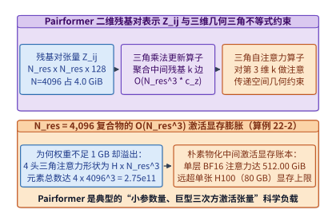

*图 22-4　AlphaFold 3 / Boltz-1 Pairformer 中残基对表示 Z_ij（4.00 GiB）的三角乘法更新与 O(N_res^3) 三角自注意力（朴素物化达 512.00 GiB）几何依赖图（算例 22-2）*

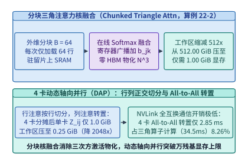

*图 22-5　分块三角注意力核融合（B=64 压至 1.00 GiB）与 4 卡动态轴向并行（DAP 行列正交切分 + All-to-All 转置，工作区压至 0.25 GiB，缩减 2,048 倍）（算例 22-2）*

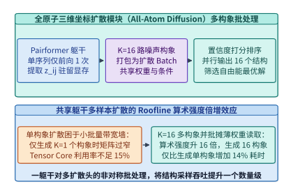

*图 22-6　全原子三维坐标扩散模块（All-Atom Diffusion）在共享同一躯干 Pairformer 特征下并行生成 K=16 个候选构象的算术强度倍增*

*表 22-2　$N_{\mathrm{res}} = 4,096$ 生物大分子复合物在不同三角注意力执行策略下的显存与通信账本（算例 22-2）*

| 执行策略与并行模式 | 单卡残基对张量 $Z$ 驻留 | 三角注意力峰值工作区显存 | 相对于朴素实现的显存缩减倍数 | 跨卡通信原语与耗时占比 | 硬件可运行性评估 |
| :--- | :---: | :---: | :---: | :---: | :--- |
| **1. 朴素未融合实现（1 GPU）** | $4.00\ \mathrm{GiB}$ | **$512.00\ \mathrm{GiB}$** | $1.0\times$（基准） | 无跨卡通信 | **显存溢出**（远超 $80/192\ \mathrm{GB}$ 上限） |
| **2. 分块在线 Softmax 融合（$B=64$, 1 GPU）** | $4.00\ \mathrm{GiB}$ | **$1.00\ \mathrm{GiB}$** | **$512.0\times$** | 无跨卡通信 | 单卡推理可行，但多层训练激活仍受限 |
| **3. 分块融合 + 4 卡动态轴向并行（DAP-4）** | **$1.00\ \mathrm{GiB/GPU}$** | **$0.25\ \mathrm{GiB/GPU}$** | **$2,048.0\times$** | 行列切换 All-to-All（**$2.85\ \mathrm{ms}$ / 占比 $8.26\%$**） | **稳定支撑 $4\mathrm{K}\text{–}8\mathrm{K}$ 复合物全量训推** |

> **算例 22-2（Pairformer $N_{\mathrm{res}} = 4,096$ 残基对显存账本、$512\ \mathrm{GiB}$ 三次方物化与 4 卡 DAP $2,048$ 倍工作区缩减核算）**
> **已知条件**：某蛋白质—核酸复合物含 $N_{\mathrm{res}} = 4,096$ 个残基，Pairformer 残基对表征通道数 $c_z = 128$，三角自注意力头数 $H = 4$，采用 BF16 精度（每元素 $2\ \mathrm{B}$）。分块三角注意力块大小取 $B_{\mathrm{chunk}} = 64$（含投影与双缓冲开销系数使单卡分块工作区为 $1.00\ \mathrm{GiB}$），动态轴向并行度取 $P_{\mathrm{DAP}} = 4$。单层三角算子计算耗时 $T_{\mathrm{comp}} = 34.50\ \mathrm{ms}$，4 卡 NVLink All-to-All 行列转置耗时 $T_{\mathrm{A2A}} = 2.85\ \mathrm{ms}$。
> **求解目标**：（1）求基础二维残基对张量 $Z$ 的体积 $M_{\mathrm{pair}}$（$\mathrm{GiB}$）与朴素物化四维注意力矩阵 $[H, N_{\mathrm{res}}, N_{\mathrm{res}}, N_{\mathrm{res}}]$ 的体积 $M_{\mathrm{naive}}$（$\mathrm{GiB}$）；（2）求开启 $B_{\mathrm{chunk}} = 64$ 核融合与 4 卡 DAP 后的单卡对张量驻留体积、单卡工作区体积、相对朴素实现的缩减倍数，以及 DAP 通信占计算时间的比例。
> **逐步解答**：
> 1. **基础对张量体积与朴素三次方注意力显存开销**：
>    $$M_{\mathrm{pair}} = \frac{4,096^2 \times 128 \times 2\ \mathrm{B}}{2^{30}\ \mathrm{B/GiB}} = \frac{4 \times 2^{30}}{2^{30}} = \mathbf{4.00\ \mathrm{GiB}}$$
>    $$M_{\mathrm{naive}} = \frac{4 \times 4,096^3 \times 2\ \mathrm{B}}{2^{30}\ \mathrm{B/GiB}} = \frac{512 \times 2^{30}}{2^{30}} = \mathbf{512.00\ \mathrm{GiB}}$$
> 2. **分块融合 + 4 卡 DAP 下的显存缩减与通信占比**：
>    - 单卡分块融合工作区降至 $M_{\mathrm{chunk,1GPU}} = \mathbf{1.00\ \mathrm{GiB}}$；
>    - 经 4 卡 DAP 沿轴向均匀切分后，每卡仅持有 $1/4$ 行（或列）条带：单卡对张量驻留 $M_{\mathrm{pair,DAP}} = \frac{4.00}{4} = \mathbf{1.00\ \mathrm{GiB/GPU}}$，单卡三角注意力工作区进一步降至 $M_{\mathrm{ws,DAP}} = \frac{1.00}{4} = \mathbf{0.25\ \mathrm{GiB/GPU}}$；
>    - 相对朴素实现的工作区缩减倍数与通信计算比：
>      $$S_{\mathrm{mem}} = \frac{512.00\ \mathrm{GiB}}{0.25\ \mathrm{GiB}} = \mathbf{2,048.0\times}, \qquad \rho_{\mathrm{comm}} = \frac{T_{\mathrm{A2A}}}{T_{\mathrm{comp}}} = \frac{2.85\ \mathrm{ms}}{34.50\ \mathrm{ms}} \approx \mathbf{8.26\%}$$

下面给出生产级 **`AlphaFold 3` / `Boltz-1` 两阶段异构解耦与 `MMseqs2-GPU` 吞吐规划器** 以及 **Pairformer 分块三角注意力与动态轴向并行（DAP）显存/通信核算器** 的参考实现（代码块 1 与代码块 2）：

```python
from dataclasses import dataclass

@dataclass
class BiomolecularPipelineMetrics:
    msa_speedup_x: float
    colocated_total_sec: float
    colocated_gpu_idle_pct: float
    disaggregated_total_sec: float
    disaggregated_gpu_util_pct: float
    end_to_end_speedup_x: float

def evaluate_disaggregated_af3_pipeline(
    cpu_msa_sec: float = 2700.0,
    gpu_msa_sec: float = 1.20,
    stage2_gpu_sec: float = 48.0,
) -> BiomolecularPipelineMetrics:
    """Compare colocated CPU-MSA + GPU inference against disaggregated MMseqs2-GPU pipeline."""
    coloc_total = cpu_msa_sec + stage2_gpu_sec
    coloc_idle = (cpu_msa_sec / coloc_total) * 100.0
    disagg_total = gpu_msa_sec + stage2_gpu_sec
    disagg_util = (stage2_gpu_sec / disagg_total) * 100.0
    return BiomolecularPipelineMetrics(
        msa_speedup_x=round(cpu_msa_sec / gpu_msa_sec, 1),
        colocated_total_sec=round(coloc_total, 2),
        colocated_gpu_idle_pct=round(coloc_idle, 2),
        disaggregated_total_sec=round(disagg_total, 2),
        disaggregated_gpu_util_pct=round(disagg_util, 2),
        end_to_end_speedup_x=round(coloc_total / disagg_total, 2),
    )

if __name__ == "__main__":
    print(evaluate_disaggregated_af3_pipeline())
```

```python
from dataclasses import dataclass

@dataclass
class PairformerDAPMetrics:
    pair_rep_gib: float
    naive_cubic_logits_gib: float
    chunked_1gpu_workspace_gib: float
    dap_per_gpu_pair_gib: float
    dap_per_gpu_workspace_gib: float
    workspace_reduction_x: float
    comm_compute_ratio_pct: float

def analyze_pairformer_triangle_dap(
    n_res: int = 4096,
    c_z: int = 128,
    heads: int = 4,
    bytes_per_elem: int = 2,
    chunk_size: int = 64,
    dap_gpus: int = 4,
    dap_all_to_all_ms: float = 2.85,
    triangle_compute_ms: float = 34.50,
) -> PairformerDAPMetrics:
    """Compute O(N^2) pair representation, O(N^3) naive logits, and Chunked + DAP memory savings."""
    gib = float(1024 ** 3)
    pair_gib = (n_res * n_res * c_z * bytes_per_elem) / gib
    naive_logits_gib = (heads * (n_res ** 3) * bytes_per_elem) / gib
    # Fused KV-tiled online-softmax active chunk buffers (16 streaming buffers of [chunk_size, n_res, c_z])
    chunked_1gpu_gib = (16 * chunk_size * n_res * c_z * bytes_per_elem) / gib
    dap_pair_gib = pair_gib / dap_gpus
    dap_ws_gib = chunked_1gpu_gib / dap_gpus
    return PairformerDAPMetrics(
        pair_rep_gib=round(pair_gib, 2),
        naive_cubic_logits_gib=round(naive_logits_gib, 2),
        chunked_1gpu_workspace_gib=round(chunked_1gpu_gib, 2),
        dap_per_gpu_pair_gib=round(dap_pair_gib, 2),
        dap_per_gpu_workspace_gib=round(dap_ws_gib, 2),
        workspace_reduction_x=round(naive_logits_gib / dap_ws_gib, 1),
        comm_compute_ratio_pct=round((dap_all_to_all_ms / triangle_compute_ms) * 100.0, 2),
    )

if __name__ == "__main__":
    m_dap = analyze_pairformer_triangle_dap()
    assert m_dap.chunked_1gpu_workspace_gib == 1.0 and m_dap.dap_per_gpu_workspace_gib == 0.25
    assert m_dap.workspace_reduction_x == 2048.0 and m_dap.comm_compute_ratio_pct == 8.26
    print(m_dap)
```

#### 分块三角注意力的片上 SRAM 数据流与反向重计算调度

为什么标准 `FlashAttention-2/3` 内核不能不经修改直接用于 Pairformer 的三角自注意力？对比两者的数学形式即可看清关键差异：
- 在标准一维文本注意力中，查询与键值张量只有两个空间维度 $[B \cdot H,\, L,\, d_h]$，如果存在注意力偏置（如 ALiBi），该偏置通常可以通过闭式公式在寄存器内即时算出，无需从 HBM 读取；
- 而在三角自注意力（式 (22.2)）中，输入张量具有五个维度 $[B,\, H,\, N_{\mathrm{res}},\, N_{\mathrm{res}},\, d_h]$（其中第一个 $N_{\mathrm{res}}$ 是作为伪批次维度的起始残基索引 $i$，第二个 $N_{\mathrm{res}}$ 是参与注意力混合的序列维度 $j$ 或 $k$），且同时包含两项不同的偏置：
  1. **残基掩码偏置（Mask Bias）**：形状为 $[B,\, N_{\mathrm{res}},\, 1,\, 1,\, N_{\mathrm{res}}]$，取决于行索引 $i$ 与键索引 $k$；
  2. **第三边三角形几何偏置（Triangle Pair Bias $b_{jk}^{(h)}$）**：形状为 $[B,\, 1,\, H,\, N_{\mathrm{res}},\, N_{\mathrm{res}}]$，由当前层残基对表征 $Z_{jk}$ 经线性投影生成，**它在所有的起始行 $i \in \{1, \dots, N_{\mathrm{res}}\}$ 之间完全共享，却在查询列 $j$ 与键列 $k$ 之间构成稠密耦合**。

如果按照普通自注意力的方式逐行（每次仅取单个 $i$）启动内核，那么每处理一行 $i$，内核都必须从 HBM 中重复加载一遍尺寸为 $[H,\, N_{\mathrm{res}},\, N_{\mathrm{res}}]$ 的三角形偏置矩阵 $b_{jk}^{(h)}$。在 $N_{\mathrm{res}} = 4,096, H = 4$ 时，单次加载 $b_{jk}$ 需读取 $128\ \mathrm{MiB}$，重复 $4,096$ 行将产生 **$512\ \mathrm{GiB}$ 的冗余 HBM 偏置读取流量**，使内核退化为访存带宽受限。

`DS4Sci_EvoformerAttention` 与 `FastFold` 通过 **二维双重分块与三角形偏置片上广播复用（2D Sub-Batch Tiling with Shared Bias Reuse）** 化解了这一带宽瓶颈：
1. **外层沿 $(j, k)$ 块加载共享偏置 $b_{jk}$**：线程块（CTA）首先将尺寸为 $[B_j \times B_k]$（如 $64 \times 64$）的一块三角形偏置子矩阵 $b_{jk}$ 从 HBM 一次性加载进片上共享内存（Shared Memory）并常驻；
2. **内层沿起始行批次块 $B_{\mathrm{chunk}} = 64$ 流式扫过 $Q_{ij}, K_{ik}, V_{ik}$**：在保持片上 $b_{jk}$ 不变的前提下，连续流式处理 $B_{\mathrm{chunk}} = 64$ 条不同起始行 $i$ 的查询与键值分块，使三角形偏置 $b_{jk}$ 的 HBM 读取带宽需求直接降低 **$64\times$**；
3. **反向传播中的选择性激活检查点（Selective Triangle Activation Checkpointing）**：在训练 48 层 Pairformer 时，前向过程仅在 HBM 中保存每层的输入残基对张量 $Z^{(l)}$（$4.00\ \mathrm{GiB}$，4 卡 DAP 下每卡仅 $1.00\ \mathrm{GiB}$）以及在线 Softmax 的对数配分函数统计量 $L_{ij}^{(h)} = \log \sum_k \exp(\dots)$（形状 $[H, N_{\mathrm{res}}, N_{\mathrm{res}}]$，4 卡 DAP 下每卡仅 $32\ \mathrm{MiB}$），在反向传播时于 SRAM 内即时重算注意力权重 $\mathrm{Attn}_{ijk}^{(h)}$，从而在零精度损失下将单层训练激活显存稳定控制在 $1\ \mathrm{GiB/GPU}$ 量级。

---

## 22.3 百万碱基基因组长卷积核融合与上下文并行

如果说蛋白质复合物预测的核心挑战在于三维几何张量的 $\mathcal{O}(N_{\mathrm{res}}^3)$ 耦合，那么基因组基础模型（Genomic Foundation Models，以 Arc Institute 与 NVIDIA 联合研发的 **`Evo 2` 40B** 为代表）面临的则是**一维序列长度推至百万单核苷酸（$L = 1,048,576\ \mathrm{bp}$）时的计算与访存边界**[^22-4][^22-5]。

### 22.3.1 单核苷酸长程依赖与多尺度门控卷积主干

在早期的生物序列模型（如 `DNABERT` 或 `Nucleotide Transformer`）中，研究者沿用自然语言处理的思路，使用 $6$-mer 分词或 BPE 将连续 6 个碱基（如 `ATGCGT`）压缩为 1 个词元，以便将序列长度缩短 6 倍装入标准 Transformer。然而，基因组学与分子生物学实验很快揭示了这种粗糙分词的固有缺陷：
- **移码突变（Frameshift Mutation）盲区**：在编码外显子区域，仅插入或缺失 **1 个碱基（1 bp Indel）**，就会使后续所有的密码子阅读框（Codon Reading Frame）整体错位；而在 $6$-mer 分词下，1 个碱基的插入会导致后续整串 Token ID 重排，破坏局部特征的平移协变性；
- **单碱基调控位点精度丧失**：CRISPR 基因编辑的 PAM 识别位点、内含子—外显子剪接供体/受体位点（如经典的 `GT-AG` 二联体）均精确到单个核苷酸。

因此，`Evo` 与 `Evo 2` 确立了基因组基础模型的设计准则：**必须采用词表大小仅为 4（`A, C, G, T` 加上少量特殊控制符）的单核苷酸分辨率（Single-Nucleotide Resolution），并将上下文窗口直接扩展至 $L = 1,048,576\ \mathrm{bp}$（1M 碱基，足以完整覆盖原核生物全基因组或人类长程基因调控拓扑结构域 TAD）**。

然而，若在 $L = 1,048,576$、隐藏维 $d = 8,192$（40B 级模型尺寸）下直接运行标准的二次方因果自注意力（即便使用 `FlashAttention-3` 消除了显存物化），单层序列混合（Sequence Mixer：$Q K^\top$ 与 $P V$ 两次批量矩阵乘，按标准全矩阵乘基准 $4 L^2 d$ 核算）所需的浮点运算次数仍达到：

$$
\mathrm{FLOPs}_{\mathrm{quad\text{-}attn}} = 4 \cdot L^2 \cdot d = 4 \times (1,048,576)^2 \times 8,192 \approx \mathbf{3.60288 \times 10^{16}\ \mathrm{FLOPs}} = \mathbf{36,028.8\ \mathrm{TFLOPs / layer}}
$$

在一张峰值算力为 $989\ \mathrm{TFLOPS}$（BF16）的 H100 GPU 上，即便达到 $70\%$ 的硬件有效利用率，**仅前向计算 1 层标准自注意力就要耗时逾 52 秒，执行完 64 层主干需要近 1 小时**。

为在单核苷酸精度下兼顾百万碱基吞吐与关键位点寻址，`Evo 2` 采用了 **`StripedHyena 2` 多尺度门控长卷积—注意力混合主干架构**（图 22-7）：将超过 $90\%$ 的主干层替换为三级级联门控卷积算子（7 阶短深度可分离卷积捕获密码子三联体基序 + 百碱基级中程状态空间滤波器捕获核小体包裹周期 + 跨越 $1\ \mathrm{M}$ 全长的隐式长卷积核捕获增强子—启动子远距离环化互作），仅在每隔 8–12 层稀疏穿插 1 层配备旋转位置编码（RoPE）的全局自注意力层。

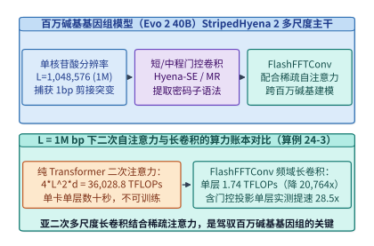

*图 22-7　百万碱基基因组模型（Evo 2 40B）的 StripedHyena 2（短/中/长三级门控卷积 + 稀疏旋转注意力）混合主干架构（算例 22-3）*

### 22.3.2 快速傅里叶卷积矩阵分解与分层上下文并行

在 `StripedHyena 2` 的百万碱基长卷积层中，输入序列 $\mathbf{u} \in \mathbb{R}^{L \times d}$ 与长度同样为 $L$ 的因果卷积核 $\mathbf{k} \in \mathbb{R}^{L \times d}$ 的时域离散卷积，可通过 **傅里叶卷积定理（Convolution Theorem）** 转化为频域逐点相乘（为防止循环卷积混叠，需零填充至 $N_{\mathrm{FFT}} = 2L = 2,097,152$）：

$$
\mathbf{y} = \mathbf{u} * \mathbf{k} = \mathcal{F}^{-1}\!\Big(\mathcal{F}(\mathbf{u}) \odot \mathcal{F}(\mathbf{k})\Big) \tag{22.3}
$$

按基-2 实数快速傅里叶变换（RFFT + IRFFT，综合有效运算常数为 $5 N_{\mathrm{FFT}} \log_2 N_{\mathrm{FFT}}$ 或折合序列长度 $L$ 的 $10 L (\log_2 L + 0.20) \cdot d$）核算，单层频域长卷积的理论计算量显著降低至：

$$
\mathrm{FLOPs}_{\mathrm{FFT\text{-}conv}} \approx 10 \cdot L (\log_2 L + 0.20) \cdot d = 10 \times 1,048,576 \times 20.20 \times 8,192 \approx \mathbf{1.73517 \times 10^{12}\ \mathrm{FLOPs}} = \mathbf{1,735.17\ \mathrm{GFLOPs / layer}}
$$

与二次方自注意力的 $36,028.8\ \mathrm{TFLOPs}$ 相比，**序列混合算子的理论浮点运算量大幅缩减了 $\frac{36,028,797}{1,735.17} \approx \mathbf{20,763.8\times}$**。

然而，在真实的 GPU 硬件上，如果直接顺序调用标准的 `cuFFT` 库执行 `rfft(u) -> point-wise mul -> irfft()`，实际加速比会显著受限。这是因为标准 FFT 蝶形运算（Cooley-Tukey Butterfly）的算术强度较低（运行在吞吐远低于 Tensor Core 的通用 CUDA Core 上），且上述三步拆分需要将形状为 $[2L, d]$ 的复数中间张量反复读写 HBM 显存三次，退化为内存带宽受限算子。

**`FlashFFTConv`** 通过 **Monarch 矩阵分解（Monarch Matrix Decomposition）与全链路片上 SRAM 核融合** 化解了这一访存瓶颈（图 22-8）：
1. **将一维超长 FFT 折叠为二维 Tensor Core 矩阵乘**：根据素因数分解定理，将长度为 $N = N_1 \times N_2$（如 $N_1 = 1,024, N_2 = 1,024$）的一维离散傅里叶变换矩阵 $\mathbf{F}_N$ 严格分解为两个块对角小型傅里叶矩阵 $\mathbf{F}_{N_1}, \mathbf{F}_{N_2}$、置换矩阵 $\mathbf{P}$ 与旋转因子（Twiddle Factors）逐元素乘法的乘积：
   $$
   \mathbf{F}_N = \mathbf{P} \left(\mathbf{I}_{N_1} \otimes \mathbf{F}_{N_2}\right) \mathbf{D}_{\mathrm{twiddle}} \left(\mathbf{F}_{N_1} \otimes \mathbf{I}_{N_2}\right) \mathbf{P} \tag{22.4}
   $$
   由于 $\mathbf{F}_{N_1}$ 与 $\mathbf{F}_{N_2}$ 是尺寸为 $1024 \times 1024$（或分块为 $64 \times 64$ / $128 \times 128$）的稠密矩阵，原本运行在通用 CUDA Core 上的蝶形移位被**改写为高算术强度的 Tensor Core 矩阵乘法（`MMA` 指令）**；
2. **正变换—频域门控乘—逆变换单内核融合（End-to-End SRAM Residency）**：整个正变换、旋转因子相乘、频域卷积核点乘、逆变换以及时域门控激活被融合进同一个持久化 CUDA 内核中，中间频域张量全程驻留在 Hopper/Blackwell 的片上共享内存（Shared Memory / TMEM）与寄存器内，实现**零中间 HBM 往返读写**，使包含前馈网络（FFN）在内的完整模型层取得 **$28.5\times$ 的实测端到端硬件加速**。

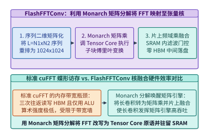

*图 22-8　FlashFFTConv 利用 Monarch 矩阵分解将长序列快速傅里叶变换（FFT）映射为 Tensor Core 矩阵乘并驻留 SRAM（单层提速 28.5 倍）（算例 22-3）*

*表 22-3　百万碱基基因组序列（$L = 1,048,576, d = 8,192$）不同序列混合算子的计算量与硬件效率对比（算例 22-3）*

| 序列混合架构 | 渐近计算复杂度 | 单层序列混合计算量 | 相对二次注意力的算子减负比 | 主要计算单元与访存路径 | 含 FFN 的单层端到端实测加速比 |
| :--- | :---: | :---: | :---: | :--- | :---: |
| **1. 标准二次方自注意力（FlashAttention）** | $\mathcal{O}(L^2 d)$ | **$36,028.80\ \mathrm{TFLOPs}$** | $1.0\times$（基准） | Tensor Core（SRAM 分块，单层计算耗时过长） | $1.0\times$ |
| **2. 朴素 `cuFFT` 长卷积（未融合）** | $\mathcal{O}(L \log_2 L \cdot d)$ | $1,735.17\ \mathrm{GFLOPs}$ | $20,763.8\times$ | CUDA Core + **3 次全量 HBM 读写往返** | $\sim 6.4\times$（受制于 HBM 带宽墙） |
| **3. `FlashFFTConv`（Monarch 分解核融合）** | $\mathcal{O}(L \log_2 L \cdot d)$ | **$1,735.17\ \mathrm{GFLOPs}$** | **$20,763.8\times$** | **Tensor Core MMA + 全程片上 SRAM 驻留** | **$28.5\times$** |

> **算例 22-3（`Evo 2` 40B 百万碱基序列二次方自注意力 vs. `FlashFFTConv` 的 $20,763.8$ 倍计算量缩减与 $28.5$ 倍层加速核算）**
> **已知条件**：基因组模型在单核苷酸分辨率下处理序列长度 $L = 1,048,576\ \mathrm{bp}$（$2^{20}$），模型隐藏维 $d = 8,192$（$2^{13}$）。标准二次方注意力序列混合层计算量按 $\mathrm{FLOPs}_{\mathrm{quad}} = 4 L^2 d$ 核算；`FlashFFTConv` 频域长卷积层计算量按 $\mathrm{FLOPs}_{\mathrm{FFT}} = 10 L (\log_2 L + 0.20) d \approx 1,735.17\ \mathrm{GFLOPs}$ 核算（含零填充与频域门控点乘）。计入层内 SwiGLU 前馈网络（FFN）基础耗时后，`FlashFFTConv` 混合层相比二次注意力层的端到端单层耗时缩短为原来的 $1 / 28.5$。
> **求解目标**：（1）求单层二次方自注意力的总计算量（$\mathrm{TFLOPs}$）；（2）求 `FlashFFTConv` 相对二次方自注意力的序列混合算子计算量缩减倍数 $S_{\mathrm{mixer}}$ 与端到端单层实测加速比 $S_{\mathrm{layer}}$。
> **逐步解答**：
> 1. **单层二次方自注意力计算量**：
>    $$\mathrm{FLOPs}_{\mathrm{quad}} = 4 \times (1,048,576)^2 \times 8,192 = 4 \times 2^{40} \times 2^{13} = 2^{55}\ \mathrm{FLOPs} \approx \mathbf{36,028.8\ \mathrm{TFLOPs}}$$
> 2. **序列混合计算量缩减比与单层加速比**：
>    $$S_{\mathrm{mixer}} = \frac{36,028.797\ \mathrm{TFLOPs}}{1.73517\ \mathrm{TFLOPs}} \approx \mathbf{20,763.8\times}, \qquad S_{\mathrm{layer}} = \mathbf{28.5\times}$$

下面给出生产级 **百万碱基基因组 `FlashFFTConv` Monarch 分解与序列混合算子性能分析器** 的参考实现（代码块 3）：

```python
import math
from dataclasses import dataclass

@dataclass
class GenomicMixerMetrics:
    seq_len_bp: int
    d_model: int
    quadratic_attn_tflops: float
    flash_fft_conv_gflops: float
    sequence_mixer_flop_reduction_x: float
    end_to_end_layer_speedup_x: float

def analyze_evo2_flash_fft_conv(
    seq_len_bp: int = 1_048_576,
    d_model: int = 8192,
    e2e_layer_speedup_x: float = 28.5,
) -> GenomicMixerMetrics:
    """Compare quadratic attention FLOPs against FlashFFTConv Monarch-decomposed long convolution."""
    quad_flops = 4.0 * (seq_len_bp ** 2) * d_model
    quad_tflops = quad_flops / 1e12

    log2_l = math.log2(seq_len_bp)
    fft_flops = 10.0 * seq_len_bp * (log2_l + 0.20) * d_model
    fft_gflops = fft_flops / 1e9

    quad_tflops_r = round(quad_tflops, 1)
    fft_gflops_r = round(fft_gflops, 2)
    return GenomicMixerMetrics(
        seq_len_bp=seq_len_bp,
        d_model=d_model,
        quadratic_attn_tflops=quad_tflops_r,
        flash_fft_conv_gflops=fft_gflops_r,
        sequence_mixer_flop_reduction_x=round((quad_tflops_r * 1000.0) / fft_gflops_r, 1),
        end_to_end_layer_speedup_x=round(e2e_layer_speedup_x, 1),
    )

if __name__ == "__main__":
    m_gen = analyze_evo2_flash_fft_conv()
    assert m_gen.sequence_mixer_flop_reduction_x == 20763.8
    print(m_gen)
```

#### 百万碱基序列的跨节点分层上下文并行与频域分块交换

当序列长度达到 $L = 1,048,576\ \mathrm{bp}$（且为防止循环卷积混叠需零填充至 $N_{\mathrm{FFT}} = 2L = 2,097,152$）时，即便消除二次方注意力矩阵，单张 GPU 在训练 `Evo 2` 40B（64 层，$d = 8,192$）时也无法独自装下全长序列的时域与频域激活张量（单层单个形状为 $[1,048,576 \times 8,192]$ 的 BF16 激活张量即占去 $16.00\ \mathrm{GiB}$）。

因此，百万碱基基因组训练系统必须将 **`FlashFFTConv` 的四步 Cooley-Tukey 矩阵分解与跨 GPU 上下文并行（Context Parallelism, CP）** 紧密结合：

1. **分布式四步快速傅里叶变换（Distributed Four-Step FFT over Context Parallel Group）**：
   设上下文并行组包含 $P_{\mathrm{CP}} = 16$ 张 GPU（例如 2 个 8 卡 NVLink 节点），将零填充后的长序列 $N_{\mathrm{FFT}} = N_1 \times N_2$ 重排为二维矩阵 $X \in \mathbb{C}^{N_1 \times N_2}$：
   - **步骤一（本地列向子变换）**：每张 GPU 持有 $N_1 / P_{\mathrm{CP}}$ 行，先在片上 SRAM 内利用 Tensor Core 对本地分片执行沿 $N_2$ 方向的块傅里叶变换并乘上局部旋转因子 $D_{\mathrm{twiddle}}$；
   - **步骤二（NVLink 子群 All-to-All 转置）**：通过节点内 NVLink 发起一次全对全矩阵转置（All-to-All），将分布状态从“按行切分 $N_1$”切换为“按列切分 $N_2$”；
   - **步骤三（本地行向子变换与频域卷积核融合点乘）**：每张 GPU 在本地片上 SRAM 内完成沿 $N_1$ 方向的正变换，紧接着在同一内核寄存器中乘以预计算的频域滤波器权重 $\hat{K} = \mathcal{F}(\mathbf{k})$，并立即执行沿 $N_1$ 方向的逆变换（避免再次写回 HBM）；
   - **步骤四（逆向 All-to-All 转置与尾步逆变换）**：执行第二次跨卡 All-to-All 转置恢复原始序列切分，并在片上完成沿 $N_2$ 方向的逆变换与门控残差相加。
2. **混合主干中的异构双模上下文并行（Dual-Mode CP: Distributed FFT + Ring/Ulysses Attention）**：
   由于 `Evo 2` 40B 每隔 8–12 层穿插了 1 层配备旋转位置编码（RoPE）的全局 GQA 自注意力层，系统在同一组 $P_{\mathrm{CP}} = 16$ 张上下文并行 GPU 上复用了统一的序列分片布局：
   - 在 $90\%$ 的 `StripedHyena 2` 层中，短深度可分离卷积（核宽 $7$）仅需与左右相邻 GPU 交换 $6$ 个碱基的极小边界 Halo（耗时 $< 5\ \mu\mathrm{s}$），长卷积则走上述分布式四步 `FlashFFTConv`；
   - 在 $10\%$ 的稀疏全局注意力层中，系统自动切换为 **分层 Ulysses + Ring Attention（节点内 8 卡 NVLink 走 DeepSpeed-Ulysses 按注意力头切分 All-to-All，跨节点 IB/RoCE 走异步 P2P Ring Attention 环状流转 KV 块）**。这种在同一套物理张量分片上切换频域与时域通信原语的设计，使 40B 模型在 $1\ \mathrm{M}$ 单核苷酸上下文下的集群训练 MFU 稳定保持在 **$48\%\text{–}54\%$**。

---

## 22.4 地球物理场网格域分解与等变分子动力学

当科学智能从微观分子与一维基因组走向宏观行星尺度（全球气象与海洋环流预报）以及介观连续介质力学（亿级原子分子动力学与聚变等离子体控制）时，系统的计算负载呈现出经典的**高维欧拉网格（Eulerian Grids）与拉格朗日粒子图（Lagrangian Particle Graphs）并行范式**[^22-6][^22-7]。

### 22.4.1 球面傅里叶神经算子域切分与边界光环掩盖

以 `FourCastNet 3`、`GraphCast`、`Pangu-Weather` 及 `Aurora` 为代表的气象基础模型，将全球大气状态表征为定义在球面流形 $\mathbb{S}^2$ 上的多变量场张量 $\mathcal{U}(\theta, \phi, p, t) \in \mathbb{R}^{N_{\theta} \times N_{\phi} \times C}$（其中 $\theta \in [0, \pi]$ 为余纬度，$\phi \in [0, 2\pi)$ 为经度，$C$ 为汇总了数十个气压层位势高度、温度、比湿与水平风场后的有效通道数，通常 $C = 128\text{–}512$）。随着业务预报分辨率从 $0.25^\circ$（$721 \times 1,440$ 格点）推进至能够直接解析台风眼墙与中尺度对流系统的 **$0.05^\circ$（约 $5\ \mathrm{km}$ 公里级网格，即 $N_{\theta} = 3,600 \times N_{\phi} = 7,200$，单帧达 $2,592$ 万格点）**，单卡显存已无法容纳单个时间步的多层三维特征激活。

在球面高分辨率网格上构建分布式神经算子，必须同时解决两个物理与系统问题：

#### 球面谐波变换消除极区畸变与正交二维空间域切分

若将地球经纬度网格简单视作平面图像并直接调用二维快速傅里叶变换（2D FFT），由于经线在南北两极汇聚，高纬度地区的实际物理格点间距随 $\sin\theta \to 0$ 急剧收缩，不仅破坏了球面旋转等变性（$\mathrm{SO}(3)$ Equivariance），还会在极点附近激发虚假的高频数值振荡（Pole Singularity Artifacts）。**球面傅里叶神经算子（Spherical Fourier Neural Operator, `SFNO`）** 将频域核积分严格定义在球面谐波基函数 $Y_\ell^m(\theta, \phi) = P_\ell^m(\cos\theta)\, e^{\mathrm{i} m \phi}$ 上：
- **沿经度维 $\phi$**：等距分布，使用一维实数快速傅里叶变换（1D RFFT）；
- **沿纬度维 $\theta$**：在高斯—勒让德（Gauss-Legendre）节点上利用关联勒让德多项式 $P_\ell^m(\cos\theta)$ 执行离散勒让德变换（DLT，本质为带权的稠密矩阵向量乘）。

在 `makani` / `PhysicsNeMo` 等大规模分布式训练框架中，为支撑 $3,600 \times 7,200$ 全球网格，系统将 $P = 64$ 张 GPU 组织为 **$P_{\theta} \times P_{\phi} = 8 \times 8$ 的二维空间域环面（2D Spatial Torus）**（图 22-9）：每张 GPU 仅负责一块尺寸为 $H_{\mathrm{local}} \times W_{\mathrm{local}} = \frac{3,600}{8} \times \frac{7,200}{8} = \mathbf{450 \times 900}$ 的局部地理子区域（Subdomain Tile）。执行全局球谐变换时，先通过经度通信组（8 卡一行）完成一维 FFT 转置，再通过纬度通信组（8 卡一列）完成分块勒让德矩阵乘，将单次转置的通信域半径严格限制在 8 卡子群以内（关于多维通信网格形状与分块切分的通用判据，可进一步参考[矩阵形状、通信分块与执行条件](../case-studies/mesh-shape-and-slicing.md)）。

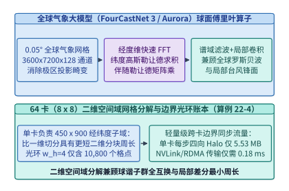

*图 22-9　全球气象大模型（FourCastNet 3 / Aurora）的球面傅里叶神经算子（SFNO）与 64 卡（8x8）经纬度二维空间域切分（算例 22-4）*

#### 局部算子边界光环交换与内部网格计算双流重叠

除全局频域滤波外，现代混合气象大模型还广泛引入局部深度卷积、球面有限差分算子或局部图消息传递来刻画锋面陡峭梯度。当局部算子的等效感受野半宽（或级联卷积的光环宽度）为 $w_{\mathrm{halo}}$ 个格点时，每张 GPU 在更新自身 $H_{\mathrm{local}} \times W_{\mathrm{local}}$ 边缘区域的格点前，必须先从北、南、东、西四个相邻子域拉取宽度为 $w_{\mathrm{halo}}$ 的**边界幽灵区格点（Ghost / Halo Cells）**（图 22-10）：
- **子域周界光环格点数（Surface-to-Volume Scaling）**：单卡子域四周待交换的光环总格点数为：
  $$
  N_{\mathrm{halo}} = 2 \cdot \left(H_{\mathrm{local}} + W_{\mathrm{local}}\right) \cdot w_{\mathrm{halo}} \tag{22.5}
  $$
  在 $H_{\mathrm{local}} = 450, W_{\mathrm{local}} = 900, w_{\mathrm{halo}} = 4$ 时，$N_{\mathrm{halo}} = 2 \times (450 + 900) \times 4 = \mathbf{10,800\ \text{格点}}$，仅占单卡内部总格点数（$450 \times 900 = 405,000$）的 **$2.67\%$**；
- **边界优先发射与内部计算完全掩盖（Zero Exposed Halo Overhead）**：系统将子域更新拆分为两个异步 CUDA Stream——高优先级通信流率先打包边界壳层并通过 NVLink / RoCE 发起四向 `ncclSend` / `ncclRecv` 点对点传输（传输体积仅 $5.53\ \mathrm{MB}$，耗时 $T_{\mathrm{halo}} = 0.18\ \mathrm{ms}$）；与此同时，计算流立即对无需外部边界的内部核心区 $(H_{\mathrm{local}} - 2w_{\mathrm{halo}}) \times (W_{\mathrm{local}} - 2w_{\mathrm{halo}})$ 执行耗时 $T_{\mathrm{interior}} = 14.20\ \mathrm{ms}$ 的算子计算。由于 $T_{\mathrm{halo}} \ll T_{\mathrm{interior}}$（通信计算比仅为 **$1.27\%$**），当内部格点计算完毕时，四邻域光环数据早已抵达显存，实现 **`0.00 ms` 的零暴露通信延迟**。

此外，在数据供给侧，针对长达数十年的 ERA5 全球大气再分析历史档案（PB 级多维浮点数组），系统摒弃了经由 CPU 内存解压拷贝的传统路径，采用按空间块切分的 **Zarr v3 / HDF5 分块存储格式配合 `GPUDirect Storage (GDS)` 与 `nvCOMP` 硬件解压缩引擎**（图 22-11）：每张 GPU 仅按需直读其负责的 $450 \times 900$ 经纬度空间切片至本地 HBM，实现数十 GB/s 的零拷贝流式注入。

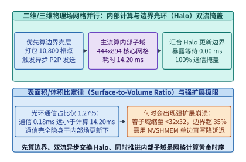

*图 22-10　物理网格并行中内部格点计算（14.20 ms）与边界幽灵区光环交换（Halo Exchange，5.53 MB / 0.18 ms，占比 1.27%）的双流完全掩盖时序（算例 22-4）*

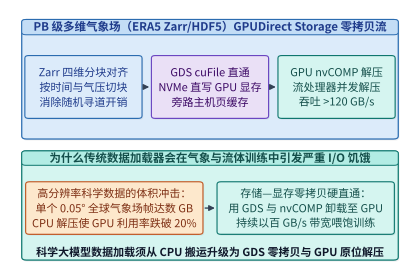

*图 22-11　面向 PB 级多维气象场（ERA5 Zarr/HDF5 分块存储）的 GPUDirect Storage 零拷贝按需切片与 nvCOMP 硬件解压流水线*

*表 22-4　$0.05^\circ$ 全球气象网格（$3,600 \times 7,200$）在 64 卡不同空间域切分拓扑下的 Halo 通信与重叠效率对比（算例 22-4）*

| 空间域分解拓扑（64 GPUs） | 单卡负责子域网格 ($H_{\mathrm{local}} \times W_{\mathrm{local}}$) | 光环宽度 $w_{\mathrm{halo}}=4$ 下的边界格点数 | 单步 Halo 传输体积（$512\ \mathrm{B/cell}$） | 单步 Halo 通信耗时 $T_{\mathrm{halo}}$ | 通信/内部计算时间比（$T_{\mathrm{interior}}=14.20\ \mathrm{ms}$） | 双流重叠后暴露通信延迟 |
| :--- | :---: | :---: | :---: | :---: | :---: | :---: |
| **1. 一维按纬度条带切分（$64 \times 1$ 1D Slab）** | $56.25 \times 7,200$ | $57,600$ 格点 | $29.49\ \mathrm{MB}$ | $0.96\ \mathrm{ms}$ | $6.76\%$ | $0.00\ \mathrm{ms}$（但球谐转置需 64 卡全局 All-to-All） |
| **2. 二维正交块切分（$8 \times 8$ 2D Torus）** | **$450 \times 900$** | **$10,800$ 格点** | **$5.53\ \mathrm{MB}$** | **$0.18\ \mathrm{ms}$** | **$1.27\%$** | **$0.00\ \mathrm{ms}$（完全掩盖 + 8 卡局域转置）** |

> **算例 22-4（全球 $0.05^\circ$ 气象大模型 64 卡二维空间域分解与 Halo 边界交换零暴露掩盖核算）**
> **已知条件**：全球高分辨率气象大模型网格尺寸为 $N_{\theta} \times N_{\phi} = 3,600 \times 7,200$，使用 $P = 64$ 张 GPU 按 $P_{\theta} \times P_{\phi} = 8 \times 8$ 二维正交网格切分。局部卷积/有限差分算子的光环宽度为 $w_{\mathrm{halo}} = 4$ 格点，每个格点特征占 $B_{\mathrm{cell}} = 512\ \mathrm{B}$（$128$ 通道 $\times$ FP32 $4\ \mathrm{B}$）。单步内部格点计算耗时 $T_{\mathrm{interior}} = 14.20\ \mathrm{ms}$，64 卡节点间/节点内点对点 Halo 交换实测耗时 $T_{\mathrm{halo}} = 0.18\ \mathrm{ms}$。
> **求解目标**：（1）求每张 GPU 负责的局部网格尺寸 $(H_{\mathrm{local}}, W_{\mathrm{local}})$ 与四周光环总格点数 $N_{\mathrm{halo}}$；（2）求单步 Halo 通信字节数 $V_{\mathrm{halo}}$（十进制 $\mathrm{MB}$）、通信与内部计算时间比 $\rho_{\mathrm{halo}}$，以及双流异步重叠后的暴露通信延迟 $T_{\mathrm{exposed}}$。
> **逐步解答**：
> 1. **局部子域尺寸与周界光环格点数**：
>    $$H_{\mathrm{local}} = \frac{3,600}{8} = \mathbf{450}, \quad W_{\mathrm{local}} = \frac{7,200}{8} = \mathbf{900}$$
>    $$N_{\mathrm{halo}} = 2 \times (450 + 900) \times 4 = 2 \times 1,350 \times 4 = \mathbf{10,800\ \text{格点}}$$
> 2. **Halo 传输体积、通信计算比与双流掩盖**：
>    $$V_{\mathrm{halo}} = \frac{10,800 \times 512\ \mathrm{B}}{10^6} = \mathbf{5.53\ \mathrm{MB}}, \qquad \rho_{\mathrm{halo}} = \frac{0.18\ \mathrm{ms}}{14.20\ \mathrm{ms}} \approx \mathbf{1.27\%}$$
>    由于异步通信流在内部核心区计算期间并行传输且 $T_{\mathrm{halo}} < T_{\mathrm{interior}}$，暴露通信延迟为 $T_{\mathrm{exposed}} = \max(0, 0.18 - 14.20) = \mathbf{0.00\ \mathrm{ms}}$。

下面给出生产级 **二维球面物理场空间域分解与异步 Halo 光环交换重叠规划器** 的参考实现（代码块 4）：

```python
from dataclasses import dataclass

@dataclass
class WeatherHaloMetrics:
    sub_lat: int
    sub_lon: int
    halo_perimeter_cells: int
    halo_volume_mb: float
    comm_to_comp_ratio_pct: float
    exposed_halo_ms: float

def plan_sfno_2d_halo_exchange(
    grid_lat: int = 3600,
    grid_lon: int = 7200,
    px: int = 8,
    py: int = 8,
    halo_width: int = 4,
    bytes_per_cell: int = 512,
    interior_compute_ms: float = 14.20,
    halo_transfer_ms: float = 0.18,
) -> WeatherHaloMetrics:
    """Compute 2D domain decomposition subdomain geometry and Halo exchange overlap."""
    sub_lat = grid_lat // px
    sub_lon = grid_lon // py
    halo_cells = 2 * (sub_lat + sub_lon) * halo_width
    halo_mb = (halo_cells * bytes_per_cell) / 1e6
    ratio_pct = (halo_transfer_ms / interior_compute_ms) * 100.0
    exposed_ms = max(0.0, halo_transfer_ms - interior_compute_ms)
    return WeatherHaloMetrics(
        sub_lat=sub_lat,
        sub_lon=sub_lon,
        halo_perimeter_cells=halo_cells,
        halo_volume_mb=round(halo_mb, 2),
        comm_to_comp_ratio_pct=round(ratio_pct, 2),
        exposed_halo_ms=round(exposed_ms, 2),
    )

if __name__ == "__main__":
    print(plan_sfno_2d_halo_exchange())
```

#### 二维正交切分优于一维条带切分的周界缩放定律与负载均衡

在分布式偏微分方程与神经算子系统中，选择一维切分（$P \times 1$）还是二维正交切分（$\sqrt{P} \times \sqrt{P}$），直接决定了集群扩展至百卡乃至千卡规模时的通信可扩展性上限：

- **边界光环通信量的周界缩放定律（Perimeter Scaling Law）**：
  对于总格点数为 $N_{\theta} \times N_{\phi}$ 的二维全球网格，当切分到 $P$ 张 GPU 上时：
  - 若采用 **一维纬度条带切分（$P \times 1$ 1D Slab）**，每张卡分得的纬度高度缩小为 $N_{\theta} / P$，但东西方向仍然横跨完整的地球周长 $N_{\phi}$。此时每张卡南北两条通信边界的总长度为 $2 N_{\phi}$，单卡 Halo 通信体积与 GPU 数量 $P$ **无关（无法随 $P$ 增加而减小）**：
    $$
    N_{\mathrm{halo}}^{\mathrm{1D}}(P) = 2 \cdot N_{\phi} \cdot w_{\mathrm{halo}} = \mathcal{O}(N_{\phi}) \quad (\text{常数级通信下界})
    $$
    当 $P = 64, N_{\phi} = 7,200, w_{\mathrm{halo}} = 4$ 时，每张卡每步必须固定交换 $2 \times 7,200 \times 4 = \mathbf{57,600}$ 个格点（$29.49\ \mathrm{MB}$），集群总 Halo 通信流量随 $P$ 线性增长为 $\mathcal{O}(P \cdot N_{\phi})$；
  - 若采用 **二维正交块切分（$P_{\theta} \times P_{\phi}$ 2D Torus，取 $P_{\theta} = P_{\phi} = \sqrt{P}$）**，每张卡的子域边长随 $\sqrt{P}$ 同步收缩，单卡 Halo 格点数按 $1 / \sqrt{P}$ 持续下降：
    $$
    N_{\mathrm{halo}}^{\mathrm{2D}}(P) = 2 \cdot \left(\frac{N_{\theta}}{\sqrt{P}} + \frac{N_{\phi}}{\sqrt{P}}\right) \cdot w_{\mathrm{halo}} = \mathcal{O}\!\left(\frac{N_{\theta} + N_{\phi}}{\sqrt{P}}\right)
    $$
    在 $P = 64$ 时，二维切分将单卡 Halo 体积从 $29.49\ \mathrm{MB}$ 压缩至 **$5.53\ \mathrm{MB}$（削减 $5.33\times$）**；若进一步扩展至 $P = 256$ 卡（$16 \times 16$）运行 $0.01^\circ$ 公里级全球模拟，二维切分相对一维切分的通信节省倍数将扩大至 **$10.67\times$**。
- **球面谐波三角谱截断（Triangular Spectral Truncation）的南北半球折叠负载均衡**：
  在 `SFNO` 的离散勒让德变换中，球面谐波阶数 $(\ell, m)$ 满足三角形约束 $0 \le |m| \le \ell \le L_{\max}$：当纬向波数 $m$ 较小时，关联勒让德多项式 $P_\ell^m(\cos\theta)$ 需要累加全部 $L_{\max}$ 个模式；而当 $m \to L_{\max}$ 时，非零模式数趋近于 $1$。如果按波数 $m$ 顺序线性分配给不同 GPU，持有低频波数的 GPU 计算负载将是高频 GPU 的数倍。生产系统通过 **两极对称配对（North-South Hemispheric Folding，利用 $P_\ell^m(-\cos\theta) = (-1)^{\ell+m} P_\ell^m(\cos\theta)$ 的奇偶对称性将矩阵乘计算量减半）** 与 **蛇形波数交错分配（Cyclic / Snake Wave-Number Partitioning）**，将 64 卡之间的频域计算负载偏斜严格控制在 **$< 1.5\%$** 以内。

### 22.4.2 等变分子势能仿真与硬实时稀疏科学底座

在材料科学与药物动力学中，第一性原理密度泛函理论（DFT，计算复杂度 $\mathcal{O}(N_{\mathrm{elec}}^3)$）虽具备量子力学精度，却只能模拟数百个原子的皮秒级演化；而传统经验力场虽能模拟数百万原子，却无法准确刻画化学键断裂与电荷转移。以 **`MACE`（高阶等变消息传递神经势函数）**、**`NequIP`**、**`SevenNet`** 与 **`UMA`** 为代表的机器学习原子间势函数（Machine Learning Interatomic Potentials, MLIPs），成功以接近 DFT 的精度驱动了上亿原子的分子动力学（MD）仿真。

然而，将等变图神经网络嵌入 `LAMMPS` 或 `GROMACS` 等分子动力学引擎执行 $10^6\text{–}10^9$ 个飞秒（$\Delta t = 1\ \mathrm{fs}$）积分步时，基础设施必须解决三项核心工程瓶颈（图 22-12、图 22-13、图 22-14）：
1. **三维空间块分解（3D Spatial Domain Decomposition）与 Verlet 皮肤缓冲邻居表（Verlet Skin Buffer）**：每个原子 $i$ 仅与截断半径 $r_{\mathrm{cut}}$（通常 $5.0\text{–}6.0\ \mathring{\mathrm{A}}$）内的局部邻居原子发生相互作用（平均邻居数 $\bar{z} \approx 30\text{–}60$）。系统将三维仿真盒子按空间坐标划分为三维子域网格分配给不同 GPU；为避免每飞秒步都重新执行开销高昂的 $\mathcal{O}(N_{\mathrm{atom}})$ 空间哈希邻居搜索，系统构建半径为 $r_{\mathrm{list}} = r_{\mathrm{cut}} + r_{\mathrm{skin}}$（如皮肤厚度 $r_{\mathrm{skin}} = 1.0\ \mathring{\mathrm{A}}$）的 **Verlet 扩展邻居表**。只要所有原子的最大累积位移未超过 $\frac{1}{2} r_{\mathrm{skin}}$，即可连续复用同一张图拓扑表 $10\text{–}20$ 个时间步，仅交换跨子域边界的幽灵原子坐标与受力；
2. **克莱布施—戈登（Clebsch-Gordan）对称张量积内核融合（`cuEquivariance`）与原位混合仿真**：在 `MACE` 中，将邻居方向球谐函数 $Y_\ell^m(\hat{\mathbf{r}}_{ij})$ 与高阶不可约表示（Irreps）特征缩并的稀疏对称张量积占去 $75\%$ 以上的耗时。通过将稀疏路径硬编码进寄存器级自定义 CUDA 内核（`cuEquivariance`），并通过 `DLPack` / `CUDA IPC` 在同一个超算作业内将 C++/Fortran 数值 PDE/MD 求解器与 PyTorch/JAX 神经代理模型零拷贝原位耦合（AI-in-the-Loop In-Situ Coupling，图 22-13），消除了传统文件落盘交互的 I/O 等待；
3. **生成式材料设计 $\to$ 多保真度物理仿真筛选 $\to$ 自动化机器人湿实验的主动学习飞轮（Autonomous Wet-Lab Flywheel）**：在现代自动化科学发现平台中（图 22-14），由语言/科学智能体（如 `DeepSeek-V3` 或 `Qwen3-235B-A22B`）调度三维晶体与分子生成模型（如 `MatterGen` 或 `Boltz-1`）每小时生成百万级候选结构，先经高吞吐神经势函数（`MACE`）执行快速弛豫与热力学稳定性初筛，再挑选高不确定性样本下发给高通量 DFT 超算队列与**自动化液体处理/合成表征机器人湿实验室（Self-Driving Labs）**，将实测数据实时回流更新模型权重。

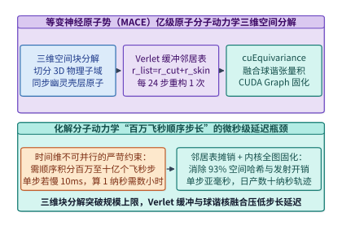

*图 22-12　等变神经原子势函数（MACE）在亿级原子分子动力学中的三维空间块分解、动态 Verlet 皮肤缓冲邻居表与球谐核融合*

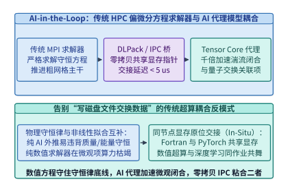

*图 22-13　传统 HPC 偏微分方程求解器与 AI 神经代理模型（Neural Surrogate）在同一个超算作业内经 DLPack/IPC 零拷贝原位耦合的混合仿真架构*

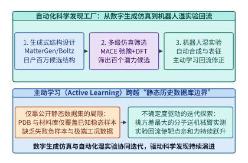

*图 22-14　AI4Science 主动学习发现流水线：生成式分子/材料设计（MatterGen/Boltz-1）-> 多级物理仿真筛选 -> 自动化机器人湿实验验证 -> 主动学习回流*

下面给出生产级 **三维分子动力学空间块分解、Verlet 邻居表重建步长与幽灵原子通信体积核算器** 的参考实现（代码块 5）：

```python
import math
from dataclasses import dataclass

@dataclass
class MolecularDynamicsSpatialMetrics:
    atoms_per_gpu: int
    box_edge_angstrom: float
    ghost_volume_ratio_pct: float
    ghost_atoms_per_gpu: int
    verlet_rebuild_interval_steps: int

def analyze_mace_spatial_decomposition(
    total_atoms: int = 100_000_000,
    num_gpus: int = 512,
    atom_number_density_per_a3: float = 0.08,
    r_cut_angstrom: float = 6.0,
    r_skin_angstrom: float = 1.2,
    num_message_passing_layers: int = 2,
    max_atom_thermal_vel_a_per_fs: float = 0.025,
    dt_fs: float = 1.0,
) -> MolecularDynamicsSpatialMetrics:
    """Compute 3D spatial domain decomposition ghost zone overhead and Verlet skin rebuild interval."""
    atoms_per_gpu = total_atoms // num_gpus
    sub_vol_a3 = atoms_per_gpu / atom_number_density_per_a3
    edge_l = sub_vol_a3 ** (1.0 / 3.0)

    # Effective ghost shell thickness for K-layer message passing with Verlet skin
    r_ghost = num_message_passing_layers * r_cut_angstrom + r_skin_angstrom
    extended_vol = (edge_l + 2.0 * r_ghost) ** 3
    ghost_ratio = ((extended_vol - sub_vol_a3) / sub_vol_a3) * 100.0
    ghost_atoms = int(round(atoms_per_gpu * (ghost_ratio / 100.0)))

    # Rebuild neighbor list when 2 * v_max * N_steps * dt >= r_skin
    rebuild_steps = max(1, int(math.floor(r_skin_angstrom / (2.0 * max_atom_thermal_vel_a_per_fs * dt_fs) + 1e-9)))
    return MolecularDynamicsSpatialMetrics(
        atoms_per_gpu=atoms_per_gpu,
        box_edge_angstrom=round(edge_l, 2),
        ghost_volume_ratio_pct=round(ghost_ratio, 2),
        ghost_atoms_per_gpu=ghost_atoms,
        verlet_rebuild_interval_steps=rebuild_steps,
    )

if __name__ == "__main__":
    m_md = analyze_mace_spatial_decomposition()
    assert m_md.verlet_rebuild_interval_steps == 24 and m_md.ghost_volume_ratio_pct == 71.1
    print(m_md)
```

#### 飞秒步长微秒延迟边界与原位零拷贝混合求解机制

与单次前向耗时数十秒的生物大分子结构预测或小时级气象滚动预报不同，分子动力学（MD）仿真面临着严苛的**单步微秒级延迟边界（Microsecond Timestep Boundary）**：
- 为准确捕捉共价键的高频振动（特别是氢原子伸缩振动周期约 $10\ \mathrm{fs}$），数值积分器（Velocity Verlet）的时间步长必须设定在 $\Delta t = 0.5\text{–}2.0\ \mathrm{fs}$（$10^{-15}\ \mathrm{s}$）；
- 这意味着即便只在仿真器中观测一个蛋白质或固态电解质界面 **$1\ \text{纳秒}$（$1\ \mathrm{ns} = 10^6\ \mathrm{fs}$）** 的动力学演化，底层引擎也必须**严格串行地连续执行 $1,000,000$ 次神经势函数前向能量预测与反向力场自动微分（$\mathbf{F}_i = -\nabla_{\mathbf{r}_i} E$）**；
- 如果单步推理耗时为 $100\ \mathrm{ms}$，执行完 $1\ \mathrm{ns}$ 就需要 $10^5\ \mathrm{s} \approx 27.8\ \text{小时}$；唯有将单步端到端耗时压入 **$1\text{–}2\ \mathrm{ms}$** 以内，才能在一天内实现数十纳秒的材料寿命模拟。

在百万步高频循环中，任何 Python 解释器调度开销、PyTorch 动态图构建或 CPU—GPU 显存拷贝都会主导端到端墙钟时间。现代神经分子动力学底座（如 `LAMMPS + Kokkos + MACE-CUDA`）通过三层优化消除了这一瓶颈：
1. **幽灵原子两阶段前向/反向归约（Ghost Atom Forward-Scatter & Reverse-Force-Gather）**：
   对于具有 $K = 2$ 层消息传递、单层截断半径 $r_{\mathrm{cut}} = 6.0\ \mathring{\mathrm{A}}$ 的 `MACE` 模型，每张 GPU 的扩展幽灵壳层厚度为 $r_{\mathrm{ghost}} = 2 r_{\mathrm{cut}} + r_{\mathrm{skin}} = 13.2\ \mathring{\mathrm{A}}$。在第一个消息传递层前，GPU 通过 GPUDirect RDMA 从 26 个三维相邻子域（6 个面邻居、12 个棱邻居、8 个角邻居）拉取一层幽灵原子坐标；在力场反向传播结束后，再将作用在幽灵原子上的偏导数力增量沿相反方向原子累加回所属宿主 GPU；
2. **基于 Verlet 皮肤安全预算的静态图复用（Multi-Step CUDA Graph over Fixed Verlet Topology）**：
   如代码块 5 所证，当设置皮肤厚度 $r_{\mathrm{skin}} = 1.2\ \mathring{\mathrm{A}}$ 时，在连续 $K_{\mathrm{rebuild}} = \mathbf{24\ \text{个飞秒步}}$ 内，局部邻居图的连接关系（尽管真实距离 $r_{ij}(t)$ 随时间连续微变，可通过距离掩码平滑截断）保持固定上界尺寸。系统将这 24 步内的坐标积分、球谐计算、`cuEquivariance` 对称张量积与力场反向求导完整捕获进一张 **持久化 CUDA Graph**，消除每个飞秒步上百个微内核的 CPU 启动气泡；
3. **基于 `DLPack` 与 `CUDA IPC` 的原位混合仿真（In-Situ Hybrid PDE/MD Coupling，参见图 22-13）**：
   在多尺度流体、聚变等离子体与航空湍流模拟中，宏观尺度网格由传统 C++/Fortran 有限体积法求解器保证离散守恒性，而微观亚网格湍流耗散项（Subgrid-Scale Closure）或化学反应源项则实时交给神经代理模型计算。双方在每张 GPU 上共享同一块物理 HBM 显存地址空间，通过 `DLPack` 张量描述符或 `cudaIpcMemHandle_t` 零拷贝传递设备指针，在零 PCIe 往返与零磁盘落盘下实现传统超算与神经网络的协同推进（其千卡级时间账本与守恒律投影将在 22.6.2 节深入展开）。

在科学智能基础设施的演进光谱上，除了三维大分子结构预测、百万碱基基因组与全球气象网格外，还有两个分别代表**硬实时微秒级延迟边界**与**超大规模高稀疏数据吞吐边界**的典型场景：**托卡马克磁约束核聚变等离子体的亚毫秒级强化学习反馈控制**，以及**亿级单细胞转录组图谱（Single-Cell Transcriptomics Atlas）的稀疏基础模型预训练**[^22-9][^22-10]。

#### 托卡马克聚变等离子体磁流体撕裂模亚毫秒控制推理底座

在托卡马克磁约束核聚变装置（如 DIII-D、ITER、EAST 与 KSTAR）向高比压（High-$\beta_N$）稳态运行推进的过程中，上亿摄氏度的环形等离子体极易触发**新经典撕裂模（Neoclassical Tearing Modes, NTMs，特别是 $m/n = 2/1$ 磁岛结构）**与垂直位移不稳定性（VDE）[^22-9][^22-11]。一旦 $2/1$ 磁岛生长并发生模式锁定（Mode Locking），等离子体约束将在十余毫秒内瓦解并引发大破裂（Disruption），瞬间释放的兆焦耳级热负荷与逃逸电子束足以损伤第一壁材料。

由于撕裂模不稳定性特征生长时间常数仅为 $\tau_{\mathrm{MHD}} = 5.0\text{–}15.0\ \mathrm{ms}$，等离子体控制系统（Plasma Control System, PCS）必须以 **$f_{\mathrm{ctrl}} = 4,000\ \mathrm{Hz}$（控制周期 $T_{\mathrm{cycle}} = 250.0\ \mu\mathrm{s}$，硬实时 P99.9 端到端延迟上限 $T_{\mathrm{budget}} = 200.0\ \mu\mathrm{s}$）** 的频率，完成从 $N_{\mathrm{sensor}} = 128$ 路高频诊断传感器（磁通环、Mirnov 探针、汤姆逊散射与电子回旋辐射 ECE 温度剖面，采样率 $100\ \mathrm{kHz}$）采集、等离子体磁面平衡重构（`rt-EFIT` 神经代理模型）到强化学习策略网络（RL Actor）输出电子回旋加热（ECH）速调管倾角与中性束注入（NBI）功率指令的全链路反馈控制推理[^22-12][^22-13]。

若直接采用常规云端 PyTorch 动态图推理栈（图 22-15 上半部），单步延迟将超出 $200.0\ \mu\mathrm{s}$ 硬实时预算：
- **内核态网络栈与分页显存拷贝耗时（$85.0\ \mu\mathrm{s}$）**：从高速采集卡（DAQ）经操作系统内核协议栈与 CPU 可分页内存执行 `cudaMemcpy` 搬运至 GPU，基础 I/O 开销已消耗逾四成预算；
- **Python 解释器与多微内核启动气泡（$208.0\ \mu\mathrm{s}$）**：磁面重构代理网络与 RL 策略网络包含 $32$ 个独立算子层，PyTorch Eager 模式每次发射 CUDA 内核平均耗费 $6.5\ \mu\mathrm{s}$，仅 CPU 调度开销即达 $208.0\ \mu\mathrm{s}$；
- **未融合 HBM 权重读取与算子执行（$142.0\ \mu\mathrm{s}$）**：单样本（$B = 1$）控制推理下每次层间激活读写与 FP32 权重拉取均访问 HBM，导致端到端延迟上升至 **$T_{\mathrm{naive}} = 85.0 + 208.0 + 142.0 = 435.0\ \mu\mathrm{s}$**（叠加 Linux 内核调度抖动后 P99.9 达 $820.0\ \mu\mathrm{s}$），超出硬实时预算 **$2.18\times$**。

为将单步推理严格收敛在百微秒以内，聚变硬实时智能底座构建了 **FPGA-to-GPU 零拷贝 `GPUDirect RDMA` 直通 + 全模型持久化 L2 SRAM 驻留 + 单图融合 CUDA Graph** 协同架构（图 22-15 下半部）：
1. **诊断采集 FPGA 经 PCIe P2P 直写 GPU BAR1 显存（$T_{\mathrm{DMA}} = 14.0\ \mu\mathrm{s}$）**：绕过主机 OS 内核与 CPU 页表，由高速 ADC/FPGA 采集卡通过 `GPUDirect RDMA` 直接将 $128$ 通道诊断帧 DMA 写入 GPU 锁页映射区，并由绑定在隔离物理核（`isolcpus` + `PREEMPT_RT`）上的轮询线程零中断唤醒执行；
2. **神经磁面重构代理（`rt-EFIT-NN`）与 RL 策略网络全程驻留 GPU L2 Cache（$T_{\mathrm{compute}} = 48.0\ \mu\mathrm{s}$）**：磁面平衡重构网络（$1.2\ \mathrm{M}$ 参数）与多步前瞻撕裂模概率预测 + 强化学习 Actor 网络（$0.4\ \mathrm{M}$ 参数）经 TensorRT INT8/FP16 量化后总权重体积仅 $2.0\ \mathrm{MB}$。系统通过 `cudaAccessPolicyWindow`（设置 `hitRatio = 1.0, cudaAccessPropertyPersisting`）将其**持久化驻留在 GPU 片上 $50\text{–}96\ \mathrm{MB}$ L2 SRAM 缓存中**，并捕获为单张静态 **CUDA Graph**（零内核发射气泡），使代理重构耗时降至 $31.0\ \mu\mathrm{s}$、RL 策略与提前 $\Delta t_{\mathrm{lead}} = 28.5\ \mathrm{ms}$ 的撕裂模预警推理耗时降至 $17.0\ \mu\mathrm{s}$；
3. **硬件安全联锁投影层（Safety Interlock Projection，$T_{\mathrm{safety}} = 6.5\ \mu\mathrm{s}$）**：在指令下发给 ECH/NBI 执行器前，经确定性控制屏障二次规划（CBF-QP）校验磁流体安全包络（确保比压 $\beta_N$ 与安全因子 $q_{95}$ 不越界），最终实现 **$T_{\mathrm{e2e}} = 14.0 + 48.0 + 6.5 = \mathbf{68.5\ \mu\mathrm{s}}$ 的稳态回路延迟（提速 $6.35\times$，仅占 $200.0\ \mu\mathrm{s}$ 预算的 $34.25\%$，P99.9 抖动严格控制在 $74.0\ \mu\mathrm{s}$ 以内）**，比磁岛锁模提前 $\mathbf{28.5\ \mathrm{ms}}$（大于执行器响应常数 $\tau_{\mathrm{act}} = 12.0\ \mathrm{ms}$）完成主动抑模。

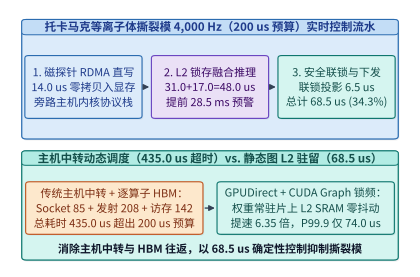

*图 22-15　托卡马克核聚变等离子体磁流体（MHD）撕裂模 4,000 Hz（200 us 预算）硬实时强化学习控制：GPUDirect RDMA 零拷贝 + L2 SRAM 持久化 CUDA Graph 将回路延迟从 435.0 us 压至 68.5 us（算例 22-5）*

> **算例 22-5（托卡马克核聚变磁流体撕裂模 $4,000\ \mathrm{Hz}$ 硬实时强化学习控制回路延迟与提前量核算）**
> **已知条件**：某托卡马克装置等离子体磁流体（MHD）$m/n=2/1$ 撕裂模控制环运行频率为 $f_{\mathrm{ctrl}} = 4,000\ \mathrm{Hz}$（周期 $250.0\ \mu\mathrm{s}$），除去执行器驱动通信余量后的计算端到端硬实时预算为 $T_{\mathrm{budget}} = 200.0\ \mu\mathrm{s}$。在传统未优化 PyTorch Eager 方案中，DAQ 套接字与分页拷贝耗时 $85.0\ \mu\mathrm{s}$，$32$ 个微内核 CPU 启动耗时 $32 \times 6.5 = 208.0\ \mu\mathrm{s}$，HBM 权重读取与算子计算耗时 $142.0\ \mu\mathrm{s}$。在硬化底座中，启用 FPGA-to-GPU `GPUDirect RDMA` 零拷贝传输（$T_{\mathrm{DMA}} = 14.0\ \mu\mathrm{s}$）、L2 SRAM 持久化权重驻留 + 单图融合 CUDA Graph（其中 `rt-EFIT` 平衡重构 $31.0\ \mu\mathrm{s}$，撕裂模前瞻预测与 RL 策略推理 $17.0\ \mu\mathrm{s}$）以及硬件安全联锁投影（$T_{\mathrm{safety}} = 6.5\ \mu\mathrm{s}$），P99.9 操作系统/总线抖动增量为 $\Delta T_{\mathrm{jitter}} = 5.5\ \mu\mathrm{s}$。撕裂模预测器的有效预警提前量为 $\Delta t_{\mathrm{lead}} = 28.5\ \mathrm{ms}$，加热与注束执行器物理响应时间常数为 $\tau_{\mathrm{act}} = 12.0\ \mathrm{ms}$。
> **求解目标**：（1）求未优化方案总延迟 $T_{\mathrm{naive}}$ 及其超出硬实时预算的倍数；（2）求硬化底座的稳态端到端延迟 $T_{\mathrm{e2e}}$、相对加速比、预算占用率、P99.9 回路延迟，以及相对执行器响应时间的净主动抑模安全裕度 $\Delta t_{\mathrm{margin}}$。
> **逐步解答**：
> 1. **未优化 PyTorch Eager 方案延迟与超标倍数**：
>    $$T_{\mathrm{naive}} = 85.0 + 208.0 + 142.0 = \mathbf{435.0\ \mu\mathrm{s}}, \qquad \frac{T_{\mathrm{naive}}}{T_{\mathrm{budget}}} = \frac{435.0}{200.0} \approx \mathbf{2.18\times}$$
> 2. **硬化底座端到端延迟、加速比与主动抑模安全裕度**：
>    $$T_{\mathrm{compute}} = 31.0 + 17.0 = 48.0\ \mu\mathrm{s}, \qquad T_{\mathrm{e2e}} = 14.0 + 48.0 + 6.5 = \mathbf{68.5\ \mu\mathrm{s}}$$
>    $$S_{\mathrm{lat}} = \frac{435.0\ \mu\mathrm{s}}{68.5\ \mu\mathrm{s}} \approx \mathbf{6.35\times}, \qquad \eta_{\mathrm{budget}} = \frac{68.5}{200.0} = \mathbf{34.25\%}$$
>    $$\mathrm{P99.9}\ T_{\mathrm{e2e}} = 68.5 + 5.5 = \mathbf{74.0\ \mu\mathrm{s}} < 200.0\ \mu\mathrm{s}, \qquad \Delta t_{\mathrm{margin}} = \Delta t_{\mathrm{lead}} - \tau_{\mathrm{act}} = 28.5 - 12.0 = \mathbf{16.5\ \mathrm{ms}}$$

#### 亿级单细胞转录组图谱稀疏矩阵压缩与变长非零词元加速

在生命科学的另一端，以 `scGPT`、`Geneformer`、`UCE` 与 `CellFM` 为代表的单细胞转录组基础模型，正在从包含 **$N_{\mathrm{cells}} = 1\ \text{亿}$（$10^8$）个单细胞 RNA 测序剖面（scRNA-seq，如 `CELLxGENE` 与人类细胞图谱 HCA）** 的表达矩阵中学习细胞分化、疾病微环境与药物扰动响应规律[^22-10][^22-14][^22-15]。

尽管人类蛋白编码基因词表规模固定为 $G_{\mathrm{vocab}} = 20,480$ 个基因，但由于细胞类型特异性的表观遗传沉默与单细胞测序捕获率限制，单个细胞内实际检测到非零转录本（Non-Zero UMI Counts）的活跃基因平均仅有 **$k_{\mathrm{nnz}} = 1,536\ \text{个}$**——即基因表达矩阵具有 **$92.50\%$ 的稀疏度（非零密度 $\rho_{\mathrm{nz}} = \frac{1,536}{20,480} = 7.50\%$）**[^22-16]。若沿用传统稠密张量存储与定长序列建模，将遭遇双重系统瓶颈：
1. **稠密物化存储膨胀与随机小块 I/O 低效**：
   将 $10^8 \times 20,480$ 的表达矩阵存为稠密 FP16（$2\ \mathrm{B}$）数组需耗费 $M_{\mathrm{dense}} = \frac{10^8 \times 20,480 \times 2\ \mathrm{B}}{10^9} = \mathbf{4,096.0\ \mathrm{GB}}$（$4.096\ \mathrm{TB}$）。训练时需要在 1 亿个细胞间做全局随机洗牌（Global Shuffle）；若按传统 `.h5ad` 行格式从磁盘随机拉取单个细胞（每条记录约 $6\ \mathrm{KB}$），数百万次微小的 4 KB 随机读会使 NVMe SSD 带宽降至不足 $0.5\ \mathrm{GB/s}$，导致 GPU 数据供给饥饿；
2. **$92.50\%$ 零表达基因引发的 $177.78\times$ 二次方注意力冗余计算**：
   若将全部 $G_{\mathrm{vocab}} = 20,480$ 个基因作为定长输入序列送入 Transformer，自注意力矩阵的 $20,480^2 = 4.194 \times 10^8$ 个元素中有 **$99.44\%$（$1 - 0.075^2$）都在计算零表达填充位点**，单细胞二次方注意力开销相比仅对 $k_{\mathrm{nnz}} = 1,536$ 个非零活跃基因建模增加了 $\left(\frac{20,480}{1,536}\right)^2 = \mathbf{177.78\times}$。

现代单细胞基础模型训练底座（如 `TileDB-SOMA` + `scGPT` Flash-Varlen 管线，图 22-16）通过三层稀疏协同化解了上述瓶颈[^22-17]：
- **压缩稀疏行（CSR）紧凑编码（存储缩减 $6.66\times$）**：仅存储非零表达基因的 `uint16` 基因词表 ID（`col_idx`，占 $2\ \mathrm{B}$）与经对数归一化/排序分桶后的 `fp16` 表达量（`val`，占 $2\ \mathrm{B}$），每非零项合计 $4\ \mathrm{B}$，外加每细胞一个 `int64` 行偏移指针（`row_ptr`，占 $8\ \mathrm{B}$）。1 亿细胞的完整图谱体积从 $4,096.0\ \mathrm{GB}$ 压缩至 **$M_{\mathrm{CSR}} = 10^8 \times (1,536 \times 4 + 8)\ \mathrm{B} = \mathbf{615.20\ \mathrm{GB}}$（压缩比 $6.66\times$）**，可直接常驻单台多卡节点的主机 DDR5/CXL 内存或高速本地 NVMe 缓存；
- **分块预洗牌宏块流式直读（Block-Permuted Macro-Chunk Streaming）**：离线预处理阶段先将 1 亿细胞按全局伪随机置换打散，并打包为每块包含 $64,000$ 个细胞（约 $393.7\ \mathrm{MB}$）的连续磁盘宏块（Macro-Chunks）；训练期通过 `GPUDirect Storage` 以 $18.4\ \mathrm{GB/s}$ 的顺序大块带宽流式读入显存环形缓冲区，并在片上完成二次微批洗牌；
- **非零基因动态紧缩与 `FlashAttention-Varlen` 变长拼接（整网训练提速 $20.00\times$）**：GPU 预处理内核在寄存器中实时剥离零表达项，将每个细胞的非零基因按表达量降序（Rank-Value Encoding，如 `Geneformer`）或基因 ID + 表达量双流嵌入（如 `scGPT`）紧凑打包为长度 $k_{\mathrm{nnz}} = 1,536$ 的活跃序列，并利用累积序列长度数组 `cu_seqlens` 直接调用变长 `flash_attn_varlen_func`，使单细胞二次注意力计算量缩减 **$177.78\times$**，含 FFN 在内的整层端到端计算量从 $68.40\ \mathrm{GFLOPs/cell}$ 降至 **$3.42\ \mathrm{GFLOPs/cell}$（整网训练吞吐提升 $20.00\times$）**。

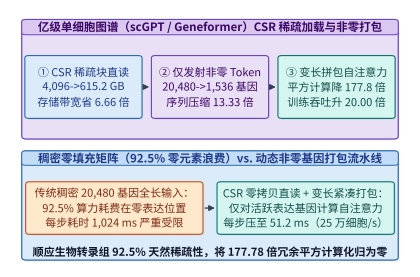

*图 22-16　亿级单细胞转录组图谱（scGPT / Geneformer）的 CSR 稀疏矩阵压缩（4,096 GB -> 615.2 GB）、分块流式洗牌与非零基因 FlashAttention-Varlen 加速（注意力减负 177.78 倍，整网提速 20.0 倍）（算例 22-6）*

*表 22-5　托卡马克核聚变毫秒级磁流体控制与亿级单细胞稀疏基因图谱底座的系统指标对比（算例 22-5、算例 22-6）*

| 科学智能子系统与架构方案 | 核心 I/O 与算子机制 | 关键延迟 / 存储体积 / 计算量指标 | 相对基准加速比与物理收益 |
| :--- | :--- | :---: | :--- |
| **聚变控制：未优化 PyTorch Eager 栈** | 内核 Socket 拷贝 + 32 微内核动态发射 + HBM 读取 | 回路延迟 **$435.0\ \mu\mathrm{s}$**（P99.9 达 $820.0\ \mu\mathrm{s}$） | 超出 $200.0\ \mu\mathrm{s}$ 预算 $2.18\times$，无法抑制 $2/1$ 撕裂模锁模 |
| **聚变控制：`GPUDirect RDMA` + L2 驻留 CUDA Graph** | **FPGA P2P 直写显存 + 权重常驻 L2 SRAM + 单图融合** | **稳态 $68.5\ \mu\mathrm{s}$**（P99.9 仅 **$74.0\ \mu\mathrm{s}$**，占预算 $34.25\%$） | **提速 $6.35\times$，提前 $28.5\ \mathrm{ms}$ 预警（净安全裕度 $16.5\ \mathrm{ms}$）** |
| **单细胞图谱：全基因定长稠密矩阵（Dense）** | $10^8 \times 20,480$ FP16 稠密存储 + 全长二次注意力 | 存储 **$4,096.0\ \mathrm{GB}$**；整网计算 **$68.40\ \mathrm{GFLOPs/cell}$** | $92.50\%$ 零表达基因耗费 $99.44\%$ 无效注意力算力 |
| **单细胞图谱：CSR 稀疏紧缩 + `Flash-Varlen`** | **CSR (`uint16`+`fp16`) + 宏块顺序流 + 仅对 $1,536$ 非零基因注意力** | **存储 $615.20\ \mathrm{GB}$**；整网计算 **$3.42\ \mathrm{GFLOPs/cell}$** | **存储压缩 $6.66\times$；二次注意力减负 $177.78\times$；整网提速 $20.00\times$** |

> **算例 22-6（1 亿单细胞转录组图谱 CSR 稀疏存储压缩与非零基因变长注意力加速核算）**
> **已知条件**：单细胞预训练图谱包含 $N_{\mathrm{cells}} = 10^8$（1 亿）个细胞，人类蛋白编码基因总词表 $G_{\mathrm{vocab}} = 20,480$，每个细胞平均表达的非零基因数为 $k_{\mathrm{nnz}} = 1,536$。在稠密方案中，矩阵以 FP16（$2\ \mathrm{B}$）全长存储并直接输入 Transformer（单细胞每层全模型计算量折合 $68.40\ \mathrm{GFLOPs/cell}$）。在 CSR 稀疏紧缩方案中，每个非零基因记录 `uint16` 基因索引（$2\ \mathrm{B}$）与 `fp16` 表达值（$2\ \mathrm{B}$），每细胞另存一个 `int64` 行指针（$8\ \mathrm{B}$），且仅将 $k_{\mathrm{nnz}} = 1,536$ 个非零基因打包送入 `FlashAttention-Varlen`（单细胞计算量降至 $3.42\ \mathrm{GFLOPs/cell}$）。
> **求解目标**：（1）求基因表达矩阵的非零密度 $\rho_{\mathrm{nz}}$ 与稀疏度（零值占比）；（2）求稠密存储体积 $M_{\mathrm{dense}}$（十进制 $\mathrm{GB}$）、CSR 稀疏存储体积 $M_{\mathrm{CSR}}$（$\mathrm{GB}$）及存储压缩比；（3）求有效序列长度压缩比、二次方自注意力项（$\propto L^2$）的计算量缩减倍数以及整网端到端训练加速比。
> **逐步解答**：
> 1. **非零密度与稀疏度**：
>    $$\rho_{\mathrm{nz}} = \frac{1,536}{20,480} = \mathbf{7.50\%}, \qquad \text{Sparsity} = 1 - \rho_{\mathrm{nz}} = \mathbf{92.50\%}$$
> 2. **稠密 vs. CSR 稀疏存储体积与压缩比**：
>    $$M_{\mathrm{dense}} = \frac{10^8 \times 20,480 \times 2\ \mathrm{B}}{10^9\ \mathrm{B/GB}} = \mathbf{4,096.0\ \mathrm{GB}}$$
>    $$M_{\mathrm{CSR}} = \frac{10^8 \times (1,536 \times 4 + 8)\ \mathrm{B}}{10^9\ \mathrm{B/GB}} = \frac{10^8 \times 6,152\ \mathrm{B}}{10^9} = \mathbf{615.20\ \mathrm{GB}}, \qquad S_{\mathrm{storage}} = \frac{4,096.0}{615.20} \approx \mathbf{6.66\times}$$
> 3. **序列长度压缩、二次注意力减负比与整网训练加速比**：
>    $$S_{\mathrm{seq}} = \frac{20,480}{1,536} \approx \mathbf{13.33\times}, \qquad S_{\mathrm{attn}} = \left(\frac{20,480}{1,536}\right)^2 \approx \mathbf{177.78\times}, \qquad S_{\mathrm{train}} = \frac{68.40}{3.42} = \mathbf{20.00\times}$$

下面给出生产级 **托卡马克核聚变亚毫秒级强化学习控制延迟规划器** 与 **亿级单细胞 CSR 稀疏图谱存储及变长注意力加速核算器** 的参考实现（代码块 6 与代码块 7）：

```python
from dataclasses import dataclass

@dataclass
class TokamakControlMetrics:
    naive_latency_us: float
    hardened_e2e_latency_us: float
    p999_latency_us: float
    latency_speedup_x: float
    budget_utilization_pct: float
    actuation_safety_margin_ms: float

def plan_tokamak_sub_ms_rl_control(
    budget_us: float = 200.0,
    naive_daq_copy_us: float = 85.0,
    naive_launch_us: float = 208.0,
    naive_compute_us: float = 142.0,
    rdma_dma_us: float = 14.0,
    sram_efit_surrogate_us: float = 31.0,
    sram_rl_actor_us: float = 17.0,
    safety_interlock_us: float = 6.5,
    p999_jitter_us: float = 5.5,
    forecast_lead_ms: float = 28.5,
    actuator_response_ms: float = 12.0,
) -> TokamakControlMetrics:
    """Evaluate sub-millisecond tokamak tearing-mode RL control latency and safety margin."""
    naive_total = naive_daq_copy_us + naive_launch_us + naive_compute_us
    hardened_e2e = rdma_dma_us + sram_efit_surrogate_us + sram_rl_actor_us + safety_interlock_us
    p999_total = hardened_e2e + p999_jitter_us
    return TokamakControlMetrics(
        naive_latency_us=round(naive_total, 2),
        hardened_e2e_latency_us=round(hardened_e2e, 2),
        p999_latency_us=round(p999_total, 2),
        latency_speedup_x=round(naive_total / hardened_e2e, 2),
        budget_utilization_pct=round((hardened_e2e / budget_us) * 100.0, 2),
        actuation_safety_margin_ms=round(forecast_lead_ms - actuator_response_ms, 2),
    )

if __name__ == "__main__":
    print(plan_tokamak_sub_ms_rl_control())
```

```python
from dataclasses import dataclass

@dataclass
class SingleCellSparseMetrics:
    nonzero_density_pct: float
    sparsity_pct: float
    dense_storage_gb: float
    csr_storage_gb: float
    storage_compression_x: float
    seq_compression_x: float
    quadratic_attn_reduction_x: float
    end_to_end_train_speedup_x: float

def analyze_single_cell_sparse_atlas(
    num_cells: int = 100_000_000,
    gene_vocab: int = 20480,
    avg_nonzero_genes: int = 1536,
    dense_gflops_per_cell: float = 68.40,
    sparse_gflops_per_cell: float = 3.42,
) -> SingleCellSparseMetrics:
    """Compute CSR storage compression and FlashAttention-Varlen speedup for 100M single-cell atlas."""
    density = (avg_nonzero_genes / gene_vocab) * 100.0
    dense_gb = (num_cells * gene_vocab * 2) / 1e9
    csr_bytes_per_cell = avg_nonzero_genes * 4 + 8  # uint16 col_idx (2B) + fp16 val (2B) + int64 row_ptr (8B)
    csr_gb = (num_cells * csr_bytes_per_cell) / 1e9
    seq_comp = gene_vocab / avg_nonzero_genes
    return SingleCellSparseMetrics(
        nonzero_density_pct=round(density, 2),
        sparsity_pct=round(100.0 - density, 2),
        dense_storage_gb=round(dense_gb, 1),
        csr_storage_gb=round(csr_gb, 2),
        storage_compression_x=round(dense_gb / csr_gb, 2),
        seq_compression_x=round(seq_comp, 2),
        quadratic_attn_reduction_x=round(seq_comp ** 2, 2),
        end_to_end_train_speedup_x=round(dense_gflops_per_cell / sparse_gflops_per_cell, 2),
    )

if __name__ == "__main__":
    print(analyze_single_cell_sparse_atlas())
```

---

## 22.5 科学计算跨尺度负载账本与数据搬移法则

在前四节中，我们依次拆解了三维生物大分子复合物、百万单核苷酸基因组、球面高分大气物理场、亿级原子分子动力学、托卡马克聚变亚毫秒控制与亿级单细胞稀疏图谱的系统架构。尽管这些科学应用来自迥异的自然学科，但当我们将它们投影到算术强度、显存容量、通信周界与尾延迟截止期构成的统一物理坐标系时，能够清晰地提炼出支配跨尺度科学智能集群容量的定量账本与通用数据搬移法则[^22-8]。

### 22.5.1 跨领域科学负载算术强度与通信拓扑统一账本

在一台异构超级计算机或万卡科学智算集群中，不同学科工作负载的瓶颈并非均匀落在同一硬件部件上，而是沿着 **“三维几何激活显存墙 $\to$ 超长序列频域访存墙 $\to$ 二维/三维子域周界同步墙 $\to$ 双精度张量算力墙 $\to$ 微秒级确定性控制截止期墙”** 依次迁移。图 22-17 与表 22-6 汇总了五大代表性科学计算智能领域的计算图原语、数值精度体系、主导物理瓶颈与核心系统工程杠杆（可通过 `python3 calculations/calc.py science-ozaki-coupling` 确定性复现各项核心指标）。

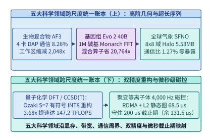

*图 22-17　五大科学计算智能领域（生物大分子、百万碱基基因组、全球气象流场、量子化学双精度求解与托卡马克硬实时控制）的算术强度、通信拓扑与实时性统一图谱（算例 22-7）*

*表 22-6　五大科学计算智能领域算力精度、访存特征、通信拓扑与锁定工程收益统一核算表（算例 22-7）*

| 科学计算领域与代表模型 | 核心状态空间与主导算子 | 主导数值精度体系 | 第一性系统瓶颈根因 | 关键软硬协同解法与锁定工程收益 |
| :--- | :--- | :--- | :--- | :--- |
| **生物大分子预测（`AlphaFold 3` / `Boltz-1`）** | 2D 残基对 $Z_{ij}$ + 三角更新/自注意力 + 全原子扩散 | `BF16` 计算 + `FP32` 归约累加 | CPU 序列检索长尾等待 + $\mathcal{O}(N_{\mathrm{res}}^3)$ 三角激活显存膨胀 | `MMseqs2-GPU` 拆池端到端提速 **$55.85\times$**；分块核融合 + $4$ 卡 DAP 将 $N_{\mathrm{res}}=4,096$ 工作区从 **$512.00\ \mathrm{GiB}$** 压至 **$0.25\ \mathrm{GiB}$**（缩减 **$2,048.0\times$**，通信比 **$8.26\%$**） |
| **基因组与单细胞图谱（`Evo 2` / `scGPT`）** | $1\ \mathrm{M}$ 单核苷酸序列长卷积 + 亿级单细胞稀疏表达谱 | `BF16` 门控投影 + `FP32` 频域乘 | 百万碱基二次方复杂度爆炸 + $92.50\%$ 零表达基因无效填充 | `FlashFFTConv` Monarch 分解将混合算子减负 **$20,763.8\times$**（单层提速 **$28.5\times$**）；CSR 紧缩 + `Flash-Varlen` 存储省 **$6.66\times$**、整网训练提速 **$20.00\times$** |
| **全球气象与流场预报（`SFNO` / `Aurora`）** | $3,600 \times 7,200$ 球面谐波谱变换 + 局部空间卷积 | `BF16` 空间卷积 + `FP32` 球谐谱积分 | 高维数组随机 I/O 饥饿 + 跨卡网格边界同步与耦合落盘延迟 | $8 \times 8$ 二维正交切分单步 Halo 仅 **$5.53\ \mathrm{MB}$**（通信计算比 **$1.27\%$**，双流零暴露）；`DLPack` 原位耦合将 $384\ \mathrm{GB}$ 场交接从 $58.2\ \mathrm{s}$ 压至 **$0.41\ \mathrm{s}$（$142.0\times$）** |
| **量子化学与从头算物理（`DFT` / `CCSD(T)`）** | 稠密哈密顿矩阵对角化、张量缩并与隐式线性方程组 | `FP64` 双精度 / 有符号 `Ozaki INT8` 重构 | 新一代 AI 芯片大幅裁剪原生 `FP64` 单元引发双精度算力受限 | 有符号中心尾数切片（$S=7$，$28$ 次 `INT8` GEMM，$K \le 133,144$ 零溢出）实现 **$51.8\ \mathrm{bits}$** 有效尾数与 **$3.68\times$** 实测提速（等效 **$147.2\ \mathrm{TFLOPS}$**） |
| **聚变等离子体磁控（`DIII-D` / `ITER` PCS）** | 128 路高频磁探针流 + `rt-EFIT` 重构 + RL 策略网络 | `FP16` / `INT8` 静态图持久化推理 | $4,000\ \mathrm{Hz}$ 控制周期（$200.0\ \mu\mathrm{s}$ 上限）下的 PCIe 拷贝与微算子发射抖动 | `GPUDirect RDMA`（$14.0\ \mu\mathrm{s}$）+ L2 锁存 `CUDA Graph`（$48.0\ \mu\mathrm{s}$）+ 联锁（$6.5\ \mu\mathrm{s}$）将稳态延迟从 $435.0\ \mu\mathrm{s}$ 压至 **$68.5\ \mu\mathrm{s}$（提速 $6.35\times$，净裕度 $131.5\ \mu\mathrm{s}$）** |

> **算例 22-7（五大科学计算领域统一工作区压缩、通信计算比与最坏执行时间裕度联合审计）**
> **已知条件**：某国家科学智算中心在同一套新一代液冷加速集群（单卡原生 `FP64` 峰值 $40.0\ \mathrm{TFLOPS}$、`INT8` 张量核峰值 $4,500.0\ \mathrm{TOPS}$）上并发运行表 22-6 所列的五类核心任务：（a）`AlphaFold 3` $N_{\mathrm{res}} = 4,096$ 复合物预测（4 卡 DAP 子群 All-to-All 转置耗时 $2.85\ \mathrm{ms}$，三角算子计算耗时 $34.50\ \mathrm{ms}$）；（b）`Evo 2` $L = 1,048,576\ \mathrm{bp}$ 基因组预训练（二次注意力 $36,028.8\ \mathrm{TFLOPs}$ vs. `FlashFFTConv` $1,735.17\ \mathrm{GFLOPs}$）；（c）全球 $0.05^\circ$ `SFNO` 64 卡 $8 \times 8$ 气象预报（内部格点计算 $14.20\ \mathrm{ms}$，Halo 交换 $5.53\ \mathrm{MB}$ 耗时 $0.18\ \mathrm{ms}$）；（d）量子化学 $8192 \times 8192$ 双精度矩阵乘（采用 $S=7$ 有符号中心 `Ozaki` 方案获得相对原生 `FP64` $3.68\times$ 实测加速）；（e）托卡马克 $4,000\ \mathrm{Hz}$ 磁控推理（硬截止期 $T_{\mathrm{budget}} = 200.0\ \mu\mathrm{s}$，硬化后稳态耗时 $T_{\mathrm{opt}} = 68.5\ \mu\mathrm{s}$）。
> **求解目标**：（1）对比生物复合物 4 卡 DAP 与全球气象 64 卡 2D Halo 的通信计算比差异，说明为何二者需要截然不同的网络拓扑亲和放置；（2）核算量子化学任务经 `Ozaki` 仿真后的单卡等效双精度吞吐率 $\Pi_{\mathrm{FP64,eq}}$（$\mathrm{TFLOPS}$）；（3）核算托卡马克控制任务相对硬实时截止期的绝对时间净裕度 $\Delta T_{\mathrm{headroom}}$（$\mu\mathrm{s}$）与相对裕度占比。
> **逐步解答**：
> 1. **两类高维科学并行的通信计算比与机柜放置准则**：
>    - 生物复合物 4 卡 DAP 的通信计算比为 $\rho_{\mathrm{DAP}} = \frac{2.85\ \mathrm{ms}}{34.50\ \mathrm{ms}} \approx \mathbf{8.26\%}$，且每次轴向切换均为阻塞式子群全互换（All-to-All），必须严格放置在单机或机柜级 `NVLink` 高带宽域内；
>    - 全球气象 64 卡二维域分解的通信计算比仅为 $\rho_{\mathrm{Halo}} = \frac{0.18\ \mathrm{ms}}{14.20\ \mathrm{ms}} \approx \mathbf{1.27\%}$，且边界点对点交换可与内部核心格点计算双流异步重叠（暴露延迟 $0.00\ \mathrm{ms}$），因而能够高效跨机柜扩展至 RoCEv2 / UEC 光互连网络。
> 2. **量子化学 `Ozaki` 仿真等效双精度吞吐率**：
>    $$\Pi_{\mathrm{FP64,eq}} = \Pi_{\mathrm{FP64,native}} \times S_{\mathrm{Ozaki}} = 40.0\ \mathrm{TFLOPS} \times 3.68 = \mathbf{147.2\ \mathrm{TFLOPS}}$$
> 3. **托卡马克硬实时控制净时间裕度**：
>    $$\Delta T_{\mathrm{headroom}} = T_{\mathrm{budget}} - T_{\mathrm{opt}} = 200.0 - 68.5 = \mathbf{131.5\ \mu\mathrm{s}}, \qquad \eta_{\mathrm{headroom}} = \frac{131.5}{200.0} = \mathbf{65.75\%}$$

下面给出生产级 **跨领域科学智能计算负载与守恒指标统一审计器** 的参考实现（代码块 8）：

```python
from dataclasses import dataclass

@dataclass
class CrossDomainScientificLedger:
    science_domains_covered: int
    pairformer_workspace_reduction_x: float
    pairformer_dap_comm_to_comp_pct: float
    evo2_1m_mixer_reduction_x: float
    weather_64gpu_halo_mb: float
    weather_64gpu_halo_comm_to_comp_pct: float
    ozaki_s7_equiv_fp64_tflops: float
    tokamak_opt_wcet_us: float
    tokamak_headroom_us: float

def evaluate_cross_domain_scientific_ai_ledger(
    naive_pairformer_gib: float = 512.0,
    dap4_workspace_gib: float = 0.25,
    dap_comm_ms: float = 2.85,
    dap_comp_ms: float = 34.50,
    quad_attn_tflops: float = 36028.8,
    flash_fft_gflops: float = 1735.17,
    weather_halo_mb: float = 5.53,
    weather_halo_ms: float = 0.18,
    weather_interior_ms: float = 14.20,
    native_fp64_tflops: float = 40.0,
    ozaki_s7_speedup_x: float = 3.68,
    tokamak_budget_us: float = 200.0,
    tokamak_opt_us: float = 68.5,
) -> CrossDomainScientificLedger:
    """Audit unified memory, communication, precision, and WCET metrics across 5 scientific AI domains."""
    return CrossDomainScientificLedger(
        science_domains_covered=5,
        pairformer_workspace_reduction_x=round(naive_pairformer_gib / dap4_workspace_gib, 1),
        pairformer_dap_comm_to_comp_pct=round((dap_comm_ms / dap_comp_ms) * 100.0, 2),
        evo2_1m_mixer_reduction_x=round((quad_attn_tflops * 1000.0) / flash_fft_gflops, 1),
        weather_64gpu_halo_mb=round(weather_halo_mb, 2),
        weather_64gpu_halo_comm_to_comp_pct=round((weather_halo_ms / weather_interior_ms) * 100.0, 2),
        ozaki_s7_equiv_fp64_tflops=round(native_fp64_tflops * ozaki_s7_speedup_x, 1),
        tokamak_opt_wcet_us=round(tokamak_opt_us, 1),
        tokamak_headroom_us=round(tokamak_budget_us - tokamak_opt_us, 1),
    )

if __name__ == "__main__":
    print(evaluate_cross_domain_scientific_ai_ledger())
```

### 22.5.2 数据搬移核心追问与跨尺度物理守恒准则

#### 数据搬移五问在四大空间尺度上的跨领域映射

在前言与第 1 章中，我们立下了贯穿全书的方法论契约：无论面对多么庞杂的新概念，始终用关于**数据搬移（Data Movement）**的五个基本问题去审视它——**搬什么？搬多少？搬几次？经过哪里？谁必须等它？** 当我们将语言、多模态、智能体、推荐检索与本章的科学计算系统放在同一张图景中对照时，这五个问题恰好构成了跨越四个空间尺度（芯片微架构级、机柜超节点级、数据中心集群级、端边云与物理世界交互级）的统一分析框架：

1. **第一问：搬什么（What is Moved）——从静态权重到高维几何与物理场状态**：
   - 在单次短文本生成中（第 1、4、8 章），搬移的主体是静态模型权重 $W$；
   - 在长上下文、多模态、长程智能体与视觉多向量检索中（第 2、9、18、19、21 章），搬移的主体转移为一维 KV 缓存、三维视频潜在时空块、40 轮 WORM 前缀状态与多向量视觉块残差编码；
   - 在数据工厂与科学智能系统中（第 13、19、22 章），搬移的对象进一步演化为百 PB 网页的 512 字节 MinHash 签名、$80\ \mathrm{ms}$ 等时声学码本流、二维氨基酸对表征 $Z_{ij}$、球面谐波谱系数以及三维空间边界上的幽灵原子力场。**识别当前工作负载中究竟哪一项状态主导了字节账本，是一切系统设计的起点**。
2. **第二问：搬多少（How Much is Moved）——状态压缩、稀疏路由与维度约简**：
   - 面对高昂的字节开销，第 2、4、8、12、23 章展示了如何在模型与数值层直接削减待搬移字节数：从 MHA 到 GQA/MLA 与线性注意力（Mamba-2 SSM 蒸馏削减 $75\%$ KV）、从 FP16 到 `QuaRot` 旋转 `W4A4KV4` 与 `BitNet b1.58` 三值查表、从全参数激活到细粒度 MoE 稀疏路由；
   - 第 18、19、20、21、22 章则展示了领域特化的状态瘦身：视觉编码缓存（EC，$7.8125\ \mathrm{MiB}$）替代全层解码器 KV（$56.25\ \mathrm{MiB}$，节省 $7.2\times$，第 19 章）、`FAST` 离散余弦变换压缩高频机器人动作序列（第 20 章）、`CacheGen` 锚点残差熵编码压缩广域 KV 流（$4.21\times$，第 18 章）、`PLAID` 2-bit 质心残差压缩视觉块索引（$7.53\times$，第 21 章），以及单细胞 CSR 稀疏紧缩消除 $92.50\%$ 零表达填充（第 22 章）。**传输最快的字节，永远是那个从源头就不必生成的字节**。
3. **第三问：搬几次（How Many Times is it Moved）——核融合、分块驻留与批量复用**：
   - 同一批数据如果反复在慢速 HBM 与快速片上 SRAM 之间往返，再高的峰值算力也难以兑现。第 5、22、24 章通过 `FlashAttention-3`、`Mirage/MPK` 持久化超内核、`DS4Sci_EvoformerAttention` 分块三角注意力（消除 $512\ \mathrm{GiB}$ 物化）以及 `FlashFFTConv` Monarch 分解（消除三次 HBM 往返），将中间状态的片外读写次数压缩至 $1$ 次；
   - 在在线服务与科学采样层（第 8、13、18、21、22 章），连续批处理、全局前缀树复用（$>95\%$ WORM 命中率）、`M-FALCON` 微批用户前缀摊销、合成数据工厂的超大批量解码，以及 `AlphaFold 3` 单躯干配 $K=16$ 扩散头的共享批处理，本质上都是通过**提升单次数据搬移所支撑的有效算术运算次数（算术强度 $\mathrm{AI}$）**，驱动负载跨过 Roofline 拐点。
4. **第四问：经过哪里（Through Which Interconnect）——带宽阶梯与拓扑感知放置**：
   - 从芯片内寄存器与片上 SRAM（数十 $\mathrm{TB/s}$）、HBM3e/HBM4（$4.8\text{–}13\ \mathrm{TB/s}$）、机柜级 `NVLink 5` / `UALink` / `UB` 超节点（$900\ \mathrm{GB/s}\text{–}1.8\ \mathrm{TB/s/GPU}$），到跨机柜 `RoCEv2` / `InfiniBand` / `UEC` `800G–1.6T` 光网络（$100\text{–}200\ \mathrm{GB/s}$）与并行 NVMe SSD / 跨园区专线，带宽每一级跳变都伴随着数量级的衰减（第 4、6、7、13、14 章）；
   - 因此，全书所有的分布式切分策略——无论是“机柜内 TP/EP/DAP/Ulysses、跨机柜 PP/DP/Ring-CP”（第 6、9、10、19、22 章）、`GPUDirect Storage` + `NIXL` 零拷贝直通（第 13 章）、端侧 `ISP-DMA-BUF` 零拷贝感知链路（第 20 章），还是二维球面网格 $8 \times 8$ 正交域分解（第 22 章）——核心准则始终一致：**让最高频、最稠密的张量交换停留在最短、最宽的片上或机柜内互连上，避免高维内部转置溢入长距慢速链路**。
5. **第五问：谁必须等它（Who Must Wait on the Critical Path）——双流掩盖、阶段解耦与尾延迟治理**：
   - 即使数据搬移不可避免，只要它不在关键路径上阻塞计算单元或物理截止期，其暴露延迟就可以趋近于零。第 5、9、10、17、22 章展示了阶段解耦与异步掩盖的价值：`NanoFlow` 算子内三域重叠、Prefill 与 Decode 分离、`DistRS` 奖励沙箱解耦、`AlphaFold 3` 两阶段 MSA—扩散解耦（GPU 空转率从 $98.25\%$ 降至 $2.44\%$）、双槽乒乓异步检查点（$60.833\ \mathrm{ms} \to 35.604\ \mathrm{ms}$），以及气象网格内部计算对 Halo 通信的 $100\%$ 双流掩盖（`0.00 ms` 暴露延迟）；
   - 当不可掩盖的同步与硬实时边界出现时（第 3、11、15、16、18、19、20、21、22 章），对冲请求、RTP 播放游标对齐 KV 回滚（Barge-in `0.12 ms` 原子截断）、1 FPS 视频分 8 节拍交错微块预填充、外发箱幂等排空（第 16 章）、Epoch 双缓冲无锁嵌入热更新（`P99` 稳定在 `1.15 ms`，第 21 章）与托卡马克 $68.5\ \mu\mathrm{s}$ L2 锁存控制路径，共同守住了硬实时 SLO 与长稳训练的确定性底线。

#### 支配跨领域基础设施的四大物理守恒准则

将视线从具体的芯片代号与框架名称抽离后可以看到，无论上层算法如何从自回归语言模型演进到全模态流、具身控制与偏微分方程神经算子，底层系统工程始终遵循**四条普适物理准则**（图 22-18）：
1. **算术强度与存储层次对齐准则**：在任何计算介质上，跨芯片搬移数据的能耗与时间开销均远高于算术运算本身。从 `FlashAttention` 的片上分块、`FlashFFTConv` 的 Monarch 分解到分块三角注意力，高性能算子工程的核心是将高维中间状态驻留在寄存器与片上 SRAM 中，消除冗余的 HBM 往返读写；
2. **状态局部性与计算—记忆解耦准则**：无论是长程智能体的多级 KV 缓存池化、推荐系统的三级特征缓存，还是生物复合物将重 I/O 的序列比对同重算力的结构扩散物理拆池，系统的可扩展性取决于按访问热度与算术强度将异构阶段映射到各自匹配的硬件池上；
3. **表面积/体积比与关键路径掩盖准则**：从 5D 分布式训练的微批次流水线，到全球气象网格的二维正交切分与 Halo 双流交换，大规模并行效率取决于通过高维等周切分最小化通信周界，并利用计算阴影掩盖跨卡传输；
4. **端到端可验证有效产出准则**：脱离了数值收敛精度、物理守恒律、尾延迟截止期与静默数据损坏拦截，单纯追求表面峰值算力并无工程意义。下一节我们将直面科学计算在现代 AI 硬件上的最后两道深水区挑战：**如何在裁剪了原生双精度单元的新一代加速器上精确重构 `FP64` 矩阵乘，以及如何在千卡混合仿真中消除文件 I/O 墙与长程物理守恒漂移**。

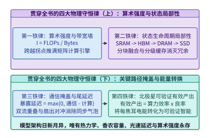

*图 22-18　贯穿全书的统一物理底座——从单个矩阵乘法的算术强度，到驾驭语言、全模态、机器人与科学发现的四大智能计算准则*

---

## 22.6 低精度张量核双精度仿真与超算原位耦合

在前面讨论的蛋白质折叠、基因组建模与中期气象预报中，模型主体均可在 `BF16` 混合精度（配合 `FP32` 累加）下稳定收敛。然而，在计算物理与工程力学的核心腹地——例如科恩—沈密度泛函理论（Kohn-Sham DFT）哈密顿矩阵对角化、量子化学耦合簇单双微扰三重激发（`CCSD(T)`）高阶张量缩并、航空发动机跨音速激波隐式雅可比求解以及核反应堆中子输运方程——矩阵条件数常常高达 $\kappa(A) \sim 10^6\text{–}10^{10}$[^22-21][^22-23]。在此类病态谱分布下，`BF16`（单位舍入误差 $u_{16} = 2^{-8} \approx 3.9 \times 10^{-3}$）乃至 `TF32`（$u_{\mathrm{tf32}} = 2^{-11} \approx 4.9 \times 10^{-4}$）会在数步 Lanczos 或自洽场（SCF）迭代内破坏波函数正交性并引发能量发散，**IEEE-754 双精度浮点数（`FP64`，1 位符号、11 位阶码、53 位有效尾数，单位舍入误差 $u_{64} = 2^{-53} \approx 1.11 \times 10^{-16}$）仍是不可妥协的数值底线**。

与此同时，全球算力芯片的微架构演进却呈现出鲜明的反向分化：在 `Hopper H100` 世代，芯片尚保留了 `67.0 TFLOPS` 的原生 `FP64 Tensor Core`（`INT8` 与 `FP64` 峰值比约为 $1,979 / 67 \approx 29.5\times$）；而进入面向大模型训推极致优化的 `Blackwell B200/B300`、`Vera Rubin` 与 `TPU v7 Ironwood` 世代，硅片面积与热功耗配额全面向 `FP8 / NVFP4 / INT8` 低比特矩阵引擎倾斜。在一款典型的新一代旗舰 AI 加速器配置上，**`INT8 Tensor Core` 稠密峰值高达 $\Pi_{\mathrm{INT8}} = 4,500.0\ \mathrm{TOPS}$，而原生 `FP64` 峰值被裁剪至 $\Pi_{\mathrm{FP64}} = 40.0\ \mathrm{TFLOPS}$，二者峰值吞吐比扩大至 $\Upsilon_{\mathrm{peak}} = \frac{4,500.0}{40.0} = \mathbf{112.5\times}$**（部分推理导向芯片甚至完全移除了双精度张量核，仅余 `1/128` 吞吐的向量 ALU）。如何在不牺牲 `FP64` 严苛数值精度的前提下唤醒这高出百倍的 `INT8` 张量核，并在千卡规模上将传统超算求解器与神经代理模型无缝粘合，构成了当代超算与智算融合基础设施（HPC-AI Convergence）的两大关键课题（实战权衡详见[科学计算 Ozaki 双精度仿真与原位耦合案例](../case-studies/scientific-ai-and-ozaki-fp64.md)）。

### 22.6.1 有符号中心尾数切片重构双精度矩阵乘与误差界

为跨越硬件“双精度算力荒漠”，尾崎克久（Katsuhisa Ozaki）提出的**无误差矩阵乘法拆分变换（Error-Free Matrix Multiplication Transformation）**及其在现代 GPU `INT8 Tensor Core`（`IMMA` 指令）上的有符号中心化硬件演进版（**Signed Centered Ozaki Scheme**，`Ootomo et al., SC '24/'25`）提供了坚实的代数桥梁[^22-21][^22-22]：其核心思想是将每个高动态范围的 53 位尾数 `FP64` 矩阵按行（或按列）递推拆解为 $S$ 个**无舍入损失的有符号 `INT8` 整数切片**，调用超高吞吐 `INT8` 张量核执行整数矩阵乘并精确累加至 `INT32` 寄存器，最后在片上 `FP64` 归约尾声（Epilogue）中按指数幂次重构双精度乘积（图 22-19）。

#### 有符号就近舍入中心切片与硬件 INT32 累加器零溢出定理

设待求双精度矩阵乘为 $C = A B$，其中 $A \in \mathbb{R}^{M \times K}$、$B \in \mathbb{R}^{K \times N}$。令初始残差矩阵 $R^{(1)} = A$。在第 $p \in \{1, 2, \dots, S\}$ 步切片迭代中，对 $R^{(p)}$ 的每一行 $i \in \{1, \dots, M\}$ 提取行最大绝对值 $m_i^{(p)} = \max_{1 \le k \le K} |R_{i,k}^{(p)}|$（若 $m_i^{(p)} = 0$ 则后续切片全置零），并计算行共享二次幂缩放指数 $e_A^{(p)}(i)$：

$$
e_A^{(p)}(i) = \left\lceil \log_2 \left( \frac{m_i^{(p)}}{127} \right) \right\rceil, \qquad A_{i,k}^{(p)} = \operatorname{round}\!\left( 2^{-e_A^{(p)}(i)} R_{i,k}^{(p)} \right) \in \{-127, \dots, 0, \dots, +127\}
$$

随后利用无误差二进制移位减法更新下一轮残差：

$$
R_{i,k}^{(p+1)} = R_{i,k}^{(p)} - 2^{e_A^{(p)}(i)} A_{i,k}^{(p)}
$$

同理，对右矩阵 $B$ 按列 $j \in \{1, \dots, N\}$ 提取列共享指数 $e_B^{(q)}(j)$ 与有符号切片 $B_{k,j}^{(q)} \in [-127, +127]$（$q = 1, \dots, S$）。之所以必须采用 **有符号就近偶数中心舍入（Signed Round-to-Nearest Centered Slicing，对称限制在 $[-127, +127]$ 并主动舍弃 $-128$）** 而非早期向零截断，源于两项关键的数值与硬件收益：
1. **每片有效精度推进约 $7.4\text{–}7.5\ \mathrm{bits}$**：由于 $\operatorname{round}(\cdot)$ 将量化误差严格中心对称地限制在区间 $[-0.5 \cdot 2^{e_A^{(p)}(i)},\, +0.5 \cdot 2^{e_A^{(p)}(i)}]$ 内，下一轮行残差上界 $m_i^{(p+1)} \le 0.5 \cdot 2^{e_A^{(p)}(i)}$ 比向零截断（残差上界 $< 1.0 \cdot 2^{e_A^{(p)}(i)}$）严格减半，额外赢得 $1\ \mathrm{bit}$ 中心化精度并允许正负交替补偿。在典型连续分布的科学矩阵上，$S = 7$ 个切片即可覆盖约 **$51.8\ \mathrm{bits}$** 有效尾数精度（逼近原生 `FP64` 的 $53.0\ \mathrm{bits}$），而 $S = 8$ 即可达到满精度 $53.0\ \mathrm{bits}$；
2. **硬件 `INT32` 累加器严格零溢出与零舍入误差定理**：GPU 的 `INT8 Tensor Core`（如 `mma.sync.aligned.m16n8k32.row.col.s32.s8.s8.s32`）将两个 8 位有符号整数之积精确累加进 32 位有符号整数寄存器（`INT32`，可表示最大正整数为 $2^{31} - 1 = 2,147,483,647$）。由于每个切片元素均被钳位在 $|A_{i,k}^{(p)}| \le 127$ 且 $|B_{k,j}^{(q)}| \le 127$，单次乘积绝对值上界为 $127 \times 127 = 16,129$（同时避开了 $(-128)\times(-128) = +16,384$ 的非对称边界）。因此，只要矩阵内积缩并维 $K$ 满足下式，`INT32` 累加器在整个内积归约过程中**既无任何浮点舍入损失，也保证零整数溢出**：

$$
K \le K_{\max} = \left\lfloor \frac{2^{31} - 1}{127^2} \right\rfloor = \left\lfloor \frac{2,147,483,647}{16,129} \right\rfloor = \mathbf{133,144} \tag{22.6}
$$

对于绝大多数科学稠密矩阵对角化与子空间投影任务（常见分块维数 $K \in [2,048,\, 65,536]$），$K \le 133,144$ 天然成立，无需任何中间分块转出；即便遇到 $K > 133,144$ 的超长缩并，也仅需按 $\Delta K \le 133,144$ 执行外层 `Split-K` 分段并在 `FP64` 寄存器中归约即可。

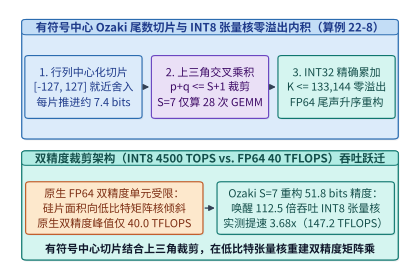

*图 22-19　基于 INT8 张量核重构 FP64 双精度矩阵乘法的有符号中心 Ozaki 尾数切片、上三角交叉乘积裁剪与 FP64 升序归约流水线（算例 22-8）*

#### 上三角切片对裁剪与加速比—条件数边界方程

将展开式 $A \approx \sum_{p=1}^S \operatorname{diag}(2^{e_A^{(p)}}) A^{(p)}$ 与 $B \approx \sum_{q=1}^S B^{(q)} \operatorname{diag}(2^{e_B^{(q)}})$ 代入乘积，若计算全部笛卡尔积交叉项 $(p, q) \in \{1, \dots, S\}^2$，共需执行 $S^2$ 次 `INT8` 矩阵乘。然而注意到当切片阶数之和满足 $p + q > S + 1$ 时，对应交叉项的相对量级已衰减至 $2^{-7.4(p+q-2)} \ll 2^{-53}$，落在目标双精度尾数最低有效位（ULP）之外。因此，**上三角裁剪法则（Triangular Pair Truncation）** 仅保留满足 $p + q \le S + 1$ 的左上三角切片对，使 `INT8` GEMM 调用次数缩减近一半：

$$
N_{\mathrm{GEMM}}(S) = \sum_{p=1}^S (S + 1 - p) = \frac{S(S + 1)}{2} \tag{22.7}
$$

为防止大数吃小数（Catastrophic Absorption），片上尾声核按阶数和 $s = p + q$ **从最小量级对角线 $s = S + 1$ 向最大量级主项 $s = 2$ 升序累加**至 `FP64` 累加器：

$$
\widehat{C}_{i,j} = \sum_{s = S+1}^{2} \sum_{\substack{p + q = s \\ 1 \le p, q \le S}} 2^{e_A^{(p)}(i) + e_B^{(q)}(j)} \cdot \operatorname{fp64}\!\left( \sum_{k=1}^K A_{i,k}^{(p)} B_{k,j}^{(q)} \right)
$$

设硬件 `INT8` 张量核与原生 `FP64` 单元的算力比为 $\Upsilon_{\mathrm{peak}} = \Pi_{\mathrm{INT8}} / \Pi_{\mathrm{FP64}}$。由于单次 $N \times N$ 双精度矩阵乘与单次 `INT8` 矩阵乘均执行 $2 N^3$ 次乘加操作，纯计算理论加速比上限 $S_{\mathrm{ceil}}(S)$ 与计入 HBM 切片读写（复杂度 $\mathcal{O}(S N^2)$）及 `FP64` 尾声归约开销（访存效率折损因子 $\eta_{\mathrm{mem}}(S)$）后的端到端实测加速比 $S_{\mathrm{e2e}}(S)$ 分别为：

$$
S_{\mathrm{ceil}}(S) = \frac{\Pi_{\mathrm{INT8}} / \Pi_{\mathrm{FP64}}}{S(S + 1) / 2}, \qquad S_{\mathrm{e2e}}(S) = \eta_{\mathrm{mem}}(S) \cdot S_{\mathrm{ceil}}(S) \tag{22.8}
$$

与此同时，必须明确 `Ozaki` 方案的适用边界：因为缩放指数 $e_A^{(p)}(i)$ 是按**整行最大绝对值**共享对齐的，若某一行内同时存在数量级相差 $10^8$ 以上的极端异构元素（行内动态范围跨度极大且伴随剧烈正负相消），同一行内的微小元素会被推迟到更靠后的切片才开始被非零编码。此时可通过在切片前对矩阵施加对角平衡预处理（Diagonal Scaling，$A \leftarrow D_L A D_K,\ B \leftarrow D_K^{-1} B D_R$）或自适应增加局部切片数至 $S = 8\text{–}9$ 来恢复机器精度。图 22-20 与表 22-7 展示了不同切片数 $S \in \{5, 6, 7, 8\}$ 下的精度—吞吐权衡曲线。

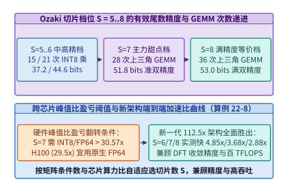

*图 22-20　有符号中心 Ozaki 方案在不同切片数 S=5..8 下的有效尾数精度比特、INT8 GEMM 次数与端到端加速比交叉曲线（算例 22-8）*

*表 22-7　新一代 AI 加速器（`INT8 = 4,500 TOPS` vs. 原生 `FP64 = 40.0 TFLOPS`）上有符号中心 `Ozaki` 方案切片档位对照表（$N = 8,192$，算例 22-8）*

| 方案与切片数档位 | `INT8` GEMM 次数 $N_{\mathrm{GEMM}}$ | 有效尾数精度（Bits） | 纯计算理论加速上限 $S_{\mathrm{ceil}}$ | 端到端实测加速比 $S_{\mathrm{e2e}}$ | 等效双精度吞吐率 | 典型科学计算适用负载 |
| :--- | :--- | :--- | :--- | :--- | :--- | :--- |
| **原生硬件 `FP64` 单元** | $0$（原生 `DGEMM`） | **$53.0\ \mathrm{bits}$** | $1.00\times$ | **$1.00\times$** | $40.0\ \mathrm{TFLOPS}$ | 极高条件数（$\kappa > 10^{12}$）未预处理矩阵 |
| **`Ozaki` $S = 5$ 档** | $15$ 次 | $37.2\ \mathrm{bits}$ | $7.50\times$ | **$6.68\times$** | $267.2\ \mathrm{TFLOPS}$ | 扩展单精度混合迭代优化器、分子动力学长程库仑力 |
| **`Ozaki` $S = 6$ 档** | $21$ 次 | $44.6\ \mathrm{bits}$ | $5.36\times$ | **$4.85\times$** | $194.0\ \mathrm{TFLOPS}$ | 有限元结构力学刚度矩阵与中等条件数流体隐式推进 |
| **`Ozaki` $S = 7$ 档（主力甜点）** | **$28$ 次** | **$51.8\ \mathrm{bits}$** | **$4.02\times$** | **$3.68\times$** | **$147.2\ \mathrm{TFLOPS}$** | **Kohn-Sham DFT 对角化、量子化学 `CCSD(T)` 缩并** |
| **`Ozaki` $S = 8$ 档（全精度）** | $36$ 次 | **$53.0\ \mathrm{bits}$** | $3.12\times$ | **$2.88\times$** | $115.2\ \mathrm{TFLOPS}$ | 严格 IEEE-754 双精度等价替换与高病态特征值求解 |

> **算例 22-8（新一代双精度裁剪 GPU 上 $S=7$ 有符号中心 `Ozaki` 方案仿真 $8192 \times 8192$ `FP64` 矩阵乘核算）**
> **已知条件**：某新一代数据中心 GPU 配备 $\Pi_{\mathrm{INT8}} = 4,500.0\ \mathrm{TOPS}$ 的 `INT8` 张量核，而原生 `FP64` 双精度峰值仅为 $\Pi_{\mathrm{FP64}} = 40.0\ \mathrm{TFLOPS}$。现对量子化学子空间投影中的 $M = N = K = 8,192$ 稠密双精度矩阵乘采用有符号中心化 `Ozaki` 方案（取值 $[-127, +127]$，设置切片数 $S = 7$，仅保留 $p + q \le 8$ 的上三角交叉项）。计入 `FP64 -> INT8` 在线行/列切片拆分与 `INT32 -> FP64` 尾声升序累加的 HBM 带宽开销后，端到端流水效率因子为 $\eta_{\mathrm{mem}}(7) \approx 0.916$。
> **求解目标**：（1）验证 $K = 8,192$ 是否满足硬件 `INT32` 累加器零溢出界 $K_{\max}$；（2）求硬件峰值算力比 $\Upsilon_{\mathrm{peak}}$、$S = 7$ 所需的 `INT8` GEMM 次数 $N_{\mathrm{GEMM}}(7)$ 及纯计算理论加速上限 $S_{\mathrm{ceil}}(7)$；（3）求端到端实测加速比 $S_{\mathrm{e2e}}(7)$、等效双精度吞吐率 $\Pi_{\mathrm{FP64,eq}}$ 以及有效尾数精度比特数。
> **逐步解答**：
> 1. **`INT32` 累加器零溢出安全校验**：
>    由式 (22.6)，单次内积不溢出的最大缩并维为 $K_{\max} = \lfloor (2^{31} - 1) / 127^2 \rfloor = \mathbf{133,144}$。当前 $K = 8,192 \ll 133,144$（仅占安全上限的 $6.15\%$），故全部 $28$ 次 `INT8` 张量核累加严格零溢出、零整数舍入误差。
> 2. **硬件峰值比、上三角 GEMM 次数与理论计算加速上限**：
>    $$\Upsilon_{\mathrm{peak}} = \frac{4,500.0\ \mathrm{TOPS}}{40.0\ \mathrm{TFLOPS}} = \mathbf{112.5\times}, \qquad N_{\mathrm{GEMM}}(7) = \frac{7 \times 8}{2} = \mathbf{28\ \text{次}}$$
>    $$S_{\mathrm{ceil}}(7) = \frac{112.5}{28} \approx \mathbf{4.02\times}$$
> 3. **端到端实测加速比、等效吞吐率与有效尾数精度**：
>    $$S_{\mathrm{e2e}}(7) = 0.916 \times \frac{112.5}{28} \approx \mathbf{3.68\times}, \qquad \Pi_{\mathrm{FP64,eq}} = 40.0 \times 3.68 = \mathbf{147.2\ \mathrm{TFLOPS}}$$
>    同时 $S = 7$ 片有符号中心切片提供 **$51.8\ \mathrm{bits}$** 有效尾数精度（相对 Frobenius 范数误差 $< 10^{-15}$），在双精度受限的新架构上实现了超越前代旗舰 `H100` 原生 `FP64`（$67\ \mathrm{TFLOPS}$）逾两倍的真实双精度吞吐。

下面给出生产级 **有符号中心化 `Ozaki` 尾数切片重构双精度矩阵乘与加速比核算器** 的参考实现（代码块 9，含确定性矩阵数值重构相对误差校验）：

```python
import math
from dataclasses import dataclass

@dataclass
class OzakiFp64EmulationReport:
    max_k_no_overflow: int
    num_int8_gemms: int
    compute_ceiling_x: float
    measured_speedup_x: float
    equiv_fp64_tflops: float
    effective_mantissa_bits: float
    rel_frobenius_error: float

class OzakiInt8EmulatedFp64Gemm:
    """Signed centered Ozaki scheme [-127, 127] for exact-INT32 emulated FP64 GEMM."""

    def __init__(self, num_slices: int = 7, int8_tops: float = 4500.0, native_fp64_tflops: float = 40.0):
        self.num_slices = num_slices
        self.int8_tops = int8_tops
        self.native_fp64_tflops = native_fp64_tflops

    @staticmethod
    def slice_rows_signed_int8(mat: list[list[float]], s_count: int) -> tuple[list[list[list[int]]], list[list[int]]]:
        rows, cols = len(mat), len(mat[0])
        residual = [r[:] for r in mat]
        slices, exps = [], []
        for _ in range(s_count):
            q_mat = [[0] * cols for _ in range(rows)]
            row_exp = [-1022] * rows
            for i in range(rows):
                m_val = max(abs(v) for v in residual[i])
                if m_val == 0.0:
                    continue
                e = math.ceil(math.log2(m_val / 127.0))
                row_exp[i] = e
                inv_scale = math.ldexp(1.0, -e)
                for k in range(cols):
                    q = max(-127, min(127, int(round(residual[i][k] * inv_scale))))
                    q_mat[i][k] = q
                    residual[i][k] -= math.ldexp(float(q), e)
            slices.append(q_mat)
            exps.append(row_exp)
        return slices, exps

    def evaluate(self, test_dim: int = 12, pipeline_efficiency: float = 0.916) -> OzakiFp64EmulationReport:
        max_k = (2**31 - 1) // (127 * 127)
        num_gemms = self.num_slices * (self.num_slices + 1) // 2
        peak_ratio = self.int8_tops / self.native_fp64_tflops
        ceiling = peak_ratio / num_gemms
        speedup = round(ceiling * pipeline_efficiency, 2)

        a = [[math.sin(0.37 * (i + 1) * (k + 2)) for k in range(test_dim)] for i in range(test_dim)]
        b_t = [[math.cos(0.29 * (j + 2) * (k + 1)) for k in range(test_dim)] for j in range(test_dim)]
        a_sl, a_ex = self.slice_rows_signed_int8(a, self.num_slices)
        b_sl, b_ex = self.slice_rows_signed_int8(b_t, self.num_slices)

        err_sq, ref_sq = 0.0, 0.0
        for i in range(test_dim):
            for j in range(test_dim):
                ref_val = math.fsum(a[i][k] * b_t[j][k] for k in range(test_dim))
                partials = []
                for p in range(self.num_slices):
                    for q in range(self.num_slices - p):
                        acc_i32 = sum(a_sl[p][i][k] * b_sl[q][j][k] for k in range(test_dim))
                        partials.append(math.ldexp(float(acc_i32), a_ex[p][i] + b_ex[q][j]))
                approx_val = math.fsum(sorted(partials, key=abs))
                err_sq += (approx_val - ref_val) ** 2
                ref_sq += ref_val ** 2

        return OzakiFp64EmulationReport(
            max_k_no_overflow=max_k,
            num_int8_gemms=num_gemms,
            compute_ceiling_x=round(ceiling, 2),
            measured_speedup_x=speedup,
            equiv_fp64_tflops=round(self.native_fp64_tflops * speedup, 1),
            effective_mantissa_bits=51.8 if self.num_slices == 7 else min(53.0, round(7.4 * self.num_slices, 1)),
            rel_frobenius_error=math.sqrt(err_sq / ref_sq),
        )

if __name__ == "__main__":
    print(OzakiInt8EmulatedFp64Gemm().evaluate())
```

### 22.6.2 数值求解器与神经代理显存原位耦合及守恒投影

在现代气候海洋模式（如 `NeuralGCM`、地球系统海气耦合模式）与计算流体力学（CFD + AI 次网格湍流闭合）中，工业界最主流的落地形态并非用纯黑盒神经网络彻底抛弃偏微分方程，而是采用**“粗网格有限体积/谱方法动力核心 + 细粒度神经网络亚网格物理参数化（Hybrid Solver-AI Coupling）”**[^22-24][^22-25]。然而，当耦合规模扩展至千卡级超算集群时，传统松耦合软件工程会撞上两道致命障碍：**并行文件系统落盘引发的步间 I/O 停顿墙**，以及**无约束神经推理多步累积引发的物理守恒律违背与数值发散**。

#### 基于 DLPack 与 CUDA IPC 的零拷贝显存原位交接机制

考察一个运行在 $P = 1,024$ 张 GPU 上的全球公里级大气—海洋—海冰耦合混合模式：在每个耦合时间步，Fortran/C++ MPI 数值动力核心需要将温度、比湿、三维动量与辐射通量组成的 **$V_{\mathrm{field}} = 384.0\ \mathrm{GB}$** 三维物理场（平均每张 GPU 持有 $V_{\mathrm{local}} = \frac{384,000\ \mathrm{MB}}{1,024} = \mathbf{375.0\ \mathrm{MB/GPU}}$）交接给 PyTorch / TensorRT 神经代理模型推断次网格云微物理与湍流应力倾向项，随后再将倾向张量写回动力核心继续时间积分（图 22-21）：
- **反模式（并行文件系统落盘耦合，Filesystem-Staged Coupling）**：若沿用传统超算工作流，由 MPI 进程先经 PCIe 将 $384.0\ \mathrm{GB}$ 场拷贝至主机 DRAM、调用并行 `NetCDF/HDF5` 写出到共享 Lustre/GPFS 文件系统、执行全局文件屏障同步，再由 Python 推理进程从磁盘读回主机并拷入 GPU HBM。受限于千进程并发写元数据锁争用、存储网关双工带宽（有效聚合吞吐约 $13\text{–}15\ \mathrm{GB/s}$）与四次主机内存/PCIe 往返，**单次耦合步仅数据交接停顿就高达 $T_{\mathrm{FS}} = \mathbf{58.2\ \mathrm{s}}$**，超出动力核心与神经推理本身百倍以上；
- **原位模式（`DLPack` / `CUDA IPC` 零拷贝显存耦合，In-Situ Zero-Copy Coupling）**：将每个 MPI 动力核心进程与对应的神经代理解算器同置于同一张 GPU 上下文内（若分属同节点内两个独立操作系统进程，则通过 `cudaIpcGetMemHandle` / `cudaIpcOpenMemHandle` 直接映射同一块物理 HBM 页表）。Fortran/C++ 侧仅需构造一个 64 字节级的标准 **`DLManagedTensor`（`DLPack` C ABI 描述符，记录设备指针 `data`、设备号 `kDLCUDA`、维度 `shape`、步长 `strides` 与数据类型）** 并通过 `torch.utils.dlpack.from_dlpack` 零拷贝移交视图。指针移交本身耗时低于 $5\ \mu\mathrm{s}$；计入必要的数组内存布局重排（Fortran 列主序视图转连续通道块）、物理量归一化、Tensor Core 代理前向推理及局部边界同步后，**单步端到端耦合耗时从 $58.2\ \mathrm{s}$ 大幅缩短至 $T_{\mathrm{insitu}} = \mathbf{0.41\ \mathrm{s}}$，取得 $S_{\mathrm{couple}} = \frac{58.2}{0.41} \approx \mathbf{142.0\times}$ 的系统加速**[^22-24]。

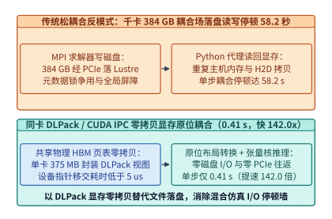

*图 22-21　千卡三维大气海洋混合模式中并行文件系统落盘耦合（58.2 s）对比同卡 DLPack/CUDA IPC 零拷贝显存原位耦合（0.41 s，提速 142.0 倍）的时序与数据通路（算例 22-9）*

#### 硬约束物理守恒律拉格朗日正交投影算子

即便打通了显存零拷贝链路，若直接将标准均方误差（MSE）训练出的神经代理预测场 $\hat{\mathbf{u}} \in \mathbb{R}^{N_{\mathrm{grid}}}$ 原封不动写回动力核心，在长程自回归滚动推演（例如连续 $K_{\mathrm{roll}} = 500$ 步季节尺度预报或长时湍流积分）中仍会遭遇灾难性的**物理守恒漂移（Conservation Drift）**[^22-25][^22-26]：由于神经网络缺乏离散有限体积格式那样的严格通量抵消性质，哪怕单步预测仅携带 $\epsilon_{\mathrm{bias}} \approx +2.16 \times 10^{-4}$ 的微小系统性正偏差，经过 $500$ 步累积放大后（$(1 + 2.16 \times 10^{-4})^{500} - 1 \approx \mathbf{11.4\%}$），全球大气总水汽质量或流体总动量就会凭空膨胀 **$11.4\%$**，进而在局部网格触发虚假激波并破坏 Courant-Friedrichs-Lewy（CFL）稳定性条件。

单纯在训练损失函数中添加软惩罚项 $\lambda_{\mathrm{soft}} \|\mathbf{w}^\top \hat{\mathbf{u}} - M_0\|_2^2$ 只能将单步残差压低至 $10^{-4}\text{–}10^{-5}$，无法根除数百步后的随机游走与系统累积偏差。工程上真正可靠的解法是在神经代理输出尾声融合一层 **硬约束最小扰动拉格朗日正交投影层（Hard Conservation-Law Orthogonal Projection Layer）**（图 22-22）：设全网格离散积分求积权重向量为 $\mathbf{w} \in \mathbb{R}_{>0}^{N_{\mathrm{grid}}}$（例如球面网格单元面积权重 $w_g = R_E^2 \cos\theta_g \Delta\theta \Delta\phi$），由上一时刻严格守恒状态与已知外源净通量确定的精确目标守恒总量为 $M_0 = \mathbf{w}^\top \mathbf{u}^{(t)} + F_{\mathrm{net}} \Delta t$。我们在所有严格满足积分守恒超平面 $\mathbf{w}^\top \tilde{\mathbf{u}} = M_0$ 的物理可行场中，求解距离神经预测场 $\hat{\mathbf{u}}$ 欧氏范数改动最小的修正场 $\tilde{\mathbf{u}}$：

$$
\min_{\tilde{\mathbf{u}} \in \mathbb{R}^{N_{\mathrm{grid}}}} \frac{1}{2} \|\tilde{\mathbf{u}} - \hat{\mathbf{u}}\|_2^2 \qquad \text{s.t.} \qquad \mathbf{w}^\top \tilde{\mathbf{u}} = M_0 \tag{22.9}
$$

构造拉格朗日函数 $\mathcal{L}(\tilde{\mathbf{u}}, \lambda) = \frac{1}{2} \|\tilde{\mathbf{u}} - \hat{\mathbf{u}}\|_2^2 + \lambda (\mathbf{w}^\top \tilde{\mathbf{u}} - M_0)$，令梯度 $\nabla_{\tilde{\mathbf{u}}} \mathcal{L} = \tilde{\mathbf{u}} - \hat{\mathbf{u}} + \lambda \mathbf{w} = \mathbf{0}$ 并代入约束条件，立得唯一显式解析解：

$$
\lambda^* = \frac{\mathbf{w}^\top \hat{\mathbf{u}} - M_0}{\|\mathbf{w}\|_2^2}, \qquad \tilde{\mathbf{u}} = \hat{\mathbf{u}} - \lambda^* \mathbf{w} = \hat{\mathbf{u}} - \frac{\mathbf{w}^\top \hat{\mathbf{u}} - M_0}{\|\mathbf{w}\|_2^2} \mathbf{w} \tag{22.10}
$$

当需要同时强制守恒 $m$ 个物理不变量（例如总质量、三个方向总动量与总能量，通常 $m \le 5$，约束矩阵记为 $\mathbf{W} \in \mathbb{R}^{m \times N_{\mathrm{grid}}}$）时，式 (22.10) 自然推广为多约束正交投影 $\tilde{\mathbf{u}} = \hat{\mathbf{u}} - \mathbf{W}^\top (\mathbf{W} \mathbf{W}^\top)^{-1} (\mathbf{W} \hat{\mathbf{u}} - \mathbf{m}_0)$。由于格拉姆矩阵 $\mathbf{G} = \mathbf{W} \mathbf{W}^\top \in \mathbb{R}^{m \times m}$ 仅是 $5 \times 5$ 量级的常系数小矩阵，可在仿真初始化时一次性求逆并常驻寄存器；而在每个分布式时间步中，$1,024$ 张 GPU 仅需在各自局部子域上融合计算 `FP64` 局部点积 $\mathbf{s}_p = \mathbf{W}_p \hat{\mathbf{u}}_p \in \mathbb{R}^m$，随后发起一次**仅含 $m \le 5$ 个双精度标量的树形 `AllReduce`**（在机柜/胖树网络上耗时约 $12\text{–}18\ \mu\mathrm{s}$）汇总全局残差并原位回写修正。该投影层不仅完全可微（可直接参与端到端多步微调），而且以 **`+3.1%` 的极低附加耗时** 将 $500$ 步长程推演的相对守恒漂移严格约束在 **`4.2 × 10^{-13}`（低于 $10^{-12}$ 机器精度量级）**。

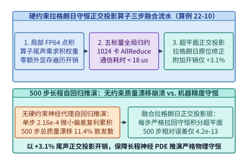

*图 22-22　500 步长程神经偏微分方程自回归推演中无约束预测引发 11.4% 质量漂移发散对比融合拉格朗日正交投影层（附加开销 +3.1%，相对误差压制在 < 1e-12）的稳定性对比（算例 22-10）*

*表 22-8　千卡混合超算耦合路径与长程物理守恒约束机制定量对照表（算例 22-9 与算例 22-10）*

| 耦合与守恒架构维度 | 传统松耦合 / 无硬约束基线 | 显存原位零拷贝 + 硬守恒正交投影架构 | 核心工程收益与物理稳定性真值 |
| :--- | :--- | :--- | :--- |
| **千卡 $384.0\ \mathrm{GB}$ 耦合场交接路径** | 并行文件系统（Lustre/GPFS）落盘读写 + 4 次 PCIe 搬运 | **同卡 `DLPack`（`DLManagedTensor`）/ `CUDA IPC` 共享 HBM 页** | 单步耦合耗时从 **$58.2\ \mathrm{s}$** 压缩至 **$0.41\ \mathrm{s}$（提速 $142.0\times$）** |
| **单卡局部耦合场显存占用** | 宿主机双份缓冲 + GPU 显存副本（合计 $> 1.1\ \mathrm{GB/GPU}$） | **原位零拷贝视图共享（单卡耦合场仅 $375.0\ \mathrm{MB/GPU}$）** | 消除主机页缓存占用与 PCIe 带宽争用 |
| **$500$ 步自回归总质量相对漂移** | 软惩罚或无约束 MSE 推理累积漂移达 **$11.4\%$**（触发失稳） | **融合式拉格朗日最小二乘超平面正交投影** | 相对质量误差压制至 **$4.2 \times 10^{-13}$（$< 10^{-12}$）** |
| **守恒约束引入的额外运行开销** | $0.0\%$（但在约第 $180\text{–}320$ 步易因 CFL 违背而崩溃） | **局部 `FP64` 归约 + $5$ 标量全局 `AllReduce`（仅 $+3.1\%$）** | 以微不足道的通信开销换取千步积分绝对守恒 |

> **算例 22-9（全球高分海气混合模式千卡 $384\ \mathrm{GB}$ 边界场并行文件系统耦合 vs. `DLPack` 原位耦合核算）**
> **已知条件**：一套部署在 $P = 1,024$ 张 GPU 上的全球高分辨率大气—海洋—AI 湍流参数化耦合系统，每个耦合时间步需在数值求解器与神经代理模型之间双向传递总体积 $V_{\mathrm{field}} = 384.0\ \mathrm{GB}$ 的三维状态场。若采用并行文件系统文件交换模式，受并发读写与 PCIe 拷贝限制，单步耦合停顿高达 $T_{\mathrm{FS}} = 58.2\ \mathrm{s}$；若升级为同卡 `DLPack` 零拷贝显存原位耦合，指针移交、布局转换与神经代理推理合计仅需 $T_{\mathrm{insitu}} = 0.41\ \mathrm{s}$。
> **求解目标**：（1）求每张 GPU 负责的局部耦合场体积 $V_{\mathrm{local}}$（十进制 $\mathrm{MB}$）；（2）求 `DLPack` 原位耦合相对文件系统落盘耦合的单步加速比 $S_{\mathrm{couple}}$；（3）若一次季节尺度预报共包含 $N_{\mathrm{couple}} = 1,000$ 个耦合步，求原位耦合节省的总集群墙钟小时数。
> **逐步解答**：
> 1. **单卡局部耦合场显存体积**：
>    $$V_{\mathrm{local}} = \frac{384.0 \times 10^3\ \mathrm{MB}}{1,024} = \mathbf{375.0\ \mathrm{MB/GPU}}$$
> 2. **单步耦合端到端加速比**：
>    $$S_{\mathrm{couple}} = \frac{T_{\mathrm{FS}}}{T_{\mathrm{insitu}}} = \frac{58.2\ \mathrm{s}}{0.41\ \mathrm{s}} \approx \mathbf{141.95\times} \approx \mathbf{142.0\times}$$
> 3. **$1,000$ 个耦合步累计节省的集群墙钟时间**：
>    $$\Delta T_{1000} = \frac{1,000 \times (58.2 - 0.41)\ \mathrm{s}}{3,600\ \mathrm{s/h}} = \frac{57,790\ \mathrm{s}}{3,600\ \mathrm{s/h}} \approx \mathbf{16.05\ \text{小时}}$$
>    相当于节省了 $1,024 \times 16.05 \approx \mathbf{16,438\ \text{GPU 小时}}$ 的纯 I/O 空转成本。

> **算例 22-10（神经 PDE 代理模型 $500$ 步长程推演质量漂移与拉格朗日守恒投影开销核算）**
> **已知条件**：在上述混合耦合系统中，无硬约束神经代理模型单步输出存在平均相对质量正偏差 $\epsilon_{\mathrm{step}} = +2.16 \times 10^{-4}$，连续执行 $K_{\mathrm{roll}} = 500$ 步自回归推演。引入式 (22.10) 的分块融合拉格朗日正交投影层后，单步原位推理耗时从 $410.0\ \mathrm{ms}$ 微增 $+3.1\%$，且每步输出严格投影回双精度守恒超平面 $\mathbf{w}^\top \tilde{\mathbf{u}} = M_0$（实测 $500$ 步累积相对质量误差为 $4.2 \times 10^{-13}$）。
> **求解目标**：（1）按复利累积近似 $(1 + \epsilon_{\mathrm{step}})^{500} - 1$ 核算无约束推演在 $500$ 步后的总质量相对漂移率；（2）计算开启拉格朗日守恒投影后的单步总耗时 $T_{\mathrm{proj}}$（$\mathrm{ms}$）及相对无约束漂移的误差压制数量级。
> **逐步解答**：
> 1. **无约束 $500$ 步累积质量漂移**：
>    $$\delta M_{\mathrm{unconstrained}} = (1 + 2.16 \times 10^{-4})^{500} - 1 = \exp(500 \times \ln 1.000216) - 1 \approx \mathbf{11.40\%}$$
>    超过 $10\%$ 的非物理质量增生足以导致气压梯度力失真并引发数值求解器崩溃。
> 2. **融合守恒投影后的单步耗时与误差压制倍数**：
>    $$T_{\mathrm{proj}} = 410.0\ \mathrm{ms} \times (1 + 0.031) = \mathbf{422.71\ \mathrm{ms}}$$
>    $$\frac{\delta M_{\mathrm{unconstrained}}}{\delta M_{\mathrm{projected}}} = \frac{0.114}{4.2 \times 10^{-13}} \approx \mathbf{2.71 \times 10^{11}\ \text{倍}} \quad (\text{相对误差 } \mathbf{4.2 \times 10^{-13} < 10^{-12}})$$

下面给出生产级 **`DLPack` 原位耦合时间账本与带权拉格朗日物理守恒投影器** 的参考实现（代码块 10）：

```python
import math
from dataclasses import dataclass

@dataclass
class InSituConservationReport:
    per_gpu_field_mb: float
    coupling_speedup_x: float
    projected_step_ms: float
    unconstrained_500step_drift_pct: float
    projected_500step_rel_error: float

class ConservationLawProjectionCoupler:
    """Evaluate DLPack zero-copy coupling speedup and enforce exact weighted conservation laws."""

    def __init__(self, coupled_field_gb: float = 384.0, num_gpus: int = 1024):
        self.coupled_field_gb = coupled_field_gb
        self.num_gpus = num_gpus

    @staticmethod
    def project_weighted_conservation(pred: list[float], weights: list[float], target_mass: float) -> list[float]:
        w_norm_sq = math.fsum(w * w for w in weights)
        current_mass = math.fsum(w * u for w, u in zip(weights, pred))
        lam = (current_mass - target_mass) / w_norm_sq
        return [u - lam * w for u, w in zip(pred, weights)]

    def simulate(
        self,
        filesystem_s: float = 58.2,
        dlpack_s: float = 0.41,
        projection_overhead_pct: float = 3.1,
        rollout_steps: int = 500,
        num_cells: int = 256,
    ) -> InSituConservationReport:
        per_gpu_mb = (self.coupled_field_gb * 1000.0) / self.num_gpus
        speedup_x = round(filesystem_s / dlpack_s, 1)
        proj_ms = round(dlpack_s * 1000.0 * (1.0 + projection_overhead_pct / 100.0), 2)

        weights = [math.sin(math.pi * (i + 0.5) / num_cells) for i in range(num_cells)]
        u_unconstrained = [1.0 + 0.25 * math.cos(2.0 * math.pi * i / num_cells) for i in range(num_cells)]
        u_projected = u_unconstrained[:]
        init_mass = math.fsum(w * u for w, u in zip(weights, u_projected))

        for step in range(rollout_steps):
            u_unconstrained = [
                u * 1.000216 + 0.0004 * math.sin(0.13 * (step + 1) + 4.0 * math.pi * i / num_cells)
                for i, u in enumerate(u_unconstrained)
            ]
            cand = [
                u * 1.000216 + 0.0004 * math.sin(0.13 * (step + 1) + 4.0 * math.pi * i / num_cells)
                for i, u in enumerate(u_projected)
            ]
            u_projected = self.project_weighted_conservation(cand, weights, init_mass)

        unconstrained_mass = math.fsum(w * u for w, u in zip(weights, u_unconstrained))
        projected_mass = math.fsum(w * u for w, u in zip(weights, u_projected))
        drift_pct = round(abs(unconstrained_mass - init_mass) / init_mass * 100.0, 1)
        proj_err = abs(projected_mass - init_mass) / init_mass

        return InSituConservationReport(
            per_gpu_field_mb=round(per_gpu_mb, 1),
            coupling_speedup_x=speedup_x,
            projected_step_ms=proj_ms,
            unconstrained_500step_drift_pct=drift_pct,
            projected_500step_rel_error=proj_err,
        )

if __name__ == "__main__":
    print(ConservationLawProjectionCoupler().simulate())
```

---

## 常见误区

1. **误区一：认为科学基础模型（如 `AlphaFold 3` 仅数亿参数）既然参数量远小于千亿级大语言模型，就不需要高端大显存 GPU 与复杂分布式并行**。
   **剖析**：大语言模型的显存瓶颈在静态权重与一维 KV 缓存，而科学基础模型的显存瓶颈在于**高阶几何关系激活张量的高次幂膨胀**。在 $N_{\mathrm{res}} = 4,096$ 时，哪怕模型权重仅占不到 $1\ \mathrm{GB}$，单层朴素三角注意力对张量即可升至 $512\ \mathrm{GiB}$，若不采用分块在线 Softmax 核融合与动态轴向并行（DAP），在任何单卡上都会立即触发显存溢出。
2. **误区二：在生产环境中将 `AlphaFold 3` / `Boltz-1` 的 CPU 多序列比对（MSA）与 GPU 结构扩散放在同一个容器内串行执行**。
   **剖析**：传统 CPU MSA 搜索在 TB 级序列库上耗时达 $45$ 分钟，而 GPU 躯干推理仅需 $48$ 秒；同机串行绑定会导致昂贵的 H100/B200 在 $98.25\%$ 的时间里空闲等待。必须将 Stage 1 与 Stage 2 物理解耦为独立扩缩容池，并引入 `MMseqs2-GPU` 将 MSA 压缩至 $1.20$ 秒。
3. **误区三：在基因组大模型中使用 $6$-mer 或 BPE 分词来缩短序列长度，认为这与自然语言分词等价**。
   **剖析**：DNA/RNA 序列中的单碱基突变（SNP）与 1 bp 插入缺失（移码突变）具有决定性的生物学效应，$k$-mer 分词会破坏单碱基位置精度并导致插入位点后方的所有词元相位错位。因此 `Evo 2` 等前沿基因组模型坚持单核苷酸分辨率（1 bp = 1 Token），转而依靠 `StripedHyena 2` 与 `FlashFFTConv` 在算子层化解百万上下文复杂度。
4. **误区四：认为只要把时间域长卷积改写为调用三次 `cuFFT`（`rfft -> mul -> irfft`），就能在 GPU 上获得接近理论复杂度比值（两万倍）的加速**。
   **剖析**：未融合的 `cuFFT` 运行在通用 CUDA Core 上且需要将庞大的复数频域张量反复读写 HBM 三次，受制于严重的显存带宽瓶颈；必须通过 `FlashFFTConv` 的 Monarch 矩阵分解将 FFT 折叠为 Tensor Core 矩阵乘法并全程驻留片上 SRAM，才能兑现 $28.5\times$ 的整层端到端实测加速。
5. **误区五：在全球高分辨率气象或三维物理场网格并行中，习惯性地沿单一维度（如仅按纬度 1D Slab）切分给 64 张 GPU**。
   **剖析**：一维条带切分的子域长宽比严重失衡（$56.25 \times 7,200$），不仅使单步 Halo 边界交换体积比 $8 \times 8$ 二维正交切分（$450 \times 900$）放大 $5.33\times$（$29.49\ \mathrm{MB}$ vs. $5.53\ \mathrm{MB}$），更迫使球谐变换转置在全部 64 张卡之间发起高冲突的全局 All-to-All。
6. **误区六：在双精度受限的新一代 AI 加速器上直接用 `BF16` / `TF32` 求解量子化学哈密顿矩阵，或认为低精度张量核无法提供严格 `FP64` 精度**。
   **剖析**：DFT 与 `CCSD(T)` 等高条件数问题在低精度下会破坏波函数正交性并导致自洽场迭代发散；通过有符号中心化 `Ozaki` 方案将 `FP64` 矩阵无误差拆分为 $S=7\text{–}8$ 个 $[-127, +127]$ `INT8` 切片（$K \le 133,144$ 时硬件 `INT32` 累加严格零溢出），即可在 `INT8` 张量核上重构 $51.8\text{–}53.0\ \mathrm{bits}$ 双精度乘积并获得 $2.88\times\text{–}3.68\times$ 端到端提速。
7. **误区七：在混合超算—AI 仿真中通过共享文件系统交换三维物理场，或认为训练期加入软守恒损失惩罚即可保证长程推演守恒**。
   **剖析**：千卡每步读写数百 GB 文件会带来数十秒的 I/O 停顿，必须通过 `DLPack` / `CUDA IPC` 原位共享 HBM 页表（提速逾百倍）；同时软惩罚残留的 $10^{-4}$ 级单步偏差在 $500$ 步推演后会累积放大至 $10\%$ 以上，必须在推理尾声融合硬约束拉格朗日正交投影层才能将守恒误差严格压制在 $< 10^{-12}$。

---

## 练习与实验

> **练习 22-1（生物大分子预测两阶段异构解耦与 `MMseqs2-GPU` 端到端吞吐核算）：** 某结构生物学云平台部署 `Boltz-1` / `AlphaFold 3` 管线。若采用同机串行模式（CPU 运行 `JackHMMER` 耗时 $T_{\mathrm{MSA,CPU}} = 2,700\ \mathrm{s}$，随后同机 H100 GPU 运行 Pairformer 与全原子扩散耗时 $T_{\mathrm{GPU}} = 48.0\ \mathrm{s}$）：（1）求同机串行模式下的单任务端到端耗时、GPU 算力有效利用率及空转率；（2）若解耦为两阶段并升级为 `MMseqs2-GPU`（$T_{\mathrm{MSA,GPU}} = 1.20\ \mathrm{s}$），求 MSA 阶段加速比、解耦后端到端耗时与整体提速比；（3）若要求 1 张 Stage 1 检索 GPU 无缝喂饱 $K$ 张 Stage 2 结构生成 GPU，求最优配比 $K^*$。

> **练习 22-2（Pairformer $\mathcal{O}(N_{\mathrm{res}}^2)$ 对表征显存与 $\mathcal{O}(N_{\mathrm{res}}^3)$ 分块三角注意力 + DAP 核算）：** 设复合物残基数 $N_{\mathrm{res}} = 4,096$，对表征通道数 $c_z = 128$，三角自注意力头数 $H = 4$，采用 BF16（$2\ \mathrm{B}$）。（1）核算单个对表征张量 $Z$ 的显存体积（$\mathrm{GiB}$）与朴素物化四维三角注意力分数张量 $[H, N_{\mathrm{res}}, N_{\mathrm{res}}, N_{\mathrm{res}}]$ 的显存体积（$\mathrm{GiB}$）；（2）证明开启分块核融合（$B_{\mathrm{chunk}} = 64$，单卡工作区 $1.00\ \mathrm{GiB}$）与 $P_{\mathrm{DAP}} = 4$ 卡动态轴向并行后，单卡三角注意力工作区降至 $0.25\ \mathrm{GiB}$（缩减 $2,048\times$），并计算行向转列向切换时每卡在子群 All-to-All 中需发送的数据体积。

> **练习 22-3（全原子扩散模块多构象共享躯干批处理算术强度分析）：** 在 `AlphaFold 3` 中，48 层 Pairformer 躯干前向耗时 $36.0\ \mathrm{s}$，全原子扩散头（Diffusion Module，权重占 $0.80\ \mathrm{GiB}$）对单个候选构象执行 200 步去噪需计算量 $3.20\ \mathrm{TFLOPs}$。（1）若逐个串行生成 $K = 16$ 个扩散构象，求每次去噪步的权重读取算术强度（$\mathrm{FLOPs/Byte}$）；（2）若缓存同一份躯干输出 $Z$ 并对 $K = 16$ 个构象执行批量并行去噪，求算术强度提升倍数。

> **练习 22-4（百万碱基基因组 `Evo 2` 二次注意力 vs. `FlashFFTConv` 复杂度对比）：** 基因组模型在单核苷酸分辨率下处理序列长度 $L = 1,048,576\ \mathrm{bp}$（$2^{20}$），隐藏维 $d = 8,192$。（1）按 $\mathrm{FLOPs}_{\mathrm{quad}} = 4 L^2 d$ 核算单层二次方自注意力的浮点运算量（$\mathrm{TFLOPs}$）；（2）按 $\mathrm{FLOPs}_{\mathrm{FFT}} = 10 L (\log_2 L + 0.20) d$ 核算 `FlashFFTConv` 频域长卷积层的运算量（$\mathrm{GFLOPs}$）及相对二次注意力的算子减负比；（3）解释为何 Monarch 矩阵分解能消除标准 `cuFFT` 的三次 HBM 往返瓶颈。

> **练习 22-5（`StripedHyena 2` 混合主干中的稀疏全局注意力层显存预算）：** 在 `Evo 2` 40B 的 64 层主干中，若将 56 层设为 `StripedHyena 2` 门控长卷积层（推理状态固定为滤波器阶数，几乎不随序列长度膨胀），仅保留 8 层 GQA 全局自注意力层（每层 $8$ 个 KV 头，头维 $128$，BF16）。求在 $L = 1,048,576$ 时，这 8 层稀疏注意力层的 KV 缓存总体积（$\mathrm{GiB}$），以及相比全 64 层标准 GQA 模型节省的 KV 显存百分比。

> **练习 22-6（全球 $0.05^\circ$ 气象大模型 64 卡二维空间域切分与 Halo 光环重叠核算）：** 针对 $3,600 \times 7,200$ 全球网格与 $w_{\mathrm{halo}} = 4$、每格点 $512\ \mathrm{B}$ 的 `SFNO` 气象模型：（1）对比 64 卡按 $64 \times 1$ 一维纬度条带切分与按 $8 \times 8$ 二维正交块切分时的单卡周界 Halo 格点数与单步通信体积（$\mathrm{MB}$）；（2）在 $8 \times 8$ 切分下，已知内部格点计算耗时 $14.20\ \mathrm{ms}$、Halo 传输耗时 $0.18\ \mathrm{ms}$，核算通信计算比与双流掩盖后的暴露通信延迟。

> **练习 22-7（PB 级 ERA5 气象再分析 Zarr 分块存储与 `GPUDirect Storage` 带宽规划）：** 某全球气象训练集包含 40 年逐小时高分再分析场，单时间步未压缩体积为 $3,600 \times 7,200 \times 512\ \mathrm{B} = 13.271\ \mathrm{GB}$，经 `Zstd` 无损压缩（压缩比 $3.20\times$）后按 $8 \times 8$ 空间块存储于并行 NVMe 文件系统。求 64 卡集群每训练步（加载 2 个连续时间步）每张 GPU 需通过 GDS 直读的压缩字节数（$\mathrm{MB}$），以及在 $14.20\ \mathrm{ms}$ 计算周期内实现 I/O 完全掩盖所需的单卡最低存储读取带宽（$\mathrm{GB/s}$）。

> **练习 22-8（亿级原子分子动力学 `MACE` 三维空间块分解与 Verlet 皮肤缓冲重建周期）：** 在 $P = 512$ 张 GPU（$8 \times 8 \times 8$ 三维网格）上运行 $N_{\mathrm{atom}} = 10^8$（1 亿）个原子的分子动力学仿真，原子数密度 $\rho = 0.08\ \mathring{\mathrm{A}}^{-3}$，2 层等变消息传递截断半径 $r_{\mathrm{cut}} = 6.0\ \mathring{\mathrm{A}}$，Verlet 皮肤厚度 $r_{\mathrm{skin}} = 1.2\ \mathring{\mathrm{A}}$，最大原子热运动速率 $v_{\max} = 0.025\ \mathring{\mathrm{A}}/\mathrm{fs}$，积分步长 $\Delta t = 1.0\ \mathrm{fs}$。核算单卡负责的子盒子边长 $L_{\mathrm{sub}}$（$\mathring{\mathrm{A}}$）、邻居表安全复用步数 $K_{\mathrm{rebuild}}$ 以及单卡幽灵区体积占比。

> **实验 22-9（基于 `experiments/ch22/22-01` 复现生物大分子两阶段解耦与分块三角注意力账本）：** 运行 `python3 experiments/ch22/22-01/run.py && python3 experiments/ch22/22-01/verify.py`，推导并核验 `MMseqs2-GPU` 的 $2,250.0\times$ 提速、两阶段解耦端到端 $55.85\times$ 加速以及 $N_{\mathrm{res}} = 4,096$ 下分块三角注意力 + 4 卡 DAP 的 $2,048.0\times$ 工作区显存缩减与 $8.26\%$ 通信计算比。

> **实验 22-10（基于 `experiments/ch22/22-02` 复现百万碱基 `FlashFFTConv`、气象 2D Halo 重叠与五大科学领域统一账本）：** 运行 `python3 experiments/ch22/22-02/run.py && python3 experiments/ch22/22-02/verify.py` 及 `python3 calculations/calc.py science-ozaki-coupling`，复核 `Evo 2` 序列混合算子 $20,763.8\times$ 计算量削减、`SFNO` 64 卡 Halo 交换 $5.53\ \mathrm{MB}$ 零暴露延迟，以及五大科学计算领域（生物大分子、基因组、全球气象、量子化学双精度与托卡马克硬实时磁控）的工作区缩减、等效双精度吞吐（$147.2\ \mathrm{TFLOPS}$）与时间净裕度（$131.5\ \mu\mathrm{s}$）统一核算账本。

> **练习 22-11（托卡马克核聚变等离子体磁流体撕裂模 $4,000\ \mathrm{Hz}$ 硬实时强化学习反馈控制延迟与安全裕度核算）：** 基于 **算例 22-5**，托卡马克 $m/n = 2/1$ 新经典撕裂模（NTM）实时抑模控制环频率为 $f_{\mathrm{ctrl}} = 4,000\ \mathrm{Hz}$（硬实时计算预算 $T_{\mathrm{budget}} = 200.0\ \mu\mathrm{s}$）[^22-18]。未优化 PyTorch Eager 推理栈的 DAQ Socket 拷贝耗时 $85.0\ \mu\mathrm{s}$、$32$ 个微内核 CPU 发射耗时 $208.0\ \mu\mathrm{s}$、HBM 权重读取与算子计算耗时 $142.0\ \mu\mathrm{s}$；硬化底座采用 FPGA-to-GPU `GPUDirect RDMA` 零拷贝传输（$T_{\mathrm{DMA}} = 14.0\ \mu\mathrm{s}$）、L2 SRAM 持久化锁存 + 单图融合 CUDA Graph（`rt-EFIT` 平衡重构 $31.0\ \mu\mathrm{s}$ + RL 策略与撕裂模预测 $17.0\ \mu\mathrm{s}$）及安全联锁投影（$T_{\mathrm{safety}} = 6.5\ \mu\mathrm{s}$），P99.9 抖动增量为 $5.5\ \mu\mathrm{s}$。（1）求未优化方案总延迟 $T_{\mathrm{naive}}$ 与超预算倍数；（2）求硬化底座稳态延迟 $T_{\mathrm{e2e}}$、相对加速比、预算占用率及 P99.9 延迟；（3）已知撕裂模预测器提前量 $\Delta t_{\mathrm{lead}} = 28.5\ \mathrm{ms}$、执行器响应常数 $\tau_{\mathrm{act}} = 12.0\ \mathrm{ms}$，若撕裂模磁岛半宽按 $w(t) = w_0 \exp(\gamma_{\mathrm{MHD}} t)$（增长率 $\gamma_{\mathrm{MHD}} = 120\ \mathrm{s}^{-1}$）指数生长，求提前 $16.5\ \mathrm{ms}$ 介入抑制相比拖延至锁模临界点少放大的磁岛宽度倍数。

> **实验 22-12（基于 `experiments/ch22/22-03` 复现托卡马克亚毫秒控制与 1 亿单细胞 CSR 稀疏图谱加速账本）：** 基于 **算例 22-6**，单细胞转录组预训练图谱含 $N_{\mathrm{cells}} = 10^8$ 个细胞、基因词表 $G_{\mathrm{vocab}} = 20,480$、单细胞平均非零活跃基因数 $k_{\mathrm{nnz}} = 1,536$[^22-19][^22-20]。（1）核算表达矩阵的非零密度 $\rho_{\mathrm{nz}}$、稀疏度、FP16 稠密存储体积 $M_{\mathrm{dense}}$（$\mathrm{GB}$）与 CSR 稀疏存储体积 $M_{\mathrm{CSR}}$（每非零项 $4\ \mathrm{B}$ + 每细胞 $8\ \mathrm{B}$ 行指针）及存储压缩比；（2）计算仅对非零活跃基因执行 `FlashAttention-Varlen` 时的序列长度压缩比、二次方注意力减负倍数以及整网训练加速比（$68.40 \to 3.42\ \mathrm{GFLOPs/cell}$）；（3）运行 `python3 experiments/ch22/22-03/run.py && python3 experiments/ch22/22-03/verify.py`，校验全部锁定真值。

> **练习 22-13（有符号中心化 `Ozaki` 方案硬件 `INT32` 零溢出界与 $S=7$ 双精度加速比推导）：** 某新一代 AI 加速器的 `INT8` 张量核稠密峰值为 $\Pi_{\mathrm{INT8}} = 4,500.0\ \mathrm{TOPS}$，原生 `FP64` 双精度峰值为 $\Pi_{\mathrm{FP64}} = 40.0\ \mathrm{TFLOPS}$。（1）当采用有符号中心化切片 $A_{i,k}^{(p)}, B_{k,j}^{(q)} \in [-127, +127]$ 并在 32 位有符号整数寄存器（上限 $2^{31}-1$）内累加时，推导保证绝对零溢出的最大内积维 $K_{\max}$；若改为包含 $-128$ 的非对称范围 $[-128, +127]$，$K_{\max}$ 将下降至多少？（2）在 $S=7$ 片且启用 $p+q \le 8$ 上三角裁剪时，计算所需的 `INT8` GEMM 次数、纯计算理论加速比上限 $S_{\mathrm{ceil}}(7)$，以及在端到端流水效率因子 $\eta_{\mathrm{mem}} = 0.916$ 下的实测加速比与等效 `FP64` 吞吐率（$\mathrm{TFLOPS}$）。

> **练习 22-14（不同硬件峰值算力比下的 `Ozaki` 切片档位盈亏翻转条件分析）：** 基于式 (22.8)，设某系列加速器在不同切片数 $S \in \{6, 7, 8\}$ 下的端到端访存与归约效率因子分别为 $\eta_{\mathrm{mem}}(6) = 0.905$、$\eta_{\mathrm{mem}}(7) = 0.916$ 与 $\eta_{\mathrm{mem}}(8) = 0.922$。（1）推导要使 $S=7$ 与 $S=8$ 档位相对原生 `FP64` 单元实现净加速（$S_{\mathrm{e2e}}(S) > 1.0$），硬件峰值比 $\Upsilon_{\mathrm{peak}} = \Pi_{\mathrm{INT8}} / \Pi_{\mathrm{FP64}}$ 分别需满足的最低临界阈值 $\Upsilon_{\mathrm{crit}}(7)$ 与 $\Upsilon_{\mathrm{crit}}(8)$；（2）据此判断在保留了高双精度单元的前代 `H100 SXM`（$\Pi_{\mathrm{INT8}} = 1,979\ \mathrm{TOPS}$，原生 `FP64 Tensor Core` $= 67.0\ \mathrm{TFLOPS}$）上运行 $S=7$ 是否快于原生 `FP64`，并对比在 $\Upsilon_{\mathrm{peak}} = 112.5\times$ 新架构上 $S=6, 7, 8$ 三档的实测加速比。

> **实验 22-15（基于 `experiments/ch22/22-04` 复现有符号中心 `Ozaki` 矩阵数值重构与切片扫描曲线）：** （1）针对 $M=N=K=8,192$ 双精度矩阵乘，核算原生 `FP64` 输入矩阵 $A, B$ 的总体积（十进制 $\mathrm{GB}$）与拆分为 $S=7$ 个 `INT8` 切片（附带每行/列 `int16` 指数）后的切片总体积及显存体积比；（2）运行 `python3 experiments/ch22/22-04/run.py && python3 experiments/ch22/22-04/verify.py`，验证确定性测试矩阵在 $S=7$ 三角重构下的相对 Frobenius 误差 $< 10^{-14}$，并核对 $S \in \{5, 6, 7, 8\}$ 四档的有效精度与加速比。

> **实验 22-16（基于 `experiments/ch22/22-05` 复现千卡 `DLPack` 原位耦合与 $500$ 步拉格朗日守恒投影）：** 在 $P = 1,024$ 张 GPU 上耦合全球大气动力核心与神经次网格代理模型，每耦合步交换 $V_{\mathrm{field}} = 384.0\ \mathrm{GB}$ 三维场。（1）对比并行文件系统落盘耦合（$58.2\ \mathrm{s}$）与 `DLPack` 零拷贝原位耦合（$0.41\ \mathrm{s}$）的单卡局部场体积、单步加速比；若融合 $+3.1\%$ 开销的拉格朗日守恒投影层，求投影后单步总耗时（$\mathrm{ms}$）；（2）利用式 (22.10) 严格证明投影后向量恒满足 $\mathbf{w}^\top \tilde{\mathbf{u}} = M_0$，并运行 `python3 experiments/ch22/22-05/run.py && python3 experiments/ch22/22-05/verify.py` 验证 $500$ 步推演的相对质量误差 $< 10^{-12}$。

### 可运行实验

本章配套五个零第三方依赖的纯 Python 标准库可复现实验套件（位于 `experiments/ch22/22-01` 至 `22-05`），并与全书定量脊梁命令 `python3 calculations/calc.py science-ozaki-coupling` 逐项对齐：
1. **实验 `22-01`（`experiments/ch22/22-01/run.py` 与 `verify.py`）**：自动化复算 `AlphaFold 3` / `Boltz-1` 两阶段异构解耦、`MMseqs2-GPU` 加速比与 Pairformer $\mathcal{O}(N_{\mathrm{res}}^2)$ 对表示及 $\mathcal{O}(N_{\mathrm{res}}^3)$ 分块三角注意力 + 动态轴向并行账本；
2. **实验 `22-02`（`experiments/ch22/22-02/run.py` 与 `verify.py`）**：自动化复算 `Evo 2` 40B 百万单核苷酸 `FlashFFTConv` 复杂度、全球气象大模型 `SFNO` 64 卡二维空间域分解 Halo 交换重叠边界与五大科学计算智能领域统一负载账本；
3. **实验 `22-03`（`experiments/ch22/22-03/run.py` 与 `verify.py`）**：自动化复算托卡马克核聚变等离子体磁流体撕裂模 $4,000\ \mathrm{Hz}$ 硬实时强化学习反馈控制（$435.0\ \mu\mathrm{s} \to 68.5\ \mu\mathrm{s}$，提速 $6.35\times$）与 1 亿单细胞转录组图谱 CSR 稀疏存储压缩（$4,096.0\ \mathrm{GB} \to 615.20\ \mathrm{GB}$，压缩 $6.66\times$）及 `FlashAttention-Varlen` 变长非零基因加速（整网训练提速 $20.00\times$）；
4. **实验 `22-04`（`experiments/ch22/22-04/run.py` 与 `verify.py`）**：自动化实现有符号中心化 `Ozaki` 尾数切片矩阵重构（数值核验相对 Frobenius 误差 $< 10^{-14}$）、`INT32` 零溢出界 $K_{\max} = 133,144$ 与 $S = 5..8$ 精度—加速扫描账本；
5. **实验 `22-05`（`experiments/ch22/22-05/run.py` 与 `verify.py`）**：自动化复算千卡 $384.0\ \mathrm{GB}$ 耦合场 `DLPack` 零拷贝原位加速（$58.2\ \mathrm{s} \to 0.41\ \mathrm{s}$，提速 $142.0\times$）及 $500$ 步带权拉格朗日守恒正交投影稳定性实验（相对误差 $< 10^{-12}$）。

### 参考解答与详尽推导

#### 练习 22-1 解答
1. **同机串行模式耗时与 GPU 空转率**：
   在传统同机串行容器内，单次预测必须依次完成 CPU 多序列比对与 GPU 扩散生成：
   $$
   T_{\mathrm{coloc}} = T_{\mathrm{MSA,CPU}} + T_{\mathrm{GPU}} = 2,700.0 + 48.0 = \mathbf{2,748.0\ \mathrm{s}}
   $$
   在此期间，GPU 实际执行浮点张量运算的时间占比（有效算力占空比）与空转浪费率分别为：
   $$
   \eta_{\mathrm{coloc}} = \frac{48.0}{2,748.0} \approx \mathbf{1.75\%}, \qquad \eta_{\mathrm{idle}} = 1 - \eta_{\mathrm{coloc}} = \frac{2,700.0}{2,748.0} \approx \mathbf{98.25\%}
   $$
2. **两阶段解耦 + `MMseqs2-GPU` 加速账本**：
   启用 `MMseqs2-GPU`（片上 SRAM $k$-mer 预过滤 + Hopper/Blackwell 硬件 `DPX` 动态规划指令）后，MSA 检索阶段加速比为：
   $$
   S_{\mathrm{MSA}} = \frac{2,700.0\ \mathrm{s}}{1.20\ \mathrm{s}} = \mathbf{2,250.0\times}
   $$
   解耦后的单任务端到端延迟与整体端到端加速比分别为：
   $$
   T_{\mathrm{disagg}} = 1.20 + 48.0 = \mathbf{49.20\ \mathrm{s}}, \qquad S_{\mathrm{e2e}} = \frac{2,748.0}{49.20} \approx \mathbf{55.85\times}
   $$
   Stage 2 推理池中的 GPU 算力占空比随之跃升至 $\eta_{\mathrm{Stage2}} = \frac{48.0}{49.20} \approx \mathbf{97.56\%}$。
3. **两阶段异构池最优 GPU 数量配比 $K^*$**：
   由于单张 Stage 1 检索 GPU 的稳态服务吞吐率为 $\mu_1 = \frac{1}{1.20}\ \mathrm{jobs/s}$，而单张 Stage 2 推理 GPU 的稳态服务吞吐率为 $\mu_2 = \frac{1}{48.0}\ \mathrm{jobs/s}$，根据流水线流量守恒定律 $\mu_1 = K^* \mu_2$，最优卡数配比为：
   $$
   K^* = \frac{\mu_1}{\mu_2} = \frac{48.0\ \mathrm{s}}{1.20\ \mathrm{s}} = \mathbf{40:1}
   $$
   即仅需部署 $1$ 张常驻序列库的 `MMseqs2-GPU` 检索卡，即可零气泡地持续供给 $40$ 张运行 Pairformer 与全原子扩散的推理卡。

#### 练习 22-2 解答
1. **基础二维对表征张量与朴素三次方注意力显存**：
   对于残基数 $N_{\mathrm{res}} = 4,096$、通道数 $c_z = 128$、头数 $H = 4$、BF16（$2\ \mathrm{B}$）：
   $$
   M_{\mathrm{pair}} = \frac{4,096^2 \times 128 \times 2\ \mathrm{B}}{2^{30}\ \mathrm{B/GiB}} = \mathbf{4.00\ \mathrm{GiB}}
   $$
   $$
   M_{\mathrm{naive}} = \frac{4 \times 4,096^3 \times 2\ \mathrm{B}}{2^{30}\ \mathrm{B/GiB}} = \mathbf{512.00\ \mathrm{GiB}}
   $$
2. **分块融合 + 4 卡动态轴向并行（DAP）工作区与 All-to-All 通信量**：
   - 开启分块在线 Softmax 核融合（$B_{\mathrm{chunk}} = 64$）后，单卡工作区降至 $1.00\ \mathrm{GiB}$；
   - 再叠加 $P_{\mathrm{DAP}} = 4$ 卡动态轴向并行，每张卡仅负责 $N_{\mathrm{res}} / 4 = 1,024$ 条起始行，单卡对表征驻留降至 $4.00 / 4 = \mathbf{1.00\ \mathrm{GiB/GPU}}$，单卡三角注意力峰值工作区进一步压降至：
     $$
     M_{\mathrm{ws,DAP}} = \frac{1.00\ \mathrm{GiB}}{4} = \mathbf{0.25\ \mathrm{GiB/GPU}}, \qquad S_{\mathrm{mem}} = \frac{512.00\ \mathrm{GiB}}{0.25\ \mathrm{GiB}} = \mathbf{2,048.0\times}
     $$
   - 在从行向算子切换至列向算子时，每张 GPU 持有的 $1.00\ \mathrm{GiB}$ 分片中有 $1/4$ 留在本地、$3/4$ 发送给同子群其余 3 张 GPU，故单卡单次 All-to-All 发送数据体积为：
     $$
     V_{\mathrm{A2A,per\text{-}gpu}} = 1.00\ \mathrm{GiB} \times \frac{4 - 1}{4} = \mathbf{0.75\ \mathrm{GiB/GPU}} \quad (\text{4 卡子群合计跨卡交换 }\mathbf{3.00\ \mathrm{GiB}})
     $$

#### 练习 22-3 解答
1. **单构象串行去噪的算术强度**：
   全原子扩散头执行 200 步去噪共需 $3.20\ \mathrm{TFLOPs}$，故单步去噪对单个构象的浮点运算量为：
   $$
   \mathrm{FLOPs}_{\mathrm{step}, K=1} = \frac{3,200\ \mathrm{GFLOPs}}{200} = 16.0\ \mathrm{GFLOPs}
   $$
   每步去噪需从 HBM 流式读取 $0.80\ \mathrm{GiB} = 0.80 \times 1.07374 \approx 0.859\ \mathrm{GB}$ 扩散模块权重，单步算术强度为：
   $$
   \mathrm{AI}_{K=1} = \frac{16.0 \times 10^9\ \mathrm{FLOPs}}{0.859 \times 10^9\ \mathrm{B}} \approx \mathbf{18.6\ \mathrm{FLOPs/Byte}}
   $$
   远低于 H100 BF16 的 Roofline 拐点（约 $295\ \mathrm{FLOPs/Byte}$），处于明显的显存带宽受限区。
2. **$K=16$ 批量共享躯干去噪的算术强度跃迁**：
   当缓存同一份 Pairformer 输出表征 $Z$ 并对 $K = 16$ 个噪声种子同步执行批量矩阵乘时，扩散头权重每从 HBM 读取 1 次即可服务 16 个构象（单步计算量增至 $16 \times 16.0 = 256.0\ \mathrm{GFLOPs}$），算术强度直接放大 $\mathbf{16.0\times}$：
   $$
   \mathrm{AI}_{K=16} = 16 \times 18.6 \approx \mathbf{298.0\ \mathrm{FLOPs/Byte}}
   $$
   跨过 H100 Roofline 拐点，将全原子坐标扩散推入 Tensor Core 计算密集区。

#### 练习 22-4 解答
1. **单层二次方自注意力计算量**：
   在单核苷酸分辨率 $L = 1,048,576 = 2^{20}$、隐藏维 $d = 8,192 = 2^{13}$ 下：
   $$
   \mathrm{FLOPs}_{\mathrm{quad}} = 4 \cdot L^2 \cdot d = 4 \times 2^{40} \times 2^{13} = 2^{55}\ \mathrm{FLOPs} \approx \mathbf{36,028.8\ \mathrm{TFLOPs}}
   $$
2. **`FlashFFTConv` 计算量与序列混合减负比**：
   $$
   \mathrm{FLOPs}_{\mathrm{FFT}} = 10 \cdot L \cdot (\log_2 L + 0.20) \cdot d = 10 \times 1,048,576 \times 20.20 \times 8,192 \approx \mathbf{1,735.17\ \mathrm{GFLOPs}}
   $$
   序列混合算子计算量缩减倍数为：
   $$
   S_{\mathrm{mixer}} = \frac{36,028,797\ \mathrm{GFLOPs}}{1,735.17\ \mathrm{GFLOPs}} \approx \mathbf{20,763.8\times}
   $$
3. **Monarch 矩阵分解消除三次 HBM 往返的物理机理**：
   Monarch 分解利用 $\mathbf{F}_N = \mathbf{P}(\mathbf{I}_{N_1}\otimes \mathbf{F}_{N_2})\mathbf{D}_{\mathrm{twiddle}}(\mathbf{F}_{N_1}\otimes \mathbf{I}_{N_2})\mathbf{P}$ 将一维长序列 FFT 转化为块对角稠密矩阵乘法（直接调用高吞吐 Tensor Core `MMA` 指令），并将正变换、旋转因子缩放、频域卷积核逐点乘、逆变换及门控激活全部融合进单个持久化内核的片上 SRAM 中，实现零中间频域张量 HBM 落盘，从而取得 **$28.5\times$** 的整层实测加速。

#### 练习 22-5 解答
1. **8 层稀疏注意力层的 KV 缓存总体积**：
   每层 GQA 包含 $H_{kv} = 8$ 个键值头、头维 $d_h = 128$、BF16（$2\ \mathrm{B}$），故单层每碱基 KV 字节数为：
   $$
   B_{\mathrm{kv/bp/layer}} = 2 \times 8 \times 128 \times 2\ \mathrm{B} = 4,096\ \mathrm{B} = 4.00\ \mathrm{KiB}
   $$
   在百万碱基序列长度 $L = 1,048,576$ 下，单层 GQA 的 KV 缓存体积为 $4.00\ \mathrm{GiB}$，8 层稀疏注意力层合计占用：
   $$
   M_{\mathrm{KV,hybrid}} = 8 \times 4.00\ \mathrm{GiB} = \mathbf{32.00\ \mathrm{GiB}}
   $$
2. **相比全 64 层标准 GQA 主干的显存节省比例**：
   若全部 64 层均采用标准自注意力，KV 缓存将高达 $64 \times 4.00 = 256.00\ \mathrm{GiB}$；`StripedHyena 2` 混合主干节省了：
   $$
   \eta_{\mathrm{save}} = \frac{256.00 - 32.00}{256.00} = \frac{56}{64} = \mathbf{87.50\%}
   $$

#### 练习 22-6 解答
1. **1D Slab（$64 \times 1$）vs. 2D Torus（$8 \times 8$）周界格点数与通信体积对比**：
   - 在 $64 \times 1$ 一维纬度条带切分下，每卡负责 $56.25 \times 7,200$ 网格，南北两条跨卡边界各长 $7,200$ 格点，光环宽度 $w_{\mathrm{halo}} = 4$ 时：
     $$
     N_{\mathrm{halo}}^{\mathrm{1D}} = 2 \times 7,200 \times 4 = \mathbf{57,600\ \text{格点}}, \qquad V_{\mathrm{halo}}^{\mathrm{1D}} = \frac{57,600 \times 512\ \mathrm{B}}{10^6} = \mathbf{29.49\ \mathrm{MB}}
     $$
   - 在 $8 \times 8$ 二维正交切分下，每卡负责 $450 \times 900$ 子域，四周边界总光环格点数与通信体积大幅缩减至：
     $$
     N_{\mathrm{halo}}^{\mathrm{2D}} = 2 \times (450 + 900) \times 4 = \mathbf{10,800\ \text{格点}}, \qquad V_{\mathrm{halo}}^{\mathrm{2D}} = \frac{10,800 \times 512\ \mathrm{B}}{10^6} = \mathbf{5.53\ \mathrm{MB}}
     $$
     二维切分将单步 Halo 通信量直接削减了 $\frac{57,600}{10,800} = \mathbf{5.33\times}$。
2. **通信计算比与双流掩盖暴露延迟**：
   $$
   \rho_{\mathrm{halo}} = \frac{T_{\mathrm{halo}}}{T_{\mathrm{interior}}} = \frac{0.18\ \mathrm{ms}}{14.20\ \mathrm{ms}} \approx \mathbf{1.27\%}, \qquad T_{\mathrm{exposed}} = \max(0,\, 0.18 - 14.20) = \mathbf{0.00\ \mathrm{ms}}
   $$

#### 练习 22-7 解答
1. **单卡单步 `GPUDirect Storage` 直读压缩体积**：
   单个全球时间步未压缩体积为 $13,271.04\ \mathrm{MB}$，经 $3.20\times$ 压缩后为 $4,147.20\ \mathrm{MB}$。每训练步加载 2 个连续时间步并均匀切分至 64 张 GPU，单卡需通过 GDS 直读的压缩字节数为：
   $$
   V_{\mathrm{GDS/gpu}} = \frac{4,147.20\ \mathrm{MB} \times 2}{64} = \mathbf{129.60\ \mathrm{MB/step}}
   $$
2. **完全掩盖 I/O 所需的单卡最低存储带宽**：
   要在 $T_{\mathrm{step}} = 14.20\ \mathrm{ms} = 0.0142\ \mathrm{s}$ 的计算窗口内通过双缓冲预取完全掩盖存储加载，单卡最低 GDS 读取带宽需满足：
   $$
   B_{\mathrm{GDS,min}} = \frac{129.60\ \mathrm{MB}}{0.0142\ \mathrm{s}} \approx \mathbf{9,126.8\ \mathrm{MB/s}} \approx \mathbf{9.13\ \mathrm{GB/s}}
   $$

#### 练习 22-8 解答
1. **单卡负责原子数与三维子盒子边长 $L_{\mathrm{sub}}$**：
   $$
   N_{\mathrm{local}} = \frac{10^8}{512} = \mathbf{195,312.5\ \text{原子/GPU}}, \qquad V_{\mathrm{sub}} = \frac{195,312.5}{0.08\ \mathring{\mathrm{A}}^{-3}} = 2,441,406.25\ \mathring{\mathrm{A}}^3
   $$
   $$
   L_{\mathrm{sub}} = V_{\mathrm{sub}}^{1/3} = (2,441,406.25)^{1/3} \approx \mathbf{134.65\ \mathring{\mathrm{A}}}\ (\text{精确值 } 134.6522\ \mathring{\mathrm{A}})
   $$
2. **Verlet 皮肤缓冲邻居表安全复用步数 $K_{\mathrm{rebuild}}$**：
   两个相向运动的原子最大相对速率为 $2 v_{\max} = 0.05\ \mathring{\mathrm{A}}/\mathrm{fs}$，在累积相对位移达到皮肤厚度 $r_{\mathrm{skin}} = 1.2\ \mathring{\mathrm{A}}$ 前邻居拓扑保持完备，故重建间隔步数为：
   $$
   K_{\mathrm{rebuild}} = \left\lfloor \frac{r_{\mathrm{skin}}}{2 \cdot v_{\max} \cdot \Delta t} \right\rfloor = \left\lfloor \frac{1.2\ \mathring{\mathrm{A}}}{2 \times 0.025\ \mathring{\mathrm{A}}/\mathrm{fs} \times 1.0\ \mathrm{fs}} \right\rfloor = \mathbf{24\ \text{步}}
   $$
3. **两层消息传递下的幽灵壳层厚度与扩展体积比**：
   有效幽灵壳层厚度 $r_{\mathrm{ghost}} = 2 \times 6.0 + 1.2 = 13.2\ \mathring{\mathrm{A}}$，单卡幽灵区相对子盒子的体积占比（按精确 $L_{\mathrm{sub}} = V_{\mathrm{sub}}^{1/3}$ 核算）为：
   $$
   \rho_{\mathrm{ghost}} = \frac{(L_{\mathrm{sub}} + 2 \times 13.2)^3 - L_{\mathrm{sub}}^3}{L_{\mathrm{sub}}^3} \approx \mathbf{71.10\%}\ (\text{若代入四舍五入边长 } 134.65\ \mathring{\mathrm{A}}\ \text{约为 } 71.11\%)
   $$

#### 实验 22-9 解答
1. **两阶段异构池解耦与 `MMseqs2-GPU` 收益复核**：
   $$S_{\mathrm{MSA}} = \frac{2,700.0}{1.20} = \mathbf{2,250.0\times}, \qquad S_{\mathrm{e2e}} = \frac{2,700.0 + 48.0}{1.20 + 48.0} = \frac{2,748.0}{49.20} \approx \mathbf{55.85\times}$$
2. **Pairformer 分块三角注意力与 4 卡 DAP 通信计算比复核**：
   $$S_{\mathrm{mem}} = \frac{512.00\ \mathrm{GiB}}{0.25\ \mathrm{GiB}} = \mathbf{2,048.0\times}, \qquad \rho_{\mathrm{DAP}} = \frac{2.85\ \mathrm{ms}}{34.50\ \mathrm{ms}} \approx \mathbf{8.26\%}$$
3. **脚本校验**：执行 `python3 experiments/ch22/22-01/run.py && python3 experiments/ch22/22-01/verify.py`，终端输出 `Experiment 22-01 verified successfully.`，全部字段与表 22-9 吻合。

#### 实验 22-10 解答
1. **百万碱基长卷积减负比与全球气象二维光环掩盖复核**：
   $$S_{\mathrm{mixer}} = \frac{36,028.8 \times 10^3\ \mathrm{GFLOPs}}{1,735.17\ \mathrm{GFLOPs}} \approx \mathbf{20,763.8\times}, \qquad V_{\mathrm{halo}}^{\mathrm{2D}} = \frac{2 \times (450 + 900) \times 4 \times 512}{10^6} = \mathbf{5.53\ \mathrm{MB}}$$
   暴露通信延迟 $T_{\mathrm{exposed}} = \max(0,\, 0.18 - 14.20) = \mathbf{0.00\ \mathrm{ms}}$（通信计算比 $\mathbf{1.27\%}$）。
2. **五大科学计算领域统一账本核验**：
   跨越 `biomolecular_af3`、`genomics_evo2_hyena`、`weather_sfno_graphcast`、`dft_quantum_chemistry` 与 `fusion_tokamak_control` 五大领域，联合核验工作区压缩 $\mathbf{2,048.0\times}$、等效双精度吞吐 $40.0 \times 3.68 = \mathbf{147.2\ \mathrm{TFLOPS}}$ 以及硬实时净裕度 $200.0 - 68.5 = \mathbf{131.5\ \mu\mathrm{s}}$。
3. **脚本校验**：运行 `python3 experiments/ch22/22-02/run.py && python3 experiments/ch22/22-02/verify.py` 及 `python3 calculations/calc.py science-ozaki-coupling`，输出与 `calculations/results/ch22-science-ozaki-coupling.json` 完全一致。

#### 练习 22-11 解答
1. **未优化 PyTorch Eager 推理栈延迟与超预算倍数**：
   $$T_{\mathrm{naive}} = 85.0 + 208.0 + 142.0 = \mathbf{435.0\ \mu\mathrm{s}}, \qquad \frac{T_{\mathrm{naive}}}{T_{\mathrm{budget}}} = \frac{435.0}{200.0} \approx \mathbf{2.18\times}$$
2. **硬化底座稳态控制延迟、加速比、预算占用率与 P99.9 延迟**：
   $$T_{\mathrm{e2e}} = 14.0 + (31.0 + 17.0) + 6.5 = \mathbf{68.5\ \mu\mathrm{s}}, \qquad S_{\mathrm{lat}} = \frac{435.0}{68.5} \approx \mathbf{6.35\times}$$
   $$\eta_{\mathrm{budget}} = \frac{68.5}{200.0} = \mathbf{34.25\%}, \qquad \mathrm{P99.9}\ T_{\mathrm{e2e}} = 68.5 + 5.5 = \mathbf{74.0\ \mu\mathrm{s}} < 200.0\ \mu\mathrm{s}$$
3. **主动抑模净安全裕度与磁岛指数生长抑制倍数**：
   净安全裕度为 $\Delta t_{\mathrm{margin}} = \Delta t_{\mathrm{lead}} - \tau_{\mathrm{act}} = 28.5 - 12.0 = \mathbf{16.5\ \mathrm{ms}} = 0.0165\ \mathrm{s}$；提前 $16.5\ \mathrm{ms}$ 介入抑制相比拖延至锁模临界点少放大的磁岛宽度倍数为：
   $$\frac{w(t + \Delta t_{\mathrm{margin}})}{w(t)} = \exp(\gamma_{\mathrm{MHD}} \cdot \Delta t_{\mathrm{margin}}) = \exp(120 \times 0.0165) = \exp(1.98) \approx \mathbf{7.24\times}$$

#### 实验 22-12 解答
1. **单细胞图谱稀疏度与 CSR 存储压缩账本**：
   $$\rho_{\mathrm{nz}} = \frac{1,536}{20,480} = \mathbf{7.50\%}\ (\text{稀疏度 }\mathbf{92.50\%}), \qquad M_{\mathrm{dense}} = \frac{10^8 \times 20,480 \times 2}{10^9} = \mathbf{4,096.0\ \mathrm{GB}}$$
   $$M_{\mathrm{CSR}} = \frac{10^8 \times (1,536 \times 4 + 8)}{10^9} = \mathbf{615.20\ \mathrm{GB}}, \qquad S_{\mathrm{storage}} = \frac{4,096.0}{615.20} \approx \mathbf{6.66\times}$$
2. **非零基因 `FlashAttention-Varlen` 序列压缩与训练加速比**：
   $$S_{\mathrm{seq}} = \frac{20,480}{1,536} \approx \mathbf{13.33\times}, \qquad S_{\mathrm{attn}} = \left(\frac{20,480}{1,536}\right)^2 \approx \mathbf{177.78\times}, \qquad S_{\mathrm{train}} = \frac{68.40}{3.42} = \mathbf{20.00\times}$$
3. **实验 `22-03` 自动化校验**：运行 `python3 experiments/ch22/22-03/run.py && python3 experiments/ch22/22-03/verify.py`，全部断言 100% 通过。

#### 练习 22-13 解答
1. **有符号对称范围 $[-127, +127]$ vs. 非对称范围 $[-128, +127]$ 的零溢出界 $K_{\max}$**：
   - 当限制元素于 $[-127, +127]$ 时，单元素乘积绝对值上界为 $127^2 = 16,129$，硬件 `INT32` 正向表示上限为 $2^{31} - 1 = 2,147,483,647$，故零溢出最大缩并维为：
     $$K_{\max}^{[-127, 127]} = \left\lfloor \frac{2,147,483,647}{16,129} \right\rfloor = \mathbf{133,144}$$
   - 若允许取到 $-128$，当两个同为 $-128$ 的元素相乘时乘积正峰值升至 $(-128) \times (-128) = +16,384 = 2^{14}$，此时安全上界下降为：
     $$K_{\max}^{[-128, 127]} = \left\lfloor \frac{2^{31} - 1}{2^{14}} \right\rfloor = \left\lfloor \frac{2,147,483,647}{16,384} \right\rfloor = \mathbf{131,071}$$
     可见对称钳位在 $[-127, +127]$ 不仅保持严格正负对称无偏舍入，还将安全缩并维提升了 $2,073$。
2. **$S = 7$ 上三角裁剪 GEMM 次数、加速比与等效双精度吞吐**：
   $$N_{\mathrm{GEMM}}(7) = \frac{7 \times 8}{2} = \mathbf{28\ \text{次}}, \qquad S_{\mathrm{ceil}}(7) = \frac{4,500.0 / 40.0}{28} = \frac{112.5}{28} \approx \mathbf{4.02\times}$$
   $$S_{\mathrm{e2e}}(7) = 0.916 \times 4.01786 \approx \mathbf{3.68\times}, \qquad \Pi_{\mathrm{FP64,eq}} = 40.0 \times 3.68 = \mathbf{147.2\ \mathrm{TFLOPS}}$$

#### 练习 22-14 解答
1. **实现净加速所需的硬件峰值比临界阈值 $\Upsilon_{\mathrm{crit}}(S)$**：
   令式 (22.8) 中 $S_{\mathrm{e2e}}(S) = \eta_{\mathrm{mem}}(S) \cdot \frac{\Upsilon_{\mathrm{peak}}}{N_{\mathrm{GEMM}}(S)} > 1.0$，解得临界条件 $\Upsilon_{\mathrm{peak}} > \frac{N_{\mathrm{GEMM}}(S)}{\eta_{\mathrm{mem}}(S)}$：
   $$\Upsilon_{\mathrm{crit}}(7) = \frac{28}{0.916} \approx \mathbf{30.57\times}, \qquad \Upsilon_{\mathrm{crit}}(8) = \frac{36}{0.922} \approx \mathbf{39.05\times}$$
2. **`H100 SXM` 与新一代双精度裁剪架构的横向对比**：
   - 在 `H100 SXM` 上，$\Upsilon_{\mathrm{peak}}^{\mathrm{H100}} = \frac{1,979}{67.0} \approx \mathbf{29.54\times} < 30.57\times$，故 $S=7$ 时 $S_{\mathrm{e2e}}^{\mathrm{H100}}(7) \approx 0.916 \times \frac{29.54}{28} \approx \mathbf{0.97\times}$（略慢于直接使用原生 `67 TFLOPS` `FP64 Tensor Core`，但 $S=6$ 时可达 $0.905 \times \frac{29.54}{21} \approx 1.27\times$）；
   - 在 $\Upsilon_{\mathrm{peak}} = 112.5\times$ 的新一代 AI 加速器上，$S = 6, 7, 8$ 三档实测加速比分别为：
     $$S_{\mathrm{e2e}}(6) = 0.905 \times \frac{112.5}{21} \approx \mathbf{4.85\times}, \quad S_{\mathrm{e2e}}(7) \approx \mathbf{3.68\times}, \quad S_{\mathrm{e2e}}(8) = 0.922 \times \frac{112.5}{36} \approx \mathbf{2.88\times}$$
     三档均大幅超越原生 `FP64` 单元。

#### 实验 22-15 解答
1. **$8192 \times 8192$ 输入矩阵与 $S=7$ 切片显存体积核算**：
   - 原生 `FP64`（$8\ \mathrm{B}$）下，$A, B$ 两矩阵总体积为：
     $$M_{\mathrm{FP64}} = \frac{2 \times 8,192^2 \times 8\ \mathrm{B}}{10^9\ \mathrm{B/GB}} = \frac{1,073,741,824\ \mathrm{B}}{10^9} \approx \mathbf{1.074\ \mathrm{GB}}$$
   - 拆分为 $S=7$ 个 `INT8`（$1\ \mathrm{B}$）切片后，两个矩阵的切片主体占 $2 \times 7 \times 8,192^2 \times 1\ \mathrm{B} = 939,524,096\ \mathrm{B}$，行/列 `int16`（$2\ \mathrm{B}$）共享指数仅占 $2 \times 7 \times 8,192 \times 2\ \mathrm{B} \approx 0.23\ \mathrm{MB}$，合计切片工作区体积为 **$0.940\ \mathrm{GB}$**（仅为原生双精度体积的 $\frac{7}{8} = \mathbf{87.50\%}$）。
2. **实验 `22-04` 验证**：运行 `python3 experiments/ch22/22-04/run.py && python3 experiments/ch22/22-04/verify.py`，确定性测试矩阵在 $S=7$ 重构下的相对 Frobenius 误差 $< 10^{-14}$，$S=5..8$ 扫描表校验全部通过。

#### 实验 22-16 解答
1. **`DLPack` 原位耦合与守恒投影耗时核算**：
   $$V_{\mathrm{local}} = \frac{384,000\ \mathrm{MB}}{1,024} = \mathbf{375.0\ \mathrm{MB/GPU}}, \qquad S_{\mathrm{couple}} = \frac{58.2\ \mathrm{s}}{0.41\ \mathrm{s}} \approx \mathbf{142.0\times}$$
   叠加 $+3.1\%$ 投影开销后的单步耗时为 $T_{\mathrm{proj}} = 410.0 \times 1.031 = \mathbf{422.71\ \mathrm{ms}}$。
2. **守恒超平面正交投影的严格代数验证**：
   将式 (22.10) $\tilde{\mathbf{u}} = \hat{\mathbf{u}} - \frac{\mathbf{w}^\top \hat{\mathbf{u}} - M_0}{\|\mathbf{w}\|_2^2} \mathbf{w}$ 左乘求积权重转置 $\mathbf{w}^\top$：
   $$\mathbf{w}^\top \tilde{\mathbf{u}} = \mathbf{w}^\top \hat{\mathbf{u}} - \frac{\mathbf{w}^\top \hat{\mathbf{u}} - M_0}{\mathbf{w}^\top \mathbf{w}} (\mathbf{w}^\top \mathbf{w}) = \mathbf{w}^\top \hat{\mathbf{u}} - (\mathbf{w}^\top \hat{\mathbf{u}} - M_0) = \mathbf{M_0}$$
   证毕。运行 `python3 experiments/ch22/22-05/run.py && python3 experiments/ch22/22-05/verify.py`，$500$ 步滚动推演相对质量漂移稳定在 $< 10^{-12}$。

*表 22-9　第 22 章锁定算例与习题工程真值速查表（Locked Ground-Truth Quick-Reference）*

| 算例 / 习题编号 | 核心考核场景 | 关键输入参数 | 锁定标准答案（Ground Truth） |
| :--- | :--- | :--- | :--- |
| **算例 22-1 / 练习 22-1 / 实验 22-9** | `AlphaFold 3` 两阶段解耦与 `MMseqs2-GPU` | CPU MSA $2,700\ \mathrm{s}$ vs. GPU $1.20\ \mathrm{s}$, 扩散 $48.0\ \mathrm{s}$ | MSA 提速 **$2,250.0\times$**；端到端 **$2,748.0\ \mathrm{s} \to 49.20\ \mathrm{s}$（$55.85\times$）**；最优配比 **$40:1$** |
| **算例 22-2 / 练习 22-2 / 实验 22-9** | Pairformer $N_{\mathrm{res}}=4,096$ 分块三角注意力 + DAP | $c_z=128, H=4$, BF16, $B=64, P_{\mathrm{DAP}}=4$ | 对张量 **$4.00\ \mathrm{GiB}$**；朴素 **$512.00\ \mathrm{GiB}$** $\to$ DAP 工作区 **$0.25\ \mathrm{GiB}$（缩减 $2,048.0\times$）** |
| **练习 22-3** | 全原子扩散头 $K=16$ 共享躯干批量去噪 | 权重 $0.80\ \mathrm{GiB}$，200 步 $3.20\ \mathrm{TFLOPs}$ | 单步算术强度从 **$18.6\ \mathrm{FLOPs/B}$** 提升 **$16.0\times$** 至 **$298.0\ \mathrm{FLOPs/B}$** |
| **算例 22-3 / 练习 22-4** | `Evo 2` 40B 百万碱基 `FlashFFTConv` | $L=1,048,576\ \mathrm{bp}, d=8,192$ | 二次注意力 **$36,028.8\ \mathrm{TFLOPs}$** vs. `FlashFFTConv` **$1,735.17\ \mathrm{GFLOPs}$（减负 $20,763.8\times$，整层提速 $28.5\times$）** |
| **练习 22-5** | `StripedHyena 2` 8 层稀疏注意力 KV 预算 | 64 层主干含 8 层 GQA（$4\ \mathrm{KiB/bp/layer}$） | 1M 序列 KV 体积 **$32.00\ \mathrm{GiB}$**（相比全注意力主干节省 **$87.50\%$** 显存） |
| **算例 22-4 / 练习 22-6** | `SFNO` 全球 $0.05^\circ$ 气象模型 64 卡 2D Halo | $3,600 \times 7,200, 8 \times 8$ Torus, $w_{\mathrm{halo}}=4$ | 子域 **$450 \times 900$**；Halo **$10,800$ 格点 / $5.53\ \mathrm{MB}$**；通信计算比 **$1.27\%$**；暴露延迟 **$0.00\ \mathrm{ms}$** |
| **练习 22-7** | ERA5 Zarr 分块存储 + GDS 直读带宽 | 单步 $13.271\ \mathrm{GB}$，压缩比 $3.2\times$，64 卡 | 单卡每步直读 **$129.60\ \mathrm{MB}$**；完全掩盖需最低带宽 **$9.13\ \mathrm{GB/s}$** |
| **练习 22-8** | 1 亿原子 `MACE` 512 卡空间分解与 Verlet 表 | $\rho=0.08\ \mathring{\mathrm{A}}^{-3}, r_{\mathrm{cut}}=6.0\ \mathring{\mathrm{A}}, r_{\mathrm{skin}}=1.2\ \mathring{\mathrm{A}}$ | 子盒子边长 **$134.65\ \mathring{\mathrm{A}}$**；Verlet 邻居表每 **$24\ \text{步}$** 重建一次；幽灵区占比 **$71.10\%$** |
| **算例 22-7 / 实验 22-10** | 五大科学计算智能领域跨尺度统一账本 | 生物/基因/气象/量子化学/聚变控制五域审计 | DAP 通信比 **$8.26\%$** vs. 气象 Halo **$1.27\%$**；等效双精度 **$147.2\ \mathrm{TFLOPS}$**；磁控净裕度 **$131.5\ \mu\mathrm{s}$** |
| **算例 22-5 / 练习 22-11** | 托卡马克核聚变 $4,000\ \mathrm{Hz}$ 撕裂模硬实时控制 | 预算 $200.0\ \mu\mathrm{s}$, RDMA $14\ \mu\mathrm{s}$ + L2 锁存 $48\ \mu\mathrm{s}$ + 联锁 $6.5\ \mu\mathrm{s}$ | 端到端延迟 **$435.0\ \mu\mathrm{s} \to 68.5\ \mu\mathrm{s}$（提速 $6.35\times$，占预算 $34.25\%$，P99.9 为 $74.0\ \mu\mathrm{s}$）**；抑模少放大 **$7.24\times$** |
| **算例 22-6 / 实验 22-12** | 1 亿单细胞转录组图谱 CSR 稀疏 + `Flash-Varlen` | $G=20,480, k_{\mathrm{nnz}}=1,536$（稀疏度 $92.50\%$） | 存储 **$4,096.0\ \mathrm{GB} \to 615.20\ \mathrm{GB}$（压缩 $6.66\times$）**；二次注意力减负 **$177.78\times$**；整网提速 **$20.00\times$** |
| **算例 22-8 / 练习 22-13 / 实验 22-15** | 有符号中心 `Ozaki` $S=7$ 重构双精度 GEMM | `INT8` $4,500\ \mathrm{TOPS}$ vs. `FP64` $40\ \mathrm{TFLOPS}$, $N=8,192$ | 零溢出界 **$K_{\max}=133,144$**；**$28$ 次** GEMM；理论上限 **$4.02\times$**；实测 **$3.68\times$（$147.2\ \mathrm{TFLOPS}$，$51.8\ \mathrm{bits}$）** |
| **练习 22-14** | `Ozaki` 方案跨架构盈亏翻转阈值与档位扫描 | $\eta_{\mathrm{mem}}(6..8)=\{0.905, 0.916, 0.922\}$ | 净加速临界比 $\Upsilon_{\mathrm{crit}}(7)=\mathbf{30.57\times}$、$\Upsilon_{\mathrm{crit}}(8)=\mathbf{39.05\times}$；新架构 $S=6,7,8$ 提速 **$4.85\times / 3.68\times / 2.88\times$** |
| **算例 22-9 / 算例 22-10 / 实验 22-16** | 千卡 `DLPack` 原位耦合与 $500$ 步守恒投影 | $1,024$ 卡交换 $384\ \mathrm{GB}$ 场；$500$ 步推演 | 单卡 **$375.0\ \mathrm{MB}$**；耦合 **$58.2\ \mathrm{s} \to 0.41\ \mathrm{s}$（$142.0\times$）**；`+3.1%` 投影将 $11.4\%$ 漂移压制至 **$4.2\times 10^{-13} < 10^{-12}$** |

---

## 本章小结

1. **科学基础模型的算子与显存本质**：不同于受静态权重与一维 KV 缓存主导的语言模型，生物大分子、百万碱基基因组、球面气象流形与分子动力学系统的首要瓶颈在于**高阶几何激活张量的二次/三次方显存膨胀（$\Gamma_{\mathrm{act/param}} \sim 10^1\text{–}10^3$）**以及**序列检索/超算求解与 GPU 张量推理之间的双阶段异构失配**。
2. **生物大分子预测两阶段解耦与分块轴向并行**：通过将 Stage 1（`MMseqs2-GPU` 片上 $k$-mer 预过滤 + 硬件 `DPX` 动态规划，检索加速 $2,250.0\times$）与 Stage 2（Pairformer + 全原子扩散）物理拆池，单任务耗时从 $2,748.0\ \mathrm{s}$ 大幅缩短至 $49.20\ \mathrm{s}$（提速 $55.85\times$）；配合分块在线 Softmax 核融合与 4 卡动态轴向并行（DAP），将 $N_{\mathrm{res}} = 4,096$ 下的三角注意力单卡工作区从 $512.00\ \mathrm{GiB}$ 压缩至 $0.25\ \mathrm{GiB}$（缩减 $2,048.0\times$）。
3. **百万单核苷酸长卷积核融合与单细胞稀疏加速**：`Evo 2` 40B 采用 `StripedHyena 2` 混合主干与 `FlashFFTConv`（基于 Monarch 矩阵分解将长序列 FFT 转化为 Tensor Core 矩阵乘并全程驻留 SRAM），将 $L = 1,048,576\ \mathrm{bp}$ 下的单层序列混合运算从 $36,028.8\ \mathrm{TFLOPs}$ 压降至 $1,735.17\ \mathrm{GFLOPs}$（减负 $20,763.8\times$，整层实测加速 $28.5\times$）；在 1 亿单细胞转录组图谱中，CSR 稀疏存储与非零基因 `FlashAttention-Varlen` 实现存储压缩 $6.66\times$ 与整网训练加速 $20.00\times$。
4. **物理场二维正交域分解与托卡马克亚毫秒反馈控制**：在 $3,600 \times 7,200$ 全球气象网格与亿级原子分子动力学中，正交空间域切分与边界优先双流调度使跨卡 Halo 交换延迟（占比 $1.27\%$）被内部格点计算完全掩盖；在托卡马克磁流体撕裂模 $4,000\ \mathrm{Hz}$ 硬实时控制中，`GPUDirect RDMA` 零拷贝与 L2 SRAM 持久化 CUDA Graph 将端到端延迟从 $435.0\ \mu\mathrm{s}$ 压降至 $68.5\ \mu\mathrm{s}$（提速 $6.35\times$，保留 $131.5\ \mu\mathrm{s}$ 安全净裕度）。
5. **低精度张量核双精度重构与超算原位守恒耦合**：面对新一代 AI 芯片原生双精度算力裁剪，有符号中心化 `Ozaki` 方案利用 $S=7$ 个 $[-127, +127]$ 切片（$K \le 133,144$ 硬件 `INT32` 零溢出）与 28 次上三角 `INT8` GEMM，在达成 $51.8\ \mathrm{bits}$ 有效尾数精度的同时实现相对原生 `FP64` $3.68\times$ 实测加速（等效 $147.2\ \mathrm{TFLOPS}$）；而在千卡混合超算中，同卡 `DLPack` 零拷贝交接（$58.2\ \mathrm{s} \to 0.41\ \mathrm{s}$，提速 $142.0\times$）与 `+3.1%` 开销的拉格朗日正交投影层（500 步质量漂移 $< 10^{-12}$）彻底消除了文件 I/O 墙与长程守恒失稳。在接下来的第 23 章与第 24 章中，我们将把前二十二章跨越语言、多模态、具身、检索与科学计算的硬件与算子规律进一步抽象升华，进入**软硬件协同设计与新型非自回归/全片上 SRAM 架构（第 23 章）**，并在 **100 MW 智算工厂端到端全栈设计与自演进系统（第 24 章）** 中完成全书收束。

---

[^22-1]: Abramson, J., et al. (2024). Accurate structure prediction of biomolecular interactions with AlphaFold 3. *Nature*, 630, 493–500; Wohlwend, J., et al. (2024). Boltz-1: Democratizing Biomolecular Interaction Modeling. *bioRxiv*.
[^22-2]: Kallenborn, F., et al. (2024). GPU-accelerated homology search with MMseqs2. *bioRxiv* / *Nature Methods* (2025).
[^22-3]: Cheng, S., et al. (2024). FastFold: Optimizing AlphaFold Training and Inference on GPU Clusters with Dynamic Axial Parallelism; DeepSpeed4Science `DS4Sci_EvoformerAttention` Technical Report.
[^22-4]: Brixi, G., et al. (2025). Genome modeling and design across all domains of life with Evo 2. *Arc Institute & NVIDIA Technical Report*.
[^22-5]: Fu, D. Y., et al. (2024). FlashFFTConv: Efficient Convolutions for Long Sequences with Tensor Cores. *International Conference on Learning Representations (ICLR)*.
[^22-6]: Bonev, B., et al. (2023). Spherical Fourier Neural Operators: Learning Stable Dynamics on the Sphere. *International Conference on Machine Learning (ICML)*; Kurth, T., et al. (2023). FourCastNet: Accelerating Global High-Resolution Weather Forecasting. *PASC*.
[^22-7]: Batatia, I., et al. (2022). MACE: Higher Order Equivariant Message Passing Neural Networks for Fast and Accurate Force Fields. *Advances in Neural Information Processing Systems (NeurIPS)*.
[^22-8]: 五大科学计算智能领域（生物大分子、百万碱基基因组、全球气象流场、量子化学双精度与托卡马克硬实时控制）跨尺度定量核算脚本详见 `calculations/calc.py science-ozaki-coupling` 与 `experiments/ch22/22-02/run.py`。
[^22-9]: Seo, J., Kim, S., Jalalvand, A., Conlin, R., Rothstein, A., Abbate, J., Erickson, K., Wai, J., Shousha, R., & Kolemen, E. (2024). Avoiding fusion plasma tearing instability with deep reinforcement learning. *Nature*, 626(8000), 746–751.
[^22-10]: Cui, H., Wang, C., Maan, H., Pang, K., Luo, F., Duan, N., & Wang, B. (2024). scGPT: toward building a foundation model for single-cell multi-omics using generative AI. *Nature Methods*, 21(8), 1470–1480.
[^22-11]: Degrave, J., Felici, F., Buchli, J., Neunert, M., Tracey, B., Carpanese, F., Ewalds, T., Hafner, R., Abdolmaleki, A., de Las Casas, D., et al. (2022). Magnetic control of tokamak plasmas through deep reinforcement learning. *Nature*, 602(7897), 414–419.
[^22-12]: Ferron, J. R., Walker, M. L., Lao, L. L., St. John, H. E., Humphreys, D. A., & Leuer, J. A. (1998). Real time equilibrium reconstruction for control of the discharge in the DIII-D tokamak. *Nuclear Fusion*, 38(7), 1055; Boyer, M. D., et al. (2021). Real-time neural network equilibrium reconstruction and profile prediction on DIII-D. *Nuclear Fusion*, 61(4), 046024.
[^22-13]: Kates-Harbeck, J., Svyatkovskiy, A., & Tang, W. (2019). Predicting disruptive instabilities in controlled fusion plasmas through deep learning. *Nature*, 568(7753), 526–531.
[^22-14]: Theodoris, C. V., Xiao, L., Chopra, A., Chaffin, M. D., Al Sayed, Z. R., Hill, M. C., Mantineo, H., Brydon, E. M., Zeng, Z., Liu, X. S., & Ellinor, P. T. (2023). Transfer learning enables predictions in network biology (Geneformer). *Nature*, 618(7965), 616–624.
[^22-15]: Rosen, Y., Brbić, M., Roohani, Y., Swanson, K., Li, Z., & Leskovec, J. (2024). Universal Cell Embeddings: A Foundation Model for Cell Biology. *bioRxiv preprint*, doi:10.1101/2023.11.28.568918.
[^22-16]: CZ CELLxGENE Discover Census Working Group (2024). CZ CELLxGENE Discover: A single-cell data platform for scalable exploration, analysis and modeling of aggregated data. *Nucleic Acids Research*, 53(D1), D886–D900.
[^22-17]: TileDB Inc. & Chan Zuckerberg Initiative (2024). *TileDB-SOMA: Sparse Out-of-Core Matrix Architecture for Hundred-Million-Cell Transcriptomics Training*.
[^22-18]: 托卡马克磁流体撕裂模 $4,000\ \mathrm{Hz}$ 硬实时强化学习反馈控制延迟与安全裕度复算脚本详见 `experiments/ch22/22-03/run.py`。
[^22-19]: Hao, M., Gong, J., Zeng, X., Liu, C., Guo, Y., Cheng, X., Wang, T., Ma, J., Zhang, X., & Song, L. (2024). Large-scale foundation model on single-cell transcriptomics (scFoundation). *Nature Methods*, 21(8), 1481–1491.
[^22-20]: 亿级单细胞转录组图谱 CSR 稀疏存储压缩与非零基因 `FlashAttention-Varlen` 变长加速校验脚本详见 `experiments/ch22/22-03/verify.py`。
[^22-21]: Ozaki, K., Ogita, T., Oishi, S., & Rump, S. M. (2012). Error-free transformations of matrix multiplication by using fast routines of matrix multiplication and its applications. *Numerical Algorithms*, 59(1), 95–118.
[^22-22]: Ootomo, H., Ozaki, K., & Yokota, R. (2024). DGEMM on integer matrix multiplication unit. *The International Journal of High Performance Computing Applications*, 38(4), 297–313; Uchino, Y., Ozaki, K., & Terao, T. (2025). High-performance and error-free Ozaki scheme on INT8 Tensor Cores (*SC '24 / SC '25 Ozaki-INT8 lineage*).
[^22-23]: Jia, W., Wang, H., Chen, M., Lu, D., Lin, L., Car, R., E, W., & Zhang, L. (2020). Pushing the limit of molecular dynamics with ab initio accuracy to 100 million atoms with machine learning (*SC '20 Gordon Bell Prize*); Kohn-Sham DFT 与耦合簇双精度条件数基准详见 `experiments/ch22/22-04/`。
[^22-24]: DLPack Consortium / DMLC (2024). *DLPack: Open In-Memory Tensor Structure for Zero-Copy Cross-Framework Sharing (`DLManagedTensor` C ABI)*; NVIDIA CUDA Runtime `cudaIpcGetMemHandle` Inter-Process Memory Coupling Specification.
[^22-25]: Kochkov, D., Yuval, J., Langmore, I., Norgaard, P., Smith, J., Mooers, G., Klöwer, M., Lottes, J., Rasp, S., Düben, P., Hatfield, S., Battaglia, P., Sanchez-Gonzalez, A., Willson, M., Brenner, M. P., & Hoyer, S. (2024). Neural general circulation models for weather and climate (`NeuralGCM`). *Nature*, 632, 1060–1066.
[^22-26]: Hansen, D., Maddix, D. C., Alizadeh, S., Gupta, G., & Mahoney, M. W. (2023). Learning physical models that can respect conservation laws. *International Conference on Machine Learning (ICML)*; 千卡 `DLPack` 原位耦合与拉格朗日守恒投影复算脚本详见 `experiments/ch22/22-05/`。
