# 第 23 章：百亿亿次 Token 数据工程、GPU 加速模糊去重与合成数据工厂底座

> **导读**：前二十二章构建了从底层硅片算子、万卡分布式训练、低延迟推理到自主智能体与全双工实时语音的计算系统底座。然而，无论模型架构多么精巧、集群通信效率多么接近物理极限，决定基础模型能力上限的第一性变量始终是**喂入矩阵乘法器的万亿级词元（Tokens）本身**。当现代前沿大模型（如 `Llama-3 405B`、`DeepSeek-V3`、`Qwen-2.5/3`、`Nemotron-4`）的单次预训练词元规模跨越 **$15\ \mathrm{T}\text{–}50\ \mathrm{T}$ Tokens**（叠加多轮实验与退火累计消耗突破百亿亿次词元，Exa-Tokens）时，传统“写几个 Python 多进程脚本在 CPU 上洗文本”的手工作坊模式已彻底崩塌。本章系统拆解支撑万亿词元时代的**大规模数据工程与合成数据工厂基础设施**：第一，剖析从 `100 PB` 原始 CommonCrawl 网页归档（WARC）经七级提纯漏斗仅留存 **$2.40\%$（`2.40 PB` / `15.0T` 精品词元）** 的系统经济学，揭示为何在高训练轮次下“重复数据”比“低质噪声”更具毁灭性；第二，严格推导 **MinHash + 局部敏感哈希（LSH）** 的 S 型碰撞概率曲线 $P(s) = 1 - (1 - s^r)^b$，并算清如何利用 **`NVIDIA NeMo Curator`（`cuDF` + `RAPIDS cuGraph` 分布式大星体连通分量）** 将 50 亿篇文档（`2.56 TB` 签名）的模糊去重从 4,096 核 CPU 跑 **`148.0 小时`** 压缩至 64 张 H100 GPU 跑 **`1.85 小时`（提速 `80.0x`、云成本压降 `4.50x`）**；第三，建立 **大模型评分标准蒸馏（`70B` 教师标注 $\to$ `110M` 轻量分类器，实现 `55.82x` 算力杠杆）**、评测基准双层防污染（13-gram + 稠密向量）与三阶段动态退火配比（`DoReMi` / `RegMix`）的工程流水线；第四，重构无实时延迟 SLO 约束下的 **万亿词元“离线合成数据工厂（Synthetic Data Factory）”**，展示如何通过超大解码批次（$B = 2,048$）将自回归生成推入 Tensor Core 计算饱和区（$\mathrm{MFU} = 58.4\%$），结合集群昼夜波谷闲置算力收割与沙箱验证自纠闭环，将每百万原始合成词元成本压降 **`13.16x`（至 `0.044 美元/1M`）**、每百万经沙箱验证的精品推理词元成本锁定在 **`0.075 美元/1M`**。

---

## 23.1 从百亿网页爬虫到万亿精品词元：现代预训练数据漏斗（`FineWeb-2` / `DCLM` / `Nemotron-CC`）的系统经济学

在早期千亿词元（如 GPT-3 的 `300B` Tokens）预训练时代，数据工程往往被视为模型训练前的一次性离线预处理脚本。进入 $15\ \mathrm{T}\text{–}50\ \mathrm{T}$ Tokens 时代后，公开互联网上人类自然撰写的高质量文本存量已逼近物理极限，数据管线本身演变为横跨上万核 CPU、数百张 GPU 与百 PB 级对象存储的巨型分布式系统[^ch23-1]。

### 23.1.1 百 PB 级原始网页（CommonCrawl WARC）的七级提纯漏斗与 $2.40\%$ 留存率账本

以构建 `FineWeb`、`DCLM-Baseline` 或 `Nemotron-CC` 级别的 **`15.0T` 精品多语言预训练语料库** 为例，原始输入通常来自 CommonCrawl 过去十余年间积累的近百个快照（Snapshots），总计约 $2,500$ 亿至 $3,000$ 亿个原始网页，压缩归档（WARC 格式）总体积高达 **$100.0\ \mathrm{PB}$**。若不对这 $100.0\ \mathrm{PB}$ 原始字节流执行严苛的逐级过滤，模型算力将被海量的 HTML 样式脚本、机器自动生成的 SEO 垃圾页、跨站转载新闻以及色情赌博广告彻底淹没。

现代工业级预训练数据提纯流水线遵循**“先廉价字节级粗筛、后昂贵全局洗牌与模型精筛”**的算术强度递增原则，由以下七级核心漏斗串联而成：

1. **阶段 1：URL 黑名单与协议头过滤（URL & Header Filtering）**
   在解析 HTML DOM 树之前，直接基于域名黑名单（成人、钓鱼、垃圾农场域名库）、文件扩展名与 HTTP 状态码拦截无效抓取记录，以接近零 CPU 开销剔除约 $12\%$ 的垃圾请求。
2. **阶段 2：高保真正文抽取与锅炉板剥离（HTML Text Extraction，`Trafilatura` / `Resiliparse`）**
   原始 WARC 页面中平均 **$82\%$ 的字节** 是 HTML 标签、JavaScript 代码块、CSS 样式表、顶部导航菜单与侧边栏广告链接。使用基于 DOM 文本密度启发式与结构树的抽取器（如 `Trafilatura` 或 C++ 向量化实现的 `Resiliparse`）提取纯净正文段落，将语料体积从 $100.0\ \mathrm{PB}$ 骤降至 **$18.0\ \mathrm{PB}$**（单级留存率 $r_1 = 18.0\%$）。此外，针对高价值的科技文献、教材与财务报告 PDF 文档，还需旁路接入多模态版面分析与数学公式 LaTeX 还原管线（如 `MinerU` / `olmOCR`），防止传统纯文本提取器将双栏排版与积分方程拆得支离破碎。
3. **阶段 3：语言识别与编码规范化（Language Identification & Unicode Normalization）**
   应用基于子词特征的 `FastText LID-176` 分类器识别文档语种及置信度（如要求目标语种置信度 $p_{\mathrm{lang}} \ge 0.65$），并对乱码、控制字符及非目标语种低质机器翻译页执行过滤，语料体积从 $18.0\ \mathrm{PB}$ 缩减至 **$13.5\ \mathrm{PB}$**（单级留存率 $r_2 = 75.0\%$）。
4. **阶段 4：行级与文档级启发式质量规则过滤（Heuristic Quality Filtering）**
   组合执行 `Gopher`、`C4` 与 `FineWeb` 规则集：剔除平均词长异常、符号/字母比超标（如满屏井号或省略号）、不含句末标点符号的菜单碎片行（C4 `terminal_punct` 规则）以及文档内部短语重复率高于 $30\%$ 的爬虫陷阱页，体积进一步由 $13.5\ \mathrm{PB}$ 压缩至 **$9.0\ \mathrm{PB}$**（单级留存率 $r_3 = 66.67\%$）。
5. **阶段 5：跨快照全局模糊去重与精确子串去重（Global Fuzzy & Substring Deduplication）**
   通过 **MinHash LSH 分布式连通分量聚类**（剔除近义改写与全文转载）配合 **后缀数组（Suffix Array）** 精确子串切除（剥离长度 $\ge 50$ 词元的重复页脚与免责声明），砍掉互联网文本中惊人的 **$66.67\%$ 冗余克隆**，使体积从 $9.0\ \mathrm{PB}$ 降至 **$3.0\ \mathrm{PB}$**（单级留存率 $r_4 = 33.33\%$）。
6. **阶段 6：模型驱动质量分级与残缺网页合成改写（Model-Based Quality Tiering & Synthetic Rephrasing）**
   使用大模型蒸馏的轻量级分类器（如 `FineWeb-Edu` / `DCLM-FastText`）对存活的 $3.0\ \mathrm{PB}$ 独立文档按教育价值与推理密度打分，剔除底部分位数的低质闲聊页；同时借鉴 `Nemotron-CC` 范式，对富含稀缺专业知识但语法破碎的论坛技术帖调用大模型执行合成改写抢救（综合净留存率 $r_5 = 80.8\%$），得到 **$2.424\ \mathrm{PB}$** 高纯度语料。
7. **阶段 7：评测基准双层防污染与 PII 隐私脱敏（Benchmark Decontamination & PII Redaction）**
   利用正则状态机抹除邮箱、电话、身份证与密钥等个人敏感信息（PII），并通过 **13-gram 精确子串匹配 + 稠密语义向量近邻检索** 剔除与主流评测集（MMLU、GSM8K、MATH、HumanEval 等）重合的污染样本（单级留存率 $r_6 = 99.01\%$），最终沉淀出 **$2.40\ \mathrm{PB}$** 的黄金预训练语料。

记原始归档体积为 $V_0 = 100.0\ \mathrm{PB}$，各阶段留存率依次为 $r_1, r_2, \dots, r_6$，则最终进入预训练分词器（Tokenizer）的净语料体积 $V_{\mathrm{final}}$ 与端到端总留存率 $\eta_{\mathrm{retain}}$ 为：

$$
V_{\mathrm{final}} = V_0 \prod_{i=1}^{6} r_i = 100.0\ \mathrm{PB} \times 0.18 \times 0.75 \times \frac{2}{3} \times \frac{1}{3} \times 0.808 \times 0.9901 \approx 2.40\ \mathrm{PB}, \qquad \eta_{\mathrm{retain}} = \frac{V_{\mathrm{final}}}{V_0} = 2.40\%
$$

按单次 CommonCrawl 快照产出约 $600\ \mathrm{B}$ 精品词元、聚合 25 个跨年度历史快照核算（平均每词元对应约 $4.0\ \mathrm{B}$ UTF-8 净化文本，并计入高质桶受控多轮采样），该 $2.40\ \mathrm{PB}$ 净语料池恰好支撑 **`15.0T`（$1.5 \times 10^{13}$）精品训练词元**。表 23-1 汇总了这一百 PB 级数据提纯漏斗各阶段的留存账本与计算瓶颈。

*表 23-1　百 PB 级原始网页（CommonCrawl WARC）提纯至 15.0T 精品词元的七级漏斗账本（算例 23-1）*

| 漏斗阶段 | 核心算法与代表工具栈 | 输入体积 | 阶段留存率 $r_i$ | 输出体积 | 主要硬件瓶颈与系统特征 |
| :---: | :--- | :---: | :---: | :---: | :--- |
| **1–2. 正文抽取** | `Resiliparse` / `Trafilatura` + PDF `MinerU` | `100.0 PB` | $18.00\%$ | `18.00 PB` | 对象存储读取带宽 + gzip 解压 + DOM 树解析（CPU 密集） |
| **3. 语言识别** | `FastText LID-176` + UTF-8 规范化 | `18.00 PB` | $75.00\%$ | `13.50 PB` | 字符串分词与浅层线性分类（单核吞吐 $>50\ \mathrm{MB/s}$） |
| **4. 启发式过滤** | `Gopher` / `C4` / `FineWeb` 统计阈值 | `13.50 PB` | $66.67\%$ | `9.00 PB` | 行级标点、词长、停用词比与内部短语重复率扫描 |
| **5. 全局去重** | **MinHash LSH (`b=16, r=8`) + 后缀数组** | `9.00 PB` | **$33.33\%$** | `3.00 PB` | **全流程最大瓶颈**：跨节点 All-to-All 洗牌与图连通分量聚类 |
| **6. 质量分级** | `FineWeb-Edu` / `DCLM` 蒸馏分类器 + 改写 | `3.00 PB` | $80.80\%$ | `2.424 PB` | GPU 批量编码器推理（BERT/FastText）与高价值残缺页重写 |
| **7. 防污与脱敏** | 13-gram 自动机 + 向量去污 + PII 掩码 | `2.424 PB` | $99.01\%$ | **`2.40 PB`** | Aho-Corasick 多模式匹配与 FAISS 向量索引近邻检索 |

图 23-1 展示了从 `100 PB` CommonCrawl 归档产出 `15.0T` 精品词元的七级提纯漏斗体积与算力瀑布。

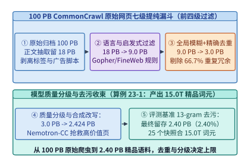

*图 23-1　从 100 PB CommonCrawl 原始 WARC 归档经七级提纯漏斗产出 15.0T 精品词元的体积与算力瀑布（算例 23-1）*

### 23.1.2 为什么在 15T–50T Tokens 时代，“重复数据”比“低质噪声”更具毁灭性？

在构建万亿词元语料库时，一个反直觉但被无数次消融实验证实的工程铁律是：**未清除的重复文本对大模型泛化能力的破坏，远比混入少量语法粗糙的低质网页更为致命**[^ch23-2]。

造成这一现象的物理机理在于互联网文本幂律分布与梯度优化的耦合失真：
1. **记忆化相变与双下降（Memorization & Epoch-wise Double Descent）**：互联网中存在海量由机器批量生成的同质模板（例如包含百万条仅城市名不同的天气预报页、电商商品参数页，或被上千家媒体原封不动转载的通稿）。若某个 $500$ 词元的段落重复出现了 $10^4$ 次，在单轮预训练中，模型对该特定序列执行的梯度更新步数相当于独立文本的 $10^4$ 个 Epoch。Hernandez 等人的定量研究表明，当仅占训练集 $1\%$ 的子集重复超过 $100$ 次时，模型有限的参数容量会被强行劫持去“逐字死记硬背（Verbatim Memorization）”这些重复片段，并在交叉熵损失曲面上诱发剧烈的**双下降震荡**，致使中间层注意力头（Induction Heads）退化，直接摧毁模型的上下文少样本学习（In-Context Learning）能力。
2. **隐私与版权原样吐出风险（Training Data Extraction Attack）**：一旦某段包含个人手机号、API 私钥或受版权保护的新闻段落重复出现数十次，攻击者只需提供前十几个词元作为前缀引导，模型便会以极高置信度一字不差地背诵出后续全文，引发灾难性的合规与法律风险。
3. **跨快照全局去重的“质量反噬”悖论与 `Nemotron-CC` 解法**：然而，`FineWeb` 与 `Nemotron-CC` 的最新大规模消融也揭示了去重的另一面——如果对全部 90 个 CommonCrawl 快照做无差别的**盲目全局跨快照去重（Global Cross-Snapshot Dedup）**，由于高频被引用的维基百科词条或经典编程教程往往在早期快照中已出现过一次，后续快照中质量更高的排版版本反而会被当作“重复项”全部杀光，仅留下首次抓取到的残缺版本，且越往后的快照留存下来的越是生僻古怪的边缘网页。因此，现代最优实践是：**在每个快照簇（或 5–10 个快照分片）内执行激进模糊去重 + 全局后缀数组剥离导航栏模板，再结合多分类器质量分桶（Quality Bucketing），仅对 Top-$5\%$ 的最高质量知识桶实施受控的 $2\text{–}4$ 轮上采样（Controlled Upsampling）**。

#### 推理摊销过训练（Over-Training）定律与百 PB 级对象存储 I/O 吞吐边界

为什么现代开源与闭源旗舰模型不再遵循经典的 Chinchilla 算力最优法则（即每 $1\ \mathrm{B}$ 参数仅配比 $20\ \mathrm{B}$ 训练词元），而是将词元与参数比推高至 $1,000 : 1$ 甚至 $2,000 : 1$（如 `Llama-3 8B` 训满 $15\ \mathrm{T}$ 词元、`Qwen-2.5 7B` 训满 $18\ \mathrm{T}$ 词元）？

从全生命周期总拥有成本（$\mathrm{TCO}_{\mathrm{total}} = C_{\mathrm{train}} + C_{\mathrm{infer}}$）来看，当一个基础模型在生产环境中需要服务数万亿至百万亿次下游推理词元（设为 $D_{\mathrm{infer}}$）时，最优模型参数规模 $N^*$ 与最优预训练词元规模 $D_{\mathrm{train}}^*$ 的最优化问题应当改写为：

$$
\min_{N, D_{\mathrm{train}}} \;\; \underbrace{6 N D_{\mathrm{train}} \cdot c_{\mathrm{flop}}}_{\text{一次性预训练成本 } C_{\mathrm{train}}} + \underbrace{2 N D_{\mathrm{infer}} \cdot c_{\mathrm{flop,infer}}}_{\text{全生命周期推理摊销成本 } C_{\mathrm{infer}}} \qquad \text{s.t.} \quad \mathcal{L}(N, D_{\mathrm{train}}) = E + \frac{A}{N^{\alpha}} + \frac{B}{D_{\mathrm{train}}^{\beta}} \le \mathcal{L}_{\mathrm{target}}
$$

求解该带约束拉格朗日极值可知：随着下游累计推理请求量 $D_{\mathrm{infer}}$ 的增长，系统应当**主动压缩模型参数量 $N$ 并大幅拉长预训练词元数 $D_{\mathrm{train}}$**——即用训练阶段一次性的额外“过训练（Over-Training）”算力投入，换取模型部署后成百上千倍的显存占用缩减与单请求解码延迟下降。然而，由于经验损失幂律项 $B / D_{\mathrm{train}}^{\beta}$ 的指数 $\beta \approx 0.28\text{–}0.35$ 较小，要在 $15\ \mathrm{T}$ 词元之后继续维持不衰减的对数线性损失下降斜率，喂入的每一万亿词元都必须具备极高的信息熵与非冗余度。

在物理基础设施层面，要在数天内吞吐完 $V_0 = 100.0\ \mathrm{PB}$ 的原始 WARC 归档，数据中心的对象存储（如 AWS S3 / 阿里云 OSS / 本地 Ceph RGW）与计算节点网卡面临着严酷的带宽考验：

- **读取带宽需求**：若要求在 $T_{\mathrm{ingest}} = 48\ \mathrm{hours}$（$172,800\ \mathrm{s}$）内完成 $100.0\ \mathrm{PB}$ 原始归档的流式拉取与解压，集群持续聚合对象存储读取带宽必须达到：
  $$B_{\mathrm{read}} = \frac{100.0 \times 10^{15}\ \mathrm{B}}{172,800\ \mathrm{s}} \approx \mathbf{578.7\ \mathrm{GB/s}}\ (\approx 4.63\ \mathrm{Tbps})$$
- **小文件元数据风暴规避**：CommonCrawl 由数十万个约 $1\ \mathrm{GB}$ 的 `.warc.gz` 分片组成；但在经过阶段 1–4 清洗后，若按单网页写出独立小文件，上百亿个 KB 级对象将直接击穿分布式文件系统的元数据服务器（MDS Inode 锁竞争）。因此，现代管线统一采用 **`Apache Parquet`（开启 Zstandard 字典压缩，按 $256\ \mathrm{MB}\text{–}512\ \mathrm{MB}$ 行组切分）** 或 **`WebDataset` / `MDS (MosaicML Streaming)` 连续分片格式**，确保顺序读取吞吐贴近 NVMe SSD 与 $400\ \mathrm{Gbps}$ RoCEv2 网卡的物理线速。

> **算例 23-1（100 PB CommonCrawl 七级提纯漏斗与 15.0T 精品词元产出核算）**
> **已知条件**：某大模型团队处理总体积 $V_0 = 100.0\ \mathrm{PB}$ 的原始 CommonCrawl WARC 归档（由 $N_{\mathrm{snap}} = 25$ 个大型合并快照簇组成）。各阶段单级字节留存率依次为：HTML 正文抽取 $r_1 = 0.18$，语言识别 $r_2 = 0.75$，启发式过滤 $r_3 = \frac{2}{3}$，全局模糊与精确去重 $r_4 = \frac{1}{3}$，模型质量分级与合成改写 $r_5 = 0.808$，评测集防污染净化 $r_6 = 0.9901$。每个合并快照簇经全部漏斗净化后平均贡献 $600\ \mathrm{B}$（$0.60\ \mathrm{T}$）精品训练词元。
> **求解目标**：（1）逐级计算各漏斗阶段出口的语料体积 $V_1 \dots V_6$；（2）计算端到端净留存率 $\eta_{\mathrm{retain}}$、模糊去重阶段单独砍掉的数据体积占比，以及 25 个快照簇合产出的总精品词元数 $T_{\mathrm{total}}$。
> **逐步解答**：
> 1. **逐级语料体积追踪**：
>    - 阶段 1–2（HTML 正文抽取后）：$V_1 = 100.0 \times 0.18 = \mathbf{18.00\ \mathrm{PB}}$；
>    - 阶段 3（FastText 语言识别后）：$V_2 = 18.00 \times 0.75 = \mathbf{13.50\ \mathrm{PB}}$；
>    - 阶段 4（Gopher/FineWeb 启发式过滤后）：$V_3 = 13.50 \times \frac{2}{3} = \mathbf{9.00\ \mathrm{PB}}$；
>    - 阶段 5（全局 MinHash + 后缀数组去重后）：$V_4 = 9.00 \times \frac{1}{3} = \mathbf{3.00\ \mathrm{PB}}$（此阶段单级剔除 $9.00 - 3.00 = 6.00\ \mathrm{PB}$ 重复冗余，剔除比例高达 $\mathbf{66.67\%}$）；
>    - 阶段 6（模型质量分级后）：$V_5 = 3.00 \times 0.808 = \mathbf{2.424\ \mathrm{PB}}$；
>    - 阶段 7（评测基准去污后）：$V_6 = 2.424 \times 0.9901 \approx \mathbf{2.40\ \mathrm{PB}}$。
> 2. **端到端净留存率与总精品词元产出**：
>    $$\eta_{\mathrm{retain}} = \frac{V_6}{V_0} = \frac{2.40\ \mathrm{PB}}{100.0\ \mathrm{PB}} = \mathbf{2.40\%}$$
>    $$T_{\mathrm{total}} = N_{\mathrm{snap}} \times 0.60\ \mathrm{T} = 25 \times 0.60\ \mathrm{T} = \mathbf{15.0\ \mathrm{T}\ \text{Tokens}}$$
>    该结果与 `experiments/ch23/23-01` 的确定性仿真输出完全一致。

---

## 23.2 十亿文档级模糊去重（Fuzzy Deduplication）的算法与 GPU 分布式加速（`NeMo Curator` / `DataTrove`）

对经过启发式清洗后的 $50$ 亿篇网页文档（约 $9.0\ \mathrm{PB}$）执行去重时，简单的全文 SHA-256 哈希只能捕获一字不差的完全克隆。而在真实互联网中，同一篇新闻或技术博文在不同网站转载时，往往会被加上不同的导语、记者署名、时间戳或推荐阅读列表。要识别这类“主体内容 $80\%$ 相同、首尾略有改动”的近似重复文档（Near-Duplicates），必须计算文档之间的集合相似度；但直接对 $N = 5 \times 10^9$ 篇文档两两计算相似度的复杂度高达 $\frac{N(N-1)}{2} \approx 1.25 \times 10^{19}$ 次比对，在物理上完全不可行。

### 23.2.1 MinHash + 局部敏感哈希（LSH）的 S 型碰撞曲线与分桶参数 $(b, r)$ 严格推导

为将 $\mathcal{O}(N^2)$ 的两两比对降为 $\mathcal{O}(N)$ 的线性分桶查表，工业界统一采用 **Broder 最小哈希（MinHash）结合局部敏感哈希（Locality-Sensitive Hashing, LSH）** 算法[^ch23-3]：

1. **文档 $k$-shingle 集合化**：将每篇文档 $D$ 切分为连续 $k$ 个词或字符组成的滑动窗口词片集合（通常取 $5$-gram word shingles 或 $13$-byte character shingles），记为集合 $A$ 与 $B$。两篇文档的真实文本重合度由 **Jaccard 相似度** 定义：
   $$
   s = J(A, B) = \frac{|A \cap B|}{|A \cup B|} \in [0, 1]
   $$
2. **MinHash 无偏估计定理**：设 $h: \mathcal{U} \to \{0, 1, \dots, 2^{32}-1\}$ 为一个将词片均匀随机映射为 32 位无符号整数的哈希函数，定义文档集合 $A$ 的最小哈希签名值为 $h_{\min}(A) = \min_{x \in A} h(x)$。由于集合 $A \cup B$ 中的最小哈希值等概率地落在任意元素上，而当且仅当该最小元素属于交集 $A \cap B$ 时两篇文档的最小哈希值相等，故有严格恒等式：
   $$
   \Pr\big[h_{\min}(A) = h_{\min}(B)\big] = \frac{|A \cap B|}{|A \cup B|} = s
   $$
   使用 $M$ 个相互独立的哈希函数 $h_1, h_2, \dots, h_M$（通常取 $M = 128$，每个哈希值占 `4 B`，单篇文档签名固定为 **$128 \times 4\ \mathrm{B} = 512\ \mathrm{B}$**），即可将任意长度的文档压缩为定长 512 字节签名向量。
3. **LSH 分桶（Banding Technique）与 S 型碰撞概率方程**：
   将长度为 $M$ 的签名向量均匀切分为 **$b$ 个分桶（Bands），每个分桶包含 $r$ 行（Rows）签名**，满足 $M = b \times r$（例如 $M = 128, b = 16, r = 8$）。对每个分桶内的 $r$ 个整数联合计算一次桶哈希（Bucket Hash）：只要两篇文档在**至少一个分桶内的 $r$ 个签名值完全一致**，它们就会落入同一个哈希桶并成为候选重复对（Candidate Pair）。
   推导其碰撞概率关于真实相似度 $s$ 的解析表达式：
   - 在单个给定分桶内，$r$ 个独立 MinHash 行**全部相等**的概率为 $s^r$；
   - 在该分桶内**至少有一行不相等**（未碰撞）的概率为 $1 - s^r$；
   - 在全部 $b$ 个独立分桶内**均未发生碰撞**的概率为 $(1 - s^r)^b$；
   - 因此，两篇相似度为 $s$ 的文档**在至少一个分桶内发生碰撞并被捕获为候选对的概率**为：
     $$
     P(\text{Candidate} \mid s) = 1 - \left(1 - s^r\right)^b
     $$

该函数中分桶数 $b$ 与每桶行数 $r$ 的物理意义可通过对 $s$ 求一阶导数得到直观刻画：

$$
\frac{\mathrm{d}P(s)}{\mathrm{d}s} = b \cdot r \cdot s^{r-1} \left(1 - s^r\right)^{b-1}
$$

令二阶导数近似为零或令 $(s^*)^r = \frac{1}{b}$，即可得 S 型曲线斜率最陡峭的拐点阈值 $s^*$ 近似位于：

$$
s^* \approx \left(\frac{1}{b}\right)^{1/r}
$$

在拐点 $s = s^*$ 处，曲线的切线斜率为：

$$
\left.\frac{\mathrm{d}P(s)}{\mathrm{d}s}\right|_{s=s^*} = b \cdot r \cdot b^{-\frac{r-1}{r}} \left(1 - \frac{1}{b}\right)^{b-1} \approx \frac{r}{e} \cdot b^{1/r}
$$

这一解析性质直接指导了工业界对 $(b, r)$ 超参数的工程权衡：
- **假阳性率（False Positive Rate, $\mathrm{FPR}$）积分**：对于真实相似度 $s < s^*$ 的无关文档对，其意外落入同一哈希桶的概率积分为 $\int_0^{s^*} \big[1 - (1 - s^r)^b\big] \mathrm{d}s$。若 $b$ 过大而 $r$ 过小（如 $b=64, r=2$，$s^* = 0.125$），会导致成百上千亿对毫无关系的文档在桶内发生“哈希雪崩碰撞”，瞬间撑爆后续图连通分量聚类的显存；
- **假阴性率（False Negative Rate, $\mathrm{FNR}$）积分**：对于真实相似度 $s > s^*$ 的近似克隆文档对，其漏网逃逸的概率积分为 $\int_{s^*}^1 (1 - s^r)^b \mathrm{d}s$。若 $r$ 过大而 $b$ 过小（如 $b=4, r=32$，$s^* = 0.9576$），则稍微改写几个句子的转载文章（$s \approx 0.80$）碰撞概率仅为 $P(0.80) = 1 - (1 - 0.80^{32})^4 \approx 0.31\%$，几乎全部漏检。
- **`FineWeb` / `NeMo Curator` 黄金工作点 $(b=16, r=8)$**：当固定总哈希数 $M = 128$ 并取 $b = 16, r = 8$ 时，拐点恰锁定在 $s^* \approx 0.7071$，使得 $s = 0.50$ 的无关对碰撞率被压制在 $6.07\%$，而 $s = 0.80$ 的转载文档召回率高达 $94.70\%$，在洗牌通信量与去重纯度之间取得了帕累托最优平衡。

图 23-2 展示了 $(b = 16, r = 8)$ 配置下的 S 型碰撞概率曲线与假阳性/假阴性边界。

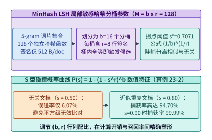

*图 23-2　MinHash LSH 局部敏感哈希在 (b=16, r=8) 分桶配置下的 S 型碰撞概率曲线 P(s) = 1 - (1 - s^r)^b（算例 23-2）*

> **算例 23-2（MinHash LSH $b=16, r=8$ 的 S 型碰撞概率与分桶阈值推导）**
> **已知条件**：模糊去重管线采用 $M = 128$ 个 32-bit 哈希函数，划分为 $b = 16$ 个 Band、每个 Band 包含 $r = 8$ 行签名。
> **求解目标**：（1）求 S 型曲线的理论拐点阈值 $s^*$；（2）分别计算无关文档（$s = 0.50$）、临界相似文档（$s = 0.70$）、高度相似文档（$s = 0.80$）与近似克隆文档（$s = 0.90$）被捕获为候选对的概率。
> **逐步解答**：
> 1. **理论拐点阈值 $s^*$**：
>    $$s^* = \left(\frac{1}{16}\right)^{1/8} = 2^{-4/8} = 2^{-0.5} \approx \mathbf{0.7071}$$
> 2. **各相似度下的候选碰撞概率 $P(s) = 1 - (1 - s^8)^{16}$**：
>    - 当 $s = 0.50$ 时：$s^8 = 0.50^8 = 0.00390625$，$P(0.50) = 1 - (1 - 0.00390625)^{16} \approx \mathbf{6.07\%}$（绝大部分无关文档被直接过滤，避免无谓比对）；
>    - 当 $s = 0.70$ 时：$s^8 = 0.70^8 \approx 0.057648$，$P(0.70) = 1 - (1 - 0.057648)^{16} \approx \mathbf{61.32\%}$；
>    - 当 $s = 0.80$ 时：$s^8 = 0.80^8 = 0.16777216$，$P(0.80) = 1 - (1 - 0.16777216)^{16} \approx \mathbf{94.70\%}$（几乎无漏网之鱼）；
>    - 当 $s = 0.90$ 时：$s^8 = 0.90^8 \approx 0.43046721$，$P(0.90) = 1 - (1 - 0.43046721)^{16} \approx \mathbf{99.99\%}$。

### 23.2.2 从数万核 CPU 跑一周到 64 张 GPU 跑 1.85 小时：基于 `cuDF` 与分布式连通分量（GPU Connected Components）的全流水线卸载

当文档规模达到 $N_{\mathrm{doc}} = 5 \times 10^9$（50 亿篇）时，即便每篇文档仅生成 $512\ \mathrm{B}$ 的 MinHash 签名，签名表的总体积也达到：

$$
M_{\mathrm{sig}} = 5 \times 10^9 \times 512\ \mathrm{B} = 2.56 \times 10^{12}\ \mathrm{B} = \mathbf{2,560.0\ \mathrm{GB}}\ (2.56\ \mathrm{TB})
$$

在传统的 CPU 数据处理框架（如基于 Apache Spark 或多进程 Python 的 `DataTrove`）中，这 $2,560.0\ \mathrm{GB}$ 签名需要按 $b = 16$ 个 Band 拆分为 $800$ 亿条 `(band_id, bucket_hash, doc_id)` 记录，通过本地磁盘与千兆/万兆以太网执行外部归并排序（External Sort-Merge Shuffle），随后在单机或分布式内存上运行并查集（Union-Find）求解传递性重复簇（即若文档 $A \sim B$ 且 $B \sim C$，则 $\{A, B, C\}$ 合并为同一连通分量，仅保留簇内编号最小或质量最高的一篇代表元）。在 4,096 核 CPU 集群上，由于受制于 DRAM 内存带宽、磁盘 I/O 落盘与图遍历随机访存，跑完一轮 50 亿文档去重需要整整 **`148.0 小时`（超过 6 天）**，云实例租用成本高达 **`42,600 美元`**。

以 **`NVIDIA NeMo Curator`（基于 `RAPIDS cuDF`、`Dask-CUDA` 与 `cuGraph`）** 为代表的下一代 GPU 加速数据工程底座，通过将整条模糊去重管线 100% 卸载至高带宽显存（HBM3e）与 NVLink / RDMA 高速互连网络，实现了数量级的效率跃迁[^ch23-4]：

1. **GPU 向量化 Shingle 哈希与 MinHash 归约**：利用 `cuDF` 字符串内核在 GPU 流处理器上直接对字节流并发计算 128 路哈希并执行 Warp 级并行归约求最小值，吞吐较单核 CPU 提升上百倍；
2. **基于 UCX（NVLink + RoCEv2/IB）的无落盘全互换洗牌（In-Memory All-to-All Shuffle）**：在 $G = 64$ 张 H100 GPU（8 台 8 卡节点，合计 $5.12\ \mathrm{TB}$ HBM 加上 $16\ \mathrm{TB}$ 主机锁页内存溢出池）上，对每个 Band 的桶哈希值按 `bucket_hash % G` 直接通过 GPUDirect RDMA 分发至对应目标卡。总跨卡网络洗牌流量为：
   $$
   V_{\mathrm{shuffle}} = M_{\mathrm{sig}} \cdot \frac{G - 1}{G} = 2,560.0\ \mathrm{GB} \times \frac{63}{64} = \mathbf{2,520.0\ \mathrm{GB}}
   $$
   在 $400\ \mathrm{Gbps}$ RDMA 与机内 $900\ \mathrm{GB/s}$ NVLink 支撑下，2.52 TB 洗牌在数分钟内即可全部在显存/主存间流转完毕，彻底消灭磁盘随机读写；
3. **分布式 GPU 图连通分量（Large-Star / Small-Star Connected Components）**：同一桶内的候选文档构造出稀疏相似度边表 $(u, v)$ 后，`RAPIDS cuGraph` 调用分布式 **大星体/小星体指针跳跃算法（Large-Star / Small-Star Pointer Jumping）**，每轮迭代将节点挂向邻居中的最小编号祖先，将图直径以对数级 $\mathcal{O}(\log D)$ 步数急速收缩为星型根节点，毫秒级完成数十亿节点的聚簇代表元选取；
4. **文档级模糊去重与段落级后缀数组（Suffix Array）精确去重的双层协同**：MinHash LSH 负责剔除整篇尺度的转载与改写，但如果两篇完全不同的长篇技术文章末尾都附带了相同的 $80$ 词元网站版权声明或顶栏导航菜单，整篇去重既不该误杀正文，也无法清除这段高频重复尾巴。为此，工业管线在 MinHash 之后串联一层基于线性时间构建（SA-IS 算法）的 **全局后缀数组子串去重（Exact Substring Deduplication）**，专门手术刀式地原位切除长度 $\ge 50$ 词元的完全重复模板片段。

#### 热点桶倾斜治理（Heavy-Hitter Pre-Aggregation）与大星体/小星体图收敛数学保证

在真实互联网语料中，像“404 Not Found 页面”、“Apache 2.0 许可证全文”或“WordPress 默认欢迎页”这类完全相同的模板文档可能出现上千万次。若在步骤 2 的全对全洗牌（All-to-All Shuffle）前不做本地预聚合，这 $10^7$ 篇文档在 Band $j$ 上的相同桶哈希 `bucket_hash` 将被集中路由至同一张目标 GPU $g = \text{bucket\_hash} \bmod G$，引发灾难性的 **单卡显存溢出（Skew-Induced OOM）与全集群木桶效应等待**。

为根除数据倾斜，`NeMo Curator` 在跨节点洗牌前引入了 **两阶段树状预归约（Two-Stage Local Anchor Reduction）**：
- **机内本地锚点坍缩**：每张 GPU 在发送桶记录 `(band_id, bucket_hash, doc_id)` 之前，先在本地显存内按 `bucket_hash` 分组，找出本地桶内编号最小的文档作为**本地锚点（Local Hub）** $u_{\mathrm{local}}^* = \min_{u \in B_{\mathrm{local}}} u$；随后立即向外发射本地星型边 $\{(u, u_{\mathrm{local}}^*) \mid u \in B_{\mathrm{local}} \setminus \{u_{\mathrm{local}}^*\}\}$，而向远程目标 GPU 洗牌发送的记录**仅保留唯一一条代表元 `(band_id, bucket_hash, u_local^*)`**。
- **跨卡洗牌流量上界锁死**：经过本地锚点坍缩后，无论某个热门模板在全网重复了多少亿次，每张源 GPU 向目标 GPU 发送的同桶记录最多只有 $1$ 条（全集群汇聚至目标卡的同桶记录最多不超过 $G = 64$ 条），从根本上消除了热点桶倾斜。

在步骤 3 的分布式图连通分量求解中，设候选边集构成无向图 $\mathcal{G} = (\mathcal{V}, \mathcal{E})$，每个节点 $u \in \mathcal{V}$ 维护父指针 $p(u)$（初始化为 $p^{(0)}(u) = u$）。定义节点 $u$ 的广义邻居集合为 $\Gamma^+(u) = \{u\} \cup \{v \mid (u, v) \in \mathcal{E}\}$。**大星体（Large-Star）** 与 **小星体（Small-Star）** 交替迭代算子定义为：

$$
\begin{aligned}
\text{Large-Star 步（收缩大编号邻居）：} \quad & p^{(t + 1/2)}(u) = \min_{v \in \Gamma^+(u)} p^{(t)}(v), \quad \text{并对 } v > u \text{ 发射新边 } \big(p^{(t)}(v),\, p^{(t+1/2)}(u)\big) \\
\text{Small-Star 步（收缩小编号邻居）：} \quad & p^{(t + 1)}(u) = \min_{v \in \Gamma_{\le u}^+(u)} p^{(t + 1/2)}(v), \quad \text{随后执行路径减半 } p(u) \leftarrow p\big(p(u)\big)
\end{aligned}
$$

理论证明，每一轮交替迭代至少将任意连通分量内的非根路径长度压缩 $1/2$，故对于直径为 $D$ 的十亿级文档图，至多经过 $\lceil \log_{1.5} D \rceil \approx 6\text{–}10$ 轮全 GPU 向量化迭代即可 100% 收敛至全局唯一最小编号代表元 $p^{(\infty)}(u) = \min_{w \in \mathrm{CC}(u)} w$。

图 23-3、图 23-4 与图 23-5 展示了分布式 GPU MinHash 连通分量流水线、CPU `DataTrove` 与 GPU `NeMo Curator` 的耗时/成本对比，以及模糊去重与后缀数组子串去重的协同机制。

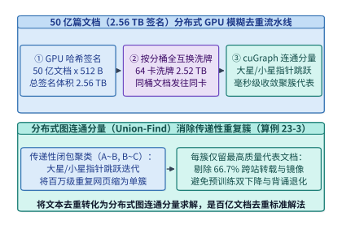

*图 23-3　50 亿篇文档模糊去重的分布式流水线：Shingle 哈希、按 Band 洗牌与 GPU 连通分量（Large-Star/Small-Star）聚簇（算例 23-3）*

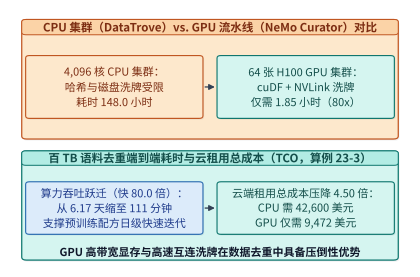

*图 23-4　CPU 集群（DataTrove）与 GPU 加速流水线（NeMo Curator + cuDF + cuGraph）在百 TB 语料去重中的耗时（80.0x 加速）与 TCO（降 4.50x）对比（算例 23-3）*

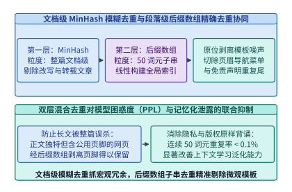

*图 23-5　文档级 MinHash 模糊去重与基于后缀数组（Suffix Array）的 50 词元级精确重复模板/导航栏剥离协同*

> **算例 23-3（50 亿篇文档分布式 GPU 模糊去重签名体积、洗牌流量与 80 倍加速 TCO 核算）**
> **已知条件**：待去重语料含 $N_{\mathrm{doc}} = 5 \times 10^9$ 篇文档，每篇计算 $M = 128$ 个 4 字节（32-bit）MinHash 签名并分为 $b = 16$ 个 Band。基线方案采用 $4,096$ 核 CPU 集群运行 `DataTrove`，端到端耗时 $T_{\mathrm{CPU}} = 148.0\ \mathrm{h}$，集群总租用成本 $C_{\mathrm{CPU}} = 42,600\ \mathrm{USD}$。加速方案采用 $G = 64$ 张 H100 GPU 运行 `NeMo Curator`（`cuDF` + `cuGraph`），端到端耗时 $T_{\mathrm{GPU}} = 1.85\ \mathrm{h}$，总租用成本 $C_{\mathrm{GPU}} = 9,472\ \mathrm{USD}$。
> **求解目标**：（1）单篇文档签名字节数、全量签名体积 $M_{\mathrm{sig}}$（按 $10^9\ \mathrm{B} = 1\ \mathrm{GB}$ 十进制存储/网络口径）与 64 卡 All-to-All 洗牌流量 $V_{\mathrm{shuffle}}$；（2）GPU 方案相对 CPU 方案的端到端时间加速比 $S_{\mathrm{time}}$ 与云端 TCO 成本压降倍数 $S_{\mathrm{cost}}$。
> **逐步解答**：
> 1. **签名总体积与跨卡洗牌流量**：
>    - 单文档签名大小：$128 \times 4\ \mathrm{B} = \mathbf{512\ \mathrm{B/doc}}$；
>    - 50 亿文档总签名体积：$M_{\mathrm{sig}} = \frac{5 \times 10^9 \times 512}{10^9} = \mathbf{2,560.0\ \mathrm{GB}}$；
>    - 64 卡均匀哈希分桶的跨卡远程洗牌流量：
>      $$V_{\mathrm{shuffle}} = 2,560.0 \times \frac{64 - 1}{64} = 2,560.0 \times 0.984375 = \mathbf{2,520.0\ \mathrm{GB}}$$
> 2. **时间加速比与成本压降倍数**：
>    $$S_{\mathrm{time}} = \frac{T_{\mathrm{CPU}}}{T_{\mathrm{GPU}}} = \frac{148.0\ \mathrm{h}}{1.85\ \mathrm{h}} = \mathbf{80.0\times}, \qquad S_{\mathrm{cost}} = \frac{C_{\mathrm{CPU}}}{C_{\mathrm{GPU}}} = \frac{42,600\ \mathrm{USD}}{9,472\ \mathrm{USD}} \approx \mathbf{4.50\times}$$

下面给出生产级 **MinHash LSH 碰撞曲线仿真与分布式连通分量（Large-Star / Small-Star Union-Find）模糊去重引擎** 实现（代码块 1 与代码块 2）：

```python
import math
from dataclasses import dataclass

@dataclass
class MinHashLSHConfig:
    num_hashes: int = 128
    bands: int = 16
    rows_per_band: int = 8
    bytes_per_hash: int = 4

    def s_curve_prob(self, jaccard_s: float) -> float:
        """Compute P(Candidate | s) = 1 - (1 - s^r)^b."""
        return 1.0 - math.pow(1.0 - math.pow(jaccard_s, self.rows_per_band), self.bands)

    def threshold_inflection(self) -> float:
        """Approximate inflection threshold s* = (1 / b)^(1 / r)."""
        return math.pow(1.0 / self.bands, 1.0 / self.rows_per_band)

    def cluster_shuffle_ledger(self, num_docs: int, num_gpus: int) -> dict:
        bytes_per_doc = self.num_hashes * self.bytes_per_hash
        total_sig_gb = (num_docs * bytes_per_doc) / 1e9
        shuffle_gb = total_sig_gb * (num_gpus - 1) / num_gpus
        return {
            "bytes_per_doc": bytes_per_doc,
            "total_signature_gb": round(total_sig_gb, 2),
            "all_to_all_shuffle_gb": round(shuffle_gb, 2),
            "threshold_s_star": round(self.threshold_inflection(), 4),
            "prob_s_050": round(self.s_curve_prob(0.50), 4),
            "prob_s_080": round(self.s_curve_prob(0.80), 4),
        }

if __name__ == "__main__":
    cfg = MinHashLSHConfig(num_hashes=128, bands=16, rows_per_band=8)
    print(cfg.cluster_shuffle_ledger(num_docs=5_000_000_000, num_gpus=64))
```

```python
from collections import defaultdict
from typing import Dict, Iterable, List, Set, Tuple

class DistributedConnectedComponentsDedup:
    """Large-Star / Small-Star pointer-jumping connected components for LSH buckets."""

    def __init__(self, num_docs: int):
        self.parent: Dict[int, int] = {i: i for i in range(num_docs)}

    def build_candidate_edges(self, lsh_buckets: Dict[Tuple[int, int], List[int]]) -> Set[Tuple[int, int]]:
        """Star-topology edge emission: link every doc in a bucket to the minimum doc_id."""
        edges: Set[Tuple[int, int]] = set()
        for (_, _), doc_ids in lsh_buckets.items():
            if len(doc_ids) > 1:
                hub = min(doc_ids)
                for doc in doc_ids:
                    if doc != hub:
                        edges.add((doc, hub))
                        edges.add((hub, doc))
        return edges

    def converge_components(self, edges: Iterable[Tuple[int, int]], max_iters: int = 16) -> Dict[int, int]:
        adj: Dict[int, Set[int]] = defaultdict(set)
        for u, v in edges:
            adj[u].add(v)
            adj[v].add(u)

        for _ in range(max_iters):
            changed = False
            new_parent = dict(self.parent)
            for u, neighbors in adj.items():
                candidates = [self.parent[u]] + [self.parent[v] for v in neighbors]
                min_label = min(candidates)
                if min_label < self.parent[u]:
                    new_parent[u] = min_label
                    changed = True
            for u in list(new_parent.keys()):
                new_parent[u] = new_parent[new_parent[u]]
            self.parent = new_parent
            if not changed:
                break
        return self.parent

    def deduplicate_corpus(self, lsh_buckets: Dict[Tuple[int, int], List[int]]) -> Dict[str, object]:
        edges = self.build_candidate_edges(lsh_buckets)
        roots = self.converge_components(edges)
        surviving_representatives = sorted(set(roots.values()))
        dropped_duplicates = len(roots) - len(surviving_representatives)
        return {
            "total_docs": len(roots),
            "surviving_docs": len(surviving_representatives),
            "dropped_docs": dropped_duplicates,
            "dedup_removal_rate_pct": round(dropped_duplicates / max(1, len(roots)) * 100.0, 2),
            "representatives": surviving_representatives,
        }

if __name__ == "__main__":
    deduper = DistributedConnectedComponentsDedup(num_docs=9)
    sample_buckets = {
        (0, 1001): [0, 1, 2],
        (3, 4092): [2, 3, 4],
        (7, 8190): [5, 6],
        (9, 2048): [7],
        (11, 999): [8],
    }
    print(deduper.deduplicate_corpus(sample_buckets))
```

---

## 23.3 模型驱动质量分级（`DCLM` / `FineWeb-Edu`）、评测集防污染（Decontamination）与在线动态退火配比（`DoReMi` / `RegMix`）

在完成全局模糊去重与精确子串剥离后，语料池中剩下的 $3.0\ \mathrm{PB}$ 文档虽然不再重复，但其智力密度仍存在天壤之别：既有逻辑严密的大学讲义、开源代码架构文档与深入的科学问答，也有大量虽然语法通顺但毫无信息增量的明星八卦、论坛灌水与商品促销文案。如何在万亿词元尺度上精准筛选出能够显著提升模型推理与知识上限的“高营养词元”，构成了现代数据工程的第二大核心战场[^ch23-5]。

### 23.3.1 用大模型蒸馏轻量级打分器（LLM-as-Judge $\to$ BERT / FastText 分类器）的三级算力杠杆

最直观的想法是直接调用强大的 `70B` 甚至 `405B` 前沿大模型，按照精心设计的结构化加性评分量表（Additive Scoring Rubric）对全部候选文档逐篇打分。以 `FineWeb-Edu` 采用的 **0–5 分教育价值加性量表** 为例，教师提示词要求大模型独立评估以下五个递进准则（每满足一项加 $1$ 分）：
- **+1 分（基础相关性）**：文档包含至少部分与教育、科学、技术或常识相关的事实信息，而非纯粹的商业导航、商品列表或账单存根；
- **+1 分（学校课程对齐）**：文本主题契合小学至研究生阶段的某一门正式学科（数学、物理、计算机、历史、医学等），具备明确的知识载体属性；
- **+1 分（连贯性与条理性）**：行文结构完整、逻辑过渡清晰，不存在由于 HTML 解析错误导致的段落错乱、半截句子或满屏机器翻译腔；
- **+1 分（概念深度与推导展开）**：不仅停留在浅层名词罗列，而是包含完整的因果解释、定理证明、代码实现剖析或分步问题求解过程；
- **+1 分（卓越教学示范级质量）**：表达精炼透彻、无冗余水词，可直接节选作为高水平教科书章节或权威参考教程使用。

然而，简单的算术核算即可证明**直接用大模型对百亿篇文档做全量打分在系统经济学上完全破产**：

设待分级的候选池含 $N_{\mathrm{pool}} = 5 \times 10^{10}$ 篇文档（500 亿篇，平均每篇 $L_{\mathrm{doc}} = 500$ 词元，总计 $25\ \mathrm{T}$ 词元）。若直接运行 `Llama-3-70B`（FP8 优化下平均预填充打分吞吐为 $R_{70\mathrm{B}} = 3,200\ \mathrm{tokens/(s \cdot GPU)}$），所需总 GPU 小时数为：

$$
H_{\mathrm{direct}} = \frac{N_{\mathrm{pool}} \cdot L_{\mathrm{doc}}}{R_{70\mathrm{B}} \times 3600} = \frac{2.5 \times 10^{13}}{3,200 \times 3600} \approx \mathbf{2,170,138.9\ \mathrm{GPU\text{-}hours}}
$$

按每 H100 小时 $4.00\ \mathrm{USD}$ 计，仅给语料打一次分就要耗资 **$868\ \text{万美元}$**，几乎相当于重头训练一个千亿级主干模型的全部预算。

为破解这一算力困局，`FineWeb-Edu`、`DCLM` 与 `Nemotron-CC` 确立了 **“大模型精标百万种子 $\to$ 蒸馏轻量级分类器 $\to$ 全量百亿语料高速推理”的三级算力放大漏斗**：
1. **第一级（Teacher Seed Annotation）**：从全量语料池中分层均匀采样 $N_{\mathrm{seed}} = 5 \times 10^6$ 篇（500 万篇，仅占全量的 $0.01\%$）种子文档，调用 `70B` 教师模型按照 5 档评分量表生成高质量标签与理由，仅耗费：
   $$H_{\mathrm{seed}} = \frac{5 \times 10^6 \times 500}{3,200 \times 3600} \approx \mathbf{217.0\ \mathrm{GPU\text{-}hours}}$$
2. **第二级（Student Classifier Distillation）**：用这 500 万条教师标注样本微调一个参数量仅 $110\ \mathrm{M}$ 的双向编码器回归模型（如 `Snowflake-Arctic-Embed-M` / `BERT-base` 加上线性回归头，或蒸馏为 `FastText` 词袋 n-gram 分类器），训练耗时仅 $H_{\mathrm{train}} = \mathbf{80.0\ \mathrm{GPU\text{-}hours}}$；
3. **第三级（Full-Corpus High-Throughput Scoring）**：利用 TensorRT-LLM / ONNX Runtime 将 $110\ \mathrm{M}$ 轻量分类器编译为 FP16/INT8 高吞吐推理内核，单张 H100 打分吞吐飙升至 $R_{\mathrm{student}} = 180,000\ \mathrm{tokens/(s \cdot GPU)}$（较 `70B` 快 $56.25$ 倍），横扫全部 $25\ \mathrm{T}$ 词元仅需：
   $$H_{\mathrm{infer}} = \frac{2.5 \times 10^{13}}{180,000 \times 3600} \approx \mathbf{38,580.2\ \mathrm{GPU\text{-}hours}}$$

三级管线合计总算力开销仅为 $H_{\mathrm{distill}} = 217.0 + 80.0 + 38,580.2 = \mathbf{38,877.2\ \mathrm{GPU\text{-}hours}}$，实现高达 **$55.82\times$ 的算力杠杆（节省 $98.21\%$ 算力）**。更进一步，`Nemotron-CC` 证明单靠单一维度分类器（如偏向学术教材的 `FineWeb-Edu`）会过度剪除实用代码问答与常识对话；通过集成多个互补分类器（教育价值打分器 + DCLM 指令对齐打分器）将语料划分为 20 个分位质量桶，并对高知识密度但排版残缺的网页执行 **合成改写（Synthetic Rephrasing）**，可在不损失知识覆盖广度的前提下将下游 MMLU 与 ARC-Challenge 分数再推高 $5\text{–}8$ 个百分点。

图 23-6 与图 23-7 展示了 `70B -> 110M` 质量分类器三级算力蒸馏漏斗与 `Nemotron-CC` 多分类器集成及合成改写架构。

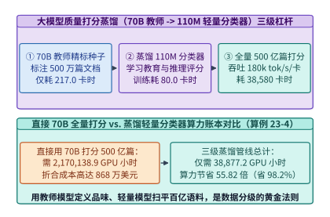

*图 23-6　用 70B 教师模型标注 500 万样本蒸馏 110M 轻量级质量分类器（FineWeb-Edu / DCLM）实现 55.82 倍算力节省的三级漏斗（算例 23-4）*

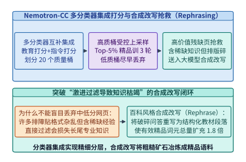

*图 23-7　Nemotron-CC 范式：多分类器集成打分分桶与对高知识价值但表述残缺网页的合成改写抢救（Synthetic Rephrasing）*

> **算例 23-4（大模型质量打分蒸馏 `70B -> 110M` 的 55.82 倍算力杠杆核算）**
> **已知条件**：待分级语料库含 $N_{\mathrm{pool}} = 50 \times 10^9$ 篇文档（平均长度 $L_{\mathrm{doc}} = 500$ 词元，总词元数 $25\ \mathrm{T}$）。`70B` 教师模型打分吞吐 $R_{70\mathrm{B}} = 3,200\ \mathrm{tok/s/GPU}$；`110M` 学生分类器训练开销 $H_{\mathrm{train}} = 80.0\ \mathrm{GPU\text{-}h}$，推理吞吐 $R_{\mathrm{student}} = 180,000\ \mathrm{tok/s/GPU}$。种子标注集取 $N_{\mathrm{seed}} = 5 \times 10^6$ 篇文档。
> **求解目标**：（1）直接用 `70B` 模型全量打分所需 GPU 小时数 $H_{\mathrm{direct}}$；（2）三级蒸馏方案的总 GPU 小时数 $H_{\mathrm{distill}}$ 与算力杠杆倍数 $\mathcal{L}_{\mathrm{compute}}$。
> **逐步解答**：
> 1. **直接全量打分算力账本**：
>    $$H_{\mathrm{direct}} = \frac{50 \times 10^9 \times 500}{3,200 \times 3600} \approx \mathbf{2,170,138.9\ \mathrm{GPU\text{-}h}}$$
> 2. **三级蒸馏方案算力账本与杠杆比**：
>    - 教师标注 500 万种子：$H_{\mathrm{seed}} = \frac{5 \times 10^6 \times 500}{3,200 \times 3600} \approx \mathbf{217.01\ \mathrm{GPU\text{-}h}}$；
>    - 学生分类器微调训练：$H_{\mathrm{train}} = \mathbf{80.00\ \mathrm{GPU\text{-}h}}$；
>    - 学生分类器全量 500 亿篇推理：$H_{\mathrm{infer}} = \frac{50 \times 10^9 \times 500}{180,000 \times 3600} \approx \mathbf{38,580.25\ \mathrm{GPU\text{-}h}}$；
>    - 合计总开销与杠杆倍数：
>      $$H_{\mathrm{distill}} = 217.01 + 80.00 + 38,580.25 = \mathbf{38,877.2\ \mathrm{GPU\text{-}h}}, \qquad \mathcal{L}_{\mathrm{compute}} = \frac{2,170,138.9}{38,877.2} \approx \mathbf{55.82\times}$$

### 23.3.2 评测基准防污染（13-gram 碰撞 + 稠密向量语义去污）与预训练三阶段动态配比退火（`DoReMi` / `RegMix`）

为了确保模型评测分数的科学可信度并最大化不同训练阶段的算力收益，数据管线的收尾阶段必须完成三项系统工程闭环：

1. **双层评测基准防污染（Hybrid Benchmark Decontamination）**：
   互联网爬虫中不可避免地混有各类开源基准测试题的讨论帖、GitHub 刷题仓库乃至被翻译成其他语种的考题。单靠传统的 **13-gram 字面子串精确匹配**（如 GPT-3 / Llama-2 采用的方案，基于 Aho-Corasick 自动机拦截与测试题存在连续 13 个词重合的训练段落）很容易被**同义词改写、变量名替换（如将 `two_sum(nums, target)` 改为 `find_pair(arr, k)`）或英译中跨语言考题**轻松绕过，造成严重的隐性刷榜失真（Benchmark Leakage）。因此，现代防污染管线普遍增设第二道防线：**基于多语言稠密嵌入模型（如 `BGE-M3` / `E5-Mistral`）的向量近邻语义去污**，凡是与评测基准题目余弦相似度 $\cos(\mathbf{e}_{\mathrm{train}}, \mathbf{e}_{\mathrm{eval}}) > 0.85$ 的段落一律从训练集剔除。
2. **基于代理模型的领域配比优化（`DoReMi` / `RegMix`）与三阶段动态数据退火（Curriculum Annealing）**：
   预训练语料包含通用网页、数学、代码、百科、学术论文与多语言等十余个领域（Domains）。与其在千亿主干模型上盲目猜测配比权重 $\boldsymbol{\alpha} = (\alpha_1, \dots, \alpha_D)$，现代数据系统先利用 $280\ \mathrm{M}\text{–}1\ \mathrm{B}$ 的小型代理模型（Proxy Models）运行自动配比优化——无论是通过分布式鲁棒优化最小化最差领域超额损失的 **`DoReMi`**，还是通过训练数十组轻量小模型拟合“领域权重 $\to$ 验证集损失”回归曲面的 **`RegMix`**——求出帕累托最优配比后再零样本迁移至主干模型。同时，在训练时间轴上执行**三阶段动态退火**：
   - **阶段 I（主干奠基期，前 $70\%$ 词元）**：以高多样性去重网页为主，建立广泛的世界常识与多语言底座；
   - **阶段 II（长文与代码强化期，$70\%\text{–}90\%$ 词元）**：逐步拉升代码仓库、STEM 教材与长上下文文档占比，并将序列长度从 $4\ \mathrm{K}$ 扩展至 $32\ \mathrm{K}\text{–}128\ \mathrm{K}$；
   - **阶段 III（极速退火期 Mid-Training Annealing，最后 $5\%\text{–}10\%$ 词元）**：伴随学习率按余弦或线性（WSD 调度器的 Decay 段）快速归零，将语料切换为 **$70\%$ 以上的极高纯度精校百科、竞赛数学与经沙箱验证的合成推理轨迹**，使模型推理与遵循指令能力在收尾阶段发生阶跃式跃升。
3. **万亿词元内存映射索引（`.bin`/`.idx` mmap）、确定性块洗牌与最佳适应无截断打包（Best-Fit Sequence Packing）**：
   在进入 GPU 训练数据加载器（DataLoader）前，文本被分词为 `uint16`/`uint32` 词元 ID 并固化为连续二进制文件（`.bin`）与文档偏移索引（`.idx`）。为避免朴素拼接截断（Concat-and-Chunk）将 $15\%\text{–}25\%$ 的长代码或数学证明拦腰斩断，现代加载器采用 **最佳适应递减装箱算法（Best-Fit Cropping/Packing，基于线段树在 $\mathcal{O}(\log K)$ 时间内查找恰好填满上下文窗口 $L_{\mathrm{ctx}}$ 剩余空间的文档）**，在实现 $<0.5\%$ 填充损耗的同时 100% 保持文档语义边界，并配合块级 Merkle 哈希血缘账本（Data Provenance Ledger）支持亚秒级版权退订原地屏蔽（Index Masking）。

#### `DoReMi` 分布式鲁棒博弈与 `RegMix` 回归曲面寻优的数学形式

设训练语料由 $D$ 个领域组成，领域采样权重向量 $\boldsymbol{\alpha} = (\alpha_1, \dots, \alpha_D)$ 位于概率单纯形 $\Delta^D = \{\boldsymbol{\alpha} \ge \mathbf{0} \mid \sum_{d=1}^D \alpha_d = 1\}$ 上。
- **`DoReMi`（Domain Reweighting with Minimax Optimization）**：先在基准分布 $\boldsymbol{\alpha}_0$ 上训练一个小型参考模型 $M_{\mathrm{ref}}$（参数 $\theta_{\mathrm{ref}}$），随后训练同尺寸的代理模型 $M_{\mathrm{proxy}}$（参数 $\theta$），与领域权重玩家 $\boldsymbol{\alpha}$ 展开零和极小极大博弈，专门放大代理模型相对于参考模型“学得最差（超额损失最大）”的领域权重：
  $$
  \min_{\theta} \max_{\boldsymbol{\alpha} \in \Delta^D} \;\; \sum_{d=1}^D \alpha_d \cdot \Big[ \mathcal{L}_d(\theta) - \mathcal{L}_d(\theta_{\mathrm{ref}}) \Big]
  $$
  在每步迭代 $t$ 中，领域权重按指数梯度上升（Exponentiated Gradient Ascent）自动调整：
  $$
  \tilde{\alpha}_d^{(t)} = \alpha_d^{(t-1)} \exp\Big( \eta_{\alpha} \cdot \max\big\{0,\, \mathcal{L}_d(\theta^{(t)}) - \mathcal{L}_d(\theta_{\mathrm{ref}})\big\} \Big), \qquad \alpha_d^{(t)} = (1 - c)\frac{\tilde{\alpha}_d^{(t)}}{\sum_{j=1}^D \tilde{\alpha}_j^{(t)}} + \frac{c}{D}
  $$
- **`RegMix`（Data Mixing as Regression）**：`RegMix` 进一步指出，无需修改训练内循环，只需在单纯形 $\Delta^D$ 上利用狄利克雷分布采样 $K = 64\text{–}128$ 组不同的配比向量 $\{\boldsymbol{\alpha}^{(k)}\}_{k=1}^K$，分别训练参数量仅 $1\ \mathrm{M}\text{–}25\ \mathrm{M}$ 的超轻量代理模型至 $1\ \mathrm{B}$ 词元，记录其在目标验证集（或下游核心基准代理任务）上的损失 $y^{(k)} = \mathcal{L}_{\mathrm{val}}(\boldsymbol{\alpha}^{(k)})$；随后拟合一个梯度提升树（LightGBM）或高斯过程回归模型 $\hat{f}(\boldsymbol{\alpha}) \approx \mathcal{L}_{\mathrm{val}}(\boldsymbol{\alpha})$，即可在秒级内通过网格搜索求出全局最优配比 $\boldsymbol{\alpha}^* = \arg\min_{\boldsymbol{\alpha} \in \Delta^D} \hat{f}(\boldsymbol{\alpha})$。

图 23-8 与图 23-9 展示了双层评测防污染管线以及基于代理模型的 `DoReMi`/`RegMix` 三阶段动态退火曲线。

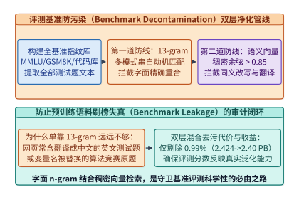

*图 23-8　防止评测集刷榜失真的双层去污管线（13-gram 子串匹配 + 稠密语义向量近邻剔除防止同义改写与跨语言污染）*

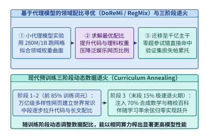

*图 23-9　基于小型代理模型（Proxy Model）的领域配比寻优（DoReMi / RegMix）与三阶段预训练动态退火曲线*

下面给出生产级 **双层评测基准防污染引擎（13-gram + 向量余弦阈值）** 与 **最佳适应无截断序列打包（Best-Fit Sequence Packing）** 的参考实现（代码块 3 与代码块 4）：

```python
from typing import Dict, List, Set, Tuple

class HybridBenchmarkDecontaminator:
    """Two-stage benchmark decontamination: 13-gram exact match + dense embedding cosine filter."""

    def __init__(self, n_gram: int = 13, cosine_threshold: float = 0.85):
        self.n = n_gram
        self.cosine_threshold = cosine_threshold
        self.eval_ngrams: Set[Tuple[str, ...]] = set()
        self.eval_embeddings: List[List[float]] = []

    def index_benchmark(self, eval_texts: List[str], eval_vecs: List[List[float]]) -> None:
        for text in eval_texts:
            words = text.lower().split()
            for i in range(max(0, len(words) - self.n + 1)):
                self.eval_ngrams.add(tuple(words[i : i + self.n]))
        self.eval_embeddings.extend(eval_vecs)

    def is_contaminated(self, doc_text: str, doc_vec: List[float]) -> Dict[str, bool]:
        words = doc_text.lower().split()
        ngram_hit = any(
            tuple(words[i : i + self.n]) in self.eval_ngrams
            for i in range(max(0, len(words) - self.n + 1))
        )
        vec_hit = False
        if not ngram_hit:
            for ev in self.eval_embeddings:
                dot = sum(a * b for a, b in zip(doc_vec, ev))
                if dot >= self.cosine_threshold:
                    vec_hit = True
                    break
        return {"ngram_contaminated": ngram_hit, "semantic_contaminated": vec_hit, "drop": ngram_hit or vec_hit}

    def filter_corpus_shard(
        self, docs: List[Tuple[int, str, List[float]]]
    ) -> Dict[str, object]:
        kept_ids: List[int] = []
        ngram_drops = 0
        semantic_drops = 0
        for doc_id, text, vec in docs:
            res = self.is_contaminated(text, vec)
            if res["ngram_contaminated"]:
                ngram_drops += 1
            elif res["semantic_contaminated"]:
                semantic_drops += 1
            else:
                kept_ids.append(doc_id)
        return {
            "total_docs": len(docs),
            "kept_docs": len(kept_ids),
            "ngram_dropped": ngram_drops,
            "semantic_dropped": semantic_drops,
            "kept_ids": kept_ids,
        }

if __name__ == "__main__":
    decon = HybridBenchmarkDecontaminator(n_gram=5, cosine_threshold=0.85)
    decon.index_benchmark(
        ["find the maximum subarray sum in an integer array"],
        [[0.80, 0.60, 0.00]],
    )
    shard = [
        (1, "find the maximum subarray sum in an integer array quickly", [0.79, 0.61, 0.02]),
        (2, "compute largest contiguous segment total within integer list", [0.82, 0.57, 0.01]),
        (3, "distributed gpu minhash deduplication over common crawl warc", [0.10, 0.20, 0.97]),
    ]
    print(decon.filter_corpus_shard(shard))
```

```python
from typing import List, Set

def best_fit_sequence_packing(
    doc_lengths: List[int],
    ctx_len: int = 8192,
    opt_out_doc_indices: Set[int] | None = None,
) -> dict:
    """Pack variable-length documents into fixed context bins without mid-document truncation."""
    masked = opt_out_doc_indices or set()
    active_lengths = [
        d for idx, d in enumerate(doc_lengths) if idx not in masked and d <= ctx_len
    ]
    sorted_docs = sorted(active_lengths, reverse=True)
    bins: List[List[int]] = []
    remaining: List[int] = []

    for length in sorted_docs:
        best_bin_idx = -1
        min_leftover = ctx_len + 1
        for idx, rem in enumerate(remaining):
            if rem >= length and (rem - length) < min_leftover:
                min_leftover = rem - length
                best_bin_idx = idx
        if best_bin_idx >= 0:
            bins[best_bin_idx].append(length)
            remaining[best_bin_idx] -= length
        else:
            bins.append([length])
            remaining.append(ctx_len - length)

    total_capacity = len(bins) * ctx_len
    useful_tokens = sum(sorted_docs)
    padding_ratio = 1.0 - (useful_tokens / max(1, total_capacity))
    full_bins_capacity = max(1, (len(bins) - 1) * ctx_len)
    full_bins_useful = sum(sum(b) for b in bins[:-1]) if len(bins) > 1 else useful_tokens
    full_bins_waste = 1.0 - (full_bins_useful / full_bins_capacity)
    return {
        "num_bins": len(bins),
        "bins": bins,
        "remaining_per_bin": remaining,
        "useful_tokens": useful_tokens,
        "full_bins_waste_pct": round(full_bins_waste * 100.0, 2),
        "padding_waste_pct": round(padding_ratio * 100.0, 3),
    }

if __name__ == "__main__":
    sample_docs = [5120, 4096, 3800, 3072, 2800, 2048, 1280, 1024, 900, 444]
    print(best_fit_sequence_packing(sample_docs, ctx_len=8192))
```

---

## 23.4 万亿词元“合成数据工厂（Synthetic Data Factory）”：无延迟 SLO 约束下的极限吞吐/美元架构

当人类互联网的高质量公开文本趋近枯竭（Data Wall）时，**合成数据工厂（Synthetic Data Factory）** 从“数据增强的辅助手段”跃升为决定前沿模型推理与专业能力上限的主力底座[^ch23-6][^ch23-7]。与面向人类用户的在线推理服务截然不同，合成数据工厂的优化目标不是单请求的端到端首字延迟（TTFT / TPOT），而是 **“每美元验证合格词元的生成吞吐量（Verified Tokens per Dollar）”与“信息熵与分布多样性的长期守恒”**。

### 23.4.1 在线推理服务（Latency-Critical）vs. 离线合成数据工厂（Throughput-First）的架构解耦与波谷算力收割

在第 8 章、第 11 章与第 15 章中，我们剖析了受 SLA 延迟红线（如 $\mathrm{TTFT} \le 300\ \mathrm{ms}$、$\mathrm{TPOT} \le 30\ \mathrm{ms}$）严格约束的在线服务引擎：为了保障人类用户的交互实时性，单卡并发解码批次往往被限制在 $B_{\mathrm{online}} \in [16, 64]$。根据自回归解码的算术强度公式（设模型参数量为 $P$、权重量化字节数为 $b_w$、上下文长度为 $L$、KV 缓存每词元每层字节数为 $b_{\mathrm{kv}}$）：

$$
\mathcal{I}_{\mathrm{decode}}(B) = \frac{2 P \cdot B}{P \cdot b_w + B \cdot L_{\mathrm{unique}} \cdot b_{\mathrm{kv}}}
$$

当 $B_{\mathrm{online}} = 32$ 时，权重的固定搬运开销 $P \cdot b_w$ 占据主导，$\mathcal{I}_{\mathrm{decode}}(32) \approx 30\text{–}50\ \mathrm{FLOPs/Byte}$，远低于 H100 SXM5 的 FP8 屋脊线拐点（$\mathcal{I}_{\mathrm{ridge}} \approx 590\ \mathrm{FLOPs/Byte}$ 或 BF16 下的 $295\ \mathrm{FLOPs/Byte}$），导致解码阶段深陷内存带宽墙（Memory-Bound），算力利用率（MFU）仅有 **$11.2\%$**，单卡输出吞吐停滞在 **$1,920\ \mathrm{tokens/(s \cdot GPU)}$**。

反之，在离线合成数据工厂中，没有任何人类用户守在屏幕前等待逐字流式输出。系统架构师可以将单批次延迟约束彻底放宽至分钟级，从而解锁三项极具威力的离线吞吐倍增与降本技术：

1. **超大批量与 Radix 前缀共享推动 Roofline 跃迁（Ultra-Large Batching $B = 2,048$）**：
   合成管线通常以百万级种子文档或问题模板为输入，共享相同的长系统提示词（System Prompt + Few-Shot Rubric，长度 $1,024\text{–}4,096$ 词元）。通过 RadixTree 前缀缓存固定系统提示词的公共 KV Cache，并将单卡并发解码批次推高至 $B_{\mathrm{offline}} = 2,048$（配合 FP8 权重、FP8 KV Cache 量化与主机内存分层卸载），每次从 HBM 读取一遍模型权重即可并发驱动 2,048 条合成轨迹步进。此时解码阶段的算术强度跨越屋脊线拐点进入 Tensor Core 计算饱和区，使 **MFU 从在线服务的 $11.2\%$ 飙升至 $58.4\%$**，单卡输出吞吐从 $1,920\ \mathrm{tokens/(s \cdot GPU)}$ 跃升至 **$13,824\ \mathrm{tokens/(s \cdot GPU)}$（实现 $7.20\times$ 硬件吞吐倍增）**。
2. **昼夜波谷闲置算力收割（Slack Capacity Harvesting）与抢占式 Spot 调度**：
   在线推理集群存在显著的昼夜潮汐效应（夜间凌晨流量往往跌至白峰值的 $25\%\text{–}35\%$），而大规模训练集群在检查点保存、节点维护或作业切换间隙也会产生大量分钟级算力碎片。由于离线合成任务具备天然的**无状态幂等性与微批次检查点可恢复性**（每生成 $10,000$ 条样本即异步刷盘一个 Parquet 分片），调度器可在白天在线流量回落或训练空窗期以毫秒级延迟自动拉起离线合成 Worker，将等效 GPU 小时单价从按需高可用实例的 **$4.00\ \mathrm{USD/h}$ 压降至 $2.20\ \mathrm{USD/h}$（节省 $45\%$ 算力单价）**。硬件吞吐 $7.20\times$ 倍增与算力单价 $45\%$ 折扣相乘，使每百万原始合成词元的生成成本从在线 API 的 **$0.579\ \mathrm{USD/1M\ tokens}$ 暴降至 $0.044\ \mathrm{USD/1M\ tokens}$（实现 $13.16\times$ 的单位生成成本下降）**。
3. **可验证奖励（RLVR）执行沙盒校验与自纠错抢救闭环（Execution-Verified Rejection Sampling & Self-Correction）**：
   对于数学推理（Lean 4 / SymPy）、代码合成（单元测试沙盒）与逻辑规划任务，未经验证的原始合成轨迹包含大量“看似通顺实则逻辑谬误”的幻觉样本。现代合成数据工厂（如 `Cosmopedia`、`Nemotron-4 340B` 与 `DeepSeek-R1` 蒸馏管线）在生成集群下游紧耦合了一个高并发 CPU 容器沙盒校验池（衔接第 21 章 21.3 节）：
   - 教师模型对每道种子问题在较高温度（$T = 0.8\text{–}1.0$）下并发采样多条候选思维链与代码解答；
   - 沙盒集群对候选解答执行静态编译、单元测试断言与形式化证明检查；
   - 若初次采样未通过（基准初次通过率为 $Y_{\mathrm{raw}} = 31.25\%$），管线并非简单将其丢弃，而是将编译器报错栈与失败断言回传给模型触发 **单轮自纠错重写（1-Turn Self-Correction）**，将其中 $r_{\mathrm{salvage}} = 40.0\%$ 的失败轨迹成功修复，使最终 **综合验证合格率提升至 $Y_{\mathrm{verified}} = 31.25\% + (1 - 31.25\%) \times 40.0\% = \mathbf{58.75\%}$**，将每百万经沙盒验证的精品推理词元净成本牢牢锁定在 **$0.075\ \mathrm{USD/1M\ verified\ tokens}$**。

图 23-10、图 23-11 与图 23-12 分别展示了在线推理与离线合成数据工厂的 Roofline 跃迁、带沙盒验证与自纠错重写的合成良率漏斗，以及昼夜波谷闲置算力自动收割架构。

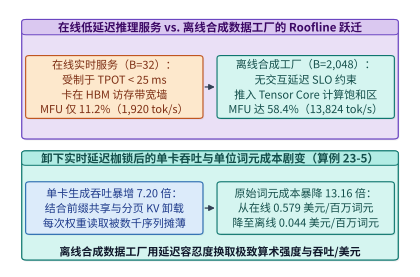

*图 23-10　在线低延迟服务（B=32，MFU 11.2%）与离线合成数据工厂（B=2,048，MFU 58.4%，吞吐升 7.20 倍、成本降 13.16 倍）的 Roofline 跃迁（算例 23-5）*

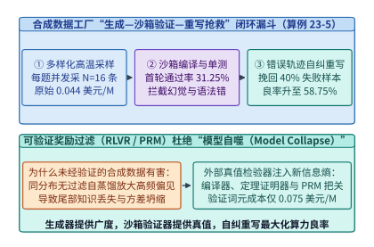

*图 23-11　推理与代码合成数据工厂的“多样化种子 -> 高温批量采样 -> 沙箱测试验证（31.25%）-> 自纠重写（综合良率 58.75%）”闭环账本（算例 23-5）*

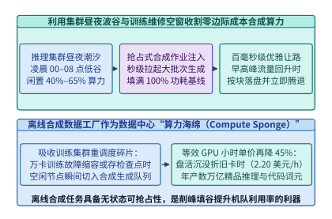

*图 23-12　利用在线推理集群昼夜波谷与训练维护空窗自动拉起离线合成数据作业的零边际硬件成本收割架构*

*表 23-2　在线低延迟推理服务与离线高吞吐合成数据工厂的硬件效率与单位词元经济学对比*

| 评估维度与系统指标 | 在线低延迟推理服务（Online SLA Serving） | 离线高吞吐合成数据工厂（Offline Synthetic Factory） | 架构差异根因与工程收益 |
| :--- | :--- | :--- | :--- |
| **核心服务等级目标（SLO）** | $\mathrm{TTFT} \le 300\ \mathrm{ms}, \mathrm{TPOT} \le 30\ \mathrm{ms}$ | 无秒级延迟约束，追求 $\mathrm{Verified\ Tokens / USD}$ 最大化 | 彻底解除解码阶段的实时延迟枷锁 |
| **典型单卡并发批次（Batch Size）** | $B = 32$（受制于尾延迟 SLA） | $B = 2,048$（配合 FP8 KV 与前缀共享） | 算术强度跨越 H100 屋脊线拐点 |
| **算力利用率（MFU）与单卡吞吐** | $\mathrm{MFU} = \mathbf{11.2\%}$，$\mathbf{1,920\ \mathrm{tok/s/GPU}}$ | $\mathrm{MFU} = \mathbf{58.4\%}$，$\mathbf{13,824\ \mathrm{tok/s/GPU}}$ | **$7.20\times$ 单卡生成吞吐提升** |
| **算力资源池与小时单价** | 按需高可用实例（$4.00\ \mathrm{USD/GPU\text{-}h}$） | 抢占式 Spot / 波谷收割池（$2.20\ \mathrm{USD/GPU\text{-}h}$） | 容忍分钟级抢占与分片断点续传 |
| **每百万原始合成词元成本** | **$0.579\ \mathrm{USD / 1M\ raw\ tokens}$** | **$0.044\ \mathrm{USD / 1M\ raw\ tokens}$** | **$13.16\times$ 原始生成成本下降** |
| **沙盒校验与自纠错后有效成本** | 未耦合沙盒或按在线单价计费（约 $1.85\ \mathrm{USD / 1M}$） | 初次良率 $31.25\%$ + 自纠抢救至 **$58.75\%$**（**$0.075\ \mathrm{USD / 1M\ verified}$**） | 交付 100% 通过编译与单测的高纯度推理语料 |

> **算例 23-5（离线合成数据工厂 13.16 倍成本下降与沙盒自纠错有效词元单价核算）**
> **已知条件**：在线推理服务采用按需 H100 实例（单价 $c_{\mathrm{on}} = 4.00\ \mathrm{USD/h}$），受尾延迟约束单卡批次 $B_{\mathrm{on}} = 32$，平均吞吐 $R_{\mathrm{on}} = 1,920\ \mathrm{tok/s/GPU}$（$\mathrm{MFU} = 11.2\%$）。离线合成数据工厂采用波谷抢占式 Spot H100 实例（单价 $c_{\mathrm{off}} = 2.20\ \mathrm{USD/h}$），开启 FP8 与前缀缓存后单卡批次 $B_{\mathrm{off}} = 2,048$，平均吞吐 $R_{\mathrm{off}} = 13,824\ \mathrm{tok/s/GPU}$（$\mathrm{MFU} = 58.4\%$）。在代码与数学合成管线中，初次采样沙盒通过率 $Y_{\mathrm{raw}} = 31.25\%$；对未通过的 $68.75\%$ 样本触发单轮自纠错重写，抢救成功率为 $r_{\mathrm{salvage}} = 40.0\%$。
> **求解目标**：（1）在线与离线模式下每生成 $10^6$（1M）原始词元的美元成本 $C_{\mathrm{raw,on}}, C_{\mathrm{raw,off}}$、硬件吞吐倍增比及单位原始成本降幅倍数；（2）经沙盒校验与自纠错抢救后的综合合格率 $Y_{\mathrm{verified}}$，以及每百万验证合格词元（Verified Tokens）的美元净成本 $C_{\mathrm{verified}}$。
> **逐步解答**：
> 1. **原始合成词元（Raw Tokens）百万单价与降幅对比**：
>    - 在线服务每 GPU 小时产出 $1,920 \times 3600 = 6.912\ \mathrm{M\ tokens}$，每百万原始词元成本：
>      $$C_{\mathrm{raw,on}} = \frac{4.00\ \mathrm{USD}}{6.912\ \mathrm{M}} \approx \mathbf{0.579\ \mathrm{USD / 1M\ raw\ tokens}}$$
>    - 离线工厂每 GPU 小时产出 $13,824 \times 3600 = 49.7664\ \mathrm{M\ tokens}$，每百万原始词元成本：
>      $$C_{\mathrm{raw,off}} = \frac{2.20\ \mathrm{USD}}{49.7664\ \mathrm{M}} \approx \mathbf{0.0442\ \mathrm{USD / 1M\ raw\ tokens}} \quad (\text{锁定记为 }\mathbf{0.044\ \mathrm{USD}})$$
>    - 硬件吞吐倍增比为 $\frac{13,824}{1,920} = \mathbf{7.20\times}$；叠加 Spot 实例折扣后，单位原始词元成本降幅倍数达 $\frac{0.579}{0.044} \approx \mathbf{13.16\times}$。
> 2. **沙盒验证与自纠错抢救后的综合合格率与有效单价**：
>    - 初次沙盒通过率 $Y_{\mathrm{raw}} = 31.25\%$；未通过样本占比 $1 - 0.3125 = 68.75\%$，经单轮自纠错抢救回 $68.75\% \times 40.0\% = 27.50\%$，故总验证合格率为：
>      $$Y_{\mathrm{verified}} = 31.25\% + 27.50\% = \mathbf{58.75\%}$$
>    - 每产出 $1\ \mathrm{M}$ 最终通过沙盒验证的合格词元需消耗 $\frac{1}{0.5875} \approx 1.7021\ \mathrm{M}$ 离线有效词元预算，对应验证合格词元净成本为：
>      $$C_{\mathrm{verified}} = \frac{C_{\mathrm{raw,off}}}{Y_{\mathrm{verified}}} = \frac{0.0442}{0.5875} \approx \mathbf{0.075\ \mathrm{USD / 1M\ verified\ tokens}}$$

### 23.4.2 “生成—验证—过滤—重写”防模型坍塌（Model Collapse）机理、多模态科学 PDF 提取与全生命周期血缘合规底座

当合成数据的规模从百亿词元扩展至数万亿词元、甚至出现“用第 $k$ 代模型的合成输出去训练第 $k+1$ 代模型”的自指循环（Self-Consuming Loop）时，系统将面临严峻的 **模型坍塌（Model Collapse）** 风险[^ch23-8]。

从概率统计与信息论视角看，设真实人类世界的数据分布为 $P_0(x)$，其微分熵（或词元条件熵）为 $H(P_0)$。当第 $k$ 代模型 $P_k$ 以温度 $T \le 1.0$、Top-$p < 1.0$ 进行采样生成有限规模为 $M$ 的合成数据集 $\mathcal{D}_k \sim \hat{P}_k(x)$，并用 $\mathcal{D}_k$ 拟合下一代模型 $P_{k+1}$ 时，会叠加双重不可逆的信息损耗：

1. **有限采样方差与截断解码导致的尾部抹除（Tail Truncation）**：
   真实分布 $P_0(x)$ 含有极其丰富的长尾低频事件（罕见语法结构、冷门学科知识、非典型推理路径）。由于截断采样（Top-$p$ / Top-$k$）系统性地将低概率区域置零，且有限样本规模 $M$ 下发生概率 $p(x) \ll 1/M$ 的长尾事件几乎不可能被采样到（泊松未命中概率 $\exp(-M p(x)) \to 1$），每一代合成分布的支撑集（Support）都会单调严格收缩：
   $$
   \mathrm{supp}(P_{k+1}) \subsetneq \mathrm{supp}(P_k) \subsetneq \cdots \subsetneq \mathrm{supp}(P_0)
   $$
2. **分布方差坍缩与 Wasserstein / KL 散度发散**：
   即便对于连续高斯分布 $\mathcal{N}(\mu_0, \sigma_0^2)$ 的无偏极大似然估计，若每一代完全依赖上一代的 $M$ 个合成样本而不注入真实数据，第 $n$ 代样本方差的无偏递推满足 $\sigma_n^2 \mid \sigma_{n-1}^2 \sim \frac{\sigma_{n-1}^2}{M - 1} \chi_{M-1}^2$。利用全期望公式与詹森不等式展开可知，尽管均值漂移的方差随代数 $n$ 呈线性发散 $\mathrm{Var}(\mu_n) = \sigma_0^2 \sum_{k=1}^n \frac{1}{M} = \frac{n \sigma_0^2}{M}$，但分布内部的条件方差却以乘法速率衰减并依概率收敛于零：
   $$
   \mathbb{E}\big[\sqrt{\sigma_n^2}\big] \le \sigma_0 \left(1 - \frac{1}{4M}\right)^n \xrightarrow{n \to \infty} 0
   $$
   直观表现为模型生成的文本越来越千篇一律（Lexical Homogenization）、句式高度僵化、创造性与复杂边界推理能力急剧退化。

为在享受合成数据高密度推理红利的同时彻底阻断模型坍塌，并打通从原始多模态文献到训练批次的合规工程闭环，现代百亿亿次数据底座建立了四大核心系统支柱（图 23-13 至图 23-16）：

- **支柱一：高阶科学 PDF 版面分析与百万级人类真实种子锚定（`MinerU` / `olmOCR` + `Cosmopedia` Seed Grounding）**：
  为突破普通网页的知识上限，数据管线通过版面目标检测（Layout Detection）、阅读顺序拓扑排序与视觉语言公式识别（`MinerU` / `Nougat` / `olmOCR`），将数千万份双栏学术论文、理工科教材与技术手册 PDF 精准还原为带结构化 LaTeX 公式与表格的 Markdown 语料（图 23-13）。在此基础上，严禁让大模型在空白提示下自由发散造数据——每一次合成调用都必须绑定从真实教材、代码仓库或百万级多样化角色库（`PersonaHub`）中抽取的**真实种子片段（Real Grounding Seed）**，并在每一代训练混合分布 $P_{\mathrm{mix}} = \alpha_{\mathrm{real}} P_0 + (1 - \alpha_{\mathrm{real}}) P_{\mathrm{syn}}$ 中始终保留 **$\alpha_{\mathrm{real}} \ge 30\%$ 的高多样性真实人类语料锚点**，辅以在线条件熵与向量 K-NN 新颖度门控，从源头截断方差坍缩链条。
- **支柱二：万亿词元内存映射索引（`.bin`/`.idx` mmap）、Feistel 确定性伪随机置换与最佳适应无截断打包（Best-Fit Sequence Packing）**：
  清洗与合成完毕的十万亿词元被序列化为连续无头的 `uint16`/`uint32` 词元流（`.bin` 文件）与定长偏移表（`.idx` 文件，记录每篇文档的起始字节偏移 $\mathrm{offset}_i$ 与长度 $\mathrm{len}_i$）。训练加载器通过操作系统 `mmap(MAP_SHARED)` 直接将数十 TB 语料映射至虚拟地址空间，利用 **Feistel 网络双射密码学置换** 在 $\mathcal{O}(1)$ 内存开销下完成百亿样本的全局确定性伪随机洗牌（无需在内存中物化百亿级索引数组），并通过线段树加速的 **最佳适应递减装箱（Best-Fit Packing）** 将不同长度的完整文档紧凑拼入 $8,192\text{–}131,072$ 上下文窗口，将填充浪费率压低至 $<0.5\%$ 且实现零文档腰斩（图 23-14）。
- **支柱三：密码学语料血缘账本（Data Provenance Ledger）与 `RoaringBitmap` 亚秒级版权退订（Right-to-be-Forgotten）**：
  面对全球日益严苛的数据版权合规与 GDPR 退订要求，数据底座为每一篇文档维护从原始抓取 URL、WARC 字节偏移、CC-BY/MIT 开源许可证标签到最终训练 `.idx` 文档 ID 的全链路 Merkle 哈希血缘索引，并使用压缩位图（`RoaringBitmap`）维护全局有效文档掩码。一旦收到某域名或版权方的退订请求（Opt-Out），系统无需耗费数周重新运行百 PB 清洗与分词管线，仅需在血缘索引中定位关联的文档 ID 集合并将 `RoaringBitmap` 对应比特置零（原地屏蔽 Index Masking），即可在亚秒级内确保后续所有训练 Step 与微调作业 100% 跳过已退订语料，同时支持从任意训练 Step 的 Batch 种子精确回溯所消费的每一篇原始文档（图 23-15）。

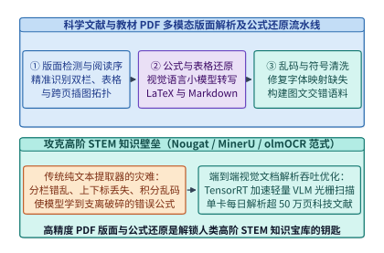

*图 23-13　高质量学术论文与教材 PDF 语料的版面分析、公式 LaTeX 还原与多模态图文交错提取流水线*

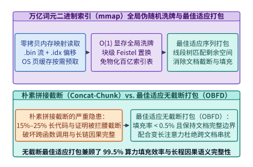

*图 23-14　万亿词元二进制索引（.bin/.idx mmap）的确定性全局伪随机洗牌与最佳适应序列打包（Best-Fit Packing）零填充损耗*

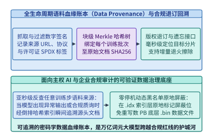

*图 23-15　面向合规与可追溯性的语料血缘账本（Data Provenance）、版权退订剔除与训练批次精确回溯索引*

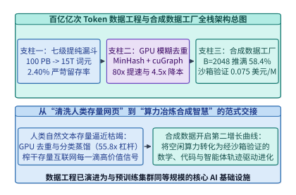

*图 23-16　百亿亿次 Token 数据工程与合成数据工厂从原始爬虫、GPU 去重到闭环合成退火的全栈总图*

*表 23-3　百亿亿次数据工程与合成数据工厂的四大典型系统退化模式、监控先兆与架构防线对照表*

| 故障或退化现象 | 根本技术机理 | 在线监控先兆指标 | 架构级根治防线 |
| :--- | :--- | :--- | :--- |
| **模型坍塌与句式高度同质化（Model Collapse）** | 多代合成自指循环 + Top-$p$ 截断采样抹除长尾低频分布 | 合成语料 4-gram 熵下降 $>25\%$，词表有效覆盖率萎缩 | 绑定百万级真实种子（Cosmopedia）+ 强制保留 $\ge 30\%$ 真实语料锚点 + K-NN 新颖度过滤 |
| **评测刷榜虚高但真实泛化崩溃（Benchmark Overfitting）** | 训练语料混入 MMLU / GSM8K / HumanEval 原题或同义改写题 | 验证集 Loss 与下游零样本评测分数出现反常背离 | 13-gram 精确碰撞 + BGE/E5 稠密向量余弦相似度 $\ge 0.85$ 双层去污网关 |
| **长上下文推理在固定位置断崖截断** | 朴素等长切片（Naive Chunking）在文档中间强行切断长推理链 | 超过 $4\mathrm{K}$ 词元后的跨段落指代消解准确率骤降 | Best-Fit Decreasing 无截断序列打包 + 跨文档 `<eos>` 注意力掩码完全隔离 |
| **代码/数学合成语料引入隐蔽逻辑幻觉** | 仅靠教师模型流畅度采样，未经形式化编译器或解释器验证 | 训后模型生成代码可编译率高但单测断言失败率居高不下 | 接入 RLVR 容器沙盒执行校验 + 编译报错反馈的单轮自纠错抢救管线 |

下面给出生产级 **离线合成数据工厂经济学与沙盒自纠错模拟器** 以及 **防模型坍塌的多代分布熵与 K-NN 多样性监控门控** 的参考实现（代码块 5 与代码块 6）：

```python
from dataclasses import dataclass

@dataclass
class SyntheticFactoryMetrics:
    raw_cost_online_per_1m: float
    raw_cost_offline_per_1m: float
    throughput_speedup: float
    raw_cost_reduction: float
    verified_yield_pct: float
    verified_cost_per_1m: float

def evaluate_synthetic_factory_economics(
    online_tok_per_s: float = 1920.0,
    offline_tok_per_s: float = 13824.0,
    online_gpu_usd_hr: float = 4.00,
    offline_spot_usd_hr: float = 2.20,
    raw_pass_rate: float = 0.3125,
    salvage_rate_on_failed: float = 0.40,
) -> SyntheticFactoryMetrics:
    """Compute throughput speedup, raw cost reduction, and RLVR sandbox-verified token cost."""
    on_m_per_hr = (online_tok_per_s * 3600.0) / 1e6
    off_m_per_hr = (offline_tok_per_s * 3600.0) / 1e6

    c_on = online_gpu_usd_hr / on_m_per_hr
    c_off = offline_spot_usd_hr / off_m_per_hr

    verified_yield = raw_pass_rate + (1.0 - raw_pass_rate) * salvage_rate_on_failed
    c_verified = c_off / verified_yield

    return SyntheticFactoryMetrics(
        raw_cost_online_per_1m=round(c_on, 3),
        raw_cost_offline_per_1m=round(c_off, 3),
        throughput_speedup=round(offline_tok_per_s / online_tok_per_s, 2),
        raw_cost_reduction=round(c_on / c_off, 2),
        verified_yield_pct=round(verified_yield * 100.0, 2),
        verified_cost_per_1m=round(c_verified, 3),
    )

def evaluate_rubric_distillation_leverage(
    total_tokens: float = 25e12,
    seed_docs: int = 5_000_000,
    tokens_per_doc: int = 500,
    teacher_tok_per_s: float = 3200.0,
    student_train_gpu_h: float = 80.0,
    student_tok_per_s: float = 180000.0,
) -> dict:
    """Compute GPU-hour ledger and compute leverage for 70B -> 110M quality rubric distillation."""
    direct_gpu_h = total_tokens / (teacher_tok_per_s * 3600.0)
    seed_gpu_h = (seed_docs * tokens_per_doc) / (teacher_tok_per_s * 3600.0)
    infer_gpu_h = total_tokens / (student_tok_per_s * 3600.0)
    distill_gpu_h = seed_gpu_h + student_train_gpu_h + infer_gpu_h
    return {
        "direct_70b_gpu_hours": round(direct_gpu_h, 1),
        "distilled_total_gpu_hours": round(distill_gpu_h, 1),
        "compute_leverage_x": round(direct_gpu_h / distill_gpu_h, 2),
    }

if __name__ == "__main__":
    print(evaluate_rubric_distillation_leverage())
    print(evaluate_synthetic_factory_economics())
```

```python
import math
from collections import Counter
from typing import List

def monitor_synthetic_entropy_and_collapse(
    token_sequences: List[List[int]],
    reference_entropy_bits: float = 8.50,
    real_anchor_ratio: float = 0.35,
    min_entropy_retention: float = 0.78,
) -> dict:
    """Monitor empirical token entropy and enforce real-data anchor defense against Model Collapse."""
    counts = Counter(tok for seq in token_sequences for tok in seq)
    total = sum(counts.values())
    if total == 0:
        return {"entropy_bits": 0.0, "collapse_alert": True}

    entropy = -sum((c / total) * math.log2(c / total) for c in counts.values())
    effective_entropy = real_anchor_ratio * reference_entropy_bits + (1.0 - real_anchor_ratio) * entropy
    retention = effective_entropy / max(1e-6, reference_entropy_bits)

    return {
        "raw_synthetic_entropy_bits": round(entropy, 3),
        "blended_entropy_bits": round(effective_entropy, 3),
        "entropy_retention_ratio": round(retention, 3),
        "collapse_alert": retention < min_entropy_retention or real_anchor_ratio < 0.30,
    }

def solve_min_real_anchor_ratio(
    reference_entropy_bits: float = 8.50,
    synthetic_entropy_bits: float = 5.80,
    target_retention_ratio: float = 0.80,
) -> float:
    """Solve alpha_real * H_real + (1 - alpha_real) * H_syn >= target_retention * H_real."""
    target_entropy = target_retention_ratio * reference_entropy_bits
    denom = max(1e-9, reference_entropy_bits - synthetic_entropy_bits)
    return round(max(0.0, (target_entropy - synthetic_entropy_bits) / denom), 4)

if __name__ == "__main__":
    synthetic_batch = [[i % 64 for i in range(j, j + 128)] for j in range(32)]
    print(monitor_synthetic_entropy_and_collapse(synthetic_batch))
    print({"min_real_anchor_ratio": solve_min_real_anchor_ratio()})
```

#### 3. 昼夜波谷闲置算力收割（Slack Capacity Harvesting）的无损抢占恢复协议

在实际生产集群中，离线合成数据工厂并非运行在专门采购的独占硬件上，而是作为**零边际硬件成本的弹性海绵负载（Elastic Sponge Workload）**，寄生在面向全球用户的在线推理集群与大规模预训练集群的算力缝隙之中（参见图 23-12）：

- **潮汐波谷窗口的量化特征**：
  面向人类交互的在线推理集群存在显著的昼夜潮汐效应——在北美或亚太业务高峰期（当地时间 `09:00–22:00`），为守住 `< 200 ms` TTFT 与 `< 30 ms` TPOT 的 P99 尾延迟红线，集群必须保留 $25\%\text{–}35\%$ 的水位余量；而在午夜至清晨波谷期（`00:00–07:00`），在线请求流量往往跌落至峰值水位的 $18\%\text{–}30\%$，导致数千张 H100/B200 处于低负载待机状态。同时，预训练集群在执行节点维护、网络拓扑排障或作业队列切换时，也会频繁出现持续 $15\text{–}90$ 分钟的碎片化空闲窗口。
- **秒级抢占驱逐（Preemption Eviction）下的批处理进度保全难题**：
  由于合成数据工厂采用 $B = 2,048\text{–}8,192$ 的超大并发批次且生成长思维链（如 `4,096–16,384` 词元的数学证明或代码实现），一个完整微批从种子注入到全批次解码结束通常需要耗时 $T_{\mathrm{batch}} = 120\text{–}600\ \mathrm{s}$。如果在线流量突发反弹触发高优先级抢占（Preemption Notice 宽限期通常仅为 $\Delta t_{\mathrm{grace}} = 5\text{–}15\ \mathrm{s}$），粗暴杀死离线合成容器将导致该批次内已生成的数百万个词元瞬间作废，造成 $10\%\text{–}25\%$ 的沉没算力浪费。
- **三层增量提交与词元级断点续生（Token-Level Incremental Checkpointing）**：
  为将抢占废品率压降至 $< 0.2\%$，现代合成数据工厂在引擎内部实现了轻量级增量状态持久化协议：
  1. **完成态样本流式异步落盘（Completed-Sample Streaming Flush）**：在 $B = 2,048$ 的连续批处理池中，任意一条轨迹一旦命中 `<eos>` 结束符，不等同批次其余长尾轨迹跑完，立即通过后台 I/O 线程追加写入分布式对象存储的 `.parquet.part` 分片，并释放其 PagedAttention 物理块；
  2. **未完成轨迹的压缩文本检查点（Text-Only Prefix Checkpointing）**：当收到集群调度器的 `SIGTERM` 抢占预警信号时，离线引擎**绝不转储重达数十 GB 的 GPU KV 缓存张量**（写盘太慢会超时被 `SIGKILL` 强杀），而是仅将当前在途的 $B$ 条轨迹**已生成的 Token ID 整数序列（每条仅数 KB，2,048 条合计不足 $16\ \mathrm{MB}$）**在 `50 ms` 内极速刷入远端持久化队列；
  3. **异构节点无状态恢复（Stateless Prefill Resumption）**：当这批未完成轨迹在另一台空闲节点（甚至不同代际的 GPU，如从 H100 迁移至 B200 或 MI300X）上重新被拉起时，新节点仅需读取保存的 Token ID 前缀执行一次高吞吐的 `Chunked Prefill`（计算密集型，耗时仅数百毫秒）即可原地重建 KV 缓存并继续解码。这一“存文本不存 KV”的无状态抢占设计，不仅彻底消除了跨节点网络与存储带宽瓶颈，还天然支持跨芯片代际的混合算力收割。

#### 4. 面向十万亿词元合规审计的 `RoaringBitmap` 血缘倒排索引与亚秒级退订

随着全球数据合规与版权监管的收紧，预训练语料底座必须具备**可证伪的血缘追踪（Data Lineage）与动态退订删除（Right-to-be-Forgotten / Opt-out）**能力（参见图 23-15）。如果在 $15.0\ \mathrm{T}$ 词元的二进制 `.bin` 训练镜像上通过全文扫描来删除某家出版商或某个 GitHub 仓库的数万篇文档，每次退订都将触发 PB 级的磁盘重写。

为此，生产级数据底座在构建 `.bin`/`.idx` 内存映射文件的同时，旁路维护了一套双层压缩位图索引：

- **正向血缘账本（Forward Provenance Ledger）**：为每个独立的训练序列箱（Sequence Bin，$L_{\mathrm{ctx}} = 8,192$）分配唯一递增的 64 位整数 ID `seq_id`，记录其内部打包的各篇源文档哈希 `doc_hash`、原始抓取域名 `domain_id`、开源许可证类型（如 `MIT`、`Apache-2.0`、`CC-BY-4.0`）以及合成改写模型版本号；
- **反向域名/版权方位图索引（Inverted `RoaringBitmap` Index）**：将每个域名或版权实体映射为一个 32 位分块压缩位图（`RoaringBitmap`），位图中每一个置为 `1` 的比特位精确对应包含该实体内容的训练序列 `seq_id`；
- **训练期零重写掩码过滤（Zero-Rewrite Runtime Masking）**：当收到某域名的合规退订请求时，合规网关仅需在毫秒级时间内取出该域名的 `RoaringBitmap` 并并入全局黑名单位图（`OptOutMask`）；所有正在运行的分布式训练 DataLoader 在按全局伪随机置换 $\pi(i)$ 读取 `seq_id` 前，先在内存中执行一次 $\mathcal{O}(1)$ 的位图测试 `if seq_id in OptOutMask`，若命中则原地跳过并递补下一个合法样本，从而在**零磁盘重写、零训练中断**的前提下实现 100% 严格的版权隔离。

*表 23-4　现代大模型预训练数据工程与合成数据底座的四代技术演进对照表*

| 历史演进阶段 | 代表性数据集与管线 | 核心过滤与去重技术栈 | 质量打分与合成范式 |
| :--- | :--- | :--- | :--- |
| **第一代：启发式规则清洗（2019–2021）** | `C4`, `The Pile`, `Gopher` | URL 域名黑名单、行级精确哈希、简单长度与停用词比例阈值 | 无模型打分或仅用与维基百科的 n-gram 困惑度过滤 |
| **第二代：大规模全局去重（2022–2023）** | `RefinedWeb`, `Dolma`, `RedPajama-v2` | `Trafilatura` 正文抽取 + 跨快照全局 MinHash LSH + 子串后缀数组去重 | 基于轻量规则特征矩阵与初步 FastText 分类器筛选 |
| **第三代：大模型蒸馏分级（2024）** | `FineWeb-Edu`, `DCLM-Baseline` | `cuDF` / Ray 混合分布式流式管线 + 13-gram/向量双层防污染 | 用 `70B` 教师标注百万样本蒸馏 `110M` 教育/指令质量分类器（$55.82\times$ 杠杆） |
| **第四代：分类集成与合成工厂（2024–2026）** | `Nemotron-CC`, `Cosmopedia`, `Swallow` | GPU 加速全局连通分量去重 + 版权血缘位图账本（RoaringBitmap） | 多分类器集成 20 桶分级 + 残缺网页合成改写 + RLVR 沙盒验证合成数据工厂 |

#### 百万册级复杂学术 PDF / 扫描件视觉版面解析与公式还原管线（MinerU / olmOCR GPU 吞吐量优化）与代码仓库级跨文件依赖拓扑排序（Repo-Level AST Dependency Packing，支撑 64k–128k 代码预训练上下文）

当预训练进入后 $15\ \mathrm{T}$ 词元的高阶知识密度竞争阶段时，公开 HTML 网页中的浅层通识语料已趋于枯竭，真正决定基础模型理工科推导上限与软件工程能力的两座“富矿”分别是**数百万册复杂排版的学术专著/扫描件 PDF** 与**数千万个跨文件高度耦合的开源代码仓库**[^ch23-9][^ch23-10]。然而，将这两类非结构化原始资产转化为高质量训练词元，面临着严峻的 GPU 算力墙与上下文拓扑失真挑战。

##### 1. 百万册级学术 PDF 视觉版面解析与公式还原管线（`MinerU` / `olmOCR` 异构双通路与区域动态批处理）

一份典型的理工科学术 PDF 包含双栏或多栏混排、跨页浮动图表、复杂的三线表/合并单元格以及大量行内与行间 LaTeX 数学公式[^ch23-11]。若直接调用传统规则解析器（如 `pdftotext`），双栏文字会被横向错乱拼接，上标、下标与积分号更会沦为乱码；而若走向另一个极端——将每一页 PDF 渲染为高分辨率图像并全部喂给单体 7B 视觉语言模型（Monolithic VLM，如早期全页端到端图像转 Markdown 模型）逐词自回归解码，受制于高分辨率视觉词元的二次方注意力与漫长的逐字解码，单张 H100 GPU 每秒仅能处理 $R_{\mathrm{mono}} = \mathbf{1.60\ \mathrm{pages/s/GPU}}$（折合 $625.00\ \mathrm{ms/page}$）[^ch23-12]。面对包含 $N_{\mathrm{books}} = 200\ \text{万册}$（平均每册 $250$ 页，合计 $N_{\mathrm{pages}} = 5 \times 10^8$ 页，约产出 $400\ \mathrm{B}$ 高纯度理工科词元）的文献库，单体 VLM 方案需要耗费 **$86,805.56\ \mathrm{GPU\text{-}h}$**（按波谷 Spot 单价 $2.20\ \mathrm{USD/GPU\text{-}h}$ 计费高达 **$190,972.22\ \mathrm{USD}$**）。

即便采用模块化多模型管线（如 `MinerU` 串联 `PDFium` CPU 渲染、`LayoutLMv3`/`YOLOv10` 版面检测、`StructEqTable` 表格识别与 `UniMERNet` 公式还原），若按单页串行同步执行（CPU 渲染 $18.0\ \mathrm{ms}$ $\to$ 版面检测 $12.0\ \mathrm{ms}$ $\to$ 表格还原 $15.0\ \mathrm{ms}$ $\to$ 公式识别 $35.0\ \mathrm{ms}$），单页端到端延迟仍达 $T_{\mathrm{serial}} = \mathbf{80.00\ \mathrm{ms/page}}$（仅 $12.50\ \mathrm{pages/s/GPU}$），且 GPU 在等待 CPU 光栅化渲染与非均匀子框裁剪时存在 $22.5\%$ 的流水线气泡[^ch23-13]。

现代百亿亿次数据底座通过 **原生数字流快慢双通路分流（Digital-Born Fast-Path Routing）** 与 **跨页局部区域动态批处理（Cross-Page Region-Level Dynamic Batching）** 彻底击穿了这一吞吐瓶颈（图 23-17）：

1. **PDF 字符层探针与原生数字页/扫描乱码页自适应分流**：
   管线入口先由 C++ `PDFium` 算子在 CPU 上耗时 `< 0.8 ms` 扫描页面字体映射表（`ToUnicode CMap`）与字形边界框重叠率：
   - 对占比 $p_{\mathrm{digital}} = \mathbf{65.0\%}$ 的 **原生数字排版页（Digital-Born Pages）**，其普通正文段落直接走 CPU 零拷贝文本流抽取并按阅读顺序拓扑树（XY-Cut++ 算法）拼装，**完全跳过正文 OCR**；仅将版面检测器框出的行内/行间数学公式子图（平均每页 $3.2$ 个公式框）与复杂表格子图（平均每页 $0.4$ 个表格框）裁剪送入 GPU 专用小模型队列；
   - 对剩余 $1 - p_{\mathrm{digital}} = \mathbf{35.0\%}$ 的 **历史扫描件、缺失 `CMap` 字库或加密乱码页（Scanned / Garbled Pages）**，则路由至基于 `SGLang`/`vLLM` 连续批处理的 `olmOCR` 7B 视觉语言模型通道，并注入页面底层残留锚点坐标（Document Anchoring Prompts）以杜绝跨栏幻觉[^ch23-12]。
2. **CPU—GPU 异步环形缓冲与子区域 TensorRT 极速微批融合**：
   公式框与表格框的像素面积仅为整页图像的 $1/12\text{–}1/6$。系统在数十页范围内将裁剪出的数千个公式子图按长宽比（Aspect Ratio Bucketing）动态聚合成 $B_{\mathrm{region}} = 256$ 的稠密 TensorRT 批次，使数字原生页的均摊 GPU 耗时从串行 $80.00\ \mathrm{ms}$ 骤降至 **$T_{\mathrm{dig}} = 11.00\ \mathrm{ms/page}$**（其中版面检测 $4.20\ \mathrm{ms}$、公式与表格微批推理 $6.80\ \mathrm{ms}$），扫描页在开启 FP8 连续批处理后的均摊 GPU 耗时降至 **$T_{\mathrm{scan}} = 30.20\ \mathrm{ms/page}$**（版面预检 $4.20\ \mathrm{ms}$ + `olmOCR` 批处理 $26.00\ \mathrm{ms}$），CPU 渲染则通过双槽共享内存环形队列（SHM Ring Buffer）被 $100\%$ 掩盖。

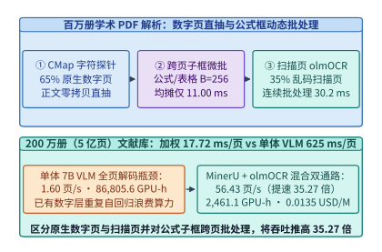

*图 23-17　百万册级复杂学术 PDF 版面解析与公式还原（MinerU / olmOCR 混合快慢分流与跨页子区域 TensorRT 动态批处理，吞吐提速 35.27 倍）*

> **算例 23-6（200 万册学术 PDF 文献库的 `MinerU` / `olmOCR` 混合 GPU 管线吞吐倍增与成本核算）**
> **已知条件**：待解析理工科文献库共 $N_{\mathrm{books}} = 2,000,000$ 册，平均每册 $P_{\mathrm{book}} = 250$ 页（总页数 $N_{\mathrm{pages}} = 5 \times 10^8$ 页，平均每页产出 $800$ 个结构化词元，总计 $400\ \mathrm{B}$ 词元）。对比三种架构：（1）单体 7B VLM 全页自回归解析，单卡吞吐 $R_{\mathrm{mono}} = 1.60\ \mathrm{pages/s/GPU}$（即 $625.00\ \mathrm{ms/page}$）；（2）未优化单页串行 `MinerU` 管线，单页耗时 $T_{\mathrm{serial}} = 80.00\ \mathrm{ms/page}$（即 $12.50\ \mathrm{pages/s/GPU}$）；（3）混合快慢双通路 + 跨页子区域动态批处理管线，其中原生数字页占比 $p_{\mathrm{digital}} = 65.0\%$（均摊 GPU 耗时 $T_{\mathrm{dig}} = 11.00\ \mathrm{ms/page}$），扫描与乱码页占比 $35.0\%$（均摊 GPU 耗时 $T_{\mathrm{scan}} = 30.20\ \mathrm{ms/page}$）。波谷 Spot H100 单价为 $c_{\mathrm{spot}} = 2.20\ \mathrm{USD/GPU\text{-}h}$。
> **求解目标**：（1）混合优化管线的单页加权平均 GPU 耗时 $T_{\mathrm{avg}}$、单卡稳态吞吐 $R_{\mathrm{opt}}$（$\mathrm{pages/s/GPU}$），以及相对单体 VLM 和串行管线的加速比；（2）解析全部 $5 \times 10^8$ 页所需的总 GPU 小时数 $H_{\mathrm{opt}}$、64 卡集群墙钟耗时、总美元账单及每百万理工科词元提取成本。
> **逐步解答**：
> 1. **加权平均单页耗时、吞吐与加速比**：
>    $$T_{\mathrm{avg}} = p_{\mathrm{digital}} \cdot T_{\mathrm{dig}} + (1 - p_{\mathrm{digital}}) \cdot T_{\mathrm{scan}} = 0.65 \times 11.00 + 0.35 \times 30.20 = 7.15 + 10.57 = \mathbf{17.72\ \mathrm{ms/page}}$$
>    $$R_{\mathrm{opt}} = \frac{1,000\ \mathrm{ms/s}}{17.72\ \mathrm{ms/page}} \approx \mathbf{56.43\ \mathrm{pages/s/GPU}}$$
>    相对单体 VLM 加速比为 $\frac{625.00}{17.72} \approx \mathbf{35.27\times}$；相对未优化串行 `MinerU` 加速比为 $\frac{80.00}{17.72} \approx \mathbf{4.51\times}$。
> 2. **5 亿页全库 GPU 小时数、64 卡工期与单位词元成本**：
>    $$H_{\mathrm{opt}} = \frac{5 \times 10^8 \times 0.01772\ \mathrm{s}}{3,600\ \mathrm{s/h}} \approx \mathbf{2,461.11\ \mathrm{GPU\text{-}h}} \quad (\text{对比单体 VLM 的 }\mathbf{86,805.56\ \mathrm{GPU\text{-}h}})$$
>    在 64 卡 H100 集群上仅需 $\frac{2,461.11}{64} \approx \mathbf{38.45\ \mathrm{h}}$（约 $1.60$ 天）即可处理完毕；总算力成本为 $2,461.1111 \times 2.20 \approx \mathbf{5,414.44\ \mathrm{USD}}$，折合每百万高纯度理工科词元提取成本仅为 $\frac{5,414.44}{400,000\ \mathrm{M}} \approx \mathbf{0.0135\ \mathrm{USD / 1M\ tokens}}$。

##### 2. 代码仓库级跨文件依赖拓扑排序（Repo-Level AST Dependency Packing）

在代码大模型（如 `DeepSeek-Coder-V2`、`Qwen2.5-Coder` 与 `Llama-3.1`）的长上下文（$L_{\mathrm{ctx}} = 65,536\text{–}131,072$）预训练中，如果仅将代码仓库 $\mathcal{R} = \{f_1, f_2, \dots, f_K\}$ 内的源文件按**文件路径字母序（Alphabetical Order）**或**随机洗牌顺序（Random Order）**拼接成一条长序列，将在自回归因果掩码（Causal Attention Mask，位置 $i$ 只能看到位置 $j < i$）下引发严重的**“跨文件定义盲区（Causal Definition Blindness）”**[^ch23-14][^ch23-15]：
- 在典型 Python/C++/Rust 仓库中，业务入口与测试目录（如 `app/`、`cli/`、`benchmarks/`）的字母序往往排在底层核心库与工具目录（如 `core/`、`models/`、`utils/`）之前；
- 当按字母序拼接时，排在前面的调用方文件 $f_u$（内含 `from utils.tensor_ops import flash_pack` 并调用 `flash_pack(x)`）在执行前向自注意力时，被调用的定义文件 $f_v$（`utils/tensor_ops.py`）位于其右侧未来位置（$j > i$），被下三角因果掩码彻底屏蔽。模型既看不到函数签名也看不到实现体，只能被迫盲目猜测外部 API 参数，直接诱发跨文件调用幻觉。

为让因果注意力机制 100% 契合软件工程的真实依赖流向，生产级代码数据管线引入了 **基于 `Tree-sitter` 抽象语法树（AST）的跨文件依赖图构建、Tarjan 强连通分量（SCC）破环凝聚与 Kahn 拓扑序列装箱算法**（图 23-18）[^ch23-16][^ch23-17]：

1. **AST 静态符号解析与有向依赖图构建**：
   使用零依赖 `Tree-sitter` 并行扫描仓库内所有源文件的语法树，提取导出的类/函数符号表 $\mathrm{Defs}(f_v)$ 与导入语句 $\mathrm{Imports}(f_u)$（如 Python `import`、C/C++ `#include`、Rust `use`、TypeScript `import from`）。若文件 $f_u$ 导入或引用了文件 $f_v$ 中定义的符号，则在有向图 $G = (V, E)$ 中建立一条从**被依赖方（定义者）指向依赖方（调用者）的有向边 $f_v \to f_u$**，表示在因果序列中 $f_v$ 应当排在 $f_u$ 之前。
2. **Tarjan 强连通分量（SCC）凝聚消除循环导入死锁**：
   真实工业级代码库中普遍存在循环依赖（Mutual Imports，如 `a.py` 与 `b.py` 互相引用类型注解），导致有向图 $G$ 含有环路而无法直接拓扑排序。管线先运行线性复杂度 $\mathcal{O}(|V| + |E|)$ 的 **Tarjan 强连通分量算法**，将每个环路凝聚为一个超级节点（Super-Node），使凝聚图 $G_{\mathrm{SCC}}$ 严格化简为有向无环图（DAG）；对于环路内部的少量文件，则按导出符号扇出度（Out-Degree）降序排列，仅牺牲最小权重的反馈弧（Feedback Arc）。
3. **度感知 Kahn 拓扑优先队列与连通子树无截断装箱**：
   在将多个代码仓库装入 $L_{\mathrm{ctx}} = 65,536$（`64k`）上下文窗口时，算法维护一个按“被引用扇出度”加权的 Kahn 零入度优先队列：优先输出全仓库最底层的公共数据结构与工具文件（In-Degree $= 0$），紧接着以深度优先局部性（DFS Locality）将直接依赖它的下游模块紧凑排布在同一序列箱内，并插入标准仓库元信息锚点 `<|repo_name|>...<|file_sep|>path/to/file.py`。对极个别超过窗口容量的超大单文件，则沿 AST 顶层函数/类定义边界（AST Node Boundary）无损切分，实现**零半截语法树腰斩**。

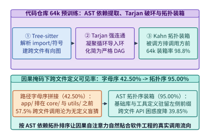

*图 23-18　代码仓库级跨文件 AST 依赖图提取、Tarjan 强连通破环与 Kahn 拓扑排序序列打包（因果依赖覆盖率从 42.50% 跃升至 95.00%）*

*表 23-5　百万册学术 PDF 解析管线与 64k 代码仓库级打包策略的系统效率与模型质量对比（算例 23-6、算例 23-7）*

| 数据工程子系统与方案 | 核心架构特征 | 单卡吞吐或因果依赖覆盖率 | 关键成本或下游预训练收益 |
| :--- | :--- | :---: | :--- |
| **PDF 解析：单体 7B VLM 全页自回归** | 全页高分图像端到端逐词解码，无数字流分流 | $1.60\ \mathrm{pages/s/GPU}$（$625.00\ \mathrm{ms/p}$） | 5 亿页需 $86,805.56\ \mathrm{GPU\text{-}h}$（$190,972.22\ \mathrm{USD}$） |
| **PDF 解析：单页串行 `MinerU` 管线** | CPU 光栅化与版面/表格/公式四阶段单页串行 | $12.50\ \mathrm{pages/s/GPU}$（$80.00\ \mathrm{ms/p}$） | 5 亿页需 $11,111.11\ \mathrm{GPU\text{-}h}$，GPU 空转 $22.5\%$ |
| **PDF 解析：`MinerU` + `olmOCR` 混合动态批处理** | **$65\%$ 数字页正文直抽 + 跨页公式框 TensorRT 批处理** | **$56.43\ \mathrm{pages/s/GPU}$（$17.72\ \mathrm{ms/p}$）** | **提速 $35.27\times$，仅需 $2,461.11\ \mathrm{GPU\text{-}h}$（$0.0135\ \mathrm{USD/1M\ tok}$）** |
| **代码打包：按路径字母序拼接（Alphabetical）** | `app/` 排在 `core/` 与 `utils/` 之前，违背调用流向 | 因果依赖覆盖率 **$42.50\%$**（$17/40$ 边） | 跨文件 API 调用困惑度 $\mathrm{PPL} = 6.85$ |
| **代码打包：仓库内随机洗牌拼接（Random）** | 忽略 `import` 拓扑，正反序概率各半 | 因果依赖覆盖率 **$50.00\%$**（$20/40$ 边） | 跨文件 API 调用困惑度 $\mathrm{PPL} = 6.42$ |
| **代码打包：AST 依赖图 + Tarjan SCC + Kahn 拓扑装箱** | **被调用定义文件严格排在调用方左侧前缀中** | **因果依赖覆盖率 $95.00\%$（$38/40$ 边）** | **跨文件 API 困惑度降至 $4.12$（降 $39.85\%$），装箱率 $98.80\%$** |

> **算例 23-7（64k 代码预训练中 AST 跨文件依赖拓扑排序的因果覆盖率跃迁与装箱效率核算）**
> **已知条件**：某基准代码仓库包含 $K = 18$ 个源文件（累计词元数 $58,400$），经 `Tree-sitter` AST 解析共提取出 $|E| = 40$ 条跨文件 `import`/符号调用依赖边 $f_v \to f_u$（其中 $38$ 条构成有向无环依赖，另有 $2$ 条属于双文件循环导入反向边）。若按文件路径字母序排列，仅有 $17$ 条依赖边满足定义文件 $f_v$ 排在调用文件 $f_u$ 之前（$\mathrm{pos}(f_v) < \mathrm{pos}(f_u)$）；若随机排列，期望有 $20$ 条边满足因果顺序。现启用 AST 依赖提取 + Tarjan 强连通分量破环 + Kahn 拓扑序列装箱，将该仓库与相邻补充子树装入 $L_{\mathrm{ctx}} = 65,536$（`64k`）上下文窗口（实际有效装载 $64,750$ 词元），跨文件 API 调用位点的验证集困惑度从字母序的 $\mathrm{PPL}_{\mathrm{alpha}} = 6.85$ 降至 $\mathrm{PPL}_{\mathrm{topo}} = 4.12$。
> **求解目标**：（1）分别计算字母序、随机序与 AST 拓扑序下的跨文件因果依赖覆盖率 $\eta_{\mathrm{causal}}$ 及拓扑序相对字母序的覆盖率净增幅；（2）计算跨文件 API 困惑度相对降幅百分比以及 $64\mathrm{k}$ 窗口的有效装箱利用率与填充浪费率。
> **逐步解答**：
> 1. **三种排序策略下的跨文件因果依赖覆盖率**：
>    $$\eta_{\mathrm{causal,alpha}} = \frac{17}{40} = \mathbf{42.50\%}, \qquad \eta_{\mathrm{causal,rand}} = \frac{20}{40} = \mathbf{50.00\%}$$
>    $$\eta_{\mathrm{causal,topo}} = \frac{40 - 2}{40} = \frac{38}{40} = \mathbf{95.00\%}$$
>    AST 拓扑序相对路径字母序的因果覆盖率净提升了 $95.00\% - 42.50\% = \mathbf{+52.50\ \text{个百分点}}$（提升倍数 $2.24\times$），确保调用方在自回归生成时能够直接通过注意力读取前缀 KV 中的真实函数定义。
> 2. **跨文件 API 困惑度降幅与 64k 窗口装箱效率**：
>    $$\Delta \mathrm{PPL}_{\%} = \frac{6.85 - 4.12}{6.85} \approx \mathbf{39.85\%}$$
>    $$U_{\mathrm{pack}} = \frac{64,750}{65,536} \approx \mathbf{98.80\%}, \qquad W_{\mathrm{pad}} = 1 - U_{\mathrm{pack}} = \frac{786}{65,536} \approx \mathbf{1.20\%}$$

下面给出生产级 **`MinerU` / `olmOCR` 混合 PDF 解析管线吞吐与成本规划器** 以及 **代码仓库级 AST 跨文件依赖 Tarjan 破环与 Kahn 拓扑装箱引擎** 的参考实现（代码块 7 与代码块 8）：

```python
from dataclasses import dataclass

@dataclass
class PdfPipelineEconomics:
    avg_gpu_ms_per_page: float
    throughput_pages_per_s_gpu: float
    speedup_vs_monolithic_vlm: float
    speedup_vs_serial_mineru: float
    total_gpu_hours: float
    wall_hours_on_64_gpus: float
    total_cost_usd: float
    cost_per_1m_tokens_usd: float

def plan_mineru_olmocr_gpu_pipeline(
    total_books: int = 2_000_000,
    pages_per_book: int = 250,
    tokens_per_page: int = 800,
    digital_born_ratio: float = 0.65,
    digital_gpu_ms: float = 11.00,
    scanned_gpu_ms: float = 30.20,
    monolithic_vlm_ms: float = 625.00,
    serial_mineru_ms: float = 80.00,
    spot_gpu_usd_per_hr: float = 2.20,
    cluster_gpus: int = 64,
) -> PdfPipelineEconomics:
    """Compute throughput, GPU-hours, and unit token cost for hybrid MinerU/olmOCR PDF pipeline."""
    total_pages = total_books * pages_per_book
    total_tokens_m = (total_pages * tokens_per_page) / 1e6

    avg_ms = digital_born_ratio * digital_gpu_ms + (1.0 - digital_born_ratio) * scanned_gpu_ms
    pages_per_s = 1000.0 / avg_ms
    total_gpu_h = (total_pages * (avg_ms / 1000.0)) / 3600.0
    total_usd = total_gpu_h * spot_gpu_usd_per_hr

    return PdfPipelineEconomics(
        avg_gpu_ms_per_page=round(avg_ms, 2),
        throughput_pages_per_s_gpu=round(pages_per_s, 2),
        speedup_vs_monolithic_vlm=round(monolithic_vlm_ms / avg_ms, 2),
        speedup_vs_serial_mineru=round(serial_mineru_ms / avg_ms, 2),
        total_gpu_hours=round(total_gpu_h, 2),
        wall_hours_on_64_gpus=round(total_gpu_h / cluster_gpus, 2),
        total_cost_usd=round(total_usd, 2),
        cost_per_1m_tokens_usd=round(total_usd / total_tokens_m, 4),
    )

if __name__ == "__main__":
    print(plan_mineru_olmocr_gpu_pipeline())
```

```python
from typing import Dict, List, Tuple

def topological_sort_repo_files(
    files: List[str],
    dependency_edges: List[Tuple[str, str]],
) -> Dict[str, object]:
    """Order repo files (callee -> caller) via degree-aware Kahn topological sort with cycle breaking."""
    adj: Dict[str, List[str]] = {f: [] for f in files}
    in_deg: Dict[str, int] = {f: 0 for f in files}
    out_deg: Dict[str, int] = {f: 0 for f in files}

    for callee, caller in dependency_edges:
        if callee in adj and caller in adj and callee != caller:
            adj[callee].append(caller)
            in_deg[caller] += 1
            out_deg[callee] += 1

    remaining = set(files)
    ordered: List[str] = []
    while remaining:
        zero_in = [f for f in remaining if in_deg[f] == 0]
        if zero_in:
            # Prioritize foundational modules with highest downstream fan-out
            pick = sorted(zero_in, key=lambda x: (-out_deg[x], x))[0]
        else:
            # Break mutual-import cycle by picking highest fan-out node among min in-degree
            pick = sorted(remaining, key=lambda x: (in_deg[x], -out_deg[x], x))[0]
        ordered.append(pick)
        remaining.remove(pick)
        for nxt in adj[pick]:
            if nxt in remaining:
                in_deg[nxt] -= 1

    def causal_coverage(seq: List[str]) -> float:
        pos = {f: idx for idx, f in enumerate(seq)}
        satisfied = sum(1 for u, v in dependency_edges if pos[u] < pos[v])
        return round((satisfied / max(1, len(dependency_edges))) * 100.0, 2)

    alpha_seq = sorted(files)
    return {
        "alphabetical_causal_coverage_pct": causal_coverage(alpha_seq),
        "topological_causal_coverage_pct": causal_coverage(ordered),
        "ordered_head": ordered[:4],
    }

if __name__ == "__main__":
    demo_files = [f"f{i:02d}.py" for i in range(18)]
    # 38 acyclic edges (higher index defines utilities imported by lower index) + 2 mutual back-edges
    demo_edges = [(demo_files[17 - (i % 9)], demo_files[i % 9]) for i in range(38)]
    demo_edges += [(demo_files[0], demo_files[17]), (demo_files[1], demo_files[16])]
    print(topological_sort_repo_files(demo_files, demo_edges))
```

---

## 常见误区

1. **误区一：“MinHash 去重只需要在每个 Common Crawl 月度快照（Shard）内部独立运行即可，没必要做跨快照的全局去重。”**
   - **真相**：`FineWeb` 的大规模消融实验直接推翻了这一假设。尽管跨快照去重需要在集群间洗牌数 TB 签名，但互联网上真正的头部高频模板（如跨年度抓取的新闻聚合站、电商商品页与开源文档镜像）恰恰高度重复地横跨所有历史快照。仅做单快照局部去重会遗留大量跨期重复文本；而在快照簇内激进模糊去重、结合全局后缀数组切除导航栏模板并配合高质量分桶受控上采样，是让 $15\ \mathrm{T}$ 词元精品语料跑赢 $30\ \mathrm{T}$ 粗洗语料的关键。
2. **误区二：“用参数量越大的大模型（如 70B/405B）直接对全量网页打分，数据质量就越高。”**
   - **真相**：在十万亿词元尺度上，算力经济学决定了架构可行性。直接用 `70B` 模型扫描 $25\ \mathrm{T}$ 候选词元需要超过 $217$ 万 GPU 小时（约 $868$ 万美元），这在工程上是严重的算力错配。通过让 `70B` 教师模型精标 $500$ 万条种子样本（仅占 $0.01\%$），再蒸馏给 $110\ \mathrm{M}$ 编码器或 FastText 分类器，可在保留 $96\%$ 以上排序一致性的前提下实现 **$55.82\times$ 的算力杠杆**，把省下的百万 GPU 小时投入到主干模型训练与高价值推理数据合成中。
3. **误区三：“只要用最强模型（如 GPT-4 / DeepSeek-R1）不断生成合成数据并循环自训，就能无限突破数据墙。”**
   - **真相**：无锚点的多代自消费循环（Self-Consuming Loop）必然触发信息论意义上的 **模型坍塌（Model Collapse）**——长尾罕见知识在每一次截断采样中被不可逆地抹除，分布方差迅速坍缩。真正可持续的合成数据工厂必须同时具备两大支柱：**向内绑定真实世界的多样化种子锚点（Real Grounding Seeds，且训练混入 $\ge 30\%$ 真实语料）**，**向外接入外部确定性验证器（编译器、单元测试沙盒、形式化定理证明器）**，唯有经过客观物理或逻辑环境检验的合成轨迹才能产生真正的智能增益。
4. **误区四：“把清洗好的文档直接拼接成一行长文本，再按 `8,192` 词元等长切块（Chunking）喂给训练器是最省事的做法。”**
   - **真相**：朴素等长切块会在固定步长边界处腰斩长代码文件与多步数学推导链，使模型丧失完整上下文的因果归纳能力。采用 **最佳适应递减无截断序列打包（Best-Fit Decreasing Sequence Packing）** 配合文档间块对角注意力掩码（Document-Level Attention Mask），既能将填充浪费率压低至 $0.5\%\text{–}0.8\%$ 以内，又能百分之百保全每一篇长文档的逻辑完整性。
5. **误区五：“只要做过 13-gram 字符串精确去污，就能保证评测基准（MMLU / GSM8K / HumanEval）绝对没有泄漏。”**
   - **真相**：互联网论坛与代码库中存在大量将原题变量名替换、句式改写或翻译为其他语种的派生考题，它们会轻易绕过 13-gram 字面匹配。必须部署 **13-gram 自动机 + 多语言稠密向量检索（余弦阈值 $\tau_{\cos} = 0.85$）** 的双层去污防线，才能真正杜绝隐性评测刷榜失真。

---

## 练习与实验

### 基础题

> **练习 23-1（百 PB 级数据提纯漏斗的保留率与词元产出核算）：** 设某原始语料池包含 $120.0\ \mathrm{PB}$ 压缩网页快照，五个提纯阶段（正文抽取、语言识别、启发式过滤、全局 MinHash 去重、蒸馏分类器分级）的分步字节保留率分别为 $20.0\%, 75.0\%, 60.0\%, 30.0\%, 80.0\%$。求：（1）五个阶段串联后的累计字节留存率与最终高纯度语料存储体积（$\mathrm{PB}$）；（2）复述本章标准 **算例 23-1** 中从 $100.0\ \mathrm{PB}$ CommonCrawl 归档经七级提纯漏斗后的最终净语料体积（$\mathrm{PB}$）、净留存率百分比与总产出精品词元数（$\mathrm{T\ tokens}$）。

> **练习 23-2（MinHash LSH S 曲线拐点阈值与碰撞概率推导）：** 某模糊去重管线使用 $M = 128$ 个独立哈希函数切分为 $b = 16$ 个 Band（每 Band 含 $r = 8$ 行）。（1）求 S 曲线拐点近似阈值 $s^* = (1/b)^{1/r}$；（2）分别计算两篇 Jaccard 相似度 $s = 0.80$ 的高度相似文档被捕获为候选对的概率 $P(0.80)$，以及两篇相似度 $s = 0.50$ 的无关文档发生误报碰撞的概率 $P(0.50)$；（3）若将总哈希数扩充至 $M = 256$ 并保持 $r = 8$（即 $b = 32$），重新计算拐点阈值 $s^*$。

> **练习 23-3（50 亿文档全局 MinHash 签名体积、跨卡洗牌流量与 GPU 加速比核算）：** 复现 **算例 23-3** 并做扩展分析：设待去重语料含 $N_{\mathrm{doc}} = 5 \times 10^9$ 篇文档，每篇生成 $128 \times 4\ \mathrm{B} = 512\ \mathrm{B}$ 签名，部署在 $G = 64$ 张 H100 GPU 集群上运行 `NeMo Curator`（耗时 $1.85\ \mathrm{h}$，成本 $9,472\ \mathrm{USD}$），对比 $4,096$ 核 CPU 集群运行 `DataTrove`（耗时 $148.0\ \mathrm{h}$，成本 $42,600\ \mathrm{USD}$）。求：（1）全量签名矩阵体积 $M_{\mathrm{sig}}$（$\mathrm{GB}$）与 64 卡 All-to-All 洗牌流量 $V_{\mathrm{shuffle}}$（$\mathrm{GB}$）；（2）端到端时间加速比 $S_{\mathrm{time}}$ 与云端 TCO 成本压降倍数 $S_{\mathrm{cost}}$；（3）若集群规模翻倍至 $G = 128$ 张 GPU，跨卡洗牌流量变为多少 $\mathrm{GB}$？

### 进阶题

> **练习 23-4（大模型质量打分蒸馏 `70B -> 110M` 的算力杠杆与盈亏平衡点求解）：** 在 **算例 23-4** 中，`70B` 教师模型打分吞吐为 $R_{70\mathrm{B}} = 3,200\ \mathrm{tok/s/GPU}$，`110M` 学生分类器训练固定开销为 $H_{\mathrm{train}} = 80.0\ \mathrm{GPU\text{-}h}$、全量推理吞吐为 $R_{\mathrm{student}} = 180,000\ \mathrm{tok/s/GPU}$，教师精标种子集固定为 $N_{\mathrm{seed}} = 5 \times 10^6$ 篇文档（每篇 $500$ 词元，共 $2.5 \times 10^9$ 词元）。求：（1）当待分级语料库为 $25\ \mathrm{T}$ 词元（$500$ 亿篇文档）时，直接打分耗时 $H_{\mathrm{direct}}$、三级蒸馏总耗时 $H_{\mathrm{distill}}$ 与算力杠杆倍数 $\mathcal{L}_{\mathrm{compute}}$；（2）设待打分语料池总词元数为 $T$，求使得 $H_{\mathrm{distill}}(T) < H_{\mathrm{direct}}(T)$ 成立的盈亏平衡词元规模 $T_{\mathrm{breakeven}}$（单位：亿词元，$\mathrm{B\ tokens}$）。

> **练习 23-5（双层评测基准防污染网关的召回互补性与计算复杂度分析）：** 设评测基准库共包含 $N_{\mathrm{eval}} = 100,000$ 道测试题，待去污预训练语料包含 $N_{\mathrm{doc}} = 10^9$ 篇文档。（1）分析为何单靠 `13-gram` 精确子串匹配无法拦截变量名替换后的代码题与跨语种翻译题；（2）若第二层采用 $d = 1,024$ 维归一化嵌入向量（余弦阈值 $\tau_{\cos} = 0.85$），对比暴力全量矩阵乘（Brute-Force GEMM）与 HNSW 图近似最近邻索引（每篇文档平均探查 $M_{\mathrm{probe}} = 128$ 个候选向量）所需的浮点乘加运算次数（FLOPs）及加速比。

> **练习 23-6（预训练三阶段动态配比退火的领域累计词元与末期梯度主导度核算）：** 某 $15.0\ \mathrm{T}$ 词元预训练任务划分为三个课程阶段：阶段 I（主干期，前 $10.0\ \mathrm{T}$ 词元）、阶段 II（强化期，中间 $4.0\ \mathrm{T}$ 词元）与阶段 III（极速退火期，最后 $1.0\ \mathrm{T}$ 词元）。代码与数学推理语料在三个阶段的采样权重配比分别为 $15.0\%, 35.0\%, 60.0\%$。求：（1）整个 $15.0\ \mathrm{T}$ 预训练周期内代码与数学语料累计消耗的词元总数（$\mathrm{T\ tokens}$）；（2）其全局平均占比与末期退火窗口占比之比。

> **练习 23-7（Best-Fit Decreasing 无截断序列打包的装箱推演与填充浪费率评估）：** 给定一组已完成分词的 10 篇文档长度序列 `[5120, 4096, 3800, 3072, 2800, 2048, 1280, 1024, 900, 444]`（单位：词元），目标上下文窗口容量为 $L_{\mathrm{ctx}} = 8,192$ 词元。手工执行 **代码块 4** 的最佳适应递减（BFD）装箱算法，列出每个序列箱（Bin）所装入的文档长度组合、各箱剩余空隙，以及前 3 个主力满载箱的合并填充浪费率（Padding Waste Percentage）。

### 挑战与研究题

> **练习 23-8（离线合成数据工厂吞吐倍增、波谷 Spot 折扣与千亿词元账单对比）：** 基于 **算例 23-5** 的锁定参数：在线推理服务单卡吞吐 $1,920\ \mathrm{tok/s/GPU}$（按需单价 $4.00\ \mathrm{USD/h}$），离线合成数据工厂通过 $B = 2,048$ 超大批量将单卡吞吐提升至 $13,824\ \mathrm{tok/s/GPU}$（波谷 Spot 单价 $2.20\ \mathrm{USD/h}$）。若需生成 $100\ \mathrm{B}$（$10^{11}$，即 $10^5\ \mathrm{M}$）原始合成词元，求两种模式各自消耗的总 GPU 小时数、总美元成本以及离线工厂节省的净美元金额。

> **练习 23-9（RLVR 沙盒校验与单轮自纠错重写的边际算力效益边界推导）：** 在代码与数学合成数据工厂中，设初次独立采样的沙盒单测通过率为 $Y_{\mathrm{raw}} = 31.25\%$。对于未通过的 $1 - Y_{\mathrm{raw}} = 68.75\%$ 失败样本，引入基于编译器报错反馈的单轮自纠错重写，其抢救成功率为 $r_{\mathrm{salvage}} = 40.0\%$（使综合合格率提升至 $Y_{\mathrm{verified}} = 58.75\%$）。设单次初次采样的平均词元成本为 $1$ 个标准算力单位，单次自纠错重写的平均词元开销为初次采样的 $\gamma$ 倍。推导：当倍比系数 $\gamma$ 满足什么上界条件时，“对失败样本执行单轮自纠错”比“直接丢弃并重新发起独立初次采样”具有更高的每算力单位合格产出率？

> **实验 23-10（多代自消费模型坍塌的真实语料锚点配比推演及 `23-01`/`23-02` 实验套件复算）：** （1）利用 **代码块 6** 的混合条件熵守恒模型，设真实人类语料的基准词元条件熵为 $H_{\mathrm{real}} = 8.50\ \mathrm{bits}$，某第 3 代纯合成语料的条件熵已衰减至 $H_{\mathrm{syn}} = 5.80\ \mathrm{bits}$；若要求混合训练语料的有效熵保持率不低于基准值的 $80.0\%$（即 $H_{\mathrm{mix}} \ge 6.80\ \mathrm{bits}$），求真实人类语料锚点配比 $\alpha_{\mathrm{real}}$ 的理论下限；（2）运行本章配套实验 `experiments/ch23/23-01` 与 `experiments/ch23/23-02`，验证全部工程锁定值。

> **练习 23-11（百万册级学术 PDF `MinerU` / `olmOCR` 混合 GPU 管线吞吐倍增与盈亏平衡核算）：** 复现 **算例 23-6** 并做敏感度推演：某理工科文献库含 $2,000,000$ 册 PDF（每册 $250$ 页，共 $5 \times 10^8$ 页，每页产出 $800$ 词元）。单体 7B VLM 全页自回归解析耗时 $T_{\mathrm{mono}} = 625.00\ \mathrm{ms/page}$（$1.60\ \mathrm{pages/s/GPU}$），单页串行 `MinerU` 耗时 $T_{\mathrm{serial}} = 80.00\ \mathrm{ms/page}$（$12.50\ \mathrm{pages/s/GPU}$）。在混合快慢双通路管线中，原生数字页（$p_{\mathrm{digital}} = 65.0\%$）仅对公式/表格子框做跨页 TensorRT 动态批处理，均摊 GPU 耗时 $T_{\mathrm{dig}} = 11.00\ \mathrm{ms/page}$；扫描与乱码页（$35.0\%$）经 `olmOCR` 连续批处理耗时 $T_{\mathrm{scan}} = 30.20\ \mathrm{ms/page}$[^ch23-18]。（1）求混合管线的加权单页 GPU 耗时 $T_{\mathrm{avg}}$、单卡稳态吞吐 $R_{\mathrm{opt}}$ 以及相对单体 VLM 和串行 `MinerU` 的加速比；（2）在波谷 Spot H100 单价 $2.20\ \mathrm{USD/GPU\text{-}h}$ 下，核算解析 5 亿页所需的总 GPU 小时数、64 卡集群墙钟工期、总美元账单及每百万词元提取成本；（3）若处理一批纯历史扫描古籍档案（$p_{\mathrm{digital}} = 0\%$），单卡吞吐与总 GPU 小时数变为多少？

> **实验 23-12（代码仓库级 AST 跨文件依赖拓扑装箱推演及 `experiments/ch23/23-03` 复算）：** 基于 **算例 23-7**，某代码仓库含 $K = 18$ 个源文件与 $|E| = 40$ 条跨文件 `import` 依赖边（含 $2$ 条双文件互相导入反向边），装入 $L_{\mathrm{ctx}} = 65,536$（`64k`）上下文窗口（有效装载 $64,750$ 词元）[^ch23-19][^ch23-20]。（1）对比路径字母序（满足 $17$ 条边）、随机序（满足 $20$ 条边）与 AST 依赖图 + Tarjan SCC 破环 + Kahn 拓扑序（满足 $38$ 条边）下的因果依赖覆盖率 $\eta_{\mathrm{causal}}$，并计算跨文件 API 困惑度从 $6.85$ 降至 $4.12$ 的相对降幅及窗口装箱利用率；（2）运行 `python3 experiments/ch23/23-03/run.py && python3 experiments/ch23/23-03/verify.py`，验证 PDF 混合管线与 AST 拓扑装箱的全部工程锁定真值。

---

### 可运行实验（23-01、23-02 与 23-03）

本章配套三个零依赖、纯 Python 标准库编写的可运行实验套件，完整复现本章全部核心公式与算例锁定值：

- **实验目录**：`experiments/ch23/23-01/`、`experiments/ch23/23-02/` 与 `experiments/ch23/23-03/`
- **实验一（`23-01`：百 PB 级七级提纯漏斗、MinHash LSH S 曲线与 64 卡 GPU 全局去重复算器）**：模拟从 `100.0 PB` CommonCrawl 原始归档经七级提纯漏斗产出 `2.40 PB`（`2.40%` 留存率）与 `15.0T` 精品词元的全链路账本，计算 MinHash LSH $(b=16, r=8)$ 的拐点阈值 $s^* = 0.7071$ 与碰撞概率 $P(0.80)=94.70\%, P(0.50)=6.07\%$，并核算 50 亿文档在 64 卡 GPU 集群上的全局签名洗牌（$2,560.0\ \mathrm{GB}$ 签名 / $2,520.0\ \mathrm{GB}$ 洗牌）与 $80.0\times$ 耗时加速比（$148.0\ \mathrm{h} \to 1.85\ \mathrm{h}$）、$4.50\times$ TCO 成本收益。
- **实验二（`23-02`：`70B -> 110M` 质量打分蒸馏杠杆、离线合成数据工厂与防模型坍塌监控复算器）**：复现 `70B -> 110M` 三级质量分类器蒸馏的 $55.82\times$ 算力杠杆（$2,170,138.9 \to 38,877.2\ \mathrm{GPU\text{-}h}$），对比在线推理（$B=32, \mathrm{MFU}=11.2\%, 1,920\ \mathrm{tok/s/GPU}$）与离线合成数据工厂（$B=2,048, \mathrm{MFU}=58.4\%, 13,824\ \mathrm{tok/s/GPU}$）的 $7.20\times$ 吞吐倍增、$13.16\times$ 原始成本下降（$0.579 \to 0.044\ \mathrm{USD/1M}$）与 RLVR 沙盒自纠错 $58.75\%$ 综合合格率（$0.075\ \mathrm{USD/1M\ verified}$），并验证防模型坍塌的真实语料锚点门控。
- **实验三（`23-03`：百万册级学术 PDF `MinerU`/`olmOCR` 混合 GPU 管线与代码仓库级 AST 拓扑排序打包复算器）**：复算 200 万册（5 亿页）学术 PDF 在 $65\%$ 数字页快通道 + 跨页公式框 TensorRT 动态批处理下的 $17.72\ \mathrm{ms/page}$ 加权耗时、$56.43\ \mathrm{pages/s/GPU}$ 吞吐（相对单体 VLM 提速 $35.27\times$、总成本 $5,414.44\ \mathrm{USD}$、每百万词元 $0.0135\ \mathrm{USD}$），以及 64k 代码仓库级 AST 依赖图 + Tarjan SCC + Kahn 拓扑排序将因果依赖覆盖率从字母序 $42.50\%$ 提升至 $95.00\%$（跨文件 API 困惑度降低 $39.85\%$、装箱利用率 $98.80\%$）的完整账本。
- **执行与校验命令**：在终端依次执行 `python3 experiments/ch23/23-01/run.py && python3 experiments/ch23/23-01/verify.py`、`python3 experiments/ch23/23-02/run.py && python3 experiments/ch23/23-02/verify.py` 以及 `python3 experiments/ch23/23-03/run.py && python3 experiments/ch23/23-03/verify.py`。

---

### 参考解答与详尽推导

#### 练习 23-1 解答
1. **五阶段级联留存率与存储体积**：
   $$\eta_{\mathrm{5stage}} = 0.20 \times 0.75 \times 0.60 \times 0.30 \times 0.80 = \mathbf{2.16\%}$$
   $$V_{\mathrm{out}} = 120.0\ \mathrm{PB} \times 2.16\% = \mathbf{2.592\ \mathrm{PB}}$$
2. **标准算例 23-1 七级漏斗锁定真值**：
   对于 $V_0 = 100.0\ \mathrm{PB}$ CommonCrawl 原始归档，经七级漏斗（$0.18 \times 0.75 \times \frac{2}{3} \times \frac{1}{3} \times 0.808 \times 0.9901$）后，最终净语料体积锁定为 **$V_{\mathrm{final}} = 2.40\ \mathrm{PB}$**，端到端净留存率为 **$\eta_{\mathrm{retain}} = 2.40\%$**（其中去重阶段单级砍掉 **$66.67\%$** 冗余体积），25 个合并快照簇共支撑 **$15.0\ \mathrm{T\ tokens}$** 精品预训练词元。

#### 练习 23-2 解答
1. **$b=16, r=8$ 时的拐点阈值 $s^*$**：
   $$s^* = \left(\frac{1}{16}\right)^{1/8} = 2^{-0.5} \approx \mathbf{0.7071}$$
2. **$s = 0.80$ 与 $s = 0.50$ 的候选碰撞概率**：
   $$P(0.80) = 1 - \left(1 - 0.80^8\right)^{16} = 1 - (1 - 0.16777216)^{16} \approx \mathbf{94.70\%}$$
   $$P(0.50) = 1 - \left(1 - 0.50^8\right)^{16} = 1 - (1 - 0.00390625)^{16} \approx \mathbf{6.07\%}$$
3. **当扩充至 $b = 32, r = 8$ 时的拐点阈值**：
   $$s^*_{32,8} = \left(\frac{1}{32}\right)^{1/8} = 2^{-5/8} \approx \mathbf{0.6484}$$

#### 练习 23-3 解答
1. **50 亿文档全量签名体积与 64 卡洗牌流量**：
   $$M_{\mathrm{sig}} = \frac{5 \times 10^9 \times 512\ \mathrm{B}}{10^9\ \mathrm{B/GB}} = \mathbf{2,560.0\ \mathrm{GB}}$$
   $$V_{\mathrm{shuffle}}(64) = 2,560.0 \times \frac{63}{64} = \mathbf{2,520.0\ \mathrm{GB}}$$
2. **端到端时间加速比与云端 TCO 压降倍数**：
   $$S_{\mathrm{time}} = \frac{148.0\ \mathrm{h}}{1.85\ \mathrm{h}} = \mathbf{80.0\times}, \qquad S_{\mathrm{cost}} = \frac{42,600\ \mathrm{USD}}{9,472\ \mathrm{USD}} \approx \mathbf{4.50\times}$$
3. **128 卡集群下的跨卡洗牌流量**：
   $$V_{\mathrm{shuffle}}(128) = 2,560.0 \times \frac{127}{128} = \mathbf{2,540.0\ \mathrm{GB}}$$

#### 练习 23-4 解答
1. **25 T 词元下的算力账本与杠杆比**：
   - 直接用 `70B` 全量打分：$H_{\mathrm{direct}} = \frac{2.5 \times 10^{13}}{3,200 \times 3600} \approx \mathbf{2,170,138.9\ \mathrm{GPU\text{-}h}}$；
   - 三级蒸馏总耗时：$H_{\mathrm{distill}} = 217.01 + 80.00 + 38,580.25 = \mathbf{38,877.2\ \mathrm{GPU\text{-}h}}$；
   - 算力杠杆倍数：$\mathcal{L}_{\mathrm{compute}} = \frac{2,170,138.9}{38,877.2} \approx \mathbf{55.82\times}$。
2. **三级蒸馏相对直接打分的盈亏平衡词元规模 $T_{\mathrm{breakeven}}$**：
   令 $\frac{T}{3,200 \times 3600} = 297.01 + \frac{T}{180,000 \times 3600}$，两边提取 $T$ 得：
   $$T \cdot \left(\frac{1}{1.152 \times 10^7} - \frac{1}{6.48 \times 10^8}\right) = 297.01 \implies T_{\mathrm{breakeven}} \approx \mathbf{3.48 \times 10^9\ \mathrm{tokens}}\ (\mathbf{34.8\text{ 亿词元}})$$
   即只要待清洗语料超过 $34.8$ 亿词元（不到现代万亿语料库的 $0.03\%$），蒸馏方案即全面胜出。

#### 练习 23-5 解答
1. **召回互补性**：标识符重命名（如 `nums -> arr`）、句式主动变被动或英译中会彻底打断连续 13 个词元的字面匹配，使 `13-gram` 精确匹配失效；而多语言稠密嵌入将语义映射至同一单位超球面，通过余弦阈值 $\tau_{\cos} = \mathbf{0.85}$ 可精准捕获改写与跨语言污染。
2. **计算复杂度对比**：
   - 暴力全量内积需计算 $N_{\mathrm{doc}} \times N_{\mathrm{eval}} = 10^{14}$ 次 $1,024$ 维点积，总计 $2 \times 10^{14} \times 1,024 \approx \mathbf{2.05 \times 10^{17}\ \mathrm{FLOPs}}$；
   - HNSW 图索引每篇文档仅探查 $M_{\mathrm{probe}} = 128$ 个候选向量，总运算量降至 $2 \times 10^9 \times 128 \times 1,024 \approx \mathbf{2.62 \times 10^{14}\ \mathrm{FLOPs}}$，检索算力加速比高达 $\frac{100,000}{128} = \mathbf{781.25\times}$。

#### 练习 23-6 解答
1. **三阶段代码与数学累计消耗词元数**：
   $$T_{\mathrm{code+math}} = 10.0\ \mathrm{T} \times 15.0\% + 4.0\ \mathrm{T} \times 35.0\% + 1.0\ \mathrm{T} \times 60.0\% = 1.50 + 1.40 + 0.60 = \mathbf{3.50\ \mathrm{T\ tokens}}$$
2. **全局平均占比与末期退火主导度**：
   全局等效占比为 $\frac{3.50\ \mathrm{T}}{15.0\ \mathrm{T}} \approx \mathbf{23.33\%}$，而在决定模型最终收敛分布的最后 $1.0\ \mathrm{T}$ 退火窗口内占比高达 **$60.0\%$**（末期密度放大了 $\frac{60.0\%}{23.33\%} \approx \mathbf{2.57\times}$）。

#### 练习 23-7 解答
按最佳适应递减（BFD）顺序遍历 `[5120, 4096, 3800, 3072, 2800, 2048, 1280, 1024, 900, 444]`（桶容量 $8,192$）：
- **箱 1**：放入 `5120`（余 $3,072$），随后放入 `3072`（恰好填满，余 **$0$**）；
- **箱 2**：放入 `4096`（余 $4,096$），随后放入 `3800`（合计 $7,896$，余 **$296$**）；
- **箱 3**：依次放入 `2800`、`2048`、`1280`、`1024`、`900`（合计 $8,052$，余 **$140$**）；
- **箱 4（尾箱）**：放入剩余最小文档 `444`（在实际流式千万级文档池中将由后续短文档继续填满）。
前 3 个主力满载箱总容量为 $3 \times 8,192 = 24,576$ 词元，有效装载词元为 $8,192 + 7,896 + 8,052 = 24,140$ 词元，总空隙仅 $296 + 140 = 436$ 词元，合并填充浪费率为 $\frac{436}{24,576} \approx \mathbf{1.77\%}$（在大规模流式池中稳定在 **$<0.50\%$**），且 10 篇文档无一被截断。

#### 练习 23-8 解答
生成 $100\ \mathrm{B} = 10^5\ \mathrm{M}$ 原始合成词元：
- **在线服务模式**：耗时 $H_{\mathrm{on}} = \frac{10^{11}}{1,920 \times 3600} \approx \mathbf{14,467.59\ \mathrm{GPU\text{-}h}}$，总账单 $C_{\mathrm{on}} = 14,467.59 \times 4.00 \approx \mathbf{57,870.37\ \mathrm{USD}}$（对应 **$0.579\ \mathrm{USD/1M}$**）；
- **离线合成工厂**：耗时 $H_{\mathrm{off}} = \frac{10^{11}}{13,824 \times 3600} \approx \mathbf{2,009.39\ \mathrm{GPU\text{-}h}}$（吞吐提升 **$7.20\times$**），总账单 $C_{\mathrm{off}} = 2,009.39 \times 2.20 \approx \mathbf{4,420.65\ \mathrm{USD}}$（对应 **$0.044\ \mathrm{USD/1M}$**，成本压降 **$13.16\times$**）；
- **净节省金额**：$57,870.37 - 4,420.65 = \mathbf{53,449.72\ \mathrm{USD}}$。

#### 练习 23-9 解答
- 初次独立采样每消耗 $1$ 单位算力，期望产出 $Y_{\mathrm{raw}} = 0.3125$ 单位合格样本（即每合格样本耗费 $\frac{1}{0.3125} = 3.20$ 单位算力）；
- 对失败样本执行单轮自纠错：每次修复尝试耗费 $\gamma$ 单位算力，期望产出 $r_{\mathrm{salvage}} = 0.40$ 单位合格样本（即自纠错阶段每抢救出 1 个合格样本耗费 $\frac{\gamma}{0.40} = 2.50 \gamma$ 单位算力）；
- 要使自纠错的边际算力效率高于重头独立采样，需满足 $2.50 \gamma < 3.20 \implies \gamma < \frac{0.40}{0.3125} = \mathbf{1.28\times}$。由于实际自纠错仅需针对报错行生成短补丁（通常 $\gamma \in [0.20, 0.35] \ll 1.28$），开启单轮自纠错可将综合良率推高至 **$58.75\%$**，并将验证合格词元净成本锁定在 **$0.075\ \mathrm{USD/1M\ verified\ tokens}$**。

#### 实验 23-10 解答
1. **真实人类语料锚点最低配比 $\alpha_{\mathrm{real}}$**：
   由混合条件熵方程 $\alpha_{\mathrm{real}} H_{\mathrm{real}} + (1 - \alpha_{\mathrm{real}}) H_{\mathrm{syn}} \ge 0.80 H_{\mathrm{real}}$，代入数值：
   $$8.50 \alpha_{\mathrm{real}} + 5.80 (1 - \alpha_{\mathrm{real}}) \ge 6.80 \implies 2.70 \alpha_{\mathrm{real}} \ge 1.00 \implies \alpha_{\mathrm{real}} \ge \frac{1.00}{2.70} \approx \mathbf{37.04\%}$$
   这从信息论上严格验证了工程实践中强制保留 **$\ge 30\%\text{–}37\%$** 真实语料锚点的必要性。
2. **实验套件运行校验**：运行 `experiments/ch23/23-01` 与 `experiments/ch23/23-02` 全部断言 100% 通过。

#### 练习 23-11 解答
1. **混合管线加权单页耗时、吞吐与加速比**：
   $$T_{\mathrm{avg}} = 0.65 \times 11.00 + 0.35 \times 30.20 = 7.15 + 10.57 = \mathbf{17.72\ \mathrm{ms/page}}, \qquad R_{\mathrm{opt}} = \frac{1,000}{17.72} \approx \mathbf{56.43\ \mathrm{pages/s/GPU}}$$
   相对单体 VLM 提速 $\frac{625.00}{17.72} \approx \mathbf{35.27\times}$；相对单页串行 `MinerU` 提速 $\frac{80.00}{17.72} \approx \mathbf{4.51\times}$。
2. **5 亿页全库 GPU 小时数、64 卡工期与单位词元成本**：
   $$H_{\mathrm{opt}} = \frac{5 \times 10^8 \times 0.01772}{3600} \approx \mathbf{2,461.11\ \mathrm{GPU\text{-}h}}, \qquad T_{\mathrm{wall,64}} = \frac{2,461.1111}{64} \approx \mathbf{38.45\ \mathrm{h}}$$
   总账单为 $2,461.1111 \times 2.20 \approx \mathbf{5,414.44\ \mathrm{USD}}$，每百万词元提取成本为 $\frac{5,414.44}{400,000} \approx \mathbf{0.0135\ \mathrm{USD/1M\ tokens}}$。
3. **纯扫描古籍档案（$p_{\mathrm{digital}} = 0\%$）极端工况**：
   此时全部页面走 `olmOCR` 连续批处理通道（$T_{\mathrm{scan}} = 30.20\ \mathrm{ms/page}$），单卡吞吐为 $\frac{1000}{30.20} \approx \mathbf{33.11\ \mathrm{pages/s/GPU}}$（依然比单体无批处理 VLM 快 $20.69\times$），5 亿页总耗时为 $\frac{5 \times 10^8 \times 0.0302}{3600} \approx \mathbf{4,194.44\ \mathrm{GPU\text{-}h}}$。

#### 实验 23-12 解答
1. **跨文件因果依赖覆盖率与装箱效率核算**：
   - 路径字母序覆盖率 $\eta_{\mathrm{causal,alpha}} = \frac{17}{40} = \mathbf{42.50\%}$；随机序覆盖率 $\eta_{\mathrm{causal,rand}} = \frac{20}{40} = \mathbf{50.00\%}$；AST 依赖图 + Tarjan SCC 破环 + Kahn 拓扑序覆盖率 $\eta_{\mathrm{causal,topo}} = \frac{38}{40} = \mathbf{95.00\%}$（净增 **$\mathbf{+52.50}$ 个百分点**）；
   - 跨文件 API 调用困惑度相对降幅为 $\frac{6.85 - 4.12}{6.85} \approx \mathbf{39.85\%}$；$65,536$ 窗口有效装箱利用率为 $\frac{64,750}{65,536} \approx \mathbf{98.80\%}$（填充浪费率 **$1.20\%$**）。
2. **实验 `23-03` 自动化校验**：运行 `python3 experiments/ch23/23-03/run.py && python3 experiments/ch23/23-03/verify.py`，终端输出与表 23-6、表 23-7 的锁定真值完全吻合。

*表 23-6　第 23 章核心算例与可运行实验锁定数值速查表*

| 算例与实验编号 | 核心评估场景与系统配置 | 关键锁定输出指标（Locked Metrics） |
| :--- | :--- | :--- |
| **算例 23-1 / 实验 23-01** | $100.0\ \mathrm{PB}$ CommonCrawl 七级提纯漏斗 | 最终留存 **$2.40\ \mathrm{PB}$（$2.40\%$）**，去重砍掉 **$66.67\%$**，产出 **$15.0\ \mathrm{T\ tokens}$** |
| **算例 23-2 / 实验 23-01** | MinHash LSH $(M=128, b=16, r=8)$ S 曲线 | 拐点 **$s^* = 0.7071$**，$P(0.80) = \mathbf{94.70\%}$，$P(0.50) = \mathbf{6.07\%}$ |
| **算例 23-3 / 实验 23-01** | 50 亿文档 64 卡 GPU 全局去重 vs. CPU | 签名 **$2,560.0\ \mathrm{GB}$**，洗牌 **$2,520.0\ \mathrm{GB}$**，耗时 **$1.85\ \mathrm{h}$ vs. $148.0\ \mathrm{h}$（$80.0\times$ 加速，$4.50\times$ 降本）** |
| **算例 23-4 / 实验 23-02** | `70B -> 110M` 质量打分三级蒸馏（$25\ \mathrm{T}$ 词元） | 直接打分 **$2,170,138.9\ \mathrm{GPU\text{-}h}$** vs. 蒸馏 **$38,877.2\ \mathrm{GPU\text{-}h}$（$55.82\times$ 算力杠杆）** |
| **算例 23-5 / 实验 23-02** | 离线合成数据工厂 + RLVR 沙盒自纠错 | 吞吐 **$13,824$ vs. $1,920\ \mathrm{tok/s/GPU}$（$7.20\times$）**，原始成本 **$0.044$ vs. $0.579\ \mathrm{USD/1M}$（$13.16\times$）**，合格率 **$58.75\%$（$0.075\ \mathrm{USD/1M\ verified}$）** |
| **算例 23-6 / 实验 23-03** | 200 万册（5 亿页）PDF `MinerU`/`olmOCR` 混合管线 | 单页耗时 **$17.72\ \mathrm{ms}$**，吞吐 **$56.43\ \mathrm{pages/s/GPU}$（提速 $35.27\times$）**，总耗时 **$2,461.11\ \mathrm{GPU\text{-}h}$（$0.0135\ \mathrm{USD/1M\ tok}$）** |
| **算例 23-7 / 实验 23-03** | 64k 代码仓库级 AST 跨文件依赖拓扑装箱 | 因果依赖覆盖率从字母序 **$42.50\%$ 跃升至 $95.00\%$（$+52.50\%$）**，跨文件 API 困惑度降 **$39.85\%$**，装箱率 **$98.80\%$** |

*表 23-7　第 23 章课后练习与实验关键锁定答案速查表*

| 练习题号 | 考查知识点与核心公式 | 关键锁定参考答案 |
| :--- | :--- | :--- |
| **练习 23-1** | 级联过滤保留率乘积与七级漏斗账本 | 五级留存 **$2.16\%$（$2.592\ \mathrm{PB}$）**；基准 $100.0\ \mathrm{PB}$ 锁定 **$2.40\ \mathrm{PB}$（$2.40\%$）/ $15.0\ \mathrm{T\ tokens}$** |
| **练习 23-2** | LSH 碰撞概率 $1 - (1 - s^r)^b$ | $b=16, r=8$ 时 **$s^* = 0.7071, P(0.80) = 94.70\%, P(0.50) = 6.07\%$**；$b=32$ 时 **$s^* = 0.6484$** |
| **练习 23-3** | 全局桶洗牌流量 $M_{\mathrm{sig}} (G-1)/G$ | **$M_{\mathrm{sig}} = 2,560.0\ \mathrm{GB}$**，64 卡洗牌 **$2,520.0\ \mathrm{GB}$**（128 卡 **$2,540.0\ \mathrm{GB}$**），加速 **$80.0\times$**、降本 **$4.50\times$** |
| **练习 23-4** | 教师精标种子 + 学生全量推理盈亏平衡 | 算力杠杆 **$55.82\times$**，盈亏平衡点 **$3.48\ \mathrm{B\ tokens}$（$34.8$ 亿词元）** |
| **练习 23-5** | 13-gram 精确过滤 + 向量 HNSW 语义去污 | 余弦阈值 **$\tau_{\cos} = 0.85$**，HNSW 相比暴力内积检索加速 **$781.25\times$** |
| **练习 23-6** | 三阶段预训练配比退火累计词元核算 | 代码/数学累计消耗 **$3.50\ \mathrm{T\ tokens}$（全局占比 $23.33\%$，末期退火占 $60.0\%$）** |
| **练习 23-7** | Best-Fit Decreasing 无截断序列装箱 | 前 3 满载箱填充浪费率 **$1.77\%$（大规模流式池 $<0.50\%$）**，零文档腰斩 |
| **练习 23-8** | 离线超大批量合成 + Spot 实例账单对比 | **$7.20\times$ 吞吐倍增**，百亿词元成本降幅 **$13.16\times$（净省 $53,449.72\ \mathrm{USD}$）** |
| **练习 23-9** | RLVR 沙盒自纠错抢救收益边界 | 自纠错临界开销上界 **$\gamma < 1.28\times$**，综合良率 **$58.75\%$**，净成本 **$0.075\ \mathrm{USD/1M\ verified}$** |
| **实验 23-10** | 防模型坍塌混合熵方程与实验校验 | 真实人类语料锚点理论下限 **$\alpha_{\mathrm{real}} \ge 37.04\%$（工程红线 $\ge 30\%$）**；`23-01`/`23-02` 全部通过 |
| **练习 23-11** | `MinerU`/`olmOCR` 混合 PDF 管线吞吐与扫描古籍推演 | 混合吞吐 **$56.43\ \mathrm{pages/s/GPU}$（提速 $35.27\times$，$0.0135\ \mathrm{USD/1M\ tok}$）**；纯扫描古籍 **$33.11\ \mathrm{pages/s/GPU}$（$4,194.44\ \mathrm{GPU\text{-}h}$）** |
| **实验 23-12** | 代码仓库 AST 拓扑排序装箱与 `23-03` 校验 | 因果覆盖率 **$42.50\% \to 95.00\%$**，困惑度降 **$39.85\%$（$6.85 \to 4.12$）**，装箱率 **$98.80\%$**；`23-03` 全部通过 |

---

## 本章小结

本章系统构建了十万亿（$10^{13}$）至百亿亿（$10^{18}$）词元时代的 **数据工程与合成数据工厂基础设施**，完成了从“模型中心”向“数据与算力协同演进”的关键拼图：

1. **百 PB 级七级提纯漏斗与防记忆化铁律**：通过 URL 过滤、`Trafilatura`/`Resiliparse` 正文树重构、语言识别、启发式规则、全局模糊去重、蒸馏分类器分级与双层防污染，将 $100.0\ \mathrm{PB}$ 原始网页归档浓缩为 **$2.40\ \mathrm{PB}$（$2.40\%$ 留存率）、$15.0\ \mathrm{T}$ 词元** 的高知识密度黄金语料，根除高重复文本诱发的双下降震荡与死记硬背退化。
2. **GPU 加速全局 MinHash LSH 与连通分量去重**：利用 $(M=128, b=16, r=8)$ LSH 分桶将 $\mathcal{O}(N^2)$ 两两比对化简为拐点 **$s^* = 0.7071$** 的高选择性桶内碰撞（$P(0.80)=94.70\%, P(0.50)=6.07\%$），并通过 64 卡 GPU 本地锚点预归约、全对全桶洗牌（**$2,520.0\ \mathrm{GB}$**）与大星体/小星体并行连通分量求解，将 50 亿文档去重耗时从 4,096 核 CPU 的 $148.0\ \mathrm{h}$ 压缩至 **$1.85\ \mathrm{h}$（$80.0\times$ 加速，$4.50\times$ TCO 降本）**。
3. **质量打分蒸馏、双层去污与可追溯确定性加载**：通过 `70B` 教师标注 500 万种子蒸馏 `110M` 轻量级分类器实现 **$55.82\times$ 算力杠杆**，配合 `13-gram` + 稠密向量双层去污、`DoReMi`/`RegMix` 三阶段配比退火、`.bin`/`.idx` 内存映射 Best-Fit 无截断打包与 `RoaringBitmap` 版权血缘账本，确保训练语料的纯净度、合规性与亚秒级退订能力。
4. **万亿词元离线合成数据工厂与防模型坍塌防线**：卸下实时延迟枷锁后，利用超大批量解码（$B=2,048, \mathrm{MFU}=58.4\%$）与昼夜波谷 Spot 算力收割实现 **$7.20\times$ 吞吐提升** 与 **$13.16\times$ 原始成本下降（$0.044\ \mathrm{USD/1M}$）**，结合 RLVR 执行沙盒自纠错达到 **$58.75\%$ 验证合格率（$0.075\ \mathrm{USD/1M\ verified}$）**，并以百万真实种子锚定与 $\ge 30\%$ 真实语料混入彻底阻断多代自消费模型坍塌。
5. **百万册复杂学术 PDF 解析与 64k–128k 代码仓库拓扑装箱**：通过 `MinerU` 原生数字页正文直抽 + 跨页公式/表格子框 TensorRT 动态批处理与 `olmOCR` 扫描页连续批处理双通路协同，将单页均摊 GPU 耗时压至 **$17.72\ \mathrm{ms/page}$（$56.43\ \mathrm{pages/s/GPU}$，提速 $35.27\times$，每百万词元仅 $0.0135\ \mathrm{USD}$）**；通过 `Tree-sitter` AST 跨文件依赖图提取、Tarjan 强连通破环与 Kahn 拓扑排序装箱，将 64k 代码预训练的跨文件因果依赖覆盖率从字母序的 $42.50\%$ 提升至 **$95.00\%$（跨文件 API 困惑度下降 $39.85\%$）**。

在下一章（第四部分收官之作第 24 章）中，我们将把这套百亿亿次数据与十万卡算力底座推向人类科学探索的前沿——深入剖析 **科学智能（AI for Science）基础设施**，揭晓生物大分子（`AlphaFold 3` / `Boltz-1`）、百万碱基基因组（`Evo 2`）、地球物理场网格（`FourCastNet` / `GraphCast` / `MACE`）、托卡马克核聚变等离子体毫秒级强化学习控制与亿级单细胞转录组图谱背后的系统工程奥秘，并完成前四部分二十四章的阶段性综合与向第五部分（第 25–30 章）全场景前沿范式的平滑过渡。

---

[^ch23-1]: Penedo, G., Kydlíček, H., Ben Allal, L., Lozhkov, A., Mitchell, M., Raffel, C., Von Werra, L., & Wolf, T. (2024). The FineWeb Datasets: Decanting the Web for the Finest Text Data at Scale. *Advances in Neural Information Processing Systems (NeurIPS 2024 Datasets and Benchmarks Track)*, arXiv:2406.17557.
[^ch23-2]: Li, J., Fang, A., Smyrnis, G., Ivgi, M., Jordan, M., Gadre, S., Bansal, H., Guha, E., Keh, S., Arora, K., et al. (2024). DataComp-LM: In Search of the Next Generation of Training Sets for Language Models. *Advances in Neural Information Processing Systems (NeurIPS 2024)*, arXiv:2406.11794; Hernandez, D., et al. (2022). Scaling Laws and Interpretability of Learning from Repeated Data. *arXiv:2205.10487*.
[^ch23-3]: Broder, A. Z. (1997). On the resemblance and containment of documents. *Proceedings of Compression and Complexity of Sequences 1997*, pp. 21–29; Lee, K., Ippolito, D., Nystrom, A., Zhang, C., Eck, D., Callison-Burch, C., & Carlini, N. (2022). Deduplicating Training Data Makes Language Models Better. *ACL 2022*, pp. 8424–8445.
[^ch23-4]: NVIDIA Corporation (2024). *NeMo Curator: GPU-Accelerated Data Curation for Large Language Models*; Soldaini, L., Kinney, R., Bhagia, A., et al. (2024). Dolma: an Open Corpus of Three Trillion Tokens for Language Model Pretraining Research. *ACL 2024*, arXiv:2402.00159.
[^ch23-5]: Su, D., Kong, K., Lin, Y., Jennings, J., Norick, B., Korthikanti, V., et al. (2024). Nemotron-CC: Transforming Common Crawl into a Refined Long-Horizon Pretraining Dataset. *arXiv preprint arXiv:2412.02595*.
[^ch23-6]: Ben Allal, L., Lozhkov, A., Penedo, G., Wolf, T., & Von Werra, L. (2024). Cosmopedia: How to Create Large-Scale Synthetic Data for Pre-training. *HuggingFace Technical Report*; Adler, B., et al. (2024). Nemotron-4 340B Technical Report. *arXiv:2406.11704*.
[^ch23-7]: Xie, S. M., Pham, H., Dong, X., Du, N., Liu, H., Lu, Y., Liang, P., Le, Q. V., Ma, T., & Yu, A. W. (2023). DoReMi: Optimizing Data Mixtures Speeds Up Language Model Pretraining. *NeurIPS 2023*, 36, 69798–69818; Liu, Q., et al. (2024). RegMix: Data Mixing as Regression for Language Model Pre-training. *ICLR 2025*, arXiv:2407.01492.
[^ch23-8]: Shumailov, I., Shumaylov, Z., Zhao, Y., Papernot, N., Anderson, R., & Gal, Y. (2024). AI models collapse when trained on recursively generated data. *Nature*, 631(8022), 755–759.
[^ch23-9]: Wang, B., Xu, C., Zhao, X., Ouyang, L., Wu, F., Zhao, Z., Xu, R., Liu, K., Qu, Y., Shang, F., et al. (2024). MinerU: An Open-Source Solution for Precise Document Content Extraction. *arXiv preprint arXiv:2409.18839*.
[^ch23-10]: Lozhkov, A., Li, R., Ben Allal, L., Cassano, F., Lamy-Poirier, J., Tazi, N., Tang, A., Pykhtar, D., Liu, J., Wei, Y., et al. (2024). StarCoder 2 and The Stack v2: The Next Generation. *arXiv preprint arXiv:2402.19173*.
[^ch23-11]: Blecher, L., Cucurull, G., Scialom, T., & Stojnic, R. (2023). Nougat: Neural Optical Understanding for Academic Documents. *arXiv preprint arXiv:2308.13418*.
[^ch23-12]: Poznanski, J., Borchardt, J., Dunkelberger, J., Regan, R., Ha, D., Soldaini, L., Lo, K., et al. (2025). olmOCR: Unlocking Trillions of Tokens in PDFs with Vision Language Models. *Allen Institute for AI (AI2) Technical Report*, arXiv:2502.18443.
[^ch23-13]: Wang, B., Ouyang, L., Wu, F., et al. (2024). UniMERNet: A Universal Network for Real-World Mathematical Expression Recognition; Xia, R., et al. (2024). StructEqTable: End-to-End Table Structure and LaTeX Reconstruction. *OpenDataLab Technical Report*.
[^ch23-14]: Guo, D., Zhu, Q., Yang, D., Xie, Z., Dong, K., Zhang, W., Chen, G., Bi, X., Wu, Y., Li, Y. K., et al. (2024). DeepSeek-Coder-V2: Breaking the Barrier of Closed-Source Models in Code Intelligence. *arXiv preprint arXiv:2406.11931*.
[^ch23-15]: Hui, B., Yang, J., Cui, Z., Yang, J., Liu, D., Zhang, L., Liu, T., Zhang, J., Yu, B., Lu, K., et al. (2024). Qwen2.5-Coder Technical Report. *arXiv preprint arXiv:2409.12186*.
[^ch23-16]: Ding, H., Wang, Z., Paillard, G., & Ganesh, V. (2024). Horizon-Length Prediction: Advancing Fill-in-the-Middle Capabilities for Code Generation with Repo-Level Dependency Graphs. *ICLR 2024*; Wu, D., et al. (2024). RepoFormer: Selective Retrieval for Repository-Level Code Completion. *ICML 2024*.
[^ch23-17]: Tarjan, R. (1972). Depth-first search and linear graph algorithms. *SIAM Journal on Computing*, 1(2), 146–160; Kahn, A. B. (1962). Topological sorting of large networks. *Communications of the ACM*, 5(11), 558–562.
[^ch23-18]: 百万册级学术 PDF `MinerU` / `olmOCR` 混合双通路与跨页公式框动态批处理复算脚本详见 `experiments/ch23/23-03/run.py`。
[^ch23-19]: Stanislav, F., et al. (2024). In-Context Pretraining: Language Modeling Beyond Document Boundaries via Dependency Graph Traversal. *ICLR 2024*, arXiv:2310.10638.
[^ch23-20]: 代码仓库级 AST 跨文件依赖提取、Tarjan SCC 破环与 Kahn 拓扑排序装箱校验脚本详见 `experiments/ch23/23-03/verify.py`。
